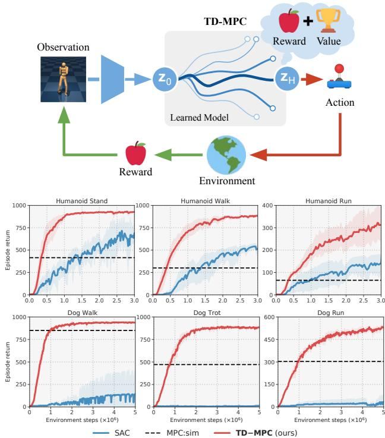
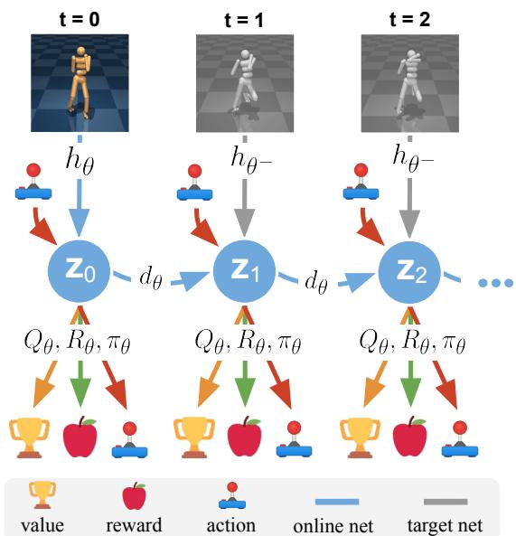
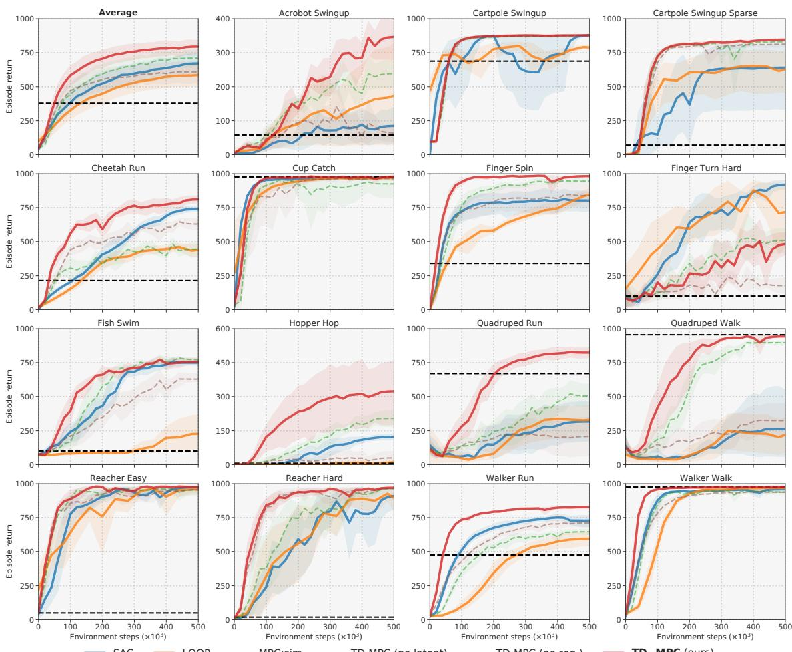
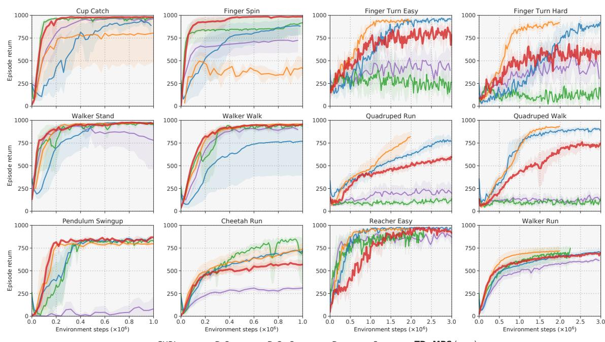
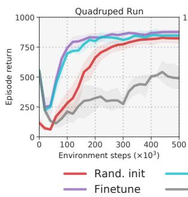
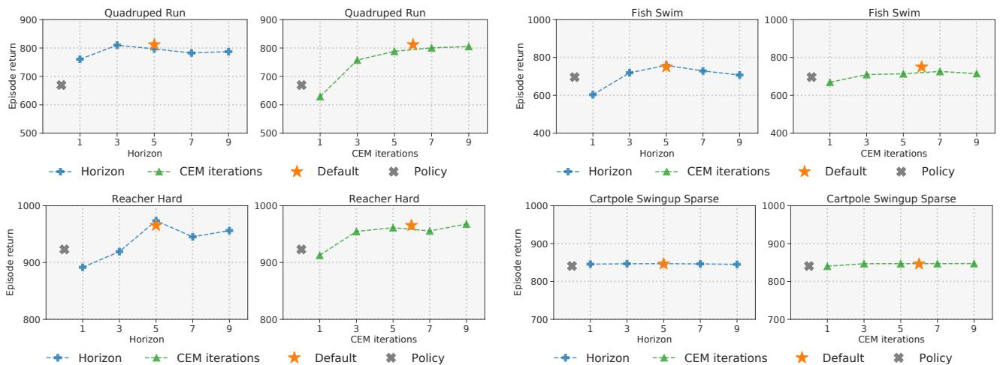
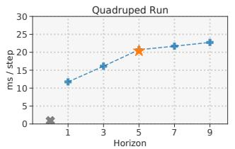
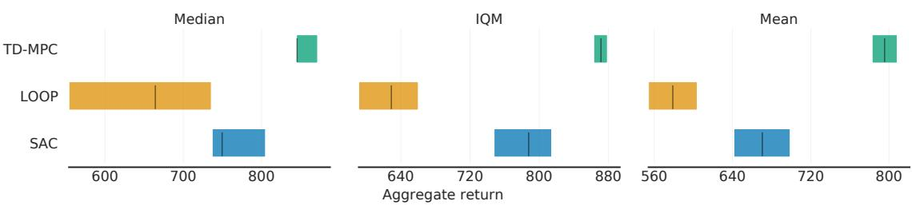
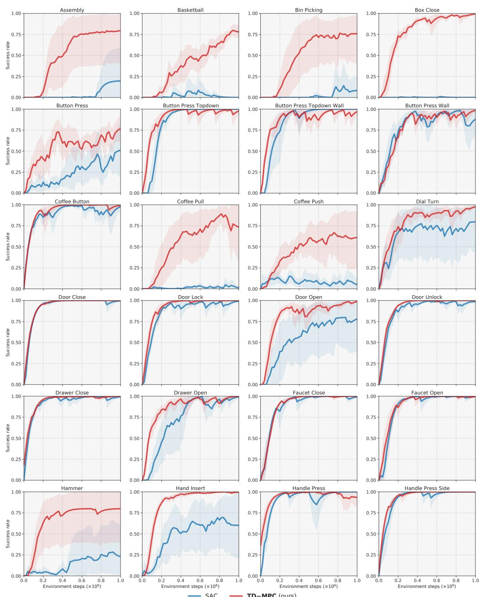

# 用于模型预测控制的时序差分学习

Nicklas Hansen <sup>1</sup> Xiaolong Wang <sup>*</sup> <sup>1</sup> Hao Su <sup>*</sup> <sup>1</sup>

## 摘要

数据驱动的模型预测控制相比无模型方法具有两个关键优势：一是通过模型学习有望提升样本效率，二是随着规划所用计算预算的增加，性能更优。然而，对长时域进行规划成本高昂，并且难以获得准确的环境模型。在本工作中，我们结合了无模型方法与基于模型方法的优势。我们使用一个面向任务的潜变量动力学模型在短时域上进行局部轨迹优化，并使用一个学习得到的目标值函数来估计长期回报，二者均通过时序差分学习联合训练得到。我们的方法 TD-MPC 在 DMControl 和 Meta-World 上的基于状态与基于图像的连续控制任务中，相较于已有工作在样本效率和渐近性能上均达到了领先水平。代码和视频见 https://nicklashansen.github.io/td-mpc。

## 1. 引言

为了在环境中实现期望行为，强化学习（Reinforcement Learning，RL）智能体需要与环境进行反复交互并不断整合关于环境的知识。规划是处理此类序贯决策问题的有力方法，已在游戏博弈（Kaiser et al., 2020; Schrittwieser et al., 2020）和连续控制（Tassa et al., 2012; Chua et al., 2018; Janner et al., 2019）等应用领域取得巨大成功。通过利用环境的内部模型，智能体可以预先规划出一条动作轨迹以实现期望行为；这与纯粹通过试错来学习策略的无模型算法形成对比。

具体而言，先前关于基于模型方法的研究工作大体可划分为两个方向，各自利用了基于模型学习的关键优势：（i）规划，相比学习得到的策略具有优势，但对长时域进行规划可能代价高昂（Janner et al., 2019; Lowrey et al., 2019; Hafner et al., 2019; Argenson & Dulac-Arnold, 2021）；以及（ii）利用学习得到的模型（例如通过从生成的经验回放中学习）来提高无模型方法的样本效率，但这也使得模型的偏差很可能传播到策略中（Ha & Schmidhuber, 2018; Hafner et al., 2020b; Clavera et al., 2020）。因此，在连续控制任务中，基于模型的方法在历史上一直难以超越更简单的无模型方法（Srinivas et al., 2020; Kostrikov et al., 2020）。




  

图 1. 概述。（上）我们提出了一个使用面向任务的潜在动力学模型和价值函数的 MPC 框架，二者通过时序差分学习联合训练。我们在模型 rollout 上进行轨迹优化，并使用价值函数进行长期回报估计。（下）我们的方法、SAC 以及使用真实仿真器的 MPC 在具有挑战性的高维 Humanoid 和 Dog 任务（Tassa et al., 2018）上的回合回报。5 次运行的平均值；阴影区域为 95% 置信区间。

我们能否将基于模型的规划与无模型学习的优势结合起来？由于长视野规划代价高昂，模型预测控制（Model Predictive Control, MPC）只在较短的有限视野内优化轨迹，因此只能得到时序局部最优的解。MPC 可以通过使用一个终值函数（terminal value function）来估计规划视野之外的折损累计回报，从而逼近全局最优解。然而，获得准确的模型和价值函数往往颇具挑战。

在本工作中，我们提出了用于模型预测控制的时序差分学习（Temporal Difference Learning for Model Predictive Control, TD-MPC），这是一个数据驱动的 MPC 框架，其中面向任务的潜在动力学模型（latent dynamics model）和终值函数由时序差分（Temporal Difference, TD）学习联合训练得到。在每一步决策时，我们利用所学模型产生的短期回报估计进行轨迹优化，并使用所学价值函数进行长期回报估计。例如，在图 1 所示的 Humanoid 运动任务中，使用模型进行规划有助于实现精确的关节运动，而更高层次的目标（例如奔跑方向）则可由长期价值估计加以引导。

一个关键的技术贡献在于模型的学习方式。已有工作通过对状态或视频的预测来学习模型，但我们认为对环境中的一切——包括无关的量以及诸如阴影等视觉细节——都进行建模是非常低效的，因为这种方法会受困于模型不准确与误差累积的影响。为了应对这些挑战，我们对模型学习做出了三项关键改进。首先，我们完全基于奖励来学习动力学模型的潜在表示，忽略对当前任务无用的细微之处。这使得学习比基于状态/图像的预测更具样本效率。其次，我们将奖励与 TD 目标的梯度沿多个模型展开步骤反向传播，从而在长视野上改进回报与价值预测。这缓解了执行展开时的误差累积。最后，我们提出了与模态无关的潜在空间预测损失，它无需显式的状态或图像预测，便能在所学表示上强制时间一致性。

我们在 DMControl（Tassa 等，2018）和 Meta-World（Yu 等，2019）的多种连续控制任务上评估了我们的方法，发现我们的方法在样本效率与渐近性能上均优于此前的基于模型方法和无模型方法。具体而言，我们的方法仅需 100 万步环境交互，便能求解动作空间高达 38 维的 Humanoid 与 Dog 运动任务（见图 1），并且可以轻松扩展以达到基于图像的强化学习的最新水平。

## 2. 预备知识

问题形式化。我们考虑无限时域的马尔可夫决策过程（Markov Decision Process, MDP），其特征由元组 $( S , \mathcal { A } , \mathcal { T } , \mathcal { R } , \gamma , p _ { 0 } )$ 刻画，其中 $S \in \mathbb { R } ^ { n }$ 和 $\mathcal { A } \in \mathbb { R } ^ { m }$ 分别是连续的状态空间和动作空间，$\mathcal { T } \colon \mathcal { S } \times \mathcal { A } \times \mathcal { S } \mapsto \mathbb { R } _ { + }$ 是转移（动力学）函数，$\mathcal { R } \colon S \times \mathcal { A } \mapsto \mathbb { R }$ 是奖励函数，$\gamma \in [ 0 , 1 )$ 是折扣因子，$p _ { 0 }$ 是初始状态分布。我们的目标是学习一个参数化的映射 $\Pi _ { \theta } \colon S \mapsto A$，其参数为 θ，使得折扣回报 $\begin{array} { r } { \mathbb { E } _ { \Gamma \sim \Pi _ { \theta } } [ \sum _ { t = 1 } ^ { \infty } \gamma ^ { t } r _ { t } ] , \ r _ { t } \sim \mathcal { R } ( \cdot | \mathbf { s } _ { t } , \mathbf { a } _ { t } ) } \end{array}$ 沿轨迹 $\Gamma = ( \mathbf { s } _ { 0 } , \mathbf { a } _ { 0 } , \mathbf { s } _ { 1 } , \mathbf { a } _ { 1 } , \dots )$ 最大化，该轨迹通过在每个决策步 t 采样动作 $\mathbf { a } _ { t } \sim \Pi _ { \theta } ( \cdot | \mathbf { s } _ { t } )$ 并到达状态 $\mathbf { s } _ { t + 1 } \sim \mathcal { T } ( \cdot | \mathbf { s } _ { t } , \mathbf { a } _ { t } )$ 来遵循策略 $\Pi _ { \theta }$。

拟合 Q 迭代（Fitted Q-iteration）。无模型的时序差分（Temporal Difference, TD）学习算法旨在使用参数化的值函数 $Q _ { \theta } ( \mathbf { s } , \mathbf { a } ) ~ \approx ~ Q ^ { * } ( \mathbf { s } , \mathbf { a } ) ~ = ~ \mathrm { m a x } _ { \mathbf { a } ^ { \prime } } \mathbb { E } [ \mathcal { R } ( \mathbf { s } , \mathbf { a } ) ~ + ~$ $\gamma Q ^ { * } ( \mathbf { s } ^ { \prime } , \mathbf { a } ^ { \prime } ) ] \ \forall \mathbf { s } \in \mathcal { S }$ 来估计最优状态-动作值函数 $Q ^ { * } \colon S \ \times \ A \ \mapsto \ \mathbb { R }$，其中 $\mathbf { s } ^ { \prime } , \mathbf { a } ^ { \prime }$ 是下一步的状态和动作，θ 对该函数进行参数化（Sutton, 2005）。当 $\gamma \approx 1$ 时，$Q ^ { * }$ 在无限时域上估计最优策略的折扣回报。虽然 $Q ^ { * }$ 通常是未知的，但可以通过反复使用如下更新规则拟合 $Q _ { \theta }$ 来近似它

$$
\theta^ {k + 1} \leftarrow \arg \min _ {\theta} \mathbb {E} _ {(\mathbf {s}, \mathbf {a}, \mathbf {s} ^ {\prime}) \sim \mathcal {B}} \| Q _ {\theta} (\mathbf {s}, \mathbf {a}) - y \| _ {2} ^ {2}\tag{1}
$$

其中 $Q \ – t a r g e t y = \mathcal { R } ( \mathbf { s } , \mathbf { a } ) + \gamma \operatorname* { m a x } _ { \mathbf { a } ^ { \prime } } Q _ { \theta ^ { - } } ( \mathbf { s } ^ { \prime } , \mathbf { a } ^ { \prime } )$，B 是一个随着新数据不断收集而迭代增长的回放缓冲区（replay buffer），$\theta ^ { - }$ 是按规则 $\theta _ { k + 1 } ^ { - } \longleftarrow { ( 1 - \zeta ) \theta _ { k } ^ { - } } + \zeta \theta _ { k }$ 在每次迭代时更新的在线参数 θ 的慢移动平均（slow-moving average），所使用的常数系数为 $\zeta \in [ 0 , 1 )$。

模型预测控制（Model Predictive Control, MPC）。在 actor-critic 强化学习（actor-critic RL）算法中，Π 通常是由一个神经网络参数化的策略，该策略学习近似 $\Pi _ { \theta } ( \cdot | \mathbf { s } ) \approx \arg \operatorname* { m a x } _ { \mathbf { a } } \mathbb { E } \left[ Q _ { \theta } ( \mathbf { s } , \mathbf { a } ) \right] \forall \mathbf { s } \in \mathcal { S }$，即全局最优策略。在控制理论中，Π 传统上以轨迹优化（trajectory optimization）过程实现。为使问题可处理，通常通过在有限时域 H 上估计最优动作 $\mathbf { a } _ { t : t + H }$ 来获得每一步 t 处轨迹优化问题的局部解，并执行第一个动作 $\mathbf { a } _ { t }$，这被称为模型预测控制（Model Predictive Control, MPC）：

$$
\Pi_ {\theta} ^ {\mathrm{MPC}} (\mathbf {s} _ {t}) = \arg \max _ {\mathbf {a} _ {t: t + H}} \mathbb {E} \left[ \sum_ {i = t} ^ {H} \gamma^ {i} \mathcal {R} (\mathbf {s} _ {i}, \mathbf {a} _ {i}) \right],\tag{2}
$$

其中 $\gamma$，与拟合 Q-迭代（fitted Q-iteration）不同，通常设为 1，即不进行折扣。直观来看，Equation 2 可以视为标准加性代价最优控制目标的一个特例。可以通过无导数的交叉熵方法（Cross-Entropy Method, CEM；Rubinstein (1997)）在有限时域的动作空间上迭代拟合一族分布的参数（例如对角协方差多元高斯的 μ、σ），并使用由模型生成的样本来求解。与 fitted Q-iteration 不同，Equation 2 不能预测长期奖励，因此是一个短视解。当已知一个价值函数时（例如某个启发式函数，或在我们方法的上下文中：通过 Equation 1 估计得到），可以将其与

Equation 2 联合使用，以估计状态 $\mathbf{s}_{t+H}$ 及其之后的折扣回报；这类方法称为带终值函数的 MPC（terminal value function）。接下来，我们分别从 actor-critic 强化学习算法和模型预测控制（planning）两个角度来考虑参数化映射 Π。为区分这两个概念，我们将基于 MPC 的规划记为 $\Pi_\theta$，将策略网络记为 $\pi_\theta$。我们一般将神经网络参数化记为 θ（在线）和 θ⁻（目标；θ 的慢移动平均），作为组合后的特征向量。

## 3. 用于模型预测控制的时序差分学习（TD-Learning）

我们提出 TD-MPC，这是一个将 MPC 与面向任务的潜在动力学模型及终值函数相结合，并通过在线强化学习设置中的 TD 学习进行联合学习的框架。具体而言，TD-MPC 利用模型预测路径积分（Model Predictive Path Integral, MPPI；Williams et al. (2015)）控制进行规划（记为 $\Pi_\theta$），并分别使用学得的（潜在）动力学模型 $d_\theta$ 和奖励信号模型 $R_\theta$，以及一个终值状态-动作价值函数 $Q_\theta$，和一个用于辅助引导规划的参数化策略 $\pi_\theta$。我们在 Figure 1 和 Algorithm 1 中概述了我们的框架。本节中，我们详细介绍方法在推理时的行为，将训练相关的讨论推迟到第 4 节。

MPPI 是一种 MPC 算法，它通过按期望回报排序的 top-k 估计采样轨迹的重要性加权平均来迭代更新一族分布的参数；实际中，我们拟合一个时变对角协方差多元高斯的参数。我们对 MPPI 作如下改进。从初始参数 $(\mu^0, \bar{\sigma^0})_{t:t+H}, \mu^0, \sigma^0 \in \mathbb{R}^m, \mathcal{A} \in \mathbb{R}^m$ 出发，即在长度为 H 的时域内对每个动作设置独立参数，我们使用学得模型 $d_\theta$ 生成的 rollout 独立采样 N 条轨迹，并估计一条采样轨迹 $\Gamma$ 的总回报 $\phi_\Gamma$ 如下：

$$
\phi_ {\Gamma} \triangleq \mathbb {E} _ {\Gamma} \left[ \gamma^ {H} Q _ {\theta} (\mathbf {z} _ {H}, \mathbf {a} _ {H}) + \sum_ {t = 0} ^ {H - 1} \gamma^ {t} R _ {\theta} (\mathbf {z} _ {t}, \mathbf {a} _ {t}) \right],\tag{3}
$$

其中 $\mathbf { z } _ { \mathbf { t } + 1 } = d _ { \theta } ( \mathbf { z } _ { \mathbf { t } } , \mathbf { a } _ { \mathbf { t } } )$，且在第 $j - 1$ 次迭代时 $\mathbf { a } _ { \mathbf { t } } \sim \mathcal { N } ( \mu _ { t } ^ { j - 1 } , ( \sigma _ { t } ^ { j - 1 } ) ^ { 2 } \mathrm { I } )$，如算法 1 中红色高亮部分所示。我们选取 top-k 回报 $\phi _ { \Gamma } ^ { \star }$，并在第 j 次迭代时根据 $\phi _ { \Gamma } ^ { \star }$-归一化的经验估计得到新的参数 $\mu ^ { j } , \sigma ^ { j }$：

$$
\mu^ {j} = \frac {\sum_ {i = 1} ^ {k} \Omega_ {i} \Gamma_ {i} ^ {\star}}{\sum_ {i = 1} ^ {k} \Omega_ {i}}, \sigma^ {j} = \sqrt {\frac {\sum_ {i = 1} ^ {k} \Omega_ {i} (\Gamma_ {i} ^ {\star} - \mu^ {j}) ^ {2}}{\sum_ {i = 1} ^ {k} \Omega_ {i}}},\tag{4}
$$

其中 $\Omega _ { i } = e ^ { \tau ( \phi _ { \Gamma , i } ^ { \star } ) } , \tau$ 是一个温度参数，用于控制加权的"锐度"，$\Gamma _ { i } ^ { \star }$ 表示对应于回报估计 $\phi _ { \Gamma } ^ { \star }$ 的第 i 条 top-k 轨迹。经过固定次数的迭代 $^{J,}$ 后，规划过程终止，并从动作序列上最终的回报归一化分布中采样一条轨迹。我们在每个决策步 t 进行规划，并仅执行第一个动作，即我们采用滚动时域 MPC 来生成反馈策略。为了减少收敛所需的迭代次数，我们在每个步 t 通过复用上一步获得的 1 步偏移均值 $\mu$ 来对轨迹优化进行"热启动"（Argenson & Dulac-Arnold, 2021），但始终使用较大的初始方差以避免局部最小值。

<div class="mineru-algorithm" style="white-space: pre-wrap; font-family:monospace;">
算法 1 TD-MPC（推理）

Require: $\theta$：已学习的网络参数
    $\mu^0, \sigma^0$：$\mathcal{N}$ 的初始参数
    $N, N_\pi$：采样/策略轨迹的数量
    $\mathbf{s}_t, H$：当前状态，展开时域

1: 编码状态 $\mathbf{z}_t \leftarrow h_\theta(\mathbf{s}_t) \quad \triangleleft$ 假设为 TOLD 模型

2: for 每个迭代 $j = 1..J$ do

3: 从 $\mathcal{N}(\mu^{j-1}, (\sigma^{j-1})^2\text{I})$ 中采样 $N$ 条长度为 $H$ 的轨迹

4: 使用 $\pi_\theta, d_\theta$ 采样 $N_\pi$ 条长度为 $H$ 的轨迹

// 使用 $d_\theta, R_\theta, Q_\theta$ 从 $\mathbf{z}_t$ 开始估计轨迹回报 $\phi_\Gamma$，并初始令 $\phi_\Gamma = 0$：

5: for 所有 $N + N_\pi$ 条轨迹 ($\mathbf{a}_t, \mathbf{a}_{t+1}, \ldots, \mathbf{a}_{t+H}$) do

6: for 步 $t = 0..H - 1$ do

7: $\phi_\Gamma = \phi_\Gamma + \gamma^t R_\theta(\mathbf{z}_t, \mathbf{a}_t)$ $\triangleleft$ 奖励

8: $\mathbf{z}_{t+1} \leftarrow d_\theta(\mathbf{z}_t, \mathbf{a}_t)$ $\triangleleft$ 潜空间转移

9: $\phi_\Gamma = \phi_\Gamma + \gamma^H Q_\theta(\mathbf{z}_H, \mathbf{a}_H)$ $\triangleleft$ 终端价值

// 为下一次迭代更新参数 $\mu, \sigma$：

10: $\mu^j, \sigma^j =$ 公式 4（以及公式 5）

11: return $\mathbf{a} \sim \mathcal{N}(\mu^J, (\sigma^J)^2\text{I})$
</div>

通过规划进行探索。诸如 DDPG（Lillicrap 等人，2016 年）等无模型强化学习算法通过在训练期间向学习到的策略 $\pi _ { \theta }$ 注入动作噪声（例如高斯噪声或 Ornstein-Uhlenbeck 噪声）来鼓励探索，可以选择遵循线性退火调度。虽然我们的轨迹优化过程由于轨迹采样本身具有随机性，但我们发现 $\sigma$ 的衰减速率在不同任务之间差异巨大，导致在小 $\sigma$ 时出现（可能较差的）局部最优。为了促进跨任务的一致探索，我们约束采样分布的标准差，使得对于在迭代 $j$ 时从公式 4 得到的 $\mu ^ { j }$，我们将 $\sigma ^ { j }$ 更新为

$$
\sigma^ {j} = \max \left(\sqrt {\frac {\sum_ {i = 1} ^ {N} \Omega_ {i} (\Gamma_ {i} ^ {\star} - \mu^ {j}) ^ {2}}{\sum_ {i = 1} ^ {N} \Omega_ {i}}}, \epsilon\right),\tag{5}
$$

其中 $\epsilon \in \mathbb{R}_+$ 是一个线性衰减常数。类似地，在训练的早期阶段，我们将规划时域从 1 线性增加到 H，因为模型初始时不准确，规划因此会被模型偏差主导。

**策略引导的轨迹优化。** 与 Schrittwieser 等人（2020）以及 Sikchi 等人（2022）类似，TD-MPC 除了学习规划过程 $\Pi$ 之外，还学习一个策略 $\pi_\theta$，并用来自 $\pi_\theta$ 的额外样本增强采样过程（在算法 1 中以蓝色标出）。这会导致以下两种情况之一：策略轨迹被估计为（i）较差的，可能被排除在前 k 条轨迹之外；或（ii）较好的，可能被纳入，且其影响力与估计的回报 $\phi_\Gamma$ 成正比。LOOP 依赖 SAC（Haarnoja 等人，2018）的最大 LVM 熵目标进行探索，而 TD-MPC 学习一个确定性策略。为了使采样具有随机性，我们像 DDPG（Lillicrap 等人，2016）那样对 $\pi_\theta$ 的动作施加线性退火的（高斯）噪声。我们的完整流程总结在算法 1 中。

## 4. 面向任务的潜在动力学模型

为了与 TD-MPC 协同使用，我们提出了一个面向任务的潜在动力学（Task-Oriented Latent Dynamics，TOLD）模型，该模型与一个终局价值函数通过 TD-learning 联合学习。我们的 TOLD 模型并不试图建模环境本身，而是学习只建模环境中对奖励具有预测性的元素，这是一个容易得多的问题。在推理时，我们的 TD-MPC 框架利用学习到的 TOLD 模型进行轨迹优化，使用模型推演估计短程奖励，使用终局价值函数估计长程回报。TD-MPC 和 TOLD 支持连续动作空间、任意的输入模态以及稀疏奖励信号。图 2 给出了 TOLD 训练流程的概览。

**组成部分。** 在整个训练期间，我们的智能体迭代执行以下两个操作：（i）利用从先前环境交互收集的数据改进学习到的 TOLD 模型；以及（ii）通过 TD-MPC 在线规划动作序列，并使用 TOLD 生成想象推演，从而从环境中收集新数据。我们提出的 TOLD 由五个学习组件 $h_\theta, d_\theta, R_\theta, Q_\theta, \pi_\theta$ 组成，它们分别预测以下量：

$$
\begin{array}{l l} \text {Representation:} & \mathbf {z} _ {t} = h _ {\theta} (\mathbf {s} _ {t}) \\ \text {Latent dynamics:} & \mathbf {z} _ {t + 1} = d _ {\theta} (\mathbf {z} _ {t}, \mathbf {a} _ {t}) \\ \text {Reward:} & \hat {r} _ {t} = R _ {\theta} (\mathbf {z} _ {t}, \mathbf {a} _ {t}) \\ \text {Value:} & \hat {q} _ {t} = Q _ {\theta} (\mathbf {z} _ {t}, \mathbf {a} _ {t}) \\ \text {Policy:} & \hat {\mathbf {a}} _ {t} \sim \pi_ {\theta} (\mathbf {z} _ {t}) \end{array}\tag{6}
$$

给定在时间 $t$ 观测到的观察 $\mathbf { s } _ { t }$，一个表示网络 $h _ { \theta }$ 将 $\mathbf { s } _ { t }$ 编码为潜在表示 $\mathbf { z } _ { t }$。从 $\mathbf { z } _ { t }$ 与在时间 $t$ 执行的动作 $\mathbf { a } _ { t }$ 出发，TOLD 然后预测：(i) 潜在动力学（即下一时间步的潜在表示 $\mathbf { z } _ { t + 1 }$）；(ii) 收到的单步奖励；(iii) 其状态–动作（Q）值；(iv) 一个（近似）最大化 Q 函数的动作。为使 TOLD 不易受到累积误差的影响，我们从预测的未来潜在状态出发，以循环方式对未来多步预测上述各项，并通过时间反向传播梯度。与先前工作 (Ha & Schmidhuber, 2018; Janner et al., 2019; Hafner et al., 2019; 2020b; Sikch et al., 2022) 不同，我们发现将 TOLD 的所有组件实现为纯粹的确定性 MLP 即可满足需求，即既不需要 RNN 门控机制，也不需要概率模型。

  

图 2. 训练我们的 TOLD 模型。从回放缓冲区（replay buffer）中采样一条长度为 H 的轨迹 $\Gamma_{0:H}$，其初始观测 s 由 $h_\theta$ 编码为潜在表示 $\mathbf{z}_0$。接着，TOLD 递归地预测后续的潜在状态 $\mathbf{z}_1, \mathbf{z}_2, \ldots, \mathbf{z}_H$，以及每个潜在状态对应的价值 $\hat{q}$、奖励 $\hat{r}$ 和动作 $\hat{a}$，我们通过公式 7 对 TOLD 进行优化。后续观测由目标网络（target net）$h_{\theta^-}$（其中 $\theta^-$ 为 $\theta$ 的慢移动平均）进行编码，并仅在训练阶段用作潜在目标（如图中灰色部分所示）。

目标函数。我们首先给出完整的目标函数，然后阐述每个模块及其对应目标项的设计动机。在训练过程中，我们最小化一个时序加权的目标函数

$$
\mathcal {J} (\theta ; \Gamma) = \sum_ {i = t} ^ {t + H} \lambda^ {i - t} \mathcal {L} (\theta ; \Gamma_ {i}),\tag{7}
$$

其中 $\Gamma \sim B$ 是从经验回放池 $B$ 中采样得到的一条轨迹 $(\mathbf{s}_t, \mathbf{a}_t, r_t, \mathbf{s}_{t+1})_{t:t+H}$，$\lambda \in \mathbb{R}_+$ 是一个对近期预测赋予更高权重的常数，以及单步损失

$$
\mathcal {L} (\theta ; \Gamma_ {i}) = c _ {1} \underbrace {\| R _ {\theta} (\mathbf {z} _ {i} , \mathbf {a} _ {i}) - r _ {i} \| _ {2} ^ {2}} _ {\text {reward}}\tag{8}
$$

$$
+ c _ {2} \underbrace {\left\| Q _ {\theta} (\mathbf {z} _ {i} , \mathbf {a} _ {i}) - (r _ {i} + \gamma Q _ {\theta^ {-}} (\mathbf {z} _ {i + 1} , \pi_ {\theta} (\mathbf {z} _ {i + 1}))) \right\| _ {2} ^ {2}} _ {\text { value }}\tag{9}
$$

$$
+ c _ {3} \underbrace {\| d _ {\theta} (\mathbf {z} _ {i} , \mathbf {a} _ {i}) - h _ {\theta^ {-}} (\mathbf {s} _ {i + 1}) \| _ {2} ^ {2}} _ {\text { latent   state   consistency }}\tag{10}
$$

被用于联合优化奖励预测、价值预测，以及一个对所学表示进行正则化的潜状态一致性损失。其中，$c _ { 1 : 3 }$ 是用于平衡这三项损失的常数系数。从每个转移 $\left( \mathbf { z } _ { i } , \mathbf { a } _ { i } \right)$ 出发，奖励项（公式 8）预测单步奖励，价值项（公式 9）采用了公式 1 中的拟合 Q 迭代（fitted Q-iteration），遵循先前在演员-评论家算法方面的工作（Lillicrap et al., 2016; Haarnoja et al., 2018），一致性项（公式 10）则预测未来状态的潜表示。

关键在于，循环预测完全在潜空间中从状态 $\mathbf { z } _ { i } ~ = ~ h _ { \theta } ( \mathbf { s } _ { i } ) , ~ \mathbf { z } _ { i + 1 } ~ = ~ d _ { \theta } ( \mathbf { z } _ { i } , \mathbf { a } _ { i } )$ ${ \bf z } _ { i + H } = d _ { \theta } ( { \bf z } _ { i + H - 1 } , { \bf a } _ { i + H - 1 } )$ 出发，使得只有第一个观测 $\mathbf { s } _ { i }$ 由 $h _ { \theta }$ 编码，三项损失对应的梯度都沿时间反向传播。这与先前基于模型的学习工作形成对比——那些工作通过对状态或视频的预测来学习模型，且完全独立于策略和/或价值的学习（Ha & Schmidhuber, 2018; Hafner et al., 2020b; Sikchi et al., 2022）。

我们使用在线网络参数 θ 的指数移动平均 $\theta ^ { - }$ 来计算价值目标（Lillicrap et al., 2016），类似地也使用 $\theta ^ { - }$ 来计算潜状态一致性目标 $h _ { \theta ^ { - } } ( \mathbf { s } _ { i + 1 } )$。策略 $\pi _ { \theta }$ 将在下文中介绍，而关于一致性损失的讨论则留到下一节。

计算 TD 目标。公式 9 中的 TD 目标函数需要估计量 $\operatorname* { m a x } _ { \mathbf { a } _ { t } } Q _ { \theta ^ { - } } ( \mathbf { z } _ { t } , \mathbf { a } _ { t } )$，而通过规划来计算该量代价极其高昂（Lowrey et al., 2019）。因此，我们转而学习一个策略 π<sub>θ</sub>，通过最小化如下目标函数来最大化 $Q _ { \theta }$

$$
\mathcal {J} _ {\pi} (\theta ; \Gamma) = - \sum_ {i = t} ^ {t + H} \lambda^ {i - t} Q _ {\theta} (\mathbf {z} _ {i}, \pi_ {\theta} (\mathrm{sg} (\mathbf {z} _ {i}))),\tag{11}
$$

这是对策略目标的时间加权改编，常用于无模型 actor-critic 方法，例如 DDPG（Lillicrap et al., 2016）和 SAC（Haarnoja et al., 2018）。其中，sg 表示 stop-grad 算子，公式 11 仅针对策略参数进行优化。虽然我们通过实验观察到，对于复杂任务，学到的 $\pi_\theta$ 表现逊于规划（第 5 节中讨论），但我们发现它已足够具有表现力，能够支持高效的价值学习。

**潜在状态一致性（Latent state consistency）**。为了为模型学习提供丰富的学习信号，先前的基于模型强化学习工作通常学习直接预测未来状态或像素（Ha & Schmidhuber, 2018; Janner et al., 2019; Lowrey et al., 2019; Kaiser et al., 2020; Sikchi et al., 2022）。然而，学习预测未来观测是一个极其困难的问题，因为它迫使网络对环境中的所有内容进行建模，包括与任务无关的量以及诸如阴影之类的细节。相反，我们提出用一个潜在状态一致性损失（如公式 10 所示）来正则化 TOLD，该损失强制在时刻 $t+1$ 的未来潜在状态预测 $\mathbf{z}_{t+1} = d_\theta(\mathbf{z}_t, \mathbf{a}_t)$ 与相应真实观测的潜在表示 $h_{\theta^-}(\mathbf{s}_{t+1})$ 相近，从而完全规避了对观测的预测。此外，这一设计选择使模型学习实际上与观测模态无关。训练过程如算法 2 所示；伪代码见附录 F。

## 5. 实验

我们在来自 DeepMind Control Suite（DMControl；Tassa et al. (2018)）的共计 92 个多样化且具有挑战性的连续控制任务上评估了带有 TOLD 模型的 TD-MPC，

<div class="mineru-algorithm" style="white-space: pre-wrap; font-family:monospace;">
算法 2 TOLD（训练）

需要：$\theta, \theta^{-}$：随机初始化的网络参数；$\eta, \tau, \lambda, \mathcal{B}$：学习率、系数、缓冲区

1: while not tired do

2: // 使用 TD-MPC 从 $s_0 \sim p_0$ 收集回合：

3: for step $t = 0...T$ do

4: $\mathbf{a}_t \sim \Pi_\theta(\cdot|h_\theta(\mathbf{s}_t))$ ◁ 使用 TD-MPC 采样

5: $(\mathbf{s}_{t+1}, r_t) \sim \mathcal{T}(\cdot|\mathbf{s}_t, \mathbf{a}_t), \mathcal{R}(\cdot|\mathbf{s}_t, \mathbf{a}_t)$ ◁ 推进环境

6: $\mathcal{B} \leftarrow \mathcal{B} \cup (\mathbf{s}_t, \mathbf{a}_t, r_t, \mathbf{s}_{t+1})$ ◁ 添加到缓冲区

7: // 使用 $\mathcal{B}$ 中收集的数据更新 TOLD：

8: for num updates per episode do

9: $\{\mathbf{s}_t, \mathbf{a}_t, r_t, \mathbf{s}_{t+1}\}_{t:t+H} \sim \mathcal{B}$ ◁ 采样轨迹

10: $\mathbf{z}_t = h_\theta(\mathbf{s}_t)$ ◁ 编码第一个观测

11: $J = 0$ ◁ 初始化 $J$ 以累积损失

12: for $i = t...t + H$ do


13: $\hat{r}_i = R_\theta(\mathbf{z}_i, \mathbf{a}_i) \triangleleft$ Equation 8

14: $\hat{q}_i = Q_\theta(\mathbf{z}_i, \mathbf{a}_i) \triangleleft$ Equation 9

15: $\mathbf{z}_{i+1} = d_\theta(\mathbf{z}_i, \mathbf{a}_i) \triangleleft$ Equation 10

16: $\hat{a}_i = \pi_\theta(\mathbf{z}_i) \triangleleft$ Equation 11

17: $J \leftarrow J + \lambda^{i-t} \mathcal{L}(\mathbf{z}_{i+1}, \hat{r}_i, \hat{q}_i, \hat{\mathbf{a}}_i) \triangleleft$ Equation 7

18: $\theta \leftarrow \theta - \frac{1}{H} \eta \nabla_\theta J \triangleleft$ Update online network

19: $\theta^{-} \leftarrow (1-\tau) \theta^{-} + \tau \theta \triangleleft$ Update target network
</div>

Meta-World v2（Yu et al., 2019），涵盖具有稀疏奖励、高维状态与动作空间、图像观测、多模态输入、目标条件以及多任务学习设置的任务；任务可视化请参阅附录 L。我们选择这两个基准，是因为它们任务多样性极高，并且有可用的基线实现与结果。我们试图回答以下问题：

− 使用 TD-MPC 进行规划与当前最先进的基于模型和无模型方法相比，效果如何？

− 即便使用了以奖励为中心的目标函数，TOLD 模型是否仍能展现出多任务与迁移能力？

− 性能与规划过程的计算预算之间存在怎样的关系？

TD-MPC 的实现代码可在 https://nicklashansen.github.io/td-mpc 获取，单 GPU 即可在一小时内解决大多数任务。

实现细节。所有组件均为确定性的，并使用多层感知机（MLP）实现。我们在前 25k 个决策步内，将 Π 和 $\pi _ { \theta }$ 的探索参数 𝜖 由 0.5 线性退火至 0.05<sup>1</sup>。我们使用规划视野 $H = 5$，并使用优先经验回放（Schaul et al., 2016）采样轨迹，优先级按价值损失缩放。在规划过程中，我们共执行 6 次迭代（Dog 为 8 次；Humanoid 为 12 次），每次采样 $N = 5 1 2$ 条轨迹（其中 5% 由 $\pi$ 采样得到），并在每轮迭代的前 64 条轨迹上计算 $\mu$、$\sigma$ 参数。对于基于图像的任务，观测为 3 帧堆叠的 84×84 RGB 图像帧，并采用 ±4 像素平移增强（Kostrikov et al., 2020）。更多细节请参阅附录 F。

  

图 3. DMControl 任务。我们的方法（TD-MPC）及基线方法在来自 DMControl（Tassa 等，2018）的 15 个基于状态的连续控制任务上的回报表现。运行 5 次取平均值；阴影区域为 95% 置信区间。在左上角，我们展示了在全部 15 个任务上取平均后的结果。我们观察到在具有复杂动态的任务（例如 Quadruped 和 Acrobot 任务）上获得了尤其显著的性能提升。

基线方法。我们将本文方法与以下方法进行比较：

− Soft Actor-Critic（SAC；(Haarnoja et al., 2018)），一种基于最大熵强化学习（Ziebart et al., 2008）推导得到的当前最优模型无关算法。我们选择 SAC 作为主要对比方法，因为它在 DMControl 和 Meta-World 上都具有广泛的流行度和强劲的性能。具体而言，我们采用 Yarats & Kostrikov (2020) 的实现。

− LOOP（Sikchi et al., 2022），一种将 SAC 与规划和学习模型相结合的混合算法。LOOP 已被证明在若干 MuJoCo 任务上优于多种基于模型的方法，例如 MBPO（Janner et al., 2019）和 POLO（Lowrey et al., 2019）。由于 LOOP 与 TD-MPC 有诸多相似之处，它是一个非常相关的基线方法。

− 使用真实模拟器的 MPC（记为 MPC:sim）。由于使用模拟器进行规划计算开销较大，我们将规划时域限制为 10（本文方法的 2 倍），采样轨迹数限制为 200，并优化 4 轮迭代（本文方法为 6 轮）。

− CURL（Srinivas et al., 2020）、DrQ（Kostrikov et al., 2020）和 DrQ-v2（Yarats et al., 2021），三种当前最优的模型无关算法。

− PlaNet（Hafner et al., 2019）、Dreamer（Hafner et al., 2020b）和 Dreamer-v2（Hafner et al., 2020a）。这三种方法均使用重建损失学习模型，并通过 MPC 或学习得到的策略选择动作。

− MuZero（Schrittwieser et al., 2020）和 EfficientZero（Ye et al., 2021），它们从奖励中学习潜在动力学模型，并使用 MCTS 进行离散动作选择。

− 消融实验。我们考虑了以下消融：(i) 使用状态预测器（$h_{\theta}$ 为恒等函数）实现的本文方法；(ii) 不使用式 10 中的潜在一致性损失实现的本文方法；以及将一致性损失替换为：(iii) PlaNet 和 Dreamer 的重建目标，或 (iv) EfficientZero 的对比目标。

更多关于基线方法的讨论见附录 G。

Table 1. 从像素学习。本方法（TD-MPC）与当前最优算法在 Srinivas et al. (2020); Kostrikov et al. (2020); Ye et al. (2021) 所使用的基于图像的 DMControl 100k 基准上的回报对比。基线方法专为基于图像的强化学习而调参，而本文方法并未如此。SAC、CURL、DrQ 和 PlaNet 的结果部分取自 Srinivas et al. (2020); Kostrikov et al. (2020)；Dreamer、MuZero 和 EfficientZero 的结果取自 Hafner et al. (2020b); Ye et al. (2021)。报告的是 10 次运行的均值和标准差。\*：MuZero 和 EfficientZero 使用离散化动作空间，且 EfficientZero 在评估前额外执行 20k 步梯度更新，而其他方法则没有。由于离散化带来的维度爆炸问题，MuZero 和 EfficientZero 无法可行地求解具有更高维动作空间的任务，例如 Walker Walk 和 Cheetah Run（$\mathcal{A} \in \mathbb{R}^{6}$），而本文方法则可以。

<table><tr><td>100k env. steps</td><td>SAC State</td><td>SAC Pixels</td><td>CURL</td><td>DrQ</td><td>PlaNet</td><td>Dreamer</td><td>MuZero*</td><td>Eff.Zero*</td><td>TD-MPC</td></tr><tr><td>Cartpole Swingup</td><td> $812 \pm 45$ </td><td> $419 \pm 40$ </td><td> $597 \pm 170$ </td><td> $759 \pm 92$ </td><td> $563 \pm 73$ </td><td> $326 \pm 27$ </td><td> $219 \pm 122$ </td><td> $813 \pm 19$ </td><td> $770 \pm 70$ </td></tr><tr><td>Reacher Easy</td><td> $919 \pm 123$ </td><td> $145 \pm 30$ </td><td> $517 \pm 113$ </td><td> $601 \pm 213$ </td><td> $82 \pm 174$ </td><td> $314 \pm 155$ </td><td> $493 \pm 145$ </td><td> $952 \pm 34$ </td><td> $628 \pm 105$ </td></tr><tr><td>Cup Catch</td><td> $957 \pm 26$ </td><td> $312 \pm 63$ </td><td> $772 \pm 241$ </td><td> $913 \pm 53$ </td><td> $710 \pm 217$ </td><td> $246 \pm 174$ </td><td> $542 \pm 270$ </td><td> $942 \pm 17$ </td><td> $933 \pm 24$ </td></tr><tr><td>Finger Spin</td><td> $672 \pm 76$ </td><td> $166 \pm 128$ </td><td> $779 \pm 108$ </td><td> $901 \pm 104$ </td><td> $560 \pm 77$ </td><td> $341 \pm 70$ </td><td>—</td><td>—</td><td> $943 \pm 59$ </td></tr><tr><td>Walker Walk</td><td> $604 \pm 317$ </td><td> $42 \pm 12$ </td><td> $344 \pm 132$ </td><td> $612 \pm 164$ </td><td> $221 \pm 43$ </td><td> $277 \pm 12$ </td><td>—</td><td>—</td><td> $577 \pm 208$ </td></tr><tr><td>Cheetah Run</td><td> $228 \pm 95$ </td><td> $103 \pm 38$ </td><td> $307 \pm 48$ </td><td> $344 \pm 67$ </td><td> $165 \pm 123$ </td><td> $235 \pm 137$ </td><td>—</td><td>—</td><td> $222 \pm 88$ </td></tr></table>

  

CURL DrQ DrQ-v2 Dreamer-v2 TD−MPC (ours)  
Figure 4. 从像素中学习。我们的方法（TD-MPC）与最先进算法在 12 个具有挑战性的基于图像的 DMControl 任务上的回报。我们遵循先前的工作（Hafner et al., 2020b;a; Yarats et al., 2021），对所有任务采用 2 的动作重复次数。相比表 1 中所示的 DMControl 100k 基准，我们在此考虑更困难的任务，使用多达 30× 的数据量。DrQ-v2 和 Dreamer-v2 的结果取自 Yarats et al. (2021)；Hafner et al. (2020a)，DrQ 的结果部分取自 Kostrikov et al. (2020)，CURL 的结果使用其公开可用的实现（Srinivas et al., 2020）复现得到。基线方法使用任务相关的超参数，而 TD-MPC 对所有任务使用相同的超参数。结果为 5 次运行的均值；阴影区域为 95% 置信区间。TD-MPC 始终优于 CURL 和 DrQ，并与 DrQ-v2 和 Dreamer-v2 保持竞争力。

任务。我们考虑了以下 92 个任务：

− 6 个具有挑战性的人形机器人（Humanoid，$\mathcal { A } \in \mathbb { R } ^ { 2 1 }$）和狗（Dog，$\boldsymbol { \mathcal { A } } \in \mathbb { R } ^ { 3 8 }$）运动任务，具有高维状态空间和动作空间。结果如图 1 所示。

− 来自 DMControl 的 15 个多样化连续控制任务，其中 6 个具有稀疏奖励。结果如图 3 所示。

− 来自数据高效的 DMControl 100k 基准的 6 个基于图像的任务。结果如表 1 所示。

− 来自 DMControl Dreamer 基准的 12 个基于图像的任务（3M 环境步数）。结果如图 4 所示。

− 2 个多模态（本体感受数据 + 第一人称相机）3D 运动任务，其中四足智能体在障碍物周围导航。结果如图 5（中间）所示。

− 来自 Meta-World 的 50 个目标条件操作任务，以及一个同时学习 10 个任务的多任务设置。结果如图 5（顶部）所示。

在整个过程中，我们在相对较少的环境步数下对性能进行基准测试，例如，人形机器人任务使用 3M 步数，而先前工作通常运行 30M 步（10 倍）。

与其他方法的比较。我们发现我们的方法在大多数所考虑的任务上优于或匹配基线，通常在复杂任务（如 Humanoid、Dog（DMControl）和 Bin Picking（Meta-World））上具有更大的增益，并且我们注意到 TD-MPC 实际上是解决 DMControl 复杂 Dog 任务的第一个有文献记录的结果。LOOP 的性能与 SAC 相似，而使用模拟器的 MPC（MPC:sim）在运动任务上表现良好，但在具有稀疏奖励的任务中失败。尽管我们没有专门为基于图像的强化学习调整我们的方法，但我们获得的结果与最先进的基于模型和无模型的算法具有竞争力，这些算法既经过针对基于图像的强化学习的仔细调整，又包含多达 15 倍的可学习参数。值得注意的是，虽然 EfficientZero 在具有低维动作空间的任务上产生了出色的结果，但其蒙特卡洛树搜索（MCTS）需要对动作空间进行离散化，这在高维情况下是不可行的。相比之下，TD-MPC 在 Dog 任务的 38 维连续动作空间上出色地扩展。最后，在图 3 的困难探索任务 Finger Turn Hard 中，我们观察到与 SAC 和 LOOP 相比样本效率较差，这表明结合更复杂的探索策略可能对未来研究具有前景。我们将消融正则化损失选择的实验推迟到附录 D，但发现我们提出的潜在状态一致性损失产生了最一致的结果。

多任务强化学习、多模态强化学习，以及泛化能力。一种支持通用模型的常见论点是，它们可以从跨任务的数据共享中获益。因此，我们试图回答以下问题：尽管 TOLD 采用以奖励为中心的目标，它是否同样能从任务间的协同效应中获益？我们通过两个实验来检验这一假设：训练单个策略同时执行 10 个不同任务（Meta-World MT10），以及在某个任务（行走）上训练、迁移到同一领域中另一个任务（跑步）时评估模型的泛化能力。多任务结果如图 5（顶部）所示，迁移结果将推迟到附录 A 中展示。我们在两个实验中都发现，我们的方法均从数据共享中受益；我们的迁移结果进一步表明，$h _ { \theta }$ 能很好地泛化到新任务，而 $d _ { \theta }$ 则编码了更多任务特定的行为。我们推测，虽然 TOLD 只学习对奖励具有预测性的特征，但相似的任务往往具有相似的奖励结构，这使得任务之间能够共享信息。然而，我们仍然预期通用模型能从同一环境中不相关的任务中获益更多。最后，我们以奖励为中心的目标还有一个额外的好处，即它与输入模态无关。为了证明这一点，我们使用 TD-MPC 解决了两个多模态（本体感受数据 + 第一人称摄像头）运动任务；结果如图 5（底部）所示。我们发现 TD-MPC 成功融合了来自两种输入模态的信息，并解决了这些任务。相比之下，一个无法访问第一人称摄像头的盲智能体则失败了。有关多模态实验的更多细节，请参见附录 J；有关多任务实验的细节，请参见附录 I。


图 5.（上）Meta-World。在 50 个目标条件 Meta-World 任务上，分别使用单任务策略以及同时在 10 个任务上训练的多任务策略（Meta-World MT10）所得到的成功率。单任务结果见附录 I。（下）多模态强化学习（Multi-modal RL）。TD-MPC 在两个多模态运动任务上，使用本体感知数据加第一人称视角相机时的回合回报。Blind 仅使用本体感知数据。可视化结果见附录 L。所有结果均为 5 次运行的平均值；阴影区域为 95% 置信区间。

  

图 6. 可变计算预算。在可变预算条件下 TD-MPC 在四足机器人行走（Quadruped Walk）任务上的回报。我们评估完全训练后的智能体在改变（左）规划时域长度；（右）规划迭代次数时的表现。当改变其中一个超参数时，另一个固定为默认值。我们同时给出了所学策略 π<sub>θ</sub> 的评估结果，以及训练时所用的默认配置（6 次迭代、时域长度 5）。结果取 5 次运行的均值。

性能与计算预算的关系。我们研究了计算预算（即规划视野（planning horizon）和迭代次数）与 DMControl 任务中性能之间的关系；参见图 6。我们发现，对于诸如 Quadruped Walk $(\mathcal { A } \in \mathbb { R } ^ { 1 2 } )$ 这类复杂任务，更充分的规划通常会带来更好的性能。然而，我们也观察到，在推理时可以通过减少迭代次数将规划开销降低 50%（相对于训练阶段），而性能不会下降。若需要极快的推理速度，可以完全舍弃规划，直接使用联合学习的策略 $\pi _ { \boldsymbol { \theta } }$；不过，π<sub>θ</sub> 的表现通常不如规划。更多结果见附录 C。

表 2. 墙钟时间。(上) 求解所用时间，(下) DMControl 中 Walker Walk 和 Humanoid Stand 任务每 50 万环境步所用的时间（单位：小时）。当方法分别达到 940 和 800 的平均回报时，视为任务已解决。TD-MPC 求解 Walker Walk 比 LOOP 快 16 倍，同时每 50 万步所用算力少 3.3 倍。5 次运行的均值。

<table><tr><td></td><td colspan="4">Walker Walk</td><td colspan="2">Humanoid Stand</td></tr><tr><td>Wall-time (h)</td><td>SAC</td><td>LOOP</td><td>MPC:sim</td><td>TD-MPC</td><td>SAC</td><td>TD-MPC</td></tr><tr><td>time to solve ↓</td><td>0.41</td><td>7.72</td><td>0.91</td><td>0.47</td><td>9.31</td><td>9.39</td></tr><tr><td>h/500k steps ↓</td><td>1.41</td><td>18.5</td><td>-</td><td>5.60</td><td>1.82</td><td>12.94</td></tr></table>

训练墙钟时间。为了更好地为我们的结果提供基准，我们报告了 TD-MPC 与 SAC、与我们方法最相似的 LOOP，以及使用真实仿真器（非参数化）的 MPC 的训练墙钟时间。方法在单块 RTX3090 GPU 上进行基准测试。结果如表 2 所示。TD-MPC 解决 Walker Walk 的速度比 LOOP 快 16 倍，并且在 Walker Walk 和 Humanoid Stand 上达到与 SAC 相同的求解时间，同时样本效率显著更高。因此，我们的方法有效地缩小了无模型方法和基于模型的方法之间在求解时间上的差距。这是一个不可忽视的缩减，因为已知 LOOP 比纯基于模型的方法 POLO 快 12 倍（Lowrey 等, 2019; Sikchi 等, 2022）。我们在附录 H 中提供了关于推理时间的额外实验。

## 6. 相关工作

时序差分学习（Temporal Difference Learning）。流行的无模型离策略算法，如 DDPG（Lillicrap 等, 2016）和 SAC（Haarnoja 等, 2018），代表了基于大量文献（Sutton, 1988; Mnih 等, 2013; Hasselt 等, 2016; Mnih 等, 2016; Fujimoto 等, 2018; Kalashnikov 等, 2018; Espeholt 等, 2018; Pourchot 和 Sigaud, 2019; Kalashnikov 等, 2021）的深度时序差分学习的进展。DDPG 和 SAC 都学习策略 $\pi _ { \theta }$ 和价值函数 $Q _ { \theta } ,$，但不学习模型。Kalashnikov 等（2018）；Shao 等（2020）；Kalashnikov 等（2021）也学习 $Q _ { \theta }$，但用无模型的 CEM 替换或增强 $\pi _ { \theta }$。而我们通过时序差分学习联合学习模型、价值函数和策略，并使用基于采样的规划与环境进行交互。

基于模型的强化学习（Model-based RL）。一种常见的范式是学习环境模型，该模型可用于规划（Ebert 等, 2018; Zhang 等, 2018; Janner 等, 2019; Hafner 等, 2019; Lowrey 等, 2019; Kaiser 等, 2020; Bhardwaj 等, 2020; Yu 等, 2020; Schrittwieser 等, 2020; Nguyen 等, 2021），或用于使用生成的数据训练无模型算法（Pong 等, 2018; Ha 和 Schmidhuber, 2018; Hafner 等, 2020b; Sekar 等, 2020）。例如，Zhang 等（2018）；Ha 和 Schmidhuber（2018）；Hafner 等（2019；2020b）使用视频预测损失学习动力学模型，Yu 等（2020）；Kidambi 等（2020）考虑离线设置中的基于模型的强化学习，而 MuZero/EfficientZero（Schrittwieser 等, 2020; Ye 等, 2021）使用奖励预测学习潜在动力学模型。EfficientZero 在模型学习方面与我们最相似，但其基于 MCTS 的动作选择本质上与连续动作空间不兼容。最后，虽然为 MPC 学习终端价值函数此前已被提出（Negenborn 等, 2005; Lowrey 等, 2019; Bhardwaj 等, 2020; Hatch 和 Boots, 2021），但据我们所知，我们是第一个在连续控制中通过时序差分学习联合学习模型和价值函数的方法。

混合算法。许多先前的工作旨在开发结合无模型与基于模型元素的算法（Nagabandi et al., 2018; Buckman et al., 2018; Pong et al., 2018; Hafez et al., 2019; Sikchi et al., 2022; Wang & Ba, 2020; Clavera et al., 2020; Hansen et al., 2021; Morgan et al., 2021; Bhardwaj et al., 2021; Margolis et al., 2021），其中许多与我们的贡献正交。例如，Clavera 等人（2020）以及 Buckman 等人（2018）；Lowrey 等人（2019）分别通过生成的轨迹利用学习模型来改善策略和价值学习。LOOP（Sikchi 等人，2022）在 SAC 的基础上扩展了一个学习的状态预测模型，并将规划轨迹约束为接近 SAC 的轨迹，而我们则用 TD-MPC 规划取代参数化策略，并学习面向任务的潜在动力学模型。

我们在附录 B 中提供了 TD-MPC 与先前工作中关键组件的定性比较。

## 7. 结论与未来方向

我们感到兴奋的是，尽管 TD-MPC 框架在模型的学习和使用方式上与先前工作显著不同，但它已经能够在多种连续控制任务上超越基于模型和无模型的方法，并且（只需进行轻微修改）即可在基于图像的强化学习任务上与最先进水平相匹配。然而，我们认为通过扩展 TD-MPC 框架仍有很大的性能提升空间。例如，以创造性的方式使用学习模型（Clavera 等人，2020；Buckman 等人，2018；Lowrey 等人，2019）、引入更好的探索策略，或通过架构创新提升模型。

## 致谢

本项目部分得到了 NSF CCF-2112665（TILOS）的资助以及来自 Meta、Qualcomm 的捐赠。

作者感谢 Yueh-Hua Wu、Ruihan Yang、Sander Tonkens、Tongzhou Mu 和 Yuzhe Qin 的有益讨论。

## 参考文献

Agarwal, R., Schwarzer, M., Castro, P. S., Courville, A., and Bellemare, M. G. 在统计悬崖边缘的深度强化学习。Advances in Neural Information Processing Systems, 2021.

Argenson, A. and Dulac-Arnold, G. 基于模型的离线规划。ArXiv, abs/2008.05556, 2021.

Bhardwaj, M., Handa, A., Fox, D., and Boots, B. 信息论模型预测 Q 学习。ArXiv, abs/2001.02153, 2020.

Bhardwaj, M., Choudhury, S., and Boots, B. 融合 MPC 与价值函数近似以实现高效强化学习。ArXiv, abs/2012.05909, 2021.

Buckman, J., Hafner, D., Tucker, G., Brevdo, E., and Lee, H. 基于随机集成价值扩展的样本高效强化学习。发表于 NeurIPS, 2018.

Chen, X. and He, K. 探索简单的孪生表示学习。2021 年 IEEE/CVF 计算机视觉与模式识别会议（CVPR），第 15745–15753 页，2021。

Chua, K., Calandra, R., McAllister, R., and Levine, S. 使用概率动力学模型在少量试验中实现深度强化学习. 载于 NeurIPS，2018 年.

Clavera, I., Fu, Y., and Abbeel, P. 模型增强的演员-评论家算法：通过路径反向传播. ArXiv，编号 abs/2005.08068，2020 年.

Ebert, F., Finn, C., Dasari, S., Xie, A., Lee, A. X., and Levine, S. 视觉前瞻：面向视觉机器人控制的基于模型深度强化学习. ArXiv，编号 abs/1812.00568，2018 年.

Espeholt, L., Soyer, H., Munos, R., Simonyan, K., Mnih, V., Ward, T., Doron, Y., Firoiu, V., Harley, T., Dunning, I., Legg, S., and Kavukcuoglu, K. Impala：使用重要性加权演员-学习器架构的可扩展分布式深度强化学习. ArXiv，编号 abs/1802.01561，2018 年.

Fujimoto, S., Hoof, H. V., and Meger, D. 应对演员-评论家方法中的函数逼近误差. ArXiv，编号 abs/1802.09477，2018 年.

Ha, D. and Schmidhuber, J. 循环世界模型促进策略进化. 载于《Advances in Neural Information Processing Systems 31》，第 2451–2463 页，Curran Associates, Inc. 出版，2018 年.

Haarnoja, T., Zhou, A., Hartikainen, K., Tucker, G., Ha, S., Tan, J., Kumar, V., Zhu, H., Gupta, A., Abbeel, P., and Levine, S. 软演员-评论家算法及其应用. ArXiv，编号 abs/1812.05905，2018 年.

Hafez, M. B., Weber, C., Kerzel, M., and Wermter, S. 好奇的元控制器：深度强化学习中基于模型与无模型控制的自适应交替. 2019 年国际神经网络联合会议（IJCNN），第 1–8 页，2019 年.

Hafner, D., Lillicrap, T., Fischer, I., Villegas, R., Ha, D., Lee, H., and Davidson, J. 从像素中学习用于规划的潜在动力学. 载于国际机器学习大会（International Conference on Machine Learning），第 2555–2565 页，2019 年.

Hafner, D., Lillicrap, T., Norouzi, M., and Ba, J. 使用离散世界模型掌握雅达利游戏. arXiv 预印本 arXiv:2010.02193，2020a.

Hafner, D., Lillicrap, T. P., Ba, J., and Norouzi, M. 梦境控制：通过潜在想象学习行为. ArXiv，编号 abs/1912.01603，2020b.

Hansen, N. and Wang, X. 通过软数据增强实现强化学习的泛化. 载于国际机器人与自动化会议（ICRA），2021 年.

Hansen, N., Jangir, R., Sun, Y., Alenya, G., Abbeel, P., Efros, A. A., Pinto, L., and Wang, X. 部署过程中的自监督策略自适应. 载于国际学习表征会议（ICLR），2021 年.

Hasselt, H. V., Guez, A., and Silver, D. 使用双 Q 学习的深度强化学习. 载于 AAAI，2016 年.

Hatch, N. and Boots, B. 规划在无限时域模型预测控制中的价值. 2021 年 IEEE 国际机器人与自动化会议（ICRA），第 7372–7378 页，2021 年.

Janner, M., Fu, J., Zhang, M., and Levine, S. 何时信任你的模型：基于模型的策略优化. ArXiv，编号 abs/1906.08253，2019 年.

Kalashnikov, D., Irpan, A., Pastor, P., Ibarz, J., Herzog, A., Jang, E., Quillen, D., Holly, E., Kalakrishnan, M., Vanhoucke, V., and Levine, S. QT-Opt：面向基于视觉的机器人操作的可扩展深度强化学习. ArXiv, abs/1806.10293, 2018.

Kalashnikov, D., Varley, J., Chebotar, Y., Swanson, B., Jonschkowski, R., Finn, C., Levine, S., and Hausman, K. MT-Opt：大规模连续多任务机器人强化学习. ArXiv, abs/2104.08212, 2021.

Kidambi, R., Rajeswaran, A., Netrapalli, P., and Joachims, T. MOREL：基于模型的离线强化学习. ArXiv, abs/2005.05951, 2020.

Kostrikov, I., Yarats, D., and Fergus, R. 图像增强就是你所需的一切：从像素中正则化深度强化学习. International Conference on Learning Representations, 2020.

Lillicrap, T., Hunt, J., Pritzel, A., Heess, N., Erez, T., Tassa, Y., Silver, D., and Wierstra, D. 基于深度强化学习的连续控制. CoRR, abs/1509.02971, 2016.

Lowrey, K., Rajeswaran, A., Kakade, S. M., Todorov, E., and Mordatch, I. 在线规划，离线学习：通过基于模型的控制实现高效学习与探索. ArXiv, abs/1811.01848, 2019.

Margolis, G., Chen, T., Paigwar, K., Fu, X., Kim, D., Kim, S., and Agrawal, P. 从像素中学习跳跃. In CoRL, 2021.

Mnih, V., Kavukcuoglu, K., Silver, D., Graves, A., Antonoglou, I., Wierstra, D., and Riedmiller, M. 使用深度强化学习玩Atari游戏. arXiv preprint arXiv:1312.5602, 2013.

Mnih, V., Badia, A. P., Mirza, M., Graves, A., Lillicrap, T. P., Harley, T., Silver, D., and Kavukcuoglu, K. 深度强化学习的异步方法. In ICML, 2016.

Morgan, A. S., Nandha, D., Chalvatzaki, G., D'Eramo, C., Dollar, A. M., and Peters, J. 模型预测Actor-Critic：利用深度强化学习加速机器人技能获取. 2021 IEEE International Conference on Robotics and Automation (ICRA), pp. 6672–6678, 2021.

Nagabandi, A., Kahn, G., Fearing, R. S., and Levine, S. 基于模型的深度强化学习结合无模型微调的神经网络动力学. 2018 IEEE International Conference on Robotics and Automation (ICRA), pp. 7559–7566, 2018.

Negenborn, R. R., De Schutter, B., Wiering, M. A., and Hellendoorn, H. 马尔可夫决策过程的基于学习的模型预测控制. IFAC Proceedings Volumes, 38(1):354–359, 2005. 16th IFAC World Congress.

Nguyen, T. D., Shu, R., Pham, T., Bui, H. H., and Ermon, S. 潜在空间中基于模型规划的时间预测编码. In ICML, 2021.

Pong, V. H., Gu, S. S., Dalal, M., and Levine, S. 时间差分模型：用于基于模型控制的无模型深度强化学习. ArXiv, abs/1802.09081, 2018.

Pourchot, A. and Sigaud, O. Cem-rl：结合进化方法与基于梯度方法的策略搜索. ArXiv, abs/1810.01222, 2019.

Rubinstein, R. Y. 含稀有事件的计算机仿真模型优化. European Journal of Operational Research, 99:89–112, 1997.

Schaul, T., Quan, J., Antonoglou, I., and Silver, D. 优先经验回放. CoRR, abs/1511.05952, 2016.

Schrittwieser, J., Antonoglou, I., Hubert, T., Simonyan, K., Sifre, L., Schmitt, S., Guez, A., Lockhart, E., Hassabis, D., Graepel, T., Lillicrap, T. P., and Silver, D. 通过基于学习模型的规划掌握 Atari、围棋、国际象棋与将棋. Nature, 588 7839:604–609, 2020.

Sekar, R., Rybkin, O., Daniilidis, K., Abbeel, P., Hafner, D., and Pathak, D. 通过自监督世界模型进行规划以实现探索. ArXiv, abs/2005.05960, 2020.

Shao, L., You, Y., Yan, M., Sun, Q., and Bohg, J. Grac：自引导与自正则化的演员-评论家算法. arXiv 预印本 arXiv:2009.08973, 2020.

Sikchi, H., Zhou, W., and Held, D. 通过在线规划进行离策略学习. 载于机器人学习会议论文集，第 1622–1633 页. PMLR, 2022.

Srinivas, A., Laskin, M., and Abbeel, P. Curl：用于强化学习的对比无监督表征. arXiv 预印本 arXiv:2004.04136, 2020.

Sutton, R. 通过时间差分方法进行预测学习. Machine Learning, 3:9–44, 08 1988. doi: 10.1007/BF00115009.

Sutton, R. 通过时间差分方法进行预测学习. Machine Learning, 3:9–44, 2005.

Tassa, Y., Erez, T., and Todorov, E. 通过在线轨迹优化合成与稳定化复杂行为. 2012 年 IEEE/RSJ 智能机器人与系统国际会议论文集，第 4906–4913 页, 2012.

Tassa, Y., Doron, Y., Muldal, A., Erez, T., Li, Y., de Las Casas, D., Budden, D., Abdolmaleki, A., et al. DeepMind Control Suite. 技术报告，DeepMind, 2018.

Wang, T. and Ba, J. 利用策略网络探索基于模型的规划. ArXiv, abs/1906.08649, 2020.

Williams, G., Aldrich, A., and Theodorou, E. A. 基于协方差变量重要性采样的模型预测路径积分控制. ArXiv, abs/1509.01149, 2015.

Yarats, D. and Kostrikov, I. Soft Actor-Critic（SAC）的 PyTorch 实现. https://github.com/denisyarats/pytorch_sac, 2020.

Yarats, D., Fergus, R., Lazaric, A., and Pinto, L. 掌握视觉连续控制：改进的数据增强强化学习. arXiv 预印本 arXiv:2107.09645, 2021.

Ye, W., Liu, S., Kurutach, T., Abbeel, P., and Gao, Y. 在有限数据下掌握 Atari 游戏. ArXiv, abs/2111.00210, 2021.

Yu, T., Quillen, D., He, Z., Julian, R., Hausman, K., Finn, C., and Levine, S. Meta-world：多任务与元强化学习的基准与评估. 载于机器人学习会议 (CoRL), 2019.

Yu, T., Thomas, G., Yu, L., Ermon, S., Zou, J. Y., Levine, S., Finn, C., and Ma, T. Mopo：基于模型的离线策略优化. ArXiv, abs/2005.13239, 2020.

Zhang, M., Vikram, S., Smith, L., Abbeel, P., Johnson, M. J., and Levine, S. Solar：面向基于模型的强化学习的深度结构化潜变量表征. ArXiv, abs/1808.09105, 2018.

Ziebart, B. D., Maas, A., Bagnell, J. A., and Dey, A. K. 最大熵逆强化学习. 收录于：第23届人工智能全国会议论文集（Proceedings of the 23rd National Conference on Artificial Intelligence），第3卷，2008年。



  

图 7. 模型泛化。本方法在三种不同设置下的回报（Return）：(Rand. init) TD-MPC 在两个 Run 任务上从零开始训练；(Finetune) TD-MPC 首先在 Walk 任务上进行训练，然后在 Run 任务上在线微调，期间不冻结任何权重；(Finetune, freeze $h _ { \theta })$ 与前述设置相同，但冻结编码器 h<sub>θ</sub>；(Finetune, freeze $h _ { \theta } , d _ { \theta } )$ 冻结编码器 h 和潜变量动力学预测器 d。取 5 次运行的均值；阴影区域表示 95% 置信区间。

## A. 模型泛化（Model Generalization）

我们研究 TOLD 模型在相关任务之间的可迁移性。具体而言，我们考虑在两个运动（locomotion）领域 Walker 和 Quadruped 中的模型迁移，先在 Walk 任务上训练策略，然后在 Run 任务上微调所学模型。我们在在线设置（online setting）下进行微调，也就是说，从头训练与微调之间的唯一区别在于权重初始化，其他所有超参数保持完全一致。实验结果如图 7 所示。在对完整的 TOLD 模型进行微调时，我们发现该方法的收敛速度显著更快，这表明 TOLD 确实学到了能够在相关任务之间迁移的特征。我们还进行了两组额外的微调实验：一是在微调期间冻结表示 $h_{\theta}$ 的参数，二是同时冻结 $h_{\theta}$ 与潜在动力学预测器 $d_{\theta}$ 的参数。我们发现，冻结 $h_{\theta}$ 的效果几乎与不冻结权重进行微调的结果相当，这表明 $h_{\theta}$ 学会了编码可在任务之间迁移的信息。然而，当同时冻结 $h_{\theta}$ 和 $d_{\theta}$ 进行微调时，收敛速度出现大幅下降，这表明 $d_{\theta}$ 倾向于编码更具任务特定性的行为。

## B. 与已有工作的对比（Comparison to Prior Work）

我们在此对第 6 节中关于相关工作的讨论进行进一步展开。表 3 对 TD-MPC 与已有基于模型（model-based）和无模型（model-free）方法的关键组成部分进行了定性比较，包括模型目标、（终值）值函数的使用以及推理时行为等方面。虽然 TD-MPC 的不同方面此前已在已有工作中有过探讨，但本文是首个提出完整 MPC 框架的工作，其中模型通过时序差分（TD-learning）习得。

## C. 可变计算预算（Variable Computational Budget）

本节对图 6 中关于推理时规划可变计算预算的实验进行补充；更多结果如图 8 所示。我们观察到，对于像两个 Quadruped 任务这类具有高维动作空间的任务，规划性能与策略性能之间的差距往往更大。我们同样发现，对于具有简单动力学的任务（例如 Cartpole），其性能在改变计算预算时变化相对较小，而具有更复杂动力学的任务则变化较大。我们发现，本文所采用的默认超参数（$H = 5$ 和 6 次迭代；在图 8 中以星号标出）在计算量与性能之间取得了良好的平衡。

## D. 潜在动力学目标（Latent Dynamics Objective）

我们通过将公式 10 中提出的潜状态一致性损失替换为以下两者来对潜动力学目标的选择进行消融实验：(i) 与 Ye 等人（2021）；Hansen 与 Wang（2021）类似的对比损失，以及 (ii) 与 Ha 与 Schmidhuber（2018）；Hafner 等人（2019；2020b）类似的重建目标。具体而言，对于 (i)，我们采用了 Chen 与 He（2021）最近提出的 SimSiam 自监督框架，并将投影层实现为具有 2 个隐藏层、输出大小为 32 的 MLP，预测器头是具有 1 个隐藏层的 MLP。所有层均使用 ELU 激活函数，隐藏大小为 256。与 Ye 等人（2021）；Hansen 与 Wang（2021）的公开实现一致，我们发现在投影和预测器模块中应用 BatchNorm 是有益的。我们还发现，使用更高的损失系数 $c _ { 3 } = 1 0 0$（从 2 提高）会产生稍好的结果。对于 (ii)，我们通过镜像编码器来实现用于状态重建的解码器；一个具有 1 个隐藏层和 ELU 激活的 MLP。我们还包含了一个无正则化基线以保持完整性。结果如图 10 所示。



表 3. 与先前工作的对比。我们将 TD-MPC 的关键组件与先前的基于模型和无模型方法进行了比较。其中，"模型目标"（Model objective）列描述了用于学习（潜在）动力学模型所采用的目标函数；"价值"（value）列表示是否学习了价值函数；"推断"（inference）列给出了推理阶段动作选择的简化视图；"连续"（continuous）列表示算法是否支持连续动作空间；"计算"（compute）列是对方法在训练和推理阶段相对计算成本的整体估计。我们用 "policy w/ CEM" 表示主要基于所学策略进行的推断，反之亦然。

<table><tr><td>Method</td><td>Model objective</td><td>Value</td><td>Inference</td><td>Continuous</td><td>Compute</td></tr><tr><td>SAC</td><td>✗</td><td>√</td><td>Policy</td><td>√</td><td>Low</td></tr><tr><td>QT-Opt</td><td>✗</td><td>√</td><td>CEM</td><td>√</td><td>Low</td></tr><tr><td>MPC:sim</td><td>Ground-truth model</td><td>✗</td><td>CEM</td><td>√</td><td>High</td></tr><tr><td>POLO</td><td>Ground-truth model</td><td>√</td><td>CEM</td><td>√</td><td>High</td></tr><tr><td>LOOP</td><td>State prediction</td><td>√</td><td>Policy w/ CEM</td><td>√</td><td>Moderate</td></tr><tr><td>PlaNet</td><td>Image prediction</td><td>✗</td><td>CEM</td><td>√</td><td>High</td></tr><tr><td>Dreamer</td><td>Image prediction</td><td>√</td><td>Policy</td><td>√</td><td>Moderate</td></tr><tr><td>MuZero</td><td>Reward/value pred.</td><td>√</td><td>MCTS w/ policy</td><td>✗</td><td>Moderate</td></tr><tr><td>EfficientZero</td><td>Reward/value pred. + contrast.</td><td>√</td><td>MCTS w/ policy</td><td>✗</td><td>Moderate</td></tr><tr><td>TD-MPC (ours)</td><td>Reward/value pred. + latent pred.</td><td>√</td><td>CEM w/ policy</td><td>√</td><td>Low</td></tr></table>

图 8. 可变计算预算。在可变计算预算下，我们方法（TD-MPC）的回报。除了图 6 中的任务外，我们还提供了 DMControl 中另外四个任务的结果：Quadruped Run $(\mathcal { A } \in \bar { \mathbb { R } } ^ { 1 2 } )$、Fish Swim $(\mathcal { A } \in \mathbb { R } ^ { 5 } )$、Reacher Hard $(\mathcal { A } \in \mathbb { R } ^ { 2 } )$ 和 Cartpole Swingup Sparse $( A \in \mathbb { R } )$。我们评估了完全训练好的智能体在变化以下变量时的性能：（蓝色）规划范围；（绿色）规划期间的迭代次数。为了完整性，我们还提供了联合学习策略 π 的评估，以及训练时使用的默认设置（6 次迭代和 5 的规划范围）。较高的值需要更多的计算。5 次运行的平均值。

## E. 通过规划进行探索

我们研究 TD-MPC 中的规划在探索中所起的作用。图 9 显示了在最后一次规划迭代之后，我们规划过程在三个 Humanoid 任务（Stand、Walk 和 Run，按难度递增顺序排列）上的平均标准差。我们观察到，随着训练的进行，标准差（以及相应的探索程度）在不断下降，并在任务被解决时收敛。一般来说，我们发现对于困难的任务，探索的下降速度较慢，我们将其归因于奖励和价值估计的较大方差。因此，TD-MPC 框架本质上平衡了探索与利用。

## F. 实现细节

我们在第 5 节概述了方法的实现细节。为完整起见,我们在表 4 中列出了所有相关超参数。正如附录 G 所讨论的,我们大多数超参数采用自 SAC 的实现 (Yarats & Kostrikov, 2020)。遵循先前的工作 (Hafner et al., 2019),我们对 DMControl 使用任务特定的 action repeat 超参数,该参数在所有方法中保持恒定;具体数值列表见表 7。

对于基于状态的实验,我们使用具有单个隐藏层、维度为 256 的多层感知机 (MLP) 来实现表征函数 $h_\theta$。对于基于图像的实验,$h_\theta$ 是一个 4 层卷积神经网络 (CNN),卷积核大小为 (7, 5, 3, 3),步幅为 (2, 2, 2, 2),每层有 32 个滤波器。所有其他组件均使用维度为 512 的 2 层 MLP 实现。遵循先前的工作 (Yarats & Kostrikov, 2020; Srinivas et al., 2020; Kostrikov et al., 2020),我们对价值函数应用层归一化 (Layer Normalization)。奖励预测器 $R_\theta$ 和价值函数 $Q_\theta$ 最后一层的权重和偏置被零初始化,以减少训练早期模型和价值的偏差,所有其他全连接层使用正交初始化 (Orthogonal Initialization);SAC 和 LOOP 基线以类似方式实现。无论是在基于状态还是基于图像的实验中,我们都没有发现使用更大的网络能够持续带来更好的效果。在多任务实验中,我们用 one-hot 任务向量增广状态输入。在多模态实验中,我们分别对状态和图像进行编码,并对特征进行求和。下面提供了我们的面向任务的潜在动力学模型 (Task-Oriented Latent Dynamics, TOLD) 的 PyTorch 风格概述。为清晰起见,我们使用 S、Z 和 A 分别表示状态、潜在状态和动作的维度,并报告为 Walker Run 任务（$\mathcal{S} \in \mathbb{R}^{24}, \mathcal{A} \in \mathbb{A}^{6}$）初始化的 TOLD 模型的可学习参数总数。

  

图 9. 通过规划进行探索。在训练过程中，规划流程最后一次迭代后规划过程的标准差（σ）的平均值。结果展示了三个 Humanoid 任务：Stand、Walk 和 Run，按难度递增的顺序排列。

```python
Total parameters: approx. 1,507,000
(h): Sequential(
    (0): Linear(in_features=S, out_features=256)
    (1): ELU(alpha=1.0)
    (2): Linear(in_features=256, out_features=Z))
(d): Sequential(
    (0): Linear(in_features=Z+A, out_features=512)
    (1): ELU(alpha=1.0)
    (2): Linear(in_features=512, out_features=512)
    (3): ELU(alpha=1.0)
    (4): Linear(in_features=512, out_features=Z))
(R): Sequential(
    (0): Linear(in_features=Z+A, out_features=512)
    (1): ELU(alpha=1.0)
    (2): Linear(in_features=512, out_features=512)
    (3): ELU(alpha=1.0)
    (4): Linear(in_features=512, out_features=1))
(pi): Sequential(
    (0): Linear(in_features=Z, out_features=512)
    (1): ELU(alpha=1.0)
```

```python
(2): Linear(in_features=512, out_features=512)
(3): ELU(alpha=1.0)
(4): Linear(in_features=512, out_features=A))
(Q1): Sequential(
(0): Linear(in_features=Z+A, out_features=512)
(1): LayerNorm((512,), elementwise_affine=True)
(2): Tanh()
(3): Linear(in_features=512, out_features=512)
(4): ELU(alpha=1.0)
(5): Linear(in_features=512, out_features=1))
(Q2): Sequential(
(0): Linear(in_features=Z+A, out_features=512)
(1): LayerNorm((512,), elementwise_affine=True)
(2): Tanh()
(3): Linear(in_features=512, out_features=512)
(4): ELU(alpha=1.0)
(5): Linear(in_features=512, out_features=1))
```

此外，训练 TOLD 模型的类 PyTorch 伪代码（算法 2 的代码化版本）如下：

```python
def update(replay_buffer):
    """
    A single gradient update of our TOLD model.
    h, R, Q, d: TOLD components.
    c1, c2, c3: loss coefficients.
    rho: temporal loss coefficient.
    """
    states, actions, rewards = replay_buffer.sample()

    # Encode first observation
    z = h(states[0])

    # Recurrently make predictions
    reward_loss = 0
    value_loss = 0
    consistency_loss = 0

    for t in range(H):
    r = R(z, actions[t])
    q1, q2 = Q(z, actions[t])
    z = d(z, actions[t])

    # Compute targets and losses
    z_target = h_target(states[t+1])
    td_target = compute_td(rewards[t], states[t+1])
    reward_loss += rho**t * mse(r, rewards[t])
    value_loss += rho**t * \
    (mse(q1, td_target) + mse(q2, td_target))
    consistency_loss += rho**t * mse(z, z_target)

    # Update
    total_loss = c1 * reward_loss + \
    c2 * value_loss + \
    c3 * consistency_loss
    total_loss.backward()
    optim.step()

    # Update slow-moving average
    update_target_network()
```

## G. 基线方法的扩展描述

我们在 DMControl 上对本文方法以及各基线方法的性能进行调优，使其表现良好，随后使用相同的超参数选择在 Meta-World 上对各算法进行基准测试。下面，我们提供有关基线实现调优工作的更多细节。

**SAC**。我们采用了 Yarats 与 Kostrikov（2020）的实现方案，该方案在文献中被广泛用作基于状态的 DMControl 的基准实现。我们沿用其原始超参数，仅对目标网络动量系数 $\zeta$ 进行了调整。我们发现，对于 SAC、LOOP 以及本文方法而言，使用更快的更新 $\zeta = 0.99$（而非原始实现中的 $0.995$）均能带来性能提升。此外，为了与本文方法进行公平对比，我们将批量大小从 1024 减小至 512。为完备起见，我们在表 5 中列出 SAC 基线方法的主要超参数。

  

图 10. 潜空间动力学目标。在奖励与价值预测之外，使用不同潜空间动力学目标时，我们的方法（TD-MPC）的回报。任务来自 DMControl（Tassa 等，2018）中的 15 个基于状态的连续控制任务。无正则化（No reg.）不使用正则化项，重构（reconstruction）采用状态预测损失，对比损失（contrastive loss）采用 Ye 等（2021）；Hansen 与 Wang（2021）的对比目标，潜状态一致性（latent state consistency）对应于公式 10。5 次运行的均值；阴影区域为 95% 置信区间。在左上方，我们展示了在全部 15 个任务上平均后的结果。重构损失与对比损失相较于无正则化的基线均有所改进，但我们所提出的潜状态一致性损失能够带来更加稳定的表现。

LOOP。我们以 Sikchi 等人（2022）的官方实现为基准进行对比，但据我们所知，LOOP 此前并未在 DMControl 或 Meta-World 上进行过基准测试。因此，我们尽力对其超参数进行调整。与 SAC 实现中一样，我们发现 LOOP 在使用 ζ = 0.99 时表现优于其原始的 0.995，并将批量大小从 256 增加到 512。最后，我们将 seed step 数量设为 1,000（从 10,000 降低）以匹配 SAC 实现。由于 LOOP 以 SAC 作为骨干学习算法，我们认为这些改动是有益的。LOOP 专属的超参数列于表 6 中。

MPC:sim。我们将 TD-MPC 与一种使用环境真值模型（模拟器）但不使用终值函数（terminal value function）的普通 MPC 算法进行比较。因此，该基线是非参数化的。我们使用与本方法相同的 MPC 实现（MPPI；Williams 等人（2015））。由于使用模拟器进行规划的计算量很大，我们将规划时域限制为 10（仍为 TD-MPC 的两倍），并将迭代次数减少到 4（本方法使用 6），因为我们发现使用真值模型时 MPC 收敛更快。在每次迭代中，我们采样 N = 200 条轨迹，并使用表现最好的 20 个（10%）动作序列来更新分布参数。我们将其余所有超参数保持与本方法一致。由于规划时域有限，该 MPC 基线在局部解即可满足需求的运动任务上通常表现良好，但在例如具有稀疏奖励的任务上则容易失败。

表 4。TD-MPC 超参数。我们在此列出带有 TOLD 的 TD-MPC 的超参数，并强调只要可行，我们对 SAC 使用相同的参数。

<table><tr><td>Hyperparameter</td><td>Value</td></tr><tr><td>Discount factor ( $\gamma$ )</td><td>0.99</td></tr><tr><td>Seed steps</td><td>5,000</td></tr><tr><td>Replay buffer size</td><td>Unlimited</td></tr><tr><td>Sampling technique</td><td>PER ( $\alpha = 0.6, \beta = 0.4$ )</td></tr><tr><td>Planning horizon ( $H$ )</td><td>5</td></tr><tr><td>Initial parameters ( $\mu^{0}, \sigma^{0}$ )</td><td>(0,2)</td></tr><tr><td>Population size</td><td>512</td></tr><tr><td>Elite fraction</td><td>64</td></tr><tr><td>Iterations</td><td>12 (Humanoid)8 (Dog, pixels)6 (otherwise)</td></tr><tr><td>Policy fraction</td><td>5%</td></tr><tr><td>Number of particles</td><td>1</td></tr><tr><td>Momentum coefficient</td><td>0.1</td></tr><tr><td>Temperature ( $\tau$ )</td><td>0.5</td></tr><tr><td>MLP hidden size</td><td>512</td></tr><tr><td>MLP activation</td><td>ELU</td></tr><tr><td>Latent dimension</td><td>100 (Humanoid, Dog)50 (otherwise)</td></tr><tr><td>Learning rate</td><td>3e-4 (Dog, pixels)1e-3 (otherwise)</td></tr><tr><td>Optimizer ( $\theta$ )</td><td>Adam ( $\beta_{1} = 0.9, \beta_{2} = 0.999$ )</td></tr><tr><td>Temporal coefficient ( $\lambda$ )</td><td>0.5</td></tr><tr><td>Reward loss coefficient ( $c_{1}$ )</td><td>0.5</td></tr><tr><td>Value loss coefficient ( $c_{2}$ )</td><td>0.1</td></tr><tr><td>Consistency loss coefficient ( $c_{3}$ )</td><td>2</td></tr><tr><td>Exploration schedule ( $\epsilon$ )</td><td> $0.5 \rightarrow 0.05$  (25k steps)</td></tr><tr><td>Planning horizon schedule</td><td> $1 \rightarrow 5$  (25k steps)</td></tr><tr><td>Batch size</td><td>2048 (Dog)256 (pixels)512 (otherwise)</td></tr><tr><td>Momentum coefficient ( $\zeta$ )</td><td>0.99</td></tr><tr><td>Steps per gradient update</td><td>1</td></tr><tr><td> $\theta^{-}$  update frequency</td><td>2</td></tr></table>

表 5. SAC 超参数。我们列出了 SAC 基线方法中最重要的超参数。需要说明的是，我们基本遵循 Yarats & Kostrikov (2020) 的实现，但对若干超参数选择做了改进，例如动量系数 ζ 以及针对 Dog 任务所特有的取值。

<table><tr><td>Hyperparameter</td><td>Value</td></tr><tr><td>Discount factor ( $\gamma$ )</td><td>0.99</td></tr><tr><td>Seed steps</td><td>1,000</td></tr><tr><td>Replay buffer size</td><td>Unlimited</td></tr><tr><td>Sampling technique</td><td>Uniform</td></tr><tr><td>MLP hidden size</td><td>1024</td></tr><tr><td>MLP activation</td><td>RELU</td></tr><tr><td>Latent dimension</td><td>100 (Humanoid, Dog)50 (otherwise)</td></tr><tr><td>Optimizer ( $\theta$ )</td><td>Adam ( $\beta_1 = 0.9, \beta_2 = 0.999$ )</td></tr><tr><td>Optimizer ( $\alpha$  of SAC)</td><td>Adam ( $\beta_1 = 0.5, \beta_2 = 0.999$ )</td></tr><tr><td>Learning rate ( $\theta$ )</td><td>3e-4 (Dog)1e-3 (otherwise)</td></tr><tr><td>Learning rate ( $\alpha$  of SAC)</td><td>1e-4</td></tr><tr><td>Batch size</td><td>2048 (Dog)512 (otherwise)</td></tr><tr><td>Momentum coefficient ( $\zeta$ )</td><td>0.99</td></tr><tr><td>Steps per gradient update</td><td>1</td></tr><tr><td> $\theta^-$ update frequency</td><td>2</td></tr></table>

表 6. LOOP 超参数。我们在表 5 中列出了 LOOP 与 SAC 共享的通用超参数，此处仅列出 LOOP 特有的超参数。我们采用了 Sikchi et al. (2022) 的官方实现，但为完整起见仍列出其超参数。请注意，我们——正如在 SAC 实现中所做的那样——使用了与 Sikchi et al. (2022) 不同的批量大小与动量系数，因为我们发现这样做能在 DMControl 上带来略微的性能提升。

<table><tr><td>Hyperparameter</td><td>Value</td></tr><tr><td>Planning horizon (H)</td><td>3</td></tr><tr><td>Population size</td><td>100</td></tr><tr><td>Elite fraction</td><td>20%</td></tr><tr><td>Iterations</td><td>5</td></tr><tr><td>Policy fraction</td><td>5%</td></tr><tr><td>Number of particles</td><td>4</td></tr><tr><td>Momentum coefficient</td><td>0.1</td></tr><tr><td>MLP hidden size</td><td>256</td></tr><tr><td>MLP activation</td><td>ELU/RELU</td></tr><tr><td>Ensemble size</td><td>5</td></tr></table>

无潜在表示消融。我们对我们的方法做出如下改动：将 $h _ { \theta }$ 替换为恒等函数，即 $\mathbf { x } = h _ { \theta } ( \mathbf { x } )$。如此一来，环境动力学直接在状态空间中通过前向预测来建模，一致性损失实质上退化为状态预测损失。此消融使我们的方法更接近于先前基于状态进行基于模型强化学习的研究工作（Janner et al., 2019; Lowrey et al., 2019; Sikchi et al., 2022; Argenson & Dulac-Arnold, 2021）。然而，与先前将模型学习与策略和价值学习解耦的工作不同，我们仍然将来自奖励和价值目标的梯度通过模型进行反向传播，这构成一个更强的基线。

无一致性正则化。我们将公式 10 中对应于潜在状态一致性损失的系数 $c _ { 3 }$ 设为 0，从而 TOLD 模型仅通过奖励和价值预测损失进行训练。此消融使我们的方法更接近于 MuZero (Schrittwieser et al., 2020)。

其他基线。其他基线的结果取自相关研究工作。具体而言，SAC、CURL、DrQ 和 PlaNet 的结果取自 Srinivas et al. (2020) 和 Kostrikov et al. (2020)，Dreamer、MuZero 和 EfficientZero 的结果取自 Hafner et al. (2020b) 和 Ye et al. (2021)。

## H. 推理时间

在第 5 节的实验中，我们考察了 TD-MPC 规划的性能与计算预算之间的关系。为完备起见，我们还评估了计算预算与推理时间之间的关系。图 11 展示了在不同规划视野和迭代次数下 TD-MPC 的推理时间。与之前的实验一样，我们使用单块 RTX3090 GPU 对推理时间进行基准测试。不出所料，我们发现计算预算与推理时间之间存在近似线性关系。然而，值得注意的是，我们训练期间所采用的默认设置每步仅需约 20ms，即 50Hz，对于许多实时机器人应用（例如操作、导航，以及在一定程度上还包括运动控制，假设配备机载 GPU）已足够。对于推理时间至关重要的应用，可以调整计算预算以满足需求。例如，我们在图 8 中发现，在 Quadruped Run 任务上可将 TD-MPC 的规划视野从 5 缩减至 1 而性能无显著下降，从而将推理时间降至每步约 12ms。虽然与 TD-MPC 联合学习得到的无模型策略的性能确实低于规划的性能，但其推理速度仍几乎是规划的 6 倍。

默认策略
表 7. 动作重复（Action Repeat）。我们采用了先前工作（Hafner 等，2019；Kostrikov 等，2020）中针对 DMControl 的动作重复超参数，用于基于状态的实验以及 DMControl 100k 基准测试；我们在下方列出所有数值。对于 DMControl Dreamer 基准测试，所有方法均使用 2 的动作重复，与任务无关。我们在 Meta-World 中不使用动作重复。

<table><tr><td>Task</td><td>Action repeat</td></tr><tr><td>Humanoid</td><td>2</td></tr><tr><td>Dog</td><td>2</td></tr><tr><td>Walker</td><td>2</td></tr><tr><td>Finger</td><td>2</td></tr><tr><td>Cartpole</td><td>8</td></tr><tr><td>Other (DMControl)</td><td>4</td></tr><tr><td>Meta-World</td><td>1</td></tr></table>

  

水平交叉熵方法（Cross-Entropy Method, CEM）迭代

  

图 11. 可变预算下的推理时间。在 Quadruped Run 任务上，TD-MPC 在不同计算预算下每个决策步所耗费的毫秒数。我们评估了完整训练后的智能体在调整以下超参数时的性能：（左）规划时域；（右）规划时的迭代次数。在调整某一超参数时，另一个固定为默认值。为完整起见，我们还一并给出所学策略 π 的推理时间，以及训练时所使用的默认设置（6 次迭代与 5 的时域）。

表 8. Meta-World MT10。由于我们在图 5 中所报告的性能指标与 Meta-World v2 基准测试提案（Yu et al., 2019）中所使用的不同，我们在此使用与原论文 MT10 多任务实验相同的最大单任务成功率（maximum per-task success rate）指标来报告我们 SAC 基线（baseline）的结果。

<table><tr><td>Task</td><td>Max. success rate</td></tr><tr><td>Window Close</td><td>1.00</td></tr><tr><td>Window Open</td><td>1.00</td></tr><tr><td>Door Open</td><td>1.00</td></tr><tr><td>Peg Insert Side</td><td>0.00</td></tr><tr><td>Drawer Open</td><td>0.85</td></tr><tr><td>Pick Place</td><td>0.00</td></tr><tr><td>Reach</td><td>1.00</td></tr><tr><td>Button Press Down</td><td>1.00</td></tr><tr><td>Push</td><td>0.00</td></tr><tr><td>Drawer Close</td><td>1.00</td></tr></table>

## I. Meta-World

我们在图 14 中给出了 Meta-World（Yu et al., 2019）各个任务的学习曲线和成功率。由于任务数量众多，我们仅在 Meta-World 总共 50 个任务中可视化展示按字母顺序排列的前 24 个任务。请注意，我们使用的是 Meta-World v2，且考虑的是任务的目标条件版本，这些版本被普遍认为比相关工作中常用的单一目标变体更难。我们总体上发现，在大多数任务中 SAC 与 TD-MPC 具有相当的竞争力，但在涉及复杂操作的任务中（例如 Bin Picking、Box Close 和 Hammer），TD-MPC 的样本效率要高得多。这三个任务的成功轨迹在图 15 中进行了可视化展示。总体而言，我们选择关注样本效率，实证上发现 1M 环境步数（多任务实验中为 3M）足以在 Meta-World 中取得非平凡的成功率。由于原始论文报告的是多任务实验中每个任务的最大成功率而非平均成功率，我们在表 8 中也为我们的 SAC 基线报告了这一指标。我们发现，考虑到我们仅在 3M 步数内进行评估，我们的 SAC 基线与原始论文的结果具有惊人的竞争力。

## J. 多模态强化学习（Multi-Modal RL）

我们在两个 3D 运动任务中展示了 TD-MPC 成功融合来自多种输入模态信息（本体感受数据 + 第一人称相机）的能力：

− Quadruped Corridor（四足走廊），其中智能体需要以恒定目标速度沿走廊移动。为了成功完成任务，智能体必须感知走廊墙壁并相应地调整其行走方向。

− Quadruped Obstacles（四足障碍），其中智能体需要沿一条充满障碍物的走廊移动，这些障碍物会遮挡视线并迫使智能体以之字形模式以恒定目标速度前进。为了成功完成任务，智能体必须同时感知走廊墙壁和障碍物，并持续调整其行走方向。

  

图 12. Rliable 指标。TD-MPC 与各基线方法在 15 个基于状态的 DMControl 任务上的中位数（Median）、四分位中位数（IQM）以及平均性能（Mean）。置信区间采用百分位置信区间自助法（percentile bootstrap）结合分层采样进行估计，依据 Agarwal 等人（2021）的建议。数值越高越好。5 个随机种子。

  

后续页面附有补充材料 ↓  
图 13. 多模态强化学习（Multi-modal RL）。我们所构建的两个多模态 3D 运动任务的可视化。

两个任务中的轨迹在图 13 中进行了可视化。

## K. 补充指标

我们使用 Agarwal et al. (2021) 提供的 rliable 工具包，在 15 个基于状态的 DM-Control 任务上汇报 SAC、LOOP 和 TD-MPC 的额外（汇总）性能指标。具体而言，我们汇报训练后（经过 500k 环境步之后）智能体的回合回报所对应的汇总中位数、截尾均值（IQM）和均值回报及其 95% 置信区间。按照 Agarwal et al. (2021) 的建议，置信区间使用带分层抽样的百分位置信区间法（percentile bootstrap with stratified sampling）进行估计。

## L. 任务可视化

图 15 给出了 TD-MPC 在 DMControl 和 Meta-World 中七个任务上生成的成功轨迹的可视化，TD-MPC 全部在不到 1M 环境步内解决了这七个任务。在全部七条轨迹中，我们仅展示轨迹中的关键帧，因为实际的回合长度分别为 1000（DMControl）和 500（Meta-World）。完整的视频轨迹请参阅 https://nicklashansen. github.io/td-mpc。

  

图 14. 各个 Meta-World 任务。我们的方法（TD-MPC）与 SAC 在 Meta-World（Yu et al., 2019）中多样化操作任务上的成功率。我们使用的是 Meta-World 的目标条件版本（goal-conditioned version），该版本被认为比固定目标版本（fixed-goal version）更具难度。由于任务数量较多（50 个），我们选择仅可视化前 24 个任务（按字母顺序排序）。结果为 5 次运行的平均值；阴影区域表示 95% 置信区间。我们的方法能够解决 SAC 仅取得较低成功率的复杂任务（例如 Basketball）。需要注意的是，我们使用的是 Meta-World v2，因此其表现与先前使用 v1 的工作不可直接比较。

您发送的内容似乎不完整，只显示了 `time −→`，没有需要翻译的论文 Markdown 内容。

请将完整的论文内容粘贴过来，我会按照以下规则为您翻译：

- **逐字保留**：行内公式 `$...$`、块级公式 `$$...$$`、代码块、图片引用、URL/DOI/邮箱、文献引用编号
- **翻译**：所有散文正文、表格文字、表题、图题、参考文献条目中的文章标题
- **专有名词**：首次出现写「中文（English）」，数据集/模型/机构名保留英文
- **参考文献**：作者名、期刊名、年份、卷期页码、DOI 保留英文，文章标题译为中文

请重新发送完整内容。

  

图 15. 可视化结果。我们在两个基准中挑选了七个任务，可视化了由本文方法生成的轨迹，自上而下依次为：(1) Dog Walk（机器狗行走），一个具有高维动作空间 $(\mathcal{A} \in \mathbb{R}^{38})$ 的挑战性运动任务；(2) Humanoid Walk（类人行走），一个具有 $(\mathcal{A} \in \mathbb{R}^{21})$ 的挑战性运动任务；(3) Quadruped Run（四足奔跑），一个四足运动任务 $(\bar{\mathcal{A}} \in \mathbb{R}^{12})$；(4) Finger Turn Hard（手指旋转困难版），一个具有稀疏奖励的困难探索任务；(5) Bin Picking（箱内拣取），一个三维抓取放置任务；(6) Box Close（关箱），一个三维操作任务；以及 (7) Hammer（钉锤），另一个三维操作任务。在这七条轨迹中，我们仅展示轨迹中的关键帧。实际回合长度分别为 1000（DMControl）和 500（Meta-World）。本文方法（TD-MPC）能够在不到 1M 环境步数内完成上述所有任务。视频结果可在 https://nicklashansen.github.io/td-mpc 获取。