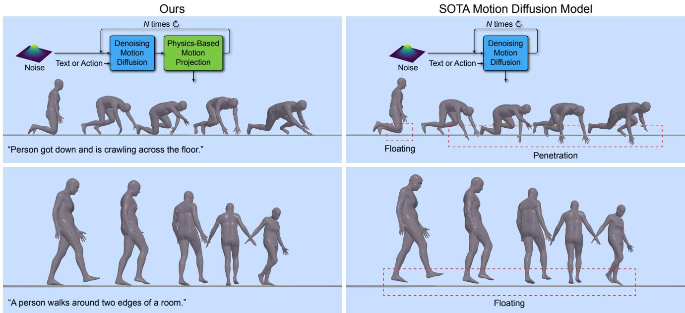
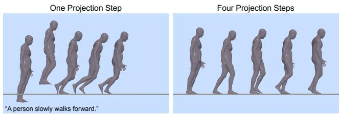
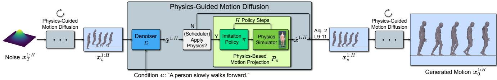
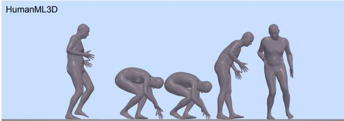
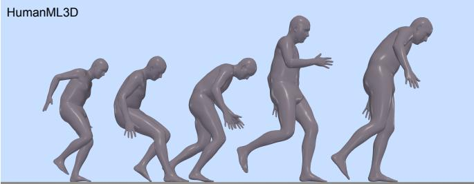
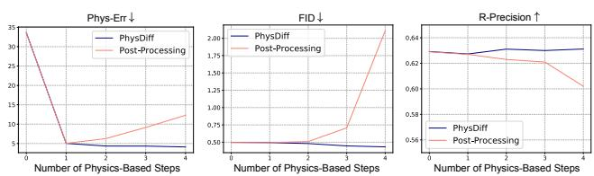
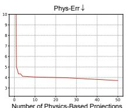

# PhysDiff：物理引导的人体运动扩散模型（PhysDiff: Physics-Guided Human Motion Diffusion Model）

Ye Yuan

Jiaming Song

Umar Iqbal

Arash Vahdat

Jan Kautz

NVIDIA

https://nvlabs.github.io/PhysDiff

"Person got down and is crawling across the floor."

  

一个人沿着房间的两条边走。

Figure 1. 我们的 PhysDiff 模型在扩散过程中使用基于物理的运动投影来生成物理上合理的运动，消除了在最先进模型中经常出现的诸如漂浮（floating）、地面穿透（ground penetration）和脚部滑动（foot sliding）等伪影。

## 摘要

去噪扩散模型（Denoising diffusion models）在生成多样化且逼真的人体运动方面具有巨大潜力。然而，现有的运动扩散模型在扩散过程中基本上忽视了物理定律，常常生成物理上不合理的运动，并伴随明显的伪影，如漂浮（floating）、脚部滑动（foot sliding）和地面穿透（ground penetration）。这严重影响了生成运动的质量，并限制了其在现实世界中的应用。为了解决这一问题，我们提出了一种新颖的物理引导运动扩散模型（PhysDiff），将物理约束融入到扩散过程中。具体而言，我们提出了一个基于物理的运动投影模块，该模块在物理模拟器中使用运动模仿，将扩散步骤的去噪运动投影到一个物理上合理的运动。该投影运动在下一步扩散中进一步用于引导去噪扩散过程。直观地说，我们模型中对物理的使用迭代地将运动拉向物理上合理的空间，这是简单的后处理所无法实现的。在大规模人体运动数据集上的实验表明，我们的方法达到了最先进的运动质量，并显著提升了物理合理性（在所有数据集上提升超过 78%）。

## 1. 引言

基于深度学习的人体运动生成是一项重要任务，在动画、游戏和虚拟现实领域具有众多应用。在诸如文本到运动合成（text-to-motion synthesis）的常见设置下，我们需要学习一个能够捕捉人体运动多模态分布的条件生成模型。由于人体运动的高度多样性以及人体各部位之间错综复杂的交互作用，该分布可能极其复杂。去噪扩散模型（Denoising diffusion models）[75, 25, 76] 是一类生成模型，特别适合此任务，因为它们具有强大的复杂分布建模能力，这一点已在图像生成领域得到广泛证明 [68, 63, 67, 13]。这些模型表现出了强大的模式覆盖能力，通常以较高的测试似然度作为体现 [77, 33, 81]。与生成对抗网络（GANs [19]）相比，它们还具有更好的训练稳定性；与变分自编码器（VAEs [35]）和归一化流（normalizing flows [74, 81, 80, 4]）相比，它们具有更好的样本质量。受此启发，最近的研究工作提出了运动扩散模型 [79, 94]，在运动生成性能上显著超越了标准的深度生成模型。

  

图 2.（左）在末端执行一步基于物理的投影步骤（后处理）会产生不自然的运动，因为该运动过于不符合物理规律，难以被纠正。（右）我们的方法通过迭代地施加物理与扩散约束来解决这一问题。

然而，现有的运动扩散模型忽略了一个关键的人体运动方面——底层的物理定律。尽管扩散模型在建模人体运动分布方面具有卓越的能力，但它们仍然缺乏显式机制来强制物理约束或建模由力和接触力所产生的复杂动力学行为。由此，它们所生成的运动常常包含明显的伪影，例如悬浮、脚部滑动以及地面穿透。这在动画和虚拟现实等许多现实世界应用中构成了严重障碍，在这些场景中，人们对哪怕最细微的物理失真迹象都极为敏感 [64, 27]。鉴于此，我们需要解决的一个关键问题是使人体运动扩散模型具有物理感知能力。

为解决此问题，我们提出了一种新颖的物理引导运动扩散模型（PhysDiff），它将物理定律注入到去噪扩散过程中。具体而言，PhysDiff 利用一个基于物理的运动投影模块（详见后文），将输入运动投影到物理上合理（physically-plausible）的空间中。在扩散过程中，我们使用运动投影模块将一个扩散步骤的去噪运动投影为一个物理上合理的运动。这个新的运动将在下一个扩散步骤中进一步用于引导去噪扩散过程。需要说明的是，仅在扩散过程结束时添加基于物理的投影，即把物理作为后处理步骤，这看起来似乎很有吸引力。然而，这会产生不自然的运动，因为扩散得到的最终去噪运动学运动可能在物理上极不合理，以至于难以被物理方法修正（参见图 2 中的示例），并且该运动可能被推离数据分布。相反，我们需要在扩散过程中嵌入投影，并迭代地施加物理与扩散作用，从而使运动在保持接近数据分布的同时，朝向物理上合理的空间移动（参见第 4.4 节）。

基于物理的运动投影模块在 PhysDiff 中扮演着执行物理约束的关键角色，这是通过在物理仿真器（physics simulator）中的运动模仿（motion imitation）来实现的。具体而言，我们使用大规模的运动捕捉数据，训练一个运动模仿策略（motion imitation policy），该策略能够在仿真器中控制角色智能体（character agent）以模仿范围广泛的输入运动。由此得到的仿真运动强制施加了物理约束，并消除了诸如悬浮、脚部滑动和地面穿透等伪影。一旦训练完成，该运动模仿策略便可用于模仿扩散步骤中的去噪运动，以输出物理上合理的运动。

我们在两个任务上评估我们的模型 PhysDiff：文本到动作（text-to-motion）生成和动作到动作（action-to-motion）生成。由于我们的方法对扩散过程所使用的去噪网络的具体实现是不可知的（agnostic），因此我们测试了两个当前最优（state-of-the-art, SOTA）的动作扩散模型 MDM [79] 和 MotionDiffuse [94] 作为我们模型的去噪器。在文本到动作生成任务上，我们的模型在大规模 HumanML3D [22] 基准上显著优于当前最优 SOTA 的动作扩散模型，在将物理误差降低超过 86% 的同时，还以 Fréchet Inception Distance（FID）为指标将动作质量提升了超过 20%。在动作到动作生成任务上，我们的模型同样在 HumanAct12 [23] 上将物理误差指标改善了超过 78%，在 UESTC [29] 上改善了 94%，同时也取得了具有竞争力的 FID 分数。

我们进一步开展了大量实验，研究基于物理的投影（projection）的不同调度方式，即在扩散的哪些时间步进行投影。有趣的是，我们观察到在改变基于物理的投影步数时，物理合理性与动作质量之间存在权衡（trade-off）。具体而言，虽然更多的投影步数总是带来更好的物理合理性，但动作质量在达到某个步数之前会先上升、之后则会下降，即生成的动作虽然满足物理约束，但看起来仍然可能不自然。这一观察结果指导我们采用一个平衡数量的基于物理的投影步数，从而同时实现较高的物理合理性和动作质量。我们还发现，将基于物理的投影添加到扩散的后期时间步比添加到早期时间步效果更好。我们推测，这是因为早期扩散时间步的动作可能倾向于训练数据的平均动作，而基于物理的投影可能会把动作进一步推离数据分布，进而妨碍扩散过程。最后，我们还证明了我们的方法在动作质量和物理合理性两方面都显著优于基于物理的后处理（单步或多步）。

我们的贡献总结如下：

• 我们提出了一种新颖的、物理引导的动作扩散模型（physics-guided motion diffusion model），它通过将物理定律注入扩散过程来生成物理上合理的动作。其即插即用（plug-and-play）的特性使其能够灵活地与不同的运动学（kinematic）扩散模型配合使用。

• 我们提出利用物理模拟器中的人体动作模仿（human motion imitation）作为动作投影模块，以强制施加物理约束。

• 我们的模型在大规模动作数据集上，在动作质量方面取得了当前最优 SOTA 的性能，并大幅提升了物理合理性。我们广泛的分析还提供了诸如调度方式与权衡等方面的洞见，并展示了我们相对于基于物理的后处理的显著改进。

## 2. Related Work（相关工作）

去噪扩散模型。基于分数的去噪扩散模型（Score-based denoising diffusion models）[75, 25, 77, 76] 在诸多应用中取得了巨大成功，例如图像生成 [68, 63, 67, 74, 81]、文本到语音合成 [36]、三维形状生成 [97, 46, 93]、机器学习安全 [55]，以及人体运动生成 [79, 94, 66]。这些模型通过去噪自编码器目标进行训练，可以理解为分数匹配（score matching）[82]，并通过迭代去噪过程生成样本，该过程可采用随机更新 [6, 5, 15, 96]（求解随机微分方程（SDEs））或确定性更新 [76, 44, 42, 95, 30, 14]（求解常微分方程（ODEs））。

为了执行条件生成，最常用的技术是分类器（无分类器）引导（classifier(-free) guidance）[13, 26]。然而，它要求模型在配对数据和条件上进行专门训练。另一种方法是使用仅针对无条件生成训练的预训练扩散模型。例如，SDEdit [53] 修改扩散模型的初始化，通过彩色笔触合成或编辑现有图像。在图像领域，多种方法通过在扩散过程中反复注入已知信息来求解线性逆问题 [45, 12, 77, 11, 32, 31]。类似的思想被应用于人体运动扩散模型中的运动填充（motion infilling）场景 [79]。在我们的情形下，使用扩散模型生成物理上合理的运动面临着一系列不同的难题。其一，约束是通过物理仿真器指定的，而物理仿真器是不可微分的。其二，基于物理的投影本身计算成本相对较高，这与图像类约束不同——图像类约束的计算量通常远小于扩散模型。因此，我们无法简单地在采样过程的每一步都施加基于物理的投影。

人体运动生成。早期的运动生成工作采用确定性人体运动建模，仅生成单一运动 [17, 39, 18, 52, 57, 20, 2, 83, 51, 88]。由于人体运动本质上具有随机性，更多的工作开始使用深度生成模型，以避免确定性方法中常见的模式平均问题。这些方法通常使用 GAN 或 VAE 从各种条件生成运动，例如过去运动 [7, 85, 3, 90, 89]、关键帧 [24]、音乐 [38, 98, 37]、文本 [1, 9, 22, 62] 和动作标签 [23, 61, 10]。近年来，去噪扩散模型 [75, 25, 76] 作为一类新兴的生成模型，结合了标准生成模型的优点。因此，多个运动扩散模型 [79, 94, 66] 被提出，并展示了最先进的运动生成性能。然而，现有的运动扩散模型经常生成物理上不合理的运动，因为它们在扩散过程中忽略了物理约束。我们的方法通过使用基于物理的运动投影模块来引导扩散过程，从而解决这一问题。

### 基于物理的人体运动建模

基于物理的人体运动模仿（Physics-based Human Motion Imitation）首先被应用于通过深度强化学习（Deep Reinforcement Learning, RL）来学习行走、跑步和杂技等运动技能 [40, 41, 54, 58, 59]。基于 RL 的运动模仿还被用于学习角色动画中用户可控的策略 [8, 56, 84]。在三维人体姿态估计（3D Human Pose Estimation）方面，最近的工作采用了基于物理的轨迹优化 [92, 65, 73, 72] 和运动模仿 [87, 88, 28, 91, 86, 47, 48] 来建模人体动力学。与以往工作不同，我们探索了物理仿真（Physics Simulation）与扩散模型（Diffusion Models）之间的协同作用，并展示了迭代地结合物理与扩散可以生成更加真实且物理合理的运动。

## 3. 方法

给定某些条件信息 c，例如文本或动作标签，我们的目标是生成长度为 H 的物理合理的人体运动 $\pmb { x } ^ { 1 : H } = \{ \pmb { x } ^ { \tilde { h } } \} _ { h = 1 } ^ { H }$。生成运动中的每个姿态 $\pmb { x } ^ { h } \in \mathbb { R } ^ { J \times D }$ 由 J 个关节的 D 维特征表示，这些特征可以是关节位置或角度。我们提出了用于人体运动生成的物理引导去噪扩散模型（Physics-guided Denoising Diffusion Model, PhysDiff）。从一个含噪运动 $\pmb { x } _ { T } ^ { 1 : H }$ 出发，PhysDiff 对去噪分布 $q ( \pmb { x } _ { s } ^ { 1 : H } | \pmb { x } _ { t } ^ { \bar { 1 } : H } , \mathcal { P } _ { \pi } , \mathbf { \bar { c } } )$ 进行建模，该分布将运动从扩散时间步 t 去噪至 s（$s < t$）。迭代地应用该模型可将运动去噪为干净运动 $\pmb { x } _ { 0 } ^ { 1 : H }$，即最终输出 $\pmb { x } ^ { 1 : H }$。模型中的一个关键组件是基于物理的运动投影模块 $\mathcal { P } _ { \pi }$，用于施加物理约束。它利用运动模仿策略 π 在物理仿真器中模仿扩散步骤的去噪运动，并使用仿真运动进一步引导扩散过程。PhysDiff 模型的整体概览如图 3 所示。下面，我们在 3.1 节首先介绍物理引导的运动扩散过程，然后在 3.2 节中描述基于物理的运动投影 $\mathcal { P } _ { \pi }$ 的细节。

## 3.1. 物理引导的运动扩散

**运动扩散（Motion Diffusion）。** 为了简化符号表示，此处我们有时省略对条件 c 的显式依赖。

  

图3. PhysDiff 概览。每个由物理引导的扩散步骤将一个动作从时间步 $t$ 去噪到 $s$，其中使用基于物理的动作投影来强制施加物理约束。该投影通过使用一个动作模仿策略在物理仿真器中控制角色来实现。一个调度器控制何时施加基于物理的投影。去噪器可以是任何动作去噪网络。

注意，我们可以始终使用某个条件 $c$ 来训练扩散模型；即使对于无条件情形，我们也可以用一个通用的空标记 $\varnothing$ 作为条件 [26]。

用 $p_0(\mathbf{x})$ 表示数据分布，并通过向来自 $p_0$ 的样本注入独立同分布的高斯噪声来定义一组与时间相关的分布 $p_t(\mathbf{x}_t)$，即 $p_t(\mathbf{x}_t|\mathbf{x}) = \mathcal{N}(\mathbf{x}, \sigma_t^2 \mathbf{I})$，其中 $\sigma_t$ 定义了一组随时间递增的噪声水平，使得 $\sigma_0 = 0$，并且在 $T$ 取尽可能大时，$\sigma_T$ 远大于数据的标准差。一般而言，扩散模型通过求解以下从 $t = T$ 到 $t = 0$ 的随机微分方程（SDE）来生成样本 [21, 30, 96]：

$$
\mathrm{d} \pmb {x} = - (\beta_ {t} + \dot {\sigma} _ {t}) \sigma_ {t} \nabla_ {\pmb {x}} \log p _ {t} (\pmb {x}) \mathrm{d} t + \sqrt {2 \beta_ {t}} \sigma_ {t} \mathrm{d} \omega_ {t},\tag{1}
$$

其中 $\nabla _ { x } \log p _ { t } ( { \pmb x } )$ 是分数函数（score function），$\omega _ { t }$ 是标准维纳过程（standard Wiener process），$\beta _ { t }$ 控制注入该过程中的随机噪声量；当其为零时，该 SDE 变为常微分方程（ordinary differential equation, ODE）。分数函数 $\nabla _ { \pmb { x } _ { t } } \log p _ { t } ( \pmb { x } _ { t } )$ 的一个显著性质是，它能够恢复出在给定 $\mathbf { \Delta } _ { \mathbf { \mathcal { X } } _ { t } }$ 条件下 $\mathbf { x }$ 的最小均方误差（minimum mean squared error, MMSE）估计量 [78, 16, 69]：

$$
\tilde {\boldsymbol {x}} := \mathbb {E} [ \boldsymbol {x} | \boldsymbol {x} _ {t} ] = \boldsymbol {x} _ {t} + \sigma_ {t} ^ {2} \nabla_ {\boldsymbol {x} _ {t}} \log p _ {t} (\boldsymbol {x} _ {t}),\tag{2}
$$

其中我们可以将 x˜ 本质上视为 $\mathbf{\Delta}_{\mathbf{\mathcal{X}}_t}$ 的一个「去噪」版本。由于在采样过程中 $\mathbf{\Delta}_{\mathbf{\mathcal{X}}_t}$ 和 $\sigma_t$ 是已知的，因此我们可以从 x˜ 得到 $\nabla_{x_t} \log p_t(x_t)$，反之亦然。

扩散模型通过以下去噪自编码器目标来近似分数函数 [82]：

$$
\mathbb {E} _ {\boldsymbol {x} \sim p _ {0} (\boldsymbol {x}), t \sim p (t), \epsilon \sim p (\epsilon)} [ \lambda (t) \| \boldsymbol {x} - D (\boldsymbol {x} + \sigma_ {t} \epsilon , t, \boldsymbol {c}) \| _ {2} ^ {2} ]\tag{3}
$$

其中 $D$ 是去噪器，依赖于含噪数据、时间 $t$ 和条件 $c$，$\epsilon \sim \mathcal { N } ( \mathbf { 0 } , I )$，$p ( t )$ 是采样时间所服从的分布，$\lambda ( t )$ 是损失加权因子。$D$ 的最优解应当能按照式 (2) 恢复 MMSE 估计器 $\tilde { \mathbf { x } }$。关于训练过程的详细描述，请读者参阅 Karras 等人 [30] 的工作。

去噪扩散模型训练完成后，便可以将其应用于求解式 (1) 中的 SDE/ODE。其中一种特定方法 DDIM [76] 在给定样本 $\mathbf { \nabla } _ { \mathbf { x } _ { t } }$ 的情况下，从时间 $t$ 到时间 $s$（$s < t$）执行单步更新，具体过程如算法 1 所述。直观地，时间 $s$ 处的样本 $\mathbf { x }$ 是从高斯分布中生成的；其均值是 $\mathbf { \Delta } _ { \mathbf { \mathcal { X } } _ { t } }$ 与去噪结果 ${ \tilde { \mathbf { x } } }$ 之间的线性插值，其方差依赖于超参数 $\eta \in [ 0 , 1 ]$。具体而言，$\eta = 0$ 对应于去噪扩散概率模型（DDPM [25]），$\eta = 1$ 对应于去噪扩散隐式模型（DDIM [76]）。我们发现 $\eta = 0$ 能为我们的模型带来更好的表现。由于上述采样过程具有通用性，它也可以应用于人体运动数据，即 ${ \pmb x } ^ { \mathrm { i } : H }$。在采样过程中引入条件 $c$，可以采用基于分类器的引导或无分类器引导 [13, 26]。

Algorithm 1 DDIM sampling algorithm
1: Input: Denoiser D, sample $x_{t}$ at time t, target time s, condition c, hyperparameter $\eta \in [0,1]$ .
2: Compute the denoised result $\tilde{x} := D(x_{t}, t, c)$ .
3: Obtain variance $v_{s}$ as a scalar that depends on $\eta$ .
4: Obtain mean $\mu_{s}$ as a linear combination of $\tilde{x}$ and $x_{t}$ :
   $\mu_{s} := \tilde{x} + \frac{\sqrt{\sigma_{s}^{2} - v_{s}}}{\sigma_{t}}(x_{t} - \tilde{x})$ 
5: Draw sample $x_{s} \sim N(\mu_{s}, v_{s}I)$ .

施加物理约束。现有的人体运动扩散模型未必是在符合物理约束的数据上训练的，即便如此，由于去噪器网络的近似误差以及采样过程的随机性，也不能保证所生成的运动样本在物理上仍然可行。虽然可以试图直接对最终的运动样本进行修正以使其在物理上可行，但运动中的物理误差可能非常大，以至于即使经过这样的修正，运动效果仍然不够理想（具体示例见图 2，比较结果见第 4.4 节）。

为了解决该问题，我们利用了扩散模型在每一步都会产生期望结果的中间估计这一事实，即每一步扩散过程都会得到去噪后的运动 $\tilde { \pmb { x } } ^ { 1 : H }$。具体而言，我们不仅可以在扩散过程的最终步骤施加物理约束，还可以在中间步骤施加物理约束。具体地，我们提出了一个基于物理的运动投影 $\mathcal { P } _ { \pi } : \mathbb { R } ^ { H \times J \times D }  \mathbb { R } ^ { H \times J \times D }$，作为一个模块将原始运动 $\tilde { \pmb { x } } ^ { 1 : H }$ 映射为一个物理上合理的运动，记作 $\stackrel { \smile } { \hat { x } } ^ { 1 : H }$。我们将所提出的基于物理的投影 $\mathcal { P } _ { \pi }$ 整合进去噪扩散采样流程中，其中从时间 t 到时间 s 的一步更新如算法 2 所示。该过程与 DDIM 采样器的主要区别在于额外执行了基于物理的投影；正如我们将在实验中展示的，这是一种简单但有效的物理约束施加方法。值得注意的是，我们的模型 PhysDiff 对去噪器 D 的具体实例化形式是不可知的，而 D 通常由各种网络架构来实现。PhysDiff 中的基于物理的投影也仅在扩散采样（推理）阶段使用，这使得 PhysDiff 通常可与不同的预训练运动扩散模型兼容。换言之，PhysDiff 可用于在不重新训练的情况下提升现有扩散模型的物理合理性。

算法 2 PhysDiff 运动采样算法。

1: 输入：去噪器 D，时间 t 处的样本  $x_{t}^{1:H}$ ，条件 c，目标时间 s，基于物理的投影  $P_{\pi}, \eta \in [0,1]$ 。

2: 计算去噪后的运动  $\tilde{x}^{1:H} := D(x_{t}^{1:H}, t, c)$ 。

3: 如果在时间 t 执行投影，则

4:  $\hat{x}^{1:H} := \mathcal{P}_{\pi}(\tilde{x}^{1:H})$  # 基于物理的投影

5: 否则

6:  $\hat{x}^{1:H} := \tilde{x}^{1:H}$ 

7: 结束 if

8: # 剩余部分与 DDIM 类似

9: 将方差  $v_{s}$  取为依赖于  $\eta$  的标量。

10: 计算均值  $\mu_{s}$ ：

 $\mu_{s} := \hat{x}^{1:H} + \frac{\sqrt{\sigma_{s}^{2} - v_{s}}}{\sigma_{t}}(x_{t}^{1:H} - \hat{x}^{1:H})$ 

11: 采样得到  $x_{s}^{1:H} \sim N(\mu_{s}, v_{s}I)$ 。

调度物理投影。由于使用了物理仿真，投影 $\mathcal { P } _ { \pi }$ 的计算开销相当大，因此在每个扩散时间步都执行投影是不可行的。因此，如果可执行的基于物理的投影步数有限，我们就需要在不同的时间步之间进行优先级排序。我们认为，当扩散噪声水平较高时，不应执行物理投影。这是因为去噪器 $D$ 在设计上会给出 $\tilde { \mathbf { \pmb { x } } } ^ { 1 : H } = \mathbb { E } [ \mathbf { \pmb { x } } ^ { 1 : H } | \mathbf { \pmb { x } } _ { t } ^ { 1 : H } ]$，即给定当前含噪运动 $\pmb { x } _ { t } ^ { 1 : H }$ 时 $\mathbf { \bar { x } } ^ { 1 : H }$ 的均值运动；而在高噪声水平下，条件 $\pmb { \mathbf { x } } _ { t } ^ { 1 : H }$ 包含的信息很少，因此该结果接近训练数据的均值。经验上，由于模式平均效应，均值运动通常几乎不包含身体运动，但仍带有一定的根节点平移和旋转，这显然是物理上不合理的。用基于物理的投影去纠正这种物理上不正确的运动，会使运动进一步偏离数据分布，从而阻碍扩散过程。在第 4.3 节中，我们进行了系统性研究，验证了这一假设，并提出了一种在样本质量与效率之间取得平衡的有利调度策略。

## 3.2. 基于物理的运动投影

物理引导扩散过程中的一个核心组件是基于物理的运动投影 $\mathcal { P } _ { \pi }$。它的任务是，将某个扩散步的去噪运动 $\tilde { \pmb { x } } ^ { 1 : H }$（该运动并不遵循物理规律）投影为物理上合理的运动 $\hat { \pmb { x } } ^ { 1 : H } = \mathcal { P } _ { \pi } ( \tilde { \pmb { x } } ^ { 1 : H } )$。该投影通过学习一个运动模仿策略 $\pi$ 来实现，由该策略在物理仿真器中控制一个虚拟角色，使其模仿去噪运动 $\tilde { \pmb { x } } ^ { 1 : H }$。来自仿真器的输出运动 $\hat { \pmb { x } } ^ { 1 : H }$ 遵循物理规律，因此被认为是物理上合理的。

动作模仿建模（Motion Imitation Formulation）。人体动作模仿任务 [58, 90] 可以被形式化为一个马尔可夫决策过程（Markov Decision Process, MDP）。该 MDP 由一个元组 $\mathcal { M } = ( \mathcal { S } , \mathcal { A } , \mathcal { T } , R , \gamma )$ 构成，其中包含状态、动作、转移动力学、一个奖励函数以及一个折扣因子。一个角色智能体在物理仿真器中依据一个动作模仿策略 $\bar { \pi } ( \bar { \pmb { a } } ^ { h } | \pmb { s } ^ { h } )$ 进行动作，该策略对在给定当前状态 $s ^ { h } \in { \mathcal { S } }$ 条件下选择动作 $\pmb { a } ^ { h } \in \mathcal { A }$ 的分布进行建模。状态 $s ^ { h }$ 由角色的物理状态（例如关节角度、速度、位置）以及来自输入动作的下一姿态 $\breve { \boldsymbol { x } } ^ { h + 1 }$ 共同构成。在状态中纳入 $\tilde { \boldsymbol { x } } ^ { h + 1 }$ 是为了让策略 π 能够选择一个可以在仿真器中模仿 $\tilde { \boldsymbol { x } } ^ { h + 1 }$ 的动作 $\pmb { a } ^ { h }$。从初始状态 $s ^ { 1 }$ 出发，智能体迭代地从策略 π 中采样一个动作 $\pmb { a } ^ { h }$，随后仿真器依据转移动力学 $\mathcal { T } ( s ^ { h + 1 } | s ^ { h } , \mathbf { \bar { a } } ^ { h } )$ 生成下一个状态 $s ^ { h + 1 }$，从中我们可以提取仿真姿态 $\hat { \pmb x } ^ { h + 1 }$。通过将策略运行 H 步，我们可以得到物理仿真得到的动作 $\hat { \pmb { x } } ^ { 1 : H }$。

训练（Training）。在训练阶段，还会根据仿真动作 $\hat { \pmb { x } } ^ { 1 : H }$ 与真实参考动作 $\bar { \pmb x } ^ { 1 : H }$ 的对齐程度，为角色赋予一个奖励 $r ^ { h }$。需要指出的是，动作模仿策略 π 是在含有高质量真实参考动作的大规模动作捕捉数据集上进行训练的。我们使用强化学习（Reinforcement Learning, RL）来学习该策略 π，其目标是最大化期望的折扣回报

$$
\begin{array} { r } { J ( \pi ) \stackrel { } { } = \mathbb { E } _ { \pi } [ \sum _ { h } \gamma ^ { h } r ^ { h } ] } \end{array}
$$

这等价于尽可能紧密地模仿真实参考动作。我们采用一种标准的强化学习算法 PPO [71] 来求解最优策略。在接下来的部分中，我们将详细阐述奖励、状态、动作以及策略的设计。

奖励（Rewards）。奖励函数的设计旨在促使仿真动作 $\hat { \pmb { x } } ^ { 1 : H }$ 与真实参考动作 $\bar { \pmb { x } } ^ { 1 : \breve { H } }$ 相匹配。此处，我们用 ¯· 来表示真实参考量。每个时刻的奖励 $r ^ { h }$ 由四个子奖励组成：

$$
r ^ {h} = w _ {\mathrm{p}} r _ {\mathrm{p}} ^ {h} + w _ {\mathrm{v}} r _ {\mathrm{v}} ^ {h} + w _ {\mathrm{j}} r _ {\mathrm{j}} ^ {h} + w _ {\mathrm{q}} r _ {\mathrm{q}} ^ {h},\tag{4}
$$

$$
r _ {\mathrm{p}} ^ {h} = \exp \left[ - \alpha_ {\mathrm{p}} \left(\sum_ {j = 1} ^ {J} \| \boldsymbol {o} _ {j} ^ {h} \ominus \bar {\boldsymbol {o}} _ {j} ^ {h} \| ^ {2}\right) \right],\tag{5}
$$

$$
r _ {\mathrm{v}} ^ {h} = \exp \left[ - \alpha_ {\mathrm{v}} \| \pmb {v} ^ {h} - \bar {\pmb {v}} ^ {h} \| ^ {2} \right],\tag{6}
$$

$$
r _ {\mathrm{j}} ^ {h} = \exp \left[ - \alpha_ {\mathrm{j}} \left(\sum_ {j = 1} ^ {J} \| \boldsymbol {p} _ {j} ^ {h} - \bar {\boldsymbol {p}} _ {j} ^ {h} \| ^ {2}\right) \right],\tag{7}
$$

$$
r _ {\mathrm{q}} ^ {h} = \exp \left[ - \alpha_ {\mathrm{q}} \left(\sum_ {j = 1} ^ {J} \| \pmb {q} _ {j} ^ {h} - \bar {\pmb {q}} _ {j} ^ {h} \| ^ {2}\right) \right].\tag{8}
$$

其中 $w_{\mathrm{p}}, w_{\mathrm{v}}, w_{\mathrm{j}}, w_{\mathrm{q}}, \alpha_{\mathrm{p}}, \alpha_{\mathrm{v}}, \alpha_{\mathrm{j}}, \alpha_{\mathrm{q}}$ 为权重因子。姿态奖励 $r_{\mathrm{p}}^{h}$ 衡量局部关节旋转 $o_{j}^{h}$ 与真值 $\bar{o}_{j}^{h}$ 之间的差异，其中 ⊖ 表示两个旋转之间的相对旋转，$\|\cdot\|$ 计算旋转角度。速度奖励 $r_{\mathrm{v}}^{h}$ 衡量关节速度 $\Delta v^{h}$ 与真值 $\bar{v}^{h}$ 之间的不匹配程度，二者通过有限差分计算得到。关节位置奖励 $r_{\mathrm{j}}^{h}$ 鼓励 3D 世界坐标下的关节位置 $p_{j}^{h}$ 与真值 $\bar{p}_{j}^{h}$ 相匹配。最后，关节旋转奖励 $r_{\mathrm{q}}^{h}$ 衡量全局关节旋转 $q_{j}^{h}$ 与真值 $\bar{q}_{j}^{h}$ 之间的差异。

States（状态）。智能体状态 $s^{h}$ 包含角色的当前物理状态、输入动作的下一帧姿态 $\tilde{x}^{h+1}$，以及角色属性向量 ψ。角色的物理状态包括其关节角度、关节速度，以及刚体的位置、旋转、线速度和角速度。对于输入姿态 $\tilde{x}^{h+1}$，状态 $s^{h}$ 包含 $\tilde{x}^{h+1}$ 相对于智能体在关节角度以及刚体位置和旋转上的差值。利用差值向策略网络提供其需要补偿的姿态残差信息。所有特征均在角色的朝向坐标系下计算，以保证旋转和平移不变性。由于我们的角色基于 SMPL 人体模型 [43]，属性 ψ 包含性别和 SMPL 形状参数，以使策略能够控制不同的角色。

Actions（动作）。我们采用比例微分（PD）控制器的目标关节角度作为动作表示，正如先前工作 [60, 90] 所示，这能够实现鲁棒的动作模仿。我们还在动作空间中加入了残差力 [90]，以稳定角色并补偿模拟坐姿等动作时所需的缺失接触力。

Policy（策略）。我们使用参数化高斯策略 $\pi(a^{h}|s^{h}) = \mathcal{N}(\mu_{\theta}(s^{h}), \Sigma)$，其中均值动作 $\mu_{\theta}$ 由一个具有参数 θ 的简单多层感知器（MLP）网络输出，Σ 为固定的对角协方差矩阵。

## 4. Experiments（实验）

我们在两个标准的人体动作生成任务上进行实验：文本到动作（text-to-motion）和动作到动作（action-to-motion）生成。具体而言，我们的实验旨在回答以下问题：(1) PhysDiff 能否实现

<table><tr><td>Method</td><td>FID ↓</td><td>R-Precision ↑</td><td>Penetrate ↓</td><td>Float ↓</td><td>Skate ↓</td><td>Phys-Err ↓</td></tr><tr><td>J2LP [1]</td><td>11.020</td><td>0.486</td><td>-</td><td>-</td><td>-</td><td>-</td></tr><tr><td>Text2Gesture [9]</td><td>7.664</td><td>0.345</td><td>-</td><td>-</td><td>-</td><td>-</td></tr><tr><td>T2M [22]</td><td>1.067</td><td>0.740</td><td>11.897</td><td>7.779</td><td>2.908</td><td>22.584</td></tr><tr><td>MDM [79]</td><td>0.544</td><td>0.611</td><td>11.291</td><td>18.876</td><td>1.406</td><td>31.572</td></tr><tr><td>MotionDiffuse (MD) [94]</td><td>0.630</td><td>0.782</td><td>20.278</td><td>6.450</td><td>3.925</td><td>30.652</td></tr><tr><td>PhysDiff w/ MD (Ours)</td><td>0.551</td><td>0.780</td><td>0.898</td><td>1.368</td><td>0.423</td><td>2.690</td></tr><tr><td>PhysDiff w/ MDM (Ours)</td><td>0.433</td><td>0.631</td><td>0.998</td><td>2.601</td><td>0.512</td><td>4.111</td></tr></table>

表 1. HumanML3D [22] 上的文本到动作生成结果。

<table><tr><td>Method</td><td>FID ↓</td><td>Accuracy ↑</td><td>Penetrate ↓</td><td>Float ↓</td><td>Skate ↓</td><td>Phys-Err ↓</td></tr><tr><td>Action2Motion [23]</td><td>0.338</td><td>0.917</td><td>-</td><td>-</td><td>-</td><td>-</td></tr><tr><td>ACTOR [61]</td><td>0.120</td><td>0.955</td><td>8.939</td><td>14.479</td><td>2.277</td><td>25.695</td></tr><tr><td>INR [10]</td><td>0.088</td><td>0.973</td><td>7.055</td><td>13.212</td><td>0.928</td><td>22.096</td></tr><tr><td>MDM [79]</td><td>0.100</td><td>0.990</td><td>5.600</td><td>6.703</td><td>1.075</td><td>13.377</td></tr><tr><td>PhysDiff w/ MDM (Ours)</td><td>0.096</td><td>0.983</td><td>0.689</td><td>2.002</td><td>0.159</td><td>2.850</td></tr></table>

表 2. 在 HumanAct12 [23] 上的动作到动作（action-to-motion）结果。

<table><tr><td>Method</td><td>FID ↓</td><td>Accuracy ↑</td><td>Penetrate ↓</td><td>Float ↓</td><td>Skate ↓</td><td>Phys-Err ↓</td></tr><tr><td>ACTOR [61]</td><td>23.43</td><td>0.911</td><td>8.441</td><td>9.737</td><td>1.073</td><td>19.251</td></tr><tr><td>INR [10]</td><td>15.00</td><td>0.941</td><td>5.999</td><td>4.633</td><td>0.741</td><td>11.373</td></tr><tr><td>MDM [79]</td><td>12.81</td><td>0.950</td><td>13.077</td><td>13.912</td><td>1.383</td><td>28.371</td></tr><tr><td>PhysDiff w/ MDM (Ours)</td><td>13.27</td><td>0.956</td><td>0.874</td><td>0.201</td><td>0.389</td><td>1.463</td></tr></table>

表 3. 在 UESTC [29] 上的动作到动作生成结果。

SOTA 动作质量与物理可信度？（2）PhysDiff 能否应用于不同的运动学动作扩散模型，以提升其动作质量与物理可信度？（3）基于物理的投影的不同调度方案如何影响动作生成性能？（4）PhysDiff 在性能上能否优于基于物理的后处理？

评估指标。对于文本到动作生成，我们首先采用 Guo 等人 [22] 提出的两个标准指标：FID 衡量生成动作分布与真实动作分布之间的距离；R-Precision 评估生成动作与输入文本的相关性。对于动作到动作生成，我们将 R-Precision 替换为 Accuracy 指标，该指标衡量训练好的动作分类器在生成动作上的准确率。此外，我们还使用四个基于物理的指标来评估生成动作的物理可信度：Penetrate 衡量地面穿透；Float 衡量悬浮；Skate 衡量脚部滑动；Phys-Err 是一个综合的物理误差指标，将上述三个指标相加（均以毫米为单位）。有关详细信息，请参阅附录 A。

实现细节。我们的模型采用 50 步扩散过程，并使用无分类器引导（classifier-free guidance）[26]。我们测试了 PhysDiff 与两个 SOTA 动作扩散模型 MDM [79] 和 MotionDiffuse [94] 的结合，将其作为去噪器 D。默认情况下，MDM 是 PhysDiff 在定性结果中所使用的去噪器。我们采用 IsaacGym [50] 作为动作模仿的物理仿真器。更多细节见附录 B 和 C。

## 4.1. 文本到动作生成

数据。我们使用 HumanML3D [22] 数据集，它是两个大规模动作捕捉数据集 AMASS [49] 和 HumanAct12 [23] 的带文本标注的子集。该数据集包含 14,616 个动作，配有 44,970 条文本描述。

Lift Dumbbell（举哑铃）

  

PhysDiff（本文方法）
"Person jogs, stops to bend over, then continues jogging."

  

一个人向前快速奔跑，以左脚停住，然后朝另一个方向跑去。

  

图 4. PhysDiff 与当前最先进方法 MDM [79] 在 HumanML3D、HumanAct12 和 UESTC 上的可视化对比。PhysDiff 显著减少了漂浮（floating）和穿透（penetration）等物理瑕疵。更多定性对比请参阅项目主页。

Results. In Table 1, we compare our method to the SOTA methods: JL2P [1], Text2Gesture [9], T2M [22], Motion-Diffuse [94], and MDM [79]. Due to the plug-and-play nature of our method, we design two variants of PhysDiff using MotionDiffuse (MD) and MDM. PhysDiff with MDM achieves SOTA FID and also reduces Phys-Err by more than 86% compared to MDM. Similarly, PhysDiff with MD achieves SOTA in physics-based metrics while maintaining high R-Precision and improving FID significantly. We also provide qualitative comparison in Fig. 4, where we can clearly see that PhysDiff substantially reduces physical artifacts such as penetration and floating. Please also refer to the project page for more qualitative results.

结果。在表 1 中，我们将我们的方法与以下 SOTA 方法进行了比较：JL2P [1]、Text2Gesture [9]、T2M [22]、Motion-Diffuse [94] 和 MDM [79]。由于我们的方法具有即插即用的特性，我们使用 MotionDiffuse（MD）和 MDM 设计了 PhysDiff 的两个变体。基于 MDM 的 PhysDiff 达到了 SOTA 的 FID，同时相比 MDM 将 Phys-Err 降低了超过 86%。类似地，基于 MD 的 PhysDiff 在基于物理的指标上达到了 SOTA，同时保持了较高的 R-Precision，并显著提升了 FID。我们还在图 4 中提供了定性对比，可以清晰地看到 PhysDiff 大幅减少了诸如穿透（penetration）和漂浮（floating）等物理伪影。更多定性结果请参考项目主页。

## 4.2. Action-to-Motion Generation

## 4.2. 动作到动作生成（Action-to-Motion Generation）

数据。我们在两个数据集上进行评估：HumanAct12 [23]，包含约 1200 个动作片段，覆盖 12 个动作类别；UESTC [29]，包含 40 个动作类别、40 名受试者和 25k 个样本。对于这两个数据集，我们均使用 Petrovich 等人 [61] 提供的序列。

Results. Tables 2 and 3 summarize the results on HumanAct12 and UESTC, respectively, where we compare PhysDiff against the SOTA methods: MDM [79], INR [10], Action2Motion [23], and ACTOR [61]. The results show that our method achieves competitive FID on both datasets while drastically improving Phys-Err (by 78% on Human-Act12 and 94% on UESTC). Please refer to Fig. 4 and the project page for qualitative comparison, where we show that PhysDiff improves the physical plausibility of generated motions significantly.

结果。表 2 和表 3 分别总结了 PhysDiff 在 HumanAct12 和 UESTC 上的结果，其中我们将 PhysDiff 与以下 SOTA 方法进行了比较：MDM [79]、INR [10]、Action2Motion [23] 和 ACTOR [61]。结果表明，我们的方法在两个数据集上都取得了具有竞争力的 FID，同时大幅改善了 Phys-Err（在 HumanAct12 上改善了 78%，在 UESTC 上改善了 94%）。请参考图 4 和项目主页进行定性对比，我们展示了 PhysDiff 显著提升了生成动作的物理合理性。

## 4.3. Schedule of Physics-Based Projection

## 4.3. 基于物理的投影调度（Schedule of Physics-Based Projection）

我们进行了大量实验来分析基于物理的投影的调度，即在扩散过程中的哪些时间步执行投影。

投影步数。由于基于物理的投影计算成本相对较高，我们首先研究是否能够在不牺牲性能的前提下减少投影步数。为此，我们将扩散过程中执行的投影步数从 50 变化到 0，其中投影步数从较早的时间步开始逐渐被移除，并连续地应用。

物理投影数量

图 5. 在 HumanML3D [22] 上变化基于物理的投影步数对文本到动作生成的影响。

<table><tr><td>Schedule</td><td>FID ↓</td><td>R-Precision ↑</td><td>Penetrate ↓</td><td>Float ↓</td><td>Skate ↓</td><td>Phys-Err ↓</td></tr><tr><td>Uniform 4</td><td>0.473</td><td>0.630</td><td>0.979</td><td>3.479</td><td>0.463</td><td>4.921</td></tr><tr><td>Start 3, End 1</td><td>0.510</td><td>0.623</td><td>0.918</td><td>3.173</td><td>0.459</td><td>4.550</td></tr><tr><td>Start 2, End 2</td><td>0.503</td><td>0.623</td><td>0.918</td><td>2.723</td><td>0.492</td><td>4.133</td></tr><tr><td>End 4, Space 3</td><td>0.469</td><td>0.630</td><td>0.990</td><td>3.226</td><td>0.473</td><td>4.689</td></tr><tr><td>End 4, Space 2</td><td>0.469</td><td>0.630</td><td>0.990</td><td>3.004</td><td>0.476</td><td>4.470</td></tr><tr><td>End 4, Space 1</td><td>0.433</td><td>0.631</td><td>0.998</td><td>2.601</td><td>0.512</td><td>4.111</td></tr></table>

表 4. 在 HumanML3D [22] 上的投影调度（Projection Schedule）对比。
图 6. 与后处理（post-processing）的对比，即在扩散过程之后施加基于物理的投影。

我们在图 5 中绘制了 FID、R-Precision 和 Phys-Err 的曲线。可以看到，随着基于物理的投影步数的增加，Phys-Err 持续下降，这表明更多的投影步数始终能够提升 PhysDiff 的物理合理性。有趣的是，随着投影步数的增加，FID 和 R-Precision 都呈现先改善（FID 降低、R-Precision 升高）后恶化的趋势。这表明，在早期扩散步施加更多投影步时，物理合理性与运动质量之间存在权衡。我们假设在早期扩散步生成的运动被去噪为数据集的平均运动（身体运动很少），并且通常不具物理合理性。因此，在这些早期步施加基于物理的投影会将生成的运动推离数据分布，从而妨碍扩散过程。

投影步的放置。图 5 表明，四次基于物理的投影步可以在物理合理性与运动质量之间取得良好的权衡。接下来，我们研究这些投影步在扩散过程中的最佳放置位置。我们比较了三组调度方案：(1) Uniform N，将 N 次投影步均匀地散布在扩散时间步上，即对于 50 个扩散步且 $N \ = \ 4$ 时，投影步在 $t \in \{ 0 , 1 5 , 3 0 , 4 5 \}$ 处执行；(2) Start M, End N，在扩散过程的开头连续放置 M 个投影步，并在末尾放置 N 个投影步；(3) End N, Space S，在扩散过程的末尾以时间间隔 S 放置 N 个投影步（例如，对于 $N \ = \ 4 , S \ = \ 3$ 时，投影步在 $t \in \{ 0 , 3 , 6 , 9 \}$ 处执行）。我们将结果汇总在表 4 中。可以看到，Start M, End N 调度的 FID 和 R-Precision 较差，因为在早期扩散步执行了更多的基于物理的投影步，这与我们在图 5 中的发现一致。Uniform N 调度在 FID 和 R-Precision 方面表现更好，但 Phys-Err 更差。这可能是因为基于物理的投影之间过多的非物理扩散步抵消了投影的效果，并重新引入了物理误差。这也与 End 4, Space 3 比 End 4, Space 1 较差的现象一致，因为前者基于物理的投影之间有更多的扩散步。因此，结果表明最好将基于物理的投影步连续地安排在末尾附近。这指导我们在基线对比中使用 End 4, Space 1。

推理时间。由于使用了物理模拟，PhysDiff 生成单个动作比 MDM 慢 2.5 倍（51.6 秒 vs. 19.6 秒），其中两种方法都使用 1000 步扩散。当批量大小（batch size）增加到 256 时，差距缩小，PhysDiff 仅慢 1.7 倍（280.3 秒 vs. 471.3 秒），因为物理模拟器从并行化中受益更多。

## 4.4. 与后处理方法的对比

为了展示物理与扩散之间的协同效应，我们将 PhysDiff 与一个后处理基线进行比较，该基线对来自扩散模型的最终运动学动作施加一次或多次基于物理的投影步骤。如图 6 所示，多次后处理步骤无法提升动作质量或物理合理性，反而会使其变差。这是因为最终的运动学动作可能过于不符合物理规律，以至于物理模拟无法模仿，例如，由于错误的步态，人体可能会失去平衡。反复模仿这些不合理的动作可能会放大问题，并导致模拟不稳定。PhysDiff 通过迭代地应用扩散和物理过程，从不佳的模拟状态中恢复并逐步逼近数据分布，以此解决了该问题。

## 5. 结论与未来工作

在本文中，我们提出了一种新颖的物理引导动作扩散模型（PhysDiff），它将物理定律融入扩散过程，以生成物理上合理的人体动作。为了达成这一目标，我们提出了一个基于物理的动作投影模块，该模块利用物理模拟中的动作模仿来强制施加物理约束。我们的方法与去噪网络无关，可在不重训的前提下用于改进 SOTA 动作扩散模型。在大规模动作数据上的实验表明，PhysDiff 取得了 SOTA 的动作质量，并显著提升了物理合理性。

由于物理模拟的存在，PhysDiff 的推理速度可能比 SOTA 模型慢两到三倍。未来工作可以通过更快的物理模拟器来加速模型，或改进基于物理的投影以减少所需的投影步骤数。

## 参考文献

[1] Chaitanya Ahuja and Louis-Philippe Morency. Language2pose：自然语言引导的姿态预测（Language2pose: Natural language grounded pose forecasting）。发表于 2019 年国际三维视觉会议（2019 International Conference on 3D Vision, 3DV），第 719–728 页，IEEE，2019 年。3, 6, 7

[2] Emre Aksan, Manuel Kaufmann, and Otmar Hilliges. 结构化预测有助于三维人体动作建模（Structured prediction helps 3d human motion modelling）。发表于 IEEE 国际计算机视觉会议论文集（Proceedings of the IEEE International Conference on Computer Vision），第 7144–7153 页，2019 年。3

[3] Sadegh Aliakbarian, Fatemeh Sadat Saleh, Mathieu Salzmann, Lars Petersson, and Stephen Gould. 用于多样化人体动作预测的随机条件化方案（A stochastic conditioning scheme for diverse human motion prediction）。发表于 IEEE/CVF 计算机视觉与模式识别会议论文集（Proceedings of the IEEE/CVF Conference on Computer Vision and Pattern Recognition），第 5223–5232 页，2020 年。3

[4] Jyoti Aneja, Alex Schwing, Jan Kautz, and Arash Vahdat. 用于训练变分自编码器先验的对比学习方法（A contrastive learning approach for training variational autoencoder priors）。发表于神经信息处理系统进展（Advances in Neural Information Processing Systems），第 34 卷，第 480–493 页，2021 年。2

[5] Fan Bao, Chongxuan Li, Jiacheng Sun, Jun Zhu, and Bo Zhang. 在扩散概率模型中估计不完美均值下的最优协方差. 发表于国际机器学习大会 (International Conference on Machine Learning), 2022. 3

[6] Fan Bao, Chongxuan Li, Jun Zhu, and Bo Zhang. Analytic-DPM：扩散概率模型中最优反向方差的解析估计. 发表于国际学习表征大会 (International Conference on Learning Representations), 2022. 3

[7] Emad Barsoum, John Kender, and Zicheng Liu. HP-GAN：基于 GAN 的概率性三维人体运动预测. 发表于 IEEE 计算机视觉与模式识别会议研讨会论文集 (Proceedings of the IEEE Conference on Computer Vision and Pattern Recognition Workshops), 第 1418–1427 页, 2018. 3

[8] Kevin Bergamin, Simon Clavet, Daniel Holden, and James Richard Forbes. DReCon：基于物理角色的数据驱动响应式控制. ACM Transactions on Graphics (TOG), 38(6):1–11, 2019. 3

[9] Uttaran Bhattacharya, Nicholas Rewkowski, Abhishek Banerjee, Pooja Guhan, Aniket Bera, and Dinesh Manocha. Text2Gestures：用于为虚拟角色生成情感化肢体姿态的基于 Transformer 的网络. 发表于 2021 年 IEEE 虚拟现实与三维用户界面会议 (2021 IEEE Virtual Reality and 3D User Interfaces, VR), 第 1–10 页. IEEE, 2021. 3, 6, 7

[10] Pablo Cervantes, Yusuke Sekikawa, Ikuro Sato, and Koichi Shinoda. 用于可变长度人体运动生成的隐式神经表示. 发表于欧洲计算机视觉会议论文集 (Proceedings of the European Conference on Computer Vision, ECCV), 第 356–372 页. Springer, 2022. 3, 6, 7

[11] Jooyoung Choi, Sungwon Kim, Yonghyun Jeong, Youngjune Gwon, and Sungroh Yoon. ILVR：去噪扩散概率模型的条件化方法. arXiv 预印本 arXiv:2108.02938, 2021 年 8 月. 3

[12] Hyungjin Chung, Byeongsu Sim, and Jong Chul Ye. Come-Closer-Diffuse-Faster：通过随机收缩加速逆问题中的条件扩散模型. arXiv 预印本 arXiv:2112.05146, 2021 年 12 月. 3

[13] Prafulla Dhariwal and Alexander Quinn Nichol. 扩散模型在图像合成上击败 GAN. 发表于神经信息处理系统进展大会 (Advances in Neural Information Processing Systems), 2021. 1, 3, 4

[14] Tim Dockhorn, Arash Vahdat, and Karsten Kreis. GENIE：更高阶的去噪扩散求解器. 发表于神经信息处理系统进展大会 (Advances in Neural Information Processing Systems), 2022. 3

[15] Tim Dockhorn, Arash Vahdat, and Karsten Kreis. 基于分数的生成建模与临界阻尼 Langevin 扩散. 发表于国际学习表征大会 (International Conference on Learning Representations), 2022. 3

[16] Bradley Efron. Tweedie's formula and selection bias. Journal ofthe American Statistical Association, 106(496):1602– 1614, 2011. 4

[16] Bradley Efron. Tweedie 公式与选择偏差. Journal of the American Statistical Association, 106(496):1602–1614, 2011. 4

[17] Katerina Fragkiadaki, Sergey Levine, Panna Felsen, and Jitendra Malik. 人体动力学的循环网络模型. 发表于 IEEE 国际计算机视觉会议论文集 (Proceedings of the IEEE International Conference on Computer Vision), 第 4346–4354 页, 2015. 3

[18] Partha Ghosh, Jie Song, Emre Aksan, and Otmar Hilliges. 用于长期预测的人体运动模型学习. 发表于 2017 年三维视觉国际会议 (2017 International Conference on 3D Vision, 3DV), 第 458–466 页. IEEE, 2017. 3

[19] Ian Goodfellow, Jean Pouget-Abadie, Mehdi Mirza, Bing Xu, David Warde-Farley, Sherjil Ozair, Aaron Courville, and Yoshua Bengio. 生成对抗网络. 见：神经信息处理系统进展，2672–2680 页，2014 年. 2

[20] Anand Gopalakrishnan, Ankur Mali, Dan Kifer, Lee Giles, and Alexander G Ororbia. 用于人体运动预测的神经时序模型. 见：IEEE 计算机视觉与模式识别会议论文集，12116–12125 页，2019 年. 3

[21] Ulf Grenander and Michael I Miller. 复杂系统中知识的表征. 英国皇家统计学会期刊：B 辑（方法学），56(4):549–581，1994 年. 4

[22] Chuan Guo, Shihao Zou, Xinxin Zuo, Sen Wang, Wei Ji, Xingyu Li, and Li Cheng. 从文本生成多样化且自然的 3D 人体运动. 见：IEEE/CVF 计算机视觉与模式识别会议论文集，5152–5161 页，2022 年. 2, 3, 6, 7, 8, 13

[23] Chuan Guo, Xinxin Zuo, Sen Wang, Shihao Zou, Qingyao Sun, Annan Deng, Minglun Gong, and Li Cheng. Action2motion：条件式 3D 人体运动生成. 见：第 28 届 ACM 国际多媒体会议论文集，2021–2029 页，2020 年. 2, 3, 6, 7

[24] Chengan He, Jun Saito, James Zachary, Holly Rushmeier, and Yi Zhou. NeMF：用于运动学动画的神经运动场. arXiv 预印本 arXiv:2206.03287，2022 年. 3

[25] Jonathan Ho, Ajay Jain, and Pieter Abbeel. 去噪扩散概率模型. 见：神经信息处理系统进展，2020 年. 1, 3, 4

[26] Jonathan Ho and Tim Salimans. 无分类器扩散引导. 见：NeurIPS 2021 深度生成模型及其下游应用研讨会，2021 年. 3, 4, 6

[27] Ludovic Hoyet, Rachel McDonnell, and Carol O'Sullivan. 推得真实：感知虚拟交互中的因果关系. ACM 图形学汇刊（TOG），31(4):1–9，2012 年. 2

[28] Mariko Isogawa, Ye Yuan, Matthew O'Toole, and Kris M Kitani. 基于光学的非视距物理 3D 人体姿态估计. 见：IEEE/CVF 计算机视觉与模式识别会议论文集，7013–7022 页，2020 年. 3

[29] Yanli Ji, Feixiang Xu, Yang Yang, Fumin Shen, Heng Tao Shen, and Wei-Shi Zheng. 用于任意视角人体动作识别的大规模 RGB-D 数据库. 见：第 26 届 ACM 国际多媒体会议论文集，1510–1518 页，2018 年. 2, 6, 7

[30] Tero Karras, Miika Aittala, Timo Aila, and Samuli Laine. 阐明基于扩散的生成模型的设计空间. 见：神经信息处理系统进展，2022 年. 3, 4

[31] Bahjat Kawar, Michael Elad, Stefano Ermon, and Jiaming Song. 去噪扩散恢复模型. 见：神经信息处理系统进展，2022 年. 3

[32] Bahjat Kawar, Gregory Vaksman, and Michael Elad. SNIPS：随机求解含噪逆问题. arXiv 预印本 arXiv:2105.14951，2021 年 5 月. 3

[33] Diederik Kingma, Tim Salimans, Ben Poole, Jonathan Ho. 变分扩散模型. *Advances in Neural Information Processing Systems*, 34:21696–21707, 2021. 1

[34] Diederik P Kingma, Jimmy Ba. Adam：一种随机优化方法. arXiv预印本 arXiv:1412.6980, 2014. 13

[35] Diederik P Kingma, Max Welling. 自编码变分贝叶斯. arXiv预印本 arXiv:1312.6114, 2013. 2

[36] Zhifeng Kong, Wei Ping, Jiaji Huang, Kexin Zhao, Bryan Catanzaro. DiffWave：用于音频合成的通用扩散模型. 载于 *International Conference on Learning Representations*, 2021. 3

[37] Buyu Li, Yongchi Zhao, Shi Zhelun, Lu Sheng. Danceformer：基于参数化运动 Transformer 的音乐条件三维舞蹈生成. 载于 *Proceedings of the AAAI Conference on Artificial Intelligence*, 第36卷, 1272–1279页, 2022. 3

[38] Ruilong Li, Shan Yang, David A Ross, Angjoo Kanazawa. AI Choreographer：基于 AIST++ 的音乐条件三维舞蹈生成. 载于 *Proceedings of the IEEE/CVF International Conference on Computer Vision*, 13401–13412页, 2021. 3

[39] Zimo Li, Yi Zhou, Shuangjiu Xiao, Chong He, Zeng Huang, Hao Li. 自条件循环网络用于扩展复杂人体运动合成. arXiv预印本 arXiv:1707.05363, 2017. 3

[40] Libin Liu, Jessica Hodgins. 使用深度 Q 学习为基于物理的角色学习调度控制片段. *ACM Transactions on Graphics (TOG)*, 36(3):29, 2017. 3

[41] Libin Liu, Jessica Hodgins. 使用轨迹优化与深度强化学习学习篮球运球技能. *ACM Transactions on Graphics (TOG)*, 37(4):1–14, 2018. 3

[42] Luping Liu, Yi Ren, Zhijie Lin, Zhou Zhao. 流形上扩散模型的伪数值方法. 载于 *International Conference on Learning Representations*, 2022. 3

[43] Matthew Loper, Naureen Mahmood, Javier Romero, Gerard Pons-Moll, Michael J Black. SMPL：一种蒙皮多人线性模型. *ACM Transactions on Graphics (TOG)*, 34(6):1–16, 2015. 6, 13

[44] Cheng Lu, Yuhao Zhou, Fan Bao, Jianfei Chen, Chongxuan Li, Jun Zhu. DPM-Solver：扩散概率模型采样的快速常微分方程求解器，约十步即可. 载于 *Advances in Neural Information Processing Systems*, 2022. 3

[45] Andreas Lugmayr, Martin Danelljan, Andres Romero, Fisher Yu, Radu Timofte, Luc Van Gool. RePaint：使用去噪扩散概率模型进行图像修复. 载于 *Proceedings of the IEEE/CVF Conference on Computer Vision and Pattern Recognition*, 2022. 3

[46] Shitong Luo, Wei Hu. 用于三维点云生成的扩散概率模型. 载于 *Proceedings of the IEEE/CVF Conference on Computer Vision and Pattern Recognition*, 2021. 3

[47] Zhengyi Luo, Ryo Hachiuma, Ye Yuan, Kris Kitani. 动力学调节的运动学策略用于自我中心姿态估计. 载于 *Advances in Neural Information Processing Systems*, 2021. 3

[48] Zhengyi Luo, Shun Iwase, Ye Yuan, and Kris Kitani. 具身场景感知的人体姿态估计 (Embodied Scene-Aware Human Pose Estimation). 发表于 Advances in Neural Information Processing Systems, 2022. 3

[49] Naureen Mahmood, Nima Ghorbani, Nikolaus F Troje, Gerard Pons-Moll, and Michael J Black. AMASS：以表面形状形式存储的运动捕获数据集 (AMASS: Archive of Motion Capture as Surface Shapes). 发表于 Proceedings of the IEEE/CVF International Conference on Computer Vision, pp. 5442–5451, 2019. 6, 13

[51] Wei Mao, Miaomiao Liu, Mathieu Salzmann, and Hongdong Li. 学习用于人体运动预测的轨迹依赖关系 (Learning Trajectory Dependencies for Human Motion Prediction). 发表于 Proceedings of the IEEE International Conference on Computer Vision, pp. 9489–9497, 2019. 3

[52] Julieta Martinez, Michael J Black, and Javier Romero. 基于循环神经网络的人体运动预测 (On Human Motion Prediction Using Recurrent Neural Networks). 发表于 Proceedings of the IEEE Conference on Computer Vision and Pattern Recognition, pp. 2891–2900, 2017. 3

[53] Chenlin Meng, Yutong He, Yang Song, Jiaming Song, Jiajun Wu, Jun-Yan Zhu, and Stefano Ermon. SDEdit：基于随机微分方程的引导式图像合成与编辑 (SDEdit: Guided Image Synthesis and Editing with Stochastic Differential Equations). 发表于 International Conference on Learning Representations, 2022. 3

[54] Josh Merel, Yuval Tassa, Sriram Srinivasan, Jay Lemmon, Ziyu Wang, Greg Wayne, and Nicolas Heess. 通过对抗式模仿从运动捕获中学习人类行为 (Learning Human Behaviors from Motion Capture by Adversarial Imitation). arXiv 预印本 arXiv:1707.02201, 2017. 3

[55] Weili Nie, Brandon Guo, Yujia Huang, Chaowei Xiao, Arash Vahdat, and Anima Anandkumar. 用于对抗净化的扩散模型 (Diffusion Models for Adversarial Purification). 发表于 International Conference on Machine Learning, 2022. 3

[56] Soohwan Park, Hoseok Ryu, Seyoung Lee, Sunmin Lee, and Jehee Lee. 从无组织人体运动数据中学习预测与模拟策略 (Learning Predict-and-Simulate Policies from Unorganized Human Motion Data). ACM Transactions on Graphics (TOG), 38(6):1–11, 2019. 3

[57] Dario Pavllo, David Grangier, and Michael Auli. QuaterNet：基于四元数的循环人体运动模型 (QuaterNet: A Quaternion-Based Recurrent Model for Human Motion). arXiv 预印本 arXiv:1805.06485, 2018. 3

[58] Xue Bin Peng, Pieter Abbeel, Sergey Levine, and Michiel van de Panne. DeepMimic：基于示例引导的物理角色技能深度强化学习 (DeepMimic: Example-Guided Deep Reinforcement Learning of Physics-Based Character Skills). ACM Transactions on Graphics (TOG), 37(4):1–14, 2018. 3, 5

[59] Xue Bin Peng, Angjoo Kanazawa, Jitendra Malik, Pieter Abbeel, and Sergey Levine. SFV：从视频中学习物理技能的强化学习方法 (SFV: Reinforcement Learning of Physical Skills from Videos). ACM Transactions on Graphics (TOG), 37(6):1–14, 2018. 3

[60] Xue Bin Peng and Michiel van de Panne. 使用深度强化学习（DeepRL）学习运动技能：动作空间的选择是否重要？(Learning Locomotion Skills Using DeepRL: Does the Choice of Action Space Matter?). 发表于 Proceedings of the ACM SIGGRAPH/Eurographics Symposium on Computer Animation, pp. 1–13, 2017. 6

[61] Mathis Petrovich, Michael J Black, and Gul Varol. 基于 Transformer VAE 的动作条件 3D 人体运动合成. 见: Proceedings of the IEEE/CVF International Conference on Computer Vision, 第 10985–10995 页, 2021. 3, 6, 7

[62] Mathis Petrovich, Michael J. Black, and Gul Varol. TEMOS:¨ 从文本描述生成多样化的人体运动. 见: Proceedings of the European Conference on Computer Vision (ECCV), 2022. 3

[63] Aditya Ramesh, Prafulla Dhariwal, Alex Nichol, Casey Chu, and Mark Chen. 基于 CLIP 隐空间的层次化文本条件图像生成. arXiv 预印本 arXiv:2204.06125, 2022. 1, 3

[64] Paul SA Reitsma and Nancy S Pollard. 角色动画的感知度量：对弹道运动误差的敏感性. 见: ACM SIGGRAPH 2003 Papers, 第 537–542 页, 2003. 2

[65] Davis Rempe, Leonidas J. Guibas, Aaron Hertzmann, Bryan Russell, Ruben Villegas, and Jimei Yang. 基于单目视频的接触与人体动力学. 见: Proceedings of the European Conference on Computer Vision (ECCV), 2020. 3

[66] Zhiyuan Ren, Zhihong Pan, Xin Zhou, and Le Kang. Diffusion motion：基于扩散模型的文本引导 3D 人体运动生成. arXiv 预印本 arXiv:2210.12315, 2022. 3

[67] Robin Rombach, Andreas Blattmann, Dominik Lorenz, Patrick Esser, and Bjorn Ommer. 基于隐空间扩散模型的高分辨率图像合成. 见: Proceedings of the IEEE/CVF Conference on Computer Vision and Pattern Recognition, 2022. 1, 3

[68] Chitwan Saharia, William Chan, Saurabh Saxena, Lala Li, Jay Whang, Emily Denton, Seyed Kamyar Seyed Ghasemipour, Burcu Karagol Ayan, S. Sara Mahdavi, Rapha Gontijo Lopes, Tim Salimans, Jonathan Ho, David J. Fleet, and Mohammad Norouzi. 具有深度语言理解的逼真文本到图像扩散模型. arXiv 预印本 arXiv:2205.11487, 2022. 1, 3

[69] Saeed Saremi and Aapo Hyvarinen. 神经经验贝叶斯.¨ Journal of Machine Learning Research: JMLR, 20(181):1–23, 2019. 4

[70] John Schulman, Philipp Moritz, Sergey Levine, Michael Jordan, and Pieter Abbeel. 使用广义优势估计的高维连续控制. arXiv 预印本 arXiv:1506.02438, 2015. 13

[71] John Schulman, Filip Wolski, Prafulla Dhariwal, Alec Radford, and Oleg Klimov. 近端策略优化算法. arXiv 预印本 arXiv:1707.06347, 2017. 5, 13

[72] Soshi Shimada, Vladislav Golyanik, Weipeng Xu, Patrick Perez, and Christian Theobalt. 具有物理感知的神经单目 3D 人体运动捕获. ACM Transactions on Graphics (ToG), 40(4):1–15, 2021. 3

[73] Soshi Shimada, Vladislav Golyanik, Weipeng Xu, and Christian Theobalt. PhysCap：实时物理可信的单目 3D 运动捕获. ACM Transactions on Graphics (TOG), 39(6), 2020 年 12 月. 3

[74] Abhishek Sinha, Jiaming Song, Chenlin Meng, and Stefano Ermon. D2C：用于少样本条件生成的扩散-解码模型. 见: Advances in Neural Information Processing Systems, 2021. 2, 3

[75] Jascha Sohl-Dickstein, Eric Weiss, Niru Maheswaranathan, and Surya Ganguli. 基于非平衡热力学的深度无监督学习（Deep unsupervised learning using nonequilibrium thermodynamics）. 发表在国际机器学习大会（International Conference on Machine Learning），2015年. 1, 3

[76] Jiaming Song, Chenlin Meng, and Stefano Ermon. 去噪扩散隐式模型（Denoising diffusion implicit models）. 发表在国际学习表征大会（International Conference on Learning Representations），2021年. 1, 3, 4

[77] Yang Song, Jascha Sohl-Dickstein, Diederik P. Kingma, Abhishek Kumar, Stefano Ermon, and Ben Poole. 基于随机微分方程的分数生成建模（Score-based generative modeling through stochastic differential equations）. 发表在国际学习表征大会（International Conference on Learning Representations），2021年. 1, 3

[78] Charles M Stein. 多元正态分布均值的估计（Estimation of the mean of a multivariate normal distribution）. 《统计学年鉴》（The Annals of Statistics），第1135–1151页，1981年. 4

[79] Guy Tevet, Sigal Raab, Brian Gordon, Yonatan Shafir, Daniel Cohen-Or, and Amit H Bermano. 人体运动扩散模型（Human motion diffusion model）. arXiv预印本 arXiv:2209.14916，2022年. 2, 3, 6, 7, 13

[80] Arash Vahdat and Jan Kautz. NVAE：一种深度层次化变分自编码器（NVAE: A deep hierarchical variational autoencoder）. 《神经信息处理系统进展》（Advances in Neural Information Processing Systems），第33卷，第19667–19679页，2020年. 2

[81] Arash Vahdat, Karsten Kreis, and Jan Kautz. 潜空间中的分数生成建模（Score-based generative modeling in latent space）. 发表在《神经信息处理系统进展》（Advances in Neural Information Processing Systems），2021年. 1, 2, 3

[82] Pascal Vincent. 分数匹配与去噪自编码器之间的联系（A connection between score matching and denoising autoencoders）. 《神经计算》（Neural Computation），第23卷第7期，第1661–1674页，2011年. 3, 4

[83] Borui Wang, Ehsan Adeli, Hsu-kuang Chiu, De-An Huang, and Juan Carlos Niebles. 用于人体姿态预测的模仿学习（Imitation learning for human pose prediction）. 发表在IEEE国际计算机视觉大会论文集中（Proceedings of the IEEE International Conference on Computer Vision），第7124–7133页，2019年. 3

[84] Jungdam Won, Deepak Gopinath, and Jessica Hodgins. 一种用于控制物理模拟角色多样化行为的可扩展方法（A scalable approach to control diverse behaviors for physically simulated characters）. ACM图形学汇刊（ACM Transactions on Graphics, TOG），第39卷第4期，第33–1页，2020年. 3

[85] Xinchen Yan, Akash Rastogi, Ruben Villegas, Kalyan Sunkavalli, Eli Shechtman, Sunil Hadap, Ersin Yumer, and Honglak Lee. MT-VAE：学习运动变换以生成多模态人体动态（MT-VAE: Learning motion transformations to generate multimodal human dynamics）. 发表在欧洲计算机视觉大会论文集中（Proceedings of the European Conference on Computer Vision, ECCV），第265–281页，2018年. 3

[86] Xinyu Yi, Yuxiao Zhou, Marc Habermann, Soshi Shimada, Vladislav Golyanik, Christian Theobalt, and Feng Xu. 物理惯性姿态估计器（PIP）：基于稀疏惯性传感器的物理感知实时人体运动跟踪（Physical Inertial Poser (PIP): Physics-aware real-time human motion tracking from sparse inertial sensors）. 发表在IEEE/CVF计算机视觉与模式识别大会论文集中（Proceedings of the IEEE/CVF Conference on Computer Vision and Pattern Recognition），第13167–13178页，2022年. 3

[87] Ye Yuan and Kris Kitani. 基于模仿学习的3D自我姿态估计（3D ego-pose estimation via imitation learning）. 发表在欧洲计算机视觉大会论文集中（Proceedings of the European Conference on Computer Vision, ECCV），第735–750页，2018年. 3

[88] Ye Yuan and Kris Kitani. 作为实时PD控制的自我姿态估计与预测（Ego-pose estimation and forecasting as real-time PD control）. 发表在IEEE国际计算机视觉大会论文集中（Proceedings of the IEEE International Conference on Computer Vision），第10082–10092页，2019年. 3

[89] Ye Yuan, Kris Kitani. Dlow: 多样化潜流以实现多样化人体运动预测. 见：欧洲计算机视觉会议 (ECCV) 论文集, 第346– 364页. Springer, 2020. 3

[90] Ye Yuan, Kris Kitani. 用于敏捷人体行为模仿与扩展运动合成的残差力控制. 见：神经信息处理系统进展, 2020. 3, 5, 6

[91] Ye Yuan, Shih-En Wei, Tomas Simon, Kris Kitani, Jason Saragih. Simpoe: 用于3D人体姿态估计的模拟角色控制. 见：IEEE/CVF 计算机视觉与模式识别会议 (CVPR) 论文集, 2021. 3, 13

[92] Petrissa Zell, Bastian Wandt, Bodo Rosenhahn. 单目视频中的联合3D人体运动捕捉与物理分析. 见：IEEE 计算机视觉与模式识别会议研讨会论文集, 第17– 26页, 2017. 3

[93] Xiaohui Zeng, Arash Vahdat, Francis Williams, Zan Gojcic, Or Litany, Sanja Fidler, Karsten Kreis. LION: 用于3D形状生成的潜点扩散模型. 见：神经信息处理系统进展, 2022. 3

[94] Mingyuan Zhang, Zhongang Cai, Liang Pan, Fangzhou Hong, Xinying Guo, Lei Yang, Ziwei Liu. Motiondiffuse: 基于扩散模型的文本驱动人体运动生成. arXiv 预印本 arXiv:2208.15001, 2022. 2, 3, 6, 7, 13

[95] Qinsheng Zhang, Yongxin Chen. 基于指数积分器的扩散模型快速采样. arXiv 预印本 arXiv:2204.13902, 2022. 3

[96] Qinsheng Zhang, Molei Tao, Yongxin Chen. gDDIM: 广义去噪扩散隐式模型. arXiv 预印本 arXiv:2206.05564, 2022. 3, 4

[97] Linqi Zhou, Yilun Du, Jiajun Wu. 通过点-体素扩散进行3D形状生成与补全. 见：IEEE/CVF 国际计算机视觉会议论文集, 2021. 3

[98] Wenlin Zhuang, Congyi Wang, Jinxiang Chai, Yangang Wang, Ming Shao, Siyu Xia. Music2dance: 用于音乐驱动舞蹈生成的 Dancenet. ACM 多媒体计算、通信与应用汇刊 (TOMM), 18(2):1–21, 2022. 3

## A. 评估指标详情

我们使用 MDM [79] 的开源代码1来计算基于运动的指标：FID、R-Precision 和 Accuracy。基于物理的指标实现如下。对于地面穿透（Penetrate），我们计算地面与位于地面下方的最低身体网格顶点之间的距离。对于漂浮（Float），我们计算地面与位于地面上方的最低身体网格顶点之间的距离。对于 Penetrate 和 Float，我们设置了 5 毫米的容差以考虑几何近似。对于脚部滑动（Skate），我们找到在两个相邻帧中接触地面的脚关节，并计算它们在这些帧内的平均水平位移。总体物理误差指标 Phys-Err 是 Penetrate、Float 与 Skate 之和。

## B. 运动扩散详情

如主论文所述，我们使用两个当前最先进的去噪器网络 MDM [79] 和 MotionDiffuse [94] 对 PhysDiff 进行了测试，并展示了 PhysDiff 能够同时改善两者的性能。我们直接使用其代码库中的预训练模型，更多细节请参考它们各自的论文与代码。

在扩散采样方面，我们使用 50 个时间步长，并令 $\eta = 0 .$ 我们还使用无分类器引导（classifier-free guidance），引导系数设为 2.5。对于 HumanML3D [22] 上的文本到动作生成（text-to-motion generation），数据由一个 263 维向量表示，包含 3D 关节位置、旋转与速度，遵循 Guo 等人 [22] 的做法。为了执行基于物理的运动投影，我们首先通过逆向运动学（inverse kinematics）将 3D 关节位置转换为 SMPL 模型 [43] 的关节角度，再施加基于物理的运动模仿。对于动作到动作生成（action-to-motion generation），数据由关节旋转表示，因此无需逆向运动学。

策略训练。运动模仿策略使用一个三层 MLP，隐藏层维度为 (1024, 1024, 512)，并采用 ReLU 激活函数。策略对角协方差矩阵 Σ 的元素设为 0.173。我们还使用状态均值与方差的运行估计（running estimate）对策略的输入状态进行归一化。我们使用 AMASS [49] 人体运动数据库训练该策略。由于 HumanML3D 是 AMASS 的文本标注版本，我们采用与 HumanML3D 相同的训练划分，并且为保证公平比较，不使用任何额外数据。我们在 IsaacGym 中创建了 8192 个并行仿真环境以采集训练样本。每个强化学习回合（episode）的时域长度为 32 帧。我们训练策略共 4000 个 epoch，其中每个 epoch 通过让所有环境各运行一个回合，采集 262,144 个样本。奖励权重 $( w _ { \mathrm { p } } , w _ { \mathrm { v } } , w _ { \mathrm { j } } , w _ { \mathrm { q } } )$ 设为 (0.6, 0.1, 0.2, 0.1)，奖励参数 $( \alpha _ { \mathrm { p } } , \alpha _ { \mathrm { v } } , \alpha _ { \mathrm { j } } , \alpha _ { \mathrm { q } } )$ 设为 (60, 0.2, 100, 40)。我们使用近端策略优化（Proximal Policy Optimization, PPO [71]）来训练策略。PPO 的裁剪系数 $\epsilon$ 设为 0.2。马尔可夫决策过程（Markov Decision Process, MDP）的折扣因子 $\gamma$ 设为 0.99。我们还使用广义优势估计器（generalized advantage estimator）GAE($\lambda$) [70] 来估计策略梯度中的优势（advantage），其中 GAE 系数 $\lambda$ 为 0.95。在每个 epoch 结束时，我们通过以 mini-batch 大小 512 在所采集样本上迭代 6 个 mini-epoch 来更新策略。更新通过 Adam [34] 完成，基础学习率为 $2 \times 1 0 ^ { - 5 }$ 。当梯度的范数大于 50 时，我们对其进行裁剪。

<table><tr><td>Parameter</td><td>Value</td></tr><tr><td>Num. of simulation environments</td><td>8192</td></tr><tr><td>Episode horizon</td><td>32</td></tr><tr><td>Num. of epochs</td><td>4000</td></tr><tr><td>Num. of mini-epochs</td><td>6</td></tr><tr><td>Learning rate</td><td> $2 \times 10^{-5}$ </td></tr><tr><td>PPO clip  $\epsilon$ </td><td>0.2</td></tr><tr><td>Discount factor  $\gamma$ </td><td>0.99</td></tr><tr><td>GAE coefficient  $\lambda$ </td><td>0.95</td></tr><tr><td>Reward weights ( $w_{p}, w_{v}, w_{j}, w_{q}$ )</td><td>(0.6, 0.1, 0.2, 0.1)</td></tr><tr><td>Reward parameters ( $\alpha_{p}, \alpha_{v}, \alpha_{j}, \alpha_{q}$ )</td><td>(60, 0.2, 100, 40)</td></tr><tr><td>Elements of diagonal covariance  $\Sigma$ </td><td>0.173</td></tr></table>

表 5. 基于物理的运动模仿的超参数。

## C. 基于物理的运动模仿的细节

物理仿真与角色。我们使用 Isaac-Gym [50] 作为物理仿真器，因为它能够在 GPU 上进行大规模并行仿真。仿真以 60Hz 运行，而策略以 30Hz 控制角色。该角色是根据 SMPL 参数按照 SimPoE [91] 中的方法自动创建的。