# 扩散策略（Diffusion Policy）：通过动作扩散进行视觉运动策略学习

Cheng Chi∗1, Zhenjia Xu∗1, Siyuan Feng2, Eric Cousineau2, Yilun Du3, Benjamin Burchfiel2, Russ Tedrake2,3, Shuran Song1,4

## 摘要

本文提出了扩散策略（Diffusion Policy），一种通过将机器人的视觉运动策略表示为条件去噪扩散过程来生成机器人行为的新方法。我们在 4 个不同机器人操作基准上的 15 个不同任务上对扩散策略进行了基准测试，发现它始终优于现有的最先进机器人学习方法，平均改进幅度达到 46.9%。扩散策略学习动作分布得分函数的梯度，并在推理过程中通过一系列随机朗之万动力学（Langevin dynamics）步骤相对于该梯度场进行迭代优化。我们发现，扩散公式在用于机器人策略时具有强大的优势，包括能够优雅地处理多模态动作分布、适用于高维动作空间，以及表现出令人印象深刻的训练稳定性。为了在物理机器人上充分发挥扩散模型在视觉运动策略学习方面的潜力，本文提出了一系列关键技术贡献，包括引入滚动时域控制（receding horizon control）、视觉条件化（visual conditioning）以及时序扩散 Transformer（time-series diffusion transformer）。我们希望这项工作将有助于推动新一代策略学习技术的发展，使其能够利用扩散模型强大的生成建模能力。代码、数据和训练细节可在 diffusion-policy.cs.columbia.edu 获取。

## 关键词

模仿学习（imitation learning）、视觉运动策略（visuomotor policy）、操作（manipulation）

  

(d) 显式策略（Explicit Policy）

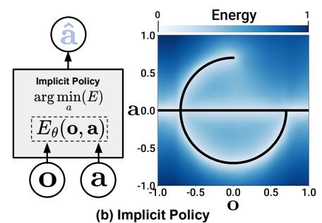

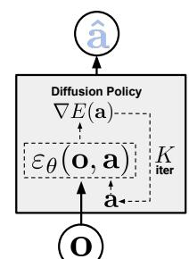

  

(c) 扩散策略（Diffusion Policy）
图 1. 策略表示。a) 显式策略，包含不同类型的动作表示。b) 隐式策略学习一个以动作和观测为条件的能量函数，并优化使能量景观最小的动作。c) p(a)扩散策略通过学习到的梯度场将噪声细化为动作。这种表述提供了稳定的训练，允许学习到的策略准确建模多模态动作分布，并兼容高维动作序列。

## 1 引言

从示教中进行策略学习（Policy learning from demonstration），其最简单形式可被形式化为一个监督回归任务，即学习将观测映射到动作。然而，在实践中，由于预测机器人动作的特殊性质——例如多模态分布的存在、时序相关性以及对高精度的要求——这一任务与其他监督学习问题相比有其独特之处并更具挑战性。

先前的工作试图通过探索不同的动作表示（图 1 a）来应对这一挑战——使用高斯混合（mixtures of Gaussians）Mandlekar et al. (2021)，或将量化动作的类别化表示 Shafiullah et al. (2022)，或者切换策略表示（图 1 b）——从显式切换到隐式，以更好地捕捉多模态分布 Florence et al. (2021); Wu et al. (2020)。

在本工作中，我们试图通过引入一种新的机器人视觉运动策略形式来应对这一挑战，该策略通过机器人动作空间上的"条件去噪扩散过程（conditional denoising diffusion process）" Ho et al. (2020) 来生成行为，即**扩散策略（Diffusion Policy）**。在该形式化中，策略不是直接输出动作，而是在视觉观测条件下推断动作得分梯度，并进行 K 次去噪迭代（图 1 c）。这种形式化使得机器人策略能够从扩散模型中继承若干关键特性——显著提升了性能。

• **表达多模态动作分布。** 通过学习动作得分函数的梯度 Song and Ermon (2019) 并在该梯度场上执行随机朗之动力学（Stochastic Langevin Dynamics）采样，扩散策略可以表达任意可归一化的分布 Neal et al. (2011)，其中包括多模态动作分布——这在策略学习领域是一个公认的难题。

• **高维输出空间。** 正如其在令人印象深刻的图像生成结果中所展示的那样，扩散模型已表现出对高维输出空间的出色可扩展性。这一特性使得策略能够联合推断未来动作序列而非单步动作，这对于促进时序动作一致性以及避免短视规划（myopic planning）至关重要。

• **稳定的训练。** 训练基于能量的策略学习（energy-based policies）通常需要负采样（negative sampling）来估计一个难以处理的归一化常数，这已知会导致训练不稳定 Du et al. (2020); Florence et al. (2021)。扩散策略通过学习能量函数的梯度绕过了这一需求，从而在保持分布表达能力的同时实现了稳定的训练。

我们的主要贡献是将上述优势引入机器人学领域，并证明它们在复杂真实世界机器人操控任务上的有效性。为了成功地将扩散模型应用于视觉运动策略学习，我们提出了以下技术贡献，这些贡献提升了扩散策略的性能并释放了其在物理机器人上的全部潜力：

• 闭环动作序列（Closed-loop action sequences）。我们将策略预测高维动作序列的能力与滚动时域控制相结合，以实现稳健执行。该设计使策略能够以闭环方式持续重新规划动作，同时保持时间维度上动作的一致性——在长时序规划与响应性之间取得平衡。

• 视觉条件化（Visual conditioning）。我们提出了视觉条件扩散策略，其中视觉观测被视为条件而非联合数据分布的一部分。在这种形式下，无论去噪迭代多少次，策略仅需提取一次视觉表示，从而大幅降低计算开销，并实现实时的动作推理。

• 时间序列扩散 Transformer（Time-series diffusion transformer）。我们提出了一种新的基于 Transformer 的扩散网络，它最小化了典型 CNN 模型常见的过度平滑效应，并在需要高频动作变化与速度控制的任务上取得了最先进的性能。

我们在 Florence 等人 (2021)；Gupta 等人 (2019)；Mandlekar 等人 (2021)；Shafiullah 等人 (2022) 的 15 个任务、4 个不同基准上，以行为克隆（behavior cloning）的形式系统地评估了 Diffusion Policy。评估涵盖了仿真环境与真实环境，2 自由度至 6 自由度的动作物体，单任务与多任务基准，以及完整驱动与欠驱动系统，涉及刚体与流体对象，使用由单个和多个用户采集的演示数据。

经验上，我们在所有基准上都观察到一致的性能提升，平均改进达到 46.9%，为 Diffusion Policy 的有效性提供了有力证据。我们还提供了详细的分析，以仔细审视所提算法的特性以及关键设计决策的影响。

本工作是会议论文 Chi 等人 (2023) 的扩展版本。我们通过以下方式扩展了该论文的内容：

• 新增关于扩散策略与控制理论之间联系的讨论章节，参见第 4.5 节。

• 在仿真环境中加入关于替代网络架构设计以及不同预训练与微调范式的额外消融研究，第 5.4 节。

• 将真实世界实验结果扩展到三个双臂操作任务，包括打蛋器（Egg Beater）、卷垫（Mat Unrolling）以及叠衣（Shirt Folding），见第 7 节。

代码、数据和训练流程已公开发布，以便复现我们的结果 diffusion-policy.cs.columbia.edu。

## 2 扩散策略公式化

我们将视觉运动机器人策略建模为去噪扩散概率模型（DDPMs）Ho 等人 (2020)。关键在于，扩散策略能够表达复杂的多模态动作分布，并具有稳定的训练行为——几乎不需要针对特定任务进行超参数调优。接下来的章节将更详细地介绍 DDPM，并说明如何将其改造用于表示视觉运动策略。

## 2.1 去噪扩散概率模型（Denoising Diffusion Probabilistic Models, DDPM）

DDPM 是一类生成模型，其将输出生成过程建模为去噪过程，通常被称为随机朗之万动力学（Stochastic Langevin Dynamics）Welling and Teh (2011)。

从高斯噪声中采样的 $\mathbf { x } ^ { K }$ 出发，DDPM 执行 K 次去噪迭代以生成一系列噪声水平逐渐降低的中间动作 $\mathbf { x } ^ { k } , \mathbf { x } ^ { k - 1 } . . . \mathbf { x } ^ { 0 }$，直至形成所需的无噪声输出 $\mathbf { x } ^ { 0 }$。该过程遵循如下方程

$$
\mathbf {x} ^ {k - 1} = \alpha (\mathbf {x} ^ {k} - \gamma \varepsilon_ {\theta} (\mathbf {x} ^ {k}, k) + \mathcal {N} (0, \sigma^ {2} I)),\tag{1}
$$

其中 $\varepsilon _ { \theta }$ 是噪声预测网络，其参数 θ 将通过训练进行优化，$\dot { \mathcal { N } } ( 0 , \sigma ^ { 2 } I )$ 是在每次迭代时加入的高斯噪声。

上述公式 1 也可以被解释为单步含噪梯度下降：

$$
\mathbf {x} ^ {\prime} = \mathbf {x} - \gamma \nabla E (\mathbf {x}),\tag{2}
$$

其中噪声预测网络 $\varepsilon_{\boldsymbol{\theta}}(\mathbf{x}, k)$ 有效地预测了梯度场 $\nabla E(\mathbf{x})$，γ 是学习率。

对相关参数（也称为噪声调度）作为迭代步数 $k$ 的函数的选取，可以被解释为梯度下降过程中的学习率调度过程。α 略小于 1 已被证明可以提高稳定性（Ho et al., 2020）。关于噪声调度的详细信息将在第 3.3 节讨论。

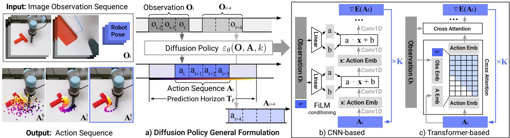  

图2. 扩散策略概述 a) 一般形式化。在时间步 t 时，策略将最近的 $T_o$ 步观测数据 $O_t$ 作为输入，并输出 $T_a$ 步动作 A。b) 在基于 CNN 的扩散策略中，对观测特征 $O_t$ 的 FiLM（Feature-wise Linear Modulation，特征线性调制）Perez 等人（2018）条件化逐通道地施加到每个卷积层。从高斯噪声中采样的 $\mathbf{A}_t^K$ 出发，减去噪声预测网络 $\varepsilon_\theta$ 的输出，重复 K 次得到去噪后的动作序列 $\mathbf{A}_t^0$。c) 在基于 Transformer 的 Vaswani 等人（2017）扩散策略中，观测 $\mathbf{O}_t$ 的嵌入被传入每个 Transformer 解码器块的多头交叉注意力层。每个动作嵌入通过所示的注意力掩码，仅被约束为关注自身以及先前的动作嵌入（因果注意力）。

## 2.2 DDPM Training

训练过程首先从数据集中随机抽取未修改的样本 $\mathbf { x } ^ { 0 }$。对于每个样本，我们随机选择一个去噪迭代步 k，然后为迭代步 k 采样一个具有适当方差的随机噪声 $\varepsilon ^ { k }$。噪声预测网络被要求从已添加噪声的数据样本中预测出该噪声。

$$
\mathscr {L} = M S E \left(\varepsilon^ {k}, \varepsilon_ {\theta} \left(\mathbf {x} ^ {0} + \varepsilon^ {k}, k\right)\right)\tag{3}
$$

如 Ho et al.（2020）所示，最小化公式 3 中的损失函数同时也最小化了数据分布 $p ( \mathbf { x } ^ { 0 } )$ 与使用公式 1 从 DDPM 采样的分布 $q ( \mathbf { x } ^ { 0 } )$ 之间 KL 散度的变分下界。

## 2.3 用于视觉运动策略学习的扩散模型

虽然 DDPM 通常用于图像生成（x 为图像），但我们使用 DDPM 来学习机器人视觉运动策略。这需要在形式化上进行两项主要修改：1. 将输出 x 改为表示机器人动作。2. 使去噪过程以输入观测 $\mathbf { O } _ { t }$ 为条件。以下段落将分别讨论这些修改，图 2 展示了整体概览。

**闭环动作序列预测**：有效的动作形式化应在长时域规划中促进时间一致性与平滑性，并允许对意外观测做出快速反应。为实现这一目标，我们采用扩散模型在固定时长内生成的动作序列预测，然后再进行重规划。具体而言，在时间步 t，策略将最新的 $T _ { o }$ 步观测数据 $\mathbf { O } _ { t }$ 作为输入，并预测 $T _ { p }$ 步动作，其中 $T _ { a }$ 步动作在机器人上执行而无需重新规划。此处，我们将 $T _ { o }$ 定义为观测时域，$T _ { p }$ 为动作预测时域，$T _ { a }$ 为动作执行时域。这在保持响应性的同时鼓励了时间动作一致性。关于 $T _ { a }$ 影响的更多细节将在第 4.3 节讨论。我们的形式化还允许采用滑动时域控制（Mayne and Michalska, 1988），通过用先前动作序列预测来热启动下一次推理设置，进一步提升动作的平滑性。

**视觉观测条件化**：我们使用 DDPM 来近似条件分布 $p ( \mathbf { A } _ { t } | \mathbf { O } _ { t } )$，而不是 Janner et al.（2022a）用于规划中的联合分布 $p ( \mathbf { A } _ { t } , \mathbf { O } _ { t } )$。这种形式化使模型能够基于观测条件预测动作，避免了推断未来状态的代价，从而加快了扩散过程并提高了生成动作的准确性。为捕捉条件分布 $p ( \mathbf { A } _ { t } | \mathbf { O } _ { t } )$，我们将公式 1 修改为：

$$
\mathbf {A} _ {t} ^ {k - 1} = \alpha (\mathbf {A} _ {t} ^ {k} - \gamma \varepsilon_ {\theta} (\mathbf {O} _ {t}, \mathbf {A} _ {t} ^ {k}, k) + \mathcal {N} (0, \sigma^ {2} I))\tag{4}
$$

训练损失由公式 3 修改为：

$$
\mathcal {L} = M S E (\boldsymbol {\varepsilon} ^ {k}, \boldsymbol {\varepsilon} _ {\theta} (\mathbf {O} _ {t}, \mathbf {A} _ {t} ^ {0} + \boldsymbol {\varepsilon} ^ {k}, k))\tag{5}
$$

观察特征 $\mathbf{O}_t$ 排除在去噪过程的输出之外，显著提升了推理速度，也更好地适应实时控制需求。这还有助于使视觉编码器的端到端训练变得可行。关于视觉编码器的细节描述见第 3.2 节。

## 3 关键设计决策

在本节中，我们描述扩散策略（Diffusion Policy）的关键设计决策，以及 $\varepsilon_\theta$ 的具体实现，包括其神经网络架构。

## 3.1 网络架构选项

第一个设计决策是为 $\varepsilon_\theta$ 选择神经网络架构。在本工作中，我们考察了两种常见的网络架构类型——卷积神经网络（CNN，Ronneberger et al., 2015）和 Transformer（Vaswani et al., 2017），并比较它们的性能与训练特性。需要注意的是，噪声预测网络 $\varepsilon_\theta$ 的选择与视觉编码器无关，详见后文。

基于 CNN 的扩散策略（CNN-based Diffusion Policy）：我们采用 Janner et al. (2022b) 中的 1D 时间卷积网络（1D temporal CNN），并进行了少量修改：首先，我们仅建模条件分布 $p(\mathbf{A}_t | \mathbf{O}_t)$，通过特征线性调制（FiLM，Perez et al., 2018）以及去噪迭代次数 $k$ 将动作生成过程条件化于观察特征 $\mathbf{O}_t$，如图 2 (b) 所示。其次，我们仅预测动作轨迹，而非拼接的观察-动作轨迹。第三，我们移除了基于修复（inpainting）的目标状态条件化方式，因为它与采用滚动预测时域（receding prediction horizon）的框架不兼容。然而，目标条件化仍然可以通过与用于观察的相同的 FiLM 条件化方法实现。

在实际应用中，我们发现基于 CNN 的骨干网络在大多数任务上开箱即用，无需过多超参数调优即可良好工作。然而，当期望的动作序列随时间快速且剧烈变化时（例如速度指令动作空间），其表现较差，这可能是由于时间卷积的归纳偏置倾向于低频信号（Tancik et al., 2020）。

**时序扩散 Transformer** 为了缓解 CNN 模型中的过度平滑效应 Tancik 等人 (2020)，我们提出了一种新颖的基于 Transformer 的 DDPM，它采用了 minGPT 中的 Transformer 架构 Shafiullah 等人 (2022) 进行动作预测。带噪声的动作 $A _ { t } ^ { k }$ 作为输入 token 传入 Transformer 解码器模块，扩散迭代 k 的正弦嵌入（sinusoidal embedding）作为首个 token 拼接在前面。观测 $\mathbf { O } _ { t }$ 通过共享 MLP 转换为观测嵌入序列，然后作为输入特征传入 Transformer 解码器堆栈。"梯度" $\mathbf { \nabla } ^ { \prime } \varepsilon _ { \theta } ( \mathbf { O _ { t } } , \mathbf { A _ { t } } ^ { k } , k )$ 由解码器堆栈中每个对应的输出 token 预测得到。

在我们的基于状态的实验中，大多数表现最佳的策略都通过 Transformer 主干网络实现，尤其是在任务复杂度较高且动作变化率较高的情况下。然而，我们发现 Transformer 对超参数更加敏感。Transformer 训练的困难 Liu 等人 (2020) 并非 Diffusion Policy 所独有，未来有望通过改进的 Transformer 训练技术或扩大数据规模加以解决。

**建议。** 通常，我们建议以基于 CNN 的扩散策略实现作为新任务的首次尝试。如果由于任务复杂度或高频率的动作变化而导致性能较低，则可以使用时序扩散 Transformer（Time-series Diffusion Transformer）公式，以额外的调优为代价有可能提升性能。

## 3.2 视觉编码器

视觉编码器将原始图像序列映射为潜空间嵌入 $O _ { t }$，并与扩散策略一起进行端到端训练。不同的相机视角使用独立的编码器，每个时间步的图像被独立编码，然后拼接以形成 $O _ { t }$。我们使用标准的 ResNet-18（不进行预训练）作为编码器，并进行了以下修改：1) 将全局平均池化替换为空间 softmax 池化以保留空间信息 Mandlekar 等人 (2021)。2) 将 BatchNorm 替换为 GroupNorm 以实现稳定的训练 Wu 和 He (2018)。当归一化层与指数移动平均（Exponential Moving Average，EMA） He 等人 (2020)（DDPM 中常用）结合使用时，这一点尤为重要。

## 3.3 噪声调度

由 σ, $\alpha ,$ γ 和作为 $k ,$ 函数的高斯加性噪声 $\varepsilon ^ { k }$ 所定义的噪声调度（Noise Schedule）已被广泛研究 Ho 等人 (2020); Nichol 和 Dhariwal (2021)。底层噪声调度控制着扩散策略对动作信号中高频和低频特征的捕捉程度。在我们的控制任务中，我们通过实验发现 iDDPM 中提出的平方余弦调度（Square Cosine Schedule） Nichol 和 Dhariwal (2021) 最适合我们的任务。

## 3.4 实时控制推理加速

我们使用扩散过程作为机器人策略；因此，对于闭环实时控制而言，快速推理速度至关重要。去噪扩散隐式模型（Denoising Diffusion Implicit Models, DDIM）方法 Song et al. (2021) 将训练和推理中的去噪迭代次数解耦，从而允许算法在推理时使用更少的迭代次数来加速过程。在我们的真实世界实验中，使用 100 次训练迭代和 10 次推理迭代的 DDIM 在 Nvidia 3080 GPU 上实现了 0.1 秒的推理延迟。

## 4 扩散策略的引人深思的性质

在本节中，我们将提供一些关于扩散策略及其相对于其他策略表示形式优势的见解和直观理解。

## 4.1 对多模态动作分布的建模

在行为克隆文献中，建模人类演示中多模态分布的挑战已被广泛讨论 Florence et al. (2021); Shafiullah et al. (2022); Mandlekar et al. (2021)。扩散策略能够自然而精确地表达多模态分布是其关键优势之一。

直观上，扩散策略中动作生成的多模态性来源于两个方面——底层随机采样过程和随机初始化。在随机朗之万动力学（Stochastic Langevin Dynamics）中，在每次采样过程开始时从标准高斯分布中抽取一个初始样本 $\mathbf { A } _ { t } ^ { K }$，这有助于为最终动作预测 $\bar { \mathbf { A } } _ { t } ^ { 0 }$ 指定不同的可能收敛盆地。然后该动作通过在大量迭代中加入高斯扰动进行进一步的随机优化，使得单个动作样本能够在不同的多模态动作盆地之间收敛和移动。图 3 展示了扩散策略在平面推动任务（Push T，下文介绍）中多模态行为的一个示例，其中未对测试场景提供明确的演示。

## 4.2 与位置控制的协同效应

我们发现，采用位置控制（position-control）动作空间的扩散策略（Diffusion Policy）始终优于采用速度控制（velocity control）的扩散策略，如图4所示。这一令人惊讶的结果与近期大多数行为克隆（behavior cloning）工作形成了鲜明对比，这些工作通常依赖于速度控制 Mandlekar et al. (2021); Shafiullah et al. (2022); Zhang et al. (2018); Florence et al. (2019); Mandlekar et al. $( 2 0 2 0 \mathrm { b } , \mathrm { a } )$。我们推测造成这种差异的原因主要有两点：首先，位置控制模式下的动作多模态性（action multimodality）比速度控制时更为显著。由于扩散策略比现有方法更能表达动作的多模态性，我们推测它本质上受这一缺点的影响比现有方法更小。此外，位置控制比速度控制更少受到复合误差（compounding error）效应的影响，因此更适合用于动作序列预测（action-sequence prediction）（如下节所述）。因此，扩散策略既较少受到位置控制主要缺点的影响，又能更好地利用位置控制的优势。

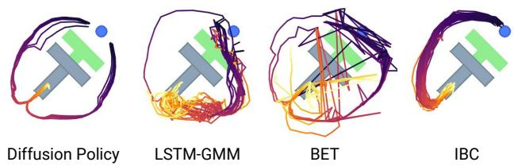  

图 3. 多模态行为。在当前状态下，末端执行器（蓝色）既可以向左也可以向右推动该方块。Diffusion Policy 学习了这两种模式，并在每次展开中只锁定其中一种模式。相比之下，LSTM-GMM（Mandlekar 等人，2021）和 IBC（Florence 等人，2021）都偏向于其中一种模式，而 BET（Shafiullah 等人，2022）由于缺乏时间动作一致性，无法锁定单一模式。动作由最佳性能的检查点展开 40 步生成。

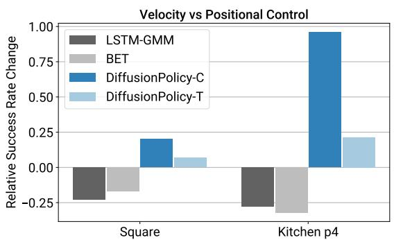  

图 4. 速度控制与位置控制对比。从速度控制切换到位置控制时的性能差异。虽然 BCRNN 和 BET 的性能都有所下降，但 Diffusion Policy 能够利用位置控制的优势并提升其性能。

## 4.3 动作序列预测的优势

在大多数策略学习方法中，序列预测常常被回避，因为在高维输出空间中难以有效采样。例如，IBC 在具有非光滑能量景观的高维动作空间中难以有效采样。类似地，BC-RNN 和 BET 在指定动作分布中存在的模态数量方面存在困难（GMM 或 k-means 步骤所需）。

相比之下，DDPM 在输出维度增加时表现良好，且不会牺牲模型的表达能力，这一点已在许多图像生成应用中得到了证明。利用这种能力，扩散策略（Diffusion Policy）将动作表示为高维动作序列的形式，自然地解决了以下问题：

• 时间动作一致性：以图 3 为例。为了将 T 形积木从底部推到目标位置，策略可以从 T 形积木的左侧或右侧绕过去。然而，假设序列中的每个动作都被预测为独立的多模态分布（如 BC-RNN 和 BET 所做的那样），那么连续的动作可能从不同的模态中采样，导致动作在两个有效轨迹之间来回抖动。

• 对空闲动作的鲁棒性：空闲动作发生在演示暂停时，会产生相同位置动作或接近零速度动作的序列。这在遥操作中很常见，有时对于液体倾倒等任务是必需的。然而，单步策略很容易对这种暂停行为过拟合。例如，当训练数据中未显式去除空闲动作时，BC-RNN 和 IBC 在真实世界实验中经常陷入停滞。

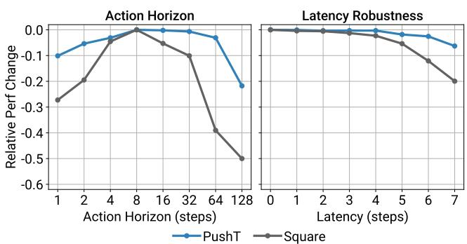  

图 5. Diffusion Policy 消融实验。Y 轴显示每个任务相对于最大成功率的变化（差值）。左侧：选择动作时域（action horizon）时时间一致性与响应性之间的权衡。右侧：采用位置控制（position control）的 Diffusion Policy 对延迟（latency）具有鲁棒性。延迟定义为从最后一帧观测到第一个可执行动作之间的步数。

## 4.4 训练稳定性

从理论上讲，IBC 应该具有与扩散策略相似的优势。然而，由于 IBC 固有的训练不稳定性 Ta 等人（2022），在实践中很难从 IBC 获得可靠且高性能的结果。图 6 显示了整个训练过程中训练误差出现尖峰以及评估性能不稳定，这使得超参数调整至关重要，且检查点选择困难。因此，Florence 等人（2021）对每个检查点进行评估，并报告表现最佳的检查点所得结果。在实际场景中，这一工作流程需要在硬件上评估大量策略以选择最终策略。下面我们讨论为什么扩散策略在训练时显著更为稳定。

隐式策略使用基于能量的模型（Energy-Based Model, EBM）来表示动作分布：

$$
p _ {\theta} (\mathbf {a} | \mathbf {o}) = \frac {e ^ {- E _ {\theta} (\mathbf {o} , \mathbf {a})}}{Z (\mathbf {o} , \theta)}\tag{6}
$$

其中 $Z(\mathbf{0}, \theta)$ 是一个关于 $\mathbf{a}$ 的难以处理的归一化常数。

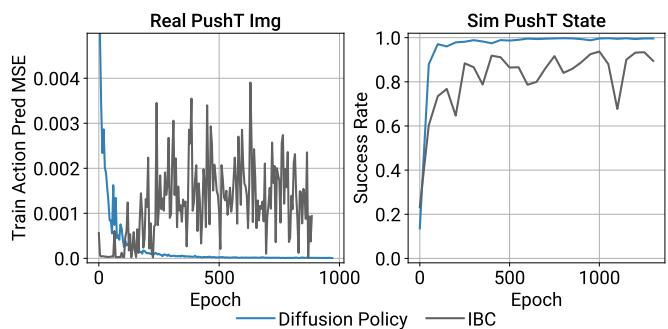  

图 6. 训练稳定性。左：尽管能量函数的训练损失平稳下降，IBC 仍无法以不断提高的精度推断训练动作。右：IBC 的评估成功率波动较大，使得检查点选择变得困难（通过仿真中的策略执行轨迹进行评估）。

为了训练隐式策略的基于能量的模型（Energy-Based Model, EBM），采用 InfoNCE 风格的损失函数，该损失等价于公式 6 的负对数似然：

$$
\mathcal {L} _ {i n f o N C E} = - \log (\frac {e ^ {- E _ {\theta} (\mathbf {o} , \mathbf {a})}}{e ^ {- E _ {\theta} (\mathbf {o} , \mathbf {a})} + \sum_ {j = 1} ^ {N _ {n e g}} e ^ {- E _ {\theta} (\mathbf {o} , \widetilde {\mathbf {a}} ^ {j})}})\tag{7}
$$

其中一组负样本 $\{ \widetilde { \mathbf { a } } ^ { j } \} _ { j = 1 } ^ { N _ { n e g } }$ 用于估计难以处理的归一化常数 $Z ( \mathbf { 0 } , \theta )$。在实践中，负采样（negative sampling）的不准确性已知会导致 EBM 的训练不稳定 Du et al. (2020); Ta et al. (2022)。

Diffusion Policy 和 DDPM 通过对公式 6 中同一动作分布的得分函数（score function） Song and Ermon (2019) 进行建模，从而完全绕开了估计 $Z ( \mathbf { a } , \theta )$ 的问题：

$$
\nabla_ {\mathbf {a}} \log p (\mathbf {a} | \mathbf {0}) = - \nabla_ {\mathbf {a}} E _ {\theta} (\mathbf {a}, \mathbf {0}) - \underbrace {\nabla_ {\mathbf {a}} \log Z (\mathbf {o} , \theta)} _ {= 0} \approx - \varepsilon_ {\theta} (\mathbf {a}, \mathbf {0})\tag{8}
$$

其中噪声预测网络 $\varepsilon_{\boldsymbol{\theta}}(\mathbf{a}, \mathbf{0})$ 正在近似评分函数 $\nabla_{\mathbf{a}} \log p(\mathbf{a} | \mathbf{o})$（Liu et al., 2022）的负值，该函数与归一化常数 $Z(\mathbf{0}, \theta)$ 无关。因此，Diffusion Policy 的推理（式 4）和训练（式 5）过程都不涉及计算 $Z(\mathbf{0}, \theta)$，从而使 Diffusion Policy 的训练更加稳定。

## 4.5 与控制理论的联系

Diffusion Policy 在任务非常简单时具有简单的极限行为；这可能使我们能够借助控制理论的某些严谨结论。考虑如下情形：有一个我们希望控制的线性动力系统，以标准状态空间形式给出：

$$
\mathbf {s} _ {t + 1} = \mathbf {A} \mathbf {s} _ {t} + \mathbf {B} \mathbf {a} _ {t} + \mathbf {w} _ {t}, \qquad \mathbf {w} _ {t} \sim \mathcal {N} (0, \Sigma_ {w}).
$$

现在假设我们从一个线性反馈策略（linear feedback policy）中获得演示（rollouts）：$\mathbf { a } _ { t } = - \mathbf { K } \mathbf { s } _ { t }$。例如，通过求解线性二次型调节器（Linear Quadratic Regulator）这样的线性最优控制问题，就可以得到该策略。模仿这一策略并不需要扩散模型的建模能力，但作为一种健全性检查（sanity check），我们可以看到扩散策略（Diffusion Policy）给出了正确的结果。

特别地，当预测时域为一个时间步时，即 $T _ { p } = 1$，可以看到，最优去噪器（optimal denoiser）所最小化的是

$$
\mathscr {L} = M S E \left(\varepsilon^ {k}, \varepsilon_ {\theta} \left(\mathbf {s} _ {t}, - \mathbf {K s} _ {t} + \varepsilon^ {k}, k\right)\right)\tag{9}
$$

由…给出

$$
\varepsilon_ {\theta} (\mathbf {s}, \mathbf {a}, k) = \frac {1}{\sigma_ {k}} [ \mathbf {a} + \mathbf {K s} ],
$$

其中 $\sigma _ { k }$ 是去噪迭代 $k$ 的方差。此外，在推理时，DDIM 采样将收敛到全局最优解 $\mathbf { a } = - \mathbf { K } \mathbf { s }$

轨迹预测 $( T _ { p } > 1 )$ 是自然而然的。为了将 $\mathbf { a } _ { t + t ^ { \prime } }$ 预测为 $s$ 的函数，最优去噪器将产生 $\mathbf { a } _ { t + t ^ { \prime } } = - \mathbf { K } ( \mathbf { A } - \mathbf { B } \mathbf { K } ) ^ { t ^ { \prime } } \mathbf { s } _ { t }$；所有涉及 $\mathbf { w } _ { t }$ 的项在期望上为零。这表明，为了完美地复现依赖于状态的行为，学习器必须隐式地学习一个（任务相关的）动力学模型 Subramanian and Mahajan (2019); Zhang et al. (2020)。注意，如果受控对象（plant）或策略是非线性的，那么预测未来动作可能会变得显著更加困难，并且再次涉及多模态预测。

## 5 评估

我们在来自 4 个基准的 15 个任务上系统地评估了 Diffusion Policy Florence et al. (2021); Gupta et al. (2019); Mandlekar et al. (2021); Shafiullah et al. (2022)。该评估套件包括模拟和真实环境、单任务和多任务基准、完全驱动和欠驱动系统，以及刚体和流体对象。我们发现 Diffusion Policy 在所有测试基准上一致地优于先前的最先进方法，平均成功率提高了 46.9%。在接下来的各节中，我们概述每个任务、我们在该任务上的评估方法以及我们的关键结论。

## 5.1 模拟环境和数据集

Robomimic Mandlekar et al. (2021) 是一个大规模机器人操作基准，旨在研究模仿学习和离线强化学习。该基准包含 5 个任务，每个任务都配有熟练人类（PH）遥操作演示数据集，其中 4 个任务（总共 9 个变体）还配有熟练/非熟练混合人类（MH）演示数据集。对于每个变体，我们报告基于状态和基于图像观测的结果。每个任务的属性总结在表 3 中。

Push-T 改编自 IBC Florence et al. (2021)，需要使用圆形末端执行器（蓝色）将一个 T 形块（灰色）推动到固定目标位置（红色）。通过随机初始化 T 块和末端执行器的初始条件来增加变化性。该任务需要利用复杂且富含接触的物体动力学，通过点接触精确地推动 T 块。有两种变体：一种使用 RGB 图像观测，另一种使用从 T 块真实姿态获得的 9 个二维关键点，两者都包含末端执行器位置的本体感（proprioception）。

多模态块推动（Multimodal Block Pushing）改编自 BET Shafiullah et al. (2022)，该任务通过推动两个块来测试策略对多模态动作分布建模的能力

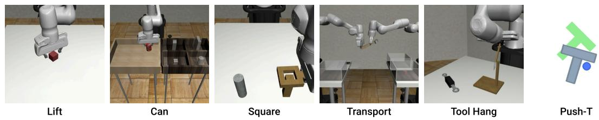

<table><tr><td rowspan="2"></td><td colspan="2">Lift</td><td colspan="2">Can</td><td colspan="2">Square</td><td colspan="2">Transport</td><td>ToolHang</td><td>Push-T</td></tr><tr><td>ph</td><td>mh</td><td>ph</td><td>mh</td><td>ph</td><td>mh</td><td>ph</td><td>mh</td><td>ph</td><td>ph</td></tr><tr><td>LSTM-GMM</td><td>1.00/0.96</td><td>1.00/0.93</td><td>1.00/0.91</td><td>1.00/0.81</td><td>0.95/0.73</td><td>0.86/0.59</td><td>0.76/0.47</td><td>0.62/0.20</td><td>0.67/0.31</td><td>0.67/0.61</td></tr><tr><td>IBC</td><td>0.79/0.41</td><td>0.15/0.02</td><td>0.00/0.00</td><td>0.01/0.01</td><td>0.00/0.00</td><td>0.00/0.00</td><td>0.00/0.00</td><td>0.00/0.00</td><td>0.00/0.00</td><td>0.90/0.84</td></tr><tr><td>BET</td><td>1.00/0.96</td><td>1.00/0.99</td><td>1.00/0.89</td><td>1.00/0.90</td><td>0.76/0.52</td><td>0.68/0.43</td><td>0.38/0.14</td><td>0.21/0.06</td><td>0.58/0.20</td><td>0.79/0.70</td></tr><tr><td>DiffusionPolicy-C</td><td>1.00/0.98</td><td>1.00/0.97</td><td>1.00/0.96</td><td>1.00/0.96</td><td>1.00/0.93</td><td>0.97/0.82</td><td>0.94/0.82</td><td>0.68/0.46</td><td>0.50/0.30</td><td>0.95/0.91</td></tr><tr><td>DiffusionPolicy-T</td><td>1.00/1.00</td><td>1.00/1.00</td><td>1.00/1.00</td><td>1.00/0.94</td><td>1.00/0.89</td><td>0.95/0.81</td><td>1.00/0.84</td><td>0.62/0.35</td><td>1.00/0.87</td><td>0.95/0.79</td></tr></table>

表 1. 行为克隆基准测试（状态策略）我们展示了使用不同检查点选择方法得到的成功率，采用（最大性能）/（最后 10 个检查点的平均值）的格式，每个数值均在 3 个训练随机种子和 50 个不同的环境初始条件（共 150 个）上取平均值。LSTM-GMM 对应于 RoboMimic 中的 BC-RNN，即 Mandlekar 等人（2021）所提出的方法，我们对其进行了复现，并获得了略优于原论文的结果。我们的结果表明，扩散策略（Diffusion Policy）在各方面均显著提升了当前最优性能。

<table><tr><td rowspan="2"></td><td colspan="2">Lift</td><td colspan="2">Can</td><td colspan="2">Square</td><td colspan="2">Transport</td><td>ToolHang</td><td>Push-T</td></tr><tr><td>ph</td><td>mh</td><td>ph</td><td>mh</td><td>ph</td><td>mh</td><td>ph</td><td>mh</td><td>ph</td><td>ph</td></tr><tr><td>LSTM-GMM</td><td>1.00/0.96</td><td>1.00/0.95</td><td>1.00/0.88</td><td>0.98/0.90</td><td>0.82/0.59</td><td>0.64/0.38</td><td>0.88/0.62</td><td>0.44/0.24</td><td>0.68/0.49</td><td>0.69/0.54</td></tr><tr><td>IBC</td><td>0.94/0.73</td><td>0.39/0.05</td><td>0.08/0.01</td><td>0.00/0.00</td><td>0.03/0.00</td><td>0.00/0.00</td><td>0.00/0.00</td><td>0.00/0.00</td><td>0.00/0.00</td><td>0.75/0.64</td></tr><tr><td>DiffusionPolicy-C</td><td>1.00/1.00</td><td>1.00/1.00</td><td>1.00/0.97</td><td>1.00/0.96</td><td>0.98/0.92</td><td>0.98/0.84</td><td>1.00/0.93</td><td>0.89/0.69</td><td>0.95/0.73</td><td>0.91/0.84</td></tr><tr><td>DiffusionPolicy-T</td><td>1.00/1.00</td><td>1.00/0.99</td><td>1.00/0.98</td><td>1.00/0.98</td><td>1.00/0.90</td><td>0.94/0.80</td><td>0.98/0.81</td><td>0.73/0.50</td><td>0.76/0.47</td><td>0.78/0.66</td></tr></table>

表 2. 行为克隆基准（Visual Policy）性能以与表 1 相同的格式报告。LSTM-GMM 的数据为复现所得，以便在已报告的最佳检查点性能之外提供完整评估。Diffusion Policy 展现出持续的性能提升，尤其在 Transport 和 ToolHang 等复杂任务上。

<table><tr><td>Task</td><td># Rob</td><td># Obj</td><td>ActD</td><td>#PH</td><td>#MH</td><td>Steps</td><td>Img?</td><td>HiPrec</td></tr><tr><td colspan="9">Simulation Benchmark</td></tr><tr><td>Lift</td><td>1</td><td>1</td><td>7</td><td>200</td><td>300</td><td>400</td><td>Yes</td><td>No</td></tr><tr><td>Can</td><td>1</td><td>1</td><td>7</td><td>200</td><td>300</td><td>400</td><td>Yes</td><td>No</td></tr><tr><td>Square</td><td>1</td><td>1</td><td>7</td><td>200</td><td>300</td><td>400</td><td>Yes</td><td>Yes</td></tr><tr><td>Transport</td><td>2</td><td>3</td><td>14</td><td>200</td><td>300</td><td>700</td><td>Yes</td><td>No</td></tr><tr><td>ToolHang</td><td>1</td><td>2</td><td>7</td><td>200</td><td>0</td><td>700</td><td>Yes</td><td>Yes</td></tr><tr><td>Push-T</td><td>1</td><td>1</td><td>2</td><td>200</td><td>0</td><td>300</td><td>Yes</td><td>Yes</td></tr><tr><td>BlockPush</td><td>1</td><td>2</td><td>2</td><td>0</td><td>0</td><td>350</td><td>No</td><td>No</td></tr><tr><td>Kitchen</td><td>1</td><td>7</td><td>9</td><td>656</td><td>0</td><td>280</td><td>No</td><td>No</td></tr><tr><td colspan="9">Realworld Benchmark</td></tr><tr><td>Push-T</td><td>1</td><td>1</td><td>2</td><td>136</td><td>0</td><td>600</td><td>Yes</td><td>Yes</td></tr><tr><td>6DoF Pour</td><td>1</td><td>liquid</td><td>6</td><td>90</td><td>0</td><td>600</td><td>Yes</td><td>No</td></tr><tr><td>Peri Spread</td><td>1</td><td>liquid</td><td>6</td><td>90</td><td>0</td><td>600</td><td>Yes</td><td>No</td></tr><tr><td>Mug Flip</td><td>1</td><td>1</td><td>7</td><td>250</td><td>0</td><td>600</td><td>Yes</td><td>No</td></tr></table>

表 3. 任务汇总。#Rob：机器人数量，#Obj：物体数量，ActD：动作维度，PH：熟练人类演示，MH：多人演示，Steps：最大展开步数，HiPrec：任务是否具有高精度要求。BlockPush 使用 1000 回合的脚本化演示。

以任意顺序推入两个方格。演示数据由一个可访问真值状态信息的脚本化专家生成。该专家随机选择一个待推入的初始方块，并将其移动到一个随机选定的方格。然后将剩余的方块推入剩余的方格。该任务包含长视野多模态性，无法通过从观测到动作的单一函数映射来建模。

Franka Kitchen 是一个流行的环境，用于评估模仿学习（IL）和离线强化学习（Offline-RL）方法学习多个长视野任务的能力。该环境由 Relay Policy Learning Gupta et al. (2019) 提出，包含 7 个可交互对象，并附带一个包含 566 次演示的人类演示数据集，每次演示以任意顺序完成 4 个任务。目标是执行尽可能多的已演示任务，无论顺序如何，展示短视野和长视野的多模态性。

## 5.2 评估方法

我们展示了每个基线方法在每个基准上来自所有可能来源的最佳表现——我们的复现结果（LSTM-GMM）或原论文中报告的原始数值（BET、IBC）。我们报告了在 3 个训练种子和 50 个环境初始化下最后 10 个检查点（每 50 个 epoch 保存一次）的平均值（总计平均约 1500 次实验）。大多数任务的指标是成功率，Push-T 任务除外，该任务使用目标区域覆盖率。此外，我们报告了 robomimic 和 Push-T 任务的最佳检查点的平均值，以与各自原始论文（Mandlekar et al. (2021); Florence et al. (2021)）的评估方法保持一致。所有基于状态的任务训练 4500 个 epoch，基于图像的任务训练 3000 个 epoch。每个方法都使用其表现最佳的动作空间进行评估：Diffusion Policy 使用位置控制，基线方法使用速度控制（动作空间的影响将在第 5.3 节中详细讨论）。这些模拟基准的结果汇总在表 1 和表 2 中。

  

推方块（Block Push）

  

厨房

<table><tr><td rowspan="2"></td><td colspan="2">BlockPush</td><td colspan="4">Kitchen</td></tr><tr><td>p1</td><td>p2</td><td>p1</td><td>p2</td><td>p3</td><td>p4</td></tr><tr><td>LSTM-GMM</td><td>0.03</td><td>0.01</td><td>1.00</td><td>0.90</td><td>0.74</td><td>0.34</td></tr><tr><td>IBC</td><td>0.01</td><td>0.00</td><td>0.99</td><td>0.87</td><td>0.61</td><td>0.24</td></tr><tr><td>BET</td><td>0.96</td><td>0.71</td><td>0.99</td><td>0.93</td><td>0.71</td><td>0.44</td></tr><tr><td>DiffusionPolicy-C</td><td>0.36</td><td>0.11</td><td>1.00</td><td>1.00</td><td>1.00</td><td>0.99</td></tr><tr><td>DiffusionPolicy-T</td><td>0.99</td><td>0.94</td><td>1.00</td><td>0.99</td><td>0.99</td><td>0.96</td></tr></table>

表 4. 多阶段任务（状态观测）。对于 PushBlock，px 是将 x 个方块推入目标的频率。对于 Kitchen，px 是与 x 个或更多对象（例如底部燃烧器）进行交互的频率。正如我们的结果所示，Diffusion Policy 表现更好，尤其是在困难指标上，例如 Block Pushing 的 p2 和 Kitchen 的 p4。

## 5.3 关键发现

Diffusion Policy 在我们仿真基准研究的所有任务和变体上均优于替代方法，无论是状态观测还是视觉观测（表 1、2 和 4），平均改进幅度为 46.9%。以下段落总结了关键要点。

Diffusion Policy 能够表达短视野多模态性。我们将短视野动作多模态性定义为实现同一即时目标的多种方式，这在人类演示数据中很常见（Mandlekar 等，2021）。在图 3 中，我们展示了 Push-T 任务中此类短视野多模态性的一个案例研究。Diffusion Policy 学习以同等概率从左侧或右侧接近接触点，而 LSTM-GMM（Mandlekar 等，2021）和 IBC（Florence 等，2021）则表现出对某一侧的偏向，BET（Shafiullah 等，2022）则无法锁定其中一种模式。

Diffusion Policy 能够表达长视野多模态性。长视野多模态性是指以不一致的顺序完成不同的子目标。例如，在 Block Push 任务中推动特定方块的顺序，或在 Kitchen 任务中与 7 个可能对象交互的顺序都是任意的。我们发现 Diffusion Policy 能很好地应对此类多模态性；它在两项任务上均以较大优势优于基线方法：Block Push 的 p2 指标提升 32%，Kitchen 的 p4 指标提升 213%。

Diffusion Policy 能够更好地利用位置控制。我们的消融研究（图 4）显示，选择位置控制作为 diffusion-policy 的动作空间显著优于速度控制。然而，我们评估的基线方法在速度控制下表现最佳（这也反映在文献中，大多数现有工作报告使用速度控制动作空间（Mandlekar 等，2021；Shafiullah 等，2022；Zhang 等，2018；Florence 等，2019；Mandlekar 等，2020b,a)）。

动作视野的权衡。正如第 4.3 节所讨论的，动作视野大于 1 有助于策略预测一致的动作并补偿演示中的空闲部分，但视野过长会因反应时间慢而降低性能。我们的实验证实了这一权衡（图 5 左），并发现对我们测试的大多数任务而言，8 步的动作视野是最优的。

对延迟的鲁棒性。Diffusion Policy 采用滚动时域（receding horizon）位置控制来预测未来的一系列动作。该设计有助于应对图像处理、策略推理和网络传输所造成的延迟。我们使用模拟延迟开展的消融研究表明，Diffusion Policy 能够在延迟达到 4 步的情况下保持峰值性能（图 5）。我们还发现速度控制比位置控制更容易受到延迟的影响，这可能是由于误差累积效应所致。

Diffusion Policy 的训练过程是稳定的。我们发现，Diffusion Policy 的最优超参数在大多数任务中是一致的。相比之下，IBC（Florence 等人，2021）容易出现训练不稳定问题。该特性在第 4.4 节中进行了讨论。

## 5.4 消融研究

我们在模拟的 robomimic square 任务上探索了视觉编码器的替代设计方案。具体而言，我们评估了 3 种不同的架构：ResNet-18、ResNet-34（He 等人，2016）以及 ViT-B/16（Dosovitskiy 等人，2020）。对于每种架构，我们评估了 3 种不同的训练策略：从头开始端到端训练、使用冻结的预训练视觉编码器、以及微调预训练视觉编码器（相对于策略网络使用低 10 倍的学习率）。ResNet 使用 ImageNet-21k（Ridnik 等人，2021）预训练，ViT-B/16 使用 CLIP（Radford 等人，2021）预训练。在 square 任务上使用熟练人类（PH）数据集的定量比较见表 5。

我们发现从头开始训练 ViT 具有挑战性（成功率仅为 22%），这可能是由于数据量有限所致。我们还发现使用冻结的预训练视觉编码器训练会导致较差的性能，这表明 diffusion policy 所偏好的视觉表征与现有主流预训练方法所提供的有所不同。然而，我们发现使用较小的学习率（比 diffusion policy 网络小 10 倍）来微调预训练视觉编码器，能够在整体上获得最佳性能。这一点在使用 CLIP 训练的 ViT-B/16 上尤为明显，它仅经过 50 个 epoch 的训练就达到了 98% 的成功率。总体而言，尽管不同架构在理论容量上存在显著差距，但它们之间的最佳性能差距并不大。我们预计在更复杂的任务上，它们之间的性能差距可能会更加明显。

<table><tr><td rowspan="2">Architecture &amp; Prertain Datset</td><td rowspan="2">From Scatch</td><td colspan="2">Pretrained</td></tr><tr><td>frozen</td><td>finetuning</td></tr><tr><td>Resnet18 (in21)</td><td>0.94</td><td>0.58</td><td>0.92</td></tr><tr><td>Resnet34 (in21)</td><td>0.92</td><td>0.40</td><td>0.94</td></tr><tr><td>ViT-base (clip)</td><td>0.22</td><td>0.70</td><td>0.98</td></tr></table>

表 5. 视觉编码器对比 所有模型均使用基于 CNN 的扩散策略（diffusion policy）在 robomimic square (ph) 任务上进行训练。每个模型训练 500 个 epoch，每隔 50 个 epoch 在 50 种不同的环境初始条件下进行一次评估。

<table><tr><td></td><td>Human Demo</td><td colspan="2">IBC pos vel</td><td colspan="2">LSTM-GMM pos vel</td><td colspan="4">Diffusion Policy T-E2E ImgNet R3M E2E</td></tr><tr><td>IoU</td><td>0.84</td><td>0.14</td><td>0.19</td><td>0.24</td><td>0.25</td><td>0.53</td><td>0.24</td><td>0.66</td><td>0.80</td></tr><tr><td>Succ%</td><td>1.00</td><td>0.00</td><td>0.00</td><td>0.20</td><td>0.10</td><td>0.65</td><td>0.15</td><td>0.80</td><td>0.95</td></tr><tr><td>Dur.</td><td>20.3</td><td>56.3</td><td>41.6</td><td>47.3</td><td>51.7</td><td>57.5</td><td>55.8</td><td>31.7</td><td>22.9</td></tr></table>

表 6. 真实环境 Push-T 实验。a) 硬件设置。b) 任务示意。机器人需要 ⃝1 精确地将 T 形积木推入目标区域，然后 ⃝2 将末端执行器移动到终点区域。c) 用于计算本表中各项 IoU 指标的真实末端状态。表格：成功（Success）的判定标准是末端状态 IoU 大于演示数据集中的最低 IoU。平均回合时长（Average Episode Duration）以秒为单位给出。T-E2E 代表基于 Transformer 的端到端训练扩散策略（end-to-end trained Transformer-based Diffusion Policy）。

## 6 真实环境评估（Realworld Evaluation）

我们在 2 套硬件设置下的 4 个任务上评估了 Diffusion Policy 在真实环境中的表现——每套设置使用不同示教者的训练数据。在真实环境 Push-T 任务上，我们对 Diffusion Policy 的 2 种架构选项和 3 种视觉编码器选项进行了消融实验；同时在位置控制（position-control）和速度控制（velocity-control）两类动作空间下与 2 种基线方法进行了基准对比。在所有任务中，使用 CNN 主干网络和端到端训练视觉编码器的 Diffusion Policy 变体均取得了最佳性能。关于任务设置和参数的更多细节可在补充材料中找到。

## 6.1 真实环境 Push-T 任务（Realworld Push-T Task）

真实环境 Push-T 相比仿真版本要困难得多，原因在于以下 3 处改动：1. 真实环境 Push-T 任务是多阶段的。它要求机器人 ⃝1 将 T 形积木推入目标区域，然后 ⃝2 将末端执行器移入指定的终点区域以避免遮挡。2. 策略必须进行精细调整，确保 T 形积木完全进入目标区域后再前往终点区域，由此产生了额外的短期多模态性。3. IoU 指标在最后一步测量，而不是取所有步骤中的最大值。我们以人类演示数据集中所达到的最低 IoU 值作为成功率（success rate）的阈值。我们基于 UR5 的实验设置如图 6 所示。Diffusion Policy 以 10 Hz 的频率预测机器人指令，然后将这些指令线性插值到 125 Hz 用于机器人执行。

结果分析。Diffusion Policy 取得了接近人类水平的表现，成功率为 95%，平均 IoU 为 0.8 对比人类示范的 0.84；而表现最好的 IBC 和 LSTM-GMM 变体的成功率分别为 0% 和 20%。图 7 定性地展示了从同一初始状态出发的每种方法的行为。我们观察到，阶段切换期间的较差表现是基线方法最常见的失败模式，这是因为这些阶段具有较高的多模态性，且决策边界较为模糊。LSTM-GMM 在 20 次评估中有 8 次（第三行）卡在 T 形积木附近，而 IBC 在 20 次评估中有 6 次（第四行）过早地离开了 T 形积木。由于任务要求，我们未遵循从训练数据中移除空闲动作（idle actions）的常见做法，这也加剧了 LSTM-GMM 和 IBC 倾向于在小幅动作上过拟合并在该任务中陷入停滞的问题。结合补充材料中的视频可以更好地感受上述结果。

## 端到端 vs. 预训练视觉编码器

我们在表 6 中测试了使用预训练视觉编码器（ImageNet（Deng 等人，2009 年）和 R3M（Nair 等人，2022 年））的 Diffusion Policy。配备 R3M 的 Diffusion Policy 达到了 80% 的成功率，但预测的动作存在抖动，并且相比端到端训练的版本更容易陷入卡顿。配备 ImageNet 的 Diffusion Policy 表现则不太理想，动作突兀且性能较差。我们发现，端到端训练仍然是将视觉观测整合到 Diffusion Policy 中最为有效的方式，而我们表现最佳的模型全部都采用了端到端训练。

## 对扰动的鲁棒性

Diffusion Policy 针对视觉和物理扰动的鲁棒性在独立于表 6 实验的另一回合中进行了评估。如图 8 所示，施加了三类扰动：1) 用一只挥动的手在前置摄像头前遮挡 3 秒钟（左侧一列），但 Diffusion Policy 尽管出现了一些抖动，仍保持了原有轨迹并将 T 形积木推入正确位置。2) 在 Diffusion Policy 正在对 T 形积木的位置进行精细微调时，我们挪动了 T 形积木。Diffusion Policy 立刻重新规划，从相反方向推动，从而抵消了扰动的影响。3) 在机器人完成第一阶段正前往终点区域的过程中，我们移动了 T 形积木。Diffusion Policy 立即改变轨迹，将 T 形积木调整回目标位置，随后继续前往终点区域。该实验表明，Diffusion Policy 或许能够针对未见过的观测综合出新颖的行为。

## 6.2 杯子翻转任务

杯子翻转任务旨在检验 Diffusion Policy 在逼近硬件运动学极限条件下处理复杂三维旋转的能力。任务目标是将随机摆放的杯子重新调整为 ⃝1 杯口朝下 ⃝2 杯柄指向左侧，如图 9 所示。根据杯子初始位姿的不同，示教者可能直接将杯子放置到期望的朝向，也可能借助对杯柄的额外推力来旋转杯子。因此，示教数据集具有高度的多模态性：抓取与推动并存、不同类型的抓取方式（正手抓取与反手抓取）、以及对抓取姿态的局部调整（绕杯子主轴的旋转），这些对基线方法而言尤为难以捕捉。

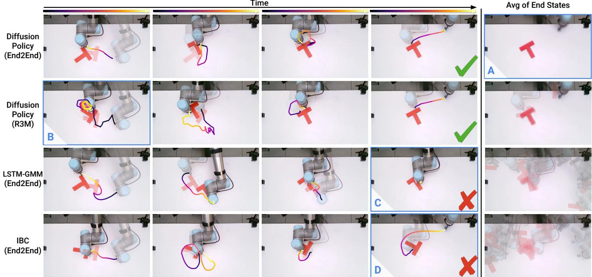  

图 7. 真实环境 Push-T 对比。第 1-4 列展示了基于关键事件的动作轨迹。最后一列展示了结束状态的平均图像。A：Diffusion Policy（End2End）实现了更准确且一致的结束状态。B：Diffusion Policy（R3M）在初始阶段发生卡顿，但随后恢复并完成任务。C：LSTM-GMM 在调整 T 形块时未能到达终点区域，遮挡了评测相机的视野。D：IBC 过早结束了推动阶段。

  

图 8. Diffusion Policy 的鲁棒性测试。左：在相机前方挥手 3 秒会导致轻微抖动，但预测的动作仍按预期执行。中：在推动阶段，Diffusion Policy 立即将偏移的方块位置纠正到目标状态。右：策略在检测到方块偏移时立即中止前往终点区域的动作，将方块恢复到目标状态。这种新颖行为从未被展示过。请查阅补充材料中的视频。

结果分析。扩散策略（Diffusion Policy）能够在 20 次试验中以 90% 的成功率完成该任务。所捕获行为的丰富性通过视频能够得到最佳的呈现。尽管从未被明确演示，该策略在必要时也能够串联多次推压以实现手柄对齐，或在咖啡杯掉落时进行重新抓取。作为对比，我们还使用同一数据的子集训练了一个 LSTM-GMM 策略。对于 20 个同分布（in-distribution）的初始条件，LSTM-GMM 策略始终无法与咖啡杯正确对齐，并在所有试验中均未能成功抓取。

<table><tr><td></td><td>Human</td><td>LSTM-GMM</td><td>Diffusion Policy</td></tr><tr><td>Succ %</td><td>1.0</td><td>0.0</td><td>0.9</td></tr></table>

Figure 9. 6 自由度杯子翻转任务。机器人需要 ⃝1 拿起一个随机放置的杯子，并将其杯口朝下放置（标记为橙色）。⃝ 旋转杯子，使其手柄指向左侧。

## 6.3 酱料倾倒与涂布

酱料倾倒与涂布任务旨在测试扩散策略（Diffusion Policy）在真实世界设置中处理非刚性物体、6 自由度动作空间以及周期性动作的能力。我们的 Franka Panda 实验平台及任务如图 10 所示。6 自由度倾倒任务的目标是将一满勺酱料倾倒在披萨面团的中心，性能通过倾倒后的酱料掩码与披萨面团中心标称圆之间的交并比 (IoU) 来衡量（如图 10 中绿色圆圈所示）。周期性涂布任务的目标是将酱料涂布在披萨面团上，性能通过酱料覆盖率来衡量。不同评估回合之间的差异来自面团和酱料碗的随机位置。成功率通过以最低人类表现为阈值进行计算。结果建议在补充视频中查看。两个任务均使用相同的 Push-T 超参数进行训练，并且首次尝试即获得了成功的策略。

<table><tr><td rowspan="2"></td><td colspan="2">Pour</td><td colspan="2">Spread</td></tr><tr><td>IoU</td><td>Succ</td><td>Coverage</td><td>Succ %</td></tr><tr><td>Human</td><td>0.79</td><td>1.00</td><td>0.79</td><td>1.00</td></tr><tr><td>LSTM-GMM</td><td>0.06</td><td>0.00</td><td>0.27</td><td>0.00</td></tr><tr><td>Diffusion Policy</td><td>0.74</td><td>0.79</td><td>0.77</td><td>1.00</td></tr></table>

图 10. 真实场景酱料操作。[左] 6DoF 浇注任务。机器人需要 ⃝1 将汤勺浸入碗中舀取酱料，⃝2 移动到披萨饼坯中心上方，⃝3 浇注酱料，以及 ⃝4 提起汤勺完成任务。[右] 周期性涂抹任务。机器人需要 ⃝1 用夹持的勺子移至酱料中心，⃝2 以螺旋状将酱料涂抹覆盖整个披萨，以及 ⃝3 提起勺子完成任务。

酱料浇注任务要求机器人在一段时间内保持静止，以便用粘稠的番茄酱填满汤勺。由此产生的静止动作（idle actions）对于行为克隆算法而言是众所周知的难点，因此往往被回避或滤除。在浇注过程中需要做出细微调整，以确保覆盖范围并达到期望的形状。

所演示的酱料涂抹策略借鉴了人类厨师的手法，这既需要长时域的循环运动模式以最大化覆盖范围，又需要短时域的反馈以实现均匀分布（因为所使用的番茄酱常常以大小不可预测的团块状滴落）。已知周期性运动难以学习，因此通常需要借助专门的动作表征方法 Yang et al. (2022) 来处理。两个任务都要求策略通过提起汤勺/勺子来自主终止。

结果分析。Diffusion Policy 在两项任务上均达到了接近人类的水平，浇注任务的覆盖率分别为 0.74 和 0.79，涂抹任务的覆盖率分别为 0.77 和 0.79。在浇注和涂抹过程中，Diffusion Policy 对外部扰动（例如人工移动披萨饼坯）反应优雅从容。最佳结果可通过补充材料中的视频进行欣赏。

LSTM-GMM 在酱料浇注和涂抹两项任务上表现均较差。在 20 次浇注试验中，有 15 次在成功舀取酱料后未能提起汤勺。当汤勺被成功提起时，酱料也被浇到了偏离中心的位置。LSTM-GMM 在所有试验中都未能实现自主终止。我们推测 LSTM-GMM 的隐藏状态未能捕捉到足够长的时间历史，从而无法区分任务中汤勺浸入和提起两个阶段。对于酱料涂抹任务，LSTM-GMM 总是任务一开始便提起勺子，在全部 20 次实验中均未能使勺子接触到酱料。

## 7 真实场景双臂任务

除单臂设置之外，我们进一步在若干具有挑战性的双臂任务上演示了 Diffusion Policy。为了支持双臂任务，主要的工作集中在将我们的机器人栈扩展为支持多臂遥操作与控制。Diffusion Policy 在这些任务上无需超参数调优即可直接开箱即用。

## 7.1 观测空间与动作空间

本体感受观测空间被扩展为包含两个末端执行器的位姿以及两个夹爪的开度。我们也将观测空间扩展为包含这些量的实际值与期望值。图像观测空间由两个场景相机和两个腕部相机组成，每个机械臂各附有一个腕部相机。动作空间被扩展为包含两个末端执行器的期望位姿以及两个夹爪的期望开度。

## 7.2 遥控操作

对于这些需要双手协调的任务，我们发现同时使用 2 个 SpaceMouse 对示教者而言相当具有挑战性。因此，我们实现了两种新的遥控模式：一种是使用配备两个手部控制器的 Meta Quest Pro VR 设备，另一种是使用 2 个 Haption Virtuose™ 6D HF TAO 设备进行使能触觉的控制，采用 Siciliano 等人（2008）触觉部分中所简要描述的双边位置—位置耦合方式。该耦合在 Haption 设备与 Franka Panda 机械臂之间执行。关于控制器本身的更多细节可参见附录 D.1 节。以下提供关于每个任务及策略性能的更多细节。

## 7.3 双手打蛋器

双手打蛋器任务如图 11 所示并配以说明，使用 OXO™ 打蛋器和 Room Essentials™ 塑料碗。我们选择该任务是为了说明在进行双手协调工具使用等日常任务时，触觉反馈对于遥控操作的重要性。即使是一名专家，在没有触觉反馈的情况下，10 次试验中也未能成功完成一次完整的演示：其中 5 次因机械臂将曲柄手柄从打蛋器上扯下而失败；3 次因机械臂未能抓住手柄而失败；2 次因机械臂触发扭矩限制而失败。相比之下，同一操作员在有触觉反馈的情况下，能够轻松地以 10/10 的成功率完成该任务。使用触觉反馈不仅使演示速度更快，也使其质量高于无反馈的情况。

结果分析。Diffusion Policy（扩散策略）能够在 20 次试验中以 55% 的成功率完成该任务，其训练使用了 210 次演示数据。这些试验的主要失败模式包括打蛋器的初始位姿超出分布范围、未对准打蛋器曲柄手柄或失去对其的抓握。所有展开轨迹的初始与终止状态可视于图 18 与图 19。

## 7.4 双手展开垫子

展开垫子任务如图 12 所示并配以说明，使用一张 XXL Dog Buddy™ 狗垫。该任务通过 VR 装置进行遥控，因为执行该任务不需要丰富的触觉反馈。我们将该技能训练为全方向灵活的（omnidextrous），即可以根据初始条件向左或向右展开垫子。

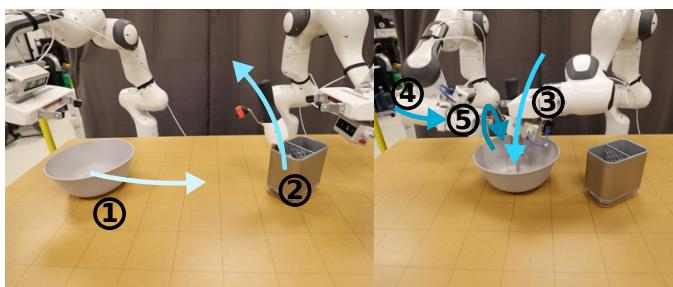

  

Figure 11. 双手动打蛋器操作（Bimanual Egg Beater Manipulation）。机器人需要 ① 将碗推入合适位置（仅当其距离左臂过近时执行），② 用右臂接近并拿起打蛋器，③ 将打蛋器放入碗中，④ 接近并抓握住打蛋器的摇柄，以及 ⑤ 转动摇柄 3 次或以上。

Figure 12. 双手动垫子展开（Bimanual Mat Unrolling）。机器人需要 ① 用左臂或右臂捡起垫子的一侧（必要时），② 提起并展开垫子（必要时），③ 确保垫子两侧均被抓握，④ 提起垫子，⑤ 将垫子放置到与桌子朝向一致且大致居中的位置，以及 ⑥ 松开垫子。

结果分析。Diffusion policy 能够以 75% 的成功率完成该任务，在 20 次试验中，使用 162 个示教进行训练。主要的失败模式是在初始抓取垫子时出现抓取失败，策略难以自我修正，因此陷入重复同一行为的循环。所有回放的初始状态和最终状态分别如图 16 和图 17 所示。

## 7.5 双手衬衫折叠

衬衫折叠任务在图 13 中进行了描述和展示，使用的是一件短袖 T 恤。该任务同样使用 VR 装置进行远程操作，因为执行该任务并不需要丰富的反馈。出于运动学和工作空间的限制，该任务明显更长，最多可达九个离散步骤。最后几个步骤需要两个夹爪彼此非常接近。让我们的中层控制器显式处理碰撞避免，对于远程操作和策略回放都尤其重要。

结果分析。Diffusion policy 能够以 75% 的成功率完成该任务，在 20 次试验中，使用 284 个示教进行训练。主要的失败模式包括初始折叠（袖子和衣领）时的抓取失败，以及策略在结束时无法停止调整衬衫。所有回放的初始状态和最终状态分别如图 20 和图 21 所示。

## 8 相关工作

在不需显式编程机器人行为的情况下创建有能力的机器人，是该领域的一个长期挑战 Atkeson and Schaal (1997); Argall et al. (2009); Ravichandar et al. (2020)。虽然概念上简单，但行为克隆在大量真实世界机器人任务中展现出了令人惊讶的前景，包括操作任务 Zhang et al. (2018); Florence et al. (2019); Mandlekar et al. (2020b,a); Zeng et al. (2021); Rahmatizadeh et al. (2018); Avigal et al. (2022) 和自动驾驶 Pomerleau (1988); Bojarski et al. (2016)。当前的行为克隆方法可以根据策略的结构分为两类。

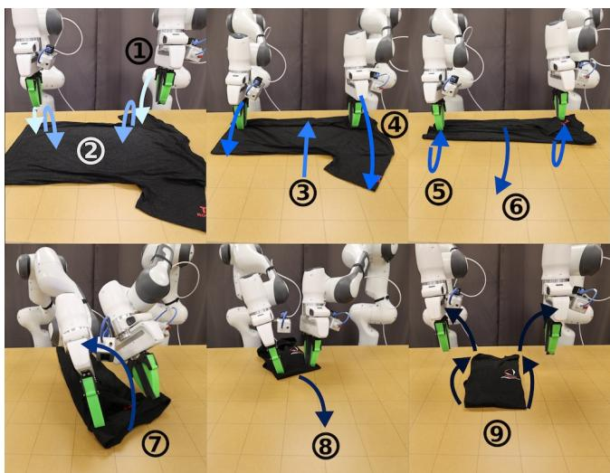  

图 13. 双手衬衫折叠（Shirt Folding）。机器人需要 ⃝1 用双臂接近并抓取最近的袖子，⃝2 折叠袖子并松开，⃝3 拖动衬衫使其靠近（如果需要），⃝4 用双臂接近并抓取另一只袖子，⃝5 折叠袖子并松开，⃝6 将衬衫拖动至适合折叠的朝向，⃝7 通过衣领抓取并将衬衫对折，⃝8 将衬衫拖至中间，⃝9 抚平衬衫并将双臂移开。

显式策略（Explicit Policy）。显式策略最简单的方式是将世界状态或观察直接映射到动作（Pomerleau, 1988; Zhang et al., 2018; Florence et al., 2019; Ross et al., 2011; Toyer et al., 2020; Rahmatizadeh et al., 2018; Bojarski et al., 2016）。它们可以通过直接回归损失进行监督学习，并且只需一次前向传播就能实现高效的推理时间。不幸的是，这类策略不适用于建模多模态的示范行为，并且在高精度任务上表现欠佳（Florence et al., 2021）。一种流行的方法是在保持直接动作映射简洁性的同时建模多模态动作分布，即通过对动作空间进行离散化将回归任务转化为分类任务（Zeng et al., 2021; Wu et al., 2020; Avigal et al., 2022）。然而，近似连续动作空间所需的箱数会随着维度的增加呈指数增长。另一种方法是通过使用 MDNs（Bishop, 1994; Mandlekar et al., 2021）将类别分布与高斯分布相结合，或通过结合偏移预测的聚类方法（Shafiullah et al., 2022; Sharma et al., 2018）来表示连续多模态分布。尽管如此，这些模型往往对超参数调优较为敏感，存在模式坍缩问题，并且在表达高精度行为方面仍然能力有限（Florence et al., 2021）。

隐式策略（Implicit Policy）。隐式策略（Florence et al., 2021; Jarrett et al., 2020）通过使用基于能量的模型（Energy-Based Models, EBMs）（LeCun et al., 2006; Du and Mordatch, 2019; Dai et al., 2019; Grathwohl et al., 2020; Du et al., 2020）来定义动作上的分布。在这种设置下，每个动作都被赋予一个能量值，动作预测对应于寻找最小能量动作的优化问题。由于不同的动作可能被赋予较低的能量，隐式策略天然地能够表示多模态分布。然而，现有的隐式策略（Florence et al., 2021）在训练时稳定性较差，因为在计算底层的 Info-NCE 损失时需要抽取负样本。

扩散模型（Diffusion Models）。扩散模型是概率生成模型，它们通过迭代细化随机采样的噪声来生成来自某个底层分布的样本。它们也可以从概念上理解为学习隐式动作得分的梯度场，然后在推理过程中对该梯度进行优化。扩散模型（Sohl-Dickstein et al., 2015; Ho et al., 2020）最近被应用于解决各种不同的控制任务（Janner et al., 2022a; Urain et al., 2022; Ajay et al., 2022）。

特别是，Janner et al.（2022a）和 Huang et al.（2023）探索了扩散模型在规划场景下的应用方式，并推断出可在给定环境中执行的动作轨迹。在强化学习的背景下，Wang et al.（2022）将扩散模型用于基于状态观察的策略表征与正则化。与之相对，在本文中，我们探索扩散模型如何被有效地应用于行为克隆（behavior cloning）场景中，以构建高效的视觉运动控制策略。为了构建高效的视觉运动控制策略，我们提出将 DDPM 预测高维动作序列的能力与闭环控制相结合，并采用一种新的用于动作扩散的 Transformer 架构，以及将视觉输入整合进动作扩散模型的方法。

Wang et al.（2023）探索了如何利用从专家演示数据中学到的扩散模型来增强经典的显式策略，但并未直接将扩散模型本身用作策略表征。

与我们同期，Pearce et al.（2023）、Reuss et al.（2023）和 Hansen-Estruch et al.（2023）在仿真环境中对基于扩散的策略开展了互补性分析。他们的工作更侧重于有效的采样策略、利用无分类器引导（classifier-free guidance）进行目标条件化以及在强化学习中的应用，而我们则聚焦于有效的动作空间设计；不过在仿真环境下的实验结论大体一致。此外，我们大量真实世界实验为以下若干关键设计决策提供了有力证据：滚动时域预测方案（receding-horizon prediction scheme）的重要性、速度控制与位置控制之间的谨慎权衡、以及面向实时推理的优化必要性——这些都是物理机器人系统中至关重要的设计考量。

## 9 局限性与未来工作

尽管我们已在仿真与真实世界系统中验证了扩散策略（diffusion policy）的有效性，但仍存在若干局限性有待未来工作加以改进。首先，我们的实现继承了行为克隆固有的局限，例如在演示数据不足时性能欠佳。扩散策略可被应用于其他范式，例如强化学习（Wang et al.（2023）；Hansen-Estruch et al.（2023）），从而利用次优数据与负样本数据。其次，与 LSTM-GMM 等更简单的方法相比，扩散策略具有更高的计算开销与推理延迟。我们提出的动作序列预测方法在一定程度上缓解了该问题，但对于需要高频率控制的任务而言可能仍显不足。未来的研究可以利用扩散模型加速方法的最新进展来减少所需的推理步数，例如新的噪声调度（noise schedules）（Chen，2023）、推理求解器（inference solvers）（Karras et al.，2022）以及一致性模型（consistency models）（Song et al.，2023）。

## 10 结论

在本工作中，我们评估了基于扩散模型的策略用于机器人行为的可行性。通过在仿真和真实世界中对 15 个任务进行全面评估，我们证明了基于扩散模型的视觉运动策略始终且明确地优于现有方法，同时也具备稳定且易于训练的特性。我们的结果还突出了关键的设计要素，包括滚动时域动作预测、末端执行器位置控制以及高效的视觉条件化，这些对于释放基于扩散模型的策略的全部潜力至关重要。尽管有许多因素会影响行为克隆策略的最终质量——包括示教的质量与数量、机器人的物理能力、策略架构以及所使用的预训练方案——我们的实验结果强烈表明，策略结构在行为克隆过程中构成了显著的性能瓶颈。我们希望本工作能够推动该领域对基于扩散模型的策略的进一步探索，并强调在行为克隆过程中，除了用于策略训练的数据之外，还应考虑流程中各个方面的因素。

## 11 致谢

我们要感谢 Naveen Kuppuswamy、Hongkai Dai、Aykut Onol、Terry Suh、Tao Pang、Huy Ha、Samir Gadre¨、Kevin Zakka 和 Brandon Amos 所进行的有益讨论。我们感谢 Jarod Wilson 提供的 3D 打印支持，以及 Huy Ha 在摄影与布光方面的建议。我们感谢 Xiang Li 在 GitHub 上发现了我们评估代码中的漏洞。

## 资助

本工作得到了丰田研究所（Toyota Research Institute）、NSF CMMI-2037101 和 NSF IIS-2132519 的支持。我们要感谢 Google 提供的 UR5 机器人硬件。本文所包含的观点和结论均属作者本人，不应被解释为必然代表资助方明示或暗示的官方政策。

## 参考文献

Ajay A、Du Y、Gupta A、Tenenbaum J、Jaakkola T 和 Agrawa P（2022）条件生成建模是决策所需的全部吗？（Is conditional generative modeling all you need for decision-making?）arXiv 预印本 arXiv:2211.15657。

Argall BD、Chernova S、Veloso M 和 Browning B（2009）机器人从示教中学习的综述（A survey of robot learning from demonstration）。Robotics and autonomous systems 57(5)：469–483。

Atkeson CG 和 Schaal S（1997）机器人从示教中学习（Robot learning from demonstration）。载于：ICML，第 97 卷，第 12–20 页。

Avigal Y、Berscheid L、Asfour T、Kroger T¨ 和 Goldberg K（2022）Speedfolding：学习高效的双手机器人衣物折叠（Speedfolding: Learning efficient bimanual folding of garments）。载于：2022 年 IEEE/RSJ 国际智能机器人与系统会议（IROS）。IEEE，第 1–8 页。

Bishop CM（1994）混合密度网络（Mixture density networks）。阿斯顿大学（Aston University）。

Bojarski M、Del Testa D、Dworakowski D、Firner B、Flepp B、Goyal P、Jackel LD、Monfort M、Muller U、Zhang J 等（2016）自动驾驶汽车的端到端学习（End to end learning for self-driving cars）。arXiv 预印本 arXiv:1604.07316。

Chen T（2023）论噪声调度对扩散模型的重要性（On the importance of noise scheduling for diffusion models）。arXiv 预印本 arXiv:2301.10972。

Chi C、Feng S、Du Y、Xu Z、Cousineau E、Burchfiel B 和 Song S (2023) 扩散策略：通过动作扩散的视觉运动策略学习。载于：机器人科学与系统（RSS）会议论文集。

Dai B、Liu Z、Dai H、He N、Gretton A、Song L 和 Schuurmans D (2019) 通过对抗性动力学嵌入的指数族估计。《神经信息处理系统进展》32。

Deng J、Dong W、Socher R、Li LJ、Li K 和 Fei-Fei L (2009) ImageNet：一个大规模层次化图像数据库。载于：2009年IEEE计算机视觉与模式识别会议。IEEE出版社，第248–255页。

Dosovitskiy A、Beyer L、Kolesnikov A、Weissenborn D、Zhai X、Unterthiner T、Dehghani M、Minderer M、Heigold G、Gelly S 等 (2020) 一幅图像相当于16×16个词：面向大规模图像识别的Transformer。arXiv预印本 arXiv:2010.11929。

Du Y、Li S、Tenenbaum J 和 Mordatch I (2020) 基于能量的模型的改进对比散度训练。arXiv预印本 arXiv:2012.01316。

Du Y 和 Mordatch I (2019) 基于能量的模型中的隐式生成与泛化。arXiv预印本 arXiv:1903.08689。

Florence P、Lynch C、Zeng A、Ramirez OA、Wahid A、Downs L、Wong A、Lee J、Mordatch I 和 Tompson J (2021) 隐式行为克隆。载于：第5届机器人学习年度会议。

Florence P、Manuelli L 和 Tedrake R (2019) 视觉运动策略学习中的自监督对应。《IEEE机器人与自动化快报》5(2): 492–499。

Grathwohl W、Wang KC、Jacobsen JH、Duvenaud D 和 Zemel R (2020) 无需采样的基于能量的模型训练与评估中学习Stein差异。载于：国际机器学习大会。

Gupta A、Kumar V、Lynch C、Levine S 和 Hausman K (2019) 接力策略学习：通过模仿与强化学习求解长视野任务。arXiv预印本 arXiv:1910.11956。

Hansen-Estruch P、Kostrikov I、Janner M、Kuba JG 和 Levine S (2023) IDQL：作为带有扩散策略的演员-评论家方法的隐式Q学习。arXiv预印本 arXiv:2304.10573。

He K、Fan H、Wu Y、Xie S 和 Girshick R (2020) 无监督视觉表征学习的动量对比。载于：IEEE/CVF计算机视觉与模式识别会议论文集。第9729–9738页。

He K、Zhang X、Ren S 和 Sun J (2016) 用于图像识别的深度残差学习。载于：IEEE计算机视觉与模式识别会议论文集。第770–778页。

Ho J、Jain A 和 Abbeel P (2020) 去噪扩散概率模型。arXiv预印本 arXiv:2006.11239。

Huang S、Wang Z、Li P、Jia B、Liu T、Zhu Y、Liang W 和 Zhu SC (2023) 三维场景中基于扩散的生成、优化与规划。arXiv预印本 arXiv:2301.06015。

Janner M、Du Y、Tenenbaum J 和 Levine S (2022a) 基于扩散的灵活行为合成规划。载于：国际机器学习大会。

Janner M, Du Y, Tenenbaum J and Levine S (2022b) 用扩散模型进行规划以实现灵活的行为合成. 见: Chaudhuri K, Jegelka S, Song L, Szepesvari C, Niu G and Sabato S (主编) 第39届国际机器学习大会论文集, 机器学习研究论文集. PMLR.

Jarrett D, Bica I and van der Schaar M (2020) 基于能量分布匹配的严格批量模仿学习. 神经信息处理系统进展 33: 7354–7365.

Karras T, Aittala M, Aila T and Laine S (2022) 阐明基于扩散的生成模型的设计空间. arXiv预印本 arXiv:2206.00364 .

Khatib O (1987) 机器人操作器运动与力控制的统一方法：操作空间公式. IEEE机器人与自动化杂志 3(1): 43–53. DOI:10.1109/JRA.1987.1087068. 会议名称: IEEE机器人与自动化杂志.

LeCun Y, Chopra S, Hadsell R, Huang FJ and et al (2006) 基于能量的学习教程. 见: 结构化数据预测. MIT出版社.

Liu L, Liu X, Gao J, Chen W and Han J (2020) 理解训练Transformer的困难. arXiv预印本 arXiv:2004.08249 .

Liu N, Li S, Du Y, Torralba A and Tenenbaum JB (2022) 用可组合扩散模型进行组合式视觉生成. arXiv预印本 arXiv:2206.01714 .

Mandlekar A, Ramos F, Boots B, Savarese S, Fei-Fei L, Garg A and Fox D (2020a) Iris：大规模无需交互的隐式强化学习以从离线机器人操作数据中学习控制. 见: 2020年IEEE国际机器人与自动化会议 (ICRA). IEEE.

Mandlekar A, Xu D, Martín-Martín R, Savarese S and Fei-Fei L (2020b) 从人类演示中学习跨长视野任务的泛化能力. arXiv预印本 arXiv:2003.06085 .

Mandlekar A, Xu D, Wong J, Nasiriany S, Wang C, Kulkarni R, Fei-Fei L, Savarese S, Zhu Y and Martín-Martín R (2021) 从离线人类演示中学习机器人操作时的重要因素. 见: 第5届机器人学习年度会议.

Mayne DQ and Michalska H (1988) 非线性系统的滚动时域控制. 见: 第27届IEEE决策与控制会议论文集. IEEE, 第464–465页.

Nair S, Rajeswaran A, Kumar V, Finn C and Gupta A (2022) R3m：用于机器人操作的通用视觉表征. 见: 第6届机器人学习年度会议.

Neal RM et al. (2011) 使用哈密顿动力学的MCMC. 马尔可夫链蒙特卡洛手册 .

Nichol AQ and Dhariwal P (2021) 改进的去噪扩散概率模型. 见: 国际机器学习会议. PMLR, 第8162–8171页.

Pearce T, Rashid T, Kanervisto A, Bignell D, Sun M, Georgescu R, Macua SV, Tan SZ, Momennejad I, Hofmann K et al. (2023) 用扩散模型模仿人类行为. arXiv预印本 arXiv:2301.10677 .

Perez E, Strub F, De Vries H, Dumoulin V 和 Courville A (2018) Film：使用通用条件层进行视觉推理。发表于：AAAI 人工智能会议论文集。

Pomerleau DA (1988) Alvinn：神经网络中的自主陆地车辆。《神经信息处理系统进展》1。

Radford A, Kim JW, Hallacy C, Ramesh A, Goh G, Agarwal S, Sastry G, Askell A, Mishkin P, Clark J 等 (2021) 通过自然语言监督学习可迁移的视觉模型。发表于：国际机器学习会议。PMLR，第 8748–8763 页。

Rahmatizadeh R, Abolghasemi P, Bol¨ oni L 和 Levine S (2018) 基于视觉的廉价机器人多任务操作：使用端到端的示教学习。发表于：2018 年 IEEE 国际机器人与自动化会议 (ICRA)。IEEE，第 3758–3765 页。

Ravichandar H, Polydoros AS, Chernova S 和 Billard A (2020) 机器人示教学习的最新进展。《控制、机器人和自主系统年度评论》3：297–330。

Reuss M, Li M, Jia X 和 Lioutikov R (2023) 使用基于分数的扩散策略进行目标条件模仿学习。发表于：机器人学：科学与系统 (RSS) 会议论文集。

Ridnik T, Ben-Baruch E, Noy A 和 Zelnik-Manor L (2021) 面向大规模应用的 ImageNet-21k 预训练。

Ronneberger O, Fischer P 和 Brox T (2015) U-Net：用于生物医学图像分割的卷积网络。发表于：医学图像计算与计算机辅助干预 – MICCAI 2015：第 18 届国际会议，德国慕尼黑，2015 年 10 月 5–9 日，会议论文集第三部分 18。Springer，第 234–241 页。

Ross S, Gordon G 和 Bagnell D (2011) 将模仿学习和结构化预测归结为无悔在线学习。发表于：第十四届国际人工智能与统计会议论文集。JMLR 工作坊与会议论文集，第 627–635 页。

Shafiullah NMM, Cui ZJ, Altanzaya A 和 Pinto L (2022) 行为 Transformer：一举克隆 $k$ 种模式。收录于：Oh AH, Agarwal A, Belgrave D 和 Cho K（编）《神经信息处理系统进展》。

Sharma P, Mohan L, Pinto L 和 Gupta A (2018) 多交互简化版 (MIME)：用于模仿的大规模示教数据。发表于：机器人学习会议。PMLR。

Siciliano B, Khatib O 和 Kroger T (2008) 《斯普林格机器人学手册》，第 200 卷。Springer。

Sohl-Dickstein J, Weiss E, Maheswaranathan N 和 Ganguli S (2015) 使用非平衡热力学的深度无监督学习。发表于：国际机器学习会议。

Song J, Meng C 和 Ermon S (2021) 去噪扩散隐式模型。发表于：国际学习表征会议。

Song Y, Dhariwal P, Chen M 和 Sutskever I (2023) 一致性模型。arXiv 预印本 arXiv:2303.01469。

Song Y 和 Ermon S (2019) 通过估计数据分布梯度的生成建模。《神经信息处理系统进展》32。

Subramanian J and Mahajan A (2019) 部分观测系统的近似信息状态 (Approximate information state for partially observed systems). In: 2019 IEEE 第58届决策与控制会议 (CDC). IEEE, pp. 1629–1636.

Ta DN, Cousineau E, Zhao H and Feng S (2022) 用于隐式策略的条件能量模型：理论与实践之间的差距 (Conditional energy-based models for implicit policies: The gap between theory and practice). arXiv 预印本 arXiv:2207.05824.

Tancik M, Srinivasan P, Mildenhall B, Fridovich-Keil S, Raghavan N, Singhal U, Ramamoorthi R, Barron J and Ng R (2020) 傅里叶特征使网络能在低维域中学习高频函数 (Fourier features let networks learn high frequency functions in low dimensional domains). Advances in Neural Information Processing Systems 33: 7537–7547.

Toyer S, Shah R, Critch A and Russell S (2020) MAGICAL：用于鲁棒模仿的基准 (The MAGICAL benchmark for robust imitation). Advances in Neural Information Processing Systems 33: 18284–18295.

Urain J, Funk N, Chalvatzaki G and Peters J (2022) SE(3)-扩散场：通过扩散学习用于联合抓取与运动优化的代价函数 (SE(3)-DiffusionFields: Learning cost functions for joint grasp and motion optimization through diffusion). arXiv 预印本 arXiv:2209.03855.

Vaswani A, Shazeer N, Parmar N, Uszkoreit J, Jones L, Gomez AN, Kaiser Ł and Polosukhin I (2017) 注意力即所需 (Attention is all you need). Advances in neural information processing systems 30.

Wang Z, Hunt JJ and Zhou M (2022) 扩散策略作为离线强化学习中一种富有表达力的策略类 (Diffusion policies as an expressive policy class for offline reinforcement learning). arXiv 预印本 arXiv:2208.06193.

Wang Z, Hunt JJ and Zhou M (2023) 扩散策略作为离线强化学习中一种富有表达力的策略类 (Diffusion policies as an expressive policy class for offline reinforcement learning). In: 第十一届国际学习表征会议. URL https://openreview.net/forum?id=AHvFDPi-FA.

Welling M and Teh YW (2011) 基于随机梯度朗之万动力学的贝叶斯学习 (Bayesian learning via stochastic gradient Langevin dynamics). In: 第28届国际机器学习大会 (ICML-11) 论文集. pp. 681–688.

Wu J, Sun X, Zeng A, Song S, Lee J, Rusinkiewicz S and Funkhouser T (2020) 用于移动操作的空间动作图 (Spatial action maps for mobile manipulation). In: 机器人：科学与系统 (RSS) 论文集.

Wu Y and He K (2018) 组归一化 (Group normalization). In: 欧洲计算机视觉会议 (ECCV) 论文集. pp. 3–19.

Yang J, Zhang J, Settle C, Rai A, Antonova R and Bohg J (2022) 从人类演示中学习周期性任务 (Learning periodic tasks from human demonstrations). In: 2022 国际机器人与自动化会议 (ICRA). IEEE, pp. 8658–8665.

Zeng A, Florence P, Tompson J, Welker S, Chien J, Attarian M, Armstrong T, Krasin I, Duong D, Sindhwani V et al. (2021) Transporter 网络：为机器人操作重排视觉世界 (Transporter networks: Rearranging the visual world for robotic manipulation). In: 机器人学习会议. PMLR, pp. 726–747.

Zhang A, McAllister RT, Calandra R, Gal Y and Levine S (2020) 无需重构的强化学习不变表征学习 (Learning invariant representations for reinforcement learning without reconstruction). In: 国际学习表征会议.

Zhang T, McCarthy Z, Jow O, Lee D, Chen X, Goldberg K and Abbeel P (2018) 基于虚拟现实远程操作的复杂操作任务深度模仿学习 (Deep imitation learning for complex manipulation tasks from virtual reality teleoperation). In: 2018 IEEE 国际机器人与自动化会议 (ICRA). IEEE, pp. 5628–5635.

Zhou Y, Barnes C, Lu J, Yang J and Li H (2019) 论神经网络中旋转表示的连续性（On the continuity of rotation representations in neural networks）。载于：IEEE/CVF 计算机视觉与模式识别会议论文集，第 5745–5753 页。

## A Diffusion Policy 实现细节

## A.1 归一化

正确归一化动作数据对于实现 Diffusion Policy 的最佳性能至关重要。将每个动作维度的最小值和最大值独立缩放到 [−1, 1] 在大多数任务中效果良好。由于 DDPM 在每次迭代时都会将预测裁剪到 [−1, 1] 以确保稳定性，因此常用的零均值单位方差归一化会导致动作空间的某些区域不可访问。当数据方差较小时（例如接近常数），将数据平移为零均值而不进行缩放，以防止数值问题。我们保留与旋转表示（例如四元数）对应的动作维度不变。

## A.2 旋转表示

对于所有具有速度控制动作空间的环境，我们遵循 Mandlekar 等人（2021）的标准做法，对动作的旋转分量使用 3D 轴角表示。由于速度动作指令通常接近 0，轴角表示的奇异性和不连续性通常不会引起问题。对于所有具有位置控制动作空间的环境（包括真实世界和仿真），我们使用了 Zhou 等人（2019）提出的 6D 旋转表示。

## A.3 图像增强

遵循 Mandlekar 等人（2021）的做法，我们在训练期间采用了随机裁剪增强。每个任务的裁剪大小在表 7 中注明。在推理时，我们使用相同大小的静态中心裁剪。

## A.4 超参数

Diffusion Policy 在仿真和真实世界基准上使用的超参数如表 7 和表 8 所示。由于 Block Push 任务使用马尔可夫脚本式 oracle 策略来生成演示数据，我们发现其用于观察和动作时序的最佳超参数与其他使用人类遥操作演示的任务有很大不同。

我们发现基于 CNN 的 Diffusion Policy 的最佳超参数在不同任务之间是一致的。相比之下，基于 Transformer 的 Diffusion Policy 的最佳注意力丢弃率和权重衰减在不同任务之间差异很大。在调参过程中，我们发现增加基于 CNN 的 Diffusion Policy 的参数数量总能提升性能，因此最佳模型大小受限于可用的算力和显存容量。另一方面，增加基于 Transformer 的 Diffusion Policy 的模型大小（尤其是层数）有时会降低性能。对于基于 CNN 的 Diffusion Policy，我们发现除 Push-T 任务外，使用 FiLM 条件传递观察结果均优于修复（inpainting）。表 1 中报告的 DiffusionPolicy-C 在 Push-T 上的性能使用了修复（inpainting）而非 FiLM。

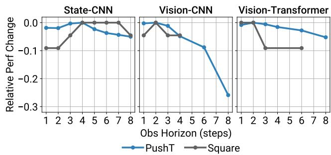  

图 14. 观测视野消融研究。基于状态的扩散策略（State-based Diffusion Policy）对观测视野不敏感。基于视觉的扩散策略（Vision-based Diffusion Policy）偏好较小但大于 1 的观测视野，其中 2 是大多数任务的一个良好折中。

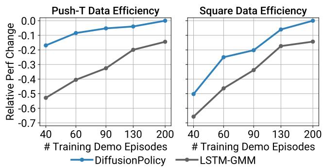  

图 15. 数据效率消融实验。Diffusion Policy 在每种训练数据集规模下均优于 LSTM-GMM Mandlekar et al. (2021)。

在仿真基准测试中，我们使用了 iDDPM 算法 Nichol and Dhariwal (2021)，在训练和推理时均采用相同的 100 次去噪扩散迭代。我们在真实世界基准测试上使用了 DDIM Song et al. (2021)，将推理时的去噪迭代次数减少到 16，从而降低推理时延。

我们对所有基于状态的实验使用 256 的批大小，对所有基于图像的实验使用 64 的批大小。在学习率调度方面，我们采用带线性预热的余弦调度。基于 CNN 的 Diffusion Policy 预热 500 步，而基于 Transformer 的 Diffusion Policy 预热 1000 步。

## A.5 数据效率

我们发现 Diffusion Policy 在每个训练数据集规模下均优于 LSTM-GMM Mandlekar et al. (2021)，如图 15 所示。

## B 额外消融实验结果

## B.1 观测视野

我们发现基于状态的 Diffusion Policy 对观测视野不敏感，如图 14 所示。然而，基于视觉的 Diffusion Policy，尤其是采用 CNN 主干网络的变体，其性能会随着观测视野的增大而下降。在实践中，我们发现对于基于状态和基于图像的观测任务，观测视野取 2 对大多数任务都效果良好。

<table><tr><td>H-Param</td><td>Ctrl</td><td>To</td><td>Ta</td><td>Tp</td><td>ImgRes</td><td>CropRes</td><td>#D-Params</td><td>#V-Params</td><td>Lr</td><td>WDecay</td><td>D-Iters Train</td><td>D-Iters Eval</td></tr><tr><td>Lift</td><td>Pos</td><td>2</td><td>8</td><td>16</td><td>2x84x84</td><td>2x76x76</td><td>256</td><td>22</td><td>1e-4</td><td>1e-6</td><td>100</td><td>100</td></tr><tr><td>Can</td><td>Pos</td><td>2</td><td>8</td><td>16</td><td>2x84x84</td><td>2x76x76</td><td>256</td><td>22</td><td>1e-4</td><td>1e-6</td><td>100</td><td>100</td></tr><tr><td>Square</td><td>Pos</td><td>2</td><td>8</td><td>16</td><td>2x84x84</td><td>2x76x76</td><td>256</td><td>22</td><td>1e-4</td><td>1e-6</td><td>100</td><td>100</td></tr><tr><td>Transport</td><td>Pos</td><td>2</td><td>8</td><td>16</td><td>4x84x85</td><td>4x76x76</td><td>264</td><td>45</td><td>1e-4</td><td>1e-6</td><td>100</td><td>100</td></tr><tr><td>ToolHang</td><td>Pos</td><td>2</td><td>8</td><td>16</td><td>2x240x240</td><td>2x216x216</td><td>256</td><td>22</td><td>1e-4</td><td>1e-6</td><td>100</td><td>100</td></tr><tr><td>Push-T</td><td>Pos</td><td>2</td><td>8</td><td>16</td><td>1x96x96</td><td>1x84x84</td><td>256</td><td>22</td><td>1e-4</td><td>1e-6</td><td>100</td><td>100</td></tr><tr><td>Block Push</td><td>Pos</td><td>3</td><td>1</td><td>12</td><td>N/A</td><td>N/A</td><td>256</td><td>0</td><td>1e-4</td><td>1e-6</td><td>100</td><td>100</td></tr><tr><td>Kitchen</td><td>Pos</td><td>2</td><td>8</td><td>16</td><td>N/A</td><td>N/A</td><td>256</td><td>0</td><td>1e-4</td><td>1e-6</td><td>100</td><td>100</td></tr><tr><td>Real Push-T</td><td>Pos</td><td>2</td><td>6</td><td>16</td><td>2x320x240</td><td>2x288x216</td><td>67</td><td>22</td><td>1e-4</td><td>1e-6</td><td>100</td><td>16</td></tr><tr><td>Real Pour</td><td>Pos</td><td>2</td><td>8</td><td>16</td><td>2x320x240</td><td>2x288x216</td><td>67</td><td>22</td><td>1e-4</td><td>1e-6</td><td>100</td><td>16</td></tr><tr><td>Real Spread</td><td>Pos</td><td>2</td><td>8</td><td>16</td><td>2x320x240</td><td>2x288x216</td><td>67</td><td>22</td><td>1e-4</td><td>1e-6</td><td>100</td><td>16</td></tr><tr><td>Real Mug Flip</td><td>Pos</td><td>2</td><td>8</td><td>16</td><td>2x320x240</td><td>2x288x216</td><td>67</td><td>22</td><td>1e-4</td><td>1e-6</td><td>100</td><td>16</td></tr></table>

表7. 基于CNN的扩散策略超参数

Ctrl：位置控制或速度控制

To：观测视野（observation horizon）

Ta：动作视野（action horizon）

Tp：动作预测视野（action prediction horizon）

ImgRes：环境观测分辨率（相机视角数 × 宽 × 高）（Camera views × W × H）

CropRes：随机裁剪分辨率

#D-Params：扩散网络参数量（以百万为单位）

#V-Params：视觉编码器参数量（以百万为单位）

Lr：学习率（learning rate）

WDecay：权重衰减（weight decay）

D-Iters Train：训练阶段扩散迭代次数

D-Iters Eval：推理阶段扩散迭代次数（由 DDIM Song 等人（2021）启用）

<table><tr><td>H-Param</td><td>Ctrl</td><td>To</td><td>Ta</td><td>Tp</td><td>#D-params</td><td>#V-params</td><td>#Layers</td><td>Emb Dim</td><td>Attn Drp</td><td>Lr</td><td>WDecay</td><td>D-Iters Train</td><td>D-Iters Eval</td></tr><tr><td>Lift</td><td>Pos</td><td>2</td><td>8</td><td>10</td><td>9</td><td>22</td><td>8</td><td>256</td><td>0.3</td><td>1e-4</td><td>1e-3</td><td>100</td><td>100</td></tr><tr><td>Can</td><td>Pos</td><td>2</td><td>8</td><td>10</td><td>9</td><td>22</td><td>8</td><td>256</td><td>0.3</td><td>1e-4</td><td>1e-3</td><td>100</td><td>100</td></tr><tr><td>Square</td><td>Pos</td><td>2</td><td>8</td><td>10</td><td>9</td><td>22</td><td>8</td><td>256</td><td>0.3</td><td>1e-4</td><td>1e-3</td><td>100</td><td>100</td></tr><tr><td>Transport</td><td>Pos</td><td>2</td><td>8</td><td>10</td><td>9</td><td>45</td><td>8</td><td>256</td><td>0.3</td><td>1e-4</td><td>1e-3</td><td>100</td><td>100</td></tr><tr><td>ToolHang</td><td>Pos</td><td>2</td><td>8</td><td>10</td><td>9</td><td>22</td><td>8</td><td>256</td><td>0.3</td><td>1e-4</td><td>1e-3</td><td>100</td><td>100</td></tr><tr><td>Push-T</td><td>Pos</td><td>2</td><td>8</td><td>16</td><td>9</td><td>22</td><td>8</td><td>256</td><td>0.01</td><td>1e-4</td><td>1e-1</td><td>100</td><td>100</td></tr><tr><td>Block Push</td><td>Vel</td><td>3</td><td>1</td><td>5</td><td>9</td><td>0</td><td>8</td><td>256</td><td>0.3</td><td>1e-4</td><td>1e-3</td><td>100</td><td>100</td></tr><tr><td>Kitchen</td><td>Pos</td><td>4</td><td>8</td><td>16</td><td>80</td><td>0</td><td>8</td><td>768</td><td>0.1</td><td>1e-4</td><td>1e-3</td><td>100</td><td>100</td></tr><tr><td>Real Push-T</td><td>Pos</td><td>2</td><td>6</td><td>16</td><td>80</td><td>22</td><td>8</td><td>768</td><td>0.3</td><td>1e-4</td><td>1e-3</td><td>100</td><td>16</td></tr></table>

Table 8. 基于 Transformer 的扩散策略（Diffusion Policy）超参数
Ctrl: 控制器（position or velocity control，位置或速度控制）
To: 观测时域（observation horizon）
Ta: 动作时域（action horizon）
Tp: 动作预测时域（action prediction horizon）
#D-Params: 扩散网络参数数量（单位：百万）（diffusion network number of parameters in millions）
#V-Params: 视觉编码器参数数量（单位：百万）（vision encoder number of parameters in millions）
Emb Dim: Transformer token 嵌入维度
Attn Drp: Transformer 注意力 dropout 概率
Lr: 学习率（learning rate）
WDecay: 权重衰减（仅作用于 Transformer）（weight decay (for transformer only)）
D-Iters Train: 训练时扩散迭代次数
D-Iters Eval: 推理时扩散迭代次数（由 DDIM（Song 等人, 2021）启用）

## B.2 性能提升计算

针对 Tab. 1、Tab. 2 和 Tab. 4 中报告的每个任务 i（即每列，忽略 mh 结果），我们分别找出基线方法的最大性能 max baseline 与 Diffusion Policy 变体（CNN 与 Transformer）的最大性能 max ours。对于每个任务，性能提升按 improvement = (max ours_i − max baseline_i) 计算（对所有任务均为正值）。最后，平均提升按 avg improvement = 计算。

## C 真实环境任务细节

## C.1 Push-T

C.1.1 示教数据 共采集 136 条示教数据用于训练。初始条件通过随机推动或抛掷 T 形积木至桌面来加以变化。在本次数据采集之前，操作员已针对该任务练习了多个小时，应当视为熟练掌握该任务。

C.1.2 评估 我们对每种方法使用固定的 12 小时训练时长，并选取各自最后一个检查点；唯一例外是 IBC（Implicit Behavioral Cloning），由于其训练稳定性问题，我们选取训练集动作预测 MSE 误差最小的检查点。IBC 在训练与检查点选择方面的难度已在正文 Fig. 7 中展示。每种方法评估 20 个回合，所有回合均从同一组初始条件出发。为保证初始条件的一致性，我们依据俯视相机的叠加图像，仔细调整 T 形积木和机器人的位姿。每个评估回合在以下任一条件下终止：末端执行器停留在目标区域内超过 0.5 秒，或达到 60 秒时间上限。IoU 指标直接在俯视相机像素空间中计算。

## C.2 酱料倾倒与涂抹

C.2.1 示教数据 共采集 50 条示教数据，每个任务使用其中 90% 用于训练。对于倾倒任务，比萨面团和酱料碗的初始位置有所不同。每次示教完成后，酱料会被倒回碗中，面团被擦拭干净。对于涂抹任务，比萨面团的位置以及已倾倒酱料的形状会有所变化。重置时，我们手动将酱料向面团中心聚拢，并擦净面团其余部分。在涂抹和酱料转移过程中，遥操作指令的旋转分量被丢弃，以避免意外舀起或洒出酱料。

C.2.2 评估

Diffusion Policy 和 LSTM-GMM 都训练了 1000 个 epoch。评估时使用最后一个 checkpoint。

每种方法都从同一组随机初始条件进行评估，其中 pizza 面团和酱料碗的位置会有所变化。我们使用与 Push-T 类似的方式来设置初始条件。我们不会试图匹配倾倒酱料的初始形状来进行涂抹，而是确保所有实验中酱料的用量固定。

评估回合通过将勺子向上移动（远离面团）0.5 秒来终止，或者当操作员认为该策略的行为不安全时终止。

覆盖率指标的计算方法是：首先通过单应性变换将左、右两个相机的 RGB 图像投影到桌面空间，然后在每个投影图像中计算覆盖率。报告左、右相机之间的最大覆盖率。

## D 真实环境设置详情

D.0.1 UR5 机器人工作台

Push-T 任务的实验在 UR5 机器人工作台上进行。

UR5 机器人以 125Hz 的频率接受末端执行器空间位置命令，该命令由 10Hz 的人类示教或策略命令进行线性插值生成。插值控制器将末端执行器速度限制在 0.43 m/s 以下，并出于安全考虑将其位置限制在桌面上方 1cm 的区域内。位置控制策略直接预测期望的末端执行器位姿，而速度控制策略则预测当前位姿设定点与上一设定点之间的差值。

UR5 机器人工作台配备了 5 个 Intel RealSense D415 深度相机，以 30fps 的帧率录制 720p 的 RGB 视频。其中仅有 2 个相机用于策略观测，观测图像下采样至 320×240 分辨率，帧率为 10fps。

在示教过程中，操作员通过 3Dconnexion SpaceMouse 以 10Hz 的频率对机器人进行遥控操作。

## D.1 Franka 机器人工作台

Sauce Pouring and Spreading、Bimanual Egg Beater、Bimanual Mat Unrolling 和 Bimanual Shirt Folding 等任务的实验在 Franka 机器人工作台上进行。

对于非触觉控制，我们实现了一个自定义的中层控制器，用于根据学习策略给出的期望末端执行器位姿生成期望关节位置。在每个时间步，我们求解一个微分运动学问题（建模为一个二次规划（Quadratic Program）），以计算跟踪期望末端执行器速度所需的期望关节速度。得到的关节速度通过欧拉积分转换为关节位置，并由机器人上的关节级控制器进行跟踪。该公式允许我们施加约束，例如两条机械臂与桌子之间的碰撞避免、末端执行器的安全区域以及关节限位。它还支持在末端执行器命令的零空间中调节冗余自由度。这个中层控制器在硬件部署过程中对于保护学习策略尤为有价值。

对于触觉远程操作控制，实现了另一个定制的中间层控制器，但其被构建为纯力矩控制器。该控制器采用 Khatib（1987）的操作空间控制（Operational Space Control），以二次规划（Quadratic Program）的形式在 200 Hz 下运行，其中位置、速度和力矩限制作为约束被加入，而主要的空间目标和次要零空间姿态目标则被设定为代价函数。结合一个良好的 Franka Panda 机械臂模型（含反射转子惯量），我们能够仅通过纯空间反馈实现良好的跟踪性能，而通过前馈空间加速度则可获得更好的跟踪效果。该控制模式尚未启用碰撞避免功能。

  

Figure 16. 垫子展开（Mat Unrolling）的初始状态
Figure 17. 垫子展开（Mat Unrolling）的最终状态

注意，在推理时，我们使用非触觉控制器。未来的工作打算简化该控制策略，并针对我们既定的目标仅使用单一控制器。

操作员使用 SpaceMouse 或 VR 控制器等输入设备来控制机器人的末端执行器（end effector），夹爪则由相应设备上的扳机按键控制。遥操作和学习策略的运行频率为 10 Hz，中层控制器（mid-level controller）的运行频率约为 1 kHz。期望的末端执行器位姿指令由中层控制器进行插值。该工位配备 2 台 Realsense D415 RGBD 相机，以 30 fps 的帧率传输 VGA RGB 图像，并下采样至 320×240 后以 10 fps 作为学习策略的输入。

## D.2 双手操作任务的初始状态与终止状态

下图展示了四个双手操作任务的初始状态与终止状态。绿色和红色方框分别表示成功与失败的执行轨迹（rollout）。由于垫子和衬衫是非常扁平的物体，我们使用了单应性投影（homographic projection）以更清晰地可视化初始状态与终止状态。

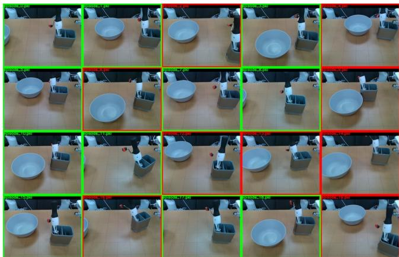

  

图 18. Egg Beater 的初始状态
图 19. Egg Beater 的最终状态

  

图 20. 衬衫折叠（Shirt Folding）的初始状态

图 21. 衬衫折叠（Shirt Folding）的最终状态