# 精通多样领域：基于世界模型

Danijar Hafner,$^{12}$ Jurgis Pasukonis,$^{1}$ Jimmy Ba,$^{2}$ Timothy Lillicrap$^{1}$

## 摘要

开发一种能在广泛的应用领域中学习解决任务的通用算法，一直是人工智能领域的一项根本性挑战。尽管现有的强化学习算法可以很容易地应用于与它们开发时所针对的任务相似的任务，但要将它们配置到新的应用领域仍需要大量的人类专业知识和实验。我们提出了 DreamerV3，这是一种通用算法，使用单一配置即可在超过 150 个多样化任务上超越专用方法。Dreamer 学习环境的一个模型，并通过想象未来场景来改进其行为。基于归一化、平衡和变换的鲁棒性技术使得跨领域的稳定学习成为可能。开箱即用地应用，Dreamer 是首个无需人工数据或课程学习就能从零开始在 Minecraft（《我的世界》）中收集钻石的算法。这一成就被视为人工智能领域的一项重大挑战，它要求在开放世界中从像素和稀疏奖励出发，探索具有远见的策略。我们的工作使得无需大量实验就能解决具有挑战性的控制问题成为可能，从而让强化学习得到广泛的应用。

  

请问您想让我做什么？看起来这条消息只是一声「嗯」或者只是一个字母。我需要更多信息才能帮到您：

- 如果您想让我**翻译一篇英文论文**，请把整篇 Markdown 原文贴过来。
- 如果您想让我**校对、润色、解释**某段文字，也请一起附上。
- 如果只是误发，请直接说明。

请把需要处理的内容发给我。

  

调优专家

  

统一配置

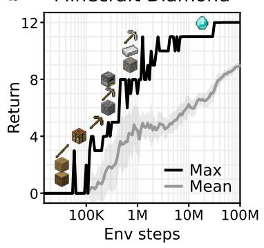  

图 1：基准测试总结。a，在所有领域使用固定超参数的情况下，Dreamer 在广泛的基准测试与数据预算范围内均优于经过调优的专家算法。Dreamer 还大幅优于广泛适用的 PPO 算法的高质量实现。b，开箱即用，Dreamer 能够在仅给定稀疏奖励的情况下从零开始学习在热门电子游戏 Minecraft 中获取钻石——这是人工智能领域中一项长期存在的挑战，以往方法需要借助人类数据或领域专属的启发式策略才能完成。

  

(a) Control Suite（控制套件）

  

(b) Atari

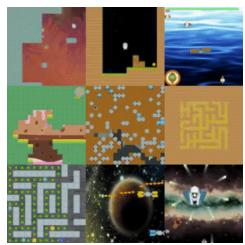  

(c) ProcGen

  

(d) DMLab

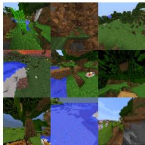  

(e) Minecraft  
图 2：实验中使用的多样化视觉领域。Dreamer 在这些领域上均取得了成功，涵盖了机器人运动与操控任务、Atari 游戏、程序化生成的 ProcGen 关卡、需要空间与时间推理的 DMLab 任务，以及 Minecraft 这类复杂且开放的世界。我们同样在非视觉领域上对 Dreamer 进行了评估。

强化学习通过交互使计算机能够解决各种任务，例如在围棋（Go）和 Dota 游戏中超越人类水平 $^{1,2}$。它也是将大语言模型的能力提升至超越其预训练数据所展示范围的关键组成部分 $^{3,4}$。尽管 PPO $^{5}$ 已成为强化学习领域的标准算法，但人们通常会采用更为专门的算法以获得更高的性能。这些专门算法针对不同应用领域所带来的独特挑战，例如连续控制 $^{6}$、离散动作 $^{7,8}$、稀疏奖励 $^{9}$、图像输入 $^{10}$、空间环境 $^{11}$ 以及棋类游戏 $^{12}$。

然而，将强化学习算法应用于全新的任务——例如从电子游戏转向机器人任务——需要耗费大量的精力、专业知识和计算资源来调整算法的超参数 $^{13}$。这种脆弱性构成了将强化学习应用于新问题的瓶颈，也限制了强化学习在计算成本高昂的模型或无法承受调参代价的任务上的适用性。创造一种无需重新配置即可学习并掌握新领域的通用算法，一直是人工智能研究中的核心挑战，并将把强化学习推广到广泛的实际应用之中。

我们提出了 Dreamer——一种在广泛领域中、使用固定超参数即可超越各类专门专家算法的通用方法，使强化学习能够便捷地应用于新问题。该算法的核心思想是学习一个世界模型（world model），从而为智能体赋予丰富的感知能力以及想象未来的能力 $^{14,15,16}$。世界模型预测潜在动作的结果，一个评论家（critic）神经网络评估每个结果的价值，一个演员（actor）神经网络选择动作以达成最佳结果。尽管这一思路在直觉上颇具吸引力，但稳健地学习并利用世界模型以实现强大的任务表现一直是一个悬而未决的问题 $^{17}$。Dreamer 通过一系列基于归一化、平衡与变换的鲁棒性技术克服了这一挑战。我们不仅在图 2 所总结的领域中跨越 150 多个任务上观察到了稳健的学习表现，而且在不同模型规模与训练预算下也同样稳健，提供了一种可预测的性能提升方式。值得注意的是，更大的模型规模不仅能够取得更高的分数，而且完成任务所需的交互也更少。

为了推动强化学习的边界，我们考虑了热门电子游戏《Minecraft》（Minecraft），近年来它已成为研究的焦点18,19,20，国际竞赛致力于开发能自主学习在《Minecraft》中收集钻石的算法\*。由于该开放世界游戏中奖励稀疏、探索困难、时间跨度长以及过程多样性18，在不使用人类数据的情况下解决此问题已被广泛认为是人工智能领域的一项重大挑战。由于这些障碍，先前的方法不得不求助于使用人类专家数据和领域特定的课程学习19,20。Dreamer 即开即用，是首个从零开始在《Minecraft》中收集钻石的算法。

  

(a) 世界模型学习

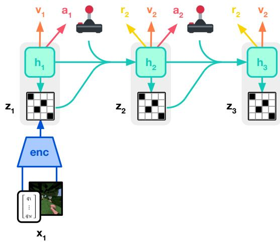  

(b) Actor-Critic 学习（Actor Critic Learning）

图 3：Dreamer 的训练过程。世界模型（world model）将感知输入编码为离散表征 $z_{t}$，该表征由一个具有循环状态 $h_{t}$ 的序列模型在给定动作 $a_{t}$ 的条件下预测得到。模型通过对输入进行重建来塑造表征。执行器（actor）与评论器（critic）分别预测动作 $a_{t}$ 和价值 $v_{t}$，并从世界模型所预测的抽象表征轨迹中学习。

## 学习算法

我们提出 Dreamer 算法的第三代 $^{21,22}$。该算法由三个神经网络组成：世界模型预测潜在动作的结果，评论家（critic）评估每个结果的价值，演员（actor）选择动作以达到最有价值的结果。这些组件在智能体与环境交互的同时从重放经验中进行并行训练。为了跨多个领域取得成功，所有三个组件都需要适应不同的信号幅度，并稳健地平衡其目标函数中的各项。这是具有挑战性的，因为我们的目标不仅是同一领域内的类似任务，还要使用固定超参数跨多个不同领域进行学习。本节将介绍世界模型、评论家和演员以及它们稳健的损失函数，以及用于稳健预测未知数量级量值的工具。

## 世界模型学习

世界模型通过自编码（autoencoding） $^{23}$ 学习感官输入的紧凑表示，并通过预测未来表示和潜在动作的奖励来实现规划。我们将世界模型实现为循环状态空间模型（Recurrent State-Space Model，RSSM） $^{24}$，如图 3 所示。首先，编码器将感官输入 $x_{t}$ 映射到随机表示 $z_{t}$。然后，具有循环状态 $h_{t}$ 的序列模型在给定过去动作 $a_{t-1}$ 的情况下预测这些表示的序列。$h_{t}$ 和 $z_{t}$ 的拼接构成模型状态，从中我们预测奖励 $r_{t}$ 和回合延续标志 $c_{t} \in \{0, 1\}$，并重建输入以确保表示的信息量：

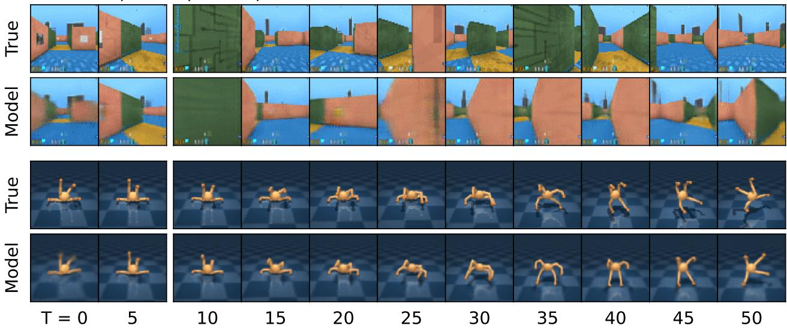  

上下文输入 开环预测

图 4：DMLab 迷宫（顶部）和四足机器人（底部）的多步视频预测。给定 5 张上下文图像和完整的动作序列，模型在无法访问中间图像的情况下预测未来 45 帧。世界模型学习理解每个环境的基本结构。

$$
\text { RSSM } \left\{ \begin{array}{l l} & \text { Sequence   model: } \\ & \text { Encoder: } \\ & \text { Dynamics   predictor: } \\ & \text { Reward   predictor: } \\ & \text { Continue   predictor: } \\ & \text { Decoder: } \end{array} \right.
$$

$$
\begin{array}{r l} & h _ {t} = f _ {\phi} (h _ {t - 1}, z _ {t - 1}, a _ {t - 1}) \\ & z _ {t} \sim q _ {\phi} (z _ {t} \mid h _ {t}, x _ {t}) \\ & \hat {z} _ {t} \sim p _ {\phi} (\hat {z} _ {t} \mid h _ {t}) \\ & \hat {r} _ {t} \sim p _ {\phi} (\hat {r} _ {t} \mid h _ {t}, z _ {t}) \\ & \hat {c} _ {t} \sim p _ {\phi} (\hat {c} _ {t} \mid h _ {t}, z _ {t}) \\ & \hat {x} _ {t} \sim p _ {\phi} (\hat {x} _ {t} \mid h _ {t}, z _ {t}) \end{array}\tag{1}
$$

图 4 可视化了世界模型对长时段视频的预测结果。编码器和解码器对图像输入使用卷积神经网络（Convolutional Neural Networks, CNN），对向量输入使用多层感知机（Multi-Layer Perceptrons, MLP）。动力学、奖励和延续性预测器同样是 MLP。表征从一个 softmax 分布构成的向量中采样，并且我们对该采样步骤采用直通梯度（straight-through gradients）估计 $^{25,22}$。给定一个序列批次的输入 $x_{1:T}$、动作 $a_{1:T}$、奖励 $r_{1:T}$ 和延续标志 $c_{1:T}$，世界模型参数 $\phi$ 通过端到端优化，以同时最小化预测损失 $L_{pred}$、动力学损失 $L_{dyn}$ 与表征损失 $L_{rep}$，相应的损失权重分别为 $\beta_{pred} = 1$、$\beta_{dyn} = 1$ 和 $\beta_{rep} = 0.1$：

$$
\mathcal {L} (\phi) \doteq \mathrm{E} _ {q _ {\phi}} \left[ \sum_ {t = 1} ^ {T} (\beta_ {\mathrm{pred}} \mathcal {L} _ {\mathrm{pred}} (\phi) + \beta_ {\mathrm{dyn}} \mathcal {L} _ {\mathrm{dyn}} (\phi) + \beta_ {\mathrm{rep}} \mathcal {L} _ {\mathrm{rep}} (\phi)) \right].\tag{2}
$$

预测损失通过下文所述的 symlog 平方损失训练解码器与奖励预测器，并通过逻辑回归训练继续预测器。动力学损失通过最小化预测器 $p_{\phi}(z_{t} \mid h_{t})$ 与下一随机表示 $q_{\phi}(z_{t} \mid h_{t}, x_{t})$ 之间的 KL 散度，训练序列模型预测下一表示。而表示损失则进一步训练表示以提升其可预测性，使我们能够在想象训练期间采用因子化动力学预测器实现快速采样。两种损失的区别在于 stop-gradient 算子 $\mathrm{sg}(\cdot)$ 的使用以及损失尺度不同。为避免出现动力学易于预测却不包含足够输入信息的退化解，我们采用 free bits $^{26}$，将动力学损失和表示损失裁剪至 1 nat $\approx$ 1.44 bits 以下。这样在两者已得到充分优化时会将其禁用，从而将学习聚焦到预测损失上：

$$
\begin{array}{r l} & {\mathcal {L} _ {\mathrm{pred}} (\phi) \doteq - \ln p _ {\phi} (x _ {t} \mid z _ {t}, h _ {t}) - \ln p _ {\phi} (r _ {t} \mid z _ {t}, h _ {t}) - \ln p _ {\phi} (c _ {t} \mid z _ {t}, h _ {t})} \\ & {\mathcal {L} _ {\mathrm{dyn}} (\phi) \doteq \max \bigl (1, \mathrm{KL} \bigl [ \operatorname{sg} (q _ {\phi} (z _ {t} \mid h _ {t}, x _ {t})) \big | \big | \quad p _ {\phi} (z _ {t} \mid h _ {t}) \bigr ] \bigr)} \\ & {\mathcal {L} _ {\mathrm{rep}} (\phi) \doteq \max \bigl (1, \mathrm{KL} \bigl [ \quad q _ {\phi} (z _ {t} \mid h _ {t}, x _ {t}) \big | \big | \operatorname{sg} (p _ {\phi} (z _ {t} \mid h _ {t})) \bigr ] \bigr)} \end{array}\tag{3}
$$

之前的世界模型需要根据环境的视觉复杂度对表征损失进行不同程度的缩放 $^{21}$。复杂的 3D 环境包含对控制无必要的细节，因此需要更强的正则化器来简化表征，使其更易于预测。在具有静态背景且单个像素可能对任务至关重要的游戏中，则需要较弱的正则化器以提取精细的细节。我们发现将 free bits 与较小的表征损失相结合可以解决这一困境，从而允许跨领域使用固定的超参数。此外，我们使用稍后描述的 symlog 函数对向量观测进行变换，以防止出现大输入和大的重建梯度，进一步稳定与表征损失之间的权衡。

我们在早期实验中偶尔观察到 KL 损失的尖峰，这与深度变分自编码器的相关报告相符 $^{27}$。为避免这一问题，我们将编码器和动力学预测器的分类分布参数化为 1% 均匀分布与 1% 神经网络输出的混合，使其不可能变得确定性的，从而确保 KL 损失表现良好。更多的模型细节和超参数包含在补充材料中。

## 评论器学习

评论器学习的参与者（actor）和评论器（critic）神经网络纯粹从世界模型预测的抽象轨迹表征中学习 $^{14}$。在与环境交互时，我们通过对参与者网络进行采样来选择动作，而不进行 lookahead planning。参与者和评论器作用于模型状态 $s_{t} \doteq \{h_{t}, z_{t}\}$，因此受益于循环世界模型所学到的马尔可夫表征。参与者旨在最大化回报 $R_{t} \doteq \sum_{\tau=0}^{\infty} \gamma^{\tau} r_{t+\tau}$，其中每个模型状态的折扣因子 $\gamma = 0.997$。为了考虑超出预测 horizon T = 16 的奖励，评论器学习近似每个状态在当前演员行为下的回报分布 $^{28}$：

$$
\text { Actor: } \quad a _ {t} \sim \pi_ {\theta} (a _ {t} \mid s _ {t}) \qquad \text { Critic: } \quad v _ {\psi} (R _ {t} \mid s _ {t})\tag{4}
$$

从回放输入的表征出发，世界模型和动作器生成一条由想象模型状态 $s_{1:T}$、动作 $a_{1:T}$、奖励 $r_{1:T}$ 以及持续标志 $c_{1:T}$ 组成的轨迹。由于评论器预测的是一个分布，我们将其预测值 $v_{t} \doteq \mathrm{E}[v_{\psi}(\cdot \mid s_{t})]$ 读取为该分布的期望。为了估计那些能够考虑预测视野之外奖励的回报，我们计算自助式 $\lambda$-回报 $^{29}$，它将预测的奖励与价值整合在一起。评论器通过最大似然损失来学习预测回报估计 $R_{t}^{\lambda}$ 的分布：

$$
\mathcal {L} (\psi) \doteq - \sum_ {t = 1} ^ {T} \ln p _ {\psi} (R _ {t} ^ {\lambda} \mid s _ {t}) R _ {t} ^ {\lambda} \doteq r _ {t} + \gamma c _ {t} \Big ((1 - \lambda) v _ {t} + \lambda R _ {t + 1} ^ {\lambda} \Big) R _ {T} ^ {\lambda} \doteq v _ {T}\tag{5}
$$

虽然一个简单的选择是将评论器（critic）参数化为正态分布，但回报分布可能具有多个模态，并且在不同环境中可能跨数量级变化。为了在这些条件下稳定并加速学习，我们将评论器参数化为具有指数间隔箱体的类别分布（categorical distribution），从而将梯度规模与预测目标解耦，如后文所述。为了在奖励难以预测的环境中改进价值预测，我们将评论器损失同时应用于想象轨迹（损失尺度 $\beta_{val} = 1$）和从回放缓冲区（replay buffer）采样的轨迹（损失尺度 $\beta_{repval} = 0.3$）。评论器回放损失使用想象回放在起始状态处的想象回报 $R_{t}^{\lambda}$ 作为回放轨迹的同策略价值标注，然后在回放奖励上计算 $\lambda$-回报。

由于评论器回归的目标依赖于其自身的预测，我们通过将评论器正则化以预测其自身参数的指数移动平均的输出来稳定学习。这与先前在强化学习中使用的目标网络（target networks） $^{7}$ 类似，但允许我们使用当前评论器网络来计算回报。我们进一步注意到，在训练开始时随机初始化的奖励预测器和评论器网络可能导致较大的预测奖励，从而延迟学习的启动。因此，我们将奖励预测器和评论器的输出权重矩阵初始化为零，这缓解了该问题并加速了早期学习。

## 行动器学习

行动器（actor）学习通过熵正则化器（entropy regularizer） $^{30}$ 选择能够最大化回报的动作，同时进行探索。然而，该正则化器的合适尺度取决于环境中奖励的规模和频率。理想情况下，我们希望智能体在奖励稀疏时进行更多探索，而在奖励密集或临近时进行更多利用。同时，探索量不应受环境中奖励任意缩放的影响。这需要在保留关于奖励频率信息的同时对回报尺度进行归一化。

为了在各个领域中使用固定的熵尺度 $\eta = 3 \times 10^{-4}$，我们将回报归一化到大致包含在区间 [0, 1] 内。在实践中，从回报中减去一个偏移量并不会改变行动器梯度，因此除以范围 S 就足够了。此外，为了避免在稀疏奖励下放大函数逼近带来的噪声，我们仅缩小较大的回报量级，但保留阈值 L = 1 以下的较小回报不变。我们对离散动作和连续动作都使用 REINFORCE 估计器 $^{31}$，由此得到如下代理损失函数：

$$
\mathcal {L} (\theta) \doteq - \sum_ {t = 1} ^ {T} \mathrm{sg} \left(\left(R _ {t} ^ {\lambda} - v _ {\psi} (s _ {t})\right) / \max (1, S)\right) \log \pi_ {\theta} \left(a _ {t} \mid s _ {t}\right) + \eta \mathrm{H} \left[ \pi_ {\theta} \left(a _ {t} \mid s _ {t}\right) \right]\tag{6}
$$

回报分布可能是多模态的，并且会包含离群值，特别是在随机化环境中，某些回合能够达到比其他回合更高的回报。此时若按观测到的最小和最大回报进行归一化，会过度压缩回报的尺度，并可能导致次优收敛。为了对这些离群值具有鲁棒性，我们基于回报批次中第 $5^{th}$ 到第 $95^{th}$ 百分位的回报来计算范围，并使用指数移动平均对该估计进行平滑：

$$
S \doteq \operatorname{EMA} \left(\operatorname{Per} \left(R _ {t} ^ {\lambda}, 9 5\right) - \operatorname{Per} \left(R _ {t} ^ {\lambda}, 5\right), 0. 9 9\right)\tag{7}
$$

之前的工作通常对优势（advantages）进行归一化5，而非对回报（returns）进行归一化。这会在最大化回报与熵之间施加固定的强调权重，而不论奖励是否可达。在奖励稀疏的情况下放大优势（advantages）可能会放大噪声，使其超过熵正则项，从而导致探索停滞。按标准差对奖励或回报进行归一化在稀疏奖励下会失效，因为此时其标准差接近零，会大幅放大任意大小的奖励。约束优化方法32,33以跨状态平均的固定熵为目标，无论可达回报如何，这虽然稳健，但在稀疏奖励下探索缓慢，且在密集奖励下收敛值更低。我们没有为这些方法找到在不同领域都稳定的超参数。带分母限制的回报归一化方法克服了这些挑战，在稀疏奖励下能够快速探索，并在不同领域都能收敛到高性能。

## 鲁棒预测

重建输入并预测奖励与回报可能具有挑战性，因为这些量的尺度在不同领域间会有所变化。使用平方损失预测大目标会导致发散，而绝对值损失与 Huber 损失7则会使学习停滞。另一方面，基于运行统计量对目标进行归一化5会在优化中引入非平稳性。我们建议将 symlog 平方误差作为解决这一难题的简单方法。对于该方法，一个输入为 x、参数为 $\theta$ 的神经网络 $f(x,\theta)$ 学习预测其目标 y 的一个变换版本。为了从网络读出预测值 $\hat{y}$，我们应用逆变换：

$$
\mathcal {L} (\theta) \doteq \frac {1}{2} \big (f (x, \theta) - \mathrm{symlog} (y) \big) ^ {2} \quad \hat {y} \doteq \mathrm{symexp} \big (f (x, \theta) \big)\tag{8}
$$

使用对数作为变换函数无法预测取负值的目标。因此，我们从双对称对数族（bi-symmetric logarithmic family）$^{34}$ 中选取一个函数，命名为 symlog 作为变换函数，其逆函数为 symexp：

$$
\operatorname{symlog} (x) \doteq \operatorname{sign} (x) \ln \bigl (| x | + 1 \bigr) \quad \operatorname{symexp} (x) \doteq \operatorname{sign} (x) \bigl (\exp (| x |) - 1 \bigr)\tag{9}
$$

symlog 函数同时压缩大正数值和大负数值的幅度。与对数函数不同，它在原点附近对称，同时保留输入的符号。这使得优化过程能够在需要时迅速将网络预测推向较大数值。symlog 函数在原点附近近似于恒等映射，因此不会影响对已经足够小的目标的学习。

对于可能具有随机性的目标，例如奖励或回报，我们引入了 symexp twohot 损失。这里，网络输出在指数间隔的分箱 $b_{i} \in B$ 上 softmax 分布的对数值（logits）。预测值通过对各分箱位置按其预测概率加权平均得到。重要的是，由于加权平均可以落在分桶之间，因此网络可以输出该区间内的任意连续值：

$$
\hat {y} \doteq \operatorname{softmax} (f (x)) ^ {T} B \quad B \doteq \operatorname{symexp} (\left[ - 2 0 \dots + 2 0 \right])\tag{10}
$$

网络在双热（twohot）编码的目标上进行训练$^{8,28}$，这是独热（onehot）编码向连续值的一种推广。一个标量的双热编码是一个长度为 $|B|$ 的向量，其中除了在距离编码标量最近的两个 bin 的索引 k 和 $k + 1$ 处之外，其余所有位置均为 0。这两个位置的值之和为 1，并且距离编码连续值更近的 bin 被赋予更高的线性权重。然后通过网络最小化针对软目标的分类交叉熵损失来完成训练。需要注意的是，损失仅取决于分配给各个 bin 的概率，而不取决于与 bin 位置相关联的连续值，因此将梯度的大小与目标的大小解耦开来：

$$
\mathcal {L} (\theta) \doteq - \mathrm{twohot} (y) ^ {T} \log \mathrm{softmax} (f (x, \theta))\tag{11}
$$

基于这些原理，Dreamer 使用 symlog 函数对向量观测进行变换，无论编码器输入还是解码器目标都采用这一处理，并使用 synexp twohot 损失用于奖励预测器和评论家（critic）。我们发现这些技术能够在众多不同领域中实现稳健且快速的学习。对于评论家学习，曾有研究提出过一种替代性的非对称变换 [35]，但我们发现该方法在各领域上的平均效果较差。与其他替代方案不同，symlog 变换能够避免截断大目标值 [7]、引入由归一化导致的非平稳性 [5]，以及在检测到新的极值时调整网络权重 [36] 的问题。

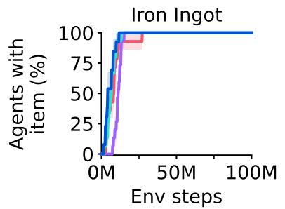

  

图 5：在 Minecraft Diamond 任务中，成功发现三个末端物品中每一项的已训练智能体所占比例。尽管此前的算法最多只能推进到铁镐（iron pickaxe）阶段，Dreamer 是唯一一款在所对比算法中能够发现钻石的方法，且能够稳定可靠地做到这一点。

## 结果

我们在固定的超参数下，针对 8 个领域、超过 150 个任务评估 Dreamer 的通用性。我们设计的实验旨在将 Dreamer 与文献中最优秀的方法进行比较，而这些方法通常是针对具体基准专门设计和调参的。我们进一步与 PPO 的一个高质量实现进行比较 $^{5}$，PPO 是一种以鲁棒性著称的经典强化学习算法。我们使用固定的超参数运行 PPO，这些超参数在各个领域上最大化性能，并复现了 PPO 在 ProcGen 上的已发表强力结果 $^{37}$。为了推进强化学习的边界，我们将 Dreamer 应用于具有挑战性的视频游戏 Minecraft，并与此前强劲的算法进行比较。最后，我们分析了 Dreamer 各个组件的重要性，以及它对不同模型大小和计算预算的鲁棒性。所有 Dreamer 智能体各自在单块 Nvidia A100 GPU 上进行训练，使得许多研究实验室都能复现。项目网站上提供了可复现所有结果的 Dreamer 公开实现。

基准测试 我们在 8 个领域中进行广泛的实证研究，这些领域涵盖连续动作与离散动作、视觉输入与低维输入、稠密奖励与稀疏奖励、不同的奖励尺度、2D 与 3D 世界以及程序化生成。图 1 总结了基准测试结果，表明 Dreamer 在众多领域上均优于范围广泛的前沿专家算法。至关重要的是，Dreamer 在所有领域上都大幅优于 PPO。

\- Atari 该成熟基准包含 57 个 Atari 2600 游戏，预算为 2 亿帧，构成了多种多样的挑战 $^{38}$。我们采用粘性动作（sticky action）模拟器设置 $^{39}$。Dreamer 仅使用极少的计算资源就优于强大的 MuZero 算法 $^{8}$。Dreamer 还优于广泛使用的专家算法 Rainbow $^{40}$ 和 IQN $^{41}$。

\- ProcGen 该基准包含 16 个游戏，具有随机化关卡和视觉干扰，用于测试智能体的鲁棒性与泛化能力 $^{42}$。在 5000 万帧的预算内，Dreamer 与调参后的专家算法 PPG $^{37}$ 表现相当，并优于 Rainbow $^{42,40}$。我们采用固定超参数的 PPO 智能体与高度调参的官方 PPO 实现 $^{37}$ 的已发表分数相当。

\- DMLab 该套件包含 30 个任务，其特征是测试空间和时间推理能力的 3D 环境 $^{43}$。在 1 亿帧内，Dreamer 超越了可扩展的 IMPALA 和 R2D2+ 智能体 $^{35}$ 在 10 亿环境步时的性能，相当于获得了超过 1000% 的数据效率提升。我们注意到，这些基线方法并非为数据效率而设计，但它们作为先前在大规模下可达成的性能的有价值比较点。

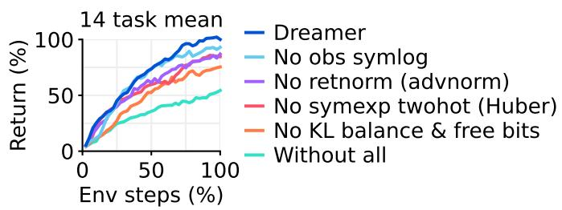

A 鲁棒性技术

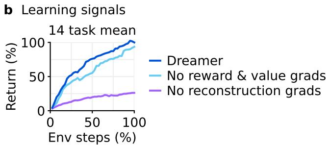

  

图 6：Dreamer 的消融实验与稳健扩展性。a，所有独立的鲁棒性技术平均而言都对 Dreamer 的性能有所贡献，尽管每项独立技术可能仅影响部分任务。单个任务的训练曲线包含在补充材料中。b，与大多数主要依赖奖励和价值预测梯度的先前算法 $^{7,5,8}$ 不同，Dreamer 的性能主要依赖于其世界模型的无监督重建损失。c，Dreamer 的性能随模型规模的增大而单调提升，模型规模从 12M 到 400M 参数不等。值得注意的是，更大的模型不仅提升了任务性能，还需要更少的环境交互。d，更高的回放比率（replay ratios）可预见地提升了 Dreamer 的性能。结合模型规模，这使得从业者能够通过投入更多计算资源来提升任务性能和数据效率。

\- Atari100k 该数据高效性基准测试包含 26 款 Atari 游戏，预算仅为 400K 帧，相当于 2 小时的游戏时间$^{17}$。EfficientZero 通过结合在线树搜索、优先经验回放和超参数调度保持了当前最优水平，但它还会提前重置关卡以增加数据多样性，这使得对比变得困难。在没有这种复杂性的情况下，Dreamer 优于其他最佳方法，包括基于 Transformer 的 IRIS 和 TWM 智能体、无模型 SPR 以及 SimPLe$^{45}$。

\- Proprio Control 该基准测试包含 18 个连续动作控制任务，采用本体感受向量输入，预算为 500K 环境步$^{46}$。任务范围从经典控制到运动控制再到机器人操控任务，并同时包含稠密奖励和稀疏奖励。Dreamer 在该基准测试上设立了新的最先进水平，优于 D4PG、DMPO 和 MPO$^{33}$。

\- Visual Control 该基准测试由 20 个连续控制任务组成，智能体仅接收高维图像作为输入，预算为 1M 环境步$^{46}$。Dreamer 在该基准测试上设立了新的最先进水平，优于 DrQ-v2 和 CURL——这些方法专为视觉环境而设计，并利用了数据增强$^{47}$。

\- BSuite 该基准测试包含 23 个环境，总计 468 种配置，专门用于测试信用分配、对奖励规模和随机性的鲁棒性、记忆能力、泛化能力以及探索能力$^{48}$。Dreamer 在该基准测试上设立了新的最先进水平，优于 Boot DQN 和其他方法$^{49}$。Dreamer 相对于先前算法的提升尤其体现在奖励规模鲁棒性方面。

Minecraft 在流行的游戏 Minecraft 中收集钻石一直是人工智能领域的一个长期挑战$^{18,19,20}$。该游戏中的每一局都设置在一个独一无二的随机生成且无限的 3D 世界中。每局持续到玩家死亡或最多 36000 步（相当于 30 分钟），期间玩家需要通过采集资源和合成工具，从稀疏奖励中发现一个由 12 件物品构成的物品序列。对于有经验的人类玩家来说，获得钻石大约需要 20 分钟$^{20}$。我们沿用了先前工作中的方块破坏设置，因为所提供的动作空间会使随机策略难以在较长时间内持续按住某个按键$^{19}$。

由于在该复杂领域中的训练时间较长，对 Minecraft 进行广泛的超参数调优十分困难。因此，我们直接使用 Dreamer 默认的超参数（即开箱即用，out of the box）。如图 1 和图 5 所示，Dreamer 是首个从零开始在 Minecraft 中收集钻石的算法，无需如 VPT [20] 或自适应课程（adaptive curricula）[19] 那样依赖人类数据。我们所训练的所有 Dreamer 智能体均在 100M 环境步数内发现钻石。尽管若干强基线方法能够推进到高级物品（例如铁镐），但它们均未发现钻石。

消融实验 在图 6 中，我们在 14 项多样化任务上对鲁棒性技术与学习信号进行了消融，以理解它们的重要性。各任务的训练曲线收录于补充材料中。我们观察到，所有鲁棒性技术均对性能有所贡献，其中贡献最显著的是世界模型的 KL 目标，其次是回报归一化（return normalization）以及用于奖励与价值预测的 symexp twohot 回归。总体而言，我们发现每项独立技术在某子集任务上至关重要，但可能不影响其他任务上的性能。

为探究世界模型的作用，我们通过阻断任务特定的奖励与价值预测梯度、或阻断任务无关的重建梯度对世界模型表征的塑造，来对 Dreamer 的学习信号进行消融。与过往通常仅依赖任务特定学习信号的强化学习算法 [7, 8] 不同，Dreamer 主要依赖其世界模型的无监督目标。这一发现有望催生未来利用无监督数据进行预训练的算法变体。

扩展性 为研究 Dreamer 是否能够稳健扩展，我们在 Crafter [50] 与一项 DMLab [43] 任务上训练了 6 种模型规模（参数量从 1200 万到 4 亿）以及不同的回放比例。回放比例影响智能体所执行的梯度更新次数。图 6 表明，在所比较的模型规模与回放比例范围内，Dreamer 在固定超参数下能够稳健学习。此外，增大模型规模直接带来更高的任务性能与更低的数据需求。增加梯度步数进一步减少了习得成功行为所需的交互次数。结果表明，Dreamer 在不同的模型规模与回放比例下均能稳健学习，并且其性能为在给定算力下提升性能提供了一种可预期的方法。

## 相关工作

开发通用算法一直是强化学习研究长期以来的目标。PPO $^{5}$ 是使用最广泛的算法之一，且相对稳健，但需要大量经验（experience），并且性能通常低于专用替代算法。SAC $^{32}$ 是连续控制的热门选择，利用经验回放（experience replay）来提高数据效率，但实践中需要调参，尤其是其熵尺度（entropy scale），在高维输入下表现不佳 $^{51}$ 。MuZero $^{8}$ 使用价值预测模型进行规划，已被应用于棋盘游戏和雅达利（Atari），但作者未发布实现代码，且该算法包含若干复杂组件，难以复现。Gato $^{52}$ 将一个大模型拟合到多个任务的专家示范（expert demonstrations）上，但仅在有专家数据时适用。相比之下，Dreamer 以固定超参数掌握多种多样的环境，无需专家数据，且实现开源。

Minecraft 一直是近期研究的焦点。通过 MALMO $^{53}$，Microsoft 发布了一个免费版本的热门游戏以供研究之用。MineRL $^{18}$ 提供了若干竞赛环境，我们将其作为实验的基础。MineRL 竞赛通过多样化的人类数据集 $^{18}$ 来支持智能体探索和学习有意义的技能。Voyager 通过调用语言模型的 API 在技术树中获取与 Dreamer 深度相近的物品，但其运行在 MineFlayer 机器人脚本层之上——该层专为该游戏设计，并暴露高层动作 $^{54}$ 。VPT $^{20}$ 通过行为克隆（behavioral cloning）训练了一个玩 Minecraft 的智能体，其基于承包商收集的键盘和鼠标动作的专家数据，并使用强化学习进行微调以获得钻石，使用了 720 块 GPU 训练 9 天。相比之下，Dreamer 使用 MineRL 竞赛的动作空间，通过 1 块 GPU 训练 9 天，从稀疏奖励中自主学习收集钻石，无需人类数据。

## 结论

我们提出了第三代 Dreamer 算法——一种以固定超参数掌握广泛领域的通用强化学习算法。Dreamer 不仅在超过 150 项任务中表现出色，还能跨不同的数据和算力预算稳健学习，推动强化学习迈向广泛的实际应用。开箱即用，Dreamer 是首个从头开始在 Minecraft 中收集钻石的算法，实现了人工智能领域的重大里程碑。作为一种基于学习世界模型的高性能算法，Dreamer 为未来研究方向铺平了道路，包括从互联网视频中教授智能体世界知识，以及跨领域学习单一世界模型，使人工智能体能够逐步积累日益通用的知识与能力。

致谢 我们感谢 Mohammad Norouzi、Jessy Lin、Abbas Abdolmaleki、John Schulman、Adam Kosiorek 和 Oleh Rybkin 所做的深入讨论。感谢 Bobak Shahriari、Denis Yarats、Karl Cobbe 和 Hubert Soyer 分享基线算法的训练曲线。感谢 Daniel Furrer、Andrew Chen 和 Dakshesh Garambha 在 Google Cloud 基础设施方面提供的帮助。

参考文献

1. David Silver, Aja Huang, Chris J Maddison, Arthur Guez, Laurent Sifre, George Van Den Driessche, Julian Schrittwieser, Ioannis Antonoglou, Veda Panneershelvam, Marc Lanctot, et al. 利用深度神经网络与树搜索掌握围棋博弈. nature, 529(7587):484, 2016.

2. OpenAI. OpenAI Five. https://blog.openai.com/openai-five/, 2018.

4. Hung Le, Yue Wang, Akhilesh Deepak Gotmare, Silvio Savarese, and Steven Chu Hong Hoi. CodeRL：通过预训练模型与深度强化学习掌握代码生成. Advances in Neural Information Processing Systems, 35:21314–21328, 2022.

5. John Schulman, Filip Wolski, Prafulla Dhariwal, Alec Radford, Oleg Klimov. 近端策略优化算法. arXiv 预印本 arXiv:1707.06347, 2017.

6. Timothy P Lillicrap, Jonathan J Hunt, Alexander Pritzel, Nicolas Heess, Tom Erez, Yuval Tassa, David Silver, Daan Wierstra. 基于深度强化学习的连续控制. arXiv 预印本 arXiv:1509.02971, 2015.

7. Volodymyr Mnih, Koray Kavukcuoglu, David Silver, Andrei A Rusu, Joel Veness, Marc G Bellemare, Alex Graves, Martin Riedmiller, Andreas K Fidjeland, Georg Ostrovski, et al. 通过深度强化学习实现人类水平的控制. Nature, 518(7540):529, 2015.

8. Julian Schrittwieser, Ioannis Antonoglou, Thomas Hubert, Karen Simonyan, Laurent Sifre, Simon Schmitt, Arthur Guez, Edward Lockhart, Demis Hassabis, Thore Graepel, et al. 利用学习模型进行规划从而掌握 Atari、围棋、国际象棋与将棋. arXiv 预印本 arXiv:1911.08265, 2019.

9. Max Jaderberg, Volodymyr Mnih, Wojciech Marian Czarnecki, Tom Schaul, Joel Z Leibo, David Silver, Koray Kavukcuoglu. 带无监督辅助任务的强化学习. arXiv 预印本 arXiv:1611.05397, 2016.

10. Ankesh Anand, Evan Racah, Sherjil Ozair, Yoshua Bengio, Marc-Alexandre Côté, R Devon Hjelm. Atari 中的无监督状态表示学习. Advances in neural information processing systems, 32, 2019.

11. Danny Driess, Ingmar Schubert, Pete Florence, Yunzhu Li, Marc Toussaint. 基于神经辐射场的强化学习. arXiv 预印本 arXiv:2206.01634, 2022.

13. Marcin Andrychowicz, Anton Raichuk, Piotr Stańczyk, Manu Orsini, Sertan Girgin, Raphael Marinier, Léonard Hussenot, Matthieu Geist, Olivier Pietquin, Marcin Michalski, 等. 同策略强化学习中真正重要的是什么？一项大规模实证研究（What matters in on-policy reinforcement learning? a large-scale empirical study）. arXiv preprint arXiv:2006.05990, 2020.

14. Richard S Sutton. Dyna：一种用于学习、规划与反应的综合架构（Dyna, an integrated architecture for learning, planning, and reacting）. ACM SIGART Bulletin, 2(4):160–163, 1991.

15. Chelsea Finn and Sergey Levine. 用于机器人运动规划的深度视觉前瞻（Deep visual foresight for planning robot motion）. 发表于 2017 年 IEEE 国际机器人与自动化会议（ICRA），第 2786–2793 页。IEEE, 2017.

16. David Ha and Jürgen Schmidhuber. 世界模型（World models）. arXiv preprint arXiv:1803.10122, 2018.

21. Danijar Hafner, Timothy Lillicrap, Jimmy Ba, and Mohammad Norouzi. 梦中控制：通过潜在想象学习行为（Dream to control: Learning behaviors by latent imagination）. arXiv preprint arXiv:1912.01603, 2019.

22. Danijar Hafner, Timothy Lillicrap, Mohammad Norouzi, and Jimmy Ba. 利用离散世界模型掌握 Atari（Mastering atari with discrete world models）. arXiv preprint arXiv:2010.02193, 2020.

23. Diederik P Kingma and Max Welling. 自编码变分贝叶斯（Auto-encoding variational bayes）. arXiv preprint arXiv:1312.6114, 2013.

24. Danijar Hafner, Timothy Lillicrap, Ian Fischer, Ruben Villegas, David Ha, Honglak Lee, and James Davidson. 从像素中学习潜在动力学以进行规划（Learning latent dynamics for planning from pixels）. arXiv preprint arXiv:1811.04551, 2018.

25. Yoshua Bengio, Nicholas Léonard, and Aaron Courville. 通过随机神经元进行条件计算的梯度估计或传播（Estimating or propagating gradients through stochastic neurons for conditional computation）. arXiv preprint arXiv:1308.3432, 2013.

26. Durk P Kingma, Tim Salimans, Rafal Jozefowicz, Xi Chen, Ilya Sutskever, and Max Welling. 使用逆自回归流的改进变分推断（Improved variational inference with inverse autoregressive flow）. *Advances in neural information processing systems*, 29, 2016.

27. Rewon Child. 非常深的 VAE 泛化了自回归模型并在图像上可以超越它们（Very deep vaes generalize autoregressive models and can outperform them on images）. arXiv 预印本 arXiv:2011.10650, 2020.

28. Marc G Bellemare, Will Dabney, and Rémi Munos. 强化学习的分布视角（A distributional perspective on reinforcement learning）. 发表于：国际机器学习大会（International Conference on Machine Learning），第 449–458 页。PMLR, 2017.

29. Richard S Sutton and Andrew G Barto. 强化学习：导论（Reinforcement learning: An introduction）. MIT 出版社（MIT press）, 2018.

31. Ronald J Williams. 用于连接主义强化学习的简单统计梯度跟随算法（Simple statistical gradient-following algorithms for connectionist reinforcement learning）. *Machine Learning*, 8(3-4):229–256, 1992.

32. Tuomas Haarnoja, Aurick Zhou, Pieter Abbeel, and Sergey Levine. 软演员-评论家：基于随机演员的离策略最大熵深度强化学习（Soft actor-critic: Off-policy maximum entropy deep reinforcement learning with a stochastic actor）. arXiv 预印本 arXiv:1801.01290, 2018.

33. Abbas Abdolmaleki, Jost Tobias Springenberg, Yuval Tassa, Remi Munos, Nicolas Heess, and Martin Riedmiller. 最大后验策略优化（Maximum a posteriori policy optimisation）. arXiv 预印本 arXiv:1806.06920, 2018.

34. J Beau W Webber. 用于宽范围数据的双对称对数变换方法（A bi-symmetric log transformation for wide-range data）. *Measurement Science and Technology*, 24(2):027001, 2012.

35. Steven Kapturowski, Georg Ostrovski, John Quan, Remi Munos, and Will Dabney. 分布式强化学习中的循环经验回放（Recurrent experience replay in distributed reinforcement learning）. 发表于：国际学习表征会议（International Conference on Learning Representations）, 2018.

36. Matteo Hessel, Hubert Soyer, Lasse Espeholt, Wojciech Czarnecki, Simon Schmitt, and Hado van Hasselt. 使用 PopArt 的多任务深度强化学习（Multi-task deep reinforcement learning with popart）. 发表于：AAAI 人工智能大会论文集（Proceedings of the AAAI Conference on Artificial Intelligence），第 33 卷，第 3796–3803 页, 2019.

37. Karl W Cobbe, Jacob Hilton, Oleg Klimov, and John Schulman. 分阶段策略梯度（Phasic policy gradient）. 发表于：国际机器学习大会（International Conference on Machine Learning），第 2020–2027 页。PMLR, 2021.

38. Marc G Bellemare, Yavar Naddaf, Joel Veness, and Michael Bowling. 街机学习环境：通用智能体的评估平台（The arcade learning environment: An evaluation platform for general agents）. *Journal of Artificial Intelligence Research*, 47:253–279, 2013.

39. Marlos C Machado, Marc G Bellemare, Erik Talvitie, Joel Veness, Matthew Hausknecht, and Michael Bowling. 重新审视街机学习环境：通用智能体的评估协议与开放问题（Revisiting the arcade learning environment: Evaluation protocols and open problems for general agents）. *Journal of Artificial Intelligence Research*, 61:523–562, 2018.

40. Matteo Hessel, Joseph Modayil, Hado Van Hasselt, Tom Schaul, Georg Ostrovski, Will Dabney, Dan Horgan, Bilal Piot, Mohammad Azar, and David Silver. Rainbow：综合深度强化学习中的多种改进（Rainbow: Combining improvements in deep reinforcement learning）. 发表于：第三十二届 AAAI 人工智能大会（Thirty-Second AAAI Conference on Artificial Intelligence）, 2018.

41. Will Dabney, Georg Ostrovski, David Silver, and Rémi Munos. 用于分布式强化学习的隐式分位数网络. 发表于：国际机器学习大会（International Conference on Machine Learning），第 1096–1105 页. PMLR, 2018.

42. Karl Cobbe, Chris Hesse, Jacob Hilton, and John Schulman. 利用程序化生成来基准测试强化学习. 发表于：国际机器学习大会（International Conference on Machine Learning），第 2048–2056 页. PMLR, 2020.

44. Weirui Ye, Shaohuai Liu, Thanard Kurutach, Pieter Abbeel, and Yang Gao. 用有限数据精通雅达利游戏. 《神经信息处理系统进展》（Advances in Neural Information Processing Systems），34:25476–25488, 2021.

45. Vincent Micheli, Eloi Alonso, and François Fleuret. Transformer 是样本高效的世界模型. arXiv 预印本 arXiv:2209.00588, 2022.

47. Denis Yarats, Rob Fergus, Alessandro Lazaric, and Lerrel Pinto. 精通视觉连续控制：改进的数据增强强化学习. arXiv 预印本 arXiv:2107.09645, 2021.

49. Olivia Dizon-Paradis, Stephen Wormald, Daniel Capecci, Avanti Bhandarkar, and Damon Woodard. 探究现有强化学习算法的实用性：性能比较. Authorea 预印本（Authorea Preprints）, 2023.

50. Danijar Hafner. 智能体能力谱系的基准测试. arXiv 预印本 arXiv:2109.06780, 2021.

51. Denis Yarats, Amy Zhang, Ilya Kostrikov, Brandon Amos, Joelle Pineau, and Rob Fergus. 提升基于图像的无模型强化学习的样本效率. arXiv 预印本 arXiv:1910.01741, 2019.

53. Matthew Johnson, Katja Hofmann, Tim Hutton, and David Bignell. 用于人工智能实验的 Malmo 平台. 发表于：IJCAI，第 4246–4247 页. Citeseer, 2016.

54. Guanzhi Wang, Yuqi Xie, Yunfan Jiang, Ajay Mandlekar, Chaowei Xiao, Yuke Zhu, Linxi Fan, and Anima Anandkumar. Voyager：基于大型语言模型的开放式具身智能体. arXiv 预印本 arXiv:2305.16291, 2023.

55. Shengyi Huang, Rousslan Fernand Julien Dossa, Antonin Raffin, Anssi Kanervisto, and Weixun Wang。近端策略优化的 37 个实现细节。The ICLR Blog Track 2023, 2022.

56. Matt Hoffman, Bobak Shahriari, John Aslanides, Gabriel Barth-Maron, Feryal Behbahani, Tamara Norman, Abbas Abdolmaleki, Albin Cassirer, Fan Yang, Kate Baumli, 等。Acme：一个面向分布式强化学习的研究框架。arXiv preprint arXiv:2006.00979, 2020.

57. Simon Schmitt, Matteo Hessel, and Karen Simonyan。共享经验回放的离策略演员-评论家算法。见：International Conference on Machine Learning，第 8545–8554 页。PMLR, 2020.

58. Tom Schaul, John Quan, Ioannis Antonoglou, and David Silver。优先经验回放。arXiv preprint arXiv:1511.05952, 2015.

59. Andy Brock, Soham De, Samuel L Smith, and Karen Simonyan。无归一化的高性能大规模图像识别。见：International Conference on Machine Learning，第 1059–1071 页。PMLR, 2021.

60. Liu Ziyin, Zhikang T Wang, and Masahito Ueda。Laprop：在 Adam 中分离动量与自适应学习率。arXiv preprint arXiv:2002.04839, 2020.

61. Diederik P Kingma and Jimmy Ba。Adam：一种随机优化方法。arXiv preprint arXiv:1412.6980, 2014.

62. Audrunas Gruslys, Will Dabney, Mohammad Gheshlaghi Azar, Bilal Piot, Marc Bellemare, and Remi Munos。Reactor：一种面向强化学习的快速高样本效率演员-评论家智能体。arXiv preprint arXiv:1704.04651, 2017.

63. Kyunghyun Cho, Bart Van Merriënboer, Caglar Gulcehre, Dzmitry Bahdanau, Fethi Bougares, Holger Schwenk, and Yoshua Bengio。使用 RNN 编码器-解码器学习短语表示用于统计机器翻译。arXiv preprint arXiv:1406.1078, 2014.

64. Matthijs Van Keirsbilck, Alexander Keller, and Xiaodong Yang。重新思考循环神经网络中的全连接。arXiv preprint arXiv:1905.12340, 2019.

65. Marlos C Machado, Marc G Bellemare, Erik Talvitie, Joel Veness, Matthew Hausknecht, and Michael Bowling。重新审视街机学习环境：通用智能体的评估协议与开放问题。Journal of Artificial Intelligence Research, 61:523–562, 2018.

66. Lasse Espeholt, Hubert Soyer, Remi Munos, Karen Simonyan, Volodymir Mnih, Tom Ward, Yotam Doron, Vlad Firoiu, Tim Harley, Iain Dunning, 等。Impala：基于重要性加权演员-学习者架构的可扩展分布式深度强化学习。arXiv preprint arXiv:1802.01561, 2018.

## 方法

## 基线方法

我们采用近端策略优化（Proximal Policy Optimization, PPO）算法 [5]，它在该领域已成为标准选择，以便在所有基准上使用固定超参数对 Dreamer 进行比较。当前公开可用的 PPO 实现数量众多，且已知它们在任务性能上存在显著差异 [55]。为确保比较能代表 PPO 在固定超参数下跨领域所能达到的最高性能，我们选用 Acme 框架 [56] 中提供的高质量 PPO 实现，并依据建议 [55,13] 在表 1 中选取其超参数，此外还对其 epoch 批量大小（使其足以应对复杂环境 [42]）、学习率以及熵尺度进行了调优。我们将折扣因子与 Dreamer 保持一致，因为它在各个领域都表现良好，且是文献中的常见选择 [35,8]。我们选用 IMPALA 网络架构，因为我们发现其性能优于其他备选方案 [42]，并将 minibatch 大小设为单块 A100 GPU 所能容纳的最大值。我们在 ProcGen 基准上验证了我们的 PPO 实现及其超参数的性能；在该基准上，PPO 的作者 [37] 报告过经过高度调优的 PPO 实现。我们发现，我们的实现在性能上与该参考相当或略有超越。

<table><tr><td>Parameter</td><td>Value</td></tr><tr><td>Observation normalization</td><td>Yes</td></tr><tr><td>Reward normalization</td><td>Yes</td></tr><tr><td>Reward clipping (stddev.)</td><td>10</td></tr><tr><td>Epoch batch</td><td>64 × 256</td></tr><tr><td>Number of epochs</td><td>3</td></tr><tr><td>Minibatch size</td><td>8</td></tr><tr><td>Minibatch length</td><td>256</td></tr><tr><td>Policy trust region</td><td>0.2</td></tr><tr><td>Value trust region</td><td>No</td></tr><tr><td>Advantage normalization</td><td>Yes</td></tr><tr><td>Entropy penalty scale</td><td>0.01</td></tr><tr><td>Discount factor</td><td>0.997</td></tr><tr><td>GAE lambda</td><td>0.95</td></tr><tr><td>Learning rate</td><td> $3 \times 10^{-4}$ </td></tr><tr><td>Gradient clipping</td><td>0.5</td></tr><tr><td>Adam epsilon</td><td> $10^{-5}$ </td></tr></table>

表 1：在所有基准上使用的 PPO 超参数。

对于 Minecraft（我的世界），我们额外调优并运行了 IMPALA 和 Rainbow 算法，因为文献中尚未报道过成功的端到端从零开始学习 $^{18}$。我们使用这些算法的 Acme 实现 $^{56}$，沿用与 PPO 相同的 IMPALA 网络，并调优了学习率和熵正则化器。对于其他所有基准，我们与文献中报道的经过调优的专家算法进行比较，具体引用见结果部分。

## 实现

经验回放 我们使用带有在线队列的均匀回放缓冲区来实现 Dreamer $^{57}$。具体而言，每个小批次首先由不重叠的在线轨迹构成，然后用从回放缓冲区中均匀采样的轨迹补齐。我们在数据收集过程中将潜在状态存入回放缓冲区，以便在回放轨迹上初始化世界模型，并将训练 rollout 的新潜在状态写回缓冲区。虽然我们对比的部分专家算法使用了优先回放 $^{58}$，我们也发现优先回放能够提升 Dreamer 的性能，但为了实现简便，我们在实验中选择均匀回放。

我们通过回放比来参数化训练量。回放比是指每从环境中收集一个时间步所训练的时间步比例（不考虑动作重复）。将回放比除以一个小批次中的时间步数，再除以动作重复次数，得到的是梯度步与环境步之比。例如，在 Atari 上使用回放比 32、动作重复 4、批次形状 $16 \times 64$，对应于每 128 个环境步执行一次梯度步，或在 200M 环境步中执行 1.5M 次梯度步。

优化器 我们采用自适应梯度裁剪（Adaptive Gradient Clipping, AGC） $^{59}$，当逐张量梯度超过其对应权重矩阵 L2 范数的 30% 时进行裁剪，默认 $\epsilon = 10^{-3}$。AGC 将裁剪阈值与损失尺度解耦，允许在不调整裁剪阈值的情况下更改损失函数或损失尺度。我们使用 LaProp 优化器 $^{60}$ 应用裁剪后的梯度，设置 $\epsilon = 10^{-20}$ 及其默认参数 $\beta_{1} = 0.9$ 和 $\beta_{2} = 0.99$。LaProp 使用 RMSProp 对梯度进行归一化，然后通过动量进行平滑处理，而不是像 Adam 那样对原始梯度同时计算动量和归一化 $^{61}$。这一简单的改动允许使用更小的 epsilon，并避免了我们在 Adam 下观察到的偶发不稳定现象。

分布 编码器、动力学预测器和动作（actor）分布是 99% 的预测 softmax 输出与 1% 的均匀分布的混合 $^{62}$，以防止出现零概率和无穷大的对数概率。奖励和评论家（critic）神经网络输出在指数间隔的分箱 $b \in B$ 上的 softmax 分布，并通过 twohot 编码目标进行训练：

$$
\operatorname{twohot} (x) _ {i} \doteq \left\{ \begin{array}{l l} | b _ {k + 1} - x | / | b _ {k + 1} - b _ {k} | & \text { if } i = k \\ | b _ {k} - x | / | b _ {k + 1} - b _ {k} | & \text { if } i = k + 1 \\ 0 & \text { else } \end{array} \right. \quad k \doteq \sum_ {j = 1} ^ {| B |} \delta (b _ {j} <   x)\tag{12}
$$

两个 one-hot 分布的输出权重被初始化为零，以确保智能体在初始化时不会对奖励和价值产生幻觉。在跨越大数量级区间的 softmax 分布下计算期望预测时，求和顺序很关键，正负区间应分别按从小到大的顺序求和，然后再相加。请参阅源代码以获取具体实现。

网络 图像使用步长为 2 的卷积编码到 $6 \times 6$ 或 $4 \times 4$ 的分辨率，然后展平，并使用步长为 2 的转置卷积进行解码，输出采用 sigmoid 激活。向量输入经过 symlog 变换后，使用 3 层 MLP 进行编码和解码。演员（actor）和评论家（critic）神经网络也是 3 层 MLP，奖励和继续（continue）预测器是 1 层 MLP。序列模型是一个 GRU $^{63}$ ，其循环权重采用块对角结构 $^{64}$ ，共 8 个块，从而在不过度增加参数和 FLOPs 的前提下支持大量记忆单元。在每个时间步输入到 GRU 的是采样得到的潜变量 $z_{t}$ 、动作 $a_{t}$ 和循环状态的线性嵌入，以允许块之间进行混合。

## 基准测试

协议 汇总于表 2 中，对于有既定标准的基准测试，我们遵循标准的评估协议。Atari $^{38}$ 使用 57 个任务并采用粘性动作 $^{65}$ 。用于归一化分数的随机分数和人类参考分数在文献中各有不同，我们选用了最常见的参考值，汇总于表 6。DMLab $^{43}$ 使用 30 个任务 $^{66}$ ，并采用固定动作空间 $^{36,35}$ 。由于运行 10B 步（如某些先前工作所用）不可行，我们在 100M 步处进行评估。由于现有已发表的基线方法在 100M 步时表现较差，我们转而比较其在 1B 步时的性能，相当于让它们享有 10 倍的数据优势。ProcGen 使用困难难度设置和无限关卡集 $^{42}$ 。先前工作在不同的步数预算下进行比较 $^{42,37}$ ，由于计算成本的原因（无动作重复），我们在 50M 步处进行比较。对于仅依赖稀疏奖励的 Minecraft Diamond 任务，我们确立了评估协议：在 100M 环境步数处报告 episode return，对应约 100 天的游戏内时间。Atari100k $^{17}$ 包含 26 个任务，环境步数预算为 400K，动作重复后为 100K。先前工作使用了各种不同的环境设置，汇总于表 10，我们采用最初提出时的环境设置。Visual Control $^{46,21}$ 涵盖 20 个任务，动作重复为 2。本体感受控制（Proprioceptive Control）遵循相同的协议，但我们排除了两个四足动物任务，因为先前工作 $^{47}$ 中存在基线可用性问题。

<table><tr><td>Benchmark</td><td>Tasks</td><td>Env Steps</td><td>Action Repeat</td><td>Env Instances</td><td>Replay Ratio</td><td>GPU Days</td><td>Model Size</td></tr><tr><td>Minecraft</td><td>1</td><td>100M</td><td>1</td><td>64</td><td>32</td><td>8.9</td><td>200M</td></tr><tr><td>DMLab</td><td>30</td><td>100M</td><td>4</td><td>16</td><td>32</td><td>2.9</td><td>200M</td></tr><tr><td>ProcGen</td><td>16</td><td>50M</td><td>1</td><td>16</td><td>64</td><td>16.1</td><td>200M</td></tr><tr><td>Atari</td><td>57</td><td>200M</td><td>4</td><td>16</td><td>32</td><td>7.7</td><td>200M</td></tr><tr><td>Atari100K</td><td>26</td><td>400K</td><td>4</td><td>1</td><td>128</td><td>0.1</td><td>200M</td></tr><tr><td>BSuite</td><td>23</td><td>—</td><td>1</td><td>1</td><td>1024</td><td>0.5</td><td>200M</td></tr><tr><td>Proprio Control</td><td>18</td><td>500K</td><td>2</td><td>16</td><td>512</td><td>0.3</td><td>12M</td></tr><tr><td>Visual Control</td><td>20</td><td>1M</td><td>2</td><td>16</td><td>512</td><td>0.1</td><td>12M</td></tr></table>

表 2：基准测试概览。所有智能体均使用单块 Nvidia A100 GPU 进行训练。

环境实例数 在早期实验中，我们观察到 Dreamer 和 PPO 的性能对环境实例数并不敏感。基于我们训练机器上可用的 CPU 资源，我们默认使用 16 个环境实例。对于 BSuite，基准测试要求使用单个环境实例。对于 Atari100K，我们也使用单个环境实例，因为该基准测试的环境步数预算为 400K，而 Atari 中单集的最大长度原则上为 432K 环境步。对于 Minecraft，由于环境单步执行较慢，我们使用 64 个通过远程 CPU 工作进程运行的环境实例以加速实验。

随机种子与误差线 我们为每个基准测试中的 Dreamer 和 PPO 各运行 5 个随机种子，但由于计算资源的限制，ProcGen 仅运行 1 个种子；BSuite 按基准要求运行 10 个种子；Minecraft 运行 10 个种子以可靠地报告获得钻石（diamonds）的实验运行比例。所有曲线均显示跨种子的均值，并以一个标准差作为阴影区域。

计算资源选择 本文中所有的 Dreamer 和 PPO 智能体均使用单块 Nvidia A100 GPU 进行训练。Dreamer 默认使用 200M 模型规模。在两个控制套件上，Dreamer 使用显著更快的 12M 模型即可达到相同性能，从而使其对研究者更为友好。重放比率（replay ratio）控制了计算成本与数据效率之间的权衡（如图 6 所分析），并根据每个基准测试的步数预算进行选择。

## 模型规模

为了适应不同的计算预算并分析对不同模型规模的鲁棒性，我们定义了一系列模型规模，从 12M 参数到 400M 参数不等，如表 3 所示。模型规模由模型维度（model dimension）参数化，模型维度大致以 1.5 倍递增，在 2 的幂与按 1.5 缩放的 2 的幂之间交替。这使得张量形状为 8 的倍数，以满足硬件效率的要求。不同网络组件的规模由模型维度推导而来。多层感知机（MLPs）的隐藏单元数等于模型维度。序列模型的循环单元数为模型维度的 8 倍，分为 8 个与 MLP 大小相同的块。最接近数据的卷积编码器和解码器层使用的通道数比模型维度少 $16 \times$。每个潜变量的编码数也比模型维度少 $16 \times$。隐藏层数和潜变量数在所有模型规模中保持固定。所有超参数，包括学习率和批大小，在所有模型规模中均保持不变。

<table><tr><td>Parameters</td><td>12M</td><td>25M</td><td>50M</td><td>100M</td><td>200M</td><td>400M</td></tr><tr><td>Hidden size (d)</td><td>256</td><td>384</td><td>512</td><td>768</td><td>1024</td><td>1536</td></tr><tr><td>Recurrent units (8d)</td><td>1024</td><td>3072</td><td>4096</td><td>6144</td><td>8192</td><td>12288</td></tr><tr><td>Base CNN channels (d/16)</td><td>16</td><td>24</td><td>32</td><td>48</td><td>64</td><td>96</td></tr><tr><td>Codes per latent (d/16)</td><td>16</td><td>24</td><td>32</td><td>48</td><td>64</td><td>96</td></tr></table>

Table 3: Dreamer 模型规模。MLP 隐藏单元的数量定义了模型维度，由此衍生出循环单元、卷积通道以及每个潜变量（latent）的编码数。层数与潜变量数量在所有模型规模之间保持不变。

## Dreamer 的前几代

我们提出 Dreamer 研究路线的第三代算法。在需要加以区分时，我们将该算法称为 DreamerV3。DreamerV1 算法 $^{21}$ 局限于连续控制任务，DreamerV2 算法 $^{22}$ 在 Atari 上超越了人类水平，而 DreamerV3 算法则在多个多样化基准上实现了直接开箱即用的学习。

我们将 DreamerV3 所引入的改进总结如下：

- 鲁棒性技术：对观测做 symlog 处理、KL 平衡（KL balance）与 free bits、所有类别分布使用 1% unimix、百分位回报归一化（percentile return normalization）、奖励头与评论家使用 symexp twohot 损失。

• 网络架构：块 GRU（Block GRU）、RMSNorm 归一化、SiLu 激活函数。

- 优化器：自适应梯度裁剪（Adaptive Gradient Clipping, AGC）、LaProp（先 RMSProp 后动量）。

- 回放缓冲区：更大容量、在线队列、潜状态的存储与更新。

超参数

<table><tr><td>Name</td><td>Symbol</td><td>Value</td></tr><tr><td colspan="3">General</td></tr><tr><td>Replay capacity</td><td>—</td><td> $5 \times 10^{6}$ </td></tr><tr><td>Batch size</td><td> $B$ </td><td>16</td></tr><tr><td>Batch length</td><td> $T$ </td><td>64</td></tr><tr><td>Activation</td><td>—</td><td>RMSNorm + SiLU</td></tr><tr><td>Learning rate</td><td>—</td><td> $4 \times 10^{-5}$ </td></tr><tr><td>Gradient clipping</td><td>—</td><td>AGC(0.3)</td></tr><tr><td>Optimizer</td><td>—</td><td>LaProp( $\epsilon = 10^{-20}$ )</td></tr><tr><td colspan="3">World Model</td></tr><tr><td>Reconstruction loss scale</td><td> $\beta_{\text{pred}}$ </td><td>1</td></tr><tr><td>Dynamics loss scale</td><td> $\beta_{\text{dyn}}$ </td><td>1</td></tr><tr><td>Representation loss scale</td><td> $\beta_{\text{rep}}$ </td><td>0.1</td></tr><tr><td>Latent unimix</td><td>—</td><td>1%</td></tr><tr><td>Free nats</td><td>—</td><td>1</td></tr><tr><td colspan="3">Actor Critic</td></tr><tr><td>Imagination horizon</td><td> $H$ </td><td>15</td></tr><tr><td>Discount horizon</td><td> $1/(1 - \gamma)$ </td><td>333</td></tr><tr><td>Return lambda</td><td> $\lambda$ </td><td>0.95</td></tr><tr><td>Critic loss scale</td><td> $\beta_{\text{val}}$ </td><td>1</td></tr><tr><td>Critic replay loss scale</td><td> $\beta_{\text{repval}}$ </td><td>0.3</td></tr><tr><td>Critic EMA regularizer</td><td>—</td><td>1</td></tr><tr><td>Critic EMA decay</td><td>—</td><td>0.98</td></tr><tr><td>Actor loss scale</td><td> $\beta_{\text{pol}}$ </td><td>1</td></tr><tr><td>Actor entropy regularizer</td><td> $\eta$ </td><td> $3 \times 10^{-4}$ </td></tr><tr><td>Actor unimix</td><td>—</td><td>1%</td></tr><tr><td>Actor RetNorm scale</td><td> $S$ </td><td>Per( $R, 95$ ) – Per( $R, 5$ )</td></tr><tr><td>Actor RetNorm limit</td><td> $L$ </td><td>1</td></tr><tr><td>Actor RetNorm decay</td><td>—</td><td>0.99</td></tr></table>

Table 4: Dreamer 超参数。所有基准测试均使用相同的数值，涵盖本体感知与视觉输入、连续与离散动作，以及二维和三维域。我们不使用任何超参数退火、优先回放、权重衰减或 dropout。

## 我的世界（Minecraft）

游戏描述 Minecraft 拥有 1 亿月活跃用户，是全球最受欢迎的视频游戏之一。Minecraft 提供一个程序化生成的 3D 世界，包含不同的生物群系，包括平原（plains）、森林（forests）、丛林（jungles）、山脉（mountains）、沙漠（deserts）、针叶林（taiga）、雪原（snowy tundra）、冰刺之地（ice spikes）、沼泽（swamps）、稀树草原（savannahs）、恶地（badlands）、海滩（beaches）、石岸（stone shores）、河流（rivers）和海洋（oceans）。世界由边长为 1 米的方块组成，玩家可以破坏和放置它们。游戏中约有 30 种不同的生物，玩家可以与之互动或战斗。从收集的资源中，玩家可以使用超过 350 种合成配方来制作新物品、推进科技树，同时还要保障自身安全和食物供给以存活。Minecraft 中有许多可设想完成的任务，作为第一步，研究社区已聚焦于一个突出任务——获取钻石（a diamond），这是一种深埋于地下的稀有物品，需要推进科技树才能获得。

学习环境 我们在 MineRL 之上构建了 Minecraft Diamond 环境，以定义一个扁平的类别型动作空间，并通过人工游玩测试修复了我们在原始环境中发现的问题。例如，在破坏钻石矿石时，物品有时会直接进入背包，有时需要从地面拾取。原始环境在破坏钻石矿石后会终止回合，导致许多成功的回合在收集物品之前就已结束，从而无法获得奖励。我们移除了该提前终止条件，改在玩家死亡时或经过 36000 步后结束回合，对应于 20 Hz 控制频率下的 30 分钟。另一个问题是，跳跃动作必须按住超过一个控制步长才能触发跳跃，我们通过在后台保持按键 200 毫秒来解决该问题。我们在 MineRL v0.4.4 [18] 之上构建了该环境，它提供了抽象合成动作。Minecraft 版本为 1.11.2。

观测与奖励 智能体接收一张 $64 \times 64 \times 3$ 的第一人称图像、一个针对 400 多种物品的库存计数向量、一个自回合开始以来记录各物品最大库存数量的向量（用于告知智能体已达成哪些里程碑）、一个表示当前装备物品的独热向量，以及生命值、饥饿值和氧气值的标量输入。我们采用 MineRL 竞赛环境 $^{18}$ 的稀疏奖励结构，对通向钻石的 12 个里程碑给予奖励，对应物品依次为：圆木（log）、木板（plank）、木棒（stick）、工作台（crafting table）、木镐（wooden pickaxe）、圆石（cobblestone）、石镐（stone pickaxe）、铁矿（iron ore）、熔炉（furnace）、铁锭（iron ingot）、铁镐（iron pickaxe）和钻石（diamond）。每个物品的奖励在每个回合中仅发放一次，智能体必须学会多次收集某些物品才能达成下一个里程碑。为使回报易于解读，我们对每个里程碑给予 +1 的奖励，而不是按物品价值对奖励进行缩放。此外，我们对每损失一颗心给予 -0.01 的奖励，对每恢复一颗心给予 +0.01 的奖励，但并未探究这样做是否有帮助。

## 补充材料 Minecraft 视频预测

  

图 7：Minecraft 上的多步预测。给定动作序列，世界模型接收前 5 帧作为上下文输入，然后预测未来 45 步，且无法访问中间图像。

Dreamer IMPALA Rainbow PPO

## Minecraft 补充结果

<table><tr><td>Method</td><td>Return</td></tr><tr><td>Dreamer</td><td>9.1</td></tr><tr><td>IMPALA</td><td>7.1</td></tr><tr><td>Rainbow</td><td>6.3</td></tr><tr><td>PPO</td><td>5.1</td></tr></table>

表 5：在 1 亿环境步数下的 Minecraft 钻石收集分数

  

图 8：Minecraft 学习曲线。

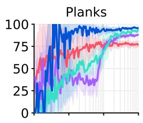

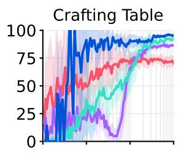

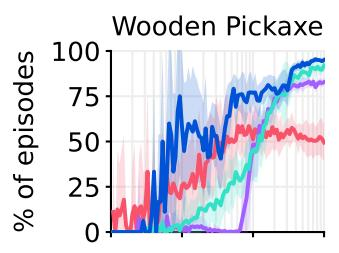

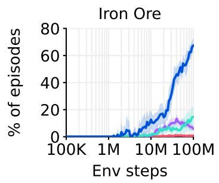

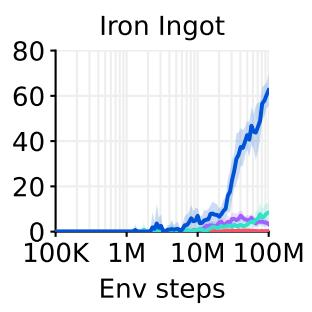

图 9：以回合百分比表示的物品获取成功率。Dreamer 获取物品的比率显著高于基线方法，并持续改进直到 1 亿步预算为止。在该预算下，Dreamer 在 0.4% 的回合中获取到钻石，这为未来的研究留下了挑战。该指标与图 5 不同，图 5 显示在整个训练过程中，无论回合边界如何，100% 的 Dreamer 智能体都能获取一颗或多颗钻石，而基线智能体这一比例为 0%。

  

Atari 学习曲线  
图 10：Atari 学习曲线。

<table><tr><td>Task</td><td>Random</td><td>Gamer</td><td>Record</td><td>PPO</td><td>MuZero</td><td>Dreamer</td></tr><tr><td>Environment steps</td><td>—</td><td>—</td><td>—</td><td>200M</td><td>200M</td><td>200M</td></tr><tr><td>Alien</td><td>228</td><td>7128</td><td>251916</td><td>5476</td><td>56835</td><td>10977</td></tr><tr><td>Amidar</td><td>6</td><td>1720</td><td>104159</td><td>817</td><td>1517</td><td>3612</td></tr><tr><td>Assault</td><td>222</td><td>742</td><td>8647</td><td>6673</td><td>42742</td><td>26010</td></tr><tr><td>Asterix</td><td>210</td><td>8503</td><td>1000000</td><td>47190</td><td>879375</td><td>441763</td></tr><tr><td>Asteroids</td><td>719</td><td>47389</td><td>10506650</td><td>2479</td><td>374146</td><td>348684</td></tr><tr><td>Atlantis</td><td>12850</td><td>29028</td><td>10604840</td><td>539721</td><td>1353617</td><td>1553222</td></tr><tr><td>Bank Heist</td><td>14</td><td>753</td><td>82058</td><td>946</td><td>1077</td><td>1083</td></tr><tr><td>Battle Zone</td><td>2360</td><td>37188</td><td>801000</td><td>27816</td><td>167412</td><td>419653</td></tr><tr><td>Beam Rider</td><td>364</td><td>16926</td><td>999999</td><td>7973</td><td>201154</td><td>37073</td></tr><tr><td>Berzerk</td><td>124</td><td>2630</td><td>1057940</td><td>1186</td><td>1698</td><td>10557</td></tr><tr><td>Bowling</td><td>23</td><td>161</td><td>300</td><td>118</td><td>133</td><td>250</td></tr><tr><td>Boxing</td><td>0</td><td>12</td><td>100</td><td>98</td><td>100</td><td>100</td></tr><tr><td>Breakout</td><td>2</td><td>30</td><td>864</td><td>299</td><td>799</td><td>384</td></tr><tr><td>Centipede</td><td>2091</td><td>12017</td><td>1301709</td><td>51833</td><td>774421</td><td>554553</td></tr><tr><td>Chopper Command</td><td>811</td><td>7388</td><td>999999</td><td>12667</td><td>8945</td><td>802698</td></tr><tr><td>Crazy Climber</td><td>10780</td><td>35829</td><td>219900</td><td>93176</td><td>184394</td><td>193204</td></tr><tr><td>Defender</td><td>2874</td><td>18689</td><td>6010500</td><td>38270</td><td>554492</td><td>579875</td></tr><tr><td>Demon Attack</td><td>152</td><td>1971</td><td>1556345</td><td>8229</td><td>142509</td><td>142109</td></tr><tr><td>Double Dunk</td><td>-19</td><td>-16</td><td>22</td><td>16</td><td>23</td><td>24</td></tr><tr><td>Enduro</td><td>0</td><td>860</td><td>9500</td><td>1887</td><td>2369</td><td>2166</td></tr><tr><td>Fishing Derby</td><td>-92</td><td>-39</td><td>71</td><td>43</td><td>58</td><td>82</td></tr><tr><td>Freeway</td><td>0</td><td>30</td><td>38</td><td>33</td><td>0</td><td>34</td></tr><tr><td>Frostbite</td><td>65</td><td>4335</td><td>454830</td><td>1123</td><td>17087</td><td>41888</td></tr><tr><td>Gopher</td><td>258</td><td>2412</td><td>355040</td><td>24792</td><td>122025</td><td>87600</td></tr><tr><td>Gravitar</td><td>173</td><td>3351</td><td>162850</td><td>3436</td><td>10301</td><td>12570</td></tr><tr><td>Hero</td><td>1027</td><td>30826</td><td>1000000</td><td>31967</td><td>36063</td><td>40677</td></tr><tr><td>Ice Hockey</td><td>-11</td><td>1</td><td>36</td><td>12</td><td>26</td><td>57</td></tr><tr><td>Jamesbond</td><td>29</td><td>303</td><td>45550</td><td>1019</td><td>14872</td><td>24010</td></tr><tr><td>Kangaroo</td><td>52</td><td>3035</td><td>1424600</td><td>7769</td><td>14380</td><td>12229</td></tr><tr><td>Krull</td><td>1598</td><td>2666</td><td>104100</td><td>9193</td><td>11476</td><td>69858</td></tr><tr><td>Kung Fu Master</td><td>258</td><td>22736</td><td>1000000</td><td>32335</td><td>148936</td><td>154893</td></tr><tr><td>Montezuma Revenge</td><td>0</td><td>4753</td><td>1219200</td><td>2368</td><td>0</td><td>1852</td></tr><tr><td>Ms Pacman</td><td>307</td><td>6952</td><td>290090</td><td>7041</td><td>51310</td><td>24079</td></tr><tr><td>Name This Game</td><td>2292</td><td>8049</td><td>25220</td><td>19441</td><td>85331</td><td>77809</td></tr><tr><td>Phoenix</td><td>761</td><td>7243</td><td>4014440</td><td>31412</td><td>105593</td><td>316606</td></tr><tr><td>Pitfall</td><td>-229</td><td>6464</td><td>114000</td><td>-2</td><td>0</td><td>0</td></tr><tr><td>Pong</td><td>-21</td><td>15</td><td>21</td><td>19</td><td>21</td><td>20</td></tr><tr><td>Private Eye</td><td>25</td><td>69571</td><td>101800</td><td>73</td><td>100</td><td>26432</td></tr><tr><td>Qbert</td><td>164</td><td>13455</td><td>2400000</td><td>14554</td><td>102129</td><td>201084</td></tr><tr><td>Riverraid</td><td>1338</td><td>17118</td><td>1000000</td><td>14860</td><td>137983</td><td>48080</td></tr><tr><td>Road Runner</td><td>12</td><td>7845</td><td>2038100</td><td>423995</td><td>604083</td><td>150402</td></tr><tr><td>Robotank</td><td>2</td><td>12</td><td>76</td><td>63</td><td>70</td><td>132</td></tr><tr><td>Seaquest</td><td>68</td><td>42055</td><td>999999</td><td>1927</td><td>399764</td><td>356584</td></tr><tr><td>Skiing</td><td>-17098</td><td>-4337</td><td>-3272</td><td>-29926</td><td>-30000</td><td>-29965</td></tr><tr><td>Solaris</td><td>1236</td><td>12327</td><td>111420</td><td>2368</td><td>5860</td><td>5851</td></tr><tr><td>Space Invaders</td><td>148</td><td>1669</td><td>621535</td><td>3489</td><td>3639</td><td>15005</td></tr><tr><td>Star Gunner</td><td>664</td><td>10250</td><td>77400</td><td>53439</td><td>127417</td><td>408961</td></tr><tr><td>Surround</td><td>-10</td><td>6</td><td>6</td><td>6</td><td>9</td><td>9</td></tr><tr><td>Tennis</td><td>-24</td><td>-8</td><td>21</td><td>-1</td><td>0</td><td>-3</td></tr><tr><td>Time Pilot</td><td>3568</td><td>5229</td><td>65300</td><td>17250</td><td>427209</td><td>314947</td></tr><tr><td>Tutankham</td><td>11</td><td>168</td><td>5384</td><td>225</td><td>235</td><td>395</td></tr><tr><td>Up N Down</td><td>533</td><td>11693</td><td>82840</td><td>83743</td><td>522962</td><td>614065</td></tr><tr><td>Venture</td><td>0</td><td>1188</td><td>38900</td><td>953</td><td>0</td><td>0</td></tr><tr><td>Video Pinball</td><td>16257</td><td>17668</td><td>89218328</td><td>382306</td><td>775304</td><td>940631</td></tr><tr><td>Wizard Of Wor</td><td>564</td><td>4756</td><td>395300</td><td>10910</td><td>0</td><td>99136</td></tr><tr><td>Yars Revenge</td><td>3093</td><td>54577</td><td>15000105</td><td>137164</td><td>846061</td><td>675774</td></tr><tr><td>Zaxxon</td><td>32</td><td>9173</td><td>83700</td><td>13599</td><td>58115</td><td>78443</td></tr><tr><td colspan="7"></td></tr><tr><td>Gamer median (%)</td><td>0</td><td>100</td><td>3716</td><td>180</td><td>693</td><td>830</td></tr><tr><td>Gamer mean (%)</td><td>0</td><td>100</td><td>123001</td><td>892</td><td>3054</td><td>3381</td></tr><tr><td>Record mean (%)</td><td>0</td><td>13</td><td>100</td><td>21</td><td>66</td><td>74</td></tr><tr><td>Record mean capped (%)</td><td>0</td><td>13</td><td>100</td><td>21</td><td>34</td><td>38</td></tr></table>

表 6：Atari 得分。

  

ProcGen 学习曲线  
图 11：ProcGen 学习曲线。

ProcGen 得分

<table><tr><td>Task</td><td>Original PPO</td><td>PPO</td><td>PPG</td><td>Dreamer</td></tr><tr><td>Environment steps</td><td>50M</td><td>50M</td><td>50M</td><td>50M</td></tr><tr><td>Bigfish</td><td>10.92</td><td>12.72</td><td>31.26</td><td>8.62</td></tr><tr><td>Bossfight</td><td>10.47</td><td>9.36</td><td>11.46</td><td>11.61</td></tr><tr><td>Caveflyer</td><td>6.03</td><td>6.71</td><td>10.02</td><td>9.42</td></tr><tr><td>Chaser</td><td>4.48</td><td>3.54</td><td>8.57</td><td>5.49</td></tr><tr><td>Climber</td><td>7.59</td><td>9.04</td><td>10.24</td><td>11.43</td></tr><tr><td>Coinrun</td><td>7.93</td><td>6.71</td><td>8.98</td><td>9.86</td></tr><tr><td>Dodgeball</td><td>4.80</td><td>3.44</td><td>10.31</td><td>10.93</td></tr><tr><td>Fruitbot</td><td>20.28</td><td>21.69</td><td>24.32</td><td>11.04</td></tr><tr><td>Heist</td><td>2.25</td><td>6.87</td><td>3.77</td><td>8.51</td></tr><tr><td>Jumper</td><td>5.09</td><td>6.13</td><td>5.84</td><td>9.17</td></tr><tr><td>Leaper</td><td>5.90</td><td>4.07</td><td>8.76</td><td>7.05</td></tr><tr><td>Maze</td><td>4.97</td><td>7.86</td><td>7.06</td><td>6.85</td></tr><tr><td>Miner</td><td>7.56</td><td>12.97</td><td>9.08</td><td>5.71</td></tr><tr><td>Ninja</td><td>6.16</td><td>3.62</td><td>9.38</td><td>9.82</td></tr><tr><td>Plunder</td><td>11.16</td><td>3.99</td><td>13.44</td><td>23.81</td></tr><tr><td>Starpilot</td><td>17.00</td><td>10.13</td><td>21.57</td><td>28.00</td></tr><tr><td>Normalized mean</td><td>41.16</td><td>42.80</td><td>64.89</td><td>66.01</td></tr></table>

表 7：ProcGen 得分。我们在整篇论文中所使用的、在固定超参数下的 PPO 实现，其表现与原始 PPO 相当或更优，而原始 PPO 被其作者描述为经过高度调优、超参数接近最优的版本 $^{37}$。

## DMLab 学习曲线

  

图 12：DMLab 学习曲线。

## DMLab 评分

<table><tr><td>Task</td><td>R2D2+</td><td>IMPALA</td><td>IMPALA</td><td>IMPALA</td><td>PPO</td><td>Dreamer</td></tr><tr><td>Environment steps</td><td>10B</td><td>10B</td><td>1B</td><td>100M</td><td>100M</td><td>100M</td></tr><tr><td>Explore Goal Locations Large</td><td>174.7</td><td>316.0</td><td>137.8</td><td>64.2</td><td>21.2</td><td>116.7</td></tr><tr><td>Explore Goal Locations Small</td><td>460.7</td><td>482.0</td><td>302.8</td><td>196.1</td><td>115.1</td><td>372.8</td></tr><tr><td>Explore Object Locations Large</td><td>60.6</td><td>91.0</td><td>55.1</td><td>34.3</td><td>22.5</td><td>63.9</td></tr><tr><td>Explore Object Locations Small</td><td>83.7</td><td>100.4</td><td>75.9</td><td>50.6</td><td>38.9</td><td>93.5</td></tr><tr><td>Explore Object Rewards Few</td><td>80.7</td><td>92.6</td><td>46.9</td><td>34.6</td><td>19.0</td><td>40.0</td></tr><tr><td>Explore Object Rewards Many</td><td>75.8</td><td>89.4</td><td>68.5</td><td>53.3</td><td>25.5</td><td>58.1</td></tr><tr><td>Explore Obstructed Goals Large</td><td>95.5</td><td>102.0</td><td>57.9</td><td>23.7</td><td>12.9</td><td>52.8</td></tr><tr><td>Explore Obstructed Goals Small</td><td>311.9</td><td>372.0</td><td>214.9</td><td>118.0</td><td>70.4</td><td>224.6</td></tr><tr><td>Language Answer Quantitative Question</td><td>344.4</td><td>362.0</td><td>304.7</td><td>1.0</td><td>0.3</td><td>266.0</td></tr><tr><td>Language Execute Random Task</td><td>497.4</td><td>465.4</td><td>140.8</td><td>-44.4</td><td>-2.5</td><td>223.7</td></tr><tr><td>Language Select Described Object</td><td>617.6</td><td>664.0</td><td>618.4</td><td>0.2</td><td>526.9</td><td>665.5</td></tr><tr><td>Language Select Located Object</td><td>772.8</td><td>731.4</td><td>413.0</td><td>38.2</td><td>397.5</td><td>679.5</td></tr><tr><td>Lasertag One Opponent Large</td><td>0.0</td><td>0.0</td><td>0.0</td><td>-0.1</td><td>0.0</td><td>-0.1</td></tr><tr><td>Lasertag One Opponent Small</td><td>31.8</td><td>0.0</td><td>0.0</td><td>-0.1</td><td>0.0</td><td>0.0</td></tr><tr><td>Lasertag Three Opponents Large</td><td>28.6</td><td>32.2</td><td>10.4</td><td>-0.1</td><td>0.0</td><td>9.0</td></tr><tr><td>Lasertag Three Opponents Small</td><td>49.0</td><td>57.2</td><td>37.1</td><td>12.1</td><td>0.4</td><td>18.8</td></tr><tr><td>Natlab Fixed Large Map</td><td>60.6</td><td>63.4</td><td>53.8</td><td>13.0</td><td>15.8</td><td>50.5</td></tr><tr><td>Natlab Varying Map Randomized</td><td>42.4</td><td>47.0</td><td>40.5</td><td>35.3</td><td>29.6</td><td>31.2</td></tr><tr><td>Natlab Varying Map Regrowth</td><td>24.6</td><td>34.0</td><td>25.5</td><td>15.3</td><td>16.3</td><td>16.7</td></tr><tr><td>Psychlab Arbitrary Visuomotor Mapping</td><td>33.1</td><td>38.4</td><td>16.5</td><td>11.9</td><td>16.0</td><td>30.7</td></tr><tr><td>Psychlab Continuous Recognition</td><td>30.0</td><td>28.6</td><td>30.0</td><td>30.1</td><td>30.5</td><td>33.8</td></tr><tr><td>Psychlab Sequential Comparison</td><td>30.0</td><td>29.6</td><td>0.0</td><td>0.0</td><td>30.0</td><td>44.3</td></tr><tr><td>Psychlab Visual Search</td><td>79.9</td><td>80.0</td><td>0.0</td><td>0.0</td><td>76.6</td><td>40.1</td></tr><tr><td>Rooms Collect Good Objects Test</td><td>9.9</td><td>10.0</td><td>9.9</td><td>9.3</td><td>9.7</td><td>9.9</td></tr><tr><td>Rooms Exploit Deferred Effects Test</td><td>38.1</td><td>62.2</td><td>37.6</td><td>34.5</td><td>39.0</td><td>40.4</td></tr><tr><td>Rooms Keys Doors Puzzle</td><td>46.2</td><td>54.6</td><td>36.9</td><td>24.2</td><td>26.0</td><td>42.4</td></tr><tr><td>Rooms Select Nonmatching Object</td><td>63.6</td><td>39.0</td><td>63.2</td><td>4.0</td><td>2.7</td><td>73.1</td></tr><tr><td>Rooms Watermaze</td><td>49.0</td><td>47.0</td><td>50.1</td><td>23.6</td><td>21.2</td><td>26.1</td></tr><tr><td>Skymaze Irreversible Path Hard</td><td>76.0</td><td>80.0</td><td>46.4</td><td>7.7</td><td>0.0</td><td>80.9</td></tr><tr><td>Skymaze Irreversible Path Varied</td><td>76.0</td><td>100.0</td><td>69.8</td><td>32.7</td><td>31.3</td><td>87.7</td></tr><tr><td>Human mean capped (%)</td><td>85.4</td><td>85.1</td><td>66.3</td><td>31.0</td><td>35.9</td><td>71.4</td></tr></table>

表 8：DMLab 在 100M 环境步数及更大预算下的得分。IMPALA 智能体对应于 Kapturowski 等人 $^{35}$ 提出的 "IMPALA (deep)"，并公开了学习曲线。

  

ATARI100k 学习曲线  
图 13：ATARI100k 学习曲线。

## Atari100k 得分

<table><tr><td>Task</td><td>Random</td><td>Human</td><td>PPO</td><td>SimPLe</td><td>SPR</td><td>TWM</td><td>IRIS</td><td>Dreamer</td></tr><tr><td>Environment steps</td><td>—</td><td>—</td><td>400K</td><td>400K</td><td>400K</td><td>400K</td><td>400K</td><td>400K</td></tr><tr><td>Alien</td><td>228</td><td>7128</td><td>276</td><td>617</td><td>842</td><td>675</td><td>420</td><td>1118</td></tr><tr><td>Amidar</td><td>6</td><td>1720</td><td>26</td><td>74</td><td>180</td><td>122</td><td>143</td><td>97</td></tr><tr><td>Assault</td><td>222</td><td>742</td><td>327</td><td>527</td><td>566</td><td>683</td><td>1524</td><td>683</td></tr><tr><td>Asterix</td><td>210</td><td>8503</td><td>292</td><td>1128</td><td>962</td><td>1117</td><td>854</td><td>1062</td></tr><tr><td>Bank Heist</td><td>14</td><td>753</td><td>14</td><td>34</td><td>345</td><td>467</td><td>53</td><td>398</td></tr><tr><td>Battle Zone</td><td>2360</td><td>37188</td><td>2233</td><td>4031</td><td>14834</td><td>5068</td><td>13074</td><td>20300</td></tr><tr><td>Boxing</td><td>0</td><td>12</td><td>3</td><td>8</td><td>36</td><td>78</td><td>70</td><td>82</td></tr><tr><td>Breakout</td><td>2</td><td>30</td><td>3</td><td>16</td><td>20</td><td>20</td><td>84</td><td>10</td></tr><tr><td>Chopper Command</td><td>811</td><td>7388</td><td>1005</td><td>979</td><td>946</td><td>1697</td><td>1565</td><td>2222</td></tr><tr><td>Crazy Climber</td><td>10780</td><td>35829</td><td>14675</td><td>62584</td><td>36700</td><td>71820</td><td>59324</td><td>86225</td></tr><tr><td>Demon Attack</td><td>152</td><td>1971</td><td>160</td><td>208</td><td>518</td><td>350</td><td>2034</td><td>577</td></tr><tr><td>Freeway</td><td>0</td><td>30</td><td>2</td><td>17</td><td>19</td><td>24</td><td>31</td><td>0</td></tr><tr><td>Frostbite</td><td>65</td><td>4335</td><td>127</td><td>237</td><td>1171</td><td>1476</td><td>259</td><td>3377</td></tr><tr><td>Gopher</td><td>258</td><td>2412</td><td>368</td><td>597</td><td>661</td><td>1675</td><td>2236</td><td>2160</td></tr><tr><td>Hero</td><td>1027</td><td>30826</td><td>2596</td><td>2657</td><td>5859</td><td>7254</td><td>7037</td><td>13354</td></tr><tr><td>Jamesbond</td><td>29</td><td>303</td><td>41</td><td>100</td><td>366</td><td>362</td><td>463</td><td>540</td></tr><tr><td>Kangaroo</td><td>52</td><td>3035</td><td>55</td><td>51</td><td>3617</td><td>1240</td><td>838</td><td>2643</td></tr><tr><td>Krull</td><td>1598</td><td>2666</td><td>3222</td><td>2205</td><td>3682</td><td>6349</td><td>6616</td><td>8171</td></tr><tr><td>Kung Fu Master</td><td>258</td><td>22736</td><td>2090</td><td>14862</td><td>14783</td><td>24555</td><td>21760</td><td>25900</td></tr><tr><td>Ms Pacman</td><td>307</td><td>6952</td><td>366</td><td>1480</td><td>1318</td><td>1588</td><td>999</td><td>1521</td></tr><tr><td>Pong</td><td>-21</td><td>15</td><td>-20</td><td>13</td><td>-5</td><td>19</td><td>15</td><td>-4</td></tr><tr><td>Private Eye</td><td>25</td><td>69571</td><td>100</td><td>35</td><td>86</td><td>87</td><td>100</td><td>3238</td></tr><tr><td>Qbert</td><td>164</td><td>13455</td><td>317</td><td>1289</td><td>866</td><td>3331</td><td>746</td><td>2921</td></tr><tr><td>Road Runner</td><td>12</td><td>7845</td><td>602</td><td>5641</td><td>12213</td><td>9109</td><td>9615</td><td>19230</td></tr><tr><td>Seaquest</td><td>68</td><td>42055</td><td>305</td><td>683</td><td>558</td><td>774</td><td>661</td><td>962</td></tr><tr><td>Up N Down</td><td>533</td><td>11693</td><td>1502</td><td>3350</td><td>10859</td><td>15982</td><td>3546</td><td>46910</td></tr><tr><td>Gamer mean (%)</td><td>0</td><td>100</td><td>11</td><td>33</td><td>62</td><td>96</td><td>105</td><td>125</td></tr><tr><td>Gamer median (%)</td><td>0</td><td>100</td><td>2</td><td>13</td><td>40</td><td>51</td><td>29</td><td>49</td></tr></table>

表 9：Atari100k 在 400K 环境步数下的得分，对应 100k 智能体步数。

<table><tr><td>Setting</td><td>SimPLe</td><td>EffMuZero</td><td>SPR</td><td>IRIS</td><td>TWM</td><td>Dreamer</td></tr><tr><td>Gamer score (%)</td><td>33</td><td>190</td><td>62</td><td>105</td><td>96</td><td>125</td></tr><tr><td>Gamer median (%)</td><td>13</td><td>109</td><td>40</td><td>29</td><td>51</td><td>49</td></tr><tr><td>GPU days</td><td>5.0</td><td>0.6</td><td>0.1</td><td>3.5</td><td>0.4</td><td>0.1</td></tr><tr><td>Online planning</td><td>—</td><td>X</td><td>—</td><td>—</td><td>—</td><td>—</td></tr><tr><td>Data augmentation</td><td>—</td><td>—</td><td>X</td><td>—</td><td>—</td><td>—</td></tr><tr><td>Non-uniform replay</td><td>—</td><td>X</td><td>X</td><td>—</td><td>X</td><td>—</td></tr><tr><td>Separate hparams</td><td>—</td><td>—</td><td>—</td><td>X</td><td>—</td><td>—</td></tr><tr><td>Increased resolution</td><td>—</td><td>X</td><td>X</td><td>—</td><td>—</td><td>—</td></tr><tr><td>Uses life information</td><td>—</td><td>X</td><td>X</td><td>X</td><td>X</td><td>—</td></tr><tr><td>Uses early resets</td><td>—</td><td>X</td><td>—</td><td>X</td><td>—</td><td>—</td></tr><tr><td>Separate eval episodes</td><td>X</td><td>X</td><td>X</td><td>X</td><td>X</td><td>—</td></tr></table>

表 10：Atari 100k 基准测试的评估协议。计算资源已换算为 A100 GPU 天数。EfficientMuZero [44] 取得了最高分数，但修改了标准 [17] 的环境配置。IRIS 在 Freeway 上使用单独的探索强度超参数。

## 本体感受控制学习曲线

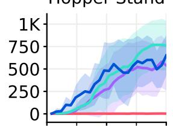

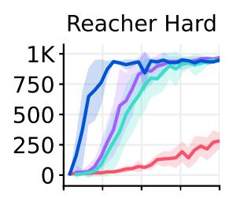

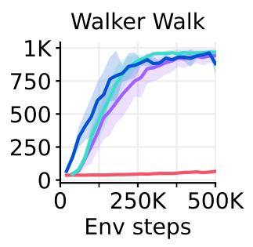

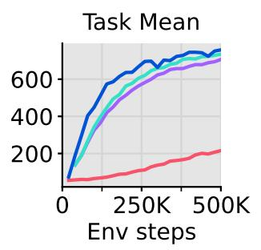

  

图 14：DeepMind Control Suite 在本体感觉（proprioceptive）输入下的学习曲线。

本体感觉控制得分

<table><tr><td>Task</td><td>PPO</td><td>DDPG</td><td>DMPO</td><td>D4PG</td><td>Dreamer</td></tr><tr><td>Environment steps</td><td>500K</td><td>500K</td><td>500K</td><td>500K</td><td>500K</td></tr><tr><td>Acrobot Swingup</td><td>6</td><td>100</td><td>103</td><td>124</td><td>134</td></tr><tr><td>Ball In Cup Catch</td><td>632</td><td>917</td><td>968</td><td>968</td><td>962</td></tr><tr><td>Cartpole Balance</td><td>523</td><td>997</td><td>999</td><td>999</td><td>990</td></tr><tr><td>Cartpole Balance Sparse</td><td>930</td><td>992</td><td>999</td><td>974</td><td>990</td></tr><tr><td>Cartpole Swingup</td><td>240</td><td>864</td><td>860</td><td>875</td><td>852</td></tr><tr><td>Cartpole Swingup Sparse</td><td>7</td><td>703</td><td>438</td><td>752</td><td>491</td></tr><tr><td>Cheetah Run</td><td>82</td><td>596</td><td>650</td><td>624</td><td>614</td></tr><tr><td>Finger Spin</td><td>18</td><td>775</td><td>769</td><td>823</td><td>931</td></tr><tr><td>Finger Turn Easy</td><td>281</td><td>499</td><td>620</td><td>612</td><td>793</td></tr><tr><td>Finger Turn Hard</td><td>106</td><td>313</td><td>495</td><td>421</td><td>889</td></tr><tr><td>Hopper Hop</td><td>0</td><td>36</td><td>68</td><td>80</td><td>113</td></tr><tr><td>Hopper Stand</td><td>3</td><td>484</td><td>549</td><td>762</td><td>576</td></tr><tr><td>Pendulum Swingup</td><td>1</td><td>767</td><td>834</td><td>759</td><td>788</td></tr><tr><td>Reacher Easy</td><td>494</td><td>934</td><td>961</td><td>960</td><td>954</td></tr><tr><td>Reacher Hard</td><td>288</td><td>949</td><td>968</td><td>937</td><td>938</td></tr><tr><td>Walker Run</td><td>31</td><td>561</td><td>493</td><td>616</td><td>649</td></tr><tr><td>Walker Stand</td><td>159</td><td>965</td><td>975</td><td>947</td><td>964</td></tr><tr><td>Walker Walk</td><td>64</td><td>952</td><td>942</td><td>969</td><td>936</td></tr><tr><td>Task mean</td><td>94</td><td>771</td><td>801</td><td>792</td><td>871</td></tr><tr><td>Task median</td><td>215</td><td>689</td><td>705</td><td>733</td><td>754</td></tr></table>

表 11：本体感知输入条件下的 DeepMind Control Suite 得分。

  

视觉控制学习曲线

图 15：DeepMind Control Suite 在视觉输入下的学习曲线。

视觉控制评分

<table><tr><td>Task</td><td>PPO</td><td>SAC</td><td>CURL</td><td>DrQ-v2</td><td>Dreamer</td></tr><tr><td>Environment steps</td><td>1M</td><td>1M</td><td>1M</td><td>1M</td><td>1M</td></tr><tr><td>Acrobot Swingup</td><td>3</td><td>4</td><td>4</td><td>166</td><td>229</td></tr><tr><td>Ball In Cup Catch</td><td>829</td><td>176</td><td>970</td><td>928</td><td>972</td></tr><tr><td>Cartpole Balance</td><td>516</td><td>937</td><td>980</td><td>992</td><td>993</td></tr><tr><td>Cartpole Balance Sparse</td><td>881</td><td>956</td><td>999</td><td>987</td><td>964</td></tr><tr><td>Cartpole Swingup</td><td>290</td><td>706</td><td>771</td><td>863</td><td>861</td></tr><tr><td>Cartpole Swingup Sparse</td><td>1</td><td>149</td><td>373</td><td>773</td><td>759</td></tr><tr><td>Cheetah Run</td><td>95</td><td>20</td><td>502</td><td>716</td><td>836</td></tr><tr><td>Finger Spin</td><td>118</td><td>291</td><td>880</td><td>862</td><td>589</td></tr><tr><td>Finger Turn Easy</td><td>253</td><td>200</td><td>340</td><td>525</td><td>878</td></tr><tr><td>Finger Turn Hard</td><td>79</td><td>94</td><td>231</td><td>247</td><td>904</td></tr><tr><td>Hopper Hop</td><td>0</td><td>0</td><td>164</td><td>221</td><td>227</td></tr><tr><td>Hopper Stand</td><td>4</td><td>5</td><td>777</td><td>903</td><td>903</td></tr><tr><td>Pendulum Swingup</td><td>1</td><td>592</td><td>413</td><td>843</td><td>744</td></tr><tr><td>Quadruped Run</td><td>88</td><td>54</td><td>149</td><td>450</td><td>617</td></tr><tr><td>Quadruped Walk</td><td>112</td><td>49</td><td>121</td><td>726</td><td>811</td></tr><tr><td>Reacher Easy</td><td>487</td><td>67</td><td>689</td><td>944</td><td>951</td></tr><tr><td>Reacher Hard</td><td>94</td><td>7</td><td>472</td><td>670</td><td>862</td></tr><tr><td>Walker Run</td><td>30</td><td>27</td><td>360</td><td>539</td><td>684</td></tr><tr><td>Walker Stand</td><td>161</td><td>143</td><td>486</td><td>978</td><td>976</td></tr><tr><td>Walker Walk</td><td>87</td><td>40</td><td>822</td><td>768</td><td>961</td></tr><tr><td>Task mean</td><td>94</td><td>81</td><td>479</td><td>770</td><td>861</td></tr><tr><td>Task median</td><td>206</td><td>226</td><td>525</td><td>705</td><td>786</td></tr></table>

表 12：DeepMind Control Suite 在视觉输入下的分数。

  

图 16：按类别可视化的 BSuite 分数 $^{48}$。Dreamer 在 scale 和 memory 这两个类别上超越了以往的方法。scale 类别衡量对奖励尺度（reward scales）的鲁棒性。

<table><tr><td>Task</td><td>Random</td><td>PPO</td><td>AC-RNN</td><td>DQN</td><td>Boot DQN</td><td>Dreamer</td></tr><tr><td>Bandit</td><td>0.00</td><td>0.38</td><td>1.00</td><td>0.93</td><td>0.98</td><td>0.96</td></tr><tr><td>Bandit Noise</td><td>0.00</td><td>0.61</td><td>0.63</td><td>0.71</td><td>0.80</td><td>0.75</td></tr><tr><td>Bandit Scale</td><td>0.00</td><td>0.39</td><td>0.60</td><td>0.74</td><td>0.83</td><td>0.78</td></tr><tr><td>Cartpole</td><td>0.04</td><td>0.84</td><td>0.40</td><td>0.85</td><td>0.69</td><td>0.93</td></tr><tr><td>Cartpole Noise</td><td>0.04</td><td>0.77</td><td>0.20</td><td>0.82</td><td>0.69</td><td>0.93</td></tr><tr><td>Cartpole Scale</td><td>0.04</td><td>0.83</td><td>0.12</td><td>0.72</td><td>0.65</td><td>0.92</td></tr><tr><td>Cartpole Swingup</td><td>0.00</td><td>0.00</td><td>0.00</td><td>0.00</td><td>0.15</td><td>0.03</td></tr><tr><td>Catch</td><td>0.00</td><td>0.91</td><td>0.87</td><td>0.92</td><td>0.99</td><td>0.96</td></tr><tr><td>Catch Noise</td><td>0.00</td><td>0.54</td><td>0.27</td><td>0.58</td><td>0.68</td><td>0.53</td></tr><tr><td>Catch Scale</td><td>0.00</td><td>0.90</td><td>0.17</td><td>0.85</td><td>0.65</td><td>0.94</td></tr><tr><td>Deep Sea</td><td>0.00</td><td>0.00</td><td>0.00</td><td>0.00</td><td>1.00</td><td>0.00</td></tr><tr><td>Deep Sea Stochastic</td><td>0.00</td><td>0.00</td><td>0.00</td><td>0.00</td><td>0.90</td><td>0.00</td></tr><tr><td>Discounting Chain</td><td>0.20</td><td>0.24</td><td>0.39</td><td>0.25</td><td>0.22</td><td>0.40</td></tr><tr><td>Memory Len</td><td>0.00</td><td>0.17</td><td>0.70</td><td>0.04</td><td>0.04</td><td>0.65</td></tr><tr><td>Memory Size</td><td>0.00</td><td>0.47</td><td>0.29</td><td>0.00</td><td>0.00</td><td>0.59</td></tr><tr><td>Mnist</td><td>0.05</td><td>0.77</td><td>0.56</td><td>0.85</td><td>0.85</td><td>0.61</td></tr><tr><td>Mnist Noise</td><td>0.05</td><td>0.41</td><td>0.22</td><td>0.38</td><td>0.34</td><td>0.34</td></tr><tr><td>Mnist Scale</td><td>0.05</td><td>0.76</td><td>0.09</td><td>0.49</td><td>0.31</td><td>0.55</td></tr><tr><td>Mountain Car</td><td>0.10</td><td>0.10</td><td>0.10</td><td>0.93</td><td>0.93</td><td>0.92</td></tr><tr><td>Mountain Car Noise</td><td>0.10</td><td>0.10</td><td>0.10</td><td>0.89</td><td>0.82</td><td>0.87</td></tr><tr><td>Mountain Car Scale</td><td>0.10</td><td>0.10</td><td>0.10</td><td>0.85</td><td>0.56</td><td>0.90</td></tr><tr><td>Umbrella Distract</td><td>0.00</td><td>1.00</td><td>0.09</td><td>0.30</td><td>0.26</td><td>0.74</td></tr><tr><td>Umbrella Length</td><td>0.00</td><td>0.87</td><td>0.43</td><td>0.39</td><td>0.39</td><td>0.78</td></tr><tr><td>Basic</td><td>0.04</td><td>0.60</td><td>0.58</td><td>0.90</td><td>0.89</td><td>0.88</td></tr><tr><td>Credit assignment</td><td>0.03</td><td>0.76</td><td>0.37</td><td>0.59</td><td>0.56</td><td>0.75</td></tr><tr><td>Exploration</td><td>0.00</td><td>0.00</td><td>0.00</td><td>0.00</td><td>0.68</td><td>0.01</td></tr><tr><td>Generalization</td><td>0.06</td><td>0.47</td><td>0.19</td><td>0.68</td><td>0.60</td><td>0.70</td></tr><tr><td>Memory</td><td>0.00</td><td>0.32</td><td>0.49</td><td>0.02</td><td>0.02</td><td>0.62</td></tr><tr><td>Noise</td><td>0.02</td><td>0.54</td><td>0.24</td><td>0.51</td><td>0.61</td><td>0.62</td></tr><tr><td>Scale</td><td>0.04</td><td>0.60</td><td>0.22</td><td>0.73</td><td>0.60</td><td>0.82</td></tr><tr><td>Task mean (%)</td><td>3</td><td>49</td><td>32</td><td>54</td><td>60</td><td>66</td></tr><tr><td>Category mean (%)</td><td>3</td><td>47</td><td>30</td><td>49</td><td>57</td><td>63</td></tr></table>

表 13：各任务在环境配置上平均的 BSuite 得分，以及按类别和所有任务汇总的性能。

鲁棒性消融实验

  

图 17：鲁棒性消融实验中各个独立的学习曲线。所有鲁棒性技术都对 Dreamer 的整体性能有所贡献，尽管每项单独的技术可能仅改善部分任务上的性能。

## 学习信号消融研究

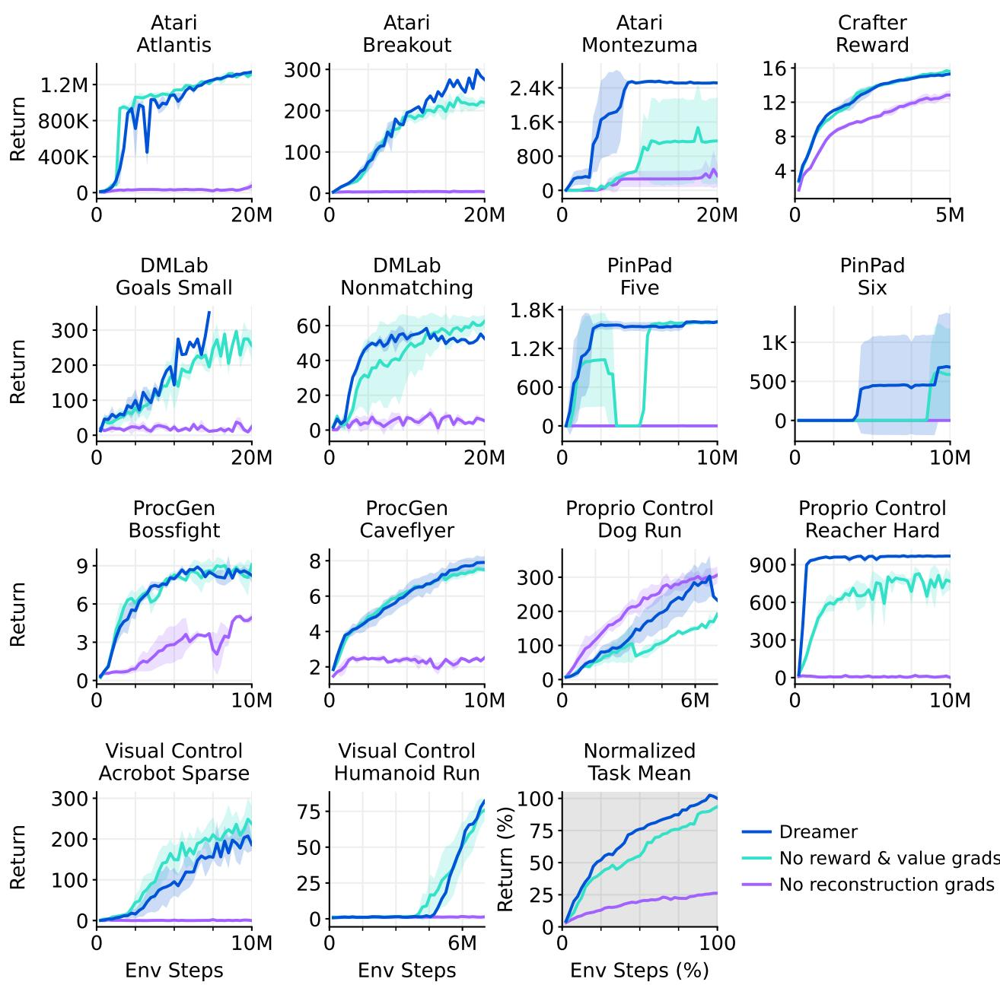  

图 18：学习信号消融实验中各任务的单独学习曲线。Dreamer 主要依赖其世界模型中欠监督的重建目标，而额外的奖励和价值梯度进一步提升了在部分任务上的性能。