# TD-MPC2：面向连续控制的可扩展且鲁棒的世界模型

Nicklas Hansen<sup>⋆</sup>，Hao Su<sup>⋆†</sup>，Xiaolong Wang<sup>⋆†</sup>
<sup>⋆</sup>加利福尼亚大学圣地亚哥分校（University of California San Diego），<sup>†</sup>同等指导
{nihansen,haosu,xiw012}@ucsd.edu

多任务（Multi-task）


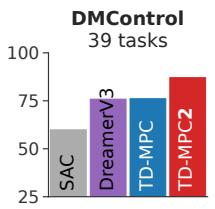  

Single-task

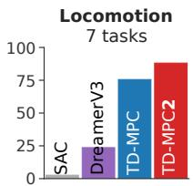


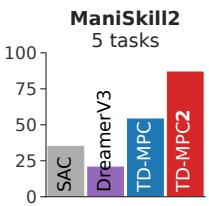

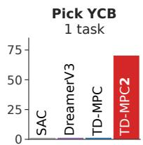  

图 1. 概览。TD-MPC2 在涵盖多个领域的 104 个连续控制任务上，相较于现有的无模型和有模型 RL 方法均表现出色，且仅使用一组超参数（右图）。此外，我们通过训练一个具有 3.17 亿参数的单一智能体来执行跨多种领域、多种本体和多种动作空间的 80 个任务，进一步展示了 TD-MPC2 的可扩展性（左图）。

## 摘要

TD-MPC 是一种基于模型的强化学习（RL）算法，它在所学隐式（无解码器）世界模型的潜空间中执行局部轨迹优化。在本工作中，我们提出 TD-MPC2：对 TD-MPC 算法的一系列改进。我们在涵盖 4 个不同任务领域的 104 项在线 RL 任务上证明，TD-MPC2 显著优于基线方法，且仅需使用同一组超参数即可持续取得优异表现。我们进一步表明，智能体的能力随模型和数据规模的增大而提升，并成功训练了一个具有 3.17 亿参数的单一智能体，使其能够跨多个任务领域、多种具身形式（embodiment）以及不同动作空间完成 80 项任务。最后，我们讨论了与大规模 TD-MPC2 智能体相关的经验、机遇与风险。

请访问 https://tdmpc2.com 以查看视频、模型、数据、代码等更多内容。

## 1 引言

在互联网规模的数据集上训练大型模型已催生出能够执行多种语言和视觉任务的通用模型（Brown 等，2020；He 等，2022；Kirillov 等，2023）。这些模型的成功在很大程度上归功于大规模数据集的可获得性，以及能够随模型和数据规模可靠扩展的精心设计的架构。尽管研究人员近期已将这一范式拓展至机器人领域（Reed 等，2022；Brohan 等，2023），但能够通过底层动作学习执行多种控制任务、跨多种具身形式、并从大规模未经筛选（即混合质量）数据集中学习的通用具身智能体（embodied agent），仍是一个遥不可及的目标。我们认为，当前通用具身智能体的方法受困于以下两点：(a) 行为克隆（behavior cloning）方法假设存在接近专家水平的轨迹，这严重限制了可用数据的规模（Reed 等，2022；Lee 等，2022；Kumar 等，2022；Schubert 等，2023；Driess 等，2023；Brohan 等，2023）；(b) 缺乏能够消化大规模未筛选数据的可扩展连续控制算法。

  

图 2. 任务。TD-MPC2 使用单一超参数集，在（从左到右）DMControl (Tassa et al., 2018)、Meta-World (Yu et al., 2019)、ManiSkill2 (Gu et al., 2023) 和 MyoSuite (Caggiano et al., 2022) 上完成 104 项多样化任务。所有任务的可视化见附录 B。

强化学习（Reinforcement Learning, RL）是从未经整理的数据集中提取专家行为的理想框架。然而，现有的大多数强化学习算法（Lillicrap et al., 2016; Haarnoja et al., 2018）是为单任务学习设计的，并依赖于逐任务超参数，且目前尚无选择这些超参数的系统化方法（Zhang et al., 2021）。一个能够消化大规模多任务数据集的算法不可避免地需要对不同任务之间的差异（例如动作空间维度、探索难度以及奖励分布）具有鲁棒性。在本文中，我们提出了 TD-MPC2：朝着达成该目标迈出的重要一步。TD-MPC2 是一种基于模型的强化学习算法，旨在由多个任务领域、多种具身形式与多种动作空间组成的大规模未经整理数据集上学习通用世界模型，其数据来源于覆盖广泛技能水平的行为策略，并且无需进行超参数调优。

我们的算法在 TD-MPC（Hansen et al., 2022）的基础上构建，在所学隐式（无解码器）世界模型的潜空间中执行局部轨迹优化。尽管 TD-MPC 系列算法在先前的工作中已展现出强大的实证性能（Hansen et al., 2022; 2023; Yuan et al., 2022; Yang et al., 2023; Feng et al., 2023; Chitnis et al., 2023; Zhu et al., 2023; Lancaster et al., 2023），但其成功大多局限于单任务学习，并且鲜少关注可扩展性问题。如图 1 所示，简单地增大 TD-MPC 的模型规模与数据规模往往会导致智能体性能的整体下降，这在强化学习文献中是常见的现象（Kumar et al., 2023）。相比之下，对 TD-MPC2 进行扩展能够带来持续提升的能力。我们在算法层面的贡献对于实现这一里程碑至关重要，主要体现在两个方面：（1）通过重新审视核心设计选择来改善算法的鲁棒性；（2）精心设计了一种架构，使其能够在不依赖领域知识的前提下，兼容具有多种具身形式与多种动作空间的数据集。最终得到的算法 TD-MPC2 具有良好的可扩展性与鲁棒性，并且能够使用同一套超参数应用于多种单任务与多任务连续控制问题。

我们在涵盖 4 个任务域的共计 104 项多样化连续控制任务上对 TD-MPC2 进行了评估，这 4 个任务域分别是：DMControl（Tassa 等, 2018）、Meta-World（Yu 等, 2019）、ManiSkill2（Gu 等, 2023）以及 MyoSuite（Caggiano 等, 2022）。我们在图 1 中总结了实验结果，并在图 2 中对任务域进行了可视化展示。这些任务涵盖了高维状态与动作空间（最高达 $\mathcal { A } \in \mathbb { R } ^ { 3 9 }$）、图像观测、稀疏奖励、多物体操作、肌肉骨骼层面的生理准确运动控制、复杂运动（例如 Dog 与 Humanoid 形态），并覆盖了范围广泛的任务难度。我们的结果表明，TD-MPC2 在所有任务上均使用同一套超参数，并始终优于现有的基于模型与无模型方法（图 1，右侧）。其中，「Locomotion」与「Pick YCB」分别是 DMControl 与 ManiSkill2 中尤其具有挑战性的子集。我们进一步展示，智能体的能力随着模型与数据规模的增大而提升，并成功训练了一个拥有 317M 参数的世界模型，使其能够在多个任务域、多种形态与不同动作空间中执行 80 项任务（图 1，左侧）。为推动开源科学，我们公开发布了 300 余个模型检查点、数据集以及用于训练与评估 TD-MPC2 智能体的代码，可访问 https://tdmpc2.com 获取。我们以对大型 TD-MPC2 智能体所涉及的经验教训、发展机遇与潜在风险的讨论作为本文的收尾。

## 2 背景（Background）

强化学习（Reinforcement Learning, RL）旨在通过与环境交互来学习策略，其形式化表述为一个马尔可夫决策过程（Markov Decision Process, MDP）（Bellman, 1957）。我们关注的是具有连续动作空间的无限时域 MDP，其可以形式化为一个元组 $( S , { \mathcal { A } } , { \mathcal { T } } , R , \gamma )$，其中 $\mathbf { s } \in { \mathcal { S } }$ 表示状态，$\mathbf { a } \in \mathcal A$ 表示动作，$\mathcal { T } \colon \mathcal { S } \times \mathcal { A } \mapsto \mathcal { S }$ 是转移函数，$\mathcal { R } \colon \mathcal { S } \times \dot { \mathcal { A } } \mapsto$ R 是与特定任务相关联的奖励函数，$\gamma$ 是折扣因子。目标是推导出一个控制策略 $\pi \colon S \mapsto A$，使得期望折扣累积奖励（即回报）$\begin{array} { r } { \mathbb { E } _ { \pi } \left[ \sum _ { t = 0 } ^ { \infty } \gamma ^ { t } r _ { t } \right] , \dot { r } _ { t } = \dot { R } ( \mathbf { s } _ { t } , \pi ( \mathbf { s } _ { t } ) ) } \end{array}$ 最大化。在本工作中，我们通过学习一个世界模型（环境的模型）来获得 $\pi$，随后基于所学模型进行规划以选择动作。

模型预测控制（Model Predictive Control, MPC）是一种基于模型控制的通用框架，它在时域长度 H 内对有限长度的动作序列 $\mathbf { a } _ { t : t + H }$ 进行优化，使时域 H 上的回报最大化（或代价最小化），这等价于求解如下优化问题：

$$
\pi (\mathbf {s} _ {t}) = \arg \max _ {\mathbf {a} _ {t: t + H}} \mathbb {E} \left[ \sum_ {i = 0} ^ {H} \gamma^ {t + i} R (\mathbf {s} _ {t + i}, \mathbf {a} _ {t + i}) \right].\tag{1}
$$

候选轨迹的回报通过使用学习到的模型对其进行仿真来估计（Negenborn 等，2005）。因此，由公式 1 得到的策略必然是一个（时间上）局部最优策略，并且不能保证（也不太可能）成为上文所述一般强化学习问题的解。正如我们在下文中所讨论的，TD-MPC2 通过使用学习到的末端价值函数将回报估计自举到规划范围 H 之外，从而解决了局部轨迹优化的这一不足。

## 3 TD-MPC2

我们的工作建立在 TD-MPC（Hansen 等，2022）的基础上，TD-MPC 是一种在所学隐式世界模型的潜空间中执行局部轨迹优化（规划）的基于模型的强化学习算法。TD-MPC2 是一种用于训练大规模多任务世界模型的实用算法。具体而言，我们对 TD-MPC 算法提出了一系列改进，这些改进对于实现强大的算法鲁棒性（能够在所有任务中使用相同的超参数）以及将其世界模型的参数量扩展至先前的 300 倍起到了关键作用。我们将在下文中介绍 TD-MPC2 算法，并在附录 A 中提供所有算法改进的完整列表。

## 3.1 学习隐式世界模型

使用重建（解码器）目标来学习环境的生成模型，由于其丰富的学习信号，颇具吸引力。然而，在长时间范围内准确预测原始未来观测（例如图像或本体感受特征）是一个困难的问题，并且不一定能够带来有效的控制（Lambert 等，2020）。TD-MPC2 并非通过重建来显式建模动力学，而是旨在学习一个最有用处的模型：一个能够准确预测以动作序列为条件的结果（回报）的模型。具体而言，TD-MPC2 通过结合联合嵌入预测（joint-embedding prediction，Grill 等，2020）、回报预测和 TD 学习（TD-learning，Sutton，1998），从环境交互中学习一个隐式的、以控制为中心的世界模型，而无需对观测进行解码。我们认为，这种基于模型的强化学习的替代性表述，是使用适中规模的模型建模大规模数据集的关键。该世界模型随后可通过遵循 MPC 框架进行局部轨迹优化（规划）以用于决策。

  

图 3. TD-MPC2 架构。观测值 $s$ 被编码为其（归一化的）潜在表征 $z$。随后模型以循环方式预测动作 $\hat{a}$、奖励 $\hat{r}$ 和终止值 $\hat{q}$，无需对未来观测进行解码。

组件。TD-MPC2 架构如图 3 所示，由五个组件组成：

$$
\begin{array}{l l l} \text {Encoder} & \mathbf {z} = h (\mathbf {s}, \mathbf {e}) & \triangleright \text {Maps observations to their latent representations} \\ \text {Latent dynamics} & \mathbf {z} ^ {\prime} = d (\mathbf {z}, \mathbf {a}, \mathbf {e}) & \triangleright \text {Models (latent) forward dynamics} \\ \text {Reward} & \hat {r} = R (\mathbf {z}, \mathbf {a}, \mathbf {e}) & \triangleright \text {Predicts reward r of a transition} \\ \text {Terminal value} & \hat {q} = Q (\mathbf {z}, \mathbf {a}, \mathbf {e}) & \triangleright \text {Predicts discounted sum of rewards (return)} \\ \text {Policy prior} & \hat {\mathbf {a}} = p (\mathbf {z}, \mathbf {e}) & \triangleright \text {Predicts action a* that maximizes Q} \end{array}\tag{2}
$$

其中 s 和 a 分别为状态（states）与动作（actions），z 为潜在表征（latent representation），e 为用于多任务世界模型的可学习任务嵌入（task embedding）。为视觉清晰起见，除非特别相关，否则后续我们将省略 e。策略先验（policy prior）p 用于引导基于采样的轨迹优化器（planner，规划器），并降低时序差分学习（TD-learning）的计算成本。在在线交互过程中，TD-MPC2 维护一个包含轨迹的回放缓冲区（replay buffer）B，并迭代地（i）使用从 B 中采样的数据更新世界模型，以及（ii）通过所学模型进行规划以收集新的环境数据。

模型目标。h、d、R、Q 各组件被联合优化，以最小化目标函数

$$
\mathcal {L} \left(\theta\right) \doteq \underset {\left(\mathbf {s}, \mathbf {a}, r, \mathbf {s} ^ {\prime}\right) _ {0: H} \sim \mathcal {B}} {\mathbb {E}} \left[ \sum_ {t = 0} ^ {H} \lambda^ {t} \left(\underbrace {\| \mathbf {z} _ {t} ^ {\prime} - \operatorname{sg} (h (\mathbf {s} _ {t} ^ {\prime})) \| _ {2} ^ {2}} _ {\text {Joint - embedding prediction}} + \underbrace {\operatorname{CE} (\hat {r} _ {t} , r _ {t})} _ {\text {Reward prediction}} + \underbrace {\operatorname{CE} (\hat {q} _ {t} , q _ {t})} _ {\text {Value prediction}}\right) \right],\tag{3}
$$

式中 sg 为 stop-grad 算子，$( \mathbf { z } _ { t } ^ { \prime } , \hat { r } _ { t } , \hat { q } _ { t } )$ 由公式 $2$ 给出，$q _ { t } \doteq r _ { t } + \gamma \bar { Q } ( \mathbf { z } _ { t } ^ { \prime } , p ( \mathbf { z } _ { t } ^ { \prime } ) )$ 为第 $t$ 步的 TD 目标，$\lambda \in ( 0 , 1 ]$ 为一个常数系数，用于降低时间上更远步的权重，CE 表示交叉熵。用于计算 TD 目标的 $\bar{Q}$ 是 Q 的指数移动平均（Exponential Moving Average，EMA）（Lillicrap 等，2016）。由于不同任务间奖励的量级可能差异显著，TD-MPC2 将奖励与价值预测建模为对数变换空间下的离散回归（多类分类）问题，通过以 $r _ { t } , q _ { t}$ 为软目标最小化交叉熵进行优化（Bellemare 等，2017；Kumar 等，2023；Hafner 等，2023）。

策略目标。策略先验 p 是一个随机最大熵（Ziebart 等，2008；Haarnoja 等，2018）策略，旨在学习最大化如下目标

$$
\mathcal {L} _ {p} (\theta) \doteq \underset {(\mathbf {s}, \mathbf {a}) _ {0: H} \sim \mathcal {B}} {\mathbb {E}} \left[ \sum_ {t = 0} ^ {H} \lambda^ {t} \left[ \alpha Q (\mathbf {z} _ {t}, p (\mathbf {z} _ {t})) - \beta \mathcal {H} (p (\cdot | \mathbf {z} _ {t})) \right] \right],   \mathbf {z} _ {t + 1} = d (\mathbf {z} _ {\mathbf {t}}, \mathbf {a} _ {\mathbf {t}}),   \mathbf {z} _ {0} = h (\mathbf {s} _ {0}),\tag{4}
$$

其中 H 是 p 的熵，可以以解析形式（closed form）计算。$\mathcal { L } _ { p } ( \theta )$ 的梯度仅相对于 p 计算。由于价值估计 $Q ( \mathbf { z } _ { t } , p ( \mathbf { z } _ { t } ) )$ 和熵 H 的数值大小在不同数据集和训练的不同阶段可能会有很大差异，因此有必要平衡这两个损失，以防止过早的熵坍缩（premature entropy collapse）（Yarats et al., 2021）。自动调节 $\alpha , \beta$ 的一种常见做法是保持其中一个恒定，然后基于熵目标（Haarnoja et al., 2018）或移动统计量（moving statistics）（Hafner et al., 2023）来调节另一个。在实践中，我们选择通过移动统计量来调节 α，但根据经验，这两种选择在结果上没有观察到显著差异。

**架构。** TD-MPC2 的所有组件均通过多层感知机（MLP）实现，其中间线性层后接 LayerNorm（Ba et al., 2016）和 Mish（Misra, 2019）激活函数。为了缓解梯度爆炸，我们通过 softmax 操作将 z 投影到 L 个固定维度的单纯形（simplices）中，从而归一化潜在表示（Lavoie et al., 2022）。将 z 嵌入为单纯形的一个关键好处（相对于 $e . g .$ . 离散表示或挤压（squashing）等方法）是，它在不对表示施加硬约束的情况下，自然地使其倾向于稀疏（动机与实现细节见附录 H）。我们将这种归一化方案称为 SimNorm。设 V 为由 z 的 L 个划分（组）所构造的每个单纯形 g 的维度。SimNorm 然后施加以下变换：

$$
\mathbf {z} ^ {\circ} \doteq [ \mathbf {g} _ {i}, \ldots , \mathbf {g} _ {L} ], \mathbf {g} _ {i} = \frac {e ^ {\mathbf {z} _ {i : i + V} / \tau}}{\sum_ {j = 1} ^ {V} e ^ {\mathbf {z} _ {i : i + V} / \tau}},\tag{5}
$$

其中 $\mathbf{z}^{\circ}$ 是 $\mathbf{z}$ 的单纯形嵌入（simplicial embedding），$[\cdot]$ 表示拼接操作，$\tau > 0$ 是一个温度参数，用于调控表征的"稀疏性"。正如我们将在实验中展示的，SimNorm 对 TD-MPC2 的训练稳定性至关重要。最后，为了减少由 $\bar{Q}$ 生成的 TD 目标中的偏差，我们使用式 3 的目标来学习一组 Q 函数集合，并将 $\bar{Q}$ 维护为每个 Q 函数的指数移动平均（EMA）。在实际中我们使用 5 个 Q 函数。目标值随后通过对两个随机子采样的 $\bar{Q}$ 函数取最小值来计算（Chen et al., 2021）。

## 3.2 基于策略先验的模型预测控制（MODEL PREDICTIVE CONTROL WITH A POLICY PRIOR）

TD-MPC2 通过利用所学世界模型进行规划来导出其闭环控制策略。具体而言，我们的方法利用 MPC 框架进行局部轨迹优化，使用模型预测路径积分（Model Predictive Path Integral, MPPI）（Williams et al., 2015）作为一种无导数优化器，对采样得到的长度为 $H$ 的动作序列 $(\mathbf{a}_t, \mathbf{a}_{t+1}, \ldots, \mathbf{a}_{t+H})$ 进行优化，其评估方式是在模型上展开潜变量轨迹。在每个决策步骤，我们估计一个时变多元高斯分布的参数 $\mu^*, \sigma^*$（具有对角协方差），使得期望回报最大化，即

$$
\mu^ {*}, \sigma^ {*} = \arg \max _ {(\mu , \sigma) (\mathbf {a} _ {t}, \mathbf {a} _ {t + 1}, \dots , \mathbf {a} _ {t + H}) \sim \mathcal {N} (\mu , \sigma^ {2})} \left[ \gamma^ {H} Q (\mathbf {z} _ {t + H}, \mathbf {a} _ {t + H}) + \sum_ {h = t} ^ {H - 1} \gamma^ {h} R (\mathbf {z} _ {h}, \mathbf {a} _ {h}) \right],\tag{6}
$$


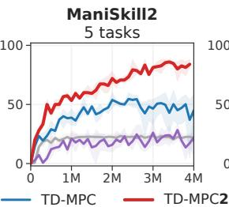

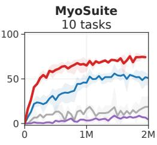  

图 4. 单任务强化学习。在涵盖 4 个不同任务领域的 104 个连续控制任务上，回报（DMControl）和成功率（其他）随环境步数的变化曲线。TD-MPC2 在所有任务中使用相同的超参数，实现了比现有方法更高的数据效率和渐近性能。结果为 3 个随机种子下的均值和 95% 置信区间。

其中 $\mu , \sigma \in \mathbb { R } ^ { H \times m } , \mathcal { A } \in \mathbb { R } ^ { m }$ 。公式 6 通过从 $\mathcal { N } ( \mu , \dot { \sigma } ^ { 2 } )$ 中迭代采样动作序列、评估其期望回报，并基于加权平均更新 $\mu , \sigma$ 来求解。值得注意的是，公式 6 通过在视野 H 之外借助学到的终值函数进行自举（bootstrapping），来估计第 2 节中提出的完整强化学习目标。TD-MPC2 将该迭代规划过程重复固定轮数，并在环境中执行首个动作 $\mathbf { a } _ { t } \sim \mathcal { N } ( \mu _ { t } ^ { * } , \sigma _ { t } ^ { * } )$ 。为加速规划的收敛，有一部分动作序列来自策略先验 $p$，且我们通过将 $( \mu , \sigma )$ 初始化为上一步决策步平移 1 位后的解来对规划进行热启动（warm-start）。更多关于规划过程的细节请参阅 Hansen et al. (2022)。

## 3.3 训练通用型 TD-MPC2 智能体

TD-MPC2 在多样化单任务问题上的成功可归因于上述算法。然而，学习一个能在多个任务域、具身（embodiment）和动作空间上完成多种任务的大型通用型 TD-MPC2 智能体，面临若干独特挑战：(i) 如何学习并表示任务语义？(ii) 如何在不具备特定领域知识的前提下，兼容多种观测空间与动作空间？(iii) 如何利用所学模型对新任务进行少样本学习？我们在下文介绍我们在多任务模型学习上所采用的方法。

### 可学习的任务嵌入

为在多任务场景中取得成功，智能体需要学习一种公共表示，既能利用任务之间的相似性，又能在测试时保留区分不同任务的能力。当任务或领域知识可用时，例如以自然语言指令的形式，公式 2 中的任务嵌入 $e$ 可编码此类信息。然而，在无法假设领域知识的一般情形下，我们可以选择从数据中学习任务嵌入（以及隐含的任务关系）。TD-MPC2 用一个可学习的、固定维度的任务嵌入 $e$ 对其全部五个组件进行条件化，该嵌入与模型的其他组件联合训练。为提升训练稳定性，我们将 $e$ 的 $\ell _ { 2 } { \mathrm { - n o r m } }$ 约束为 $\leq 1$；这一做法在我们的实验中也带来了语义更一致的任务嵌入。在将多任务 TD-MPC2 智能体微调至新任务时，我们可以选择将 $e$ 初始化为某个语义相似任务的嵌入，也可简单初始化为一个随机向量。

动作掩码。TD-MPC2 学习在无需任何领域知识的情况下，完成具有各种观测空间和动作空间的任务。为此，我们将所有模型的输入和输出零填充到它们各自的最大维度，并在训练和推理过程中屏蔽掉策略先验 p 所做预测中无效的动作维度。这确保了无效维度上的预测误差不会影响 TD 目标（TD-target）的估计，并防止 p 在动作空间较小的任务上虚假地抬高其熵。我们在规划过程中同样仅沿有效维度采样动作。

## 4 实验

我们在总共 104 个不同的连续控制任务上对 TD-MPC2 进行了评估，这些任务涵盖 4 个任务领域：DMControl（Tassa 等，2018）、Meta-World（Yu 等，2019）、ManiSkill2（Gu 等，2023）和 MyoSuite（Caggiano 等，2022）。任务包括高维状态和动作空间（最高达 $\mathcal { A } \in \mathbb { R } ^ { 3 9 }$) 、稀疏奖励、多目标操作、生理上准确的肌骨骼运动控制、复杂运动 $( e . g .$ . Dog 和 Humanoid 形态），并涵盖了范围广泛的任务难度。我们还纳入了 10 个具有视觉观测的 DMControl 任务。为支持开源科学，我们公开发布了 300 多个模型检查点、数据集以及用于训练和评估 TD-MPC2 智能体的代码，可访问 https://tdmpc2.com 获取。

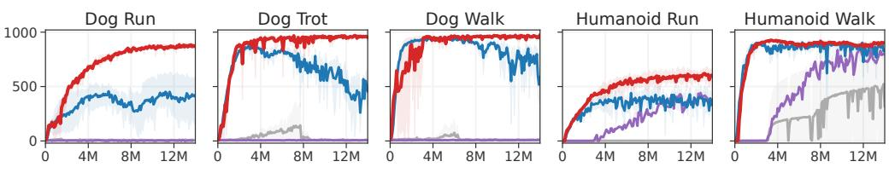

  

图 5. 高维运动控制。在 DMControl 中的 Humanoid $( \overset { \vartriangle } { \boldsymbol { A } } \in \mathbb { R } ^ { 2 1 } )$ 和 Dog $( \mathcal { A } \in \mathbb { R } ^ { 3 8 } )$ 运动任务上，episode return 随环境步数的变化曲线。在 Dog 任务中，SAC 和 DreamerV3 容易出现数值不稳定问题；而在 Humanoid 任务中，它们的数据效率显著低于 TD-MPC2。结果为 3 个随机种子上的均值及 95% 置信区间。更多任务请参见附录 D。

SAC DreamerV3 TD-MPC TD-MPC2  

图 6. 物体操作。在 ManiSkill2 中的 5 个物体操作任务上，成功率（%）随环境步数的变化曲线。Pick YCB 任务涉及 YCB（Calli et al., 2015）数据集中的全部 74 个物体。TD-MPC2 在困难任务上表现尤为出色。结果为 3 个随机种子上的均值及 95% 置信区间。

我们希望通过实验来回答三个核心研究问题：

• 与现有方法的比较。TD-MPC2 与当前最先进的无模型（SAC）方法以及基于模型（DreamerV3、TD-MPC）方法相比，在数据高效的连续控制任务上表现如何？

• 规模化。TD-MPC2 所做的算法创新是否会随着模型与数据规模的增大带来更强的智能体能力？单一智能体能否在多个任务域、不同具身（embodiment）和不同动作空间中学习到多样化的技能？

• 分析。TD-MPC2 中所引入的各项具体设计选择如何影响下游任务性能？规划（planning）对其成功的贡献有多大？所学习到的任务嵌入是否具有语义层面的意义？大规模多任务智能体能否被适配到未见过的任务？

基线方法（Baselines）。我们的主要基线方法代表数据高效强化学习领域的当前最先进水平，包括：(1) Soft Actor-Critic（SAC）（Haarnoja et al., 2018），一种基于最大熵强化学习的无模型 actor-critic 算法；(2) DreamerV3（Hafner et al., 2023），一种基于模型的方法，通过对从所学环境生成模型中采样得到的推演轨迹（rollouts）进行优化以得到无模型策略；(3) 原始版本的 TD-MPC（Hansen et al., 2022），一种基于模型的强化学习算法，在所学隐式（非生成式）世界模型的潜空间中执行局部轨迹优化（即规划）。此外，我们还与当前最先进的视觉强化学习方法进行了比较：(4) CURL（Srinivas et al., 2020），SAC 的扩展，引入了一个对比学习辅助目标；(5) DrQv2，一种使用数据增强的无模型强化学习算法。SAC 和 TD-MPC 使用针对各任务专门调优的超参数，而 TD-MPC2 在所有任务上使用同一套超参数。此外，值得注意的是，SAC 和 TD-MPC 都使用了较大的批大小 512，而 TD-MPC2 使用 256 便足以实现稳定学习。类似地，DreamerV3 使用高达 512 的更新-数据比（update-to-data ratio, UTD），而 TD-MPC2 默认使用 UTD 为 1。除非另有说明，我们在所有实验中使用参数量为 5M 的 TD-MPC2 智能体。作为参考，DreamerV3 基线方法拥有约 20M 个可学习参数。更多细节请参见附录 H。

## 4.1 实验结果（Results）

与现有方法的对比。我们首先在在线强化学习设定下，针对 104 个多样化任务，比较了 TD-MPC2 与一组强基线方法的数据效率。汇总结果如图 4 所示。我们发现 TD-MPC2 在所有任务领域上都优于先前的方法。MyoSuite 上的结果尤其值得关注，因为在所报告的结果之前，我们并未在该基准上运行过任何 TD-MPC2 实验。一些最困难任务（高维运动与多物体操作）的单任务表现如图 5 和图 6 所示。尽管在所有任务上使用相同的超参数，TD-MPC2 仍以很大优势超越了基线方法。值得注意的是，TD-MPC 有时会因梯度爆炸而发散，而 TD-MPC2 保持稳定。我们在附录 G 中提供了逐任务的梯度可视化。类似地，我们观察到 DreamerV3 偶尔会出现数值不稳定（在 Dog 任务上），并且通常在需要精细物体操作的任务（lift、pick、stack）上表现不佳。完整的单任务强化学习结果见附录 D。


  

图 7. 大规模多任务世界模型。（左）模型规模在两个 80 任务和 30 任务数据集上的归一化得分。TD-MPC2 的能力随模型规模的增大而提升。（右）TD-MPC2 智能体在 DMControl 和 Meta-World 的 80 个任务上训练后所学到的任务嵌入的 T-SNE（van der Maaten & Hinton, 2008）可视化。为清晰起见，仅展示部分标签。

大规模多任务世界模型。为了证明我们提出的改进有助于世界模型（world models）的规模化，我们在涵盖多个任务领域、目标、具身形态和动作空间差异显著的 80 个多样化任务上，评估了 5 个参数量从 1M 到 317M 的多任务模型的性能。这些模型在由 240 个单任务 TD-MPC2 智能体（TD-MPC2 agents）的回放缓冲区（replay buffer）收集的、包含 5.45 亿（545M）条转移（transitions）的数据集上训练，因此涵盖了从随机策略到专家策略的广泛行为。任务集包括全部 50 个 Meta-World 任务以及 30 个 DMControl 任务。其中 DMControl 任务集包含 19 个原始的 DM-Control 任务以及 11 个新任务。为保持完整性，我们同样在 30 任务 DMControl 子集（3.45 亿条转移）上提供了一组单独的规模化结果。由于我们对 TD-MPC2 算法进行了精心设计，扩大规模是直接可行的：

Table 1. 训练成本。TD-MPC2 在 80 任务数据集上的大致训练成本，以单块 NVIDIA GeForce RTX 3090 GPU 上的 GPU 天数（GPU days）为单位报告。同时列出每个模型在训练结束时取得的归一化分数（normalized score）。

<table><tr><td>Params (M)</td><td>GPU days</td><td>Score</td></tr><tr><td>1</td><td>3.7</td><td>16.0</td></tr><tr><td>5</td><td>4.2</td><td>49.5</td></tr><tr><td>19</td><td>5.3</td><td>57.1</td></tr><tr><td>48</td><td>12</td><td>68.0</td></tr><tr><td>317</td><td>33</td><td>70.6</td></tr></table>

为了提高收敛速度，我们使用了相比单任务实验大 4 倍的批量大小（1024），但对其他超参数不做任何更改。

## 将 TD-MPC2 扩展到 317M 参数

我们的扩展结果如图 7 所示。为了用单一指标总结智能体性能，我们生成了一个归一化分数，该分数是所有单独任务成功率（Meta-World）和归一化到 [0, 100] 范围的回合回报（DMControl）的平均值。我们观察到，在两个任务集上，智能体能力都随着模型规模的增大而持续提升。值得注意的是，在任一数据集上，我们最大的模型（317M 参数）的性能似乎都尚未饱和，因此可以预期在超出我们所考虑模型规模的更大模型上，结果会继续提升。我们没有建立扩展定律，但注意到归一化分数似乎与模型参数的对数呈线性关系（图 7 中的灰色直线）。我们还在表 1 中报告了大致的训练成本。317M 参数的模型可以使用有限的计算资源进行训练。

为了更好地理解多任务模型学习为何能够成功，我们探索了 TD-MPC2 学习到的任务嵌入（图 7 右侧）。有趣的是，在语义上相似的任务（例如，Door Open 和 Door Close）在所学到的任务嵌入空间中彼此接近。然而，嵌入相似度似乎与任务动态（具身 embodiment、物体 objects）的一致性比与目标（行走 walk、跑步 run）的一致性更紧密。这符合直觉，因为动态与控制紧密耦合。

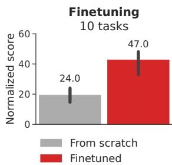  

图 8. 微调。一个拥有 1900 万参数的 TD-MPC2 智能体在 70 个任务上完成训练，再在线微调至 10 个保留任务中的每一个，微调步数为 2 万环境步。3 个随机种子。

少样本学习。虽然我们的工作主要关注世界模型的规模化与鲁棒性，但我们也探索了将预训练世界模型微调用于未见任务的少样本学习的有效性。具体而言，我们在 DMControl 的 70 个任务上预训练了一个具有 1900 万参数的 TD-MPC2 智能体，并对


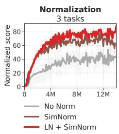


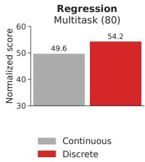


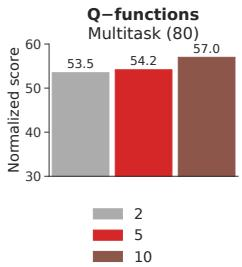

  

图 9. 消融实验。（曲线）在环境步数上的归一化得分，取自三个最具挑战性的任务：Dog Run、Humanoid Walk（DMControl）以及 Pick YCB（ManiSkill2）。曲线为 3 个随机种子下的均值与 95% 置信区间。（柱状图）19M 参数的多任务（80 个任务）TD-MPC2 智能体的归一化得分。本消融实验揭示了每个设计选择的相对重要性；红色为 TD-MPC2 的默认配置形式。更多消融实验参见附录 D。

图 10. 视觉强化学习。在 10 个基于图像的 DM-Control 任务上，环境步数对应的回合回报。曲线为 3 个随机种子下的均值与 95% 置信区间。TD-MPC2 与当前最优方法水平相当。

Meta-World，并对每个 10 个保留任务（每个领域 5 个）天真地（na¨ıvely）通过在线强化学习对完整模型进行微调，使用初始为空的回放缓冲区且不更改超参数。汇总结果如图 8 所示。我们发现，在低数据量场景下（20k 环境步数<sup>1</sup>），TD-MPC2 在新任务上相比从零学习提升了 2 倍（2×）。尽管将世界模型微调到新任务仍是一个非常开放的研究问题，但我们的探索性结果是令人鼓舞的。实验细节和单个任务曲线见附录 E。

**消融实验。** 我们对 TD-MPC2 的大多数设计选择进行了消融，包括执行器（actor）的选择、各种归一化技术、回归目标以及 Q 函数的数量。我们在三个最具挑战性的在线强化学习任务上以及大规模多任务训练（80 个任务）上进行了主要的消融实验，结果如图 9 所示。我们观察到，所有提出的改进都对 TD-MPC2 在单任务强化学习和多任务强化学习中的鲁棒性和强大性能做出了有意义的贡献。有趣的是，我们发现每个设计选择的相对重要性在两种设置中是一致的。最后，我们还对所学任务嵌入的归一化进行了消融，如附录 F 所示。结果表明，在多任务训练中维持归一化的任务嵌入空间（ℓ-范数为 1）对稳定性较为重要，并能产生更有意义的任务关系。

**视觉强化学习。** 在本工作中，我们主要考虑具有本体感受状态观察的高维连续控制任务。然而，TD-MPC2 也可以方便地应用于具有其他输入模态的任务。为了证明这一点，我们将 TD-MPC2 的编码器替换为浅层卷积编码器，并在 10 个难度各异的 DMControl 任务上将其与当前最先进的视觉强化学习方法进行基准比较。结果如图 10 所示。TD-MPC2 在不更改任何超参数的情况下，性能与两个最佳基线 DrQ-v2 和 DreamerV3 相当。

## 5 经验教训、机遇与风险（LESSONS, OPPORTUNITIES, AND RISKS）

经验教训. 从历史上看，强化学习（RL）算法一直以对网络架构、超参数、任务特性乃至随机种子（random seed）的敏感性而著称（Henderson et al., 2018），且缺乏对算法进行调优的原则性方法。因此，成功应用深度强化学习往往需要由大量专家组成的团队以及可观的计算资源（Berner et al., 2019; Schrittwieser et al., 2020; Ouyang et al., 2022）。TD-MPC2——以及若干其他当代 RL 方法（Yarats et al., 2021; Ye et al., 2021; Hafner et al., 2023）——致力于通过增强现有开源算法的稳健性，从而使其使用门槛降低，让规模较小的学术研究者、从业者和资源有限的个人也能够使用 RL。我们坚信，持续提升算法稳健性将继续对整个领域产生重大影响。从 TD-MPC2 的开发中获得的一条关键经验是，社区尚未发现一种真正能够开箱即用、无所不能的算法。例如，虽然 DreamerV3（Hafner et al., 2023）在具有离散动作空间的挑战性任务（如 Atari 游戏和 Minecraft）上取得了优异表现，但我们发现 TD-MPC2 在困难的连续控制任务上能够产生显著更佳的结果。与此同时，将 TD-MPC2 扩展到离散动作空间仍是一个有待解决的问题。

机遇。我们的可扩展性结果表明，基于模型的强化学习存在一条可行路径：在路径中，大规模多任务世界模型可被用作通用世界模型（generalist world models）。尽管多任务世界模型在文献中仍属相对未被充分探索的方向，但已有研究表明，TD-MPC2 的隐式世界模型（implicit world model）相较于基于重建的方法，可能更胜任视觉差异显著的任务（Zhu et al., 2023）。我们设想这样一幅未来图景：隐式世界模型被零样本（zero-shot）地用于在已见过的具身上执行多种任务（Xu et al., 2023; Yang et al., 2023），被微调以在新的具身上快速执行任务，并与现有的视觉-语言模型相结合，在低级物理交互的同时完成更高级的认知任务。我们的结果令人振奋，但要达到这样的泛化水平，很可能需要比目前多出数个数量级的任务。最后，我们还想强调，尽管 TD-MPC2 依赖奖励（rewards）进行任务学习，但将奖励泛化为一个更一般的概念——即仅仅是任务完成的某种度量——是有益的。这样的度量在现实世界中已经存在，例如成功标签、人类偏好或人类干预（Ouyang et al., 2022），或者在某个预先习得的表示中当前观测与目标之间的嵌入距离（Eysenbach et al., 2022; Ma et al., 2022）。然而，如何在大规模预训练中利用它们仍是未解决的问题。为了推动该方向的研究，我们发布了 300 多个 TD-MPC2 模型（包括 12 个多任务模型），以及相应的数据集和代码，我们无比期待看到社区将如何利用这些资源。

风险。尽管我们对通用场模型的未来潜力感到振奋，但仍存在若干挑战：（i）任务奖励的错误设定（misspecification）可能引发难以预见的意外后果（Clark & Amodei, 2016）；（ii）若缺少额外的安全检查，将物理机器人的无约束自主权交由学习模型可能导致灾难性失败（Lancaster et al., 2023）；（iii）对于某些应用而言，获取足够规模的数据以使通用行为涌现，对小型团队而言可能代价高昂，从而导致权力集中。缓解上述每一项挑战都需要新的研究创新，我们诚挚邀请社区与我们一道共同投入这些工作。

## 6 相关工作（RELATED WORK）

多项先前工作致力于构建对超参数、网络结构以及任务和数据变化具有鲁棒性的强化学习（Reinforcement Learning, RL）算法。例如：(1) Double Q-learning (Hasselt et al., 2016)、RED-Q (Chen et al., 2021)、SVEA (Hansen et al., 2021) 和 SR-SPR (D'Oro et al., 2023) 通过调节时序差分（Temporal Difference, TD）目标估计中的偏差-方差权衡（bias-variance trade-off），各自提升了 Q-learning 算法的稳定性；(2) C51 (Bellemare et al., 2017) 和 DreamerV3 (Hafner et al., 2023) 通过在变换空间中执行离散回归，增强了对奖励幅度的鲁棒性；(3) 无模型算法 DrQ (Kostrikov et al., 2020) 和 DrQ-v2 (Yarats et al., 2021) 分别借助数据增强（data augmentation）以及其他若干虽小但重要的实现细节，提升了训练的稳定性与探索能力。然而，上述所有工作都严格聚焦于提升单任务在线 RL（Online RL）中的数据效率与鲁棒性。

现有研究决策问题中神经网络结构可扩展性的文献，通常假设能够获得大量接近专家水平的演示数据用于行为克隆（behavior cloning）(Reed et al., 2022; Lee et al., 2022; Kumar et al., 2022; Schubert et al., 2023; Driess et al., 2023; Brohan et al., 2023)。Gato (Reed et al., 2022) 通过在一个庞大的专家演示数据集上训练一个大型的基于 Transformer 的序列模型（sequence model）(Vaswani et al., 2017)，学习跨多个领域执行任务；RT-1 (Brohan et al., 2023) 同样学习了一个序列模型，用于在单一（真实）机器人本体上完成物体操作，其训练数据来自人类远程操作所采集的大型数据集。尽管这一路线在经验上取得了令人瞩目的成果，但「需要大量演示数据」这一假设并不现实。此外，现有的策略模型依赖于对动作空间的离散化（tokenization），这使其难以扩展到高维连续控制任务。

最近，研究者们开始探索将强化学习算法的规模化作为应对上述挑战的方案 (Baker et al., 2022; Jia et al., 2022; Xu et al., 2023; Kumar et al., 2023; Hafner et al., 2023)。例如，VPT (Baker et al., 2022) 首先在一个大型人类游玩数据上预训练一个行为克隆策略来玩 Minecraft，随后用强化学习对该策略进行微调。GSL (Jia et al., 2022) 不需要任何预先存在的数据。GSL 在各个任务变体上迭代地训练一组「专家（specialist）」智能体，再通过行为克隆将它们蒸馏成一个「通才（generalist）」策略，然后将该通才策略作为下一轮专家智能体训练的初始化。不过，该工作严格考察的是单任务强化学习，并假设在每个回合（episode）中能够完全控制初始状态。最后，DreamerV3 (Hafner et al., 2023) 成功扩展了其世界模型（world model）的参数规模，并证明在在线强化学习设定下，更大的模型通常具有更高的数据效率；但该工作未涉及多任务强化学习。

## 致谢

本项目部分获得了以下资助：NSF CAREER Award（2240160）、NSF TILOS 人工智能研究所（2112665）、NSF CCF-2112665（TILOS）、NSF 1730158 CI-New：认知硬件与软件生态系统社区基础设施（CHASE-CI）、NSF ACI-1541349 CC*DNI Pacific Research Platform，以及 Qualcomm 的捐赠。

## 参考文献

Jimmy Lei Ba, Jamie Ryan Kiros, and Geoffrey E Hinton. 层归一化. Advances in Neural Information Processing Systems, 2016.

Bowen Baker, Ilge Akkaya, Peter Zhokov, Joost Huizinga, Jie Tang, Adrien Ecoffet, Brandon Houghton, Raul Sampedro, and Jeff Clune. 视频预训练（VPT）：通过观看无标注在线视频学习行动. Advances in Neural Information Processing Systems, 35:24639–24654, 2022.

Marc G Bellemare, Will Dabney, and Remi Munos. 强化学习的分布视角. 发表于：International Conference on Machine Learning, 第 449–458 页. PMLR, 2017.

Richard Bellman. 马尔可夫决策过程. Indiana Univ. Math. J., 6:679–684, 1957. ISSN 0022-2518.

Anthony Brohan, Noah Brown, Justice Carbajal, Yevgen Chebotar, Xi Chen, Krzysztof Choromanski, Tianli Ding, Danny Driess, Avinava Dubey, Chelsea Finn, 等. RT-2：将网络知识迁移到机器人控制的视觉-语言-动作模型. arXiv preprint arXiv:2307.15818, 2023.

Vittorio Caggiano, Huawei Wang, Guillaume Durandau, Massimo Sartori, and Vikash Kumar. MyoSuite——面向肌肉骨骼运动控制的接触密集型仿真套件, 2022.

Berk Calli, Arjun Singh, Aaron Walsman, Siddhartha Srinivasa, Pieter Abbeel, and Aaron M. Dollar. YCB 物体与模型集：迈向通用的操作研究基准. 发表于：2015 International Conference on Advanced Robotics, 第 510–517 页, 2015. doi: 10.1109/ICAR.2015.7251504.

Xinyue Chen, Che Wang, Zijian Zhou, and Keith Ross. 随机集成双 Q 学习：无需模型即可实现快速学习. International Conference on Learning Representations, 2021.

Rohan Chitnis, Yingchen Xu, Bobak Hashemi, Lucas Lehnert, Urun Dogan, Zheqing Zhu, and Olivier Delalleau. IQL-TD-MPC：面向分层模型预测控制的隐式 Q 学习. arXiv preprint arXiv:2306.00867, 2023.

Jack Clark and Dario Amodei. 野外环境中的故障奖励函数. OpenAI Blog, 2016.

Djork-Arne Clevert, Thomas Unterthiner, and Sepp Hochreiter. 通过指数线性单元（ELUs）实现快速准确的深度网络学习. arXiv preprint arXiv:1511.07289, 2015.

Remi Coulom. 蒙特卡洛树搜索中的高效选择性与回溯算子（Efficient selectivity and backup operators in monte-carlo tree search）。收录于 H. Jaap van den Herik、Paolo Ciancarini 与 H. H. L. M. (Jeroen) Donkers 主编, 《计算机与博弈》（Computers and Games）, 第 72–83 页, 柏林, 海德堡, 2007。Springer Berlin Heidelberg。

Pierluca D'Oro、Max Schwarzer、Evgenii Nikishin、Pierre-Luc Bacon、Marc G Bellemare 与 Aaron Courville. 打破回放比率壁垒的样本高效强化学习（Sample-efficient reinforcement learning by breaking the replay ratio barrier）。收录于第十一届国际学习表征会议（The Eleventh International Conference on Learning Representations）, 2023。

Danny Driess、Fei Xia、Mehdi SM Sajjadi、Corey Lynch、Aakanksha Chowdhery、Brian Ichter、Ayzaan Wahid、Jonathan Tompson、Quan Vuong、Tianhe Yu 等. PaLM-E：一种具身多模态语言模型（Palm-e: An embodied multimodal language model）。arXiv 预印本 arXiv:2303.03378, 2023。

Benjamin Eysenbach、Tianjun Zhang、Sergey Levine 与 Russ R Salakhutdinov. 将对比学习视为目标条件强化学习（Contrastive learning as goal-conditioned reinforcement learning）。《神经信息处理系统进展》（Advances in Neural Information Processing Systems）, 35:35603–35620, 2022。

Yunhai Feng、Nicklas Hansen、Ziyan Xiong、Chandramouli Rajagopalan 与 Xiaolong Wang. 在真实世界中微调离线世界模型（Finetuning offline world models in the real world）。机器人学习会议（Conference on Robot Learning）, 2023。

Jean-Bastien Grill、Florian Strub、Florent Altché、Corentin Tallec、Pierre H. Richemond、Elena Buchatskaya、Carl Doersch、Bernardo Avila Pires、Zhaohan Daniel Guo、Mohammad Gheshlaghi Azar、Bilal Piot、Koray Kavukcuoglu、Remi Munos 与 Michal Valko. 自举你自己的潜变量：一种自监督学习的新方法（Bootstrap your own latent: A new approach to self-supervised learning）。《神经信息处理系统进展》（Advances in Neural Information Processing Systems）, 2020。

Jiayuan Gu、Fanbo Xiang、Xuanlin Li、Zhan Ling、Xiqiaing Liu、Tongzhou Mu、Yihe Tang、Stone Tao、Xinyue Wei、Yunchao Yao、Xiaodi Yuan、Pengwei Xie、Zhiao Huang、Rui Chen 与 Hao Su. ManiSkill2：一个面向可泛化操作技能的统一基准（Maniskill2: A unified benchmark for generalizable manipulation skills）。收录于国际学习表征会议（International Conference on Learning Representations）, 2023。

Tuomas Haarnoja、Aurick Zhou、Kristian Hartikainen、G. Tucker、Sehoon Ha、Jie Tan、Vikash Kumar、Henry Zhu、Abhishek Gupta、P. Abbeel 与 Sergey Levine. 软演员-评论家算法及其应用（Soft actor-critic algorithms and applications）。ArXiv, abs/1812.05905, 2018。

Danijar Hafner、Jurgis Pasukonis、Jimmy Ba 与 Timothy Lillicrap. 通过世界模型掌握多样化领域（Mastering diverse domains through world models）。arXiv 预印本 arXiv:2301.04104, 2023。

Nicklas Hansen、Hao Su 与 Xiaolong Wang. 在数据增强下使用卷积网络与视觉 Transformer 稳定深度 Q 学习（Stabilizing deep q-learning with convnets and vision transformers under data augmentation）。收录于年度神经信息处理系统大会（Annual Conference on Neural Information Processing Systems）, 2021。

Nicklas Hansen、Xiaolong Wang 与 Hao Su. 用于模型预测控制的时间差分学习（Temporal difference learning for model predictive control）。收录于 ICML, 2022。

Nicklas Hansen、Yixin Lin、Hao Su、Xiaolong Wang、Vikash Kumar 与 Aravind Rajeswaran. MoDem：利用示教加速基于视觉模型的强化学习（Modem: Accelerating visual model-based reinforcement learning with demonstrations）。2023。

H. V. Hasselt、A. Guez 与 D. Silver. 基于双 Q 学习的深度强化学习（Deep reinforcement learning with double q-learning）。收录于 AAAI, 2016。

Kaiming He, Xinlei Chen, Saining Xie, Yanghao Li, Piotr Dollár, Ross Girshick. 掩码自编码器是可扩展的视觉学习器。发表于 IEEE/CVF 计算机视觉与模式识别会议（IEEE/CVF Conference on Computer Vision and Pattern Recognition）论文集，第 16000–16009 页，2022 年。

Peter Henderson, Riashat Islam, Philip Bachman, Joelle Pineau, Doina Precup, David Meger. 重要的深度强化学习。发表于第三十二届 AAAI 人工智能大会暨第三十届人工智能创新应用大会暨第八届 AAAI 人工智能教育进展研讨会论文集（AAAI'18/IAAI'18/EAAI'18）。AAAI Press，2018 年。ISBN 978-1-57735-800-8。

Thomas Hubert, Julian Schrittwieser, Ioannis Antonoglou, Mohammadamin Barekatain, Simon Schmitt, David Silver. 复杂动作空间中的学习与规划（Learning and Planning in Complex Action Spaces），2021 年。

Zhiwei Jia, Xuanlin Li, Zhan Ling, Shuang Liu, Yiran Wu, Hao Su. 利用通才–专才学习改进策略优化（Improving Policy Optimization with Generalist-Specialist Learning）。发表于国际机器学习大会（International Conference on Machine Learning），2022 年。

Ilya Kostrikov, Denis Yarats, Rob Fergus. 图像增强就是你需要的全部：从像素出发正则化深度强化学习（Image Augmentation Is All You Need: Regularizing Deep Reinforcement Learning from Pixels）。发表于国际学习表征会议（International Conference on Learning Representations），2020 年。

Aviral Kumar, Joey Hong, Anikait Singh, Sergey Levine. 我应该运行离线强化学习还是行为克隆？发表于国际学习表征会议（International Conference on Learning Representations），2022 年。

Aviral Kumar, Rishabh Agarwal, Xinyang Geng, George Tucker, Sergey Levine. 在多样化多任务数据上进行离线 Q 学习既可扩展又可泛化（Offline Q-Learning on Diverse Multi-Task Data Both Scales and Generalizes）。发表于国际学习表征会议（International Conference on Learning Representations），2023 年。

Nathan Lambert, Brandon Amos, Omry Yadan, Roberto Calandra. 基于模型的强化学习中的目标失配（Objective Mismatch in Model-Based Reinforcement Learning）。发表于决策与控制学习会议（Conference on Learning for Decision and Control），2020 年。

Patrick Lancaster, Nicklas Hansen, Aravind Rajeswaran, Vikash Kumar. MoDem-v2：用于真实世界机器人操作的视觉运动世界模型（MoDem-v2: Visuomotor World Models for Real-World Robot Manipulation）。arXiv 预印本（arXiv preprint），2023 年。

Samuel Lavoie, Christos Tsirigotis, Max Schwarzer, Ankit Vani, Michael Noukhovitch, Kenji Kawaguchi, Aaron Courville. 自监督学习与下游分类中的单纯形嵌入（Simplicial Embeddings in Self-Supervised Learning and Downstream Classification）。arXiv 预印本 arXiv:2204.00616，2022 年。

Kuang-Huei Lee, Ofir Nachum, Mengjiao (Sherry) Yang, Lisa Lee, Daniel Freeman, Sergio Guadarrama, Ian Fischer, Winnie Xu, Eric Jang, Henryk Michalewski, 等. 多游戏决策 Transformer（Multi-Game Decision Transformers）。发表于神经信息处理系统进展（Advances in Neural Information Processing Systems），第 35 卷，第 27921–27936 页，2022 年。

T. Lillicrap, J. Hunt, A. Pritzel, N. Heess, T. Erez, Y. Tassa, D. Silver, Daan Wierstra. 基于深度强化学习的连续控制（Continuous Control with Deep Reinforcement Learning）。CoRR，abs/1509.02971，2016 年。

Yecheng Jason Ma, Shagun Sodhani, Dinesh Jayaraman, Osbert Bastani, Vikash Kumar, and Amy Zhang. VIP：通过价值隐式预训练迈向通用视觉奖励与表征. arXiv 预印本 arXiv:2210.00030, 2022.

Diganta Misra. Mish：一种自正则化的非单调神经网络激活函数. arXiv 预印本 arXiv:1908.08681, 2019.

Mitsuhiko Nakamoto, Yuexiang Zhai, Anikait Singh, Max Sobol Mark, Yi Ma, Chelsea Finn, Aviral Kumar, and Sergey Levine. Cal-QL：用于高效在线微调的校准离线强化学习预训练, 2023.

Rudy R. Negenborn, Bart De Schutter, Marco A. Wiering, and Hans Hellendoorn. 基于学习的马尔可夫决策过程模型预测控制. IFAC 论文集, 38(1):354–359, 2005. 第 16 届 IFAC 世界大会.

Aaron van den Oord, Oriol Vinyals, and Koray Kavukcuoglu. 神经离散表示学习. arXiv 预印本 arXiv:1711.00937, 2017.

Long Ouyang, Jeffrey Wu, Xu Jiang, Diogo Almeida, Carroll Wainwright, Pamela Mishkin, Chong Zhang, Sandhini Agarwal, Katarina Slama, Alex Ray, 等. 使用人类反馈训练语言模型遵循指令. 神经信息处理系统进展, 35:27730–27744, 2022.

Julian Schrittwieser, Ioannis Antonoglou, Thomas Hubert, Karen Simonyan, Laurent Sifre, Simon Schmitt, Arthur Guez, Edward Lockhart, Demis Hassabis, Thore Graepel, 等. 通过学习模型进行规划掌握雅达利、围棋、国际象棋与将棋. 自然, 588(7839):604–609, 2020.

Aravind Srinivas, Michael Laskin, and Pieter Abbeel. CURL：用于强化学习的对比无监督表征. arXiv 预印本 arXiv:2004.04136, 2020.

Nitish Srivastava, Geoffrey Hinton, Alex Krizhevsky, Ilya Sutskever, and Ruslan Salakhutdinov. Dropout：防止神经网络过拟合的一种简单方法. 机器学习研究杂志, 15(56):1929–1958, 2014.

R. Sutton. 通过时序差分方法进行预测学习. 机器学习, 3:9–44, 1998.

Yuval Tassa, Yotam Doron, Alistair Muldal, Tom Erez, Yazhe Li, Diego de Las Casas, David Budden, Abbas Abdolmaleki, 等. DeepMind 控制套件. 技术报告, DeepMind, 2018.

Laurens van der Maaten and Geoffrey Hinton. 使用 t-SNE 可视化数据. 机器学习研究杂志, 9:2579–2605, 2008.

Grady Williams, Andrew Aldrich, and Evangelos A. Theodorou. 《使用协方差变量重要性采样的模型预测路径积分控制（Model Predictive Path Integral Control Using Covariance Variable Importance Sampling）》. ArXiv, abs/1509.01149, 2015.

Yifan Xu, Nicklas Hansen, Zirui Wang, Yung-Chieh Chan, Hao Su, and Zhuowen Tu. 《论基于模型的强化学习进行跨任务迁移的可行性（On the Feasibility of Cross-Task Transfer with Model-Based Reinforcement Learning）》. 2023.

Sizhe Yang, Yanjie Ze, and Huazhe Xu. 《Movie: 面向视角泛化的基于视觉模型的策略自适应（Movie: Visual Model-Based Policy Adaptation for View Generalization）》. Advances in Neural Information Processing Systems, 2023.

Denis Yarats, Rob Fergus, Alessandro Lazaric, and Lerrel Pinto. 《精通视觉连续控制：改进的数据增广强化学习（Mastering Visual Continuous Control: Improved Data-Augmented Reinforcement Learning）》. International Conference on Learning Representations, 2021.

Weirui Ye, Shaohuai Liu, Thanard Kurutach, Pieter Abbeel, and Yang Gao. 《以有限数据精通 Atari 游戏（Mastering Atari Games with Limited Data）》. Advances in Neural Information Processing Systems, 34:25476–25488, 2021.

Tianhe Yu, Deirdre Quillen, Zhanpeng He, Ryan Julian, Karol Hausman, Chelsea Finn, and Sergey Levine. 《Meta-world: 多任务与元强化学习的基准与评估（Meta-World: A Benchmark and Evaluation for Multi-Task and Meta Reinforcement Learning）》. 收录于：Conference on Robot Learning, 2019.

Yifu Yuan, Jianye Hao, Fei Ni, Yao Mu, Yan Zheng, Yujing Hu, Jinyi Liu, Yingfeng Chen, and Changjie Fan. 《Euclid: 迈向基于多选择动力学模型的高效无监督强化学习（Euclid: Towards Efficient Unsupervised Reinforcement Learning with Multi-Choice Dynamics Model）》. arXiv preprint arXiv:2210.00498, 2022.

Chuning Zhu, Max Simchowitz, Siri Gadipudi, and Abhishek Gupta. 《Repo: 通过正则化后验可预测性实现鲁棒的基于模型的强化学习（Repo: Resilient Model-Based Reinforcement Learning by Regularizing Posterior Predictability）》. arXiv preprint arXiv:2309.00082, 2023.

Brian D Ziebart, Andrew Maas, J Andrew Bagnell, and Anind K Dey. 《最大熵逆强化学习（Maximum Entropy Inverse Reinforcement Learning）》. 收录于：Proceedings of the 23rd National Conference on Artificial Intelligence, 第 3 卷, 2008.

## 附录（APPENDICES）

A 改进总结（Summary of Improvements） 16  
B 任务可视化（Task Visualizations） 17  
C 任务领域（Task Domains） 18  
D 单任务实验结果（Single-task Experimental Results） 21  
E 少样本实验结果（Few-shot Experimental Results） 24  
F 额外消融实验（Additional Ablations） 25  
G 梯度范数与训练稳定性（Gradient Norm and Training Stability） 26  
H 实现细节（Implementation Details） 26  
I 将 TD-MPC2 扩展到离散动作空间（Extending TD-MPC2 to Discrete Action Spaces） 29  
J 离线强化学习的测试时正则化（Test-Time Regularization for Offline RL） 30  
K 额外的多任务结果（Additional Multi-task Results） 31

## A 改进总结（SUMMARY OF IMPROVEMENTS）

我们按如下要点总结 TD-MPC 与 TD-MPC2 之间的主要差异：

• 架构设计。TD-MPC2 的所有组件均为 MLP，每个层后使用 LayerNorm（Ba 等人，2016）和 Mish（Misra，2019）激活函数。我们对潜在状态 z 应用 SimNorm 归一化，使表征倾向于稀疏性并维持较小的 ℓ<sub>2</sub>-范数。我们训练一个 Q 函数集成（默认 5 个），并在每个 Q 函数的第一层线性层后额外施加 1% 的 Dropout（Srivastava 等人，2014）。TD 目标通过两个随机子采样的 Q 函数中的最小值计算得出（Chen 等人，2021）。相比之下，TD-MPC 实现为不含层归一化（LayerNorm）的 MLP，而使用 ELU（Clevert 等人，2015）激活函数。TD-MPC 完全不对潜在状态施加约束，这在某些情况下会导致梯度爆炸（实验结果见附录 G）。最后，TD-MPC 仅学习 2 个 Q 函数且不使用 Dropout。TD-MPC2 中的架构差异导致其默认单任务模型相比 TD-MPC 的 1M 参数增加了 4M 可学习参数（总计 5M）。然而，如图 7 所示，仅简单地增大 TD-MPC 的模型规模并不能带来稳定提升的性能，但对于 TD-MPC2 而言则可以。

• 策略先验。TD-MPC2 的策略先验采用最大熵强化学习（Ziebart 等人，2008；Haarnoja 等人，2018）进行训练，而 TD-MPC 的策略先验则作为确定性策略进行训练，并对动作施加高斯噪声。我们发现，经过仔细调参的高斯噪声调度与采用最大熵训练的策略先验在效果上相当。然而，最大熵强化学习可以更轻松地应用于与任务无关的超参数设置。在涉及多个动作空间的多任务学习中，我们仅在有效的动作维度上计算策略熵。

• 规划。TD-MPC2 的规划过程与 TD-MPC 紧密一致。然而，我们对规划进行了适度简化，不再利用迭代间的动量（momentum），因为我们发现其产生的效果相近。我们还通过一系列代码层面的优化将规划的吞吐量提升了约 2 倍。

• 模型目标（Model objective）。我们重新审视了 TD-MPC 的训练目标，并提升了它对任务差异（例如奖励量级）的鲁棒性。TD-MPC2 在对数变换空间中采用对奖励和价值做离散回归（soft cross-entropy），使得两个损失项的量级独立于任务奖励的量级。TD-MPC 使用的是连续回归，在奖励较大的任务中会出现训练不稳定的问题。虽然这一问题在单任务情形中可以通过例如根据移动统计量归一化任务奖励等方式加以缓解，但在多任务学习中，要设计出鲁棒的奖励归一化方案是困难的。TD-MPC2 保留了对联合嵌入预测的连续回归项，因为其潜在表示已由 SimNorm 进行了归一化，而离散回归在高维空间中计算代价较高（需要对 z 的每个维度设置 N 个区间）。

• 多任务模型（Multi-task model）。TD-MPC2 引入了一个用于跨多个域、多种本体（embodiment）和多种动作空间学习多任务世界模型的框架。我们引入了一个经过归一化的、可学习的任务嵌入空间，TD-MPC 的所有组件都以该任务空间为条件；并通过在训练和推理过程中应用零填充（zero-padding）以及动作掩码（action masking）来兼容多种观测空间与动作空间。我们在大量任务上训练多任务模型，并通过在线强化学习对模型在未见任务（跨本体）上进行微调。TD-MPC 仅考虑了在共享观测空间和动作空间的小规模任务集合上的多任务学习，并且没有考虑对所学多任务模型的微调。

• 简化算法与实现（Simplified algorithm and implementation）。TD-MPC2 移除了 MPPI（Williams et al., 2015）中的动量项，并将经验回放缓冲（replay buffer）中按优先级采样的方式替换为均匀采样，这两项简化在实验结果上均未带来显著差异。最后，我们还使用了更快的经验回放缓冲实现，其通过多个工作进程（workers）并行采样；并通过 Q 函数集成（Q-function ensemble）向量化等代码层面的优化，提高了训练与规划的吞吐量。这使得尽管 TD-MPC2 的架构更大（5M 参数，相较于 TD-MPC 的 1M 参数），其运行时间（wall-time）仍与 TD-MPC 相当。

## B 任务可视化（TASK VISUALIZATIONS）

  

图 11. 任务可视化。我们考虑的 104 个任务中每个任务的一个随机初始状态的可视化。这些任务在目标、具身和动作空间方面差异很大。请访问 https: //tdmpc2.com 查看 TD-MPC2 执行每个任务的视频。任务详情见附录 C。

## C 任务领域（Task Domains）

我们考虑了来自 4 个任务领域的总共 104 个连续控制任务：DMControl（Tassa 等，2018）、Meta-World（Yu 等，2019）、ManiSkill2（Gu 等，2023）和 MyoSuite（Caggiano 等，2022）。本节提供了所有任务的完整列表，以及它们的观测和动作维度。环境详细信息列于本节末尾。我们在附录 B 中提供了（静态的）任务可视化，并在 https://www.tdmpc2.com 上提供了 TD-MPC2 智能体执行每个任务的视频。

表 2. DMControl. 我们在 DMControl 领域中考虑了总共 39 个连续控制任务，包括 19 个原始 DMControl 任务和 11 个专为 TD-MPC2 基准测试和多任务训练而创建的新的（自定义）任务。我们在下方列出了所有考虑的 DMControl 任务。图 1 中所示的 Locomotion 任务集对应于 DMControl 的 Humanoid 和 Dog 化身，性能在 14M 环境步数下报告。

<table><tr><td>Task</td><td>Observation dim</td><td>Action dim</td><td>Sparse?</td><td>New?</td></tr><tr><td>Acrobot Swingup</td><td>6</td><td>1</td><td>N</td><td>N</td></tr><tr><td>Cartpole Balance</td><td>5</td><td>1</td><td>N</td><td>N</td></tr><tr><td>Cartpole Balance Sparse</td><td>5</td><td>1</td><td>Y</td><td>N</td></tr><tr><td>Cartpole Swingup</td><td>5</td><td>1</td><td>N</td><td>N</td></tr><tr><td>Cartpole Swingup Sparse</td><td>5</td><td>1</td><td>Y</td><td>N</td></tr><tr><td>Cheetah Jump</td><td>17</td><td>6</td><td>N</td><td>Y</td></tr><tr><td>Cheetah Run</td><td>17</td><td>6</td><td>N</td><td>N</td></tr><tr><td>Cheetah Run Back</td><td>17</td><td>6</td><td>N</td><td>Y</td></tr><tr><td>Cheetah Run Backwards</td><td>17</td><td>6</td><td>N</td><td>Y</td></tr><tr><td>Cheetah Run Front</td><td>17</td><td>6</td><td>N</td><td>Y</td></tr><tr><td>Cup Catch</td><td>8</td><td>2</td><td>Y</td><td>N</td></tr><tr><td>Cup Spin</td><td>8</td><td>2</td><td>N</td><td>Y</td></tr><tr><td>Dog Run</td><td>223</td><td>38</td><td>N</td><td>N</td></tr><tr><td>Dog Trot</td><td>223</td><td>38</td><td>N</td><td>N</td></tr><tr><td>Dog Stand</td><td>223</td><td>38</td><td>N</td><td>N</td></tr><tr><td>Dog Walk</td><td>223</td><td>38</td><td>N</td><td>N</td></tr><tr><td>Finger Spin</td><td>9</td><td>2</td><td>Y</td><td>N</td></tr><tr><td>Finger Turn Easy</td><td>12</td><td>2</td><td>Y</td><td>N</td></tr><tr><td>Finger Turn Hard</td><td>12</td><td>2</td><td>Y</td><td>N</td></tr><tr><td>Fish Swim</td><td>24</td><td>5</td><td>N</td><td>N</td></tr><tr><td>Hopper Hop</td><td>15</td><td>4</td><td>N</td><td>N</td></tr><tr><td>Hopper Hop Backwards</td><td>15</td><td>4</td><td>N</td><td>Y</td></tr><tr><td>Hopper Stand</td><td>15</td><td>4</td><td>N</td><td>N</td></tr><tr><td>Humanoid Run</td><td>67</td><td>24</td><td>N</td><td>N</td></tr><tr><td>Humanoid Stand</td><td>67</td><td>24</td><td>N</td><td>N</td></tr><tr><td>Humanoid Walk</td><td>67</td><td>24</td><td>N</td><td>N</td></tr><tr><td>Pendulum Spin</td><td>3</td><td>1</td><td>N</td><td>Y</td></tr><tr><td>Pendulum Swingup</td><td>3</td><td>1</td><td>N</td><td>N</td></tr><tr><td>Quadruped Run</td><td>78</td><td>12</td><td>N</td><td>N</td></tr><tr><td>Quadruped Walk</td><td>78</td><td>12</td><td>N</td><td>N</td></tr><tr><td>Reacher Easy</td><td>6</td><td>2</td><td>Y</td><td>N</td></tr><tr><td>Reacher Hard</td><td>6</td><td>2</td><td>Y</td><td>N</td></tr><tr><td>Reacher Three Easy</td><td>8</td><td>3</td><td>Y</td><td>Y</td></tr><tr><td>Reacher Three Hard</td><td>8</td><td>3</td><td>Y</td><td>Y</td></tr><tr><td>Walker Run</td><td>24</td><td>6</td><td>N</td><td>N</td></tr><tr><td>Walker Run Backwards</td><td>24</td><td>6</td><td>N</td><td>Y</td></tr><tr><td>Walker Stand</td><td>24</td><td>6</td><td>N</td><td>N</td></tr><tr><td>Walker Walk</td><td>24</td><td>6</td><td>N</td><td>N</td></tr><tr><td>Walker Walk Backwards</td><td>24</td><td>6</td><td>N</td><td>Y</td></tr></table>

表 3. Meta-World。我们考虑了来自 Meta-World 领域的共计 50 个连续控制任务。Meta-World 基准是为多任务学习和元学习研究设计的，因此所有任务共享相同的具身形式（embodiment）、观测空间（observation space）和动作空间（action space）。

<table><tr><td>Task</td><td>Observation dim</td><td>Action dim</td></tr><tr><td>Assembly</td><td>39</td><td>4</td></tr><tr><td>Basketball</td><td>39</td><td>4</td></tr><tr><td>Bin Picking</td><td>39</td><td>4</td></tr><tr><td>...</td><td>...</td><td>...</td></tr><tr><td>Window Open</td><td>39</td><td>4</td></tr></table>

表 4. ManiSkill2. 我们总共考虑了来自 ManiSkill2 领域的 5 个连续控制任务。ManiSkill2 基准面向大规模机器人学习设计，包含了高度的随机化与任务变化。图 1 中所示的 Pick YCB 任务与同名 ManiSkill2 任务相对应，其性能在 14M 环境步数处报告。

<table><tr><td>Task</td><td>Observation dim</td><td>Action dim</td></tr><tr><td>Lift Cube</td><td>42</td><td>4</td></tr><tr><td>Pick Cube</td><td>51</td><td>4</td></tr><tr><td>Pick YCB</td><td>51</td><td>7</td></tr><tr><td>Stack Cube</td><td>55</td><td>4</td></tr><tr><td>Turn Faucet</td><td>40</td><td>7</td></tr></table>

表 5. MyoSuite。我们考虑了来自 MyoSuite 领域的总共 10 个连续控制任务。MyoSuite 基准专为高维、生理精确的肌肉骨骼运动控制而设计，涉及使用灵巧手进行的特别复杂的物体操作任务。MyoSuite 领域包含带目标随机化和不带目标随机化的任务。我们同时考虑了这两类情形，并分别将其称为 Easy（固定目标）和 Hard（随机目标）。

<table><tr><td>Task</td><td>Observation dim</td><td>Action dim</td></tr><tr><td>Reach Easy</td><td>115</td><td>39</td></tr><tr><td>Reach Hard</td><td>115</td><td>39</td></tr><tr><td>Pose Easy</td><td>108</td><td>39</td></tr><tr><td>Pose Hard</td><td>108</td><td>39</td></tr><tr><td>Pen Twirl Easy</td><td>83</td><td>39</td></tr><tr><td>Pen Twirl Hard</td><td>83</td><td>39</td></tr><tr><td>Object Hold Easy</td><td>91</td><td>39</td></tr><tr><td>Object Hold Hard</td><td>91</td><td>39</td></tr><tr><td>Key Turn Easy</td><td>93</td><td>39</td></tr><tr><td>Key Turn Hard</td><td>93</td><td>39</td></tr></table>

## D 单任务实验结果

  

图 12. 单任务 DMControl 结果。回合回报（Episode return）随环境步数变化的曲线。每个任务展示了前 4M 环境步，其中 Humanoid 和 Dog 任务运行 14M 环境步；我们将在图 15 中作为"运动（Locomotion）"基准的一部分提供这些曲线。注意，TD-MPC 在 Walker Stand 和 Walker Walk 等任务上出现发散，而 TD-MPC2 保持稳定。我们在附录 G 中对上述任务上的梯度进行了可视化。曲线表示 3 个随机种子下的均值和 95% 置信区间（CI）。

  

图 13. 单任务 Meta-World 结果。成功率（%）随环境步数的变化。TD-MPC2 在简单任务上的性能与现有方法相当，而在 Pick Place Wall 和 ShelfPlace 等困难任务上则优于其他方法。DreamerV3 常常无法收敛。


您发送的内容似乎不完整——只有四个算法名称（SAC、DreamerV3、TD-MPC、TD-MPC2），没有需要翻译的论文正文。

请将完整的英文论文 Markdown 内容粘贴过来，我会按规则为您翻译。

  

SAC DreamerV3 TD-MPC TD-MPC2  

图 14. 单任务 ManiSkill2 实验结果。在 ManiSkill2 的 5 个物体操控任务上，成功率（%）随环境步数的变化。Pick YCB 是其中最困难的任务，涵盖了 YCB（Calli et al., 2015）数据集中的全部 74 个物体的操控。我们报告了这些任务在 14M 环境步数下的结果，以及其他任务在 4M 环境步数下的结果。TD-MPC2 在 Pick YCB 任务上达到了 $a > 6 0 \%$ 的成功率，而其他方法在给定预算下均未能成功学习。基于 3 个随机种子取均值与 95% 置信区间。

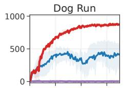

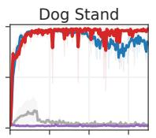


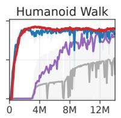  

图 15. 单任务高维运动控制结果。在全部 7 个「Locomotion」基准任务上，回合回报随环境步数的变化曲线。该领域包含高维的 Humanoid $( \boldsymbol { \mathcal { A } } \in \mathbb { R } ^ { 2 1 } )$ 与 Dog $( \mathcal { A } \in \mathbb { R } ^ { 3 8 } )$ 本体。基于 3 个随机种子绘制的均值与 95% 置信区间。

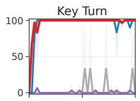


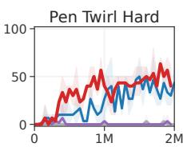

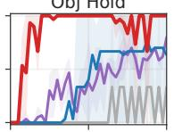

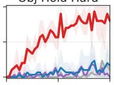


  

SAC DreamerV3 TD-MPC TD-MPC2

图 16. MyoSuite 单任务结果。成功率（%）随环境步数的变化曲线。该任务域包含高维且接触丰富的肌肉骨骼运动控制 $( \boldsymbol { \mathcal { A } } \in \mathbb { R } ^ { 5 9 } )$，使用的是生理学上精确的机器人手。在被标记为「Hard（困难）」的任务中，目标会随机化。在该基准的所有任务上，TD-MPC2 取得了与现有方法相当或更优的性能，唯一例外是 Key Turn Hard，在该任务上 TD-MPC 在训练早期便取得成功。

## E 少样本实验结果（FEW-SHOT EXPERIMENTAL RESULTS）

我们将一个在 70 个任务上训练得到的 19M 参数 TD-MPC2 智能体分别微调至 10 个未见任务。各任务的曲线如图 17 所示。我们将微调模型的数据效率与一个具有相似模型容量、从头训练的基线智能体进行比较。然而，我们发现从头训练的 19M 参数基线智能体的性能与从头训练的 5M 参数智能体的性能相当。我们的少样本微调结果表明，微调的效果在一定程度上依赖于任务。然而，要得出结论这究竟是由于任务相似性（或更准确地说，缺乏相似性），还是由于预训练智能体在源任务上的次优任务表现，还需要更多研究。我们推测这两个因素都可能影响结果。

在对未见任务进行微调时，我们将新任务的可学习任务嵌入初始化为来自预训练数据集中某个语义相似任务的嵌入。我们在表 7 中列出了每个实验所使用作为初始化的源任务嵌入。我们未尝试其他初始化方案，也未尝试其他任务配对。

  

图 17. 小样本学习（Few-shot learning）。对一个在 70 个任务上预训练、参数量为 19M 的 TD-MPC2 智能体，在 10 个保留（held-out）任务上进行微调时，其标准化回合回报（DMControl）与成功率（Meta-World）随环境步数的变化曲线。40k 步对应 DM-Control 中的 40 个回合，以及 Meta-World 中的 200 个回合。图中数值为 3 个随机种子下的均值与 95% 置信区间。

表 7. 用于少样本学习的任务嵌入初始化。我们列出了在将 19M 参数的 TD-MPC2 智能体微调到未见任务（held-out tasks）时用作初始化的任务嵌入。我们未尝试其他初始化方案，也未尝试其他任务配对方式。

<table><tr><td>Target task</td><td>Source task</td></tr><tr><td>Walker Run</td><td>Walker Walk</td></tr><tr><td>Cheetah Run</td><td>Cheetah Run Backwards</td></tr><tr><td>Hopper Hop</td><td>Hopper Stand</td></tr><tr><td>Pendulum Swingup</td><td>Pendulum Spin</td></tr><tr><td>Reacher Hard</td><td>Reacher Easy</td></tr><tr><td>Bin Picking</td><td>Pick Place</td></tr><tr><td>Box Close</td><td>Assembly</td></tr><tr><td>Door Lock</td><td>Door Open</td></tr><tr><td>Door Unlock</td><td>Door Open</td></tr><tr><td>Hand Insert</td><td>Sweep Into</td></tr></table>

## F 额外消融实验（Additional Ablations）

  

图 18. 归一化任务嵌入（Normalized Task Embeddings）。在有和没有按照第 3.1 节所述对任务嵌入 e 进行归一化的情况下，19M 参数多任务（80 个任务）TD-MPC2 智能体的归一化分数。我们发现，将 e 归一化以使其最大 $\ell _ { 2 }$-范数为 1 能够提升多任务性能。

  

图 19. 任务嵌入在有归一化和无归一化情况下的 T-SNE 可视化。由在 DMControl 和 Meta-World 的 80 个任务上训练的 TD-MPC2 智能体所学得任务嵌入的 T-SNE（van der Maaten & Hinton, 2008）可视化。（左）有归一化。（右）无归一化。为清晰起见，仅显示部分标签。我们观察到，在训练过程中进行归一化时，任务嵌入在语义上更有意义，例如，左图中 "Door Open" 和 "Door Close" 在嵌入空间中较为接近，而在右图中则相距较远

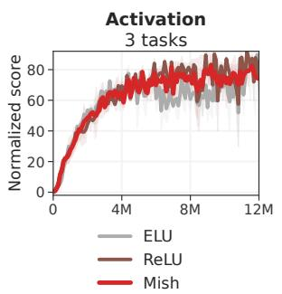

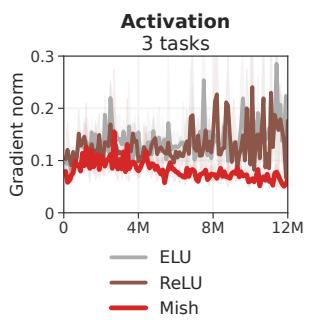  

图 20. 激活函数。归一化分数随环境步数的变化关系，对三个最困难的任务取均值：Dog Run、Humanoid Walk（DMControl）以及 Pick YCB（ManiSkill2）。在 3 个随机种子上的均值和 95% 置信区间。我们发现，无论使用哪种激活函数，TD-MPC2 都能取得相当的渐近性能和数据效率，但 Mish (Misra, 2019) 整体上带来更平滑的梯度。

## G 梯度范数与训练稳定性

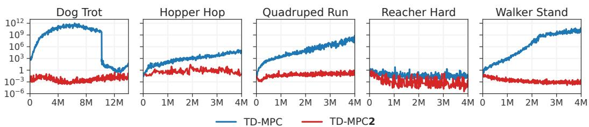  

图 21. 训练过程中的梯度范数。我们比较了在五个 DMControl 任务中，TD-MPC 与 TD-MPC2 的梯度范数（对数尺度，log-scale）随环境步数的变化情况。TD-MPC 容易出现梯度爆炸，这可能导致在某些任务上的学习发散（例如图 12 中的 Walker Stand）。相比之下，TD-MPC2 的梯度在整个训练过程中保持稳定。为了视觉清晰，每个任务仅显示 1 个随机种子。

## H 实现细节

架构细节。TD-MPC2 的所有组件均采用 MLP（多层感知机）实现。编码器 $h$ 包含可变数量的层（2−5 层），具体数量取决于架构规模；其他所有组件均为 3 层 MLP。中间层由一个线性层后接 LayerNorm 和 Mish 激活函数组成。潜空间表示被归一化为单形嵌入（simplicial embedding）。Q 函数额外使用了 Dropout。下面我们使用类 PyTorch 风格的记法，对 5M 参数基础版（在线强化学习的默认设置）TD-MPC2 架构进行概括：

```txt
Encoder parameters: 167,936
Dynamics parameters: 843,264
Reward parameters: 631,397
Policy parameters: 582,668
Q parameters: 3,156,985
Task parameters: 7,680
Total parameters: 5,389,930

Architecture: TD-MPC2 base 5M(
(task_embedding): Embedding(T, 96, max_norm=1)
(encoder): ModuleDict(
(state): Sequential(
(0): NormedLinear(in_features=S+T, out_features=256, act=Mish)
(1): NormedLinear(in_features=256, out_features=512, act=SimNorm)
)
)
(dynamics): Sequential(
(0): NormedLinear(in_features=512+T+A, out_features=512, act=Mish)
(1): NormedLinear(in_features=512, out_features=512, act=Mish)
(2): NormedLinear(in_features=512, out_features=512, act=SimNorm)
)
(reward): Sequential(
(0): NormedLinear(in_features=512+T+A, out_features=512, act=Mish)
(1): NormedLinear(in_features=512, out_features=512, act=Mish)
(2): Linear(in_features=512, out_features=101,)
)
(pi): Sequential(
(0): NormedLinear(in_features=512+T, out_features=512, act=Mish)
(1): NormedLinear(in_features=512, out_features=512, act=Mish)
(2): Linear(in_features=512, out_features=2A, bias=True)
)
(Qs): Vectorized ModuleList(
(0-4): 5 x Sequential(
(0): NormedLinear(in_features=512+T+A, out_features=512, dropout=0.01, act=Mish)
(1): NormedLinear(in_features=512, out_features=512, act=Mish)
(2): Linear(in_features=512, out_features=101, bias=True)
)
)
```

其中 S 是输入维度，T 是任务数量，A 是动作空间。我们在单任务实验中排除了任务嵌入 T。上述精确的参数计数针对的是 S = 39、T = 80 和 A = 6。

超参数。我们在所有任务中使用相同的超参数。我们的超参数列于表 8 中。我们对 TD-MPC 和 SAC 使用与 Hansen et al. (2022) 相同的超参数。DreamerV3（Hafner et al., 2023）使用一组固定的超参数。

表 8. TD-MPC2 超参数。我们在所有任务中使用相同的超参数。某些超参数使用启发式方法自动设置。

<table><tr><td>Hyperparameter</td><td>Value</td></tr><tr><td colspan="2">Planning</td></tr><tr><td>Horizon (H)</td><td>3</td></tr><tr><td>Iterations</td><td>6 (+2 if  $\| \mathcal{A} \| \geq 20$ )</td></tr><tr><td>Population size</td><td>512</td></tr><tr><td>Policy prior samples</td><td>24</td></tr><tr><td>Number of elites</td><td>64</td></tr><tr><td>Minimum std.</td><td>0.05</td></tr><tr><td>Maximum std.</td><td>2</td></tr><tr><td>Temperature</td><td>0.5</td></tr><tr><td>Momentum</td><td>No</td></tr><tr><td colspan="2">Policy prior</td></tr><tr><td>Log std. min.</td><td>-10</td></tr><tr><td>Log std. max.</td><td>2</td></tr><tr><td colspan="2">Replay buffer</td></tr><tr><td>Capacity</td><td>1,000,000</td></tr><tr><td>Sampling</td><td>Uniform</td></tr><tr><td colspan="2">Architecture (5M)</td></tr><tr><td>Encoder dim</td><td>256</td></tr><tr><td>MLP dim</td><td>512</td></tr><tr><td>Latent state dim</td><td>512</td></tr><tr><td>Task embedding dim</td><td>96</td></tr><tr><td>Task embedding norm</td><td>1</td></tr><tr><td>Activation</td><td>LayerNorm + Mish</td></tr><tr><td>Q-function dropout rate</td><td>1%</td></tr><tr><td>Number of Q-functions</td><td>5</td></tr><tr><td>Number of reward/value bins</td><td>101</td></tr><tr><td>SimNorm dim (V)</td><td>8</td></tr><tr><td>SimNorm temperature ( $\tau$ )</td><td>1</td></tr><tr><td colspan="2">Optimization</td></tr><tr><td>Update-to-data ratio</td><td>1</td></tr><tr><td>Batch size</td><td>256</td></tr><tr><td>Joint-embedding coef.</td><td>20</td></tr><tr><td>Reward prediction coef.</td><td>0.1</td></tr><tr><td>Value prediction coef.</td><td>0.1</td></tr><tr><td>Temporal coef. ( $\lambda$ )</td><td>0.5</td></tr><tr><td>Q-fn. momentum coef.</td><td>0.99</td></tr><tr><td>Policy prior entropy coef.</td><td> $1 \times 10^{-4}$ </td></tr><tr><td>Policy prior loss norm.</td><td>Moving (5%, 95%) percentiles</td></tr><tr><td>Optimizer</td><td>Adam</td></tr><tr><td>Learning rate</td><td> $3 \times 10^{-4}$ </td></tr><tr><td>Encoder learning rate</td><td> $1 \times 10^{-4}$ </td></tr><tr><td>Gradient clip norm</td><td>20</td></tr><tr><td>Discount factor</td><td>Heuristic</td></tr><tr><td>Seed steps</td><td>Heuristic</td></tr></table>

我们使用启发式方法为任务设置折扣因子 $\gamma$

$$
\gamma = \mathrm{clip} (\frac {\frac {T}{5} - 1}{\frac {T}{5}}, [ 0. 9 5, 0. 9 9 5 ])\tag{7}
$$

其中 $T$ 是在应用动作重复（action repeat）后一个回合（episode）的期望长度，clip 将折扣因子约束在区间 [0.95, 0.995] 内。使用这一启发式方法，我们对 DMControl $(T = 500)$ 得到 $\gamma = 0.99$，这也是该任务域中最广泛使用的折扣因子。较短回合的任务被赋予较低的折扣因子，而较长回合的任务则被赋予较高的折扣因子。我们所考虑的所有任务都是具有固定回合长度的无限视野（infinite-horizon）MDP。在多任务实验中，我们对每个任务使用单独的折扣因子（通过上述启发式方法设置）。对于回合长度可变或未知的任务，我们建议使用经验均值长度、合理猜测，或直接使用 $\gamma = 0.99$。虽然这一启发式方法是在 TD-MPC2 中提出的，但我们对 TD-MPC 和 SAC 基线同样应用该折扣因子，以确保在所有任务域之间比较的公平性。我们使用启发式方法为任务设置种子步数 $S$（即在任何梯度更新之前的环境步数）

$$
S = \max (5 T, 1 0 0 0)\tag{8}
$$

其中 $T$ 同样是任务在应用动作重复后的期望回合长度。我们没有尝试其他启发式方法或固定值，但推测式 8 能确保回放缓冲区 B 拥有足够的数据用于模型学习，而与回合长度无关。

**模型配置。** 我们的多任务实验考虑了参数量从 1M 到 317M 的 TD-MPC2 智能体。表 9 列出了每种模型大小的具体规格。我们通过改变全连接层的维度、潜状态维度 z、编码器层数以及 $Q \cdot$ 函数的数量来调整模型大小。在不同模型大小之间，我们不对架构或超参数进行其他修改。

表 9. 模型配置。我们列出了多任务实验中每种模型配置（大小）的规格。Encoder dim 是编码器 h 中全连接层的维度，MLP dim 是所有其他组件中层的维度，Latent state dim 是潜表示 $\mathbf { z }$ 的维度，# encoder layers 是编码器 h 中的层数，# Q-functions 是学到的 $Q \cdot$ 函数的数量，Task embedding dim 是式 2 中 e 的维度。无论集成中 ${ \check { Q } } .$ 函数的数量多少，TD-targets 总是通过对两个 Q 函数进行随机子采样来计算。我们没有尝试其他模型配置。\*我们在单任务强化学习实验中使用的默认（基础）配置具有 5M 参数。

<table><tr><td></td><td>1M</td><td>5M*</td><td>19M</td><td>48M</td><td>317M</td></tr><tr><td>Encoder dim</td><td>256</td><td>256</td><td>1024</td><td>1792</td><td>4096</td></tr><tr><td>MLP dim</td><td>384</td><td>512</td><td>1024</td><td>1792</td><td>4096</td></tr><tr><td>Latent state dim</td><td>128</td><td>512</td><td>768</td><td>768</td><td>1376</td></tr><tr><td># encoder layers</td><td>2</td><td>2</td><td>3</td><td>4</td><td>5</td></tr><tr><td># Q-functions</td><td>2</td><td>5</td><td>5</td><td>5</td><td>8</td></tr><tr><td>Task embedding dim</td><td>96</td><td>96</td><td>96</td><td>96</td><td>96</td></tr></table>

Simplicial Normalization (SimNorm)。SimNorm 是一种通过使用 softmax 运算将潜在表征 z 投影到 L 个固定维度单纯形（simplex）中来对其进行归一化的简单方法（Lavoie 等, 2022）。与离散表征或 squashing 等方式相比，将 z 嵌入为单纯形的一个关键优势在于，它自然地将表征偏向稀疏性，而无需施加硬约束。直观上，SimNorm 可以被视为 Oord 等 (2017) 所提出的表征学习向量类别（vector-of-categoricals）方法（VQ-VAE）的一种「软」变体。VQ-VAE 使用一组离散码（L 个向量划分，每个由 one-hot 编码组成）来表示潜在编码，而 SimNorm 则将潜在状态划分为 L 个向量划分，每个划分由连续值构成，并且由于 softmax 算子的作用，这些值之和为 1。这种对潜在表征的松弛类似于 softmax 作为 arg max 算子松弛的形式。虽然在我们的实验中并未调整 SimNorm 中所用 softmax 的温度 $\tau \in [0, \infty)$，但值得注意的是，该温度提供了一种在两个极端之间进行插值的机制。例如，当 $\tau \to \infty$ 时，会将所有概率质量集中到单一类别上，从而得到 VQ-VAE 的离散码（one-hot 编码）。而 $\tau = 0$ 的另一种极端则会导致平凡的编码（常向量；均匀概率质量），并阻止信息传播。因此，SimNorm 在不施加离散码或其他硬约束的情况下，将表征偏向稀疏性。我们使用类似 PyTorch 的符号将 SimNorm 归一化层（Lavoie 等, 2022）实现如下：

```python
def simnorm(self, z, V=8):
    shape = z.shape
    z = z.view(*shape[:-1], -1, V)
    z = softmax(z, dim=-1)
    return z.view(*shape)
```

此处，z 为潜在表示 z，V 为每个单纯形的维度数。单纯形数量 L 可由 V 与 z 的维度数推导得出。我们对 z 的 L 个划分施加 softmax（可选择由温度 τ 调节）以构成单纯形，随后重塑为 z 的原始形状。

视觉强化学习（Visual RL）。TD-MPC2 可直接应用于具有其他输入模态的任务。在图 10 所示的视觉强化学习实验中，我们将 TD-MPC2 默认的 MLP 编码器替换为浅层（4 层）卷积编码器，并采用 64 × 64 的图像分辨率。此外，我们沿用先前工作中的随机平移数据增强方法（Kostrikov 等，2020；Yarats 等，2021；Hansen 等，2022）。需要说明的是，尽管本实验采用了相对较小的图像分辨率，但这样做是为了降低计算成本并确保与基线方法进行公平比较。然而，先前工作已证明 TD-MPC 可支持高达 9 × 224 × 224 的输入（Lancaster 等，2023）。

TD-MPC 基线实现。我们对照 https://github.com/nicklashansen/tdmpc 中 TD-MPC 的官方实现进行基准测试。默认的 TD-MPC 世界模型拥有约 100 万个可训练参数，并使用针对各任务的超参数。在有建议超参数的情况下（DMControl 与 Meta-World），我们采用相应的建议参数。例如，TD-MPC 需要调节规划迭代次数、潜在状态维度、批量大小以及学习率，才能攻克具有挑战性的 Dog 与 Humanoid 任务。完整超参数列表请参阅其论文。

DreamerV3 基线实现。我们对照 https://github.com/danijar/dreamerv3 中 DreamerV3 的官方再实现进行基准测试。针对本体感知控制任务（DMControl），我们遵循作者建议的超参数，并采用 S 模型规模（2000 万参数）以及 512 的更新-数据比（UTD）。所有任务均使用这一模型规模与 UTD。完整超参数列表请参阅其论文。

SAC 基线实现。我们遵循 TD-MPC（Hansen 等，2022）论文中的做法，将 https://github.com/ denisyarats/pytorch\_sac 中的 SAC 实现作为对照基准，并采用作者建议的超参数（在可用时）。例如，对于 Dog 与 Humanoid 任务，这包括调节潜在维度、学习率以及批量大小。完整超参数列表请参阅其论文。

## I 将 TD-MPC2 扩展至离散动作空间

开发一种在连续与离散动作空间任务上同样表现出色的单一算法是令人期待的。然而，社区迄今尚未发现这样的算法。例如，DreamerV3（Hafner 等人，2023 年）在具有离散动作空间的挑战性任务（如 Atari 和 Minecraft）上取得了强劲的结果，而我们发现 TD-MPC2 在困难的连续控制任务上产生了显著更优的结果。同时，将 TD-MPC2 扩展到离散动作空间仍是一个悬而未决的问题。虽然我们在本工作中不考虑离散动作空间，但我们承认这种扩展的价值。目前，将 TD-MPC2 应用于离散动作的主要挑战在于规划算法的选择。TD-MPC2 依赖于用于规划的模型预测控制（MPC）框架，而该框架是为连续动作空间设计的。我们相信，MPC 可以被专为离散动作空间设计的规划算法所替代，例如 MuZero（Schrittwieser 等人，2020 年）中使用的蒙特卡洛树搜索（MCTS）（Coulom，2007 年）。也有可能存在一种尚未被发现的（据我们所知）将 MPC 应用于离散动作空间的方法，类似于最近的工作（Hubert 等人，2021 年）通过采样发现了将 MCTS 应用于连续动作空间的方法。

## J 离线强化学习（Offline RL）的测试时正则化

我们的多任务实验围绕在固定数据集上训练大规模多任务世界模型，该数据集包含多种行为，这本质上是一个离线强化学习问题。我们在主论文中并未对离线强化学习问题做任何特殊处理，仅在不加入任何额外正则化、也不进行超参数调优的情况下直接训练 TD-MPC2 agent。然而我们也认识到，由于外推误差的存在，当数据集的状态-动作覆盖有限或高度偏斜时，模型或许能从此类正则化（保守估计）中获益。现有的离线强化学习算法并不适用于我们的设定，因为我们希望开发出一种算法，使其能够在大规模多任务离线预训练到单任务在线下台微调之间无缝切换，且全程无需更改超参数。当前的离线强化学习技术依赖于：(1) 对 Q 值估计进行显式或隐式的保守化，这需要修改训练目标，并且在经验上会损害在线强化学习的表现（Nakamoto et al., 2023）；(2) 依赖于一个任务特定的系数来平衡价值估计与正则化器。为此，我们提出对 TD-MPC2 的规划过程进行正则化，这可以在测试时完成而无需任何额外的模型更新。具体地，我们采用 Feng 等人 (2023) 提出的测试时正则化方法，它在规划过程中对那些具有较大不确定性（由 $\bar { Q } \bar { }$ 值预测的方差估计得到）的轨迹施加惩罚。虽然这一方法消除了训练时正则化的需求，但它仍然要求用户人为指定一个系数，以权衡给定轨迹上的价值估计与不确定性之间的相对关系——而在多任务场景下，不同任务之间的估计价值可能差异巨大，这使该做法变得不可行。为了绕开这一问题，我们提出一个简单的启发式方法，根据给定隐状态的（量级上的）平均价值预测，在每一个时间步上自动调节正则化强度。具体而言，对于一条采样轨迹，在隐状态 $\mathbf { z } _ { t }$ 处，我们将不确定性惩罚估计为

$$
u _ {t} = c \cdot \mathrm{avg} ([ \hat {q} _ {1}, \hat {q} _ {2}, \dots , \hat {q} _ {N} ]) \cdot \mathrm{std} ([ \hat {q} _ {1}, \hat {q} _ {2}, \dots , \hat {q} _ {N} ])\tag{9}
$$

其中，$\hat { q } _ { n }$ 是来自由 N 个 Q 函数组成的集合中第 n 个 Q 函数的价值预测值，c 现在是一个任务无关的系数，用于平衡回报最大化与不确定性最小化。式 6 中的规划目标被重新定义为

$$
\mu^ {*}, \sigma^ {*} = \arg \max _ {(\mu , \sigma) (\mathbf {a} _ {t}, \mathbf {a} _ {t + 1}, \dots , \mathbf {a} _ {t + H}) \sim \mathcal {N} (\mu , \sigma^ {2})}\tag{10}
$$

$$
\left[ \gamma^ {H} Q (\mathbf {z} _ {t + H}, \mathbf {a} _ {t + H}) - u _ {t + H} \right.\tag{11}
$$

$$
\left. + \sum_ {h = t} ^ {H - 1} \left(\gamma^ {h} R (\mathbf {z} _ {h}, \mathbf {a} _ {h}) - u _ {h}\right) \right],\tag{12}
$$

使用方程 9 中任务无关不确定性（task-agnostic uncertainty）的定义。我们进行了一项实验，将所提出的测试时正则化应用于在 80 任务数据集上训练的 19M 参数 TD-MPC2 智能体，变化正则化强度 $c$。结果如表 10 所示。我们的结果表明，附加正则化（使用我们的自动调节启发式方法）在某些 $c$ 值下确实可以提高模型的平均性能。与在单任务设置中所预期的一样，我们发现较大的 $c$ 值（强正则化）会降低性能，而较小的（但 $> 0$）$c$ 值相比不使用正则化的 TD-MPC2 倾向于提升性能。鉴于我们的启发式方法在 $c = 0 . 0 1$ 时在 80 个任务上都带来了有意义的改进，我们预计它对其他数据集也能合理有效，但将此留给未来工作。

表 10. 测试时正则化。在 80 任务数据集上训练的 19M 参数 TD-MPC2 智能体的归一化得分，变化所提出的测试时正则化器的正则化强度 $c$。我们在其他任何实验中均未应用此正则化，仅包含这些结果以启发未来的研究方向。

<table><tr><td></td><td>No reg.</td><td>c = 0.001</td><td>c = 0.01</td><td>c = 0.1</td></tr><tr><td>Normalized score</td><td>56.54</td><td>58.14</td><td>62.01</td><td>44.13</td></tr></table>

## K 额外的多任务结果

为了进一步深入了解数据规模与任务多样性对 TD-MPC2 在多任务设置下性能的影响，我们在随机选取的 DMControl 15 任务子集上进行了额外的实验。在 15 个、30 个和 80 个任务上训练的 TD-MPC2 智能体的结果如图 22 所示。我们观察到，在三套任务集合上性能均随模型规模的增大而提升，而与在更大数据集上训练的相近容量模型相比，在最小数据集上的数值整体上更高。这在直觉上是合理的，因为模型容量保持不变，但需要学习的任务相对更少。

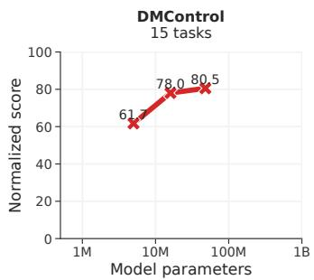

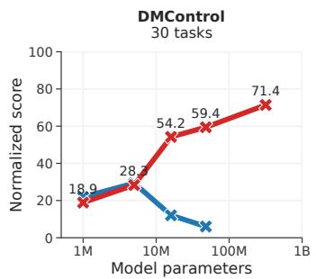

  

图 22. 大规模多任务世界模型上的更多结果。在 15 任务、30 任务和 80 任务数据集上，归一化得分随模型规模的变化情况。TD-MPC2 的能力随模型规模的增大而提升。