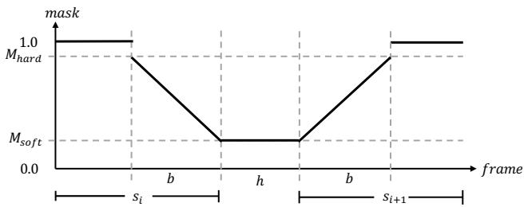
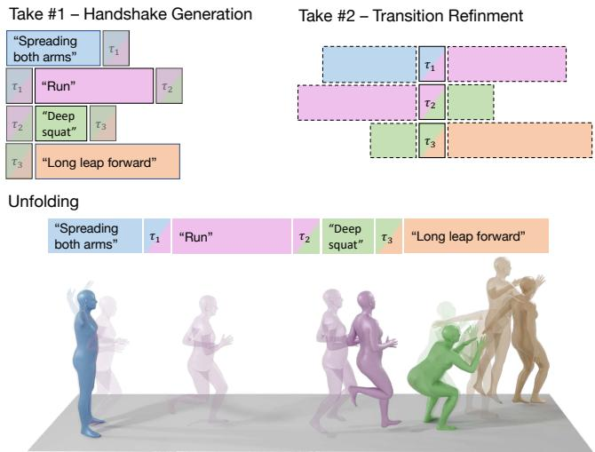
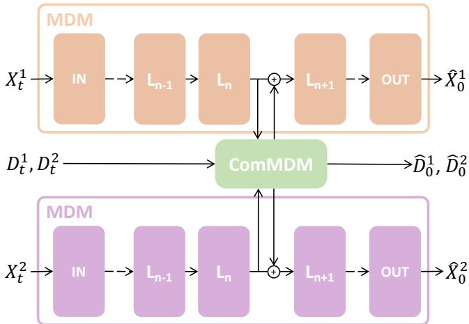
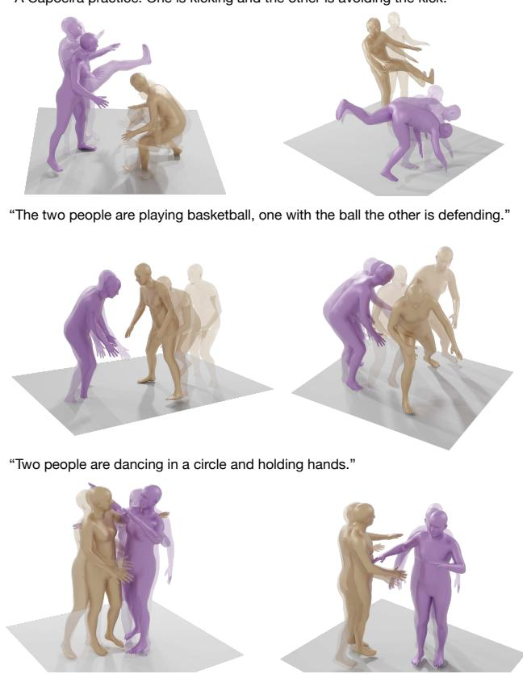
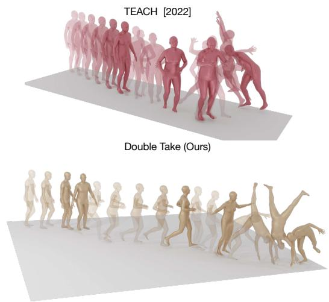

# Human Motion Diffusion as a Generative Prior（人体运动扩散作为生成先验）

Yonatan Shafir∗，Guy Tevet∗，Roy Kapon，以及 Amit H. Bermano  
以色列 特拉维夫大学  
{Shafir2, guytevet}@mail.tau.ac.il

  

"行走"→"盘腿坐"→"向前大跨步"→"绕圈跑"

"卡波耶拉（Capoeira）练习场景：一人正在出腿踢击，另一人正在躲避踢击。"

图 1. 我们提出三种新的运动组合方法，均基于近期提出的运动扩散模型（Motion Diffusion Model, MDM）。(左) 顺序组合，用于生成长度任意的运动，并可在每个时间区间内通过文本进行控制。(中) 并行组合，从文本生成双人运动。不同颜色代表不同的人——两者在给定文本提示下同时生成。(右) 模型组合，通过混合具有不同控制信号的模型实现精确而灵活的控制——此处演示在空中书写 "hello"。

近期研究表明，去噪扩散模型在生成人体运动方面具有巨大潜力，包括文本到运动的生成能力。然而，这些方法受到标注运动数据稀缺的限制，主要聚焦于单人运动，且缺乏细粒度的控制。本文基于扩散先验（diffusion prior）引入了三种组合形式：顺序组合、并行组合和模型组合。通过顺序组合，我们解决了长序列生成的难题。我们提出了 DoubleTake，一种推理时（inference-time）方法，仅使用一个针对短片段训练的先验模型，便能生成由多个受提示区间及其过渡组成的长动画。通过并行组合，我们展示了向双人生成方向迈出的可喜步伐。从两个固定的先验模型以及少量双人训练样本出发，我们学习了一个轻量的通信模块 ComMDM，用于协调两条生成运动之间的交互。最后，通过模型组合，我们首先分别训练先验模型，使其能在给定关节上完成所规定的运动；随后我们引入了 DiffusionBlending，一种插值机制，能够有效混合多个这样的模型，从而实现灵活、高效的细粒度关节级和轨迹级控制与编辑。我们使用现成的运动扩散模型对这些组合方法进行了评估，并将结果与针对这些特定任务所训练的专用模型进行了进一步比较。 https://priormdm.github.io/priorMDM-page/ 1

## 1 引言

人体运动生成（Human Motion Generation）近期取得了巨大的飞跃。近年来精细设计的语言模型 [Devlin et al. 2019; Radford et al. 2021] 与扩散生成方法 [Ho et al. 2020; Sohl-Dickstein et al. 2015] 迅速进入这一领域，产出了能够从文本或其他控制形式生成多样化、高质量序列的运动生成模型 [Guo et al. 2022; Petrovich et al. 2022; Tevet et al. 2022, 2023]。反过来，这些模型已经应用于游戏世界，并有望向业余爱好者和专业人士开放角色动画这一领域。

然而，人体运动生成领域一直存在且至今仍在为之挣扎的主要问题是数据。运动数据通常要么通过精心设置的动捕设备获取[Joo et al. 2015]，要么由艺术家们手工打造[Adobe Systems Inc. 2021]。这两种情况最终都会产生成本高昂且相对较小、同质化的数据集[Guo et al. 2022; Punnakkal et al. 2021]。例如，当前模型所训练的数据集几乎全部由短时长的单人运动序列组成。在数据匮乏的情况下，多人群体视频交互（multi-person interaction）和长序列生成等任务被抛在脑后，生成质量也较差。

在本文中，我们展示了预训练的基于扩散（diffusion）的运动生成模型可以作为一种先验用于组合（composition），从而实现域外（out-of-domain）运动生成和高效控制。与扩散模型数据消耗量大的普遍印象相反，我们展示了三种借助上述先验来克服成本障碍的方法，使在少样本（few-shot）乃至零样本（zero-shot）条件下完成具有实质难度的任务成为可能。

具体地，我们选用一个预训练的运动扩散模型（Motion Diffusion Model，MDM）[Tevet et al. 2023]作为先验。MDM 在面向短时单人序列的文本到运动（text-to-motion）和动作到运动（action-to-motion）任务上取得了当前业界最优（state-of-the-art）的结果，并且此前已被证明能够很好地泛化到来自其他领域的条件[Tseng et al. 2022]，以及在采样迭代之间施加的纠偏[Yuan et al. 2022]。

借助这一先验，我们展示了三种形式的组合（composition）：

- 顺序组合（sequential composition），将短序列拼接起来，形成一段单一且长且连贯的运动；
- 并行组合（parallel composition），将两个单人动作协调起来共同执行；
- 模型组合（model composition），将由具备不同控制能力的模型所生成的运动混合在一起，以实现复合控制。

我们的 DoubleTake 方法（图 1-左）通过精心按时序组合两段已生成运动（包括它们彼此之间的过渡），提出了一种顺序组合，使长运动序列的零样本（zero-shot）高效生成成为可能。借助该方法，我们展示了长达 10 分钟的流畅运动，而生成这一方法所基于的模型仅在最长 10 秒的序列上训练得到[Guo et al. 2022; Punnakkal et al. 2021]。此外，由于生成的组合特性，DoubleTake 允许对每一段运动区间进行单独控制，同时维持运动本身与过渡的一致性。考虑到训练数据中并未显式标注此类过渡，这一结果相当令人惊讶。DoubleTake 在每一次扩散迭代中包含两个阶段——第一步中，单个运动区间在同一次批处理（batch）内一并生成，每个区间都感知其相邻区间的上下文；随后第二步对各区间之间的过渡进行再处理（refine），以更好地与前一阶段所生成的过渡相契合。

在并行组合方面，我们考虑一种少样本（few-shot）设定，并首次实现文本驱动的双人动作生成（图 1-中部）。借助我们基于先验的方法，我们仅用十几个训练样本就实现了富有前景的双人动作生成。其核心思想在于：为了学习人体交互，我们只需让各个先验模型在扩散过程中彼此通信。因此，我们学习了一个轻量的通信模块 ComMDM，它通过中间激活图在两个冻结先验之间传递通信信号。

最后，我们提出一种通过模型组合实现的新型控制机制。我们观察到，Tevet 等人 [2023] 所提出的动作修复（inpainting）过程并不能很好地推广到更为复杂但重要的动作任务，如轨迹跟踪与末端执行器跟踪。因此，我们首先表明，对先验模型进行该任务的微调可获得令人满意的结果，即便只控制单个末端执行器也能取得良好效果。随后，我们提出了 DiffusionBlending 技术，将无分类器引导（classifier-free guidance）[Ho and Salimans 2022] 推广到对多个不同微调模型的组合，从而能够对生成的动作进行关键点控制的交叉组合。这为人体动作提供了精细且灵活的控制，而这是任何动画系统都不可或缺的一项关键能力（图 1-右侧）。

我们从定量和定性两方面证明，这些低成本的组合方法能够扩展一个经过更精细训练的动作先验模型，并在各自任务上优于此前的专用方法 [Athanasiou et al. 2022; Wang et al. 2021]。

## 2 相关工作

## 2.1 动作扩散模型

最近，MDM [Tevet et al. 2023]、MotionDiffuse [Zhang et al. 2022]、MoFusion [Dabral et al. 2023] 和 FLAME [Kim et al. 2022] 成功实现了基于去噪扩散概率模型（Denoising Diffusion Probabilistic Models, DDPM）[Ho et al. 2020] 框架的动作生成神经网络模型，该框架最初是为图像生成提出的。MDM 同时支持高质量生成和通用的条件控制，共同构成了新动作生成任务的良好基线。EDGE [Tseng et al. 2022] 沿袭 MDM，将其扩展到音乐到动作（music-to-motion）的任务。SinMDM [Raab et al. 2023] 采用单样本学习方案将 MDM 适配到非人体动作。PhysDiff [Yuan et al. 2022] 在 MDM 之上加入了一个预训练的物理模型，该模型基于强化学习，在采样过程中施加物理约束。这些实例展示了 MDM 对新任务的灵活性。

在图像领域，Rombach 等人 [2022a] 观察到，专门针对修复任务训练模型能够改善结果。他们将修复掩码作为额外的控制信号输入。Meng 等人 [2022]、Lugmayr 等人 [2022] 和 Choi 等人 [2021] 基于部分去噪提出了不同的扩散图像编辑方法。

## 2.2 长序列动作生成

Motion Graphs [Kovar et al. 2008] 可以通过遍历给定数据语料库中的离散姿态来合成长动作。该方法仅限于已有数据，并且无法泛化以应对复杂的文本条件。基于 RNN 的动作生成往往退化为恒定姿态。Martinez 等人 [2017] 和 Zhou 等人 [2018] 通过在训练期间将模型自身生成的帧作为输入以完成前缀补全任务，从而克服了这一问题。然而，这些方法仍然受限于可用数据中相对较短的序列。最近，一些研究提出通过自回归方式生成短序列来打破数据限制，每个短序列以文本提示和前一个序列的后缀为条件。过渡要么根据平滑性先验学习 [Athanasiou et al. 2022; Mao et al. 2022]，要么从数据中学习 [Athanasiou et al. 2022; Wang et al. 2022]，使用的是显式标注动作之间过渡关系的 BABEL 数据集 [Punnakkal et al. 2021]。EDGE [Tseng et al. 2022] 提出了 unfolding 方法，通过对每两个相邻序列进行 SLERP 插值来生成长序列。相比之下，我们的 DoubleTake 提出了一种利用 diffusion 并在每个去噪步骤中将动作混合在一起的 unfolding 方法。

## 2.3 多人动作生成

数据稀缺是多人动作生成的主要障碍，相关研究数量也相应有限。MuPoTS-3D 数据集 [Mehta et al. 2018] 包含 20 个真实世界的多人序列；CMU-Mocap [CMU [n. d.]] 和 3DPW [Von Marcard et al. 2018] 分别包含 55 个和 27 个双人动作序列。Yin 等人 [2018] 提出通过利用 2D 信息来克服数据障碍。最近，Song 等人 [2022] 贡献了合成的多人 GTA Combat 数据集。这些数据集都没有文本（或其他）标注，因此最近的 MRT 方法 [Wang et al. 2021] 和 SoMoFormer 模型 [Vendrow et al. 2022] 学习的是无监督前缀补全任务。两者都在 DCT 变换下学习动作，这虽然改善了 L2 误差度量，但会产生平滑却不真实动作。在本工作中，我们首次为 3DPW 加上文本标注，并首次学习文本引导的双人动作生成。

  

图 2. 软混合（Soft Blending）概述。我们在 $\mathbf { M _ { h a r d } }$ 与 $\mathbf { M } _ { s \mathbf { o f f } }$ 之间允许长度为 b 帧的线性遮罩（mask），使得在 Second Take 的每一次去噪（denoising）步骤中，部分原本生成的动作（后缀或前缀）会经过精化（refinement）以适配过渡。

## 2.4 人体运动先验（Human Motion Priors）

VPoser [Pavlakos et al. 2019] 是一个人体姿态自编码器，在 AMASS 运动捕捉数据集 [Mahmood et al. 2019] 上训练。它被用作运动应用的先验，例如运动去噪、将 SMPL [Loper et al. 2015] 模型拟合到关节点位置，以及作为运动生成 [Hong et al. 2022] 的姿态码本。最近，Tiwari 等人 [2022] 表明，这种先验可以作为一种隐式模型来学习。MoDi [Raab et al. 2022] 是一个无监督的运动生成器，由 StyleGAN [Karras et al. 2019] 改编而来。无需进一步训练，它便能实现潜空间编辑与运动插值。与上述例子相反，MotionCLIP [Tevet et al. 2022] 利用来自图像与文本领域的先验来学习运动。它将运动流形与 CLIP [Radford et al. 2021] 的潜空间对齐。这使得继承 CLIP 所学知识、生成突破数据限制的运动成为可能。

在扩散（diffusion）背景下，MDM 将扩散图像修复（inpainting）[Saharia et al. 2022; Song et al. 2020] 适配于运动编辑任务。在本工作中，我们将这一原则拓展到在少样本乃至零样本（few to zero-shot）设定下求解复杂的运动任务。最近，MLD [Xin et al. 2022] 学习了一个潜扩散模型，与 LDM [Rombach et al. 2022b] 类似，能够生成运动潜码而非运动本身，并交由一个更大且预训练好的运动生成器将其转换到物理空间。

## 3 方法（METHOD）

在本工作中，我们采用最近提出的运动扩散模型（Motion Diffusion Model，MDM）[Tevet et al. 2023]，该模型针对文本到运动（text-to-motion）任务进行了预训练，用于学习新的生成任务。我们将人体运动表示为姿态序列 $X = \{ x ^ { i } \} _ { i = 1 } ^ { N }$，其中 $\boldsymbol { x } ^ { i } \in \mathbb { R } ^ { D }$ 表示单个姿态。具体而言，我们使用 SMPL [Loper et al. 2015] 表示，在 BABEL [Punnakkal et al. 2021] 数据集上开展实验，包含单一人体身份 $(\beta = 0)$ 之上的关节点旋转与全局位置。对于所有其他实验，我们使用 HumanML3D [Guo et al. 2022] 表示，由关节点位置、旋转、速度以及足部接触信息组成。MDM 是一个基于 DDPM [Ho et al. 2020] 框架的去噪扩散概率模型。它假设 $T$ 个加噪步骤由随机过程建模

  

图 3. DoubleTake 概述。我们使用一个固定的动作扩散先验（diffusion prior），按区间施加文本控制，从而生成任意长度的序列。在第一遍（first take）中，我们将每个区间生成为与相邻样本"握手"（handshaking）的单一样本；在每次去噪迭代中，这些握手帧被强制保持相等，最终合成一个长序列。为了优化区间之间的过渡，第二遍（second take）对握手帧进行部分加噪，并利用软掩码在相邻区间的条件下对其进行去噪。实线帧表示生成或优化阶段；虚线帧表示该遍的输入动作。

$$
q (X _ {t} | X _ {t - 1}) = \mathcal {N} (\sqrt {\alpha_ {t}} X _ {t - 1}, (1 - \alpha_ {t}) I),\tag{1}
$$

对于加噪步骤 $t \in T$，其中假设 $X_T \sim \mathcal{N}(0, I)$。MDM 建模去噪过程：给定加噪运动 $X_t$、噪声步 $t$ 以及被编码到 CLIP [Radford 等人 2021] 空间并用 $c$ 表示的文本条件，预测干净运动 $\hat{X}_0$。模型通过标准的 $\mathcal{L}_{\mathrm{simple}} = E_{X_0 \sim q(X_0|c), t \sim [1,T]} [\|X_0 - MDM(X_t, t, c)\|_2^2]$ 与正则化关联合体的位置、速度和足部接触的几何损失联合训练。按照 Ho 等人 [2020] 的方法，迭代式地从 MDM 采样新运动。在每个时间步 $t$，预测干净样本 $\hat{X}_0$ 并重新加噪得到 $X_{t-1}$。从 $t = T$ 开始重复此过程，直至达到 $t = 0$。

在本节中，我们首先介绍使用 DoubleTake 方法的顺序组合（3.1 节），该方法通过顺序组合将 MDM 推广到无需额外训练即可生成任意长度运动。然后，我们介绍通过使用精简通信层 ComMDM（3.2 节）实现的并行组合，该方法仅用少至 10 个交互样本进行训练，以生成双人运动。最后，我们对 MDM 进行微调以控制特定关联合体，并提出我们的模型组合方法 DifusionBlending（3.3 节），该方法推广了无分类器方法 [Ho 和 Salimans 2022]，通过控制关联合体的任意交叉组合，实现对身体的细粒度控制。

## 3.1 长序列生成

我们的目标是生成任意长度的运动，使得运动的每个时间区间都可能由不同的文本提示和不同的序列长度来控制。我们希望区间之间的过渡是真实的，并且语义上与相邻区间相匹配。由于现有数据集在运动长度上受限，且通常不显式包含过渡，我们建议以零样本（zero-shot）方式处理此任务，使用一个在这些短序列上训练得到的固定生成先验。我们提出了 DoubleTake（如图 3 所示），这是一个两阶段的推理过程，提出了一种并行方案，在单个批次中生成长运动。通常，专为该任务设计的方法 [Athanasiou et al. 2022; Mao et al. 2022; Wang et al. 2022] 在生成每个此类区间时，都以前一区间的固定后缀作为条件。相比之下，DoubleTake 在同时观察前后相邻区间的情况下生成受提示驱动的区间，这些区间是同时生成的。在第一阶段（the first take），我们将每个区间生成为去噪批次中的一个不同样本，使得每个样本都以各自的文本提示为条件，并通过去噪过程与相邻区间保持"握手"（handshake）。握手，记作 ℋ，定义为运动的一个简短（约一秒长）前缀或后缀，使得当前运动的前缀被强制等于前一运动的后缀。如图 3 所示，每个区间都保持两个这样的握手。握手的保持方式很简单：在每个去噪步骤中，用相关后缀和前缀的逐帧平均值覆盖 ℋ。这使得我们的模型能够生成依赖于过去和未来运动的长序列，同时在生成每个区间时了解整个序列。握手长度 $h = | \tau |$ 可以由用户任意定义，也可以在每个过渡层级上分别设定。然而，在实践中，我们发现选择一秒长的握手机制在所有实验中都是稳健的。从形式上讲，在每次去噪迭代结束时，握手被强制相等，方式如下：

$$
\tau_ {i} = (1 - \vec {\alpha}) \odot S _ {i - 1} [ - h: ] + \vec {\alpha} \odot S _ {i} [: h ]\tag{2}
$$

其中 $S _ { i }$ 表示第 $i ^ { t h }$ 个序列，$\alpha _ { j } = j / h , \forall j : j \in [ 0 : h )$，$\odot$ 表示逐元素相乘。

然而，观察所生成的握手（handshake）动作，我们发现其结果在视觉上不尽如人意，因为在语义不同的动作之间的过渡处会出现瑕疵和不一致（即先"跑"后"爬"）。因此，我们建议加入第二遍处理（second take），作用于第一遍的输出之上。在第二遍中，我们如图 3 所示对批量数据的形状进行重排，使得在每个样本中获得过渡三明治（transition sandwich） $( S _ { i } , \tau _ { i } , S _ { i + 1 } )$。现在，我们对该三明治进行 $T ^ { \prime }$ 步的部分加噪，并在我们提出的软掩码（soft-masking）特征下将其去噪回 $t = 0$，以精修过渡：在常规的修复掩码（inpainting mask）中，内容要么完全取自输入，要么完全由模型生成。我们提出一种软修复（soft inpainting）方案，其中每一帧被赋予一个介于 0 和 1 之间的软掩码值，用于决定第二遍在第一遍结果之上所执行的精修程度。为此，我们分别为区间 � 和握手（handshake）� 定义掩码 $M _ { s o f t }$ 和 $M _ { h a r d }$，并在掩码值之间设置一个短的、� 帧长的线性过渡，如图 2 所示。

  

图 4. ComMDM 概览。我们使用两个固定的 MDM 模型，训练一个轻量的通信模块（ComMDM），用于双人运动生成。ComMDM 以两位演员的 Transformer 层 $L _ { n }$ 的激活作为输入，并输出一个修正项，将其加到相同的激活上。ComMDM 还可以选择性地预测两人的初始姿态 $D ^ { i }$。IN 和 OUT 表示 Transformer 的线性输入层和输出层。

最后，我们通过展开来构建长序列，即将每个序列和过渡重新整形回其线性位置，如图 3 底部所示。

## 3.2 两人生成

我们的目标是同时生成两个相互交互的人的运动。可用数据的有限性决定了需要采用少样本学习（few-shot learning）解决方案。我们的核心洞见是：通过为场景中的每个人分配一个固定的生成器，运动可以保持在人体运动分布之内，而我们只需要学习在两人之间进行协调。因此，我们提出了 ComMDM（图 4），这是一种单层 transformer 模型，用于在两个固定的 MDM 实例（每人各一个）之间进行协调。ComMDM 被放置在第 $n$ 层 transformer 之后，将两个模型该层的输出激活 $( O _ { t } ^ { 1 , ( \bar { n } ) } , O _ { t } ^ { 2 , ( n ) } )$ 作为输入，并为两个模型各自输出一个修正项 $\Delta O _ { t } ^ { i , ( n ) }$ 。为了进一步减少需学习的参数数量，我们利用对称性考虑，只输出一个修正项，然后以待修正的输出优先输入，从而修正后的输出为 $\tilde { O } _ { t } ^ { i , ( n ) } = O _ { t } ^ { i , ( n ) } + C o m M D M ( O _ { t } ^ { i , ( n ) } , O _ { t } ^ { 3 - i , ( n ) } )$ 。我们注意到，在某些数据集（例如 HumanML3D）中，所有运动都被处理为以根部（root）位于原点且面朝同一方向开始。因此，在使用此类数据训练的模型上直接使用 ComMDM 将导致两个人在运动开始时都被放在原点处。为此，ComMDM 还额外学习 $D _ { \colon }$ 初始姿态，即作为扩散过程一部分的每个人在第一帧的初始姿态。因此，ComMDM 的完整实现为 $\Delta O _ { t } ^ { i , ( n ) } , \hat { D } _ { 0 } ^ { i } = C o m M D M ( O _ { t } ^ { i , ( n ) } , O _ { t } ^ { 3 - i , ( n ) } , D _ { t } ^ { i } , t )$

我们冻结 MDM 实例的权重，仅使用 $L _ { \mathrm { s i m p l e } }$ 损失训练 Com-MDM。我们学习两个运动任务：对于前缀补全（prefix completion），我们使用针对前缀补全任务微调的 MDM 版本（参见 3.3），并将文本条件完全遮蔽（mask）。对于文本到运动（text-to-motion）任务，我们使用常规的 MDM 实例，并以 10% 的概率对文本条件进行遮蔽，以支持无分类器引导（classifier-free guidance）。

Algorithm 1 微调方法

repeat
    $x_0 \sim q(x_0)$ $t \sim \text{Uniform}(\{1, \ldots, T\})$ $\epsilon \sim \mathcal{N}(0, I)$ $\epsilon[\text{trajectory}] = 0$ ▷ 我们的额外项
    Take gradient descent step on:
    $\nabla_\theta \| x_0 - \epsilon_\theta (\sqrt{\bar{\alpha}_t} x_0 + \sqrt{1 - \bar{\alpha}_t} \epsilon, t) \|$
until Converged

算法 2 采样方法
$x_0^{(T)} = 0$
for $t = T, \ldots, 0$ do
    $x_0^{(t)}[\text{trajectory}] = \text{given trajectory}$ ▷ 原始修复
    $\epsilon \sim \mathcal{N}(0, I)$
    $\epsilon[\text{trajectory}] = 0$ ▷ 我们的改进
    $x_0^{(t-1)} = \epsilon_\theta (\sqrt{\bar{\alpha}_t} x_0 + \sqrt{1 - \bar{\alpha}_t} \epsilon, t)$
end for

## 3.3 微调动作控制（Fine-Tuned Motion Control）

我们的目标是生成由用户自定义的输入特征集合所控制的全身动作。这些特征可以是根节点轨迹、单个关节，或者它们的任意组合。我们要求生成的动作在语义上能够遵从控制信号，并且整体保持连贯。例如，当指定人物的根节点轨迹为向后移动时，我们期望所生成的动作中双腿调整为向后行走。正如我们在第 4.3 节所示，Tevet 等人 [2023] 所提出的动作修复方法无法满足这一要求。

单控制微调（Single Control Fine-Tuning）。因此，受 Rombach 等人 [2022a] 的启发，我们引入了一个微调过程，以训练出能够遵从控制特征的模型。本质上，我们的方法是通过在扩散过程的前向传播中，把施加在我们希望控制的真实特征上的噪声掩去，来达成上述效果。具体而言，真实的控制特征会传递到模型的输入端，从而模型在学习重建其余特征时，会依赖于这些特征。算法 1 描述了针对轨迹控制任务的微调过程。在采样阶段，我们沿用微调过程的核心思路：在获得模型对 $x_0$ 的预测之后，我们将编辑特征注入其中；随后，在从预测的 $x_0$ 到 $x_{t-1}$ 的前向过程中，我们将控制特征上的噪声掩去，使它们能够干净地传递到模型中。算法 2 定义了针对轨迹控制任务的这一采样过程。微调阶段只需不到 20k 步即可产生视觉效果良好的结果，使我们能够轻松地为给定的控制任务获取一个专用模型。

扩散混合（DiffusionBlending）。为每一种可能的控制任务都微调一个模型并非最优方案。因此，我们提出了扩散混合（DiffusionBlending），一种用于将多个模型组合起来以用于复合控制任务的模型组合方法。例如，如果我们希望同时指定角色的轨迹及其左手动作，我们可以融合仅针对轨迹控制训练的模型与仅针对左手训练的模型。

  

图 5. DoubleTake 过渡细化。第二次（second take）对第一次（first take）生成的过渡进行细化，使其更加平滑、更加真实。橙色表示后续过渡帧，蓝色表示上下文区间。

为了控制关节的交叉组合（即同时控制根关节与末端执行器，如图 1 所示），我们扩展了无分类器方法（classifier-free approach）[Ho and Salimans 2022] 的核心思想，并提出了 DiffusionBlending。无分类器方法建议在条件模型 $G$ 与无条件模型 $G^{\emptyset}$ 之间进行插值或外推。我们认为，该思想可以推广到任意两个"对齐的"（aligned；定义见 [Wu et al. 2021]）扩散模型 $G^a$ 与 $G^b$，它们分别以 $c_a$ 与 $c_b$ 为条件。那么，同时以两个条件进行采样的实现方式为

$$
G _ {s} ^ {a, b} (X _ {t}, t, c _ {a}, c _ {b}) = G ^ {a} (X _ {t}, t, c _ {a}) + s \cdot (G ^ {b} (X _ {t}, t, c _ {b}) - G ^ {a} (X _ {t}, t, c _ {a})),\tag{3}
$$

其中，尺度参数 � 在两个控制信号的重要性之间进行权衡（trading-off）。

## 4 实验

## 4.1 长序列生成

在使用 DoubleTake 方法进行长序列生成时，我们采用一个在 HumanML3D [Guo 等人 2022] 数据集上训练的固定 MDM [Tevet 等人 2023]，该模型原始训练时使用的运动片段最长可达 10 秒。为了与专门为此任务训练的 TEACH [Athanasiou 等人 2022] 进行比较，我们在 BABEL [Punnakkal 等人 2021] 上对 MDM 进行了 1.25� 步的训练，该数据集与 TEACH 训练所用的数据集相同，超参数遵循 Tevet 等人 [2023] 的建议，在单块 NVIDIA GeForce RTX 2080 Ti GPU 上完成训练。对于上述两个数据集，我们均采用 DoubleTake 进行生成，过渡时长为一秒，参数设置为 $T^{\prime}=700$，$M_{hard}=0.85$，$M_{soft}=0.1$ 以及 $b=10$。

在两种情况下，我们都使用 Guo 等人 [2022] 建议的评估器和指标来评估生成质量。简而言之，他们在 HumanML3D 数据集上训练文本和运动编码器作为评估器，将运动和文本映射到同一潜在空间中，然后应用一个「Two people are dancing in a circle and holding hands.」

<table><tr><td rowspan="2"></td><td colspan="4">Motion</td><td colspan="2">Transition (70 frames)</td><td colspan="2">Transition (30 frames)</td></tr><tr><td>R-precision ↑</td><td>FID↓</td><td>Diversity→</td><td>MultiModal-Dist↓</td><td>FID↓</td><td>Diversity→</td><td>FID↓</td><td>Diversity→</td></tr><tr><td>Ground Truth</td><td>0.62</td><td> $0.4 \cdot 10^{-3}$ </td><td>8.51</td><td>3.57</td><td> $0.8 \cdot 10^{-3}$ </td><td>8.23</td><td> $0.9 \cdot 10^{-3}$ </td><td>8.33</td></tr><tr><td>TEACH [2022]</td><td>0.46</td><td>1.12</td><td>8.28</td><td>7.14</td><td>3.86</td><td>7.62</td><td>7.93</td><td>6.53</td></tr><tr><td>Double Take (ours)</td><td>0.43</td><td>1.04</td><td>8.14</td><td>7.39</td><td>1.88</td><td>7.00</td><td>3.45</td><td>7.19</td></tr><tr><td>+ Trans. Emb</td><td>0.48</td><td>0.79</td><td>8.16</td><td>6.97</td><td>3.43</td><td>6.78</td><td>7.23</td><td>6.41</td></tr><tr><td>+ Trans. Emb + geo losses</td><td>0.45</td><td>0.91</td><td>8.16</td><td>7.09</td><td>2.39</td><td>7.18</td><td>6.05</td><td>6.57</td></tr></table>

表 1. 在 BABEL [2021] 测试集上的定量结果。所有方法均使用来自真实标注的真实动作时长。"→" 表示指标越接近真实分布时结果越好。我们对所有评估均运行 10 次。过渡指标在两种不同时长上进行了测试，其中包含来自前一帧后缀和下一帧前缀的上下文。由于 TEACH [2022] 将过渡定义为 8 帧，因此我们在两种不同的边缘时长上进行了测试。加粗表示最佳结果，��������� 表示次佳结果。所报告的 R-precision 为 top-3。

  

图 6. 双人前缀补全。MRT [Wang et al. 2021] 倾向于固守在前缀姿态上，而我们的 ComMDM 则能给出生动且语义正确的补全结果。蓝色人物是输入的前缀帧，提供给两个模型。红色和橙色人物分别是 MRT 与我们的补全结果。

针对生成动作在其潜在空间表示的一组指标。R-precision 衡量动作与其条件文本的接近程度，FID 衡量潜在空间中生成动作分布与真实分布之间的距离，Diversity 衡量潜在空间中生成动作的方差，MultiModel distance 是文本与条件动作对在潜在空间中的平均 L2 距离。完整细节请读者参阅原论文。注意，对于 BABEL 数据集，我们按照 Guo 等人 [2022] 定义的设置训练了相同的评估器。为了进行合适的分析，我们生成长度为 32 个区间的序列，然后对各个区间本身应用 HumanML3D 指标，并对过渡再应用一次。注意，文本相关指标与过渡无关。

由于 BABEL 数据集同样标注了过渡，我们建议使用我们的过渡嵌入（Transition Embedding）：我们选择使用过渡嵌入信号对每一帧进行嵌入，使模型能够更好地"一段卡波耶拉练习。一人正在踢腿，另一人在躲避踢击。"

"两人正在打篮球，一人持球，另一人在防守。"

  

图 7. 两人文本到动作生成。我们使用 ComMDM 根据一段未见过的、用于描述该动作的文本提示来生成两人的交互动作。不同颜色代表不同的人物角色，两者的动作同时生成。

我们先理解以下帧属于过渡还是动作的一部分，然后将这个嵌入添加到该帧的特征中。此外，我们选择使用 MDM 中提出的几何损失（geometric loss）在 BABEL 数据集上训练我们的模型。需要说明的是，虽然我们不对动作进行任何后处理，但 TEACH 会将每个时间段的起始对齐到上一段的结束时间，并在两段之间添加额外的插值帧。我们观察到，如果没有这种后处理，TEACH 会生成质量较低的过渡，但仍使用上述所有方法对其进行评估，以保持公平的条件。

表 1 展示了在 BABEL 数据集上与 TEACH 相比的定量结果。我们使用两种变体评估过渡质量——第一种在各时间段之间使用较宽的边界（70 帧），第二种为 DoubleTake 和 TEACH 都使用尽可能小的边界（30 帧，即 1 秒）。在所有我们的方法中，DoubleTake 在 FID 指标上都优于 TEACH。在评估过渡表现时，DoubleTake 的领先优势更大。图 10 展示了两种方法的定性比较。表 2 展示了在 HumanML3D 数据集上 DoubleTake 超参数的消融实验。我们表明，使用 DoubleTake、软掩码（soft masking）以及一秒握手尺寸（handshake size）的方法取得了最佳结果。图 5 定性地展示了第二次拍摄（second take）如何对第一次拍摄进行精炼。

<table><tr><td rowspan="2"></td><td colspan="4">Motion</td><td colspan="2">Transition</td></tr><tr><td>R-precision↑</td><td>FID↓</td><td>Div.→</td><td>M.-Dist↓</td><td>FID↓</td><td>Div.→</td></tr><tr><td>Ground Truth</td><td>0.80</td><td> $1.6 \cdot 10^{-3}$ </td><td>9.62</td><td>2.96</td><td>0.05</td><td>9.57</td></tr><tr><td>DoubleTake (ours)</td><td>0.59</td><td>0.60</td><td>9.50</td><td>5.61</td><td>1.48</td><td>8.90</td></tr><tr><td>First take only</td><td>0.59</td><td>1.00</td><td>9.46</td><td>5.63</td><td>2.15</td><td>8.73</td></tr><tr><td>Second take only</td><td>0.59</td><td>1.09</td><td>9.34</td><td>5.57</td><td>3.22</td><td>8.35</td></tr><tr><td>DoubleTake (b=0)</td><td>0.59</td><td>1.00</td><td>9.51</td><td>5.61</td><td>2.21</td><td>8.66</td></tr><tr><td>DoubleTake (b=20)</td><td>0.59</td><td>0.84</td><td>9.74</td><td>5.60</td><td>1.56</td><td>8.73</td></tr><tr><td>DoubleTake (h=30)</td><td>0.60</td><td>1.03</td><td>9.53</td><td>5.60</td><td>2.22</td><td>8.64</td></tr><tr><td>DoubleTake (h=40)</td><td>0.58</td><td>1.16</td><td>9.61</td><td>5.67</td><td>2.41</td><td>8.61</td></tr><tr><td>DoubleTake ( $M_{soft}=0.0$ )</td><td>0.59</td><td>0.85</td><td>9.75</td><td>5.70</td><td>1.72</td><td>8.67</td></tr><tr><td>DoubleTake ( $M_{soft}=0.2$ )</td><td>0.59</td><td>0.90</td><td>9.69</td><td>5.66</td><td>1.50</td><td>8.77</td></tr></table>

Table 2. 在 HumanML3D [2022] 测试集上的定量结果。所有方法均使用来自真值的真实运动长度。'→' 表示该指标越接近真实分布结果越好。我们将所有评估运行 10 次。粗体表示最佳结果，下划线表示次佳结果。所报告的 R-precision 为 top-3，Div. 代表多样性（diversity），M.-Dist 代表多模态距离（Multi-modal distance）。

## 4.2 双人生成（Two-Person Generation）

由于数据有限，我们以少样本（few-shot）方式学习双人运动。我们使用在 HumanML3D 数据集上训练得到的固定 MDM，并按第 3 节所述学习一个轻量通信模块 ComMDM。

**数据 (Data).** 我们使用 3DPW 数据集 [Von Marcard et al. 2018] 来训练和评估 ComMDM，该数据集包含 27 个用 SMPL 关节标注的双人运动序列。由于测试集噪声较大且不包含任何有意义的人际交互，我们将其省略。这样我们只剩下 10 个训练样本和 4 个验证样本。然而，根位置经常出现漂移，部分可通过从根的漂移中减去相机的漂移来缓解。我们进一步通过随机镜像和裁剪每个序列来扩充数据。然后，为了与原始 MDM 的输入格式兼容，我们将数据处理为 HumanML3D 的关节表示。我们针对两种不同的生成任务训练 ComMDM，两者均在单块 NVIDIA GeForce RTX 2080 Ti GPU 上以批大小 64 进行训练。

**前缀补全 (Prefix completion).** 我们遵循 MRT [Wang et al. 2021] 的方法，学习在给定 1 秒前缀的情况下补全 3 秒的运动。表 3 给出了根和关节的平均 L2 误差——综合所呈现的消融研究，我们将通信层放置在 Transformer 的第 8 层（也是最后一层）。我们将 ComMDM 训练了 240k 步。我们使用我们处理过的数据重新训练了 MRT，并观察到仅凭数据处理这一项就改善了原作者最初报告的结果。尽管 MRT 相比我们的 ComMDM 获得了更低的误差，但其生成的动作是静止且不真实的，如图 6 所示。因此，我们进一步开展了一项用户研究，根据交互水平、前缀的补全程度以及生成动作的整体质量等方面，将 ComMDM 与 MDM、MRT 和真值数据进行比较。共有 30 位独立用户参与了用户研究。每个模型通过 10 个随机采样的前缀与 ComMDM 进行比较，每次比较由 10 位独立用户重复。结果（图 8）显示，相较于 MRT 和 MDM，用户明显更偏好 ComMDM 生成的动作。图 11 给出了该用户研究的一个示例截图。

  

图 8. 3DPW 两人前缀补全用户研究。我们让用户以并列视图的方式将我们的 ComMDM 与原始 MDM、MRT 模型以及真实值（ground truth）进行比较。虚线标示 50% 的位置。在生成的三个方面上，ComMDM 均优于 MRT 和 MDM。

文本到动作（Text-to-Motion）。我们认为前缀补全是一个变得不再相关的动作任务。它是一个显式控制信号，既限制了动作，又为生成提供了过大的提示。此外，报告关节误差会促使生成乏味的低频动作，不利于学习在给定条件下动作的分布。因此，我们向双人动作生成的文本控制迈出了第一步。由于没有带文本标注的多人数据集，我们为 14 个训练集和验证集动作贡献了 5 个文本标注，并在 ComMDM 上进行了 100× 步的训练。图 1 和图 7 展示了基于未见文本提示的多样化动作生成。我们注意到，由于样本数量较少，泛化能力相当有限，仅限于训练时所见的同类型交互。

## 4.3 微调动作控制（Fine-Tuned Motion Control）

我们将微调模型和 DifusionBlending 采样方法与原始 MDM 模型在各种控制任务上进行比较。为此，我们从 HumanML3D 测试集中根据每个任务采样文本和控制特征。使用原始 MDM 模型通过 [Tevet et al. 2023] 所提出的原始修复方法注入控制特征来生成动作。然后，我们使用针对特定控制任务训练的微调模型，采用我们所提出的修复方法来生成动作。所有微调模型均以我们用于比较的同一个 MDM 原始实例进行初始化，并使用我们的微调方法训练 80× 步，批量大小为 64。

注意，我们将轨迹视为角色在 ×× 平面上的角度以及在该平面上的线速度（不包括垂直位置）。在关节控制任务中，我们取关节相对于根位置的相对位置。对于复合任务，例如左手腕+轨迹以及左手腕+右走 → 慢跑 → 向前双手波浪动作 → 向左侧翻

  

图 9. 微调后的运动控制（不以文本为条件）。我们可以看到，MDM [Tevet et al. 2023] 生成的运动完全忽略了输入特征：在轨迹控制中——MDM 产生了大量的脚部滑步；而在手部控制中——手部不真实地向背后弯折。我们微调后的模型能够生成在语义和物理上都与输入特征相匹配的自然运动：在轨迹控制中——我们生成了一种贴合轨迹的行走动作；而在手部控制中——模型识别出了挥摆动作并生成了一次高尔夫挥杆。

  

图 10. DoubleTake 与 ETH A TEACH [Athanasiou 等人, 2022] 的对比。我们展示了虽然我们的 DoubleTake 能生成具有真实过渡的连贯运动，但 TEACH 生成的结果存在滑动问题。[^B]

脚部方面，我们对两个对应的微调模型应用 DifusionBlending 方法，权重相等（λ = 0.5）。所有运动控制实验均在 HumanML3D 数据集上进行，采用文本条件生成和无分类器引导尺度 2.5。定量结果如表 4 所示，定性结果如图 9 所示。可以清楚地看到，微调 MDM 对控制任务至关重要，并能产生高质量的结果。

<table><tr><td></td><td colspan="3">Root Error [m]</td><td colspan="3">Joints Error [m]</td></tr><tr><td></td><td>1s</td><td>2s</td><td>3s</td><td>1s</td><td>2s</td><td>3s</td></tr><tr><td>MRT [2021]</td><td>0.13</td><td>0.21</td><td>0.25</td><td>0.092</td><td>0.128</td><td>0.146</td></tr><tr><td>ComMDM (ours)</td><td>0.19</td><td>0.26</td><td>0.30</td><td>0.147</td><td>0.167</td><td>0.176</td></tr><tr><td>MDM (no Com)</td><td>0.21</td><td>0.38</td><td>0.54</td><td>0.162</td><td>0.203</td><td>0.227</td></tr><tr><td>Com only</td><td>0.25</td><td>0.37</td><td>0.47</td><td>0.154</td><td>0.172</td><td>0.181</td></tr><tr><td>ComMDM - 2layers</td><td>0.21</td><td>0.27</td><td>0.31</td><td>0.162</td><td>0.177</td><td>0.185</td></tr><tr><td>ComMDM - 4layers</td><td>0.22</td><td>0.28</td><td>0.32</td><td>0.167</td><td>0.182</td><td>0.191</td></tr><tr><td>ComMDM @ layer6</td><td>0.21</td><td>0.29</td><td>0.33</td><td>0.151</td><td>0.168</td><td>0.176</td></tr><tr><td>ComMDM @ layer4</td><td>0.23</td><td>0.32</td><td>0.36</td><td>0.151</td><td>0.169</td><td>0.178</td></tr><tr><td>ComMDM @ layer2</td><td>0.31</td><td>0.41</td><td>0.45</td><td>0.156</td><td>0.173</td><td>0.181</td></tr><tr><td>ComMDM @ layer0</td><td>0.34</td><td>0.44</td><td>0.47</td><td>0.157</td><td>0.173</td><td>0.180</td></tr></table>

表 3. 3DPW 前缀补全 L2 误差。给定一个 1 秒长的前缀，所有模型预测 3 秒长的运动补全。我们报告相对于根节点的前 1、2 和 3 秒的根节点误差以及关节相对于根节点的平均误差。加粗表示最佳结果，下划线表示次佳结果。我们引入两项消融研究：第一项是构建 ComMDM 的层数（我们的是 1 层），第二项是 ComMDM 放置在 MDM 的哪一层（我们的是第 8 层）。可以观察到，通信块（communication block）放置在 Transformer 的更高层且由更少层构建时表现更好。

<table><tr><td colspan="2"></td><td>R-precision↑</td><td>FID↓</td><td>Diversity→</td></tr><tr><td></td><td>Ground Truth</td><td>0.80</td><td> $1.6 \cdot 10^{-3}$ </td><td>9.33</td></tr><tr><td rowspan="2">Trajectory</td><td>MDM</td><td>0.63</td><td>0.98</td><td>9.04</td></tr><tr><td>Fine-tuned (Ours)</td><td>0.64</td><td>0.54</td><td>9.16</td></tr><tr><td rowspan="2">Left Wrist</td><td>MDM</td><td>0.63</td><td>0.82</td><td>9.31</td></tr><tr><td>Fine-tuned (Ours)</td><td>0.64</td><td>0.34</td><td>9.41</td></tr><tr><td rowspan="2">Left Wrist + Trajectory</td><td>MDM</td><td>0.65</td><td>1.18</td><td>8.81</td></tr><tr><td>DiffusionBlending (Ours)</td><td>0.67</td><td>0.22</td><td>9.33</td></tr><tr><td rowspan="2">Left Wrist + Right Foot</td><td>MDM</td><td>0.63</td><td>0.81</td><td>8.84</td></tr><tr><td>DiffusionBlending (Ours)</td><td>0.67</td><td>0.18</td><td>9.35</td></tr></table>

表 4. 使用微调模型与 DiffusionBlending 进行关节控制。我们将我们的关节控制方法与 Tevet 等人 [2023] 提出的运动修补方法进行了对比。我们在 HumanML3D [2022] 测试集上进行了评估。′+′ 号表示通过我们的 DiffusionBlending 方法对两个微调模型进行混合。

## 5 结论

在本文中，我们展示了基于运动的先验可以通过三种新颖的组合方法用于高级运动生成与控制。我们在该任务中利用了扩散方法本身，并展示了它天然适合组合，使得新任务几乎无需新增数据即可完成。在概念上，我们认为基于扩散的生成模型可以作为人体运动流形的先验或代理，因此高级技术只需处理被组合部分之间的整合，依靠的是所生成的运动始终会被投影回运动流形这一事实。

尽管前景广阔，这一初步方法仍处于起步阶段，许多方面值得进一步研究。例如，在长序列生成方面，我们仍然受限于初始模型的质量，运动可能在远距离时间段之间出现不一致。此外，长序列凸显了学习能够与丰富环境交互的运动的需求。

在双人运动生成方面，ComMDM 在同步两个先验之间的运动方面表现良好，但仅限于训练期间见过的交互，缺乏泛化能力。基于单人合成的情况，我们预计该方法在未来也能随更大规模的数据集而扩展。然而，双人合成带来了尚待解决的新挑战。例如，未来的方法应允许人与人之间的有效接触。

最后，我们注意到所提出的技术并非专门为运动领域设计。因此，未来工作最有前景的方向或许是将在本文中描述的技术（DiffusionBlending、DoubleTake、ComMDM）适配到其他生成领域，以及探索其他方式来组合预训练生成模型中所蕴含的丰富知识以用于新任务。

## 致谢

我们衷心感谢 Michiel Van de Panne 教授的宝贵指导与富有洞察力的建议，这些指导与建议显著提升了本文的质量与严谨性。我们感谢 Chuan Guo 与 Nikos Athanasiou 的技术支持与有益建议。我们感谢 Sigal Raab、Roy Hachnochi 与 Rinon Gal 的富有成果的讨论。本研究部分由以色列科学基金会（Israel Science Foundation，资助编号 2492/20 与 3441/21）、Len Blavatnik 及 Blavatnik 家族基金会、以及特拉维夫大学创新实验室（Tel Aviv University Innovation Laboratories，TILabs）资助。本工作得到 Yandex 机器学习计划（Yandex Initiative in Machine Learning）的支持。

## 参考文献

[n. d.]. CMU Graphics Lab 运动捕捉数据库. http://mocap.cs.cmu.edu/.

Adobe Systems Inc. 2021. Mixamo. https://www.mixamo.com 访问日期：2021-12-25.

Nikos Athanasiou、Mathis Petrovich、Michael J. Black 和 Gül Varol. 2022. TEACH：面向三维人体的时间动作组合（Temporal Action Compositions for 3D Humans）。发表于 国际三维视觉会议（International Conference on 3D Vision, 3DV）。

Jooyoung Choi、Sungwon Kim、Yonghyun Jeong、Youngjune Gwon 和 Sungroh Yoon. 2021. ILVR：去噪扩散概率模型的条件控制方法（ILVR: Conditioning Method for Denoising Difusion Probabilistic Models）。发表于 2021 年 IEEE/CVF 国际计算机视觉大会（ICCV），第 14347–14356 页。https://doi.org/10.1109/ICCV48922.2021.01410

Rishabh Dabral、Muhammad Hamza Mughal、Vladislav Golyanik 和 Christian Theobalt. 2023. Mofusion：基于去噪扩散的运动合成框架（Mofusion: A framework for denoising-difusion-based motion synthesis）。发表于 IEEE/CVF 计算机视觉与模式识别会议论文集，第 9760–9770 页。

Jacob Devlin、Ming-Wei Chang、Kenton Lee 和 Kristina Toutanova. 2019. BERT：用于语言理解的深度双向 Transformer 预训练（BERT: Pre-training of Deep Bidirectional Transformers for Language Understanding）。发表于 2019 年北美计算语言学协会人类语言技术分会会议论文集，第 1 卷（长文与短文），计算语言学协会（Association for Computational Linguistics），美国明尼苏达州明尼阿波利斯市，第 4171–4186 页。https://doi.org/10.18653/v1/N19-1423

Chuan Guo、Shihao Zou、Xinxin Zuo、Sen Wang、Wei Ji、Xingyu Li 和 Li Cheng. 2022. 从文本生成多样化且自然的三维人体动作（Generating Diverse and Natural 3D Human Motions From Text）。发表于 IEEE/CVF 计算机视觉与模式识别会议论文集，第 5152–5161 页。

Jonathan Ho、Ajay Jain 和 Pieter Abbeel. 2020. 去噪扩散概率模型（Denoising difusion probabilistic models）。神经信息处理系统进展 第 33 卷（2020），第 6840–6851 页。

Jonathan Ho 和 Tim Salimans. 2022. 无分类器扩散引导（Classifier-free difusion guidance）。arXiv 预印本 arXiv:2207.12598（2022）。

Fangzhou Hong、Mingyuan Zhang、Liang Pan、Zhongang Cai、Lei Yang 和 Ziwei Liu. 2022. AvatarCLIP：基于文本驱动的三维化身零样本生成与动画（AvatarCLIP: Zero-Shot Text-Driven Generation and Animation of 3D Avatars）。ACM 图形学汇刊（TOG）第 41 卷第 4 期 第 161 篇（2022），共 19 页。https://doi.org/10.1145/3528223.3530094

Hanbyul Joo、Hao Liu、Lei Tan、Lin Gui、Bart Nabbe、Iain Matthews、Takeo Kanade、Shohei Nobuhara 和 Yaser Sheikh. 2015. Panoptic Studio：用于社交动作捕获的大规模多视图系统（Panoptic Studio: A Massively Multiview System for Social Motion Capture）。发表于 IEEE 国际计算机视觉大会（ICCV）。

Tero Karras、Samuli Laine 和 Timo Aila. 2019. 生成对抗网络的基于风格的生成器架构（A style-based generator architecture for generative adversarial networks）。发表于 IEEE/CVF 计算机视觉与模式识别会议论文集，第 4401–4410 页。

Jihoon Kim、Jiseob Kim 和 Sungjoon Choi. 2022. FLAME：基于自由形式语言的运动合成与编辑（FLAME: Free-form Language-based Motion Synthesis & Editing）。arXiv 预印本 arXiv:2209.00349（2022）。

Lucas Kovar、Michael Gleicher 和 Frédéric Pighin. 2008. 运动图（Motion graphs）。发表于 ACM SIGGRAPH 2008 课程论文集，第 1–10 页。

Matthew Loper、Naureen Mahmood、Javier Romero、Gerard Pons-Moll 和 Michael J Black. 2015. SMPL：一种蒙皮多人线性模型（SMPL: A skinned multi-person linear model）。ACM 图形学汇刊（TOG）第 34 卷第 6 期（2015），第 1–16 页。

Andreas Lugmayr, Martin Danelljan, Andres Romero, Fisher Yu, Radu Timofte, and Luc Van Gool. 2022. Repaint：使用去噪扩散概率模型进行图像修复。载于：IEEE/CVF 计算机视觉与模式识别会议论文集。11461–11471。

Naureen Mahmood, Nima Ghorbani, Nikolaus F. Troje, Gerard Pons-Moll, and Michael J. Black. 2019. AMASS：以表面形状形式存档的动作捕捉数据。载于：国际计算机视觉大会。5442–5451。

Wei Mao, Miaomiao Liu, and Mathieu Salzmann. 2022. 面向随机人体运动预测的弱监督动作过渡学习。载于：IEEE/CVF 计算机视觉与模式识别会议论文集。8151–8160。

Julieta Martinez, Michael J Black, and Javier Romero. 2017. 基于循环神经网络的人体运动预测。载于：IEEE 计算机视觉与模式识别会议论文集。2891–2900。

Dushyant Mehta, Oleksandr Sotnychenko, Franziska Mueller, Weipeng Xu, Srinath Sridhar, Gerard Pons-Moll, and Christian Theobalt. 2018. 基于单目 RGB 的单次多人三维姿态估计。载于：2018 年三维视觉国际会议 (3DV)。IEEE，120–130。

Chenlin Meng, Yutong He, Yang Song, Jiaming Song, Jiajun Wu, Jun-Yan Zhu, and Stefano Ermon. 2022. SDEdit：基于随机微分方程的引导式图像合成与编辑。载于：国际学习表征会议。

Georgios Pavlakos, Vasileios Choutas, Nima Ghorbani, Timo Bolkart, Ahmed A. A. Osman, Dimitrios Tzionas, and Michael J. Black. 2019. 富有表现力的身体捕捉：基于单张图像的三维手部、面部与身体重建。载于：IEEE 计算机视觉与模式识别会议论文集 (CVPR)。10975–10985。

Mathis Petrovich, Michael J. Black, and Gül Varol. 2022. TEMOS：从文本描述生成多样化的人体运动。载于：欧洲计算机视觉会议 (ECCV)。

Abhinanda R. Punnakkal, Arjun Chandrasekaran, Nikos Athanasiou, Alejandra Quiros-Ramirez, and Michael J. Black. 2021. BABEL：带有英文标签的身体、动作与行为数据集。载于：IEEE/CVF 计算机视觉与模式识别会议论文集 (CVPR)。722–731。

Sigal Raab, Inbal Leibovitch, Peizhuo Li, Kfir Aberman, Olga Sorkine-Hornung, and Daniel Cohen-Or. 2022. MoDi：基于多样化数据的无条件运动合成。arXiv 预印本 arXiv:2206.08010 (2022)。

Sigal Raab, Inbal Leibovitch, Guy Tevet, Moab Arar, Amit H Bermano, and Danie Cohen-Or. 2023. 单一运动扩散。arXiv 预印本 arXiv:2302.05905 (2023)。

Alec Radford, Jong Wook Kim, Chris Hallacy, Aditya Ramesh, Gabriel Goh, Sandhin Agarwal, Girish Sastry, Amanda Askell, Pamela Mishkin, Jack Clark, 等. 2021. 基于自然语言监督的可迁移视觉模型学习。载于：国际机器学习大会。PMLR，8748–8763。

Robin Rombach, Andreas Blattmann, Dominik Lorenz, Patrick Esser, 与 Björn Ommer. 2022a. 高分辨率图像合成与潜在扩散模型. 载于 IEEE/CVF 计算机视觉与模式识别会议（CVPR）论文集. 10684–10695 页.

Robin Rombach, Andreas Blattmann, Dominik Lorenz, Patrick Esser, 与 Björn Ommer. 2022b. 高分辨率图像合成与潜在扩散模型. 载于 IEEE/CVF 计算机视觉与模式识别会议论文集. 10684–10695 页.

Chitwan Saharia, William Chan, Huiwen Chang, Chris Lee, Jonathan Ho, Tim Salimans, David Fleet, 与 Mohammad Norouzi. 2022. Palette：图像到图像的扩散模型. 载于 2022 年 ACM SIGGRAPH 会议论文集. 1–10 页.

Jascha Sohl-Dickstein, Eric Weiss, Niru Maheswaranathan, 与 Surya Ganguli. 2015. 使用非平衡热力学的深度无监督学习. 载于国际机器学习大会. PMLR, 2256–2265 页.

Yang Song, Jascha Sohl-Dickstein, Diederik P Kingma, Abhishek Kumar, Stefano Ermon, 与 Ben Poole. 2020. 基于随机微分方程的分数生成建模. arXiv 预印本 arXiv:2011.13456（2020）.

Ziyang Song, Dongliang Wang, Nan Jiang, Zhicheng Fang, Chenjing Ding, Weihao Gan, 与 Wei Wu. 2022. ActFormer：面向通用动作条件三维人体运动生成的 GAN Transformer 框架. arXiv 预印本 arXiv:2203.07706（2022）.

Guy Tevet, Brian Gordon, Amir Hertz, Amit H Bermano, 与 Daniel Cohen-Or. 2022. MotionCLIP：将人体运动生成暴露于 CLIP 空间. 载于计算机视觉——ECCV 2022：第 17 届欧洲会议，以色列特拉维夫，2022 年 10 月 23–27 日，会议论文集第 XXII 部分. Springer, 358–374 页.

Guy Tevet, Sigal Raab, Brian Gordon, Yoni Shafir, Daniel Cohen-or, 与 Amit Haim Bermano. 2023. 人体运动扩散模型. 载于第十一届国际学习表征大会. https://openreview.net/forum?id=SJ1kSyO2jwu

Garvita Tiwari, Dimitrije Antić, Jan Eric Lenssen, Nikolaos Sarafianos, Tony Tung, 与 Gerard Pons-Moll. 2022. Pose-NDF：使用神经距离场建模人体姿态流形. 载于欧洲计算机视觉会议. Springer, 572–589 页.

Jonathan Tseng, Rodrigo Castellon, 与 C Karen Liu. 2022. EDGE：基于音乐的可编辑舞蹈生成. arXiv 预印本 arXiv:2211.10658（2022）.

Edward Vendrow, Satyajit Kumar, Ehsan Adeli, 与 Hamid Rezatofighi. 2022. So MoFormer：基于 Transformer 的多人姿态预测. arXiv 预印本 arXiv:2208.14023（2022）.

Timo Von Marcard, Roberto Henschel, Michael J Black, Bodo Rosenhahn, 与 Gerard Pons-Moll. 2018. 使用 IMU 与移动相机在野外恢复精确的三维人体姿态. 载于欧洲计算机视觉会议（ECCV）论文集. 601–617 页.

Jiashun Wang, Huazhe Xu, Medhini Narasimhan, 与 Xiaolong Wang. 2021. 基于多范围 Transformer 的多人三维运动预测. 《神经信息处理系统进展》第 34 卷（2021）.

Weiqiang Wang, Xuefei Zhe, Huan Chen, Di Kang, Tingguang Li, Ruizhi Chen, and Linchao Bao. 2022. 神经木偶：基于 Transformer 的多动作人体运动合成系统 (NEURAL MARIONETTE: A Transformer-based Multi-action Human Motion Synthesis System). arXiv preprint arXiv:2209.13204 (2022).

Zongze Wu, Yotam Nitzan, Eli Shechtman, and Dani Lischinski. 2021. StyleAlign：对齐 StyleGAN 模型的分析与应用 (StyleAlign: Analysis and Applications of Aligned StyleGAN Models). arXiv preprint arXiv:2110.11323 (2021).

Chen Xin, Biao Jiang, Wen Liu, Zilong Huang, Bin Fu, Tao Chen, Jingyi Yu, and Gang Yu. 2022. 通过潜空间中的运动扩散执行你的指令 (Executing your Commands via Motion Diffusion in Latent Space). arXiv (2022).

Kangxue Yin, Hui Huang, Edmond SL Ho, Hao Wang, Taku Komura, Daniel Cohen-Or, and Hao Zhang. 2018. 从二维标注采样生成紧密交互的三维姿态对 (A sampling approach to generating closely interacting 3d pose-pairs from 2d annotations). IEEE 可视化与计算机图形学汇刊 (IEEE transactions on visualization and computer graphics) 第 25 卷第 6 期 (2018), 第 2217–2227 页.

Ye Yuan, Jiaming Song, Umar Iqbal, Arash Vahdat, and Jan Kautz. 2022. PhysDif：物理引导的人体运动扩散模型 (PhysDif: Physics-Guided Human Motion Diffusion Model). arXiv preprint arXiv:2212.02500 (2022).

Mingyuan Zhang, Zhongang Cai, Liang Pan, Fangzhou Hong, Xinying Guo, Lei Yang, and Ziwei Liu. 2022. MotionDifuse：基于扩散模型的文本驱动人体运动生成 (MotionDifuse: Text-Driven Human Motion Generation with Diffusion Model). arXiv preprint arXiv:2208.15001 (2022).

Yi Zhou, Zimo Li, Shuangjiu Xiao, Chong He, Zeng Huang, and Hao Li. 2018. 用于扩展复杂人体运动合成的自条件循环网络 (Auto-Conditioned Recurrent Networks for Extended Complex Human Motion Synthesis). 发表于：国际学习表征会议 (International Conference on Learning Representations).

## A 用户研究 (USER STUDY)

我们对两人前缀补全任务进行了一项用户研究。其细节可在第 4.2 节找到，结果如图 8 所示。图 11 展示了用户研究表单的一份样本截图。

[仅橙色帧] 哪个动画看起来更人性化、更合理？

哪个动画中橙色帧对蓝色 V 开头的延续效果更好？

[仅橙色帧] 哪个动画中两个人物之间的交互更好？

图 11. 两人前缀补全用户研究的一个示例截图。