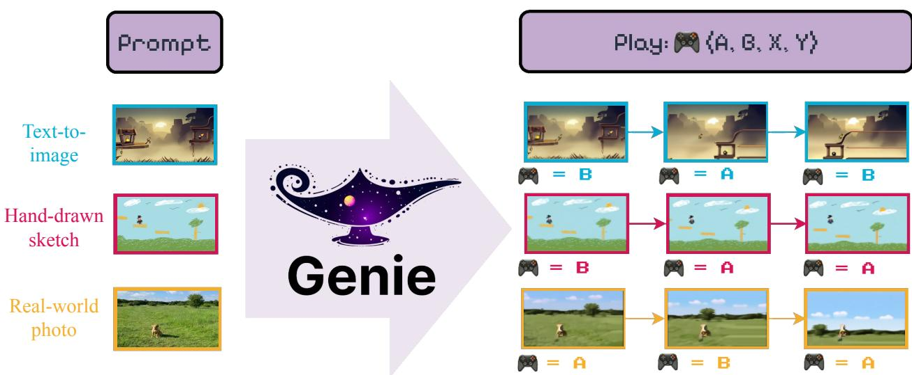
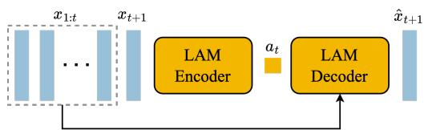
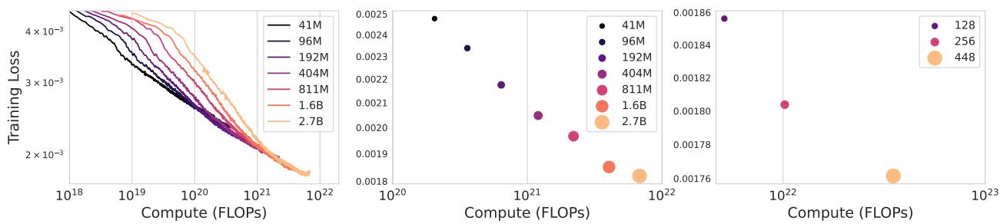
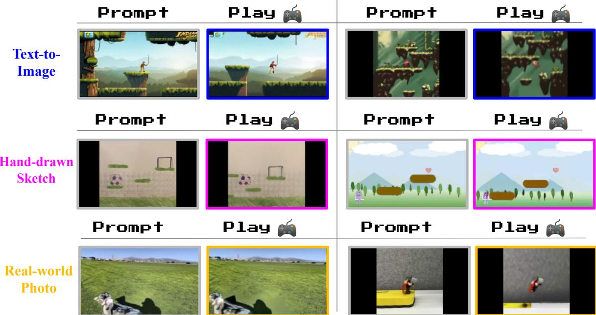
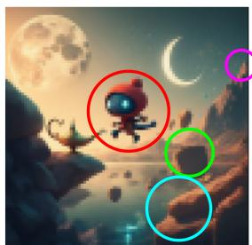
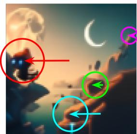
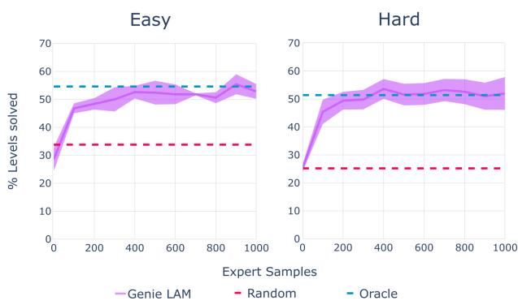
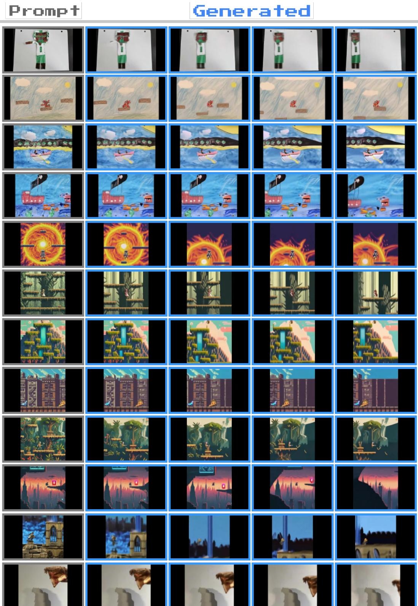

# Genie: Generative Interactive Environments

Jake Bruce\*,1, Michael Dennis\*,1, Ashley Edwards\*,1, Jack Parker-Holder\*,1, Yuge (Jimmy) Shi\*,1, Edward Hughes1, Matthew Lai1, Aditi Mavalankar1, Richie Steigerwald1, Chris Apps1, Yusuf Aytar1, Sarah Bechtle1, Feryal Behbahani1, Stephanie Chan1, Nicolas Heess1, Lucy Gonzalez1, Simon Osindero1, Sherjil Ozair1, Scott Reed1, Jingwei Zhang1, Konrad Zolna1, Jef Clune1,2, Nando de Freitas1, Satinder Singh1 and Tim Rocktäschel\*,1

Equal contributions, 1Google DeepMind, 2University of British Columbia

图 1 | 一个全新的世界：Genie 能够将各种不同的提示转化为可交互的、可玩的环境，这些环境可以轻松创建、进入并加以探索。这一能力得益于一个潜在动作（latent action）接口，它完全通过无监督方式从互联网视频中学习得到。右侧展示了执行两个潜在动作时生成的几步结果。更多示例请参见我们的网站。

我们介绍 Genie，这是首个以无监督方式从未标注的互联网视频中训练得到的生成式交互环境。该模型可以通过文本、合成图像、照片甚至素描等提示，生成无穷无尽的可动作控制（action-controllable）虚拟世界。Genie 拥有 110 亿参数，可被视为一个基础世界模型（foundation world model）。它由一个时空视频分词器（spatiotemporal video tokenizer）、一个自回归动力学模型（autoregressive dynamics model）以及一个简单且可扩展的潜在动作模型（latent action model）组成。尽管训练过程中没有使用任何真实动作标签或世界模型文献中常见的其他领域特定要求，Genie 仍能让用户逐帧地在所生成环境中执行动作。此外，所学习得到的潜在动作空间便于训练智能体去模仿未见视频中的行为，为未来训练通用智能体开辟了道路。

关键词：生成式 AI（Generative AI）、基础模型（Foundation Models）、世界模型（World Models）、视频模型（Video Models）、开放式学习（Open-Endedness）

## 1. 引言

过去几年见证了生成式 AI 的兴起，相关模型能够生成新颖且富有创造性的内容。在 Transformer 等架构的突破（Vaswani et al., 2017）、硬件的进步以及近期对模型和数据集规模的关注推动下，我们现在已能生成连贯的对话式语言（Brown et al., 2020; Radford et al., 2018, 2019），也能从文本提示中生成清晰且美观的图像（Ramesh et al., 2021, 2022; Rombach et al., 2022; Saharia et al., 2022）。早期迹象表明，视频生成将成为又一前沿领域，最近的结果显示此类模型也可能受益于规模化（Blattmann et al., 2023a; Esser et al., 2023; Ho et al., 2022a; Hong et al., 2023）。然而，视频生成模型与 ChatGPT 等语言工具之间的交互性和参与度水平仍然存在巨大差距，更不用说更具沉浸感的体验了。

试想一下，如果给定一个来自互联网的海量视频语料库，我们不仅能够训练出生成新颖图像或视频的模型，还能生成完整的交互式体验呢？我们提出了生成式交互环境（generative interactive environments），这是一种生成式人工智能的新范式，借助该范式，只需一条文本或图像提示，即可生成交互式环境。我们的方法 Genie 基于超过 20 万小时的公开互联网游戏视频数据集进行训练，尽管训练过程中没有使用动作或文本标注，但通过学习到的潜在动作空间（latent action space），它可以在逐帧基础上进行控制（与其他方法的对比见表 1）。Genie 拥有 110 亿参数，展现了通常只在基础模型中才会出现的性质：它能够以一张未见过的图像作为提示，从而创造出完全想象出的虚拟世界并进行游玩（例如图 2）。

Genie 建立在当前最先进的视频生成模型（Gupta 等人，2023；Villegas 等人，2023）的思想之上，其核心设计选择是时空（ST）变换器（spatiotemporal (ST) transformers，Xu 等人，2020），我们模型的所有组件都使用了它。Genie 采用了一种新颖的视频分词器（video tokenizer），并通过一个因果动作模型（causal action model）来提取潜在动作（latent actions）。视频词元和潜在动作

提示

  

图 2 | 多样化的轨迹：Genie 是一个生成模型，可用作交互式环境。该模型可以通过多种方式进行提示（prompt），既可以使用生成的图像（顶部），也可以使用手绘草图（底部）。在每个时间步，模型接收用户提供的潜在动作（latent action）来生成下一帧，从而产生具有丰富且多样化角色动作的轨迹。

被传递给一个动力学模型（dynamics model），该模型使用 MaskGIT 自回归地预测下一帧（Chang et al., 2022）。我们对所提架构在批大小（batch size）和模型规模两方面进行了严格的扩展性分析，其中模型参数量从 40M 变化到 2.7B。结果表明，我们的架构能够随着更多计算资源的增加而优雅地扩展（scale gracefully），最终得到一个参数量为 11B 的模型。我们在从数百款 2D 平台游戏（2D platformer games）中筛选出的 30,000 小时互联网游戏视频上训练 Genie，为该设定生成了一个基础世界模型（foundation world model）。

为了展示我们所提方法的通用性，我们还在来自 RT1 数据集（Brohan et al., 2023）的无动作机器人视频上单独训练了一个模型，学习了一个具有一致潜在动作（latent actions）的生成式环境。最后，我们表明，从互联网视频中学到的潜在动作可以用于从未见过的模拟强化学习（simulated reinforcement learning, RL）环境的无动作视频中推断策略，这表明 Genie 可能为解锁训练下一代通用智能体（generalist agents）所需的无限数据提供了关键（Bauer et al., 2023; Clune, 2019; Open Ended Learning Team et al., 2021; Reed et al., 2022）。

Table 1 | 一类全新的生成模型：Genie 是一种新颖的视频与世界模型，可以以逐帧（frame-by-frame）方式进行控制，在训练时仅需要视频数据。

<table><tr><td>Model Class</td><td>Training Data</td><td>Controllability</td></tr><tr><td>World Models</td><td>Video + Actions</td><td>Frame-level</td></tr><tr><td>Video Models</td><td>Video + Text</td><td>Video-level</td></tr><tr><td>Genie</td><td>Video</td><td>Frame-level</td></tr></table>

## 2. 方法（Methodology）

Genie 是一个仅通过视频数据训练的可生成交互式环境。在本节中，我们先介绍预备知识，然后解释模型的主要组成部分。

Genie 架构中的几个组件基于 Vision Transformer（ViT）（Dosovitskiy 等人，2021；Vaswani 等人，2017）。值得注意的是，Transformer 的二次方内存成本对视频来说是一个挑战，因为视频可能包含多达 $O ( 1 0 ^ { 4 } )$ 个 token。因此，我们在所有模型组件中采用了内存高效的 ST-transformer 架构（灵感来自 Xu 等人（2020），见图 4），在模型容量和计算约束之间取得平衡。

与每个 token 都关注所有其他 token 的传统 Transformer 不同，ST-transformer 包含 � 个时空块，具有交错的空域和时域注意力层，后跟一个前馈层（FFW），作为标准的注意力块。空域层中的自注意力关注每个时间步内的 $1 \times H \times W$ 个 token，而时域层关注跨时间步的 $T \times 1 \times 1$ 个 token。与序列 Transformer 类似，时域层采用具有因果掩码的因果结构。至关重要的是，我们架构中计算复杂度的主导因素（即空域注意力层）与帧数呈线性扩展，而不是二次方扩展，使其在长时间交互中具有一致动力学的视频生成效率远高于传统方法。此外，请注意在 ST 块中，我们在空域和时域组件之后只包含一个 FFW，省略了空域后的 FFW，以允许模型的其他组件扩展规模，我们观察到这显著改善了效果。

## 2.1. 模型组件（Model Components）

如图 3 所示，我们的模型包含三个关键组件：1）一个潜在动作模型，推断每对帧之间的潜在动作 �；2）一个视频分词器，将原始视频帧转换为离散 token �；以及 3）一个动力学模型，给定潜在动作和过去的帧 token，预测视频的下一帧。该模型遵循标准的自回归视频生成流程分两个阶段进行训练：我们首先训练视频分词器，然后将其用于动力学模型。然后，我们共同训练潜在动作模型（直接从像素）和动力学模型（在视频 token 上）。

潜在动作模型（Latent Action Model, LAM）为了实现可控的视频生成，我们将每个未来帧的预测以在前一帧采取的动作为条件。然而，此类动作标签在互联网视频中很少出现，并且动作标注的获取成本很高。相反，我们以完全无监督的方式学习潜在动作（见图 5）。

首先，一个编码器（encoder）将所有先前帧 $\pmb{x}_{1:t} = (x_1, \cdots x_t)$ 以及下一帧 $x_{t+1}$ 作为输入，并输出一组对应的连续潜在动作 $\tilde{\pmb{a}}_{1:t} = (\tilde{a}_1, \cdots \tilde{a}_t)$。随后，一个解码器（decoder）将所有先前帧和潜在动作作为输入，预测下一帧 $\hat{x}_{t+1}$。

为了训练该模型，我们采用基于 VQ-VAE 的目标函数（van den Oord et al., 2017），该目标函数使我们能够将预测动作的数量限制为一小组离散码（code）。

我们将 VQ 码本（codebook）的词汇表大小 $|\mathcal{A}|$，即潜在动作的最大可能数量，限制为一个较小的值，以保证人类的可玩性（playability）并进一步增强可控性（controllability）（我们在实验中使用 $|\mathcal{A}| = 8$）。

由于解码器只能访问历史信息和潜在动作，$\tilde{a}_t$ 应编码过去与未来之间最有意义的变化，以便解码器能够成功重建未来帧。

需要注意的是，该解码器仅用于为 LAM 提供训练信号。

事实上，除了 VQ 码本之外，整个 LAM 在推理时都会被丢弃，并由来自用户的动作所取代。

  

图 3 | Genie 模型训练：Genie 将 $N$ 帧视频作为输入，通过视频分词器（video tokenizer）将其分词为离散令牌 $z$，并借助潜在动作模型（latent action model）推断出每两帧之间的潜在动作 $\bar{a}$。两者随后被一同传递给动力学模型（dynamics model），以迭代方式生成对下一帧的预测。

  

Figure 4 | ST-transformer 架构。该架构由 τ 个时空块组成，每个块包含一个空间层、一个时间层和一个前馈层。每种颜色代表一个自注意力图：空间层对单个时间步内的 $H \times W$ 个 token 进行注意力计算，时间层则对跨 τ 个时间步的同一 token 进行注意力计算。

Figure 5 | 潜在动作模型（Latent action model）：从无标注的视频帧中以无监督方式学习动作 $a _ { t }$。

我们利用 ST-transformer 架构来构建潜在动作模型。时间层中的因果掩码使我们能够将整个视频 $x _ { 1 : T }$ 作为输入，并生成每帧之间的所有潜在动作 $\tilde { \pmb { a } } _ { 1 : T - 1 }$。

## 视频分词器

参考先前工作（Gupta et al., 2023; Villegas et al., 2023; Yan et al., 2023），我们将视频压缩为离散 token 以降低维度并实现更高质量的视频生成（见图 6）。我们同样采用 VQ-VAE，它以 T 帧视频 $\pmb { x } _ { 1 : T } = ( x _ { 1 } , x _ { 2 } , \cdots , x _ { T } ) \in \mathbb { R } ^ { T \times H \times W \times C }$ 作为输入，为每一帧生成离散表示 $\mathfrak { z } _ { 1 : T } = \left( z _ { 1 } , z _ { 2 } , \cdot \cdot \cdot , z _ { T } \right) \in \mathbb { I } ^ { T \times D }$，其中 D 是离散潜在空间的尺寸。该分词器在整个视频序列上使用标准的 VQ-VAE 目标进行训练。

  

图 6 | 视频分词器（Video Tokenizer）：一个采用 STtransformer 的 VQ-VAE。

与先前仅在标记化阶段关注空间压缩的工作（Gupta et al., 2023; Hong et al., 2022; Wu et al., 2022）不同，我们在编码器和解码器中都采用 ST-transformer，以将时序动态融入编码表示中，从而提升视频生成质量。得益于 ST-transformer 的因果特性，每个离散编码 ${ { \mathscr Z } _ { t } }$ 都包含来自视频 $x _ { 1 : t }$ 所有先前已观察帧的信息。Phenaki（Villegas et al., 2023）同样使用了具有时序感知能力的标记器 C-ViViT，但该架构计算开销很大，其成本随帧数呈二次方增长——相比之下，我们基于 ST-transformer 的标记器（ST-ViViT）计算效率显著更高，其主要计算开销随帧数线性增长。

  

图 7 | 动力学模型：接收视频标记和动作嵌入，并预测未来被掩码的视频标记。

动力学模型 动力学模型是一个仅解码器的 MaskGIT（Chang et al., 2022）Transformer（图 7）。在每个时间步 $t \in [ 1 , T ]$ 上，它接收已分词的视频 $\mathfrak { z } _ { 1 : t - 1 }$ 以及带 stopgrad（停止梯度）的潜在动作 $\tilde { \mathbf { a } } _ { 1 : t - 1 }$，并预测下一帧的词元（token）$\hat { \boldsymbol { z } } _ { t }$。我们再次采用 ST-Transformer（时空 Transformer），其因果结构使我们能够将来自全部 $( T - 1 )$ 帧的词元 $\pmb { z } _ { 1 : T - 1 }$ 以及潜在动作 $\tilde { \pmb { a } } _ { 1 : T - 1 }$ 作为输入，并为所有后续帧生成预测 $\hat { \pmb { z } } _ { 2 : T }$。模型通过在预测词元 $\hat { \pmb { z } } _ { 2 : T }$ 与真实词元 $\mathfrak { z } _ { 2 : T }$ 之间施加交叉熵损失进行训练。在训练阶段，我们按照一个采样自 0.5 到 1 之间的均匀分布的掩码率，依据伯努利分布随机遮蔽输入词元 $z _ { 2 : T - 1 }$。值得注意的是，训练世界模型（包括基于 Transformer 的模型）的一种常见做法是将时刻 $t$ 的动作拼接到对应帧上（Micheli et al., 2023; Robine et al., 2023）。然而，我们发现将潜在动作同时作为潜在动作模型与动力学模型的可加性嵌入（additive embedding），有助于提升生成过程的可控性。

## 2.2. 推理：动作可控的视频生成

我们现在描述如何在推理阶段使用 Genie 进行动作可控的视频生成（见图 8）。首先，玩家向模型输入一张图像 $x _ { 1 }$，作为初始帧1。该图像经由视频编码器分词后得到 $\mathfrak { z } _ { 1 }$。随后，玩家通过在 $[ 0 , | { \cal A } | )$ 范围内选取任意整数值来指定要执行的离散潜在动作 $a$。2 动力学模型接收帧词元 $z$ 以及对应的潜在动作 $\tilde { a } _ { 1 }$（该潜在动作通过对 VQ 码本以离散输入 $a _ { 1 }$ 进行索引而获得），进而预测下一帧词元 $\mathfrak { z } _ { 2 }$。随着动作持续传入模型，这一过程以自回归方式不断重复，从而生成序列的其余部分 $\hat { \pmb { z } } _ { 2 : T }$，与此同时词元经由分词器的解码器被解码为视频帧 $\hat { x } _ { 2 : T }$。需要指出的是，我们既可以通过向模型输入起始帧以及从视频中推断出的动作来复现数据集中的真实视频，也可以通过改变动作来生成全新的视频（或轨迹）。

  

图 8 | Genie 推理：提示帧（prompt frame）被分词，与用户所执行的潜在动作（latent action）合并后，传递给动力学模型（dynamics model）进行迭代生成。预测得到的帧标记（frame tokens）随后通过分词器的解码器（tokenizer's decoder）解码回图像空间。

## 实验结果

**数据集** 我们在一个大规模数据集上训练 Genie，该数据集来源于公开可访问的互联网 2D 平台跳跃游戏（2D Platformer）视频（以下统称为「Platformers」）。我们通过按平台跳跃游戏相关关键词对公开视频进行筛选来构建 Platformers 数据集，得到 5500 万段时长 16 秒、10FPS、160×90 分辨率的视频片段。最终数据集包含 680 万段 16 秒视频片段（3 万小时），与其他主流互联网视频数据集处于同一数量级（Bain 等, 2021；Wang 等, 2023）。更多细节详见附录 B.1。除非另有说明，所展示的结果均来自一个 110 亿参数的模型。

  

图 9 | 规模扩展（Scaling）结果。左：不同模型规模的训练曲线；中：各模型规模的最终训练损失，对最后 300 次更新取平均；右：2.3B 模型在不同批量大小下的最终训练损失。

在该数据集上进行训练。

为了验证我们方法的泛化能力，我们还考虑了用于训练 RT1（Brohan et al., 2023）的机器人数据集，将其约 130k 条机器人演示数据与一个单独的仿真数据集以及来自先前工作的 209k 条真实机器人数据片段（Kalashnikov et al., 2018）合并使用。需要注意的是，我们不使用这些数据集中的任何动作，而只是将它们视为视频。为简便起见，下文将此数据集称为 "Robotics"。

指标 我们通过两个因素来考察 Genie 的视频生成性能，即视频保真度（video fidelity，即视频生成的质量）和可控性（controllability，即潜在动作对视频生成的影响程度）。对于视频保真度，我们使用 Frechet Video Distance（FVD），这是一种视频级别的度量，已被证明与视频质量的人工评估具有高度一致性（Unterthiner et al., 2019）。对于可控性，我们设计了一个基于峰值信噪比（peak signal-to-noise ratio, PSNR）的指标，称之为 $\Delta _ { t } \mathrm { P S N R }$，用于衡量在条件化为从真值推断的潜在动作（$\hat{a}$）与从随机分布采样的潜在动作（$\hat{a}'$）时，视频生成结果的差异程度：

$$
\Delta_ {t} \mathrm{PSNR} = \mathrm{PSNR} (x _ {t}, \hat {x} _ {t}) - \mathrm{PSNR} (x _ {t}, \hat {x} _ {t} ^ {\prime}),
$$

其中 $x_t$ 表示时刻 $t$ 的真实帧，$\hat{x}_t$ 表示由从真实帧推断出的潜在动作 $\tilde{\mathbf{a}}_{1:t}$ 生成的帧，$\hat{x}_t^{\prime}$ 表示由从类别分布中随机采样的潜在动作序列生成的同一帧。因此，$\Delta_t$ PSNR 越大，说明由随机潜在动作生成的视频与真实视频的差异越大，这表明潜在动作具有更高的可控性。在所有实验中，我们报告 $t=4$ 时的 $\Delta_t$ PSNR。

训练细节 我们的视频分词器使用 200M 参数，patch 大小为 4，码本嵌入维度为 32，包含 1024 个唯一码字；我们在分词器重建质量与下游视频预测性能之间的权衡中发现这是最为有效的设置。潜在动作模型具有 300M 参数，patch 大小为 16，码本嵌入维度为 32，包含 8 个唯一码字（即潜在动作）。对于所有建模组件，我们使用长度为 16 帧、帧率 10 FPS 的序列。此外，我们在训练动力学模型时采用 bfloat16 与 QK norm，这已被证明可在大规模训练中稳定训练过程（Dehghani et al., 2023; Henry et al., 2020）。在推理阶段，我们对每帧的采样执行 25 步 MaskGIT，温度设为 2，采用随机采样方式。更多细节请参见附录 C。

## 3.1. 缩放结果

在本节中，我们研究模型的缩放行为。为此，我们开展了同时探究模型规模与批量大小影响的实验研究。有关架构与算力使用的更多细节，请参见附录 D。

模型规模缩放 在固定视频分词器与动作模型架构的前提下，我们训练了一系列动力学模型，参数量从 40M 到 2.7B 不等。图 9 表明我们的架构随模型参数量的增加而优雅地扩展，模型规模的每一次提升都对应着最终训练损失的一致下降。这是我们的方法受益于扩展的一个强有力的标志，我们的主 Genie 模型正是利用了这一点。

  

图 10 | 从图像提示进行游玩（Playing from Image Prompts）：我们可以使用文生图模型生成的图像、手绘草图或真实世界照片来提示 Genie。在每种情况下，我们都展示了提示帧以及连续四次采取某个潜在动作后的第二帧。尽管其中一些图像在视觉上与数据集明显不同，但在每种情况下我们都能观察到清晰的角色动作。

## 批量大小扩展

我们还研究了批量大小扩展的效果，考虑了一个 2.3B 模型，分别采用 128、256 和 448 的批量大小，对应 1.9M、3.8M 和 6.6M tokens。如图 9 所示，增加批量大小同样带来了模型性能方面的显著增益。

## Genie 模型

显而易见，同时增加模型大小和批量大小有助于提升模型性能。因此，对于我们的最终模型，我们训练了一个 10.1B 的动力学模型，批量大小为 512，共 125k 步，使用 256 块 TPUv5p。当结合分词器（tokenizer）和动作模型（action model）后，总参数量达到 10.7B，训练数据量为 942B tokens，我们将该模型称为 Genie 模型。针对我们的网站，我们训练了一个更大的解码器，将 tokens 映射为 360p 视频，并增加了额外的参数。

## 3.2. 定性结果

下面展示 Genie 模型的定性结果。我们展示了一个在 Platformers 数据集上训练的 11B 参数模型，以及一个在 Robotics 数据集上训练的较小模型。我们的模型能够在多个不同领域生成高质量、可控的视频。值得注意的是，我们在定性地评估 Platformers 训练的模型时，仅使用分布外（out-of-distribution, OOD）的图像提示，包括由文生图模型生成的图像、手绘草图，甚至是真实世界的照片。该模型能够泛化到这些极具挑战性的 OOD 输入，证明了我们方法的鲁棒性以及在大规模数据上训练的价值——而如果使用真实动作作为输入，这种规模的训练是不可行的。

Platformers 训练的模型 图 10 展示了我们的模型从 OOD 图像提示生成样例的过程，包括（第一行）由 Imagen2（Ho 等，2022a；van den Oord 等）生成的图像、（第二行）手绘草图和（第三行）真实世界的照片。Genie 能够将这些想象的世界变得栩栩如生，正如我们在与每个样例交互时所看到的类游戏行为。我们在附录 A 中展示了更多由该模型生成的内容，并进一步强调了潜在动作的一致性。

  

提示

生成

图 11 | 学习模拟可形变物体：我们展示了在模型中采取相同动作的情况下，十步轨迹中的若干帧。Genie 能够学习物体的物理属性，例如薯片袋等。

  

图 12 | 模拟视差（parallax），这是平台跳跃类游戏中常见的特性。从这张由文本生成的初始图像出发，前景的移动幅度大于近处和远处的中间层，背景则仅发生轻微移动。

我们模型的另一个涌现能力是它能够理解 3D 场景并模拟视差（parallax），这种视差效果在平台跳跃游戏中很常见。在图 12 中，我们展示了一张由 Imagen2 生成的图像，其中采取一个潜在动作（latent action）会使前景以不同于背景的速率移动（以不同颜色箭头的长度表示）。

机器人训练模型 我们使用在 Platformers 数据集上找到的相同超参数，在机器人数据集（Robotics dataset）上训练了一个 2.5B 参数的模型，在测试集划分上取得了 82.7 的 FVD。如图 13 所示，该模型成功地从视频数据中学习到了不同且一致的动作，既不需要文本也不需要动作标签（例如 Yang 等人（2023）中的做法）。值得注意的是，我们的模型不仅学习了机械臂的控制，还学习了各种物体的交互和变形（图 11）。我们认为，这表明我们的方法提供了一条路径，可利用来自互联网的更大规模视频数据集来构建一个面向机器人的基础世界模型（foundational world model），该模型具备可用于多种应用的低级可控仿真能力。

  

图 13 | 机器人领域中可控且一致的潜在动作：从我们的 Robotics 数据集中三个不同起始帧开始的轨迹。每一列展示了执行同一潜在动作五次后得到的对应帧。尽管训练时未使用动作标签，相同动作在不同的提示帧之间保持一致并具有明确的语义含义：下（down）、上（up）和左（left）。

## 3.3. 训练智能体

我们相信 Genie 有朝一日可以作为训练通用智能体（generalist agents）的基础世界模型（foundation world model）。在图 14 中，我们展示了该模型已经能够根据起始帧在未见过的强化学习（Reinforcement Learning, RL）环境中生成多样化的轨迹。我们进一步研究了从互联网视频中学习到的潜在动作（latent actions）是否可用于模仿（imitation）未见过的视频中的行为。具体做法是：使用一个冻结的潜在动作模型（Latent Action Model, LAM）为来自目标环境的一组专家视频序列标注离散的潜在动作；然后训练一个策略，在给定观测的情况下预测专家执行某个潜在动作的可能性。接着，我们使用一个包含专家真实动作的小型数据集，将潜在动作映射到真实动作（更多细节参见附录 E）。

  

图 14 | 在强化学习（RL）环境中进行游戏：给定一张未见过的强化学习环境的图像，Genie 能够生成多样化的轨迹。

我们在程序化生成的 2D 平台跳跃环境 CoinRun（Cobbe 等人，2020）的困难和简单设定下进行测试，并以一个能访问专家动作的 oracle 行为克隆（Behavioral Cloning, BC）模型作为性能上界、以一个随机智能体作为性能下界进行比较（图 15）。基于 LAM 的策略仅需 200 个专家样本进行适配，就能取得与 oracle 相同的得分，尽管它几乎肯定此前从未见过 CoinRun。这表明学到的潜动作对迁移而言是一致且有意义的，因为从潜空间到真实空间的映射中并不包含当前观测的任何信息。

## 3.4. 消融实验

潜动作模型的设计选择（Design choices for latent action model）在设计潜动作模型时，我们仔细考虑了应使用的输入类型。尽管我们最终选择了原始图像（像素）作为输入，但我们仍将该方案与另一种替代方案——使用分词化图像（在图 5 中将 x 替换为 z）——进行了对比。我们将这种替代方法称为「分词输入（token-input）」模型（见表 2）。

虽然该模型在 Platformers 数据集上取得了略低的 FVD 分数，但这一优势在 Robotics 数据集上未能保持。更重要的是，在两个环境中，分词输入模型都表现出更差的可控性（以 ΔzPSNR 衡量）。这表明在分词化过程中可能丢失了部分关于视频动态与运动的信息，因此让潜动作模型直接以原始视频作为输入是更有利的选择。

  

Proprietary + Confidential图 15 | BC 结果。在 100 个样本中关卡通过率的平均百分比，基于 5 个随机种子取平均，并附 95% 置信区间。

表 2 | 潜在动作模型输入的消融实验。我们可以看到 Genie 实现了更高的可控性。

<table><tr><td></td><td>Dataset</td><td>#Params</td><td>FVD (↓)</td><td> $\Delta_{\text{t}}$ PSNR(↑)</td></tr><tr><td>Token-input</td><td>Platforms</td><td>2.3B</td><td>38.8</td><td>1.33</td></tr><tr><td>Pixel-input (Genie)</td><td>Platforms</td><td>2.5B</td><td>40.1</td><td>1.91</td></tr><tr><td>Token-input</td><td>Robotics</td><td>1B</td><td>257.8</td><td>1.65</td></tr><tr><td>Pixel-input (Genie)</td><td>Robotics</td><td>1B</td><td>136.4</td><td>2.07</td></tr></table>

分词器架构消融（Tokenizer architecture ablations）

我们比较了三种分词器选择的性能，包括 1）（仅空间）ViT，2）（空间-时间）ST-ViViT，以及 3）（空间-时间）C-ViViT（表 3）。为便于比较，我们对所有分词器使用相近的参数数量，其中 patch size 为 10，batch size 为 128，sequence length 为 16。随后我们在三种不同的分词器上训练相同的动力学模型和潜动作模型，并报告它们的 FVD 以及 $\Delta _ { t }$ PSNR。

表 3 | 分词器架构消融：我们的 ST-ViViT 架构取得了最优的分词器性能。

<table><tr><td></td><td>#Params</td><td>Memory</td><td>FVD (↓)</td><td> $\Delta_{\text{r}}$ PSNR(↑)</td></tr><tr><td>ViT</td><td>230M</td><td>0.3GB</td><td>114.5</td><td>1.39</td></tr><tr><td>C-ViViT (Villegas et al., 2023)</td><td>225M</td><td>1.6GB</td><td>272.7</td><td>1.37</td></tr><tr><td>ST-ViViT (ours)</td><td>205M</td><td>0.9GB</td><td>81.4</td><td>1.66</td></tr></table>

我们提出的 ST-ViViT 架构在视频生成（FVD）和 Δ�PSNR 两方面均有所提升，相比 C-ViViT 和仅空间的 ViT，在内存方面也做出了合理的权衡。这分别证明了它生成高保真度视频以及良好可控性的能力。

尽管 C-ViViT 采用了完整的时空注意力机制，导致在相同参数数量下其内存消耗显著高于另外两种架构，但这并未带来性能的提升。事实上，C-ViViT 表现出过拟合的倾向，在训练过程中需要强正则化，这或许可以解释其性能明显偏低的原因。

## 4. 相关工作

**世界模型（World Models）** 生成式交互环境可以被视为世界模型的一类（Ha and Schmidhuber, 2018; Oh et al., 2015），它们能够基于动作输入进行下一帧预测（Bamford and Lucas, 2020; Chiappa et al., 2017; Eslami et al., 2018; Hafner et al., 2020, 2021; Kim et al., 2020, 2021; Micheli et al., 2023; Nunes et al., 2020; Pan et al., 2022; Robine et al., 2023）。这类模型对于智能体训练非常有用，因为它们可以在智能体训练阶段不直接与环境交互的情况下用于学习策略。然而，学习这些模型本身通常需要直接从环境中获得以动作为条件的数据。相比之下，我们的方法旨在仅从视频中以无监督方式学习世界模型。最近，世界模型的扩展重新受到重视。GAIA-1（Hu et al., 2023）和 UniSim（Yang et al., 2023）分别为自动驾驶和机器人操作学习世界模型。这些方法需要文本和动作标签，而我们专注于从公开互联网视频中仅使用视频数据进行训练。

**视频模型** 我们的工作与视频模型相关，后者通常以初始帧（或文本）为条件，并预测视频中的其余帧（Blattmann et al., 2023b; Brooks et al., 2024; Clark et al., 2019; Finn et al., 2016; Ho et al., 2022a,b; Höppe et al., 2022; Kalchbrenner et al., 2017; Le Moing et al., 2021; Lotter et al., 2017; Luc et al., 2020; Singer et al., 2023; Walker et al., 2021; Yan et al., 2021; Yu et al., 2023）。我们的方法最接近于最近的基于 Transformer 的模型，如 Phenaki（Villegas et al., 2023）、TECO（Yan et al., 2023）和 MaskViT（Gupta et al., 2023），因为我们使用 MaskGIT（Chang et al., 2022）和 ST-Transformer（Xu et al., 2020）作用于分词化的图像。虽然视频模型的可控性正在不断增强（例如 Huang et al., 2022），但我们追求更具智能体风格的目标，并显式地从数据中学习一个潜在动作空间，从而允许用户或智能体通过潜在动作条件的预测来"操控"该模型。

### 可玩视频生成（Playable Video Generation）

Genie 在可玩视频生成（Playable Video Generation, PVG）（Menapace 等，2021）的基础上做了进一步推广。PVG 使用潜在动作来控制直接从视频中学到的世界模型（Menapace 等，2021，2022）。与 Genie 不同，PVG 考虑的是领域特定的静态样例，而不是通过提示（prompting）生成全新的环境。因此，要在此基础上进行扩展，需要进行非平凡的架构改动，去除归纳偏置以换取一个通用的方法。

### 环境生成（Environment generation）

我们的工作还与程序化内容生成（Procedural Content Generation, PCG，参见 Risi 和 Togelius，2020a,b）相关，其中机器学习已被证明在生成游戏关卡方面非常有效（Summerville 等，2018），近期工作则是通过直接编写游戏代码的语言模型来生成关卡（Sudhakaran 等，2023；Todd 等，2023）。语言模型本身也可以被视为交互式环境（Wong 等，2023），尽管它们缺乏视觉组件。相比之下，在我们的设定中，关卡可以从像素中直接学习并生成，这使我们能够利用互联网视频数据的多样性。

### 用潜在动作训练智能体（Training agents with latent actions）

先前的工作已使用潜在动作用于从观测中进行模仿学习（Edwards 等，2019）、规划（Rybkin\* 等，2019）以及预训练强化学习智能体（Schmidt 和 Jiang，2024；Ye 等，2022）。这些方法与我们的潜在动作模型具有相似的目标，但尚未被大规模应用。VPT（Baker 等，2022）是一种近期的方法，它使用由人类提供动作标注的数据学到的逆动力学模型来为互联网规模的视频标注动作，从而可用于训练策略。相比之下，我们展示了可以利用从互联网视频中学到的潜在动作来为任意环境推断策略，从而避免了对真实动作标签的需求，因为这些标签成本高昂且可能无法泛化。

## 5. 结论与未来工作（Conclusion and Future Work）

我们提出了 Genie，这是一种新型的生成式人工智能，它使得任何人——即使是儿童——也能够像在人类设计的模拟环境中一样去构想、创造并步入所生成的世界。尽管仅使用视频数据进行训练，Genie 仍能通过提示生成出多种多样、可交互且可控的环境。

该模型仍有可以改进的空间。Genie 继承了自回归 Transformer 模型的一些缺点，可能会「幻」出不符合实际的后续画面。尽管我们在时空表征方面取得了进展，但目前仍只有 16 帧的记忆，这使得在长时间跨度上保持环境一致性成为一项挑战。最后，Genie 目前以约 1 FPS 的速度运行，要实现交互所需的流畅帧率，还需要进一步的进展。

尽管如此，我们相信 Genie 为未来研究开启了广阔的可能性。鉴于其通用性，该模型可以从更大比例的互联网视频中进行训练，以模拟多样化、真实且想象的环境。此外，我们只是简要探讨了使用 Genie 来训练智能体的能力，但鉴于缺乏丰富多样的环境是强化学习中的关键局限之一，我们有望开辟通往创造更具通用能力智能体的新路径。

## 更广泛的影响

社会影响：Genie 可以使大量人群能够生成他们自己的类游戏体验。对于那些希望以新方式表达创造力的人来说，这可以是积极的，例如儿童可以设计并踏入他们自己想象的世界。我们也认识到，随着重大进展，探索利用这项技术来放大现有的人类游戏生成与创造力的可能性将是至关重要的——并赋能相关行业利用 Genie 来开启下一代可玩世界的开发。

训练数据与权重：我们选择不发布训练好的模型检查点、模型的训练数据集，也不发布来自该数据的示例，以配合本论文或网站。我们希望有机会进一步与研究（及视频游戏）社区接触，以确保任何未来的此类发布都是尊重、安全和负责任的。

可复现性：我们理解计算资源较少的研究人员可能难以复现我们的主要结果。为了缓解这个问题，我们在附录 F 中描述了一个可在单个中端 TPU（或 GPU）上运行的较小规模的、完全可复现的示例。鉴于许多设计选择在两种设置之间可以相互迁移，我们相信这将使更广泛的社区能够探索未来的架构改进以及源自我们工作的其他研究方向。

## 致谢

我们感谢 Mateusz Malinowski、Philip Ball 和 Louis Kirsch 审阅了我们的论文草稿；感谢 Cassidy Hardin、David Bridson、Eric Lau、Lars Lowe Sjoesund、Lucas Smaira 和 Bernardo Avila Pires 对我们的 Platformers 数据集提供的帮助；感谢 Ruben Villegas 就我们的视频模型训练和评估进行的有价值的讨论；感谢 Adrian Bolton、Rushil Mistry、Hannah Openshaw、Zoubin Ghahramani、Raia Hadsell、Koray Kavukcuoglu、Daan Wierstra、Doina Precup 和 Ed Hirst 提供的战略建议和指导。我们使用了 DeepMind Jax 生态系统（Babuschkin 等，2010），特别感谢 Andy Brock 构建了我们用于模型训练的内部框架，以及 Arthur Brussee 提供了使我们能够「游玩」我们模型的初始接口。最后，感谢 Seneca 和 Caspian Clune 的创意草图，他们或许因此成为最年轻的游戏设计师。

## 作者贡献

我们按姓氏字母顺序列出作者。请将所有通信发送至 Ashley Edwards（edwardsashley@google.com）和 Jack Parker-Holder（jparkerholder@google.com）。

## 核心贡献者

• Jake Bruce：项目领导、视频分词器研究、动作模型研究、动力学模型研究、规模化、模型演示、基础设施

• Michael Dennis：动力学模型研究、规模化、指标、模型演示、基础设施

• Ashley Edwards：Genie 概念、项目领导、动作模型研究、智能体训练、模型演示

• Edward Hughes：动力学模型研究、基础设施

• Matthew Lai：数据集整理、基础设施

• Aditi Mavalankar：动作模型研究、指标、智能体训练

• Jack Parker-Holder：Genie 概念、项目领导、动力学模型研究、规模化、数据集整理

• Yuge (Jimmy) Shi：视频分词器研究、动力学模型研究、数据集整理、指标

• Richie Steigerwald：数据集整理、指标

## 部分贡献者与顾问

• Chris Apps：项目管理

• Yusuf Aytar：技术建议

• Sarah Bechtle：技术建议

• Feryal Behbahani：战略建议

• Stephanie Chan：技术建议

• Jef Clune：技术建议、战略建议

• Lucy Gonzalez：项目管理

• Nicolas Heess：战略建议

• Simon Osindero：技术建议

• Sherjil Ozair：技术建议

• Scott Reed：技术建议

• Jingwei Zhang：技术建议

• Konrad Zolna：规模化、技术建议

## 赞助者

• Nando de Freitas：战略建议

• Tim Rocktäschel：Genie 概念、项目领导

• Satinder Singh：战略建议

## 参考文献

M. Bain, A. Nagrani, G. Varol, and A. Zisserman. 冻结于时间：用于端到端检索的联合视频与图像编码器（Frozen in Time: A Joint Video and Image Encoder for End-to-End Retrieval）. 载于 2021 IEEE/CVF 国际计算机视觉会议（ICCV），第 1708–1718 页，美国加利福尼亚州 Los Alamitos，2021 年 10 月。IEEE Computer Society. doi: 10.1109/ICCV48922. 2021.00175.

B. Baker, I. Akkaya, P. Zhokov, J. Huizinga, J. Tang, A. Ecofet, B. Houghton, R. Sampedro, and J. Clune. 视频预训练（VPT）：通过观看未标注在线视频学习行动（Video Pretraining (VPT): Learning to Act by Watching Unlabeled Online Videos）. Advances in Neural Information Processing Systems, 35:24639–24654, 2022.

C. Bamford and S. M. Lucas. 神经游戏引擎：从像素中精确学习可泛化的前向模型（Neural Game Engine: Accurate Learning of Generalizable Forward Models from Pixels）. 载于 Conference on Games, 2020.

J. Bauer, K. Baumli, F. Behbahani, A. Bhoopchand, N. Bradley-Schmieg, M. Chang, N. Clay, A. Collister, V. Dasagi, L. Gonzalez, K. Gregor, E. Hughes, S. Kashem, M. Loks-Thompson, H. Openshaw, J. Parker-Holder, S. Pathak, N. Perez-Nieves, N. Rakicevic, T. Rocktäschel, Y. Schroecker, S. Singh, J. Sygnowski, K. Tuyls, S. York, A. Zacherl, and L. M. Zhang. 开放任务空间中人类时间尺度的自适应。收录于：A. Krause, E. Brunskill, K. Cho, B. Engelhardt, S. Sabato 和 J. Scarlett 编，《第40届国际机器学习大会论文集》，《机器学习研究论文集》第202卷，第1887–1935页。PMLR，2023年7月23–29日。

A. Blattmann, T. Dockhorn, S. Kulal, D. Mendelevitch, M. Kilian, D. Lorenz, Y. Levi, Z. English, V. Voleti, A. Letts, V. Jampani, and R. Rombach. 稳定视频扩散：将扩散模型的潜空间视频扩散模型扩展到大规模数据集，2023a。

A. Blattmann, R. Rombach, H. Ling, T. Dockhorn, S. W. Kim, S. Fidler, and K. Kreis. 对齐你的潜空间：使用潜空间扩散模型进行高分辨率视频合成。2023年 IEEE/CVF 计算机视觉与模式识别会议（CVPR），第22563–22575页，2023b。

T. Brooks, B. Peebles, C. Homes, W. DePue, Y. Guo, L. Jing, D. Schnurr, J. Taylor, T. Luhman, E. Luhman, C. W. Y. Ng, R. Wang, and A. Ramesh. 作为世界模拟器的视频生成模型。2024年。网址 https://openai.com/research/video-generation-models-as-world-simulators。

T. Brown, B. Mann, N. Ryder, M. Subbiah, J. D. Kaplan, P. Dhariwal, A. Neelakantan, P. Shyam, G. Sastry, A. Askell 等人. 语言模型是少样本学习者。《神经信息处理系统进展》，第33卷：1877–1901，2020年。

H. Chang, H. Zhang, L. Jiang, C. Liu, and W. T. Freeman. MaskGIT：掩码生成式图像变换器。收录于：《IEEE/CVF 计算机视觉与模式识别会议论文集（CVPR）》，第11315–11325页，2022年6月。

S. Chiappa, S. Racaniere, D. Wierstra, and S. Mohamed. 循环环境模拟器。收录于：《国际学习表征会议》，2017年。

A. Clark, J. Donahue, and K. Simonyan. 复杂数据集上的高效视频生成。CoRR，abs/1907.06571，2019年。网址 http://arxiv.org/abs/1907.06571。

J. Clune. AI 生成算法（AI-GAS）：通往通用人工智能的另一种范式（Ai-gas: Ai-generating algorithms, an alternate paradigm for producing general artificial intelligence）. arXiv 预印本 arXiv:1905.10985, 2019.

K. Cobbe, C. Hesse, J. Hilton, 和 J. Schulman. 利用过程化生成对强化学习进行基准测试（Leveraging procedural generation to benchmark reinforcement learning）. 载于：第 37 届国际机器学习大会论文集（Proceedings of the 37th International Conference on Machine Learning）, 第 2048–2056 页, 2020.

A. Dosovitskiy, L. Beyer, A. Kolesnikov, D. Weissenborn, X. Zhai, T. Unterthiner, M. Dehghani, M. Minderer, G. Heigold, S. Gelly, J. Uszkoreit, 和 N. Houlsby. 一张图像相当于 16×16 个词：用于大规模图像识别的 Transformer（An image is worth 16x16 words: Transformers for image recognition at scale）. 载于：国际学习表征会议（International Conference on Learning Representations）, 2021. 网址 https://openreview.net/forum?id=YicbFdNTTy.

A. Edwards, H. Sahni, Y. Schroecker, 和 C. Isbell. 从观察中模仿潜在策略（Imitating latent policies from observation）. 载于：国际机器学习会议（International conference on machine learning）, 第 1755–1763 页. PMLR, 2019.

P. Esser, J. Chiu, P. Atighehchian, J. Granskog, 和 A. Germanidis. 基于结构与内容引导的扩散模型视频合成（Structure and content-guided video synthesis with difusion models）. 载于：2023 年 IEEE/CVF 国际计算机视觉大会（2023 IEEE/CVF International Conference on Computer Vision, ICCV）, 2023.

C. Finn, I. Goodfellow, 和 S. Levine. 通过视频预测进行物理交互的无监督学习（Unsupervised learning for physical interaction through video prediction）. 载于：第 30 届神经信息处理系统大会论文集（Proceedings of the 30th International Conference on Neural Information Processing Systems）, NIPS'16, 第 64–72 页, 美国纽约州 Red Hook, 2016. Curran Associates Inc. ISBN 9781510838819.

A. Gupta, S. Tian, Y. Zhang, J. Wu, R. Martín-Martín, 和 L. Fei-Fei. MaskViT：用于视频预测的遮蔽视觉预训练（Maskvit: Masked visual pretraining for video prediction）. 载于：第十一届国际学习表征会议（The Eleventh International Conference on Learning Representations）, 2023.

D. Ha and J. Schmidhuber. 循环世界模型促进策略演化. 发表于：第32届神经信息处理系统国际会议论文集，NeurIPS'18，第2455–2467页，2018年.

D. Hafner, T. Lillicrap, J. Ba, and M. Norouzi. 梦想控制：通过潜在想象学习行为. 发表于：国际学习表征会议，2020年.

D. Hafner, T. P. Lillicrap, M. Norouzi, and J. Ba. 使用离散世界模型掌握雅达利. 发表于：国际学习表征会议，2021年.

K. He, X. Zhang, S. Ren, and J. Sun. 用于图像识别的深度残差学习. 发表于：2016年IEEE计算机视觉与模式识别会议（CVPR），第770–778页，2016年. doi: 10.1109/CVPR.2016.90.

A. Henry, P. R. Dachapally, S. S. Pawar, and Y. Chen. Transformer的查询-键归一化. 发表于：计算语言学协会发现集：EMNLP 2020，第4246–4253页，在线发布，2020年11月. 计算语言学协会. doi: 10.18653/v1/2020.findings-emnlp.379.

J. Ho, W. Chan, C. Saharia, J. Whang, R. Gao, A. Gritsenko, D. P. Kingma, B. Poole, M. Norouzi, D. J. Fleet, and T. Salimans. Imagen视频：使用扩散模型的高清视频生成, 2022a.

J. Ho, T. Salimans, A. Gritsenko, W. Chan, M. Norouzi, and D. J. Fleet. 视频扩散模型. 发表于：S. Koyejo, S. Mohamed, A. Agarwal, D. Belgrave, K. Cho, and A. Oh 主编，神经信息处理系统进展，第35卷，第8633–8646页. Curran Associates, Inc., 2022b.

W. Hong, M. Ding, W. Zheng, X. Liu, and J. Tang. Cogvideo：通过Transformer进行文本到视频生成的大规模预训练. arXiv预印本 arXiv:2205.15868, 2022年.

W. Hong, M. Ding, W. Zheng, X. Liu, and J. Tang. Cogvideo：通过Transformer进行文本到视频生成的大规模预训练. 发表于：第十一届国际学习表征会议, 2023年. URL https://openreview.net/forum?id=rB6TpjAuSRy.

T. Höppe, A. Mehrjou, S. Bauer, D. Nielsen, and A. Dittadi. 用于视频预测与填充的扩散模型. 机器学习研究汇刊, 2022年. ISSN 2835-8856.

A. Hu, L. Russell, H. Yeo, Z. Murez, G. Fedoseev, A. Kendall, J. Shotton, and G. Corrado. Gaia-1：用于自动驾驶的生成式世界模型, 2023年.

J. Huang, Y. Jin, K. M. Yi, and L. Sigal. 分层可控视频生成. 发表于：计算机视觉 – ECCV 2022：第17届欧洲会议，以色列特拉维夫，2022年10月23–27日，会议论文集第XVI部分，第546–564页，柏林，海德堡, 2022年. 施普林格出版社. ISBN 978-3-031-19786-4.

N. P. Jouppi, D. H. Yoon, G. Kurian, S. Li, N. Patil, J. Laudon, C. Young, and D. Patterson. 用于训练深度神经网络的专用领域超级计算机. ACM通讯, 63(7): 67–78, 2020年.

D. Kalashnikov, A. Irpan, P. Pastor, J. Ibarz, A. Herzog, E. Jang, D. Quillen, E. Holly, M. Kalakrishnan, V. Vanhoucke, 等人. Qt-opt：面向基于视觉的机器人操作的可扩展深度强化学习（Qt-opt: Scalable deep reinforcement learning for vision-based robotic manipulation）. arXiv 预印本 arXiv:1806.10293, 2018.

N. Kalchbrenner, A. van den Oord, K. Simonyan, I. Danihelka, O. Vinyals, A. Graves, 和 K. Kavukcuoglu. 视频像素网络（Video pixel networks）. 见：D. Precup 与 Y. W. Teh 主编, 第 34 届国际机器学习大会论文集（Proceedings of the 34th International Conference on Machine Learning）, 机器学习研究论文集第 70 卷, 第 1771–1779 页. PMLR, 2017 年 8 月 6–11 日. 网址 https://proceedings.mlr.press/v70/kalchbrenner17a.html.

S. Kapturowski, G. Ostrovski, J. Quan, R. Munos, 和 W. Dabney. 分布式强化学习中的循环经验回放（Recurrent experience replay in distributed reinforcement learning）. 见：国际学习表征会议（International conference on learning representations）, 2018.

S. W. Kim, Y. Zhou, J. Philion, A. Torralba, 和 S. Fidler. 学习使用 gamegan 仿真动态环境（Learning to simulate dynamic environments with gamegan）. 见：IEEE/CVF 计算机视觉与模式识别会议论文集（Proceedings of the IEEE/CVF Conference on Computer Vision and Pattern Recognition (CVPR)）, 2020 年 6 月.

S. W. Kim, J. Philion, A. Torralba, 和 S. Fidler. Drivegan：迈向可控的高质量神经仿真（Drivegan: Towards a controllable high-quality neural simulation）. 见：IEEE/CVF 计算机视觉与模式识别会议论文集（Proceedings of the IEEE/CVF Conference on Computer Vision and Pattern Recognition (CVPR)）, 第 5820–5829 页, 2021 年 6 月.

G. Le Moing, J. Ponce, 和 C. Schmid. Ccvs：上下文感知的可控视频合成（Ccvs: Context-aware controllable video synthesis）. 见：M. Ranzato, A. Beygelzimer, Y. Dauphin, P. Liang, 与 J. W. Vaughan 主编, 《神经信息处理系统进展》（Advances in Neural Information Processing Systems）, 第 34 卷, 第 14042–14055 页. Curran Associates, Inc., 2021.

W. Lotter, G. Kreiman, 和 D. Cox. 用于视频预测与无监督学习的深度预测编码网络（Deep predictive coding networks for video prediction and unsupervised learning）. 见：国际学习表征会议（International Conference on Learning Representations）, 2017. 网址 https://openreview.net/forum?id=B1ewdt9xe.

P. Luc, A. Clark, S. Dieleman, D. de Las Casas, Y. Doron, A. Cassirer, 和 K. Simonyan. 大规模数据上基于变换的对抗性视频预测（Transformation-based adversarial video prediction on large-scale data）. CoRR, abs/2003.04035, 2020.

W. Menapace, S. Lathuilière, S. Tulyakov, A. Siarohin, 和 E. Ricci. 可玩视频生成（Playable video generation）. 见：IEEE 计算机视觉与模式识别会议（IEEE Conference on Computer Vision and Pattern Recognition, CVPR 2021）, 线上, 2021 年 6 月 19–25 日, 第 10061–10070 页. 计算机视觉基金会 / IEEE, 2021.

W. Menapace, S. Lathuilière, A. Siarohin, C. Theobalt, S. Tulyakov, V. Golyanik, 和 E. Ricci. 可玩环境：时空中的视频操控（Playable environments: Video manipulation in space and time）. 见：IEEE/CVF 计算机视觉与模式识别会议论文集（Proceedings of the IEEE/CVF Conference on Computer Vision and Pattern Recognition）, 2022.

V. Micheli, E. Alonso, 和 F. Fleuret. Transformer 是样本高效的世界模型（Transformers are sample-efficient world models）. 见：第十一届国际学习表征会议（The Eleventh International Conference on Learning Representations）, 2023.

M. S. Nunes, A. Dehban, P. Moreno, 和 J. Santos-Victor. 机器人视频预测模型的动作条件基准测试：一项对比研究（Action-conditioned benchmarking of robotic video prediction models: a comparative study）. 见：2020 年 IEEE 国际机器人与自动化会议（2020 IEEE International Conference on Robotics and Automation (ICRA)）, 第 8316–8322 页, 2020. doi: 10.1109/ICRA40945.2020.9196839.

J. Oh, X. Guo, H. Lee, R. Lewis, and S. Singh. 在 Atari 游戏中使用深度网络进行动作条件视频预测. 发表于第 28 届神经信息处理系统国际会议论文集第 2 卷，NIPS'15，第 2863–2871 页，美国马萨诸塞州剑桥，2015 年。MIT Press.

M. Oquab, T. Darcet, T. Moutakanni, H. Vo, M. Szafraniec, V. Khalidov, P. Fernandez, D. Haziza, F. Massa, A. El-Nouby, et al. Dinov2：无监督学习鲁棒视觉特征. arXiv 预印本 arXiv:2304.07193, 2023 年.

M. Pan, X. Zhu, Y. Wang, and X. Yang. Iso-dream：在世界模型中隔离并利用不可控视觉动态. 收录于 S. Koyejo, S. Mohamed, A. Agarwal, D. Belgrave, K. Cho, and A. Oh 主编的《神经信息处理系统进展》第 35 卷，第 23178–23191 页。Curran Associates, Inc., 2022 年.

A. Radford, K. Narasimhan, T. Salimans, and I. Sutskever. 通过生成式预训练提升语言理解能力. 2018 年.

A. Radford, J. Wu, R. Child, D. Luan, D. Amodei, I. Sutskever, et al. 语言模型是无监督多任务学习器. OpenAI 博客, 1(8):9, 2019 年.

S. Rajbhandari, J. Rasley, O. Ruwase, and Y. He. Zero：面向万亿参数模型训练的内存优化. 发表于 SC20：高性能计算、网络、存储与分析国际会议，第 1–16 页。IEEE, 2020 年.

A. Ramesh, M. Pavlov, G. Goh, S. Gray, C. Voss, A. Radford, M. Chen, and I. Sutskever. 零样本文本到图像生成. 收录于 M. Meila and T. Zhang 主编的《第 38 届机器学习国际会议论文集》，《机器学习研究论文集》第 139 卷，第 8821–8831 页。PMLR, 2021 年 7 月 18–24 日.

A. Ramesh, P. Dhariwal, A. Nichol, C. Chu, and M. Chen. 利用 CLIP 潜变量进行分层文本条件图像生成, 2022 年.

S. Reed, K. Zolna, E. Parisotto, S. G. Colmenarejo, A. Novikov, G. Barth-maron, M. Giménez, Y. Sulsky, J. Kay, J. T. Springenberg, T. Eccles, J. Bruce, A. Razavi, A. Edwards, N. Heess, Y. Chen, R. Hadsell, O. Vinyals, M. Bordbar, and N. de Freitas. 通用智能体. 《机器学习研究汇刊》, 2022 年. ISSN 2835-8856. 特邀认证，杰出认证.

S. Risi and J. Togelius. 通过过程化内容生成提升机器学习的通用性. 《自然·机器智能》, 第 2 卷, 2020 年 8 月. doi: 10.1038/s42256-020-0208-z.

S. Risi and J. Togelius. 过程化内容生成：从自动生成游戏关卡到提升机器学习的通用性. 《自然》, 2020b.

J. Robine、M. Höftmann、T. Uelwer 和 S. Harmeling。基于 Transformer 的世界模型仅需 10 万次交互即可。发表于第十一届国际学习表征会议 (The Eleventh International Conference on Learning Representations)，2023 年。

R. Rombach、A. Blattmann、D. Lorenz、P. Esser 和 B. Ommer。使用潜在扩散模型进行高分辨率图像合成。发表于 IEEE/CVF 计算机视觉与模式识别会议 (CVPR) 论文集，第 10684–10695 页，2022 年 6 月。

O. Rybkin*、K. Pertsch*、K. G. Derpanis、K. Daniilidis 和 A. Jaegle。在采取任何行动之前先学会你能做什么。发表于国际学习表征会议 (International Conference on Learning Representations)，2019 年。

C. Saharia、W. Chan、S. Saxena、L. Li、J. Whang、E. Denton、S. K. S. Ghasemipour、R. Gontijo-Lopes、B. K. Ayan、T. Salimans、J. Ho、D. J. Fleet 和 M. Norouzi。基于深度语言理解的逼真文本到图像扩散模型。收录于 A. H. Oh、A. Agarwal、D. Belgrave 和 K. Cho 主编的《神经信息处理系统进展》(Advances in Neural Information Processing Systems)，2022 年。

D. Schmidt 和 M. Jiang。在没有动作的情况下学习行动。发表于第十二届国际学习表征会议 (The Twelfth International Conference on Learning Representations)，2024 年。

M. Shoeybi、M. Patwary、R. Puri、P. LeGresley、J. Casper 和 B. Catanzaro。Megatron-LM：使用模型并行训练百亿参数语言模型。CoRR，abs/1909.08053，2019 年。网址 http://arxiv.org/abs/1909.08053。

U. Singer、A. Polyak、T. Hayes、X. Yin、J. An、S. Zhang、Q. Hu、H. Yang、O. Ashual、O. Gafni、D. Parikh、S. Gupta 和 Y. Taigman。Make-A-Video：无需文本-视频数据的文本到视频生成。发表于第十一届国际学习表征会议 (The Eleventh International Conference on Learning Representations)，2023 年。

S. Sudhakaran、M. González-Duque、C. Glanois、M. Freiberger、E. Najarro 和 S. Risi。提示引导的关卡生成。发表于《遗传与进化计算伴生会议论文集》(Proceedings of the Companion Conference on Genetic and Evolutionary Computation)，第 179–182 页，2023 年。

A. Summerville、S. Snodgrass、M. Guzdial、C. Holmgård、A. K. Hoover、A. Isaksen、A. Nealen 和 J. Togelius。基于机器学习的程序化内容生成 (PCGML)。IEEE 博弈汇刊 (IEEE Trans. Games)，10(3)：257–270，2018 年。

G. Todd、S. Earle、M. U. Nasir、M. C. Green 和 J. Togelius。基于大语言模型的关卡生成。发表于第 18 届数字游戏基础国际会议论文集 (Proceedings of the 18th International Conference on the Foundations of Digital Games)，第 1–8 页，2023 年。

F. Torabi、G. Warnell 和 P. Stone。基于观察的行为克隆。arXiv 预印本 arXiv:1805.01954，2018 年。

T. Unterthiner、S. van Steenkiste、K. Kurach、R. Marinier、M. Michalski 和 S. Gelly。FVD：一种用于视频生成的新指标，2019 年。

A. van den Oord、A. Razavi、B. Uria、Çağlar Ünlü、C. Nash、C. Wolf、C. Durkan、D. Ding、D. Górny、E. Gladchenko、F. Riedel、H. Qi、J. Kelly、J. Bauer、J. Donahue、J. Zhang、M. Malinowski、M. Bińkowski、P. Luc、R. Riachi、R. Strudel、T. P. I. Sander Dieleman、Y. Ganin 和 Z. Eaton-Rosen。Imagen 2。网址 https://deepmind.google/technologies/imagen-2/。

A. van den Oord, O. Vinyals, and K. Kavukcuoglu. Neural discrete representation learning（神经离散表示学习）. In Proceedings of the 31st International Conference on Neural Information Processing Systems, NIPS’17, page 6309–6318, Red Hook, NY, USA, 2017. Curran Associates Inc. ISBN 9781510860964.

J. C. Walker, A. Razavi, and A. van den Oord. Predicting video with VQVAE（使用 VQVAE 预测视频）, 2021.

Y. Wang, Y. He, Y. Li, K. Li, J. Yu, X. Ma, X. Chen, Y. Wang, P. Luo, Z. Liu, Y. Wang, L. Wang, and Y. Qiao. Internvid: A large-scale video-text dataset for multimodal understanding and generation（Internvid：用于多模态理解与生成的大规模视频-文本数据集）, 2023.

L. Wong, G. Grand, A. K. Lew, N. D. Goodman, V. K. Mansinghka, J. Andreas, and J. B. Tenenbaum. From word models to world models: Translating from natural language to the probabilistic language of thought（从词模型到世界模型：从自然语言到概率思维语言的翻译）, 2023.

C. Wu, J. Liang, L. Ji, F. Yang, Y. Fang, D. Jiang, and N. Duan. Nüwa: Visual synthesis pre-training for neural visual world creation（Nüwa：用于神经视觉世界构建的视觉合成预训练）. In European conference on computer vision, pages 720–736. Springer, 2022.

W. Yan, Y. Zhang, P. Abbeel, and A. Srinivas. Videogpt: Video generation using vq-vae and transformers（VideoGPT：使用 VQ-VAE 和 Transformer 进行视频生成）, 2021.

W. Yan, D. Hafner, S. James, and P. Abbeel. Temporally consistent transformers for video generation（用于视频生成的时序一致 Transformer）. In A. Krause, E. Brunskill, K. Cho, B. Engelhardt, S. Sabato, and J. Scarlett, editors, Proceedings of the 40th International Conference on Machine Learning, volume 202 of Proceedings of Machine Learning Research, pages 39062–39098. PMLR, 23–29 Jul 2023.

M. Yang, Y. Du, K. Ghasemipour, J. Tompson, D. Schuurmans, and P. Abbeel. Learning interactive real-world simulators（学习交互式真实世界模拟器）. arXiv preprint arXiv:2310.06114, 2023.

W. Ye, Y. Zhang, P. Abbeel, and Y. Gao. Become a proficient player with limited data through watching pure videos（通过观看纯视频以有限数据成为熟练玩家）. In The Eleventh International Conference on Learning Representations, 2022.

## Additional Example Trajectories（额外示例轨迹）

  

图 16 | 更多示例轨迹：模型通过手绘草图、由文生图生成模型生成的图像，或真实照片进行提示。驱动轨迹动态的动作由人工输入提供。

  

图 17 | 平台跳跃（Platformers）中的可控且一致的潜在动作：来自我们 Platformers 数据集中四个不同起始帧开始的轨迹。每一列展示了执行同一潜在动作五次后得到的帧。尽管在训练中没有使用动作标签，但相同的动作不仅在不同提示帧之间保持一致，还具有语义含义：向左、向右、跳跃和无操作。

## 数据集

## B.1. 平台跳跃游戏数据集

初始数据集 我们通过筛选公开可用的互联网视频来生成数据集，所使用的筛选准则如下：

- 标题中包含与 2D 平台跳跃游戏相关的关键词。

- 标题或描述中必须包含一个动作类词汇，例如 "speedrun" 或 "playthrough"。

- 标题中不得包含否定词，例如 "movie" 或 "unboxing"。

随后，我们将每段视频在 10 FPS 下切分为 16 秒的片段，对应每个片段 160 帧。我们生成的数据集共包含 5500 万段视频，总计约 24.4 万小时。在选择关键词时，我们进行了人工抽检，以确认这些关键词通常能够检索到 2D 平台跳跃游戏的玩法视频，并且不会被恰好共享相似关键词的其他类型视频在数量上所淹没。

筛选流程 我们注意到，数据集中的许多视频质量较差，影响了我们的模型性能。我们提出了一种系统化筛选数据的可扩展方法，采用与 Baker 等人（2022）类似的学习型分类器。首先，我们将高质量视频定义为展示清晰玩法画面、不含菜单界面或主播面部等干扰元素的视频。随后，我们按如下步骤对数据进行筛选：

1. 我们的团队人工标注了 1 万段视频，总计约 10 小时的人工工作量。标注分数从 5（最佳）到 1（最差）分为五档。

3. 我们训练了一个 1100 万参数的 ResNet18（He 等人，2016）进行二分类任务，其中我们删除了所有评分为 2–4 的样本，并将评分 5 视为优质，评分 1 视为劣质。

4. 随后，我们根据模型预测与置信度制定一条决策规则，以决定是否保留该视频。

与先前工作 Baker 等人（2022）；Oquab 等人（2023）的发现一致，高质量数据胜过数据数量——尽管经过筛选的数据集规模仅略高于原始数据集的 10%，但基于筛选数据集训练的模型在 FVD 上表现更优，见表 4。我们的最终数据集包含 680 万段视频，总计超过 3 万小时。

表 4 | 数据集筛选的效果。

<table><tr><td></td><td>#Params</td><td>FVD (↓)</td></tr><tr><td>Original dataset (55M videos)</td><td>580M</td><td>61.4</td></tr><tr><td>Curated dataset (6.8M videos)</td><td>580M</td><td>54.8</td></tr></table>

## 训练细节

## C.1. 潜在动作模型训练

我们发现增加码的数量（即动作数量）会带来好处，但代价是人类和 AI 智能体的可玩性下降。

Table 5 | 平台跳跃游戏动作模型超参数

<table><tr><td>Component</td><td>Parameter</td><td>Value</td></tr><tr><td rowspan="3">Encoder</td><td>num_layers</td><td>20</td></tr><tr><td>d_model</td><td>1024</td></tr><tr><td>num_heads</td><td>16</td></tr><tr><td rowspan="3">Decoder</td><td>num_layers</td><td>20</td></tr><tr><td>d_model</td><td>1024</td></tr><tr><td>num_heads</td><td>16</td></tr><tr><td rowspan="3">Codebook</td><td>num_codes</td><td>8</td></tr><tr><td>patch_size</td><td>16</td></tr><tr><td>latent_dim</td><td>32</td></tr></table>

注意，模型输入在 0 到 1 之间进行归一化，解码器的最终输出通过 sigmoid 函数。

## C.2. 视频分词器训练

此处我们介绍视频分词器的训练过程。我们发现，扩展解码器比扩展编码器更为有效，而增大批量大小带来的增益较小（见表 6）。

表 6 | 分词器批量大小扩展超参数。

<table><tr><td>batch_size</td><td>training hardware</td><td>FLOPs</td><td>PSNR</td></tr><tr><td>64</td><td>64 TPUv2</td><td> $4.22 \times 10^{20}$ </td><td>35.7</td></tr><tr><td>384</td><td>64 TPUv3</td><td> $2.57 \times 10^{21}$ </td><td>36.5</td></tr></table>

表 7 | 平台跳跃类（Platformers）视频分词器超参数。

<table><tr><td>Component</td><td>Parameter</td><td>Value</td></tr><tr><td rowspan="4">Encoder</td><td>num_layers</td><td>12</td></tr><tr><td>d_model</td><td>512</td></tr><tr><td>num_heads</td><td>8</td></tr><tr><td>k/q_size</td><td>64</td></tr><tr><td rowspan="4">Decoder</td><td>num_layers</td><td>20</td></tr><tr><td>d_model</td><td>1024</td></tr><tr><td>num_heads</td><td>16</td></tr><tr><td>k/q_size</td><td>64</td></tr><tr><td rowspan="3">Codebook</td><td>num_codes</td><td>1024</td></tr><tr><td>patch_size</td><td>4</td></tr><tr><td>latent_dim</td><td>32</td></tr></table>

我们使用 AdamW 优化器对视频分词器（video tokenizer）训练 30 万步，采用余弦衰减（cosine decay）策略，超参数详见表 8。

表 8 | 视频分词器优化器超参数

<table><tr><td>Parameter</td><td>Value</td></tr><tr><td>max_lr</td><td>3e-4</td></tr><tr><td>min_lr</td><td>3e-4</td></tr><tr><td> $\beta_1$ </td><td>0.9</td></tr><tr><td> $\beta_2$ </td><td>0.9</td></tr><tr><td>weight_decay</td><td>1e-4</td></tr><tr><td>warmup_steps</td><td>10k</td></tr></table>

## C.3. 动力学模型训练

## 缩放实验细节

在本节中，我们提供关于架构以及缩放实验计算预算的更多细节。

**模型规模缩放** 对于所有模型，我们使用 256 的批量大小。我们训练所有模型 200k 步，因此每次运行总共使用 750B 训练 token。所有运行都使用批量并行和 stage-3 ZeRO 分片 (Rajbhandari et al., 2020)，而我们更大的模型还使用了张量并行 (Shoeybi et al., 2019)。在本实验中，我们使用 TPUv2 和 TPUv3 (Jouppi et al., 2020)。更多细节请参见表 10。

表 9 | 动力学模型优化器超参数

<table><tr><td>Parameter</td><td>Value</td></tr><tr><td>max_lr</td><td>3e-5</td></tr><tr><td>min_lr</td><td>3e-6</td></tr><tr><td> $\beta_1$ </td><td>0.9</td></tr><tr><td> $\beta_2$ </td><td>0.9</td></tr><tr><td>weight_decay</td><td>1e-4</td></tr><tr><td>warmup_steps</td><td>5k</td></tr></table>

表 10 | 模型规模扩展架构与算力使用情况。所有模型均训练了 200k 步，批量大小为 256，相当于 750B tokens。

<table><tr><td>Parameters</td><td>num_layers</td><td>num_heads</td><td>d_model</td><td>k/q size</td><td>training hardware</td><td>training time</td><td>FLOPs</td></tr><tr><td>41M</td><td>18</td><td>8</td><td>512</td><td>64</td><td>64 TPUv2</td><td>3 days</td><td> $2.05 \times 10^{20}$ </td></tr><tr><td>96M</td><td>16</td><td>16</td><td>768</td><td>64</td><td>64 TPUv2</td><td>6 days</td><td> $3.58 \times 10^{20}$ </td></tr><tr><td>192M</td><td>20</td><td>18</td><td>1024</td><td>64</td><td>64 TPUv2</td><td>9 days</td><td> $6.4 \times 10^{20}$ </td></tr><tr><td>404M</td><td>21</td><td>12</td><td>1536</td><td>128</td><td>64 TPUv2</td><td>18 days</td><td> $1.2 \times 10^{21}$ </td></tr><tr><td>811M</td><td>20</td><td>20</td><td>2048</td><td>128</td><td>128 TPUv3</td><td>7 days</td><td> $2.2 \times 10^{21}$ </td></tr><tr><td>1.6B</td><td>28</td><td>22</td><td>2560</td><td>128</td><td>128 TPUv3</td><td>12 days</td><td> $4.04 \times 10^{21}$ </td></tr><tr><td>2.7B</td><td>36</td><td>22</td><td>3072</td><td>128</td><td>256 TPUv3</td><td>16 days</td><td> $6.91 \times 10^{21}$ </td></tr></table>

批量大小缩放 所有模型使用相同的架构，参数量为 2.3B，如表 11 所示，训练 200k 步。三次运行之间唯一的区别在于硬件——批量大小分别为 128、256 和 448 的模型分别在 64 块 TPUv3、128 块 TPUv3 和 64 块 TPUv5p 上进行训练。

表 11 | 批量大小缩放超参数。所有模型使用以下架构训练 200k 步，仅在批量大小上有所不同。

<table><tr><td>Parameters</td><td>num_layers</td><td>num_heads</td><td>d_model</td><td>k/q size</td></tr><tr><td>2.3B</td><td>34</td><td>20</td><td>2560</td><td>128</td></tr></table>

Genie 模型 最终 Genie 模型的参数量、模型架构以及动态模型的计算使用情况列于表 12 中。我们训练了一个 10.1B 的动态模型，批量大小为 512，使用 256 块 TPUv5 总共训练了 125k 步。

## 行为克隆细节

在本节中，我们提供有关行为克隆实验的更多细节。我们在 Procgen CoinRun 环境中进行训练（Cobbe et al., 2020），并在留出的测试集上进行评估。我们假设在该环境中拥有由使用 R2D2 训练的智能体所产生的专家序列数据集（Kapturowski et al., 2018）。然后我们训练一个智能体从这些数据中进行模仿学习。值得注意的是，oracle 智能体能够访问相应的真实专家动作。接下来我们讨论如何利用预训练的 LAM 来推断所采取的动作。

## E.1. Genie LAM

为了训练智能体从未见过的视频中进行模仿，我们可以使用一个从在互联网视频上训练的 Genie 模型中冻结的 LAM。给定专家序列 $\left. x _ { t } , x _ { t + 1 } \right.$，我们提取相应的潜在动作标签 $a _ { t } \gets L A M ( x _ { t } , x _ { t + 1 } )$。然后我们训练策略 $\pi ( \boldsymbol { a } _ { t } | \boldsymbol { x } _ { t } )$，使其在给定观察 $x _ { t }$ 的条件下，预测专家采取潜在动作 $a _ { t }$ 的可能性。请注意，该过程与先前从视频中学习的相关工作类似（Baker et al., 2022; Torabi et al., 2018）。然而，这些方法使用真实动作（ground-truth actions）来标注视频，而我们则利用完全离线学习得到的潜在动作。

Table 12 | Genie 动态模型超参数。

<table><tr><td>Parameters</td><td>num_layers</td><td>num_heads</td><td>d_model</td><td>k/q size</td><td>FLOPs</td></tr><tr><td>10.1B</td><td>48</td><td>36</td><td>5120</td><td>128</td><td> $6.6 \times 10^{22}$ </td></tr></table>

在推理过程中，我们必须将策略输出的潜在动作映射到真实动作。为此，我们利用一组带动作标签的专家序列。给定一个专家序列 $\{x_t, u_t, x_{t+1}\}$（为避免与预测的潜在动作混淆，我们将 $u_t$ 表示为真实动作），我们使用 LAM 获得潜在动作 $a_t$，并填充一个由映射后的潜在动作及其对应的真实动作列表组成的字典 $\mathcal{D}$。总之，给定来自环境的观测 $x_t$，我们可以获得最可能的潜在动作 $a_t \sim \pi(s_t)$，然后取对应的真实动作 $u_t \sim \mathcal{D}[a_t]$。

注意，其他工作曾使用从智能体策略中提取的数据来获得从潜在动作到真实动作的映射（Edwards et al., 2019; Ye et al., 2022），但我们发现使用专家数据能够更好地评估所学策略的质量。如正文所示，智能体能够仅借助 200 个专家标签完成自适应。

## E.2. 架构

我们为 oracle 智能体和潜在 BC 智能体分别训练一个 Transformer 作为策略。我们采用所提出的 ST-ViViT 架构对帧序列 $\boldsymbol{x}_{1:t} = (x_1, \cdots, x_t)$ 进行编码。所有之前的动作都经过 one-hot 编码，然后与对应的帧编码相结合，作为加性嵌入。我们在训练和推理过程中均使用序列长度为 4，批量大小为 16。

表 13 | BC 模型优化器超参数

<table><tr><td>Parameter</td><td>Value</td></tr><tr><td>max_lr</td><td>3e-5</td></tr><tr><td>min_lr</td><td>3e-6</td></tr><tr><td> $\beta_1$ </td><td>0.9</td></tr><tr><td> $\beta_2$ </td><td>0.96</td></tr><tr><td>weight_decay</td><td>1e-4</td></tr><tr><td>warmup_steps</td><td>5k</td></tr></table>

表 14 | 行为克隆（BC）策略超参数

<table><tr><td>Component</td><td>Parameter</td><td>Value</td></tr><tr><td rowspan="3">Encoder</td><td>num_layers</td><td>12</td></tr><tr><td>d_model</td><td>512</td></tr><tr><td>patch_size</td><td>4</td></tr><tr><td>Policy</td><td>linear_layer</td><td>512</td></tr></table>

oracle 和 Genie LAM 都使用交叉熵损失进行训练，其目标分别为真实动作（real actions）和潜在动作（latent actions）。在推理阶段，我们通过对预测的 logits 进行采样来获得最终预测。值得注意的是，我们发现当 oracle 智能体以 10% 的概率随机采样动作时，其表现更佳。

## 可复现的案例研究

本节介绍一个自包含、完全可复现的案例研究，可在单台中端 TPU/GPU 上于一周内完成训练。

## F.1. 数据收集

首先我们需要收集用于训练模型的数据。我们使用 Procgen 基准（Cobbe et al., 2020）中的 CoinRun 环境，因为它包含数千个视觉上多样化的关卡，且具有相对简单的平台类游戏动力学。在 "hard"（困难）模式下，我们使用无动作重复的随机策略来收集数据。我们在 0 到 10,000 之间采样关卡种子，并为每个关卡收集 1,000 个时间步，总计 1000 万次转移。

## F.2. 视频分词器训练

我们用于 CoinRun 的视频分词器沿用第 2.1 节中所述的相同设置，并采用第 C.2 节中的优化器配置进行训练。本例中的主要差异在于我们使用了较小的模型规模（见表 15），然后采用批量大小为 48 条序列、长度为 16，即每个批次共 768 张图像。这足以在具有 16G 内存的单台 TPU 上运行。该模型在单台 TPU 上训练三天，足以完成 300k 步训练。

表 15 | CoinRun 视频分词器超参数

<table><tr><td>Component</td><td>Parameter</td><td>Value</td></tr><tr><td rowspan="3">Encoder</td><td>num_layers</td><td>8</td></tr><tr><td>d_model</td><td>512</td></tr><tr><td>num_heads</td><td>8</td></tr><tr><td rowspan="3">Decoder</td><td>num_layers</td><td>8</td></tr><tr><td>d_model</td><td>512</td></tr><tr><td>num_heads</td><td>8</td></tr><tr><td rowspan="3">Codebook</td><td>num_codes</td><td>1024</td></tr><tr><td>patch_size</td><td>4</td></tr><tr><td>latent_dim</td><td>32</td></tr></table>

## F.3. 动力学 + 潜在动作模型训练

一旦我们训练好视频分词器，便可以联合训练潜在动作模型与动力学模型。我们同样力求将模型训练控制在 16G 显存之内，因此使用由 36 条序列组成的批量，每条序列包含 16 帧，总计 576 张图像。我们并行训练潜在动作模型与动力学模型，采用上文所述的配置（潜在动作模型见 C.1 节，动力学模型见 C.3 节）。

我们对潜在动作模型与动力学模型并行训练 200k 步，使用表 9 中的优化器超参数。我们发现该模型能够生成与原始环境相似的、保持时序一致性的可交互潜在动作。

表 16 | CoinRun 动作模型超参数

<table><tr><td>Component</td><td>Parameter</td><td>Value</td></tr><tr><td rowspan="3">Encoder</td><td>num_layers</td><td>8</td></tr><tr><td>d_model</td><td>512</td></tr><tr><td>num_heads</td><td>8</td></tr><tr><td rowspan="3">Decoder</td><td>num_layers</td><td>8</td></tr><tr><td>d_model</td><td>512</td></tr><tr><td>num_heads</td><td>8</td></tr><tr><td rowspan="2">Codebook</td><td>num_codes</td><td>6</td></tr><tr><td>latent_dim</td><td>32</td></tr></table>

Table 17 | CoinRun 动力学模型超参数

<table><tr><td>Component</td><td>Parameter</td><td>Value</td></tr><tr><td rowspan="3">Architecture</td><td>num_layers</td><td>12</td></tr><tr><td>d_model</td><td>512</td></tr><tr><td>num_layers</td><td>8</td></tr><tr><td rowspan="2">Sampling</td><td>temperature</td><td>1.0</td></tr><tr><td>maskgit_steps</td><td>25</td></tr></table>