# 基于双模式个性化外骨骼机器人的上肢康复：一种基于生成模型的解决方案

期刊名称 XX(X):1–25 ©作者 2024 转载与许可：sagepub.co.uk/journalsPermissions.nav
DOI: 10.1177/ToBeAssigned www.sagepub.com/ SAGE

Yu Chen1, Shu Miao1, Jing Ye2, Gong Chen2, Jianghua Cheng3, Ketao Du3, and Xiang Li1

## 摘要

针对脑卒中（stroke）康复领域，目前已开发出多种上肢外骨骼机器人（upper-limb exoskeleton robot），但其个性化辅助水平普遍较低，这在很大程度上限制了其有效性与实用性。所谓个性化辅助，是指上肢外骨骼机器人持续接收脑卒中患者的反馈信息，并据此细致地调整交互力，以适应不同的患者状态与在线变化。本文介绍了一种新型上肢外骨骼机器人的研发成果，其具备新颖的在线生成能力，可为脑卒中患者的康复训练提供个性化辅助。具体而言，该上肢外骨骼机器人利用生成模型为患者定制精细且适配的运动轨迹，因为不同患者在训练过程中的病情、反应及舒适度反馈通常存在差异。这种生成能力被集成到该上肢外骨骼机器人的两种工作模式之中：对于身体一侧仍保留运动能力的患者，采用主动镜像模式（active mirroring mode）；对于身体两侧均丧失运动能力的患者，则采用被动跟随模式（passive following mode）。此外，该上肢外骨骼机器人还具备另外三项显著特性。其一，它具有六个自由度（Degrees of Freedom, DoF），其中五个为主动自由度、一个为被动自由度，可辅助肩关节与肘关节的运动，并覆盖上肢运动的全部范围。其二，其绝大多数主动关节均由串联弹性驱动器（Series Elastic Actuators, SEAs）与缆绳传动机构驱动，能够吸收冲击能量且具有低惯性。这些柔顺驱动方式下的多自由度结构赋予了机器人高度的灵活性，并保证了硬件层面的安全性。所提出的带宽受限阻抗控制器旨在充分利用硬件的上述优势。其三，该上肢外骨骼机器人的安全性由软硬件协同保障：在硬件层面，其串联弹性驱动器（SEAs）耐冲击且具有较高的反向驱动性（backdrivability）；在软件层面，则通过在线轨迹细化来调节机器人所提供的辅助力，并构建异常检测网络以识别并缓解机器人与患者之间可能出现的物理冲突。通过在健康受试者与脑卒中患者上开展的实验，对该上肢外骨骼机器人的性能进行了验证。

## 关键词

上肢康复（Upper-limb rehabilitation）、基于扩散模型的轨迹生成（diffusion-based trajectory generation）、个性化辅助（individualized assistance）、柔顺驱动与缆绳驱动外骨骼（compliantly actuated and cable-driven exoskeleton）

## 引言

外骨骼机器人在脑卒中康复中具有若干优势。具体而言，它们能够实现精确的运动控制，提供一致且可重复的治疗过程，并能够实时收集患者康复进展的数据（Huang and Krakauer 2009; Jezernik et al. 2004; Said et al. 2022）。此外，它们能够在减轻治疗师体力负担的同时提供高强度训练，并能够适应不同患者的个体需求与恢复阶段（Gull et al. 2020）。本文聚焦于使用上肢外骨骼机器人进行康复训练这一课题，多款原型样机或商用产品均以此为研发重点。其中 Harmony（Kim and Deshpande 2017）尤为突出，它配备了一个符合解剖学结构的肩部机构，用以增强并辅助手臂的自然运动。此外，ANYexo（Zimmermann et al. 2023a）能够增强患者的上肢活动能力，并具备足够的灵活性以涵盖广泛的日常活动。此外，Armeo Power（Hocoma）（Lee et al. 2020）使早期脑卒中患者能够开始高强度的上肢治疗。然而，当前的上肢外骨骼机器人可能无法充分实现上肢康复的主要目标，即恢复人体在高自由度（DoFs）下的可操控性，因为它们的自由度数量过少，无法匹配健康受试者的运动，并且其个体化能力也相对较低。个体化是用于康复的上肢外骨骼机器人的一项关键特征，因为它能够根据患者的病情（例如脑卒中持续时间和医疗背景）提供定制化的辅助

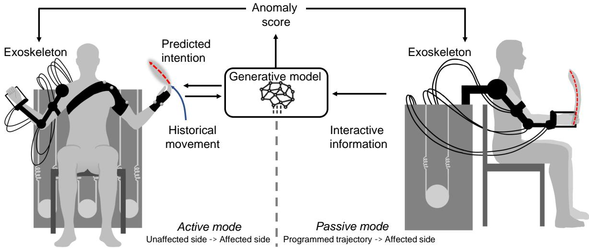  

图 1. 双模式上肢外骨骼康复训练。在主动镜像模式（active mirroring mode）下，患侧的参考轨迹由健侧的运动意图决定（红色虚线）。相反，在被动跟随模式（passive following mode）下，参考轨迹是预编程设定的（红色虚线）。主动镜像模式下的生成模型可以预测健侧的运动意图，并利用交互反馈生成异常分数（anomaly score），用于两种模式下的轨迹优化。

患者的个体化协助有助于患者重获原本且自然的运动能力，即不存在异常运动模式。因此，不充分的个性化会导致康复训练质量低下。

通常，根据中风患者的病情，如图 1 所示，会采用主动镜像（active mirroring）或被动跟随（passive following）训练模式。主动镜像训练用于轻度受损且身体健侧保留运动能力的患者。在该模式下，一种称为意图预测器（intention predictor）的生成模型根据历史运动数据估计患者的运动意图。随后，这些意图由患者患侧的上肢外骨骼机器人进行镜像。该过程旨在神经层面使身体健侧与患侧的运动意图对齐，从而提高患者的参与度。被动跟随训练用于运动能力严重受损的患者。在该模式下，患者跟随由上肢外骨骼机器人促进的预定义轨迹，从而为运动康复提供结构化引导。上述模式还可针对不同病情或不同阶段的中风患者，与人工训练结合使用。例如，在早期阶段使用被动模式，而后当健侧能够自然运动时切换至主动模式。这种双模式康复对于确保上肢外骨骼机器人能够被多种身体能力水平的患者使用至关重要。

由于患者穿戴（wear）上肢外骨骼机器人执行训练程序，在紧密且持续的人体物理交互过程中确保患者安全是首要关切。在硬件与软件两方面均已取得显著进展。在硬件方面，通过使用诸如串联弹性驱动器（series elastic actuators, SEAs）（Pratt and Williamson 1995）等柔性驱动器来吸收交互过程中的冲击力，从而提升安全性。此外，还使用仿生绳驱动（cable-driven）驱动器（Xu et al. 2023）以在不同驱动模式间切换，并通过可反向驱动（backdrivable）驱动器（Zhu et al. 2021）进一步保障安全性。在软件方面，可通过多种控制策略实现安全调节，包括阻抗控制（impedance control）（Li et al. 2018b）、基于速度场的控制（velocity field-based control）（Martinez et al. 2018）以及数据驱动的人体工效学控制（ergonomic control）（Clark and Amor 2022），上述方法均确保了上肢外骨骼机器人系统的安全运行。然而，大多数硬件与软件方法是在安全问题发生之后才得以应用。更优的方法是预测潜在的安全问题并防止其发生。

据此，本文介绍了一种新型上肢外骨骼机器人的开发，该机器人用于脑卒中患者的康复训练，并在以下三个特性方面优于以往报道的上肢外骨骼机器人。

1. 安全性：该新型上肢外骨骼机器人在大多数主动关节中采用了串联弹性驱动器（Series Elastic Actuator，SEA），从而使关节能够吸收上肢交互过程中由碰撞和意外接触引起的冲击力。该设计提升了力矩控制的精度，因此在康复训练中能够提供比以往报道的上肢外骨骼机器人更为平滑的辅助。此外，机器人内置了一种由交互反馈驱动的异常检测神经网络，用于实时评估上肢外骨骼机器人运动的安全性与自然性。该网络能够实现异常的早期检测，从而在康复任务过程中对其加以预防或缓解。此外，上肢外骨骼机器人还集成了在线轨迹优化模块和阻抗控制器，以确保康复过程中规划与执行阶段的安全性。

2. 有效性：该上肢外骨骼机器人配置有一个被动关节和五个主动关节，赋予其较高的自由度（Degree of Freedom，DoF），从而使工作空间能够涵盖广泛的日常活动。考虑到人体运动意图和上肢运动固有的不确定性与随机性，该系统通过在采样过程中利用运动概率模型进行显式考量，从而高效地生成与人类意图性质相匹配的轨迹。上肢外骨骼机器人的有效性通过临床试验得到了验证，结果表明，接受被动跟随训练的实验组相比对照组更快地恢复了运动能力。

3. 友好性：该上肢外骨骼机器人的主动关节能够感知外力，从而可以检测交互力矩。因此，当上肢外骨骼机器人以透明模式运行以进行示范时，患者能够轻松地操控它。此外，鉴于肩关节在上肢运动过程中承受较大的负载，在该上肢外骨骼机器人的肩关节中采用了直驱电机。该电机通过消除非线性摩擦力来提供更大的驱动力矩并提升反向驱动性。此外，为了降低运动过程中的惯性影响并提升舒适性，在空间上需要比其他关节具有更大运动范围的关节中采用了缆绳驱动机构。

本研究的核心理论创新在于设计并实现了一种基于生成模型的精细化框架（refinement framework），该框架能够生成高度个性化的康复轨迹并确保安全性。具体而言，该框架可工作于前述两种不同模式，即主动镜像模式（active mirroring mode）与被动跟随模式（passive following mode）。

主动镜像模式具备以下新开发的关键特性。

\- 基于扩散模型（diffusion model）的运动意图预测器（motion intention predictor），该预测器利用患者健侧的历史运动数据来估计其上肢运动意图。该预测器可对未来轨迹进行预测，并建立患者运动意图的均值与方差。

\- 抢先调节算法（preemptive tuning algorithm），通过利用预测分布来缓解潜在风险，确保预测轨迹始终位于安全区域内。

被动跟随模式具备以下新开发的关键特性。

\- 基于扩散模型的异常检测网络（anomaly detection network），能够根据异常分数评估安全性与自然性。该分数用于引导每个康复任务的在线轨迹精细化与评估。

\- 基于概率运动基元（probabilistic movement primitives, ProMPs）的轨迹生成方法，用于捕获患者运动意图的分布。此外，该方法根据每次采样结果的表现，对辅助轨迹进行迭代优化。

两种模式均可为患者定制辅助并生成个性化轨迹，使患者能够恢复自然且原始的运动模式。尤其是，意图预测器与异常检测器利用生成模型在大规模数据集的潜在空间中捕获模式。此外，意图预测器与异常检测器具有不同的功能。意图预测器可准确预测患者的原始运动意图。该预测结果作为自镜像轨迹，可针对患者患侧的需求进行精细定制，从而与患者的运动意图紧密吻合。异常检测器则可定量识别患者康复动作与健康个体动作之间的差异。这些差异被用于指导康复训练方案的调整，从而增强治疗的个体化程度。

在先前的研究（Chen 等人，2023b）中，我们开发了一种基于变分自编码器（Variational Autoencoder, VAE）异常检测器的被动跟随训练个性化框架。在本研究中，我们通过引入生成模型技术（即利用扩散模型）将该方法扩展到一种双模式上肢外骨骼机器人。我们展示了一系列实验与对比的结果，证实了这款新型上肢外骨骼机器人的安全性和性能。此外，我们还展示了一项临床试验的结果，验证了其有效性和友好性。

## 相关工作

本节回顾了关于上肢外骨骼机器人、轨迹生成和交互控制的相关工作。与此前报道的不同，本文报道的上肢外骨骼机器人具有高效的生成能力，使其能够有效提供个性化辅助。

## 上肢外骨骼机器人

上肢康复需要较大的运动范围。因此，上肢外骨骼机器人必须具备足够数量的自由度（Degrees of Freedom, DoF）以适应动态而复杂的上肢运动。多个自由度所提供的冗余能够提高患者的舒适度（Kim 等人，2012）。然而，许多上肢外骨骼机器人主要针对单一关节的康复而设计，例如肩关节（Nasr 等人，2023）、肘关节（Chen 等人，2019）或腕关节（Martinez 等人，2013）。相比之下，我们新开发的这款上肢外骨骼机器人旨在满足大多数上肢康复任务的需求，因此配备了一个被动关节和五个主动关节。它还具备先进的感知能力以及轻量化的机械设计。表 1 将我们的上肢外骨骼机器人与此前报道的设计进行了对比。

不同于采用电机直接驱动的传统上肢外骨骼机器人，我们的设计采用了缆绳驱动机构。因此，与传统的上肢外骨骼机器人相比，它具有显著更低的重量和惯性效应（Perry 等人，2007）。缆绳驱动机构还具有柔性高、齿轮间隙小、传动可回驱（backdrivable）等优点（Jau，1988）。然而，缆绳传动过程中产生的摩擦引入了非线性特性，这使得关节控制变得复杂（Wang 等人，2022）。与其他关节相比，肩关节需要更高的驱动力矩，因此摩擦也更大。因此，该关节需要额外的优化以提升其性能。

表 1. 不同上肢外骨骼机器人的对比

<table><tr><td>EXOSKELETON</td><td>MOVEMENT</td><td>NO.OF DOFs</td><td>SENSOR</td><td>ACTUATION</td></tr><tr><td>Wu et al. (2016)</td><td>Shoulder, Elbow</td><td>Four-Active One-Passive</td><td>Encoders</td><td>Direct</td></tr><tr><td>Zimmermann et al. (2023b)</td><td>Shoulder, Elbow, Forearm</td><td>Nine-Active</td><td>Encoders Force sensors</td><td>Compliant</td></tr><tr><td>Mao and Agrawal (2012)</td><td>Shoulder, Elbow, Forearm</td><td>Five-Active</td><td>Encoders Force sensors</td><td>Cable-driven</td></tr><tr><td>Ours</td><td>Shoulder, Elbow, Forearm</td><td>Five-Active One-Passive</td><td>Encoders Force sensors</td><td>Cable-driven and compliant</td></tr></table>

在外骨骼机器人辅助康复过程中，人与机器人之间存在紧密而频繁的交互，因此柔性驱动（compliant actuation）至关重要。具体来说，采用柔性驱动能够确保系统的灵活性、机械安全性以及优良的交互性能（Tiboni et al. 2022; Kalita et al. 2021）。因此，许多上肢外骨骼机器人（upper-limb exoskeleton robots）都采用了串联弹性执行器（Series Elastic Actuators, SEAs）（Ebrahimi et al. 2017; Pan et al. 2022; Li et al. 2021）。相应地，我们在上肢外骨骼机器人的绳驱（cable-driven）机构中集成了 SEAs，以提升其交互性能。

此前已研发出的上肢外骨骼机器人展现出了良好的柔顺性。然而，少有研究同时将绳驱机构和柔性驱动器设计（以提供足够数量的自由度（DOFs）以支持广泛的康复训练）与力传感器（以提供增强的感知能力）结合起来。此外，绳驱与 SEA 结构的组合使得系统具有高阶非线性动力学特性，从而带来了重大的控制挑战。

## 轨迹生成（Trajectory Generation）

上肢外骨骼机器人所提供的辅助可以通过其沿之与脑卒中患者进行交互的辅助（assistive）（即期望的，desired）轨迹来表征。针对本研究所考虑的两种训练模式，辅助轨迹以不同的方式生成。

在主动镜像模式（active mirroring mode）下，辅助的目标是复现患者健侧（unaffected side）的运动，辅助轨迹以预测人体运动意图的序列方式来生成。目前已开发出多种方法，用于根据传感器数据来确定人体运动意图，例如由惯性测量单元（inertial measurement units, IMUs）（Zhu et al. 2020）、力敏电阻（force-sensing resistors）（Huang et al. 2015）和表面肌电图（surface electromyography, sEMG）（Lenzi et al. 2012）等产生的传感器数据。此外，已有研究采用高斯过程回归（Gaussian process regression）从人机交互数据中估计人体运动意图（Long et al. 2018）。更进一步地，有研究提出了一种基于多传感器融合（multi-sensor fusion）的方法，用于自适应地更新辅助轮廓，以增强镜像训练康复效果（Li et al. 2022）。此外，利用神经网络能够融合多模态数据并具备出色表达能力这一优势，基于学习（learning-based）的方法已成功应用于镜像训练康复中（Xu et al. 2020; Li et al. 2023a）。然而，上述方法主要被设计来关注即时的运动意图，因此难以预测随时间变化的运动意图趋势。鉴于脑卒中患者的患侧（affected side）运动能力有限，若无法预测运动意图，可能会忽视安全约束等关键因素，从而在康复训练中对患者构成风险。

在被动跟踪模式下，辅助的目标是使患者能够跟随一条预定义的轨迹。在此模式下，最简单的轨迹生成方法是将轨迹离散化为多个路径点（waypoints），然后在一个规划框架内对离散点和轨迹约束执行线性插值（Sommerhalder et al. 2023）。轨迹也可以使用多项式和动态运动基元（dynamic movement primitives）进行参数化，以满足不同辅助任务的需求（Kagawa et al. 2015; Lanotte et al. 2021; Qiu et al. 2020）。此外，辅助还可以通过以人在回路（human-in-the-loop）方式生成的力矩曲线（Zhang et al. 2017）或通过强化学习（reinforcement learning）确定的力矩曲线（Zhang et al. 2022）来提供。然而，上述方法通常仅在运动学层面或通过使用代谢测量（metabolic measurements）来优化可行轨迹，而代谢测量获取起来十分费力。因此，这些方法无法同时有效地纳入安全性约束并实现轨迹的个性化，尽管前者是外骨骼机器人的首要关注点，而后者对于确保恢复后的运动自然且具有原有个性也至关重要。

## Interaction Control

## 交互控制（Interaction Control）

由柔性驱动器（compliant actuators）驱动的外骨骼机器人在硬件开发方面已相当成熟。然而，此类外骨骼机器人的控制器开发仍具挑战性，因为其缆绳驱动机构构成了一个具有显著非线性的高阶系统。为了缓解这种由柔性驱动器与刚性关节耦合所引起的非线性，已设计出多种控制策略以实现精确且灵活的交互控制。例如，反步控制方法（backstepping control method，Pan et al. 2017; Li et al. 2018b）被设计用于分层递送期望的控制指令，从而实现位置控制或阻抗控制（impedance control）。此外，奇异摄动理论（singular perturbation theory，Spong 1987）消除了对高阶运动信息的需求。因此，已经开发出一种基于奇异摄动的方法，该方法利用了配备串联弹性驱动器（Series Elastic Actuators，SEAs）的外骨骼机器人上两个子系统之间的固有差异。该方法已被用于生成多模态控制方案（Li et al. 2017）以及自适应轨迹跟踪（Han et al. 2023）。此外，最近的一项进展是一种基于学习的方法（Sambhus et al. 2023），它进一步提升了交互控制能力。

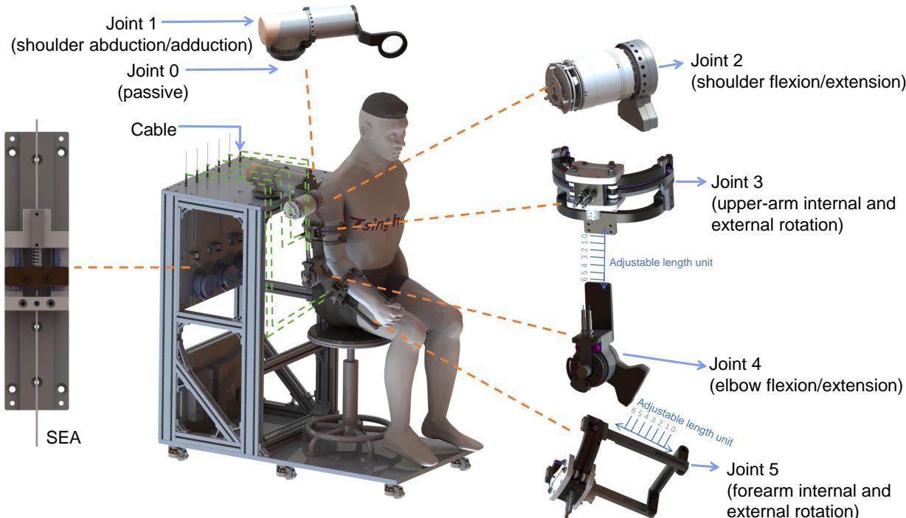  

图2. 所研发的上肢外骨骼机器人概览，该机器人采用绳索驱动（cable-driven），由五个主动关节（Joint 1–5）和一个被动关节（Joint 0）组成。

采用缆绳驱动机构的外骨骼机器人相较于采用其他机构的机器人具有更低的重量。然而，缆绳在传动与运动过程中产生的显著摩擦可能会阻碍有效的交互控制。已有多种方法被提出，用于缓解人机交互中的摩擦及其他干扰。例如，Li 等人（2018a）采用了一种迭代学习控制算法，通过精确拟合电机端与关节端的干扰（包括摩擦），对干扰进行补偿。Li 等人（2023b）则使用滑轮模型推导出了 Boden 缆绳摩擦力与张力输出的解析表达式，并借助系统动力学结构对摩擦参数进行自适应学习，从而有效抵消上述干扰。

此外，Wang 等人（2022）证明，摩擦参数可以通过非线性拟合技术获得。

然而，尽管在 SEA（Series Elastic Actuator，串联弹性驱动器）系统管理以及缆绳传动干扰抑制方面已取得显著进展，如何将这些能力整合以实现柔顺的交互控制仍然具有挑战性。此外，在缆绳驱动外骨骼机器人中，干扰信号与人机交互力常常混叠在一起。因此，仍有必要将上述各方面进行系统性综合考虑，并给出闭环系统稳定性的严格证明，从而充分挖掘硬件（即高自由度数量、缆绳驱动以及柔性驱动）所带来的优势。

## 整体结构

本研究考察了一款由清华大学与深圳市迈步机器人科技有限公司（Shenzhen MileBot Robotics Co., Ltd.）共同研发的缆绳驱动上肢外骨骼机器人样机。该上肢外骨骼机器人的计算机辅助设计模型如图 2 所示。该上肢外骨骼机器人配备了一个被动关节和五个主动关节，可在 20 cm（上臂）与 40 cm（前臂）的范围内分别对上臂和前臂长度进行微调。标记为 Joint 0 的被动自由度用于适应肩关节的偏心运动，从而消除上肢运动范围的限制，并为患者的运动训练提供更大的活动空间。主动关节编号为 1 至 5，各自承担特定功能，具体如下所述。

- Joint 1：肩关节外展与内收

- Joint 2：肩关节屈曲与伸展

- Joint 3：上臂内旋与外旋

- Joint 4：肘关节屈曲与伸展

## - Joint 5：前臂内旋与外旋

上肢外骨骼机器人的方框图如图 3 所示。关节 1 和关节 2 由直驱关节模组（分别为 RJSIIT-17-RevB2 和 RJSIIT-17-RevB5）构成，每个模组都装有力和传感器并由框架支撑。关节 3 至关节 5 采用谐波减速伺服电机（AK80-64），配置为缆绳驱动的串联弹性执行器（Series Elastic Actuator, SEA），并配备扭矩传感器（TK17-191151）和编码器（内外旋关节使用 3590S-2-104L，肘关节使用 QY2204-SSI）。此外，这些关节还包含两个电位计，用于在运动过程中测量弹簧压缩量。上肢外骨骼机器人的详细技术规格见表 2。电机驱动器用于控制关节 3 至关节 5，并与两个关节模组一起通过控制器局域网（Controller Area Network, CAN）与主板通信。主板通过通用异步收发传输器（Universal Asynchronous Receiver/Transmitter, UART）接收来自个人计算机（Personal Computer, PC）的指令。

上肢外骨骼机器人采用分层控制系统。在底层，主板执行运动控制和环境感知，实现精确的力控制和传感器数据的实时采集。在高层，PC 上的 Linux 系统运行运动规划模块，并执行计算密集型任务，例如动力学计算和网络推理。所有程序均集成在机器人操作系统（Robot Operating System, ROS）（Quigley et al. 2009）中并发运行。

表 2. 上肢外骨骼的规格

<table><tr><td>Property</td><td>Value</td></tr><tr><td rowspan="2">Continuous torque</td><td>49 N·m @ Joint 1 and 2</td></tr><tr><td>48 N·m @ Joint 3,4, and 5</td></tr><tr><td>Backdrivability</td><td>Less than 0.7 N·m @ 10 °/s</td></tr><tr><td>Weight</td><td>7.78 kg excluding the frame</td></tr><tr><td>Control frequency</td><td>1000Hz</td></tr></table>

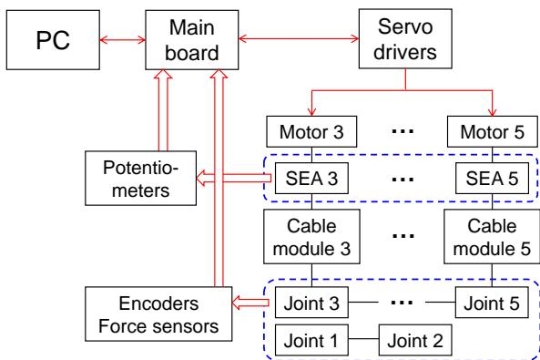  

图 3. 上肢外骨骼机器人的框图，其中红色箭头表示电气传输，黑色线条表示机械连接。

发生显著空间运动的关节，即关节3、关节4和关节5，采用我们自主研发的、配备缆绳驱动机构的串联弹性驱动器（Series Elastic Actuators, SEAs）。图4给出了串联弹性驱动器（SEA）的工作原理图。每个关节电机配备两组滑轮，每组对应一个旋转方向。电机输出轴的两端各固定一根钢丝绳，钢丝绳与电位器相连以构成串联弹性驱动器（SEA）。电位器组件包括两个固定块，即固定块1和固定块2，以及一个弹簧元件。来自电机端的钢丝绳（用红色表示）通过弹簧连接到固定块1，而另一根钢丝绳（用蓝色表示）将关节运动部件连接到固定块2。当电机施加扭矩时，固定块1沿着连接于固定块2的套筒移动，从而压缩弹簧并实现钢丝绳内张力的测量。弹簧压缩后，两个固定块形成一个统一的整体结构，与关节同步同向运动，从而实现整体运动。

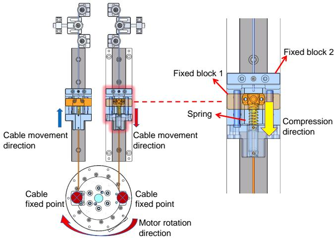  

图 4. 自研 SEA（Series Elastic Actuator，串联弹性驱动器）的工作原理

出于安全考虑，上肢外骨骼机器人配备有急停按钮，可在紧急情况下物理切断电源。此外，在软件层面还集成了其他安全措施，包括限制运动范围、防止自碰撞、限制关节速度，以及在交互力或力矩过大时自动停止运行。

SEA 驱动的上肢外骨骼机器人动力学模型可定义如下（Albu-Schäffer 等, 2007）：

$$
\begin{array}{c} \boldsymbol {M} (\boldsymbol {q}) \ddot {\boldsymbol {q}} + \boldsymbol {C} (\dot {\boldsymbol {q}}, \boldsymbol {q}) \dot {\boldsymbol {q}} + \boldsymbol {g} (\boldsymbol {q}) = \boldsymbol {S} _ {1} \boldsymbol {u} + \boldsymbol {S} _ {2} ^ {\top} \boldsymbol {K} (\boldsymbol {\theta} - \boldsymbol {S} _ {2} \boldsymbol {q}) + \\ \tau_ {e} + \boldsymbol {S} _ {2} ^ {\top} \tau_ {f}, \end{array} \tag {1}
$$

$$
\boldsymbol {B} \ddot {\boldsymbol {\theta}} + \boldsymbol {K} (\boldsymbol {\theta} - \boldsymbol {S} _ {2} \boldsymbol {q}) = \boldsymbol {S} _ {2} \boldsymbol {u},\tag{2}
$$

其中，$\pmb q \in \Re ^ { 5 }$ 是关节位置向量；$\pmb \theta \in \Re ^ { 3 }$ 是电机转子轴位置向量；$M ( q ) \in \Re ^ { 5 \times 5 }$、$C ( \dot { \pmb q } , \pmb q ) \dot { \pmb q } \in \mathfrak { R } ^ { 5 \times 5 }$ 和 $\pmb { g } ( \pmb { q } ) \in \Re ^ { 5 }$ 分别为机器人的惯性矩阵、向心力和科里奥利力矩以及重力力矩。选择矩阵 $S _ { 1 } =$ diag( $1 , 1 , 0 , 0 , 0 ) \in \Re ^ { 5 \times 5 }$ 和 $S _ { 2 } = [ \mathbf { 0 } , I _ { 3 } ] \in \Re ^ { 3 \times 5 }$ 用于分离缆绳驱动的关节。此外，$\pmb { K } \in \Re ^ { 3 \times 3 }$ 为刚度矩阵，$\boldsymbol { B } \in \Re ^ { 3 \times 3 }$ 为电机惯性矩阵，$\tau _ { e } \in \mathfrak { R } ^ { 5 }$ 为物理交互力矩向量，$\tau _ { f } \in \mathfrak { R } ^ { 3 }$ 为由缆绳传动和关节系统摩擦引起的扰动，$\pmb { u } \in \Re ^ { 5 }$ 为施加于执行器的控制力矩。

整个系统的动力学模型由式 (1) 和式 (2) 描述，并表现出不同的时间尺度特性。具体而言，串联弹性驱动器（Series Elastic Actuator, SEA）子系统工作在快时间尺度，而上肢外骨骼（upper-limb exoskeleton）机器人子系统工作在慢时间尺度。为有效控制该系统，控制输入依据奇异摄动理论（singular perturbation theory）（Spong 1987）进行构造，具体如下：

  

图 5. 双模式训练的工作流程。在主动镜像模式中，预测的运动意图作为参考轨迹。在被动跟随模式中，参考轨迹通过将概率运动基元（Probabilistic Motion Primitives, ProMPs）拟合到从健康个体的演示中获取的数据，离线生成。在两种模式中，总体目标是提供尽可能个性化的辅助。此外，来自健康个体的运动数据用于训练意图预测器与异常检测器，而异常分数则用于引导轨迹优化以及阻抗参数的调整。

$$
\boldsymbol {u} = \boldsymbol {u} _ {f} + \boldsymbol {u} _ {s},\tag{3}
$$

其中 ${ \pmb u } _ { f }$ 是用于镇定式 (2) 所定义模型的快时间尺度控制项，$u$ 是用于镇定式 (1) 所定义模型的慢时间尺度控制项。$\pmb { u } _ { f }$ 的一种代表性形式如下所示：

$$
\boldsymbol {u} _ {f} = - \boldsymbol {S} _ {2} ^ {\top} \boldsymbol {K} _ {v} (\dot {\boldsymbol {\theta}} - \boldsymbol {S} _ {2} \dot {\boldsymbol {q}}),\tag{4}
$$

其中 $\pmb { K } _ { v } \in \Re ^ { 3 \times 3 }$ 是一个对角正定矩阵。将 (3) 和 (4) 代入 (2) 得到

$$
\boldsymbol {B} \ddot {\boldsymbol {\theta}} + \boldsymbol {K} (\boldsymbol {\theta} - \boldsymbol {S} _ {2} \boldsymbol {q}) + \boldsymbol {K} _ {v} (\dot {\boldsymbol {\theta}} - \boldsymbol {S} _ {2} \dot {\boldsymbol {q}}) = \boldsymbol {S} _ {2} \boldsymbol {u} _ {s},\tag{5}
$$

通过定义 $\tau _ { o } = K ( \theta -$ $S _ { 2 } \pmb { q } )$，可将其改写如下：

$$
\boldsymbol {B} \ddot {\boldsymbol {\tau}} _ {o} + \boldsymbol {K} _ {v} \dot {\boldsymbol {\tau}} _ {o} + \boldsymbol {K} \boldsymbol {\tau} _ {o} = \boldsymbol {S} _ {2} \boldsymbol {u} _ {s} - \boldsymbol {B} \boldsymbol {S} _ {2} \ddot {\boldsymbol {q}}.\tag{6}
$$

通过引入 $K = K _ { 1 } / \varepsilon ^ { 2 }$ 和 $K _ { v } = K _ { 2 } / \varepsilon$，其中 $\varepsilon$ 为一小的正常数，(6) 式可改写为如下形式：

$$
\varepsilon^ {2} \boldsymbol {B} \ddot {\boldsymbol {\tau}} _ {o} + \varepsilon \boldsymbol {K} _ {2} \dot {\boldsymbol {\tau}} _ {o} + \boldsymbol {K} _ {1} \boldsymbol {\tau} _ {o} = \boldsymbol {K} _ {1} (\boldsymbol {S} _ {2} \boldsymbol {u} _ {s} - \boldsymbol {B} \boldsymbol {S} _ {2} \ddot {\boldsymbol {q}}).\tag{7}
$$

当 $\varepsilon = 0$ 时，(7) 的解为 $\bar{\tau}_o = S_2 u_s - B S_2 \ddot{q}$。

若将快时间尺度（fast time-scale）设为 $\gamma = \frac{t}{\varepsilon}$，则在 $\gamma \to \infty$ 时得到 $\bar{\tau}_o$。当 $\varepsilon = 0$ 时，$\bar{\tau}_o$ 保持为常数。接下来，我们引入新变量 $\boldsymbol{\eta} = \boldsymbol{\tau}_o - \bar{\boldsymbol{\tau}}_o$，以便在快时间尺度下将 (7) 重写如下：

$$
\boldsymbol {B} \left(\frac {\mathrm{d} ^ {2} \boldsymbol {\eta}}{\mathrm{d} \gamma^ {2}}\right) + \boldsymbol {K} _ {2} \left(\frac {\mathrm{d} \boldsymbol {\eta}}{\mathrm{d} \gamma}\right) + \boldsymbol {K} _ {1} \boldsymbol {\eta} = \mathbf {0},\tag{8}
$$

该方程定义了边界层系统。

将 (8) 的解代入 (1)，可得到一个准稳态系统，该系统刻画了整个系统的慢变动力学。这些动力学可表示如下：

$$
(M (\boldsymbol {q}) + \bar {B}) \ddot {\boldsymbol {q}} + C (\dot {\boldsymbol {q}}, \boldsymbol {q}) \dot {\boldsymbol {q}} + \boldsymbol {g} (\boldsymbol {q}) = \boldsymbol {u} _ {s} + \boldsymbol {\tau} _ {e} + S _ {2} ^ {\top} \boldsymbol {\tau} _ {f},\tag{9}
$$

其中 $\bar { B } = S _ { \mathrm { 2 } } ^ { \mathrm { T } } B S _ { \mathrm { 2 } }$ 是投影电机惯性矩阵。

根据奇异摄动理论，若边界层系统和准稳态系统均呈指数稳定，则整体系统的稳定性即可得到保证。该系统的稳定性分析详见附录。

由式（1）和式（2）描述的整体动力学模型是一个高阶系统，其中式（1）表示刚性关节侧，式（2）表示柔性驱动器侧。对这样一个系统进行稳定化与控制并非易事。

上肢外骨骼机器人需要通过紧密的人机交互引导患者完成重复性动作，以帮助其恢复运动功能。因此，上肢外骨骼机器人需根据以下阻抗模型跟踪一条时变轨迹：

$$
\boldsymbol {M} _ {d} (\ddot {\boldsymbol {q}} - \ddot {\boldsymbol {q}} _ {d}) + \boldsymbol {C} _ {d} (\dot {\boldsymbol {q}} - \dot {\boldsymbol {q}} _ {d}) + \boldsymbol {K} _ {d} (\boldsymbol {q} - \boldsymbol {q} _ {d}) = \boldsymbol {\tau} _ {e},\tag{10}
$$

其中 $\mathbf { \Delta } q _ { d } \in \mathfrak { R } ^ { n }$ 是期望轨迹向量，$M _ { d } , C _ { d } , K _ { d } \in \Re ^ { n \times n }$ 分别是期望惯性矩阵、期望阻尼矩阵和期望刚度矩阵，它们均为对角正定矩阵。按照阻抗模型跟踪期望轨迹允许患者偏离该轨迹，从而提供一定程度的柔顺性以提升安全性。

所提出的双模式训练框架如图 5 所示。异常检测器和意图预测器均基于健康个体的运动数据集，使用训练好的生成模型进行设计。这些模型旨在捕捉患者健侧的运动意图，并评估当前人–机器人交互的舒适性与自然性。个性化通过两种方法实现：一是利用异常分数引导符合动力学约束的期望轨迹的细化，二是利用 ProMP 将多种辅助轨迹整合为个性化的辅助分布。此外，通过根据异常分数调整阻抗参数来增强运动过程的安全性，从而营造安全且有效的康复环境。

## 在线轨迹细化

本节介绍面向上肢外骨骼机器人的新型轨迹生成方法。该方法基于生成模型，可在保持安全性与个性化特征的前提下进行在线细化以适配患者，从而维持有效性。首先，在两种训练模式（即主动镜像模式与被动跟随模式）中，我们引入一个通用综合向量 $\pmb { x } _ { d } = [ \pmb { q } _ { d } ^ { \top } , \dot { \pmb { q } } _ { d } ^ { \top } ] ^ { \top }$，该向量在关节空间中封装了一系列离散化的轨迹点，从而实现轨迹的参数化。为描述规划过程，我们构建如下二次规划问题：

$$
\min _ {\boldsymbol {x} _ {d}, \boldsymbol {u} _ {d}, s} \sum_ {i = t} ^ {t + N _ {p}} \left[ \| \boldsymbol {q} _ {d} ^ {(i)} - \boldsymbol {q} _ {r} ^ {(i)} \| _ {\boldsymbol {Q}} ^ {2} + \| \boldsymbol {u} _ {d} ^ {(i)} \| _ {\boldsymbol {R}} ^ {2} + (s ^ {(i)}) ^ {2} \right],\tag{11}
$$

$$
\begin{array}{r l} {s. t.} & {\pmb {x} _ {d} ^ {(t + 1)} = \left[ \begin{array}{l l} \pmb {I} & \pmb {I} \Delta t \\ \pmb {0} & \pmb {I} \end{array} \right] \pmb {x} _ {d} ^ {(t)} + \left[ \begin{array}{l} \pmb {0} \\ \pmb {I} \Delta t \end{array} \right] \pmb {u} _ {d} ^ {(t)}} \\ & {s ^ {(t + 1)} = s ^ {(t)} + \left[ - (\frac {\partial f}{\partial \pmb {\tau} _ {e}}) ^ {\intercal} \pmb {K} _ {a} \Delta t \right] \pmb {x} _ {d} ^ {(t)}} \\ & {- (\frac {\partial f}{\partial \pmb {\tau} _ {e}}) ^ {\intercal} \pmb {C} _ {a} \pmb {u} _ {d} ^ {(t)} \Delta t} \\ & {\pmb {x} _ {d} \in \mathcal {X}, \pmb {u} _ {d} \in \mathcal {U}} \end{array}
$$

其中 $N_p$ 是预测时域，$Q$ 和 $\mathbf{R}$ 是对称正定加权矩阵，$\mathbf{u}_d$ 是期望轨迹的加速度，$C_a$ 和 $\mathbf{K}_a$ 是稍后给出的可变阻抗参数，$f(\cdot)$ 是异常检测网络的函数化表示。此外，上标表示时间步，$\mathcal{X}$ 和 $\mathcal{U}$ 分别是轨迹空间约束集合与加速度约束集合。因此，(11) 式能够在两种训练模式下纳入各种约束和安全措施。

## 主动训练模式

在轻度运动损伤（如早期脑卒中）的病例中，患者在健侧仍保留着功能性运动能力。因此，上肢外骨骼机器人必须准确估计患者健侧的运动意图，以便为患侧提供镜像辅助。该镜像过程可使患肢模仿健肢的运动，从而促进运动功能的恢复。

意图估计系统输入 $N$ 个历史观测序列，定义为 $\mathbf{o}_{(i)} = \{ \mathbf{q}_{(i)}^{(t)} \in \Re^5 \mid t = -N_o, -N_o+1, \cdots, 0 \}, \forall i \in \{1, 2, \cdots, N\}$，其中 $N_o$ 是过去时间步的数量，$\mathbf{q}_{(i)}^{(t)}$ 是身体健侧在时间步 $t$ 的位置。系统还生成对运动意图的预测，表示为 $\mathbf{p}_{(i)} = \{ \mathbf{q}_{(i)}^{(t)} \in \Re^5 \mid t = 1, 2, \cdots, N_p \}$。为估计合理轨迹的潜在分布，我们引入一种基于去噪扩散概率模型（DDPMs）(Ho et al. 2020) 的概率预测器，因为 DDPMs 能够有效刻画人体运动意图的不确定性。为表述清晰起见，在以下小节中我们省略下标 (i)，并将过去与未来轨迹分别记为 $\mathbf{o}$ 和 $\mathbf{p}$。

意图预测器（Intention Predictor）：意图预测器的作用是产生未来轨迹的概率预测。为此，意图预测器接收一个初始的、含噪的预测轨迹 ${ \pmb p } _ { T }$，它表示在 $T$ 步扩散之后对未来轨迹 $\scriptstyle { p _ { 0 } }$ 的一个噪声扰动的估计，其中 $T$ 是预定义的最大扩散步数。预测器被设计用来推断反向扩散过程，其被表述为序列 $( p _ { T } , { \pmb p } _ { T - 1 } , \cdots , { \pmb p } _ { 0 } )$。该序列在数学上被建模为一个马尔可夫链，其特征在于高斯转移概率，并通过降低初始不确定性来逐步精化预测。此外，意图预测器还融合了被编码到上下文向量 $\mathbf{c}$ 中的历史观测信息，该上下文向量由一个由参数 $\phi$ 参数化的神经网络合成。该上下文向量为轨迹生成过程提供信息。意图预测器的原理如图 6 所示。在该框架下，上肢外骨骼机器人能够通过对初始含噪预测进行一次简单的采样来精确估计未来轨迹。重要的是，未来轨迹表征的是患者的运动意图，并非基于对患者未受影响肢体的直接测量。因此，该方法生成了一条与患者原始运动模式高度吻合的自镜像轨迹，从而代表了一条个性化的轨迹。

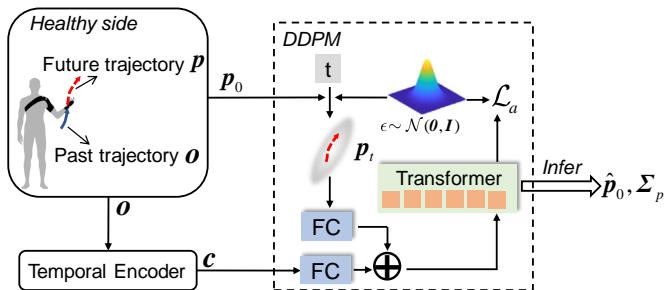  

图 6. 意图预测器的整体结构：在训练阶段，过去轨迹 o 被编码为上下文向量 $^ { c , }$，该向量与未来轨迹 p 一同用于训练扩散模型。在推理阶段，仅使用上下文向量来引导去噪过程，进而预测未来轨迹。

与扩散过程和反向过程相关联的后验分布如下所示：

$$
q (\pmb {p} _ {t} | \pmb {p} _ {t - 1}) = \mathcal {N} (\pmb {p} _ {t}; \sqrt {1 - \beta_ {t}} \pmb {p} _ {t - 1}, \beta_ {t} \pmb {I}),\tag{12}
$$

$$
q _ {\psi} (\boldsymbol {p} _ {t - 1} | \boldsymbol {p} _ {t}, \boldsymbol {c}) = \mathcal {N} (\boldsymbol {p} _ {t - 1}; \boldsymbol {\mu} _ {\psi} (\boldsymbol {p} _ {t}, \boldsymbol {c}), \tilde {\beta} _ {t} \boldsymbol {I}),\tag{13}
$$

其中 $\beta_1, \beta_2, \cdots, \beta_T$ 是用于调节注入噪声的方差调度。调整后的方差 $\tilde{\beta}_t$ 定义为 $\begin{array}{r} \tilde{\beta}_t = \frac{1-\bar{\alpha}_{t-1}}{1-\bar{\alpha}_t}\beta_t \end{array}$，该公式通过采用如下定义推导得出：$\alpha_t = 1-\beta_t$ 以及 $\begin{array}{r} \bar{\alpha}_t = \prod_{i=1}^t \alpha_i \end{array}$。

预测器的目标是最大化对数似然，记为 $\mathbb{E}[\log q_\psi(\pmb{p}_0)]$。由于该度量无法直接计算，因此采用变分下界（variational lower bound）作为训练损失的替代：

$$
\begin{array}{l} \mathcal {L} _ {v l b} (\phi , \psi) = \sum_ {t = 2} ^ {T} D _ {K L} \left(q \left(\boldsymbol {p} _ {t - 1} \mid \boldsymbol {p} _ {t}\right) \| q _ {\psi} \left(\boldsymbol {p} _ {t - 1} \mid \boldsymbol {p} _ {t}, \boldsymbol {c}\right)\right) \\ - \log q _ {\psi} \left(\boldsymbol {p} _ {0} \mid \boldsymbol {p} _ {1}, \boldsymbol {c}\right), \end{array} \tag {（}\tag{14}
$$

其中 $D _ { K L } ( \cdot )$ 表示 Kullback–Leibler 散度函数。

在所提出的方法中，条件概率 $q ( \pmb { p } _ { t - 1 } | \pmb { p } _ { t } )$ 被重新表述为 $q ( \pmb { p } _ { t - 1 } | \pmb { p } _ { t } , \pmb { p } _ { 0 } )$。这一重新表述使得可以推导出如下闭式表达式：

$$
q (\boldsymbol {p} _ {t - 1} | \boldsymbol {p} _ {t}, \boldsymbol {p} _ {0}) = \mathcal {N} (\boldsymbol {p} _ {t - 1}; \tilde {\boldsymbol {\mu}} _ {t} (\boldsymbol {p} _ {t}, \boldsymbol {p} _ {0}), \tilde {\beta} _ {t} \boldsymbol {I}).\tag{15}
$$

通过在扩散过程(24)中迭代地运用参数化技术，(15)中后验分布的均值以及反向过程(13)可表述如下：

$$
\tilde {\pmb {\mu}} _ {t} (\pmb {p} _ {t}, \pmb {p} _ {0}) = \frac {1}{\sqrt {\alpha_ {t}}} (\pmb {p} _ {t} - \frac {\beta_ {t}}{\sqrt {1 - \bar {\alpha} _ {t}}} \pmb {\epsilon} _ {t}),\tag{16}
$$

$$
\boldsymbol {\mu} _ {\psi} (\boldsymbol {p} _ {t}, \boldsymbol {c}) = \frac {1}{\sqrt {\alpha_ {t}}} (\boldsymbol {p} _ {t} - \frac {\beta_ {t}}{\sqrt {1 - \bar {\alpha} _ {t}}} \boldsymbol {\epsilon} _ {\psi} (\boldsymbol {p} _ {t}, \boldsymbol {c})),\tag{17}
$$

其中 $\epsilon \sim \mathcal { N } ( 0 , I )$，在主动镜像（active mirroring）模式下应用的损失函数进一步简化为如下形式

$$
\mathcal {L} _ {a} (\phi , \psi) = \mathbb {E} _ {t, \pmb {p} _ {0}, \epsilon} [ \| \pmb {\epsilon} - \pmb {\epsilon} _ {\phi , \psi} (\pmb {p} _ {t}, \pmb {o}) \| ^ {2} ].\tag{18}
$$

一旦反向过程训练完成，便利用预测器从初始噪声出发进行推断，从而采样出多条轨迹。为简洁起见并出于保守性考虑，假设对每个关节的未来预测均以独立方式进行。因此，整个推断与统计过程被封装于下式之中：

$$
\hat {\boldsymbol {p}} _ {0}, \hat {\boldsymbol {\Sigma}} _ {p} = f _ {a} (\boldsymbol {o}),\tag{19}
$$

其中 $\hat { \pmb { p } } _ { 0 } = \{ \hat { \pmb q } _ { h } ^ { ( t ) } \in \Re ^ { 5 } | t = 1 , 2 , \cdots , N _ { p } \}$ 表示估计的运动意图，$\hat { \pmb { \Sigma } } _ { p } = \{ d i a g ( \hat { \pmb { \sigma } } _ { h } ^ { ( t ) } ) \in$ $\mathfrak { R } ^ { 5 \times 5 } | t = 1 , 2 , \cdot \cdot \cdot , N _ { p } \}$ 表示预测的标准差。

先发调谐（Preemptive Tuning）：给定预测未来轨迹的分布，必须预先调谐参考轨迹以确保符合既定约束。具体而言，对于以 $i$ 为下标表示的每个关节，可行轨迹必须满足以下概率不等式：

$$
\mathcal {P} (q _ {h i} ^ {(t)} \notin \mathcal {Q} _ {i}) <   \varepsilon ,\tag{20}
$$

其中 $\mathcal { Q } _ { i }$ 是预定义的允许运动范围 $[ q _ { \mathrm { m i n } , i } , q _ { \mathrm { m a x } , i } ]$。规定 $\hat { q } _ { h i } ^ { ( 0 ) } = q _ { i }$，其中 $q _ { i }$ 是上肢外骨骼机器人关节 i 的当前位置。根据 Cantelli 不等式，预测分布的特征如下：

$$
\mathcal {P} (q _ {h i} ^ {(t)} \geq \hat {q} _ {h i} ^ {(t)} + \delta_ {i} ^ {(t)}) \leq \frac {\hat {\sigma} _ {h i} ^ {(t)}}{\hat {\sigma} _ {h i} ^ {(t)} + (\delta_ {i} ^ {(t)}) ^ {2}},\tag{21}
$$

$$
\delta_ {i} ^ {(t)} = \min (\| \hat {q} _ {h i} ^ {(t - 1)} - q _ {\min, i} \|, \| q _ {\max, i} - \hat {q} _ {h i} ^ {(t - 1)} \|).\tag{22}
$$

算法 1 参考轨迹的抢占式调参

输入：  $\hat{p}_{0}, \hat{\Sigma}_{p}, q, \varepsilon$ $q_{r}^{(0)} = \text{Saturate}(\hat{q}_{h}^{(0)}, q_{\min}, q_{\max})$ 

for t = 1 to  $N_{p}$  do

    for i = 1 to 5 do

    $\delta_{i}^{(t)} = \min(\|\hat{q}_{hi}^{(t-1)} - q_{\min,i}\|, \|q_{\max,i} - \hat{q}_{hi}^{(t-1)}\|)$ 

    if  $\frac{\hat{\sigma}_{hi}^{(t)}}{\hat{\sigma}_{hi}^{(t)} + (\delta_{i}^{(t)})^{2}} \leq \varepsilon$  then

    $q_{ri}^{(t)} = \hat{q}_{hi}^{(t)}$ 

    else

    $q_{ri}^{(t)} = q_{ri}^{(t-1)}$ 

    end if

    end for

end for

输出：  $q_{r}^{(0)}$  至  $q_{r}^{(N_{p})}$

接下来，我们给出如下预测调参规则：

$$
q _ {r i} ^ {(t)} = \left\{ \begin{array}{l l} \hat {q} _ {h i} ^ {(t)}, & \text { if } \frac {\hat {\sigma} _ {h i} ^ {(t)}}{\hat {\sigma} _ {h i} ^ {(t)} + (\delta_ {i} ^ {(t)}) ^ {2}} \leq \varepsilon , \\ q _ {r i} ^ {(t - 1)}, & \text { otherwise }. \end{array} \right.\tag{23}
$$

这里，${ q _ { r i } ^ { ( t ) } }$ 表示关节 $i$ 在时间步 $t$ 的参考轨迹。当运动趋势处于所设定的边界范围内时，它将更新为预测的运动意图 $\hat { q } _ { h i } ^ { ( t ) }$。然而，一旦检测到潜在的边界违例情况，系统将沿用上一时间步的轨迹，以防越过限值。上述流程同样在 Algorithm 1 中有详细说明。经调整后的参考轨迹 $\pmb q _ { r }$ 能够对未受影响一侧身体的预期运动作出精确估计，并充分保障安全性要求。通过求解式 (11)，可以生成一条既平滑且加速度极小的上肢外骨骼机器人轨迹，同时确保期望未来轨迹的安全性。

## 被动训练模式（Passive Training Mode）

当患者存在严重运动功能障碍时，上肢外骨骼机器人将进入被动跟随训练。该训练模式对于协助患者沿预定轨迹运动至关重要。此外，为促进康复进程，针对按需辅助（assist-as-needed）的调控进行定制化设定尤为关键。被动跟随训练的工作流程如图 5 所示。在该模式下，系统将采集健康受试者上肢的运动数据，用于训练两个不同的模块。

异常检测器（Anomaly Detector）：为实现辅助的个性化设定，需要一个用于评估辅助轨迹的实时判据。本研究采用异常检测器来量化穿戴舒适度与康复有效性。该异常检测器基于扩散模型（diffusion model）架构构建，能够识别上肢运动中的异常模式，如图 7 所示。随后，异常检测器计算一个分数，用于量化当前人机交互与自然交互状态之间的偏差，从而指导辅助策略的个性化设定。在该方法中，在时间步 $i$ 通过滑动窗口（sliding window）机制采集的传感反馈被输入到异常检测器中，记为 $\mathbf { x } ^ { ( i ) } \in \Re ^ { L _ { s } N _ { c } }$，其中 $L _ { s }$ 为滑动窗口的宽度，$N _ { c }$ 为数据通道的数目。

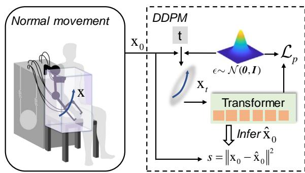  

图 7. 异常检测器示意图：透明长方体勾勒出可行工作空间，其中包含上肢运动被判定为正常且安全的范围。这类运动融合了位置、速度与交互力矩信息，它们共同以一条弯曲的蓝色箭头表示，并由 **x** 来表征。

如前所述，异常检测器基于扩散模型，其中持续时间为 $T ^ { p }$ 的反向扩散过程被描述为序列 $\left( { \bf x } _ { T ^ { p } } , { \bf x } _ { T ^ { p } - 1 } , \cdot \cdot \cdot , { \bf x } _ { 0 } \right)$。相应的扩散过程与反向扩散过程定义如下：

$$
q (\mathbf {x} _ {t} | \mathbf {x} _ {t - 1}) = \mathcal {N} (\mathbf {x} _ {t}; \sqrt {1 - \beta_ {t} ^ {p}} \mathbf {x} _ {t - 1}, \beta_ {t} ^ {p} \boldsymbol {I}),\tag{24}
$$

$$
q _ {\Psi} (\mathbf {x} _ {t - 1} | \mathbf {x} _ {t}) = \mathcal {N} (\mathbf {x} _ {t - 1}; \pmb {\mu} _ {\Psi} (\mathbf {x} _ {t}), \tilde {\beta} _ {t} ^ {p} \pmb {I}),\tag{25}
$$

其中 $\beta_1^p, \beta_2^p, \cdots, \beta_{T\tau}^p$ 为方差调度（variance schedules），用于调节该过程中所注入噪声的水平。调整后的方差 $\tilde{\beta}_t^p$ 由公式 $\tilde{\beta}_t^p = \frac{1-\bar{\alpha}_{t-1}^a}{1-\bar{\alpha}_t^p}\beta_t^p$ 计算，并利用如下定义：$\alpha_t^p = 1-\beta_t^p$ 与 $\bar{\alpha}_t^p = \prod_{i=1}^t \alpha_i^p$。

与意图预测器中所述概念一致，用于在被动跟随模式下训练扩散模型的损失函数规定如下

$$
\mathcal {L} _ {p} (\Psi) = \mathbb {E} _ {t, \mathbf {x} _ {0}, \epsilon} [ \| \boldsymbol {\epsilon} - \boldsymbol {\epsilon} _ {\Psi} (\mathbf {x} _ {t}) \| ^ {2} ].\tag{26}
$$

一旦反向过程已从包含上肢运动的数据集中有效习得，异常检测器便能熟练地从受污染的感知数据中滤除噪声，从而产生澄清后的输出。该能力有助于通过异常检测器生成精炼后的感知输入。该输入被用于计算异常得分，如算法 2 所述，其中 $\epsilon_p, z_p \sim \mathcal{N}(0,I)$，$\nu \in [1, T^p]$ 为常数参数。为简洁起见，计算异常得分的方法由以下函数概括：

$$
s = f (\boldsymbol {q}, \dot {\boldsymbol {q}}, \boldsymbol {\theta}, \dot {\boldsymbol {\theta}}, \boldsymbol {\tau} _ {e}).\tag{27}
$$

异常检测器整合了扩散模型（diffusion models），因此能够通过分析传感器数据，熟练地捕捉上肢运动的内在时空模式与随机运动倾向。由此，可在人机交互过程中实时计算异常分数（anomaly scores）。这些分数可作为上肢外骨骼机器人所提供辅助的舒适度与自然程度的指标。

Require: $q, \dot{q}, \theta, \dot{\theta}, \tau_e$

1: Initialize sliding window queue
2: for each new data point do
3: $\mathbf{x}_{now}^{(i)} \leftarrow (\boldsymbol{q}, \dot{\boldsymbol{q}}, \boldsymbol{\theta}, \dot{\boldsymbol{\theta}}, \tau_e)$
4: Enqueue $\mathbf{x}_{now}^{(i)}$ to sliding window queue
5: if sliding window queue is full then
6: $\mathbf{x}_0 \leftarrow \text{GetWindowData}$
7: $\epsilon_p \leftarrow \text{Sample}$
8: $\hat{\mathbf{x}}_\nu \leftarrow \mathbf{x}_0 \sqrt{\bar{\alpha}_\nu^p} + \epsilon_p \sqrt{1 - \bar{\alpha}_\nu^p}$
9: for $t = \nu, \cdots, 1$ do
10: $z_p \leftarrow \text{Sample}()$
11: $\hat{\mathbf{x}}_{t-1} \leftarrow \frac{1}{\sqrt{\alpha_t^p}} (\hat{\mathbf{x}}_t - \frac{1 - \alpha_t^p}{\sqrt{1 - \bar{\alpha}_t^p}} \epsilon_\Psi (\hat{\mathbf{x}}_t)) + \tilde{\beta}_t^p z_p$
12: end for
13: $s \leftarrow ||\mathbf{x}_0 - \hat{\mathbf{x}}_0||^2$
14: Output: $s$
15: Dequeue from sliding window queue
16: end if
17: end for

参考轨迹生成（Reference Generation）：为了在被动跟随训练（passive following training）期间定制辅助策略，将历史的上肢轨迹与式 (11) 所述的在线轨迹细化相融合，以构建概率模型。在该框架中，采用概率运动基元（ProMPs）将一组轨迹编码到一个概率框架中（Paraschos 等人，2013），该概率框架能够通过采样生成相似的参考轨迹。将 ProMPs 用于轨迹采样，特别适合分析被动跟随训练中所遇到的重复运动。这一适用性归因于该概率模型能够有效容纳传感器噪声、人体不确定性与个体偏差。

为了实现 ProMPs，我们通过权重向量 $\omega \in \Re ^ { \hat { D } n \times 1 }$ 1 来表达轨迹，其中 D 是基函数（basis functions）的数量，n 是主动关节（active joints）的数量，使得

$$
\boldsymbol {y} _ {t} = \left[ \begin{array}{c c c} \boldsymbol {q} _ {1, t} ^ {\mathsf {T}} & \dots & \boldsymbol {q} _ {n, t} ^ {\mathsf {T}} \end{array} \right] ^ {\mathsf {T}} = \left[ \begin{array}{c} \boldsymbol {\Phi} _ {t} \\ \dot {\boldsymbol {\Phi}} _ {t} \end{array} \right] \boldsymbol {\omega} + \boldsymbol {\epsilon} _ {y},\tag{28}
$$

$$
\pmb {q} _ {i, t} = \left[ \begin{array}{l l} q _ {i, t} & \dot {q} _ {i, t} \end{array} \right] ^ {\mathsf {T}},\tag{29}
$$

$$
p (\boldsymbol {\tau} _ {y} | \boldsymbol {w}) = \prod_ {t} \mathcal {N} (\boldsymbol {y} _ {t} | \boldsymbol {\Phi} _ {t} \boldsymbol {\omega}, \boldsymbol {\Sigma} _ {y}),\tag{30}
$$

其中 $\pmb q _ { i , t } \in \Re ^ { 2 }$ 表示第 $i^{th}$ 个关节在时间步 $t$ 处的复合向量，$\epsilon _ { y } \sim \mathcal { N } ( \mathbf { 0 } , \Sigma _ { y } )$ 表示零均值（zero-mean）独立同分布的高斯噪声，$\tau _ { y }$ 是演示过程中的轨迹，$\Phi _ { t } \in \mathfrak { R } ^ { n \times D n }$ 选用高斯形式（Gaussian form），为时变基矩阵。

在假设 $\omega$ 服从正态分布 $\omega \sim \mathcal { N } ( \omega | \mu _ { \omega } ^ { ( k ) } , \Sigma _ { \omega } ^ { ( k ) } )$ 的条件下，时间步 $t$ 处的新轨迹可建模如下：

$$
p (\boldsymbol {y} _ {t}; \boldsymbol {\mu} _ {\omega} ^ {(k)}, \boldsymbol {\Sigma} _ {\omega} ^ {(k)}) = \int \mathcal {N} (\boldsymbol {y} _ {t} | \boldsymbol {\Phi} _ {t} \boldsymbol {\omega}, \boldsymbol {\Sigma} _ {y}) \mathcal {N} (\boldsymbol {\omega} | \boldsymbol {\mu} _ {\omega} ^ {(k)}, \boldsymbol {\Sigma} _ {\omega} ^ {(k)}) d \boldsymbol {\omega}.\tag{31}
$$

因此，参考轨迹给出如下：

$$
\boldsymbol {q} _ {r} (t) = [ q _ {i, t}, \dots , q _ {n, t}, ]\tag{32}
$$

为了便于生成个性化辅助，本文引入如下代价函数来评估所提供的参考轨迹的性能：

$$
\mathcal {S} (\boldsymbol {q} _ {r}) = \int_ {T _ {r}} \left\{\| \boldsymbol {q} _ {d} (\boldsymbol {q} _ {r}) - \boldsymbol {q} \| _ {\boldsymbol {Q}} ^ {2} + s ^ {2} \right\} d t,\tag{33}
$$

其中 $T_{r}$ 表示辅助的持续时间，$\mathbf{q}_{d}$ 表示通过 (11) 式经在线优化得到的期望轨迹。

由于每个采样轨迹都可以依据其代价进行评估，因此可以为它们赋予一个信息论意义上的权重，以反映在全部 k 条轨迹上的整体性能 (Williams et al. 2017)：

$$
w ^ {(i)} = \frac {1}{\eta_ {k}} \exp (- \frac {1}{\lambda_ {p}} \mathcal {S} (\boldsymbol {q} _ {r} ^ {(i)})),\tag{34}
$$

其中 $\boldsymbol{q}_{r}^{(i)}$ 是第 $i$ 次采样的参考轨迹，$\eta_{k}$ 是归一化常数，$\lambda_{p}$ 是一个小的正常数。所采用权重设定的详细分析见附录。

考虑轨迹的性能，参数 $\mu_{\omega}^{\bar{(k)}}$ 和 $\bar{\Sigma}_{\omega}^{(k)}$ 由所收集的 $k$ 条轨迹推导得出，如下所示：

$$
\boldsymbol {\omega} ^ {(i)} = (\boldsymbol {\Phi} ^ {\mathsf {T}} \boldsymbol {\Phi}) ^ {- 1} \boldsymbol {\Phi} ^ {\mathsf {T}} \boldsymbol {Y} ^ {(i)},\tag{35}
$$

$$
\boldsymbol {\mu} _ {\omega} ^ {(k)} = \sum_ {i} w ^ {(i)} \boldsymbol {\omega} ^ {(i)},\tag{36}
$$

$$
\boldsymbol {\Sigma} _ {\omega} ^ {(k)} = \sum_ {i} w ^ {(i)} (\boldsymbol {\omega} ^ {(i)} - \boldsymbol {\mu} _ {\omega} ^ {(k)}) (\boldsymbol {\omega} ^ {(i)} - \boldsymbol {\mu} _ {\omega} ^ {(k)}) ^ {\mathsf {T}},\tag{37}
$$

其中 $\Phi \in \Re ^ { N _ { r } n \times D n }$ 是由块对角矩阵 $\Phi _ { t }$ 组成的矩阵，这些块对角矩阵根据采样数 $N _ { r }$ 沿垂直方向堆叠，而 $\pmb { Y } ^ { ( i ) } \in \dot { \Re ^ { N _ { r } n } }$ 对应于第 $i$ 条采集到的轨迹。该过程有助于构建概率模型。

调整后的轨迹被集成至上肢外骨骼机器人中以辅助患者。随后，采集患者在训练环节中的实际运动数据，并将其用于迭代优化概率模型 [31]。具体而言，$\mu _ { \omega } ^ { ( k ) }  \mu _ { \omega } ^ { ( k + 1 ) }$ 与 $\Sigma _ { \omega } ^ { ( k ) } \gets$ $\Sigma _ { \omega } ^ { ( k + 1 ) }$，进而用于辅助后续轨迹的规划，如算法 3 所示。$N _ { s }$ 是基于预先采集的示教数据进行自由探索的次数。辅助的优化由异常分数（anomaly score）驱动，该分数反映了先验的健康运动行为。该分数用作康复过程中运动舒适度与自然度的指标，从而确保轨迹调整在本质上提升辅助质量。

最优辅助分布通过由粗到精（coarse-to-fine）的方法加以识别。最初，基于预先定义的示教数据建立样本分布，主要在探索阶段借助初始样本进行引导。后续迭代通过逐步收窄采样空间并利用先前已探索的最优轨迹值来不断改进辅助分布。

概率模型聚焦于表现最优的轨迹以提供最佳辅助，从而有效应对患者在任务过程中可能遭遇的各种不确定性。患者运动数据的融入确保后续轨迹日益个体化，因而越发契合患者的医疗需求。因此，该方法使上肢外骨骼机器人得以利用在线交互，同时实现增强交互安全性与提升被动跟随训练效能的双重目的。

Algorithm 3 参考轨迹生成
Require:  $Y^{(k+1)}$
1: if  $k \leq N_{s}$  then
2: 用预收集数据初始化  $\boldsymbol{\mu}_{\omega}^{(k+1)}, \Sigma_{\omega}^{(k+1)}$
3: else
4: 使用式(33)计算代价  $\mathcal{S}(\boldsymbol{q}_{r}^{(k+1)})$
5: for all 收集的  $k + 1$  条轨迹 do
6: 使用式(34)和式(35)计算代价  $w^{(i)}, \omega^{(i)}$
7: end for
8: 使用式(36)和式(37)计算分布  $\mathcal{N}(\boldsymbol{\omega}|\boldsymbol{\mu}_{\omega}^{(k+1)}, \Sigma_{\omega}^{(k+1)})$
9: end if
10:  $\omega \leftarrow \text{Sample}(\mathcal{N}(\boldsymbol{\omega}|\boldsymbol{\mu}_{\omega}^{(k+1)}, \Sigma_{\omega}^{(k+1)}))$
11:  $\boldsymbol{q}_{r}(t) \leftarrow \Phi_{t}\boldsymbol{\omega}$

## 交互控制

肩关节下方的关节采用绳索驱动（cable-driven），这降低了与运动相关的惯量，从而提升了舒适性。由于这些关节的存在，存在相当大的摩擦，这会阻碍关节的运动，因此应当对其进行充分的补偿。

为了实现这一点，上肢外骨骼机器人首先在没有患者的情况下执行运动，此时 $\pmb{\tau}_e = \mathbf{0}$。此外，扰动转矩可以参数化为如下形式（De Wit et al. 1995）：

$$
\begin{array}{l} \boldsymbol {\tau} _ {f} = (\boldsymbol {a} _ {f} + \boldsymbol {b} _ {f} \odot e ^ {- \boldsymbol {c} _ {f} \odot \dot {\boldsymbol {q}}} + \boldsymbol {d} _ {f} \odot \dot {\boldsymbol {q}}) \odot s g n (\dot {\boldsymbol {q}}) \\ \approx (\bar {\boldsymbol {a}} _ {f} + \bar {\boldsymbol {b}} _ {f} \odot \dot {\boldsymbol {q}} + \bar {\boldsymbol {c}} _ {f} \odot \dot {\boldsymbol {q}} \odot \dot {\boldsymbol {q}}) \odot s g n (\dot {\boldsymbol {q}}) = \boldsymbol {Y} (\dot {\boldsymbol {q}}) \boldsymbol {\zeta}, \end{array}\tag{38}
$$

其中 ${ \boldsymbol { a } } _ { f } , { \boldsymbol { b } } _ { f } , { \boldsymbol { c } } _ { f } , d _ { f }$ 为未知参数，$\bar { \mathbf { a } } _ { f } , \bar { \mathbf { b } } _ { f } , \bar { \mathbf { c } } _ { f }$ 由泰勒展开推导得到，作为模型的简化形式，$\odot$ 表示克罗内克积（Kronecker product），sgn(·) 表示符号函数，$\mathbf { Y } ( \cdot )$ 表示回归量矩阵，$\zeta$ 表示模型参数向量。(38) 式给出的近似是合理的，因为在给定的康复过程中，上肢外骨骼机器人的各关节速度始终保持较低水平。

由于上肢外骨骼机器人的所有主动关节均装有力传感器，因此在无患者的情况下可以直接测量并记录摩擦力。结合所记录的关节速度，可通过多项式拟合学习摩擦模型参数。所估计的摩擦力表示如下

$$
\hat {\boldsymbol {\tau}} _ {f} = \boldsymbol {Y} (\dot {\boldsymbol {q}}) \hat {\boldsymbol {\zeta}}.\tag{39}
$$

在估计出摩擦力之后，提出了一种可变阻抗模型。该模型必须能够识别人—机器人交互状态，并解决康复过程中的冲突。这些能力使该模型能够调节上肢外骨骼机器人的动作。

为了调节阻抗模型，引入了一个加权函数（Zhang et al., 2023）来考虑异常分数。该函数在数学上定义如下：

$$
w (s) = \lambda_ {1} \tanh (- \frac {s}{\chi_ {1}} + \chi_ {2}) + \lambda_ {2},\tag{40}
$$

其中 $\lambda _ { 1 }$ 和 $\lambda _ { 2 }$ 均为正常数，分别用于确定权重函数的值域与中位数；$\chi _ { 1 }$ 为一常数，用于将异常评分归一化至某一指定的较小区间；$\chi _ { 2 }$ 为权重函数沿正向横轴相对于坐标原点的偏移量。基于该函数，期望阻抗模型被重新定义如下：

$$
\boldsymbol {C} _ {d} (\dot {\boldsymbol {q}} - \dot {\boldsymbol {q}} _ {d}) + \boldsymbol {K} _ {d} (\boldsymbol {q} - \boldsymbol {q} _ {d}) = \frac {1}{w (s)} \boldsymbol {\tau} _ {e}.\tag{41}
$$

将 (41) 两边乘以 $w(s)$ 得

$$
\boldsymbol {C} _ {a} (t) (\dot {\boldsymbol {q}} - \dot {\boldsymbol {q}} _ {d}) + \boldsymbol {K} _ {a} (t) (\boldsymbol {q} - \boldsymbol {q} _ {d}) = \boldsymbol {\tau} _ {e},\tag{42}
$$

其中 $C _ { a } ( t ) \overset { \triangle } { = } w ( s ) C _ { d }$ 且 $K _ { a } ( t ) \triangleq w ( s ) K _ { d }$ ，为时变表观阻抗参数。这些参数用于推导期望轨迹与交互力矩之间的关系，如式 (11) 所述。该机制的功能在于：异常评分升高时，$w ( s )$ 会相应减小，从而降低阻抗参数的幅值。这一降低保证了上肢外骨骼机器人在检测到任何冲突时以更高的柔顺性（passiveness）作出响应。相反，当异常评分较低时，阻抗参数恢复至其原始值，从而维持上肢外骨骼机器人所提供的辅助水平。

随后，引入阻抗向量（impedance vector），如下所示

$$
\begin{array}{l} \boldsymbol {z} = \dot {\boldsymbol {q}} - \dot {\boldsymbol {q}} _ {r} \\ \quad = \dot {\boldsymbol {q}} - \dot {\boldsymbol {q}} _ {d} + \boldsymbol {C} _ {d} ^ {- 1} \boldsymbol {K} _ {d} (\boldsymbol {q} - \boldsymbol {q} _ {d}) - \frac {1}{w (s)} \boldsymbol {C} _ {d} ^ {- 1} \boldsymbol {\tau} _ {e}, \end{array}\tag{43}
$$

其中

$$
\dot {\pmb {q}} _ {r} = \dot {\pmb {q}} _ {d} - \pmb {C} _ {d} ^ {- 1} \pmb {K} _ {d} (\pmb {q} - \pmb {q} _ {d}) + \frac {1}{w (s)} \pmb {C} _ {d} ^ {- 1} \pmb {\tau} _ {e}\tag{44}
$$

是一个参考向量。根据 (43)，$z  0$ 的收敛意味着实现期望的阻抗模型（impedance model）(41)。

整体控制输入按 (3) 中定义进行设计，其中快速时间尺度控制项按 (4) 中定义。接下来，慢速时间尺度控制项通过使用估计的摩擦 $\hat { \tau } _ { f }$ 来稳定 (9) 中表述的动力学并实现期望的阻抗模型，具体如下：

$$
\begin{array}{r l} \boldsymbol {u} _ {s} = - \boldsymbol {K} _ {z} \boldsymbol {z} - \boldsymbol {S} _ {2} ^ {\top} \hat {\boldsymbol {\tau}} _ {f} - \boldsymbol {\tau} _ {e} - k _ {g} \cdot \boldsymbol {s g n} (\boldsymbol {z}) & \\ + (M (\boldsymbol {q}) + \bar {B}) \ddot {\boldsymbol {q}} _ {r} + C (\dot {\boldsymbol {q}}, \boldsymbol {q}) \dot {\boldsymbol {q}} _ {r} + g (\boldsymbol {q}), \end{array}\tag{45}
$$

其中 $sgn(\cdot)$ 是符号函数，定义如下：

$$
\operatorname{sgn} (z) = \left\{ \begin{array}{l l} 1, & z > 0 \\ 0, & z = 0 \\ - 1, & z <   0 \end{array} \right.\tag{46}
$$

其中 $k_g$ 是一个正常数，$\pmb{K}_z \in \Re^{n \times n}$ 是一个对角正定矩阵。

如附录中的稳定性分析所示，由式 (3)、(4) 和 (45) 所描述的所提变阻抗控制器可证明是指数稳定的。

## 实验

所提双模式轨迹优化方法在上肢外骨骼机器人中进行了实现，以评估两种康复模式的有效性。图 8 展示了实验配置，其中主控板控制上肢外骨骼机器人的阻抗。该主控板通过串口与一台 PC 机相连，该 PC 机配备了 Intel i5-13490F CPU 和 RTX 4060Ti 显卡。PC 机运行异常检测模块，计算参考轨迹 $\mathbf{\delta q}_r$，并在线动态更新期望轨迹 $\mathbf{q}_d$。受试者以被动跟随模式或主动镜像模式进行康复训练。在后一种模式下，受试者在身体健侧佩戴一个装有标记点的护具，以辅助参与康复训练。光学运动捕捉设备（Nokov）被用于精确捕捉运动意图。

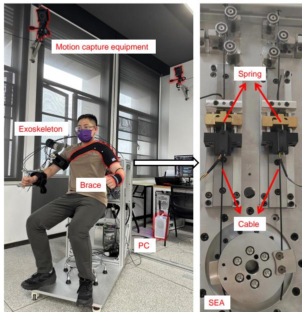  

图 8. 主动镜像模式下的实验设置采用运动捕捉设备从未受影响的身体一侧获取反馈。串联弹性执行器（SEA）通过弹簧和绳缆将电机输出端与关节端相连构建而成。

变阻抗控制器（variable impedance controller）的实现需要动态模型的相关知识。因此，动态参数使用开源的 Orocos Kinematics and Dynamics Library（Orocos 运动学与动力学库）* 进行了实时解析计算。在该计算中，上肢外骨骼机器人被分解为一系列连杆和关节，以构建一个定义其物理构型的模型，涵盖每个连杆的长度、质量和惯性等特性。随后，基于该模型，采用牛顿–欧拉（Newton–Euler）方程推导正向动力学。

意图预测器与异常检测模块需要运动数据，这些数据是在健康受试者操作上肢外骨骼机器人期间采集的。为了便于自由自然的运动，在数据采集阶段将上肢外骨骼机器人设置为透明模式运行（Chen et al. 2023a）。具体而言，控制器设计如下（Zimmermann et al. 2020）：

$$
\boldsymbol {u} _ {0} = (M (\boldsymbol {q}) + \bar {\boldsymbol {B}}) \ddot {\boldsymbol {q}} _ {0} + C (\dot {\boldsymbol {q}}, \boldsymbol {q}) \dot {\boldsymbol {q}}
$$

$$
+ \pmb {g} (\pmb {q}) - \pmb {S} _ {2} ^ {\top} \hat {\pmb {\tau}} _ {f} - \pmb {\tau} _ {e} + \pmb {u} _ {f},\tag{47}
$$

$$
\ddot {\pmb {q}} _ {0} = \frac {1}{\gamma_ {0}} (\pmb {M} (\pmb {q}) + \bar {\pmb {B}}) ^ {- 1} \pmb {\tau} _ {e},\tag{48}
$$

其中 $\gamma _ { 0 }$ 表示控制虚拟质量幅值的参数，$\ddot { \pmb q } _ { 0 }$ 表示期望加速度。在这种透明模式下，健康受试者或患者能够轻松操控上肢外骨骼机器人，而不会感到明显不适。

下一节将介绍五项实验的结果，具体描述如下。

\- **意图预测（Intention Predictor）**：本实验旨在验证所提出的意图预测器的有效性与准确性。利用所采集的数据训练了多种意图预测方法，并通过对比分析证明所提出意图预测器的优越性。

\- **异常检测（Anomaly Detection）**：本实验旨在评估异常检测网络的性能。在多种模拟异常场景（包括超出正常范围的运动、脑卒中引发的抽搐以及人机交互冲突）中验证了其检测精度。此外，还开展了对比研究，结果表明所提出的基于扩散模型的异常检测器在检测精度方面显著优于其他异常检测方法。

\- **交互控制（Interaction Control）**：本实验旨在评估系统的动态能力及其抗扰动性能。为此，开展了轨迹跟踪任务。此外，还在涉及异常的工况下验证了所提出的可变阻抗控制器的有效性。

\- **主动镜像训练（Active Mirroring Training）**：本实验旨在评估在线轨迹优化的效果，因此开展了消融实验。此外，还考察了异常评分对该优化过程所生成轨迹的影响。另外，实现了主动镜像模式，并借助运动捕捉系统验证了所提方法能够有效约束辅助轨迹，在整个康复过程中保障安全性。

\- **被动跟随训练（Passive Following Training）**：本实验旨在验证被动跟随训练对康复效果的提升。通过消融实验证明，在线轨迹优化在整个训练过程中显著改善了运动的自然性与任务表现。此外，还针对脑卒中患者开展了一项临床试验，以获取证据表明该康复框架显著有助于运动功能的恢复。

## 结果（Results）

本研究招募了两名此前无任何上肢外骨骼机器人使用经验的健康受试者参与运动数据采集。表 3 给出了数据采集过程中上肢外骨骼机器人的运动范围。该运动范围覆盖了上肢日常活动的主要空间区域。

表 3. 关节运动范围（Motion Range of Joints）

<table><tr><td>Joint</td><td>1</td><td>2</td><td>3</td><td>4</td><td>5</td></tr><tr><td>Min(°)</td><td>-90</td><td>-45</td><td>-30</td><td>-5</td><td>-30</td></tr><tr><td>Max(°)</td><td>30</td><td>115</td><td>30</td><td>120</td><td>30</td></tr></table>

表 4 展示了受试者统计属性的概览。受试者在实验环节开始前签署了书面知情同意书。随后，受试者经历了一段 6 分钟的预训练阶段，以熟悉在穿戴上肢外骨骼机器人（upper-limb exoskeleton robot）情况下的运动。在数据采集阶段，未施加特定的运动规范。因此，允许受试者以其偏好的速度——即快速或缓慢——移动上肢外骨骼机器人，或将其保持静止。所采集的数据被汇总成一个数据集，用于训练意图预测模块与异常检测模块（intention predictor and anomaly detection modules）。

Table 4. 受试者的统计信息

<table><tr><td>Subject</td><td>Gender</td><td>Age(y)</td><td>Weight(kg)</td><td>Height(cm)</td></tr><tr><td>1</td><td>Male</td><td>30</td><td>87</td><td>181</td></tr><tr><td>2</td><td>Male</td><td>24</td><td>70</td><td>172</td></tr></table>

## 意图预测器（Intention Predictor）

为了实现对人体运动意图的实时估计，利用所采集的运动数据来训练意图预测器。为了提高训练模型的泛化能力，在训练阶段将所采集的运动数据按照 8:2:1 的比例划分为训练集、测试集和验证集。我们采用 Trajectron++（Salzmann et al. 2020）作为提取轨迹特征的骨干网络，并选用 Transformer 架构来管理扩散过程（diffusion process）。意图预测器的参数设置如下：$N _ { o } = 5 , N _ { p } = 7 .$，以及 $T =$

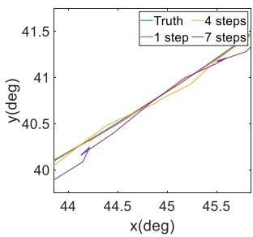  

(a)

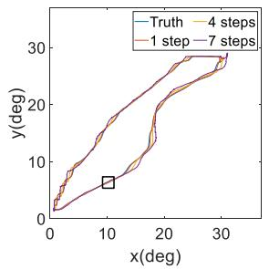

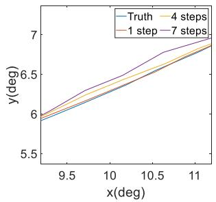

  

(c)

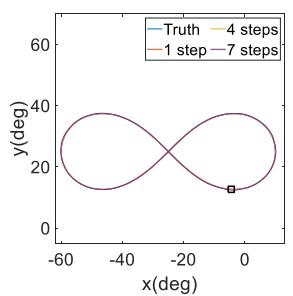

(b)

  

(d)  
图 9. 四种不同任务在各个步数下的预测轨迹。(a) 自由移动；（b）正弦；（c）圆形；以及（d）双纽线任务。

100. 去噪扩散隐式模型（DDIMs）（Song et al. 2020）被应用于推理过程。意图预测依赖于历史观测数据，且预测的轨迹长度相对较短。因此，我们选取了前向积分方法以及一种基于卷积神经网络-长短期记忆网络（CNN-LSTM）的神经网络作为实验的基线方法，该神经网络先前在估计机器人关节行为方面表现出优异性能（Kim and Cho 2019）。

Table 5. 不同方法的预测结果

<table><tr><td>Method</td><td>FDE(°)</td><td>ADE(°)</td><td>MAE(°)</td><td>RMSE(°)</td></tr><tr><td>Forward-int.</td><td>0.171</td><td>0.102</td><td>0.055</td><td>0.066</td></tr><tr><td>CNN-LSTM</td><td>0.165 ↑</td><td>0.099 ↑</td><td>0.056 ↓</td><td>0.067 ↓</td></tr><tr><td>Ours</td><td>0.096 ↑</td><td>0.061 ↑</td><td>0.033 ↑</td><td>0.040 ↑</td></tr></table>

此外，我们采用终点位移误差（Final Displacement Error, FDE）、平均位移误差（Average Displacement Error, ADE）、平均绝对误差（Mean Absolute Error, MAE）和均方根误差（Root-Mean-Square Error, RMSE）作为评估指标，用以衡量预测的精度。FDE 和 ADE 在由关节 2（Joint 2）和关节 4（Joint 4）所定义的二维平面上计算，这两个关节具有最大的运动范围，且运动频率最高。MAE 和 RMSE 则对所有主动关节取平均。验证集的预测结果如表 5 所示。这些结果表明，在所考虑的运动意图实时预测任务中，基于 CNN-LSTM 网络的方法在轨迹预测性能上与前向积分方法（forward integration method）相当。然而，我们基于扩散模型（diffusion model）的意图预测器显著优于前向积分方法。具体而言，我们的意图预测器相较于前向积分方法，FDE 降低了 43.9%，ADE 降低了 40.2%，MAE 降低了 40.0%，RMSE 降低了 39.4%。

为了验证我们的意图预测器在不同运动条件下的适用性，我们针对四类任务开展了对比分析。其中两类任务基于参与者穿戴上肢外骨骼机器人时采集的运动数据，包括与训练数据相似的自由运动以及手臂摆动的正弦运动。另外两类任务基于模拟的平滑轨迹，分别为圆形轨迹和双纽线（lemniscate）轨迹。并非所有被测试的轨迹都包含在训练阶段所使用的预先采集数据集中。表 6 报告了意图预测器在四类任务中的性能，对五个主动关节取平均。可以看出，我们的意图预测器在所有指标上均表现出最佳性能。

图 9 展示了来自轨迹预测步骤 1、4 和 7 的轨迹，以及实际的参考轨迹。为了便于说明，我们将实验结果呈现在一个二维平面中，其中关节 2（Joint 2）为 x 轴，关节 4（Joint 4）为 y 轴。此外，每个子图的右侧显示了对黑框内轨迹预测细节的放大视图。可以看出，步骤 1 的轨迹预测与实际轨迹吻合良好，而步骤 4 和步骤 7 的轨迹预测则略微偏离真实轨迹。这些结果表明，随着预测步数的增加，预测精度略有下降，且对应的预测方差增大。该趋势在预emptive 调谐算法中得到了显式考虑。总体而言，上述结果证实了我们的意图预测器能够基于历史观测捕捉轨迹的动态趋势，从而可靠地预测上肢关节运动以及某些规律性运动。自由运动（freemove）任务与实际应用中的人体运动直接相关，因为它模拟了真实场景。相比之下，正弦（Sine）、圆形（Circular）和双纽线（Lemniscate）任务则旨在测试我们的意图预测器在康复训练以外场景中的泛化性能。

表 6. 不同任务的预测结果

<table><tr><td>Task</td><td>Method</td><td>FDE(°)</td><td>ADE(°)</td><td>MAE(°)</td><td>RMSE(°)</td></tr><tr><td rowspan="3">Free move</td><td>Forward integration</td><td>0.209</td><td>0.125</td><td>0.076</td><td>0.090</td></tr><tr><td>CNN-LSTM</td><td>0.163</td><td>0.098</td><td>0.060</td><td>0.073</td></tr><tr><td>Ours</td><td>0.111 (46.9 % ↑)</td><td>0.071 (43.2 % ↑)</td><td>0.042 (44.7 % ↑)</td><td>0.052 (42.2 % ↑)</td></tr><tr><td rowspan="3">Sinusoidal</td><td>Forward integration</td><td>0.731</td><td>0.379</td><td>0.243</td><td>0.297</td></tr><tr><td>CNN-LSTM</td><td>0.739</td><td>0.387</td><td>0.248</td><td>0.302</td></tr><tr><td>Ours</td><td>0.616 (15.7 % ↑)</td><td>0.331 (12.7 % ↑)</td><td>0.212 (12.8 % ↑)</td><td>0.258 (13.2 % ↑)</td></tr><tr><td rowspan="3">Circular</td><td>Forward integration</td><td>0.078</td><td>0.037</td><td>0.024</td><td>0.029</td></tr><tr><td>CNN-LSTM</td><td>0.101</td><td>0.054</td><td>0.031</td><td>0.038</td></tr><tr><td>Ours</td><td>0.066 (15.4 % ↑)</td><td>0.029 (21.6 % ↑)</td><td>0.018 (25.0 % ↑)</td><td>0.024 (17.2 % ↑)</td></tr><tr><td rowspan="3">Lemniscate</td><td>Forward integration</td><td>0.111</td><td>0.049</td><td>0.032</td><td>0.041</td></tr><tr><td>CNN-LSTM</td><td>0.095</td><td>0.045</td><td>0.028</td><td>0.036</td></tr><tr><td>Ours</td><td>0.086 (22.5 % ↑)</td><td>0.035 (28.6 % ↑)</td><td>0.022 (31.3 % ↑)</td><td>0.029 (29.3 % ↑)</td></tr></table>

## 异常检测

收集到的运动数据（包括交互信息）被整合用于训练我们的异常检测器，该检测器实时运行以评估运动的安全性与自然性。

因此，这些数据充当了安全且自然的交互反馈的资料库，使异常检测器能够辨别其潜在关系，进而在人机交互过程中识别出异常交互。

参数为 $L_s = 100$ 和 $N_c = 21$，表示关节与电机运动数据以及交互扭矩的历史记录。

训练与推理阶段的扩散模型参数均为 $T^p = 100$ 和 $\nu = 60$。推理阶段同样采用了 DDIM。

  

(a)

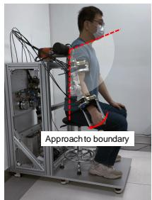  

(b)

  

(c)

  

(d)

图 10. (a)–(c) 由过度运动引起的异常快照；(d) 过度运动期间的异常分数与关节位置。白色扇区表示活动正常的区域，红色扇区表示活动异常的区域。

在实验过程中，参与者需要穿着上肢外骨骼机器人（upper-limb exoskeleton robot）进行运动，以模拟各种异常情况。本研究考虑了三种异常场景：过度运动场景（涉及超出正常范围的关节运动）、平衡偏差场景（涉及偏离相对平衡位置）以及模拟中风震颤场景。在过度运动场景中，参与者首先将上肢外骨骼机器人维持在正常运动范围内，然后降低手臂以模拟异常。随着手臂逐渐降低，肩关节角度逐渐减小并逐步越过运动边界，因此异常水平逐渐上升。随后，手臂被抬升回正常运动范围之内。实验结果如图 10 所示，表明随着关节位置逐渐接近并越过边界，异常分数相应增加。这些结果表明，所提出的异常检测器能够有效地检测出相对于正常运动范围（即所采集数据的运动范围）的偏离。

在模拟中风震颤场景中，参与者首先将上肢外骨骼机器人保持在静止阶段。随后，参与者抖动上肢外骨骼机器人的整个手臂以模拟震颤。对应的异常分数和关节位置如图 11 所示。可以明显看出，在模拟中风震颤期间，异常分数总体上升，并且只要震颤持续存在，该分数便维持在较高水平。

在平衡偏差场景中，参与者首先将上肢外骨骼机器人保持在一个静态平衡位置，该位置代表了上肢外骨骼机器人提供辅助时的平衡状态。随后，参与者被要求操纵上肢外骨骼机器人向上和向下运动，以模拟辅助过程中出现的错位。实验结果如图 12 所示，表明无论偏差方向如何（即无论患者的运动轨迹高于还是低于预定轨迹），异常分数都会显著增加。这种分数的增加表明上述异常已被成功检测出来。

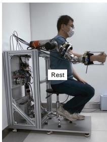  

(a)

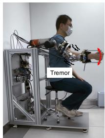  

(b)

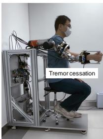  

(c)

  

(d)

  

图 11. (a)–(c) 模拟中风震颤所引发冲突的快照；(d) 模拟中风震颤期间的异常分数与关节位置

(a)

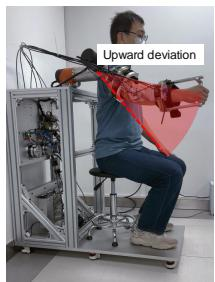  

（b）

  

(c)

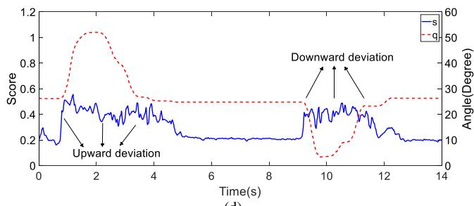  

(d)  
图 12. (a)–(c) 由于平衡偏差导致的冲突快照；(d) 平衡偏差期间异常分数与关节位置。红色扇形区域表示发生异常的位置。

表 7. 两种异常检测方法的 AUC 比较

<table><tr><td>Method</td><td>VAE</td><td>Ours</td></tr><tr><td>AUC</td><td>0.865</td><td>0.999</td></tr></table>

我们的异常检测器的性能在实验中以基于变分自编码器（VAE）的异常检测器（Zhang 等人，2023）作为基线进行了评估。具体而言，针对中风震颤场景中的检测性能，采用受试者工作特征（ROC）曲线进行评估，该曲线展示了分类模型区分不同类别的能力。所考虑模型的 ROC 曲线下面积如表 7 所示，计算所得的异常分数如图所示。

  

图 13. 两种不同异常检测方法的异常分数曲线，阴影区域表示发生异常的区域。

在图中可以看出，当异常发生时，所提出的异常检测器生成的评分显著升高。此外，基于 VAE 的异常检测器生成的评分在异常停止后未能恢复到正常水平。这些结果表明，与基于 VAE 的异常检测器相比，由于扩散模型具有更优越的生成性能，我们的异常检测器在不同关节构型下对异常进行分类时具有更强的适应性。

## 交互控制

在康复训练过程中，上肢外骨骼机器人需要按照期望的阻抗模型调节人机交互，同时考虑摩擦补偿。为此，在没有受试者参与的情况下，操控上肢外骨骼机器人缓慢运动，并对摩擦进行量化。具体而言，计算电机输出端电位计读数与关节端扭矩传感器测量值之间的差值。此外，还记录了关节速度。随后，基于简化摩擦模型（38）进行多项式拟合，以得到表 8 中所示的摩擦参数估计值。

表 8. 估计的摩擦模型

<table><tr><td></td><td> $\bar{a}_f$ </td><td> $\bar{b}_f$ </td><td> $\bar{c}_f$ </td></tr><tr><td>Joint 3</td><td>0.822</td><td>-2.132</td><td>0.557</td></tr><tr><td>Joint 4</td><td>1.718</td><td>11.441</td><td>-3.028</td></tr><tr><td>Joint 5</td><td>0.636</td><td>-1.212</td><td>1.005</td></tr></table>

接下来，我们在无患者参与的情况下，将阻抗控制器部署于上肢外骨骼机器人（upper-limb exoskeleton robot）中，以跟踪一条涵盖所有主动关节的预定义正弦轨迹。该实验旨在验证摩擦补偿的精度，并评估控制器的动态性能。阻抗参数设置如下：$C _ { d } = 1 0 I _ { 5 } , K _ { d } = 5 0 I _ { 5 }$，其中 $I _ { 5 }$ 为 5 × 5 单位矩阵。加权函数的参数设置如下：$\lambda _ { 1 } = 0 . 5 , \chi _ { 1 } = 0 . 0 4 , \chi _ { 2 } =$ 8.75，$\lambda _ { 2 } = 1 . 5$。控制参数设置如下：$K _ { v } = 1 . 1 I _ { 3 }$，$\pmb { K } _ { z } = d i a g ( 1 . 5 , 0 . 6 , 0 . 7 , 4 , 1 . 8 )$。实验结果表明，阻抗控制器有效补偿了摩擦，使上肢外骨骼机器人能够准确跟踪期望轨迹，如图 14 所示。具体而言，在该轨迹跟踪任务中，各关节的均方根误差（RMSE）分别为：关节 1 为 $0 . 6 1 3 ^ { \circ }$，关节 2 为 $0 . 7 2 8 ^ { \circ }$，关节 3 为 $0 . 9 9 7 ^ { \circ }$，关节 4 为 2.143◦，关节 5 为 $0 . 9 4 8 ^ { \circ }$。

  

(a)

  

（b）

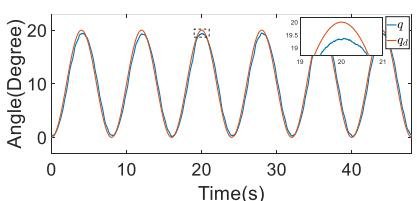

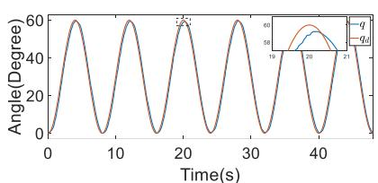  

您发送的内容仅为 "(d)"，似乎是一个图注或列表标签的残片，没有包含可供翻译的完整段落、句子或文档。

请将需要翻译的英文论文 Markdown 内容完整粘贴过来，我会按照学术翻译规范为您处理。

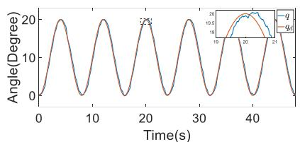  

图14. (a)-(e) 外骨骼机器人第1至第5关节的轨迹跟踪性能。

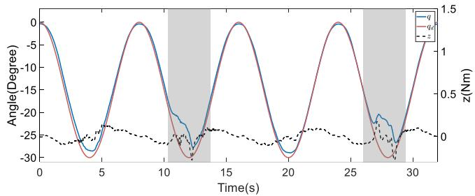  

(a)

  

(b)

  

(c)
图 15. (a)–(c) 上肢外骨骼机器人（upper-limb exoskeleton robot）在有患者参与情况下，关节 1、关节 2 和关节 4 的变阻抗控制器性能。阴影区域表示异常发生的时段。

此外，我们评估了所提阻抗控制器在涉及异常条件下的性能。这是通过让上肢外骨骼机器人在轨迹跟踪过程中引导患者，同时让患者将上肢外骨骼机器人保持在模拟异常的位置上来实现的。该实验的结果如图 15 所示。可以看出，在整个实验过程中，阻抗向量始终接近于零，表明尽管存在人为参与以及异常情况的出现，期望的可变阻抗模型仍得到了有效保持。

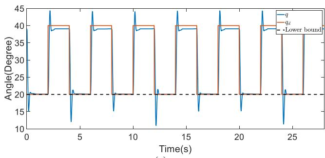  

(a)

  

(b)  
图16. 关节2（Joint 2）应对意外外部冲击的能力测试：（a）不进行在线轨迹优化（online trajectory refinement）；（b）进行在线轨迹优化（online trajectory refinement）

## 主动镜像训练（Active Mirroring Training）

在主动镜像训练过程中，上肢外骨骼机器人的运动与患者身体健侧（unaffected side）的运动意图保持一致（如图 8 所示）。此外，采用在线轨迹优化（online trajectory refinement）来平滑运动指令，并通过动态约束提升安全性。相关实验细节如下所述。

- 为了评估所提方法应对突发外部冲击的能力，我们对上肢外骨骼机器人肩部的第二关节（Joint 2）开展了实验。

- 在实验过程中，我们通过突变期望位置（desired position）的方式来模拟突然施加的外部扰动。

- 为了表示在线轨迹优化的下限约束，我们对位置指令施加 $20^{\circ}$ 的下界，从而模拟超出可接受活动范围的倾向。

- 在对比试验中，我们通过关闭健侧的位置反馈，消除了由身体健侧反馈引起的运动指令不一致。因此，我们转而依赖上肢外骨骼机器人自身的本体感受传感器（proprioceptive sensors），即其编码器（encoders），并在无受试者参与的条件下开展了实验。

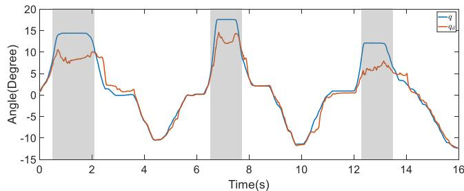  

图 17. 该系统通过在线轨迹优化，引导上肢外骨骼机器人到达异常分数低于其他区域的位置，其中阴影区域表示由异常内收角引起的异常。

有在线轨迹优化和无在线轨迹优化情况下的位置指令与关节位置分别如图 16 所示。该图表明，在未启用在线轨迹优化时，关节位置超出了所设定的运动边界。然而，当启用在线轨迹优化后，关节运动能够有效响应动态约束，并保持在边界附近。具体而言，在无轨迹优化时，运动超出了既定边界约 $9 ^ { \circ }$ ；相比之下，在有轨迹优化的情况下，超出量被显著减小到仅 $0 . 5 ^ { \circ }$ 。轨迹优化旨在调整轨迹以满足约束条件，并减轻关节位置违反运动边界的程度。因此，即使采用轨迹优化，关节位置仍可能略微越过边界，正如本实验中观察到的 $0 . 5 ^ { \circ }$ 的超出量所示。

接下来，我们对关节 1 进行了实验，以验证所提方法能够识别异常区域，并将规划轨迹引导至异常分数低于当前区域的更安全区域。理想情况下，该关节的正常运动范围不应显著超过零。特别是，肩部内收角在典型活动过程中应保持较小。因此，由于运动捕捉系统可能因标记点遮挡而给出不准确的内收角估计，我们转而利用上肢外骨骼机器人的编码器反馈来获取内收角估计值。结果如图 17 所示。从图中可以看出，随着肩部内收角的增大，由在线轨迹优化生成的动作指令降低了运动的内收角，而非严格保证其遵循目标轨迹。此外，当关节角回到正常范围，即肩部进入外展空间时，轨迹优化恢复了其将轨迹在动态约束范围内与目标轨迹对齐的目标。这些结果证实，所提方法能够在正常活动范围内跟踪人体运动意图的变化，并据此对轨迹进行优化。

  

(a)

  

(b)

  

(c)  
图 18. （a）–（c）主动镜像训练在上肢外骨骼机器人关节 1、关节 2 和关节 4 上的性能表现

必须在医院中安装动作捕捉系统才能在临床试验中部署主动镜像训练，而此类系统会带来额外的限制和不便。因此，我们没有开展主动镜像训练的临床试验。取而代之的是，我们通过将左臂（即健康一侧）的运动映射到右臂（即模拟中风一侧）的运动，使用上肢外骨骼在一名健康受试者上评估了我们方法用于主动镜像训练的效果。通过光学动作捕捉系统获取人体上肢的精确角度需要定制的服装，这超出了本研究范围。取而代之的是，我们采用了一种自制的、内嵌关键标记点的支架，以及装有标记点的手套，用于估算三个肢体关节的角度，具体为对应关节 1、2 和 4 的角度。然而，由于支架变形和标记点被遮挡，上肢关节角度的精度被限制在一定范围内。因此，为了确保安全并展示我们方法对上肢运动施加约束的能力，我们将关节 1、2 和 4 的位置约束分别设为 $[ - 4 0 ^ { \circ } , 1 0 ^ { \circ } ]$ $[ - 1 0 ^ { \circ } , 8 0 ^ { \circ } ]$ ] 和 $[ 0 ^ { \circ } , 6 0 ^ { \circ } ]$。

如图 18 所示，期望轨迹始终与人体肢体的轨迹 $\mathbf { \delta } \mathbf { q } _ { h }$ 对齐，并根据动态约束进行了细化。

  

(a)

  

您发送的只有 "(d) (b)" 两个字母选项，似乎是多项选择题的片段，但没有完整的题目内容，也没有需要翻译的论文。

请补充以下信息之一：

- **如果是选择题**：请提供完整的题目和所有选项（A/B/C/D 完整内容）。
- **如果是需要翻译的论文**：请粘贴或上传英文论文的 Markdown 内容。

  

(e)

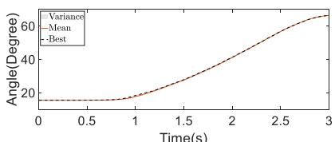  

(c)  
(f)

图19. 优化后的助力分布（a）–（c）不进行在线精调，（d）–（f）进行在线精调。

  

(a)  
(c)

  

(b)
(d)
图 20. (a)-(d) 被动跟随训练（passive following training）的评估结果，所示指标包括：RMSE、异常分数（anomaly score）、代价（cost）以及肱二头肌（biceps brachii）的肌电（EMG）信号水平。所有指标均在一个周期内取平均，并相对于原始辅助进行归一化处理。

此外，当身体未受影响侧快速移动到已建立运动边界之外的位置时，所提出的轨迹优化方法被迅速调整。也就是说，设定了预定的最大速度，以避免突破关节位置边界。当身体未受影响侧的关节运动保持在这些动态约束范围内时，上肢外骨骼机器人跟踪健康肢体的轨迹。同时，在整个训练过程中，我们的可变阻抗控制器有效地将人机交互维持在期望的阻抗模型范围内。

## 被动跟随训练

我们进行了一系列实验，以验证所提出的个性化框架在被动跟随训练任务上的有效性。这些实验聚焦于上肢康复中的一个典型任务：将上肢抬升至固定点。该任务需要肩部与肘部的协调，具体涉及关节 1、2 和 4。在代价计算过程中，将异常分数缩放至与跟踪误差相同的数量级，并将超参数 $\lambda _ { p }$ 设为 0.003。此外，由于辅助个性化的探索部分在很大程度上由基于示范的初始轨迹采样构成，我们将采样数设为 $N _ { s } =$ 40。训练过程被设计为在相邻两次迭代之间分布均值轨迹的 RMSE 下降到小于 $0 . 1 ^ { \circ }$ 时停止，或在达到最大迭代次数时停止。此外，采样空间通过示范数据得到了大幅缩减。根据实践经验，所设置的样本数量被认为足以完成当前任务中的探索。

首先，我们邀请一名健康受试者开展消融实验，以验证在线优化模块在被动跟随训练场景中的有效性。此外，我们执行了五次重启以规避局部最优。这些研究的结果如图19所示。在该图中，黑色虚线表示在探索阶段获得最低代价的轨迹，而红色实线表示辅助轨迹分布的均值。在没有在线轨迹优化的情况下，实验共进行67次迭代；而在采用在线轨迹优化的情况下，实验共进行55次迭代。实验结果表明，在被动跟随训练的个性化过程中若不采用在线优化，收敛后的辅助轨迹分布呈现出较大的方差，且具有最低代价的轨迹显著偏离分布的均值。这表明具有相似代价的轨迹分布相当宽。相反，在被动跟随训练的个性化中采用在线优化时，收敛后的辅助轨迹分布具有更小的方差，说明存在一组更为集中的具有相似代价的轨迹。这种集中主要归因于在线优化中使用了传感器反馈和异常得分，从而促进了辅助轨迹的实时调整。这一过程有效地降低了运动意图的不确定性，并最小化了人机交互中的冲突。因此，代价函数评估和区分不同轨迹性能的精度得以提升，从而使训练的整体有效性得到增强。

我们采用四项指标来评估个性化辅助的有效性：跟踪均方根误差（RMSE）、异常得分、代价(33)以及肱二头肌的肌电信号水平。评估结果如图20所示。为了便于比较，所有指标均在一个运动周期内取平均，并相对于原始辅助进行归一化。与其他辅助（即示范轨迹的均值以及不含在线优化的优化辅助）相比，结合在线优化的辅助在提升跟踪精度和降低运动过程中的异常得分方面表现出最佳性能。此外，实施在线优化使得被动训练后的代价最低，同时降低了肌电信号的幅值。这些结果验证了所提出的被动跟随训练个性化框架的有效性。

我们还招募了七名患者参与临床试验以验证所提方法的有效性。由于其中一名参与者被转院，最终仅六名参与者完成了试验。所有患者由于中风后遗症，其健侧也无法自然运动。因此，我们采用了被动跟随训练。每位参与者均签署了知情同意书，所有实验均经深圳迈步机器人科技有限公司于2023年5月成立的伦理委员会批准。参与者被随机分配至对照组或实验组，其详细信息汇总于表9。两组均进行常规的日常康复训练，实验组在此之外还额外接受了为期14天的被动跟随训练。

康复任务与前文所述的抬臂任务相同，涉及关节1、关节2和关节4的协调运动，如图21所示。在抬臂阶段（被视为训练任务）记录交互信息，而从t = 3.5 s开始的降臂阶段则用于返回初始位置。两组的运动能力由专业医护人员使用特定的评价指标进行评估打分。这些指标为肌张力水平以及Fugl-Meyer评定量表（FMA）评分（Fugl-Meyer et al. 1975）。较低的肌张力水平与较高的FMA评分表明上肢运动能力良好。两组在治疗前均接受了运动功能评估。在治疗阶段，实验组每天参与被动跟随训练，每次训练持续约15分钟。两组在治疗开始后2周接受重新评估。归一化至初次评估结果的实验结果如图21所示，详细评估结果见附录。与对照组不同，实验组在所有指标上均较治疗前的初次评估表现出显著改善。因此，与对照组的结果相比，实验组的结果表明，使用上肢外骨骼机器人进行的被动跟随训练能够加速运动功能的恢复。因此，此类训练可提升对中风及脑出血等病症的治疗效果。

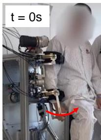  

(a)

  

(b)

  

(c)

  

您发送的内容仅为 "(d)"，这看起来像是不完整的内容（例如某张图的子图标签、某节的编号），并不包含需要翻译的英文论文正文。

请将完整的论文 Markdown 内容粘贴过来，我会按照要求逐段翻译，保留公式、代码块、图片引用与参考文献编号。

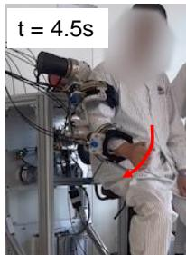  

(e)

  

"(f)" 是子图或子项的标签，没有可翻译的散文内容，保留原样即可。

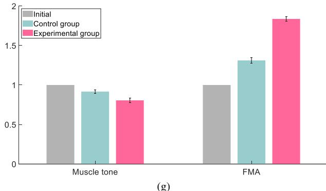  

图 21. (a)–(f) 训练过程中上肢运动的快照，红色箭头指示运动方向；(g) 临床试验的对比结果，以初次评估为基准进行归一化处理。

## 结论与讨论

## 结论

总体而言：本文提出了一种融合生成模型的双模式个性化框架。该框架包含意图预测器和异常检测器，用于捕捉患者未受影响侧的运动意图，并在康复任务执行过程中实时评估人机交互状态。在主动镜像模式下，辅助动作反映患者原始的运动意图。在被动跟随模式下，辅助动作根据交互反馈为患者量身定制。两种模式下的轨迹均集成于在线轨迹优化框架中，确保轨迹平滑、满足动力学约束且具有个性化，从而有效支持患者的康复训练。

表 9. 受试者属性

<table><tr><td>Group</td><td>Subject</td><td>Gender</td><td>Age(y)</td><td>Weight(kg)</td><td>Height(cm)</td><td>Arm length(cm)</td><td>Diagnosis</td></tr><tr><td rowspan="3">Control</td><td>1</td><td>Male</td><td>46</td><td>70</td><td>176</td><td>61</td><td>Cerebral hemorrhage</td></tr><tr><td>2</td><td>Male</td><td>60</td><td>65</td><td>167</td><td>57</td><td>Stroke</td></tr><tr><td>3</td><td>Male</td><td>62</td><td>75</td><td>170</td><td>58</td><td>Stroke</td></tr><tr><td rowspan="3">Experimental</td><td>4</td><td>Male</td><td>44</td><td>67</td><td>169</td><td>59</td><td>Stroke</td></tr><tr><td>5</td><td>Male</td><td>51</td><td>77</td><td>177</td><td>64</td><td>Stroke</td></tr><tr><td>6</td><td>Male</td><td>66</td><td>66</td><td>167</td><td>57</td><td>Stroke</td></tr></table>

具体方法：在线轨迹优化集成了两种训练配置，并利用生成式模型实现个性化辅助。具体而言，在主动镜像模式下，参考轨迹来源于未受影响的肢体（unaffected limb），意图预测器（intention predictor）所提供的预测轨迹分布会被预先调整，以缓解潜在的风险动作。相反，在被动跟随模式下，参考轨迹根据人类演示预先定义。此外，异常检测器（anomaly detector）在引导在线优化过程、提升运动自然性方面起着关键作用。该检测器评估当前交互数据与从健康个体获取的标准演示数据之间的偏差，从而在被动跟随训练期间辅助性能评估。在被动跟随模式下，针对特定训练任务采用概率运动基元（ProMPs），患者的每个动作根据一个代价函数（cost function）进行加权。该方法显著提升了生成辅助分布的有效性。

性能评估：我们开展了一系列实验，包括一项临床试验，以验证所提出的各模块的有效性，并展示其在增强辅助与确保安全方面的能力。在预测精度方面，意图预测器优于其他对比方法，即前向积分（forward integration）和 CNN-LSTM。此外，异常检测器能在不同场景下准确识别异常。而且，可变阻抗控制器（variable impedance controller）的性能在轨迹跟踪以及异常发生时辅助患者方面得到了验证。在主动镜像训练过程中，面对意外冲击，在线优化有效降低了约束违反的程度。该方法还能够识别运动空间中的异常区域，并引导上肢外骨骼机器人降低异常分数。该主动镜像训练方法在动作捕捉系统下进行了测试，验证了其有效性。在被动跟随模式下，分别使用健康个体和一项临床试验进行了测试。结果证实，该方法能够为健康参与者提供个性化辅助，并显著加速脑卒中参与者的运动功能恢复。具体而言，临床试验数据表明，接受被动跟随训练的实验组在完成治疗方案后，各项性能指标均有改善。

## 讨论

局限性：当前的轨迹生成方法存在三个主要局限性，详述如下。

1) 意图预测器（intention predictor）和异常检测器（anomaly detector）的性能取决于数据集的规模与质量。将数据集扩展至涵盖更多受试者，将显著提升生成模型的性能。这将提高对患者运动意图的预测准确率，以及运动过程中对异常交互的检测精度，从而增强训练模式的个性化程度。

2) 该临床试验仅纳入六名受试者，且仅关注被动跟随模式（passive following mode）的康复效果。开展一项纳入更多受试者、并将主动镜像模式（active mirroring mode）纳入康复流程的临床试验，将对所提出的双模式个性化框架提供更为全面的评估。

以所述方式解决上述局限性的努力，将构成我们未来研究与开发工作的基础。

智识贡献（Intellectual Merits）：我们开发了一种融合生成模型的创新性双模式个性化框架，从而为自适应康复系统树立了新的基准。该新颖框架能够根据患者的需求在主动镜像模式与被动跟随模式之间切换，从而提供个性化辅助并改善康复效果。该框架的关键特性在于其实时意图预测与异常检测能力。具体而言，意图预测器从患者的未受影响侧捕获运动意图，而异常检测器则实时评估人机交互，确保对患者动作的即时适应与响应。此外，该框架还集成了在线轨迹优化模块，该模块将主动镜像模式与被动跟随模式下的轨迹加以统一，以确保轨迹平滑、受动力学约束且具有个性化。因此，该框架能提供比其他框架更为自然、更为有效的辅助。基于交互反馈将生成模型应用于辅助的个性化，可确保康复流程能够有效响应每位患者的具体状况与需求。

潜在影响：本研究开发了一种融合生成式模型的双模式个性化框架，代表了一项重大进展，有望提升康复技术在临床和居家护理环境中的部署与效果。具体而言，由于这一创新框架能够根据实时反馈和患者的特定运动意图提供个性化、自适应的辅助，它有潜力彻底改变康复流程。据作者所知，本研究是首个将生成式模型集成到上肢外骨骼机器人中并开展临床试验的工作。我们的开创性方法不仅增强了康复设备的功能，还通过将人工智能与康复医学相融合，对该领域产生了潜在的推动作用。也就是说，我们的方法能够有效地弥合人工智能与康复医学之间的差距，从而促进人工智能领域的先进成果向实际医学应用转化。本研究体现了跨学科研究的力量，因为它融合了机器人学、控制系统、机器学习和临床康复等多个领域的原理。这推动了每个领域的进展，并为未来旨在开发全面且自适应康复系统的研究树立了先例。此外，本研究设计的框架还应对了人口老龄化这一更广泛的社会挑战。具体而言，该框架提供的方法可用于先进的康复解决方案，既适用于医疗机构，也适用于家庭环境。

## 资助

本工作部分得到科技创新2030—重大项目（课题编号 2021ZD0201404）的支持，部分得到清华大学国强研究院的支持，部分得到国家自然科学基金项目（编号 U21A20517 和 52075290）的支持。

## 参考文献

Albu-Schäffer A, Ott C and Hirzinger G (2007) 基于无源性的柔性关节机器人位置、力矩与阻抗控制统一框架. The International Journal of Robotics Research 26(1): 23–39.

Chen T, Casas R and Lum PS (2019) 采用串联弹性驱动器与缆绳驱动差动机构的上肢康复肘部外骨骼. IEEE Transactions on Robotics 35(6): 1464–1474.

Chen Y, Chen G, Ye J, Fu C, Liang B and Li X (2023a) 学习在多任务中辅助不同穿戴者：面向外骨骼机器人的高效个性化人在回路自适应框架. arXiv 预印本 arXiv:2309.14720 .

Chen Y, Chen G, Ye J, Qiu X and Li X (2023b) 基于人类示范与交互式学习的安全个性化上肢外骨骼机器人运动规划. arXiv 预印本 arXiv:2309.08178 .

Clark G and Amor HB (2022) 学习人机共生行走中的人体工程学控制. IEEE Transactions on Robotics 39(1): 327–342.

De Wit CC, Olsson H, Astrom KJ and Lischinsky P (1995) 控制系统摩擦建模新方法。IEEE Transactions on automatic control 40(3): 419–425.

Ebrahimi A, Gröninger D, Singer R and Schneider U (2017) 基于主观反馈的主动驱动上肢外骨骼控制参数优化。见：2017 第三届控制、自动化与机器人国际会议 (ICCAR)。IEEE，第432–437号。

Fugl-Meyer AR, Jääskö L, Leyman I, Olsson S and Steglind S (1975) 一种用于评价体能表现的方法。Scand J Rehabil Med 7(1): 13–31.

Gull MA, Bai S and Bak T (2020) 上肢外骨骼设计综述。Robotics 9(1): 16.

Han S, Wang H and Yu H (2023) 基于人机交互评价的串联弹性驱动器驱动上肢康复机器人自适应控制。IEEE Transactions on Robotics。

Ho J, Jain A and Abbeel P (2020) 去噪扩散概率模型。Advances in neural information processing systems 33: 6840–6851.

Huang J, Huo W, Xu W, Mohammed S and Amirat Y (2015) 基于运动意图识别人机接口的上肢助力外骨骼控制。IEEE transactions on automation science and engineering 12(4): 1257–1270.

Huang VS and Krakauer JW (2009) 机器人神经康复：一种计算运动学习视角。Journal of neuroengineering and rehabilitation 6: 1–13.

Jau BM (1988) 类人外骨骼双臂/手部遥控机器人控制器。见：IEEE 智能机器人国际研讨会。IEEE，第715–718号。

Jezernik S, Colombo G and Morari M (2004) 用于四自由度机器人矫形器康复的自动步态模式自适应算法。IEEE Transactions on Robotics and Automation 20(3): 574–582.

Kagawa T, Ishikawa H, Kato T, Sung C and Uno Y (2015) 可穿戴机器人助行中基于优化的关节空间运动规划。IEEE Transactions on Robotics 31(2): 415–424.

Kalita B, Narayan J and Dwivedy SK (2021) 主动式下肢机器人矫形器与外骨骼装置开发：系统综述。International Journal of Social Robotics 13: 775–793.

Kim B and Deshpande AD (2017) 一种具有解剖学肩部机构的上肢康复外骨骼 Harmony：设计、建模、控制与性能评价。The International Journal of Robotics Research 36(4): 414–435.

Kim H, Miller LM, Byl N, Abrams GM and Rosen J (2012) 人臂与上肢外骨骼的冗余分辨率。IEEE transactions on biomedical engineering 59(6): 1770–1779.

Kim TY and Cho SB (2019) 使用 CNN-LSTM 神经网络预测住宅能耗。Energy 182: 72–81.

Lanotte F, McKinney Z, Grazi L, Chen B, Crea S and Vitiello N (2021) 可穿戴机器人辅助与离散运动动态同步的自适应控制方法：用于举升任务的验证。IEEE Transactions on Robotics 37(6): 2193–2209.

Lee SH, Park G, Cho DY, Kim HY, Lee JY, Kim S, Park SB and Shin JH (2020) 中重度上肢功能障碍的慢性脑卒中患者中末端执行器型与外骨骼型康复机器人对上肢功能影响的对比研究. Scientific reports 10(1): 1806.

Lenzi T, De Rossi SMM, Vitiello N and Carrozza MC (2012) 动力外骨骼基于意图的肌电控制. IEEE transactions on biomedical engineering 59(8): 2180–2190.

Li H, Guo S, Bu D, Wang H and Kawanishi M (2023a) 基于 CNN-LSTM 的受试者无关连续运动估计用于家庭上肢康复系统. IEEE Robotics and Automation Letters .

Li N, Yang Y, Li G, Yang T, Wang Y, Chen W, Yu P, Xue X, Zhang C, Wang W et al. (2022) 基于多传感器融合的镜像自适应按需辅助控制策略在上肢康复柔性外骨骼中的应用. IEEE Transactions on Automation Science and Engineering .

Li X, Liu Y and Yu H (2018a) 串联弹性执行器驱动康复机器人的迭代学习阻抗控制. Autom. 90: 1–7. URL https://api.semanticscholar.org/CorpusID:30545766.

Li X, Liu YH and Yu H (2018b) 串联弹性执行器驱动康复机器人的迭代学习阻抗控制. Automatica 90: 1–7.

Li X, Pan Y, Chen G and Yu H (2017) 面向康复机器人外骨骼的多模态控制方案. The International Journal of Robotics Research 36(5-7): 759–777.

Li X, Zhang X, Li X, Long J, Li J, Xu L, Chen G and Ye J (2021) Bear-h：一种用于智能康复的智能双边外骨骼辅助机器人. IEEE Robotics & Automation Magazine 29(3): 34–46.

Li Z, Li Q, Huang P, Xia H and Li G (2023b) 考虑执行器动力学与踝关节阻抗自适应的柔性外骨骼人在回路自适应控制. IEEE Transactions on Cybernetics .

Long Y, Du Zj, Wang Wd and Dong W (2018) 基于人体运动意图学习的可穿戴外骨骼运动辅助控制. Robotics and Computer-Integrated Manufacturing 49: 317–327.

Mao Y and Agrawal SK (2012) 用于神经康复的绳索驱动手臂外骨骼 (CAREX) 设计. IEEE transactions on robotics 28(4): 922–931.

Martinez A, Lawson B, Durrough C and Goldfarb M (2018) 基于速度场的控制器用于双边髋膝下肢外骨骼辅助步行时的腿部运动. IEEE Transactions on Robotics 35(2): 307–316.

Martinez JA, Ng P, Lu S, Campagna MS and Celik O (2013) 腕部万向架设计：用于脑卒中康复的前臂与腕部外骨骼. 发表于：2013 年第 13 届 IEEE 康复国际机器人大会 (ICORR). IEEE, 第 1–6 页.

Nasr A, Bell S and McPhee J (2023) 主被动型肩部外骨骼的优化设计：基于人机交互的计算建模. Multibody System Dynamics 57(1): 73–106.

Pan J, Astarita D, Baldoni A, Dell'Agnello F, Crea S, Vitiello N and Trigili E (2022) Nesm-γ：一种用于临床部署的带柔性驱动器的上肢外骨骼. IEEE Robotics and Automation Letters 7(3): 7708–7715.

Pan Y, Wang H, Li X and Yu H (2017) 带柔性驱动器的机械臂的自适应指令滤波反步控制. IEEE transactions on control systems technology 26(3): 1149–1156.

Paraschos A, Daniel C, Peters JR and Neumann G (2013) 概率运动基元. Advances in neural information processing systems 26.

Perry JC, Rosen J and Burns S (2007) 上肢动力外骨骼设计. IEEE/ASME transactions on mechatronics 12(4): 408–417.

Pratt GA and Williamson MM (1995) 串联弹性驱动器. 载于：1995年IEEE/RSJ智能机器人与系统国际会议论文集. 人机交互与协作机器人, 第1卷. IEEE, 第399–406页.

Qiu S, Guo W, Caldwell D and Chen F (2020) 基于动态运动基元的外骨骼在线学习与人类行走意图估计. IEEE Transactions on Cognitive and Developmental Systems 13(1): 67–79.

Quigley M, Conley K, Gerkey B, Faust J, Foote T, Leibs J, Wheeler R, Ng AY et al. (2009) ROS：一种开源机器人操作系统. 载于：ICRA开源软件研讨会, 第3卷. 日本神户, 第5页.

Said RR, Heyat MBB, Song K, Tian C and Wu Z (2022) 基于运动相关皮层电位的脑电-脑机接口的虚拟现实与机器人疗法作为近期康复技术的系统综述. Biosensors 12(12): 1134.

Salzmann T, Ivanovic B, Chakravarty P and Pavone M (2020) Trajectron++：基于异构数据的动态可行轨迹预测. 载于：计算机视觉–ECCV 2020：第16届欧洲会议, 英国格拉斯哥, 2020年8月23–28日, 论文集, 第XVIII部分16. Springer, 第683–700页.

Sambhus R, Gokce A, Welch S, Herron CW and Leonessa A (2023) 串联弹性执行器力控制的实时无模型深度强化学习. 载于：2023年IEEE/RSJ智能机器人与系统国际会议 (IROS). IEEE, 第5645–5652页.

Sommerhalder M, Zimmermann Y, Simovic L, Hutter M, Wolf P and Riener R (2023) 具有多工作空间目标和约束的康复机器人轨迹优化框架. IEEE Robotics and Automation Letters .

Song J, Meng C and Ermon S (2020) 去噪扩散隐式模型. arXiv预印本 arXiv:2010.02502 .

Spong MW (1987) 弹性关节机器人的建模与控制 .

Tiboni M, Borboni A, Vérité F, Bregoli C and Amici C (2022) 外骨骼中的传感器与驱动技术：综述. Sensors 22(3): 884.

Tikhonov AN (1952) 导数中含小参数的微分方程组. Matematicheskii sbornik 73(3): 575–586.

Wang Y, Zahedi A, Zhao Y 和 Zhang D (2022) 面向装备扭矩传感器的线驱动上肢外骨骼的人机交互力矩提取。IEEE/ASME Transactions on Mechatronics 27(6): 4269–4280。

Williams G, Wagener N, Goldfain B, Drews P, Rehg JM, Boots B 和 Theodorou EA (2017) 基于模型的强化学习中的信息论模型预测控制。载于：2017 IEEE International Conference on Robotics and Automation (ICRA)。IEEE，第1714–1721页。

Wu Q, Wang X 和 Du F (2016) 用于上肢主动康复训练的重力平衡外骨骼的研发与分析。Proceedings of the Institution of Mechanical Engineers, Part C: Journal of Mechanical Engineering Science 230(20): 3777–3790。

Xu J, Xu L, Li Y, Cheng G, Shi J, Liu J 和 Chen S (2020) 面向机器人镜像疗法的多通道强化学习框架。IEEE Robotics and Automation Letters 5(4): 5385–5392。

Xu M, Zhou Z, Wang Z, Ruan L, Mai J 和 Wang Q (2023) 面向可穿戴机器人设备的仿生线驱动系统：设计、控制与表征。IEEE Transactions on Robotics。

Zhang J, Fiers P, Witte KA, Jackson RW, Poggensee KL, Atkeson CG 和 Collins SH (2017) 步行中外骨骼辅助的人在回路优化。Science 356(6344): 1280–1284。

Zhang Q, Nalam V, Tu X, Li M, Si J, Lewek MD 和 Huang HH (2022) 通过外骨骼控制施加健康的髋关节运动模式及活动度以实现个体化助力。IEEE Robotics and Automation Letters 7(4): 11126–11133。

Zhang X, Shu Y, Chen Y, Chen G, Ye J, Li X 和 Li X (2023) 面向具有本体感知的外骨骼机器人的多模态学习与物理冲突松弛。载于：2023 IEEE International Conference on Robotics and Automation (ICRA)。IEEE，第10490–10496页。

Zhu H, Nesler C, Divekar N, Peddinti V 和 Gregg RD (2021) 部分辅助动力膝关节矫形器中紧凑可反向驱动执行器的设计原则。IEEE/ASME Transactions on Mechatronics 26(6): 3104–3115。

Zhu L, Wang Z, Ning Z, Zhang Y, Liu Y, Cao W, Wu X 和 Chen C (2020) 基于 IMU 的软体外骨骼运动意图识别新方法。Electronics 9(12): 2176。

Zimmermann Y, Küçüktabak EB, Farshidian F, Riener R 和 Hutter M (2020) 迈向动态透明性：手臂外骨骼上多感官控制的鲁棒交互力跟踪。载于：2020 IEEE/RSJ International Conference on Intelligent Robots and Systems (IROS)。IEEE，第7417–7424页。

Zimmermann Y, Sommerhalder M, Wolf P, Riener R 和 Hutter M (2023a) AnyExo 2.0：康复全阶段操作与关节导向训练的完全驱动上肢外骨骼。IEEE Transactions on Robotics。

Zimmermann Y, Song J, Deguelle C, Läderach J, Zhou L, Hutter M, Riener R 和 Wolf P (2023b) 外骨骼的人机连接系统：设计与性能分析。IEEE Transactions on Robotics。

## 附录

## 稳定性分析

为了证明整个系统的稳定性，我们将方程（43）和（45）代入（9），得到如下系统动力学：

$$
(M (\boldsymbol {q}) + \bar {\boldsymbol {B}}) \dot {\boldsymbol {z}} + C (\dot {\boldsymbol {q}}, \boldsymbol {q}) \boldsymbol {z} = - K _ {z} \boldsymbol {z} - S _ {2} ^ {\top} \tilde {\tau} _ {f} - k _ {g} s g n (\boldsymbol {z}),\tag{49}
$$

其中$\tilde{\tau}_f = \hat{\tau}_f - \tau_f$表示摩擦力的估计误差。

随后，我们提出如下候选李雅普诺夫函数：

$$
V = \frac {1}{2} \boldsymbol {z} ^ {T} (\boldsymbol {M} (\boldsymbol {q}) + \bar {\boldsymbol {B}}) \boldsymbol {z}.\tag{50}
$$

通过对(50)式关于时间求导，并将动力学替换为(49)式中的形式，我们推导出

如下表达式：

$$
\dot {V} = - \pmb {z} ^ {T} \pmb {K} _ {z} \pmb {z} - \pmb {z} ^ {T} \pmb {S} _ {2} ^ {\intercal} \tilde {\pmb {\tau}} _ {f} - k _ {g} \pmb {z} ^ {T} s g \pmb {n} (\pmb {z}).\tag{51}
$$

假设 $\| S _ { 2 } ^ { \mathsf { T } } \tilde { \tau } _ { f } \| \leq \kappa$，则 $\dot { V }$ 的上界推导如下：

$$
\dot {V} \leq - \boldsymbol {z} ^ {T} \boldsymbol {K} _ {z} \boldsymbol {z} - (k _ {g} - \kappa) \| \boldsymbol {z} \|,\tag{52}
$$

如果 $k_g$ 足够大，满足 $k_g > \kappa$，则该不等式化简为

$$
\dot {V} \leq - \boldsymbol {z} ^ {T} \boldsymbol {K} _ {z} \boldsymbol {z} <   0,\tag{53}
$$

由于 $V > 0$ 且 $\dot { V } < 0$，准稳态系统是指数稳定的。考虑到边界层系统可以通过适当整定 $\pmb { K } _ { 1 }$ 和 $K _ { 2 }$ 使其本质稳定，根据 Tikhonov (1952)，闭环系统的稳定性得以保证，从而确保收敛到期望的阻抗向量。

## 被动跟随模式中的权重设定

对于涉及人机交互的特定训练任务，我们假设患者意图与上肢外骨骼机器人同步运动。然而，人体运动意图的随机性等物理因素可能会影响上肢外骨骼机器人的跟踪性能。鉴于在动力学中显式考虑此类扰动具有挑战性，我们将这种干扰建模为轨迹规划中的附加噪声。该动力学描述如下：

$$
\pmb {x} _ {p} ^ {(t + 1)} = g _ {p} (\pmb {x} _ {p} ^ {(t)}, \pmb {q} _ {r}),\tag{54}
$$

$$
\pmb {q} _ {r} \sim \mathcal {N} (\pmb {q} _ {r p}, \pmb {\Sigma} _ {p}),\tag{55}
$$

其中 $\pmb { x } _ { p } = [ \pmb { x } _ { d } ^ { \top } , s ] ^ { \top }$ 是一个增广状态向量，$g _ { p } ( \cdot )$ 是一个非线性时变函数，它将在线精修、阻抗控制器以及人机交互中人类运动意图的确定性分量整合在一起。$\mathbf { \Delta } \mathbf { q } _ { r p }$ 是辅助分布的均值，$\Sigma _ { p }$ 封装了整体随机扰动，其中涵盖了人类运动意图的随机性以及生成模型的采样变异性。

根据 Williams 等人（2017）的研究，为最小化如下代价函数

$$
\hat {\mathcal {S}} (\boldsymbol {q} _ {r}) = \int_ {T _ {r}} \{\| \boldsymbol {q} _ {d} (\boldsymbol {q} _ {r}) - \boldsymbol {q} \| _ {\boldsymbol {Q}} ^ {2} + s ^ {2} + \frac {\lambda_ {p}}{2} \boldsymbol {q} _ {r p} ^ {\top} \Sigma_ {p} ^ {- 1} \boldsymbol {q} _ {r p} \} d t,\tag{56}
$$

其中，最优控制输入以成本解耦（cost-decoupled）的方式构建，具体如下：

$$
\begin{array}{c} \hat {w} (\boldsymbol {q} _ {r}) = \frac {1}{\hat {\eta} _ {k}} \exp (- \frac {1}{\lambda_ {p}} (\hat {\mathcal {S}} (\boldsymbol {q} _ {r}) + \gamma_ {p} \sum \tilde {\boldsymbol {q}} _ {r p} ^ {\mathsf {T}} \Sigma_ {p} ^ {- 1} \boldsymbol {q} _ {r})), \\ \hat {\boldsymbol {q}} _ {r p} ^ {*} = \mathbb {E} [ \hat {w} (\boldsymbol {q} _ {r}) \boldsymbol {q} _ {r} ]. \end{array}\tag{57}
$$

(58)

其中，$\gamma _ { p } = \lambda _ { p } ( 1 - \alpha _ { p } )$ 为解耦温度参数（decoupled temperature parameter），由 $\alpha _ { p } \in [ 0 , 1 ]$ 定义；$\tilde { \pmb q } _ { r p }$ 为初始轨迹估计的均值。

在该方法中，最优辅助量由当前轨迹分布的期望值推导得出。

表 10. 详细的临床评估（Detailed Clinical Evaluation）

<table><tr><td>Group</td><td>Subject</td><td>Initial muscle tone level</td><td>Post-trial muscle tone level</td><td>Initial FMA</td><td>Post-trial FMA</td></tr><tr><td rowspan="3">Control</td><td>1</td><td>1.5</td><td>1.5</td><td>8</td><td>12</td></tr><tr><td>2</td><td>1.5</td><td>1.5</td><td>31</td><td>35</td></tr><tr><td>3</td><td>2</td><td>1.5</td><td>23</td><td>30</td></tr><tr><td rowspan="3">Experimental</td><td>4</td><td>1.5</td><td>1</td><td>8</td><td>16</td></tr><tr><td>5</td><td>2</td><td>1.5</td><td>19</td><td>35</td></tr><tr><td>6</td><td>2</td><td>2</td><td>3</td><td>5</td></tr></table>

每次采样迭代都基于先前改进后的轨迹分布，这可能导致采样空间的不一致性。为了应对这些潜在的不一致性并确保充分的探索，我们在算法 3 中选取较大的样本量 $N _ { s }$。此外，我们将 $\alpha _ { p } = 1$ ，以减轻不同样本之间 $\tilde { \pmb q } _ { r p }$ 不一致性的影响，从而提高最优控制解的鲁棒性和可靠性。

鉴于 (56) 式中的最后一项在康复过程中是不期望出现的，理想取值为 $\lambda _ { p } = 0$ ，由此得到如下最优辅助的定义：

$$
\hat {\boldsymbol {q}} _ {r p} ^ {*} = \underset {\boldsymbol {q} _ {r}} {\arg \min} \hat {\mathcal {S}} (\boldsymbol {q} _ {r}).\tag{59}
$$

在该场景下，最优辅助被定义为成本最低的采样轨迹，所有其他采样结果均被忽略。然而，这一公式忽略了最优辅助的分布，导致迭代改进机制无法实施。因此，为了维持迭代改进的可行性，同时最小化该项的不良影响，将控制解紧密度的参数 $\lambda _ { p } .$ 设为较小值。该调整确保 ${ \hat { S } } ( q _ { r } ) \to S ( q _ { r } )$ ，并且 (57) 中的最优权重公式简化为 (34) 中所用的形式。该设定在最小化不良项与维持实用有效的迭代改进过程之间取得了平衡。

## 临床评估结果

在该临床试验中，肌张力水平采用 0、1、1+、2、3、4 分级的量表进行评估，其中 0 级表示正常肌张力。为便于数值分析，将 1+ 级量化为 1.5。评估结果记录于表 10 中。所有评估均仅针对上肢。在 FMA（Fugl-Meyer Assessment，傅格-梅耶评估量表）的上肢部分中，表示功能正常的最高分为 66 分。