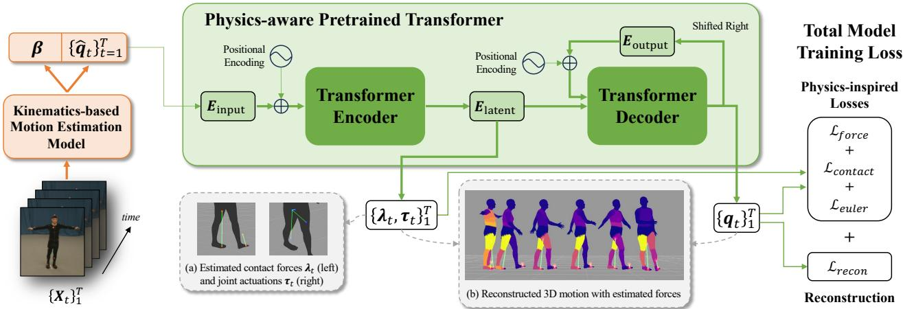
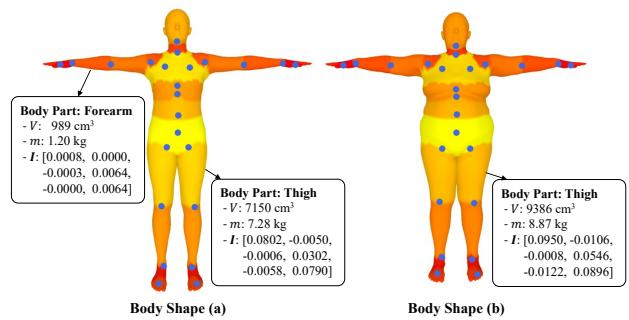
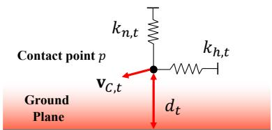
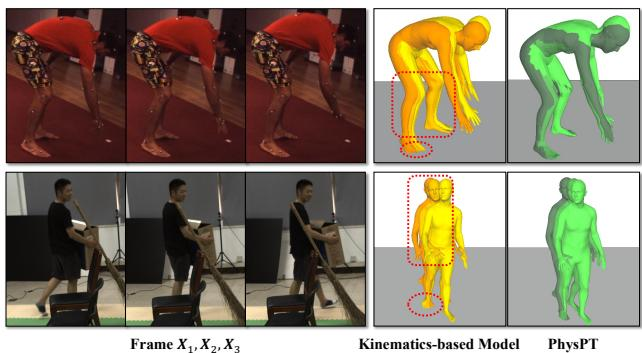
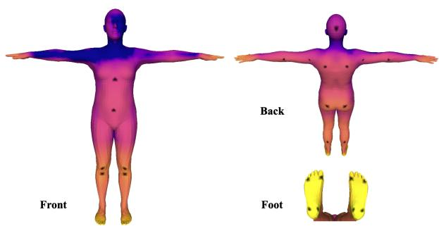

# PhysPT：物理感知预训练 Transformer 以从单目视频估计人体动力学

Yufei Zhang1, Jeffrey O. Kephart2, Zijun Cui1,3, Qiang Ji1

1伦斯勒理工学院（Rensselaer Polytechnic Institute），2IBM Research，3南加州大学（University of Southern California）

{zhangy76, jiq}@rpi.edu, kephart@us.ibm.com, ceejkl@gmail.com

## 摘要

尽管当前方法在从单目视频估计 3D 人体运动方面已取得可观的进展，但它们的运动估计常常在物理上不真实，因为这些方法主要考虑运动学。本文提出物理感知预训练 Transformer（Physics-aware Pretrained Transformer，PhysPT），它能够改进基于运动学的运动估计并推断运动力（motion forces）。PhysPT 利用 Transformer 编码器–解码器主干，以自监督方式有效地学习人体动力学。此外，它还结合了支配人体运动的物理原理。具体而言，我们构建了基于物理的力学身体表征与接触力模型。我们利用这些模型引入新颖的物理启发的训练损失（即力损失、接触损失以及 Euler–Lagrange 损失），使 PhysPT 能够捕获人体及其所受力场的物理属性。实验表明，一旦训练完成，PhysPT 可以直接应用于基于运动学的估计，显著增强其物理合理性并生成良好的运动力场。进一步地，我们展示这些具有物理意义的量级能够提升一项重要下游任务——人体动作识别——的准确率。

## 1. 引言

单目 3D 人体运动估计对于人机交互 [8, 引用:74]、运动分析 [引用:14] 以及机器人技术 [引用:17] 等应用至关重要。由于缺乏深度信息，并且力与人体运动之间存在复杂相互作用，这项任务本质上具有挑战性。

深度学习的近期进展以及 3D 人体建模 [引用:47, 引用:85] 的发展，已大幅改善了从单张图像重建 3D 人体的效果 [引用:28, 引用:33, 引用:38, 引用:76, 引用:105]。在以视频作为输入的情况下，当前研究旨在通过利用时序信息来提升模型性能。一些作者设计了时序模型以从视频中提取有意义的特征来提升性能 [引用:6, 引用:10, 引用:11, 引用:13, 引用:23, 引用:36, 引用:55, 引用:64, 引用:69, 引用:73, 引用:80, 引用:98,

引用:100]。另一些作者学习捕获自然 3D 身体运动模式的运动先验。将所学先验集成到模型训练中可以促进平滑的运动估计 [引用:31, 引用:48, 引用:61, 引用:66]。虽然这些方法在一定程度上增强了重建效果，但它们常常产生不真实的估计，其特征是明显的物理伪影，例如运动抖动与脚部滑动。

为应对这一局限，一种有前景的策略是利用支配身体运动的物理原理。在该方法中，人体被视为一个铰接式刚体，人体动力学通过欧拉-拉格朗日方程来描述。这些方程通过常微分方程将身体质量、惯性和物理力（包括关节驱动力和接触力）与身体运动联系起来。一些研究者 [19, 20, 40, 60, 67, 84, 88] 构建优化框架，通过将基于运动学的估计与物理方程对齐，联合估计未知的物理参数并优化运动学估计。另一些研究者 [24, 39, 49, 68, 93] 则采用基于学习的方法，通过训练神经网络来预测参数，从而规避了基于优化的方法中固有的繁琐手动参数调参过程。

然而，一个关键挑战依然存在：物理信息（包括人体的物理属性和运动力）在当前的 3D 运动捕捉数据集 [51] 中是缺失的。为了融入物理，现有方法通常依赖物理引擎 [15, 75]。这需要创建具有几何基本体的代理身体以捕获身体属性，将这些代理导入物理引擎，然后利用物理引擎计算必要的物理参数并模拟身体运动。该方法的问题在于难以从物理引擎输出中有效计算梯度 [19]，从而限制了它们与深度学习模型的无缝集成。此外，现有基于物理的模型主要使用 3D 标注视频进行训练，而这类视频在实践中难以获取。因此，训练得到的模型可能无法很好地泛化到未见过的场景。

在本文中，我们提出了一种用于学习人体动力学的新颖框架，该框架绕过了对 3D 标注视频的需求，并有效地将物理与先进的深度模型相结合。具体而言，受预训练 Transformer [77] 在时序建模中近期成功的启发，我们提出利用 Transformer 编码器-解码器架构，并以自监督的方式通过重建输入人体运动来进行训练。在融入物理时，我们直接从广泛采用的 3D 人体模型 SMPL [47] 计算身体物理属性，从而绕开不切实际的人体代理。我们还引入了接触模型以有效建模接触力。我们利用这些模型从训练序列中推导运动力，并施加新颖的受物理启发的训练损失，包括力损失、接触损失和欧拉-拉格朗日损失。我们仅使用现有的运动捕捉数据来训练 Transformer 模型。训练完成后，我们的物理感知预训练 Transformer（Physics-aware Pretrained Transformer, PhysPT）可应用于任何基于运动学的重建模型之上，以从单目视频中产生增强的运动和力估计。总结而言，我们的主要贡献包括：

- 我们提出 PhysPT，一种通过自监督学习并融合物理知识进行训练的 Transformer（自回归序列模型）编码器-解码器模型。训练完成后，PhysPT 可与任何基于运动学的模型相结合，在无需对模型进行额外微调的情况下估计人体动力学。

- 我们提出了一种融合物理知识的新颖框架。其中包括基于物理的人体表征和接触力模型，并在此基础上施加一组新颖的、受物理启发的损失函数用于模型训练。

- 我们通过实验证明，PhysPT 显著提升了运动估计的物理合理性，并能推断出合理的运动受力。此外，我们证明增强后的运动与受力估计可转化为下游一项重要任务——人体动作识别（human action recognition）——的精度提升。

## 2. 相关工作

基于运动学的人体运动估计。建模人体运动学的方法仅估计人体的几何位形。在这些方法中，一类工作采用基于优化的流程，将先验人体模型迭代拟合到二维（2D）观测上，以重建三维（3D）人体 [1, 4, 22, 78, 83, 89, 111]。另一类方法则采用深度学习模型直接预测三维人体。在给定单张输入图像的情况下，现有方法提出了不同的模型架构，并采用多样的中间表征与输出表征来提升重建精度 [18, 32, 34, 38, 41, 43, 50, 53, 63, 81, 91, 104]。

在以单目视频作为输入的设定下，当前基于运动学的方法旨在充分利用时序信息以获得更优的结果。研究者基于时序卷积网络（Temporal Convolutional Networks）[29, 36, 55, 99, 100]、图卷积网络（Graph Convolutional Networks）[6, 10, 11, 80, 98]、循环神经网络（Recurrent Neural Networks）[13, 23, 31, 48, 72, 92]、Transformer [21, 42, 58, 59, 64, 73, 108, 112]，以及那些显式建模并利用注意力机制的方法 [44, 71, 79, 82]，开发了多种时序模型。另一类促使时序预测结果趋于真实的常见做法，是在训练中引入平滑性约束或运动先验 [31, 48, 61, 94, 101]。然而，这些基于运动学的方法由于未能真实地刻画人体运动的复杂性，往往会产生明显的物理伪影。

基于物理的人体运动估计。基于物理的方法显式地利用物理原理，特别是欧拉-拉格朗日方程（Euler-Lagrange equations），来捕捉人体动力学。先前的研究采用优化框架，通过最小化由欧拉-拉格朗日方程引入的残差，来联合估计运动作用力并细化基于运动学的初始运动估计 [40, 60, 84]。直接估计所施加的力具有挑战性；因此，其他研究者采用角色控制方法。在这一范式中，基于运动学的估计作为参考运动，而模拟这些运动在物理引擎中所需的力，则通过估计控制器的参数来进行预测 [19, 37, 67, 88, 90, 110]。然而，这些基于优化的方法通常需要仔细调整控制参数。一些方法转而利用神经网络来估计参数，其中模型通过全监督学习 [68] 或强化学习 [24, 26, 49, 93] 进行训练。在这些方法中，将物理引擎与学习模型相结合仍不足以实现物理与学习的有效端到端集成。Li 等人 [39] 通过解析计算部分物理参数并结合使用三维监督来增强学习过程。尽管所产生的结果很有前景，但现有的基于学习的方法依赖于带三维标注的视频进行训练，并且通常表现出较差的泛化能力。相比之下，我们的模型采用自监督学习，仅使用现有的三维运动数据进行训练，而不依赖图像。此外，我们引入了一个新颖的框架，能够无缝弥合人体运动学与物理学之间的鸿沟，且不依赖于物理引擎，从而促进了物理与先进深度学习模型的有效集成。

完整人体动力学估计。完整地捕捉人体动力学需要同时确定人体运动和人体所施加的力 [3, 12, 62, 65]。现有的人体动力学估计方法主要侧重于从三维运动捕捉数据中推断作用力 [5, 95–97]。这些估计出的作用力被用于促进诸如人体动作识别 [52] 或人体运动预测 [45, 106, 107] 等任务。我们的方法能够应对一个更具挑战性的任务：从单目视频估计完整的人体动力学。我们在完成此任务时不使用任何真实作用力的标签。据我们所知，我们是首个证明从单目视频中推断出的作用力可以提升人体动作识别性能的工作。

  

图 1. 方法概述。所提出的框架由一个基于运动学的运动估计模型（橙色）和一个具有物理感知能力的预训练 Transformer（绿色）组成，用于从单目视频中估计人体动力学。插图 (a) 展示了右髋关节的关节驱动以及每只脚上的接触力。(b) 展示了重建的人体运动与推理得到的力，其中较浅的颜色代表较大的关节驱动幅值（例如，当人物站立时为上肢关节，行走时则为腿部关节）。

## 3. 提出方法

图 1 展示了我们方法的概览。给定 $T$ 个视频帧 $\{ \mathbf { X } _ { t } \} _ { t = 1 } ^ { T }$，采用一个基于运动学的模型来生成初始运动估计 $\{ \hat { \mathbf { q } } _ { t } \} _ { t = 1 } ^ { T }$，接着使用所提出的 PhysPT 来估计精细化后的运动 $\{ \mathbf { q } _ { t } \} _ { t = 1 } ^ { T }$ 并推断受力 $\{ \lambda _ { t } , \tau _ { t } \} _ { t = 1 } ^ { T }$。在 3.1 节中，我们介绍用于建模人体动力学的物理方程，并描述我们如何生成基于运动学的估计。在 3.2 节中，我们深入探讨 PhysPT 的关键组成部分。

## 3.1. 预备知识

Euler-Lagrange 方程。作为一个由多个相互作用身体部位组成的复杂物理系统，人体通常采用刚体动力学建模。在此背景下，Euler-Lagrange 方程在广义坐标系内对人体动力学提供了一种简洁的数学描述。

广义坐标由完全确定系统状态的变量所定义。基于成功的几何人体模型 SMPL [47]，我们将 3D 人体表示为一种网格模型，使用身体姿态 $\pmb { \theta } \in \mathbb { R } ^ { 2 3 \times 3 }$ 与体形参数 $\beta \in \mathbb { R } ^ { 1 0 }$。姿态参数刻画 23 个身体关节的旋转，而体形参数控制身体属性的变化，例如围度。鉴于体形在单个视频内保持不变，世界坐标系中的 3D 身体轨迹可以由姿态 $\theta$ 加上身体平移 $\mathbf { T } \in \mathbb { R } ^ { 3 }$ 与旋转 $\mathbf { R } \in \mathbb { R } ^ { 3 }$ 通过广义坐标 $q$ 完整地表示：

$$
\mathbf {q} = \{\mathbf {T}, \mathbf {R}, \boldsymbol {\theta} \}.\tag{1}
$$

将广义坐标下的速度与加速度分别记为 $\dot{\mathbf{q}}$ 与 $\ddot{\mathbf{q}}$，由 Euler-Lagrange 方程（Euler-Lagrange equations）所描述的刚体动力学方程为：

$$
\mathbf {M} (\mathbf {q}; \mathbf {m}, \mathbf {I}) \ddot {\mathbf {q}} + \mathbf {C} (\mathbf {q}, \dot {\mathbf {q}}; \mathbf {m}, \mathbf {I}) + \mathbf {g} (\mathbf {q}; \mathbf {m}) = \mathbf {J} _ {C} ^ {T} \boldsymbol {\lambda} + \boldsymbol {\tau},\tag{2}
$$

其中 $\mathbf { M } ( \mathbf { q } ; \mathbf { m } , \mathbf { I } )$ 是由位置 $\mathbf { q }$、身体质量 $\mathbf { m }$ 和惯量 $\mathbf { I }$ 决定的广义惯量矩阵。$\mathbf { C } \left( \mathbf { q } , { \dot { \mathbf { q } } } ; \ \mathbf { m } , \mathbf { I } \right)$ 表示科里奥利力和离心力。$\mathbf { g } ( \mathbf { q } ; \mathbf { m } )$ 表示重力。$\pmb { \lambda } \in \mathbb { R } ^ { 3 n _ { c } }$ 表示接触力，其中 $n _ { c }$ 是接触点的数量。$\mathbf { J } _ { C } \in \mathbb { R } ^ { 3 n _ { c } \times 7 5 }$ 是接触雅可比矩阵，它描述了接触点的笛卡尔速度 $\mathbf { v } _ { C } \in \mathbb { R } ^ { 3 n _ { c } }$ 与广义速度 ${ \dot { \mathbf { q } } }$ 之间的映射关系，满足方程 ${ \bf v } _ { C } = { \bf J } _ { C } \dot { \bf q }$。此外，$\tau \in \mathbb { R } ^ { 7 5 }$ 表示关节驱动力矩，如图 1-a 中以右骨盆关节为例所示。

基于运动学的运动估计模型。我们首先采用已有的方法从视频输入中获取逐帧的三维人体姿态与形状 $\{ \hat { \pmb { \theta } } _ { t } , \hat { \pmb { \beta } } _ { t } \} _ { t = 1 } ^ { T }$。该方法对所采用的具体方法不做任何限制；在我们的实验中使用的是近期公开的模型。这些传统的三维人体重建模型所估计的姿态和形状仅能捕捉身体坐标系下的身体运动，缺乏用于完整描述式 1 中定义的广义位置的全局运动轨迹。与文献 [94] 类似，我们训练了一个全局轨迹预测器，基于局部身体运动来提供逐帧的全局平移和旋转 $\{ \hat { \mathbf { T } } _ { t } , \hat { \mathbf { R } } _ { t } \} _ { t = 1 } ^ { T }$。该全局轨迹预测器独立训练，无需对模型进行额外的微调即可生成全局估计结果。模型架构和训练的更多细节见补充材料 A。最后，通过将估计的全局轨迹与局部身体姿态相结合，我们获得了输入 PhysPhysPT 以进行进一步优化的初始广义位置估计 $\{ \hat { \mathbf { q } } _ { t } \} _ { t = 1 } ^ { T }$。同时，由于受试者的形状随时间保持不变，我们取最终的形状估计为 $\begin{array} { r } { \beta = \frac { 1 } { T } \sum _ { t = 1 } ^ { T } \hat { \beta } _ { t } } \end{array}$。

## 3.2. 物理感知预训练 Transformer（Physics-aware Pretrained Transformer）

基于运动学的初始运动估计保持了合理的逐帧重建精度。本节介绍的物理感知预训练 Transformer（Physics-aware Pretrained Transformer）进一步提升了运动估计并推断运动力。接下来，我们首先在 3.2.1 节介绍 PhysPT 的 Transformer 编码器-解码器骨干网络。为了将物理融入模型，我们构建了基于物理的人体表征（第 3.2.2 节）和接触力模型（第 3.2.3 节），从而能够构建物理启发的训练损失（第 3.2.4 节）。

## 3.2.1 Transformer 编码器-解码器骨干网络

与现有工作主要利用 Transformer 编码器来学习表征不同，我们采用了 Transformer 编码器-解码器架构 [77]。如图 1（绿色区域）所示，模型首先使用一个线性层从基于运动学的估计 $\{ \hat { \mathbf { q } } _ { t } \} _ { t = 1 } ^ { T }$ 中提取嵌入 ${ \bf E } _ { i n p u t } \in { \bf R } ^ { T \times n _ { f } }$。然后将该 ${ \bf E } _ { i n p u t }$ 与时间位置编码相加，输入 Transformer 编码器以生成潜在嵌入 ${ \bf E } _ { l a t e n t } \in { \bf R } ^ { T \times n _ { l } }$。其中，$n _ { f }$ 和 $n _ { l }$ 为嵌入维度。随后，解码器通过自回归预测生成精炼后的结果 $\{ \mathbf { q } _ { t } \} _ { t = 1 } ^ { T }$。具体而言，在时间帧 $m + 1$ 时，前 $m$ 个估计被投影为嵌入 $\mathbf { E } _ { o u t p u t } \in \mathbf { R } ^ { m \times n _ { f } }$，并添加位置编码。该嵌入与 ${ \bf E } _ { l a t e n t }$ 一起输入 Transformer 解码器以产生运动预测。

利用 Transformer 编码器-解码器骨干网络能够以自监督的方式通过重建输入有效地捕获时序信息。具体而言，将来自现有三维运动捕获数据的输入序列记为 $\{ \bar { \mathbf { q } } _ { t } \} _ { t = 1 } ^ { T }$，我们对广义位置和三维关节位置计算均方误差，得到重建损失 $\mathcal { L } _ { r e c o n }$

$$
\begin{array}{c} \mathcal {L} _ {r e c o n} = \sum_ {t = 1} ^ {T} \gamma_ {q} \mathcal {L} _ {q, t} + \gamma_ {J} \mathcal {L} _ {J, t}, \\ \mathcal {L} _ {q, t} = \| \mathbf {q} _ {t} - \bar {\mathbf {q}} _ {t} \| _ {2} ^ {2}, \\ \mathcal {L} _ {J, t} = \| \mathbf {J} _ {t} - \bar {\mathbf {J}} _ {t} \| _ {2} ^ {2}, \end{array}\tag{3}
$$

其中，3D 关节点位置 $\mathbf{J}_{t} \in \mathbb{R}^{n_J \times 3}$ 由广义位置和身体形状参数通过正向运动学计算得到，$n_J$ 为身体关节点数量。$\gamma_q$ 和 $\gamma_J$ 为训练损失权重。为增强模型的鲁棒性，我们在训练过程中向输入引入随机高斯噪声，同时模型仍需重建出未被噪声污染的输入。到目前为止，Transformer 模型被训练为能够有效学习运动数据中的几何信息，但它对物理规律无感知，不足以准确捕捉人体动力学。

  

图 2. Phys-SMPL。除了三维位置之外，Phys-SMPL 还对每个身体部位的体积（V）、质量（m）和惯性（I）进行建模。颜色越浅代表该部位的身体重量分布越大。

## 3.2.2 基于物理的体表征

为了使模型能够捕捉物理特性，我们首先需要对人类身体的物理属性进行建模。为此，我们引入一种基于物理的体表征 Phys-SMPL。如图 2 所示，Phys-SMPL 除了 SMPL 的几何信息外，还纳入了 24 个身体部位的质量 $m\iota(\beta) \in \mathbb{R}^{24}$ 和惯性 $\bar{\mathbf{I}}(\beta) \in \mathbb{R}^{24 \times 3 \times 3}$。具体而言，我们首先对每个身体部位的网格进行封闭。这使得我们可以将身体部位的体积计算为其质心与网格面所构成的若干四面体体积之和。基于人体的平均质量密度 [56]，我们计算出不同身体部位的质量，进而得到其惯性。需要注意的是，这些物理身体属性是直接从由形状参数 $\beta$ 确定的 SMPL 几何信息计算得到的，无需构造不真实的体代理模型。在 Phys-SMPL 的基础上，我们对 Euler-Lagrange 方程（公式 2）中的物理项进行解析计算。物理参数的解析计算是完全可微的，从而能够在训练过程中实现物理与学习模型的无缝集成。关于 Phys-SMPL 及解析计算的更多细节见附录 B。

## 3.2.3 连续接触力模型

为了捕捉人体动力学，还需要对运动力进行建模。对于关节驱动和接触力而言，建模接触力尤其具有挑战性。接触状态通常需要预先确定——而这本身就是一个难以准确完成的任务。离散的接触状态在力估计过程中还会引入不可微的过程。为解决这一问题，我们借鉴了文献 [5] 中提出的从三维运动估计地面反力的连续接触模型，其核心是引入一个弹簧-质量系统，如图 3 所示。具体而言，在时间 $t$ 时，点 $p$ 所受到的地面接触力被建模为：

$$
\pmb {\lambda} _ {p, t} = s _ {p, t} (- k _ {h, t} \mathbf {b} _ {h, t} - k _ {n, t} \mathbf {b} _ {n, t} - c _ {t} \mathbf {v} _ {C, t}).\tag{4}
$$

  

Figure 3. 连续接触力模型（Continuous Contact Force Model）。在第 $t$ 帧时刻，点 $p$ 所受到的接触力由其速度以及与地面的距离决定，通过沿水平方向 $( k _ { h , t } )$ 与法向方向 $( k _ { n , t } )$ 构建的弹簧-质量系统进行计算。

其中 $k_{h,t}$ 和 $k_{n,t}$ 分别表示弹簧-质量系统在水平方向和法向方向上的刚度，而 $c_t$ 表示阻尼因子。标量 $s_{p,t} = 2\sigma(-60d_t)\sigma(-60\|\mathbf{v}_{C,t}\|)$ 调节力的大小，其中 $\sigma(\cdot)$ 表示 Sigmoid 函数（Sigmoid function），$d_t$ 表示该点到地面的距离，$\|\mathbf{v}_{C,t}\|$ 是其速度。此外，$\mathbf{b}_{h,t} = [d_{t,x} - 0.5; d_{t,y} - 0.5; 0]$ 和 $\mathbf{b}_{n,t} = [0; 0; d_t - 2]$ 分别是该点到水平方向和法向方向参考点的距离。这里，$d_{t,x}$ 和 $d_{t,y}$ 是利用接触点的法向量将 $d_t$ 投影到 x 轴和 y 轴上得到的投影。单位为米。为了提高计算效率（并在补充材料 C 中进一步讨论），我们将接触模型应用于每个身体部位内的一个顶点子集。该接触模型捕捉了自然接触行为的本质特征：距离地面最近且最稳定的点会受到更大的力。使用该接触模型还避免了估计离散接触状态时所遇到的问题。

## 3.2.4 物理启发的训练损失（Physics-inspired Training Losses）

在基于物理的身体表征和力模型的基础上，我们可以通过使用多个物理启发的训练损失来有效地将物理与模型相结合。

为了构建这些损失，首先需要从训练序列中提取有价值的运动力信息。给定来自训练数据的 3D 轨迹 $\{\bar{\mathbf{q}}_t\}_{t=1}^T$，我们利用有限差分法获得速度和加速度 $\{\dot{\bar{\mathbf{q}}}_t, \ddot{\bar{\mathbf{q}}}_t\}_{t=1}^T$。然后，我们构建如下优化问题，以恢复时间帧 t 处的运动力：

$$
\begin{array}{l l} \arg \min _ {\mathbf {x} _ {t}, \boldsymbol {\tau} _ {t}} & \| \bar {\mathbf {M}} _ {t} \ddot {\bar {\mathbf {q}}} _ {t} + \bar {\mathbf {C}} _ {t} + \bar {\mathbf {g}} _ {t} - \bar {\mathbf {J}} _ {C, t} ^ {T} \bar {\mathbf {A}} _ {t} \mathbf {x} _ {t} - \boldsymbol {\tau} _ {t} \| _ {2} ^ {2} \\ s. t. & \mathbf {0} <   \mathbf {x} _ {t} <   \bar {\mathbf {x}} _ {m a x}. \quad (\text { stiffness   and   damping   constraints }) \end{array}\tag{5}
$$

目标函数是由式 2 中的欧拉-拉格朗日（Euler-Lagrange）方程引入的最小二乘误差。（为简洁起见，省略了每个物理项对应的变量。）优化变量由关节驱动力 $\tau_t$ 和弹簧-质量模型参数 $\mathbf{x}_t$ 组成。具体而言，式 4 中的接触力模型以向量形式表示为 $\lambda_{p,t} = \mathbf{A}_{p,t}\mathbf{x}_{p,t}$，其中 $\mathbf{A}_{p,t} = s_{p,t}[-\mathbf{b}_{h,t}, -\mathbf{b}_{n,t}, -\mathbf{v}_{C,t}]$ 包含与位置相关的参数，而 $\mathbf{x}_{p,t} = [k_{h,t}; k_{n,t}; c_t]$ 包含未知的刚度与阻尼参数。将所有建模点的接触力进行串联，可得 $\lambda_t = \mathbf{A}_t\mathbf{x}_t$。此外，考虑到人在正常站立时可能承受的最大接触力，对 $\mathbf{x}_t$ 施加了线性不等式约束。所构建的优化问题是一个标准的二次规划（Quadratic Programming）问题，其全局最小值通过利用 CVXOPT [16] 求解得到。最终得到的力既满足弹簧-质量模型所设定的约束，又最优地满足欧拉-拉格朗日方程。利用所推断的力，可以通过施加以下物理启发的损失来有效地将物理信息融入模型。

力的损失（Force Loss）。我们首先利用推导出的运动力来引导模型产生真实的运动力，并提取有意义的潜在表示，以预测物理上合理的运动。具体而言，我们引入一个线性层，将潜在表示 $\mathbf{E}_{latent}$ 基于接触力模型映射到运动力 $\{\lambda_t, \tau_t\}_{t=1}^T$。给定推导出的力 $\bar{\tau}_t$ 和 $\bar{\lambda}_t$，我们通过最小化平均绝对误差来训练模型：

$$
\mathcal {L} _ {\text { force }} = \sum_ {t = 1} ^ {T} \gamma_ {\tau} \| \boldsymbol {\tau} _ {t} - \bar {\boldsymbol {\tau}} _ {t} \| _ {1} + \gamma_ {\lambda} \| \boldsymbol {\lambda} _ {t} - \bar {\boldsymbol {\lambda}} _ {t} \| _ {1}.\tag{6}
$$

接触损失（Contact Loss）。此外，我们对承受接触力的顶点施加约束，通过以下接触损失获得真实的接触行为：

$$
\mathcal {L} _ {\text { c   o   n   t   a   c   t }} = \sum_ {t = 1} ^ {T} \frac {1}{n _ {C _ {t}}} \sum_ {n _ {i} \in \mathcal {C} _ {t}} \gamma_ {v} \| \mathbf {v} _ {n _ {i}, t} \| _ {1} + \gamma_ {z} | z _ {n _ {i}, t} |,\tag{7}
$$

其中 $\mathcal{C}_t$ 表示表现出接触力的顶点集合（通过公式 5 计算得到），$n_{\mathcal{C}_t}$ 为该集合的大小。$\mathbf{v}_{n_i,t}$ 和 $z_{n_i,t}$ 分别表示 $n_i^{th}$ 个顶点的速度以及与地面的垂直距离。最小化公式 7 鼓励那些承受较大接触力的顶点具有较小的速度并更接近地面。

欧拉-拉格朗日损失。此外，我们引入一个由欧拉-拉格朗日方程推导出的损失项，以确保重建的运动符合物理方程：

$$
\mathcal {L} _ {e u l e r} = \sum_ {t = 1} ^ {T} \| \mathbf {M} _ {t} \ddot {\mathbf {q}} _ {t} + \mathbf {C} _ {t} + \mathbf {g} _ {t} - \mathbf {J} _ {C, t} ^ {T} \bar {\boldsymbol {\lambda}} _ {t} - \bar {\boldsymbol {\tau}} _ {t} \| _ {1}.\tag{8}
$$

值得注意的是，得益于基于物理的身体模型（physics-based body model），损失函数中的所有项均以解析方式计算，且关于模型输出完全可微。模型训练总损失。将所有受物理启发的损失与重建损失相结合，我们得到如下总训练损失函数：

$$
\mathcal {L} = \mathcal {L} _ {r e c o n} + \mathcal {L} _ {f o r c e} + \mathcal {L} _ {c o n t a c t} + \mathcal {L} _ {e u l e r}.\tag{9}
$$

我们利用公式 9，仅使用运动捕捉数据来训练 Transformer 编码器-解码器骨干网络。模型训练完成后，将其直接叠加在基于运动学的模型之上，即可获得更优的运动估计并推断运动力，无需进行模型微调。

## 4. 实验

数据集。训练期间，我们使用 AMASS [51]，这是一个涵盖多种主体与动作的运动捕捉数据集集合。在评估阶段，我们采用 Human3.6M [25] 和 3DOH [102] 的测试集。Human3.6M 包含诸如行走和坐下等常见动作。与某些仅关注与地面交互序列的基于物理的方法不同，我们遵循标准流程，在所有动作上评估我们的方法。3DOH 包含人与物体交互的序列，例如打开盒子——这构成了一种具有显著遮挡的挑战性测试场景。此外，我们使用 PennAction [103] 来证明我们的方法有助于提升人体动作识别性能。PennAction 包含超过 2K 个涵盖 15 种体育动作（例如棒球投球和保龄球）的在线视频。

评估指标。我们评估三维重建误差（Rec. Error）和物理合理性（Phys. Plausibility）。Rec. Error 包括平均每关节位置误差（Mean Per-Joint Position Error，MJE，单位 mm）和 Procrustes 对齐（Procrustes Alignment）后的 MJE（P-MJE，单位 mm）。Phys. Plausibility 涉及由已有方法 [31, 67, 93] 提出的指标，包括：(1) 预测加速度与真实加速度之间的平均差值（加速度误差 ACCL，单位 mm/帧2）；(2) 预测关节速度幅值与真实值之间的差值（速度误差 VEL，单位 mm/帧）；(3) 相邻两帧之间接触顶点的平均位移（脚部滑动 FS，单位 mm）；(4) 处于地面以下的网格顶点到地面的平均距离（地面穿透 GP，单位 mm）。

实现细节。Transformer 骨干网络由标准的编码器和解码器层组成，包含 6 层、8 个注意力头，嵌入维度为 1024。模型的输入序列长度为 16，与大多数现有方法保持一致。为高效地训练 Transformer [77]，我们首先使用真实值提取输出嵌入，训练 20 个 epoch，随后再使用预测值额外训练 5 个 epoch。我们采用 Adam 优化器 [30]，权重衰减为 $1 0 ^ { - 4 }$。初始学习率为 $1 0 ^ { - 5 }$，每 5 个 epoch 后衰减为原来的 0.8 倍。超参数经验性地设置为：$\gamma _ { q } = 2 e ^ { 3 } , \gamma _ { J } = 1 e ^ { 5 } , \gamma _ { \tau } = 5$、$\gamma _ { \lambda } = 1 , \gamma _ { v } = 1 0 0$，以及 $\gamma _ { z } = 2 0 0$。

## 4.1. 与最先进方法（SOTAs）的比较

对基于运动学方法的改进。如表 1 所示，PhysPT 显著提升了基于运动学的运动估计的物理合理性。无论以图像还是视频帧作为输入，基于运动学的方法常常难以保证物理合理性。例如，CLIFF 保持了具有竞争力的逐帧重建精度，但在所有物理合理性评估指标上的表现都很差。将 PhysPT 应用于 CLIFF 显著增强了其物理合理性。其中，加速度误差（ACCL）和脚部滑动（FS）分别降低了 83.8% 和 68.7%。与 PhysPT 类似，PoseBert 利用了在三维运动捕捉数据上预训练的 Transformer 编码器，但它没有考虑物理因素。PoseBert 在一定程度上降低了 ACCL 和 VEL，但与 PhysPT 不同，它未能降低脚部滑动和地面穿透误差。在补充材料 D 中，我们证明 PhysPT 也改进了除 CLIFF 之外的其他基于运动学的模型（SPIN [33] 和 IPMAN [76]），且改进幅度始终比 PoseBert 更为显著。

<table><tr><td rowspan="2">Method</td><td rowspan="2">Physics Engine</td><td rowspan="2">Video Label</td><td colspan="2">Rec. Error</td><td colspan="4">Phys. Plausibility</td></tr><tr><td>MJE</td><td>P-MJE</td><td>ACCL</td><td>VEL</td><td>FS</td><td>GP</td></tr><tr><td> $HybriK^†$  [38]</td><td>-</td><td>-</td><td>55.4</td><td>33.6</td><td>-</td><td>-</td><td>-</td><td>-</td></tr><tr><td>*CLIFF [41]</td><td>-</td><td>-</td><td>52.2</td><td>36.8</td><td>15.4</td><td>6.8</td><td>8.3</td><td>9.3</td></tr><tr><td>VIBE [31]</td><td>-</td><td>-</td><td>61.3</td><td>43.1</td><td>15.2</td><td>25.5</td><td>15.1</td><td>12.6</td></tr><tr><td>*PoseBert [2]</td><td>-</td><td>-</td><td>54.9</td><td>37.5</td><td>5.0</td><td>4.0</td><td>10.0</td><td>12.8</td></tr><tr><td>GLoT [64]</td><td>-</td><td>-</td><td>67.0</td><td>46.3</td><td>3.6</td><td>-</td><td>-</td><td>-</td></tr><tr><td>PMCE [92]</td><td>-</td><td>-</td><td>53.5</td><td>37.7</td><td>3.1</td><td>-</td><td>-</td><td>-</td></tr><tr><td>PhysCap [67]</td><td>Yes</td><td>-</td><td>97.4</td><td>65.1</td><td>-</td><td>7.2</td><td>-</td><td>-</td></tr><tr><td>NeurPhys [68]</td><td>Yes</td><td>Yes</td><td>76.5</td><td>58.2</td><td>-</td><td>4.5</td><td>-</td><td>-</td></tr><tr><td>Xie et al. [84]</td><td>Yes</td><td>-</td><td>68.1</td><td>-</td><td>-</td><td>4.0</td><td>-</td><td>-</td></tr><tr><td>SimPoE [93]</td><td>Yes</td><td>Yes</td><td>56.7</td><td>41.6</td><td>6.7</td><td>-</td><td>3.4</td><td>1.6</td></tr><tr><td>NeurMoCon [24]</td><td>Yes</td><td>Yes</td><td>72.5</td><td>54.6</td><td>-</td><td>3.8</td><td>-</td><td>-</td></tr><tr><td>TrajOpt [20]</td><td>Yes</td><td>-</td><td>84</td><td>56</td><td>-</td><td>-</td><td>-</td><td>-</td></tr><tr><td>DiffPhy [19]</td><td>Yes</td><td>-</td><td>81.7</td><td>55.6</td><td>-</td><td>-</td><td>-</td><td>-</td></tr><tr><td>D&amp;D $^†$  [39]</td><td>No</td><td>Yes</td><td>52.5</td><td>35.5</td><td>6.1</td><td>-</td><td>5.8</td><td>1.5</td></tr><tr><td>Huang et al. [26]</td><td>Yes</td><td>Yes</td><td>55.4</td><td>41.3</td><td>-</td><td>3.5</td><td>-</td><td>-</td></tr><tr><td>PhysPT (Ours)</td><td>No</td><td>No</td><td>52.7</td><td>36.7</td><td>2.5↓83.8</td><td>3.4↓50.0</td><td>2.6↓68.7</td><td>1.5↓83.9</td></tr></table>

表 1. 在 Human3.6M 上的评估。顶部块中的方法使用图像输入，中间块使用视频输入，底部块中的方法基于物理。当前的基于物理的方法需要 3D 标注视频（"Video Label"）用于训练，或采用基于优化的框架。以 † 标记的方法在通过拟合人体模型 [46] 计算得到的 3D 关节上进行评估，而非使用原始数据集中提供的关节。对于标记 "*" 的方法，其结果来自其官方发布的模型。所有其他结果均取自相应论文。PoseBert 和 PhysPT 的评估基于 CLIFF。绿色数字表示我们的方法相对于 CLIFF 的相对改进百分比。对于所有指标，数值越小越好。

相较于基于物理的方法的优势。PhysPT 超越了现有的基于物理的方法，且无需依赖物理引擎或 3D 标注视频进行训练。如表 1 所示，现有的基于物理的方法相比基于运动学的方法通常表现出更好的物理合理性。它们通常采用独立于学习模型的物理引擎来计算物理参数并模拟人体运动。这些方法需要与输入视频配对的 3D 标注用于训练，或局限于基于优化的方法。相比之下，我们的方法通过利用一种新颖的自监督学习框架，避免了对 3D 标注视频的需求。我们通过基于物理的人体表征和接触力模型，弥合了人体运动学与物理之间的差距，实现了物理与深度模型的无缝集成。从性能对比来看，我们的模型在重建精度方面具有竞争力，同时在物理合理性方面取得了更显著的进步（表 1）。例如，尽管所有其他方法都使用了 Human3.6M 的训练数据，我们的方法产生的加速度误差比其最接近的竞争方法 D&D 少 2.4 倍（2.5 对比 6.1 mm/帧2），而脚部滑动是次优方法 SimPoE 的 76%（2.6 mm 对比 3.4 mm）。在附录 E 中，我们还展示了我们方法在全局运动恢复方面的改进。

<table><tr><td rowspan="2">Method</td><td colspan="2">Rec. Error</td><td colspan="4">Phys. Plausibility</td></tr><tr><td>MJE</td><td>P-MJE</td><td>ACCL</td><td>VEL</td><td>FS</td><td>GP</td></tr><tr><td>*CLIFF [41]</td><td>53.0</td><td>34.4</td><td>26.0</td><td>12.0</td><td>10.8</td><td>12.6</td></tr><tr><td>VIBE [31]</td><td>98.1</td><td>61.8</td><td>-</td><td>26.5</td><td>-</td><td>-</td></tr><tr><td>*PoseBert [2]</td><td>54.8</td><td>34.1</td><td>6.6</td><td>6.9</td><td>14.0</td><td>10.4</td></tr><tr><td>NeurPhys [68]</td><td>107.8</td><td>93.3</td><td>-</td><td>12.2</td><td>-</td><td>-</td></tr><tr><td>NeurMoCon [24]</td><td>93.4</td><td>86.7</td><td>-</td><td>9.2</td><td>-</td><td>-</td></tr><tr><td>Huang et al. [26]</td><td>79.3</td><td>72.8</td><td>-</td><td>8.9</td><td>-</td><td>-</td></tr><tr><td>PhysPT (Ours)</td><td>53.0</td><td>33.3</td><td>4.6↓82.3</td><td>6.5↓45.8</td><td>4.7↓56.5</td><td>0.1↓99.2</td></tr></table>

表 2. 在 3DOH 上的评估。PoseBert 和 PhysPT 的评估基于 CLIFF。绿色数字表示我们的方法相对于 CLIFF 的相对提升百分比。

遮挡下的鲁棒性。我们的方法对遮挡具有鲁棒性，这一点通过在 3DOH 上的评估得到了证明（表 2）。尽管 3DOH 数据集中包含显著的遮挡以及复杂的人体-物体交互动作，但将 PhysPT 应用于 CLIFF 仍能在运动估计方面产生一致的提升。最终模型的性能优于现有的基于物理的方法。例如，我们方法的速度误差为 6.5 mm/帧（表 2，VEL），比 CLIFF 的 12.0 减少了 45.8%，比当前最优方法 Huang 等人所达到的 8.9 减少了 27.0%。此外，在 3DOH 数据集上，我们方法在重建精度方面大幅超越了现有的基于物理的方法。具体而言，我们方法实现了 33.5 的 P-MJE，比 Huang 等人的 72.8 减少了 54.0%。现有的基于物理的方法未利用 3DOH 进行训练，因此它们在新测试序列上的性能会出现下降。相比之下，我们方法保持了更好的泛化能力，并有效利用了基于运动学的估计所提供的每帧三维人体重建方面的优势，以生成准确且物理合理的运动。

<table><tr><td colspan="4">Training Losses</td><td colspan="2">Rec. Error</td><td colspan="3">Phys. Plausibility</td></tr><tr><td> $\mathcal{L}_{recon}$ </td><td> $\mathcal{L}_{force}$ </td><td> $\mathcal{L}_{contact}$ </td><td> $\mathcal{L}_{euler}$ </td><td>MJE</td><td>P-MJE</td><td>ACCL</td><td>VEL</td><td>FS GP</td></tr><tr><td>-</td><td>-</td><td>-</td><td>-</td><td>52.2</td><td>36.8</td><td>15.4</td><td>6.8</td><td>8.3 9.3</td></tr><tr><td>√</td><td></td><td></td><td></td><td>52.7</td><td>36.7</td><td>2.5</td><td>3.5</td><td>7.1 6.9</td></tr><tr><td>√</td><td>√</td><td></td><td></td><td>52.7</td><td>36.7</td><td>2.5</td><td>3.4</td><td>6.5 5.6</td></tr><tr><td>√</td><td>√</td><td>√</td><td></td><td>53.0</td><td>36.8</td><td>2.5</td><td>3.4</td><td>4.1 1.7</td></tr><tr><td>√</td><td>√</td><td>√</td><td>√</td><td>52.7</td><td>36.7</td><td>2.5</td><td>3.4</td><td>2.6 1.5</td></tr></table>

表 3. 训练损失函数的消融实验。评估在 Human3.6M 上进行。第一行表示基于运动学（kinematics-based）的模型。

  

图 4. 使用 PhysPT 的定性评估。每个图中身体的颜色代表不同时间帧的重建结果（颜色越浅表示时间帧越靠后）。重建动作中出现的地面穿透与运动抖动现象分别用红色圆圈和矩形标出。

## 4.2. 消融实验

**PhysPT 的有效性。** 我们首先研究 Transformer 编码器-解码器（Transformer encoder-decoder）主干网络以及物理启发的训练损失（physics-inspired training losses）的有效性。根据 Tab. 3 中详述的评估结果，当仅使用重建损失（Eq. 3）进行训练时，模型在保持重建精度的同时，降低了基于运动学估计的加速度与速度误差（Tab. 3 第 2 行相对于第 1 行）。该下降幅度大于在 PoseBert（Tab. 1）中所观察到的结果，证明了利用 Transformer 编码器-解码器相较于仅使用编码器的优势。然而，足部滑步（foot skating）和地面穿透（ground penetration）误差的下降幅度要小得多。显著降低这两项误差需要进一步施加物理启发的损失。具体而言，当使用力标签进行训练时，足部滑步误差由 7.1 mm 降至 6.5 mm，地面穿透误差由 6.9 mm 降至 5.6 mm。施加接触损失（contact loss，Eq. 7）能够进一步降低误差，但牺牲了重建精度（Tab. 3 第 3 行）。为获得最优模型 PhysPT，我们在训练中利用了全部物理启发的损失。在 Fig. 4 中，我们展示了利用 PhysPT 能够有效降低基于运动学估计所表现出的运动抖动（motion jitter）和足部穿透。例如，即使仅有上半身运动，基于运动学的模型仍可能在下半身产生过度的运动抖动（Fig. 4 第 1 行），或受到输入视频帧中遮挡的影响（Fig. 4 第 2 行）。相比之下，PhysPT 通过将物理与 Transformer 相结合解决了这些问题。

  

图 5. 带力估计可视化的定性评估。测试图像帧分别来自 Human3.6M（左）、3DOH（中）和 PennAction（右）。

带力估计的运动重建。我们的方法能够生成准确的 3D 运动并推断力，如图 5 中定性所示。推断出的力为身体动态行为提供了有价值的洞察。例如，在图 5 左侧一列中，当受试者用左脚向前行走（顶部）时，左脚上存在显著的接触力和关节驱动；当身体向前向左倾斜（中部）时，左腿上存在显著的接触力和关节驱动。估计的力还能够捕捉到身体各部位的接触行为，例如膝部（底部）。此外，我们的方法能够有效处理遮挡（图 5，3DOH），并可应用于野外视频（图 5，PennAction）。

## 4.3. 对人体动作识别的改进

在前面的小节中，我们展示了 PhysPT 能够生成物理上更为真实的运动，并产生合理的力估计。改进后的运动以及额外的力估计能够成功提升下游任务（如人体动作识别）的性能。我们在 PennAction 上进行人体动作识别评估来证明这一点。具体而言，我们采用了文献 [9] 提出的一个最新的基于骨架的识别模型。我们将我们的方法生成的运动和力作为模型输入，并评估相应的识别准确率。我们在表 4 中总结了评估结果，并与最近的基于骨架的识别模型进行了比较。在此次比较中，我们排除了相关工作中讨论的基于物理的识别模型（[52]），因为它依赖 3D 运动捕捉数据，并且不擅长处理野外视频。传统方法主要依赖 2D 人体姿态作为模型输入。相比之下，我们的方法通过利用 3D 人体姿态信息而表现优异。特别地，如表 4 所示，使用 PhysPT 生成的运动比使用基于运动学的估计获得了更好的性能（准确率从 96.0% 提升至 96.8%）。值得注意的是，仅使用估计的力，准确率就优于现有方法（94.4% 对比 UNIK 的 94.0%），这进一步证明了我们方法在估计人体动力学方面的有效性。最终，运动与力估计的结合带来了显著的性能提升，取得了最高的识别准确率 98.0%。在补充材料 G 中，我们给出了按动作类别的评估，结果表明利用力能够提升性能，特别是在仅依赖 3D 关节位置表现不佳的情况下，例如不同动作具有相似的身体运动模式时。

<table><tr><td rowspan="2">Method</td><td rowspan="2">HDM [109]</td><td rowspan="2">UNIK [87]</td><td colspan="4">Ours</td></tr><tr><td> $J_{kin}$ </td><td> $J_{phys}$ </td><td>F</td><td> $J_{phys}+F$ </td></tr><tr><td>Top-1 Acc. (↑)</td><td>93.4</td><td>94.0</td><td>96.0</td><td>96.8</td><td>94.4</td><td>98.0</td></tr></table>

Table 4. Human Action Recognition. The evaluation is on Penn-Action. We report the Top-1 accuracy in percentage. ${ \bf J } _ { k i n }$ and $\mathbf { J } _ { p h y s }$ stands for the 3D body joint positions estimated by the kinematics-based model and PhysPT, respectively. F indicates the motion forces output by PhysPT.

表 4. 人类动作识别。评估在 Penn-Action 数据集上进行。我们以百分比形式报告 Top-1 准确率。${ \bf J } _ { k i n }$ 和 $\mathbf { J } _ { p h y s }$ 分别表示由基于运动学的模型和 PhysPT 估计的 3D 身体关节位置。F 表示 PhysPT 输出的运动力。

## 5. Conclusion

## 5. 结论

综上所述，我们提出了 PhysPT（Physics-aware Pretrained Transformer，物理感知预训练 Transformer），它能够生成比先前方法在物理上更加合理的运动估计，并推断出运动力。PhysPT 利用了一个通过自监督学习训练的 Transformer 编码器-解码器主干网络，并融入了物理学原理。具体而言，我们构建了一种基于物理的人体表征以及一个连续接触力模型。我们引入了新颖的、受物理启发的训练损失函数。利用这些损失进行模型训练，使 PhysPT 能够有效捕捉人体的物理属性及其所受的力。通过大量实验，我们证明了 PhysPT 可以直接应用于基于运动学的估计结果，从而从单目视频中重建物理上更真实的运动，并推断运动力。值得注意的是，我们首次证明，这些对运动和力的更准确估计能够转化为一个重要下游任务——人类动作识别——的性能提升。

致谢 本工作部分由 Rensselaer-IBM 人工智能研究合作项目（Rensselaer-IBM AI Research Collaboration, http://airc.rpi.edu）资助，该项目隶属于 IBM AI Horizons Network。

## References

## 参考文献

[1] Anurag Arnab, Carl Doersch, and Andrew Zisserman. 在野外 3D 人体姿态估计中利用时间上下文。见：IEEE 计算机视觉与模式识别会议论文集（Proceedings of the IEEE Conference on Computer Vision and Pattern Recognition），2019 年，第 3395–3404 页。2

[2] Fabien Baradel, Romain Bregier, Thibault Groueix, Philippe Weinzaepfel, Yannis Kalantidis 和 Gregory Rogez. Posebert：用于时序 3D 人体建模的通用 Transformer 模块。IEEE 模式分析与机器智能汇刊（IEEE Transactions on Pattern Analysis and Machine Intelligence），2022 年。6, 7, 4

[3] Dan Biderman, Christian A Naesseth, Luhuan Wu, Taiga Abe, Alice C Mosberger, Leslie J Sibener, Rui Costa, James Murray 和 John P Cunningham. 通过变分序贯蒙特卡洛从视频中逆向铰接体动力学。NeurIPS 2020 Workshop，2021 年。2

[4] Federica Bogo, Angjoo Kanazawa, Christoph Lassner, Peter Gehler, Javier Romero 和 Michael J Black. 保持 SMPL：从单张图像自动估计 3D 人体姿态与形状。见：计算机视觉——ECCV 2016：第 14 届欧洲会议（Computer Vision–ECCV2016: 14th European Conference），荷兰阿姆斯特丹，2016 年 10 月 11–14 日，论文集第 V 14 部分，第 561–578 页。Springer，2016 年。2

[5] Marcus A Brubaker, Leonid Sigal 和 David J Fleet. 估计接触动力学。见：2009 年 IEEE 第 12 届国际计算机视觉会议（2009 IEEE 12th International Conference on Computer Vision），第 2389–2396 页。IEEE，2009 年。2, 4

[6] Yujun Cai, Liuhao Ge, Jun Liu, Jianfei Cai, Tat-Jen Cham, Junsong Yuan, and Nadia Magnenat Thalmann. 利用时空关系通过图卷积网络进行三维姿态估计。发表于：IEEE 国际计算机视觉会议论文集，第 2272–2281 页，2019 年。1, 2

[7] Joao Carreira, Pulkit Agrawal, Katerina Fragkiadaki, and Jitendra Malik. 基于迭代误差反馈的人体姿态估计。发表于：IEEE 计算机视觉与模式识别会议论文集，第 4733–4742 页，2016 年。1

[8] Biplab Ketan Chakraborty, Debajit Sarma, Manas Kamal Bhuyan, and Karl F MacDorman. 视觉手势识别在人机交互中的约束条件综述。IET Computer Vision，12(1)：3–15，2018 年。1

[9] Yuxin Chen, Ziqi Zhang, Chunfeng Yuan, Bing Li, Ying Deng, and Weiming Hu. 基于通道级拓扑细化图卷积的骨架动作识别。发表于：IEEE/CVF 国际计算机视觉会议论文集，第 13359–13368 页，2021 年。8

[10] Yu Cheng, Bo Wang, Bo Yang, and Robby T Tan. 基于图与时间卷积网络的单目视频三维多人姿态估计。arXiv 预印本 arXiv:2012.11806，2020 年。1, 2

[11] Yu Cheng, Bo Wang, Bo Yang, and Robby T Tan. 通过融合自顶向下与自底向上网络的单目三维多人姿态估计。发表于：IEEE/CVF 计算机视觉与模式识别会议论文集，第 7649–7659 页，2021 年。1, 2

[12] Mia Chiquier and Carl Vondrick. 肌肉在运动中。发表于：IEEE/CVF 国际计算机视觉会议论文集，第 22091–22101 页，2023 年。2

[13] Hongsuk Choi, Gyeongsik Moon, Ju Yong Chang, and Kyoung Mu Lee. 超越静态特征：实现视频中时间一致的三维人体姿态与形状估计。发表于：IEEE/CVF 计算机视觉与模式识别会议论文集，第 1964–1973 页，2021 年。1, 2

[14] Jessica Colombel, Vincent Bonnet, David Daney, Raphaël Dumas, Antoine Seilles, and François Charpillet. 基于 RGB-D 传感器的物理一致全身运动学评估：在简单康复训练中的应用。Sensors，20(10)：2848，2020 年。1

[15] Erwin Coumans and Yunfei Bai. PyBullet：用于游戏、机器人与机器学习的物理仿真 Python 模块。2016 年。1

[16] Steven Diamond and Stephen Boyd. CVXPY：一种面向凸优化的 Python 嵌入式建模语言。机器学习研究杂志，17(1)：2909–2913，2016 年。5

[17] Zackory Erickson, Vamsee Gangaram, Ariel Kapusta, C Karen Liu, and Charles C Kemp. Assistive Gym：面向辅助机器人的物理仿真框架。发表于：2020 年 IEEE 国际机器人与自动化会议（ICRA），第 10169–10176 页。IEEE，2020 年。1

[18] Qi Fang, Kang Chen, Yinghui Fan, Qing Shuai, Jiefeng Li, and Weidong Zhang. 用于人体网格恢复的解析后验概率学习（Learning analytical posterior probability for human mesh recovery）. 见：IEEE/CVF 计算机视觉与模式识别会议论文集（Proceedings of the IEEE/CVF Conference on Computer Vision and Pattern Recognition），第 8781–8791 页，2023 年。2

[19] Erik Gartner, Mykhaylo Andriluka, Erwin Coumans, and Cristian Sminchisescu. 铰接式三维人体运动重建的可微动力学（Differentiable dynamics for articulated 3d human motion reconstruction）. 见：IEEE/CVF 计算机视觉与模式识别会议论文集（Proceedings of the IEEE/CVF Conference on Computer Vision and Pattern Recognition），第 13190–13200 页，2022 年。1, 2, 6

[20] Erik Gartner, Mykhaylo Andriluka, Hongyi Xu, and Cristian Sminchisescu. 用于单目视频中三维人体姿态物理重建的轨迹优化（Trajectory optimization for physics-based reconstruction of 3d human pose from monocular video）. 见：IEEE/CVF 计算机视觉与模式识别会议论文集（Proceedings of the IEEE/CVF Conference on Computer Vision and Pattern Recognition），第 13106–13115 页，2022 年。1, 6

[21] Shubham Goel, Georgios Pavlakos, Jathushan Rajasegaran, Angjoo Kanazawa, and Jitendra Malik. 四维空间中的人体：基于 Transformer 的人体重建与跟踪（Humans in 4D: Reconstructing and tracking humans with transformers）. 见：ICCV，2023 年。2

[22] Shanyan Guan, Jingwei Xu, Yunbo Wang, Bingbing Ni, and Xiaokang Yang. 用于域外人體網格恢復的雙層在線適應（Bilevel online adaptation for out-of-domain human mesh reconstruction）. 见：IEEE/CVF 計算機視覺與模式識別會議論文集（Proceedings of the IEEE/CVF Conference on Computer Vision and Pattern Recognition），第 10472–10481 頁，2021 年。2

[23] Mir Rayat Imtiaz Hossain and James J Little. 利用時序信息進行三維人體姿態估計（Exploiting temporal information for 3d human pose estimation）. 见：欧洲计算机视觉会议论文集（Proceedings of the European Conference on Computer Vision (ECCV)），第 68–84 页，2018 年。1, 2

[24] Buzhen Huang, Liang Pan, Yuan Yang, Jingyi Ju, and Yangang Wang. Neural MoCon：用于物理可信人体运动捕捉的神经运动控制（Neural mocon: Neural motion control for physically plausible human motion capture）. 见：IEEE/CVF 计算机视觉与模式识别会议论文集（Proceedings of the IEEE/CVF Conference on Computer Vision and Pattern Recognition），第 6417–6426 页，2022 年。1, 2, 6, 7

[25] Catalin Ionescu, Dragos Papava, Vlad Olaru, and Cristian Sminchisescu. Human3.6M：自然环境下三维人体感知的大规模数据集与预测方法（Human3.6m: Large scale datasets and predictive methods for 3d human sensing in natural environments）. IEEE 模式分析与机器智能汇刊（IEEE transactions on pattern analysis and machine intelligence），36(7)：1325–1339，2013 年。6

[26] Jingyi Ju, Buzhen Huang, Chen Zhu, Zhihao Li, and Yangang Wang. 基于物理引导与姿态概率建模的人体运动捕捉（Physics-guided human motion capture with pose probability modeling）. arXiv 预印本 arXiv:2308.09910，2023 年。2, 6, 7

[27] Michael Kallay. 计算由三角网格定义的实体的转动惯量（Computing the moment of inertia of a solid defined by a triangle mesh）. 图形工具学报（Journal of Graphics Tools），11(2)：51–57，2006 年。2

[28] Angjoo Kanazawa, Michael J Black, David W Jacobs, and Jitendra Malik. 人体形状与姿态的端到端恢复（End-to-end recovery of human shape and pose）. 见：IEEE 计算机视觉与模式识别会议论文集（Proceedings of the IEEE Conference on Computer Vision and Pattern Recognition），第 7122–7131 页，2018 年。1

[29] Angjoo Kanazawa, Jason Y Zhang, Panna Felsen, and Jitendra Malik. 从视频中学习三维人体动力学（Learning 3d human dynamics from video）. 见：IEEE/CVF 计算机视觉与模式识别会议论文集（Proceedings of the IEEE/CVF Conference on Computer Vision and Pattern Recognition），第 5614–5623 页，2019 年。2

[30] Diederik P Kingma and Jimmy Ba. Adam：一种随机优化方法（Adam: A method for stochastic optimization）. arXiv 预印本 arXiv:1412.6980，2014 年。6, 1

[31] Muhammed Kocabas, Nikos Athanasiou, and Michael J Black. Vibe: Video inference for human body pose and shape estimation（用于人体姿态与形状估计的视频推断）. In Proceedings of the IEEE/CVF Conference on Computer Vision and Pattern Recognition（载于：IEEE/CVF 计算机视觉与模式识别会议论文集）, pages 5253–5263, 2020. 1, 2, 6, 7

[32] Muhammed Kocabas, Chun-Hao P Huang, Otmar Hilliges, and Michael J Black. Pare: Part attention regressor for 3d human body estimation（用于三维人体估计的部分注意力回归器）. arXiv preprint arXiv:2104.08527, 2021. 2

[33] Nikos Kolotouros, Georgios Pavlakos, Michael J Black, and Kostas Daniilidis. Learning to reconstruct 3d human pose and shape via model-fitting in the loop（通过循环中的模型拟合学习重建三维人体姿态与形状）. In Proceedings of the IEEE/CVF International Conference on Computer Vision（载于：IEEE/CVF 国际计算机视觉会议论文集）, pages 2252–2261, 2019. 1, 6, 4

[34] Nikos Kolotouros, Georgios Pavlakos, Dinesh Jayaraman, and Kostas Daniilidis. Probabilistic modeling for human mesh recovery（用于人体网格恢复的概率建模）. In Proceedings of the IEEE/CVF International Conference on Computer Vision（载于：IEEE/CVF 国际计算机视觉会议论文集）, pages 11605–11614, 2021. 2

[35] Robotic Systems Lab. Robot dynamics lecture notes（机器人动力学讲义）. ETH Zurich, 2017. 3

[36] Gun-Hee Lee and Seong-Whan Lee. Uncertainty-aware human mesh recovery from video by learning part-based 3d dynamics（通过学习基于部件的三维动力学从视频中感知不确定性的人体网格恢复）. In Proceedings of the IEEE/CVF International Conference on Computer Vision（载于：IEEE/CVF 国际计算机视觉会议论文集）, pages 12375–12384, 2021. 1, 2

[37] Sergey Levine and Jovan Popovic. Physically plausible simulation for character animation（用于角色动画的物理合理模拟）. In Proceedings of the 11th ACM SIGGRAPH/Eurographics conference on Computer Animation（载于：第 11 届 ACM SIGGRAPH/Eurographics 计算机动画会议论文集）, pages 221–230, 2012. 2

[38] Jiefeng Li, Chao Xu, Zhicun Chen, Siyuan Bian, Lixin Yang, and Cewu Lu. Hybrik: A hybrid analytical-neural inverse kinematics solution for 3d human pose and shape estimation（用于三维人体姿态与形状估计的混合解析-神经逆运动学解）. In Proceedings of the IEEE/CVF Conference on Computer Vision and Pattern Recognition（载于：IEEE/CVF 计算机视觉与模式识别会议论文集）, pages 3383–3393, 2021. 1, 2, 6

[39] Jiefeng Li, Siyuan Bian, Chao Xu, Gang Liu, Gang Yu, and Cewu Lu. D &d: Learning human dynamics from dynamic camera（从动态相机学习人体动力学）. In European Conference on Computer Vision（载于：欧洲计算机视觉会议）, pages 479–496. Springer, 2022. 1, 2, 6, 4

[40] Zongmian Li, Jiri Sedlar, Justin Carpentier, Ivan Laptev, Nicolas Mansard, and Josef Sivic. Estimating 3d motion and forces of person-object interactions from monocular video（从单目视频估计人与物体交互的三维运动与力）. In Proceedings of the IEEE/CVF Conference on Computer Vision and Pattern Recognition（载于：IEEE/CVF 计算机视觉与模式识别会议论文集）, pages 8640–8649, 2019. 1, 2

[41] Zhihao Li, Jianzhuang Liu, Zhensong Zhang, Songcen Xu, and Youliang Yan. Cliff: Carrying location information in full frames into human pose and shape estimation（将全帧中的位置信息带入人体姿态与形状估计）. In European Conference on Computer Vision（载于：欧洲计算机视觉会议）, pages 590–606. Springer, 2022. 2, 6, 7

[42] Ziwen Li, Bo Xu, Han Huang, Cheng Lu, and Yandong Guo. Deep two-stream video inference for human body pose and shape estimation（用于人体姿态与形状估计的深度双流视频推断）. In Proceedings of the IEEE/CVF Winter Conference on Applications of Computer Vision（载于：IEEE/CVF 冬季计算机视觉应用会议论文集）, pages 430–439, 2022. 2

[43] Kevin Lin, Lijuan Wang, and Zicheng Liu. End-to-end human pose and mesh reconstruction with transformers（使用 Transformer 进行端到端人体姿态与网格重建）. In Proceedings of the IEEE/CVF Conference on Computer Vision and Pattern Recognition（载于：IEEE/CVF 计算机视觉与模式识别会议论文集）, pages 1954–1963, 2021. 2

[44] Ruixu Liu, Ju Shen, He Wang, Chen Chen, Sen-ching Cheung, and Vijayan Asari. 注意力机制利用时间上下文：实时三维人体姿态重建。载于：IEEE/CVF Conference on Computer Vision and Pattern Recognition 论文集，第 5064–5073 页，2020 年。2

[45] Wansong Liu, Xiao Liang, and Minghui Zheng. 基于无迹卡尔曼滤波的动力学模型驱动人体运动预测。IEEE/ASME Transactions on Mechatronics, 27(6):5287–5295, 2022。2

[46] Matthew Loper, Naureen Mahmood, and Michael J Black. Mosh：从稀疏标记点捕获运动与形状。ACM Trans. Graph., 33(6):220–1, 2014。6

[47] Matthew Loper, Naureen Mahmood, Javier Romero, Gerard Pons-Moll, and Michael J Black. SMPL：一种蒙皮多人线性模型。ACM transactions on graphics (TOG), 34(6):1–16, 2015。1, 2, 3

[48] Zhengyi Luo, S Alireza Golestaneh, and Kris M Kitani. 基于运动压缩与精修的三维人体运动估计。载于：Asian Conference on Computer Vision 论文集，2020。1, 2

[49] Zhengyi Luo, Shun Iwase, Ye Yuan, and Kris Kitani. 具身场景感知人体姿态估计。arXiv 预印本 arXiv:2206.09106, 2022。1, 2

[50] Xiaoxuan Ma, Jiajun Su, Chunyu Wang, Wentao Zhu, and Yizhou Wang. 基于虚拟标记点的三维人体网格估计。载于：IEEE/CVF Conference on Computer Vision and Pattern Recognition 论文集，第 534–543 页，2023。2

[51] Naureen Mahmood, Nima Ghorbani, Nikolaus F Troje, Gerard Pons-Moll, and Michael J Black. AMASS：以表面形状形式归档的运动捕捉数据。载于：IEEE/CVF International Conference on Computer Vision 论文集，第 5442–5451 页，2019。1, 6, 5

[52] Al Mansur, Yasushi Makihara, and Yasushi Yagi. 用于动作识别的逆动力学。IEEE transactions on cybernetics, 43(4):1226–1236, 2012。2, 8

[53] Gyeongsik Moon and Kyoung Mu Lee. I2L-MeshNet：从单张 RGB 图像进行精确三维人体姿态与网格估计的图像到体素预测网络。载于：计算机视觉——ECCV 2020：第 16 届欧洲会议，英国格拉斯哥，2020 年 8 月 23–28 日，论文集第七部分，第 752–768 页。Springer, 2020。2

[54] Vinod Nair and Geoffrey E Hinton. 修正线性单元改善受限玻尔兹曼机。载于：第 27 届国际机器学习会议论文集（ICML-10），第 807–814 页，2010。1

[55] Dario Pavllo, Christoph Feichtenhofer, David Grangier, and Michael Auli. 基于时间卷积与半监督训练的视频三维人体姿态估计。载于：IEEE/CVF Conference on Computer Vision and Pattern Recognition 论文集，第 7753–7762 页，2019。1, 2

[56] Stanley Plagenhoef, F Gaynor Evans, and Thomas Abdelnour. 用于分析人体运动的解剖学数据。Research quarterly for exercise and sport, 54(2):169–178, 1983。4, 2

[57] Barry M Prior, Christopher M Modlesky, Ellen M Evans, Mark A Sloniger, Michael J Saunders, Richard D Lewis, and Kirk J Cureton. 运动员的肌肉发达程度与去脂体重的密度. Journal of Applied Physiology, 90(4): 1523–1531, 2001. 2

[58] Zhongwei Qiu, Qiansheng Yang, Jian Wang, Haocheng Feng, Junyu Han, Errui Ding, Chang Xu, Dongmei Fu, and Jingdong Wang. PSVT：基于渐进式视频 Transformer 的端到端多人三维姿态与形状估计. In Proceedings of the IEEE/CVF Conference on Computer Vision and Pattern Recognition, pages 21254–21263, 2023. 2

[59] Jathushan Rajasegaran, Georgios Pavlakos, Angjoo Kanazawa, and Jitendra Malik. 基于三维表示的人物追踪. arXiv preprint arXiv:2111.07868, 2021. 2

[60] Davis Rempe, Leonidas J Guibas, Aaron Hertzmann, Bryan Russell, Ruben Villegas, and Jimei Yang. 基于单目视频的接触与人体动力学. In European Conference on Computer Vision, pages 71–87. Springer, 2020. 1, 2

[61] Davis Rempe, Tolga Birdal, Aaron Hertzmann, Jimei Yang, Srinath Sridhar, and Leonidas J Guibas. HuMoR：用于鲁棒姿态估计的三维人体运动模型. arXiv preprint arXiv:2105.04668, 2021. 1, 2

[62] Jesse Scott, Bharadwaj Ravichandran, Christopher Funk, Robert T Collins, and Yanxi Liu. 从图像到稳定性：基于人体姿态学习动力学. In European Conference on Computer Vision, pages 536–554. Springer, 2020. 2

[63] Akash Sengupta, Ignas Budvytis, and Roberto Cipolla. HumaniFlow：基于 SO(3) 流形上祖先条件归一化流的人体姿态与形状分布估计. In Proceedings of the IEEE/CVF Conference on Computer Vision and Pattern Recognition, pages 4779–4789, 2023. 2

[64] Xiaolong Shen, Zongxin Yang, Xiaohan Wang, Jianxin Ma, Chang Zhou, and Yi Yang. 基于视频的三维人体姿态与形状估计的全局到局部建模. In Proceedings of the IEEE/CVF Conference on Computer Vision and Pattern Recognition, pages 8887–8896, 2023. 1, 2, 6

[65] Michael A Sherman, Ajay Seth, and Scott L Delp. Simbody：用于生物医学研究的多体动力学. Procedia Iutam, 2:241–261, 2011. 2

[66] Mingyi Shi, Sebastian Starke, Yuting Ye, Taku Komura, and Jungdam Won. PhaseMP：通过相位条件化人体运动先验进行鲁棒三维姿态估计. In Proceedings of the IEEE/CVF International Conference on Computer Vision, pages 14725–14737, 2023. 1

[67] Soshi Shimada, Vladislav Golyanik, Weipeng Xu, and Christian Theobalt. PhysCap：实时物理可信的单目三维动作捕捉. ACM Transactions on Graphics (TOG), 39(6):1–16, 2020. 1, 2, 6

[68] Soshi Shimada, Vladislav Golyanik, Weipeng Xu, Patrick Perez, and Christian Theobalt. 具有物理感知能力的神经单目三维人体动作捕捉. ACM Transactions on Graphics (TOG), 40(4):1–15, 2021. 1, 2, 6, 7

[69] Soyong Shin, Juyong Kim, Eni Halilaj, and Michael J Black. WHAM：通过精确的三维运动重建与世界对齐的人体. arXiv preprint arXiv:2312.07531, 2023. 1

[70] Mark W Spong, Mathukumalli Vidyasagar. 机器人动力学与控制（Robot dynamics and control）. John Wiley & Sons, 2008. 2

[71] Yu Sun, Yun Ye, Wu Liu, Wenpeng Gao, Yili Fu, Tao Mei. 通过骨架解耦表示从单目图像恢复人体网格（Human mesh recovery from monocular images via a skeleton-disentangled representation）. 发表于：IEEE/CVF 国际计算机视觉会议论文集（Proceedings of the IEEE/CVF International Conference on Computer Vision），第 5349–5358 页，2019。2

[72] Yu Sun, Qian Bao, Wu Liu, Tao Mei, Michael J Black. Trace：3D 环境中动态相机下虚拟形象的 5D 时间回归（Trace: 5d temporal regression of avatars with dynamic cameras in 3d environments）. 发表于：IEEE/CVF 计算机视觉与模式识别会议论文集（Proceedings of the IEEE/CVF Conference on Computer Vision and Pattern Recognition），第 8856–8866 页，2023。2

[73] Zhenhua Tang, Zhaofan Qiu, Yanbin Hao, Richang Hong, Ting Yao. 基于时空交叉注意力的 3D 人体姿态估计（3d human pose estimation with spatiotemporal criss-cross attention）. 发表于：IEEE/CVF 计算机视觉与模式识别会议论文集（Proceedings of the IEEE/CVF Conference on Computer Vision and Pattern Recognition），第 4790–4799 页，2023。1, 2

[74] Theophilus Teo, Louise Lawrence, Gun A Lee, Mark Billinghurst, Matt Adcock. 结合 360 视频与 3D 重建的混合现实远程协作（Mixed reality remote collaboration combining 360 video and 3d reconstruction）. 发表于：2019 年 CHI 人机交互计算会议论文集（Proceedings of the 2019 CHI conference on human factors in computing systems），第 1–14 页，2019。1

[75] Emanuel Todorov, Tom Erez, Yuval Tassa. MuJoCo：一种基于模型的物理控制引擎（Mujoco: A physics engine for model-based control）. 发表于：2012 年 IEEE/RSJ 智能机器人与系统国际会议（2012 IEEE/RSJ international conference on intelligent robots and systems），第 5026–5033 页。IEEE，2012。1

[76] Shashank Tripathi, Lea Muller, Chun-Hao P Huang, Omid Taheri, Michael J Black, Dimitrios Tzionas. 基于直观物理的 3D 人体姿态估计（3d human pose estimation via intuitive physics）. 发表于：IEEE/CVF 计算机视觉与模式识别会议论文集（Proceedings of the IEEE/CVF Conference on Computer Vision and Pattern Recognition），第 4713–4725 页，2023。1, 6, 4

[77] Ashish Vaswani, Noam Shazeer, Niki Parmar, Jakob Uszkoreit, Llion Jones, Aidan N Gomez, Łukasz Kaiser, Illia Polosukhin. 注意力即一切（Attention is all you need）. 神经信息处理系统进展（Advances in neural information processing systems），第 30 卷，2017。2, 4, 6

[78] Minh Vo, Yaser Sheikh, Srinivasa G Narasimhan. 面向野外动态 3D 人体重建的时空光束法平差（Spatiotemporal bundle adjustment for dynamic 3d human reconstruction in the wild）. IEEE 模式分析与机器智能汇刊（IEEE Transactions on Pattern Analysis and Machine Intelligence），44(2)：1066–1080，2020。2

[79] Ziniu Wan, Zhengjia Li, Maoqing Tian, Jianbo Liu, Shuai Yi, Hongsheng Li. 基于多级注意力编解码器的 3D 人体形状与姿态估计（Encoder-decoder with multi-level attention for 3d human shape and pose estimation）. 发表于：IEEE/CVF 国际计算机视觉会议论文集（Proceedings of the IEEE/CVF International Conference on Computer Vision），第 13033–13042 页，2021。2

[80] Jingbo Wang, Sijie Yan, Yuanjun Xiong, Dahua Lin. 视频中运动引导的 3D 姿态估计（Motion guided 3d pose estimation from videos）. 发表于：欧洲计算机视觉会议（European Conference on Computer Vision），第 764–780 页。Springer，2020。1, 2

[81] Wenjia Wang, Yongtao Ge, Haiyi Mei, Zhongang Cai, Qingping Sun, Yanjun Wang, Chunhua Shen, Lei Yang, Taku Komura. Zolly：针对透视畸变人体网格重建的变焦焦距校正方法（Zolly: Zoom focal length correctly for perspective-distorted human mesh reconstruction）. arXiv 预印本 arXiv:2303.13796，2023。2

[82] Wen-Li Wei, Jen-Chun Lin, Tyng-Luh Liu, and Hong-Yuan Mark Liao. 捕捉运动中的人：基于时序注意力的单目视频三维人体姿态与形状估计。见：IEEE/CVF 计算机视觉与模式识别会议论文集，第 13211–13220 页，2022 年。

[83] Donglai Xiang, Hanbyul Joo, and Yaser Sheikh. 单目全身捕捉：野外环境中的人脸、人体与手部姿态估计。见：IEEE 计算机视觉与模式识别会议论文集，第 10965–10974 页，2019 年。

[84] Kevin Xie, Tingwu Wang, Umar Iqbal, Yunrong Guo, Sanja Fidler, and Florian Shkurti. 基于物理的视频人体运动估计与合成。见：IEEE/CVF 国际计算机视觉会议论文集，第 11532–11541 页，2021 年。

[85] Hongyi Xu, Eduard Gabriel Bazavan, Andrei Zanfir, William T Freeman, Rahul Sukthankar, and Cristian Sminchisescu. Ghum & ghuml：生成式三维人体形状与铰接姿态模型。见：IEEE/CVF 计算机视觉与模式识别会议论文集，第 6184–6193 页，2020 年。

[86] Sijie Yan, Yuanjun Xiong, and Dahua Lin. 基于时空图卷积网络的骨架动作识别。见：第三十二届 AAAI 人工智能会议，2018 年。

[87] Di Yang, Yaohui Wang, Antitza Dantcheva, Lorenzo Garattoni, Gianpiero Francesca, and Franc¸ois Bremond. UniK：面向真实世界骨架动作识别的统一框架。arXiv 预印本 arXiv:2107.08580，2021 年。

[88] Gengshan Yang, Shuo Yang, John Z Zhang, Zachary Manchester, and Deva Ramanan. PPR：基于单目视频的物理合理重建。见：IEEE/CVF 国际计算机视觉会议论文集，第 3914–3924 页，2023 年。

[89] Vickie Ye, Georgios Pavlakos, Jitendra Malik, and Angjoo Kanazawa. 从野外视频中解耦人体与相机运动。见：IEEE/CVF 计算机视觉与模式识别会议论文集，第 21222–21232 页，2023 年。

[90] Xinyu Yi, Yuxiao Zhou, Marc Habermann, Soshi Shimada, Vladislav Golyanik, Christian Theobalt, and Feng Xu. 物理惯性姿态估计器（PIP）：基于稀疏惯性传感器的物理感知实时人体运动跟踪。arXiv 预印本 arXiv:2203.08528，2022 年。

[91] Yusuke Yoshiyasu. 用于三维人体网格重建的可变形网格 Transformer。见：IEEE/CVF 计算机视觉与模式识别会议论文集，第 17006–17015 页，2023 年。

[92] Yingxuan You, Hong Liu, Ti Wang, Wenhao Li, Runwei Ding, and Xia Li. 视频三维人体估计中姿态与网格的协同演化。见：IEEE/CVF 国际计算机视觉会议论文集，第 14963–14973 页，2023 年。

[93] Ye Yuan, Shih-En Wei, Tomas Simon, Kris Kitani, and Jason Saragih. SimPoE：用于三维人体姿态估计的仿真角色控制。见：IEEE/CVF 计算机视觉与模式识别会议论文集，第 7159–7169 页，2021 年。

[94] Ye Yuan, Umar Iqbal, Pavlo Molchanov, Kris Kitani, and Jan Kautz. GLAMR：基于动态相机的全局遮挡感知人体网格恢复. 发表于：IEEE/CVF 计算机视觉与模式识别会议论文集，第11038–11049页，2022年. 2, 3, 1, 4

[95] Petrissa Zell and Bodo Rosenhahn. 基于学习的人体运动逆动力学. 发表于：IEEE 国际计算机视觉会议研讨会论文集，第842–850页，2017年. 2

[96] Petrissa Zell and Bodo Rosenhahn. 面向人体运动分析的逆动力学学习. Neural Computing and Applications, 32(15):11729–11743, 2020.

[97] Petrissa Zell, Bodo Rosenhahn, and Bastian Wandt. 人体动力学的弱监督学习. 发表于：欧洲计算机视觉会议论文集，第68–84页，Springer，2020年. 2

[98] Ailing Zeng, Xiao Sun, Lei Yang, Nanxuan Zhao, Minhao Liu, and Qiang Xu. 面向困难三维姿态估计的骨骼图神经网络学习. 发表于：IEEE/CVF 国际计算机视觉会议论文集，第11436–11445页，2021年. 1, 2

[99] Ailing Zeng, Lei Yang, Xuan Ju, Jiefeng Li, Jianyi Wang, and Qiang Xu. SmoothNet：用于视频中人体姿态精修的即插即用网络. 发表于：欧洲计算机视觉会议论文集，第625–642页，Springer，2022年. 2

[100] Boyang Zhang, Kehua Ma, Suping Wu, and Zhixiang Yuan. 基于判别性表征的从视频中恢复人体网格的两阶段协同分割网络. 发表于：IEEE/CVF 计算机视觉与模式识别会议论文集，第5662–5670页，2023年. 1, 2

[101] Siwei Zhang, Yan Zhang, Federica Bogo, Marc Pollefeys, and Siyu Tang. 面向三维场景中四维人体捕获的运动先验学习. 发表于：IEEE/CVF 国际计算机视觉会议论文集，第11343–11353页，2021年. 2

[102] Tianshu Zhang, Buzhen Huang, and Yangang Wang. 单张彩色图像下物体遮挡的人体形状与姿态估计. 发表于：IEEE/CVF 计算机视觉与模式识别会议论文集，第7376–7385页，2020年. 6

[103] Weiyu Zhang, Menglong Zhu, and Konstantinos G Derpanis. 从动作基元到动作：用于细粒度动作理解的强监督表征. 发表于：IEEE 国际计算机视觉会议论文集，第2248–2255页，2013年. 6

[104] Yi Zhang, Pengliang Ji, Angtian Wang, Jieru Mei, Adam Kortylewski, and Alan Yuille. 面向遮挡鲁棒三维人体姿态估计的三维感知神经人体拟合. 发表于：IEEE/CVF 国际计算机视觉会议论文集，第9399–9410页，2023年. 2

[105] Yufei Zhang, Hanjing Wang, Jeffrey O Kephart, and Qiang Ji. 面向单目三维人体重建的身体知识与不确定性建模. 发表于：IEEE/CVF 国际计算机视觉会议论文集，第9020–9032页，2023年. 1

[107] Zhibo Zhang, Yanjun Zhu, Rahul Rai, and David Doermann. Pimnet: Physics-infused neural network for human motion prediction. Pimnet：融合物理信息的神经网络用于人体运动预测。IEEE Robotics and Automation Letters, 7(4):8949–8955, 2022. 2

[109] Rui Zhao, Wanru Xu, Hui Su, and Qiang Ji. Bayesian hierarchical dynamic model for human action recognition. 用于人体动作识别的贝叶斯层次动态模型。In Proceedings of the IEEE/CVF Conference on Computer Vision and Pattern Recognition, pages 7733–7742, 2019. 8

[110] Yu Zheng and Katsu Yumane. Human motion tracking control with strict contact force constraints for floating-base humanoid robots, 2015. 浮动基座仿人机器人在严格接触力约束下的人体运动跟踪控制，2015 年。US Patent 9,120,227. 2

# PhysPT：用于从单目视频估计人体动力学（Human Dynamics）的物理感知预训练 Transformer（Physics-aware Pretrained Transformer）

补充材料

在本补充材料中，我们首先提供所提出方法的更多细节：

• 第 A 节：全局轨迹估计

• 第 B 节：Phys-SMPL（Phys-SMPL）的构建，其中包含（1）身体部位体积、质量与惯量张量的计算；以及（2）欧拉-拉格朗日方程中物理参数的推导

• 第 C 节：身体接触区域的选择

随后我们给出更多的评估结果：

• 第 D 节：在不同基于运动学的 3D 人体重建重构 Models

• 第 E 节：全局运动恢复评估

• 第 F 节：所生成力标签的质量

• 第 G 节：按动作类别的识别性能

## A. 全局轨迹估计

传统的基于图像或视频的三维人体重建模型在身体坐标系（body frame）中给出三维人体姿态的估计。此外，它们还会估计一个根节点旋转（root rotation），将估计得到的三维姿态从身体坐标系变换到相机坐标系（camera frame）。为了有效地建模人体动态，需要在世界坐标系（world frame）中表示的人体运动轨迹。除了局部身体运动之外，全局运动轨迹还涉及相机坐标系与世界坐标系之间的相对旋转，以及人体在世界坐标系中的平移。受文献 [94] 所提框架的启发，我们通过一个全局轨迹预测器来估计这些信息，其模型架构如图 6 所示。该模型的输入为身体坐标系中表示的三维人体关节点位置 $\{ \mathbf { J } _ { t } \} _ { t = 1 } ^ { T }$ 。然后使用时空图卷积网络（Spatial-Temporal Graph Convolutional Networks, ST-GCN）[86] 为每个时间帧提取时空特征，如下所示：

$$
\{\mathbf {h} _ {t} \} _ {t = 1} ^ {T} = \operatorname{GCN} (\{\mathbf {J} _ {t} \} _ {t = 1} ^ {T}),\tag{10}
$$

其中 $\mathbf { h } ^ { t } \in \mathbb { R } ^ { 2 5 6 }$ 。通常情况下，相机位姿在整个视频过程中保持不变，因此模型为所有帧估计一个统一的旋转矩阵。具体而言，提取到的特征 $\{ \mathbf { h } _ { t } \} _ { t = 1 } ^ { T }$ 被拼接在一起，然后送入多层感知机（Multi-Layer Perceptron, MLP）。该 MLP 模块包含三个使用 ReLU 激活函数 [54] 的全连接层，用于预测相机坐标系与世界坐标系之间的旋转变换，如下所示：

$$
\mathbf {R} _ {c} = \mathrm{MLP} \big (\{\mathbf {h} _ {t} \} _ {t = 1} ^ {T} \big).\tag{11}
$$

将估计得到的 $\mathbf { R } _ { c }$ 与基于运动学的 3D 人体重建模型在每一帧生成的根关节旋转相结合，可得到公式 1 中定义的全局旋转 $\{ \mathbf { R } _ { t } \} _ { t = 1 } ^ { T }$。值得注意的是，相机旋转的预测可以方便地扩展到在考虑相机运动的情况下对每一帧旋转的预测。此外，为了估计全局平移，我们采用了一个带有迭代误差反馈（Iterative Error Feedback, IEF）[7] 的回归模型，迭代次数为 3 次。所采用的回归模型以提取的时空特征作为输入，输出在世界坐标系下表示的 3D 根关节点位置，如下所示：

  

图 6. 全局轨迹估计模型。"MLP" 代表多层感知机（Multi-layer Perceptrons），"IEF" 代表迭代误差反馈（Iterative Error Feedback）回归模型 [7]。

$$
\delta_ {x, t}, \delta_ {y, t}, z _ {t} = \operatorname{IEF} (\mathbf {h} _ {t}),\tag{12}
$$

其中 $\delta _ { x , t }$ 和 $\delta _ { y , t }$ 是时间帧 t 沿水平方向的位置变化，$z _ { t }$ 是相对于地面的相应垂直位置。将位置变化 $( \delta _ { x , t } , \delta _ { y , t } )$ 随时间累加，并与各时间帧的垂直位置 $z _ { t }$ 相结合，我们得到用于指定 Eq. 1 中所定义广义位置的最终全局平移 $\{ \mathbf { T } _ { t } \} _ { t = 1 } ^ { T }$。

对于全局轨迹预测器的训练，我们使用 AMASS [51]。训练损失由预测值与真实旋转和平移之间的均方误差组成。AMASS 中的 3D 运动序列在世界坐标系下表示，且仅在身体平移上有所不同。因此，我们对输入引入随机旋转变化，以使模型预测旋转变化。同时，我们对输入的 3D 关节位置添加随机高斯噪声，以提高模型的鲁棒性。训练时，我们使用 Adam 优化器 [30]，权重衰减为 $1 0 ^ { - 4 }$，初始学习率为 $1 0 ^ { - 3 }$，每 15,000 步后衰减至原来的 0.95。训练总轮数为 20。需要注意的是，全局轨迹预测器的训练独立于特定的 3D 人体重建模型。一旦模型训练完成，我们将其直接与 3D 重建模型结合，以生成初始的广义位置 $\{ \hat { \mathbf { q } } _ { t } \} _ { t = 1 } ^ { T }$。

## B. Phys-SMPL 的创建

Phys-SMPL 表征了通过欧拉-拉格朗日（Euler-Lagrange）方程建模人体动力学所必需的人体物理属性。具体而言，这些物理信息包括不同身体部位的质量与惯性，用于计算欧拉-拉格朗日方程中的物理项。在本节中，我们首先介绍基于 SMPL 提供的几何信息来计算物理信息的方法。然后，我们给出用于计算欧拉-拉格朗日方程中物理参数的解析方程。

身体部位体积、质量和惯性张量的计算。原始的 SMPL 构建于三维三角网格模型之上。三维三角网格模型捕捉了身体的几何信息，但不包含物理信息。为了从几何信息中有效地建模物理属性，我们首先计算不同身体部位的体积。具体而言，我们通过沿边界封闭网格来为每个身体部位构建一个闭合网格。然后，身体部位中的每个网格三角形与身体部位中心可以形成一个三维四面体，其体积可以很容易地计算出来。同时，对于每个身体部位，其体积可以计算为属于该身体部位的所有三维四面体的体积之和。将身体部位的原点定义为其几何中心，身体部位 $i$ 的体积因此可以计算为：

$$V_i = \frac{1}{6} |( \mathbf{a}_i^{(1)} - \mathbf{o}_i) \times (\mathbf{a}_i^{(2)} - \mathbf{o}_i) \cdot (\mathbf{a}_i^{(3)} - \mathbf{o}_i)|$$

其中 $\mathbf{o}_i$ 是身体部位 $i$ 的原点。

$$
V _ {i} = \sum_ {j = 1} ^ {n _ {j}} | \det (\mathbf {P} _ {i, j, 1}, \mathbf {P} _ {i, j, 2}, \mathbf {P} _ {i, j, 3}) |,\tag{13}
$$

其中 $n _ { j }$ 是第 $i$ 个身体部位所包含的网格三角形的总数，$\mathbf { P } _ { i , j , 1 } , \mathbf { P } _ { i , j , 2 }$ 和 $\mathbf { P } _ { i , j , 3 }$ 是第 $j$ 个三角形的三个三维顶点位置。

利用计算得到的体积，我们可以进一步确定每个身体部位的质量。具体而言，对于 SMPL 的平均形状，我们遵循典型设置 [84]，将其总身体质量设为 70 kg。我们通过平均人体体重分布 [56] 来分配总身体质量，从而计算得到每个身体部位的质量。对于具有不同体型的受试者，我们根据其身体部位体积相对于平均形状的比例来计算其身体质量。由于人体组织具有不同的质量密度，我们并非仅根据身体部位体积来缩放质量，而是考虑骨骼、肌肉和脂肪之间的密度差异，参照 [57] 中的研究为不同身体部位引入额外的预定义缩放因子。

对于指定欧拉-拉格朗日方程所需的惯性张量，我们需要计算每个身体部位相对于其根部关节在身体部位坐标系下的惯性张量。在下文中，我们不失一般性地给出计算第 $i$ 个身体部位惯性张量 $\mathbf { I } _ { i }$ 的解析公式。首先，我们将一个身体部位视为具有均匀质量密度的刚性实体。惯性张量中的各分量可表示为

$$
\mathbf {I} _ {i} = \left[ \begin{array}{c c c} I _ {x x} & I _ {x y} & I _ {x z} \\ I _ {y x} & I _ {y y} & I _ {y z} \\ I _ {z x} & I _ {z y} & I _ {z z} \end{array} \right].\tag{14}
$$

按照计算惯量张量的标准方法[70]，$\mathbf{I}_i$ 中的一个元素计算如下

$$
\frac {m _ {i}}{V _ {i}} \iiint_ {(x, y, z) \in \mathbf {S} _ {i}} f (x, y, z) d x d y d z,\tag{15}
$$

其中 $m_i$、$V_i$ 和 $\mathbf{S}_i$ 分别表示身体部位的质量、体积和三维积分区域。然后，

$$
f (x, y, z) = \left\{ \begin{array}{l l} y ^ {2} + z ^ {2} & \text {for I_{xx}} \\ x ^ {2} + z ^ {2} & \text {for I_{yy}} \\ x ^ {2} + y ^ {2} & \text {for I_{zz}} \\ - x y & \text {for I_{xy} and I_{yx}} \\ - x z & \text {for I_{xz} and I_{xz}} \\ - y z & \text {for I_{yz} and I_{yz}} \end{array} \right..\tag{16}
$$

由于身体部位以三角化网格表示，因此积分可以计算为身体部位内每个四面体上所计算积分的总和，如

$$
\frac {m _ {i}}{V _ {i}} \sum_ {j = 1} ^ {n _ {i}} \iiint_ {(x, y, z) \in \mathbf {S} _ {i, j}} f (x, y, z) d x d y d z,\tag{17}
$$

其中 $\mathbf{S}_{i,j}$ 是第 $j$ 个四面体的三维积分区域，$n_j$ 是第 $i$ 个身体部位的网格三角形总数。假设每个身体部位具有均匀的质量密度，则质心（Center of Mass, COM）与该身体部位的形心重合。如 [27] 所示，第 $i$ 个身体部位的第 $j$ 个四面体上的积分可计算为：

$$
\frac {v _ {i , j}}{2 0} (f (\mathbf {P} _ {i, j, 1}) + f (\mathbf {P} _ {i, j, 2}) + f (\mathbf {P} _ {i, j, 3}) + f (\mathbf {P} _ {i, j, 1} + \mathbf {P} _ {i, j, 2} + \mathbf {P} _ {i, j, 3})),\tag{18}
$$

其中 $\mathbf{P}_{i,j,1}$、$\mathbf{P}_{i,j,2}$ 和 $\mathbf{P}_{i,j,3}$ 表示第 $j$ 个四面体在以质心 (COM) 为参考的身体坐标系中的三维顶点位置。

如前文所述，身体质量和惯性张量的计算基于人体解剖学研究，并利用 SMPL 的几何信息来完成。这一做法避免了使用不真实的代理体，并在物理信息与形状参数之间建立了直接映射。

**欧拉-拉格朗日方程中物理参数的推导。** 欧拉-拉格朗日方程中的物理参数是广义位置以及身体质量和惯性的函数。在本节中，我们给出解析公式来计算这些物理参数，包括接触雅可比矩阵 $\mathbf{J}_C.$、广义质量矩阵 $\mathbf{M}(\mathbf{q}; \mathbf{m}, \mathbf{I})$、重力项 $g\mathbf{q}; \mathbf{m}, \mathbf{I}$ 以及广义偏置力 $\mathbf{C}(\mathbf{q}, \dot{\mathbf{q}}; \mathbf{m}, \mathbf{I})$。

对于接触雅可比矩阵，它是把以笛卡尔坐标系表示的接触力映射到广义坐标的雅可比矩阵。接触雅可比矩阵仅与接触点的位置有关。对于人体而言，它可以接收多个接触力。在不失一般性的情况下，我们推导作用于单个接触位置 $C$ 上的接触雅可比矩阵。

如文献 [35] 所示，接触雅可比可由下式计算：

$$
\mathbf {J} _ {C} = \left[ \begin{array}{c c c c c} \mathbf {e} _ {x} & \mathbf {e} _ {y} & \mathbf {e} _ {z} & \boldsymbol {\xi} _ {i} & \dots \end{array} \right],\tag{19}
$$

其中 $\mathbf { e } _ { x } , \mathbf { e } _ { y } ,$ ，以及 $\mathbf { e } _ { z }$ 分别为沿 $x , y ,$ 和 z 方向的单位向量。$\mathbf { e } _ { x } , \mathbf { e } _ { y }$ 和 $\mathbf { e } _ { z }$ 对应于广义位置 q 中所定义的全局平移。对于对应于关节旋转的其他列，其计算方式为

$$
\boldsymbol {\xi} _ {i} = \left\{ \begin{array}{l l} \mathcal {A} \mathbf {h} _ {i} \times_ {\mathcal {A}} \mathbf {r} _ {i C}, & \text { if   } i \text {   is   a   parent   joint }, \\ \mathbf {0}, & \text { otherwise }. \end{array} \right.\tag{20}
$$

其中 $\mathbf{\mathcal{A}}\mathbf{h}_i$ 是 $\mathbf{q}_i$ 的旋转轴，在世界坐标系 A 中表示，其计算方式如下

$$
\mathbf {\Lambda} _ {\mathcal {A}} \mathbf {h} _ {i} = \mathbf {R} _ {0 i - 1 \mathcal {B}} \mathbf {h} _ {i}.\tag{21}
$$

${ \bf R } _ { 0 i - 1 }$ 是描述从身体部位坐标系到世界坐标系变换的旋转矩阵。此外，$\mathbf { \nabla } _ { A } \mathbf { r } _ { i C }$ 是接触点相对于其根关节 i 在世界坐标系下表示的三维位置。$\mathbf { \nabla } _ { A } \mathbf { r } _ { i } \mathbf { \nabla } _ { C }$ 的计算方法如下

$$
\mathbf {\Lambda} _ {\mathcal {A}} \mathbf {r} _ {i C} = \mathbf {r} _ {C} - \mathbf {P} _ {i},\tag{22}
$$

其中 $\mathbf { r } _ { C }$ 和 $\mathbf { P } _ { i }$ 分别为接触点和根关节在世界坐标系（world frame）下的三维位置。

对于广义质量矩阵 $M\textbf { q } ; m, I\textbf { }$，它是身体部位质量 $m$、惯量 $I$ 和广义位置 $\mathbf { q }$ 的函数。广义质量矩阵可以通过将各个身体部位的广义质量求和来计算，如下所示：

$$
\mathbf {M} (\mathbf {q}; \mathbf {m}, \mathbf {I}) = \sum_ {n = 1} ^ {2 4} \mathbf {J} _ {S, n} ^ {T} m _ {n} \mathbf {J} _ {S, n} + \mathbf {J} _ {R, n} ^ {T} \mathbf {R} _ {0, n} \mathbf {I} _ {n} \mathbf {R} _ {0, n} ^ {T} \mathbf {J} _ {R, n}\tag{23}
$$

其中 $\mathbf { J } _ { S , n }$ 是在世界坐标系（world frame）中计算的雅可比矩阵。${ \mathbf { J } } _ { S , n }$ 的计算与接触雅可比矩阵类似，但将身体部位（body part）的根关节作为目标位置来计算该雅可比矩阵。此外，${ \bf R } _ { 0 , n }$ 是第 $n ^ { t h }$ 个身体部位的位姿，$\mathbf { J } _ { R , n }$ 是按如下方式计算的角速度雅可比矩阵

$$
\mathbf {J} _ {R, n} = \left[ \begin{array}{c c c c c c} \mathbf {0} & \mathbf {0} & \mathbf {0} & \boldsymbol {\xi} _ {i} & \dots & \mathbf {0} \end{array} \right],\tag{24}
$$

where

$$
\boldsymbol {\xi} _ {i} = \left\{ \begin{array}{l l} \mathcal {A} \mathbf {h} _ {i}, & \text { if   } i \text {   is   a   parent   joint }, \\ \mathbf {0}, & \text { otherwise }. \end{array} \right.\tag{25}
$$

对于重力项，其计算方法为

$$
\mathbf {g} \big (\mathbf {q}; \mathbf {m}, \mathbf {I} \big) = - \sum_ {n = 1} ^ {2 4} \mathbf {J} _ {S, n} ^ {T} m _ {n} \mathbf {g},\tag{26}
$$

其中 $\mathbf { J } _ { S , n }$ 为第 $n$ 个身体部位的雅可比矩阵，$\mathbf{g}$ 为重力加速度。

对于广义偏置力 $\mathbf { C } ( \mathbf { q } , \dot { \mathbf { q } } ; \mathbf { m } , \mathbf { I } )$，其计算公式为

$$
\mathbf {C} \big (\mathbf {q}, \dot {\mathbf {q}}; \mathbf {m}, \mathbf {I} \big) = \sum_ {n = 1} ^ {2 4} \mathbf {J} _ {S, n} ^ {T} m _ {n} \dot {\mathbf {J}} _ {S, n} \dot {\mathbf {q}}\tag{27}
$$

$$
+ \mathbf {J} _ {R, n} ^ {T} (\mathbf {R} _ {0, n} \mathbf {I} _ {n} \mathbf {R} _ {0, n} ^ {T} \dot {\mathbf {J}} _ {R, n} \dot {\mathbf {q}}\tag{28}
$$

$$
+ \mathbf {J} _ {R, n} \dot {\mathbf {q}} \times \mathbf {R} _ {0, n} \mathbf {I} _ {n} \mathbf {R} _ {0, n} ^ {T} \mathbf {J} _ {R, n} \dot {\mathbf {q}}),\tag{29}
$$

其中 $\dot { \mathbf { J } } _ { S , n }$ 和 ${ \dot { \mathbf { J } } } _ { R , n }$ 分别是线性和角度雅可比矩阵的时间导数。具体而言，

$$
\dot {\mathbf {J}} _ {S, n} = \left[ \begin{array}{c c c c c} \mathbf {0} & \mathbf {0} & \mathbf {0} & \dot {\boldsymbol {\xi}} _ {i} & \dots \end{array} \right].\tag{30}
$$

对于非零项，

$$
\begin{array}{c} \dot {\boldsymbol {\xi}} _ {i} = \dot {\mathbf {R}} _ {0 i - 1 \mathcal {B}} \mathbf {h} _ {i} \times_ {\mathcal {A}} \mathbf {r} _ {i C} \\ + \mathbf {R} _ {0 i - 1 \mathcal {B}} \mathbf {h} _ {i} \times_ {\mathcal {A}} \dot {\mathbf {r}} _ {i C} \end{array}\tag{31}
$$

其中 $\dot { \mathbf { r } } _ { i C }$ 可通过有限差分计算。旋转矩阵的时间导数计算如下

$$
\dot {\mathbf {R}} _ {0 i - 1} = (\mathbf {J} _ {R, i - 1} \dot {\mathbf {q}}) ^ {\times} \mathbf {R} _ {0 i - 1}\tag{33}
$$

另一方面，角度雅可比矩阵（angular Jacobian）的时间导数可以类似地计算为

$$
\dot {\mathbf {J}} _ {R, n} = \left[ \begin{array}{c c c c c} \mathbf {0} & \mathbf {0} & \mathbf {0} & \dot {\mathbf {R}} _ {0 i - 1 \mathcal {B}} \mathbf {h} _ {i} & \dots \end{array} \right].\tag{34}
$$

总结而言，Phys-SMPL 直接由 SMPL 通过其形状参数计算身体质量与惯性信息。Euler-Lagrange 方程中物理项的计算同样是全可微的，便于与物理及深度学习模型的无缝集成。关于 Euler-Lagrange 方程的更多背景资料可参见 [35]。

## C. 身体接触区域的选择

我们认为人体主要从地面接收接触力。为了有效且高效地建模接触行为，我们首先考察了与地面频繁接触的身体区域。我们使用 AMASS 中的运动序列，统计了与地面接触的顶点的频率，并将结果可视化于图 7 中。正如预期的那样，并非所有顶点都与地面发生频繁接触。另一方面，对所有顶点建模接触会带来巨大的计算开销。沿用现有方法的思路，我们针对每个身体部位建模一个与地面频繁接触的顶点子集。所选定的顶点以黑色在图 7 中高亮显示。

  

图 7. 接触图（Contact Map）。顶点颜色越浅（黄色）表示与地面接触的频率越高。建模的接触顶点用黑色标记。

<table><tr><td rowspan="2">Method</td><td colspan="2">Rec. Error</td><td colspan="5">Phys. Plausibility</td></tr><tr><td>MJE</td><td>P-MJE</td><td>ACCL</td><td>VEL</td><td>FS</td><td>GP</td><td>BOS</td></tr><tr><td>SPIN [33]</td><td>66.2</td><td>40.8</td><td>18.1</td><td>8.2</td><td>8.8</td><td>12.5</td><td>23.7</td></tr><tr><td>+PoseBert [2]</td><td>64.3</td><td>41.8</td><td>5.3</td><td>4.1</td><td>9.2</td><td>15.7</td><td>26.1</td></tr><tr><td>+PhysPT (Ours)</td><td>60.7</td><td>40.3</td><td>2.5</td><td>3.6</td><td>3.0</td><td>2.1</td><td>31.4</td></tr><tr><td>IPMAN [76]</td><td>63.1</td><td>41.0</td><td>17.2</td><td>7.8</td><td>8.6</td><td>11.9</td><td>28.6</td></tr><tr><td>+PoseBert [2]</td><td>62.2</td><td>41.5</td><td>5.3</td><td>4.2</td><td>9.1</td><td>11.9</td><td>29.8</td></tr><tr><td>+PhysPT (Ours)</td><td>59.4</td><td>40.2</td><td>2.5</td><td>3.6</td><td>3.0</td><td>2.3</td><td>36.1</td></tr></table>

表 5. 在 Human3.6M 上使用不同基于运动学的三维重建模型的评估。其他工作的结果来自其官方发布的模型。BOS 以百分比衡量，数值越大表示性能越好，而其他指标则越小越好。

## D. 在不同基于运动学的三维人体重建模型上的改进

PhysPT 可以无缝地应用于不同的基于运动学的模型，以增强其运动估计。为了证明这一点，除了使用 CLIFF（在主文中讨论了其评估结果）之外，我们在此报告了在两个最近的基于图像的三维人体重建方法 SPIN 和 IPMAN 上的改进效果。SPIN 和 IPMAN 都是基于模型的三维人体重建模型，它们直接从输入图像预测三维人体姿态和形状参数。由于在训练过程中引入了直观物理（intuitive-physics）损失，IPMAN 能够产生比 SPIN 更稳定的三维人体姿态估计。为了进一步展示 PhysPT 的有效性并与 IPMAN 进行比较，我们遵循 IPMAN 的做法，计算支撑基础（Base of Support, BOS）指标，以从姿态稳定性的角度评估物理合理性。我们在表 5 中展示了结果，并将我们的方法所取得的改进与 PoseBert 所产生的改进进行了比较。如结果所示，当与 SPIN 和 IPMAN 两者结合时，PhysPT 有效地提高了重建精度，并显著增强了物理合理性。例如，在评估重建精度时，在 SPIN 之上加入 PhysPT 后，MJE 从 66.2 mm 降低到 60.7 mm，而在 IPMAN 之上则从 63.1 mm 降低到 59.4 mm。在物理合理性方面，将 PhysPT 与 SPIN 结合后，ACCL 降低了 15.6 mm/frame2，与 IPMAN 结合后则降低了 14.7 mm/frame2。PhysPT 所取得的改进也比 PoseBert 更为显著。此外，在评估稳定性时，SPIN 最初表现较差，其 BOS 低于 IPMAN（23.7% 对 28.6%）。通过与 PhysPT 结合，SPIN 能够产生比 IPMAN 更高的 BOS（31.4% 对 28.6%）。在将 PhysPT 与 IPMAN 结合时，稳定性的改善同样明显。PhysPT 通过有效利用 Transformer 模型并整合物理原理，显著增强了运动估计，并且适用于各种基于运动学的三维重建模型。

<table><tr><td>Method</td><td>Training on Human3.6M</td><td>G-MPJPE (↓)</td><td>G-MPVPE (↓)</td></tr><tr><td>D&amp;D [39]</td><td>Yes</td><td>525.3</td><td>533.9</td></tr><tr><td>PhysPT (Ours)</td><td>No</td><td>335.7</td><td>343.5</td></tr></table>

Table 6. 全局运动恢复评估。评估在 Human3.6M 的测试集上进行。G-MPJPE 和 G-MPVPE 的单位为毫米。

## E. 全局运动恢复评估

本节展示我们所提方法所实现的精确全局运动恢复。我们在全局坐标系下计算平均每关节位置误差（Mean Per-Joint Position Errors）和平均每顶点位置误差（Mean Per-Vertex Position Errors）（G-MPJPE 与 G-MPVPE）。遵循典型的评估协议 [39, 94]，我们使用一个长度为 10 秒的滑动窗口，并将每个窗口起始帧处的根节点平移与真值对齐。我们在表 6 中报告结果，并与基于物理方法的当前最优水平（SOTA）进行比较。如表所示，我们的方法所产生的误差远低于 SOTA。例如，我们的方法取得了 335.7 mm 的 G-MPJPE，相比 D&D 的 525.3 mm 降低了近 36%。此外，值得注意的是，我们的方法在训练过程中并未使用 Human3.6M 的任何 3D 数据，却取得了更佳的性能。

  

图 8. 推断运动力的可视化。运动序列 (a)、(b)、(c) 和 (d) 来自 AMASS [51]。对于序列 (c)，(c-i) 和 (c-ii) 是同一图形从不同视角的可视化结果。对于序列 (d)，(d-i) 和 (d-ii) 分别是采用和不采用连续接触力模型（continuous contact force model）所生成力的可视化结果。在每张图像中，接触力通过每个接触点上的一个三维向量来可视化（绿色线条，末端为红色圆点）。关节驱动力由沿关节三个欧拉角的三个向量表征（绿色线条，末端为蓝色圆点）。同时，关节驱动力的大小通过不同身体部位的不同颜色来可视化，颜色越浅表示数值越大。

## F. 推断运动力的质量

利用基于物理的身体表征和接触力模型从欧拉-拉格朗日方程推导出的运动力为人体动态行为提供了有价值的洞见。利用它们能够更有效地融入物理方程。我们在此讨论推断运动力的质量。在图 8 中，我们展示了从 AMASS 中不同运动序列生成的力示例。如图所示，推断的运动力合理地指示了底层力的方向和大小。例如，在正常站立期间（图 8-a，第 1 列），接触力均匀分布在两只脚之间。当向左或向右倾斜时，重心发生偏移，左脚或右脚上相应地显示出更大的接触力（图 8-c，第 1-2 列）。此外，施加于不同身体部位的接触力，例如脚部和髋部所承受的力，得到了有效的建模（图 8-b，第 2-3 列）。另一方面，推断的关节驱动力清楚地指示了旋转方向和力的大小。例如，脊柱关节在水平方向的驱动力控制沿水平轴的旋转。当上半身从左向右旋转时，其方向会发生改变（图 8-c，第 1-2 列）。此外，在伸展手臂时肩关节处显示出较大的力（图 8-a，第 2-3 列），或在旋转上半身时脊柱关节处显示出较大的力（图 8-c，第 3 列）。

为了展示利用连续接触力模型的好处，我们进一步比较了使用和不使用接触力模型推断的力。如图 8-d 所示，利用接触力模型可以得到更稳定的力估计。此外，在不使用接触力模型时，必须以启发式方式预先确定接触状态。例如，如果一个点到地面的距离小于 3 cm 且其速度小于 1 m/s，则认为该点处于接触状态 [90]。相比之下，利用接触力模型消除了估计接触状态的需要，并基于弹簧-质量模型直接推断接触力。利用接触力模型可以避免由接触状态估计错误所引起的问题（图 8-d-ii，第 3 列）。

## G. 按动作分类的识别性能

在正文中，我们证明了结合运动和力的估计可以获得最佳的模型性能。在本节中，我们讨论按动作分类的评估结果，进一步提供关于利用力来理解人类行为的好处的洞见。

<table><tr><td>Input</td><td>Baseball Pitch</td><td>Clean &amp;Jerk</td><td>Pull Ups</td><td>Strum Guitar</td><td>Baseball Swing</td><td>Golf Swing</td><td>Push Ups</td><td>Tennis Forehand</td><td>Bench Press</td><td>Jumping Jacks</td><td>Sit Ups</td><td>Tennis Serve</td><td>Bowling</td><td>Jump Rope</td><td>Squats</td><td>All</td></tr><tr><td> $J_{phys}$ </td><td>100.0</td><td>95.6</td><td>94.9</td><td>100.0</td><td>98.3</td><td>100.0</td><td>99.0</td><td>93.5</td><td>91.4</td><td>98.2</td><td>98.0</td><td>97.1</td><td>96.4</td><td>97.6</td><td>94.9</td><td>96.8</td></tr><tr><td>F</td><td>100.0</td><td>93.3</td><td>97.0</td><td>97.8</td><td>96.6</td><td>97.4</td><td>98.1</td><td>81.8</td><td>94.3</td><td>96.4</td><td>90.0</td><td>92.9</td><td>88.1</td><td>97.6</td><td>95.9</td><td>94.4</td></tr><tr><td> $J_{phys}+F$ </td><td>100.0</td><td>100.0</td><td>97.0</td><td>100.0</td><td>98.3</td><td>100.0</td><td>98.1</td><td>96.1</td><td>97.1</td><td>98.2</td><td>98.0</td><td>97.1</td><td>97.6</td><td>97.6</td><td>96.9</td><td>98.0</td></tr></table>

表 7. 在 PennAction 上使用不同模型输入的逐动作评估。表中数字表示识别准确率（百分比）。当使用力（forces, F）作为输入比使用基于物理的 3D 人体关节位置估计（$ \mathbf { J } _ { p h y s }$）获得更高准确率的动作以绿色标记。"All" 一词表示所有动作的平均准确率。

逐动作评估。逐动作评估的结果汇总于表 7 中。如表所示，仅使用力作为模型输入相比使用基于物理的运动估计会产生较低的平均识别准确率。尽管如此，使用力在某些动作上能够取得更高的准确率，例如 "Pull Ups（引体向上）"、"Bench Press（卧推）" 和 "Squats（深蹲）"。这些动作特别之处在于其潜在的运动力学。具体而言，"引体向上" 和 "卧推" 涉及相似的身体动作，例如抬臂并弯曲腿部。然而，它们潜在的运动力学却显著不同。"引体向上" 涉及身体提升，而 "卧推" 涉及身体平躺在长凳上。对于这些动作，估计得到的力为人体动态行为提供了额外的洞察，并且当与 3D 位置数据结合时，能够显著提升最终的识别准确率。例如，"Bench Press（卧推）" 的识别准确率从 91.4% 提升到 97.1%，这是通过进一步将力作为模型输入实现的。

我们在此处给出用于复现实验的实现细节。实现细节。对于在 PennAction 上的实验，我们遵循既定协议，使用官方划分来分割训练集和测试集。骨骼图采用 SMPL 关节格式定义。对于运动估计输入，它们是 3D 人体关节位置。对于力输入，它们是估计得到的力值，其中接触力被变换到通用坐标（generalized coordinates）以与定义的骨骼图对齐。当融合运动和力估计时，我们采用决策级融合（decision-level fusion）。模型通过最小化交叉熵损失进行训练。我们使用 Adam 优化器，其权重衰减（weight decay）为 $1 0 ^ { - 4 }$。我们将模型训练 200 个 epoch，初始学习率为 $1 0 ^ { - 4 }$，每经过 40 个 epoch 后衰减为原来的 0.8。批量大小（batch size）为 128。