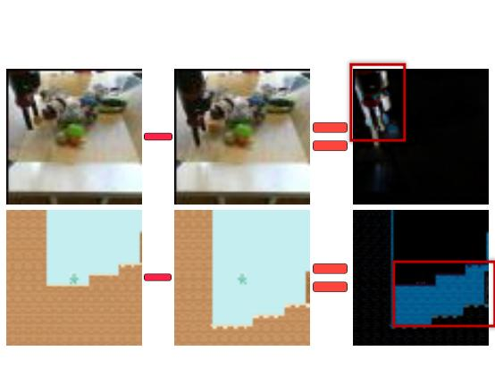
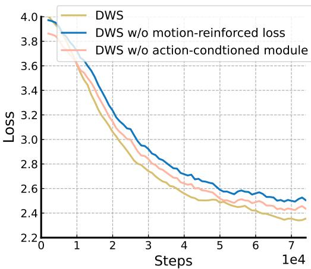
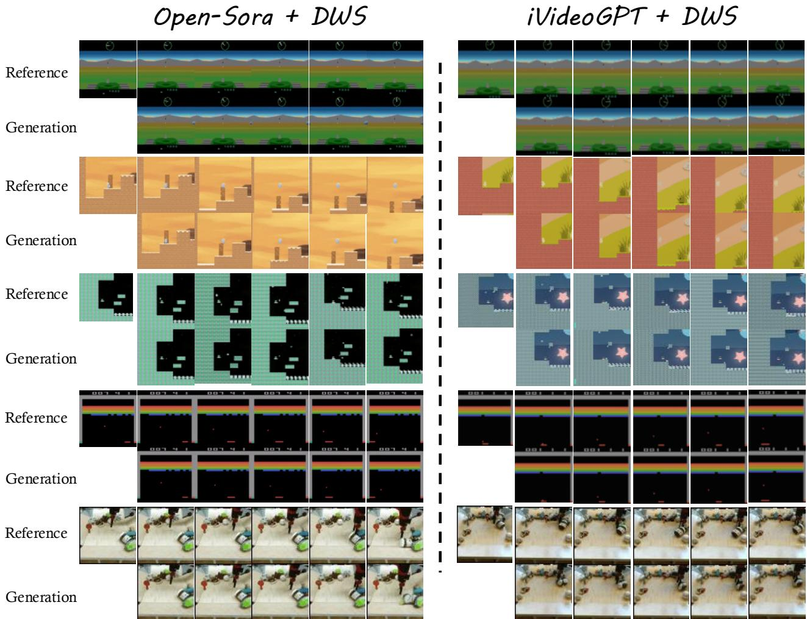
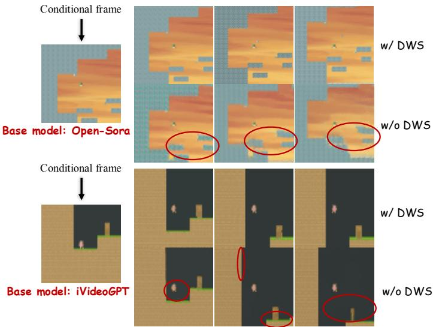
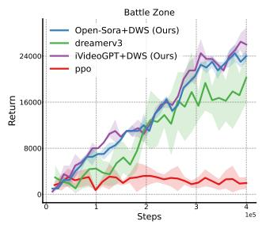
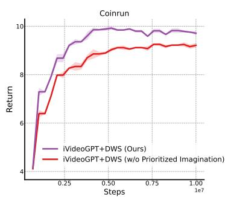

# 预训练视频生成模型作为世界模拟器

Haoran He1 Yang Zhang2 Liang Lin3 Zhongwen Xu4 Ling Pan1†

1 Hong Kong University of Science and Technology 2 Tsinghua University 3 Sun Yat-sen University 4 Tencent AI Lab

## 摘要

视频生成模型在大规模互联网数据集上预训练后已取得显著成功，擅长生成逼真的合成视频。然而，它们通常基于静态提示（例如文本或图像）生成片段，限制了对交互式和动态场景的建模能力。在本文中，我们提出动态世界模拟（Dynamic World Simulation, DWS），这是一种将预训练视频生成模型转换为可控世界模拟器（能够执行指定动作轨迹）的新颖方法。为了实现条件动作与生成视觉变化之间的精确对齐，我们引入了一个轻量级、通用性的动作条件模块，可以无缝集成到任何现有模型中。我们表明，并非聚焦于复杂的视觉细节，而是一致性的动态过渡建模才是构建强大世界模拟器的关键。基于这一洞察，我们进一步引入了一种运动增强损失（motion-reinforced loss），通过促使模型更有效地捕捉动态变化来增强动作可控性。实验表明，DWS 可灵活地应用于扩散模型和自回归 Transformer 模型，在游戏和机器人领域中生成动作可控、动态一致的视频方面取得了显著改进。此外，为了促进所学世界模拟器在基于模型的强化学习等下游任务中的应用，我们提出了优先级想象（prioritized imagination）以提高样本效率，与最先进的方法相比展示了具有竞争力的性能。

## 1 引言

近年来，视频生成领域取得了显著进展，Brooks 等人 (2024)、Polyak 等人 (2024)、Sharma 等人 (2024)、Yang 等人 (2024c)、Zheng 等人 (2024) 等模型展示了根据各种输入（最显著的是文本和初始帧）生成高保真且时间一致视频的卓越能力。然而，这些模型仅限于支持交互式模拟场景，因为它们针对静态提示采用一次性生成方式进行训练，缺乏帧级交互性和帧到帧的动态建模。为了填补这一空白，研究界日益关注构建动作条件视频模型 Bruce 等人 (2024)、Che 等人 (2025)、Decart 等人 (2024)、Valevski 等人 (2024)、Wu 等人 (2024)、Xiang 等人 (2024)、Yang 等人 (2023, 2024a)。

这些动作条件模型有效地充当了交互式环境模拟器（即「世界模型（world models）」或「世界模拟器（world simulators）」），它们利用先进的 Transformer 或扩散模型架构，根据智能体的动作预测未来的视觉结果。其目标是封装对潜在动态转移规律以及关于世界如何运作的常识的理解，从而实现类比于人类认知过程的动作驱动想象。

这些世界模型开启了令人振奋的可能性，尤其是在基于模型的强化学习（Model-Based Reinforcement Learning, MBRL）中。在 MBRL 中，智能体可以通过与世界模型进行交互来更高效地学习新技能，从而规避真实世界试验所带来的风险和成本。

在本文中，我们回顾了交互式世界模拟器领域的最新进展，重点指出当前限制其更广泛采用的关键挑战。(i) 这些模型通常需要庞大的计算资源才能从头训练。例如，Genie（Bruce et al., 2024）使用了 256 个 TPUv5p 核心（大致相当于 226 个 NVIDIA A100 GPU），进行了 12.5 万次训练步数，才学会一个相对简单的 Platformer（横版平台跳跃）游戏模拟器。同样地，GameNGen（Valevski et al., 2024）使用了 128 个 TPU-v5e 核心，消耗了 70 万次训练步数。(ii) 虽然对预训练的视频生成模型进行微调提供了一种更高效的替代方案，但现有方法（Rigter et al., 2024；Yu et al., 2025）本质上是架构依赖的。这对在不同模型架构之间适配这些方法以受益于视频生成架构的快速进步构成了挑战，因为每出现一种新的模型架构，都需要投入大量的工程工作才能完成适配。(iii) 与通用视频生成任务不同，动作条件世界模拟器需要精确捕捉细粒度的动态变化（Yang et al., 2023；Zhu et al., 2024），这要求帧级动作对齐（frame-level action alignment）。这一要求对于在基于模型的强化学习中的应用至关重要，因为在上述应用中，捕捉帧与帧之间的动态/运动变化优先于建模静态视觉元素（如背景、物体细节）。

为了应对上述挑战，我们提出了一个新框架——动态世界模拟（Dynamic World Simulation，DWS），这是一种统一的、与架构无关的方法，可将预训练的视频生成模型高效地转换为世界模拟器。通过利用从互联网规模数据集中学习到的先验知识，经过微调的世界模拟器能够展示对物理规则和常识的基本理解。然而，它们天然并不具备交互式模拟的能力，也缺乏精确的逐帧动作条件化的关键机制。DWS 引入了一个极简而强大的附加动作条件化模块，该模块在保持架构灵活性的同时增强了逐帧动作感知能力。该模块仅由两个线性层组成，可通过精心设计的尺度（scale）与位移（shift）操作集成到任何网络架构中。它还强化了预测视觉变化与条件化动作之间的对齐。此外，我们 ob-

  

图 1：我们的微调视频生成模型可以作为一个有效的世界模拟器，与不同策略进行交互并生成多样化轨迹。不同的策略可以导致不同的终止状态，这些状态以黄色圆圈标出。

观察到传统的监督学习损失函数会使视频模型在所有视觉元素和复杂细节上均匀关注，包括静态背景和无关细节，从而削弱其捕捉对世界模拟器构建至关重要的帧间动态/运动变化的能力。DWS 提出了一种运动增强损失（motion-reinforced loss）来应对动态建模挑战，这是一种简单而有效的方法，能够在训练过程中显式地优先建模帧间变化，从而显著提升时间一致性并获得更可靠的动态预测。如图 1 所示，由 DWS 学习到的世界模拟器能够在不同领域与多种策略进行交互，同时保持准确的动态预测和动作响应能力。最后，为了增强世界模拟器在基于模型的强化学习中的实际效用，我们引入了优先级想象（prioritized imagination），这是一种新颖的采样策略，专注于最具信息量的状态转移，避免将计算资源浪费在已被充分理解的状态转移上，从而提升智能体与世界模型交互过程中的样本效率。

我们将本文的贡献总结如下：（i）我们提出了 DWS，这是一个新颖的且与架构无关的框架，能够以较低的训练成本有效地将预训练视频生成模型转化为世界模拟器，充分利用预训练的先验知识来实现物理一致性。（ii）我们提出了两种简单而有效的技术：一个轻量级的动作条件模块，能够实现精确的帧级控制并提升动作跟随能力；以及一种运动增强训练方法，将模型注意力从静态视觉细节转移到由动作引起的动态变化上，从而提升时间一致性与动态一致性。（iii）我们通过优先级想象推进了世界模拟器在基于模型的强化学习中的实际效用，当将训练好的世界模拟器应用于下游基于模型的强化学习任务时，该方法能够提升样本效率与策略性能。（iv）通过对具有挑战性的游戏与机器人任务的全面评估，我们证明 DWS 显著提升了生成的动作条件视频的质量与动态一致性。借助优先级想象，我们基于 DWS 训练的世界模拟器相较于此前最先进的基于模型的强化学习方法（Alonso 等，2024；Hafner 等，2023）也能实现更高效、更有效的学习。

## 2 相关工作（Related Work）

## 视频世界模型（Video World Models）

随着互联网规模数据集（Bain et al., 2021, Chen et al., 2024）和先进模型架构（Brooks et al., 2024, Peebles and Xie, 2023）的发展，在以文本描述和初始帧为条件生成真实感视频方面取得了重大进展（Blattmann et al., 2023, Lin et al., 2024, Ma et al., 2024, Yang et al., 2024c, Zheng et al., 2024）。在这些基础上，当前研究日益关注动作可控的视频生成，旨在开发能够有效建模物理动力学与动作后果的通用世界模拟器（Bruce et al., 2024, Che et al., 2025, Feng et al., 2024, Parker-Holder et al., 2024, Valevski et al., 2024, Xiang et al., 2024, Yang et al., 2023, Zhu et al., 2024）。然而，这些模型通常需要在大规模数据集上从零开始训练，并涉及数百万（或数十亿）参数，导致巨大的计算开销和较慢的推理速度。相比之下，我们提出将公开可用的预训练视频生成模型（Wu et al., 2024, Zheng et al., 2024）适配为动作驱动的世界模拟器。我们提出的微调方法 DWS 在只需极小计算开销的情况下实现了高效的模型适配，显著降低了训练成本和推理延迟。并行工作（Rigter et al., 2024, Yu et al., 2025）也探索了利用预训练模型进行动作条件视频生成。然而，它们的研究仅限于基于扩散的模型，并且都没有验证其方法在推动基于模型的强化学习（model-based RL）等下游任务中的有效性。

基于模型的强化学习（Model-Based RL）旨在构建世界模型（world model），使试错过程能够在不付出真实代价的情况下进行。借助足够精确的世界模型，智能体可以发展出"想象力"（imagination）能力，进而模拟交互并生成合成经验数据。这些模拟数据随后可被用于学习面向多样化决策任务的最优策略，有效降低对真实世界交互的需求。Sutton（1991）提出了首个面向基于模型强化学习的通用框架，凸显了估计的动力学模型在促进价值函数与策略训练方面的效用（Sutton and Barto, 1998）。近年来，面向复杂环境动力学的基于模型方法取得了显著进展，在电子游戏和视觉控制任务等领域始终优于其无模型对应方法。例如，基于循环状态空间模型（Recurrent State Space Models, RSSM）（Hafner et al., 2019）构建的 Dreamer 系列模型显式解耦了环境动力学中的确定性与随机性成分，在 Atari 游戏（Machado et al., 2018）、DeepMind Control Suite（Tassa et al., 2018）以及 Minecraft 等多样化任务域中均展现出令人瞩目的性能。为突破循环神经网络（RNN）在表达复杂模式方面的局限，近期研究开始探索利用 Transformer 模型来增强序列建模与长程依赖捕捉能力（Micheli et al., 2023a；Robine et al., 2023；Zhang et al., 2023, 2024），并将扩散模型引入其中以更好地刻画动力学学习中的多模态分布（Alonso et al., 2024；Ding et al., 2024）。然而，尽管这些工作同样采用 Transformer 或扩散模型进行世界模型学习，它们主要依赖从零开始训练，未能利用预训练知识增进对动力学的理解，致使模型过度局限于特定任务，且难以泛化至多样化任务。此外，现有方法在训练时对所有想象样本赋予同等的重要性，而我们提出的 DWS 引入了一种新颖的优先级机制，能够有选择地聚焦于重要样本，从而提升样本效率。

## 3 预备知识（Preliminaries）

## 3.1 问题形式化（Problem Formulation）

条件视频生成框架可以适用于实例化一个世界模拟器（或世界模型）（Yang 等人，2023）。世界模型将某个动作作为输入，并产生该动作的视觉结果作为输出，旨在模拟环境。该环境可以表示为一个部分可观测马尔可夫决策过程（Partially Observable Markov Decision Process，POMDP），封装在元组 $( S , \mathcal { O } , \phi , \mathcal { A } , p , r , \gamma )$ 中。其中，S 是状态空间，O 是观测空间，仅提供 S 的不完整信息。在每个时间步 $t ,$ 智能体通过遵循策略 $\pi : \mathcal { O }  \Delta _ { \mathcal { A } }$ 选择一个动作 $a _ { t }$，环境根据动力学更新状态 $s _ { t + 1 } \sim p ( s _ { t + 1 } | s _ { t } , a + t )$，接收到下一个观测 $o _ { t + 1 } = \phi ( s _ { t + 1 } )$，并根据 $R ( s _ { t } , a _ { t } , s _ { t + 1 } )$ 计算得到一个标量奖励 $r _ { t }$。智能体的目标是通过最大化 γ 折扣累积奖励来学习一个策略 $\begin{array} { r } { \pi ^ { * } = \arg \operatorname* { m a x } _ { \pi } \mathbb { E } _ { a _ { t } \sim \pi } \big [ \sum _ { t = 0 } ^ { \infty } \gamma ^ { t } r _ { t } \big ] } \end{array}$。

一个训练良好的世界模型可以替代环境与智能体进行交互，从而通过提供无限的经验来有益于下游的策略学习。具体而言，给定一段历史观测 ${ \mathit { o } } _ { T _ { 0 } } ,$ 在每个时间步 $t = T _ { 0 } , \cdots , T - 1$ 时，智能体基于其策略和先前的想象观测采取动作 $a _ { t }$，然后世界模型预测转移 $p ( o _ { t + 1 } , r _ { t + 1 } | o _ { t } , a _ { t } )$ 以反馈给智能体。

## 3.2 预训练视频生成模型

通过将视觉控制的世界模型学习形式化为一个交互式视频生成问题，我们可以利用广泛可得的视频数据，其中蕴含着可跨不同领域泛化的丰富知识（Yang et al., 2024b）。视频数据不仅包含语义层面的视觉细节，还包含能够捕捉物理世界动态规律的运动信息。然而，从头开始在互联网规模的视频数据集上训练这样的视频世界模型既昂贵又耗时。我们提出对预训练的高级视频模型进行微调，使其能够模拟交互。具体而言，我们采用两种不同的预训练视频生成模型作为基座模型，即扩散模型 Open-Sora（Zheng et al., 2024）以及自回归 Transformer 模型 iVideoGPT（Wu et al., 2024）。Open-Sora 是一种基于整流流（rectified flow）的扩散模型，完全开源，并在数百万互联网视频上进行了预训练。我们考虑使用它，是因为得益于流匹配（flow-matching）训练，它仅需很少的采样步骤。近期一项名为 iVideoGPT 的工作是一个基于 LLaMA（Touvron et al., 2023）架构的自回归 Transformer。它将来自不同模态的训练数据（例如包括视觉结果、动作和奖励）压缩为一系列 token，用于交互式视频预测。

## 4 方法

在本节中，我们首先在 §4.1 中介绍我们提出的动作条件模块，然后在 §4.2 中介绍用于增强动态建模的运动增强损失。在介绍了将通用视频生成模型微调为世界模拟器的方法之后，我们在 §4.3 中介绍用于提升基于模型的强化学习性能的优先想象技术。

## 4.1 动作条件模块（Action-Conditioned Module）

近期视频生成模型在生成与条件文本提示（text prompt）或初始帧相关联的真实视频方面取得了显著成功。这些文本到视频任务使用静态提示，全局描述整个视频，而不具体指定后续帧应包含的内容。这种设计范式虽然在通用视频生成中有效，但在将它们适配为旨在模拟富含动作交互的世界模型（world models）时会面临根本性的挑战，因为这些条件是帧级的、细粒度的动作轨迹。为了解决这一需求并确保每个生成的帧与其在轨迹中对应的动作相匹配，我们利用一个动作条件模块，通过对应的动作单独调节每一帧的生成。与先前将整个动作轨迹压缩为单一嵌入的文本到视频模型不同，我们的方法（类似于 IRASim (Zhu et al., 2024)）实现了更细粒度的动作编码机制。我们引入了一个轻量级的附加模块，由每个 Transformer 块内的两个线性层组成，分别编码各个动作。此设计确保每一帧的内容直接由其对应的动作进行调节，而非由全局描述引导，从而实现动作与生成帧之间的直接对应。

动作表示（Action Representation）。将视频生成模型适配到基于动作的控制中，一个关键挑战在于动作的表示。在离散动作空间中，动作通常表示为整数值，缺乏传统文本到视频模型中文本提示所具有的丰富语义上下文。这种语义鸿沟会限制模型有效解释和响应不同动作的能力。为了弥合这一鸿沟，我们提出使用描述动作含义的语言模板来表示动作。具体而言，给定一个动作轨迹 $y = \{ a _ { t } , a _ { t + 1 } , \cdot \cdot \cdot , a _ { t + H - 1 } \}$，其中 H 是轨迹的时间跨度（horizon），我们开发了一个映射函数 ψ，将抽象的动作整数翻译为有意义的语言，即 $\psi : { \mathcal { A } }  L ,$，其中 L 是语言空间。这种映射使我们能够利用预训练视频生成模型中的文本编码器，获得丰富的特征嵌入 $c \in \mathbb { R } ^ { n _ { H } \times n _ { d }}$，其中 $n _ { H }$ 和 $n _ { d }$ 分别表示时间跨度和每个 token 的维度。对于连续动作空间，遵循 Wu et al. (2024)、Zhu et al. (2024) 的做法，我们使用一个可训练的线性动作嵌入器直接生成特征嵌入 c，无需语言翻译。

帧级条件。在作为世界模拟器的视频生成模型的语境中，精确的时间控制至关重要，因为每个动作都应直接影响其后续帧的视觉内容。为了显式建模并增强这种动作–帧对应关系，我们在每个 Transformer 块中引入了一个帧级动作条件模块，灵感来自 IRASim（Zhu et al., 2024）。IRASim 的实现仅限于具有时空 Transformer 架构的特定扩散模型，而我们通过开发一个通用的附加模块显著扩展了这一概念，该模块可泛化到不同的模型架构，包括基于扩散的框架和基于 Transformer 的框架。因此，我们的设计提供了更强的架构灵活性和更广泛的适用性。我们的极简架构仅由两个线性层实现，能够以最小的计算开销完成轻量级集成和高效微调。

具体而言，对于每个视频嵌入 $x \in \mathbb { R } ^ { T \times C \times H \times W }$，我们在将其送入 Transformer 块之前按如下方式对其进行处理：

$$
x ^ {i} = x ^ {i} + \mathrm{FFN} (\mathrm{LayerNorm} (x ^ {i}) \times (1 + \alpha^ {i}) + \beta^ {i}),\tag{1}
$$

其中 $\alpha ^ { i }$ 和 $\beta ^ { i }$ 表示第 i 帧的缩放与偏移参数。它们由动作嵌入 $c ^ { i }$ 回归得到。我们在图 2 中展示了所提出的模块，它可以无缝集成到任意网络块（例如注意力块）中。

## 4.2 运动强化损失

传统的视频生成模型通常采用平方 $l _ { 2 }$ 距离（用于连续空间中的校正流（rectified flow）(Liu et al., 2022, Zheng et al., 2024)）或交叉熵损失（用于离散空间中的下一标记预测 Transformer (Vaswani et al., 2017, Wu et al., 2024)）作为其训练目标。尽管这些训练目标已在通用视频生成任务中展现出有效性 (Brooks et al., 2024, Lin et al., 2024, Tian et al., 2024, Yan et al., 2021, Zheng et al., 2024)，但它们通常对每个像素一视同仁，这可能会削弱模型捕捉与动作相关的状态变化的能力。因此，它们难以高效地作为强化学习（RL）代理的世界模拟器发挥作用，因为对 dy-

  

图 2：动作条件模块（action-conditioned module）的示意图，该模块可与任意类型的 Transformer 注意力块相结合使用。

动态转换比保持高保真度的背景细节对学习更为关键。这一局限性源于强化学习智能体主要从动作引发的状态变化中学习，而非从静态视觉元素中学习。

为解决该问题并实现更精确的动态建模，我们引入了一种新的运动增强损失（motion-reinforced loss），以提升视频模型的动作跟随能力。在每个训练步骤中，我们对真实视频嵌入的一个随机批次进行采样 $\boldsymbol { x } = \{ x ^ { 0 } , \cdot \cdot \cdot , x ^ { k } , \cdot \cdot \cdot , x ^ { j } , x ^ { H - 1 } \}$，其中 H 表示视频片段的时间跨度。随后，我们计算连续帧之间的差异 $\omega = \cup _ { i = 0 } ^ { H - 1 } \omega _ { i }$，记为

$$
\omega_ {i + 1} = c ^ {\mathrm{Softmax} (| x _ {i + 1} - x _ {i} |)},\tag{2}
$$

其中 $\omega _ { i } ~  ~ [ 1 , c ]$，我们为初始帧 $x ^ { 0 }$ 设置 $\omega _ { 0 } ~ = ~ 1$，因为它充当条件帧。此处 $c$ 表示一个调节运动强化强度的超参数。在得到 $\omega$ 之后，我们将其作为逐像素权重集成到有监督训练损失中。由此得到的运动强化损失函数可表述为：

$$
\mathcal {L} _ {\mathrm{motion}} = \mathcal {L} _ {\mathrm{prev}} * \omega ,\tag{3}
$$

其中 $\mathcal{L}_{\mathrm{prev}}$ 代表扩散模型中使用的原始 MSE 损失，或基于 Transformer 架构中的交叉熵损失函数。我们在附录 B.2 中提供了更多实现细节。通过这种形式化表述，跨帧发生变化的像素将对损失反向传播产生更大的影响。这些像素通常对应于视频中与运动相关的元素，它们持续发生变化；而保持稳定的背景在训练过程中的影响则相对较小。该机制本质上削弱了对动作条件预测贡献甚微的静态背景元素的影响。

  

(a) 帧间差异

  

(b) SFT loss $\mathcal { L } _ { \mathrm { p r e v } }$ 对比

图 3：运动增强损失（Motion-reinforced loss）增强了视频生成模型的动作可控性，有助于捕捉动态变化的内容。

通过强调动态转移，我们的方法增强了世界模型捕捉动作-状态因果关系的能力，从而在强化学习场景中促进更有效的策略学习。

如图 3(a) 所示，帧间差异主要对应于视频中与运动相关和动态的元素，这使得 ω 在训练过程中为这些像素分配更高的权重。图 3(b) 展示了在 BAIR 数据集 Ebert et al. (2017) 上微调 iVideoGPT (Wu et al., 2024) 的 SFT 损失（$\mathcal{L}_{\mathrm{prev}}$）曲线，比较了我们所提方法的不同变体。实验结果表明，运动强化损失和动作条件模块都是关键组成部分，因为缺少其中任何一个都会显著降低模型在预测具有逐帧动态的动作条件视频方面的性能。

因此，由 $\mathcal{L}_{\mathrm{motion}}$ 微调的视频生成模型将更聚焦于动态/运动预测，而非难以学习的复杂视觉细节。此外，对于世界模拟器而言，动态/运动一致性比静态背景细节更为重要，因为模拟器需要根据动作预测视觉结果。

## 4.3 基于模型的强化学习

给定从预训练视频生成模型微调得到的基于视频的世界模拟器，其中最有前景的应用之一是将它们用作基于模型的强化学习（MBRL）中的世界模型以进行策略学习。在 MBRL 中，智能体通过与训练好的世界模型进行交互来优化策略以最大化累积奖励，这提升了样本效率。

为了在 MBRL 中实现有效的策略训练，世界模型应当同时预测转移动态和奖励。我们现在用奖励预测模型来补全我们的世界模型。由于估计奖励是一个标量预测问题，我们引入了一个单独的模型 $R_\psi$，它由线性层、自注意力块和交叉注意力块组成，用于在给定过去观测和动作的条件下估计奖励。该强化学习智能体包含一个 actor-critic 网络，由共享的 CNN 主干进行参数化，并分叉为独立的策略头和价值头。在 MBPO 框架 (Janner et al., 2019b; Wu et al., 2024) 的基础上，我们用合成 rollout 来扩充经验回放缓冲区，以训练标准的 actor-critic 强化学习算法。我们采用 PPO (Schulman et al., 2017) 作为基础算法，并遵循 Huang et al. (2022) 进行实现。更多实现细节见附录 B.3。

Prioritized Imagination（优先化想象）. 世界模型（world model）的想象需要从初始观测开始，这些初始观测从环境中收集的经验中采样得到。这些初始状态作为生成合成轨迹的起点。Previous MBRL methods（Alonso et al., 2024, Hafner et al., 2020a,b, 2023, Micheli et al., 2023b）采用对初始观测的均匀采样策略。然而，这一策略忽略了不同状态对策略学习的重要性差异，造成学习效率低下。我们强调指出，来自不同初始观测的想象转移（transitions）在其对 MBRL 策略优化的重要性和任务相关性方面表现出显著的异质性。为了更好地释放微调后视频生成模型的可用性，我们提出了一种优先化想象方法，有选择性地聚焦于更有价值的转移。我们的核心洞见是：那些能够带来更高学习潜力和可学习性的转移所对应的初始观测应当被更频繁地采样。我们维护一个缓冲区 B（buffer B）用于存储与环境交互过程中遇到的观测，并优先选择具有较高期望学习进展的观测，这一进展通过其 TD loss（时序差分损失）的幅值来衡量。该优先化机制通过将想象资源集中于那些能对策略学习产生更显著贡献的状态上，确保了世界模型得到更高效的利用。完整的伪代码见 Algorithm 1。

## 5 Experiments（实验）

在本节中，我们从两个关键维度评估由所提方法微调的视频世界模型：(1) 动作模拟能力，通过动作条件视频预测的质量来衡量；(2) 在在线和离线模型基强化学习中的有效性，通过累积回报（cumulative return）进行量化。

## 5.1 Action-Conditioned Simulation（动作条件仿真）

为了检验 DWS（Deep World Simulator）在增强面向世界仿真的动作条件视频预测方面的有效性，我们采用两个架构各异的预训练视频生成模型开展实验：Open-Sora（Zheng et al., 2024），采用基于扩散（diffusion-based）的架构；以及 iVideoGPT（Wu et al., 2024），采用自回归（autoregressive）架构。为提升计算效率，我们使用一个压缩版本的 Open-Sora（12 层，约 280M 参数），而非原始的 1.1B 模型。关于这些基线模型的细节以及我们的设置，请参见 Appendix B.1。评估在三个不同的数据集上进行：BAIR 数据集（Ebert et al., 2017），具有连续动作空间；以及 Procgen（Cobbe et al., 2020）和 Atari（Bellemare et al., 2013, Machado et al., 2018）数据集，包含离散动作空间。

实验设置。BAIR 机器人推动数据集（BAIR robot pushing dataset）包含一个操控各种物体的机械臂场景，由 4.3 万个训练视频和 256 个测试视频组成。遵循先前工作（Gupta et al., 2022; Yan et al., 2021），我们从一个单独的初始帧预测 15 帧。在该基准上，我们与多种视频预测模型进行比较，包括扩散模型（diffusion）（Voleti et al., 2022; Zheng et al., 2024）、掩码模型（masked）（Gupta et al., 2022; Yu et al., 2023）以及自回归模型（autoregressive）（Wu et al., 2024; Yan et al., 2021）。对于 Procgen 数据集，我们在两个平台跳跃类游戏上评估 DWS，即 Coinrun 和 Ninja。对于 Atari 数据集，我们评估在两个 Atari 游戏上的性能：Breakout 和

  

图 4：不同领域（包括游戏和机器人环境）生成视频的定性结果。给定初始观察和条件动作，我们观察到，经由我们所提方法微调后的 Open-Sora 和 iVideoGPT 显著提升了动态世界建模能力。

Battle Zone。我们为每个游戏收集了 1M 个转移步数据，包含 RGB 观测、动作和奖励。BAIR 和 Procgen 视频的分辨率均为 64 × 64，而 Atari 视频的分辨率为 84 × 84。关于数据集收集的更多细节详见附录 A。

评估指标。我们采用四个广泛使用的指标来衡量预测视频的质量，涵盖以下四个指标：1）FVD（Unterthiner et al., 2018）通过计算从预训练网络（Carreira and Zisserman, 2017）提取的特征表示之间的 Fréchet 距离，来量化参考视频与生成视频分布之间的统计相似性；2）PSNR（Huynh-Thu and Ghanbari, 2008）衡量参考帧与生成帧之间的像素级保真度，其计算方法是最大可能像素值与均方误差之间的对数比值；3）SSIM（Huynh-Thu and Ghanbari, 2008）评估生成帧中的结构信息保留情况，综合考虑亮度、对比度和结构比较；4）LPIPS（Zhang et al., 2018）利用一个预训练的深度神经网络（Simonyan and Zisserman, 2014），通过在深度特征空间中计算距离来评估图像相似度。

表 1：BAIR 机器人推动数据集上的视频预测结果。LPIPS 和 SSIM 分数已乘以 100 以方便展示。

<table><tr><td>BAIR Ebert et al. (2017)</td><td>FVD↓</td><td>PSNR↑</td><td>SSIM↑</td><td>LPIPS↓</td></tr><tr><td>VideoGPT Yan et al. (2021)</td><td>103.3</td><td>-</td><td>-</td><td>-</td></tr><tr><td>MaskViT Gupta et al. (2022)</td><td>93.7</td><td>-</td><td>-</td><td>-</td></tr><tr><td>FitVid Babaeizadeh et al. (2021)</td><td>93.6</td><td>-</td><td>-</td><td>-</td></tr><tr><td>MaskViT Gupta et al. (2022)</td><td>70.5</td><td>-</td><td>-</td><td>-</td></tr><tr><td>MCVD Voleti et al. (2022)</td><td>89.5</td><td>16.9</td><td>78.0</td><td>-</td></tr><tr><td>MAGVIT Yu et al. (2023)</td><td>62.0</td><td>19.3</td><td>78.7</td><td>12.3</td></tr><tr><td>Open-Sora (Zheng et al., 2024)</td><td>92.1</td><td>21.5</td><td>84.7</td><td>8.6</td></tr><tr><td>Open-Sora+DWS(Ours)</td><td>81.3</td><td>22.4</td><td>87.8</td><td>6.2</td></tr><tr><td>iVideoGPT Wu et al. (2024)</td><td>60.8</td><td>24.5</td><td>90.2</td><td>5.0</td></tr><tr><td>iVideoGPT+DWS (Ours)</td><td>59.6</td><td>25.8</td><td>91.6</td><td>4.7</td></tr></table>

表 2：在 Atari 和 Procgen 游戏领域上的视频预测结果。

<table><tr><td>Domain</td><td>Method</td><td>FVD↓</td><td>PSNR↑</td><td>SSIM↑</td><td>LPIPS↓</td></tr><tr><td rowspan="4">Atari</td><td>Open-Sora (Zheng et al., 2024)</td><td>27.8</td><td>31.6</td><td>95.2</td><td>6.4</td></tr><tr><td>Open-Sora+DWS(Ours)</td><td>16.3</td><td>35.8</td><td>98.0</td><td>4.9</td></tr><tr><td>iVideoGPT Wu et al. (2024)</td><td>11.5</td><td>39.1</td><td>97.3</td><td>3.1</td></tr><tr><td>iVideoGPT+DWS (Ours)</td><td>9.1</td><td>43.4</td><td>98.2</td><td>1.2</td></tr><tr><td rowspan="4">Procgen</td><td>Open-Sora (Zheng et al., 2024)</td><td>37.6</td><td>22.7</td><td>74.7</td><td>13.6</td></tr><tr><td>Open-Sora+DWS (Ours)</td><td>28.2</td><td>23.9</td><td>76.1</td><td>12.8</td></tr><tr><td>iVideoGPT Wu et al. (2024)</td><td>24.0</td><td>25.3</td><td>77.6</td><td>12.1</td></tr><tr><td>iVideoGPT+DWS (Ours)</td><td>21.9</td><td>26.2</td><td>80.4</td><td>10.3</td></tr></table>

定性结果分析。我们对由 DWS 微调的两个不同模型（即 Open-Sora 和 iVideoGPT）进行定性评估，使用未见过的初始帧作为输入。图 4 展示了在不同领域中针对未见输入生成视频的示例。我们观察到，由 DWS 微调的两个基础模型均能成功生成高质量、可控的视频，其特征表现为时间动态连贯以及背景保持一致。此外，这些模型在处理具有不同背景和纹理的未见输入时展现出强大的泛化能力，验证了我们方法的有效性。如图 5 所示，尽管基础模型倾向于生成存在视觉失真的视频，但 DWS 通过保持物体一致性并产生精确的视觉预测，显著提升了输出质量。

定量结果分析。从表 1 和表 2 所示的结果中，我们得到以下关键观察：（i）DWS 在不同基础模型上的动作条件视频预测任务中表现出卓越的性能。在具有连续动作空间的 BAIR 数据集上，DWS 显著提升了基于扩散的 Open-Sora 和基于自回归的 iVideoGPT 的性能，凸显了其在不同架构间的通用性与灵活性。其多功能性在于，即使对于那些本就被设计用于动作条件视频生成的模型，DWS 也能带来性能提升。结果表明，作为传统的文本到视频模型的 Open-Sora——其生成过程以静态的全局文本提示为条件——在经过 DWS 微调后，在动作可控性方面获得了显著提升。具体而言，我们观察到 FVD 降低了 11.7%，LPIPS 下降了 27.9%。即便是针对动作条件视频生成专门设计的 iVideoGPT，DWS 同样取得了显著的性能提升。关于 Procgen 与

  

图 5：预训练视频生成模型与通过本文所提出方法微调后的模型之间的定量对比。红色圆圈标注的部分显示，未使用 DWS 的基础模型会生成不一致的像素，并且无法与条件动作匹配。

在具有离散动作空间的 Atari 游戏数据集上，DWS 始终以显著的幅度提升基线模型的性能，大幅改善生成视频的质量。这一改善可归因于两个关键组件：动作条件模块（action-conditioned module），其能针对每一帧对应的反应进行高效调制；以及运动强化损失函数（motion-reinforced loss function），其能有效捕捉帧间的像素动态。（ii）DWS 展现了其作为通用方法的灵活性，可高效部署于多种数据集，涵盖具有连续动作空间的机器人数据集以及具有离散动作空间的游戏数据集。此外，DWS 可无缝集成到多种架构中，本研究中所考虑的两种主流架构分别为基于扩散（diffusion-based）的模型和基于自回归 Transformer（autoregressive transformer-based）的模型。

  

(a) Atari

  

(b) Procgen

  

**图 6：** 在 Atari 和 Procgen 环境中，跨五个随机种子的平均回报（Averaged Return）。

## 5.2 基于模型的强化学习

为了验证 DWS 微调模型在世界模拟器中的实际效用，我们通过将这些模型作为 MBRL 策略学习中的世界模型来评估其性能。

基准与基线方法。我们在 Procgen 基准中的 coinrun 和 ninja 平台跳跃游戏，以及 Atari 基准中的 Breakout（打砖块）和 Battle Zone（战斗地带）游戏上进行实验。这些环境以 RGB 图像作为观测，以离散动作进行控制。Procgen 采用 15 维动作空间，Breakout 使用 4 维动作空间，而 Battle Zone 使用 18 维动作空间。我们将我们的 MBRL 方法与优先想象（prioritized imagination）方法同以下基线进行比较：1) PPO（Schulman 等人，2017）是一种广泛使用的无模型强化学习方法，我们的方法基于 PPO 构建。2) Dreamerv3（Hafner 等人，2023）是一种 SOTA 基于模型的强化学习方法，它采用循环网络进行动态预测，并采用 actor-critic 强化学习进行策略学习，在处理具有离散动作空间的任务时十分有效。对于 Procgen 环境，我们额外加入 PPG（Cobbe 等人，2021）进行比较，因为它代表了 Procgen 上一种具有竞争力的算法。

结果分析。图 6 所示的实验结果表明，我们的 DWS 训练的世界模型在与简单的 PPO 算法结合使用时，性能显著优于 vanilla PPO 以及最先进的基于模型的强化学习方法，即 Dreamerv3。在 Procgen 环境中，DWS 相对于 PPO 和 PPG 等无模型方法表现出显著的性能提升。尽管 DWS 训练的世界模型在 MBRL 策略训练期间需要进行微调——这是由于 Procgen 中背景和物体细节的片段性变化所致——但其性能仍能与现有基于模型的方法相竞争。在 Atari 环境中，DWS 相对于现有方法表现出显著的性能提升，这归功于其世界模型已获得了用于动作模拟的全面动力学知识。具体而言，在 Breakout 中，DWS 相对于 SOTA 方法实现了惊人的 7 倍性能提升。这种在样本效率方面的卓越性能可归因于我们所提出的优先想象技术。我们通过在 Procgen 环境下进行的消融实验验证了这一贡献，结果如图 7 所示。

## 5.3 离线基于模型的强化学习

我们进一步探索利用训练好的视频世界模型来扩充离线数据集以增强策略的潜力。以 CoinRun 和 Ninja 环境作为案例研究，我们首先按照 Mediratta 等人（2024）的方法，使用训练良好的 PPO 智能体为每个环境收集 1M 条专家轨迹，以此构建基线数据集。对于每个被评估的环境，我们在训练期间采用 Open-Sora+DWS 合成额外的 1M 条状态-动作转移数据，从而有效地将原始数据集的规模翻倍。为了

  

图 7：优先想象（Prioritized imagination）提升了基于模型的强化学习（model-based RL）的性能。

为了验证该数据增强方法的有效性，我们使用两种不同的离线强化学习算法来评估性能提升：保守 Q 学习（Conservative Q-Learning, CQL）（Kumar et al., 2020）和隐式 Q 学习（Implicit Q-Learning, IQL）（Kostrikov et al., 2022）。如表 3 所示，在训练过程中将离线强化学习与基于世界模型生成的数据相结合，可在不同算法和环境下显著提升性能。这些结果表明，由 DWS 训练得到的世界模拟器能够生成有意义的"状态—动作—奖励"转移序列，有效补充离线数据集以用于策略学习。该方法的成功凸显了将预训练视频模型用作强化学习应用中的世界模拟器的潜力。此外，这些结果验证了 DWS 训练的模型能够生成准确的动态转移，使其成为策略学习的有价值的工具。

表 3：在 Coinrun 和 Ninja 任务上跨 3 个种子的平均回报。

<table><tr><td>Tasks</td><td>CQL</td><td>CQL w/ wm</td><td>IQL</td><td>IQL w/ wm</td></tr><tr><td>Coinrun</td><td>8.58 ± 0.29</td><td>8.81 ± 0.21(↑)</td><td>8.52 ± 0.26</td><td>8.93 ± 0.19(↑)</td></tr><tr><td>Ninja</td><td>5.92 ± 0.2</td><td>6.31 ± 0.23(↑)</td><td>5.7 ± 0.35</td><td>6.33 ± 0.17(↑)</td></tr></table>

## 6 结论与局限性

在本文中，我们提出了 DWS，一种通过利用从大规模数据集学习到的丰富先验知识来高效地将预训练视频生成模型适配为世界模拟器、用于下游动作条件化仿真的新途径。该框架引入了一个轻量级的动作条件化模块，可实现动作–帧对齐，并能无缝集成到多种模型架构中；同时还引入了一种专为建模对准确世界模拟至关重要的帧间像素动态而设计的运动强化损失（motion-reinforced loss）。大量实验结果表明，DWS 在视频预测质量以及基于模型的强化学习（MBRL）性能上都带来了显著提升，从而催生出了有意义的实际应用。然而，DWS 目前在对具有扩展时间跨度或高空间分辨率的视频建模方面仍存在局限，我们将这一方向留作未来的工作。

## 参考文献

Eloi Alonso, Adam Jelley, Vincent Micheli, Anssi Kanervisto, Amos Storkey, Tim Pearce, 和 François Fleuret. 扩散用于世界建模：Atari 中视觉细节的重要性. 发表于第三十八届神经信息处理系统大会，2024. URL https://arxiv.org/abs/2405.12399.

Mohammad Babaeizadeh, Mohammad Taghi Saffar, Suraj Nair, Sergey Levine, Chelsea Finn, 和 Dumitru Erhan. Fitvid：像素级视频预测中的过拟合. arXiv 预印本 arXiv:2106.13195, 2021.

Max Bain, Arsha Nagrani, Gül Varol, 和 Andrew Zisserman. Frozen in Time：用于端到端检索的联合视频与图像编码器. 发表于 IEEE 国际计算机视觉大会，2021.

Marc G Bellemare, Yavar Naddaf, Joel Veness, 和 Michael Bowling. 街机学习环境：通用智能体的评估平台. Journal of Artificial Intelligence Research, 47: 253–279, 2013.

Andreas Blattmann, Tim Dockhorn, Sumith Kulal, Daniel Mendelevitch, Maciej Kilian, Dominik Lorenz, Yam Levi, Zion English, Vikram Voleti, Adam Letts, 等. Stable Video Diffusion：将潜在视频扩散模型扩展到大规模数据集. arXiv 预印本 arXiv:2311.15127, 2023.

Joao Carreira and Andrew Zisserman. 动作识别，何去何从？一种新模型与 Kinetics 数据集（Quo vadis, action recognition? a new model and the kinetics dataset）。发表于 IEEE 计算机视觉与模式识别会议论文集，第 6299–6308 页，2017 年。

Haoxuan Che, Xuanhua He, Quande Liu, Cheng Jin, and Hao Chen. GameGen-$\mathbb{X}$：交互式开放世界游戏视频生成（GameGen-$\mathbb{X}$: Interactive open-world game video generation）。发表于第十三届国际学习表征会议（ICLR），2025 年。网址：https://openreview.net/forum?id=8VG8tpPZhe。

Tsai-Shien Chen, Aliaksandr Siarohin, Willi Menapace, Ekaterina Deyneka, Hsiang-wei Chao, Byung Eun Jeon, Yuwei Fang, Hsin-Ying Lee, Jian Ren, Ming-Hsuan Yang, and Sergey Tulyakov. Panda-70m：使用多个跨模态教师为 7000 万视频添加字幕（Panda-70m: Captioning 70m videos with multiple cross-modality teachers）。发表于 IEEE/CVF 计算机视觉与模式识别会议论文集，2024 年。

Karl Cobbe, Chris Hesse, Jacob Hilton, and John Schulman. 利用过程化生成对强化学习进行基准测试（Leveraging procedural generation to benchmark reinforcement learning）。发表于国际机器学习大会论文集，第 2048–2056 页。PMLR，2020 年。

Karl W Cobbe, Jacob Hilton, Oleg Klimov, and John Schulman. 阶段式策略梯度（Phasic policy gradient）。发表于国际机器学习大会论文集，第 2020–2027 页。PMLR，2021 年。

Decart, Julian Quevedo, Quinn McIntyre, Spruce Campbell, Xinlei Chen, and Robert Wachen. Oasis：Transformer 中的宇宙（Oasis: A universe in a transformer）。2024 年。网址：https://oasis-model.github.io/。

Zihan Ding, Amy Zhang, Yuandong Tian, and Qinqing Zheng. 扩散世界模型（Diffusion world model）。arXiv 预印本 arXiv:2402.03570，2024 年。

Frederik Ebert, Chelsea Finn, Alex X Lee, and Sergey Levine. 基于时间跳跃连接的自监督视觉规划（Self-supervised visual planning with temporal skip connections）。CoRL，12(16):23，2017 年。

Ruili Feng, Han Zhang, Zhantao Yang, Jie Xiao, Zhilei Shu, Zhiheng Liu, Andy Zheng, Yukun Huang, Yu Liu, and Hongyang Zhang. The Matrix：具有实时运动控制的无限时间跨度世界生成（The matrix: Infinite-horizon world generation with real-time moving control）。arXiv 预印本 arXiv:2412.03568，2024 年。

Agrim Gupta, Stephen Tian, Yunzhi Zhang, Jiajun Wu, Roberto Martín-Martín, and Li Fei-Fei. MaskViT：用于视频预测的掩码视觉预训练（Maskvit: Masked visual pre-training for video prediction）。arXiv 预印本 arXiv:2206.11894，2022 年。

Danijar Hafner, Timothy Lillicrap, Ian Fischer, Ruben Villegas, David Ha, Honglak Lee, and James Davidson. 从像素中学习用于规划的潜在动力学（Learning latent dynamics for planning from pixels）。发表于国际机器学习大会论文集，第 2555–2565 页。PMLR，2019 年。

Danijar Hafner, Timothy Lillicrap, Jimmy Ba, and Mohammad Norouzi. 梦想即控制：通过潜在想象学习行为（Dream to control: Learning behaviors by latent imagination）。发表于国际学习表征会议，2020a 年。网址：https://openreview.net/forum?id=S1lOTC4tDS。

Danijar Hafner, Timothy Lillicrap, Mohammad Norouzi, and Jimmy Ba. 利用离散世界模型精通 Atari（Mastering atari with discrete world models）。arXiv 预印本 arXiv:2010.02193，2020b 年。

Danijar Hafner, Jurgis Pasukonis, Jimmy Ba, and Timothy Lillicrap. 通过世界模型掌握多样化领域（Mastering diverse domains through world models）. arXiv preprint arXiv:2301.04104, 2023.

Jonathan Ho, Ajay Jain, and Pieter Abbeel. 去噪扩散概率模型（Denoising diffusion probabilistic models）. Advances in Neural Information Processing Systems, 33:6840–6851, 2020.

Shengyi Huang, Rousslan Fernand Julien Dossa, Antonin Raffin, Anssi Kanervisto, and Weixun Wang. 近端策略优化的37个实现细节（The 37 implementation details of proximal policy optimization）. 发表于：ICLR Blog Track, 2022. URL https://iclr-blog-track.github.io/2022/03/ 25/ppo-implementation-details/. https://iclr-blog-track.github.io/2022/03/25/ppoimplementation-details/.

Quan Huynh-Thu and Mohammed Ghanbari. PSNR在图像/视频质量评估中的适用范围（Scope of validity of psnr in image/video quality assessment）. Electronics Letters, 44:800–801, 2008. URL https://api.semanticscholar.org/ CorpusID:62732555.

Michael Janner, Justin Fu, Marvin Zhang, and Sergey Levine. 何时信任你的模型：基于模型的策略优化（When to trust your model: Model-based policy optimization）. Advances in Neural Information Processing Systems, 32, 2019a.

Michael Janner, Justin Fu, Marvin Zhang, and Sergey Levine. 何时信任你的模型：基于模型的策略优化（When to trust your model: Model-based policy optimization）. Advances in Neural Information Processing Systems, 32, 2019b.

Ilya Kostrikov, Ashvin Nair, and Sergey Levine. 基于隐式Q学习的离线强化学习（Offline reinforcement learning with implicit q-learning）. 发表于：International Conference on Learning Representations, 2022. URL https://openreview. net/forum?id=68n2s9ZJWF8.

Aviral Kumar, Aurick Zhou, George Tucker, and Sergey Levine. 面向离线强化学习的保守Q学习（Conservative q-learning for offline reinforcement learning）. Advances in Neural Information Processing Systems, 33:1179–1191, 2020.

Xingchao Liu, Chengyue Gong, and Qiang Liu. 快速直线流：使用矫正流学习生成和迁移数据（Flow straight and fast: Learning to generate and transfer data with rectified flow）. arXiv preprint arXiv:2209.03003, 2022.

Xin Ma, Yaohui Wang, Gengyun Jia, Xinyuan Chen, Ziwei Liu, Yuan-Fang Li, Cunjian Chen, and Yu Qiao. Latte：用于视频生成的潜在扩散Transformer（Latte: Latent diffusion transformer for video generation）. arXiv preprint arXiv:2401.03048, 2024.

Marlos C Machado, Marc G Bellemare, Erik Talvitie, Joel Veness, Matthew Hausknecht, and Michael Bowling. 重访街机学习环境：通用智能体的评估协议与开放问题（Revisiting the arcade learning environment: Evaluation protocols and open problems for general agents）. Journal of Artificial Intelligence Research, 61:523–562, 2018.

Ishita Mediratta, Qingfei You, Minqi Jiang, and Roberta Raileanu. 离线强化学习中的泛化差距（The generalization gap in offline reinforcement learning）. 发表于：The Twelfth International Conference on Learning Representations, 2024. URL https://openreview.net/forum?id=3w6xuXDOdY.

Vincent Micheli, Eloi Alonso, and François Fleuret. Transformer是样本高效的世界模型（Transformers are sample-efficient world models）. 发表于：The Eleventh International Conference on Learning Representations, 2023a. URL https: //openreview.net/forum?id=vhFu1Acb0xb.

Vincent Micheli、Eloi Alonso 和 François Fleuret。Transformers 是样本高效的世界模型（Transformers are sample-efficient world models）。发表于第十一届国际学习表征会议（The Eleventh International Conference on Learning Representations），2023b。网址 https://openreview.net/forum?id=vhFu1Acb0xb。

Volodymyr Mnih、Koray Kavukcuoglu、David Silver、Alex Graves、Ioannis Antonoglou、Daan Wierstra 和 Martin Riedmiller。使用深度强化学习玩雅达利游戏（Playing atari with deep reinforcement learning）。arXiv 预印本 arXiv:1312.5602，2013 年。

Jack Parker-Holder、Philip Ball、Jake Bruce、Vibhavari Dasagi、Kristian Holsheimer、Christos Kaplanis、Alexandre Moufarek、Guy Scully、Jeremy Shar、Jimmy Shi、Stephen Spencer、Jessica Yung、Michael Dennis、Sultan Kenjeyev、Shangbang Long、Vlad Mnih、Harris Chan、Maxime Gazeau、Bonnie Li、Fabio Pardo、Luyu Wang、Lei Zhang、Frederic Besse、Tim Harley、Anna Mitenkova、Jane Wang、Jeff Clune、Demis Hassabis、Raia Hadsell、Adrian Bolton、Satinder Singh 和 Tim Rocktäschel。Genie 2：大规模基础世界模型（Genie 2: A large-scale foundation world model）。2024 年。

William Peebles 和 Saining Xie。基于 Transformers 的可扩展扩散模型（Scalable diffusion models with transformers）。发表于 IEEE/CVF 国际计算机视觉大会论文集，第 4195–4205 页，2023 年。

Adam Polyak、Amit Zohar、Andrew Brown、Andros Tjandra、Animesh Sinha、Ann Lee、Apoorv Vyas、Bowen Shi、Chih-Yao Ma、Ching-Yao Chuang 等人。Movie Gen：一组媒体基础模型（Movie gen: A cast of media foundation models）。arXiv 预印本 arXiv:2410.13720，2024 年。

Marc Rigter、Tarun Gupta、Agrin Hilmkil 和 Chao Ma。AVID：将视频扩散模型适配为世界模型（Avid: Adapting video diffusion models to world models）。arXiv 预印本 arXiv:2410.12822，2024 年。

Jan Robine、Marc Höftmann、Tobias Uelwer 和 Stefan Harmeling。基于 Transformer 的世界模型只需 10 万次交互即可令人满意（Transformer-based world models are happy with 100k interactions）。发表于第十一届国际学习表征会议，2023 年。网址 https://openreview.net/forum?id=TdBaDGCpjly。

John Schulman、Filip Wolski、Prafulla Dhariwal、Alec Radford 和 Oleg Klimov。近端策略优化算法（Proximal policy optimization algorithms）。arXiv 预印本 arXiv:1707.06347，2017 年。

Abhishek Sharma、Adams Yu、Ali Razavi、Andeep Toor、Andrew Pierson、Ankush Gupta、Austin Waters、Aäron van den Oord、Daniel Tanis、Dumitru Erhan、Eric Lau、Eleni Shaw、Gabe Barth-Maron、Greg Shaw、Han Zhang、Henna Nandwani、Hernan Moraldo、Hyunjik Kim、Irina Blok、Jakob Bauer、Jeff Donahue、Junyoung Chung、Kory Mathewson、Kurtis David、Lasse Espeholt、Marc van Zee、Matt McGill、Medhini Narasimhan、Miaosen Wang、Mikołaj Bińkowski、Mohammad Babaeizadeh、Mohammad Taghi Saffar、Nando de Freitas、Nick Pezzotti、Pieter-Jan Kindermans、Poorva Rane、Rachel Hornung、Robert Riachi、Ruben Villegas、Rui Qian、Sander Dieleman、Serena Zhang、Serkan Cabi、Shixin Luo、Shlomi Fruchter、Signe Nørly、Srivatsan Srinivasan、Tobias Pfaff、Tom Hume、Vikas Verma、Weizhe Hua、William Zhu、Xinchen Yan、Xinyu Wang、Yelin Kim、Yuqing Du 和 Yutian Chen。Veo。2024 年。网址 https://deepmind.google/technologies/veo/。

Karen Simonyan 和 Andrew Zisserman。用于大规模图像识别的极深卷积网络（Very deep convolutional networks for large-scale image recognition）。arXiv 预印本 arXiv:1409.1556，2014 年。

Richard S Sutton。Dyna：一个集成的学习、规划与反应架构。ACM Sigart Bulletin，2(4)：160–163，1991。

Richard S. Sutton 与 Andrew G. Barto。强化学习：导论。载于：Adaptive Computation and Machine Learning 系列，1998。网址 https://api.semanticscholar.org/CorpusID: 264703640。

Yuval Tassa、Yotam Doron、Alistair Muldal、Tom Erez、Yazhe Li、Diego de Las Casas、David Budden、Abbas Abdolmaleki、Josh Merel、Andrew Lefrancq 等。DeepMind 控制套件。arXiv 预印本 arXiv:1801.00690，2018。

Keyu Tian、Yi Jiang、Zehuan Yuan、BINGYUE PENG 与 Liwei Wang。视觉自回归建模：通过下一尺度预测实现可扩展的图像生成。载于：第三十八届神经信息处理系统年会，2024。网址 https://openreview.net/forum?id= gojL67CfS8。

Hugo Touvron、Thibaut Lavril、Gautier Izacard、Xavier Martinet、Marie-Anne Lachaux、Timothée Lacroix、Baptiste Rozière、Naman Goyal、Eric Hambro、Faisal Azhar 等。Llama：开放且高效的基础语言模型。arXiv 预印本 arXiv:2302.13971，2023。

Thomas Unterthiner、Sjoerd Van Steenkiste、Karol Kurach、Raphael Marinier、Marcin Michalski 与 Sylvain Gelly。迈向精确的视频生成模型：一种新指标与挑战。arXiv 预印本 arXiv:1812.01717，2018。

Dani Valevski、Yaniv Leviathan、Moab Arar 与 Shlomi Fruchter。扩散模型是实时游戏引擎。arXiv 预印本 arXiv:2408.14837，2024。

Ashish Vaswani、Noam Shazeer、Niki Parmar、Jakob Uszkoreit、Llion Jones、Aidan N Gomez、Łukasz Kaiser 与 Illia Polosukhin。Attention Is All You Need。Advances in Neural Information Processing Systems，2017。

Vikram Voleti、Alexia Jolicoeur-Martineau 与 Chris Pal。MCVD：用于预测、生成与插值的掩码条件视频扩散。Advances in Neural Information Processing Systems，35：23371–23385，2022。

Jialong Wu、Shaofeng Yin、Ningya Feng、Xu He、Dong Li、Jianye Hao 与 Mingsheng Long。iVideoGPT：交互式 VideoGPT 是可扩展的世界模型。载于：第三十八届神经信息处理系统年会，2024。

Jiannan Xiang、Guangyi Liu、Yi Gu、Qiyue Gao、Yuting Ning、Yuheng Zha、Zeyu Feng、Tianhua Tao、Shibo Hao、Yemin Shi 等。Pandora：迈向具有自然语言动作与视频状态的通用世界模型。arXiv 预印本 arXiv:2406.09455，2024。

Wilson Yan、Yunzhi Zhang、Pieter Abbeel 与 Aravind Srinivas。VideoGPT：使用 VQ-VAE 与 Transformer 的视频生成。arXiv 预印本 arXiv:2104.10157，2021。

Mengjiao Yang、Yilun Du、Kamyar Ghasemipour、Jonathan Tompson、Dale Schuurmans 与 Pieter Abbeel。学习交互式真实世界模拟器。arXiv 预印本 arXiv:2310.06114，2023。

Mingyu Yang、Junyou Li、Zhongbin Fang、Sheng Chen、Yangbin Yu、Qiang Fu、Wei Yang 与 Deheng Ye。可玩游戏生成。arXiv 预印本 arXiv:2412.00887，2024a。

Sherry Yang, Jacob C Walker, Jack Parker-Holder, Yilun Du, Jake Bruce, Andre Barreto, Pieter Abbeel, 和 Dale Schuurmans. 立场：视频作为现实世界决策的新语言（Position: Video as the new language for real-world decision making）. 见 Ruslan Salakhutdinov, Zico Kolter, Katherine Heller, Adrian Weller, Nuria Oliver, Jonathan Scarlett, 和 Felix Berkenkamp 主编, 《第 41 届国际机器学习大会论文集》（Proceedings of the 41st International Conference on Machine Learning）, 第 235 卷《机器学习研究论文集》（Proceedings of Machine Learning Research）, 第 56465–56484 页. PMLR, 2024 年 7 月 21–27 日.

Jiwen Yu, Yiran Qin, Xintao Wang, Pengfei Wan, Di Zhang, 和 Xihui Liu. GameFactory：利用生成式交互视频创建新游戏（Gamefactory: Creating new games with generative interactive videos）. arXiv 预印本 arXiv:2501.08325, 2025.

Richard Zhang, Phillip Isola, Alexei A Efros, Eli Shechtman, 和 Oliver Wang. 深度特征作为感知度量的不合理有效性（The unreasonable effectiveness of deep features as a perceptual metric）. 见《IEEE 计算机视觉与模式识别大会论文集》（Proceedings of the IEEE conference on computer vision and pattern recognition）, 第 586–595 页, 2018.

Weipu Zhang, Gang Wang, Jian Sun, Yetian Yuan, 和 Gao Huang. STORM：用于强化学习的高效随机 Transformer 世界模型（STORM: Efficient stochastic transformer based world models for reinforcement learning）. 见《第三十七届神经信息处理系统大会》（Thirty-seventh Conference on Neural Information Processing Systems）, 2023. URL https://openreview.net/forum?id=WxnrX42rnS.

Yang Zhang, Chenjia Bai, Bin Zhao, Junchi Yan, Xiu Li, 和 Xuelong Li. 集中式聚合的去中心化 Transformer 是样本高效的多智能体世界模型（Decentralized transformers with centralized aggregation are sample-efficient multi-agent world models）. arXiv 预印本 arXiv:2406.15836, 2024.

Zangwei Zheng, Xiangyu Peng, Tianji Yang, Chenhui Shen, Shenggui Li, Hongxin Liu, Yukun Zhou, Tianyi Li, 和 Yang You. Open-Sora：为所有人实现高效的民主化视频制作（Open-sora: Democratizing efficient video production for all）, 2024 年 3 月. URL https://github.com/hpcaitech/Open-Sora.

Fangqi Zhu, Hongtao Wu, Song Guo, Yuxiao Liu, Chilam Cheang, 和 Tao Kong. IRASim：学习交互式真实机器人动作模拟器（Irasim: Learning interactive real-robot action simulators）. arXiv:2406.12802, 2024.

## A 数据集收集详情

## A.1 Atari

在我们的两个 Atari 游戏——Breakout 和 Battle Zone 实验中，我们采用了一个成熟的 Atari 基线——深度 Q 学习（Deep Q-Learning, DQN）智能体（Mnih 等人，2013），来收集用于调优的离线数据集。具体而言，我们采用了 https://github.com/vwxyzjn/cleanrl 提供的开源 DQN 实现，训练智能体 100 万个环境步，并将回放缓冲区存储为离线数据集。由于我们的工作重点是开发更准确的世界模型，我们有意在初始化这两个游戏环境时不启用随机粘性动作（random sticky actions）。这确保了所收集的轨迹能够准确捕捉环境的真实状态转移。此外，我们对初始化后的环境采用了 frame skip 为 4 的 FrameSkipping 包装器以及 ResizingObservation 包装器，将输出的 RGB 观测调整为 (84, 84) 分辨率，以用于 DQN 智能体训练。在 DQN 的超参数方面，我们遵循 https://github.com/vwxyzjn/cleanrl/blob/master/cleanrl/dqn\_atari.py 中提供的默认设置。

## A.2 Procgen

采用与我们 Atari 数据收集实验类似的方法，我们从两个 Procgen 游戏——Coinrun 和 Ninja——中收集了回放数据集。数据收集过程使用了 Huang 等人（2022）提出的开源近端策略优化（Proximal Policy Optimization, PPO）实现，代码地址为 https://github.com/vwxyzjn/cleanrl/blob/master/cleanrl/ppo\_procgen.py。对于每个游戏，我们在 Procgen 默认的 64 × 64 像素分辨率下收集了 100 万个状态转移，用于 DWS 训练。

## B 实现细节

## B.1 基础模型细节

Open-Sora。Open-Sora 基于 rectified-flow（Liu 等人，2022）和时空 Transformer（spatial-temporal transformer）（Chen 等人，2023；Ma 等人，2024）架构，是一个以文本和帧为条件的视频生成模型。在我们 DWS 的实现中，我们采用 Open-Sora 1.2 版本作为基础模型。为保持与原始架构的一致性，我们使用了 Open-Sora 库中提供的相同变分自编码器（Variational Autoencoder, VAE）。然而，为了优化计算效率，我们采用 T5-small 进行文本编码，而非原始的文本编码器。鉴于原始 Open-Sora 模型包含 11 亿参数，这对推理和下游应用带来了巨大的计算开销，我们策略性地仅使用 Open-Sora 架构的前 12 层来初始化我们的模型。这一改动大幅降低了模型的计算开销，同时保留了核心的生成能力。我们所提出的动作条件模块被集成到 Open-Sora 的每一层中，以改善动作-帧对齐。

iVideoGPT。iVideoGPT 是一种基于自回归 Transformer 的架构，建立在 LLaMA 架构（Touvron 等，2023）之上。该模型通过引入专门化的奖励预测头层（reward prediction head-layers）扩展了基础架构，使其能够同时执行视频生成和奖励估计任务。iVideoGPT 的一个显著特征是其上下文感知的分词器（context-aware tokenizer），该分词器采用压缩式分词（compressive tokenization）以实现高效的视频预测。我们使用 https://huggingface.co/thuml/ivideogpt-oxe-64-act-free 上的权重对模型进行初始化，其中包含一个大小为 114M 的分词器和一个大小为 138M 的 Transformer。我们所提出的动作条件模块（action-conditioned module）被集成进每一个 Transformer 块中。

## B.2 运动强化损失（Motion-Reinforced Loss）的实现

对于基于扩散的模型而言，它们使用平方 $l _ { 2 }$ 距离来计算损失函数并进行梯度更新，其原始损失函数可表示如下：

$$
\mathcal {L} _ {\mathrm{prev}} = \mathbb {E} [ \| g - p _ {\theta} (x _ {t}, t, y) \| _ {2} ^ {2} ],\tag{4}
$$

其中 $y$ 为条件，$g$ 表示待估计的目标信号，其具体形式因模型架构而异：对于 DDPM 风格的扩散模型（Ho 等人，2020），$g$ 对应真实噪声（ground-truth noise）；而对于基于流匹配（flow-matching）的模型（Liu 等人，2022），$g$ 则代表速度（velocity）。鉴于 $p_{\theta}$ 的输出与视频嵌入 $x_{t}$ 具有相同的维度，因此我们可以将基于运动的权重 $\omega$ 纳入 $\mathcal{L}_{\mathrm{prev}}$，具体如下：

$$
\mathcal {L} _ {\mathrm{motion}} = \mathbb {E} [ \omega \| g - p _ {\theta} (x _ {t}, t, y) \| _ {2} ^ {2} ].\tag{5}
$$

对于使用交叉熵损失（cross-entropy loss）进行训练的自回归 Transformer 模型（autoregressive transformer-based models），其原始损失函数可以表示如下：

$$
\mathcal {L} _ {\mathrm{prev}} = - \sum_ {i = t} ^ {L} \log p (x _ {i} | x _ {<   i}),\tag{6}
$$

其中 $x _ { i }$ 表示嵌入到 Transformer（自旋式变换器）中的离散 token（词元），$L$ 是序列长度。在这种情况下，我们按如下方式计算 ω：

$$
\omega_ {i + 1} = c ^ {\mathbb {I} (x _ {i + 1} = x _ {i})},\tag{7}
$$

其中 $c = e$，I 表示指示函数。由此，我们得到用于基于 Transformer 的模型的最终损失函数 ${ \mathcal{L} }_{\mathrm{motion}}$：

$$
\mathcal {L} _ {\mathrm{motion}} = - \sum_ {i = t} ^ {L} \omega \log p (x _ {i} | x _ {<   i}),\tag{8}
$$

## B.3 MBRL 算法的实现

我们在 MBPO 框架（Janner et al., 2019a; Wu et al., 2024）内，使用 DWS 训练的世界模型，开发了一个简单的基于模型的强化学习算法，以 PPO（Schulman et al., 2017）作为基础的 actor-critic 强化学习算法。我们在算法 1 中给出了伪代码。我们的代码基于以下实现构建：Procgen 环境使用 https://github.com/vwxyzjn/cleanrl/blob/master/cleanrl/ppo_procgen.py，Atari 环境使用 https://github.com/vwxyzjn/cleanrl/blob/master/cleanrl/ppo_atari.py，并对 actor-critic 学习使用相同的超参数和网络架构。模型强化学习（Model-Based RL）特有的超参数列于表 4。参考 Dreamerv3（Hafner et al., 2023），我们对奖励预测使用 symlog 变换。

Algorithm 1 Model-Based Reinforcement Learning (Janner et al., 2019a) with Prioritized Imagination
1: Initialize real replay buffer $\mathcal{B}_{\text{real}}$ with random policy
2: Initialize actor-critic $\pi_{\phi}, v_{\phi}$, world model $p_{\theta}$
3: Initially train model $p_{\theta}$ on $\mathcal{B}_{\text{real}}$
4: Initialize imagined replay buffer $\mathcal{B}_{\text{imag}}$
5: for $N$ steps do
6:    // Training
7:    if world model update then
8:    Update world model $p_{\theta}$ on a mini-batch from $\mathcal{B}_{\text{real}}$
9:    Compute TD-error $\delta$, loss $\mathcal{L}_{\text{rl}}$ with PPO on a mini-batch from $\mathcal{B}_{\text{imag}} \cup \mathcal{B}_{\text{real}}$
10:    Update actor-critic $\pi_{\phi}, v_{\psi}$
11:    Update priorities of samples in mini-batch from $\mathcal{B}_{\text{real}}$ with the new values as $max(\delta, 0) + \epsilon$    // $\epsilon = 1e^{-6}$
12:    // Data collection
13:    if world model rollout then
14:    Sample a mini-batch of $o_t$ from $\mathcal{B}_{\text{real}}$ based on priorities
15:    Perform $k$-step model rollout starting from $o_t$ using policy $\pi_{\phi}$; add to $\mathcal{B}_{\text{imag}}$
16:    Take action in environment according to $\pi_{\phi}$; add to $\mathcal{B}_{\text{real}}$

表 4：我们所提出的具有优先想象（prioritized imagination）的基于模型的强化学习算法的超参数。