基于机器学习与躯干-腕部惯性测量单元的代偿性躯干动作实时检测

Jannis Gabler∗、Clement Lhoste´∗、Max Quast、Laura Mayrhuber、Andrea Ronco、Olivier Lambercy†、Paulius Viskaitis†、Dane Donegan†

摘要——代偿性躯干动作（Compensatory Trunk Movements, CTMs）在脑卒中后较为常见，可引发适应性不良的运动模式，限制针对受累结构的精准训练。由于测量装置通常较为复杂且难以实时应用，CTM 在治疗和日常生活活动中的客观、连续检测仍具挑战性。本研究探究了采用两枚惯性测量单元（Inertial Measurement Unit, IMU）的配置，能否借助机器学习实现可靠、实时的 CTM 检测。数据采集自十名健康受试者（苏黎世联邦理工学院伦理委员会，EK 2022-N-195），其在模拟损伤条件下（限制屈伸的肘部支具、诱导屈肌协同样模式的弹力带）完成日常生活活动；以同步的光学运动捕捉（Optical Motion Capture, OMC）和人工标注的视频记录作为参考。通过基于 OMC 的系统性位置缩减分析，确定腕部和躯干运动学为最小且充分的解剖学传感位置集合。采用极端梯度提升（eXtreme Gradient Boosting, XGBoost）分类器并以留一被试交叉验证进行评估，所提出的双 IMU 模型实现了较强的判别性能（macro-$F1 = 0.80 \pm 0.07$、MCC = $0.73 \pm 0.08$；ROC-AUC > 0.93），其性能与基于 OMC 的模型相当，且预测时序满足实时应用要求。可解释性分析揭示，躯干动力学特征以及腕部–躯干交互特征占主导贡献。在使用四名神经系统疾病患者记录数据开展的初步评估中（BASEC ID：2025-01124 与 2024-01425），模型仍保持良好的判别能力（ROC-AUC ≈ 0.78），但表现出降低且随阈值变化的性能，凸显了临床泛化方面的挑战。上述结果支持将稀疏式可穿戴传感作为在治疗与日常生活中实现可扩展、实时 CTM 监测的可行路径。

关键词——代偿性躯干动作（compensatory trunk movements）、惯性测量单元（IMUs）、机器学习、脑卒中康复

## I. 引言（INTRODUCTION）

脑卒中（Stroke）是导致长期上肢功能障碍的主要原因之一，超过 50% 的幸存者在发病六个月后仍存在持续的感觉运动缺陷 [1]。为此，物理治疗与作业治疗旨在恢复日常生活活动（ADL）所需的功能能力，但患者常常采用代偿运动（CMs）来弥补患侧肢体的活动范围受限 [2], [3]。一个常见的例子是代偿性躯干运动（CTMs），即通过躯干屈曲、侧倾或旋转来代偿肘关节伸展或肩关节屈曲的不足，这些不足通常源于异常的屈肌协同运动 [4]–[6]。尽管 CTMs 能在短期内促进任务执行中的功能表现，但它们会强化潜在的不良适应运动模式，并限制对受累结构的针对性训练，从而导致持续的运动功能障碍以及继发性肌骨骼疼痛 [3]。因此，对 CTMs 进行准确监测与评估对于更有效地指导康复至关重要。

在临床实践中，标准化的评估方法如 Fugl-Meyer 上肢评估（FMA-UE）[7] 和 Wolf 运动功能测试（WMF）[8] 可以间接反映 CMs 的情况，而伸手表现量表（RPS）[9] 则可直接对 CTMs 进行评分。尽管这些评估方法被广泛使用，但它们依赖于经过培训的评分者，存在评分者间变异性 [10]，并且通常仅在有监督的临床环境中低频次开展。因此，目前缺乏能够在自然、真实环境中对 CTMs 进行持续、客观评估的方法。这一空白推动了基于技术的 CTM 自动化检测方法的研发，旨在提供可扩展的替代方案以补充基于临床的评估，主要途径包括基于摄像头的系统和可穿戴传感器 [11]。

多项研究已证明，利用低成本、基于摄像头的骨骼追踪结合基于阈值的方法 [12], [13] 或机器学习（ML）算法 [14]–[17] 来检测 CTMs 是可行的。无标记追踪以及对传感器漂移的鲁棒性是这些系统的关键优势。然而，它们对遮挡的敏感性，以及在多摄像头配置中对精确定位或大量校准的需求，限制了其在非监督环境中的可用性，并制约了其部署场景。

惯性测量单元（Inertial Measurement Units, IMUs）为代偿性躯干运动（Compensatory Trunk Movements, CTM）的检测提供了一种便携且低成本的替代方案。现有方法涵盖了从在多个身体段位上布置传感器以实现详细关节角度重建的系统 [18]–[21]，到依赖于单个躯干安装传感器的简易配置 [22]。尽管方法多样，但现有方法仍存在若干局限。多传感器方法增加了设置工作量及潜在的穿戴不适感，并且需要更复杂的标定流程以实现精确的关节角度重建。相比之下，单传感器方法虽然在易用性和便捷性方面表现突出，但通常依赖于受限的工作空间或与非受影响侧的对比，这限制了其在真实场景中的使用，并制约了其在实时监测中的适用性 [22]。

为填补这一空白，我们提出了一种用于实时检测 CTM 的新型框架，该框架结合了稀疏可穿戴传感配置与机器学习（Machine Learning, ML）。该方法旨在支持在治疗过程及日常生活活动（Activities of Daily Living, ADL）中对 CTM 进行稳健且无干扰的监测，为患者和临床医生的实时反馈应用奠定基础。该框架利用极简的双 IMU 配置（腕部与躯干）以及基于窗口的分类流水线，在运动执行过程中持续推断 CTM 的发生。我们假设腕部与躯干运动学信息能够提供互补的信息，足以在无约束工作空间中将 CTM 与生理上合理的躯干参与区分开来，并且该最小化的传感配置能够在不同用户与运动任务之间实现稳健的泛化。为评估所提出的方法，我们使用肘部矫形器和阻力带对十名健康受试者在执行广泛 ADL 时施加外部约束，同时记录同步的 IMU 数据与光学动作捕捉（Optical Motion Capture, OMC）数据，旨在近似模拟卒中后的运动功能受限。通过对同步视频录像进行人工标注以获得 CTM 的真实标签。首先，基于 OMC 数据，我们进行了位点缩减分析（location-reduction analysis），以识别能够实现可靠 CTM 检测的最小解剖位点集合。该方法将位点相关效应与传感器非理想性分离开来，并通过嵌套留一受试者交叉验证（nested Leave-One-Subject-Out Cross-Validation, LOSO-CV）进行评估。基于这些结果，我们训练了一个对应的双 IMU 模型，并以相同方法对其进行评估。通过将流水线实时部署并测量端到端预测延迟，评估其实时可行性。最后，通过将在健康受试者数据上训练的模型应用于四名神经疾病患者在执行够物任务及常规上肢治疗时的记录，初步考察其临床泛化能力。

## II. 方法（METHODS）

## A. 健康受试者数据采集（Able-bodied data collection）

数据来自十名健全成年受试者（平均年龄：$2 5 . 3 ~ \pm ~ 2 . 1$ 岁；20% 为女性），所有受试者均被纳入分析。受试者全部从苏黎世联邦理工学院（ETH Zurich）的学生群体中招募。本研究经苏黎世联邦理工学院伦理委员会批准（EK 2022-N-195），并已获得所有受试者的知情同意。

为实现同步的运动学分析与目视检查，我们搭建了一套多模态数据采集系统，将基于标记的光学运动捕捉（marker-based Optical Motion Capture, OMC）、惯性测量单元（Inertial Measurement Unit, IMU）以及视频记录整合在一起（图 1A）。OMC 数据由一套 14 摄像头系统（OptiTrack, NaturalPoint, Corvallis, USA）以 120 Hz 的采样率采集，并作为运动学测量的参考基准。反射式簇标记分别放置于手腕、上臂，以及一条置于胸骨附近的项链状装置上，以捕捉各部位的运动。IMU 传感器（LSM6DSV16BX, STMicroelectronics, Geneva, Switzerland）与手腕标记和项链标记共定位，对应于拟定的最终两 IMU 配置，同样以 120 Hz 的采样率采集。此外，两台网络摄像头以 $4 5 ^ { \circ }$ 角置于受试者前方，以目标帧率 15 帧/秒录制同步视频，用于支持对传感器信号的手动标注与可视化解读。

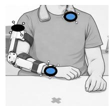

B

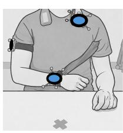  

图 1. 数据采集与任务条件的实验设置。(A) 在腕部、上臂和躯干贴附光学动作捕捉（Optical Motion Capture, OMC）标记点（黑色），并在腕部和躯干同位置共置惯性测量单元（Inertial Measurement Unit, IMU，蓝色）。RGB 摄像机（红色）从两个视角提供同步的视频录制。受试者在预先设定的目标位置（"起点"Start 以及 "T1–T4"）执行标准化日常生活活动，任务指令显示在受试者前方的屏幕上。解剖对齐坐标系各轴方向以 $( \mathsf { x } , \mathsf { y } , \mathsf { z } )$ 表示。(B) 用于限制肘关节屈伸的支具条件（brace condition）示意图。(C) 用于诱发屈肌协同样（flexor-synergy like）行为的束带条件（band condition）示意图。

为了在健康受试者中探究代偿性躯干运动（CTM）的检测，任务在三种运动条件下执行，以近似从无约束到类似卒中模式的一系列运动行为：(A) 无约束手臂运动，允许自然运动；(B) 使用肘关节支具限制屈伸的约束运动，反映卒中后常见的肘关节活动度下降（图 1B）[23]、[24]；(C) 抵抗从对侧肩部延伸至手腕的对角线阻力带的运动，诱发卒中人群中常报告的屈肌协同样行为（图 1C）[25]、[26]。基于这些运动条件，该方案强调运动多样性而非有限任务集的重复执行，以更好地反映日常生活活动（ADL）相关上肢运动的自然变异性。任务改编自已建立的运动评估流程 [8]、[9]、[27]–[29]，并归为六类：(1) 平面够取与运送（Planar Reaching & Transport）、(2) 饮水与倾倒（Drinking & Pouring）、(3) 高处够取与运送（Elevated Reaching & Transport）、(4) 平面滑动（Planar Sliding）、(5) 精细物体操作（Fine Object Manipulation）和 (6) 连续运动（Continuous Movements）。在每一类中，定义了一组不同的运动任务（所有类别共计 38 个），每个任务在三种运动条件下各执行一次（详见附录表 I）。运动使用右臂执行，以减少数据采集需求。

实验开始前，受试者端坐在不可旋转的椅子上。桌面高度和距离根据个体情况调整，以支持自然姿势。测量了个体够取距离（定义为不涉及躯干参与时可达到的最大手臂伸展距离），并据此定义四个个性化目标位置（图 1A；详见附录 I）。其中三个目标位置（T2–T4）的选择是为了即使在无约束条件下也能自然诱发躯干参与，从而确保在符合生理学的、非代偿性的运动中也存在躯干运动。相比之下，"Start"和"T1"目标旨在捕捉在无约束条件下不需要躯干参与的运动。

在每次记录的起始阶段，受试者需执行一个标准化的校准姿势：躯干保持直立、肘关节屈曲约 90°，前臂对齐于身体左侧外侧方向（图 1）。该姿势对存在典型卒中后运动功能障碍的患者而言较为舒适且可行，因此被选作校准动作；之后该姿势还用于为两个 IMU 传感器建立解剖学对齐的坐标系。完成校准后，受试者依据屏幕上显示的标准化视觉与口头指令执行运动任务（图 1A），每项任务的起止姿势均为校准姿势。每位受试者的任务顺序均经过随机化处理，以尽可能降低预期性行为，并将潜在的传感器漂移分散到不同任务类别之间。上述流程在三种运动条件下重复执行，运动条件的顺序同样预先随机化。最终得到在真实测量条件下不间断的多模态记录（每种条件 13–18 分钟）。

## B. 临床数据集（Clinical dataset）

为补充健康受试者数据集，并初步评估所提方法在神经系统疾病患者身上的表现，本研究从两项在不同环境中独立开展的临床研究中汇总构成了一个临床数据集。四名患者均依据《赫尔辛基宣言》（Declaration of Helsinki）签署了书面知情同意书。

首先，从一项正在进行的临床研究（BASEC 编号：2025-01124）中招募了三名男性慢性卒中患者（P18：44 岁，左侧偏瘫，FMA = 18；P31：65 岁，左侧偏瘫，FMA = 26；P31：59 岁，右侧偏瘫，FMA = 52）。与图 1 类似，研究中同步采集了 OMC、IMU 以及视频数据。IMU 分别佩戴于双侧手腕以及躯干。在该研究中，患者依次使用患侧更严重的手臂与患侧较轻的手臂完成平面伸手与搬运任务（见附录表 I）。每次会话中，受试者需分别朝向三个目标位置（左侧、右侧与正前方）执行伸手动作，每个位置重复 5 次；之后，再完成一项前方的伸手任务，同样每侧手臂重复 5 次（整个会话约 7 分钟）。

此外，本研究还纳入并重新分析了一名在物理治疗过程中接受上肢训练的脊髓损伤患者的运动数据（P03：男性，67 岁，ARAT：27），该数据来源于文献 [30]。该研究方案经当地州医学与伦理委员会批准（BASEC 编号：2024-01425），并在 ClinicalTrials.gov 上注册（NCT06623721）。IMU 分别佩戴于训练侧手臂（右侧）与躯干，同时采集同步的视频记录。数据采集于插板任务（pegboard task）与叠杯任务（cup-stacking task）的执行过程中，这两项任务与先前所纳入的任务类别存在明显差异，旨在评估方法的泛化能力。研究选取了一段连续的 10 分钟数据段用于分析。

## C. 数据标注（Data annotation）

为了支持使用 IMU（Inertial Measurement Unit）和 OMC（Optical Motion Capture）数据进行监督模型训练与性能评估，研究通过同步视频录像的人工标注建立了地面真值参考。根据实验约束（肘关节支具与阻力带）所预期产生的生物力学效应——其主要限制了肘关节的屈伸，躯干屈曲被预期为主导的 CTM（Compensatory Trunk Movement）。偶尔出现的躯干旋转或侧屈（通常在肩关节外展或旋转受限时被观察到）被归入同一 CTM 类别，以避免严重的类别不平衡问题。研究定义了三个类别：（1）标定（Calib），（2）运动：无躯干代偿（Mov: No TC），以及（3）运动：躯干代偿（Mov: TC）。重要的是，标签的分配基于运动情境而非瞬时运动状态；任务执行过程中的短暂停顿（例如到达目标位置或放置物体时）仍被视为运动阶段的一部分，并标注为 Mov: No TC 或 Mov: TC，而非 Calib。

研究制定了标注准则，以一种与任务无关且不受工作空间约束影响的方式将这些类别形式化（见附录 II）。尽管该准则参考了已有文献 [31]、[32]，但其经过修订后着重强调躯干与腕部运动之间的关系，遵循 RPS（Reference Position System）[9] 的原则。其核心思想在于：躯干运动本身并不必然是代偿性的；当任务或工作空间要求较大躯干运动并伴随适当的手臂伸展时，较大的躯干位移可以是非代偿性的；而当较小的躯干运动用于替代不足的肘关节伸展以达到所需活动度时，则属于代偿性的（图 2）。该定义对于实验室外的真实场景尤为重要，因为在这些场景中，任务不受约束，即便在生理上合理的运动过程中，躯干参与也自然会出现。相应地，该标注策略与前述目标位置相一致——即便在无损伤条件下，目标位置本身也必然涉及躯干的参与（见第 II-A 节）。由于研究旨在建立一个能在运动执行过程中产生连续预测的 CTM 框架，而非对每个运动序列给出单一标签，因此标注准则还规定了类别起止时间的具体规则（例如，CTM 在时间上的起止时刻）。所有准则均由经验丰富的物理治疗师进行审核与修订。

在标注阶段，将双视角同步视频进行上下堆叠以减少遮挡，并确保躯干与手臂运动学的一致可见性。合并后的视频上传至 Labelbox（Labelbox, Inc., 旧金山，美国），按照最终确定的标注指南逐帧进行标注，每一帧分配且仅分配一个类别。所有健康受试者的录像由一位经过培训的研究人员（JG）进行标注以保证一致性，而临床数据集由一位具有物理治疗背景并具备神经系统患者工作经验的研究人员（LM）完成标注。

## D. 数据处理与模型训练

对于每一条记录，来自腕部和躯干 IMU 的原始加速度计和陀螺仪信号均使用预定义的、针对各轴的偏置值进行校正，以降低对漂移的敏感性。随后，采用 6D 通用四元数滤波器（Versatile Quaternion Filter, VQF）[33] 估计传感器在全球世界坐标系中的姿态，从而可从加速度计数据中去除重力分量。为了将该世界坐标系与受试者的解剖学轴对齐，利用每次记录开始时的已知 Calib 姿态执行静态解剖学校准（参见附录 III）。该解剖学对齐坐标系的姿态如图 1A 所示（x：前向，y：左侧向，z：上方）。该流程保证相对工作空间的姿态数据解释具有一致性，同时允许使用传感器原生坐标系数据以及加速度和角速度的解剖学对齐表示（参见附录 IV）。对于患者，Calib 姿态亦允许双臂置于桌面上并与矢状面对齐；左侧手臂的记录随后相对于矢状面进行镜像，以获得与右臂等效的数据（详见附录 III）。

OMC 数据以相对于系统搭建时定义的实验室参考系的单位四元数形式给出刚体标志点位置和环节姿态。该参考系被配置为与解剖学对齐的 IMU 坐标系相匹配，从而能够对运动学变量进行直接的跨模态比较。通过最大化对应 IMU 与 OMC 标志点姿态信号之间的互相关，实现两种模态的时间对齐。基于同步后的 OMC 与 IMU 信号，进一步派生用于下游分析的附加运动学数据流，包括运动相关特征（加速度、角速度和线速度）、姿态相关特征（绝对环节姿态和相对环节间姿态），以及基于 OMC 标志点距离的空间特征（参见附录 IV）。对于后续的机器学习（ML）模型训练，将基于视频的真值标签从 Labelbox 导出，并通过最近邻插值映射到 IMU 和 OMC 时间序列中，从而构建出一个完全同步且已标注的多模态数据集。

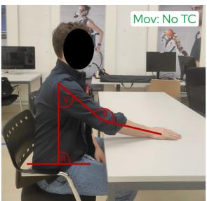  

仅"(a)"无正文内容可译。这通常是图表或列表中的子项标签（如 Figure 1(a)、(a)(b)(c) 中的第一个），括号与字母为通用编号格式，无需翻译。

如需翻译完整段落或论文，请提供包含正文的文本。

  

(b)

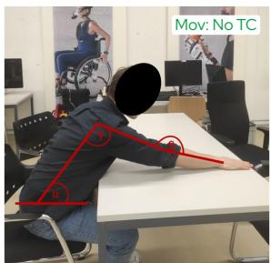  

(c)

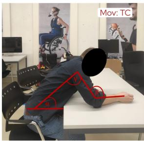  

(d)

图 2. 示例场景，展示前伸任务中手臂–躯干（arm–trunk）的协调策略以及将代偿性躯干运动进行标记的原理。(a) 肘伸展（β）和肩屈曲（γ）的程度足以触及目标。因此不需要躯干屈曲来延长手臂的触及范围。(b) 肘伸展（β）和肩屈曲（γ）的程度不足以触及目标。作为响应，躯干发生屈曲（α ↓）以延长手臂的前伸范围。(c) 肘伸展（β）和肩屈曲（γ）的程度已达到最大。躯干屈曲以将手臂前伸至目标。由于该躯干屈曲并非代偿肘伸展或肩屈曲的不足，因此不被视为代偿性运动。(d) 肘伸展（β）和肩外展（γ）的程度仍显著低于触及目标所需的范围。因此，躯干过度屈曲（α ↓），作为延长手臂前伸距离的代偿策略。红色标注表示躯干屈曲角（α）、肘伸展（β）以及肩屈曲/外展（γ）。

基于预计算的关节运动学数据流，我们设计了一套用于训练与评估 CTM 预测模型的流水线（图 3）。每段记录被切分为 500 毫秒（60 个采样点）的滑动窗口，重叠长度为 375 毫秒（窗口大小的 75%）。对于每个窗口，在关节运动学数据流上施加一组特征，特征由统计性指标、位置相似性指标（对运动学数据流进行两两比较以捕捉协调性，例如腕部–躯干）以及平滑性指标（见附录 IV）共同构成，形成模型的输入。这些特征旨在同时刻画运动学幅度、节段间协调性以及运动质量，因为有研究假设，运动模式代偿性适应（CTMs）相较于生理适宜的运动，会呈现出协调模式的改变与平滑性的下降。每个窗口的标签被定义为其内部最后一个采样点的标签，这反映了因果预测设置——模型以最小延迟从过往数据中推断出最近的运动状态。预测结果通过选取后验概率最高的类别得到。总体而言，这种窗口化策略能够在保留充分时间上下文的同时实现频繁的预测。

作为分类器，我们选择了极端梯度提升（XGBoost），原因在于它在表格化、手工构造的特征集上展现出了优异的性能与计算效率 [35]。为评估受试者无关的泛化能力，并考虑到 XGBoost 较大的超参数（HP）空间所带来的过拟合风险，我们实施了嵌套留一受试者交叉验证（LOSO-CV）方案（图 3）。具体而言，将一个折（包含来自一位受试者的全部数据）作为测试集，剩余九位受试者的数据用于进行内部的 3 折交叉验证以优化超参数。各折之间的搜索空间保持一致，超参数通过 50 次迭代的贝叶斯优化进行寻优。为应对数据集中固有的类别不平衡问题（Calib：34.51%，Mov: No TC：48.84%，Mov: TC：16.65%），我们采用了平衡的样本权重，以缓解训练过程中向多数类的偏倚。在确定最优超参数后，模型在九位受试者的数据上进行重训练，并在留出的受试者上进行测试。该过程重复进行，直至每位受试者均曾作为一次测试折。

## E. 数据分析

利用所提出的流程（pipeline），开展了一系列实验，旨在系统地评估模型在不同实验设置下的行为与性能（图 3）。在所有实验中，分类性能主要采用 F1 分数（F1-score）进行量化，并以马修斯相关系数（Matthews Correlation Coefficient, MCC）作为补充指标；后者对类别不平衡具有稳健性，且考虑了混淆矩阵中的所有元素 [36]。作为次要指标，我们使用了一对其余（one-vs-rest）受试者工作特征（Receiver Operating Characteristic, ROC）曲线及其对应的曲线下面积（Area Under Curve, AUC）值，以及精确率（precision）和召回率（recall），还有混淆矩阵。在 LOSO-CV 评估中，性能指标针对每位受试者独立计算，并以所有受试者上的均值 ± 标准差（mean ± standard deviation）形式汇总；而混淆矩阵则在所有测试受试者上聚合得到。

首先，为检验腕部（wrist）与躯干（trunk）来源的运动学能够提供足以检测 CTM 的互补信息这一假说，我们逐步缩减 OMC 模型的标记集，并量化由此带来的分类性能变化。该分析在无漂移的 OMC 数据上进行，以将解剖位置的影响从 IMU 特有的非理想因素（如漂移和校准误差）中分离出来。为以统计学方法验证性能差异，针对 Mov: TC 类别的逐受试者 F1 分数进行了配对 Wilcoxon 符号秩检验（Wilcoxon signed-rank test），因为该类别反映了 CTM 检测性能，因此具有首要临床相关性。预先（a priori）定义了一组计划性比较。首先，对三标记（wrist + trunk + upper arm）配置与两标记（wrist + trunk）配置进行比较，以评估上臂（upper arm）运动学的贡献。随后，进行两组额外的比较，以考察将配置缩减为单个标记的影响（wrist + trunk vs. wrist，以及 wrist + trunk vs. trunk）。为控制多重比较，采用了 Holm–Bonferroni 校正以控制族系误差率（family-wise error rate）。全文报告校正后的 p 值，并将统计学显著性定义为 $p _ { c o r r } < 0 . 0 5$。为完整起见，对所有类别（Calib、Mov: No TC、Mov: TC）以及所有两两模型比较均执行了相同的统计分析。

其次，我们使用所提出的两IMU（手腕+躯干）配置训练了一个模型，并在健全受试者数据上对其进行评估，直接与基于OMC（光学运动捕捉）的两标记点（手腕+躯干）基线模型进行比较。采用Wilcoxon符号秩检验评估OMC与IMU在各类别F1分数上的配对差异，并应用Holm-Bonferroni校正来控制多重比较的族系错误率。此外，我们还分析了任务相关的性能变异，以评估模型在不同运动情境下的鲁棒性，并识别潜在的特定任务性能差异，以反映日常生活中所遇到的各种任务。在此次评估之后，我们使用所有可用的健全受试者数据训练了一个最终的IMU模型，不再单独设置测试集，用于后续分析。从嵌套LOSO-CV（留一受试者交叉验证）中获得的超参数通过以下方式整合：数值型参数取中位数，类别型参数取出现频率最高的值。随后，使用Shapley加性解释（SHAP）[34]对所得模型进行可解释性分析，以识别区分Mov: No TC与Mov: TC两个类别的特征。为此，我们计算了带符号的SHAP值差异：

$$
\Delta \mathrm{SHAP} _ {i, j} = \phi_ {i, j} ^ {(\mathrm{Mov:TC})} - \phi_ {i, j} ^ {(\mathrm{Mov:NoTC})},
$$

其中 $\phi_{i,j}^{(c)}$ 表示样本 $i$ 中特征 $j$ 关于类别 $c$ 的 SHAP 值。$\Delta SHAP_{i,j}$ 为正值表明该特征使模型预测偏向 Mov: TC，而负值则表明偏向 Mov: No TC，从而可以评估每个特征贡献的方向性。为了在不考虑方向性的前提下量化每个特征的整体区分能力，我们引入了一个分离分数（separation score），其定义为所有样本上这些差异的绝对均值：

$$
\operatorname{Mean} \left| \Delta \mathrm{SHAP} _ {j} \right| = \frac {1}{N} \sum_ {i = 1} ^ {N} \left| \Delta \mathrm{SHAP} _ {i, j} \right|,
$$

其中 $N$ 表示样本数量。随后按照该分离度得分降序对特征进行排序，数值越大表明该特征对类别区分的贡献越强。所有 SHAP（SHapley Additive exPlanations）分析均在从健全受试者训练数据中采样的具有代表性的子集上进行，并使用固定的背景数据集。此外，为评估实时部署的可行性，整个流水线采用环形缓冲区（ring buffer）实现，并对其各个部分——预计算、特征提取与模型推理——的计算延迟在标准笔记本电脑（MacBook Pro，Apple M1 Pro，16 GB RAM，Apple Inc.，USA）上进行了评估。

  

图 3. 信号处理与建模流程概述。惯性测量单元（Inertial Measurement Unit, IMU）与光学运动捕捉（Optical Motion Capture, OMC）信号被转换为多种运动学表征（*斜体变量仅存在于 OMC 数据中），并被分割为相互重叠的窗口，随后通过统计指标、位置相似性指标（对运动学流进行两两比较以捕捉协调性，例如腕部–躯干）以及平滑度指标进行刻画。模型训练与评估在嵌套的留一受试者交叉验证（Leave-One-Subject-Out Cross-Validation, LOSO-CV）方案中进行，并采用平衡样本加权以缓解类别不平衡问题。在患者数据上的最终评估，结合事后 $\mathsf{SHAP}$ 分析 [34]，支持了初步的临床适用性，并为模型的可解释性提供了洞见。

最后，我们在患者数据集上使用与健康受试者队列相同的评估指标对最终模型进行了初步的临床适用性评估。该分析的目标是评估：在针对健康受试者完成受试者独立泛化验证之后，模型是否也能跨域泛化到模拟损伤至神经系统患者运动模式的场景。为此，我们首先在可控实验室环境（与健康受试者采集方案相当）中执行伸手任务时所记录的患者数据上评估了模型性能。随后，我们进一步在常规上肢康复治疗过程中记录的患者数据上评估了模型的泛化能力，这类治疗涉及约束更少、任务变异性更高的动作。

## III. 结果

## A. 解剖学位置对 CTM 检测性能的影响

为确定能够提供稳定 CTM 检测所需的最小解剖学位置集合，我们评估了分类器在不同 OMC（光学运动捕捉）标记配置下的性能（图 4；更多细节见附录 V）。在不同的配置中，三标记设置（腕部+躯干+上臂）在全部三类上取得了最高的综合表现（$\mathrm{F1_{macro}} = 0.86 \pm 0.05,\ \mathrm{MCC} = 0.81 \pm 0.08$）。去除上臂标记仅带来边际性的性能变化，且各折之间的离散度相当（$\mathrm{F1_{macro}} = 0.85 \pm 0.06,\ \mathrm{MCC} = 0.79 \pm 0.09$），三标记与两标记配置之间的 $\mathrm{F1_{Mov:TC}}$ 评分无显著差异（$p_{corr} = 0.625$）。

相比之下，仅使用躯干或腕部数据的单标记配置导致了更明显的分类性能下降。当仅依赖躯干信息时，所有类别的性能均出现一致的下降（$\mathrm{F1_{macro}} = 0.66 \pm 0.12,\ \mathrm{MCC} = 0.50 \pm 0.13$），其中 Calib 类别的退化尤为显著（$\mathrm{F1_{Calib}} = 0.65 \pm 0.16$）。对 Mov: TC 类别更细致的分析进一步表明，$\mathrm{recall_{Mov:TC}}$ 仍维持在较高水平（腕部+躯干：$0.86 \pm 0.10$，仅躯干：$0.83 \pm 0.16$），而 $\mathrm{precision_{Mov:TC}}$ 下降幅度更大（腕部+躯干：$0.72 \pm 0.17$，仅躯干：$0.60 \pm 0.24$），表明 CTM 假阳性预测率有所上升。与这一性能差距一致的是，两标记配置的 $\mathrm{F1_{Mov:TC}}$ 评分显著高于仅躯干配置（$p_{corr} = 0.012$）。

对于仅腕部配置，整体分类性能仍处于中等水平 $( \mathrm { F 1 } _ { \mathrm { m a c r o } } = 0 . 7 8 \pm 0 . 0 6 ,$ $\mathsf { M C C } = 0 . 7 1 \pm 0 . 0 8 )$ ，但性能变化更依赖于类别。虽然 Calib 类别的性能仍保持在较高水平 $( \mathrm { F 1 } _ { \mathrm { C a l i b } } = 0 . 9 2 \pm 0 . 0 6 )$ ，但 Mov: TC 类别的检测性能有所下降，表现为 $\mathrm { r e c a l l _ { M o v : T C } }$（腕+躯干：$0 . 8 6 \pm 0 . 1 0$，仅腕部：$0 . 7 7 \pm 0 . 0 9$ ）和 precisionMov: TC（腕+躯干：$0 . 7 2 \pm \ : 0 . 1 7 .$ 仅腕部：$0 . 5 4 \pm \ : 0 . 1 3$ ）均更低。这表明 CTM 分类的漏检数量增多且误报率上升。相应地，双标记配置的 $\mathrm { F l } _ { \mathrm { M o v : ~ T C } }$ 得分显著高于仅腕部配置 $( p _ { c o r r } ~ = ~ 0 . 0 1 2 )$ 。为完整起见，所有任务类别及成对模型比较的统计结果见附录中的表VI。

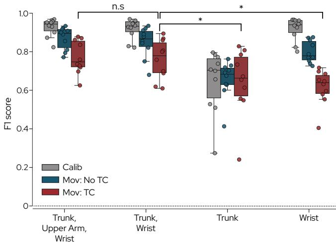  

图 4. 在健全参与者（n=10）中，不同光学运动捕捉标记配置下的分类性能。箱线图展示了通过留一受试者交叉验证获得的三个类别（Calibration 校准、Movement: No Trunk Compensation 运动：无躯干代偿，以及 Movement: Trunk Compensation 运动：躯干代偿）的逐折 F1 分数。叠加的点表示单个参与者的表现。跨标记配置对「运动：躯干代偿」的统计比较由括号标出 $( ^ { \star } p _ { c o r r } < 0 . 0 5 .$，n.s 表示不显著）。所有类别的结果及成对模型比较详见表 VI。

## B. 双 IMU 在日常生活活动（ADL）任务中的分类性能

基于 OMC 的分析结果，手腕与躯干被用作后续评估的最小化传感位置。IMU 模型取得了稳健的整体性能 $( \mathrm { F 1 } _ { \mathrm { m a c r o } } = 0 . 8 0 \pm 0 . 0 7 , \mathrm { M C C } = 0 . 7 3 \pm 0 . 0 8 )$。其性能略低于双标记点 OMC 参考模型 $( \mathrm { F 1 } _ { \mathrm { m a c r o } } ~ = ~ 0 . 8 5 ~ \pm ~ 0 . 0 6$ , MCC = $0 . 7 9 \mathrm { ~ \pm ~ } 0 . 0 9 )$，但受试者间变异性在两种模态之间仍保持相当，表明尽管传感复杂度降低，其泛化能力仍相似（图 5A）。在各类别上，IMU 配置下的平均 F1 分数略有下降 $( \Delta \mathrm { F } 1 _ { \mathrm { C a l i b } } ~ = ~ - 0 . 0 4 , ~ \Delta \mathrm { F } 1 _ { \mathrm { M o v : ~ N o ~ T C } } ~ = ~ - 0 . 0 3 , ~ \Delta \mathrm { F } 1 _ { \mathrm { M o v : ~ T C } } ~ = ~ 0 . 0 3$ −0.09)，而标准差之间最多相差 0.015。使用 Wilcoxon 符号秩检验并经 Holm-Bonferroni 校正后的统计比较显示，在 Calib 条件下 OMC 与 IMU 之间无显著差异 $( \mathtt { p } _ { \mathtt { c o r r } }$ $= 0 . 0 6 4 )$。相比之下，在两种运动条件下均观察到显著差异，其中 OMC 在 Mov: No TC $( \mathrm { p } _ { \mathrm { c o r r } } = 0 . 0 2 0 )$ 与 Mov: TC $( \mathrm { p } _ { \mathrm { c o r r } } = 0 . 0 1 2 )$ 条件下均取得了更高的性能。为进一步刻画独立于所选决策规则的类别可分离性，我们考察了在各测试折上平均的一对多（one-vs-rest）ROC 曲线。所得曲线（图 5B）在全部三个类别上均表现出强判别性能，由 ROC-AUC 值 $( \mathrm { A U C } _ { \mathrm { C a l i b } } =$ $0 . 9 7 \pm 0 . 0 5 , \mathrm { A U C _ { M o v : N o \ T C } = 0 . 9 3 \pm 0 . 0 4 , A U C _ { M o v : T C } = 0 . 9 5 }$ $\pm \ 0 . 0 2 )$ 可见一斑。

通过图 6A 中的混淆矩阵进一步深入了解模型性能，该矩阵进行了行归一化以处理类别不平衡问题。总体而言，模型各类别的召回率均 >0.8，大多数误分类发生在两个运动类别之间（Mov: No TC 与 Mov: TC）。具体而言，17.8% 的代偿性运动（CTMs）被误分类为正常运动，而相反的误分类在 14.4% 的情况下发生。为了表征误分类模式，模型性能按运动任务类别进行了分层分析（图 6B）。在所有类别中，Calib 和 Mov: No TC 的平均 F1 分数持续保持在 >0.73 的高水平，且受试者间变异性较低 $( \mathrm { s t d } < 0 . 1 3 )$ 。相比之下，Mov: TC 的性能表现出显著的任务依赖性。虽然 Planar Reaching & Transport $( \mathrm { F 1 } _ { \mathrm { M o v : ~ T C } } = 0 . 7 7 \pm 0 . 1 0 )$ 和 Planar Sliding $( \mathrm { F 1 } _ { \mathrm { M o v : T C } } = 0 . 7 3 \pm 0 . 1 1 )$ 在各折交叉验证中表现稳定，但其余任务类别表现出更大的受试者间变异性（Drinking & Pouring：$\mathrm { F 1 } _ { \mathrm { M o v : T C } } = 0 . 5 8$ $\pm \ 0 . 1 7$ ，Elevated Reaching & Transport：$\mathrm { F 1 } _ { \mathrm { M o v : ~ T C } } = 0 . 5 0 \pm$ 0.21，Fine Object Manipulation：$\mathrm { F 1 } _ { \mathrm { M o v : T C } } = 0 . 4 9 \pm 0 . 2 2$ ），且出现多个低性能折次。在这三类任务中，F1 分数降低主要由 $\mathrm { r e c a l l _ { M o v : T C } }$ 下降所致，表明 CTMs 经常被误分类为非代偿性运动（CTMs 被误分类为非代偿性运动的百分比：Drinking & Pouring，25.0%；Elevated Reaching & Transport，41.7%；Fine Object Manipulation，39.7%；Continuous Movements：22.1%）。

您好，您发送的内容只有一个字母「B」，看起来是误发或者不完整的输入。

请将您需要翻译的英文论文 Markdown 内容粘贴给我，我会按照学术翻译规范完整翻译成中文。

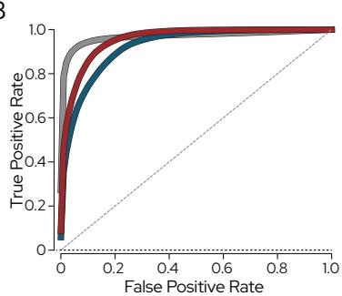  

图5. 基于双 IMU 的模型性能。(A) 箱线图显示了在健康受试者 $( n = 1 \dot { 0 } )$ 中，采用腕部与躯干信号时，基于光学动作捕捉（Optical Motion Capture, OMC）和惯性测量单元（Inertial Measurement Unit, IMU）两种设置的逐折 F1 分数。叠加的散点表示各受试者的个体表现。(B) 在健康受试者 $\mathbf { \bar { \rho } } ( n = \mathbf { \bar { 1 0 } } )$ 中，三个类别的平均一对多受试者工作特征曲线（Receiver Operating Characteristic, ROC）表明 IMU 模型具有强大的判别性能。

为了识别区分 Mov: No TC 与 Mov: TC 的最具判别性的运动学特征，对最终基于 IMU（Inertial Measurement Unit，惯性测量单元）的模型应用了基于 SHAP（SHapley Additive exPlanations）的模型可解释性方法。特征根据其分离分数进行排序（图 7）。为了评估不同特征组（腕部、躯干、交互）的相对贡献，将每组内的分离分数 Mean|∆SHAP| 进行了汇总。在前 10 个预测因子中，躯干衍生特征占总分离分数的 64%，腕部–躯干交互特征占 30%，孤立的腕部特征占 6%。这些比例表明，模型的决策边界主要由躯干运动学特征塑造，而基于协调的交互特征提供了补充性的判别证据。

在方向效应方面，躯干屈曲（orientation pitch）增加、躯干整体运动强度（陀螺仪幅值）以及躯干侧倾（orientation roll）的改变均与正的 ∆SHAP 值一致相关，表明模型对 Mov: TC 类别的置信度增加。描述相对节段朝向（orientation pitch/yaw 的动态时间规整距离，Dynamic Time Warping Distance, DTWD）和运动（DTWD 陀螺仪偏航与陀螺仪幅值之差）的腕部–躯干交互特征在其 ∆SHAP 分布中表现出不同的模式。事实上，运动相关的交互特征表现出明显的方向性趋势，其中较低的相对值（即躯干与腕部的运动更相似）主要与朝向 Mov: TC 的正 ∆SHAP 贡献相关。相反，基于朝向的交互特征呈现出更加异质的、双向的分布，在特征值范围内均可观察到正向和负向的贡献。

  

B

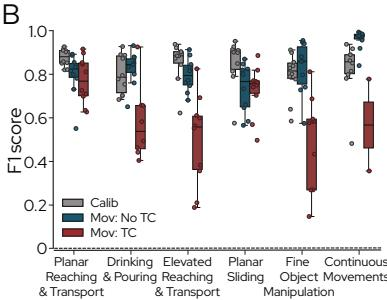  

图 6. 基于 IMU 的模型性能的详细分析。(A) 行归一化混淆矩阵，汇总了校准（Calib）、运动：无躯干代偿（Mov: No TC）以及运动：躯干代偿（Mov: TC）三个类别在所有测试折上的类别预测结果（召回率）。(B) 箱线图显示了在健全参与者 (n = 10) 中按运动任务类别分层的各折 F1 分数。叠加的点表示单个参与者的表现。

通过测量各组件在 $n = 5 7 1 0$ 个样本上的计算延迟来评估该流水线的实时适用性。模型推理耗时 $2 9 . 2 5 \pm$ 10.93 ms，而预处理和特征提取分别耗时 $4 2 . 4 7 \pm 1 7 . 3 1$ ms 和 $4 6 . 8 6 \pm 1 6 . 6 8$ ms。

## C. 患者评估

为了评估初步的临床泛化能力，将在模拟损伤条件下、仅基于健康受试者记录训练得到的最终模型在四名患者的数据上进行了评估。在这些记录中，该模型保持了较强的判别能力，$\mathrm { { A U C } _ { \mathrm { { m a c r o } } } }$ 值为 $0 . 7 8 \pm 0 . 0 6 ~ ( \mathrm { F i g . ~ 8 A }$，详见表 VII）。特别是，$\mathrm { A U C } _ { \mathrm { M o v : ~ N o ~ T C } }$ 仍保持在较高水平 $( 0 . 7 8 \pm 0 . 1 0 )$，表明在患者记录中代偿性和非代偿性的躯干运动片段仍然是可分离的。

相比之下，依赖于阈值的分类指标表现中等，$\mathrm { F 1 } _ { \mathrm { m a c r o } } = 0 . 4 3 \pm 0 . 0 6$，$\mathrm { M C C } = 0 . 2 8 \pm 0 . 0 4$。运动阶段的检测最为稳定 $( \mathrm { F } 1 _ { \mathrm { M o v : ~ N o ~ T C } } = 0 . 6 5 \pm 0 . 1 6 )$，而代偿检测在不同患者之间差异显著 $\mathrm { ( p r e c i s i o n _ { M o v : \ T C } = 0 . 5 7 \pm 0 . 2 7 ) }$）。例如，P63 取得了较高的 $\mathrm { p r e c i s i o n } _ { \mathrm { M o v : } \mathrm { T C } } ~ ( 0 . 9 6 )$，但 $\mathrm { r e c a l l _ { M o v : T C } } ~ ( 0 . 1 1 )$ 较低，表明预测的代偿性躯干运动（Compensatory Trunk Movement, CTM）事件虽然经常是正确的，但相当一部分 CTM 时间点被遗漏。这一趋势也在 P03 的常规治疗记录中观察到，这是一个更具挑战性且约束更少的评估场景。在此场景下，模型对 Mov: No TC 取得了高性能 $(\mathrm { p r e c i s i o n } _ { \mathrm { M o v : ~ N o ~ T C } } = 0 . 8 9 8$，recall $\mathbf { \Delta } _ { \mathrm { N o \ T C } } = 0 . 9 6 3$，$\mathrm { F 1 } _ { \mathrm { M o v : N o ~ T C } } = 0 . 9 2 9 )$，而 CTM 检测再次表现出 $\mathrm { \ h i g h { \ p r e c i s i o n } _ { M o v : \ T C } } ~ ( 0 . 6 7 4 )$ 较高，但 $\mathrm { r e c a l l _ { M o v : } }$ TC (0.266) 较低，导致 $\mathrm { F l } _ { \mathrm { M o v } : }$ TC 得分为 0.381。该记录的一个代表性时序片段如图 8B 所示，展示了模型预测相对于真实标注的时间演变。

## IV. 讨论

本研究评估了使用最小化IMU配置进行基于机器学习（ML）的躯干代偿运动（CTM）检测的可行性。具体而言，我们假设仅凭躯干与手腕的运动学信息，即可在无约束工作空间的日常生活活动（ADL）任务中提供足够信息，实现稳健、实时的CTM检测。我们进一步评估了这种精简的传感器配置能否从在模拟损伤条件下采集的健康受试者记录推广到在实验室及常规上肢治疗环境中采集的初步临床数据。

## A. 手腕与躯干提供互补信息

关于传感器放置位置对CTM检测性能的影响，基于光学动作捕捉（OMC）的标记点剔除研究和基于IMU的SHAP特征分析均得出一致证据：最具判别力的信息是由躯干与手腕的运动学共同捕获的。双标记点配置（手腕+躯干）取得了与三标记点配置（手腕+躯干+上臂）相当的性能，而单位置模型的性能则显著下降，其中仅使用躯干的模型由于CTM假阳性预测增多而表现出精度下降。特征层面的可解释性进一步凸显了主要的躯干衍生特征以及排名靠前的手腕-躯干交互特征，表明相对协调模式对CTM判别具有重要贡献。这些发现与先前将代偿描述为躯干-远端协调改变 [37], [38] 的生物力学研究，以及报告手腕-躯干配置相比仅躯干传感具有更强性能的基于IMU的研究 [39] 相一致。虽然躯干运动学构成CTM的主要指标，但仅躯干模型的精度降低表明其区分代偿性躯干参与与生理性适当躯干参与的能力有限。纳入手腕信号可通过捕获协调与朝向线索来提升判别能力，正如SHAP分析所观察到的那样。此外，尽管上臂传感对于精细生物力学分析 [19], [20] 十分重要，但其对该分类任务的增量收益有限，这可能源于其与手腕衍生信息之间的冗余。总体而言，手腕-躯干配置在性能与可部署性之间实现了实用的折中，降低了非监督日常生活使用中的仪器负担与校准工作量。

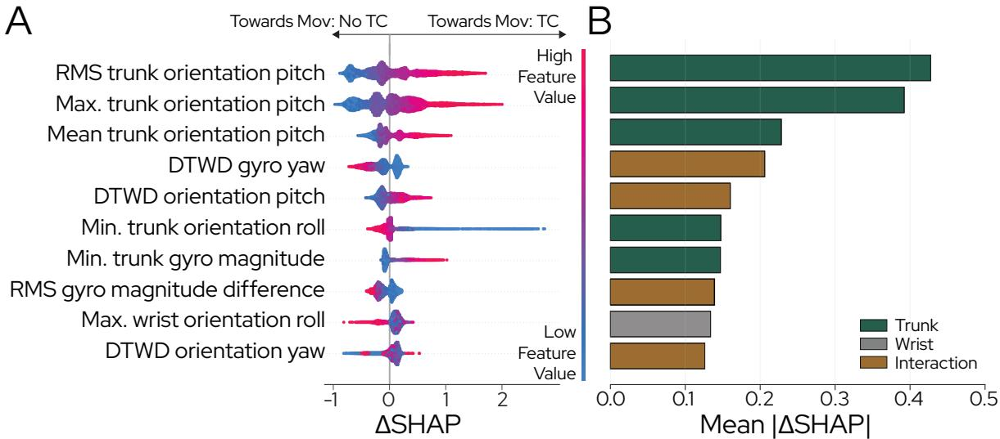

  

图 7. 使用沙普利加性解释（Shapley Additive Explanations, SHAP）进行可解释性分析，以识别「动作：无躯干代偿（Movement: No Trunk Compensation, Mov: No TC）」与「动作：躯干代偿（Movement: Trunk Compensation, Mov: TC）」之间最具区分度的前 10 个特征。（A）带符号的 ∆SHAP 值分布，指示对各类别的方向性支持程度，其中正值偏向 Mov: TC，负值偏向 Mov: No TC。特征值根据其相对大小进行低（蓝色）到高（红色）的颜色编码。（B）以每个特征的 Mean|∆SHAP| 表示的分离度得分，概括整体区分重要性。条形图按特征来源（躯干、手腕、交互项）进行颜色编码。

图 8. 临床数据集上的检测性能。（A）使用受影响最严重的手臂执行任务、手腕传感器位于受影响最严重肢体上的患者（n = 4）的一对其余（one-vs-rest）受试者工作特征（ROC）曲线均值。（B）代表性 60 秒时间序列片段，展示一名执行常规上肢治疗的患者真实标签与预测类别标签。真实标注以黑线显示，模型预测以三类别（动作：躯干代偿、动作：无躯干代偿及校准）的彩色圆点显示。

## B. 基于机器学习的 CTM 检测实现稳健性能但仍依赖于任务

我们提出的双 IMU 模型在 CTM 检测中表现出强大的判别能力，反映在健康参与者中较高的 ROC-AUC 值以及稳定的宏平均 F1 和 MCC 分数。尽管与双标记点 OMC 参考模型相比，性能略有下降，但受试者间的变异性保持相当，表明尽管传感复杂度降低，泛化能力仍保持相似。

先前的研究已证明 CTM 检测在不同传感模态和分类方法下的可行性。基于 IMU 的系统在试次级或重复级分类、对预分割数据进行分类时已报告了高性能（通常 >90% 准确率）[39]–[41]。然而，这些方法在任务执行过程中不提供连续预测，限制了它们在日常生活环境中进行实时监测的适用性。连续的 CTM 检测则主要通过基于摄像头 [16] 或基于压力的系统 [42]、[43] 实现，这些系统可提供密集的时间信息，但依赖于便携性较差的传感装置。

在健康受试者数据集中观察到了依赖于任务的性能差异，尤其是饮水与倾倒（Drinking and Pouring）、抬高手部取物与搬运（Elevated Reaching and Transport）以及精细物体操控（Fine Object Manipulation）等任务中，Mov: No TC（运动：无躯干代偿）与 Mov: TC（运动：有躯干代偿）之间的误分类增多。这些错误主要由漏检的 CTM 事件驱动，导致召回率降低，这与先前的报告 [39]、[44] 一致。这可能源于参与者的代偿模式较弱且更异质，以及在不总能可靠引发显著 CTM 的任务中存在的标注模糊性 [32]。此外，基于窗口的推理对模糊的起始和终止过渡较为敏感，可能进一步增加误分类率。

## C. 向患者数据的泛化可行但存在变异性

在患者数据上的评估提供了初步证据，表明从模拟损伤下的健康人记录中学习到的与代偿相关的运动学特征在一定程度上可迁移到真实的卒中后运动模式中。在四次记录中，持续较高的 ROC-AUC 值表明，尽管患者运动的异质性增加、重复性降低，模型仍保持了强大的判别能力。

相比之下，宏平均 F1（macro-averaged F1）和 MCC 等阈值依赖的指标（threshold-dependent metrics）仅为中等水平，这与先前研究报告的结果一致，这些研究强调了在不同神经系统人群中稳健的代偿标注 [32] 和分类 [17] 所面临的挑战。ROC-AUC 与阈值依赖指标之间的不一致表明，模型保留了判别性信息，但患者运动策略、类别先验以及运动起始和结束时刻的时间模糊性方面的差异影响了最优决策阈值，并增加了分类误差。具体而言，CTM 类别所观察到的较高精确率（precision）但较低召回率（recall）的组合，与在多项健全受试者任务中观察到的结果类似，表明模型表现出保守的预测行为。这种保守的预测行为可能是有益的，因为 CTM 的假阳性检测可能会错误地惩罚正常运动，而漏检的代偿时间点主要会降低灵敏度。重要的是，治疗记录（P03）代表了一个更真实且更具挑战性的实验室外评估场景。尽管存在这些条件，模型仍保持了较强的运动相位检测性能和中等水平的 CTM 检测性能，这支持了实时部署的可行性。

## D. 局限性与未来工作

本研究的一个主要局限性在于，所提出的机器学习（Machine Learning, ML）模型是基于一小群健全（able-bodied）受试者开发的，在这些受试者中，CTMs 是通过外部施加的运动约束诱发的。虽然此类范式已在先前的研究 [39]、[45] 中使用，但脑卒中后的代偿策略源于潜在的神经功能损伤，因此预计会表现出更为复杂和异质的运动学特征以及关节间协调模式 [2]、[37]。尽管所采用的支具和阻力带约束是基于脑卒中患者常报告的运动受限 [23]–[26] 设计的，但它们可能仅涵盖了临床上观察到的代偿行为的一个子集，尤其是在不同的损伤严重程度下。因此，基于健全受试者数据训练的模型可能学习到的决策规则仅能部分泛化到真实的脑卒中后运动模式，这反映在患者评估中观察到的中等且波动较大的性能。因此，未来工作应纳入更大且更具异质性的患者队列，涵盖广泛的损伤严重程度，以便直接针对临床运动变异性进行模型训练和验证。与此同时，在模拟损伤条件下对健全受试者的记录仍可作为一种高效的数据增强策略，特别是在大规模患者记录有限的情况下。此外，可以利用预测概率将逐帧输出在时间上聚合为更稳健的运动级实时决策。类别特定的概率阈值还可以根据应用需求调整 CTM 检测的假阳性与假阴性，从而有可能提高面向反馈部署的可用性。

第二个局限性在于使用了粗粒度的类别标注方案，仅指示 CTMs 的存在与否。将细微与显著的代偿归入单一类别可能会掩盖临床上相关的差异，并导致类别边界处的误分类。例如，采用分级代偿严重程度标签（如 0–3），可基于 RPS [9] 进行划分，从而能够对模型行为进行更细粒度的评估，并揭示检测性能是否随 CTM 严重程度系统性地变化。这种分层对于反馈应用尤为相关，因为在存在显著代偿行为时，及时干预最为关键。

尽管存在上述局限性，所提出的方法仍突显了极简可穿戴传感在连续 CTM 监测方面的潜力。鉴于其实时能力，该系统可直接扩展以提供反馈，例如将躯干佩戴式可穿戴设备（如项链式）与腕戴设备相结合，使患者在监督治疗和无人监督的家庭训练中检测到 CTM 时能够接收听觉或视觉提示。这可以将动作质量反馈延伸至临床之外，减轻治疗师的工作负担，并支持在不同场景下提供更一致、更客观的反馈。此外，在更长时间尺度上进行连续监测能够客观追踪日常活动中的代偿频率与持续时间，从而潜在地支持临床决策和康复进程的纵向评估。

## V. 结论（CONCLUSION）

本研究探讨了基于机器学习、使用极简可穿戴传感配置进行 CTM 检测的可行性。利用来自健康受试者的 OMC 记录，模拟卒中后在上肢任务中的运动受限情况，我们确定腕部和躯干运动学是用于 CTM 检测信息量最大的解剖部位。在此分析基础上，我们开发了一种两 IMU（躯干–腕部）模型，能够进行连续的实时推理，并在健康受试者中实现了稳健且稳定的分类性能。当应用于在伸手任务和常规上肢治疗期间采集的初步患者记录时，该模型保持了较高的判别能力，但表现出降低且依赖于阈值的可变性能，凸显了推广到异质性临床运动模式时所面临的挑战。未来工作将聚焦于使用更大规模、更多样化的患者队列进行再训练与验证，并将所提方法集成到闭环康复和辅助系统中。

## 致谢（ACKNOWLEDGMENT）

作者感谢 Abigail Vogel 在图表设计以及用于传感器和标记点附着的可穿戴硬件制造方面的贡献。此外，我们感谢 Alen Roady 对数据采集软件所作的重要贡献。我们进一步感谢 Manuel Ehrler 在实时推理流水线方面的工作，以及 Sho Sugimoto 在患者数据初步评估方面的支持。我们同样感谢 Jeannine Muller 在临床数据采集期间的支持与合作。

## 利益冲突（CONFLICT OF INTEREST）

MQ、OL、PV 和 DD 隶属于 Skaaltec AG，该公司参与本研究所述技术的开发与商业化。其余作者声明不存在竞争性利益关系。

## 附录 I（APPENDIX I）

## 工作空间、任务设置与运动任务（WORKSPACE, TASK SETUP AND MOVEMENT TASKS）

该附录提供了补充正文的方法学细节与结果。实验工作区与任务设置如图 9 所示，相应的运动任务汇总于表 I 中。

## 附录 II 标注指南

标注指南如表 II 所示。

## 附录 III 解剖学标定与左臂变换

沿用 Nguyen et al. [22] 的方法，采用解剖学标定将所有基于 IMU（Inertial Measurement Unit）的运动学数据统一表达于解剖学对齐坐标系中（图 10）。该解剖坐标系由每次记录的初始样本进行初始化，初始化时受试者保持第 II-A 节中所介绍的标准标定姿势。为建立该坐标系，我们首先根据通用四元数滤波器（Versatile Quaternion Filter, VQF）的估计结果，提取首个采样时刻每个传感器 $s \in$ {wrist, trunk} 的世界坐标系朝向四元数 $\mathbf { q } _ { \mathrm { w o r l d } , s , 0 }$。在第二步中，我们假设在标定姿势下，传感器的某条局部坐标轴与解剖学左—外侧方向对齐；由于传感器的安装方式，对于腕部传感器而言对应其局部 x 轴，对于躯干传感器而言则对应其局部 y 轴。相应的世界坐标系方向通过利用各传感器的初始朝向对相应的纯四元数轴向量进行旋转而获得：

$$
\begin{array}{l} \mathbf {q} _ {\text {lat,wrist}} = \mathbf {q} _ {\text {world,wrist,0}} \otimes [ 0, 1, 0, 0 ] ^ {\top} \otimes \mathbf {q} _ {\text {world,wrist,0}} ^ {- 1} \\ \mathbf {q} _ {\text {lat,trunk}} = \mathbf {q} _ {\text {world,trunk,0}} \otimes [ 0, 0, 1, 0 ] ^ {\top} \otimes \mathbf {q} _ {\text {world,trunk,0}} ^ {- 1} \end{array}
$$

去掉 $\mathbf{q}_{\mathrm{lat},s}$ 的实部即可得到对应的三维方向向量，记为 $\tilde{\mathbf{y}}_{\mathrm{calib},s} \in \mathbb{R}^3$。对于两个传感器，标定坐标系（calibrated frame）的竖直轴被固定为 $\mathbf{z}_{\mathrm{calib}} = [0, 0, 1]^\top$（世界竖直向上方向）。通过叉积构造右手正交基：

$$
\begin{array}{l} \tilde {\mathbf {x}} _ {\text { calib }, s} = \tilde {\mathbf {y}} _ {\text { calib }, s} \times \mathbf {z} _ {\text { calib }}, \\ \mathbf {x} _ {\text { calib }, s} = \frac {\tilde {\mathbf {x}} _ {\text { calib } , s}}{\| \tilde {\mathbf {x}} _ {\text { calib } , s} \|}, \\ \mathbf {y} _ {\text { calib }, s} = \mathbf {z} _ {\text { calib }} \times \mathbf {x} _ {\text { calib }, s}, \qquad s \in \{\text { wrist }, \text { trunk } \}. \end{array}
$$

将各坐标轴的单位向量堆叠起来，即可得到传感器特定的旋转矩阵

$$
\mathbf {R} _ {\mathrm{rot}, s} = \left[ \begin{array}{c c c} \mathbf {x} _ {\mathrm{calib}, s} & \mathbf {y} _ {\mathrm{calib}, s} & \mathbf {z} _ {\mathrm{calib}} \end{array} \right],
$$

以及等效四元数 $\mathbf{q}_{rot,s}$，它表示从校准后的解剖坐标系到 VQF 世界坐标系（world frame）的旋转。任何在 VQF 世界坐标系中表示的传感器朝向 $\mathbf{q}_{world,s}(t)$，随后被映射到校准坐标系中，方法为

$$
\mathbf {q} _ {\text { calib }, s} (t) = \mathbf {q} _ {\text { rot }, s} ^ {- 1} \otimes \mathbf {q} _ {\text { world }, s} (t), \quad s \in \{\text { wrist }, \text { trunk } \}.
$$

对于在标定姿势中将手臂置于桌面上并与矢状面对齐的患者记录，由此产生的解剖坐标系存在一个固定的面内旋转差异。为解决这一问题，将标定坐标系绕垂直（z）轴旋转 $9 0 ^ { \circ }$，从而确保与健康受试者记录中使用的解剖坐标系定义保持一致。此调整在适应修改后标定姿势的同时，保持了解剖轴的对齐：

$$
\mathbf {q} _ {z} = \left[ \begin{array}{c c c c} \cos (\theta / 2) & 0 & 0 & \sin (\theta / 2) \end{array} \right] ^ {\top}, \qquad \theta = 9 0 ^ {\circ},
$$

使得校正后的方向可按如下方式获得：

$$
\mathbf {q} _ {\text { calib }, w r i s t} ^ {\prime} (t) = \mathbf {q} _ {z} \otimes \mathbf {q} _ {\text { calib }, w r i s t} (t)
$$

对于从左臂采集的患者记录，将运动学数据相对于矢状面进行镜像翻转，以获得等效于右臂的表示形式。该步骤旨在确保受试者之间的一致性，并使所有记录能够使用统一的解剖学参考进行处理。

镜像翻转通过使用反射矩阵将传感器信号跨矢状面进行反射来实现

$$
\mathbf {R} _ {\text {mirror}} = \left[ \begin{array}{c c c} 1 & 0 & 0 \\ 0 & - 1 & 0 \\ 0 & 0 & 1 \end{array} \right].
$$

线性加速度信号被变换为

$$
\mathbf {a} _ {\mathrm{mirrored}} (t) = \mathbf {a} (t) \mathbf {R} _ {\mathrm{mirror}} ^ {\top},
$$

而角速度信号则被额外进行了符号反转，以处理旋转量作为赝矢量（pseudovector）的本质：

$$
\boldsymbol {\omega} _ {\mathrm{mirrored}} (t) = - \boldsymbol {\omega} (t) \mathbf {R} _ {\mathrm{mirror}} ^ {\top}.
$$

该变换在将左臂运动映射到与右臂等效的坐标系表示的同时，保留了运动学信号的物理一致性。

此外，在部分患者记录中，躯干惯性测量单元（IMU）是使用基于纺织品的弹性固定系统安装于胸骨上的。由于不同采集记录会话中传感器放置位置存在差异，传感器相对于躯干的初始朝向可能与健康人群数据集（able-bodied dataset）中所使用的参考配置不同。

为补偿该偏移，对校准后的躯干朝向四元数 $\mathbf{q}_{\mathrm{calib,trunk}}(t)$ 应用了额外的对齐步骤。具体而言，基于健康人群记录中观察到的平均初始躯干朝向，定义了一个参考四元数 $\mathbf{q}_{\mathrm{ref}}$。令 $\mathbf{q}_{\mathrm{calib,trunk}}(0)$ 表示给定患者记录中的第一个校准后躯干四元数。

(2)

(3)

(6)

  

(A)

  

(1)

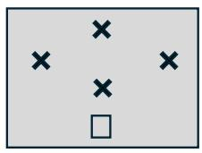

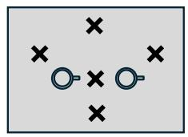  

(4)

  

(B)

图 9. 实验工作空间与任务设置。(a) 工作空间示意图，显示固定起始位置（距桌沿 10 厘米）以及四个目标位置。目标 1（T1）对应于参与者的最大够取距离，而目标 2–4（T2–T4）则放置在预定义的径向距离（25–30 厘米）处，彼此间隔 60◦ 角度。(b) 任务类别概览：(1) 平面够取与搬运；(2) 饮水与倾倒；(3) 高处够取与搬运；(4) 平面滑动；(5) 精细物体操作；(6) 连续运动。

<table><tr><td>Task Category</td><td>Objects &amp; Setup</td><td>Movement Tasks</td></tr><tr><td>Planar Reaching &amp; Transport</td><td>Single cup at Start</td><td>- Reaching to T1-T4 (Task No. 1-4)- Cup transport between Start and T1-T4 (Task No. 5-8)- Sequential transport: Start → T2 → T3 → Start and Start → T3 → T2 → Start (Task No. 9-10)- Continuous reaching between T1-T4 in pseudo-random order (Task No. 11-12)</td></tr><tr><td>Drinking &amp; Pouring</td><td>Two cups positioned to the left and right of T1</td><td>- Water pouring (right ↔ left) (Task No. 13-14)- Drinking from right and left cup (Task No. 15-16)</td></tr><tr><td>Elevated Reaching &amp; Transport</td><td>One large block at T1 and two smaller blocks on either side</td><td>- Elevation of small block onto large block with 180° flip and return (Task No. 17-18)- Transport over large block to opposite side and return (Task No. 19-20)</td></tr><tr><td>Planar Sliding</td><td>Single card at Start</td><td>- Two-handed sliding: Start → T2 → T3 → Start and Start → T3 → T2 → Start (Task No. 21-22)- Two-handed sliding: Start → T1 → Start and Start → T4 → Start (Task No. 23-24)- Single-handed sliding to T1-T4 with 180° card flip (Task No. 25-28)- Single-handed sequences: Start → T2 → T3 → Start and Start → T3 → T2 → Start (Task No. 29-30)- Continuous multi-target sliding sequences (Task No. 31-32)</td></tr><tr><td>Fine Object Manipulation</td><td>Five-drawer box at T1 and a coin placed to its right</td><td>- Coin manipulation across drawers (opening, closing, insertion, transfer) (Task No. 33-34)- Sequential opening and closing of all drawers (Task No. 35-36)</td></tr><tr><td>Continuous Movements</td><td>—</td><td>- Hand-biking motion (20-30 s) (Task No. 37)- Swimming motion (20-30 s) (Task No. 38)</td></tr></table>

表 I 健全参与者（Able-Bodied Participants）数据采集协议中相对于目标位置 T1–T4 定义的任务类别、对象和运动任务概述。

如果 $\mathbf{q}_{\mathrm{calib,trunk}}(0)$ 与 $\mathbf{q}_{\mathrm{ref}}$ 之间的差值超过预设阈值（模为 0.1），则计算一个校正四元数，公式为

$$
\mathbf {q} _ {\text { corr }} = \mathbf {q} _ {\text { ref }} \otimes \mathbf {q} _ {\text { calib,trunk }} (0) ^ {- 1}.
$$

对齐后的躯干朝向轨迹随后通过对所有已校准的躯干四元数左乘校正四元数获得：

$$
\mathbf {q} _ {\text { calib,trunk }} ^ {\prime} (t) = \mathbf {q} _ {\text { corr }} \otimes \mathbf {q} _ {\text { calib,trunk }} (t).
$$

该流程确保了躯干 IMU 坐标系在多次记录之间的一致初始对齐，从而降低了由各次会话中胸骨传感器放置位置差异所引入的变异性。

## 附录 IV

## 运动学数据流与统计特征

我们将 IMU 传感器的原生坐标系称为局部坐标系（local frame），将通过校准（见附录 III）所获得的解剖学对齐坐标系称为校准坐标系（calibrated frame）。OMC 参考坐标系被配置为与解剖学对齐后的 IMU 坐标系相匹配，可支持运动学变量的跨模态直接对比，称为记录坐标系（recording frame）。运动学数据流的概览见表 III，特征类别的汇总见表 IV。

<table><tr><td>Label</td><td>Description</td></tr><tr><td>Movement: Trunk Compensation</td><td>Movement Pattern: Visible trunk displacement in the sagittal plane relative to the pelvis. Elbow extension and shoulder flexion remain below the required range, and trunk flexion compensates for limited reach.Onset: Initiation of forward trunk displacement with limited shoulder and elbow motion.Offset: Return to upright posture and stabilization.</td></tr><tr><td>Movement: No Trunk Compensation</td><td>Movement Pattern: Arm movement occurs while trunk displacement remains within the functional range required for task execution. No compensatory trunk motion is observed.Onset: Visible arm movement while the trunk remains stable.Offset: Arm returns to calibration position and posture stabilizes.</td></tr><tr><td>Calibration</td><td>Movement Pattern: Arm rests in a bent position close to the body with no visible trunk or wrist movement. Neutral alignment of shoulders, pelvis, and spine.Onset: Completion of previous task and stabilization in calibration posture.Offset: Initiation of movement via visible displacement of wrist, shoulder, or trunk.</td></tr></table>

表 II  
三类运动的标注指南，包括运动特征与起止定义。

  

图10. 基于IMU的解剖学标定中所使用的坐标系：局部传感器坐标系附着于每个IMU上，并随节段运动而变化；而VQF在世界坐标系（具有任意偏航角）下估计方向。采用标准化的标定姿势来定义一个与各传感器对应的解剖对齐坐标系，使其与OMC记录坐标系相匹配，从而实现传感器方向的一致性解读。

## 附录 V 健全参与者模型评估

使用 OMC 和 IMU 对健全参与者进行性能分类的结果如表 V 所示，而使用 OMC 对不同传感器位置（手腕、躯干和上臂）进行的统计成对模型比较结果如表 VI 所示。

## 附录 VI 临床数据集模型评估

在任务执行过程中，将传感器放置于受影响最严重的手臂上，由此获得的临床泛化结果如表 VII 所示。

<table><tr><td>Modality</td><td>Kinematic data streams</td><td>Frame</td></tr><tr><td rowspan="4">IMU</td><td>Wrist/trunk acceleration (3-axis &amp; magnitude)</td><td>Local &amp; Calibrated</td></tr><tr><td>Wrist/trunk angular velocity (3-axis &amp; magnitude)</td><td>Local &amp; Calibrated</td></tr><tr><td>Absolute wrist/trunk orientation (3-axis)</td><td>Calibrated</td></tr><tr><td>Relative wrist-trunk orientation (3-axis &amp; 3D rotation angle)</td><td>Calibrated</td></tr><tr><td rowspan="6">OMC</td><td>Wrist/trunk/upper-arm acceleration (3-axis &amp; magnitude)</td><td>Recording</td></tr><tr><td>Wrist/trunk/upper-arm angular velocity (3-axis &amp; magnitude)</td><td>Recording</td></tr><tr><td>Wrist/trunk/upper-arm linear velocity (3-axis &amp; magnitude)</td><td>Recording</td></tr><tr><td>Absolute wrist/trunk/upper-arm orientation (3-axis)</td><td>Recording</td></tr><tr><td>Relative wrist-trunk/wrist-upper arm/upper arm-trunk orientation (3-axis &amp; 3D rotation angle)</td><td>Recording</td></tr><tr><td>Relative wrist-trunk/wrist-upper arm/upper arm-trunk distance (3-axis &amp; magnitude)</td><td>Recording</td></tr></table>

表 III  
预处理后的感知模态与可用运动学数据流及其各自坐标系的概述。三轴量沿笛卡尔轴（X/Y/Z）或旋转轴（横滚/俯仰/偏航）表示。幅值表示对应矢量信号的欧几里得范数。3D 旋转角表示两个朝向之间的总角位移。

<table><tr><td>Metric Category</td><td>Measures</td></tr><tr><td>Univariate channel-wise statistics</td><td>Mean, standard deviation (std), minimum (min), maximum (max), range, root mean square (RMS), mean absolute deviation (MAD), trend, skewness, kurtosis</td></tr><tr><td>Bivariate channel-wise similarity metrics (ap-plied on acceleration, absolute orientation, linear/angular velocity)</td><td>Maximum normalized cross-correlation, normalized dynamic time warping distance (DTWD)</td></tr><tr><td>Smoothness metrics (applied on acceleration and linear velocity)</td><td>Logarithmic dimensionless jerk (LDJ) for wrist &amp; trunk + LDJ ratio between wrist &amp; trunk</td></tr></table>

表 IV

特征度量类别概述，应用于表 III 中所列的运动学数据流及派生描述符。单变量度量对每个输入信号独立计算，而双变量度量量化信号对之间的关系。逐通道度量对每个信号分量（例如向量量的 X/Y/Z，或欧拉角的 roll/pitch/yaw）分别计算，其中每个分量被视为运动学数据流内的一个独立通道（即多维信号的单个维度）。对于三维向量信号，其欧几里得范数被额外作为一个通道处理。所有度量均在滑动窗口分割的每个分析窗口内计算，并作为分类模型的输入特征。

表 V

使用腕部（W）、躯干（T）和上臂（UA）信息在不同传感配置下的健全受试者分类性能。度量以均值 ± 标准差的形式报告。

<table><tr><td rowspan="2">Configuration</td><td rowspan="2"> $F1_{macro}$ </td><td rowspan="2">MCC</td><td colspan="3">Calib</td><td colspan="3">Mov: No TC</td><td colspan="3">Mov: TC</td></tr><tr><td>Prec</td><td>Rec</td><td>F1</td><td>Prec</td><td>Rec</td><td>F1</td><td>Prec</td><td>Rec</td><td>F1</td></tr><tr><td>IMU(W+T)</td><td>0.80 ± 0.07</td><td>0.73 ± 0.08</td><td>0.92 ± 0.06</td><td>0.86 ± 0.13</td><td>0.88 ± 0.07</td><td>0.85 ± 0.08</td><td>0.81 ± 0.12</td><td>0.82 ± 0.07</td><td>0.64 ± 0.21</td><td>0.82 ± 0.14</td><td>0.68 ± 0.11</td></tr><tr><td>OMC(W+T+UA)</td><td>0.86 ± 0.05</td><td>0.81 ± 0.08</td><td>0.95 ± 0.03</td><td>0.92 ± 0.08</td><td>0.93 ± 0.05</td><td>0.88 ± 0.07</td><td>0.88 ± 0.07</td><td>0.88 ± 0.06</td><td>0.75 ± 0.12</td><td>0.83 ± 0.13</td><td>0.78 ± 0.09</td></tr><tr><td>OMC(W+T)</td><td>0.85 ± 0.06</td><td>0.79 ± 0.09</td><td>0.95 ± 0.04</td><td>0.91 ± 0.10</td><td>0.92 ± 0.05</td><td>0.89 ± 0.07</td><td>0.84 ± 0.12</td><td>0.86 ± 0.08</td><td>0.72 ± 0.17</td><td>0.86 ± 0.10</td><td>0.77 ± 0.10</td></tr><tr><td>OMC(T)</td><td>0.66 ± 0.12</td><td>0.50 ± 0.13</td><td>0.72 ± 0.08</td><td>0.68 ± 0.26</td><td>0.65 ± 0.16</td><td>0.73 ± 0.14</td><td>0.62 ± 0.11</td><td>0.66 ± 0.10</td><td>0.60 ± 0.24</td><td>0.83 ± 0.16</td><td>0.65 ± 0.17</td></tr><tr><td>OMC(W)</td><td>0.78 ± 0.06</td><td>0.71 ± 0.08</td><td>0.95 ± 0.03</td><td>0.91 ± 0.10</td><td>0.92 ± 0.06</td><td>0.86 ± 0.07</td><td>0.77 ± 0.09</td><td>0.81 ± 0.06</td><td>0.54 ± 0.13</td><td>0.77 ± 0.09</td><td>0.62 ± 0.09</td></tr></table>

表 VI
成对模型比较（使用腕部 (W)、躯干 (T) 和上臂 (UA) 信息），采用 Wilcoxon 符号秩检验（Holm 校正 p 值）。Sig.* 对应 pcorr < 0.05

<table><tr><td>Model A</td><td>Model B</td><td>Class</td><td>p</td><td>pcorr</td><td>Sig.</td></tr><tr><td>W+T+UA</td><td>W+T</td><td>Calib</td><td>0.232</td><td>1.000</td><td></td></tr><tr><td>W+T+UA</td><td>W+T</td><td>Mov: No TC</td><td>0.193</td><td>1.000</td><td></td></tr><tr><td>W+T+UA</td><td>W+T</td><td>Mov: TC</td><td>0.625</td><td>1.000</td><td></td></tr><tr><td>W+T+UA</td><td>T</td><td>Calib</td><td>0.002</td><td>0.035</td><td>*</td></tr><tr><td>W+T+UA</td><td>T</td><td>Mov: No TC</td><td>0.002</td><td>0.035</td><td>*</td></tr><tr><td>W+T+UA</td><td>T</td><td>Mov: TC</td><td>0.004</td><td>0.039</td><td>*</td></tr><tr><td>W+T+UA</td><td>W</td><td>Calib</td><td>0.322</td><td>1.000</td><td></td></tr><tr><td>W+T+UA</td><td>W</td><td>Mov: No TC</td><td>0.002</td><td>0.035</td><td>*</td></tr><tr><td>W+T+UA</td><td>W</td><td>Mov: TC</td><td>0.002</td><td>0.035</td><td>*</td></tr><tr><td>W+T</td><td>T</td><td>Calib</td><td>0.002</td><td>0.035</td><td>*</td></tr><tr><td>W+T</td><td>T</td><td>Mov: No TC</td><td>0.002</td><td>0.035</td><td>*</td></tr><tr><td>W+T</td><td>T</td><td>Mov: TC</td><td>0.004</td><td>0.039</td><td>*</td></tr><tr><td>W+T</td><td>W</td><td>Calib</td><td>0.922</td><td>1.000</td><td></td></tr><tr><td>W+T</td><td>W</td><td>Mov: No TC</td><td>0.084</td><td>0.588</td><td></td></tr><tr><td>W+T</td><td>W</td><td>Mov: TC</td><td>0.004</td><td>0.039</td><td>*</td></tr><tr><td>T</td><td>W</td><td>Calib</td><td>0.002</td><td>0.035</td><td>*</td></tr><tr><td>T</td><td>W</td><td>Mov: No TC</td><td>0.002</td><td>0.035</td><td>*</td></tr><tr><td>T</td><td>W</td><td>Mov: TC</td><td>0.375</td><td>1.000</td><td></td></tr></table>

表七  
使用放置于受影响最严重手臂上的传感器，在涉及受影响最严重肢体的任务中的临床泛化结果。

<table><tr><td rowspan="2">Patient</td><td rowspan="2"> $F1_{macro}$ </td><td rowspan="2">MCC</td><td rowspan="2"> $AUC_{macro}$ </td><td colspan="3">Calib</td><td colspan="3">Mov: No TC</td><td colspan="3">Mov: TC</td></tr><tr><td>Prec</td><td>Rec</td><td>F1</td><td>Prec</td><td>Rec</td><td>F1</td><td>Prec</td><td>Rec</td><td>F1</td></tr><tr><td>P03 (Right)</td><td>0.51</td><td>0.35</td><td>0.85</td><td>0.15</td><td>0.34</td><td>0.21</td><td>0.90</td><td>0.96</td><td>0.93</td><td>0.67</td><td>0.27</td><td>0.38</td></tr><tr><td>P18 (Left)</td><td>0.40</td><td>0.28</td><td>0.73</td><td>0.96</td><td>0.39</td><td>0.55</td><td>0.34</td><td>0.91</td><td>0.50</td><td>0.39</td><td>0.09</td><td>0.15</td></tr><tr><td>P63 (Left)</td><td>0.34</td><td>0.26</td><td>0.82</td><td>0.96</td><td>0.15</td><td>0.27</td><td>0.40</td><td>0.99</td><td>0.57</td><td>0.96</td><td>0.11</td><td>0.20</td></tr><tr><td>P31 (Right)</td><td>0.45</td><td>0.25</td><td>0.72</td><td>0.86</td><td>0.31</td><td>0.44</td><td>0.48</td><td>0.85</td><td>0.61</td><td>0.28</td><td>0.34</td><td>0.30</td></tr><tr><td>Avg ± Std</td><td>0.43±0.06</td><td>0.28±0.04</td><td>0.78±0.06</td><td>0.73±0.35</td><td>0.30±0.09</td><td>0.37±0.14</td><td>0.53±0.22</td><td>0.93±0.06</td><td>0.65±0.16</td><td>0.57±0.28</td><td>0.20±0.11</td><td>0.26±0.09</td></tr></table>

[1] D. O'Flaherty and K. Ali, "上肢运动恢复建议：英国和欧洲卒中后康复指南（2023）综述," *Healthcare*, vol. 12, no. 14, p. 1433, 2024.

[2] M. Levin, J. Kleim, and S. Wolf, "卒中后患者的运动"恢复"与"代偿"究竟意味着什么？" *Neurorehabilitation and Neural Repair*, vol. 23, pp. 313–319, May 2009.

[3] T. Jones, "运动代偿及其对卒中后神经重组的影响," *Nature Reviews Neuroscience*, vol. 18, Mar. 2017.

[4] B. Kim, J. Girnis, V. Sweet, T. Nobiling, T. Agag, and C. Neville, "运动任务条件对目标导向手臂够物过程中末端运动学和躯干运动的影响," *Scientific Reports*, vol. 14, Feb. 2024.

[5] M. Alt Murphy and C. Hager, "卒中后上肢的运动学分析——我们已走了多远，又掌握了什么？" *Physical Therapy Reviews*, vol. 20, pp. 137–155, May 2015.

[6] A. Roby-Brami, A. Feydy, M. Combeaud, E. Biryukova, B. Bussel, and M. Levin, "卒中患者够物过程中的运动代偿与恢复," *Acta Neurologica Scandinavica*, vol. 107, pp. 369–381, Jun. 2003.

[7] J. See, L. Dodakian, C. Chou, V. Chan, A. McKenzie, D. Reinkensmeyer, and S. Cramer, "Fugl-Meyer 评估的标准化方法及其对临床试验的意义," *Neurorehabilitation and Neural Repair*, vol. 27, Jun. 2013.

[8] S. L. Wolf, P. A. Catlin, M. Ellis, A. L. Archer, B. Morgan, and A. Piacentino, "将 Wolf 运动功能测试作为卒中患者研究结局指标的评估," *Stroke*, vol. 32, no. 7, pp. 1635–1639, 2001.

[9] M. Levin, J. Desrosiers, D. Beauchemin, N. Bergeron, and A. Rochette, "偏瘫患者够物过程中运动代偿评定量表的开发与验证：够物表现量表," *Physical Therapy*, vol. 84, pp. 8–22, Feb. 2004.

[10] S. Duff, J. He, M. Nelsen, C. Lane, V. Rowe, S. Wolf, and A. Dromerick, "Wolf 运动功能测试-功能能力量表的评分者间信度：其重要性," *Neurorehabilitation and Neural Repair*, vol. 29, Oct. 2014.

[11] X. Wang, Y. Fu, B. Ye, J. Babineau, Y. Ding, and A. Mihailidis, "基于技术的卒中幸存者上肢活动代偿评估与检测：系统综述," *Journal of Medical Internet Research*, vol. 24, p. e34307, Jun. 2022.

[12] E. Averell, D. Knox, and F. van Wijck, "够物过程中代偿动作检测的实时算法," *Journal of Rehabilitation and Assistive Technologies Engineering*, vol. 9, p. 20556683221117085, Sep. 2022.

[13] A. Coias, M. Lee, and A. Bernardino, "一种用于上肢康复训练二维视频代偿评估的低成本虚拟教练," *Journal of NeuroEngineering and Rehabilitation*, vol. 19, Jul. 2022.

[14] Y. Zhi、M. Lukasik、M. Li、E. Dolatabadi、R. Wang 和 B. Taati，"Automatic detection of compensation during robotic stroke rehabilitation therapy"（机器人中风康复治疗中代偿动作的自动检测），IEEE Journal of Translational Engineering in Health and Medicine，第 PP 卷，第 1–1 页，2017 年 12 月。

[15] N. B. Nordin、S. Q. Xie 和 B. C. Wunsche，"Simple torso model for¨ upper limb compensatory assessment after stroke"（用于中风后上肢代偿评估的简单躯干模型），载于：Proc. IEEE Int. Conf. Advanced Intelligent Mechatronics (AIM)，2016 年，第 775–780 页。

[16] H.-P. Lin、L. Zhao、D. Woolley、X. Zhang、H.-J. Cheng、W. Liang、C. Kuah、T. Plunkett、K. Chua、L. Zhang 和 N. Wenderoth，"Exploring the feasibility of computer vision for detecting post-stroke compensatory movements"（探索利用计算机视觉检测中风后代偿运动的可行性），载于：Proc. IEEE Int. Conf. Rehabil. Robot. (ICORR)，2023 年 9 月，第 1–6 页。

[17] T. Unger、B. Kuhnis、L. Sauerzopf、M. R. Spiess、A. de Spindler、A. R. Luft¨、C. Easthope Awai、J. G. Schonhammer 和 E. Gavagnin，"Using¨ deep learning to detect upper limb compensation in individuals poststroke using consumer-grade webcams—a feasibility study"（利用消费级网络摄像头通过深度学习检测中风患者上肢代偿动作的可行性研究），Frontiers in Medicine，第 12 卷，2025 年。

[18] J. Held、B. Klaassen、A. Eenhoorn、B.-J. van Beijnum、J. Buurke、P. Veltink 和 A. Luft，"Inertial sensor measurements of upper-limb kinematics in stroke patients in clinic and home environment"（中风患者在临床和家庭环境中的上肢运动学惯性传感器测量），Frontiers in Bioengineering and Biotechnology，第 6 卷，2018 年 4 月。

[19] A. Schwarz、M. M. C. Bhagubai、G. Wolterink、J. P. O. Held、A. R. Luft 和 P. H. Veltink，"Assessment of upper limb movement impairments after stroke using wearable inertial sensing"（利用可穿戴惯性传感评估中风后上肢运动障碍），Sensors，第 20 卷，第 17 期，第 4770 页，2020 年。

[20] A. Schwarz、J. Veerbeek、J. Held、J. Buurke 和 A. Luft，"Measures of interjoint coordination post-stroke across different upper limb movement tasks"（不同上肢运动任务下中风后关节间协调性的评估指标），Frontiers in Bioengineering and Biotechnology，第 8 卷，第 620805 页，2021 年 1 月。

[21] F. Wittmann、J. P. Held、O. Lambercy、M. L. Starkey、A. Curt、R. Hover¨、R. Gassert、A. R. Luft 和 R. R. Gonzenbach，"Self-directed arm therapy at home after stroke with a sensor-based virtual reality training system"（基于传感器的虚拟现实训练系统用于中风后家庭自主上肢治疗），Journal of NeuroEngineering and Rehabilitation，第 13 卷，第 1 期，2016 年 8 月。

[22] G. Nguyen、J. MacLean 和 L. Stirling，"Quantification of compensatory torso motion in post-stroke patients using wearable inertial measurement units"（利用可穿戴惯性测量单元量化中风患者的代偿性躯干运动），IEEE Sensors Journal，第 PP 卷，第 1–1 页，2021 年 4 月。

[23] R. F. Beer、J. D. Given 和 J. P. A. Dewald，"Task-dependent weakness at the elbow in patients with hemiparesis"（偏瘫患者肘部任务依赖性无力现象），Archives of Physical Medicine and Rehabilitation，第 80 卷，第 7 期，第 766–772 页，1999 年。

[24] P. H. McCrea、J. J. Eng 和 A. J. Hodgson，"Biomechanics of reaching: Clinical implications for individuals with acquired brain injury"（伸手动作的生物力学：对获得性脑损伤个体的临床意义），Disability and Rehabilitation，第 24 卷，第 534–541 页，2002 年 8 月。

[25] J. P. A. Dewald、P. S. Pope、J. D. Given、T. S. Buchanan 和 W. Z. Rymer，"Abnormal muscle coactivation patterns during isometric torque generation at the elbow and shoulder in hemiparetic subjects"（偏瘫患者在肘部和肩部等长扭矩生成过程中的异常肌肉共激活模式），Brain，第 118 卷，第 2 期，第 495–510 页，1995 年。

[26] M. D. Ellis, I. Schut, and J. P. A. Dewald, "在中度至重度慢性偏瘫脑卒中患者够取运动中屈曲协同作用胜过屈肌痉挛," Clinical Neurophysiology, vol. 128, no. 7, pp. 1308–1314, 2017.

[27] G. M. Johansson, H. Grip, and C. Hager, "在脑卒中患者中引入标准化的九孔插板测试——运动学分析," Gait & Posture, vol. 42, p. S57, 2015年12月.

[28] R. C. Lyle, "一种用于评估上肢功能的表现测试——应用于物理康复治疗与研究中," International Journal of Rehabilitation Research, vol. 4, no. 4, pp. 483–492, 1981年12月.

[29] R. H. Jebsen, N. Taylor, R. B. Trieschmann, M. J. Trotter, and L. A. Howard, "一种客观、标准化的手功能测试," Archives of Physical Medicine and Rehabilitation, vol. 50, no. 6, pp. 311–319, 1969.

[30] C. Lhoste, M. Quast, A. Ronco, A. Vogel, C. E. Awai, M. Branscheidt, O. Lambercy, P. Viskaitis, and D. Donegan, "闭环运动配对经皮耳迷走神经刺激用于上肢康复：一项可行性研究," 2025年9月, Research Square 预印本.

[31] J. Barth, J. Klaesner, and C. Lang, "脑卒中后加速度测量与上肢一般代偿运动之间的关系," Journal of NeuroEngineering and Rehabilitation, vol. 17, p. 138, 2020年10月.

[32] L. Sauerzopf, C. G. C. Panduro, A. R. Luft, B. Kuhnis, E. Gavagnin,¨ T. Unger, C. E. Awai, J. G. Schonhammer, J. Degenfellner, and M. R.¨ Spiess, "评估脑卒中后上肢代偿运动评估中的评估者间与评估者内信度：通过视频分析建立金标准？," Journal of NeuroEngineering and Rehabilitation, vol. 21, no. 1, 2024年12月.

[33] D. Laidig and T. Seel, "VQF：具有偏差估计与磁干扰抑制功能的高精度 IMU 姿态估计," Information Fusion, vol. 91, pp. 187–204, 2023.

[34] S. M. Lundberg and S.-I. Lee, "一种用于解释模型预测的统一方法," 收录于：神经信息处理系统进展大会 (NeurIPS), 2017, pp. 4768–4777.

[35] T. Chen and C. Guestrin, "XGBoost：一种可扩展的树提升系统," 收录于：ACM SIGKDD 国际知识发现与数据挖掘大会论文集 (KDD), 2016, pp. 785–794.

[36] D. Chicco and G. Jurman, "在二分类评估中 Matthews 相关系数 (MCC) 相对于 F1 分数和准确率的优势," BMC Genomics, vol. 21, no. 1, 2020年1月.

[37] C. Cirstea and M. Levin, "脑卒中够取运动中的代偿策略," Brain, vol. 123, no. 5, pp. 940–953, 2000年6月.

[38] A. Roby-Brami, N. Jarrasse, and R. Parry, "脑卒中后灵巧上肢功能中的损伤与代偿：从锥体束病变的直接后果到日常活动中双臂的行为参与," Frontiers in Human Neuroscience, vol. 15, 2021年6月.

[39] R. Ranganathan, R. Wang, B. Dong, and S. Biswas, "使用可穿戴传感器系统识别上肢代偿性运动模式," *Physiological Measurement*, 第38卷, 第12期, 第2222–2234页, 2017年11月.

[40] K. Ding, J. Wang, X. Wang, L. Zhou, D. Xiong, and L. Guo, "基于可穿戴传感器和机器学习算法的脑卒中后患者代偿运动检测与定量评估系统," *IEEE Sensors Journal*, 第24卷, 第14期, 第22830–22842页, 2024年.

[41] R. Ranganathan, R. Wang, R. Gebara, and S. Biswas, "使用可穿戴系统检测脑卒中幸存者的代偿性躯干运动," 载于: *可穿戴系统与应用研讨会*（Proc. Workshop Wearable Systems and Applications）, 2017年6月, 第29–32页.

[42] S. Cai, G. Li, E. Su, X. Wei, S. Huang, K. Ma, H. Zheng, and L. Xie, "脑卒中患者代偿模式的实时检测以减少机器人康复治疗中的代偿," *IEEE Journal of Biomedical and Health Informatics*, 第24卷, 第9期, 第2630–2638页, 2020年.

[43] S. Cai, X. Wei, E. Su, W. Wu, H. Zheng, and L. Xie, "伸手过程中实时减少代偿运动的在线代偿检测: 一项脑卒中幸存者的初步研究," *Journal of NeuroEngineering and Rehabilitation*, 第17卷, 2020年4月.

[44] N. J. Seo, K. Coupland, C. Finetto, and G. Scronce, "用于监测脑卒中幸存者在家中上肢任务练习质量的可穿戴传感器," *Sensors*, 第24卷, 第554页, 2024年1月.

[45] M. Berjis, M.-E. LeBel, D. Lizotte, and A. Trejos, "使用s-EMG传感器选择用于检测上肢代偿运动的肌肉," *IEEE Transactions on Medical Robotics and Bionics*, 第PP卷, 第1–1页, 2025年1月.