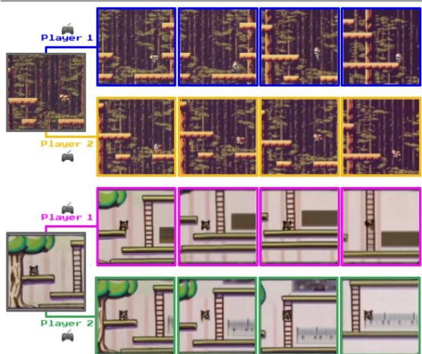
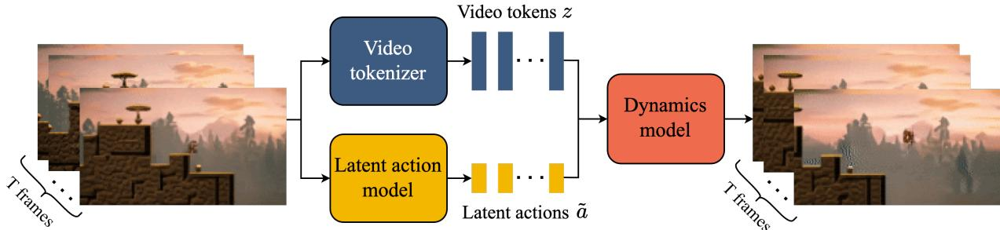
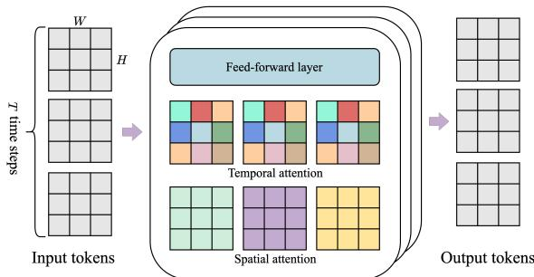
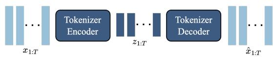
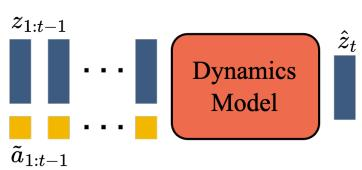
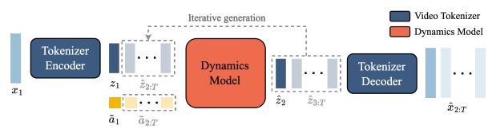
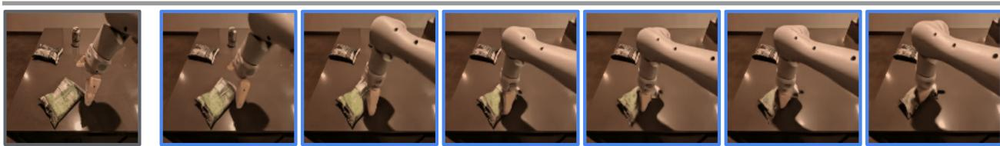
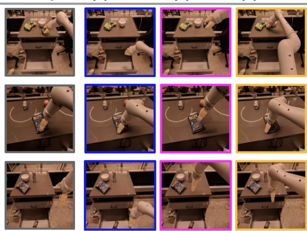
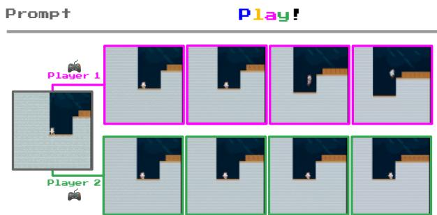
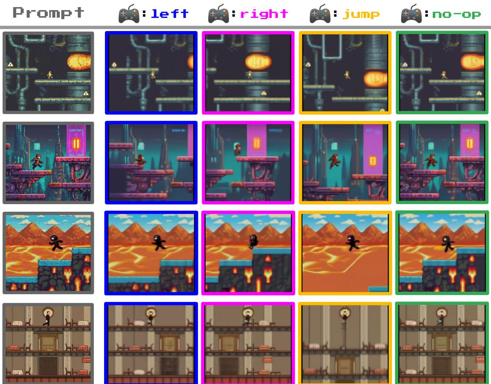

# Genie: Generative Interactive Environments（Genie：生成式交互环境）

Jake Bruce\*,1, Michael Dennis\*,1, Ashley Edwards\*,1, Jack Parker-Holder\*,1, Yuge (Jimmy) Shi\*,1, Edward Hughes1, Matthew Lai1, Aditi Mavalankar1, Richie Steigerwald1, Chris Apps1, Yusuf Aytar1, Sarah Bechtle1, Feryal Behbahani1, Stephanie Chan1, Nicolas Heess1, Lucy Gonzalez1, Simon Osindero1, Sherjil Ozair1, Scott Reed1, Jingwei Zhang1, Konrad Zolna1, Jef Clune1,2, Nando de Freitas1, Satinder Singh1 and Tim Rocktäschel\*,1

同等贡献, 1Google DeepMind, 2University of British Columbia

Figure 1 | 全新的世界：Genie 能够将各种不同的提示转化为交互式、可游玩的环境，这些环境可以轻松创建、进入和探索。这是通过一个完全以无监督方式从互联网视频中学习到的潜在动作接口实现的。在右侧，我们看到了执行两个潜在动作所生成的若干步。更多示例见我们的网站。

我们提出了 Genie，这是首个通过无监督方式在未标注互联网视频上训练得到的生成式交互环境。该模型可以通过提示生成无穷无尽的动作可控虚拟世界，这些世界可以通过文本、合成图像、真实照片乃至草图进行描述。拥有 110 亿（11B）参数的 Genie 可以被视为一个基础世界模型（foundation world model）。它由一个时空视频分词器（spatiotemporal video tokenizer）、一个自回归动力学模型（autoregressive dynamics model）以及一个简单且可扩展的潜在动作模型（latent action model）组成。尽管在训练过程中没有任何真实的动作标签（ground-truth action labels）或世界模型文献中通常所需的其他特定领域要求，Genie 仍允许用户逐帧在生成的环境中进行交互操作。此外，由此学到的潜在动作空间有助于训练智能体（agent）模仿未见视频中的行为，为训练未来的通用智能体（generalist agent）开辟了道路。

关键词：生成式人工智能（Generative AI）、基础模型（Foundation Models）、世界模型（World Models）、视频模型（Video Models）、开放性（Open-Endedness）

## 1. 引言

过去几年见证了生成式人工智能（generative AI）的兴起，各类模型展现出了生成新颖且富有创意内容的能力。在 Transformer 等架构突破（Vaswani et al., 2017）、硬件进步以及近期对扩展模型和数据集规模的重视推动下，我们现在能够生成连贯的对话式语言（Brown et al., 2020; Radford et al., 2018, 2019），并能根据文本提示生成清晰且美观的图像（Ramesh et al., 2021, 2022; Rombach et al., 2022; Saharia et al., 2022）。早期迹象表明，视频生成将是另一个新前沿，最新成果表明此类模型同样能够从规模扩展中获益（Blattmann et al., 2023a; Esser et al., 2023; Ho et al., 2022a; Hong et al., 2023）。然而，视频生成模型与 ChatGPT 等语言工具的交互与参与水平之间仍存在巨大差距，更不用说更具沉浸感的体验了。

如果给定来自互联网的大规模视频语料库，我们不仅能够训练出可以生成新颖图像或视频的模型，还能生成完整的交互式体验，那会怎样？我们提出了生成式交互环境（generative interactive environments），这是生成式人工智能的一种新范式，能够从单个文本或图像提示生成交互式环境。我们的方法 Genie 是基于超过 200,000 小时的公开互联网游戏视频组成的大型数据集训练的，尽管在训练过程中没有任何动作或文本标注，但它可以通过学习到的潜在动作空间实现逐帧控制（与其他方法的比较见 Table 1）。Genie 拥有 11B 参数，展现出了基础模型（foundation models）中常见的特性——它可以将未见过的图像作为提示，从而使创建并游玩完全构想出来的虚拟世界成为可能（例如 Figure 2）。

Genie 借鉴了前沿视频生成模型（Gupta et al., 2023; Villegas et al., 2023）的思想，其核心设计选择是时空（ST）Transformer（Xu et al., 2020），该结构被应用于我们所有的模型组件中。Genie 采用了一种新颖的视频分词器（video tokenizer），并通过因果动作模型提取潜在动作。视频 token 和潜在动作

提示（Prompt）

开始游玩！（Play!）  
  
Figure 2 | 多样化轨迹：Genie 是一种可用作交互式环境的生成模型。该模型可以通过多种方式进行提示，既可以使用生成的图像（顶部），也可以使用手绘草图（底部）。在每个时间步，模型接收用户提供的潜在动作来生成下一帧，从而生成具有丰富且多样的角色动作轨迹。

被传递给一个动力学模型，该模型使用 MaskGIT (Chang et al., 2022) 自回归地预测下一帧。我们针对批次大小和模型大小对我们的架构进行了严格的扩展性分析，模型参数量从 40M 到 2.7B 不等。结果表明，我们的架构随着计算资源的增加能够平稳扩展，最终形成了一个 11B 参数量的模型。我们在从数百款 2D 平台游戏中过滤出的 30,000 小时网络游戏视频数据集上训练了 Genie，为该设定生成了一个基础世界模型。

为了展示我们方法的通用性，我们还在 RT1 数据集 (Brohan et al., 2023) 中无动作标注的机器人视频上训练了一个独立的模型，学习到了一个具有一致潜在动作的生成式环境。最后，我们展示了从网络视频中学习到的潜在动作可用于从模拟强化学习（reinforcement learning, RL）环境中未见过的无动作视频中推断策略，这表明 Genie 可能是解锁无限数据以训练下一代通用智能体（generalist agents）的关键 (Bauer et al., 2023; Clune, 2019; Open Ended Learning Team et al., 2021; Reed et al., 2022)。

Table 1 | 一类新型生成模型：Genie 是一种新颖的视频与世界模型，可在逐帧级别进行控制，且在训练时仅需要视频数据。

<table><tr><td>模型类别</td><td>训练数据</td><td>可控性</td></tr><tr><td>世界模型</td><td>视频 + 动作</td><td>帧级别</td></tr><tr><td>视频模型</td><td>视频 + 文本</td><td>视频级别</td></tr><tr><td>Genie</td><td>视频</td><td>帧级别</td></tr></table>

## 2. 方法

Genie 是一个仅通过纯视频数据训练的生成式交互环境。在本节中，我们首先介绍预备知识，然后再阐述模型的主要组件。

Genie 架构中的若干组件基于 Vision Transformer (ViT) (Dosovitskiy et al., 2021; Vaswani et al., 2017)。值得注意的是，Transformer 的二次方内存开销对可能包含多达 $O ( 1 0 ^ { 4 } )$ 个 token 的视频带来了挑战。因此，我们在所有模型组件中采用了一种内存高效的时空 Transformer（ST-transformer）架构（受 Xu et al. (2020) 启发，见 Figure 4），以平衡模型容量与计算约束。

与每个 token 都关注所有其他 token 的传统 Transformer 不同，ST-transformer 包含  个时空块（spatiotemporal blocks），其中空间注意力层和时间注意力层相互交错，随后连接一个作为标准注意力块的前馈层（FFW）。空间层中的自注意力关注每个时间步内的 $1 \times H \times W$ 个 token，而时间层中的自注意力则跨越  个时间步关注 $T \times 1 \times 1$ 个 token。与序列 Transformer 类似，时间层采用带有因果掩码的因果结构。至关重要的是，在我们架构中占据主导地位的计算复杂度因素（即空间注意力层）随帧数呈线性增长而非二次方增长，这使得它在长时间交互中具有一致动态特性的视频生成上更加高效。此外，需要注意的是，在 ST 块中，我们仅在空间和时间组件之后包含一个 FFW，省略了空间后的 FFW，以便扩展模型的其他组件，我们观察到这显著改善了结果。

## 2.1. 模型组件

如图 Figure 3 所示，我们的模型包含三个关键组件：1）一个潜在动作模型（latent action model），用于推断每对帧之间的潜在动作 ；2）一个视频分词器（video tokenizer），将原始视频帧转换为离散 token ；3）一个动力学模型（dynamics model），在给定潜在动作和过去帧 token 的情况下，预测视频的下一帧。该模型遵循标准的自回归视频生成流程分两个阶段进行训练：我们首先训练视频分词器，用于动力学模型。然后，我们联合训练潜在动作模型（直接基于像素）和动力学模型（基于视频 token）。

潜在动作模型（Latent Action Model, LAM） 为了实现可控视频生成，我们将每个未来帧的预测建立在前一帧所采取的动作条件之上。然而，来自互联网的视频中很少具有此类动作标签，且动作标注的获取成本高昂。相反，我们以完全无监督的方式学习潜在动作（见 Figure 5）。

首先，编码器将所有先前帧 $\pmb { x } _ { 1 : t } = \left( x _ { 1 } , \cdot \cdot \cdot x _ { t } \right)$ 以及下一帧 $x _ { t + 1 }$ 作为输入，并输出对应的一组连续潜在动作 $\tilde { \pmb { a } } _ { 1 : t } = ( \tilde { a } _ { 1 } , \cdot \cdot \cdot \tilde { a } _ { t } )$。然后，解码器将所有先前帧和潜在动作作为输入，并预测下一帧 $\hat { x } _ { t + 1 }$

为了训练该模型，我们利用了基于 VQ-VAE 的目标函数（van den Oord et al., 2017），这使我们能够将预测动作的数量限制在一组较小的离散代码中。我们将 VQ 码本（codebook）的词表大小 ||（即可能的最大潜在动作数量）限制为一个较小的值，以实现人类可玩性并进一步增强可控性（我们在实验中使用 $| { \cal A } | = 8$）。由于解码器只能访问历史帧和潜在动作，因此 $\tilde { a } _ { t }$ 应当对过去与未来之间最有意义的变化进行编码，以使解码器能够成功重建未来帧。请注意，该解码器的存在仅是为了向 LAM（潜在动作模型）提供训练信号。事实上，在推理阶段，除了 VQ 码本之外，整个 LAM 都会被丢弃，并由用户的动作替代。

  
Figure 3 | Genie 模型训练：Genie 接收  帧视频作为输入，通过视频分词器（video tokenizer）将其离散化为离散 token ，并通过潜在动作模型推断每帧之间的潜在动作 ˜。随后，两者都被传递给动力学模型（dynamics model），以迭代方式生成对下一帧的预测。

Figure 4 | ST-transformer 架构。该架构由  个时空块组成，每个块包含一个空间层、一个时间层和一个前馈层。每种颜色代表单个自注意力图，其中空间层在单个时间步内的 $H \times W$ 个 token 上进行注意力计算，而时间层则跨越  个时间步在相同的 token 上进行注意力计算。  
  
Figure 5 | 潜在动作模型：以无监督的方式从未标注的视频帧中学习动作 $a _ { t }$。

我们将 ST-transformer 架构用于潜在动作模型。时间层中的因果掩码（causal mask）允许我们输入整个视频 $x _ { 1 : T }$，并生成每帧之间的所有潜在动作 $\tilde { \pmb { a } } _ { 1 : T - 1 }$

视频分词器（Video Tokenizer） 遵循先前的工作（Gupta et al., 2023; Villegas et al., 2023; Yan et al., 2023），我们将视频压缩为离散 token，以降低维度并实现更高质量的视频生成（见 Figure 6）。我们再次使用 VQ-VAE，它接收包含  帧的视频 $\pmb { x } _ { 1 : T } = ( x _ { 1 } , x _ { 2 } , \cdots , x _ { T } ) \in \mathbb { R } ^ { T \times H \times W \times C }$ 作为输入，为每一帧生成离散表示 $\mathfrak { z } _ { 1 : T } = \left( z _ { 1 } , z _ { 2 } , \cdot \cdot \cdot , z _ { T } \right) \in \mathbb { I } ^ { T \times D }$，其中  是离散潜在空间的大小。该分词器使用在整个视频序列上的标准 VQ-VQAE 目标函数进行训练。

  
Figure 6 | 视频分词器（Video tokenizer）：带有 ST-transformer 的 VQ-VAE。

与以往在分词阶段仅关注空间压缩的工作（Gupta et al., 2023; Hong et al., 2022; Wu et al., 2022）不同，我们在编码器和解码器中均采用了 ST-transformer，以将时间动态特性融入编码中，从而提升了视频生成质量。由于 ST-transformer 的因果特性，每个离散编码 ${ { \mathscr Z } _ { t } }$ 都包含了来自视频中所有先前已见帧 $x _ { 1 : t }$ 的信息。Phenaki（Villegas et al., 2023）同样使用了一种时间感知的分词器 C-ViViT，但该架构的计算开销巨大，其成本随帧数呈二次方增长——相比之下，我们基于 ST-transformer 的分词器（ST-ViViT）具有更高的计算效率，其主要计算成本随帧数呈线性增长。

  
Figure 7 | 动力学模型（Dynamics model）：接收视频 token 和动作嵌入，并预测未来被掩码的视频 token。

动力学模型（Dynamics Model） 动力学模型是一个仅包含解码器的 MaskGIT（Chang et al., 2022）transformer（Figure 7）。在每个时间步 $t \in [ 1 , T ]$ ，它接收分词后的视频 $\mathfrak { z } _ { 1 : t - 1 }$ 和停止梯度（stopgrad）的潜在动作 $\tilde { \mathbf { a } } _ { 1 : t - 1 }$ ，并预测下一帧的 token $\hat { \boldsymbol { z } } _ { t }$ 。我们再次采用了 ST-transformer，其因果结构使我们能够将来自所有 $( T - 1 )$ 帧的 token $\pmb { z } _ { 1 : T - 1 }$ 以及潜在动作 $\tilde { \pmb { a } } _ { 1 : T - 1 }$ 作为输入，并生成所有后续帧的预测 $\hat { \pmb { z } } _ { 2 : T }$ 。该模型通过预测 token $\hat { \pmb { z } } _ { 2 : T }$ 与真实 token $\mathfrak { z } _ { 2 : T }$ 之间的交叉熵损失进行训练。在训练时，我们根据在 0.5 到 1 之间均匀采样的伯努利分布掩码率，对输入 token $z _ { 2 : T - 1 }$ 进行随机掩码。需要注意的是，训练世界模型（包括基于 transformer 的模型）的常见做法是将时间步 $t$ 的动作与对应的帧拼接在一起（Micheli et al., 2023; Robine et al., 2023）。然而，我们发现将潜在动作作为加性嵌入（additive embeddings）输入到潜在动作模型和动力学模型中，有助于提高生成的可控性。

## 2.2. 推理：动作可控的视频生成

我们现在描述如何在推理阶段使用 Genie 进行动作可控的视频生成（见 Figure 8）。玩家首先向模型输入一张作为初始帧的图像 $x _ { 1 }$1。该图像使用视频编码器进行分词，生成 ${ \mathfrak { z } } _ { 1 }$ 。玩家随后通过在 $[ 0 , | { \cal A } | ) . ^ { 2 }$ 内选择任意整数值来指定要采取的离散潜在动作 。动力学模型接收帧标记  和对应的潜在动作 ${ \tilde { a } } _ { 1 } .$（通过使用离散输入 $a _ { 1 }$ 索引 VQ 码本获得），以预测下一帧标记 ${ \mathfrak { z } } _ { 2 }$ 。随着动作持续传递给模型，此过程以自回归方式重复进行以生成序列的其余部分 $\hat { \pmb { z } } _ { 2 : T }$，同时标记通过分词器的解码器解码为视频帧 $\hat { x } _ { 2 : T }$。注意，我们可以通过向模型传递起始帧和从视频中推断出的动作来从数据集中重新生成真实视频（ground truth videos），或者通过改变动作来生成全新的视频（或轨迹）。

  
Figure 8 | Genie 推理过程：提示帧被分词，与用户采取的潜在动作相结合，并传递给动力学模型进行迭代生成。预测出的帧标记随后通过分词器的解码器解码回图像空间。

## 3. 实验结果

数据集 我们在一个从公开的 2D 平台跳跃类游戏（2D Platformer games）网络视频中收集的大规模数据集上训练 Genie（以下简称“Platformers”）。我们通过针对与平台游戏相关的关键词过滤公开视频来构建 Platformers 数据集，得到 55M 个 10FPS、分辨率为 160x90 的 16 秒视频片段。最终数据集包含 6.8M 个 16 秒视频片段（3 万小时），与其他主流网络视频数据集（Bain et al., 2021; Wang et al., 2023）处于同一数量级。更多细节见附录 B.1。除非另有说明，结果均基于一个 11B 参数的模型

  
Figure 9 | 扩展（Scaling）结果。左：不同模型大小的训练曲线，中：每个模型大小的最终训练损失（在最后 300 次更新中取平均），右：具有不同批次大小的 2.3B 模型的最终训练损失。

在该数据集上训练所得。

为了验证我们方法的通用性，我们还考虑了用于训练 RT1 Brohan et al. (2023) 的机器人数据集，将其包含约 130 机器人演示的数据集与仿真数据的独立数据集以及来自先前工作（Kalashnikov et al., 2018）的 209k 个回合的真实机器人数据相结合。注意，我们不使用这些数据集中的任何动作，仅将其视为视频。为简便起见，以下我们将该数据集称为“Robotics”。

评估指标 我们通过两个因素来检验 Genie 的视频生成性能，即视频保真度（video fidelity，即视频生成的质量）和可控性（controllability，即潜在动作对视频生成的影响程度）。对于视频保真度，我们使用弗雷歇视频距离（Frechet Video Distance, FVD），这是一种视频级别的指标，已被证明与人类对视频质量的评估具有高度一致性（Unterthiner et al., 2019）。对于可控性，我们设计了一种基于峰值信噪比（PSNR）的指标，称之为 $\Delta _ { t } \mathrm { P S N R }$，用于衡量以从真实数据推断出的潜在动作（ˆ）为条件与从随机分布采样的潜在动作（ˆ′）为条件时生成的视频之间的差异程度：

$$
\Delta_ {t} \mathrm{PSNR} = \mathrm{PSNR} (x _ {t}, \hat {x} _ {t}) - \mathrm{PSNR} (x _ {t}, \hat {x} _ {t} ^ {\prime}),
$$

其中 $x _ { t }$ 表示在时间 $t$ 的真实帧，$\hat { x } _ { t }$ 表示由从真实帧推断出的潜在动作 $\tilde { \mathbf { a } } _ { 1 : t }$ 生成的帧，而 $\hat { x } _ { t } ^ { \prime }$ 表示由从分类分布中随机采样的潜在动作序列生成的相同帧。因此，$\Delta _ { t }$ PSNR 越大，从随机潜在动作生成的视频与真实情况的差异就越大，这表明潜在动作具有更高程度的可控性。在所有实验中，我们报告 $t = 4$ 时的 ΔPSNR。

训练细节 我们的视频分词器（video tokenizer）使用 200M 参数、大小为 4 的图像块（patch size），以及嵌入维度为 32 且包含 1024 个唯一样本的码本（codebook），在分词器的重建质量与视频预测的下游性能之间的权衡下，我们发现这种配置最为有效。潜在动作模型（latent action model）拥有 300M 参数、大小为 16 的图像块，以及嵌入维度为 32 且包含 8 个唯一码（潜在动作）的码本。对于所有建模组件，我们均使用帧率为 10 FPS、长度为 16 帧的序列。此外，我们采用 bfloat16 和 QK norm 来训练我们的动力学模型（dynamics model），这已被证明可以在大规模训练中提高稳定性（Dehghani et al., 2023; Henry et al., 2020）。在推理时，我们对每一帧执行 25 步 MaskGIT 采样，采样温度为 2 并采用随机采样。更多细节见附录 C。

## 3.1. 扩展结果

在本节中，我们研究模型的扩展（scaling）行为。为此，我们开展了探索模型大小和批次大小（batch size）影响的研究。有关架构和计算资源使用的更多详细信息，请参见附录 D。

扩展模型规模 在给定固定的视频分词器（video tokenizer）和动作模型架构的情况下，我们训练了一系列参数量从 40M 到 2.7B 不等的动力学模型（dynamics models）。Figure 9 展示了我们的架构随着模型参数的增加而平稳扩展，每一次规模的提升都对应着最终训练损失的持续下降。这有力地表明我们的方法从规模扩展中获益，我们在主要的 Genie 模型中充分利用了这一特性。

  
Figure 10 | 根据图像提示进行游玩：我们可以使用由文本到图像模型生成的图像、手绘草图或现实世界照片来提示 Genie。在每种情况下，我们展示了提示帧以及连续执行某种潜在动作四次后的第二帧。在每种情况下，我们都能看到清晰的角色移动，尽管其中一些图像在视觉上与数据集有明显差异。

扩展批次大小 我们还研究了扩展批次大小（batch size）的影响，考察了一个 2.3B 模型在批次大小分别为 128、256 和 448 时的表现，这分别相当于 1.9M、3.8M 和 6.6M 个 token。如 Figure 9 所示，增加批次大小在模型性能方面同样带来了显著的提升。

Genie 模型 显然，同时增加模型规模和批次大小有助于提升模型性能。因此，对于我们的最终模型，我们使用 256 块 TPUv5p，在批次大小为 512 的情况下训练了一个 10.1B 的动力学模型，总计训练了 125k 步。当与分词器和动作模型结合时，总参数量达到 10.7B，并在 942B 个 token 上进行了训练，我们将其称为 Genie 模型。对于我们的网站，我们训练了一个更大的解码器将 token 映射为 360p 视频，增加了额外的参数。

## 3.2. 定性结果

我们现在展示 Genie 模型的定性结果。我们展示了一个在 Platformers 数据集上训练的 11B 参数模型，以及一个在 Robotics 数据集上训练的较小模型。我们的模型在不同领域都能生成高质量、可控的视频。值得注意的是，我们仅使用分布外（out-of-distribution, OOD）图像提示对在 Platformers 上训练的模型进行了定性评估，包括由文本到图像模型生成的图像、手绘草图，乃至逼真的照片。能够泛化到此类显著超出分布的输入，凸显了我们方法的鲁棒性，以及在大规模数据上进行训练的价值——而如果以真实动作作为输入，这在大规模数据上是无法实现的。

在 Platformers 上训练的模型 Figure 10 展示了我们的模型由 OOD 图像提示生成的示例，包括（顶行）由 Imagen2（Ho et al., 2022a; van den Oord et al.）生成的图像、（第二行）手绘草图以及（底行）现实世界的照片。Genie 能够让这些想象中的世界栩栩如生，我们在与每个示例交互时都能看到类似游戏的行为。我们在 Appendix A 中展示了更多由我们模型生成的示例，并进一步强调了潜在动作的一致性。

提示词 (Prompt)  
生成内容 (Generated)  
  
Figure 11 | 学习模拟可变形物体：我们展示了模型中执行相同动作的十步轨迹中的帧。Genie 能够学习诸如薯片袋等物体的物理特性。

  
Figure 12 | 模拟视差，这是平台跳跃类游戏中的常见特征。从这张由文本生成的初始图像开始，前景的移动幅度大于近景和远景中景，而背景仅发生轻微移动。

我们模型的另一项涌现能力是理解 3D 场景并模拟视差的能力，这在平台跳跃类游戏中很常见。在 Figure 12 中，我们展示了一张由 Imagen2 生成的图像，其中执行潜动作会使前景和背景以不同的速率移动（如不同颜色箭头的长度所示）。

**机器人训练模型** 我们使用在 Platformers 数据集上验证的最佳超参数，在 Robotics 数据集上训练了一个 2.5B 参数的模型，在测试集上达到了 82.7 的 FVD。如 Figure 13 所示，该模型成功从视频数据中学习到了明确且一致的动作，既不需要文本标签也不需要动作标签（例如区别于 Yang et al. (2023)）。值得注意的是，我们的模型不仅学会了机械臂的控制，还学会了各种物体的交互和形变（Figure 11）。我们相信这表明，我们的方法提供了一条利用互联网上更大的视频数据集来创建机器人基础世界模型的途径，并具有可用于各种应用的低级可控模拟。

提示词 (Prompt)  
: 向下 (down)  
: 向上 (up)  
: 向左 (left)  
  
Figure 13 | 机器人领域中可控、一致的潜动作：从 Robotics 数据集的三个不同起始帧开始的轨迹。每一列显示了连续执行相同潜动作五次后的生成帧。尽管在训练时没有动作标签，但相同的动作在不同提示帧之间保持一致，并具有语义含义：向下、向上和向左。

## 3.3. 智能体训练

我们相信 Genie 有朝一日可以作为基础世界模型用于训练通用智能体（generalist agents）。在 Figure 14 中，我们展示了该模型已经可用于在给定起始帧的情况下，在未见过的强化学习（RL）环境中生成多样化的轨迹。我们进一步研究了从……学习到的潜动作是否

互联网视频可用于模仿未见视频中的行为。我们使用一个冻结的 LAM 来为来自目标环境的专家视频序列标注离散潜在动作，然后训练一个策略，该策略根据给定的观察预测专家采取潜在动作的似然。接着，我们使用一个带有专家真值动作的小数据集来将潜在动作映射到真实动作（详见附录 E）。

  
Figure 14 | 在强化学习（RL）环境中游玩：给定未见强化学习环境的一张图像，Genie 能够生成多样的轨迹。

我们在程序化生成的 2D 平台游戏环境 CoinRun (Cobbe et al., 2020) 的困难和简单设置下进行评估，并与作为上限、可访问专家动作的预言机行为克隆（behavioral cloning，BC）模型以及作为下限的随机智能体进行对比（Figure 15）。尽管几乎肯定以前从未见过 CoinRun，基于 LAM 的策略在仅给定 200 个专家样本进行适应的情况下就达到了与预言机相同的分数。这证明了所学到的潜在动作是一致且对迁移有意义的，因为从潜在动作到真实动作的映射不包含关于当前观察的任何信息。

## 3.4. 消融研究

潜在动作模型的设计选择 在设计我们的潜在动作模型时，我们仔细考虑了要使用的输入类型。虽然我们最终选择使用原始图像（像素），但我们将这一选择与使用词元化图像（在 Figure 5 中将 x 替换为 z）的备选方案进行了对比评估。我们将这种备选方法称为“token-input”模型（见 Table 2）。

尽管该模型在 Platformers 数据集上取得了略低的 FVD 分数，但它在 Robotics 数据集上并未保持这一优势。更重要的是，在两个环境中，tokeninput 模型表现出更差的可控性（以 ΔPSNR 衡量）。这表明在词元化过程中可能丢失了关于视频动力学和运动的某些信息，因此潜在动作模型将原始视频作为输入是有益的。

  
Proprietary + ConfidentialFigure 15 | BC 结果。100 个样本中通关关卡的平均百分比，在 5 个随机种子下取平均，并带有 95% 置信区间。

Table 2 | 潜在动作模型输入消融实验。我们可以看到 Genie 实现了更高的可控性。

<table><tr><td></td><td>数据集</td><td>#Params</td><td>FVD (↓)</td><td> $\Delta_{\text{t}}$ PSNR(↑)</td></tr><tr><td>Token 输入</td><td>Platforms</td><td>2.3B</td><td>38.8</td><td>1.33</td></tr><tr><td>像素输入 (Genie)</td><td>Platforms</td><td>2.5B</td><td>40.1</td><td>1.91</td></tr><tr><td>Token 输入</td><td>Robotics</td><td>1B</td><td>257.8</td><td>1.65</td></tr><tr><td>像素输入 (Genie)</td><td>Robotics</td><td>1B</td><td>136.4</td><td>2.07</td></tr></table>

Tokenizer 架构消融实验 我们比较了三种 Tokenizer 选择的性能，包括 1)（仅空间）ViT、2)（时空）ST-ViViT 以及 3)（时空）C-ViViT（Table 3）。为了进行对比，我们在所有 Tokenizer 中使用了相近的参数量，patch 大小为 10，批大小为 128，序列长度为 16。然后，我们在这三种不同的 Tokenizer 上训练相同的动力学和潜在动作模型，并报告它们的 FVD 以及 $\Delta _ { t }$ PSNR。

Table 3 | Tokenizer 架构消融实验：我们的 ST-ViViT 架构取得了最佳的 Tokenizer 性能。

<table><tr><td></td><td>#Params</td><td>显存</td><td>FVD (↓)</td><td> $\Delta_{\text{r}}$ PSNR(↑)</td></tr><tr><td>ViT</td><td>230M</td><td>0.3GB</td><td>114.5</td><td>1.39</td></tr><tr><td>C-ViViT (Villegas et al., 2023)</td><td>225M</td><td>1.6GB</td><td>272.7</td><td>1.37</td></tr><tr><td>ST-ViViT (ours)</td><td>205M</td><td>0.9GB</td><td>81.4</td><td>1.66</td></tr></table>

与 C-ViViT 和仅空间的 ViT 相比，我们提出的 ST-ViViT 架构在合理的显存权衡下，同时提升了视频生成质量（FVD）和 ΔPSNR。这分别展示了其生成高保真度和高可控性视频的能力。虽然 C-ViViT 采用了完全的时空注意力机制，导致在相同参数量下显存消耗显著高于其他两种架构，但这并未转化为性能的提升。事实上，C-ViViT 表现出了过拟合的倾向，需要在训练期间进行强正则化，这或许可以解释其性能明显较低的原因。

## 4. 相关工作

世界模型（World models） 生成式交互环境可被视为一类世界模型（Ha and Schmidhuber, 2018; Oh et al., 2015），它们能够基于动作输入进行以动作为条件的下一帧预测（Bamford and Lucas, 2020; Chiappa et al., 2017; Eslami et al., 2018; Hafner et al., 2020, 2021; Kim et al., 2020, 2021; Micheli et al., 2023; Nunes et al., 2020; Pan et al., 2022; Robine et al., 2023）。此类模型对于训练智能体（agent）非常有用，因为它们可用于在智能体训练期间无需直接与环境交互即可学习策略。然而，学习模型本身通常需要直接从环境中获取的以动作为条件的数据。相比之下，我们的方法旨在仅从视频中以无监督方式学习世界模型。最近，人们重新开始重视扩大世界模型的规模。GAIA-1（Hu et al., 2023）和 UniSim（Yang et al., 2023）分别学习了用于自动驾驶和机器人操控的世界模型。这些方法同时需要文本和动作标签，而我们则专注于仅使用来自公开互联网视频的纯视频数据进行训练。

视频模型（Video models） 我们的工作与视频模型相关，这类模型通常以初始帧（或文本）为条件，并预测视频中的其余帧（Blattmann et al., 2023b; Brooks et al., 2024; Clark et al., 2019; Finn et al., 2016; Ho et al., 2022a,b; Höppe et al., 2022; Kalchbrenner et al.,

2017; Le Moing et al., 2021; Lotter et al., 2017; Luc et al., 2020; Singer et al., 2023; Walker et al., 2021; Yan et al., 2021; Yu et al., 2023）。我们的方法与近期基于 Transformer 的模型最为相似，例如 Phenaki（Villegas et al., 2023）、TECO（Yan et al., 2023）和 MaskViT（Gupta et al., 2023），因为我们在标记化（tokenized）图像上使用了 MaskGIT（Chang et al., 2022）和 ST-Transformer（Xu et al., 2020）。尽管视频模型正变得越来越可控（例如 (Huang et al., 2022)），但我们追求更具智能体属性的目标，并显式地从数据中学习潜在动作空间，从而允许用户或智能体使用以潜在动作为条件的预测来“游玩（play）”该模型。

可交互式视频生成（Playable Video Generation） Genie 推广拓展了可交互式视频生成（Playable Video Generation，简称 PVG）（Menapace et al., 2021），其中潜在动作被用于控制直接从视频中学习到的世界模型（Menapace et al., 2021, 2022）。与 Genie 相比，PVG 考虑的是特定领域的静态样例，而不是通过提示（prompting）生成全新的环境。因此，拓展到这一设定之外需要重大的架构革新，放弃归纳偏置以换取通用方法。

环境生成 我们的工作还与程序化内容生成（Procedural Content Generation，PCG，例如 Risi 和 Togelius，2020a,b）相关，在这一领域中，机器学习已被证明在生成游戏关卡方面非常有效（Summerville 等人，2018），最近还通过直接编写游戏代码的语言模型来实现（Sudhakaran 等人，2023；Todd 等人，2023）。语言模型本身也可以被视为交互式环境（Wong 等人，2023），尽管缺乏视觉组件。相比之下，在我们的设定中，关卡可以直接从像素中学习和生成，这使我们能够利用互联网视频数据的多样性。

使用潜在动作训练智能体 之前的研究曾使用潜在动作进行基于观察的模仿（Edwards 等人，2019）、规划（Rybkin\* 等人，2019）以及预训练 RL 智能体（Schmidt 和 Jiang，2024；Ye 等人，2022）。这些方法与我们的潜在动作模型有着相似的目标，但尚未在规模上进行应用。VPT（Baker 等人，2022）是一种近期的方法，它使用从人类提供的带有动作标签的数据中学习到的逆动力学模型，为互联网规模的视频标记动作，进而可用于训练策略。相比之下，我们展示了可以使用从互联网视频中学习到的潜在动作来推断任意环境的策略，从而避免了对成本高昂且可能无法泛化的真实标注动作（ground-truth actions）的需求。

## 5. 结论与未来工作

我们提出了 Genie，一种新型生成式 AI，它使任何人（甚至儿童）都能构想、创造并步入生成的世界中，就像我们在人类设计的模拟环境中一样。尽管仅在纯视频数据上进行训练，Genie 仍可以通过提示生成多样化、可交互且可控的环境。

该模型显然还有改进的空间。Genie 继承了其他自回归 Transformer 模型的一些缺点，可能会幻觉生成不现实的未来。虽然我们在时空表征方面取得了进展，但我们仍受限于 16 帧的记忆容量，这使得在长时程上获得一致的环境变得极具挑战。最后，Genie 目前运行速度约为 1FPS，需要未来的技术进步来达到适用于交互的高效帧率。

尽管如此，我们相信 Genie 为未来的研究开辟了巨大的潜力。鉴于其通用性，该模型可以在更大比例的互联网视频上进行训练，以模拟多样、真实且富有想象力的环境。此外，我们仅简要探讨了使用 Genie 训练智能体的能力，但鉴于缺乏丰富多样的环境是强化学习（RL）的关键局限之一，我们可以开启创造具备更通用能力的智能体的新路径。

## 更广泛的影响

社会影响：Genie 能够让广大群体生成属于他们自己的类游戏体验。这对于那些希望以全新方式表达创造力的人群（例如能够设计并踏入自己想象世界的儿童）具有积极意义。我们也认识到，随着重大进展的取得，探索利用该技术来增强现有的人类游戏生成与创造力——并赋能相关行业利用 Genie 推动其下一代可游玩世界的发展——将变得至关重要。

训练数据与权重：我们选择不随本论文或网站发布已训练的模型检查点（checkpoints）、模型的训练数据集或来自该数据的示例。我们希望有机会与研究（及电子游戏）社区进一步交流，并确保未来的任何此类发布都是尊重他人、安全且负责任的。

复现性：我们理解，计算资源较少的研究人员要复现我们的主要结果可能会面临挑战。为了缓解这一问题，我们在附录 F 中描述了一个小规模且完全可复现的示例，它可以在单个中端 TPU（或 GPU）上运行。鉴于许多设计选择在这两种设置之间是相通的，我们相信这将使更广泛的社区能够研究未来的架构改进以及由我们的工作所带来的其他研究方向。

## 致谢

我们感谢 Mateusz Malinowski、Philip Ball 和 Louis Kirsch 审阅本论文初稿；感谢 Cassidy Hardin、David Bridson、Eric Lau、Lars Lowe Sjoesund、Lucas Smaira 和 Bernardo Avila Pires 在 Platformers 数据集方面提供的帮助；感谢 Ruben Villegas 在视频模型训练和评估方面进行的宝贵讨论；并感谢 Adrian Bolton、Rushil Mistry、Hannah Openshaw、Zoubin Ghahramani、Raia Hadsell、Koray Kavukcuoglu、Daan Wierstra、Doina Precup 和 Ed Hirst 提供的战略建议与指导。我们使用了 DeepMind Jax 生态系统（Babuschkin et al., 2010），特别感谢 Andy Brock 构建了我们用于模型训练的内部框架，以及 Arthur Brussee 提供了一个初始界面使我们能够“游玩”我们的模型。最后，感谢 Seneca Clune 和 Caspian Clune 的创意草图，这可能使他们成为有史以来最年轻的游戏设计师。

## 作者贡献

作者按姓氏字母顺序排列。所有通信请联系 Ashley Edwards（edwardsashley@google.com）和 Jack Parker-Holder（jparkerholder@google.com）。

## 核心贡献者

• Jake Bruce：项目领导、视频标记器（video tokenizer）研究、动作模型研究、动力学模型研究、模型扩展（scaling）、模型演示（demo）、基础设施

• Michael Dennis：动力学模型研究、模型扩展、评估指标、模型演示、基础设施

• Ashley Edwards：Genie 概念提出、项目领导、动作模型研究、智能体（agent）训练、模型演示

• Edward Hughes：动力学模型研究、基础设施

• Matthew Lai: 数据集整理, 基础设施

• Aditi Mavalankar: 动作模型研究, 评估指标, 智能体训练

• Jack Parker-Holder: Genie 概念, 项目领导, 动力学模型研究, 扩展, 数据集整理

• Yuge (Jimmy) Shi: 视频分词器研究, 动力学模型研究, 数据集整理, 评估指标

• Richie Steigerwald: 数据集整理, 评估指标

## 部分贡献者与顾问

• Chris Apps: 项目管理

• Yusuf Aytar: 技术建议

• Sarah Bechtle: 技术建议

• Feryal Behbahani: 战略建议

• Stephanie Chan: 技术建议

• Jef Clune: 技术建议, 战略建议

• Lucy Gonzalez: 项目管理

• Nicolas Heess: 战略建议

• Simon Osindero: 技术建议

• Sherjil Ozair: 技术建议

• Scott Reed: 技术建议

• Jingwei Zhang: 技术建议

• Konrad Zolna: 扩展, 技术建议

## 发起人与支持者

• Nando de Freitas: 战略建议

• Tim Rocktäschel: Genie 概念, 项目领导

• Satinder Singh: 战略建议

## 参考文献

I. Babuschkin, K. Baumli, A. Bell, S. Bhupatiraju, J. Bruce, P. Buchlovsky, D. Budden, T. Cai, A. Clark, I. Danihelka, et al. The deepmind jax ecosystem, 2020. URL http://github. com/deepmind, 2010.

M. Bain, A. Nagrani, G. Varol, and A. Zisserman. Frozen in time: A joint video and image encoder for end-to-end retrieval. In 2021 IEEE/CVF International Conference on Computer Vision (ICCV), pages 1708–1718, Los Alamitos, CA, USA, oct 2021. IEEE Computer Society. doi: 10.1109/ICCV48922. 2021.00175.

B. Baker, I. Akkaya, P. Zhokov, J. Huizinga, J. Tang, A. Ecofet, B. Houghton, R. Sampedro, and J. Clune. Video pretraining (vpt): Learning to act by watching unlabeled online videos. Advances in Neural Information Processing Systems, 35:24639–24654, 2022.

C. Bamford and S. M. Lucas. Neural game engine: Accurate learning ofgeneralizable forward models from pixels. In Conference on Games, 2020.

J. Bauer, K. Baumli, F. Behbahani, A. Bhoopchand, N. Bradley-Schmieg, M. Chang, N. Clay, A. Collister, V. Dasagi, L. Gonzalez, K. Gregor, E. Hughes, S. Kashem, M. Loks-Thompson, H. Openshaw, J. Parker-Holder, S. Pathak, N. Perez-Nieves, N. Rakicevic, T. Rocktäschel, Y. Schroecker, S. Singh, J. Sygnowski, K. Tuyls, S. York, A. Zacherl, and L. M. Zhang. Human-timescale adaptation in an open-ended task space. In A. Krause, E. Brunskill, K. Cho, B. Engelhardt, S. Sabato, and J. Scarlett, editors, Proceedings of the 40th International Conference on Machine Learning, volume 202 of Proceedings of Machine Learning Research, pages 1887–1935. PMLR, 23–29 Jul 2023.

A. Blattmann, T. Dockhorn, S. Kulal, D. Mendelevitch, M. Kilian, D. Lorenz, Y. Levi, Z. English, V. Voleti, A. Letts, V. Jampani, and R. Rombach. Stable video difusion: Scaling latent video difusion models to large datasets, 2023a.

A. Blattmann, R. Rombach, H. Ling, T. Dockhorn, S. W. Kim, S. Fidler, and K. Kreis. 对齐潜变量：基于潜扩散模型的高分辨率视频合成（Align your latents: High-resolution video synthesis with latent diffusion models）. 2023 IEEE/CVF Conference on Computer Vision and Pattern Recognition (CVPR), 第 22563–22575 页, 2023b.

A. Brohan, N. Brown, J. Carbajal, Y. Chebotar, J. Dabis, C. Finn, K. Gopalakrishnan, K. Hausman, A. Herzog, J. Hsu, J. Ibarz, B. Ichter, A. Irpan, T. Jackson, S. Jesmonth, N. J. Joshi, R. Julian, D. Kalashnikov, Y. Kuang, I. Leal, K.-H. Lee, S. Levine, Y. Lu, U. Malla, D. Manjunath, I. Mordatch, O. Nachum, C. Parada, J. Peralta, E. Perez, K. Pertsch, J. Quiambao, K. Rao, M. Ryoo, G. Salazar, P. Sanketi, K. Sayed, J. Singh, S. Sontakke, A. Stone, C. Tan, H. Tran, V. Vanhoucke, S. Vega, Q. Vuong, F. Xia, T. Xiao, P. Xu, S. Xu, T. Yu, and B. Zitkovich. RT-1：用于大规模真实世界控制的机器人 Transformer（Rt-1: Robotics transformer for real-world control at scale）. 收录于 Robotics: Science and Systems, 2023.

T. Brooks, B. Peebles, C. Homes, W. DePue, Y. Guo, L. Jing, D. Schnurr, J. Taylor, T. Luhman, E. Luhman, C. W. Y. Ng, R. Wang, and A. Ramesh. 作为世界模拟器的视频生成模型（Video generation models as world simulators）. 2024. URL https://openai.com/research/video-generation-models-as-world-simulators.

T. Brown, B. Mann, N. Ryder, M. Subbiah, J. D. Kaplan, P. Dhariwal, A. Neelakantan, P. Shyam, G. Sastry, A. Askell, et al. 语言模型是少样本学习者（Language models are few-shot learners）. Advances in Neural Information Processing Systems, 33:1877–1901, 2020.

H. Chang, H. Zhang, L. Jiang, C. Liu, and W. T. Freeman. MaskGIT：掩码生成式图像 Transformer（Maskgit: Masked generative image transformer）. 收录于 Proceedings of the IEEE/CVF Conference on Computer Vision and Pattern Recognition (CVPR), 第 11315–11325 页, 2022年6月.

S. Chiappa, S. Racaniere, D. Wierstra, and S. Mohamed. 循环环境模拟器（Recurrent environment simulators）. 收录于 International Conference on Learning Representations, 2017.

A. Clark, J. Donahue, and K. Simonyan. 复杂数据集上的高效视频生成（Efficient video generation on complex datasets）. CoRR, abs/1907.06571, 2019. URL http://arxiv.org/abs/1907.06571.

J. Clune. AI-GAs：AI 生成算法，产生通用人工智能的另一种范式（Ai-gas: Ai-generating algorithms, an alternate paradigm for producing general artificial intelligence）. arXiv preprint arXiv:1905.10985, 2019.

K. Cobbe, C. Hesse, J. Hilton, and J. Schulman. 利用程序化生成评估强化学习基准（Leveraging procedural generation to benchmark reinforcement learning）. 收录于 Proceedings of the 37th International Conference on Machine Learning, 第 2048–2056 页, 2020.

M. Dehghani, J. Djolonga, B. Mustafa, P. Padlewski, J. Heek, J. Gilmer, A. P. Steiner, M. Caron, R. Geirhos, I. Alabdulmohsin, R. Jenatton, L. Beyer, M. Tschannen, A. Arnab, X. Wang, C. Riquelme Ruiz, M. Minderer, J. Puigcerver, U. Evci, M. Kumar, S. V. Steenkiste, G. F. Elsayed, A. Mahendran, F. Yu, A. Oliver, F. Huot, J. Bastings, M. Collier, A. A. Gritsenko, V. Birodkar, C. N. Vasconcelos, Y. Tay, T. Mensink, A. Kolesnikov, F. Pavetic, D. Tran, T. Kipf, M. Lucic, X. Zhai, D. Keysers, J. J. Harmsen, and N. Houlsby. Scaling vision transformers to 22 billion parameters. In A. Krause, E. Brunskill, K. Cho, B. Engelhardt, S. Sabato, and J. Scarlett, editors, Proceedings of the 40th International Conference on Machine Learning, volume 202 of Proceedings of Machine Learning Research, pages 7480–7512. PMLR, 23–29 Jul 2023.

A. Dosovitskiy, L. Beyer, A. Kolesnikov, D. Weissenborn, X. Zhai, T. Unterthiner, M. Dehghani, M. Minderer, G. Heigold, S. Gelly, J. Uszkoreit, and N. Houlsby. An image is worth 16x16 words: Transformers for image recognition at scale. In International Conference on Learning Representations, 2021. URL https://openreview.net/forum?id=YicbFdNTTy.

A. Edwards, H. Sahni, Y. Schroecker, and C. Isbell. Imitating latent policies from observation. In International conference on machine learning, pages 1755–1763. PMLR, 2019.

S. M. A. Eslami, D. J. Rezende, F. Besse, F. Viola, A. S. Morcos, M. Garnelo, A. Ruderman, A. A. Rusu, I. Danihelka, K. Gregor, D. P. Reichert, L. Buesing, T. Weber, O. Vinyals, D. Rosenbaum, N. Rabinowitz, H. King, C. Hillier, M. Botvinick, D. Wierstra, K. Kavukcuoglu, and D. Hassabis. Neural scene representation and rendering. Science, 360(6394):1204–1210, 2018. doi: 10.1126/ science.aar6170.

P. Esser, J. Chiu, P. Atighehchian, J. Granskog, and A. Germanidis. Structure and content-guided video synthesis with difusion models. In 2023 IEEE/CVF International Conference on Computer Vision (ICCV), 2023.

C. Finn, I. Goodfellow, and S. Levine. Unsupervised learning for physical interaction through video prediction. In Proceedings of the 30th International Conference on Neural Information Processing Systems, NIPS’16, page 64–72, Red Hook, NY, USA, 2016. Curran Associates Inc. ISBN 9781510838819.

A. Gupta, S. Tian, Y. Zhang, J. Wu, R. Martín-Martín, and L. Fei-Fei. Maskvit: Masked visual pretraining for video prediction. In The Eleventh International Conference on Learning Representations, 2023.

D. Ha and J. Schmidhuber. Recurrent world models facilitate policy evolution. In Proceedings of the 32Nd International Conference on Neural Information Processing Systems, NeurIPS’18, pages 2455–2467, 2018.

D. Hafner, T. Lillicrap, J. Ba, and M. Norouzi. Dream to control: Learning behaviors by latent imagination. In International Conference on Learning Representations, 2020.

D. Hafner, T. P. Lillicrap, M. Norouzi, and J. Ba. Mastering atari with discrete world models. In International Conference on Learning Representations, 2021.

K. He, X. Zhang, S. Ren, and J. Sun. Deep residual learning for image recognition. In 2016 IEEE Conference on Computer Vision and Pattern Recognition (CVPR), pages 770–778, 2016. doi: 10.1109/ CVPR.2016.90.

A. Henry, P. R. Dachapally, S. S. Pawar, and Y. Chen. Query-key normalization for transformers. In Findings of the Association for Computational Linguistics: EMNLP 2020, pages 4246–4253, Online, Nov. 2020. Association for Computational Linguistics. doi: 10.18653/v1/2020.findings-emnlp.379.

J. Ho, W. Chan, C. Saharia, J. Whang, R. Gao, A. Gritsenko, D. P. Kingma, B. Poole, M. Norouzi, D. J. Fleet, and T. Salimans. Imagen video: High definition video generation with difusion models, 2022a.

J. Ho, T. Salimans, A. Gritsenko, W. Chan, M. Norouzi, and D. J. Fleet. Video difusion models. In S. Koyejo, S. Mohamed, A. Agarwal, D. Belgrave, K. Cho, and A. Oh, editors, Advances in Neural Information Processing Systems, volume 35, pages 8633–8646. Curran Associates, Inc., 2022b.

W. Hong, M. Ding, W. Zheng, X. Liu, and J. Tang. Cogvideo: Large-scale pretraining for text-to-video generation via transformers. arXiv preprint arXiv:2205.15868, 2022.

W. Hong, M. Ding, W. Zheng, X. Liu, and J. Tang. Cogvideo: Large-scale pretraining for text-to-video generation via transformers. In The Eleventh International Conference on Learning Representations, 2023. URL https://openreview.net/forum?id=rB6TpjAuSRy.

T. Höppe, A. Mehrjou, S. Bauer, D. Nielsen, and A. Dittadi. Difusion models for video prediction and infilling. Transactions on Machine Learning Research, 2022. ISSN 2835-8856.

A. Hu, L. Russell, H. Yeo, Z. Murez, G. Fedoseev, A. Kendall, J. Shotton, and G. Corrado. Gaia-1: A generative world model for autonomous driving, 2023.

J. Huang, Y. Jin, K. M. Yi, and L. Sigal. Layered controllable video generation. In Computer Vision – ECCV 2022: 17th European Conference, Tel Aviv, Israel, October 23–27, 2022, Proceedings, Part XVI, page 546–564, Berlin, Heidelberg, 2022. Springer-Verlag. ISBN 978-3-031-19786-4.

N. P. Jouppi, D. H. Yoon, G. Kurian, S. Li, N. Patil, J. Laudon, C. Young, and D. Patterson. A domainspecific supercomputer for training deep neural networks. Communications of the ACM, 63(7): 67–78, 2020.

D. Kalashnikov, A. Irpan, P. Pastor, J. Ibarz, A. Herzog, E. Jang, D. Quillen, E. Holly, M. Kalakrishnan, V. Vanhoucke, et al. Qt-opt: Scalable deep reinforcement learning for vision-based robotic manipulation. arXiv preprint arXiv:1806.10293, 2018.

N. Kalchbrenner, A. van den Oord, K. Simonyan, I. Danihelka, O. Vinyals, A. Graves, and K. Kavukcuoglu. Video pixel networks. In D. Precup and Y. W. Teh, editors, Proceedings of the 34th International Conference on Machine Learning, volume 70 of Proceedings of Machine Learning Research, pages 1771–1779. PMLR, 06–11 Aug 2017. URL https://proceedings.mlr.press/ v70/kalchbrenner17a.html.

S. Kapturowski, G. Ostrovski, J. Quan, R. Munos, and W. Dabney. Recurrent experience replay in distributed reinforcement learning. In International conference on learning representations, 2018.

S. W. Kim, Y. Zhou, J. Philion, A. Torralba, and S. Fidler. Learning to simulate dynamic environments with gamegan. In Proceedings of the IEEE/CVF Conference on Computer Vision and Pattern Recognition (CVPR), June 2020.

S. W. Kim, J. Philion, A. Torralba, and S. Fidler. Drivegan: Towards a controllable high-quality neural simulation. In Proceedings of the IEEE/CVF Conference on Computer Vision and Pattern Recognition (CVPR), pages 5820–5829, June 2021.

G. Le Moing, J. Ponce, and C. Schmid. Ccvs: Context-aware controllable video synthesis. In M. Ranzato, A. Beygelzimer, Y. Dauphin, P. Liang, and J. W. Vaughan, editors, Advances in Neural Information Processing Systems, volume 34, pages 14042–14055. Curran Associates, Inc., 2021.

W. Lotter, G. Kreiman, and D. Cox. Deep predictive coding networks for video prediction and unsupervised learning. In International Conference on Learning Representations, 2017. URL https: //openreview.net/forum?id=B1ewdt9xe.

P. Luc, A. Clark, S. Dieleman, D. de Las Casas, Y. Doron, A. Cassirer, and K. Simonyan. Transformationbased adversarial video prediction on large-scale data. CoRR, abs/2003.04035, 2020.

W. Menapace, S. Lathuilière, S. Tulyakov, A. Siarohin, and E. Ricci. Playable video generation. In IEEE Conference on Computer Vision and Pattern Recognition, CVPR 2021, virtual, June 19-25, 2021, pages 10061–10070. Computer Vision Foundation / IEEE, 2021.

W. Menapace, S. Lathuilière, A. Siarohin, C. Theobalt, S. Tulyakov, V. Golyanik, and E. Ricci. Playable environments: Video manipulation in space and time. In Proceedings of the IEEE/CVF Conference on Computer Vision and Pattern Recognition, 2022.

V. Micheli, E. Alonso, and F. Fleuret. Transformers are sample-eficient world models. In The Eleventh International Conference on Learning Representations, 2023.

M. S. Nunes, A. Dehban, P. Moreno, and J. Santos-Victor. Action-conditioned benchmarking of robotic video prediction models: a comparative study. In 2020 IEEE International Conference on Robotics and Automation (ICRA), pages 8316–8322, 2020. doi: 10.1109/ICRA40945.2020.9196839.

J. Oh, X. Guo, H. Lee, R. Lewis, and S. Singh. Action-conditional video prediction using deep networks in atari games. In Proceedings of the 28th International Conference on Neural Information Processing Systems - Volume 2, NIPS’15, page 2863–2871, Cambridge, MA, USA, 2015. MIT Press.

Open Ended Learning Team, A. Stooke, A. Mahajan, C. Barros, C. Deck, J. Bauer, J. Sygnowski, M. Trebacz, M. Jaderberg, M. Mathieu, N. McAleese, N. Bradley-Schmieg, N. Wong, N. Porcel, R. Raileanu, S. Hughes-Fitt, V. Dalibard, and W. M. Czarnecki. Open-ended learning leads to generally capable agents. CoRR, abs/2107.12808, 2021.

M. Oquab, T. Darcet, T. Moutakanni, H. Vo, M. Szafraniec, V. Khalidov, P. Fernandez, D. Haziza, F. Massa, A. El-Nouby, et al. Dinov2: Learning robust visual features without supervision. arXiv preprint arXiv:2304.07193, 2023.

M. Pan, X. Zhu, Y. Wang, and X. Yang. Iso-dream: Isolating and leveraging noncontrollable visual dynamics in world models. In S. Koyejo, S. Mohamed, A. Agarwal, D. Belgrave, K. Cho, and A. Oh, editors, Advances in Neural Information Processing Systems, volume 35, pages 23178–23191. Curran Associates, Inc., 2022.

A. Radford, K. Narasimhan, T. Salimans, and I. Sutskever. Improving language understanding by generative pre-training. 2018.

A. Radford, J. Wu, R. Child, D. Luan, D. Amodei, I. Sutskever, et al. Language models are unsupervised multitask learners. OpenAI blog, 1(8):9, 2019.

S. Rajbhandari, J. Rasley, O. Ruwase, and Y. He. Zero: Memory optimizations toward training trillion parameter models. In SC20: International Conference for High Performance Computing, Networking, Storage and Analysis, pages 1–16. IEEE, 2020.

A. Ramesh, M. Pavlov, G. Goh, S. Gray, C. Voss, A. Radford, M. Chen, and I. Sutskever. Zero-shot text-to-image generation. In M. Meila and T. Zhang, editors, Proceedings of the 38th International Conference on Machine Learning, volume 139 of Proceedings of Machine Learning Research, pages 8821–8831. PMLR, 18–24 Jul 2021.

A. Ramesh, P. Dhariwal, A. Nichol, C. Chu, and M. Chen. Hierarchical text-conditional image generation with clip latents, 2022.

S. Reed, K. Zolna, E. Parisotto, S. G. Colmenarejo, A. Novikov, G. Barth-maron, M. Giménez, Y. Sulsky, J. Kay, J. T. Springenberg, T. Eccles, J. Bruce, A. Razavi, A. Edwards, N. Heess, Y. Chen, R. Hadsell, O. Vinyals, M. Bordbar, and N. de Freitas. A generalist agent. Transactions on Machine Learning Research, 2022. ISSN 2835-8856. Featured Certification, Outstanding Certification.

S. Risi and J. Togelius. Increasing generality in machine learning through procedural content generation. Nature Machine Intelligence, 2, 08 2020a. doi: 10.1038/s42256-020-0208-z.

S. Risi and J. Togelius. Procedural content generation: From automatically generating game levels to increasing generality in machine learning. Nature, 2020b.

J. Robine, M. Höftmann, T. Uelwer, and S. Harmeling. Transformer-based world models are happy with 100k interactions. In The Eleventh International Conference on Learning Representations, 2023.

R. Rombach, A. Blattmann, D. Lorenz, P. Esser, and B. Ommer. High-resolution image synthesis with latent difusion models. In Proceedings of the IEEE/CVF Conference on Computer Vision and Pattern Recognition (CVPR), pages 10684–10695, June 2022.

O. Rybkin\*, K. Pertsch\*, K. G. Derpanis, K. Daniilidis, and A. Jaegle. Learning what you can do before doing anything. In International Conference on Learning Representations, 2019.

C. Saharia, W. Chan, S. Saxena, L. Li, J. Whang, E. Denton, S. K. S. Ghasemipour, R. Gontijo-Lopes, B. K. Ayan, T. Salimans, J. Ho, D. J. Fleet, and M. Norouzi. Photorealistic text-to-image difusion models with deep language understanding. In A. H. Oh, A. Agarwal, D. Belgrave, and K. Cho, editors, Advances in Neural Information Processing Systems, 2022.

D. Schmidt and M. Jiang. Learning to act without actions. In The Twelfth International Conference on Learning Representations, 2024.

M. Shoeybi, M. Patwary, R. Puri, P. LeGresley, J. Casper, and B. Catanzaro. Megatron-lm: Training multi-billion parameter language models using model parallelism. CoRR, abs/1909.08053, 2019. URL http://arxiv.org/abs/1909.08053.

U. Singer, A. Polyak, T. Hayes, X. Yin, J. An, S. Zhang, Q. Hu, H. Yang, O. Ashual, O. Gafni, D. Parikh, S. Gupta, and Y. Taigman. Make-a-video: Text-to-video generation without text-video data. In The Eleventh International Conference on Learning Representations, 2023.

S. Sudhakaran, M. González-Duque, C. Glanois, M. Freiberger, E. Najarro, and S. Risi. Promptguided level generation. In Proceedings of the Companion Conference on Genetic and Evolutionary Computation, pages 179–182, 2023.

A. Summerville, S. Snodgrass, M. Guzdial, C. Holmgård, A. K. Hoover, A. Isaksen, A. Nealen, and J. Togelius. Procedural content generation via machine learning (PCGML). IEEE Trans. Games, 10 (3):257–270, 2018.

G. Todd, S. Earle, M. U. Nasir, M. C. Green, and J. Togelius. Level generation through large language models. In Proceedings of the 18th International Conference on the Foundations of Digital Games, pages 1–8, 2023.

F. Torabi, G. Warnell, and P. Stone. Behavioral cloning from observation. arXiv preprint arXiv:1805.01954, 2018.

T. Unterthiner, S. van Steenkiste, K. Kurach, R. Marinier, M. Michalski, and S. Gelly. FVD: A new metric for video generation, 2019.

A. van den Oord, A. Razavi, B. Uria, Çağlar Ünlü, C. Nash, C. Wolf, C. Durkan, D. Ding, D. Górny, E. Gladchenko, F. Riedel, H. Qi, J. Kelly, J. Bauer, J. Donahue, J. Zhang, M. Malinowski, M. Bińkowski, P. Luc, R. Riachi, R. Strudel, T. P. I. Sander Dieleman, Y. Ganin, and Z. Eaton-Rosen. Imagen 2. URL https://deepmind.google/technologies/imagen-2/.

A. van den Oord, O. Vinyals, and K. Kavukcuoglu. Neural discrete representation learning. In Proceedings of the 31st International Conference on Neural Information Processing Systems, NIPS’17, page 6309–6318, Red Hook, NY, USA, 2017. Curran Associates Inc. ISBN 9781510860964.

A. Vaswani, N. Shazeer, N. Parmar, J. Uszkoreit, L. Jones, A. N. Gomez, L. Kaiser, and I. Polosukhin. Attention is all you need. In Advances in Neural Information Processing Systems, pages 5998–6008, 2017.

R. Villegas, M. Babaeizadeh, P.-J. Kindermans, H. Moraldo, H. Zhang, M. T. Safar, S. Castro, J. Kunze, and D. Erhan. Phenaki: Variable length video generation from open domain textual descriptions. In International Conference on Learning Representations, 2023.

J. C. Walker, A. Razavi, and A. van den Oord. Predicting video with VQVAE, 2021.

Y. Wang, Y. He, Y. Li, K. Li, J. Yu, X. Ma, X. Chen, Y. Wang, P. Luo, Z. Liu, Y. Wang, L. Wang, and Y. Qiao. Internvid: A large-scale video-text dataset for multimodal understanding and generation, 2023.

L. Wong, G. Grand, A. K. Lew, N. D. Goodman, V. K. Mansinghka, J. Andreas, and J. B. Tenenbaum. From word models to world models: Translating from natural language to the probabilistic language of thought, 2023.

C. Wu, J. Liang, L. Ji, F. Yang, Y. Fang, D. Jiang, and N. Duan. Nüwa: Visual synthesis pre-training for neural visual world creation. In European conference on computer vision, pages 720–736. Springer, 2022.

M. Xu, W. Dai, C. Liu, X. Gao, W. Lin, G.-J. Qi, and H. Xiong. Spatial-temporal transformer networks for trafic flow forecasting. arXiv preprint arXiv:2001.02908, 2020.

W. Yan, Y. Zhang, P. Abbeel, and A. Srinivas. Videogpt: Video generation using vq-vae and transformers, 2021.

W. Yan, D. Hafner, S. James, and P. Abbeel. Temporally consistent transformers for video generation. In A. Krause, E. Brunskill, K. Cho, B. Engelhardt, S. Sabato, and J. Scarlett, editors, Proceedings of the 40th International Conference on Machine Learning, volume 202 of Proceedings of Machine Learning Research, pages 39062–39098. PMLR, 23–29 Jul 2023.

M. Yang, Y. Du, K. Ghasemipour, J. Tompson, D. Schuurmans, and P. Abbeel. Learning interactive real-world simulators. arXiv preprint arXiv:2310.06114, 2023.

W. Ye, Y. Zhang, P. Abbeel, and Y. Gao. Become a proficient player with limited data through watching pure videos. In The Eleventh International Conference on Learning Representations, 2022.

L. Yu, Y. Cheng, K. Sohn, J. Lezama, H. Zhang, H. Chang, A. G. Hauptmann, M. Yang, Y. Hao, I. Essa, and L. Jiang. Magvit: Masked generative video transformer. In 2023 IEEE/CVF Conference on Computer Vision and Pattern Recognition (CVPR), pages 10459–10469, Los Alamitos, CA, USA, jun 2023. IEEE Computer Society. doi: 10.1109/CVPR52729.2023.01008.

## 更多轨迹示例

  
Figure 16 | 更多轨迹示例：向模型提供手绘草图、由文本到图像生成模型生成的图像或真实照片作为提示。驱动轨迹动态变化的动作由人类输入提供。

  
Figure 17 | Platformers 中的可控且一致的潜在动作：从我们的 Platformers 数据集中四个不同的起始帧开始的轨迹。每一列显示了连续执行相同潜在动作五次后得到的帧。尽管在没有动作标签的情况下进行训练，但相同的动作不仅在不同的提示帧之间保持一致，而且还具有语义含义：向左、向右、跳跃和无操作（no-op）。

## 数据集

## B.1. Platformers 数据集

初始数据集 我们通过使用以下标准过滤公开可用的互联网视频来生成数据集：

• 标题包含与 2D 平台跳跃类游戏相关的关键词。

• 标题或描述必须包含动作词汇，例如“speedrun”（速通）或“playthrough”（通关流程）。

• 标题不得包含否定词，例如“movie”（电影）或“unboxing”（开箱）。

然后，我们将每个视频切分为 10 FPS 下 16 秒的片段，对应于每个片段 160 帧。我们得到的最终数据集包含 55M（5500万）个视频，总计约 24.4 万小时。在选择关键词时，我们手动抽查了结果，以确认它们通常能够生成 2D 平台跳跃类游戏的实况视频，并且不会被恰好共享类似关键词的其他类型视频所压倒。

过滤流程 我们注意到数据集中的许多视频质量较差，影响了我们的模型性能。我们提出了一种可扩展的方法来系统地过滤数据，如 Baker et al. (2022) 中所述使用一个学习到的分类器。首先，我们将高质量视频定义为展示清晰游戏画面且不包含菜单屏幕或主播人脸等干扰项的视频。然后，我们按如下方式过滤这些数据：

1. 我们的团队人工标注了 10k（1万）个视频，总计花费约 10 个工时。标签范围从 5（最好）到 1（最差）质量不等。

2. 我们训练了一个 11M 参数的 ResNet18 (He et al., 2016) 进行二元分类，其中我们删除了所有评分为 2-4 的条目，并将 5 归类为好，1 归类为差。

3. 然后，我们应用基于模型预测和置信度的决策规则来确定是否保留该视频。

与以往工作 Baker et al. (2022); Oquab et al. (2023) 中的发现一致，拥有高质量数据的重要性超过了数据数量——尽管筛选后的数据集规模仅为原始数据集的 10% 多一点，但在筛选后数据集上训练的模型在 FVD 方面表现更优，见 Table 4。我们最终的数据集包含 6.8M（680万）个视频，总时长超过 3 万小时。

Table 4 | 数据集筛选的效果。

<table><tr><td></td><td>#Params</td><td>FVD (↓)</td></tr><tr><td>Original dataset (55M videos)</td><td>580M</td><td>61.4</td></tr><tr><td>Curated dataset (6.8M videos)</td><td>580M</td><td>54.8</td></tr></table>

## 训练细节

## C.1. 潜在动作模型训练

我们发现增加编码（code）数量（即动作数量）会带来收益，但代价是降低了人类和 AI 智能体的可玩性。

Table 5 | Platformers 动作模型超参数

<table><tr><td>组件</td><td>参数</td><td>值</td></tr><tr><td rowspan="3">编码器</td><td>num_layers</td><td>20</td></tr><tr><td>d_model</td><td>1024</td></tr><tr><td>num_heads</td><td>16</td></tr><tr><td rowspan="3">解码器</td><td>num_layers</td><td>20</td></tr><tr><td>d_model</td><td>1024</td></tr><tr><td>num_heads</td><td>16</td></tr><tr><td rowspan="3">码本</td><td>num_codes</td><td>8</td></tr><tr><td>patch_size</td><td>16</td></tr><tr><td>latent_dim</td><td>32</td></tr></table>

请注意，模型输入归一化在 0 到 1 之间，解码器的最终输出通过 sigmoid 函数处理。

## C.2. 视频分词器训练

在此我们描述视频分词器的训练。我们发现扩展解码器比扩展编码器更有效，并且增加批大小（batch size）带来的收益很小（见 Table 6）。

Table 6 | 分词器批大小扩展超参数。

<table><tr><td>batch_size</td><td>训练硬件</td><td>FLOPs</td><td>PSNR</td></tr><tr><td>64</td><td>64 TPUv2</td><td> $4.22 \times 10^{20}$ </td><td>35.7</td></tr><tr><td>384</td><td>64 TPUv3</td><td> $2.57 \times 10^{21}$ </td><td>36.5</td></tr></table>

Table 7 | Platformers 视频分词器超参数。

<table><tr><td>组件</td><td>参数</td><td>值</td></tr><tr><td rowspan="4">编码器</td><td>num_layers</td><td>12</td></tr><tr><td>d_model</td><td>512</td></tr><tr><td>num_heads</td><td>8</td></tr><tr><td>k/q_size</td><td>64</td></tr><tr><td rowspan="4">解码器</td><td>num_layers</td><td>20</td></tr><tr><td>d_model</td><td>1024</td></tr><tr><td>num_heads</td><td>16</td></tr><tr><td>k/q_size</td><td>64</td></tr><tr><td rowspan="3">码本</td><td>num_codes</td><td>1024</td></tr><tr><td>patch_size</td><td>4</td></tr><tr><td>latent_dim</td><td>32</td></tr></table>

我们使用 AdamW 优化器并结合余弦衰减（cosine decay），使用 Table 8 中的超参数将视频分词器训练 300k 步。

Table 8 | 视频分词器优化器超参数

<table><tr><td>参数</td><td>值</td></tr><tr><td>max_lr</td><td>3e-4</td></tr><tr><td>min_lr</td><td>3e-4</td></tr><tr><td> $\beta_1$ </td><td>0.9</td></tr><tr><td> $\beta_2$ </td><td>0.9</td></tr><tr><td>weight_decay</td><td>1e-4</td></tr><tr><td>warmup_steps</td><td>10k</td></tr></table>

## C.3. 动力学模型训练

## 扩展实验细节

在本节中，我们提供了有关扩展实验的架构以及计算预算的更多详细信息。

扩展模型大小：对于所有模型，我们使用的批大小为 256。我们将所有模型训练 200k 步，因此每次运行总共使用 750B 个训练 token。所有运行均利用批并行（batch parallelism）和 stage-3 ZeRO 分片（Rajbhandari et al., 2020），而我们较大的模型还利用了张量并行（tensor parallelism）（Shoeybi et al., 2019）。在本实验中，我们使用了 TPUv2 和 TPUv3（Jouppi et al., 2020）。详见 Table 10。

Table 9 | 动力学模型优化器超参数

<table><tr><td>参数</td><td>值</td></tr><tr><td>max_lr</td><td>3e-5</td></tr><tr><td>min_lr</td><td>3e-6</td></tr><tr><td> $\beta_1$ </td><td>0.9</td></tr><tr><td> $\beta_2$ </td><td>0.9</td></tr><tr><td>weight_decay</td><td>1e-4</td></tr><tr><td>warmup_steps</td><td>5k</td></tr></table>

Table 10 | 模型规模扩展架构与计算量使用情况。所有模型均以 256 的批大小训练了 200k 步，相当于 750B 个 token。

<table><tr><td>参数量</td><td>层数</td><td>头数</td><td>d_model</td><td>k/q 大小</td><td>训练硬件</td><td>训练时间</td><td>FLOPs</td></tr><tr><td>41M</td><td>18</td><td>8</td><td>512</td><td>64</td><td>64 TPUv2</td><td>3 天</td><td> $2.05 \times 10^{20}$ </td></tr><tr><td>96M</td><td>16</td><td>16</td><td>768</td><td>64</td><td>64 TPUv2</td><td>6 天</td><td> $3.58 \times 10^{20}$ </td></tr><tr><td>192M</td><td>20</td><td>18</td><td>1024</td><td>64</td><td>64 TPUv2</td><td>9 天</td><td> $6.4 \times 10^{20}$ </td></tr><tr><td>404M</td><td>21</td><td>12</td><td>1536</td><td>128</td><td>64 TPUv2</td><td>18 天</td><td> $1.2 \times 10^{21}$ </td></tr><tr><td>811M</td><td>20</td><td>20</td><td>2048</td><td>128</td><td>128 TPUv3</td><td>7 天</td><td> $2.2 \times 10^{21}$ </td></tr><tr><td>1.6B</td><td>28</td><td>22</td><td>2560</td><td>128</td><td>128 TPUv3</td><td>12 天</td><td> $4.04 \times 10^{21}$ </td></tr><tr><td>2.7B</td><td>36</td><td>22</td><td>3072</td><td>128</td><td>256 TPUv3</td><td>16 天</td><td> $6.91 \times 10^{21}$ </td></tr></table>

扩展批大小 所有模型均使用具有 2.3B 参数量的相同架构，如 Table 11 所示，并训练 200k 步。这三次运行之间的唯一区别在于硬件——批大小为 128、256 和 448 的模型分别在 64 个 TPUv3、128 个 TPUv3 和 64 个 TPUv5p 上进行训练。

Table 11 | 批大小扩展超参数。所有模型均使用以下架构训练 200k 步，仅在批大小上有所不同。

<table><tr><td>参数量</td><td>层数</td><td>头数</td><td>d_model</td><td>k/q 大小</td></tr><tr><td>2.3B</td><td>34</td><td>20</td><td>2560</td><td>128</td></tr></table>

Genie 模型 最终 Genie 动力学模型的参数量、模型架构以及计算量使用情况列于 Table 12 中。我们使用 256 个 TPUv5，以 512 的批大小训练了一个 10.1B 的动力学模型，总计训练了 125k 步。

## 行为克隆细节

在本节中，我们提供有关行为克隆实验的更多细节。我们在 Procgen CoinRun 环境（Cobbe et al., 2020）中进行训练，并在一个预留的测试集上进行评估。我们假设在该环境中拥有一个专家序列数据集，该数据集来自使用 R2D2（Kapturowski et al., 2018）训练的智能体。然后，我们训练一个智能体从此数据中进行模仿。值得注意的是，Oracle 智能体可以访问相应的真实专家动作。现在我们将讨论如何利用预训练的 LAM 来推断所采取的动作。

## E.1. Genie LAM

为了训练智能体从未见过的视频中进行模仿学习，我们可以使用在互联网视频上训练的 Genie 模型中冻结的 LAM（Latent Action Model，潜动作模型）。给定专家序列 $\left. x _ { t } , x _ { t + 1 } \right.$，我们提取对应的潜动作标签 $a _ { t } \gets L A M ( x _ { t } , x _ { t + 1 } )$。然后我们训练一个策略 $\pi ( \boldsymbol { a } _ { t } | \boldsymbol { x } _ { t } )$，用于在给定观测 $x _ { t }$ 的情况下预测专家采取潜动作 $a _ { t }$ 的似然。请注意，该过程与以往从视频中学习的方法类似 (Baker et al., 2022; Torabi et al., 2018)。然而，这些方法使用真实动作（ground-truth actions）来标记视频，而我们则利用完全离线学习的潜动作。

Table 12 | Genie 动力学模型超参数。

<table><tr><td>参数量</td><td>num_layers</td><td>num_heads</td><td>d_model</td><td>k/q size</td><td>FLOPs</td></tr><tr><td>10.1B</td><td>48</td><td>36</td><td>5120</td><td>128</td><td> $6.6 \times 10^{22}$ </td></tr></table>

在推理过程中，我们必须将策略输出的潜动作映射到真实动作。为此，我们利用了一小部分带有动作标签的专家序列。给定专家序列 $\left. x _ { t } , u _ { t } , x _ { t + 1 } \right.$（我们用 $u _ { t }$ 表示真实动作，以避免与预测的潜动作混淆），我们使用 LAM 获取潜动作 $a _ { t }$，并填充一个由映射的潜变量及对应真实动作列表组成的字典 $D$。综上所述，给定来自环境的观测 $x _ { t }$，我们可以通过 $a _ { t } \sim \pi ( s _ { t } )$ 获取最可能的潜动作，然后通过 $u _ { t } \sim D [ a _ { t } ]$ 执行对应的真实动作。

请注意，其他工作使用从智能体策略中提取的数据来获取从潜动作到真实动作的映射 (Edwards et al., 2019; Ye et al., 2022)，但我们发现使用专家数据能让我们更好地评估所学策略的质量。正如正文所示，智能体仅需 200 个专家标签即可完成适应。

## E.2. 架构

我们训练了一个 Transformer 作为 Oracle 和潜 BC（Behavioral Cloning，行为克隆）智能体的策略。我们利用提出的 ST-ViViT 架构来编码视频帧 $\pmb { x } _ { 1 : t } = \left( x _ { 1 } , \cdot \cdot \cdot x _ { t } \right)$。所有先前的动作都经过独热编码（one-hot），然后作为加性嵌入（additive embedding）与对应的帧编码相结合。我们在训练和推理过程中均使用为 4 的序列长度，以及为 16 的批次大小（batch size）。

Table 13 | BC 模型优化器超参数

<table><tr><td>参数</td><td>数值</td></tr><tr><td>max_lr</td><td>3e-5</td></tr><tr><td>min_lr</td><td>3e-6</td></tr><tr><td> $\beta_1$ </td><td>0.9</td></tr><tr><td> $\beta_2$ </td><td>0.96</td></tr><tr><td>weight_decay</td><td>1e-4</td></tr><tr><td>warmup_steps</td><td>5k</td></tr></table>

Table 14 | BC 策略超参数

<table><tr><td>组件</td><td>参数</td><td>数值</td></tr><tr><td rowspan="3">Encoder</td><td>num_layers</td><td>12</td></tr><tr><td>d_model</td><td>512</td></tr><tr><td>patch_size</td><td>4</td></tr><tr><td>Policy</td><td>linear_layer</td><td>512</td></tr></table>

Oracle 和 Genie LAM 均使用交叉熵损失进行训练，目标分别为真实动作或潜在动作。在推理过程中，我们通过对预测的 logits 进行采样来获得最终预测。请注意，我们发现当在 10% 的时间内随机采样动作时，oracle 智能体的表现更佳。

## 可复现案例研究

在本节中，我们描述了一个自包含的、完全可复现的案例研究，该研究可以使用单个中端 TPU/GPU 在一周内完成训练。

## F.1. 数据收集

首先，我们需要收集数据来训练模型。我们使用来自 Procgen 基准测试（Cobbe et al., 2020）的 CoinRun 环境，因为它具有数千个在视觉上多样化且具有相对简单的平台跳跃类动态特性的关卡。在“困难”（hard）模式下，我们使用无动作重复的随机策略来收集数据。我们在 0 到 10,000 之间采样关卡种子，并为每个关卡收集 1,000 个时间步，总计 10M 个转换（transitions）。

## F.2. 视频分词器训练

我们用于 CoinRun 的视频分词器遵循第 2.1 节中描述的相同设置，并采用第 C.2 节中的优化器配置进行训练。在此示例中，主要区别在于我们使用了更小的模型尺寸（见 Table 15），然后使用的批大小（batch size）为 48 个序列（长度为 16），每个批次总共 768 张图像。这足以容纳在具有 16G 显存的单个 TPU 中。该模型使用单个 TPU 训练了三天，足以完成 300k 步。

Table 15 | CoinRun 视频分词器超参数

<table><tr><td>组件</td><td>参数</td><td>数值</td></tr><tr><td rowspan="3">Encoder</td><td>num_layers</td><td>8</td></tr><tr><td>d_model</td><td>512</td></tr><tr><td>num_heads</td><td>8</td></tr><tr><td rowspan="3">Decoder</td><td>num_layers</td><td>8</td></tr><tr><td>d_model</td><td>512</td></tr><tr><td>num_heads</td><td>8</td></tr><tr><td rowspan="3">Codebook</td><td>num_codes</td><td>1024</td></tr><tr><td>patch_size</td><td>4</td></tr><tr><td>latent_dim</td><td>32</td></tr></table>

## F.3. 动态模型 + 潜在动作模型训练

一旦训练完视频分词器，我们就可以联合训练潜在动作模型和动态模型。同样，为了使模型训练能够适应 16G 显存，我们使用的批大小为 36 个序列，每个序列由 16 帧组成，总计 576 张图像。我们使用上述设置并行训练潜在动作模型和动态模型（潜在动作模型参见第 C.1 节，动态模型参见第 C.3 节）。

我们使用 Table 9 中的优化器超参数，并行训练潜在动作模型和动力学模型 200k 步。我们发现该模型能够生成一致且可玩的潜在动作，与原始环境高度相似。

Table 16 | CoinRun 动作模型超参数

<table><tr><td>组件</td><td>参数</td><td>值</td></tr><tr><td rowspan="3">编码器</td><td>num_layers</td><td>8</td></tr><tr><td>d_model</td><td>512</td></tr><tr><td>num_heads</td><td>8</td></tr><tr><td rowspan="3">解码器</td><td>num_layers</td><td>8</td></tr><tr><td>d_model</td><td>512</td></tr><tr><td>num_heads</td><td>8</td></tr><tr><td rowspan="2">码本</td><td>num_codes</td><td>6</td></tr><tr><td>latent_dim</td><td>32</td></tr></table>

Table 17 | CoinRun 动力学模型超参数

<table><tr><td>组件</td><td>参数</td><td>值</td></tr><tr><td rowspan="3">架构</td><td>num_layers</td><td>12</td></tr><tr><td>d_model</td><td>512</td></tr><tr><td>num_layers</td><td>8</td></tr><tr><td rowspan="2">采样</td><td>temperature</td><td>1.0</td></tr><tr><td>maskgit_steps</td><td>25</td></tr></table>