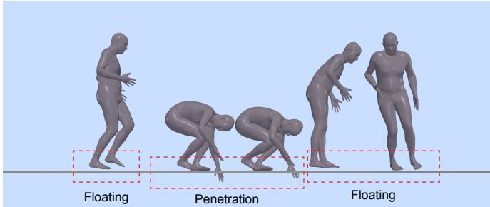
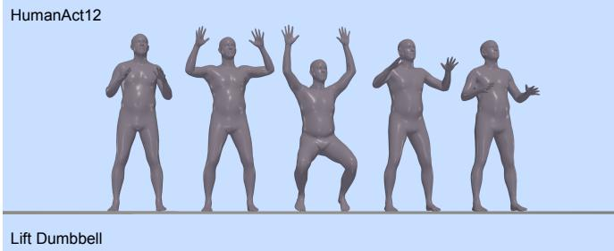
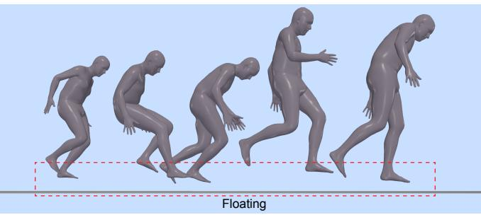
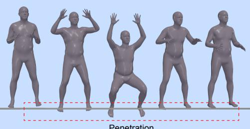
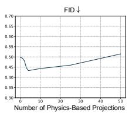
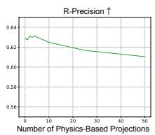

# PhysDiff：物理引导的人体动作扩散模型

Ye Yuan

Jiaming Song

Umar Iqbal

Arash Vahdat

Jan Kautz

NVIDIA

https://nvlabs.github.io/PhysDiff

“一个人趴下并在地板上爬行。”

  
“一个人沿着房间的两条边走。”

Figure 1. 我们的 PhysDiff 模型在扩散过程中使用基于物理的动作投影来生成符合物理规律的动作，消除了最先进模型中经常出现的悬浮、地面穿透和足部滑动等瑕疵。

## 摘要

去噪扩散模型在生成多样化且逼真的人体动作方面展现出巨大的前景。然而，现有的动作扩散模型在扩散过程中很大程度上忽略了物理定律，常常生成不符合物理规律的动作，并伴有显著的悬浮、足部滑动和地面穿透等瑕疵。这严重影响了生成动作的质量，并限制了它们的实际应用。为了解决这一问题，我们提出了一种新颖的物理引导动作扩散模型（PhysDiff），它将物理约束融入扩散过程。具体而言，我们提出了一个基于物理的动作投影模块，该模块在物理模拟器中使用动作模仿将扩散步骤的去噪动作投影为符合物理规律的动作。投影后的动作进一步用于下一个扩散步骤，以引导去噪扩散过程。直观地说，在我们的模型中使用物理机制能够迭代地将动作拉向符合物理规律的空间，这是简单的后处理所无法实现的。在大规模人体动作数据集上的实验表明，我们的方法达到了最先进的动作质量，并显著提升了物理合理性（在所有数据集上提升超过 78%）。

## 1. 引言

基于深度学习的人体动作生成是一项重要的任务，在动画、游戏和虚拟现实中有着广泛的应用。在文本到动作合成（text-to-motion synthesis）等常见设定中，我们需要学习一个能够捕捉人体动作多模态分布的条件生成模型。由于人体动作的高度多样性以及人体各部位之间错综复杂的相互作用，该分布可能极为复杂。去噪扩散模型（denoising diffusion models）[75, 25, 76] 是一类特别适合此任务的生成模型，因为它们具有强大的复杂分布建模能力，这一点已在图像生成领域得到了广泛验证 [68, 63, 67, 13]。这些模型表现出了强大的模式覆盖能力，通常体现为较高的测试似然度 [77, 33, 81]。与生成对抗网络（GANs [19]）相比，它们还具有更好的训练稳定性；与变分自编码器（VAEs [35]）和归一化流（normalizing flows [74, 81, 80, 4]）相比，它们具有更高的样本质量。受此启发，近期的研究提出了动作扩散模型 [79, 94]，其在动作生成性能上显著优于标准的深度生成模型。

  
Figure 2. （左）在末端执行单步基于物理的投影（后处理）会产生不自然的动作，因为该动作在物理上过于不合理而难以修正。（右）我们的方法通过交替迭代应用物理和扩散来解决这一问题。

然而，现有的动作扩散模型忽略了人体动作的一个本质方面——底层的物理定律。尽管扩散模型在建模人体动作分布方面具有卓越的能力，但它们仍然缺乏显式机制来施加物理约束，或对由力和接触引起的复杂动力学进行建模。结果，它们生成的动作通常包含明显的瑕疵，例如悬浮、滑步和穿透地面。这严重阻碍了许多现实世界的应用（如动画和虚拟现实），在这些应用中，人类对物理不准确性的微小蛛丝马迹都高度敏感 [64, 27]。鉴于此，我们需要解决的一个关键问题是使人体动作扩散模型具备物理感知能力（physics-aware）。

为了解决这一问题，我们提出了一种新颖的物理引导运动扩散模型（PhysDiff），将物理定律注入到去噪扩散过程中。具体而言，PhysDiff 利用了一个基于物理的运动投影模块（后文将提供详细说明），将输入的运动投影到符合物理规律的空间（physically-plausible space）。在扩散过程中，我们使用该运动投影模块将某一扩散步骤去噪后的运动投影为符合物理规律的运动。这一新运动会被进一步用于下一步的扩散过程，以引导去噪扩散。需要注意的是，人们可能会倾向于仅在扩散过程的末端添加基于物理的投影，即将物理方法作为后处理步骤。然而，这可能会产生不自然的动作，因为扩散最终去噪得到的运动学动作在物理上可能过于不合理，以至于无法通过物理手段进行修正（示例见 Fig. 2），并且该动作可能会偏离数据分布。相反，我们需要将投影嵌入到扩散过程中，并迭代地应用物理约束与扩散，从而在使运动趋向物理合理空间的同时，保持其贴近数据分布（见 Sec. 4.4）。

基于物理的运动投影模块在 PhysDiff 中起到了施加物理约束的关键作用，这是通过在物理模拟器中进行运动模仿（motion imitation）来实现的。具体来说，利用大规模动作捕捉数据，我们训练了一个运动模仿策略，该策略可以控制模拟器中的角色智能体（character agent）来模仿广泛的输入动作。由此生成的模拟动作施加了物理约束，并消除了悬浮（floating）、滑步（foot sliding）和地面穿透（ground penetration）等伪影。一旦训练完成，该运动模仿策略即可用于模仿某一扩散步骤去噪后的动作，从而输出符合物理规律的动作。

我们在两个任务上评估了我们的模型 PhysDiff：文本到动作生成（text-to-motion generation）和动作类别到动作生成（action-to-motion generation）。由于我们的方法与用于扩散的具体去噪网络结构无关，我们测试了两个最先进的（SOTA）运动扩散模型（MDM [79] 和 MotionDiffuse [94]）作为我们模型的去噪器。对于文本到动作生成，在大规模 HumanML3D [22] 基准上，我们的模型显著优于 SOTA 运动扩散模型，将物理误差降低了 86% 以上，同时根据 Frechet Inception Distance（FID）衡量，运动质量也提升了 20% 以上。对于动作类别到动作生成，我们的模型在 HumanAct12 [23] 上的物理误差指标再次改善了 78% 以上，在 UESTC [29] 上改善了 94%，同时也取得了具有竞争力的 FID 分数。

我们进一步进行了大量的实验，以探究基于物理投影（physics-based projection）的不同调度方案，即在哪些扩散时间步执行投影。有趣的是，我们观察到在改变基于物理投影的步数时，物理合理性与动作质量之间存在权衡。具体而言，尽管更多的投影步数总是能带来更好的物理合理性，但动作质量在达到某个特定步数之前会上升，之后则会下降，即生成的动作虽然满足物理约束，但可能看起来仍然不自然。这一观察指引我们采用适中且均衡的基于物理投影步数，从而同时实现高物理合理性和优秀的动作质量。我们还发现，在扩散后期的步骤中加入基于物理投影比在早期步骤中表现更好。我们推测，来自早期扩散步骤的动作可能倾向于训练数据的均值动作，而基于物理投影可能会将动作推离数据分布，从而阻碍扩散过程。最后，我们还表明，我们的方法在动作质量和物理合理性方面均显著优于基于物理的后处理（单步或多步）。

我们的贡献总结如下：

• 我们提出了一种新颖的物理引导动作扩散模型，通过将物理定律融入扩散过程来生成物理上合理的动作。其即插即用（plug-and-play）的特性使其能够灵活地应用于不同的运动学扩散模型。

• 我们提出利用物理仿真器中的人体动作模仿作为动作投影模块，以施加强制性的物理约束。

• 我们的模型在大规模动作数据集上取得了 SOTA 的动作质量表现，并大幅提升了物理合理性。我们广泛的分析还提供了关于调度策略和权衡等方面的见解，并且我们证明了本方法相较于基于物理的后处理具有显著改进。

## 2. 相关工作

去噪扩散模型。基于分数的去噪扩散模型 [75, 25, 77, 76] 在图像生成 [68, 63, 67, 74, 81]、文本到语音合成 [36]、3D 形状生成 [97, 46, 93]、机器学习安全性 [55] 以及人体动作生成 [79, 94, 66] 等多种应用中取得了巨大成功。这些模型通过可解释为分数匹配 [82] 的去噪自编码器目标进行训练，并通过迭代去噪过程生成样本，该过程可以使用求解随机微分方程（SDEs）的随机更新 [6, 5, 15, 96]，或求解常微分方程（ODEs）的确定性更新 [76, 44, 42, 95, 30, 14]。

为了进行条件生成，最常用的技术是分类器（无分类器）引导（classifier(-free) guidance）[13, 26]。然而，它需要针对成对的数据和条件专门训练模型。另一种选择是使用仅针对无条件生成进行训练的预训练扩散模型。例如，SDEdit [53] 修改了扩散模型的初始化，以通过彩色笔画合成或编辑现有图像。在图像领域，各种方法通过向扩散过程反复注入已知信息来解决线性逆问题 [45, 12, 77, 11, 32, 31]。类似的思想也被应用于动作补全（motion infilling）背景下的人体动作扩散模型中 [79]。在我们的情况下，使用扩散模型生成符合物理规律的动作面临着不同的一组挑战。首先，约束是通过物理模拟器指定的，而物理模拟器是不可微的。其次，基于物理的投影本身计算成本相对较高，而不像基于图像的约束通常比扩散模型消耗少得多的计算量。因此，我们不能简单地将基于物理的投影应用于采样过程的每一步。

人体动作生成。早期的动作生成工作采用确定性人体动作建模，仅生成单一动作 [17, 39, 18, 52, 57, 20, 2, 83, 51, 88]。由于人体动作本质上具有随机性，越来越多的工作开始使用深度生成模型，以避免确定性方法中常见的模式平均（mode averaging）问题。这些方法通常使用 GAN 或 VAE 从各种条件生成动作，例如历史动作 [7, 85, 3, 90, 89]、关键帧 [24]、音乐 [38, 98, 37]、文本 [1, 9, 22, 62] 以及动作标签 [23, 61, 10]。最近，去噪扩散模型 [75, 25, 76] 作为一种结合了标准生成模型优势的新型生成模型脱颖而出。因此，已有若干动作扩散模型 [79, 94, 66] 被提出，并展示了 SOTA 的动作生成性能。然而，现有的动作扩散模型往往会产生不符合物理规律的动作，因为它们在扩散过程中忽略了物理约束。我们的方法通过利用基于物理的动作投影模块引导扩散过程，从而解决了这一问题。

基于物理的人体动作建模。基于物理的人体动作模仿首先被应用于利用深度强化学习（RL）学习行走、奔跑和杂技等运动技能 [40, 41, 54, 58, 59]。基于 RL 的动作模仿也已被用于为角色动画学习用户可控的策略 [8, 56, 84]。对于 3D 人体姿态估计，近期的工作采用了基于物理的轨迹优化 [92, 65, 73, 72] 和动作模仿 [87, 88, 28, 91, 86, 47, 48] 来建模人体动力学。与以往的工作不同，我们探索了物理模拟与扩散模型之间的协同作用，并表明迭代地应用物理和扩散可以生成更逼真且符合物理规律的动作。

## 3. 方法

给定某些条件信息 c（例如文本或动作标签），我们的目标是生成一段长度为 H 的符合物理规律的人体动作 $\pmb { x } ^ { 1 : H } = \{ \pmb { x } ^ { \tilde { h } } \} _ { h = 1 } ^ { H }$。生成动作中的每个姿态 $\pmb { x } ^ { h } \in \mathbb { R } ^ { J \times D }$ 由 J 个关节的 D 维特征表示，这些特征可以是关节位置或关节角度。我们提出了一种用于人体动作生成的物理引导去噪扩散模型（PhysDiff）。从噪声动作 $\pmb { x } _ { T } ^ { 1 : H }$ 开始，PhysDiff 建模去噪分布 $q ( \pmb { x } _ { s } ^ { 1 : H } | \pmb { x } _ { t } ^ { \bar { 1 } : H } , \mathcal { P } _ { \pi } , \mathbf { \bar { c } } )$，将动作从扩散时间步 t 去噪到 $s \ ( s < t )$。迭代应用该模型可以将动作去噪为干净的动作 $\pmb { x } _ { 0 } ^ { 1 : H }$，该动作即成为最终输出 $\pmb { x } ^ { 1 : H }$。该模型中的一个关键组件是施加物理约束的基于物理的动作投影模块 $\mathcal { P } _ { \pi }$。它利用动作模仿策略 π 在物理模拟器中模仿某一扩散步骤的去噪动作，并利用模拟的动作来进一步引导扩散过程。我们的 PhysDiff 模型的概述如图 3 所示。在下文中，我们首先在第 3.1 节介绍物理引导的动作扩散过程。然后在第 3.2 节中详细描述基于物理的动作投影 $\mathcal { P } _ { \pi }$。

## 3.1. 物理引导的动作扩散

动作扩散。为了简化符号，在此我们有时会省略对条件 c 的显式依赖。

  
Figure 3. PhysDiff 概述。每个物理引导的扩散步骤将动作从时间步 t 去噪到 s，其中使用基于物理的动作投影来施加物理约束。该投影是通过在物理模拟器中使用动作模仿策略控制角色来实现的。调度器控制何时应用基于物理的投影。去噪器可以是任何动作去噪网络。

注意，我们始终可以在某种条件 $c$ 下训练扩散模型；即使对于无条件情况，我们也可以使模型以通用空标记（null token）∅ 为条件 [26]。

令 $p _ { 0 } ( { \pmb x } )$ 表示数据分布，并通过向来自 $p _ { 0 }$ 的样本注入独立同分布（i.i.d.）的高斯噪声来定义一系列随时间变化的分布 $p _ { t } ( \pmb { x } _ { t } )$，即 $p _ { t } ( \pmb { x } _ { t } | \pmb { x } ) =$ $\mathcal { N } ( \pmb { x } , \sigma _ { t } ^ { 2 } \mathbf { I } )$，其中 $\sigma _ { t }$ 定义了一系列随时间递增的噪声水平，使得 $\sigma _ { 0 } = 0$，且对于最大可能的时间 $T$，$\sigma _ { T }$ 远大于数据的标准差。通常，扩散模型通过从 $t = T$ 到 $t = 0$ 求解以下随机微分方程（SDE）来进行采样 [21, 30, 96]：

$$
\mathrm{d} \pmb {x} = - (\beta_ {t} + \dot {\sigma} _ {t}) \sigma_ {t} \nabla_ {\pmb {x}} \log p _ {t} (\pmb {x}) \mathrm{d} t + \sqrt {2 \beta_ {t}} \sigma_ {t} \mathrm{d} \omega_ {t},\tag{1}
$$

其中 $\nabla _ { x }$ log $p _ { t } ( { \pmb x } )$ 为得分函数（score function），$\omega _ { t }$ 是标准维纳过程（Wiener process），$\beta _ { t }$ 控制在该过程中注入的随机噪声量；当其为零时，该 SDE 变为常微分方程（ODE）。得分函数 $\nabla _ { \pmb { x } _ { t } } \log p _ { t } ( \pmb { x } _ { t } )$ 的一个显著特性在于，它能够恢复给定 $\mathbf { \Delta } _ { \mathbf { \mathcal { X } } _ { t } }$ 条件下 x 的最小均方误差（MMSE）估计器 [78, 16, 69]：

$$
\tilde {\boldsymbol {x}} := \mathbb {E} [ \boldsymbol {x} | \boldsymbol {x} _ {t} ] = \boldsymbol {x} _ {t} + \sigma_ {t} ^ {2} \nabla_ {\boldsymbol {x} _ {t}} \log p _ {t} (\boldsymbol {x} _ {t}),\tag{2}
$$

其中我们本质上可以将 x˜ 视为 $\mathbf { \Delta } _ { \mathbf { \mathcal { X } } _ { t } }$ 的“去噪”版本。由于在采样过程中 $\mathbf { \Delta } _ { \mathbf { \mathcal { X } } _ { t } }$ 和 $\sigma _ { t }$ 是已知的，因此我们可以从 x˜ 获得 $\nabla _ { \pmb { x } _ { t } } \log p _ { t } ( \pmb { x } _ { t } )$，反之亦然。

扩散模型使用以下去噪自编码器目标来近似得分函数 [82]：

$$
\mathbb {E} _ {\boldsymbol {x} \sim p _ {0} (\boldsymbol {x}), t \sim p (t), \epsilon \sim p (\epsilon)} [ \lambda (t) \| \boldsymbol {x} - D (\boldsymbol {x} + \sigma_ {t} \epsilon , t, \boldsymbol {c}) \| _ {2} ^ {2} ]\tag{3}
$$

其中 $D$ 是依赖于含噪数据、时间 $t$ 和条件 $c$ 的去噪器，$\epsilon \sim \mathcal { N } ( \mathbf { 0 } , I )$，$p ( t )$ 是抽取时间的分布，$\lambda ( t )$ 是损失加权因子。$D$ 的最优解应当是根据公式 (2) 恢复 MMSE 估计器 x˜ 的解。关于训练过程的详细描述，读者可参阅 Karras 等 [30]。

在去噪扩散模型训练完成后，可以将其应用于求解公式 (1) 中的 SDE / ODE。一种特定的方法 DDIM [76] 在给定样本 $\mathbf { \nabla } _ { \mathbf { x } _ { t } } .$ 的情况下，执行从时间 t 到时间 $s \left( s < t \right)$ 的单步更新，如算法 1 所述。直观上，时间 s 处的样本 x 是从高斯分布中生成的；其均值是 $\mathbf { \Delta } _ { \mathbf { \mathcal { X } } _ { t } }$ 与去噪结果 ${ \tilde { \mathbf { x } } } ,$ 之间的线性插值，其方差取决于超参数 $\eta \in [ 0 , 1 ]$。具体而言，$\eta = 0$ 对应于去噪扩散概率模型（DDPM [25]），而 $\eta \ : = \ : 1$ 对应于去噪扩散隐式模型（DDIM [76]）。我们发现 $\eta = 0$ 对我们的模型能产生更好的性能。由于上述采样过程具有通用性，它也可以应用于人体动作数据，即 ${ \pmb x } ^ { \mathrm { i } : H }$。为了在采样过程中结合条件 c，可以采用基于分类器或无分类器的引导（classifier-free guidance）[13, 26]。

算法 1 DDIM 采样算法
1: 输入：去噪器 D，时间 t 处的样本  $x_{t}$ ，目标时间 s，条件 c，超参数  $\eta \in [0,1]$ 。
2: 计算去噪结果  $\tilde{x} := D(x_{t}, t, c)$ 。
3: 获得方差  $v_{s}$ ，作为依赖于  $\eta$  的标量。
4: 获得均值  $\mu_{s}$ ，作为  $\tilde{x}$  和  $x_{t}$  的线性组合：
 $\mu_{s} := \tilde{x} + \frac{\sqrt{\sigma_{s}^{2} - v_{s}}}{\sigma_{t}}(x_{t} - \tilde{x})$ 
5: 抽取样本  $x_{s} \sim N(\mu_{s}, v_{s}I)$ 。

应用物理约束。现有的用于人体动作的扩散模型不一定是在符合物理约束的数据上进行训练的；即使是在此类数据上训练，由于去噪网络中的近似误差以及采样过程的随机性，也无法保证生成的动作样本仍然在物理上可实现。尽管人们可能会尝试直接将最终的动作样本校正为符合物理规律的，但动作中的物理误差可能非常大，以至于即使在经过此类校正后，动作仍然不够理想（具体示例见图 2，对比见第 4.4 节）。

为了解决这一问题，我们利用了扩散模型能够生成所需结果的中间估计值这一特性，即每个扩散步骤的去噪动作 $\tilde { \pmb { x } } ^ { 1 : H }$。具体而言，我们不仅可以在扩散过程的最后一步应用物理约束，也可以在中间步骤中应用。具体来说，我们提出了一个基于物理的动作投影 $\mathcal { P } _ { \pi } : \mathbb { R } ^ { H \times J \times D }  \mathbb { R } ^ { H \times J \times D }$ 作为一个模块，将原始动作 $\tilde { \pmb { x } } ^ { 1 : H }$ 映射为一个符合物理规律的动作，记作 $\stackrel { \smile } { \hat { x } } ^ { 1 : H }$。我们将所提出的基于物理的投影 $\mathcal { P } _ { \pi }$ 整合到去噪扩散采样过程中，其中从时间 t 到时间 s 的单步更新如算法 2 所示。该过程与 DDIM 采样器的主要区别在于执行了额外的基于物理的投影；正如我们在实验中所展示的，这是施加物理约束的一种简单而有效的方法。值得注意的是，我们的模型 PhysDiff 与去噪器 D 的具体网络架构实现无关。PhysDiff 中的基于物理的投影也仅在扩散采样（推理）过程中应用，这使得 PhysDiff 能够广泛兼容不同的预训练动作扩散模型。换句话说，PhysDiff 可用于在无需重新训练的情况下提升现有扩散模型的物理合理性。

算法 2 动作的 PhysDiff 采样算法。

1: 输入：去噪器 D，时间 t 处的样本  $x_{t}^{1:H}$ ，条件 c，目标时间 s，基于物理的投影  $P_{\pi}, \eta \in [0,1]$ 。

2: 计算去噪后的动作  $\tilde{x}^{1:H} := D(x_{t}^{1:H}, t, c)$ 。

3: if 在时间 t 执行投影 then

4:  $\hat{x}^{1:H} := \mathcal{P}_{\pi}(\tilde{x}^{1:H})$  # 基于物理的投影

5: else

6:  $\hat{x}^{1:H} := \tilde{x}^{1:H}$ 

7: end if

8: # 其余部分与 DDIM 类似

9: 获取方差  $v_{s}$ （作为依赖于  $\eta$  的标量）。

10: 获取均值  $\mu_{s}$ ：

 $\mu_{s} := \hat{x}^{1:H} + \frac{\sqrt{\sigma_{s}^{2} - v_{s}}}{\sigma_{t}}(x_{t}^{1:H} - \hat{x}^{1:H})$ 

11: 抽取样本  $x_{s}^{1:H} \sim N(\mu_{s}, v_{s}I)$ 。

基于物理的投影调度。由于使用了物理模拟，投影 $\mathcal { P } _ { \pi }$ 的计算开销相当大，在每个扩散时间步都执行投影是不可行的。因此，如果可执行的基于物理的投影步数有限，我们需要优先考虑某些时间步。在这里，我们认为不应在扩散噪声水平较高时执行物理投影。这是因为去噪器 D 在设计上给出的是 $\tilde { \mathbf { \pmb { x } } } ^ { 1 : H } = \mathbb { E } [ \mathbf { \pmb { x } } ^ { 1 : H } | \mathbf { \pmb { x } } _ { t } ^ { 1 : H } ]$ ，即在给定当前含噪动作 $\pmb { x } _ { t } ^ { 1 : H }$ 条件下的平均动作 $\mathbf { \bar { x } } ^ { 1 : H }$ ，而在高噪声水平下，当条件 $\pmb { x } _ { t } ^ { 1 : H }$ 包含的信息很少时，它接近于训练数据的均值。从经验上看，由于模式平均，该平均动作通常几乎没有身体运动，但仍具有一定的根节点平移和旋转，这显然是不符合物理规律的。使用基于物理的投影来校正这种物理上不正确的动作，会将动作推离数据分布，从而阻碍扩散过程。在第 4.3 节中，我们进行了一项系统性研究，验证了这一假设，并揭示了一种能够平衡样本质量与效率的良好调度策略。

## 3.2. 基于物理的动作投影

物理引导扩散过程中的一个核心组件是基于物理的动作投影 $\mathcal { P } _ { \pi }$ 。它的任务是将某一扩散步中忽略物理规律的去噪动作 $\tilde { \pmb { x } } ^ { 1 : H }$ 投影为符合物理规律的动作 $\hat { \pmb { x } } ^ { 1 : H } = \mathcal { P } _ { \pi } ( \tilde { \pmb { x } } ^ { 1 : H } )$ 。该投影是通过学习一个动作模仿策略 π 来实现的，该策略控制物理模拟器中的模拟角色去模仿去噪动作 $\tilde { \pmb { x } } ^ { 1 : H }$ 。模拟器输出的最终动作 $\hat { \pmb { x } } ^ { 1 : H }$ 因遵循物理定律而被认为是符合物理规律的。

动作模仿形式化。人体动作模仿任务 [58, 90] 可以被形式化为一个马尔可夫决策过程（MDP）。该 MDP 由包含状态、动作、转移动态、奖励函数和折扣因子的元组 $\mathcal { M } = ( \mathcal { S } , \mathcal { A } , \mathcal { T } , R , \gamma )$ 定义。角色智能体根据动作模仿策略 $\bar { \pi } ( \bar { \pmb { a } } ^ { h } | \pmb { s } ^ { h } )$ 在物理模拟器中采取行动，该策略对在给定当前状态 $s ^ { h } \in { \mathcal { S } }$ 下选择动作 $\pmb { a } ^ { h } \in \mathcal { A }$ 的分布进行建模。状态 $s ^ { h }$ 由角色的物理状态（例如关节角、速度、位置）以及来自输入动作的下一姿态 $\breve { \boldsymbol { x } } ^ { h + 1 }$ 组成。将 $\tilde { \boldsymbol { x } } ^ { h + 1 }$ 包含在状态中，能够引导策略 $\pi$ 选择一个可以在模拟器中模仿 $\tilde { \boldsymbol { x } } ^ { h + 1 }$ 的动作 $\pmb { a } ^ { h }$。从初始状态 $s ^ { 1 }$ 开始，智能体迭代地从策略 $\pi$ 中采样动作 $\pmb { a } ^ { h }$，具有转移动态 $\mathcal { T } ( s ^ { h + 1 } | s ^ { h } , \mathbf { \bar { a } } ^ { h } )$ 的模拟器生成下一个状态 $s ^ { h + 1 }$，我们可以从中提取模拟姿态 $\hat { \pmb x } ^ { h + 1 }$。通过运行该策略 $H$ 步，我们可以获得物理模拟动作 $\hat { \pmb { x } } ^ { 1 : H }$。

训练。在训练过程中，系统还会根据模拟动作 $\hat { \pmb { x } } ^ { 1 : H }$ 与真实动作 $\bar { \pmb x } ^ { 1 : H }$ 的对齐程度为角色分配奖励 $r ^ { h }$。请注意，动作模仿策略 $\pi$ 是在提供高质量真实动作的大规模动作捕捉数据集上进行训练的。我们使用强化学习（RL）来学习策略 $\pi$，其目标是最大化期望折扣回报 $\begin{array} { r } { J ( \pi ) \stackrel {  } { } = \mathbb { E } _ { \pi } [ \sum _ { h } \gamma ^ { h } r ^ { h } ] } \end{array}$，这转化为尽可能贴近地模仿真实动作。我们采用标准 RL 算法（PPO [71]）来求解最优策略。在下文中，我们将详细阐述奖励、状态、动作和策略的设计。

奖励。奖励函数旨在鼓励模拟动作 $\hat { \pmb { x } } ^ { 1 : H }$ 匹配真实动作 $\bar { \pmb { x } } ^ { 1 : \breve { H } }$。在这里，我们使用 $\bar{\cdot}$ 来表示真实量。每个时间步的奖励 $r ^ { h }$ 由四个子奖励组成：

$$
r ^ {h} = w _ {\mathrm{p}} r _ {\mathrm{p}} ^ {h} + w _ {\mathrm{v}} r _ {\mathrm{v}} ^ {h} + w _ {\mathrm{j}} r _ {\mathrm{j}} ^ {h} + w _ {\mathrm{q}} r _ {\mathrm{q}} ^ {h},\tag{4}
$$

$$
r _ {\mathrm{p}} ^ {h} = \exp \left[ - \alpha_ {\mathrm{p}} \left(\sum_ {j = 1} ^ {J} \| \boldsymbol {o} _ {j} ^ {h} \ominus \bar {\boldsymbol {o}} _ {j} ^ {h} \| ^ {2}\right) \right],\tag{5}
$$

$$
r _ {\mathrm{v}} ^ {h} = \exp \left[ - \alpha_ {\mathrm{v}} \| \pmb {v} ^ {h} - \bar {\pmb {v}} ^ {h} \| ^ {2} \right],\tag{6}
$$

$$
r _ {\mathrm{j}} ^ {h} = \exp \left[ - \alpha_ {\mathrm{j}} \left(\sum_ {j = 1} ^ {J} \| \boldsymbol {p} _ {j} ^ {h} - \bar {\boldsymbol {p}} _ {j} ^ {h} \| ^ {2}\right) \right],\tag{7}
$$

$$
r _ {\mathrm{q}} ^ {h} = \exp \left[ - \alpha_ {\mathrm{q}} \left(\sum_ {j = 1} ^ {J} \| \pmb {q} _ {j} ^ {h} - \bar {\pmb {q}} _ {j} ^ {h} \| ^ {2}\right) \right].\tag{8}
$$

其中 $w _ { \mathrm { p } } , w _ { \mathrm { v } } , w _ { \mathrm { j } } , w _ { \mathrm { q } } , \alpha _ { \mathrm { p } } , \alpha _ { \mathrm { v } } , \alpha _ { \mathrm { j } } , \alpha _ { \mathrm { q } }$ 为权重因子。姿态奖励 $r _ { \mathfrak { p } } ^ { h }$ 衡量局部关节旋转 $o _ { j } ^ { h }$ 与真实值 $\bar { \pmb { o } } _ { j } ^ { h }$ 之间的差异，其中 ⊖ 表示两个旋转之间的相对旋转，$\| \cdot \|$ 计算旋转角度。速度奖励 $r _ { \mathrm { v } } ^ { h }$ 衡量关节速度 $\mathbf { \Delta } \mathbf { \boldsymbol { v } } ^ { h }$ 与真实值 $\bar { \pmb { v } } ^ { h }$ 之间的不匹配程度，它们是通过有限差分计算得到的。关节位置奖励 $r _ { \dot { \mathrm { ~  ~ } } } ^ { h }$ 促使 3D 世界关节位置 $\pmb { p } _ { j } ^ { h }$ 与真实值 $\bar { p } _ { j } ^ { h }$ 相匹配。最后，关节旋转奖励 $r _ { \mathrm { q } } ^ { h }$ 衡量全局关节旋转 $\pmb q _ { j } ^ { h }$ 与真实值 $\bar { \pmb q } _ { j } ^ { h }$ 之间的差异。

状态。智能体状态 $s ^ { h }$ 由角色的当前物理状态、输入动作的下一姿态 $\tilde { \boldsymbol { x } } ^ { h + 1 }$ 以及角色属性向量 ψ 组成。角色的物理状态包括其关节角度、关节速度，以及刚体的位置、旋转、线速度和角速度。对于输入姿态 $\tilde { \boldsymbol { x } } ^ { h + 1 }$，状态 $s ^ { h }$ 包含 $\tilde { \boldsymbol { x } } ^ { h + 1 }$ 相对于智能体在关节角度以及刚体位置和旋转上的差值。使用差值可以让策略获知其需要补偿的姿态残差。所有特征均在角色的朝向坐标系下计算，以确保旋转和平移不变性。由于我们的角色基于 SMPL 人体模型 [43]，属性 ψ 包括性别和 SMPL 形状参数，以允许策略控制不同的角色。

动作（Actions）。我们使用比例微分（proportional derivative，PD）控制器的目标关节角度作为动作表示，正如先前工作 [60, 90] 中所观察到的，这能够实现稳健的动作模仿。我们还在动作空间中添加了残差力 [90]，以稳定角色并补偿模仿坐下等动作时所需的缺失接触力。

策略（Policy）。我们使用参数化高斯策略 $\pi ( \mathbf { \boldsymbol { a } } ^ { h } | \mathbf { \boldsymbol { s } } ^ { h } ) =$ $\mathcal { N } ( \mu _ { \boldsymbol { \theta } } ( s ^ { h } ) , \Sigma )$，其中平均动作 $\mu _ { \theta }$ 由带有参数 θ 的简单多层感知机（MLP）网络输出，而 Σ 是一个固定的对角协方差矩阵。

## 4. 实验

我们在两个标准的人体动作生成任务上进行了实验：文本驱动动作生成（text-to-motion）和动作类别驱动动作生成（action-to-motion）。具体而言，我们的实验旨在回答以下问题：(1) PhysDiff 是否能够实现

<table><tr><td>Method</td><td>FID ↓</td><td>R-Precision ↑</td><td>Penetrate ↓</td><td>Float ↓</td><td>Skate ↓</td><td>Phys-Err ↓</td></tr><tr><td>J2LP [1]</td><td>11.020</td><td>0.486</td><td>-</td><td>-</td><td>-</td><td>-</td></tr><tr><td>Text2Gesture [9]</td><td>7.664</td><td>0.345</td><td>-</td><td>-</td><td>-</td><td>-</td></tr><tr><td>T2M [22]</td><td>1.067</td><td>0.740</td><td>11.897</td><td>7.779</td><td>2.908</td><td>22.584</td></tr><tr><td>MDM [79]</td><td>0.544</td><td>0.611</td><td>11.291</td><td>18.876</td><td>1.406</td><td>31.572</td></tr><tr><td>MotionDiffuse (MD) [94]</td><td>0.630</td><td>0.782</td><td>20.278</td><td>6.450</td><td>3.925</td><td>30.652</td></tr><tr><td>PhysDiff w/ MD (Ours)</td><td>0.551</td><td>0.780</td><td>0.898</td><td>1.368</td><td>0.423</td><td>2.690</td></tr><tr><td>PhysDiff w/ MDM (Ours)</td><td>0.433</td><td>0.631</td><td>0.998</td><td>2.601</td><td>0.512</td><td>4.111</td></tr></table>

Table 1. HumanML3D [22] 上的文本驱动动作生成结果。

<table><tr><td>Method</td><td>FID ↓</td><td>Accuracy ↑</td><td>Penetrate ↓</td><td>Float ↓</td><td>Skate ↓</td><td>Phys-Err ↓</td></tr><tr><td>Action2Motion [23]</td><td>0.338</td><td>0.917</td><td>-</td><td>-</td><td>-</td><td>-</td></tr><tr><td>ACTOR [61]</td><td>0.120</td><td>0.955</td><td>8.939</td><td>14.479</td><td>2.277</td><td>25.695</td></tr><tr><td>INR [10]</td><td>0.088</td><td>0.973</td><td>7.055</td><td>13.212</td><td>0.928</td><td>22.096</td></tr><tr><td>MDM [79]</td><td>0.100</td><td>0.990</td><td>5.600</td><td>6.703</td><td>1.075</td><td>13.377</td></tr><tr><td>PhysDiff w/ MDM (Ours)</td><td>0.096</td><td>0.983</td><td>0.689</td><td>2.002</td><td>0.159</td><td>2.850</td></tr></table>

Table 2. HumanAct12 [23] 上的动作类别驱动动作生成结果。

<table><tr><td>方法</td><td>FID ↓</td><td>Accuracy ↑</td><td>Penetrate ↓</td><td>Float ↓</td><td>Skate ↓</td><td>Phys-Err ↓</td></tr><tr><td>ACTOR [61]</td><td>23.43</td><td>0.911</td><td>8.441</td><td>9.737</td><td>1.073</td><td>19.251</td></tr><tr><td>INR [10]</td><td>15.00</td><td>0.941</td><td>5.999</td><td>4.633</td><td>0.741</td><td>11.373</td></tr><tr><td>MDM [79]</td><td>12.81</td><td>0.950</td><td>13.077</td><td>13.912</td><td>1.383</td><td>28.371</td></tr><tr><td>PhysDiff w/ MDM (Ours)</td><td>13.27</td><td>0.956</td><td>0.874</td><td>0.201</td><td>0.389</td><td>1.463</td></tr></table>

Table 3. 在 UESTC [29] 上的动作到运动生成结果。

SOTA 运动质量和物理合理性？(2) PhysDiff 是否可以应用于不同的运动学运动扩散模型以提高其运动质量和物理合理性？(3) 基于物理的投影的不同调度策略如何影响运动生成性能？(4) PhysDiff 是否能优于基于物理的后处理？

评估指标。对于文本到运动生成，我们首先使用 Guo 等人 [22] 建议的两个标准指标：FID 衡量生成运动与真实运动分布之间的距离；R-Precision 评估生成运动与输入文本的相关性。对于动作到运动生成，我们用 Accuracy 指标替代 R-Precision，该指标衡量训练好的动作分类器在生成运动上的准确率。此外，我们还使用四个基于物理的指标来评估生成运动的物理合理性：Penetrate 衡量地面穿透；Float 衡量悬浮；Skate 衡量脚部滑动；Phys-Err 是一个综合物理误差指标，将这三个指标（均以 mm 为单位）相加。详情请参阅附录 A。

实现细节。我们的模型使用 50 个带有无分类器引导（classifier-free guidance）[26] 的扩散步数。我们使用两个 SOTA 运动扩散模型 MDM [79] 和 MotionDiffuse [94] 作为去噪器 D 来测试 PhysDiff。在定性结果中，MDM 默认作为 PhysDiff 的去噪器。我们采用 IsaacGym [50] 作为运动模仿的物理模拟器。更多细节见附录 B 和 C。

## 4.1. 文本到运动生成

数据。我们使用 HumanML3D [22] 数据集，该数据集是两个大规模动作捕捉数据集 AMASS [49] 和 HumanAct12 [23] 的文本标注子集。它包含 14,616 个运动片段，并带有 44,970 条文本描述标注。

举哑铃

PhysDiff（本文方法）  
  
“一个人慢跑，停下来弯腰，然后继续慢跑。”

  
“一个人快速向前跑，左脚停住，然后朝另一个方向跑。”

  
Figure 4. PhysDiff 与前沿方法（SOTA）MDM [79] 在 HumanML3D、HumanAct12 和 UESTC 上的可视化对比。PhysDiff 显著减少了悬浮和穿模等物理伪影。更多定性对比请参阅项目主页。

结果。在表 1 中，我们将本方法与 SOTA 方法进行了对比：JL2P [1]、Text2Gesture [9]、T2M [22]、Motion-Diffuse [94] 以及 MDM [79]。由于我们方法具备即插即用的特性，我们使用 MotionDiffuse (MD) 和 MDM 设计了 PhysDiff 的两种变体。结合 MDM 的 PhysDiff 实现了 SOTA 的 FID，且相比 MDM 降低了 86% 以上的 Phys-Err。类似地，结合 MD 的 PhysDiff 在物理评估指标上达到了 SOTA 水平，同时保持了高 R-Precision 并显著改善了 FID。我们还在图 4 中提供了定性对比，从中可以清楚地看到 PhysDiff 大幅减少了穿模和悬浮等物理伪影。更多定性结果请参阅项目主页。

## 4.2. 动作到人体动作生成

数据。我们在两个数据集上进行评估：HumanAct12 [23]，包含 12 个动作类别的约 1200 个动作片段；UESTC [29]，包含 40 个动作类别、40 位受试者和 2.5 万个样本。对于这两个数据集，我们均使用 Petrovich 等人 [61] 提供的序列。

结果。表 2 和表 3 分别总结了在 HumanAct12 和 UESTC 上的结果，我们将 PhysDiff 与 SOTA 方法进行了对比：MDM [79]、INR [10]、Action2Motion [23] 和 ACTOR [61]。结果表明，我们的方法在两个数据集上都取得了具有竞争力的 FID，同时大幅改善了 Phys-Err（在 Human-Act12 上降低了 78%，在 UESTC 上降低了 94%）。定性对比请参阅图 4 和项目主页，结果展示了 PhysDiff 显著提升了生成动作的物理合理性。

## 4.3. 基于物理投影的调度策略

我们进行了大量实验来分析基于物理投影的调度策略（schedule），即在扩散过程中的哪些时间步执行投影。

投影步数。由于基于物理的投影计算成本相对较高，我们首先探究是否可以在不牺牲性能的前提下减少投影步数。为此，我们将扩散过程中执行的投影步数从 50 逐步调整至 0，其中投影步数从较早的时间步开始逐渐移除，并连续应用。

基于物理的投影次数  

Figure 5. 在 HumanML3D [22] 上改变基于物理的投影步数对文本到动作生成的影响。

<table><tr><td>调度策略</td><td>FID ↓</td><td>R-Precision ↑</td><td>Penetrate ↓</td><td>Float ↓</td><td>Skate ↓</td><td>Phys-Err ↓</td></tr><tr><td>Uniform 4</td><td>0.473</td><td>0.630</td><td>0.979</td><td>3.479</td><td>0.463</td><td>4.921</td></tr><tr><td>Start 3, End 1</td><td>0.510</td><td>0.623</td><td>0.918</td><td>3.173</td><td>0.459</td><td>4.550</td></tr><tr><td>Start 2, End 2</td><td>0.503</td><td>0.623</td><td>0.918</td><td>2.723</td><td>0.492</td><td>4.133</td></tr><tr><td>End 4, Space 3</td><td>0.469</td><td>0.630</td><td>0.990</td><td>3.226</td><td>0.473</td><td>4.689</td></tr><tr><td>End 4, Space 2</td><td>0.469</td><td>0.630</td><td>0.990</td><td>3.004</td><td>0.476</td><td>4.470</td></tr><tr><td>End 4, Space 1</td><td>0.433</td><td>0.631</td><td>0.998</td><td>2.601</td><td>0.512</td><td>4.111</td></tr></table>

Table 4. HumanML3D [22] 上的投影调度策略对比。  
Figure 6. 与后处理（即在扩散过程之后应用基于物理的投影）的对比。

我们在 Fig. 5 中绘制了 FID、R-Precision 和 Phys-Err 的曲线。可以看出，随着基于物理的投影步数的增加，Phys-Err 持续下降，这表明更多的投影步数总是有助于提高 PhysDiff 的物理合理性。有趣的是，随着投影步数的增加，FID 和 R-Precision 均呈现先改善（FID 下降且 R-Precision 上升）后恶化的趋势。这表明，如果在早期扩散步中执行过多的投影步数，物理合理性与动作质量之间存在权衡。我们推测，在早期扩散步生成的动作被去噪为数据集的平均动作（几乎没有身体运动），且往往在物理上并不合理。因此，在这些早期步骤执行基于物理的投影可能会使生成的动作偏离数据分布，从而阻碍扩散过程。

投影步的位置安排。Fig. 5 表明，4 个基于物理的投影步可以在物理合理性与动作质量之间取得良好的权衡。接下来，我们探究这些投影步在扩散过程中的最佳位置安排。我们比较了三组调度方案：(1) Uniform N，将 $N$ 个投影步均匀分布在扩散时间步中，即对于 50 个扩散步且 $N \ = \ 4$ 时，投影步在 $t \in \{ 0 , 1 5 , 3 0 , 4 5 \}$ 处执行；(2) Start M, End N，在扩散过程的开始放置 $M$ 个连续投影步，并在末尾放置 $N$ 个投影步；(3) End N, Space S，在扩散过程末尾放置 $N$ 个时间间隔为 $S$ 的投影步（例如，对于 $N \ = \ 4 , S \ = \ 3$，投影步在 $t \in \{ 0 , 3 , 6 , 9 \}$ 处执行）。我们在 Table 4 中总结了这些结果。可以看出，调度方案 Start M, End N 的 FID 和 R-Precision 表现较差，因为在扩散早期执行了更多基于物理的投影步，这与我们在 Fig. 5 中的发现一致。调度方案 Uniform N 在 FID 和 R-Precision 方面表现更好，但 Phys-Err 更差。

这很可能是因为在基于物理的投影之间存在过多非物理驱动的扩散步，从而抵消了投影的效果并重新引入了物理误差。这也与 End 4, Space 3 劣于 End 4, Space 1 的结果相符，因为前者在基于物理的投影之间具有更多的扩散步。因此，实验结果表明，最好将基于物理的投影步连续安排在接近尾声的阶段。这指引我们在基线对比中采用 End 4, Space 1 方案。

推理时间。由于使用了物理模拟，在生成单个动作时（两种方法均使用 1000 个扩散步），PhysDiff 的速度比 MDM 慢 2.5 倍（51.6s 对比 19.6s）。当将批大小（batch size）增加到 256 时，这一差距缩小，PhysDiff 仅慢 1.7 倍（280.3s 对比 471.3s），这是因为物理模拟器能从并行化中获益更多。

## 4.4. 与后处理方法对比

为了展示物理与扩散之间的协同作用，我们将 PhysDiff 与一个后处理基线进行对比，该基线对来自扩散的最终运动学动作应用一个或多个基于物理的投影步。如 Fig. 6 所示，多次后处理步骤并不能提高动作质量或物理合理性；相反，它们反而会使之恶化。这是因为最终的运动学动作在物理上可能过于不合理，以至于物理模型无法模仿，例如人体可能因错误的步态而失去平衡。反复模仿这些不合理的动作可能会放大问题并导致模拟不稳定。PhysDiff 通过迭代应用扩散和物理机制，从不良模拟状态中恢复并更加靠近数据分布，从而克服了这一问题。

## 5. 结论与未来工作

在本文中，我们提出了一种新颖的物理引导运动扩散模型（PhysDiff），该模型将物理规律融入扩散过程中，以生成符合物理合理性的人体运动。为了实现这一目标，我们提出了一个基于物理的运动投影模块，该模块利用物理仿真中的运动模仿来施加物理约束。我们的方法与去噪网络无关，无需重新训练即可用于改进 SOTA（最先进）运动扩散模型。在大规模运动数据上的实验表明，PhysDiff 达到了 SOTA 级别的运动质量，并显著提升了物理合理性。

由于物理仿真的存在，Phys-Diff 的推理速度可能比 SOTA 模型慢两到三倍。未来的工作可以通过使用更快的物理仿真器来加速模型，或者改进基于物理的投影以减少所需的投影步数。

## 参考文献

[1] Chaitanya Ahuja and Louis-Philippe Morency. Language2pose: Natural language grounded pose forecasting. In 2019 International Conference on 3D Vision (3DV), pages 719–728. IEEE, 2019. 3, 6, 7

[2] Emre Aksan, Manuel Kaufmann, and Otmar Hilliges. Structured prediction helps 3d human motion modelling. In Proceedings of the IEEE International Conference on Computer Vision, pages 7144–7153, 2019. 3

[3] Sadegh Aliakbarian, Fatemeh Sadat Saleh, Mathieu Salzmann, Lars Petersson, and Stephen Gould. A stochastic conditioning scheme for diverse human motion prediction. In Proceedings of the IEEE/CVF Conference on Computer Vision and Pattern Recognition, pages 5223–5232, 2020. 3

[4] Jyoti Aneja, Alex Schwing, Jan Kautz, and Arash Vahdat. A contrastive learning approach for training variational autoencoder priors. Advances in Neural Information Processing Systems, 34:480–493, 2021. 2

[5] Fan Bao, Chongxuan Li, Jiacheng Sun, Jun Zhu, and Bo Zhang. Estimating the optimal covariance with imperfect mean in diffusion probabilistic models. In International Conference on Machine Learning, 2022. 3

[6] Fan Bao, Chongxuan Li, Jun Zhu, and Bo Zhang. Analytic-DPM: An analytic estimate of the optimal reverse variance in diffusion probabilistic models. In International Conference on Learning Representations, 2022. 3

[7] Emad Barsoum, John Kender, and Zicheng Liu. Hp-gan: Probabilistic 3d human motion prediction via gan. In Proceedings of the IEEE Conference on Computer Vision and Pattern Recognition Workshops, pages 1418–1427, 2018. 3

[8] Kevin Bergamin, Simon Clavet, Daniel Holden, and James Richard Forbes. Drecon: data-driven responsive control of physics-based characters. ACM Transactions on Graphics (TOG), 38(6):1–11, 2019. 3

[9] Uttaran Bhattacharya, Nicholas Rewkowski, Abhishek Banerjee, Pooja Guhan, Aniket Bera, and Dinesh Manocha. Text2gestures: A transformer-based network for generating emotive body gestures for virtual agents. In 2021 IEEE Virtual Reality and 3D User Interfaces (VR), pages 1–10. IEEE, 2021. 3, 6, 7

[10] Pablo Cervantes, Yusuke Sekikawa, Ikuro Sato, and Koichi Shinoda. Implicit neural representations for variable length human motion generation. In Proceedings of the European Conference on Computer Vision (ECCV), pages 356–372. Springer, 2022. 3, 6, 7

[11] Jooyoung Choi, Sungwon Kim, Yonghyun Jeong, Youngjune Gwon, and Sungroh Yoon. ILVR: Conditioning method for denoising diffusion probabilistic models. arXiv preprint arXiv:2108.02938, August 2021. 3

[12] Hyungjin Chung, Byeongsu Sim, and Jong Chul Ye. Come-Closer-Diffuse-Faster: Accelerating conditional diffusion models for inverse problems through stochastic contraction. arXiv preprint arXiv:2112.05146, December 2021. 3

[13] Prafulla Dhariwal and Alexander Quinn Nichol. Diffusion models beat GANs on image synthesis. In Advances in Neural Information Processing Systems, 2021. 1, 3, 4

[14] Tim Dockhorn, Arash Vahdat, and Karsten Kreis. GENIE: Higher-order denoising diffusion solvers. In Advances in Neural Information Processing Systems, 2022. 3

[15] Tim Dockhorn, Arash Vahdat, and Karsten Kreis. Scorebased generative modeling with critically-damped Langevin diffusion. In International Conference on Learning Representations, 2022. 3

[16] Bradley Efron. Tweedie’s formula and selection bias. Journal ofthe American Statistical Association, 106(496):1602– 1614, 2011. 4

[17] Katerina Fragkiadaki, Sergey Levine, Panna Felsen, and Jitendra Malik. Recurrent network models for human dynamics. In Proceedings ofthe IEEE International Conference on Computer Vision, pages 4346–4354, 2015. 3

[18] Partha Ghosh, Jie Song, Emre Aksan, and Otmar Hilliges. Learning human motion models for long-term predictions. In 2017 International Conference on 3D Vision (3DV), pages 458–466. IEEE, 2017. 3

[19] Ian Goodfellow, Jean Pouget-Abadie, Mehdi Mirza, Bing Xu, David Warde-Farley, Sherjil Ozair, Aaron Courville, and Yoshua Bengio. Generative adversarial nets. In Advances in Neural Information Processing Systems, pages 2672–2680, 2014. 2

[20] Anand Gopalakrishnan, Ankur Mali, Dan Kifer, Lee Giles, and Alexander G Ororbia. A neural temporal model for human motion prediction. In Proceedings of the IEEE Conference on Computer Vision and Pattern Recognition, pages 12116–12125, 2019. 3

[21] Ulf Grenander and Michael I Miller. Representations of knowledge in complex systems. Journal of the Royal Statistical Society: Series B (Methodological), 56(4):549–581, 1994. 4

[22] Chuan Guo, Shihao Zou, Xinxin Zuo, Sen Wang, Wei Ji, Xingyu Li, and Li Cheng. Generating diverse and natural 3d human motions from text. In Proceedings of the IEEE/CVF Conference on Computer Vision and Pattern Recognition, pages 5152–5161, 2022. 2, 3, 6, 7, 8, 13

[23] Chuan Guo, Xinxin Zuo, Sen Wang, Shihao Zou, Qingyao Sun, Annan Deng, Minglun Gong, and Li Cheng. Action2motion: Conditioned generation of 3d human motions. In Proceedings ofthe 28th ACM International Conference on Multimedia, pages 2021–2029, 2020. 2, 3, 6, 7

[24] Chengan He, Jun Saito, James Zachary, Holly Rushmeier, and Yi Zhou. Nemf: Neural motion fields for kinematic animation. arXiv preprint arXiv:2206.03287, 2022. 3

[25] Jonathan Ho, Ajay Jain, and Pieter Abbeel. Denoising diffusion probabilistic models. In Advances in Neural Information Processing Systems, 2020. 1, 3, 4

[26] Jonathan Ho and Tim Salimans. Classifier-free diffusion guidance. In NeurIPS 2021 Workshop on Deep Generative Models and Downstream Applications, 2021. 3, 4, 6

[27] Ludovic Hoyet, Rachel McDonnell, and Carol O’Sullivan. Push it real: Perceiving causality in virtual interactions. ACM Transactions on Graphics (TOG), 31(4):1–9, 2012. 2

[28] Mariko Isogawa, Ye Yuan, Matthew O’Toole, and Kris M Kitani. Optical non-line-of-sight physics-based 3d human pose estimation. In Proceedings of the IEEE/CVF Conference on Computer Vision and Pattern Recognition, pages 7013– 7022, 2020. 3

[29] Yanli Ji, Feixiang Xu, Yang Yang, Fumin Shen, Heng Tao Shen, and Wei-Shi Zheng. A large-scale rgb-d database for arbitrary-view human action recognition. In Proceedings of the 26th ACM international Conference on Multimedia, pages 1510–1518, 2018. 2, 6, 7

[30] Tero Karras, Miika Aittala, Timo Aila, and Samuli Laine. Elucidating the design space of diffusion-based generative models. In Advances in Neural Information Processing Systems, 2022. 3, 4

[31] Bahjat Kawar, Michael Elad, Stefano Ermon, and Jiaming Song. Denoising diffusion restoration models. In Advances in Neural Information Processing Systems, 2022. 3

[32] Bahjat Kawar, Gregory Vaksman, and Michael Elad. SNIPS: Solving noisy inverse problems stochastically. arXiv preprint arXiv:2105.14951, May 2021. 3

[33] Diederik Kingma, Tim Salimans, Ben Poole, and Jonathan Ho. Variational diffusion models. Advances in Neural Information Processing Systems, 34:21696–21707, 2021. 1

[34] Diederik P Kingma and Jimmy Ba. Adam: A method for stochastic optimization. arXiv preprint arXiv:1412.6980, 2014. 13

[35] Diederik P Kingma and Max Welling. Auto-encoding variational bayes. arXiv preprint arXiv:1312.6114, 2013. 2

[36] Zhifeng Kong, Wei Ping, Jiaji Huang, Kexin Zhao, and Bryan Catanzaro. DiffWave: A versatile diffusion model for audio synthesis. In International Conference on Learning Representations, 2021. 3

[37] Buyu Li, Yongchi Zhao, Shi Zhelun, and Lu Sheng. Danceformer: Music conditioned 3d dance generation with parametric motion transformer. In Proceedings ofthe AAAI Conference on Artificial Intelligence, volume 36, pages 1272– 1279, 2022. 3

[38] Ruilong Li, Shan Yang, David A Ross, and Angjoo Kanazawa. Ai choreographer: Music conditioned 3d dance generation with aist++. In Proceedings of the IEEE/CVF International Conference on Computer Vision, pages 13401– 13412, 2021. 3

[39] Zimo Li, Yi Zhou, Shuangjiu Xiao, Chong He, Zeng Huang, and Hao Li. Auto-conditioned recurrent networks for extended complex human motion synthesis. arXiv preprint arXiv:1707.05363, 2017. 3

[40] Libin Liu and Jessica Hodgins. Learning to schedule control fragments for physics-based characters using deep qlearning. ACM Transactions on Graphics (TOG), 36(3):29, 2017. 3

[41] Libin Liu and Jessica Hodgins. Learning basketball dribbling skills using trajectory optimization and deep reinforcement learning. ACM Transactions on Graphics (TOG), 37(4):1– 14, 2018. 3

[42] Luping Liu, Yi Ren, Zhijie Lin, and Zhou Zhao. Pseudo numerical methods for diffusion models on manifolds. In International Conference on Learning Representations, 2022. 3

[43] Matthew Loper, Naureen Mahmood, Javier Romero, Gerard Pons-Moll, and Michael J Black. Smpl: A skinned multiperson linear model. ACM transactions on graphics (TOG), 34(6):1–16, 2015. 6, 13

[44] Cheng Lu, Yuhao Zhou, Fan Bao, Jianfei Chen, Chongxuan Li, and Jun Zhu. DPM-Solver: A fast ODE solver for diffusion probabilistic model sampling in around 10 steps. In Advances in Neural Information Processing Systems, 2022. 3

[45] Andreas Lugmayr, Martin Danelljan, Andres Romero, Fisher Yu, Radu Timofte, and Luc Van Gool. RePaint: Inpainting using denoising diffusion probabilistic models. In Proceedings of the IEEE/CVF Conference on Computer Vision and Pattern Recognition, 2022. 3

[46] Shitong Luo and Wei Hu. Diffusion probabilistic models for 3D point cloud generation. In Proceedings ofthe IEEE/CVF Conference on Computer Vision and Pattern Recognition, 2021. 3

[47] Zhengyi Luo, Ryo Hachiuma, Ye Yuan, and Kris Kitani. Dynamics-regulated kinematic policy for egocentric pose estimation. In Advances in Neural Information Processing Systems, 2021. 3

[48] Zhengyi Luo, Shun Iwase, Ye Yuan, and Kris Kitani. Embodied scene-aware human pose estimation. In Advances in Neural Information Processing Systems, 2022. 3

[49] Naureen Mahmood, Nima Ghorbani, Nikolaus F Troje, Gerard Pons-Moll, and Michael J Black. Amass: Archive of motion capture as surface shapes. In Proceedings of the IEEE/CVF international conference on computer vision, pages 5442–5451, 2019. 6, 13

[50] Viktor Makoviychuk, Lukasz Wawrzyniak, Yunrong Guo, Michelle Lu, Kier Storey, Miles Macklin, David Hoeller, Nikita Rudin, Arthur Allshire, Ankur Handa, et al. Isaac gym: High performance gpu based physics simulation for robot learning. In Thirty-fifth Conference on Neural Information Processing Systems Datasets and Benchmarks Track, 2021. 6, 13

[51] Wei Mao, Miaomiao Liu, Mathieu Salzmann, and Hongdong Li. Learning trajectory dependencies for human motion prediction. In Proceedings of the IEEE International Conference on Computer Vision, pages 9489–9497, 2019. 3

[52] Julieta Martinez, Michael J Black, and Javier Romero. On human motion prediction using recurrent neural networks. In Proceedings ofthe IEEE Conference on Computer Vision and Pattern Recognition, pages 2891–2900, 2017. 3

[53] Chenlin Meng, Yutong He, Yang Song, Jiaming Song, Jiajun Wu, Jun-Yan Zhu, and Stefano Ermon. SDEdit: 基于随机微分方程的引导式图像合成与编辑 (SDEdit: Guided image synthesis and editing with stochastic differential equations). In International Conference on Learning Representations, 2022. 3

[54] Josh Merel, Yuval Tassa, Sriram Srinivasan, Jay Lemmon, Ziyu Wang, Greg Wayne, and Nicolas Heess. 通过对抗模仿从动作捕捉中学习人类行为 (Learning human behaviors from motion capture by adversarial imitation). arXiv preprint arXiv:1707.02201, 2017. 3

[55] Weili Nie, Brandon Guo, Yujia Huang, Chaowei Xiao, Arash Vahdat, and Anima Anandkumar. 用于对抗净化的扩散模型 (Diffusion models for adversarial purification). In International Conference on Machine Learning, 2022. 3

[56] Soohwan Park, Hoseok Ryu, Seyoung Lee, Sunmin Lee, and Jehee Lee. 从无序人体运动数据中学习预测与模拟策略 (Learning predict-and-simulate policies from unorganized human motion data). ACM Transactions on Graphics (TOG), 38(6):1–11, 2019. 3

[57] Dario Pavllo, David Grangier, and Michael Auli. Quaternet：一种基于四元数的人体运动循环模型 (Quaternet: A quaternion-based recurrent model for human motion). arXiv preprint arXiv:1805.06485, 2018. 3

[58] Xue Bin Peng, Pieter Abbeel, Sergey Levine, and Michiel van de Panne. Deepmimic：基于物理的角色技能范例引导深度强化学习 (Deepmimic: Example-guided deep reinforcement learning of physics-based character skills). ACM Transactions on Graphics (TOG), 37(4):1–14, 2018. 3, 5

[59] Xue Bin Peng, Angjoo Kanazawa, Jitendra Malik, Pieter Abbeel, and Sergey Levine. SFV：从视频中强化学习物理技能 (Sfv: Reinforcement learning of physical skills from videos). ACM Transactions on Graphics (TOG), 37(6):1–14, 2018. 3

[60] Xue Bin Peng and Michiel van de Panne. 使用 DeepRL 学习运动技能：动作空间的选择重要吗？ (Learning locomotion skills using deeprl: Does the choice of action space matter?) In Proceedings of the ACM SIGGRAPH/Eurographics Symposium on Computer Animation, pages 1–13, 2017. 6

[61] Mathis Petrovich, Michael J Black, and Gul Varol. 基于 Transformer VAE 的动作条件 3D 人体运动合成 (Action-conditioned 3d human motion synthesis with transformer vae). In Proceedings of the IEEE/CVF International Conference on Computer Vision, pages 10985–10995, 2021. 3, 6, 7

[62] Mathis Petrovich, Michael J. Black, and Gul Varol. TEMOS：从文本描述生成多样化人体运动 (TEMOS: Generating diverse human motions from textual descriptions). In Proceedings of the European Conference on Computer Vision (ECCV), 2022. 3

[63] Aditya Ramesh, Prafulla Dhariwal, Alex Nichol, Casey Chu, and Mark Chen. 利用 CLIP 隐变量的分层文本条件图像生成 (Hierarchical text-conditional image generation with CLIP latents). arXiv preprint arXiv:2204.06125, 2022. 1, 3

[64] Paul SA Reitsma and Nancy S Pollard. 角色动画的感知度量：对弹道运动误差的敏感性 (Perceptual metrics for character animation: sensitivity to errors in ballistic motion). In ACM SIGGRAPH 2003 Papers, pages 537–542, 2003. 2

[65] Davis Rempe, Leonidas J. Guibas, Aaron Hertzmann, Bryan Russell, Ruben Villegas, and Jimei Yang. 从单目视频中获取接触与人体动力学 (Contact and human dynamics from monocular video). In Proceedings of the European Conference on Computer Vision (ECCV), 2020. 3

[66] Zhiyuan Ren, Zhihong Pan, Xin Zhou, and Le Kang. Diffusion motion：基于扩散模型生成文本引导的 3D 人体运动 (Diffusion motion: Generate text-guided 3d human motion by diffusion model). arXiv preprint arXiv:2210.12315, 2022. 3

[67] Robin Rombach, Andreas Blattmann, Dominik Lorenz, Patrick Esser, and Bjorn Ommer. High-resolution image¨ synthesis with latent diffusion models. In Proceedings of the IEEE/CVF Conference on Computer Vision and Pattern Recognition, 2022. 1, 3

[68] Chitwan Saharia, William Chan, Saurabh Saxena, Lala Li, Jay Whang, Emily Denton, Seyed Kamyar Seyed Ghasemipour, Burcu Karagol Ayan, S. Sara Mahdavi, Rapha Gontijo Lopes, Tim Salimans, Jonathan Ho, David J. Fleet, and Mohammad Norouzi. Photorealistic text-to-image

diffusion models with deep language understanding. arXiv preprint arXiv:2205.11487, 2022. 1, 3

[69] Saeed Saremi and Aapo Hyvarinen. Neural empirical bayes.¨ Journal ofmachine learning research: JMLR, 20(181):1–23, 2019. 4

[70] John Schulman, Philipp Moritz, Sergey Levine, Michael Jordan, and Pieter Abbeel. High-dimensional continuous control using generalized advantage estimation. arXiv preprint arXiv:1506.02438, 2015. 13

[71] John Schulman, Filip Wolski, Prafulla Dhariwal, Alec Radford, and Oleg Klimov. Proximal policy optimization algorithms. arXiv preprint arXiv:1707.06347, 2017. 5, 13

[72] Soshi Shimada, Vladislav Golyanik, Weipeng Xu, Patrick Perez, and Christian Theobalt. Neural monocular 3d human´ motion capture with physical awareness. ACM Transactions on Graphics (ToG), 40(4):1–15, 2021. 3

[73] Soshi Shimada, Vladislav Golyanik, Weipeng Xu, and Christian Theobalt. Physcap: Physically plausible monocular 3d motion capture in real time. ACM Transactions on Graphics (TOG), 39(6), dec 2020. 3

[74] Abhishek Sinha, Jiaming Song, Chenlin Meng, and Stefano Ermon. D2C: Diffusion-decoding models for few-shot conditional generation. In Advances in Neural Information Processing Systems, 2021. 2, 3

[75] Jascha Sohl-Dickstein, Eric Weiss, Niru Maheswaranathan, and Surya Ganguli. Deep unsupervised learning using nonequilibrium thermodynamics. In International Conference on Machine Learning, 2015. 1, 3

[76] Jiaming Song, Chenlin Meng, and Stefano Ermon. Denoising diffusion implicit models. In International Conference on Learning Representations, 2021. 1, 3, 4

[77] Yang Song, Jascha Sohl-Dickstein, Diederik P. Kingma, Abhishek Kumar, Stefano Ermon, and Ben Poole. Score-based generative modeling through stochastic differential equations. In International Conference on Learning Representations, 2021. 1, 3

[78] Charles M Stein. Estimation of the mean of a multivariate normal distribution. The annals of Statistics, pages 1135– 1151, 1981. 4

[79] Guy Tevet, Sigal Raab, Brian Gordon, Yonatan Shafir, Daniel Cohen-Or, and Amit H Bermano. Human motion diffusion model. arXiv preprint arXiv:2209.14916, 2022. 2, 3, 6, 7, 13

[80] Arash Vahdat and Jan Kautz. Nvae: A deep hierarchical variational autoencoder. Advances in Neural Information Processing Systems, 33:19667–19679, 2020. 2

[81] Arash Vahdat, Karsten Kreis, and Jan Kautz. Score-based generative modeling in latent space. In Advances in Neural Information Processing Systems, 2021. 1, 2, 3

[82] Pascal Vincent. A connection between score matching and denoising autoencoders. Neural Computation, 23(7):1661– 1674, 2011. 3, 4

[83] Borui Wang, Ehsan Adeli, Hsu-kuang Chiu, De-An Huang, and Juan Carlos Niebles. Imitation learning for human pose prediction. In Proceedings of the IEEE International Conference on Computer Vision, pages 7124–7133, 2019. 3

[84] Jungdam Won, Deepak Gopinath, and Jessica Hodgins. A scalable approach to control diverse behaviors for physically simulated characters. ACM Transactions on Graphics (TOG), 39(4):33–1, 2020. 3

[85] Xinchen Yan, Akash Rastogi, Ruben Villegas, Kalyan Sunkavalli, Eli Shechtman, Sunil Hadap, Ersin Yumer, and Honglak Lee. Mt-vae: Learning motion transformations to generate multimodal human dynamics. In Proceedings of the European Conference on Computer Vision (ECCV), pages 265–281, 2018. 3

[86] Xinyu Yi, Yuxiao Zhou, Marc Habermann, Soshi Shimada, Vladislav Golyanik, Christian Theobalt, and Feng Xu. Physical inertial poser (pip): Physics-aware real-time human motion tracking from sparse inertial sensors. In Proceedings of the IEEE/CVF Conference on Computer Vision and Pattern Recognition, pages 13167–13178, 2022. 3

[87] Ye Yuan and Kris Kitani. 3d ego-pose estimation via imitation learning. In Proceedings of the European Conference on Computer Vision (ECCV), pages 735–750, 2018. 3

[88] Ye Yuan and Kris Kitani. Ego-pose estimation and forecasting as real-time pd control. In Proceedings of the IEEE International Conference on Computer Vision, pages 10082– 10092, 2019. 3

[89] Ye Yuan and Kris Kitani. Dlow: Diversifying latent flows for diverse human motion prediction. In Proceedings ofthe European Conference on Computer Vision (ECCV), pages 346– 364. Springer, 2020. 3

[90] Ye Yuan and Kris Kitani. Residual force control for agile human behavior imitation and extended motion synthesis. In Advances in Neural Information Processing Systems, 2020. 3, 5, 6

[91] Ye Yuan, Shih-En Wei, Tomas Simon, Kris Kitani, and Jason Saragih. Simpoe: Simulated character control for 3d human pose estimation. In Proceedings of the IEEE/CVF Conference on Computer Vision and Pattern Recognition (CVPR), 2021. 3, 13

[92] Petrissa Zell, Bastian Wandt, and Bodo Rosenhahn. Joint 3d human motion capture and physical analysis from monocular videos. In Proceedings ofthe IEEE Conference on Computer Vision and Pattern Recognition Workshops, pages 17– 26, 2017. 3

[93] Xiaohui Zeng, Arash Vahdat, Francis Williams, Zan Gojcic, Or Litany, Sanja Fidler, and Karsten Kreis. LION: Latent point diffusion models for 3D shape generation. In Advances in Neural Information Processing Systems, 2022. 3

[94] Mingyuan Zhang, Zhongang Cai, Liang Pan, Fangzhou Hong, Xinying Guo, Lei Yang, and Ziwei Liu. Motiondiffuse: Text-driven human motion generation with diffusion model. arXiv preprint arXiv:2208.15001, 2022. 2, 3, 6, 7, 13

[95] Qinsheng Zhang and Yongxin Chen. Fast sampling of diffusion models with exponential integrator. arXiv preprint arXiv:2204.13902, 2022. 3

[96] Qinsheng Zhang, Molei Tao, and Yongxin Chen. gDDIM: Generalized denoising diffusion implicit models. arXiv preprint arXiv:2206.05564, 2022. 3, 4

[97] Linqi Zhou, Yilun Du, and Jiajun Wu. 3D shape generation and completion through point-voxel diffusion. In Proceedings of the IEEE/CVF International Conference on Computer Vision, 2021. 3

[98] Wenlin Zhuang, Congyi Wang, Jinxiang Chai, Yangang Wang, Ming Shao, and Siyu Xia. Music2dance: Dancenet for music-driven dance generation. ACM Transactions on Multimedia Computing, Communications, and Applications (TOMM), 18(2):1–21, 2022. 3

## A. 评估指标详情

我们使用 MDM [79] 的开源代码1来计算基于动作的评估指标：FID、R-Precision 和 Accuracy。基于物理的指标实现如下：对于地面穿透（Penetrate），我们计算地面与地面下方最低人体网格（mesh）顶点之间的距离。对于悬浮（Float），我们计算地面与地面上方最低人体网格顶点之间的距离。对于 Penetrate 和 Float，我们均设置了 5 mm 的容差以考虑几何近似误差。对于脚部滑动（Skate），我们找出在相邻两帧中与地面接触的足部关节点，并计算它们在这些帧内的平均水平位移。总体物理误差指标 Phys-Err 为 Penetrate、Float 和 Skate 的总和。

## B. 动作扩散详情

如正文所述，我们使用两种最先进的去噪网络 MDM [79] 和 MotionDiffuse [94] 测试了 PhysDiff，并证明了 PhysDiff 能够对两者均带来提升。我们直接使用了它们代码库中的预训练模型。更多细节请参阅它们的论文和代码。

对于扩散采样，我们使用 50 个时间步，且 $\eta = 0 .$。我们还使用了无分类器引导（classifier-free guidance），引导系数设置为 2.5。对于 HumanML3D [22] 上的文本到动作生成，遵循 Guo 等人 [22] 的方法，数据由一个包含 3D 关节点位置、旋转和速度的 263 维向量表示。为了执行基于物理的动作投影，我们首先使用逆运动学（inverse kinematics）将 3D 关节点位置转换为 SMPL 模型 [43] 的关节角，然后应用基于物理的动作模仿。对于动作到动作（action-to-motion）生成，数据直接由关节旋转表示，因此无需进行逆运动学计算。

策略训练。动作模仿策略采用具有隐藏层维度 (1024, 1024, 512) 和 ReLU 激活函数的三层 MLP。策略对角协方差矩阵 $\Sigma$ 的元素设为 0.173。我们还利用状态均值和方差的滑动估计对策略的输入状态进行归一化。我们使用 AMASS [49] 人体动作数据库训练该策略。由于 HumanML3D 是 AMASS 的文本标注版本，为了公平比较，我们采用了与 HumanML3D 相同的训练划分，且未使用额外数据。我们在 IsaacGym 中创建了 8192 个并行仿真环境以收集训练样本。每个强化学习回合（RL episode）的步长为 32 帧。我们训练该策略 4000 个 epoch，其中每个 epoch 通过运行所有环境一个回合来收集 262,144 个样本。奖励权重 $( w _ { \mathrm { p } } , w _ { \mathrm { v } } , w _ { \mathrm { j } } , w _ { \mathrm { q } } )$ 设为 (0.6, 0.1, 0.2,

0.1)，奖励参数 $( \alpha _ { \mathrm { p } } , \alpha _ { \mathrm { v } } , \alpha _ { \mathrm { j } } , \alpha _ { \mathrm { q } } )$ 设为 (60, 0.2, 100, 40)。采用近端策略优化（PPO [71]）训练该策略。PPO 中的截断系数 $\epsilon$ 设为 0.2。马尔可夫决策过程（MDP）的折扣因子 $\gamma$ 设为 0.99。我们还使用广义优势估计器 GAE($\lambda$) [70] 来估计策略梯度的优势，GAE 系数 $\lambda$ 为 0.95。在每个 epoch 结束时，我们通过在样本上以 512 的 mini-batch 大小迭代 6 个 mini-epoch 来更新策略。更新通过 Adam [34] 进行，基础学习率为 $2 \times 1 0 ^ { - 5 }$。如果梯度的范数大于 50，我们将对其进行截断。

<table><tr><td>参数</td><td>数值</td></tr><tr><td>仿真环境数量</td><td>8192</td></tr><tr><td>回合步长</td><td>32</td></tr><tr><td>Epoch 数量</td><td>4000</td></tr><tr><td>Mini-epoch 数量</td><td>6</td></tr><tr><td>学习率</td><td> $2 \times 10^{-5}$ </td></tr><tr><td>PPO 截断系数  $\epsilon$ </td><td>0.2</td></tr><tr><td>折扣因子  $\gamma$ </td><td>0.99</td></tr><tr><td>GAE 系数  $\lambda$ </td><td>0.95</td></tr><tr><td>奖励权重 ( $w_{p}, w_{v}, w_{j}, w_{q}$ )</td><td>(0.6, 0.1, 0.2, 0.1)</td></tr><tr><td>奖励参数 ( $\alpha_{p}, \alpha_{v}, \alpha_{j}, \alpha_{q}$ )</td><td>(60, 0.2, 100, 40)</td></tr><tr><td>对角协方差  $\Sigma$  的元素</td><td>0.173</td></tr></table>

Table 5. 基于物理的动作模仿超参数。

## C. 基于物理的动作模仿细节

物理仿真与角色。我们使用 Isaac-Gym [50] 作为物理仿真器，因其具备在 GPU 上执行大规模并行仿真的能力。仿真运行频率为 60Hz，而策略以 30Hz 控制角色。角色遵循 SimPoE [91] 中的方法根据 SMPL 参数自动创建。