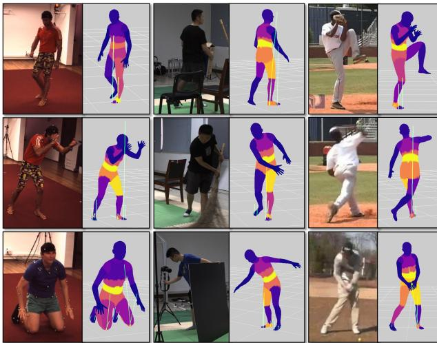
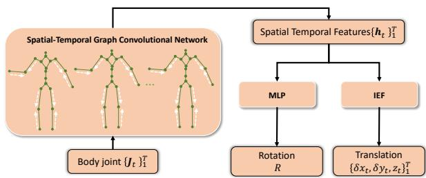
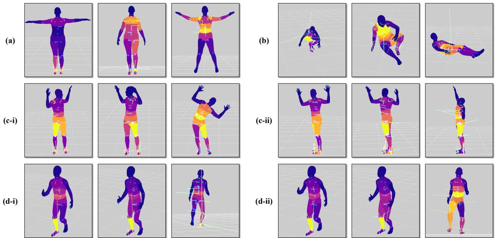

# PhysPT: 用于从单目视频中估计人体动力学的物理感知预训练 Transformer

Yufei Zhang1, Jeffrey O. Kephart2, Zijun Cui1,3, Qiang Ji1

1Rensselaer Polytechnic Institute, 2IBM Research, 3University of Southern California

{zhangy76, jiq}@rpi.edu, kephart@us.ibm.com, ceejkl@gmail.com

## 摘要

虽然当前从单目视频估计三维人体运动的方法已取得了显著进展，但由于它们主要考虑运动学（kinematics），其运动估计结果往往在物理上是不真实的。在本文中，我们提出了物理感知预训练 Transformer（Physics-aware Pretrained Transformer，PhysPT），它能够改进基于运动学的运动估计并推断运动作用力。PhysPT 利用 Transformer 编码器-解码器骨干网络，以自监督方式有效学习人体动力学（human dynamics）。此外，它融合了支配人体运动的物理规律。具体而言，我们构建了基于物理的人体表征和接触力模型。我们利用它们施加新型的受物理启发的训练损失（即作用力损失、接触损失和欧拉-拉格朗日损失），使 PhysPT 能够捕捉人体的物理属性及其所受的力。实验表明，训练完成后，PhysPT 可以直接应用于基于运动学的估计结果，从而显著提高其物理合理性并生成理想的运动作用力。此外，我们证明了这些具有物理意义的量能够提升一项重要下游任务的准确率：人体动作识别。

## 1. 引言

单目三维人体运动估计对于人机交互 [8, 74]、运动分析 [14] 和机器人学 [17] 等应用至关重要。由于缺乏深度信息以及力与人体运动之间错综复杂的相互作用，该任务本身极具挑战性。

深度学习的最新进展以及三维人体建模 [47, 85] 方面的突破，极大地提升了从单张图像重建三维人体 [28, 33, 38, 76, 105] 的能力。对于视频输入，当前的研究旨在通过利用时序信息来提高模型性能。一些研究者设计了时序模型，从视频中提取有意义的特征以改善性能 [6, 10, 11, 13, 23, 36, 55, 64, 69, 73, 80, 98,

100]。另一些研究者则学习捕捉自然三维身体运动模式的运动先验。将学习到的先验整合到模型训练中可以促进生成平滑的运动估计 [31, 48, 61, 66]。尽管这些方法在一定程度上增强了重建效果，但它们往往会产生不真实的估计结果，表现为明显的物理伪影，例如运动抖动和脚底滑动（foot skating）。

为了解决这一局限性，一种有前景的策略是利用支配身体运动的物理原理。在该方法中，人体被视为多关节刚体（articulated rigid body），人体动力学则通过欧拉-拉格朗日方程（Euler-Lagrange equations）进行描述。这些方程通过常微分方程将身体质量、惯性以及物理力（包括关节驱动力和接触力）与身体运动联系起来。一些研究人员 [19, 20, 40, 60, 67, 84, 88] 构建了优化框架，共同估计未知物理参数，并通过使基于运动学的估计与物理方程保持一致来进行优化。另外，其他学者 [24, 39, 49, 68, 93] 则采用了基于学习的框架。他们通过训练神经网络来预测这些参数，从而规避了基于优化的方法中固有的繁琐手动参数调优。

然而，一个关键的挑战仍然存在：当前的 3D 动作捕捉数据集 [51] 中缺乏物理信息，包括人体的物理特性和运动受力。为了引入物理机制，现有方法通常依赖于物理引擎 [15, 75]。这需要使用几何基元创建代理人体（proxy bodies）以捕捉身体特性，将这些代理导入物理引擎，然后利用物理引擎计算必要的物理参数并模拟身体运动。这种方法的问题在于难以有效地从物理引擎输出中计算梯度 [19]，从而限制了它们与深度学习模型的无缝集成。此外，现有的基于物理的模型主要使用带有 3D 标注的视频进行训练，而这在实践中很难获取。因此，训练出的模型可能无法很好地泛化到未见过的场景中。

在本文中，我们提出了一种用于学习人体动力学的新颖框架，该框架规避了对 3D 标注视频的需求，并将物理机制与先进的深度模型进行了有效集成。具体而言，受预训练 Transformer [77] 在时序建模中近期成功的启发，我们提出利用 Transformer 编码器-解码器架构，并通过重构输入的人体运动以自监督的方式进行训练。在引入物理机制时，我们通过直接从广泛采用的 3D 人体模型 SMPL [47] 中计算身体物理特性，绕过了不切实际的人体代理。我们还引入了一个接触模型以有效地建模接触力。我们利用这些模型从训练序列中推导运动受力，并施加受物理启发的新型训练损失，包括力损失（force loss）、接触损失（contact loss）以及欧拉-拉格朗日损失（Euler-Lagrange loss）。我们仅使用现有的动作捕捉数据来训练 Transformer 模型。训练完成后，我们的物理感知预训练 Transformer（PhysPT）可应用于任何基于运动学的重建模型之上，以从单目视频中生成增强的运动和受力估计。综上所述，我们的主要贡献包括：

• 我们提出了 PhysPT，这是一个通过融入物理学规律、利用自监督学习进行训练的 Transformer 编码器-解码器模型。一旦训练完成，PhysPT 无需额外的模型微调即可与任何基于运动学的模型相结合，以估计人体动力学。

• 我们提出了一种融入物理学规律的新颖框架。该框架包括基于物理的人体表示与接触力模型，并在此基础上引入了一组用于模型训练的新颖物理启发损失。

• 我们通过实验证明，PhysPT 显著增强了运动估计的物理合理性，并能推断出良好的运动受力。此外，我们证明了增强后的运动与受力估计能够转化为重要下游任务——人体动作识别（human action recognition）中的准确率提升。

## 2. 相关工作

基于运动学的人体运动估计。对人体运动学进行建模的方法仅估计人体的几何构型。在这些方法中，一类工作涉及基于优化的流程，该流程将先验人体模型迭代拟合到 2D 观测数据以重建 3D 人体 [1, 4, 22, 78, 83, 89, 111]。其他方法则采用深度学习模型直接预测 3D 人体。给定单张输入图像，现有方法提出了具有不同中间表示和输出表示的各种模型架构，以提高重建精度 [18, 32, 34, 38, 41, 43, 50, 53, 63, 81, 91, 104]。

在输入为单目视频的情况下，当前基于运动学的方法旨在充分利用时间信息以获得更优的结果。研究人员基于时间卷积网络（Temporal Convolutional Networks）[29, 36, 55, 99, 100]、图卷积网络（Graph Convolutional Networks）[6, 10, 11, 80, 98]、循环神经网络（Recurrent Neural Networks）[13, 23, 31, 48, 72, 92]、

Transformer [21, 42, 58, 59, 64, 73, 108, 112] 或显式捕获并利用注意力机制的方法 [44, 71, 79, 82] 开发了各种时序模型。促进生成逼真时序预测的另一种常见方法是在训练过程中引入平滑度约束或运动先验 [31, 48, 61, 94, 101]。然而，由于未能逼真地捕捉人体运动的复杂性，这些基于运动学的方法往往会产生明显的物理伪影。

基于物理的人体运动估计。基于物理的方法显式地利用物理原理（特别是欧拉-拉格朗日方程（Euler-Lagrange equations））来捕获人体动力学。先前的研究采用优化框架，通过最小化欧拉-拉格朗日方程引入的残差，联合估计运动作用力并优化初始的基于运动学的运动估计 [40, 60, 84]。直接估计施加的力极具挑战性；因此，其他方法采用了角色控制策略。在该范式中，基于运动学的估计充当参考运动，而通过估计控制器的参数来预测在物理引擎中模拟这些运动所需的力 [19, 37, 67, 88, 90, 110]。然而，这些基于优化的方法通常需要仔细调节控制参数。一些方法转而利用神经网络来估计参数，其中的模型通过全监督学习 [68] 或强化学习 [24, 26, 49, 93] 进行训练。在这些方法中，将物理引擎与学习模型相结合并不能实现物理特性的有效端到端融合。Li 等 [39] 通过解析计算部分物理参数并结合 3D 监督来增强学习过程。尽管取得的结果很有前景，但现有的基于学习的方法依赖带有 3D 标注的视频进行训练，并且通常泛化能力较差。相比之下，我们的模型采用自监督学习，仅使用现有的无图像 3D 运动数据进行训练。此外，我们提出了一种新颖的框架，无需依赖物理引擎即可无缝弥合人体运动学与物理学之间的鸿沟，促进了物理机制与先进深度学习模型的有效融合。

完整人体动力学估计。完整捕获人体动力学需要同时确定身体运动以及人体施加的力 [3, 12, 62, 65]。估计人体动力学的主流方法主要侧重于从 3D 动作捕捉数据中推断受力 [5, 95–97]。这些估计出的力被用于辅助人体动作识别 [52] 或人体运动预测 [45, 106, 107] 等任务。我们的方法能够应对更具挑战性的任务：从单目视频中估计完整的人体动力学。我们在不使用任何真实受力标签的情况下实现了这一点。据我们所知，我们是首个证明从单目视频中推断出的力能够提升人体动作识别性能的研究。

  
Figure 1. 方法概述。所提出的框架由一个基于运动学的动作估计模型（橙色）和一个用于从单目视频中估计人体动力学的物理感知预训练 Transformer（绿色）组成。插图 (a) 展示了右侧骨盆的关节驱动力以及每只脚处的接触力。(b) 展示了重建的人体动作和推断出的力，较浅的颜色代表较大的关节驱动力幅度（例如人物站立时的上半身关节，以及行走时的腿部关节）。

## 3. 提出的方法

Fig. 1 展示了我们方法的概述。给定 T 个视频帧 $\{ \mathbf { X } _ { t } \} _ { t = 1 } ^ { T }$，采用基于运动学的模型生成初始动作估计 $\{ \hat { \mathbf { q } } _ { t } \} _ { t = 1 } ^ { T }$，随后由所提出的 PhysPT 估计精细化动作 $\{ \mathbf { q } _ { t } \} _ { t = 1 } ^ { T }$ 并推断力 $\left. \lambda _ { t } , \tau _ { t } \right. _ { t = 1 } ^ { T }$。在 Sec. 3.1 中，我们介绍了用于建模人体动力学的物理方程，并描述了我们如何生成基于运动学的估计。在 Sec. 3.2 中，我们深入探讨了 PhysPT 的核心组件。

## 3.1. 预备知识

欧拉-拉格朗日方程（Euler-Lagrange Equations）。作为一个由多个相互作用的身体部位组成的复杂物理系统，人体通常采用刚体动力学进行建模。在此背景下，欧拉-拉格朗日方程在广义坐标系内提供了对人体动力学的简洁数学描述。

广义坐标由完全指定系统状态的变量所定义。基于成功的几何人体模型 SMPL [47]，我们使用身体姿态 $\pmb { \theta } \in \mathbb { R } ^ { 2 3 \times 3 }$ 和体型参数 $\beta \in \mathbb { R } ^ { 1 0 }$，以网格模型形式表示 3D 人体。姿态参数表征 23 个身体关节的旋转，而体型参数控制身体属性的变化（例如围度）。鉴于身体形状在单个视频内保持恒定，世界坐标系中的 3D 身体轨迹可以通过姿态 θ 加上身体平移 $\mathbf { T } \in \mathbb { R } ^ { 3 }$ 和旋转 $\mathbf { R } \in \mathbb { R } ^ { 3 }$，经由广义坐标 q 完全指定：

$$
\mathbf {q} = \{\mathbf {T}, \mathbf {R}, \boldsymbol {\theta} \}.\tag{1}
$$

将广义坐标中的速度和加速度分别表示为 $\dot { \mathbf { q } }$ 和 ${ \ddot { \mathbf { q } } } ,$ 受欧拉-拉格朗日方程支配的身体动力学为：

$$
\mathbf {M} (\mathbf {q}; \mathbf {m}, \mathbf {I}) \ddot {\mathbf {q}} + \mathbf {C} (\mathbf {q}, \dot {\mathbf {q}}; \mathbf {m}, \mathbf {I}) + \mathbf {g} (\mathbf {q}; \mathbf {m}) = \mathbf {J} _ {C} ^ {T} \boldsymbol {\lambda} + \boldsymbol {\tau},\tag{2}
$$

其中 $\mathbf { M } ( \mathbf { q } ; \mathbf { m } , \mathbf { I } )$ 是由位置 q、身体质量 m 以及转动惯量 I 决定的广义惯性矩阵。$\mathbf { C } \left( \mathbf { q } , { \dot { \mathbf { q } } } ; \ \mathbf { m } , \mathbf { I } \right)$ 表示科里奥利力和离心力。$\mathbf { g } ( \mathbf { q } ; \mathbf { m } )$ 表示重力。$\pmb { \lambda } \in \mathbb { R } ^ { 3 n _ { c } }$ 表示接触力，其中 $n _ { c }$ 为接触点的数量。$\mathbf { J } _ { C } \in \mathbb { R } ^ { 3 n _ { c } \times 7 5 }$ 是接触雅可比矩阵，根据公式 ${ \bf v } _ { C } = { \bf J } _ { C } \dot { \bf q }$ 描述了接触点的笛卡尔速度 $\mathbf { v } _ { C } \in \mathbb { R } ^ { 3 n _ { c } }$ 与广义速度 ${ \dot { \mathbf { q } } }$ 之间的映射关系。此外，$\tau \in \mathbb { R } ^ { 7 5 }$ 表示关节驱动力，如图 1-a 中右侧骨盆关节所示。

基于运动学的运动估计模型。我们首先采用成熟的方法从视频输入中获取逐帧的 3D 人体姿态和体型 $\{ \hat { \pmb { \theta } } _ { t } , \hat { \pmb { \beta } } _ { t } \} _ { t = 1 } ^ { T }$。该步骤对具体使用的方法不设限制；在我们的实验中，我们使用了近期公开可用的模型。通过这些传统 3D 人体重建模型估计的姿态和体型仅能捕捉人体自身坐标系下的身体运动，缺乏全局运动轨迹来完整指定式 1 中定义的广义位置。与 [94] 一致，我们训练了一个全局轨迹预测器，根据局部身体运动提供逐帧的全局平移和旋转 $\{ \hat { \mathbf { T } } _ { t } , \hat { \mathbf { R } } _ { t } \} _ { t = 1 } ^ { T }$。该全局轨迹预测器是独立训练的，无需额外的模型微调即可输出全局估计结果。模型架构和训练的更多细节见 Supp. A。最后，通过将估计的全局轨迹与局部身体姿态相结合，我们获得了初始广义位置估计 $\{ \hat { \mathbf { q } } _ { t } \} _ { t = 1 } ^ { T }$，并将其输入到 PhysPT 中进行进一步优化。同时，由于受试者的体型随时间保持不变，我们将最终体型估计取为 $\begin{array} { r } { \beta = \frac { 1 } { T } \sum _ { t = 1 } ^ { T } \hat { \beta } _ { t } } \end{array}$。

## 3.2. 物理感知的预训练 Transformer (Physics-aware Pretrained Transformer)

初始的基于运动学的运动估计保持了合理的逐帧重建精度。本节介绍的物理感知预训练 Transformer（Physicsaware Pretrained Transformer）进一步增强了运动估计并推断出运动受力。下文中，我们首先在 Sec. 3.2.1 中介绍 PhysPT 的 Transformer 编码器-解码器主干网络。为了将物理机制融入模型中，我们构建了基于物理的人体表征（Sec. 3.2.2）和接触力模型（Sec. 3.2.3），从而能够构建受物理启发的训练损失（Sec. 3.2.4）。

## 3.2.1 Transformer 编码器-解码器主干网络

与主要利用 Transformer 编码器来学习表征的现有工作不同，我们采用了一种 Transformer 编码器-解码器架构 [77]。如图 Fig. 1（绿色区域）所示，该模型首先使用线性层从基于运动学的估计值 $\{ \hat { \mathbf { q } } _ { t } \} _ { t = 1 } ^ { T }$ 中提取嵌入 ${ \bf E } _ { i n p u t } \in { \bf R } ^ { T \times n _ { f } }$。然后将该 $\mathbf { E } _ { i n p u t }$ 与时间位置编码相结合，输入到 Transformer 编码器中以生成潜在嵌入 ${ \bf E } _ { l a t e n t } \in { \bf R } ^ { T \times n _ { l } }$。此处，$n _ { f }$ 和 $n _ { l }$ 为嵌入维度。随后，解码器通过自回归预测生成精炼的估计值 $\{ \mathbf { q } _ { t } \} _ { t = 1 } ^ { T }$。具体而言，在时间帧 $m + 1$ 处，先前的 m 个估计值被投影为嵌入 $\mathbf { E } _ { o u t p u t } \in \mathbf { R } ^ { m \times n _ { f } }$，并为其添加位置编码。该嵌入与 ${ \bf E } _ { l a t e n t }$ 一同输入到 Transformer 解码器中以产生运动预测。

利用 Transformer 编码器-解码器主干网络可以通过重建输入，以自监督的方式有效捕获时序信息。具体来说，将来自现有 3D 动作捕捉数据的输入序列记为 $\{ \bar { \mathbf { q } } _ { t } \} _ { t = 1 } ^ { T }$，我们计算广义位置和 3D 关节位置的均方误差，从而得到新增的重建损失 $\mathcal { L } _ { r e c o n }$

$$
\begin{array}{c} \mathcal {L} _ {r e c o n} = \sum_ {t = 1} ^ {T} \gamma_ {q} \mathcal {L} _ {q, t} + \gamma_ {J} \mathcal {L} _ {J, t}, \\ \mathcal {L} _ {q, t} = \| \mathbf {q} _ {t} - \bar {\mathbf {q}} _ {t} \| _ {2} ^ {2}, \\ \mathcal {L} _ {J, t} = \| \mathbf {J} _ {t} - \bar {\mathbf {J}} _ {t} \| _ {2} ^ {2}, \end{array}\tag{3}
$$

其中，三维关节位置 $\mathbf { J } _ { t } ~ \in ~ \mathbb { R } ^ { n _ { J } \times 3 }$ 是利用正向运动学（forward kinematics）根据广义位置和人体形状参数计算得到的，$n _ { J }$ 为人体关节数量。$\gamma _ { q }$ 和 $\gamma _ { J }$ 为训练损失权重。为了增强模型的鲁棒性，我们在训练期间向输入引入随机高斯噪声，同时模型的目标仍是重建干净的输入。至此，Transformer 模型的训练使其能够有效地从动作数据中学习几何信息，但它对物理原理一无所知，不足以忠实地捕捉人体动力学。

  
Figure 2. Phys-SMPL。除三维位置外，Phys-SMPL 还对各个身体部位的体积（V）、质量（m）和惯量（I）进行了建模。较浅的颜色代表较大的身体重量分布。

## 3.2.2 基于物理的人体表征

为了使模型具备捕捉物理特性的能力，我们首先需要对人体的物理属性进行建模。为此，我们引入了一种基于物理的人体表征 Phys-SMPL。如图 Fig. 2 所示，除 SMPL 的几何信息外，Phys-SMPL 还包含了 24 个身体部位的质量 m $\iota ( \beta ) \in \mathbb { R } ^ { 2 4 }$ 与惯量 $\bar { \mathbf { I } ( \beta ) } \in \mathbb { R } ^ { 2 4 \times 3 \times \bar { 3 } }$。具体而言，我们首先将每个身体部位的网格进行闭合。这使得我们能够将身体部位的体积计算为其质心与网格面所构成的四面体之和。基于人体的平均质量密度 [56]，我们计算出不同身体部位的质量，进而计算出惯量。需要注意的是，这些人体物理属性是直接从由形状参数 $\beta ,$ 指定的 SMPL 几何信息中计算得出的，无需创建不切实际的人体代理（body proxies）。在 Phys-SMPL 的基础上，我们解析计算了欧拉-拉格朗日方程（Euler-Lagrange equations，Eq. 2）中的物理项。物理参数的解析计算是完全可微的，从而能够在训练过程中将物理规律与学习模型无缝融合。关于 Phys-SMPL 和解析计算的更多细节见 Supp. B。

## 3.2.3 连续接触力模型

为了捕捉人体动力学，还必须对运动力进行建模。对于关节驱动力和接触力而言，接触力的建模尤为具有挑战性。接触状态通常需要预先确定——而这本身就很难做到准确。离散的接触状态在估计力时也会引入不可微的过程。为了解决这个问题，我们从文献 [5] 提出的用于从 3D 运动中估计地面反作用力的连续接触模型中汲取灵感，该模型引入了一个如图 3 所示的弹簧-质量系统。具体而言，点 p 在时间 t 所受到的地面接触力建模为：

$$
\pmb {\lambda} _ {p, t} = s _ {p, t} (- k _ {h, t} \mathbf {b} _ {h, t} - k _ {n, t} \mathbf {b} _ {n, t} - c _ {t} \mathbf {v} _ {C, t}).\tag{4}
$$

  
Figure 3. 连续接触力模型。点 p 在时间帧 t 接收到的接触力由其速度以及通过沿水平 $( k _ { h , t } )$ 和法向 $( k _ { n , t } )$ 方向构建的弹簧-质量系统到地面的距离所决定。

其中 $k _ { h , t }$ t 和 $k _ { n , t }$ 分别表示弹簧-质量在水平和法向方向上的刚度，而 $c _ { t }$ 表示阻尼因子。标量 sp,t = $2 \sigma ( - 6 0 d _ { t } ) \sigma ( - 6 0 \| \mathbf { v } _ { C , t } \| )$ 调节力的大小，其中 $\sigma ( \cdot )$ 表示 Sigmoid 函数，$d _ { t }$ 表示点到地面的距离，$\| \mathbf { v } _ { C , t } \|$ 是其速度。此外，$\mathbf b _ { h , t } \ = \ [ d _ { t , x } \ - 0 . 5 ; d _ { t , y } \ - \ 0 . 5 ; 0 ]$ 和 $\mathbf { b } _ { n , t } = [ 0 ; 0 ; d _ { t } - 2 ]$ 分别是在水平和法向方向上到参考点的距离。这里，$d _ { t , x }$ 和 $d _ { t , y }$ 是使用接触点法线将 $d _ { t }$ 投影到 x 轴和 y 轴上的分量。单位为米。为了计算效率（并在补充材料 C 中进一步讨论），我们将接触模型应用于每个身体部位内的顶点子集。该接触模型捕捉了自然接触行为的基本要素，即最接近地面且最稳定的点承受更大的力。利用该接触模型还避免了估计离散接触状态所带来的问题。

## 3.2.4 受物理启发的训练损失

基于基于物理的人体表征和力模型，我们可以通过利用若干受物理启发的训练损失，有效地将物理学与模型相结合。

为了构建这些损失，第一步是从训练序列中提取有价值的运动力信息。给定来自训练数据的 3D 轨迹 $\{ \bar { \mathbf { q } } _ { t } \} _ { t = 1 } ^ { T }$，我们利用有限差分来获得速度和加速度 $\{ \dot { \bar { \mathbf { q } } } _ { t } , \ddot { \bar { \mathbf { q } } } _ { t } \} _ { t = 1 } ^ { T }$。然后，我们构建以下优化问题以恢复时间帧 t 的运动力：

$$
\begin{array}{l l} \arg \min _ {\mathbf {x} _ {t}, \boldsymbol {\tau} _ {t}} & \| \bar {\mathbf {M}} _ {t} \ddot {\bar {\mathbf {q}}} _ {t} + \bar {\mathbf {C}} _ {t} + \bar {\mathbf {g}} _ {t} - \bar {\mathbf {J}} _ {C, t} ^ {T} \bar {\mathbf {A}} _ {t} \mathbf {x} _ {t} - \boldsymbol {\tau} _ {t} \| _ {2} ^ {2} \\ s. t. & \mathbf {0} <   \mathbf {x} _ {t} <   \bar {\mathbf {x}} _ {m a x}. \quad (\text { stiffness   and   damping   constraints }) \end{array}\tag{5}
$$

目标函数是由公式 (2) 中的欧拉-拉格朗日（Euler-Lagrange）方程引入的最小二乘误差。（为简便起见，省略了各物理项的变量。）优化变量由关节驱动力 $\tau _ { t }$ 和弹簧-质量模型参数 $\mathbf { x } _ { t }$ 组成。具体而言，公式 (4) 中的接触力模型以向量形式表示为 $\lambda _ { p , t } =$ $\mathbf { A } _ { p , t } \mathbf { x } _ { p , t } .$，其中 $\mathbf { A } _ { p , t } = s _ { p , t } [ - \mathbf { b } _ { h , t } , - \mathbf { b } _ { n , t } , - \mathbf { v } _ { C , t } ]$ 包含位置相关参数，而 $\mathbf { x } _ { p , t } = [ k _ { h , t } ; k _ { n , t } ; c _ { t } ]$ 包含未知的刚度和阻尼参数。将所有建模点的接触力拼接起来，可得 $\lambda _ { t } = \mathbf { A } _ { t } \mathbf { x } _ { t }$。此外，考虑到人体正常站立时可能受到的最大接触力，指定了对 $\mathbf { x } _ { t }$ 的线性不等式约束。所构建的优化问题是一个标准的二次规划（Quadratic Programming）问题，通过利用 CVXOPT [16] 来求解全局最小值。最终解产生的力既符合弹簧-质量模型设定的约束，又最优地满足了欧拉-拉格朗日方程。利用这些推断出的力，可以通过施加以下受物理启发的损失，有效地将物理特性融入模型中。

力损失（Force Loss）。我们首先利用推导出的运动力来引导模型生成逼真的运动力，并提取有意义的潜在表征，用于预测符合物理规律的运动。具体而言，我们引入一个线性层，基于接触力模型将潜在表征 ${ \bf E } _ { l a t e n t }$ 映射为运动力 $\{ \lambda _ { t } , \tau _ { t } \} _ { t = 1 } ^ { T }$。给定推导出的力 $\bar { \tau } _ { t }$ 和 ${ \bar { \lambda } } _ { t }$，我们通过最小化平均绝对误差来训练模型：

$$
\mathcal {L} _ {\text { force }} = \sum_ {t = 1} ^ {T} \gamma_ {\tau} \| \boldsymbol {\tau} _ {t} - \bar {\boldsymbol {\tau}} _ {t} \| _ {1} + \gamma_ {\lambda} \| \boldsymbol {\lambda} _ {t} - \bar {\boldsymbol {\lambda}} _ {t} \| _ {1}.\tag{6}
$$

接触损失（Contact Loss）。此外，我们对受到接触力的顶点施加约束，通过以下接触损失获得逼真的接触行为：

$$
\mathcal {L} _ {\text { c   o   n   t   a   c   t }} = \sum_ {t = 1} ^ {T} \frac {1}{n _ {C _ {t}}} \sum_ {n _ {i} \in \mathcal {C} _ {t}} \gamma_ {v} \| \mathbf {v} _ {n _ {i}, t} \| _ {1} + \gamma_ {z} | z _ {n _ {i}, t} |,\tag{7}
$$

其中 $\mathcal { C } _ { t }$ 表示表现出接触力的顶点集合（通过公式 5 计算），$n _ { C _ { t } }$ 为集合的大小。$\mathbf { v } _ { n _ { i } , t }$ 和 $z _ { n _ { i } , t }$ 分别表示第 $n _ { i }$ 个顶点的速度和到地面的垂直距离。最小化公式 7 会促使那些承受较大接触力的顶点具有更小的速度并且更接近地面。

欧拉-拉格朗日损失（Euler-Lagrange Loss）。此外，我们引入了源自欧拉-拉格朗日方程的损失，以确保重建的运动遵循物理方程：

$$
\mathcal {L} _ {e u l e r} = \sum_ {t = 1} ^ {T} \| \mathbf {M} _ {t} \ddot {\mathbf {q}} _ {t} + \mathbf {C} _ {t} + \mathbf {g} _ {t} - \mathbf {J} _ {C, t} ^ {T} \bar {\boldsymbol {\lambda}} _ {t} - \bar {\boldsymbol {\tau}} _ {t} \| _ {1}.\tag{8}
$$

值得注意的是，得益于基于物理的人体模型，损失函数中的所有项都是解析计算的，并且对模型输出完全可微。总模型训练损失（Total Model Training Loss）。将所有受物理启发的损失与重建损失相结合，我们得到了总训练损失函数：

$$
\mathcal {L} = \mathcal {L} _ {r e c o n} + \mathcal {L} _ {f o r c e} + \mathcal {L} _ {c o n t a c t} + \mathcal {L} _ {e u l e r}.\tag{9}
$$

我们利用公式 9 仅使用动作捕捉数据来训练 Transformer 编码器-解码器主干网络。模型训练完成后，直接添加到基于运动学的模型之上，以获得改进的运动估计并推断运动力，而无需进行模型微调。

## 4. 实验

数据集。在训练期间，我们使用 AMASS [51]，这是一个包含多样化受试者和动作的动作捕捉数据集集合。在评估方面，我们使用 Human3.6M [25] 和 3DOH [102] 的测试集。Human3.6M 涵盖了如行走和坐下等常见活动。与某些仅关注涉及地面交互序列的基于物理的方法不同，我们遵循标准协议，并在所有动作上评估我们的方法。3DOH 包含人-物体交互的序列（例如打开箱子），代表了具有显著遮挡的具有挑战性的测试场景。此外，我们利用 PennAction [103] 来证明我们的方法有助于改善人体动作识别。PennAction 包含超过 2K 条涵盖 15 种体育动作（例如棒球投球和保龄球）的网络视频。

评估指标。我们评估 3D 重建误差（Rec. Error）和物理合理性（Phys. Plausibility）。Rec. Error 包括平均每关节位置误差（以 mm 为单位的 MJE）以及经 Procrustes 对齐后的 MJE（以 mm 为单位的 P-MJE）。Phys. Plausibility 涉及由先前方法 [31, 67, 93] 引入的指标，包括：(1) 预测加速度与真实值之间的平均差异（加速度误差 ACCL，单位为 mm/frame2）；(2) 预测关节速度大小与真实值之间的差异（速度误差 VEL，单位为 mm/frame）；(3) 接触地面的顶点在相邻两帧之间的平均位移（足部滑动 FS，单位为 mm）；(4) 低于地面的网格顶点到地面的平均距离（地面穿透 GP，单位为 mm）。

实现细节。Transformer 主干网络由标准的编码器和解码器层组成，包含 6 个层、8 个注意力头以及 1024 维的嵌入维度。模型的输入序列长度为 16，与大多数现有方法保持一致。为了高效进行 Transformer 训练 [77]，我们首先在前 20 个 epoch 中使用真实值来提取输出嵌入，随后在接下来的 5 个 epoch 中使用预测值。我们采用 Adam 优化器 [30]，权重衰减为 $1 0 ^ { - 4 }$。初始学习率为 $1 0 ^ { - 5 }$，并且每 5 个 epoch 衰减为原来的 0.8。超参数经验性地设置为：$\gamma _ { q } = 2 e ^ { 3 } , \gamma _ { J } = 1 e ^ { 5 } , \gamma _ { \tau } = 5$ $\gamma _ { \lambda } = 1 , \gamma _ { v } = 1 0 0 .$ 以及 $\gamma _ { z } = 2 0 0$。

## 4.1. 与最先进方法（SOTA）的对比

基于运动学方法的改进。如 Tab. 1 所示，PhysPT 显著提升了基于运动学的运动估计的物理合理性。无论是以图像还是视频帧作为输入，基于运动学的方法往往难以保证物理合理性。例如，CLIFF 保持了具有竞争力的逐帧重建精度，但在所有物理合理性评估指标上的表现均较差。将 PhysPT 应用于 CLIFF 可以显著提升其物理合理性。值得注意的是，加速度误差（ACCL）和足部滑动（FS）分别降低了 83.8% 和 68.7%。与 PhysPT 类似，PoseBert 利用了在 3D 动作捕捉数据上预训练的 Transformer 编码器，但它并未考虑物理规律。PoseBert 虽然在一定程度上降低了 ACCL 和 VEL，但与 PhysPT 不同的是，它未能减少足部滑动和地面穿透误差。在 Supp. D 中，我们证明了 PhysPT 除了 CLIFF 之外，还能改进其他基于运动学的模型（SPIN [33] 和 IPMAN [76]），并且这些改进始终比 PoseBert 更为显著。

<table><tr><td rowspan="2">方法</td><td rowspan="2">物理引擎</td><td rowspan="2">视频标签</td><td colspan="2">重建误差</td><td colspan="4">物理合理性</td></tr><tr><td>MJE</td><td>P-MJE</td><td>ACCL</td><td>VEL</td><td>FS</td><td>GP</td></tr><tr><td> $HybriK^†$  [38]</td><td>-</td><td>-</td><td>55.4</td><td>33.6</td><td>-</td><td>-</td><td>-</td><td>-</td></tr><tr><td>*CLIFF [41]</td><td>-</td><td>-</td><td>52.2</td><td>36.8</td><td>15.4</td><td>6.8</td><td>8.3</td><td>9.3</td></tr><tr><td>VIBE [31]</td><td>-</td><td>-</td><td>61.3</td><td>43.1</td><td>15.2</td><td>25.5</td><td>15.1</td><td>12.6</td></tr><tr><td>*PoseBert [2]</td><td>-</td><td>-</td><td>54.9</td><td>37.5</td><td>5.0</td><td>4.0</td><td>10.0</td><td>12.8</td></tr><tr><td>GLoT [64]</td><td>-</td><td>-</td><td>67.0</td><td>46.3</td><td>3.6</td><td>-</td><td>-</td><td>-</td></tr><tr><td>PMCE [92]</td><td>-</td><td>-</td><td>53.5</td><td>37.7</td><td>3.1</td><td>-</td><td>-</td><td>-</td></tr><tr><td>PhysCap [67]</td><td>是</td><td>-</td><td>97.4</td><td>65.1</td><td>-</td><td>7.2</td><td>-</td><td>-</td></tr><tr><td>NeurPhys [68]</td><td>是</td><td>是</td><td>76.5</td><td>58.2</td><td>-</td><td>4.5</td><td>-</td><td>-</td></tr><tr><td>Xie et al. [84]</td><td>是</td><td>-</td><td>68.1</td><td>-</td><td>-</td><td>4.0</td><td>-</td><td>-</td></tr><tr><td>SimPoE [93]</td><td>是</td><td>是</td><td>56.7</td><td>41.6</td><td>6.7</td><td>-</td><td>3.4</td><td>1.6</td></tr><tr><td>NeurMoCon [24]</td><td>是</td><td>是</td><td>72.5</td><td>54.6</td><td>-</td><td>3.8</td><td>-</td><td>-</td></tr><tr><td>TrajOpt [20]</td><td>是</td><td>-</td><td>84</td><td>56</td><td>-</td><td>-</td><td>-</td><td>-</td></tr><tr><td>DiffPhy [19]</td><td>是</td><td>-</td><td>81.7</td><td>55.6</td><td>-</td><td>-</td><td>-</td><td>-</td></tr><tr><td>D&amp;D $^†$  [39]</td><td>否</td><td>是</td><td>52.5</td><td>35.5</td><td>6.1</td><td>-</td><td>5.8</td><td>1.5</td></tr><tr><td>Huang et al. [26]</td><td>是</td><td>是</td><td>55.4</td><td>41.3</td><td>-</td><td>3.5</td><td>-</td><td>-</td></tr><tr><td>PhysPT (本文方法)</td><td>否</td><td>否</td><td>52.7</td><td>36.7</td><td>2.5↓83.8</td><td>3.4↓50.0</td><td>2.6↓68.7</td><td>1.5↓83.9</td></tr></table>

Table 1. Human3.6M 上的评估。顶部区域的方法使用图像输入，中间区域的方法使用视频输入，底部区域的方法是基于物理的。目前基于物理的方法需要带 3D 标注的视频（“Video Label”）进行训练，或采用基于优化的框架。标有 † 的方法是在从拟合的人体模型 [46] 计算出的 3D 关节点上进行评估的，而非原始数据集中提供的关节点。对于标有“\*”的方法，结果来自其官方发布的模型。所有其他结果均取自各自的论文。PoseBert 和 PhysPT 的评估基于 CLIFF。绿色数字表示我们的方法相对于 CLIFF 的相对提升百分比。对于所有指标，数值越小越好。

相比基于物理的方法的优势（Advantages over Physics-based Methods）。PhysPT 在无需依赖物理引擎或带 3D 标注视频进行训练的情况下，超越了现有的基于物理的方法。如 Tab. 1 所示，与基于运动学的方法相比，现有的基于物理的方法通常表现出更优的物理合理性。它们通常采用独立于其学习模型的物理引擎来计算物理参数并模拟人体运动。它们在训练时需要与输入视频配对的 3D 标注，或者局限于基于优化的方法。相比之下，我们的方法通过利用一种创新的自监督学习框架，避免了对带 3D 标注视频的需求。我们通过基于物理的人体表征和接触力模型，弥合了人体运动学与物理学之间的鸿沟，实现了物理规律与深度模型的无缝集成。在性能对比方面，我们的模型取得了具有竞争力的重建精度，并在物理合理性方面实现了更显著的提升（Tab. 1）。例如，尽管所有其他方法都利用了来自 Human3.6M 的训练数据，我们的方法产生的加速度误差比最接近的竞争对手 D&D 低 2.4 倍（2.5 对比 6.1 mm/frame2），且足部滑动误差仅为排名第二的 SimPoE 的 76%（2.6mm 对比 3.4mm）。在 Supp. E 中，我们还展示了我们的方法能够实现更优的全局运动恢复。

<table><tr><td rowspan="2">方法</td><td colspan="2">重建误差</td><td colspan="4">物理合理性</td></tr><tr><td>MJE</td><td>P-MJE</td><td>ACCL</td><td>VEL</td><td>FS</td><td>GP</td></tr><tr><td>*CLIFF [41]</td><td>53.0</td><td>34.4</td><td>26.0</td><td>12.0</td><td>10.8</td><td>12.6</td></tr><tr><td>VIBE [31]</td><td>98.1</td><td>61.8</td><td>-</td><td>26.5</td><td>-</td><td>-</td></tr><tr><td>*PoseBert [2]</td><td>54.8</td><td>34.1</td><td>6.6</td><td>6.9</td><td>14.0</td><td>10.4</td></tr><tr><td>NeurPhys [68]</td><td>107.8</td><td>93.3</td><td>-</td><td>12.2</td><td>-</td><td>-</td></tr><tr><td>NeurMoCon [24]</td><td>93.4</td><td>86.7</td><td>-</td><td>9.2</td><td>-</td><td>-</td></tr><tr><td>Huang et al. [26]</td><td>79.3</td><td>72.8</td><td>-</td><td>8.9</td><td>-</td><td>-</td></tr><tr><td>PhysPT（本文方法）</td><td>53.0</td><td>33.3</td><td>4.6↓82.3</td><td>6.5↓45.8</td><td>4.7↓56.5</td><td>0.1↓99.2</td></tr></table>

表 2. 在 3DOH 上的评估。PoseBert 和 PhysPT 的评估基于 CLIFF。绿色数字表示本文方法相对于 CLIFF 的相对改进百分比。

遮挡下的鲁棒性。如在 3DOH 上的评估所示（表 2），本文方法对遮挡具有鲁棒性。尽管 3DOH 中包含显著的遮挡和复杂的人-物体交互动作，将 PhysPT 应用于 CLIFF 仍能在运动估计上带来一致的提升。最终模型的性能优于现有的基于物理的方法。例如，本文方法实现了 6.5 mm/帧的速度误差（表 2，VEL），比 CLIFF 的 12.0 降低了 45.8%，比 SOTA 方法 Huang et al. 取得的 8.9 降低了 27.0%。此外，在 3DOH 上，本文方法在重建精度上大幅超越了现有的基于物理的方法。具体而言，本文方法的 P-MJE 达到 33.5，比 Huang et al. 的 72.8 降低了 54.0%。现有的基于物理的方法未使用 3DOH 进行训练，其性能在新的测试序列上出现了退化。相比之下，本文方法保持了更好的泛化能力，并有效利用了基于运动学估计的优秀逐帧三维人体重建结果，从而生成精确且符合物理合理性的运动。

<table><tr><td colspan="4">训练损失</td><td colspan="2">重建误差</td><td colspan="3">物理合理性</td></tr><tr><td> $\mathcal{L}_{recon}$ </td><td> $\mathcal{L}_{force}$ </td><td> $\mathcal{L}_{contact}$ </td><td> $\mathcal{L}_{euler}$ </td><td>MJE</td><td>P-MJE</td><td>ACCL</td><td>VEL</td><td>FS GP</td></tr><tr><td>-</td><td>-</td><td>-</td><td>-</td><td>52.2</td><td>36.8</td><td>15.4</td><td>6.8</td><td>8.3 9.3</td></tr><tr><td>√</td><td></td><td></td><td></td><td>52.7</td><td>36.7</td><td>2.5</td><td>3.5</td><td>7.1 6.9</td></tr><tr><td>√</td><td>√</td><td></td><td></td><td>52.7</td><td>36.7</td><td>2.5</td><td>3.4</td><td>6.5 5.6</td></tr><tr><td>√</td><td>√</td><td>√</td><td></td><td>53.0</td><td>36.8</td><td>2.5</td><td>3.4</td><td>4.1 1.7</td></tr><tr><td>√</td><td>√</td><td>√</td><td>√</td><td>52.7</td><td>36.7</td><td>2.5</td><td>3.4</td><td>2.6 1.5</td></tr></table>

Table 3. 训练损失的消融实验。评估在 Human3.6M 数据集上进行。第一行表示基于运动学的模型

  
Figure 4. 使用 PhysPT 的定性评估。每个图像的人体颜色代表不同时间帧的重建结果（颜色越浅表示时间帧越晚）。重建动作中出现的地面穿透和动作抖动分别用红色圆形和矩形标记。

## 4.2. 消融实验

PhysPT 的有效性。我们首先研究 Transformer 编解码器骨干网络以及物理启发的训练损失的有效性。根据 Tab. 3 中详细的评估结果，当仅使用重构损失（Eq. 3）进行训练时，模型在保持重构精度的同时，降低了基于运动学估计的加速度和速度误差（Tab. 3 第2行相比第1行）。这种降低比在 PoseBert（Tab. 1）中观察到的更为显著，证明了利用 Transformer 编解码器而非仅使用编码器的优势。然而，脚滑动和地面穿透误差的降低程度要小得多。若要显著减少这些误差，需要进一步施加物理启发的损失。具体而言，当使用力标签进行训练时，脚滑动误差从 7.1mm 降至 6.5mm，地面穿透误差从 6.9mm 降至 5.6mm。引入接触损失（Eq. 7）可进一步减少误差，但会牺牲重构精度（Tab. 3 第3行）。为了获得最佳模型 PhysPT，我们利用了所有物理启发的损失进行训练。在 Fig. 4 中，我们展示了使用 PhysPT 能够有效减少基于运动学的估计所表现出的动作抖动和脚部穿透。例如，即使仅有上半身运动，基于运动学的模型也会在下半身产生过度的动作抖动（Fig. 4 第1行），或者受到输入视频帧中遮挡的影响（Fig. 4 第2行）。相比之下，PhysPT 通过将物理学与 Transformer 相结合解决了这些问题。

  
Figure 5. 带力估计可视化的定性评估。测试图像帧来自 Human3.6M（左）、3DOH（中）和 PennAction（右）。

带力估计的动作重构。如 Fig. 5 的定性展示所示，我们的方法能够生成精确的 3D 动作并推断力。推断出的力为身体动力学行为提供了有价值的见解。例如，在 Fig. 5 的左列中，当受试者左脚向前行走时（上），左脚上具有明显的接触力和关节驱动；或者当身体向左前倾时（中），左腿上表现出明显的接触力和关节驱动。估计的力还捕捉到了各个身体部位的接触行为，例如膝盖（下）。此外，我们的方法能有效处理遮挡问题（Fig. 5，3DOH），并且适用于真实场景（in-the-wild）视频（Fig. 5，PennAction）。

## 4.3. 人体动作识别的改进

在前面的章节中，我们证明了 PhysPT 能够生成更符合物理规律的真实动作，并产生合理的受力估计。改进后的动作和额外的受力估计能够成功提升人体动作识别等下游任务的性能。我们通过在 PennAction 数据集上的人体动作识别评估来证明这一点。具体而言，我们采用了 [9] 最近提出的一种基于骨架的识别模型。我们将本方法生成的动作和受力作为模型输入，并评估相应的识别准确率。我们在 Tab. 4 中总结了评估结果，并与最近基于骨架的识别模型进行了对比。在此对比中，我们排除了相关工作中讨论的基于物理的识别模型（[52]），因为该模型依赖于 3D 动作捕捉数据，且不擅长处理真实场景（in-the-wild）视频。传统方法主要依赖 2D 人体姿态作为模型输入。相比之下，我们的方法通过利用 3D 人体姿态信息脱颖而出。特别地，如 Tab. 4 所示，与使用基于运动学的估计相比，利用 PhysPT 生成的动作能获得更好的性能（准确率为 96.8%，高于 96.0%）。值得注意的是，仅使用估计的力，准确率就优于现有方法（94.4% 高于 UNIK 的 94.0%），进一步证明了本方法在估计人体动力学方面的有效性。最后，将动作与受力估计相结合带来了显著的性能提升，达到了 98.0% 的最佳识别准确率。在 Supp. G 中，我们提供了针对各个动作的细分评估，表明利用受力可以增强性能，特别是在仅依靠 3D 关节点位置存在不足的情况下（例如不同动作具有相似的身体运动模式时）。

<table><tr><td rowspan="2">方法</td><td rowspan="2">HDM [109]</td><td rowspan="2">UNIK [87]</td><td colspan="4">Ours</td></tr><tr><td> $J_{kin}$ </td><td> $J_{phys}$ </td><td>F</td><td> $J_{phys}+F$ </td></tr><tr><td>Top-1 Acc. (↑)</td><td>93.4</td><td>94.0</td><td>96.0</td><td>96.8</td><td>94.4</td><td>98.0</td></tr></table>

Table 4. 人体动作识别。评估在 Penn-Action 上进行。我们报告了百分比形式的 Top-1 准确率。${ \bf J } _ { k i n }$ 和 $\mathbf { J } _ { p h y s }$ 分别代表由基于运动学的模型和 PhysPT 估计的 3D 人体关节点位置。F 表示 PhysPT 输出的动作受力。

## 5. 结论

总结而言，我们提出了 PhysPT（物理感知预训练 Transformer，Physics-aware Pretrained Transformer），它比以往的方法能够生成更符合物理规律的运动估计，并能推断运动受力。PhysPT 利用了通过自监督学习训练的 Transformer 编码器-解码器骨干网络，并融合了物理学原理。具体而言，我们设计了一种基于物理的人体表征和连续接触力模型。我们引入了新颖的受物理启发的训练损失。利用它们进行模型训练，使 PhysPT 能够有效捕捉人体的物理属性及其所承受的力。通过大量实验，我们证明了将 PhysPT 直接应用于基于运动学的估计，能够从单目视频中重建出更符合物理真实感的运动并推断运动受力。值得注意的是，我们首次证明了这些更准确的运动和力估计能够转化为重要下游任务——人体动作识别（human action recognition）中的性能提升。

致谢 本项工作得到了 Rensselaer-IBM AI Research Collaboration（http://airc.rpi.edu，IBM AI Horizons Network 的一部分）的部分支持。

## 参考文献

[1] Anurag Arnab, Carl Doersch, and Andrew Zisserman. Exploiting temporal context for 3d human pose estimation in the wild. In Proceedings of the IEEE Conference on Computer Vision and Pattern Recognition, pages 3395–3404, 2019. 2

[2] Fabien Baradel, Romain Bregier, Thibault Groueix,´ Philippe Weinzaepfel, Yannis Kalantidis, and Gregory Ro-´ gez. Posebert: A generic transformer module for temporal 3d human modeling. IEEE Transactions on Pattern Analysis and Machine Intelligence, 2022. 6, 7, 4

[3] Dan Biderman, Christian A Naesseth, Luhuan Wu, Taiga Abe, Alice C Mosberger, Leslie J Sibener, Rui Costa, James Murray, and John P Cunningham. Inverse articulated-body dynamics from video via variational sequential monte carlo. NeurIPS 2020 Workshop, 2021. 2

[4] Federica Bogo, Angjoo Kanazawa, Christoph Lassner, Peter Gehler, Javier Romero, and Michael J Black. Keep it smpl: Automatic estimation of 3d human pose and shape from a single image. In Computer Vision–ECCV2016: 14th European Conference, Amsterdam, The Netherlands, October 11-14, 2016, Proceedings, Part V 14, pages 561–578. Springer, 2016. 2

[5] Marcus A Brubaker, Leonid Sigal, and David J Fleet. Estimating contact dynamics. In 2009 IEEE 12th International Conference on Computer Vision, pages 2389–2396. IEEE, 2009. 2, 4

[6] Yujun Cai, Liuhao Ge, Jun Liu, Jianfei Cai, Tat-Jen Cham, Junsong Yuan, and Nadia Magnenat Thalmann. Exploiting spatial-temporal relationships for 3d pose estimation via graph convolutional networks. In Proceedings ofthe IEEE International Conference on Computer Vision, pages 2272– 2281, 2019. 1, 2

[7] Joao Carreira, Pulkit Agrawal, Katerina Fragkiadaki, and Jitendra Malik. 基于迭代误差反馈的人体姿态估计（Human pose estimation with iterative error feedback）. In Proceedings of the IEEE conference on computer vision and pattern recognition, pages 4733–4742, 2016. 1

[8] Biplab Ketan Chakraborty, Debajit Sarma, Manas Kamal Bhuyan, and Karl F MacDorman. 面向人机交互的基于视觉手势识别约束综述（Review of constraints on vision-based gesture recognition for human–computer interaction）. IET Computer Vision, 12(1):3–15, 2018. 1

[9] Yuxin Chen, Ziqi Zhang, Chunfeng Yuan, Bing Li, Ying Deng, and Weiming Hu. 基于骨架动作识别的通道级拓扑细化图卷积（Channel-wise topology refinement graph convolution for skeleton-based action recognition）. In Proceedings of the IEEE/CVF International Conference on Computer Vision, pages 13359–13368, 2021. 8

[10] Yu Cheng, Bo Wang, Bo Yang, and Robby T Tan. 单目视频中用于三维多人姿态估计的图与时间卷积网络（Graph and temporal convolutional networks for 3d multi-person pose estimation in monocular videos）. arXiv preprint arXiv:2012.11806, 2020. 1, 2

[11] Yu Cheng, Bo Wang, Bo Yang, and Robby T Tan. 融合自顶向下与自底向上网络的单目三维多人姿态估计（Monocular 3d multi-person pose estimation by integrating top-down and bottom-up networks）. In Proceedings of the IEEE/CVF Conference on Computer Vision and Pattern Recognition, pages 7649–7659, 2021. 1, 2

[12] Mia Chiquier and Carl Vondrick. 运动中的肌肉（Muscles in action）. In Proceedings of the IEEE/CVF International Conference on Computer Vision, pages 22091–22101, 2023. 2

[13] Hongsuk Choi, Gyeongsik Moon, Ju Yong Chang, and Kyoung Mu Lee. 超越静态特征：从视频中重建时间一致的三维人体姿态与体型（Beyond static features for temporally consistent 3d human pose and shape from a video）. In Proceedings of the IEEE/CVF Conference on Computer Vision and Pattern Recognition, pages 1964–1973, 2021. 1, 2

[14] Jessica Colombel, Vincent Bonnet, David Daney, Raphael¨ Dumas, Antoine Seilles, and Franc¸ois Charpillet. 基于 RGB-D 传感器的物理一致性全身运动学评估：在简单康复训练中的应用（Physically consistent whole-body kinematics assessment based on an rgb-d sensor. application to simple rehabilitation exercises）. Sensors, 20(10):2848, 2020. 1

[15] Erwin Coumans and Yunfei Bai. Pybullet：用于游戏、机器人和机器学习物理仿真的 Python 模块（Pybullet, a python module for physics simulation for games, robotics and machine learning）. 2016. 1

[16] Steven Diamond and Stephen Boyd. Cvxpy：用于凸优化的 Python 嵌入式建模语言（Cvxpy: A pythonembedded modeling language for convex optimization）. The Journal of Machine Learning Research, 17(1):2909–2913, 2016. 5

[17] Zackory Erickson, Vamsee Gangaram, Ariel Kapusta, C Karen Liu, and Charles C Kemp. Assistive gym：面向辅助机器人的物理仿真框架（Assistive gym: A physics simulation framework for assistive robotics）. In 2020 IEEE International Conference on Robotics and Automation (ICRA), pages 10169–10176. IEEE, 2020. 1

[18] Qi Fang, Kang Chen, Yinghui Fan, Qing Shuai, Jiefeng Li, and Weidong Zhang. 学习用于人体网格恢复的解析后验概率（Learning analytical posterior probability for human mesh recovery）. In Proceedings of the IEEE/CVF Conference on Computer Vision and Pattern Recognition, pages 8781–8791, 2023. 2

[19] Erik Gartner, Mykhaylo Andriluka, Erwin Coumans, and¨ Cristian Sminchisescu. 用于多关节三维人体运动重建的可微动力学（Differentiable dynamics for articulated 3d human motion reconstruction）. In Proceedings of the IEEE/CVF Conference on Computer Vision and Pattern Recognition, pages 13190–13200, 2022. 1, 2, 6

[20] Erik Gartner, Mykhaylo Andriluka, Hongyi Xu, and Cristian Sminchisescu. Trajectory optimization for physicsbased reconstruction of 3d human pose from monocular video. In Proceedings of the IEEE/CVF Conference on Computer Vision and Pattern Recognition, pages 13106– 13115, 2022. 1, 6

[21] Shubham Goel, Georgios Pavlakos, Jathushan Rajasegaran, Angjoo Kanazawa, and Jitendra Malik. Humans in 4D: Reconstructing and tracking humans with transformers. In ICCV, 2023. 2

[22] Shanyan Guan, Jingwei Xu, Yunbo Wang, Bingbing Ni, and Xiaokang Yang. Bilevel online adaptation for outof-domain human mesh reconstruction. In Proceedings of the IEEE/CVF Conference on Computer Vision and Pattern Recognition, pages 10472–10481, 2021. 2

[23] Mir Rayat Imtiaz Hossain and James J Little. Exploiting temporal information for 3d human pose estimation. In Proceedings of the European Conference on Computer Vision (ECCV), pages 68–84, 2018. 1, 2

[24] Buzhen Huang, Liang Pan, Yuan Yang, Jingyi Ju, and Yangang Wang. Neural mocon: Neural motion control for physically plausible human motion capture. In Proceedings of the IEEE/CVF Conference on Computer Vision and Pattern Recognition, pages 6417–6426, 2022. 1, 2, 6, 7

[25] Catalin Ionescu, Dragos Papava, Vlad Olaru, and Cristian Sminchisescu. Human3. 6m: Large scale datasets and predictive methods for 3d human sensing in natural environments. IEEE transactions on pattern analysis and machine intelligence, 36(7):1325–1339, 2013. 6

[26] Jingyi Ju, Buzhen Huang, Chen Zhu, Zhihao Li, and Yangang Wang. Physics-guided human motion capture with pose probability modeling. arXiv preprint arXiv:2308.09910, 2023. 2, 6, 7

[27] Michael Kallay. Computing the moment of inertia of a solid defined by a triangle mesh. Journal of Graphics Tools, 11 (2):51–57, 2006. 2

[28] Angjoo Kanazawa, Michael J Black, David W Jacobs, and Jitendra Malik. End-to-end recovery of human shape and pose. In Proceedings of the IEEE Conference on Computer Vision and Pattern Recognition, pages 7122–7131, 2018. 1

[29] Angjoo Kanazawa, Jason Y Zhang, Panna Felsen, and Jitendra Malik. Learning 3d human dynamics from video. In Proceedings of the IEEE/CVF Conference on Computer Vision and Pattern Recognition, pages 5614–5623, 2019. 2

[30] Diederik P Kingma and Jimmy Ba. Adam: A method for stochastic optimization. arXiv preprint arXiv:1412.6980, 2014. 6, 1

[31] Muhammed Kocabas, Nikos Athanasiou, and Michael J Black. Vibe: Video inference for human body pose and shape estimation. In Proceedings of the IEEE/CVF Conference on Computer Vision and Pattern Recognition, pages 5253–5263, 2020. 1, 2, 6, 7

[32] Muhammed Kocabas, Chun-Hao P Huang, Otmar Hilliges, and Michael J Black. Pare: Part attention regressor for 3d human body estimation. arXiv preprint arXiv:2104.08527, 2021. 2

[33] Nikos Kolotouros, Georgios Pavlakos, Michael J Black, and Kostas Daniilidis. Learning to reconstruct 3d human pose and shape via model-fitting in the loop. In Proceedings of the IEEE/CVF International Conference on Computer Vision, pages 2252–2261, 2019. 1, 6, 4

[34] Nikos Kolotouros, Georgios Pavlakos, Dinesh Jayaraman, and Kostas Daniilidis. Probabilistic modeling for human mesh recovery. In Proceedings of the IEEE/CVF International Conference on Computer Vision, pages 11605– 11614, 2021. 2

[35] Robotic Systems Lab. Robot dynamics lecture notes. ETH Zurich, 2017. 3

[36] Gun-Hee Lee and Seong-Whan Lee. Uncertainty-aware human mesh recovery from video by learning part-based 3d dynamics. In Proceedings of the IEEE/CVF International Conference on Computer Vision, pages 12375– 12384, 2021. 1, 2

[37] Sergey Levine and Jovan Popovic. Physically plausible´ simulation for character animation. In Proceedings of the 11th ACM SIGGRAPH/Eurographics conference on Computer Animation, pages 221–230, 2012. 2

[38] Jiefeng Li, Chao Xu, Zhicun Chen, Siyuan Bian, Lixin Yang, and Cewu Lu. Hybrik: A hybrid analytical-neural

inverse kinematics solution for 3d human pose and shape estimation. In Proceedings of the IEEE/CVF Conference on Computer Vision and Pattern Recognition, pages 3383– 3393, 2021. 1, 2, 6

[39] Jiefeng Li, Siyuan Bian, Chao Xu, Gang Liu, Gang Yu, and Cewu Lu. D &d: Learning human dynamics from dynamic camera. In European Conference on Computer Vision, pages 479–496. Springer, 2022. 1, 2, 6, 4

[40] Zongmian Li, Jiri Sedlar, Justin Carpentier, Ivan Laptev, Nicolas Mansard, and Josef Sivic. Estimating 3d motion and forces of person-object interactions from monocular video. In Proceedings of the IEEE/CVF Conference on Computer Vision and Pattern Recognition, pages 8640– 8649, 2019. 1, 2

[41] Zhihao Li, Jianzhuang Liu, Zhensong Zhang, Songcen Xu, and Youliang Yan. Cliff: Carrying location information in full frames into human pose and shape estimation. In European Conference on Computer Vision, pages 590–606. Springer, 2022. 2, 6, 7

[42] Ziwen Li, Bo Xu, Han Huang, Cheng Lu, and Yandong Guo. Deep two-stream video inference for human body pose and shape estimation. In Proceedings of the IEEE/CVF Winter Conference on Applications of Computer Vision, pages 430–439, 2022. 2

[43] Kevin Lin, Lijuan Wang, and Zicheng Liu. End-to-end human pose and mesh reconstruction with transformers. In Proceedings ofthe IEEE/CVF Conference on Computer Vision and Pattern Recognition, pages 1954–1963, 2021. 2

[44] Ruixu Liu, Ju Shen, He Wang, Chen Chen, Sen-ching Cheung, and Vijayan Asari. Attention mechanism exploits temporal contexts: Real-time 3d human pose reconstruction. In Proceedings ofthe IEEE/CVF Conference on Computer Vision and Pattern Recognition, pages 5064–5073, 2020. 2

[45] Wansong Liu, Xiao Liang, and Minghui Zheng. Dynamic model informed human motion prediction based on unscented kalman filter. IEEE/ASME Transactions on Mechatronics, 27(6):5287–5295, 2022. 2

[46] Matthew Loper, Naureen Mahmood, and Michael J Black. Mosh: motion and shape capture from sparse markers. ACM Trans. Graph., 33(6):220–1, 2014. 6

[47] Matthew Loper, Naureen Mahmood, Javier Romero, Gerard Pons-Moll, and Michael J Black. Smpl: A skinned multi-person linear model. ACM transactions on graphics (TOG), 34(6):1–16, 2015. 1, 2, 3

[48] Zhengyi Luo, S Alireza Golestaneh, and Kris M Kitani. 3d human motion estimation via motion compression and refinement. In Proceedings of the Asian Conference on Computer Vision, 2020. 1, 2

[49] Zhengyi Luo, Shun Iwase, Ye Yuan, and Kris Kitani. Embodied scene-aware human pose estimation. arXiv preprint arXiv:2206.09106, 2022. 1, 2

[50] Xiaoxuan Ma, Jiajun Su, Chunyu Wang, Wentao Zhu, and Yizhou Wang. 3d human mesh estimation from virtual markers. In Proceedings of the IEEE/CVF Conference on Computer Vision and Pattern Recognition, pages 534–543, 2023. 2

[51] Naureen Mahmood, Nima Ghorbani, Nikolaus F Troje, Gerard Pons-Moll, and Michael J Black. Amass: Archive of motion capture as surface shapes. In Proceedings of the IEEE/CVF International Conference on Computer Vision, pages 5442–5451, 2019. 1, 6, 5

[52] Al Mansur, Yasushi Makihara, and Yasushi Yagi. Inverse dynamics for action recognition. IEEE transactions on cybernetics, 43(4):1226–1236, 2012. 2, 8

[53] Gyeongsik Moon and Kyoung Mu Lee. I2l-meshnet: Image-to-lixel prediction network for accurate 3d human pose and mesh estimation from a single rgb image. In Computer Vision–ECCV 2020: 16th European Conference, Glasgow, UK, August 23–28, 2020, Proceedings, Part VII 16, pages 752–768. Springer, 2020. 2

[54] Vinod Nair and Geoffrey E Hinton. Rectified linear units improve restricted boltzmann machines. In Proceedings of the 27th international conference on machine learning (ICML-10), pages 807–814, 2010. 1

[55] Dario Pavllo, Christoph Feichtenhofer, David Grangier, and Michael Auli. 3d human pose estimation in video with temporal convolutions and semi-supervised training. In Proceedings of the IEEE/CVF Conference on Computer Vision and Pattern Recognition, pages 7753–7762, 2019. 1, 2

[56] Stanley Plagenhoef, F Gaynor Evans, and Thomas Abdelnour. Anatomical data for analyzing human motion. Research quarterly for exercise and sport, 54(2):169–178, 1983. 4, 2

[57] Barry M Prior, Christopher M Modlesky, Ellen M Evans, Mark A Sloniger, Michael J Saunders, Richard D Lewis, and Kirk J Cureton. Muscularity and the density of the fatfree mass in athletes. Journal of Applied Physiology, 90(4): 1523–1531, 2001. 2

[58] Zhongwei Qiu, Qiansheng Yang, Jian Wang, Haocheng Feng, Junyu Han, Errui Ding, Chang Xu, Dongmei Fu, and Jingdong Wang. Psvt: End-to-end multi-person 3d pose and shape estimation with progressive video transformers. In Proceedings of the IEEE/CVF Conference on Computer Vision and Pattern Recognition, pages 21254–21263, 2023. 2

[59] Jathushan Rajasegaran, Georgios Pavlakos, Angjoo Kanazawa, and Jitendra Malik. Tracking people with 3d representations. arXiv preprint arXiv:2111.07868, 2021. 2

[60] Davis Rempe, Leonidas J Guibas, Aaron Hertzmann, Bryan Russell, Ruben Villegas, and Jimei Yang. Contact and human dynamics from monocular video. In European Conference on Computer Vision, pages 71–87. Springer, 2020. 1, 2

[61] Davis Rempe, Tolga Birdal, Aaron Hertzmann, Jimei Yang, Srinath Sridhar, and Leonidas J Guibas. Humor: 3d human motion model for robust pose estimation. arXiv preprint arXiv:2105.04668, 2021. 1, 2

[62] Jesse Scott, Bharadwaj Ravichandran, Christopher Funk, Robert T Collins, and Yanxi Liu. From image to stability: learning dynamics from human pose. In European Conference on Computer Vision, pages 536–554. Springer, 2020. 2

[63] Akash Sengupta, Ignas Budvytis, and Roberto Cipolla. Humaniflow: Ancestor-conditioned normalising flows on so (3) manifolds for human pose and shape distribution estimation. In Proceedings of the IEEE/CVF Conference on Computer Vision and Pattern Recognition, pages 4779– 4789, 2023. 2

[64] Xiaolong Shen, Zongxin Yang, Xiaohan Wang, Jianxin Ma, Chang Zhou, and Yi Yang. Global-to-local modeling for video-based 3d human pose and shape estimation. In Proceedings of the IEEE/CVF Conference on Computer Vision and Pattern Recognition, pages 8887–8896, 2023. 1, 2, 6

[65] Michael A Sherman, Ajay Seth, and Scott L Delp. Simbody: multibody dynamics for biomedical research. Procedia Iutam, 2:241–261, 2011. 2

[66] Mingyi Shi, Sebastian Starke, Yuting Ye, Taku Komura, and Jungdam Won. Phasemp: Robust 3d pose estimation via phase-conditioned human motion prior. In Proceedings of the IEEE/CVF International Conference on Computer Vision, pages 14725–14737, 2023. 1

[67] Soshi Shimada, Vladislav Golyanik, Weipeng Xu, and Christian Theobalt. Physcap: Physically plausible monocular 3d motion capture in real time. ACM Transactions on Graphics (TOG), 39(6):1–16, 2020. 1, 2, 6

[68] Soshi Shimada, Vladislav Golyanik, Weipeng Xu, Patrick Perez, and Christian Theobalt. Neural monocular 3d human motion capture with physical awareness. ACM Transactions on Graphics (TOG), 40(4):1–15, 2021. 1, 2, 6, 7

[69] Soyong Shin, Juyong Kim, Eni Halilaj, and Michael J Black. Wham: Reconstructing world-grounded humans with accurate 3d motion. arXiv preprint arXiv:2312.07531, 2023. 1

[70] Mark W Spong and Mathukumalli Vidyasagar. Robot dynamics and control. John Wiley & Sons, 2008. 2

[71] Yu Sun, Yun Ye, Wu Liu, Wenpeng Gao, Yili Fu, and Tao Mei. Human mesh recovery from monocular images via a skeleton-disentangled representation. In Proceedings of the IEEE/CVF International Conference on Computer Vision, pages 5349–5358, 2019. 2

[72] Yu Sun, Qian Bao, Wu Liu, Tao Mei, and Michael J Black. Trace: 5d temporal regression of avatars with dynamic cameras in 3d environments. In Proceedings of the IEEE/CVF Conference on Computer Vision and Pattern Recognition, pages 8856–8866, 2023. 2

[73] Zhenhua Tang, Zhaofan Qiu, Yanbin Hao, Richang Hong, and Ting Yao. 3d human pose estimation with spatiotemporal criss-cross attention. In Proceedings of the IEEE/CVF Conference on Computer Vision and Pattern Recognition, pages 4790–4799, 2023. 1, 2

[74] Theophilus Teo, Louise Lawrence, Gun A Lee, Mark Billinghurst, and Matt Adcock. Mixed reality remote collaboration combining 360 video and 3d reconstruction. In Proceedings of the 2019 CHI conference on human factors in computing systems, pages 1–14, 2019. 1

[75] Emanuel Todorov, Tom Erez, and Yuval Tassa. Mujoco: A physics engine for model-based control. In 2012 IEEE/RSJ international conference on intelligent robots and systems, pages 5026–5033. IEEE, 2012. 1

[76] Shashank Tripathi, Lea Muller, Chun-Hao P Huang, Omid Taheri, Michael J Black, and Dimitrios Tzionas. 3d human pose estimation via intuitive physics. In Proceedings of the IEEE/CVF Conference on Computer Vision and Pattern Recognition, pages 4713–4725, 2023. 1, 6, 4

[77] Ashish Vaswani, Noam Shazeer, Niki Parmar, Jakob Uszkoreit, Llion Jones, Aidan N Gomez, Łukasz Kaiser, and Illia Polosukhin. Attention is all you need. Advances in neural information processing systems, 30, 2017. 2, 4, 6

[78] Minh Vo, Yaser Sheikh, and Srinivasa G Narasimhan. Spatiotemporal bundle adjustment for dynamic 3d human reconstruction in the wild. IEEE Transactions on Pattern Analysis and Machine Intelligence, 44(2):1066–1080, 2020. 2

[79] Ziniu Wan, Zhengjia Li, Maoqing Tian, Jianbo Liu, Shuai Yi, and Hongsheng Li. Encoder-decoder with multi-level attention for 3d human shape and pose estimation. In Proceedings of the IEEE/CVF International Conference on Computer Vision, pages 13033–13042, 2021. 2

[80] Jingbo Wang, Sijie Yan, Yuanjun Xiong, and Dahua Lin. Motion guided 3d pose estimation from videos. In European Conference on Computer Vision, pages 764–780. Springer, 2020. 1, 2

[81] Wenjia Wang, Yongtao Ge, Haiyi Mei, Zhongang Cai, Qingping Sun, Yanjun Wang, Chunhua Shen, Lei Yang, and Taku Komura. Zolly: Zoom focal length correctly for perspective-distorted human mesh reconstruction. arXiv preprint arXiv:2303.13796, 2023. 2

[82] Wen-Li Wei, Jen-Chun Lin, Tyng-Luh Liu, and Hong-Yuan Mark Liao. Capturing humans in motion: Temporalattentive 3d human pose and shape estimation from monocular video. In Proceedings of the IEEE/CVF Conference on Computer Vision and Pattern Recognition, pages 13211– 13220, 2022. 2

[83] Donglai Xiang, Hanbyul Joo, and Yaser Sheikh. Monocular total capture: Posing face, body, and hands in the wild. In Proceedings of the IEEE Conference on Computer Vision and Pattern Recognition, pages 10965–10974, 2019. 2

[84] Kevin Xie, Tingwu Wang, Umar Iqbal, Yunrong Guo, Sanja Fidler, and Florian Shkurti. Physics-based human motion estimation and synthesis from videos. In Proceedings ofthe IEEE/CVF International Conference on Computer Vision, pages 11532–11541, 2021. 1, 2, 6

[85] Hongyi Xu, Eduard Gabriel Bazavan, Andrei Zanfir, William T Freeman, Rahul Sukthankar, and Cristian Sminchisescu. Ghum & ghuml: Generative 3d human shape and articulated pose models. In Proceedings of the IEEE/CVF Conference on Computer Vision and Pattern Recognition, pages 6184–6193, 2020. 1

[86] Sijie Yan, Yuanjun Xiong, and Dahua Lin. Spatial temporal graph convolutional networks for skeleton-based action recognition. In Thirty-second AAAI conference on artificial intelligence, 2018. 1

[87] Di Yang, Yaohui Wang, Antitza Dantcheva, Lorenzo Garattoni, Gianpiero Francesca, and Franc¸ois Bremond. Unik:´ A unified framework for real-world skeleton-based action recognition. arXiv preprint arXiv:2107.08580, 2021. 8

[88] Gengshan Yang, Shuo Yang, John Z Zhang, Zachary Manchester, and Deva Ramanan. Ppr: Physically plausible reconstruction from monocular videos. In Proceedings of the IEEE/CVF International Conference on Computer Vision, pages 3914–3924, 2023. 1, 2

[89] Vickie Ye, Georgios Pavlakos, Jitendra Malik, and Angjoo Kanazawa. Decoupling human and camera motion from videos in the wild. In Proceedings of the IEEE/CVF Conference on Computer Vision and Pattern Recognition, pages 21222–21232, 2023. 2

[90] Xinyu Yi, Yuxiao Zhou, Marc Habermann, Soshi Shimada, Vladislav Golyanik, Christian Theobalt, and Feng Xu. Physical inertial poser (pip): Physics-aware real-time human motion tracking from sparse inertial sensors. arXiv preprint arXiv:2203.08528, 2022. 2, 5

[91] Yusuke Yoshiyasu. Deformable mesh transformer for 3d human mesh recovery. In Proceedings of the IEEE/CVF Conference on Computer Vision and Pattern Recognition, pages 17006–17015, 2023. 2

[92] Yingxuan You, Hong Liu, Ti Wang, Wenhao Li, Runwei Ding, and Xia Li. Co-evolution of pose and mesh for 3d human body estimation from video. In Proceedings of the IEEE/CVF International Conference on Computer Vision, pages 14963–14973, 2023. 2, 6

[93] Ye Yuan, Shih-En Wei, Tomas Simon, Kris Kitani, and Jason Saragih. Simpoe: Simulated character control for 3d human pose estimation. In Proceedings of the IEEE/CVF Conference on Computer Vision and Pattern Recognition, pages 7159–7169, 2021. 1, 2, 6

[94] Ye Yuan, Umar Iqbal, Pavlo Molchanov, Kris Kitani, and Jan Kautz. Glamr: Global occlusion-aware human mesh recovery with dynamic cameras. In Proceedings of the IEEE/CVF conference on computer vision and pattern recognition, pages 11038–11049, 2022. 2, 3, 1, 4

[95] Petrissa Zell and Bodo Rosenhahn. Learning-based inverse dynamics of human motion. In Proceedings of the IEEE International Conference on Computer Vision Workshops, pages 842–850, 2017. 2

[96] Petrissa Zell and Bodo Rosenhahn. Learning inverse dynamics for human locomotion analysis. Neural Computing and Applications, 32(15):11729–11743, 2020.

[97] Petrissa Zell, Bodo Rosenhahn, and Bastian Wandt. Weakly-supervised learning of human dynamics. In European Conference on Computer Vision, pages 68–84. Springer, 2020. 2

[98] Ailing Zeng, Xiao Sun, Lei Yang, Nanxuan Zhao, Minhao Liu, and Qiang Xu. Learning skeletal graph neural networks for hard 3d pose estimation. In Proceedings of the IEEE/CVF International Conference on Computer Vision, pages 11436–11445, 2021. 1, 2

[99] Ailing Zeng, Lei Yang, Xuan Ju, Jiefeng Li, Jianyi Wang, and Qiang Xu. Smoothnet: A plug-and-play network for refining human poses in videos. In European Conference on Computer Vision, pages 625–642. Springer, 2022. 2

[100] Boyang Zhang, Kehua Ma, Suping Wu, and Zhixiang Yuan. Two-stage co-segmentation network based on discriminative representation for recovering human mesh from videos. In Proceedings of the IEEE/CVF Conference on Computer Vision and Pattern Recognition, pages 5662–5670, 2023. 1, 2

[101] Siwei Zhang, Yan Zhang, Federica Bogo, Marc Pollefeys, and Siyu Tang. Learning motion priors for 4d human body

capture in 3d scenes. In Proceedings of the IEEE/CVF International Conference on Computer Vision, pages 11343– 11353, 2021. 2

[102] Tianshu Zhang, Buzhen Huang, and Yangang Wang. Object-occluded human shape and pose estimation from a single color image. In Proceedings of the IEEE/CVF conference on computer vision and pattern recognition, pages 7376–7385, 2020. 6

[103] Weiyu Zhang, Menglong Zhu, and Konstantinos G Derpanis. From actemes to action: A strongly-supervised representation for detailed action understanding. In Proceedings of the IEEE international conference on computer vision, pages 2248–2255, 2013. 6

[104] Yi Zhang, Pengliang Ji, Angtian Wang, Jieru Mei, Adam Kortylewski, and Alan Yuille. 3d-aware neural body fitting for occlusion robust 3d human pose estimation. In Proceedings of the IEEE/CVF International Conference on Computer Vision, pages 9399–9410, 2023. 2

[105] Yufei Zhang, Hanjing Wang, Jeffrey O Kephart, and Qiang Ji. Body knowledge and uncertainty modeling for monocular 3d human body reconstruction. In Proceedings of the IEEE/CVF International Conference on Computer Vision, pages 9020–9032, 2023. 1

[106] Yufei Zhang, Jeffrey O Kephart, and Qiang Ji. Incorporating physics principles for precise human motion prediction. In Proceedings ofthe IEEE/CVF Winter Conference on Applications ofComputer Vision, pages 6164–6174, 2024. 2

[107] Zhibo Zhang, Yanjun Zhu, Rahul Rai, and David Doermann. Pimnet: Physics-infused neural network for human motion prediction. IEEE Robotics and Automation Letters, 7(4):8949–8955, 2022. 2

[108] Qitao Zhao, Ce Zheng, Mengyuan Liu, Pichao Wang, and Chen Chen. Poseformerv2: Exploring frequency domain for efficient and robust 3d human pose estimation. In Proceedings ofthe IEEE/CVF Conference on Computer Vision and Pattern Recognition, pages 8877–8886, 2023. 2

[109] Rui Zhao, Wanru Xu, Hui Su, and Qiang Ji. Bayesian hierarchical dynamic model for human action recognition. In Proceedings of the IEEE/CVF Conference on Computer Vision and Pattern Recognition, pages 7733–7742, 2019. 8

[110] Yu Zheng and Katsu Yumane. Human motion tracking control with strict contact force constraints for floating-base humanoid robots, 2015. US Patent 9,120,227. 2

[111] Xiaowei Zhou, Menglong Zhu, Spyridon Leonardos, Konstantinos G Derpanis, and Kostas Daniilidis. Sparseness meets deepness: 3d human pose estimation from monocular video. In Proceedings of the IEEE conference on computer vision and pattern recognition, pages 4966–4975, 2016. 2

[112] Wentao Zhu, Xiaoxuan Ma, Zhaoyang Liu, Libin Liu, Wayne Wu, and Yizhou Wang. Motionbert: Unified pretraining for human motion analysis. arXiv preprint arXiv:2210.06551, 2022. 2

# PhysPT: 用于从单目视频估计人体动力学的物理感知预训练 Transformer

补充材料

在本补充材料中，我们首先提供了所提出方法的更多细节：

• A 节：全局轨迹估计

• B 节：Phys-SMPL 的构建，包括 (1) 身体部位体积、质量和惯性张量的计算；以及 (2) 欧拉-拉格朗日方程（Euler-Lagrange Equations）中物理参数的推导

• C 节：身体接触区域的选择
随后我们展示了额外的评估结果：

• D 节：针对不同基于运动学的 3D 人体重建模型的改进

• E 节：在全局运动恢复上的评估

• F 节：生成的力标签质量

• G 节：按动作划分的识别性能

## A. 全局轨迹估计

传统的基于图像或视频的 3D 人体重建模型在身体坐标系中提供 3D 身体构型的估计。此外，它们估计一个根关节旋转，用于将估计的 3D 构型从身体坐标系变换到相机坐标系。为了有效地建模人体动力学，需要一个在世界坐标系中表示的人体运动轨迹。除了局部身体运动之外，全局运动轨迹还涉及相机坐标系与世界坐标系之间的相对旋转，以及身体在世界坐标系中的平移。受 [94] 提出的框架启发，我们通过一个全局轨迹预测器来估计这些信息，其模型架构如图 6 所示。该模型的输入是在身体坐标系中表示的 3D 人体关节位置 $\{ \mathbf { J } _ { t } \} _ { t = 1 } ^ { T }$。随后采用时空图卷积网络（Spatial-Temporal Graph Convolutional Networks, ST-GCN）[86] 来提取每个时间帧的时空特征：

$$
\{\mathbf {h} _ {t} \} _ {t = 1} ^ {T} = \operatorname{GCN} (\{\mathbf {J} _ {t} \} _ {t = 1} ^ {T}),\tag{10}
$$

其中 $\mathbf { h } ^ { t } \in \mathbb { R } ^ { 2 5 6 }$。通常，相机姿态在整个视频中保持不变。因此，模型为所有帧估计一个单一的旋转矩阵。具体而言，提取的特征 $\{ \mathbf { h } _ { t } \} _ { t = 1 } ^ { T }$ 被拼接在一起，然后输入到一个多层感知机（MLP）中。该 MLP 模块包含三个带有 ReLU 激活函数 [54] 的全连接层，用于预测相机坐标系与世界坐标系之间的旋转变换，如下所示：

$$
\mathbf {R} _ {c} = \mathrm{MLP} \big (\{\mathbf {h} _ {t} \} _ {t = 1} ^ {T} \big).\tag{11}
$$

将估计的 $\mathbf { R } _ { c }$ 与基于运动学的 3D 人体重建模型在每一帧生成的根关节旋转相结合，即可得到公式 1 中定义的全局旋转 $\{ \mathbf { R } _ { t } \} _ { t = 1 } ^ { T }$。请注意，考虑到移动相机的情况，相机旋转的预测可以很容易地扩展为预测每一帧的旋转。此外，为了估计全局平移，我们采用了一个带有迭代误差反馈（Iterative Error Feedback, IEF）[7] 的回归模型，迭代次数为 3 次。所采用的回归模型以提取的时空特征作为输入，并输出在世界坐标系下表示的 3D 根关节位置：

  
Figure 6. 全局轨迹估计模型。“MLP”和“IEF”分别代表多层感知机（Multi-layer Perceptrons）和迭代误差反馈回归模型（Iterative Error Feedback regression model）[7]。

$$
\delta_ {x, t}, \delta_ {y, t}, z _ {t} = \operatorname{IEF} (\mathbf {h} _ {t}),\tag{12}
$$

其中 $\delta _ { x , t }$ 和 $\delta _ { y , t }$ 是在时间帧 t 时水平方向上的位置变化量，而 $z _ { t }$ 是相对于地平面的相应垂直位置。将随时间累加的位置变化量 $( \delta _ { x , t } , \delta _ { y , t } )$ 与不同时间帧的垂直位置 $z _ { t }$ 相结合，我们获得了用于指定公式 1 中定义的广义位置所需的最终全局平移 $\{ \mathbf { T } _ { t } \} _ { t = 1 } ^ { T }$。

对于全局轨迹预测器的训练，我们使用 AMASS [51]。训练损失由预测值与真实值之间的旋转和位移的均方误差组成。AMASS 中的 3D 运动序列是在世界坐标系下表示的 3D 轨迹，并且仅在人体平移上发生变化。因此，我们向输入中引入了随机旋转变化，以使模型能够预测旋转变化。同时，我们在输入的 3D 关节点位置中加入随机高斯噪声，以提高模型的鲁棒性。在训练过程中，我们使用权重衰减为 $1 0 ^ { - 4 }$ 的 Adam 优化器 [30]。初始学习率为 $1 0 ^ { - 3 }$，并且每 15,000 步衰减为其原值的 0.95。总训练轮数（epochs）为 20。注意，全局轨迹预测器的训练独立于特定的 3D 人体重建模型。一旦模型训练完成，我们将其直接与 3D 重建模型相结合，以生成初始的广义位置 $\{ \hat { \mathbf { q } } _ { t } \} _ { t = 1 } ^ { T }$。

## B. Phys-SMPL 的构建

Phys-SMPL 表征了通过 Euler-Lagrange 方程（欧拉-拉格朗日方程）对人体动力学进行建模时所必需的人体物理属性。具体而言，这些物理信息包括不同身体部位的身体质量和惯量，并用于计算 Euler-Lagrange 方程中的物理项。在本节中，我们首先介绍基于 SMPL 提供的几何信息计算物理信息的方法。随后，我们给出了用于计算 Euler-Lagrange 方程中物理参数的解析方程。

身体部位体积、质量和惯性张量的计算。原始的 SMPL 基于 3D 三角网格模型构建。3D 三角网格模型捕捉了人体的几何信息，但没有物理信息。为了从几何信息中有效建模物理属性，我们首先计算不同身体部位的体积。具体而言，我们通过沿边界闭合网格，为每个身体部位构建一个封闭网格。然后，一个身体部位中的每个网格三角形与该身体部位的中心结合，都可以形成一个 3D 四面体，其体积可以被轻松计算。同时，对于每个身体部位，其体积可以计算为属于该身体部位的所有 3D 四面体体积的总和。将身体部位的原点定义为其几何中心，身体部位 $i$ 的体积可计算为：

$$
V _ {i} = \sum_ {j = 1} ^ {n _ {j}} | \det (\mathbf {P} _ {i, j, 1}, \mathbf {P} _ {i, j, 2}, \mathbf {P} _ {i, j, 3}) |,\tag{13}
$$

其中 $n _ { j }$ 是第 $i$ 个身体部位包含的网格三角形总数，$\mathbf { P } _ { i , j , 1 } , \mathbf { P } _ { i , j , 2 }$ 和 $\mathbf { P } _ { i , j , 3 }$ 是第 $j$ 个三角形的 3D 顶点位置。

利用计算出的体积，我们随后可以确定每个身体部位的质量。具体而言，对于 SMPL 的平均体型，遵循典型设置 [84]，我们假设其全身质量为 70 kg。我们根据人体平均体重分布 [56] 分配全身质量，从而计算出每个身体部位的质量。对于具有不同体型的受试者，我们根据其身体部位体积相对于平均体型的比例来计算其身体质量。由于人体组织表现出不同的质量密度，我们并非仅根据身体部位的体积来缩放质量，而是参考 [57] 中的研究，考虑了骨骼、肌肉和脂肪之间的密度差异，为不同的身体部位引入了额外的预定义缩放因子。

对于指定欧拉-拉格朗日方程（Euler-Lagrange equations）所需的惯性张量，我们需要计算在身体部位坐标系下表示的、各身体部位相对于其根关节的惯性张量。在下文中，我们在不失一般性的情况下给出了计算第 $i$ 个身体部位的惯性张量 $\mathbf { I } _ { i }$ 的解析方程。首先，我们将身体部位视为具有均匀质量密度的刚体。惯性张量中的各项可表示为

$$
\mathbf {I} _ {i} = \left[ \begin{array}{c c c} I _ {x x} & I _ {x y} & I _ {x z} \\ I _ {y x} & I _ {y y} & I _ {y z} \\ I _ {z x} & I _ {z y} & I _ {z z} \end{array} \right].\tag{14}
$$

按照计算惯性张量的标准方法 [70]，$\mathbf { I } _ { i }$ 中的一项计算如下：

$$
\frac {m _ {i}}{V _ {i}} \iiint_ {(x, y, z) \in \mathbf {S} _ {i}} f (x, y, z) d x d y d z,\tag{15}
$$

其中 $m _ { i } , V _ { i }$ 和 $\mathbf { S } _ { i }$ 分别表示该身体部位的质量、体积和三维积分区域。此时，

$$
f (x, y, z) = \left\{ \begin{array}{l l} y ^ {2} + z ^ {2} & \text {for I_{xx}} \\ x ^ {2} + z ^ {2} & \text {for I_{yy}} \\ x ^ {2} + y ^ {2} & \text {for I_{zz}} \\ - x y & \text {for I_{xy} and I_{yx}} \\ - x z & \text {for I_{xz} and I_{xz}} \\ - y z & \text {for I_{yz} and I_{yz}} \end{array} \right..\tag{16}
$$

由于身体部位被表示为三角网格，该积分可以计算为在身体部位的每个四面体内计算出的积分之和：

$$
\frac {m _ {i}}{V _ {i}} \sum_ {j = 1} ^ {n _ {i}} \iiint_ {(x, y, z) \in \mathbf {S} _ {i, j}} f (x, y, z) d x d y d z,\tag{17}
$$

其中 $\mathbf { S } _ { i , j }$ 是第 $j$ 个四面体的三维积分区域，而 $n _ { j }$ 是第 $i$ 个身体部位的网格三角形总数。鉴于假定每个身体部位具有均匀的质量密度，质心（Center of Mass, COM）与该身体部位的形心重合。如 [27] 所示，第 $i$ 个身体部位的第 $j$ 个四面体上的积分可计算为

$$
\frac {v _ {i , j}}{2 0} (f (\mathbf {P} _ {i, j, 1}) + f (\mathbf {P} _ {i, j, 2}) + f (\mathbf {P} _ {i, j, 3}) + f (\mathbf {P} _ {i, j, 1} + \mathbf {P} _ {i, j, 2} + \mathbf {P} _ {i, j, 3})),\tag{18}
$$

其中 $\mathbf { P } _ { i , j , 1 } , \mathbf { P } _ { i , j , 2 }$ 和 $\mathbf { P } _ { i , j , 3 }$ 表示第 $j$ 个四面体在相对于质心（COM）的刚体坐标系下的 3D 顶点位置。

如上所述，人体质量和惯性张量的计算基于人体解剖学研究，并通过利用 SMPL 的几何信息来完成。该方法避免了使用不切实际的代理身体，并在物理信息与形状参数之间建立了直接映射。

欧拉-拉格朗日方程中物理参数的推导。欧拉-拉格朗日方程中的物理参数是广义位置以及人体质量和惯性的函数。在本节中，我们给出了用于计算这些物理参数的解析方程，包括接触雅可比矩阵 $\mathbf { J } _ { C } .$、广义质量矩阵 $\mathbf { M } ( \mathbf { q } ; \ \mathbf { m } , \mathbf { I } )$、重力项 g q; m, I 以及广义偏置力 $\mathbf { C } ( \mathbf { q } , \dot { \mathbf { q } } ; \mathbf { m } , \mathbf { I } )$。

对于接触雅可比矩阵，它是将笛卡尔坐标系中表示的接触力映射到广义坐标系的雅可比矩阵。接触雅可比矩阵仅与接触点的位置相关。对于人体而言，它可以受到多个接触力。下面我们在不失一般性的情况下，推导施加在单个接触位置 C 上的接触雅可比矩阵。

如 [35] 所示，接触雅可比矩阵可以通过如下公式计算：

$$
\mathbf {J} _ {C} = \left[ \begin{array}{c c c c c} \mathbf {e} _ {x} & \mathbf {e} _ {y} & \mathbf {e} _ {z} & \boldsymbol {\xi} _ {i} & \dots \end{array} \right],\tag{19}
$$

其中 $\mathbf { e } _ { x } , \mathbf { e } _ { y },$ 和 $\mathbf { e } _ { z }$ 分别是沿 $x , y ,$ 和 z 方向的单位向量。$\mathbf { e } _ { x } , \mathbf { e } _ { y }$ 和 $\mathbf { e } _ { z }$ 对应于广义位置 q 中定义的全局平移。对于对应于关节旋转的其他列，它们的计算公式为

$$
\boldsymbol {\xi} _ {i} = \left\{ \begin{array}{l l} \mathcal {A} \mathbf {h} _ {i} \times_ {\mathcal {A}} \mathbf {r} _ {i C}, & \text { if   } i \text {   is   a   parent   joint }, \\ \mathbf {0}, & \text { otherwise }. \end{array} \right.\tag{20}
$$

其中 $\mathbf { \mathcal { A } } \mathbf { h } _ { i }$ 是在世界坐标系 A 中表示的 $\mathbf { q } _ { i }$ 的旋转轴，计算公式为

$$
\mathbf {\Lambda} _ {\mathcal {A}} \mathbf {h} _ {i} = \mathbf {R} _ {0 i - 1 \mathcal {B}} \mathbf {h} _ {i}.\tag{21}
$$

${ \bf R } _ { 0 i - 1 }$ 是描述从身体部位坐标系到世界坐标系变换的旋转矩阵。此外，$\mathbf { \nabla } _ { A } \mathbf { r } _ { i C }$ 是接触点相对于其根关节 $i$ 在世界坐标系中表示的 3D 位置。$\mathbf { \nabla } _ { A } \mathbf { r } _ { i } \mathbf { \nabla } _ { C }$ 计算如下：

$$
\mathbf {\Lambda} _ {\mathcal {A}} \mathbf {r} _ {i C} = \mathbf {r} _ {C} - \mathbf {P} _ {i},\tag{22}
$$

其中 $\mathbf { r } _ { C }$ 和 $\mathbf { P } _ { i }$ 分别是在世界坐标系中表示的接触点和根关节的 3D 位置。

对于广义质量矩阵 M q; m, I，它是身体部位质量 m、转动惯量 I 以及广义位置 $\mathbf { q }$ 的函数。广义质量矩阵可计算为各个单独身体部位广义质量的总和：

$$
\mathbf {M} (\mathbf {q}; \mathbf {m}, \mathbf {I}) = \sum_ {n = 1} ^ {2 4} \mathbf {J} _ {S, n} ^ {T} m _ {n} \mathbf {J} _ {S, n} + \mathbf {J} _ {R, n} ^ {T} \mathbf {R} _ {0, n} \mathbf {I} _ {n} \mathbf {R} _ {0, n} ^ {T} \mathbf {J} _ {R, n}\tag{23}
$$

其中 $\mathbf { J } _ { S , n }$ 是在世界坐标系中计算的雅可比矩阵。${ \mathbf { J } } _ { S , n }$ 的计算与接触雅可比矩阵类似，但将身体部位的根关节视为目标位置来计算雅可比矩阵。此外，${ \bf R } _ { 0 , n }$ 是第 $n$ 个身体部位的位姿，$\mathbf { J } _ { R , n }$ 是角雅可比矩阵，计算如下：

$$
\mathbf {J} _ {R, n} = \left[ \begin{array}{c c c c c c} \mathbf {0} & \mathbf {0} & \mathbf {0} & \boldsymbol {\xi} _ {i} & \dots & \mathbf {0} \end{array} \right],\tag{24}
$$

其中

$$
\boldsymbol {\xi} _ {i} = \left\{ \begin{array}{l l} \mathcal {A} \mathbf {h} _ {i}, & \text { if   } i \text {   is   a   parent   joint }, \\ \mathbf {0}, & \text { otherwise }. \end{array} \right.\tag{25}
$$

对于重力项，其计算方式为

$$
\mathbf {g} \big (\mathbf {q}; \mathbf {m}, \mathbf {I} \big) = - \sum_ {n = 1} ^ {2 4} \mathbf {J} _ {S, n} ^ {T} m _ {n} \mathbf {g},\tag{26}
$$

其中 ${ \mathbf { J } } _ { S , n }$ 是第 $n$ 个身体部位的雅可比矩阵，g 是重力加速度。

对于广义偏置力 $\mathbf { C } ( \mathbf { q } , \dot { \mathbf { q } } ; \mathbf { m } , \mathbf { I } )$，其计算方式为

$$
\mathbf {C} (\mathbf {q}, \dot {\mathbf {q}}; \mathbf {m}, \mathbf {I}) = \sum_ {n = 1} ^ {2 4} \mathbf {J} _ {S, n} ^ {T} m _ {n} \dot {\mathbf {J}} _ {S, n} \dot {\mathbf {q}}\tag{27}
$$

$$
+ \mathbf {J} _ {R, n} ^ {T} (\mathbf {R} _ {0, n} \mathbf {I} _ {n} \mathbf {R} _ {0, n} ^ {T} \dot {\mathbf {J}} _ {R, n} \dot {\mathbf {q}}\tag{28}
$$

$$
+ \mathbf {J} _ {R, n} \dot {\mathbf {q}} \times \mathbf {R} _ {0, n} \mathbf {I} _ {n} \mathbf {R} _ {0, n} ^ {T} \mathbf {J} _ {R, n} \dot {\mathbf {q}}),\tag{29}
$$

其中 $\dot { \mathbf { J } } _ { S , n }$ 和 ${ \dot { \mathbf { J } } } _ { R , n }$ 分别是线雅可比矩阵和角雅可比矩阵的时间导数。具体而言，

$$
\dot {\mathbf {J}} _ {S, n} = \left[ \begin{array}{c c c c c} \mathbf {0} & \mathbf {0} & \mathbf {0} & \dot {\boldsymbol {\xi}} _ {i} & \dots \end{array} \right].\tag{30}
$$

对于非零项，

$$
\begin{array}{c} \dot {\boldsymbol {\xi}} _ {i} = \dot {\mathbf {R}} _ {0 i - 1 \mathcal {B}} \mathbf {h} _ {i} \times_ {\mathcal {A}} \mathbf {r} _ {i C} \\ + \mathbf {R} _ {0 i - 1 \mathcal {B}} \mathbf {h} _ {i} \times_ {\mathcal {A}} \dot {\mathbf {r}} _ {i C} \end{array}\tag{31}
$$

(32)

其中 $\dot { \mathbf { r } } _ { i C }$ 可以通过有限差分计算。旋转矩阵的时间导数计算如下：

$$
\dot {\mathbf {R}} _ {0 i - 1} = (\mathbf {J} _ {R, i - 1} \dot {\mathbf {q}}) ^ {\times} \mathbf {R} _ {0 i - 1}\tag{33}
$$

另一方面，角雅可比矩阵的时间导数可以类似地计算为

$$
\dot {\mathbf {J}} _ {R, n} = \left[ \begin{array}{c c c c c} \mathbf {0} & \mathbf {0} & \mathbf {0} & \dot {\mathbf {R}} _ {0 i - 1 \mathcal {B}} \mathbf {h} _ {i} & \dots \end{array} \right].\tag{34}
$$

综上所述，Phys-SMPL 直接从由其形状参数指定的 SMPL 中计算人体质量和惯性信息。欧拉-拉格朗日方程（Euler-Lagrange equations）中物理项的计算也是完全可微的，便于与物理模型和深度学习模型无缝集成。欧拉-拉格朗日方程的更多背景知识可参见 [35]。

## C. 身体接触区域的选择

我们认为人体受到的接触力主要来自地面。为了有效且高效地对接触行为进行建模，我们首先调研了与地面频繁接触的身体区域。我们利用 AMASS 中的运动序列，统计了与地面接触的顶点频率。我们将结果在 Figure 7 中进行了可视化。正如预期的那样，并非所有顶点都与地面频繁接触。另一方面，对所有顶点进行接触建模会导致显著的计算开销。遵循现有的方法，我们对每个身体部位中经常与地面接触的顶点子集进行建模。所选取的顶点在 Figure 7 中以黑色突出显示。

  
Figure 7. 接触图（Contact Map）。顶点的颜色越浅（黄色）表示与地面接触的频率越高。建模的接触顶点以黑色标出。

<table><tr><td rowspan="2">方法</td><td colspan="2">重建误差</td><td colspan="5">物理合理性</td></tr><tr><td>MJE</td><td>P-MJE</td><td>ACCL</td><td>VEL</td><td>FS</td><td>GP</td><td>BOS</td></tr><tr><td>SPIN [33]</td><td>66.2</td><td>40.8</td><td>18.1</td><td>8.2</td><td>8.8</td><td>12.5</td><td>23.7</td></tr><tr><td>+PoseBert [2]</td><td>64.3</td><td>41.8</td><td>5.3</td><td>4.1</td><td>9.2</td><td>15.7</td><td>26.1</td></tr><tr><td>+PhysPT (Ours)</td><td>60.7</td><td>40.3</td><td>2.5</td><td>3.6</td><td>3.0</td><td>2.1</td><td>31.4</td></tr><tr><td>IPMAN [76]</td><td>63.1</td><td>41.0</td><td>17.2</td><td>7.8</td><td>8.6</td><td>11.9</td><td>28.6</td></tr><tr><td>+PoseBert [2]</td><td>62.2</td><td>41.5</td><td>5.3</td><td>4.2</td><td>9.1</td><td>11.9</td><td>29.8</td></tr><tr><td>+PhysPT (Ours)</td><td>59.4</td><td>40.2</td><td>2.5</td><td>3.6</td><td>3.0</td><td>2.3</td><td>36.1</td></tr></table>

Table 5. 在 Human3.6M 上使用不同基于运动学的 3D 重建模型的评估结果。其他方法的结果均来自其官方发布的模型。BOS 以百分比衡量，数值越大表示性能越好，而其他指标则是数值越小越好。

## D. 在不同基于运动学的 3D 人体重建模型上的改进

PhysPT 可以无缝应用于不同的基于运动学的模型，以提升其运动估计效果。为了证明这一点，除了采用 CLIFF（评估在正文中讨论）之外，我们在此报告了针对近期两种基于图像的三维人体重建方法 SPIN 和 IPMAN 的改进情况。SPIN 和 IPMAN 都是基于模型的三维人体重建模型，可以直接从输入图像中预测三维人体姿态与形状参数。由于在训练过程中引入了直觉物理损失，IPMAN 能够产生比 SPIN 更稳定的三维人体姿态估计。为了进一步证明 PhysPT 的有效性并与 IPMAN 进行比较，我们遵循 IPMAN 并计算支撑面（Base of Support, BOS）指标，以从姿态稳定性方面评估物理合理性。我们在表 5 中展示了结果，并将我们方法取得的改进与 PoseBert 的结果进行了比较。如结果所示，当与 SPIN 和 IPMAN 结合时，PhysPT 有效地提高了重建精度，并大幅增强了物理合理性。例如，在评估重建精度时，在 SPIN 的基础上加入 PhysPT 使 MJE 从 66.2mm 降低到 60.7mm，在 IPMAN 的基础上则从 63.1mm 降低到 59.4mm。在物理合理性方面，将 PhysPT 与 SPIN 结合使 ACCL 降低了 15.6 mm/frame2，与 IPMAN 结合则降低了 14.7 mm/frame2。PhysPT 取得的改进也比 PoseBert 更为显著。此外，在评估稳定性时，SPIN 最初表现较差，其 BOS 低于 IPMAN（23.7% 对比 28.6%）。通过与 PhysPT 结合，SPIN 能够产生高于 IPMAN 的 BOS（31.4% 对比 28.6%）。当将 PhysPT 与 IPMAN 结合时，稳定性的提升同样显而易见。PhysPT 通过有效利用 Transformer 模型并融合物理原理，显著增强了运动估计，并且适用于各种基于运动学的三维重建模型。

<table><tr><td>方法</td><td>在 Human3.6M 上训练</td><td>G-MPJPE (↓)</td><td>G-MPVPE (↓)</td></tr><tr><td>D&amp;D [39]</td><td>是</td><td>525.3</td><td>533.9</td></tr><tr><td>PhysPT (Ours)</td><td>否</td><td>335.7</td><td>343.5</td></tr></table>

Table 6. 全局运动恢复评估。评估在 Human3.6M 的测试集上进行。G-MPJPE 和 G-MPVPE 的单位为 mm。

## E. 全局运动恢复评估

本节展示了我们方法所实现的精准全局运动恢复。我们计算了世界坐标系下的平均每关节位置误差和平均每顶点位置误差（G-MPJPE 和 G-MPVPE）。遵循典型的评估协议 [39, 94]，我们使用了一个 10 秒的滑动窗口，并在每个窗口的起始帧将根节点平移量与真实值对齐。我们在 Table 6 中报告了结果，并与基于物理的 SOTA 进行了比较。如图所示，我们方法产生的误差远低于 SOTA。例如，我们的方法实现了 335.7 mm 的 G-MPJPE，相比 D&D 的 525.3 mm 降低了近 36%。此外，值得注意的是，我们的方法在训练期间未利用来自 Human3.6M 的任何 3D 数据，却取得了更好的性能。

  
Figure 8. 推断运动力的可视化。运动序列 (a)、(b)、(c) 和 (d) 来自 AMASS [51]。对于序列 (c)，(c-i) 和 (c-ii) 是同一图像不同视角的呈现。对于序列 (d)，(d-i) 和 (d-ii) 分别是采用和未采用连续接触力模型所生成力的可视化。在每幅图像中，接触力通过每个接触点上的 3D 向量进行可视化（末端为红点的绿线）。关节驱动力由沿关节三个欧拉角方向的三个向量表征（末端为蓝点的绿线）。同时，关节驱动力的大小通过不同身体部位的不同颜色进行可视化，较浅的颜色表示更大的幅值。

## F. 推断运动力的质量

利用基于物理的人体表征和接触力模型，通过欧拉-拉格朗日方程（Euler-Lagrange equations）推导出的运动力为理解人类动力学行为提供了有价值的见解。利用这些力能够更有效地结合物理方程。我们在此讨论推断出的运动力的质量。在 Figure 8 中，我们展示了由 AMASS 中不同运动序列生成的受力示例。如图所示，推断出的运动力合理地指示了潜在力的方向和大小。例如，在正常站立期间（Figure 8-a，第 1 列），接触力均匀分布在双脚之间。当向左或向右倾斜时，重心发生转移，左脚或右脚上相应地显示出更大的接触力（Figure 8-c，第 1-2 列）。此外，施加在不同身体部位的接触力，例如在脚部和臀部所受到的力，也得到了有效的建模（Figure 8-b，第 2-3 列）。另一方面，推断出的关节驱动力清晰地指示了旋转方向和力的大小。例如，水平方向的脊柱关节驱动力控制着绕水平轴的旋转。当上半身从左向右旋转时，它会改变方向（Figure 8-c，第 1-2 列）。此外，当伸展手臂时（Figure 8-a，第 2-3 列），在肩关节处显示出较大的力；或者在旋转上半身时（Figure 8-c，第 3 列），在脊柱关节处显示出较大的力。

为了展示使用连续接触力模型的优势，我们进一步对比了使用和不使用接触力模型推断出的力。如 Figure 8-d 所示，利用接触力模型可以得到更稳定的力估计。此外，当不使用接触力模型时，必须以启发式方式预先确定接触状态。例如，如果某一点到地面的距离小于 3 cm 且其速度小于 1 m/s [90]，则认为该点处于接触状态。相比之下，利用接触力模型无需估计接触状态，而是直接基于弹簧-质量模型推断接触力。使用接触力模型可以避免由于接触状态估计不正确而引起的问题（Figure 8-d-ii，第 3 列）。

## G. 各动作类别识别性能

在主论文中，我们证明了结合运动和力估计能够取得最佳的模型性能。在本节中，我们讨论针对各个动作的评估结果，为利用力来理解人类行为的优势提供更深入的见解。

<table><tr><td>输入</td><td>棒球投球 (Baseball Pitch)</td><td>挺举 (Clean &amp;Jerk)</td><td>引体向上 (Pull Ups)</td><td>弹吉他 (Strum Guitar)</td><td>棒球挥棒 (Baseball Swing)</td><td>高尔夫挥杆 (Golf Swing)</td><td>俯卧撑 (Push Ups)</td><td>网球正手 (Tennis Forehand)</td><td>卧推 (Bench Press)</td><td>开合跳 (Jumping Jacks)</td><td>仰卧起坐 (Sit Ups)</td><td>网球发球 (Tennis Serve)</td><td>保龄球 (Bowling)</td><td>跳绳 (Jump Rope)</td><td>深蹲 (Squats)</td><td>全部 (All)</td></tr><tr><td> $J_{phys}$ </td><td>100.0</td><td>95.6</td><td>94.9</td><td>100.0</td><td>98.3</td><td>100.0</td><td>99.0</td><td>93.5</td><td>91.4</td><td>98.2</td><td>98.0</td><td>97.1</td><td>96.4</td><td>97.6</td><td>94.9</td><td>96.8</td></tr><tr><td>F</td><td>100.0</td><td>93.3</td><td>97.0</td><td>97.8</td><td>96.6</td><td>97.4</td><td>98.1</td><td>81.8</td><td>94.3</td><td>96.4</td><td>90.0</td><td>92.9</td><td>88.1</td><td>97.6</td><td>95.9</td><td>94.4</td></tr><tr><td> $J_{phys}+F$ </td><td>100.0</td><td>100.0</td><td>97.0</td><td>100.0</td><td>98.3</td><td>100.0</td><td>98.1</td><td>96.1</td><td>97.1</td><td>98.2</td><td>98.0</td><td>97.1</td><td>97.6</td><td>97.6</td><td>96.9</td><td>98.0</td></tr></table>

Table 7. 在 PennAction 上利用不同模型输入的逐动作评估。数值表示识别准确率的百分比。与利用基于物理的 3D 人体关节位置估计 $( \mathbf { J } _ { p h y s } )$ 相比，使用力 (F) 表现出更高准确率的动作以绿色标出。术语“All”表示所有动作的平均准确率。

逐动作评估。逐动作评估结果总结在 Table 7 中。如图所示，与利用基于物理的运动估计相比，仅将力作为模型输入产生的平均识别准确率较低。尽管如此，利用力在某些动作上获得了更高的准确率，例如“引体向上”（Pull Ups）、“卧推”（Bench Press）和“深蹲”（Squats）。这些动作在其潜在的运动力方面尤为独特。具体而言，“引体向上”和“卧推”涉及相似的身体运动，例如在屈腿的同时举起手臂。然而，它们潜在的运动力存在显著差异。“引体向上”涉及身体的提升，而“卧推”则涉及身体平躺在长凳上。对于这些动作，估计的力为人类动态行为提供了额外的见解，当与 3D 位置数据相结合时，它们能够显著提高最终的识别准确率。例如，通过进一步将力添加为模型输入，“卧推”的识别准确率从 91.4% 提升到了 97.1%。

我们在此给出实现细节以确保可复现性。实现细节。对于在 PennAction 上的实验，我们遵循既定协议，使用官方划分来划分训练集和测试集。骨架图采用 SMPL 关节点格式定义。对于运动估计输入，它们是 3D 人体关节点位置。对于力输入，它们是估计的力值，其中接触力被转换至广义坐标系下，以与定义的骨架图保持对齐。在结合运动与力估计时，我们采用了决策级融合（decision-level fusion）。模型通过最小化交叉熵损失进行训练。我们采用权重衰减为 $1 0 ^ { - 4 }$ 的 Adam 优化器。我们对模型训练 200 个 epoch，初始学习率为 $1 0 ^ { - 4 }$，且每隔 40 个 epoch 降低为原先的 0.8。批次大小（batch size）为 128。