# TD-MPC2：用于连续控制的可扩展、鲁棒世界模型

Nicklas Hansen<sup>⋆</sup>, Hao Su<sup>⋆†</sup>, Xiaolong Wang<sup>⋆†</sup> <sup>⋆</sup>University of California San Diego (加州大学圣迭戈分校), <sup>†</sup>共同指导 {nihansen,haosu,xiw012}@ucsd.edu

多任务 (Multi-task)


  
单任务 (Single-task)


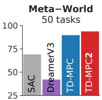


  
Figure 1. 概述。TD-MPC2 在涵盖多个领域的 104 个连续控制任务中，使用单一超参数集（右图），表现显著优于现有的无模型（model-free）和基于模型（model-based）的强化学习（RL）方法。我们通过训练一个拥有 317M 参数的单一智能体来执行跨多个领域、具身形态（embodiments）和动作空间的 80 个任务，进一步展示了 TD-MPC2 的可扩展性（左图）。

## 摘要

TD-MPC 是一种基于模型（model-based）的强化学习（RL）算法，它在学习到的隐式（无解码器，decoder-free）世界模型的潜在空间（latent space）中执行局部轨迹优化。在这项工作中，我们提出了 TD-MPC2：对 TD-MPC 算法的一系列改进。我们证明了 TD-MPC2 在涵盖 4 个不同任务领域的 104 个在线 RL 任务中显著优于基线方法，仅使用单一超参数集便取得了一致的强劲表现。我们进一步表明，智能体的能力会随着模型和数据规模的增加而提升，并成功训练了一个拥有 317M 参数的单一智能体，以执行跨多个任务领域、具身形态和动作空间的 80 个任务。最后，我们总结了与大型 TD-MPC2 智能体相关的经验教训、机遇与风险。

在 https://tdmpc2.com 探索视频、模型、数据、代码及更多内容。

## 1 引言

在互联网规模的数据集上训练大模型，催生了能够执行多种多样语言和视觉任务的通用模型（Brown et al., 2020; He et al., 2022; Kirillov et al., 2023）。这些模型的成功在很大程度上归功于海量数据集的可用性，以及能够随模型和数据规模可靠扩展的精心设计的架构。尽管研究人员最近已将这种范式扩展到了机器人领域（Reed et al., 2022; Brohan et al., 2023），但一个能够从大规模未经筛选（即质量参差不齐）的数据集中，通过低层级动作在多种具身形态（embodiments）上学习执行多样化控制任务的通用具身智能体（generalist embodied agent），仍然是一个难以企及的目标。我们认为，当前通用具身智能体的方法受困于：(a) 用于行为克隆（behavior cloning）的近专家轨迹假设，这严重限制了可用数据的数量（Reed et al., 2022; Lee et al., 2022; Kumar et al., 2022; Schubert et al., 2023; Driess et al., 2023; Brohan et al., 2023），以及 (b) 缺乏能够利用大规模未经筛选数据集的可扩展连续控制算法。

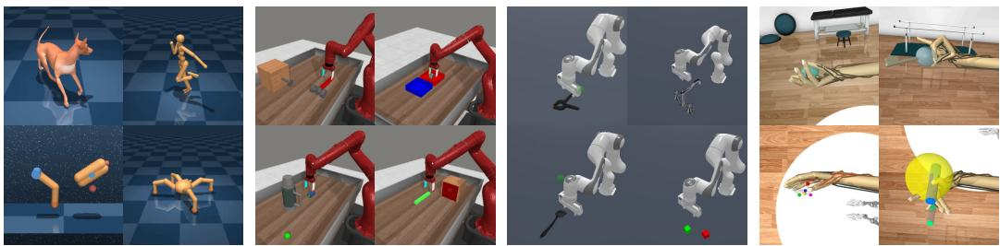  
Figure 2. 任务。TD-MPC2 使用单一一套超参数执行了来自（从左至右）DMControl (Tassa et al., 2018)、Meta-World (Yu et al., 2019)、ManiSkill2 (Gu et al., 2023) 和 MyoSuite (Caggiano et al., 2022) 的 104 项多样化任务。所有任务的可视化见 Appendix B。

强化学习（Reinforcement Learning, RL）是从未经筛选的数据集中提取专家行为的理想框架。然而，大多数现有的 RL 算法（Lillicrap et al., 2016; Haarnoja et al., 2018）都是为单任务学习设计的，并且依赖于针对特定任务的超参数，缺乏选择这些超参数的原则性方法（Zhang et al., 2021）。能够利用大规模多任务数据集的算法，势必需要对不同任务之间的差异（$( e . g .$，动作空间维度、探索难度和奖励分布）保持鲁棒。在这项工作中，我们提出了 TD-MPC2：朝着实现这一目标迈出的重要一步。TD-MPC2 是一种基于模型的强化学习（model-based RL）算法，专为在包含多个任务领域、具身形态和动作空间的大规模未经筛选数据集上学习通用世界模型（generalist world models）而设计，其数据源自涵盖广泛技能水平的行为策略，且无需进行超参数调优。

我们的算法建立在 TD-MPC（Hansen et al., 2022）的基础之上，在学习到的隐式（无解码器）世界模型的潜空间中执行局部轨迹优化。尽管 TD-MPC 系列算法在先前的研究中展示出了强大的实证性能（Hansen et al., 2022; 2023; Yuan et al., 2022; Yang et al., 2023; Feng et al., 2023; Chitnis et al., 2023; Zhu et al., 2023; Lancaster et al., 2023），但大多数成功案例仅限于单任务学习，很少关注规模扩展（scaling）。如图 1 所示，正如在强化学习（RL）文献中所普遍观察到的那样（Kumar et al., 2023），单纯增大 TD-MPC 的模型和数据规模通常会导致智能体性能的净下降。相比之下，扩展 TD-MPC2 的规模能够带来持续的能力提升。我们实现这一里程碑的关键算法贡献包括两个方面：(1) 通过重新审视核心设计选择来提高算法的鲁棒性，以及 (2) 精心设计了一种架构，能够在不依赖领域知识的情况下适应具有多种具身（embodiments）和动作空间的数据集。由此产生的算法 TD-MPC2 具有可扩展性和鲁棒性，并且可以使用单一一套超参数应用于各种单任务和多任务连续控制问题。

我们在涵盖 4 个任务领域的共计 104 个多样化连续控制任务上评估了 TD-MPC2：DMControl（Tassa et al., 2018）、Meta-World（Yu et al., 2019）、ManiSkill2（Gu et al., 2023）和 MyoSuite（Caggiano et al., 2022）。我们在图 1 中总结了我们的结果，并在图 2 中对任务领域进行了可视化。这些任务包括高维状态和动作空间（高达 $\mathcal { A } \in \mathbb { R } ^ { 3 9 } )$）、图像观测、稀疏奖励、多物体操作、生理精确的肌肉骨骼运动控制、复杂的运动控制 $( e . g .$ 狗和人形具身），并覆盖了广泛的任务难度。我们的结果表明，在所有任务中使用相同超参数的情况下，TD-MPC2 始终优于现有的基于模型（model-based）和无模型（model-free）的方法（图 1，右）。在此，“Locomotion”和“Pick YCB”分别是 DMControl 和 ManiSkill2 中特别具有挑战性的子集。我们进一步展示了智能体的能力会随着模型和数据规模的增加而提升，并成功训练了一个拥有 317M 参数的单一世界模型，以跨越多个任务领域、具身和动作空间执行 80 个任务（图 1，左）。为了支持开源科学，我们公开了 300 多个模型检查点（checkpoints）、数据集以及用于训练和评估 TD-MPC2 智能体的代码，可通过 https://tdmpc2.com 获取。最后，我们在论文结尾总结了与大型 TD-MPC2 智能体相关的经验教训、机遇和风险。

## 2 背景

强化学习（Reinforcement Learning, RL）旨在通过与环境的交互来学习策略，该过程被形式化为马尔可夫决策过程（Markov Decision Process, MDP）(Bellman, 1957)。我们专注于具有连续动作空间的无限时域 MDP，可形式化为一个元组 $( S , { \mathcal { A } } , { \mathcal { T } } , R , \gamma )$，其中 $\mathbf { s } \in { \mathcal { S } }$ 为状态，$\mathbf { a } \in \mathcal A$ 为动作，$\mathcal { T } \colon \mathcal { S } \times \mathcal { A } \mapsto \mathcal { S }$ 为状态转移函数，$\mathcal { R } \colon \mathcal { S } \times \dot { \mathcal { A } } \mapsto$ R 为与特定任务相关的奖励函数，$\gamma$ 为折扣因子。其目标是推导出一个控制策略 $\pi \colon S \mapsto A$，使得期望折扣奖励和（回报）$\begin{array} { r } { \mathbb { E } _ { \pi } \left[ \sum _ { t = 0 } ^ { \infty } \gamma ^ { t } r _ { t } \right] , \dot { r } _ { t } = \dot { R } ( \mathbf { s } _ { t } , \pi ( \mathbf { s } _ { t } ) ) } \end{array}$ 最大化。在这项工作中，我们通过学习一个世界模型（环境模型）来获取 $\pi$，然后通过使用学得的模型进行规划来选择动作。

模型预测控制（Model Predictive Control, MPC）是一种基于模型的控制通用框架，它优化有限长度的动作序列 $\mathbf { a } _ { t : t + H }$，从而在时间跨度 $H$ 内使回报最大化（或成本最小化），这对应于求解以下优化问题：

$$
\pi (\mathbf {s} _ {t}) = \arg \max _ {\mathbf {a} _ {t: t + H}} \mathbb {E} \left[ \sum_ {i = 0} ^ {H} \gamma^ {t + i} R (\mathbf {s} _ {t + i}, \mathbf {a} _ {t + i}) \right].\tag{1}
$$

候选轨迹的回报是通过使用学得的模型进行仿真来估计的 (Negenborn et al., 2005)。因此，通过公式 1 获得的策略必然是一个（时间上的）局部最优策略，并且不能保证（也不太可能）是上述通用强化学习问题的解。正如我们在下文中所讨论的，TD-MPC2 通过利用学得的终端价值函数对超出时间跨度 $H$ 的回报估计进行自举（bootstrapping），从而解决了局部轨迹优化的这一缺陷。

## 3 TD-MPC2

我们的工作建立在 TD-MPC (Hansen et al., 2022) 之上，这是一种基于模型的 RL 算法，在学得的隐式世界模型的潜空间（latent space）中执行局部轨迹优化（规划）。TD-MPC2 是一种用于训练大规模多任务世界模型的实用算法。具体而言，我们对 TD-MPC 算法提出了一系列改进，这些改进对于实现强大的算法鲁棒性（可以在所有任务中使用相同的超参数）以及将其世界模型参数量扩展至以往的 300 倍至关重要。我们将在下文中介绍 TD-MPC2 算法，并在附录 A 中提供算法改进的完整列表。

## 3.1 学习隐式世界模型

利用重构（解码器）目标来学习环境的生成模型因其具有丰富的学习信号而极具吸引力。然而，在长时域上准确预测未来的原始观测（例如图像或本体感受特征）是一个极其困难的问题，并且并不一定能带来有效的控制（Lambert et al., 2020）。与其通过重构显式建模动力学，TD-MPC2 旨在学习一个最有效用的模型：一个能够以动作序列为条件准确预测结果（回报）的模型。具体而言，TD-MPC2 通过结合联合嵌入预测（Grill et al., 2020）、奖励预测和 TD 学习（TD-learning）（Sutton, 1998），从环境交互中学习一个隐式、以控制为中心的世界模型，而无需解码观测。我们认为，这种基于模型的强化学习（model-based RL）替代方案是以适度模型大小对大规模数据集进行建模的关键。随后，该世界模型可通过遵循 MPC 框架执行局部轨迹优化（规划）来用于决策。

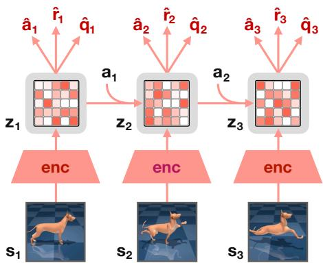  
Figure 3. TD-MPC2 架构。观测 s 被编码为其（归一化的）潜在表示 z。随后模型循环预测动作 aˆ、奖励 rˆ 和终端价值 qˆ，而无需解码未来的观测。

组件。TD-MPC2 架构如图 Figure 3 所示，由五个组件组成：

$$
\begin{array}{l l l} \text {Encoder} & \mathbf {z} = h (\mathbf {s}, \mathbf {e}) & \triangleright \text {Maps observations to their latent representations} \\ \text {Latent dynamics} & \mathbf {z} ^ {\prime} = d (\mathbf {z}, \mathbf {a}, \mathbf {e}) & \triangleright \text {Models (latent) forward dynamics} \\ \text {Reward} & \hat {r} = R (\mathbf {z}, \mathbf {a}, \mathbf {e}) & \triangleright \text {Predicts reward r of a transition} \\ \text {Terminal value} & \hat {q} = Q (\mathbf {z}, \mathbf {a}, \mathbf {e}) & \triangleright \text {Predicts discounted sum of rewards (return)} \\ \text {Policy prior} & \hat {\mathbf {a}} = p (\mathbf {z}, \mathbf {e}) & \triangleright \text {Predicts action a* that maximizes Q} \end{array}\tag{2}
$$

其中 s 和 a 分别为状态和动作，z 为潜在表示，e 为用于多任务世界模型的可学习任务嵌入。为了直观简洁，除非特别相关，否则我们在后文中将省略 e。策略先验 p 用于指导基于采样的轨迹优化器（规划器），并降低 TD 学习的计算成本。在在线交互期间，TD-MPC2 维护一个包含轨迹的经验回放缓冲区（replay buffer）B，并循环进行：(i) 使用从 B 中采样的数更新世界模型，以及 (ii) 通过利用所学模型进行规划来收集新的环境数据。

模型目标。联合优化 $h , d , R , Q$ 组件以最小化目标

$$
\mathcal {L} \left(\theta\right) \doteq \underset {\left(\mathbf {s}, \mathbf {a}, r, \mathbf {s} ^ {\prime}\right) _ {0: H} \sim \mathcal {B}} {\mathbb {E}} \left[ \sum_ {t = 0} ^ {H} \lambda^ {t} \left(\underbrace {\| \mathbf {z} _ {t} ^ {\prime} - \operatorname{sg} (h (\mathbf {s} _ {t} ^ {\prime})) \| _ {2} ^ {2}} _ {\text {Joint - embedding prediction}} + \underbrace {\operatorname{CE} (\hat {r} _ {t} , r _ {t})} _ {\text {Reward prediction}} + \underbrace {\operatorname{CE} (\hat {q} _ {t} , q _ {t})} _ {\text {Value prediction}}\right) \right],\tag{3}
$$

其中 $\operatorname{sg}$ 是停止梯度算子（stop-grad operator），$( \mathbf { z } _ { t } ^ { \prime } , \hat { r } _ { t } , \hat { q } _ { t } )$ 定义在公式 2 中，$q _ { t } \doteq r _ { t } + \gamma \bar { Q } ( \mathbf { z } _ { t } ^ { \prime } , p ( \mathbf { z } _ { t } ^ { \prime } ) )$ 是时间步 $t$ 处的 TD 目标（TD-target），$\lambda \in ( 0 , 1 ]$ 是对时间上更远的时间步赋予更小权重的常数系数，$\operatorname{CE}$ 是交叉熵。用于计算 TD 目标的 Q<sup>¯</sup> 是 $Q$ 的指数移动平均（EMA）（Lillicrap et al., 2016）。由于任务之间的奖励量级可能存在巨大差异，TD-MPC2 将奖励和价值预测构建为对数变换空间中的离散回归（多类别分类）问题，通过以 $r _ { t } , q _ { t }$ 作为软目标（soft targets）最小化交叉熵来进行优化（Bellemare et al., 2017; Kumar et al., 2023; Hafner et al., 2023）。

策略目标（Policy objective）。策略先验 $p$ 是一个随机最大熵（Ziebart et al., 2008; Haarnoja et al., 2018）策略，通过学习来最大化以下目标：

$$
\mathcal {L} _ {p} (\theta) \doteq \underset {(\mathbf {s}, \mathbf {a}) _ {0: H} \sim \mathcal {B}} {\mathbb {E}} \left[ \sum_ {t = 0} ^ {H} \lambda^ {t} \left[ \alpha Q (\mathbf {z} _ {t}, p (\mathbf {z} _ {t})) - \beta \mathcal {H} (p (\cdot | \mathbf {z} _ {t})) \right] \right],   \mathbf {z} _ {t + 1} = d (\mathbf {z} _ {\mathbf {t}}, \mathbf {a} _ {\mathbf {t}}),   \mathbf {z} _ {0} = h (\mathbf {s} _ {0}),\tag{4}
$$

其中 $\mathcal{H}$ 是 $p$ 的熵，可以通过解析形式（closed form）计算。$\mathcal { L } _ { p } ( \theta )$ 的梯度仅对 $p$ 计算。由于价值估计 $Q ( \mathbf { z } _ { t } , p ( \mathbf { z } _ { t } ) )$ 的量级和熵 $\mathcal{H}$ 在不同数据集以及训练的不同阶段之间可能存在很大差异，因此有必要平衡这两个损失以防止过早发生熵崩溃（entropy collapse）（Yarats et al., 2021）。自动调节 $\alpha , \beta$ 的一种常见做法是保持其中一个为常数，并根据熵目标（Haarnoja et al., 2018）或移动统计量（moving statistics）（Hafner et al., 2023）调整另一个。在实践中，我们选择通过移动统计量来调整 $\alpha$，但从实证来看，并没有观察到这两种选择之间有任何显著的结果差异。

架构。TD-MPC2 的所有组件均实现为多层感知机（MLP），其中间线性层后接 LayerNorm (Ba et al., 2016) 和 Mish (Misra, 2019) 激活函数。为了缓解梯度爆炸，我们使用 softmax 操作将潜变量表示 $\mathbf{z}$ 投影到 $L$ 个固定维度的单纯形（simplex）中来进行归一化 (Lavoie et al., 2022)。将 $\mathbf{z}$ 嵌入为单纯形的一个关键优势（相比于例如离散表示或挤压（squashing））在于，它能够自然地使表示偏向稀疏性，而无需施加硬性约束（动机和实现见附录 H）。我们将这种归一化方案命名为 SimNorm。设 $V$ 为从 $\mathbf{z}$ 的 $L$ 个划分（组）构建的每个单纯形 $\mathbf{g}$ 的维度。随后 SimNorm 应用如下变换：

$$
\mathbf {z} ^ {\circ} \doteq [ \mathbf {g} _ {i}, \ldots , \mathbf {g} _ {L} ], \mathbf {g} _ {i} = \frac {e ^ {\mathbf {z} _ {i : i + V} / \tau}}{\sum_ {j = 1} ^ {V} e ^ {\mathbf {z} _ {i : i + V} / \tau}},\tag{5}
$$

其中 $\mathbf { z } ^ { \circ }$ 是 $\mathbf { z }$ 的单纯形嵌入，$\left[ \cdot \right]$ 表示拼接，$\tau > 0$ 是调节表示“稀疏度”的温度参数。正如我们在实验中所展示的，SimNorm 对于 TD-MPC2 的训练稳定性至关重要。最后，为了减少由 $\bar { Q }$ 生成的 TD 目标（TD-target）的偏差，我们使用公式 3 中的目标学习一个 Q 函数集成（ensemble），并将 $\bar { Q }$ 维护为每个 Q 函数的指数移动平均（EMA）。在实践中我们使用 5 个 Q 函数。然后将目标计算为随机子采样的两个 $\bar{Q}$ 函数的最小值 (Chen et al., 2021)。

## 3.2 带有策略先验的模型预测控制

TD-MPC2 通过利用学到的世界模型进行规划来获得其闭环控制策略。具体而言，我们的方法利用 MPC 框架进行局部轨迹优化，采用模型预测路径积分（Model Predictive Path Integral, MPPI）(Williams et al., 2015) 作为无导数优化器，通过模型推演潜变量轨迹来评估长度为 $H$ 的采样动作序列 $( \mathbf { a } _ { t } , \mathbf { a } _ { t + 1 } , \ldots , \mathbf { a } _ { t + H } )$。在每个决策步，我们估计具有对角协方差的时变多元高斯分布的参数 $\mu ^ { * } , \sigma ^ { * }$，以最大化期望回报，即

$$
\mu^ {*}, \sigma^ {*} = \arg \max _ {(\mu , \sigma) (\mathbf {a} _ {t}, \mathbf {a} _ {t + 1}, \dots , \mathbf {a} _ {t + H}) \sim \mathcal {N} (\mu , \sigma^ {2})} \left[ \gamma^ {H} Q (\mathbf {z} _ {t + H}, \mathbf {a} _ {t + H}) + \sum_ {h = t} ^ {H - 1} \gamma^ {h} R (\mathbf {z} _ {h}, \mathbf {a} _ {h}) \right],\tag{6}
$$


  
Figure 4. 单任务强化学习（Single-task RL）。横跨 4 个不同任务领域的 104 个连续控制任务中，回合回报（Episode return，DMControl）和成功率（其他任务）随环境步数变化的函数关系。TD-MPC2 在所有任务中使用相同超参数的同时，实现了比现有方法更高的数据效率和渐近性能。均值和 95% 置信区间基于 3 个随机种子。

其中 $\mu , \sigma \in \mathbb { R } ^ { H \times m } , \mathcal { A } \in \mathbb { R } ^ { m }$。公式 6 是通过从 $\mathcal { N } ( \mu , \dot { \sigma } ^ { 2 } )$ 中迭代采样动作序列，评估其期望回报，并基于加权平均更新 $\mu , \sigma$ 来求解的。值得注意的是，公式 6 通过使用学到的终端价值函数在时域 H 之外进行自举（bootstrapping），估计了第 2 节中介绍的完整 RL 目标。TD-MPC2 重复该迭代规划过程固定次数的迭代，并在环境中执行第一个动作 $\mathbf { a } _ { t } \sim \mathcal { N } ( \mu _ { t } ^ { * } , \sigma _ { t } ^ { * } )$。为了加速规划的收敛，一部分动作序列来自于策略先验 p，并且我们通过将 $( \mu , \sigma )$ 初始化为前一个决策步平移 1 步后的解来对规划进行热启动（warm-start）。有关规划过程的更多细节，请参见 Hansen et al. (2022)。

## 3.3 训练通用 TD-MPC2 智能体

TD-MPC2 在多种单任务问题上的成功可以归功于上述算法。然而，学习一个能够在多个任务领域、具身形态（embodiments）和动作空间中执行各种任务的大型通用 TD-MPC2 智能体，带来了一些独特的挑战：(i) 如何学习和表征任务语义？(ii) 如何在没有特定领域知识的情况下适应多种观测和动作空间？(iii) 如何利用学到的模型对新任务进行少样本学习（few-shot learning）？下面我们将介绍我们的多任务模型学习方法。

可学习任务嵌入。为了在多任务环境中取得成功，智能体需要学习一种能够利用任务相似性的通用表征，同时在测试时仍保留区分不同任务的能力。当任务或领域先验知识可用时（例如以自然语言指令的形式），公式 2 中的任务嵌入 e 可以编码此类信息。然而，在无法假定领域知识的一般情况下，我们可以选择直接从数据中学习任务嵌入（以及隐式的任务关系）。TD-MPC2 使用一个可学习的固定维度任务嵌入 e 来对其全部五个组件进行条件化，该嵌入与模型的其他组件一起联合训练。为提高训练稳定性，我们将 e 的 $\ell _ { 2 } { \mathrm { - n o r m } }$ 约束为 $\leq 1 ;$ 在我们的实验中，这也带来了语义上更为连贯的任务嵌入。在将多任务 TD-MPC2 智能体微调到新任务时，我们可以选择将 e 初始化为语义相似任务的嵌入，或者直接初始化为一个随机向量。

动作掩码。TD-MPC2 能够在没有任何领域知识的情况下，学习执行具有各种不同观测和动作空间维度的任务。为此，我们将所有模型输入和输出用零填充（zero-pad）至各自的最大维度，并在训练和推理阶段将策略先验 p 预测中的无效动作维度进行掩码处理。这确保了无效维度上的预测误差不会影响 TD 目标估计，并防止 p 在具有较小动作空间的任务上错误地抬高其熵。类似地，在规划过程中，我们仅沿着有效维度采样动作。

## 4 实验

我们在跨越 4 个任务领域的总计 104 个多样化的连续控制任务上评估了 TD-MPC2：DMControl (Tassa et al., 2018)、Meta-World (Yu et al., 2019)、ManiSkill2 (Gu et al., 2023) 和 MyoSuite (Caggiano et al., 2022)。任务涵盖高维状态和动作空间（最高达 $\mathcal { A } \in \mathbb { R } ^ { 3 9 } )$）、稀疏奖励、多物体操作、符合生理学特征的高精度肌骨骼运动控制、复杂运动控制（例如 Dog 和 Humanoid 具身形态），并覆盖了广泛的任务难度区间。我们还纳入了 10 个具有视觉观测的 DMControl 任务。为了支持开源科学，我们公开发布了 300 多个模型检查点（checkpoints）、数据集以及用于训练和评估 TD-MPC2 智能体的代码，可通过 https://tdmpc2.com 获取。


Figure 5. 高维运动控制。DMControl 中 Humanoid $( \overset { \vartriangle } { \boldsymbol { A } } \in \mathbb { R } ^ { 2 1 } )$ 和 $ { \operatorname { D o g } } ( \mathcal { A } \in \mathbb { R } ^ { 3 8 } )$ 运动任务中作为环境步数函数的回合回报。SAC 和 DreamerV3 在 Dog 任务中容易出现数值不稳定，并且在 Humanoid 任务中的数据效率显著低于 TD-MPC2。3 个随机种子的均值和 95% 置信区间。更多任务见附录 D。  
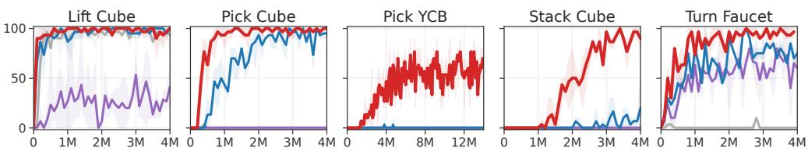  
SAC DreamerV3 TD-MPC TD-MPC2  
Figure 6. 物体操作。ManiSkill2 中 5 个物体操作任务上作为环境步数函数的成功率（%）。Pick YCB 包含对 YCB (Calli et al., 2015) 数据集中全部 74 种物体的操作。TD-MPC2 在困难任务中表现优异。3 个随机种子的均值和 95% 置信区间。

我们旨在通过实验回答三个核心研究问题：

• 与现有方法的比较。对于高数据效率的连续控制，TD-MPC2 与最先进的无模型（SAC）和基于模型（DreamerV3、TD-MPC）方法相比表现如何？

• 扩展性。随着模型和数据规模的增加，TD-MPC2 的算法创新是否能带来智能体能力的提升？单个智能体能否学会跨多个任务领域、实体形态（embodiments）和动作空间的多种技能？

• 分析。TD-MPC2 中引入的特定设计选择如何影响下游任务性能？规划对其成功有多大贡献？学习到的任务嵌入是否具有语义意义？大型多任务智能体能否适应未见任务？

基线（Baselines）。我们的主要基线代表了数据高效强化学习（RL）领域的最先进水平，包括：(1) Soft Actor-Critic (SAC) (Haarnoja et al., 2018)，一种基于最大熵 RL 的无模型（model-free）Actor-Critic 算法；(2) DreamerV3 (Hafner et al., 2023)，一种基于模型（model-based）的方法，通过从已学习的环境生成模型中进行展开（rollout）来优化无模型策略；以及 (3) 原始版本的 TD-MPC (Hansen et al., 2022)，一种在已学习的隐式（非生成式）世界模型的潜在空间中执行局部轨迹优化（规划）的基于模型的 RL 算法。此外，我们还与当前最先进的视觉 RL 方法进行了比较：(4) CURL (Srinivas et al., 2020)，SAC 的一种扩展，使用了对比辅助目标；以及 (5) DrQv2，一种使用数据增强的无模型 RL 算法。SAC 和 TD-MPC 使用针对特定任务的超参数，而 TD-MPC2 在所有任务中均使用相同的超参数。此外，值得注意的是，SAC 和 TD-MPC 都使用了较大的批大小（512），而 256 就足以保证 TD-MPC2 的稳定学习。类似地，DreamerV3 使用了高达 512 的数据更新比（update-to-data, UTD），而 TD-MPC2 默认使用 1 的 UTD。我们在所有实验中（除非另有说明）均使用 5M 参数量的 TD-MPC2 智能体。作为参考，DreamerV3 基线拥有约 20M 可学习参数。更多细节见附录 H。

## 4.1 结果

与现有方法的对比。我们首先在线强化学习设置下，在 104 个多样化的任务上比较了 TD-MPC2 与一组强基线方法的数据效率。聚合结果如 Figure 4 所示。我们发现 TD-MPC2 在所有任务领域中均优于先前的方法。MyoSuite 的结果尤其值得注意，因为在汇报这些结果之前，我们没有在该基准测试上进行过任何 TD-MPC2 实验。在一些最具难度的任务（高维运动控制和多物体操作）上的单任务性能如 Figure 5 和 Figure 6 所示。尽管 TD-MPC2 在所有任务中都使用相同的超参数，但它在这些任务上仍然大幅优于基线方法。值得注意的是，TD-MPC 有时会因梯度爆炸而发散，而 TD-MPC2 则保持稳定。我们在附录 G 中提供了每个任务的梯度可视化。同样，我们观察到 DreamerV3 偶尔会出现数值不稳定（Dog），并且通常难以应对需要精细物体操作的任务（lift、pick、stack）。完整的单任务 RL 结果见附录 D。

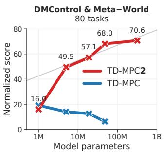


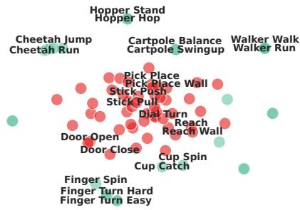  
Figure 7. 大规模多任务世界模型。（左图）在 80 任务和 30 任务两个数据集上，归一化得分随模型规模变化的关系。TD-MPC2 的能力随模型规模扩展。（右图）在来自 DMControl 和 Meta-World 的 80 个任务上训练的 TD-MPC2 智能体所学到的任务嵌入的 T-SNE (van der Maaten & Hinton, 2008) 可视化。为清晰起见，仅展示了部分标签。

大规模多任务世界模型。为了证明我们提出的改进有助于世界模型的扩展，我们在包含 80 个跨越多个任务领域且在目标、具身形态（embodiment）和动作空间上差异极大的多样化任务集上，评估了 5 个参数量从 1M 到 317M 的多任务模型的性能。模型在由 240 个单任务 TD-MPC2 智能体的重放缓冲区（replay buffers）获取的包含 545M 个状态转移（transitions）的数据集上进行训练，因此包含了从随机策略到专家策略的广泛行为。该任务集由全部 50 个 Meta-World 任务以及 30 个 DMControl 任务组成。DMControl 任务集包括 19 个原始 DM-Control 任务以及 11 个新任务。为了完整起见，我们还单独提供了在包含 30 个任务的 DMControl 子集（345M 个状态转移）上的扩展结果。由于我们对 TD-MPC2 算法的精心设计，模型扩展十分直接：

Table 1. 训练成本。在 80 任务数据集上的 TD-MPC2 大致训练成本，以单张 NVIDIA GeForce RTX 3090 GPU 上的 GPU 天数报告。我们还列出了每个模型在训练结束时达到的归一化得分。

<table><tr><td>参数量 (M)</td><td>GPU 天数</td><td>得分</td></tr><tr><td>1</td><td>3.7</td><td>16.0</td></tr><tr><td>5</td><td>4.2</td><td>49.5</td></tr><tr><td>19</td><td>5.3</td><td>57.1</td></tr><tr><td>48</td><td>12</td><td>68.0</td></tr><tr><td>317</td><td>33</td><td>70.6</td></tr></table>

为提高收敛速度，我们使用了比单任务实验大 4 倍的批大小（1024），但未对超参数进行其他更改。

将 TD-MPC2 扩展至 317M 参数。我们的扩展结果如图 7 所示。为了用单一指标总结智能体的性能，我们生成了一个归一化分数，该分数是所有单个任务成功率（Meta-World）以及归一化至 $[0, 100]$ 范围内的回合回报（DMControl）的平均值。我们观察到，在两个任务集上，智能体的能力均随着模型规模的增大而持续提升。值得注意的是，对于我们最大的模型（317M 参数），在两个数据集上的性能似乎都尚未饱和，因此我们可以预期超出我们所考虑的模型规模后，结果仍将继续改善。我们暂不建立扩展定律（scaling law），但注意到归一化分数似乎与模型参数量的对数呈线性扩展关系（图 7 中的灰线）。我们还在表 1 中报告了大致的训练成本。317M 参数的模型可以在有限的计算资源下进行训练。为了更好地理解多任务模型学习成功的原因，我们探讨了 TD-MPC2 所学到的任务嵌入（图 7，右图）。有趣的是，语义上相似的任务（例如 Door Open 和 Door Close）在学到的任务嵌入空间中非常接近。然而，嵌入相似度似乎与任务动力学（具身形态、物体）的关联比与目标（walk、run）的关联更为紧密。这在直觉上是合理的，因为动力学与控制是紧密耦合的。

  
Figure 8. 微调。在 70 个任务上训练并在线微调至 10 个保留任务中每一个任务 20k 环境步的 19M 参数 TD-MPC2 智能体得分。3 个随机种子。

少样本学习。虽然我们的工作主要侧重于世界模型的扩展和鲁棒性，但我们也探讨了微调预训练世界模型用于未见任务的少样本学习的有效性。具体而言，我们在来自 DMControl 和

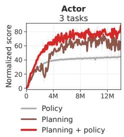

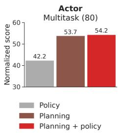


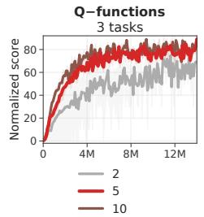


Figure 9. 消融实验。（曲线）归一化得分随环境步数变化的函数关系，取三个最具挑战性的任务的平均值：Dog Run、Humanoid Walk（DMControl）和 Pick YCB（ManiSkill2）。均值与 95% 置信区间基于 3 个随机种子。（柱状图）19M 参数多任务（80 个任务）TD-MPC2 智能体的归一化得分。我们的消融实验突出了各项设计选择的相对重要性；红色为 TD-MPC2 的默认方案。更多消融实验参见附录 D。  
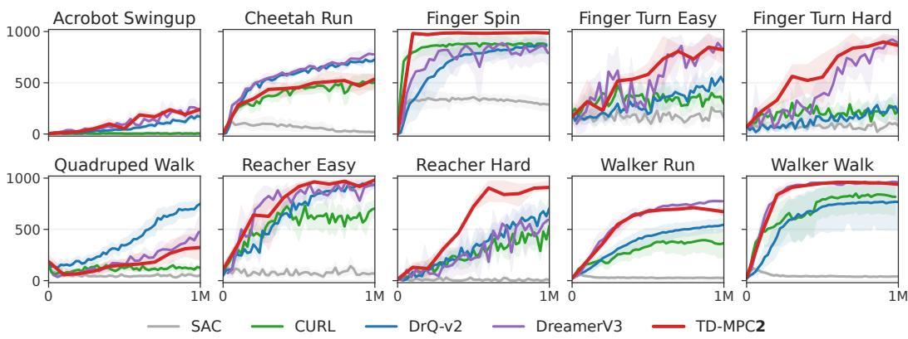  
Figure 10. 视觉强化学习。在 10 个基于图像的 DM-Control 任务上，回合回报随环境步数变化的函数关系。均值与 95% 置信区间基于 3 个随机种子。TD-MPC2 与当前最先进方法相当。

Meta-World，并通过在线强化学习，在初始回放缓冲区为空且不调整超参数的情况下，直接将完整模型微调到 10 个保留任务（每个领域各 5 个）上。综合结果如图 8 所示。我们发现，在低数据量情况下（20k 环境步数<sup>1</sup>），TD-MPC2 在新任务上的表现相比于从零开始学习提升了 2 倍。尽管将世界模型微调到新任务在很大程度上仍是一个开放的研究问题，但我们的探索性结果是很有前景的。实验细节和单个任务曲线请参见附录 E。

消融实验。我们对 TD-MPC2 的大部分设计选择进行了消融，包括 Actor 的选择、各种归一化技术、回归目标以及 Q 函数的数量。我们主要的消融实验如图 9 所示，在三个最具挑战性的在线强化学习任务以及大规模多任务训练（80 个任务）上进行。我们观察到，所有提出的改进对 TD-MPC2 在单任务强化学习和多任务强化学习中的鲁棒性与强劲性能均有显著贡献。有趣的是，我们发现各项设计选择的相对重要性在两种设置下是一致的。最后，我们还对学习到的任务嵌入的归一化进行了消融，见附录 F。结果表明，保持归一化的任务嵌入空间（$\ell$-范数为 1）对于稳定的多任务训练具有中等程度的重要性，并能产生更有意义的任务关联。

视觉强化学习。本工作中我们主要考虑具有本体感受状态观测的高维连续控制任务。然而，TD-MPC2 也可以很方便地应用于具有其他输入模态的任务。为了证明这一点，我们将 TD-MPC2 的编码器替换为浅层卷积编码器，并在 10 个不同难度的 DMControl 任务上与当前最先进的视觉强化学习方法进行基准对比。结果如图 10 所示。在不修改任何超参数的情况下，TD-MPC2 的表现与两个最佳基线 DrQ-v2 和 DreamerV3 相当。

## 5 经验教训、机遇与风险

经验教训。历史上，RL 算法众所周知地对模型架构、超参数、任务特性甚至随机种子极度敏感（Henderson et al., 2018），且缺乏调优算法的系统性原则方法。因此，深度 RL 的成功应用往往需要拥有庞大计算资源的大型专家团队（Berner et al., 2019; Schrittwieser et al., 2020; Ouyang et al., 2022）。TD-MPC2 与其他几种当代 RL 方法（Yarats et al., 2021; Ye et al., 2021; Hafner et al., 2023）一道，旨在通过提高现有开源算法的鲁棒性来推动 RL 的大众化应用（即降低资源较少的小型学术团队、从业者和个人的准入门槛）。我们坚信，提高算法鲁棒性将继续对该领域产生深远影响。TD-MPC2 开发过程中的一个关键启示是，学术社区尚未发现一种真正能够开箱即用且通晓一切的算法。尽管例如 DreamerV3（Hafner et al., 2023）在具有离散动作空间的挑战性任务（如 Atari 游戏和 Minecraft）上取得了出色的表现，但我们发现 TD-MPC2 在高难度连续控制任务上取得了显著更优的结果。与此同时，将 TD-MPC2 扩展到离散动作空间仍是一个开放性问题。

机遇。我们的扩展结果为基于模型的强化学习（model-based RL）展示了一条路径，即利用大规模多任务世界模型作为通用世界模型。尽管多任务世界模型在文献中仍相对缺乏探索，但先前的研究表明，与基于重建的方法相比，TD-MPC2 的隐式世界模型可能更适合具有巨大视觉变化的任务 (Zhu et al., 2023)。我们设想了这样一个未来：隐式世界模型可用于在已见具身（embodiments）上以零样本（zero-shot）方式执行多样化任务 (Xu et al., 2023; Yang et al., 2023)，通过微调以在新的具身形态上快速执行任务，并与现有的视觉-语言模型（vision-language models）相结合，在进行低层物理交互的同时执行更高层面的认知任务。我们的结果很有前景，但要达到这种水平的泛化，可能需要比目前可用任务多几个数量级的任务。最后，我们想要指出的是，尽管 TD-MPC2 依赖奖励来进行任务学习，但将奖励的广义概念简单地视为任务完成度的度量是有益的。此类度量在现实中已经存在，例如成功标签、人类偏好或干预 (Ouyang et al., 2022)，或预先学习的表征中当前观测与目标之间的嵌入距离 (Eysenbach et al., 2022; Ma et al., 2022)。然而，利用此类奖励进行大规模预训练仍是一个悬而未决的问题。为了加速该领域的研究，我们发布了 300 多个 TD-MPC2 模型，包括 12 个多任务模型，以及数据集和代码，我们非常期待看到社区利用这些资源创造出的成果。

风险。尽管我们对通用世界模型的潜力感到兴奋，但仍存在若干挑战：(i) 任务奖励的错误设定可能导致难以预料的非预期结果 (Clark & Amodei, 2016)；(ii) 如果没有额外的安全检查机制，将物理机器人的无约束自主权移交给学习模型可能会导致灾难性故障 (Lancaster et al., 2023)；(iii) 对于某些应用，小团队获取涌现出通用行为所需规模的数据可能会昂贵到令人望而却步，从而导致权力的集中。缓解这些挑战中的每一项都需要新的研究创新，我们诚邀社区加入我们的这一努力。

## 6 相关工作

许多先前的研究致力于构建对超参数、架构以及任务和数据变化具有鲁棒性的 RL 算法。例如，(1) Double Q-learning (Hasselt et al., 2016)、RED-Q (Chen et al., 2021)、SVEA (Hansen et al., 2021) 和 SR-SPR (D’Oro et al., 2023) 分别通过调整 TD 目标（TD target）估计中的偏差-方差权衡（bias-variance trade-off）来提高 Q-learning 算法的稳定性；(2) C51 (Bellemare et al., 2017) 和 DreamerV3 (Hafner et al., 2023) 通过在变换空间中进行离散回归，提高了对奖励尺度的鲁棒性；(3) 无模型算法（model-free algorithms）DrQ (Kostrikov et al., 2020) 和 DrQ-v2 (Yarats et al., 2021) 则通过使用数据增强以及其他若干微小但重要的实现细节，分别改善了训练稳定性和探索能力。然而，上述所有工作都严格局限于提高单任务在线 RL 中的数据效率与鲁棒性。

研究决策任务中神经架构扩展（scaling）的现有文献通常假设能够获取用于行为克隆（behavior cloning）的大规模近专家演示（near-expert demonstrations）数据集 (Reed et al., 2022; Lee et al., 2022; Kumar et al., 2022; Schubert et al., 2023; Driess et al., 2023; Brohan et al., 2023)。Gato (Reed et al., 2022) 通过在庞大的专家演示数据集上训练一个大型基于 Transformer 的序列模型 (Vaswani et al., 2017)，学会了跨多个领域执行任务；RT-1 (Brohan et al., 2023) 同样通过在人类遥操作收集的大规模数据集上进行训练，学习了一个用于单一（真实）机器人本体上物体操作的序列模型。尽管这系列工作的实证结果令人印象深刻，但获取大规模演示数据集的假设并不切实际。此外，当前的序列模型依赖于动作空间的离散化（tokenization），这使得向高维连续控制任务的扩展变得困难。

最近，研究人员探索了扩展 RL 算法作为解决上述挑战的方案 (Baker et al., 2022; Jia et al., 2022; Xu et al., 2023; Kumar et al., 2023; Hafner et al., 2023)。例如，VPT (Baker et al., 2022) 通过首先在庞大的人类游玩数据集上预训练行为克隆策略，随后利用 RL 对该策略进行微调，从而学会了玩 Minecraft。GSL (Jia et al., 2022) 则不需要预先存在的数据。相反，GSL 在各个任务变体上迭代训练一组“专家（specialist）”智能体，通过行为克隆将它们蒸馏为一个“通用（generalist）”策略，然后将该通用策略作为下一组专家智能体的初始化。然而，这项工作严格考虑的是单任务 RL，并且假设对每个回合（episode）中的初始状态拥有完全的控制权。最后，DreamerV3 (Hafner et al., 2023) 成功在参数规模上扩展了其世界模型（world model），并表明在在线 RL 设置下更大的模型通常具有更高的数据效率，但它并未考虑多任务强化学习（multitask RL）。

## 致谢

本项目得到了 NSF CAREER Award (2240160)、NSF TILOS AI Institute (2112665)、NSF CCF-2112665 (TILOS)、NSF 1730158 CI-New: Cognitive Hardware and Software Ecosystem Community Infrastructure (CHASE-CI)、NSF ACI-1541349 CC\*DNI Pacific Research Platform 的资助支持，以及 Qualcomm 的捐赠支持。

## 参考文献

Jimmy Lei Ba, Jamie Ryan Kiros, and Geoffrey E Hinton. Layer normalization. Advances in Neural Information Processing Systems, 2016.

Bowen Baker, Ilge Akkaya, Peter Zhokov, Joost Huizinga, Jie Tang, Adrien Ecoffet, Brandon Houghton, Raul Sampedro, and Jeff Clune. Video pretraining (vpt): Learning to act by watching unlabeled online videos. Advances in Neural Information Processing Systems, 35:24639–24654, 2022.

Marc G Bellemare, Will Dabney, and Remi Munos. A distributional perspective on reinforcement´ learning. In International Conference on Machine Learning, pp. 449–458. PMLR, 2017.

Richard Bellman. A markovian decision process. Indiana Univ. Math. J., 6:679–684, 1957. ISSN 0022-2518.

Christopher Berner, Greg Brockman, Brooke Chan, Vicki Cheung, Przemyslaw Debiak, Christy Dennison, David Farhi, Quirin Fischer, Shariq Hashme, Chris Hesse, et al. Dota 2 with large scale deep reinforcement learning. arXiv preprint arXiv:1912.06680, 2019.

Anthony Brohan, Noah Brown, Justice Carbajal, Yevgen Chebotar, Xi Chen, Krzysztof Choromanski, Tianli Ding, Danny Driess, Avinava Dubey, Chelsea Finn, et al. Rt-2: Vision-language-action models transfer web knowledge to robotic control. arXiv preprint arXiv:2307.15818, 2023.

Tom Brown, Benjamin Mann, Nick Ryder, Melanie Subbiah, Jared D Kaplan, Prafulla Dhariwal, Arvind Neelakantan, Pranav Shyam, Girish Sastry, Amanda Askell, et al. Language models are few-shot learners. Advances in Neural Information Processing Systems, 33:1877–1901, 2020.

Vittorio Caggiano, Huawei Wang, Guillaume Durandau, Massimo Sartori, and Vikash Kumar. Myosuite – a contact-rich simulation suite for musculoskeletal motor control, 2022.

Berk Calli, Arjun Singh, Aaron Walsman, Siddhartha Srinivasa, Pieter Abbeel, and Aaron M. Dollar. The ycb object and model set: Towards common benchmarks for manipulation research. In 2015 International Conference on Advanced Robotics, pp. 510–517, 2015. doi: 10.1109/ICAR.2015. 7251504.

Xinyue Chen, Che Wang, Zijian Zhou, and Keith Ross. Randomized ensembled double q-learning: Learning fast without a model. International Conference on Learning Representations, 2021.

Rohan Chitnis, Yingchen Xu, Bobak Hashemi, Lucas Lehnert, Urun Dogan, Zheqing Zhu, and Olivier Delalleau. Iql-td-mpc: Implicit q-learning for hierarchical model predictive control. arXiv preprint arXiv:2306.00867, 2023.

Jack Clark and Dario Amodei. Faulty reward functions in the wild. OpenAI Blog, 2016.

Djork-Arne Clevert, Thomas Unterthiner, and Sepp Hochreiter. Fast and accurate deep network´ learning by exponential linear units (elus). arXiv preprint arXiv:1511.07289, 2015.

Remi Coulom. 蒙特卡洛树搜索中的高效选择性与回传算子. In H. Jaap´ van den Herik, Paolo Ciancarini, and H. H. L. M. (Jeroen) Donkers (eds.), Computers and Games, pp. 72–83, Berlin, Heidelberg, 2007. Springer Berlin Heidelberg.

Pierluca D’Oro, Max Schwarzer, Evgenii Nikishin, Pierre-Luc Bacon, Marc G Bellemare, and Aaron Courville. 通过打破经验回放比瓶颈实现高样本效率的强化学习. In The Eleventh International Conference on Learning Representations, 2023.

Danny Driess, Fei Xia, Mehdi SM Sajjadi, Corey Lynch, Aakanksha Chowdhery, Brian Ichter, Ayzaan Wahid, Jonathan Tompson, Quan Vuong, Tianhe Yu, et al. PaLM-E：一种具身多模态语言模型. arXiv preprint arXiv:2303.03378, 2023.

Benjamin Eysenbach, Tianjun Zhang, Sergey Levine, and Russ R Salakhutdinov. 作为目标条件强化学习的对比学习. Advances in Neural Information Processing Systems, 35:35603–35620, 2022.

Yunhai Feng, Nicklas Hansen, Ziyan Xiong, Chandramouli Rajagopalan, and Xiaolong Wang. 在真实世界中微调离线世界模型. Conference on Robot Learning, 2023.

Jean-Bastien Grill, Florian Strub, Florent Altch’e, Corentin Tallec, Pierre H. Richemond, Elena Buchatskaya, Carl Doersch, Bernardo Avila Pires, Zhaohan Daniel Guo, Mohammad Gheshlaghi<sup>´</sup> Azar, Bilal Piot, Koray Kavukcuoglu, Remi Munos, and Michal Valko. 引导你的潜在表征（Bootstrap Your Own Latent）：一种自监督学习新方法. Advances in Neural Information Processing Systems, 2020.

Jiayuan Gu, Fanbo Xiang, Xuanlin Li, Zhan Ling, Xiqiaing Liu, Tongzhou Mu, Yihe Tang, Stone Tao, Xinyue Wei, Yunchao Yao, Xiaodi Yuan, Pengwei Xie, Zhiao Huang, Rui Chen, and Hao Su. ManiSkill2：可泛化操作技能的统一基准. In International Conference on Learning Representations, 2023.

Tuomas Haarnoja, Aurick Zhou, Kristian Hartikainen, G. Tucker, Sehoon Ha, Jie Tan, Vikash Kumar, Henry Zhu, Abhishek Gupta, P. Abbeel, and Sergey Levine. 软执行者-评论者（Soft Actor-Critic）算法及其应用. ArXiv, abs/1812.05905, 2018.

Danijar Hafner, Jurgis Pasukonis, Jimmy Ba, and Timothy Lillicrap. 通过世界模型掌握多领域. arXiv preprint arXiv:2301.04104, 2023.

Nicklas Hansen, Hao Su, and Xiaolong Wang. 在数据增强下利用卷积网络和视觉 Transformer 稳定深度 Q 学习. In Annual Conference on Neural Information Processing Systems, 2021.

Nicklas Hansen, Xiaolong Wang, and Hao Su. 用于模型预测控制的时序差分学习. In ICML, 2022.

Nicklas Hansen, Yixin Lin, Hao Su, Xiaolong Wang, Vikash Kumar, and Aravind Rajeswaran. MoDem：利用演示加速基于视觉的模型化强化学习. 2023.

H. V. Hasselt, A. Guez, and D. Silver. 基于双重 Q 学习（Double Q-learning）的深度强化学习. In AAAI, 2016.

Kaiming He, Xinlei Chen, Saining Xie, Yanghao Li, Piotr Dollar, and Ross Girshick. Masked autoencoders are scalable vision learners. In Proceedings of the IEEE/CVF conference on computer vision and pattern recognition, pp. 16000–16009, 2022.

Peter Henderson, Riashat Islam, Philip Bachman, Joelle Pineau, Doina Precup, and David Meger. Deep reinforcement learning that matters. In Proceedings of the Thirty-Second AAAI Conference on Artificial Intelligence and Thirtieth Innovative Applications of Artificial Intelligence Conference and Eighth AAAI Symposium on Educational Advances in Artificial Intelligence, AAAI’18/IAAI’18/EAAI’18. AAAI Press, 2018. ISBN 978-1-57735-800-8.

Thomas Hubert, Julian Schrittwieser, Ioannis Antonoglou, Mohammadamin Barekatain, Simon Schmitt, and David Silver. Learning and planning in complex action spaces, 2021.

Zhiwei Jia, Xuanlin Li, Zhan Ling, Shuang Liu, Yiran Wu, and Hao Su. Improving Policy Optimization with Generalist-Specialist Learning. In International Conference on Machine Learning, 2022.

Alexander Kirillov, Eric Mintun, Nikhila Ravi, Hanzi Mao, Chloe Rolland, Laura Gustafson, Tete Xiao, Spencer Whitehead, Alexander C. Berg, Wan-Yen Lo, Piotr Dollar, and Ross Girshick. Segment anything. arXiv:2304.02643, 2023.

Ilya Kostrikov, Denis Yarats, and Rob Fergus. Image augmentation is all you need: Regularizing deep reinforcement learning from pixels. International Conference on Learning Representations, 2020.

Aviral Kumar, Joey Hong, Anikait Singh, and Sergey Levine. Should i run offline reinforcement learning or behavioral cloning? International Conference on Learning Representations, 2022.

Aviral Kumar, Rishabh Agarwal, Xinyang Geng, George Tucker, and Sergey Levine. Offline qlearning on diverse multi-task data both scales and generalizes. International Conference on Learning Representations, 2023.

Nathan Lambert, Brandon Amos, Omry Yadan, and Roberto Calandra. Objective mismatch in model-based reinforcement learning. Conference on Learningfor Decision and Control, 2020.

Patrick Lancaster, Nicklas Hansen, Aravind Rajeswaran, and Vikash Kumar. Modem-v2: Visuomotor world models for real-world robot manipulation. arXiv preprint, 2023.

Samuel Lavoie, Christos Tsirigotis, Max Schwarzer, Ankit Vani, Michael Noukhovitch, Kenji Kawaguchi, and Aaron Courville. Simplicial embeddings in self-supervised learning and downstream classification. arXiv preprint arXiv:2204.00616, 2022.

Kuang-Huei Lee, Ofir Nachum, Mengjiao Sherry Yang, Lisa Lee, Daniel Freeman, Sergio Guadarrama, Ian Fischer, Winnie Xu, Eric Jang, Henryk Michalewski, et al. Multi-game decision transformers. Advances in Neural Information Processing Systems, 35:27921–27936, 2022.

T. Lillicrap, J. Hunt, A. Pritzel, N. Heess, T. Erez, Y. Tassa, D. Silver, and Daan Wierstra. Continuous control with deep reinforcement learning. CoRR, abs/1509.02971, 2016.

Yecheng Jason Ma, Shagun Sodhani, Dinesh Jayaraman, Osbert Bastani, Vikash Kumar, and Amy Zhang. Vip: Towards universal visual reward and representation via value-implicit pre-training. arXiv preprint arXiv:2210.00030, 2022.

Diganta Misra. Mish: A self regularized non-monotonic neural activation function. arXiv preprint arXiv:1908.08681, 2019.

Mitsuhiko Nakamoto, Yuexiang Zhai, Anikait Singh, Max Sobol Mark, Yi Ma, Chelsea Finn, Aviral Kumar, and Sergey Levine. Cal-ql: Calibrated offline rl pre-training for efficient online finetuning, 2023.

Rudy R. Negenborn, Bart De Schutter, Marco A. Wiering, and Hans Hellendoorn. Learning-based model predictive control for markov decision processes. IFAC Proceedings Volumes, 38(1):354– 359, 2005. 16th IFAC World Congress.

Aaron van den Oord, Oriol Vinyals, and Koray Kavukcuoglu. Neural discrete representation learning. arXiv preprint arXiv:1711.00937, 2017.

Long Ouyang, Jeffrey Wu, Xu Jiang, Diogo Almeida, Carroll Wainwright, Pamela Mishkin, Chong Zhang, Sandhini Agarwal, Katarina Slama, Alex Ray, et al. Training language models to follow instructions with human feedback. Advances in Neural Information Processing Systems, 35: 27730–27744, 2022.

Scott Reed, Konrad Zolna, Emilio Parisotto, Sergio Gomez Colmenarejo, Alexander Novikov, Gabriel Barth-Maron, Mai Gimenez, Yury Sulsky, Jackie Kay, Jost Tobias Springenberg, et al. A generalist agent. arXiv preprint arXiv:2205.06175, 2022.

Julian Schrittwieser, Ioannis Antonoglou, Thomas Hubert, Karen Simonyan, Laurent Sifre, Simon Schmitt, Arthur Guez, Edward Lockhart, Demis Hassabis, Thore Graepel, et al. Mastering atari, go, chess and shogi by planning with a learned model. Nature, 588(7839):604–609, 2020.

Ingmar Schubert, Jingwei Zhang, Jake Bruce, Sarah Bechtle, Emilio Parisotto, Martin Riedmiller, Jost Tobias Springenberg, Arunkumar Byravan, Leonard Hasenclever, and Nicolas Heess. A generalist dynamics model for control. arXiv preprint arXiv:2305.10912, 2023.

Aravind Srinivas, Michael Laskin, and Pieter Abbeel. Curl: Contrastive unsupervised representations for reinforcement learning. arXiv preprint arXiv:2004.04136, 2020.

Nitish Srivastava, Geoffrey Hinton, Alex Krizhevsky, Ilya Sutskever, and Ruslan Salakhutdinov. Dropout: A simple way to prevent neural networks from overfitting. Journal of Machine Learning Research, 15(56):1929–1958, 2014.

R. Sutton. Learning to predict by the methods of temporal differences. Machine Learning, 3:9–44, 1998.

Yuval Tassa, Yotam Doron, Alistair Muldal, Tom Erez, Yazhe Li, Diego de Las Casas, David Budden, Abbas Abdolmaleki, et al. Deepmind control suite. Technical report, DeepMind, 2018.

Laurens van der Maaten and Geoffrey Hinton. Visualizing data using t-SNE. Journal of Machine Learning Research, 9:2579–2605, 2008.

Ashish Vaswani, Noam Shazeer, Niki Parmar, Jakob Uszkoreit, Llion Jones, Aidan N Gomez, Łukasz Kaiser, and Illia Polosukhin. Attention is all you need. Advances in neural information processing systems, 30, 2017.

Grady Williams, Andrew Aldrich, and Evangelos A. Theodorou. Model predictive path integral control using covariance variable importance sampling. ArXiv, abs/1509.01149, 2015.

Yifan Xu, Nicklas Hansen, Zirui Wang, Yung-Chieh Chan, Hao Su, and Zhuowen Tu. On the feasibility of cross-task transfer with model-based reinforcement learning. 2023.

Sizhe Yang, Yanjie Ze, and Huazhe Xu. Movie: Visual model-based policy adaptation for view generalization. Advances in Neural Information Processing Systems, 2023.

Denis Yarats, Rob Fergus, Alessandro Lazaric, and Lerrel Pinto. Mastering visual continuous control: Improved data-augmented reinforcement learning. International Conference on Learning Representations, 2021.

Weirui Ye, Shaohuai Liu, Thanard Kurutach, Pieter Abbeel, and Yang Gao. Mastering atari games with limited data. Advances in Neural Information Processing Systems, 34:25476–25488, 2021.

Tianhe Yu, Deirdre Quillen, Zhanpeng He, Ryan Julian, Karol Hausman, Chelsea Finn, and Sergey Levine. Meta-world: A benchmark and evaluation for multi-task and meta reinforcement learning. In Conference on Robot Learning, 2019.

Yifu Yuan, Jianye Hao, Fei Ni, Yao Mu, Yan Zheng, Yujing Hu, Jinyi Liu, Yingfeng Chen, and Changjie Fan. Euclid: Towards efficient unsupervised reinforcement learning with multi-choice dynamics model. arXiv preprint arXiv:2210.00498, 2022.

Baohe Zhang, Raghu Rajan, Luis Pineda, Nathan Lambert, Andre Biedenkapp, Kurtland Chua,´ Frank Hutter, and Roberto Calandra. On the importance of hyperparameter optimization for model-based reinforcement learning. In International Conference on Artificial Intelligence and Statistics, pp. 4015–4023. PMLR, 2021.

Chuning Zhu, Max Simchowitz, Siri Gadipudi, and Abhishek Gupta. Repo: Resilient model-based reinforcement learning by regularizing posterior predictability. arXiv preprint arXiv:2309.00082, 2023.

Brian D Ziebart, Andrew Maas, J Andrew Bagnell, and Anind K Dey. Maximum entropy inverse reinforcement learning. In Proceedings of the 23rd National Conference on Artificial Intelligence, volume 3, 2008.

## 附录

A 改进总结 16  
B 任务可视化 17  
C 任务领域 18  
D 单任务实验结果 21  
E 少样本实验结果 24  
F 补充消融实验 25  
G 梯度范数与训练稳定性 26  
H 实现细节 26  
I 将 TD-MPC2 扩展至离散动作空间 29  
J 离线强化学习的测试时正则化 30  
K 补充多任务结果 31

## A 改进总结

我们将 TD-MPC 与 TD-MPC2 之间的主要区别总结如下：

• 架构设计。TD-MPC2 的所有组件均为多层感知机（MLP），且每层之后均带有 LayerNorm (Ba et al., 2016) 和 Mish (Misra, 2019) 激活函数。我们对隐状态 z 应用 SimNorm 归一化，这促使表征倾向于稀疏性并保持较小的 ℓ<sub>2</sub>-范数。我们训练一个 Q-函数集成（集成（ensemble），默认 5 个），并在每个 Q-函数的第一层线性层之后额外应用 1% 的 Dropout (Srivastava et al., 2014)。TD-目标计算为两个随机子采样的 Q-函数的最小值 (Chen et al., 2021)。相比之下，TD-MPC 采用不带 LayerNorm 的 MLP 实现，且改用 ELU (Clevert et al., 2015) 激活函数。TD-MPC 完全不对隐状态进行约束，这在某些情况下会导致梯度爆炸（实验结果见附录 G）。最后，TD-MPC 仅学习 2 个 Q-函数且不使用 Dropout。相比于 TD-MPC 的 1M 参数量，TD-MPC2 的架构差异使我们默认的单任务模型大小的可学习参数净增加了 4M（总计 5M）。然而，如图 Figure 7 所示，朴素地增加 TD-MPC 的模型大小并不能持续带来更好的性能，但对 TD-MPC2 却可以。

• 策略先验。TD-MPC2 的策略先验使用最大熵强化学习（RL）(Ziebart et al., 2008; Haarnoja et al., 2018) 进行训练，而 TD-MPC 的策略先验则被训练为对动作施加高斯噪声的确定性策略。我们发现，精心调整的高斯噪声调度方案的效果可与使用最大熵训练的策略先验相媲美。然而，最大熵强化学习更容易在与任务无关的超参数下应用。在具有多个动作空间的多任务学习中，我们仅在有效的动作维度上计算策略熵。

• 规划。TD-MPC2 的规划过程严格遵循 TD-MPC 的流程。不过，我们通过不利用迭代之间的动量（momentum）略微简化了规划过程，因为我们发现这样可以产生相当的结果。我们还通过一系列代码级优化，将规划的吞吐量提高了约 2×。

• 模型目标（Model objective）。我们重新审视了 TD-MPC 的训练目标，并提高了其对任务变化（例如奖励幅度）的鲁棒性。TD-MPC2 在对数变换空间中对奖励和价值使用离散回归（软交叉熵，soft cross-entropy），这使得这两个损失项的大小与任务奖励的大小无关。TD-MPC 使用连续回归，这会导致在奖励较大的任务中出现训练不稳定的情况。虽然在单任务情况下可以通过基于移动统计量对任务奖励进行归一化等方法来缓解这个问题，但很难为多任务学习设计出鲁棒的奖励归一化方案。TD-MPC2 保留了用于联合嵌入预测的连续回归项，因为潜在表示已经通过 SimNorm 进行了归一化，并且离散回归在高维空间中的计算成本极高（需要为 $z$ 的每个维度分配 $N$ 个分箱）。

• 多任务模型（Multi-task model）。TD-MPC2 引入了一个跨多个领域、具身形态（embodiments）和动作空间学习多任务世界模型的框架。我们引入了一个归一化的可学习任务嵌入空间，TD-MPC 的所有组件都以此为条件；同时我们在训练和推理期间通过应用零填充（zero-padding）和动作掩码（action masking）来适应多种观测和动作空间。我们在大量任务上训练多任务模型，并使用在线强化学习（online RL）将模型微调到保留任务（跨具身形态）上。TD-MPC 仅考虑了在具有共享观测和动作空间的少数任务上的多任务学习，并且没有考虑对学习到的多任务模型进行微调。

• 简化的算法与实现（Simplified algorithm and implementation）。TD-MPC2 移除了 MPPI（Williams et al., 2015）中的动量，并将来自经验回放缓冲区（replay buffer）的优先经验回放采样替换为均匀采样，这两项改动都简化了实现，且对实验结果没有显著影响。最后，我们还使用了一个更快的经验回放缓冲区实现（使用多个工作进程进行采样），并通过 Q 函数集成向量化等代码级优化提高了训练和规划的吞吐量，这使得 TD-MPC2 尽管拥有更大的架构（5M 对比 1M 参数），其实际运行时间（wall-time）仍可与 TD-MPC 相媲美。

## B 任务可视化

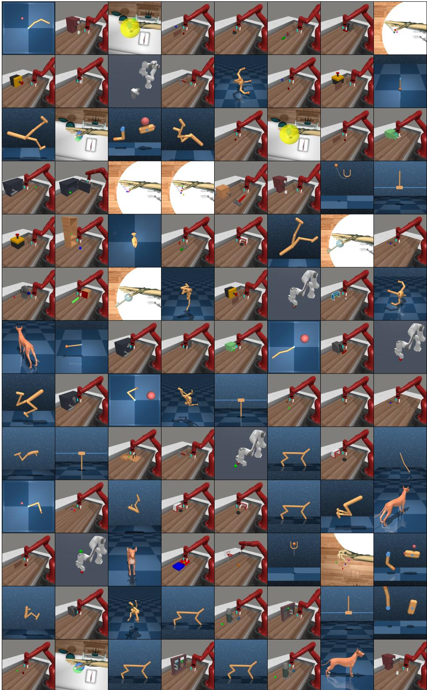  
Figure 11. 任务可视化。我们考虑的 104 个任务中每个任务的随机初始状态的可视化。各任务在目标、具身形态和动作空间上差异巨大。请访问 https: //tdmpc2.com 查看 TD-MPC2 执行每个任务的视频。任务详情请参见附录 C。

## C 任务领域

我们考虑了来自 4 个任务领域的总计 104 个连续控制任务：DMControl (Tassa et al., 2018)、Meta-World (Yu et al., 2019)、ManiSkill2 (Gu et al., 2023) 和 MyoSuite (Caggiano et al., 2022)。本节提供了所考虑的所有任务的详尽列表，以及它们的观测和动作维度。环境细节列于本节末尾。我们在附录 B 中提供了（静态）任务可视化，并在 https: //www.tdmpc2.com 提供了 TD-MPC2 智能体执行各项任务的视频。

Table 2. DMControl。我们在 DMControl 领域中考虑了总共 39 个连续控制任务，包括 19 个原始 DMControl 任务和 11 个专门为 TD-MPC2 基准测试与多任务训练创建的新（自定义）任务。我们在下方列出了所有考虑的 DMControl 任务。Figure 1 中所示的 Locomotion 任务集对应于 DMControl 的 Humanoid 和 Dog 具身，其性能在 14M 环境步数下进行报告。

<table><tr><td>任务</td><td>观测维度</td><td>动作维度</td><td>稀疏？</td><td>新增？</td></tr><tr><td>Acrobot Swingup</td><td>6</td><td>1</td><td>N</td><td>N</td></tr><tr><td>Cartpole Balance</td><td>5</td><td>1</td><td>N</td><td>N</td></tr><tr><td>Cartpole Balance Sparse</td><td>5</td><td>1</td><td>Y</td><td>N</td></tr><tr><td>Cartpole Swingup</td><td>5</td><td>1</td><td>N</td><td>N</td></tr><tr><td>Cartpole Swingup Sparse</td><td>5</td><td>1</td><td>Y</td><td>N</td></tr><tr><td>Cheetah Jump</td><td>17</td><td>6</td><td>N</td><td>Y</td></tr><tr><td>Cheetah Run</td><td>17</td><td>6</td><td>N</td><td>N</td></tr><tr><td>Cheetah Run Back</td><td>17</td><td>6</td><td>N</td><td>Y</td></tr><tr><td>Cheetah Run Backwards</td><td>17</td><td>6</td><td>N</td><td>Y</td></tr><tr><td>Cheetah Run Front</td><td>17</td><td>6</td><td>N</td><td>Y</td></tr><tr><td>Cup Catch</td><td>8</td><td>2</td><td>Y</td><td>N</td></tr><tr><td>Cup Spin</td><td>8</td><td>2</td><td>N</td><td>Y</td></tr><tr><td>Dog Run</td><td>223</td><td>38</td><td>N</td><td>N</td></tr><tr><td>Dog Trot</td><td>223</td><td>38</td><td>N</td><td>N</td></tr><tr><td>Dog Stand</td><td>223</td><td>38</td><td>N</td><td>N</td></tr><tr><td>Dog Walk</td><td>223</td><td>38</td><td>N</td><td>N</td></tr><tr><td>Finger Spin</td><td>9</td><td>2</td><td>Y</td><td>N</td></tr><tr><td>Finger Turn Easy</td><td>12</td><td>2</td><td>Y</td><td>N</td></tr><tr><td>Finger Turn Hard</td><td>12</td><td>2</td><td>Y</td><td>N</td></tr><tr><td>Fish Swim</td><td>24</td><td>5</td><td>N</td><td>N</td></tr><tr><td>Hopper Hop</td><td>15</td><td>4</td><td>N</td><td>N</td></tr><tr><td>Hopper Hop Backwards</td><td>15</td><td>4</td><td>N</td><td>Y</td></tr><tr><td>Hopper Stand</td><td>15</td><td>4</td><td>N</td><td>N</td></tr><tr><td>Humanoid Run</td><td>67</td><td>24</td><td>N</td><td>N</td></tr><tr><td>Humanoid Stand</td><td>67</td><td>24</td><td>N</td><td>N</td></tr><tr><td>Humanoid Walk</td><td>67</td><td>24</td><td>N</td><td>N</td></tr><tr><td>Pendulum Spin</td><td>3</td><td>1</td><td>N</td><td>Y</td></tr><tr><td>Pendulum Swingup</td><td>3</td><td>1</td><td>N</td><td>N</td></tr><tr><td>Quadruped Run</td><td>78</td><td>12</td><td>N</td><td>N</td></tr><tr><td>Quadruped Walk</td><td>78</td><td>12</td><td>N</td><td>N</td></tr><tr><td>Reacher Easy</td><td>6</td><td>2</td><td>Y</td><td>N</td></tr><tr><td>Reacher Hard</td><td>6</td><td>2</td><td>Y</td><td>N</td></tr><tr><td>Reacher Three Easy</td><td>8</td><td>3</td><td>Y</td><td>Y</td></tr><tr><td>Reacher Three Hard</td><td>8</td><td>3</td><td>Y</td><td>Y</td></tr><tr><td>Walker Run</td><td>24</td><td>6</td><td>N</td><td>N</td></tr><tr><td>Walker Run Backwards</td><td>24</td><td>6</td><td>N</td><td>Y</td></tr><tr><td>Walker Stand</td><td>24</td><td>6</td><td>N</td><td>N</td></tr><tr><td>Walker Walk</td><td>24</td><td>6</td><td>N</td><td>N</td></tr><tr><td>Walker Walk Backwards</td><td>24</td><td>6</td><td>N</td><td>Y</td></tr></table>

Table 3. Meta-World。我们考虑了来自 Meta-World 领域的共计 50 个连续控制任务。Meta-World 基准专为多任务和元学习（meta-learning）研究而设计，因此所有任务共享机体（embodiment）、观测空间和动作空间。

<table><tr><td>任务</td><td>观测维度</td><td>动作维度</td></tr><tr><td>Assembly</td><td>39</td><td>4</td></tr><tr><td>Basketball</td><td>39</td><td>4</td></tr><tr><td>Bin Picking</td><td>39</td><td>4</td></tr><tr><td>...</td><td>...</td><td>...</td></tr><tr><td>Window Open</td><td>39</td><td>4</td></tr></table>

Table 4. ManiSkill2。我们考虑了来自 ManiSkill2 领域的共计 5 个连续控制任务。ManiSkill2 基准专为大规模机器人学习而设计，包含高度的随机化和任务变化。Figure 1 所示的 Pick YCB 任务对应于 ManiSkill2 中同名的任务，其报告的性能是在 14M 环境步数下的结果。

<table><tr><td>任务</td><td>观测维度</td><td>动作维度</td></tr><tr><td>Lift Cube</td><td>42</td><td>4</td></tr><tr><td>Pick Cube</td><td>51</td><td>4</td></tr><tr><td>Pick YCB</td><td>51</td><td>7</td></tr><tr><td>Stack Cube</td><td>55</td><td>4</td></tr><tr><td>Turn Faucet</td><td>40</td><td>7</td></tr></table>

Table 5. MyoSuite。我们考虑了来自 MyoSuite 领域的共计 10 个连续控制任务。MyoSuite 基准专为高维、符合生理学精度的肌肉骨骼运动控制而设计，并涉及使用灵巧手进行特别复杂的物体操作。MyoSuite 领域包含有目标随机化和无目标随机化的任务。我们考虑了这两种设置，并分别将其称为简单（Easy，固定目标）和困难（Hard，随机目标）。

<table><tr><td>任务</td><td>观测维度</td><td>动作维度</td></tr><tr><td>Reach Easy</td><td>115</td><td>39</td></tr><tr><td>Reach Hard</td><td>115</td><td>39</td></tr><tr><td>Pose Easy</td><td>108</td><td>39</td></tr><tr><td>Pose Hard</td><td>108</td><td>39</td></tr><tr><td>Pen Twirl Easy</td><td>83</td><td>39</td></tr><tr><td>Pen Twirl Hard</td><td>83</td><td>39</td></tr><tr><td>Object Hold Easy</td><td>91</td><td>39</td></tr><tr><td>Object Hold Hard</td><td>91</td><td>39</td></tr><tr><td>Key Turn Easy</td><td>93</td><td>39</td></tr><tr><td>Key Turn Hard</td><td>93</td><td>39</td></tr></table>

## D 单任务实验结果

  
Figure 12. 单任务 DMControl 结果。回合回报（episode return）随环境步数的变化曲线。每个任务展示了前 4M 环境步数，尽管 Humanoid 和 Dog 任务运行了 14M 环境步数；我们在 Figure 15 中提供了这些曲线作为“运动（Locomotion）”基准的一部分。请注意，TD-MPC 在 Walker Stand 和 Walker Walk 等任务上发散，而 TD-MPC2 则保持稳定。我们在附录 G 中对这些任务上的梯度进行了可视化。均值和 95% 置信区间基于 3 个种子计算。

  
Figure 13. 单任务 Meta-World 结果。成功率（%）随环境步数的变化曲线。TD-MPC2 的性能在简单任务上与现有方法相当，而在诸如 Pick Place Wall 和 ShelfPlace 等困难任务上优于其他方法。DreamerV3 通常难以收敛。

SAC DreamerV3 TD-MPC TD-MPC2  
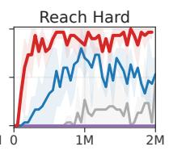

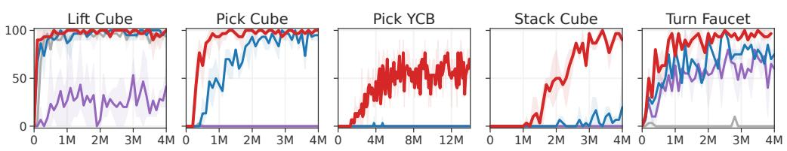  
SAC DreamerV3 TD-MPC TD-MPC2  
Figure 14. 单任务 ManiSkill2 结果。来自 ManiSkill2 的 5 个物体操作任务上成功率（%）随环境步数的变化曲线。Pick YCB 是最困难的任务，涉及对来自 YCB（Calli et al., 2015）数据集的全部 74 种物体的操作。我们报告了该任务在 14M 环境步数下的结果，以及其他任务在 4M 环境步数下的结果。TD-MPC2 在 Pick YCB 任务上取得了 $a > 6 0 \%$ 的成功率，而其他方法在给定的预算内均未能学会。均值和 95% 置信区间基于 3 个随机种子计算。


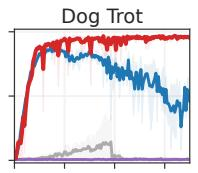

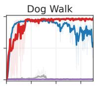


  
Figure 15. 单任务高维运动控制结果。在全部 7 个“Locomotion”基准任务上的回合回报（Episode return）随环境步数的变化曲线。该领域包含高维的 Humanoid $( \boldsymbol { \mathcal { A } } \in \mathbb { R } ^ { 2 1 } )$ 和 Dog $( \mathcal { A } \in \mathbb { R } ^ { 3 8 } )$ 具身。均值和 95% 置信区间基于 3 个随机种子计算。


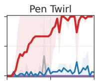


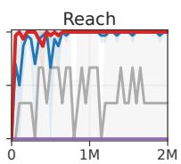  
SAC DreamerV3 TD-MPC TD-MPC2  
Figure 16. 单任务 MyoSuite 结果。成功率（%）随环境步数的变化函数。该任务领域包含使用生理学精准机械手的高维丰富接触肌肉骨骼运动控制 $( \boldsymbol { \mathcal { A } } \in \mathbb { R } ^ { 5 9 } )$。在标为“Hard”的任务中，目标是随机化的。除 Key Turn Hard 任务中 TD-MPC 在训练早期即取得成功外，TD-MPC2 在该基准测试的所有任务上均取得了与现有方法相当或更优的性能。

## E 少样本实验结果

我们将一个在 70 个任务上训练的 19M 参数 TD-MPC2 智能体微调到 10 个保留（held-out）任务中的每一个。各个任务的曲线如图 17 所示。我们将微调模型的数据效率与从头训练的具有相似模型容量的基线智能体进行了比较。然而，我们发现从头训练的 19M 参数基线性能与同样从头训练的 5M 参数智能体相当。我们的少样本微调结果表明，微调的有效性在一定程度上取决于具体任务。然而，要确定这是由于任务相似性（或者更确切地说是缺乏相似性），还是由于预训练智能体在源任务上的性能不佳所致，还需要更多的研究。我们推测这两者都可能对结果产生影响。

在微调到未见过的任务时，我们将新任务的可学习任务嵌入初始化为来自预训练数据集的语义相似任务的嵌入。我们在 Table 7 中列出了每次实验中用作初始化的源任务嵌入。我们没有尝试其他初始化方案，也没有尝试其他任务配对。

  
Figure 17. 少样本学习。在将 70 个任务上训练的 19M 参数 TD-MPC2 智能体微调到 10 个保留任务中的每一个时，归一化回合回报（DMControl）和成功率（Meta-World）随环境步数的变化函数。40k 步对应于 DM-Control 中的 40 个回合以及 Meta-World 中的 200 个回合。均值和 95% 置信区间基于 3 个随机种子计算。

Table 7. 少样本学习的任务嵌入初始化。我们列出了在将 19M 参数 TD-MPC2 智能体微调到保留任务时用作初始化的任务嵌入。我们没有尝试其他初始化方案，也没有尝试其他任务配对。

<table><tr><td>目标任务</td><td>源任务</td></tr><tr><td>Walker Run</td><td>Walker Walk</td></tr><tr><td>Cheetah Run</td><td>Cheetah Run Backwards</td></tr><tr><td>Hopper Hop</td><td>Hopper Stand</td></tr><tr><td>Pendulum Swingup</td><td>Pendulum Spin</td></tr><tr><td>Reacher Hard</td><td>Reacher Easy</td></tr><tr><td>Bin Picking</td><td>Pick Place</td></tr><tr><td>Box Close</td><td>Assembly</td></tr><tr><td>Door Lock</td><td>Door Open</td></tr><tr><td>Door Unlock</td><td>Door Open</td></tr><tr><td>Hand Insert</td><td>Sweep Into</td></tr></table>

## F 额外消融实验

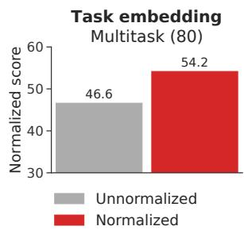  
Figure 18. 归一化任务嵌入。如第 3.1 节所述，具有和不具有归一化任务嵌入 e 的 19M 参数多任务（80 个任务）TD-MPC2 智能体的归一化得分。我们发现将 e 归一化为具有最大 $\ell _ { 2 } \cdot$ 范数为 1 可以提高多任务性能。

  
Figure 19. 有和没有归一化的任务嵌入的 T-SNE。在来自 DMControl 和 Meta-World 的 80 个任务上训练的 TD-MPC2 智能体所学习到的任务嵌入的 T-SNE (van der Maaten & Hinton, 2008) 可视化。（左）有归一化。（右）无归一化。为清晰起见仅显示了部分标签。我们观察到，在训练过程中进行归一化时，任务嵌入在语义上更有意义，$e . g .$，“Door Open”和“Door Close”在左侧的嵌入空间中彼此接近，但在右侧相距较远


  
Figure 20. 激活函数。作为环境步数函数的归一化得分，在三个最困难的任务中取平均：Dog Run、Humanoid Walk (DMControl) 和 Pick YCB (ManiSkill2)。3 个随机种子的均值和 95% 置信区间。我们发现 TD-MPC2 使用任一激活函数均能取得相当的渐进性能和数据效率，但 Mish (Misra, 2019) 总体上能带来更平滑的梯度。

## G 梯度范数与训练稳定性

  
Figure 21. 训练期间的梯度范数。我们在来自 DMControl 的五个任务上，对比了 TD-MPC 和 TD-MPC2 的梯度范数（对数尺度）随环境步数的变化。TD-MPC 容易出现梯度爆炸，这可能导致某些任务上的学习发散（例如 Figure 12 中的 Walker Stand）。相比之下，TD-MPC2 的梯度在整个训练过程中保持稳定。为清晰起见，每个任务仅展示 1 个种子。

## H 实现细节

架构细节。TD-MPC2 的所有组件均实现为 MLP。编码器 $h$ 包含可变数量的层（2−5 层），具体取决于架构规模；所有其他组件均为 3 层 MLP。中间层由一个线性层以及随后的 LayerNorm 和 Mish 激活函数组成。潜表示被归一化为单纯形嵌入（simplicial embedding）。Q 函数额外使用了 Dropout。我们使用类 PyTorch 符号总结了 5M 参数基础规模（在线强化学习的默认规模）的 TD-MPC2 架构：

```txt
Encoder parameters: 167,936
Dynamics parameters: 843,264
Reward parameters: 631,397
Policy parameters: 582,668
Q parameters: 3,156,985
Task parameters: 7,680
Total parameters: 5,389,930

Architecture: TD-MPC2 base 5M(
(task_embedding): Embedding(T, 96, max_norm=1)
(encoder): ModuleDict(
(state): Sequential(
(0): NormedLinear(in_features=S+T, out_features=256, act=Mish)
(1): NormedLinear(in_features=256, out_features=512, act=SimNorm)
)
)
(dynamics): Sequential(
(0): NormedLinear(in_features=512+T+A, out_features=512, act=Mish)
(1): NormedLinear(in_features=512, out_features=512, act=Mish)
(2): NormedLinear(in_features=512, out_features=512, act=SimNorm)
)
(reward): Sequential(
(0): NormedLinear(in_features=512+T+A, out_features=512, act=Mish)
(1): NormedLinear(in_features=512, out_features=512, act=Mish)
(2): Linear(in_features=512, out_features=101,)
)
(pi): Sequential(
(0): NormedLinear(in_features=512+T, out_features=512, act=Mish)
(1): NormedLinear(in_features=512, out_features=512, act=Mish)
(2): Linear(in_features=512, out_features=2A, bias=True)
)
(Qs): Vectorized ModuleList(
(0-4): 5 x Sequential(
(0): NormedLinear(in_features=512+T+A, out_features=512, dropout=0.01, act=Mish)
(1): NormedLinear(in_features=512, out_features=512, act=Mish)
(2): Linear(in_features=512, out_features=101, bias=True)
)
)
```

其中 $S$ 是输入维度，$T$ 是任务数量，$A$ 是动作空间。我们在单任务实验中排除了任务嵌入 $T$。上述列出的精确参数量基于 $S= 39$、$T= 80$ 和 $A= 6$。

超参数。我们在所有任务中使用相同的超参数。我们的超参数列于 Table 8 中。我们为 TD-MPC 和 SAC 使用与 Hansen et al. (2022) 中相同的超参数。DreamerV3 (Hafner et al., 2023) 使用一组固定的超参数。

Table 8. TD-MPC2 超参数。我们在所有任务中使用相同的超参数。某些超参数是使用启发式规则自动设置的。

<table><tr><td>超参数</td><td>取值</td></tr><tr><td colspan="2">规划</td></tr><tr><td>规划时域 (H)</td><td>3</td></tr><tr><td>迭代次数</td><td>6（若  $\| \mathcal{A} \| \geq 20$ 则 +2）</td></tr><tr><td>种群大小</td><td>512</td></tr><tr><td>策略先验采样数</td><td>24</td></tr><tr><td>精英数量</td><td>64</td></tr><tr><td>最小标准差</td><td>0.05</td></tr><tr><td>最大标准差</td><td>2</td></tr><tr><td>温度</td><td>0.5</td></tr><tr><td>动量</td><td>无</td></tr><tr><td colspan="2">策略先验</td></tr><tr><td>对数标准差最小值</td><td>-10</td></tr><tr><td>对数标准差最大值</td><td>2</td></tr><tr><td colspan="2">经验回放缓冲区</td></tr><tr><td>容量</td><td>1,000,000</td></tr><tr><td>采样方式</td><td>均匀采样</td></tr><tr><td colspan="2">网络架构 (5M)</td></tr><tr><td>编码器维度</td><td>256</td></tr><tr><td>MLP 维度</td><td>512</td></tr><tr><td>隐状态维度</td><td>512</td></tr><tr><td>任务嵌入维度</td><td>96</td></tr><tr><td>任务嵌入范数</td><td>1</td></tr><tr><td>激活函数</td><td>LayerNorm + Mish</td></tr><tr><td>Q 函数 Dropout 率</td><td>1%</td></tr><tr><td>Q 函数数量</td><td>5</td></tr><tr><td>奖励/价值分箱数</td><td>101</td></tr><tr><td>SimNorm 维度 (V)</td><td>8</td></tr><tr><td>SimNorm 温度 ( $\tau$ )</td><td>1</td></tr><tr><td colspan="2">优化</td></tr><tr><td>更新数据比</td><td>1</td></tr><tr><td>批次大小</td><td>256</td></tr><tr><td>联合嵌入系数</td><td>20</td></tr><tr><td>奖励预测系数</td><td>0.1</td></tr><tr><td>价值预测系数</td><td>0.1</td></tr><tr><td>时间系数 ( $\lambda$ )</td><td>0.5</td></tr><tr><td>Q 函数动量系数</td><td>0.99</td></tr><tr><td>策略先验熵系数</td><td> $1 \times 10^{-4}$ </td></tr><tr><td>策略先验损失归一化</td><td>滑动 (5%, 95%) 百分位数</td></tr><tr><td>优化器</td><td>Adam</td></tr><tr><td>学习率</td><td> $3 \times 10^{-4}$ </td></tr><tr><td>编码器学习率</td><td> $1 \times 10^{-4}$ </td></tr><tr><td>梯度裁剪范数</td><td>20</td></tr><tr><td>折扣因子</td><td>启发式</td></tr><tr><td>种子步数</td><td>启发式</td></tr></table>

我们使用以下启发式方法设定任务的折扣因子 $\gamma$：

$$
\gamma = \mathrm{clip} (\frac {\frac {T}{5} - 1}{\frac {T}{5}}, [ 0. 9 5, 0. 9 9 5 ])\tag{7}
$$

其中 $T$ 是应用动作重复（action repeat）后回合（episode）的期望长度，clip 将折扣因子限制在区间 [0.95, 0.995] 内。使用这一启发式规则，对于 DMControl $( T = 5 0 0 )$ 我们得到 $\gamma = 0 . 9 9$，这是该任务领域中最广泛使用的折扣因子。回合较短的任务被赋予较低的折扣因子，而回合较长的任务则被赋予较高的折扣因子。我们考虑的所有任务都是具有固定回合长度的无限时域 MDP。在多任务实验中，我们对每个任务使用单独的折扣因子（通过上述启发式规则设定）。对于回合长度可变或未知的任务，我们建议使用经验均值长度、合理的估计值，或者直接取 $\gamma = 0 . 9 9$。虽然该启发式规则是在 TD-MPC2 中引入的，但我们对 TD-MPC 和 SAC 基线也应用相同的折扣因子，以确保在所有任务领域上的比较都是公平的。

我们使用以下启发式规则为任务设定种子步数（seed steps）S（在进行任何梯度更新之前的环境步数）：

$$
S = \max (5 T, 1 0 0 0)\tag{8}
$$

其中 $T$ 同样是应用动作重复后任务的期望回合长度。我们没有尝试其他启发式规则或常数值，但推测公式 8 能确保经验回放池（replay buffer）B 无论回合长度如何都有足够的数据用于模型学习。

模型配置。我们的多任务实验考虑了模型大小从 1M 参数到 317M 参数不等的 TD-MPC2 智能体。Table 9 列出了我们每种模型大小的具体规格。我们通过改变全连接层的维度、隐状态维度 z、编码器层数以及 $Q \cdot$ 函数的数量来扩展模型大小。在不同模型大小之间，我们没有对架构或超参数进行任何其他修改。

Table 9. 模型配置。我们列出了多任务实验中每种模型配置（大小）的规格。Encoder dim 是编码器 h 中全连接层的维度，MLP dim 是所有其他组件中各层的维度，Latent state dim 是隐表示 $\mathbf { z }$ 的维度，# encoder layers 是编码器 h 的层数，# Q-functions 是学习的 $Q \cdot$ 函数数量，Task embedding dim 是公式 2 中 e 的维度。无论集成中有多少个 ${ \check { Q } } .$ 函数，TD 目标（TD-targets）始终通过随机子采样两个 Q 函数来计算。我们没有尝试其他模型配置。*在单任务 RL 实验中使用的默认（基础）配置具有 5M 参数。

<table><tr><td></td><td>1M</td><td>5M*</td><td>19M</td><td>48M</td><td>317M</td></tr><tr><td>编码器维度</td><td>256</td><td>256</td><td>1024</td><td>1792</td><td>4096</td></tr><tr><td>MLP 维度</td><td>384</td><td>512</td><td>1024</td><td>1792</td><td>4096</td></tr><tr><td>潜在状态维度</td><td>128</td><td>512</td><td>768</td><td>768</td><td>1376</td></tr><tr><td>编码器层数</td><td>2</td><td>2</td><td>3</td><td>4</td><td>5</td></tr><tr><td>Q 函数数量</td><td>2</td><td>5</td><td>5</td><td>5</td><td>8</td></tr><tr><td>任务嵌入维度</td><td>96</td><td>96</td><td>96</td><td>96</td><td>96</td></tr></table>

单纯形归一化（Simplicial Normalization, SimNorm）。SimNorm 是一种通过使用 softmax 操作将潜在表示 z 投影到 L 个固定维度的单纯形中来对其进行归一化的简单方法（Lavoie et al., 2022）。将 z 嵌入为单纯形的一个关键优势（与例如离散表示或压缩相比）在于，它在不施加硬性约束的情况下自然地使表示偏向稀疏性。直观上，SimNorm 可以被视为 Oord et al. (2017) 提出的基于分类向量（vector-of-categoricals）的表示学习方法（VQ-VAE）的一种 $\mathit { \Omega } ^ { \prime \prime } s o f t { \mathit { \Omega } } ^ { \prime \prime }$ 变体。VQ-VAE 使用一组离散代码（L 个向量分区，每个分区由独热编码组成）来表示潜在代码，而 SimNorm 则将潜在状态划分为 L 个连续值向量分区，由于 softmax 算子的作用，每个分区的和为 1。这种对潜在表示的松弛类似于 softmax 是 arg max 算子的松弛。虽然我们在实验中没有调整 SimNorm 中使用的 softmax 的温度 $\tau \in [ 0 , \infty )$，但值得注意的是，它提供了一种在两个极端之间进行插值的机制。例如，τ → ∞ 将迫使所有概率质量集中在单个类别上，从而产生 VQ-VAE 的离散代码（独热编码）。另一种情况 τ = 0 则会导致微不足道的代码（常数向量；均匀概率质量）并阻止信息的传播。因此，SimNorm 在不强制执行离散代码或其他硬约束的情况下使表示偏向稀疏性。我们使用类似 PyTorch 的表示法实现 SimNorm 归一化层（Lavoie et al., 2022），如下所示：

```python
def simnorm(self, z, V=8):
    shape = z.shape
    z = z.view(*shape[:-1], -1, V)
    z = softmax(z, dim=-1)
    return z.view(*shape)
```

这里，z 是潜在表示 z，V 是每个单纯形的维度。单纯形数量 L 可以从 V 和 z 的维度推断出来。我们对 z 的 L 个分区分别应用 softmax（可选地由温度 τ 调节）以形成单纯形，然后重塑回 z 的原始形状。

视觉强化学习（Visual RL）。TD-MPC2 可以很容易地应用于具有其他输入模态的任务。在 Figure 10 所示的视觉强化学习实验中，我们将 TD-MPC2 默认的 MLP 编码器替换为浅层（4 层）卷积编码器，并使用 64 × 64 的图像分辨率。我们还像以往的研究（Kostrikov et al., 2020; Yarats et al., 2021; Hansen et al., 2022）一样应用了随机平移增强（random shift augmentation）。我们指出，虽然我们的实验使用了相对较小的图像分辨率，但我们这样做是为了降低计算成本并确保与基线进行公平比较。然而，先前的研究已经证明 TD-MPC 支持高达 9 × 224 × 224 的输入（Lancaster et al., 2023）。

TD-MPC 基线实现。我们以 https://github.com/nicklashansen/tdmpc 提供的 TD-MPC 官方实现作为基准。默认的 TD-MPC 世界模型具有约 1M 个可训练参数，并使用针对每个任务独立设置的超参数。在可用时（DMControl 和 Meta-World），我们使用建议的超参数。例如，TD-MPC 需要调整规划迭代次数、潜在状态维度、批次大小和学习率，以解决具有挑战性的 Dog 和 Humanoid 任务。有关超参数的完整列表，请参阅其论文。

DreamerV3 基线实现。我们以 https://github.com/danijar/dreamerv3 提供的 DreamerV3 官方复现作为基准。我们遵循作者针对本体感觉控制（proprioceptive control，DMControl）建议的超参数，并使用 S 模型大小（20M 参数）以及 512 的更新数据比（update-to-data, UTD）。我们在所有任务中都使用此模型大小和 UTD。有关超参数的完整列表，请参阅其论文。

SAC 基线实现。我们遵循 TD-MPC（Hansen et al., 2022）论文的决定，以来自 https://github.com/ denisyarats/pytorch\_sac 的 SAC 实现作为基准，并使用作者建议的超参数（在可用时）。例如，这包括为 Dog 和 Humanoid 任务调整潜在维度、学习率和批次大小。有关超参数的完整列表，请参阅其论文。

## I 将 TD-MPC2 扩展至离散动作空间

开发一种在连续和离散动作空间任务中均表现出色的单一算法是十分理想的。然而，学术界尚未发现这样一种算法。尽管例如 DreamerV3 (Hafner et al., 2023) 在具有离散动作空间的挑战性任务（如 Atari 和 Minecraft）上取得了强劲的表现，但我们发现 TD-MPC2 在高难度的连续控制任务上产生了显著更优的结果。与此同时，将 TD-MPC2 扩展到离散动作空间仍是一个悬而未决的问题。虽然我们在本工作中未考虑离散动作空间，但我们认可此类扩展的价值。目前，将 TD-MPC2 应用于离散动作的主要挑战在于规划算法的选择。TD-MPC2 依赖 MPC 框架进行规划，而该框架是针对连续动作空间设计的。我们认为，MPC 可以替换为专为离散动作空间设计的规划算法，例如 MuZero (Schrittwieser et al., 2020) 中使用的 MCTS (Coulom, 2007)。同样，（据我们所知）也可能存在某种尚未被发现的将 MPC 应用于离散动作空间的方法，类似于近期的研究工作 (Hubert et al., 2021) 发现了通过采样将 MCTS 应用于连续动作空间的方法。

## J 离线强化学习的测试时正则化

我们的多任务实验围绕在包含多种行为的固定数据集上训练海量多任务（massively multi-task）世界模型展开，这是一个离线强化学习（offline RL）问题。我们在正文中并未对离线强化学习问题进行任何特殊处理，仅在没有任何额外正则化或超参数调优的情况下训练 TD-MPC2 智能体。然而，我们认识到，当数据集的状态-动作覆盖有限和/或高度偏斜时，由于外推误差，模型可能会受益于此类正则化（保守估计）。当前的离线强化学习算法并不适合我们的问题设定，因为我们的目标是开发一种能够在无需更改任何超参数的情况下，从海量多任务离线预训练无缝过渡到单任务在线微调的算法。当前的离线强化学习技术依赖于：(1) Q 值估计中的显式或隐式保守性，这需要修改训练目标，并在经验上会阻碍在线强化学习的性能 (Nakamoto et al., 2023)；以及 (2) 依赖于权衡价值估计与正则化项的任务特定系数。相反，我们建议对 TD-MPC2 的规划过程进行正则化，这可以在测试时完成，而无需进行任何额外的模型更新。具体而言，我们应用了 Feng et al. (2023) 提出的测试时正则化项，该正则化项在规划期间惩罚具有较大不确定性（通过 $\bar { Q } \bar { }$ 值预测的方差来估计）的轨迹。尽管这种方法消除了对训练时正则化的需求，但它仍然需要用户指定一个系数来权衡轨迹的估计价值与不确定性，这在不同任务间估计价值可能存在巨大差异的多任务场景中是不可行的。为了规避这一问题，我们提出了一种简单的启发式方法，根据给定潜在状态的均值预测（的大小）在每个时间步自动缩放正则化强度。具体来说，我们将采样轨迹在潜在状态 $\mathbf { z } _ { t }$ 处的不确定性惩罚估计为

$$
u _ {t} = c \cdot \mathrm{avg} ([ \hat {q} _ {1}, \hat {q} _ {2}, \dots , \hat {q} _ {N} ]) \cdot \mathrm{std} ([ \hat {q} _ {1}, \hat {q} _ {2}, \dots , \hat {q} _ {N} ])\tag{9}
$$

其中 $\hat { q } _ { n }$ 是来自 $N$ 个 Q 函数集成中 Q 函数 $n$ 的价值预测，而 $c$ 现在是一个与任务无关的系数，用于权衡回报最大化与不确定性最小化。公式 6 中的规划目标随后被重新定义为

$$
\mu^ {*}, \sigma^ {*} = \operatorname * {a r g   m a x} _ {(\mu , \sigma) (\mathbf {a} _ {t}, \mathbf {a} _ {t + 1}, \dots , \mathbf {a} _ {t + H}) \sim \mathcal {N} (\mu , \sigma^ {2})}\tag{10}
$$

$$
\left[ \gamma^ {H} Q (\mathbf {z} _ {t + H}, \mathbf {a} _ {t + H}) - u _ {t + H} \right.\tag{11}
$$

$$
\left. + \sum_ {h = t} ^ {H - 1} \left(\gamma^ {h} R (\mathbf {z} _ {h}, \mathbf {a} _ {h}) - u _ {h}\right) \right],\tag{12}
$$

其中使用了公式 9 中与任务无关的不确定性定义。我们进行了一项实验，将所提出的测试时正则化应用于在 80 任务数据集上训练的 19M 参数 TD-MPC2 智能体，并改变正则化强度 c。结果如 Table 10 所示。我们的结果表明，额外的正则化（使用我们的启发式方法进行自动调优）在某些 c 值下确实可以提高模型的平均性能。与在单任务设定中的预期类似，我们发现较大的 c 值（强正则化）会降低性能，而较小（但 $> 0 )$ 的 c 值相比无正则化的 TD-MPC2 往往能提升性能。鉴于我们使用 $c = 0 . 0 1$ 的启发式方法在 80 个任务上带来了显著提升，我们预计它在其他数据集上也能表现良好，但将此留待未来工作中探索。

Table 10. 测试时正则化。在 80 任务数据集上训练的 19M 参数 TD-MPC2 智能体的归一化分数，改变了我们提出的测试时正则化器的正则化强度 c。我们在其他任何实验中均未应用此正则化，包含这些结果仅为启发未来的研究方向。

<table><tr><td></td><td>无正则化</td><td>c = 0.001</td><td>c = 0.01</td><td>c = 0.1</td></tr><tr><td>归一化分数</td><td>56.54</td><td>58.14</td><td>62.01</td><td>44.13</td></tr></table>

## K 额外的多任务结果

为了进一步深入探讨数据规模和任务多样性在多任务设定下对 TD-MPC2 性能的影响，我们在随机选择的 DMControl 15 任务子集上进行了额外实验。在 15 任务、30 任务和 80 任务上训练的 TD-MPC2 智能体的结果如 Figure 22 所示。我们观察到，在所有三个任务套件中，性能均随模型规模扩展，但与在更大数据集上训练的同等容量模型相比，在最小数据集上的表现整体更高。这符合直觉，因为在模型容量保持不变的情况下，需要学习的任务相对更少。


  
Figure 22. 海量多任务世界模型的额外结果。在 15 任务、30 任务和 80 任务数据集上归一化分数随模型规模的变化关系。TD-MPC2 的能力随模型规模扩展。