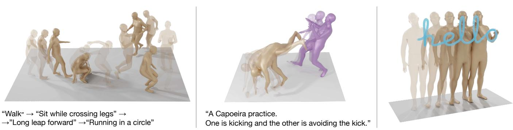
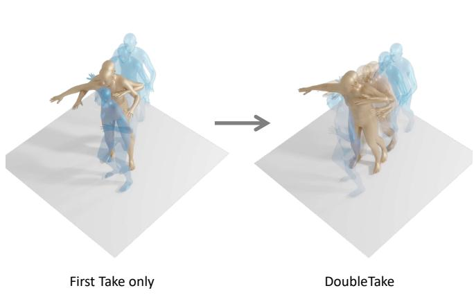
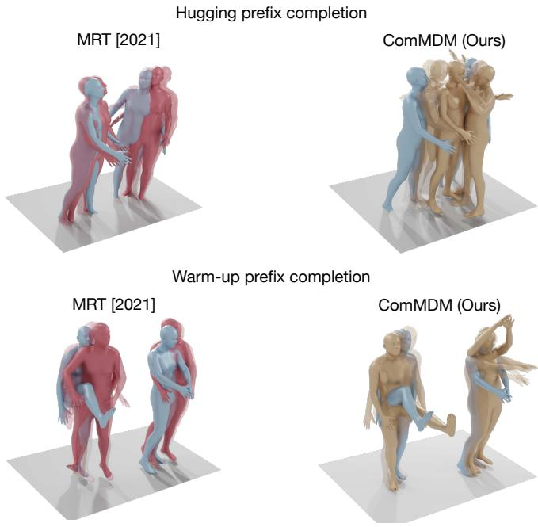
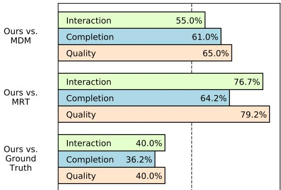
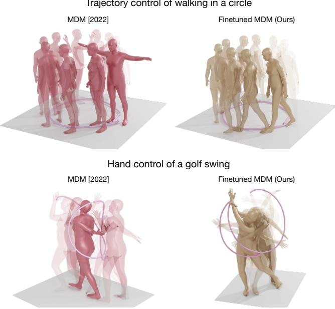
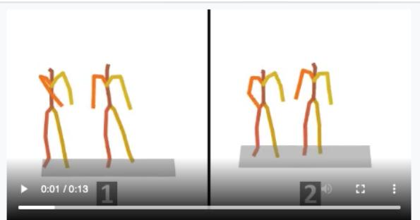

# 人体运动扩散模型作为生成先验

Yonatan Shafir∗, Guy Tevet∗, Roy Kapon, and Amit H. Bermano Tel-Aviv University, Israel {Shafir2,guytevet}@mail.tau.ac.il

  
“行走” → “交叉双腿坐下” → “向前大幅跃起” → “绕圈跑步”  
“一场卡波耶拉（Capoeira）练习。一人正在踢腿，另一人正在躲避踢击。”

Fig. 1. 我们提出了三种新颖的动作组合方法，均基于近期提出的运动扩散模型（Motion Diffusion Model, MDM）。（左）时序组合：生成任意长度的动作，并支持对每个时间区间的文本控制。（中）并行组合：根据文本生成双人动作。不同颜色代表不同的人物——两者均根据文本提示同时生成。（右）模型组合：通过融合具有不同控制信号的模型来实现精准且灵活的控制——此处展示在空中书写“hello”。

近期的研究工作展示了去噪扩散模型在生成人体运动方面的巨大潜力，包括文本到动作（text-to-motion）的生成能力。然而，这些方法受限于标注动作数据的匮乏、对单人动作的局限关注以及精细控制能力的缺失。在本文中，我们基于扩散先验引入了三种形式的组合方法：时序组合、并行组合和模型组合。利用时序组合，我们解决了长序列生成的挑战。我们提出了 DoubleTake，这是一种推理阶段（inference-time）方法，它使用仅在短片段上训练的先验，生成由提示词区间序列及其过渡转换构成的长动画。利用并行组合，我们在双人动作生成方向展示了富有前景的探索。从两个固定的先验以及少量双人训练样本出发，我们学习了一个轻量级通信模块 ComMDM，以协调两个生成动作之间的交互。最后，利用模型组合，我们首先训练单个先验来补全能够实现给定关节指定运动的动作。随后我们提出了 DiffusionBlending，这是一种插值机制，可有效融合多个此类模型，从而实现灵活、高效且细粒度的关节级与轨迹级控制及编辑。我们使用现成的人体运动扩散模型评估了这些组合方法，并进一步将结果与针对这些特定任务训练的专用模型进行了比较。https://priormdm.github.io/priorMDM-page/ 1

## 1 引言

人体动作生成（Human Motion Generation）近期经历了一次巨大的飞跃。近期精巧的语言模型 [Devlin et al. 2019; Radford et al. 2021] 与扩散生成方法 [Ho et al. 2020; Sohl-Dickstein et al. 2015] 迅速进入该领域，催生了一批能够根据文本或其他控制形式生成多样化且高质量序列的动作生成模型 [Guo et al. 2022; Petrovich et al. 2022; Tevet et al. 2022, 2023]。反过来，这些模型已被应用于游戏领域，并有望为初学者和专业人士共同敞开角色动画领域的大门。

然而，人体动作生成领域一直以来、且目前仍在面临的主要困境是数据问题。动作数据通常要么通过复杂的动作捕捉系统采集 [Joo et al. 2015]，要么由艺术家精心制作 [Adobe Systems Inc. 2021]。这两种情况最终都导致数据集昂贵、规模相对较小且同质化严重 [Guo et al. 2022; Punnakkal et al. 2021]。例如，当前模型所训练的数据集几乎全部由简短的单人序列组成。在缺乏数据的情况下，多人交互和长序列生成等任务的发展相对滞后，生成质量较差。

在本文中，我们展示了基于扩散的预训练动作生成模型可以作为组合的先验（priors），从而实现域外（out-of-domain）动作生成和高效控制。与扩散模型通常具有高数据消耗的名声相反，我们提出了三种方法，利用上述先验克服成本壁垒，在少样本（few-shot）甚至零样本（zero-shot）设定下实现极具挑战性的任务。

具体而言，我们选择预训练的动作扩散模型（Motion Diffusion Model，MDM）[Tevet et al. 2023] 作为先验。MDM 在简短单人序列的文本到动作（text-to-motion）和动作类别到动作（action-to-motion）任务中取得了最先进的结果，并且已被证明能够很好地泛化到来自其他领域的条件 [Tseng et al. 2022]，以及采样迭代之间所进行的校正操作 [Yuan et al. 2022]。

利用这一先验，我们展示了三种组合形式：

• 顺序组合（Sequential composition），将短序列拼接以创建一段连贯的单一长动作；

• 并行组合（parallel composition），协调两个单独动作以协同执行；

• 以及模型组合（model composition），将具备不同控制能力模型所生成的动作融合在一起，以实现复合控制。

我们的 DoubleTake 方法（Figure 1-Left）提出了一种时序组合方式，通过在时间上精心组合两个生成的动作（包括它们之间的过渡），从而能够以零样本（zero-shot）方式高效生成长动作序列。利用该方法，我们展示了使用仅在最长 10 秒序列上训练的模型 [Guo et al. 2022; Punnakkal et al. 2021] 生成的长达 10 分钟的流畅动作。此外，由于生成的组合特性，DoubleTake 允许对每个动作区间进行单独控制，同时保持一致的动作和过渡。考虑到训练数据中并没有显式标注此类过渡，这一结果是相当令人惊讶的。在每个扩散迭代中，DoubleTake 包含两个阶段——在第一步中，各个动作或区间在同一个批次（batch）中一起生成，且每个动作都能感知其相邻区间的上下文。随后，第二遍处理（second take）对区间之间的过渡进行细化，以更好地匹配前一阶段生成的内容。

对于并行组合，我们考虑了少样本（few-shot）设定，并首次实现了文本驱动的双人动作生成（Figure 1-Middle）。借助基于先验的方法，我们仅使用少至十几个训练样本就展示了极具前景的双人动作生成效果。其核心思想是，为了学习人类交互，我们只需让先验模型在整个扩散过程中相互通信。因此，我们学习了一个精简的通信模块 ComMDM，它通过中间激活图在两个冻结的先验之间传递通信信号。

最后，我们介绍了一种通过模型组合实现的新颖控制机制。我们观察到 Tevet et al. [2023] 提出的动作修复（motion inpainting）过程无法很好地扩展到更复杂但重要的动作任务，例如轨迹和末端执行器（end-effector）跟踪。因此，我们首先表明，针对该任务对先验进行微调，即使仅控制单个末端执行器也能产生令人满意的结果。随后，我们引入了 DiffusionBlending 技术，该技术将无分类器引导（classifier-free guidance）[Ho and Salimans 2022] 进行推广，以将不同的微调模型组合在一起，从而实现对生成动作的关键点控制的交叉组合。这为人体动作提供了精细且灵活的控制，构成了任何动画系统的关键能力（Figure 1-Right）。

我们通过定量和定性两方面证明，这些开销较小的组合方法扩展了经过更精细训练的动作先验，并在各自的任务中优于专门的现有技术 [Athanasiou et al. 2022; Wang et al. 2021]。

## 2 相关工作

## 2.1 动作扩散模型

最近，MDM [Tevet et al. 2023]、MotionDifuse [Zhang et al. 2022]、MoFusion [Dabral et al. 2023] 和 FLAME [Kim et al. 2022] 成功利用最初针对图像生成提出的去噪扩散概率模型（Denoising Difusion Probabilistic Models，DDPM）[Ho et al. 2020] 框架实现了动作生成神经网络模型。MDM 既能实现高质量生成，又能提供通用的条件控制，二者共同构成了新动作生成任务的良好基线。EDGE [Tseng et al. 2022] 沿用了 MDM 的思路，并将其扩展至音乐生成动作（music-to-motion）任务。SinMDM [Raab et al. 2023] 使用单样本学习方案将 MDM 适配至非人类动作。PhysDif [Yuan et al. 2022] 在 MDM 中引入了一个基于强化学习的预训练物理模型，该模型在采样过程中施加物理约束。这些例子展示了 MDM 在新任务中的灵活性。

在图像领域，Rombach et al. [2022a] 观察到专门针对图像修复（inpainting）任务训练模型可以改善结果。他们将修复掩码作为额外的控制信号输入。Meng et al. [2022]、Lugmayr et al. [2022] 和 Choi et al. [2021] 提出了多种基于部分去噪的扩散图像编辑方法。

## 2.2 长序列动作生成

运动图（Motion Graphs）[Kovar et al. 2008] 能够通过在给定数据语料库中遍历离散姿态来合成长动作。这种方法局限于现有数据，无法泛化到复杂的文本条件。基于 RNN 的动作生成容易坍缩为恒定姿态。针对前缀补全任务，Martinez et al. [2017] 和 Zhou et al. [2018] 在训练过程中通过将模型自身生成的帧作为输入喂给模型来克服这一问题。然而，这些方法仍然受限于可用数据中相对较短的序列。最近，一些研究提出通过自回归方式生成短序列来打破数据限制，其中每个短序列均以文本提示词和前一序列的后缀为条件。动作过渡要么根据平滑先验进行学习 [Athanasiou et al. 2022; Mao et al. 2022]，要么使用显式标注了动作间过渡的 BABEL 数据集 [Punnakkal et al. 2021] 从数据中学习 [Athanasiou et al. 2022; Wang et al. 2022]。EDGE [Tseng et al. 2022] 提出了展开（unfolding）方法来生成长序列，并在每两个相邻序列之间使用球面线性插值（SLERP）进行插值。相比之下，我们的 DoubleTake 提出了一种展开方法，该方法利用扩散机制并在每个去噪步骤中将动作融合在一起。

## 2.3 多人动作生成

数据稀缺是多人动作生成的主要障碍，因此相关工作的数量也相应有限。MuPoTS-3D 数据集 [Mehta et al. 2018] 包含 20 个真实世界的多人序列；CMU-Mocap [CMU [n. d.]] 和 3DPW [Von Marcard et al. 2018] 分别包含 55 个和 27 个双人动作序列。Yin 等人 [2018] 提出通过利用二维信息来克服数据壁垒。最近，Song 等人 [2022] 贡献了合成的多人 GTA Combat 数据集。这些数据集都没有文本（或其他形式）的标注，因此，最近的 MRT [Wang et al. 2021] 和 SoMoFormer [Vendrow et al. 2022] 模型学习了无监督前缀补全任务。二者都是在 DCT（离散余弦变换）下学习动作，这虽然改善了 L2 误差指标，但也导致了过度平滑和不真实的动作。在本工作中，我们为 3DPW 进行了文本标注，并首次学习了文本引导的双人动作生成。

  
Fig. 2. 软融合概述。我们在 $\mathbf { M _ { h a r d } }$ 到 $\mathbf { M } _ { s \mathbf { o f f } }$ 之间应用 $b$ 帧长度的线性掩码，使得在第二次拍摄（Second take）中，在每个去噪步骤中，最初生成的动作的一部分（后缀或前缀）都会经历细化以适应过渡。

## 2.4 人体动作先验

VPoser [Pavlakos et al. 2019] 是一种人体姿态自编码器，在 AMASS 动作捕捉数据集 [Mahmood et al. 2019] 上训练。它被用作动作应用的先验，例如动作去噪、将 SMPL [Loper et al. 2015] 模型拟合到关节点位置，以及作为动作生成的姿态码本 [Hong et al. 2022]。最近，Tiwari 等人 [2022] 表明这种先验可以作为隐式模型进行学习。MoDi [Raab et al. 2022] 是一种无监督动作生成器，由 StyleGAN [Karras et al. 2019] 改编而来。无需进一步训练，它即可实现潜在空间编辑和动作插值。与这些示例相反，MotionCLIP [Tevet et al. 2022] 使用来自图像和文本领域的先验来学习动作。它将动作流形与 CLIP [Radford et al. 2021] 潜在空间对齐。这使其能够继承 CLIP 所学到的知识，从而生成超出数据限制的动作。

在扩散模型背景下，MDM 将扩散图像修复 [Saharia et al. 2022; Song et al. 2020] 适配于动作编辑应用。在本工作中，我们通过在少样本到零样本设置下解决非平凡的动作任务来拓展这一原则。最近，MLD [Xin et al. 2022] 学习了一个类似于 LDM [Rom bach et al. 2022b] 的潜在扩散模型，该模型能够生成动作潜在代码而不是动作本身，并让更大且预训练的动作生成器将其转化为物理空间。

## 3 方法

在这项工作中，我们使用近期针对文本生成动作（text-to-motion）任务进行预训练的运动扩散模型（Motion Diffusion Model, MDM）[Tevet et al. 2023] 来学习新的生成任务。我们将人体运动表示为姿态序列 $X = \{ x ^ { i } \} _ { i = 1 } ^ { N }$，其中 $\boldsymbol { x } ^ { i } \in \mathbb { R } ^ { D }$ 表示单个姿态。具体而言，在 BABEL [Punnakkal et al. 2021] 数据集的实验中，我们使用 SMPL [Loper et al. 2015] 表示，包括单一身份 $( \beta = 0 )$ 之上的关节旋转和全局位置。对于所有其他实验，我们使用由关节位置、旋转、速度以及足部接触信息组成的 HumanML3D [Guo et al. 2022] 表示。MDM 是一个基于 DDPM [Ho et al. 2020] 框架的去噪扩散模型。它假设由以下随机过程建模的加噪步骤：

  
Fig. 3. DoubleTake 概览。我们使用固定的运动扩散先验，在每个区间通过文本控制生成任意长度的序列。在第一镜（first take）中，我们将每个区间生成为单个样本，并与相邻样本进行“握手”（handshaking）。在每次去噪迭代中，握手部分被强制相等，以最终组合成一个长序列。为了优化区间之间的过渡，第二镜（second take）对握手部分进行部分加噪，并使用软掩码（soft mask）以相邻区间为条件对其进行清理。实线框表示生成或精炼；虚线框表示输入到镜中的运动。

$$
q (X _ {t} | X _ {t - 1}) = \mathcal {N} (\sqrt {\alpha_ {t}} X _ {t - 1}, (1 - \alpha_ {t}) I),\tag{1}
$$

对于加噪步骤 $t \in T$，假设 $X _ { T } \sim { \cal N } ( 0 , I )$。MDM 对去噪过程进行建模：在给定加噪运动 $X _ { t }$、噪声步长 $t$ 以及编码到 CLIP [Radford et al. 2021] 空间并由 $c$ 表示的文本条件的情况下，预测干净运动 $\hat { X } _ { 0 }$。该模型使用标准的 $\mathcal { L } _ { \mathrm { s i m p l e } } = E _ { X _ { 0 } \sim q ( X _ { 0 } | c ) , t \sim [ 1 , T ] } [ \| X _ { 0 } - $ $M D M ( X _ { t } , t , c ) \| _ { 2 } ^ { 2 } ]$ 以及约束关节位置、速度和足部接触的几何损失进行训练。根据 Ho et al. [2020] 的方法，从 MDM 中采样新运动是以迭代方式完成的。在每个时间步 $t$ 中，预测出干净样本 $\hat { X } _ { 0 }$ 并重新加噪回 $X _ { t - 1 }$。这一过程从 $t = T$ 开始重复，直到达到 $t = 0$。

在本节中，我们介绍了通过 DoubleTake 方法（3.1）实现的序列组合（sequential composition），该方法通过序列组合将 MDM 推广到无需进一步训练即可生成任意长度的动作。接着，我们介绍了通过采用一个轻量级通信层 ComMDM（3.2）实现的并行组合（parallel composition），该模型仅用 10 个交互样本进行训练，即可用于生成双人动作。最后，我们微调 MDM 以控制特定关节，并提出了我们的模型组合方法 DiffusionBlending（3.3），该方法推广了无分类器引导方法（classifier-free approach）[Ho and Salimans 2022]，以实现对身体的细粒度控制，且可针对任意关节交叉组合进行控制。

## 3.1 长序列生成

我们的目标是生成任意长度的动作，使得动作的每个时间区间都可以由不同的文本提示词和不同的序列长度进行潜在控制。我们希望区间之间的过渡是逼真的，并在语义上与相邻区间相匹配。由于现有数据集在动作长度上受到限制，且通常不明确包含过渡动作，我们建议采用零样本（zero-shot）方式来解决该任务，即利用在此类短序列上训练好的固定生成先验。我们提出了 DoubleTake（Figure 3），这是一种两阶段的推理期过程，提供了一种并行解决方案，并在单个批次（batch）中生成长动作。通常，专门为此任务设计的方法 [Athanasiou et al. 2022; Mao et al. 2022; Wang et al. 2022] 都是以前一区间的固定后缀为条件来生成后续的每个区间。相比之下，DoubleTake 在生成由提示词引导的区间时，会同时观察前一个和后一个区间，而这些区间是同步生成的。在第一阶段（first take）中，我们将每个区间作为去噪批次中的不同样本生成，使得每个区间都以各自的文本提示词为条件，并在去噪过程中与相邻区间保持握手（handshake）。握手 $\tau$ 被定义为动作中较短的（约一秒长）前缀或后缀，使得当前动作的前缀被强制与前一个动作的后缀相等。如 Figure 3 所示，每个区间都保持两个这样的握手。握手的维持方式十分简单，只需在每个去噪步骤中用相关后缀和前缀的逐帧平均值覆写 $\tau$ 即可。这使得我们的模型在生成每个区间时能够感知整个序列，从而生成依赖于过去和未来动作的长序列。握手长度 $h = | \tau |$ 可以由用户任意定义，亦可在每个过渡级别上单独设置。然而在实践中，我们发现选择一秒长的握手在整个实验过程中都表现稳健。形式上，在每次去噪迭代结束时，通过如下方式强制握手相等：

$$
\tau_ {i} = (1 - \vec {\alpha}) \odot S _ {i - 1} [ - h: ] + \vec {\alpha} \odot S _ {i} [: h ]\tag{2}
$$

其中 $S _ { i }$ 表示第 $i$ 个序列，$\alpha _ { j } = j / h , \forall j : j \in [ 0 : h )$，且 $\odot$ 表示逐元素乘法。

然而，观察生成的握手动作时，我们发现了一些视觉上不尽如人意的结果，因为在语义不同的动作（例如“奔跑”接着“爬行”）之间的过渡中会出现伪影和不连贯。因此，我们建议增加第二遍处理（second take），应用于第一遍处理的输出结果之上。在第二遍处理中，我们如图 3 所示重塑批次（batch）的形状，使得在每个样本中得到过渡夹心结构 $( S _ { i } , \tau _ { i } , S _ { i + 1 } )$。现在，我们对该夹心结构进行 $T ^ { \prime }$ 步的部分加噪，并在我们提出的软掩码机制下将其去噪回 $t = 0$ 以细化过渡：在常规的修复掩码中，内容要么完全取自输入，要么完全重新生成。我们提出了一种软修复方案，其中每一帧都被赋予一个介于 0 和 1 之间的软掩码值，该值决定了第二遍处理在第一遍结果之上进行的细化程度。为此，我们分别针对区间  和握手  定义了掩码 $M _ { s o f t } , M _ { h a r d }$，并在掩码值之间设置了一个较短的、长度为  帧的线性过渡，如图 2 所示。

  
Fig. 4. ComMDM 概览。利用两个固定的 MDM 模型，我们训练了一个轻量级的通信模块（ComMDM）用于双人动作生成。ComMDM 接收来自两位执行者的 Transformer 层 $L _ { n }$ 的激活值作为输入，并输出一个添加到相同激活值中的校正项。可选地，ComMDM 还预测两人的初始姿态 $D ^ { i }$。IN 和 OUT 分别代表 Transformer 的线性输入层和输出层。

最后，我们通过展开来构建长序列，即如图 3 底部所示，将每个序列和过渡段重新排列回其线性位置。

## 3.2 双人动作生成

我们的目标是同时生成两个相互交互的人的动作。有限的数据可用性决定了需要采用少样本学习（few-shot learning）解决方案。我们的核心见解是，通过为场景中的每个人专门分配一个固定的生成器，动作能够保持在人体动作分布内，而我们只需要学习两者之间的协调。因此，我们引入了 ComMDM（Figure 4），这是一个单层 Transformer 模型，经过训练用于在两个固定的 MDM 实例（每个人对应一个实例）之间进行协调。ComMDM 放置在 Transformer 层之后，接收来自两个模型在该层的输出激活 $( O _ { t } ^ { 1 , ( \bar { n } ) } , O _ { t } ^ { 2 , ( n ) } )$ 作为输入，并为两个模型中的每一个输出一个校正项 $\Delta O _ { t } ^ { i , ( n ) }$ 。为了进一步减少可学习参数的数量，我们利用对称性考量并仅输出一个校正项，然后将待校正的输出排在前面输入，从而使校正后的输出为 $\tilde { O } _ { t } ^ { i , ( n ) } = O _ { t } ^ { i , ( n ) } + C o m M D M ( O _ { t } ^ { i , ( n ) } , O _ { t } ^ { 3 - i , ( n ) } )$ 。我们注意到，在某些数据集（例如 HumanML3D）中，所有动作都经过处理，以根关节位于原点且朝向相同方向作为起始状态。因此，直接在以此类数据训练的模型上朴素地使用 ComMDM，会导致两个人在动作开始时都被放置在原点。为了缓解这一问题，ComMDM 在扩散过程中额外学习了每个人在第一帧的初始姿态 $D _ { \colon }$ 。因此，ComMDM 的完整实现为 $\Delta O _ { t } ^ { i , ( n ) } , \hat { D } _ { 0 } ^ { i } = C o m M D M ( O _ { t } ^ { i , ( n ) } , O _ { t } ^ { 3 - i , ( n ) } , D _ { t } ^ { i } , t )$

我们冻结 MDM 实例的权重，仅使用 $L _ { \mathrm { s i m p l e } }$ 损失训练 Com-MDM。我们学习了两种动作任务；对于前缀补全（prefix completion），我们使用用于前缀补全的微调版 MDM（见 3.3）并完全屏蔽文本条件。对于文本到动作（text-to-motion）任务，我们使用常规的 MDM 实例，并以 10% 的概率屏蔽文本条件以支持无分类器引导（classifier-free guidance）。

Algorithm 1 微调方法
repeat
    $x_0 \sim q(x_0)$ $t \sim \text{Uniform}(\{1, \ldots, T\})$ $\epsilon \sim \mathcal{N}(0, I)$ $\epsilon[\text{trajectory}] = 0$ ▷ 我们的补充
    执行梯度下降步骤：
    $\nabla_\theta \| x_0 - \epsilon_\theta (\sqrt{\bar{\alpha}_t} x_0 + \sqrt{1 - \bar{\alpha}_t} \epsilon, t) \|$
until 收敛

算法 2 采样方法
$x_0^{(T)} = 0$
for $t = T, \ldots, 0$ do
    $x_0^{(t)}[\text{trajectory}] = \text{given trajectory} \triangleright \text{Original in-painting}$ $\epsilon \sim \mathcal{N}(0, I)$ $\epsilon[\text{trajectory}] = 0$ ▷ 我们的添加
    $x_0^{(t-1)} = \epsilon_\theta (\sqrt{\bar{\alpha}_t} x_0 + \sqrt{1 - \bar{\alpha}_t} \epsilon, t)$
end for

## 3.3 微调动作控制

我们的目标是生成由用户定义的一组输入特征所控制的全身动作。这些特征可以是根轨迹（root trajectory）、单个关节或它们的任意组合。我们要求生成的动作具有自连贯性，并在语义上遵循控制信号。例如，当指定一个人向后移动的根轨迹时，我们期望生成的动作能够调整腿部以适应向后行走。正如我们在 4.3 小节中所展示的，Tevet 等人 [2023] 提出的动作修复（motion in-painting）方法无法满足这一要求。

单一控制微调。因此，受 Rombach 等人 [2022a] 的启发，我们引入了一种微调过程，以产生能够遵循控制特征的模型。本质上，我们的方法是在扩散过程的前向传播中，对应用于我们希望控制的真实特征（ground-truth features）上的噪声进行掩码处理（masking out）。这意味着在训练期间，真实的控制特征会传播到模型的输入端，从而使模型在尝试重建其余特征时学会依赖这些特征。算法 1 描述了轨迹控制任务的微调过程。对于采样，我们遵循微调过程的核心思想：在获得模型对 $x_0$ 的预测后，我们将编辑特征注入其中。然后，在从预测的 $x_0$ 到 $x_{t-1}$ 的前向过程中，我们对控制特征中的噪声进行掩码，以使其能够干净地传播到模型中。算法 2 定义了轨迹控制任务的这一采样过程。微调阶段仅需少于 20k 步即可生成视觉上令人满意的结果。它使我们能够针对给定的控制任务轻松获取专用模型。

DiffusionBlending。为每种可能的控制任务都训练一个微调模型是次优的。因此，我们提出了 DiffusionBlending，这是一种将多个模型用于复合控制任务的模型组合方法。例如，如果我们希望同时指定角色的轨迹及其左手动作，我们可以将仅针对轨迹控制训练的模型与仅针对左手训练的模型进行融合。

  
Fig. 5. DoubleTake 过渡细化。第二次拍摄（second take）对第一次拍摄中生成的过渡进行细化，使其更加平滑和逼真。橙色为后续过渡帧，蓝色为上下文区间。

为了控制关节的交叉组合（即如图 1 所示的根关节与末端执行器），我们扩展了无分类器方法（classifier-free approach）[Ho and Salimans 2022] 的核心思想，并提出了 DiffusionBlending。无分类器方法建议在条件模型  和无条件模型 $G ^ { \emptyset }$ 之间进行插值或外推。我们认为，这一思想可以推广到分别以 $c _ { a }$ 和 $c _ { b }$ 为条件的任意两个“对齐的”（参见 [Wu et al. 2021] 中的定义）扩散模型 $G ^ { a }$ 和 $G ^ { b }$。那么，同时利用两种条件进行采样可以实现为：

$$
G _ {s} ^ {a, b} (X _ {t}, t, c _ {a}, c _ {b}) = G ^ {a} (X _ {t}, t, c _ {a}) + s \cdot (G ^ {b} (X _ {t}, t, c _ {b}) - G ^ {a} (X _ {t}, t, c _ {a})),\tag{3}
$$

其中尺度参数  用于权衡两个控制信号的重要性。

## 4 实验

## 4.1 长序列生成

对于使用我们的 DoubleTake 方法进行长序列生成，我们使用在 HumanML3D [Guo et al. 2022] 数据集上训练的固定 MDM [Tevet et al. 2023]，该模型最初是在长达 10 秒的动作上进行训练的。为了与专门针对该任务训练的 TEACH [Athanasiou et al. 2022] 进行对比，我们在单张 NVIDIA GeForce RTX 2080 Ti GPU 上，使用 Tevet 等人 [2023] 建议的相同超参数，在 TEACH 所训练的同一 BABEL [Punnakkal et al. 2021] 数据集上将 MDM 训练了 1.25 步。对于这两个数据集，我们应用 DoubleTake 时的过渡长度均为 1 秒，$T ^ { \prime } = 7 0 0 , M _ { h a r d } = 0 . 8 5 , M _ { s o f t } = 0 . 1$ 且 $b = 1 0$。

在这两种情况下，我们均使用 Guo 等人 [2022] 建议的评估器和指标来评估生成质量。简而言之，他们为 HumanML3D 数据集学习了文本和动作编码器作为评估器，将动作和文本映射到相同的潜在空间，然后应用“两个人围成一圈跳舞并手拉手”。

<table><tr><td rowspan="2"></td><td colspan="4">动作</td><td colspan="2">过渡（70 帧）</td><td colspan="2">过渡（30 帧）</td></tr><tr><td>R-precision ↑</td><td>FID↓</td><td>Diversity→</td><td>MultiModal-Dist↓</td><td>FID↓</td><td>Diversity→</td><td>FID↓</td><td>Diversity→</td></tr><tr><td>真实值（Ground Truth）</td><td>0.62</td><td> $0.4 \cdot 10^{-3}$ </td><td>8.51</td><td>3.57</td><td> $0.8 \cdot 10^{-3}$ </td><td>8.23</td><td> $0.9 \cdot 10^{-3}$ </td><td>8.33</td></tr><tr><td>TEACH [2022]</td><td>0.46</td><td>1.12</td><td>8.28</td><td>7.14</td><td>3.86</td><td>7.62</td><td>7.93</td><td>6.53</td></tr><tr><td>Double Take（本文方法）</td><td>0.43</td><td>1.04</td><td>8.14</td><td>7.39</td><td>1.88</td><td>7.00</td><td>3.45</td><td>7.19</td></tr><tr><td>+ 过渡嵌入（Trans. Emb）</td><td>0.48</td><td>0.79</td><td>8.16</td><td>6.97</td><td>3.43</td><td>6.78</td><td>7.23</td><td>6.41</td></tr><tr><td>+ 过渡嵌入 + 几何损失（geo losses）</td><td>0.45</td><td>0.91</td><td>8.16</td><td>7.09</td><td>2.39</td><td>7.18</td><td>6.05</td><td>6.57</td></tr></table>

Table 1. BABEL [2021] 测试集上的定量结果。所有方法均使用来自真实值（ground truth）的真实动作长度。‘→’ 表示指标越接近真实分布结果越好。我们将所有评估运行了 10 次。过渡指标在两种不同长度上进行了测试，且包含前一帧后缀与下一帧前缀的上下文。由于 TEACH [2022] 将过渡定义为 8 帧，因此在两种不同的边际长度上进行了测试。粗体表示最优结果， 表示次优结果。报告的 R-precision 为 top-3。

  
Fig. 6. 双人前缀补全（Two-Person Prefix Completion）。MRT [Wang et al. 2021] 往往会固定在前缀姿态上，而我们的 ComMDM 则提供了生动且语义正确的补全结果。蓝色人物为输入的前缀帧，同时提供给两个模型。红色和橙色人物分别对应 MRT 和我们的补全结果。

生成动作在潜在空间中表示的一组评估指标。R-precision 衡量动作与条件文本的接近程度，FID 衡量潜在空间中生成的动作分布与真实分布之间的距离，Diversity 衡量潜在空间中生成动作的方差，MultiModel 距离是潜在空间中成对文本与条件动作之间的平均 2 距离。有关全部细节，请读者参阅原论文。需要注意的是，对于 BABEL 数据集，我们遵循 Guo et al. [2022] 定义的设置训练了相同的评估器。为了提供恰当的分析，我们生成了一个包含 32 个区间的长序列，然后在这些区间本身上应用 HumanML3D 指标，并再次应用于过渡部分。请注意，与文本相关的指标与过渡无关。

由于 BABEL 数据集也标注了过渡，我们建议使用我们的过渡嵌入（Transition Embedding）：我们选择为每一帧嵌入过渡嵌入信号，使模型能够更好地“一场卡波耶拉（Capoeira）练习。一人在踢腿，另一人在躲避踢腿。”

“两个人正在打篮球，一人持球，另一人防守。”

  
Fig. 7. 双人文生动作（Two-Person Text-to-Motion）。我们使用 ComMDM 在给定描述双人交互的未见文本提示下生成双人交互动作。不同的颜色代表不同的角色，两者均为同时生成。

理解下一帧是属于过渡还是动作的一部分。然后我们将该嵌入添加到帧特征中。此外，我们选择在 BABEL 数据集上使用 MDM 中提出的几何损失来训练我们的模型。我们注意到，尽管我们没有对动作应用任何后处理，但 TEACH 将每个区间的起始与前一个区间的末尾对齐，并在两者之间添加了额外的插值帧。我们观察到，如果没有这种后处理，TEACH 产生的过渡效果较差，但为了保持公平的评估条件，我们仍保留了上述所有设置对其进行评估。

Table 1 展示了在 BABEL 数据集上与 TEACH 相比的定量结果。我们使用两种变体对过渡进行了评估——第一种具有来自区间的合理边距（70 帧），另一种则对 DoubleTake 和 TEACH 都采用了最小可能的边距（30 帧，即 1 秒）。在我们的所有设置下，DoubleTake 在 FID 方面均优于 TEACH。当考虑过渡评估时，有利于 DoubleTake 的差距甚至更大。Figure 10 展示了两种方法之间的定性比较。Table 2 展示了在 HumanML3D 数据集上对 DoubleTake 超参数进行的消融实验。我们表明，使用 DoubleTake、软掩码（soft masking）以及 1 秒握手大小（handshake size）的方法取得了最佳结果。Figure 5 定性展示了第二阶段拍摄（second take）如何对第一阶段拍摄（first take）进行细化。

<table><tr><td rowspan="2"></td><td colspan="4">动作</td><td colspan="2">过渡</td></tr><tr><td>R-precision↑</td><td>FID↓</td><td>Div.→</td><td>M.-Dist↓</td><td>FID↓</td><td>Div.→</td></tr><tr><td>Ground Truth</td><td>0.80</td><td> $1.6 \cdot 10^{-3}$ </td><td>9.62</td><td>2.96</td><td>0.05</td><td>9.57</td></tr><tr><td>DoubleTake (ours)</td><td>0.59</td><td>0.60</td><td>9.50</td><td>5.61</td><td>1.48</td><td>8.90</td></tr><tr><td>仅第一阶段 (First take only)</td><td>0.59</td><td>1.00</td><td>9.46</td><td>5.63</td><td>2.15</td><td>8.73</td></tr><tr><td>仅第二阶段 (Second take only)</td><td>0.59</td><td>1.09</td><td>9.34</td><td>5.57</td><td>3.22</td><td>8.35</td></tr><tr><td>DoubleTake (b=0)</td><td>0.59</td><td>1.00</td><td>9.51</td><td>5.61</td><td>2.21</td><td>8.66</td></tr><tr><td>DoubleTake (b=20)</td><td>0.59</td><td>0.84</td><td>9.74</td><td>5.60</td><td>1.56</td><td>8.73</td></tr><tr><td>DoubleTake (h=30)</td><td>0.60</td><td>1.03</td><td>9.53</td><td>5.60</td><td>2.22</td><td>8.64</td></tr><tr><td>DoubleTake (h=40)</td><td>0.58</td><td>1.16</td><td>9.61</td><td>5.67</td><td>2.41</td><td>8.61</td></tr><tr><td>DoubleTake ( $M_{soft}=0.0$ )</td><td>0.59</td><td>0.85</td><td>9.75</td><td>5.70</td><td>1.72</td><td>8.67</td></tr><tr><td>DoubleTake ( $M_{soft}=0.2$ )</td><td>0.59</td><td>0.90</td><td>9.69</td><td>5.66</td><td>1.50</td><td>8.77</td></tr></table>

Table 2. HumanML3D [2022] 测试集上的定量评估结果。所有方法均使用来自真值（ground truth）的真实动作长度。“→”表示指标越接近真实分布结果越好。我们对所有评估运行 10 次。加粗表示最佳结果， 表示次佳结果。报告的 R-precision 为 top-3，Div. 代表多样性（diversity），M.-Dist 代表多模态距离（Multi-modal distance）。

## 4.2 双人动作生成

由于数据的可用性有限，我们采用小样本（few-shot）方式来学习双人动作。我们使用在 HumanML3D 数据集上训练好的固定 MDM，并如第 3 节所述学习一个轻量级的通信模块 ComMDM。

**数据。** 我们使用 3DPW 数据集 [Von Marcard et al. 2018] 对 ComMDM 进行训练和评估，该数据集包含 27 个带有 SMPL 关节点标注的双人动作序列。由于测试集噪声较大且不包含任何有意义的人体交互，我们将其忽略。这样我们仅剩下 10 个训练样本和 4 个验证样本。然而，根关节位置经常发生漂移，这可以通过从根关节的漂移中扣除相机的漂移来部分修复。我们通过随机镜像和裁剪每个序列来进一步增强数据。然后，我们将数据处理为 HumanML3D 关节点表示，以便与原始 MDM 输入格式兼容。我们在单个 NVIDIA GeForce RTX 2080 Ti GPU 上针对两个不同的生成任务训练 ComMDM，批处理大小（batch size）均为 64。

**前缀补全。** 我们遵循 MRT [Wang et al. 2021] 的方法，在给定 1 秒前缀的情况下学习补全 3 秒的动作。Table 3 给出了根关节和关节点的均值 2 误差——结合所展示的消融实验，我们将通信层放置在 Transformer 的第 8 层和最后一层。我们将 ComMDM 训练了 240 步。我们使用处理后的数据重新训练了 MRT，并观察到仅仅是我们的数据处理流程就改善了作者最初报告的结果。尽管与我们的 ComMDM 相比 MRT 实现了更低的误差，但它生成的动作是静态且不真实的，如图 6 所示。因此，我们从交互水平、前缀补全度和生成动作的整体质量这几个方面，进一步开展了一项用户调研，将 ComMDM 与 MDM、MRT 以及真值数据进行比较。共有 30 位独立用户参与了该用户调研。每个模型通过 10 个随机采样得到的前缀与 ComMDM 进行对比，且每次这样的对比都由 10 位独立用户进行重复评估。结果（Fig. 8）表明，ComMDM 生成的动作明显比 MRT 和 MDM 更受青睐。Fig. 11 展示了该用户调研的一个示例屏幕截图。

  
Fig. 8. 3DPW 双人前缀补全用户调研。我们要求用户在并排视图中将我们的 ComMDM 与原始 MDM、MRT 模型以及真值进行比较。虚线标示为 50%。ComMDM 在生成的三个方面均优于 MRT 和 MDM。

文本到动作（Text-to-Motion）。我们认为前缀补全（prefix completion）已成为一种不再相关的动作任务。它是一种显式控制信号，既限制了动作生成，又提供了过大的提示。此外，汇报关节点误差会促使生成呆板的低频动作，并阻碍学习给定条件下的动作分布。因此，我们迈出了面向双人动作生成的文本控制的第一步。由于目前没有带文本标注的多人数据集，我们为 14 个训练集和验证集动作提供了 5 个文本标注，并在两者上将 ComMDM 训练了 100 步。图 1 和图 7 展示了在给定未见过的文本提示词时生成的动作多样性。我们注意到，由于样本数量较少，泛化性在很大程度上局限于训练期间见过的同类型交互。

## 4.3 微调动作控制

我们在各种控制任务上，将我们的微调模型和 DiffusionBlending 采样方法与原始 MDM 模型进行了比较。为此，我们根据各个任务从 HumanML3D 测试集中采样文本和控制特征。对于原始 MDM 模型，动作是通过使用 [Tevet et al. 2023] 提出的原始 inpainting 方法注入控制特征来生成的。随后，我们使用我们提出的 inpainting 方法，通过针对特定控制任务训练的微调模型生成动作。所有微调模型均使用我们用于对比的同一个原始 MDM 实例进行初始化，并使用我们的微调方法以 64 的批大小（batch size）训练了 80 步。

请注意，我们将轨迹定义为角色在  平面上的角度及其在该平面内的线速度（不包括垂直位置）。在关节控制任务中，我们采用关节相对于根节点位置的相对位置。对于复合任务，例如左手腕+轨迹以及左手腕+右行走 → 慢跑 → 双手向前做波浪动作 → 向左侧手翻

  
Fig. 9. 微调动作控制（无文本条件）。我们可以看到 MDM [Tevet et al. 2023] 生成的动作完全忽略了输入特征：在轨迹控制中——MDM 产生了严重的滑步；在手部控制中，手部不合常理地弯曲到了背后。我们的微调模型生成了在语义和物理上均与输入特征相匹配的自然动作：在轨迹控制中——我们生成了符合轨迹的行走动作；在手部控制中，模型识别出挥动动作并生成了高尔夫挥杆动作。

  
Fig. 10. DoubleTake 与 TEACH [Athanasiou et al. 2022] 的对比。我们展示了虽然我们的 DoubleTake 能够提供具有逼真过渡的连贯动作，但 TEACH 生成的动作存在滑步问题。

足部，我们在两个对应的微调模型上以相等的权重（ = 0.5）应用我们的 DiffusionBlending 方法。所有运动控制实验均在 HumanML3D 数据集上进行，采用文本条件且无分类器引导尺度（classifier-free guidance scale）为 2.5。定量结果如 Table 4 所示，定性结果展示在 Figure 9 中。我们可以清楚地看到，微调 MDM 对控制任务至关重要，并能产生高质量的结果。

<table><tr><td></td><td colspan="3">根节点误差 [m]</td><td colspan="3">关节误差 [m]</td></tr><tr><td></td><td>1s</td><td>2s</td><td>3s</td><td>1s</td><td>2s</td><td>3s</td></tr><tr><td>MRT [2021]</td><td>0.13</td><td>0.21</td><td>0.25</td><td>0.092</td><td>0.128</td><td>0.146</td></tr><tr><td>ComMDM (ours)</td><td>0.19</td><td>0.26</td><td>0.30</td><td>0.147</td><td>0.167</td><td>0.176</td></tr><tr><td>MDM (no Com)</td><td>0.21</td><td>0.38</td><td>0.54</td><td>0.162</td><td>0.203</td><td>0.227</td></tr><tr><td>Com only</td><td>0.25</td><td>0.37</td><td>0.47</td><td>0.154</td><td>0.172</td><td>0.181</td></tr><tr><td>ComMDM - 2layers</td><td>0.21</td><td>0.27</td><td>0.31</td><td>0.162</td><td>0.177</td><td>0.185</td></tr><tr><td>ComMDM - 4layers</td><td>0.22</td><td>0.28</td><td>0.32</td><td>0.167</td><td>0.182</td><td>0.191</td></tr><tr><td>ComMDM @ layer6</td><td>0.21</td><td>0.29</td><td>0.33</td><td>0.151</td><td>0.168</td><td>0.176</td></tr><tr><td>ComMDM @ layer4</td><td>0.23</td><td>0.32</td><td>0.36</td><td>0.151</td><td>0.169</td><td>0.178</td></tr><tr><td>ComMDM @ layer2</td><td>0.31</td><td>0.41</td><td>0.45</td><td>0.156</td><td>0.173</td><td>0.181</td></tr><tr><td>ComMDM @ layer0</td><td>0.34</td><td>0.44</td><td>0.47</td><td>0.157</td><td>0.173</td><td>0.180</td></tr></table>

Table 3. 3DPW 前缀补全 L2 误差。给定 1 秒长的前缀，所有模型预测 3 秒长的运动补全。我们汇报了前 1、2 和 3 秒的根节点误差以及相对于根节点的关节平均误差。粗体表示最佳结果，下划线表示次优结果。我们展示了两项消融实验，第一项针对构建 ComMDM 的层数（我们的为 1 层），第二项针对其放置在 MDM 中的层位置（我们的放置在第 8 层）。可以观察到，当通信块（communication block）放置在 Transformer 的更高层且由较少层构成时，表现更好。

<table><tr><td colspan="2"></td><td>R-precision↑</td><td>FID↓</td><td>Diversity→</td></tr><tr><td></td><td>真实值</td><td>0.80</td><td> $1.6 \cdot 10^{-3}$ </td><td>9.33</td></tr><tr><td rowspan="2">轨迹</td><td>MDM</td><td>0.63</td><td>0.98</td><td>9.04</td></tr><tr><td>微调（本文方法）</td><td>0.64</td><td>0.54</td><td>9.16</td></tr><tr><td rowspan="2">左手腕</td><td>MDM</td><td>0.63</td><td>0.82</td><td>9.31</td></tr><tr><td>微调（本文方法）</td><td>0.64</td><td>0.34</td><td>9.41</td></tr><tr><td rowspan="2">左手腕 + 轨迹</td><td>MDM</td><td>0.65</td><td>1.18</td><td>8.81</td></tr><tr><td>DiffusionBlending（本文方法）</td><td>0.67</td><td>0.22</td><td>9.33</td></tr><tr><td rowspan="2">左手腕 + 右脚</td><td>MDM</td><td>0.63</td><td>0.81</td><td>8.84</td></tr><tr><td>DiffusionBlending（本文方法）</td><td>0.67</td><td>0.18</td><td>9.35</td></tr></table>

Table 4. 基于微调模型与 DiffusionBlending 的关节控制。我们将本文的关节控制方法与 Tevet 等人 [2023] 提出的动作修复方法进行了对比。我们在 HumanML3D [2022] 测试集上进行了评估。′+′ 符号表示使用我们的 DiffusionBlending 方法对两个微调模型进行的融合。

## 5 结论

在本文中，我们展示了基于动作的先验可以通过三种新颖的组合方法用于高级动作生成与控制。我们利用扩散方法本身来完成这项任务，并表明它天然地适用于组合，从而在极少甚至不需要新数据的情况下实现新任务。从概念上讲，我们认为基于扩散的生成模型可以充当人体动作流形的先验或代理，因此高级技术只需解决被组合各部分之间的整合问题，这依赖于生成的动作始终会被投影回动作流形这一事实。

尽管前景广阔，但这种初步方法仍处于起步阶段，许多方面仍有待进一步研究。例如，在长序列生成中，我们仍然受限于初始模型的质量，且动作在较远的时间间隔之间可能会出现不一致。此外，长序列生成凸显了学习能够与丰富环境交互的动作的需求。

在双人动作生成中，ComMDM 在两个先验之间的动作同步方面表现良好，但仅适用于训练期间见过的交互，缺乏泛化能力。根据单人合成的经验，我们期望该方法在未来也能随着更大规模的数据集而扩展。尽管如此，双人合成带来了尚待解决的新挑战。例如，未来的方法应当支持人与人之间合理的接触。

最后，我们注意到所提出的技术并非专门针对动作领域设计。因此，未来工作中最有前景的方向或许是将本文描述的技术（DifusionBlending、DoubleTake、ComMDM）拓展应用到其他生成领域，并探索更多将预训练生成模型中蕴含的庞大知识进行结合以用于新任务的方法。

## 致谢

我们衷心感谢 Michiel Van de Panne 教授给予的宝贵指导和深刻建议，这些指导与建议极大地提升了本文的质量和严谨性。我们感谢 Chuan Guo 和 Nikos Athanasiou 提供的技术支持与有益建议。我们感谢 Sigal Raab、Roy Hachnochi 和 Rinon Gal 开展的富有成效的讨论。本研究得到了以色列科学基金会（Israel Science Foundation，资助号 2492/20 和 3441/21）、Len Blavatnik 和 Blavatnik 家族基金会，以及特拉维夫大学创新实验室（The Tel Aviv University Innovation Laboratories, TILabs）的部分资助。本工作得到了 Yandex 机器学习计划（Yandex Initiative in Machine Learning）的支持。

## 参考文献

[n. d.]. CMU Graphics Lab Motion Capture Database. http://mocap.cs.cmu.edu/.

Adobe Systems Inc. 2021. Mixamo. https://www.mixamo.com Accessed: 2021-12-25.

Nikos Athanasiou, Mathis Petrovich, Michael J. Black, and Gül Varol. 2022. TEACH: Temporal Action Compositions for 3D Humans. In International Conference on 3D Vision (3DV).

Jooyoung Choi, Sungwon Kim, Yonghyun Jeong, Youngjune Gwon, and Sungroh Yoon. 2021. ILVR: Conditioning Method for Denoising Difusion Probabilistic Models. In 2021 IEEE/CVF International Conference on Computer Vision (ICCV). 14347–14356. https://doi.org/10.1109/ICCV48922.2021.01410

Rishabh Dabral, Muhammad Hamza Mughal, Vladislav Golyanik, and Christian Theobalt. 2023. Mofusion: A framework for denoising-difusion-based motion synthesis. In Proceedings ofthe IEEE/CVF Conference on Computer Vision and Pattern Recognition. 9760–9770.

Jacob Devlin, Ming-Wei Chang, Kenton Lee, and Kristina Toutanova. 2019. BERT: Pre-training of Deep Bidirectional Transformers for Language Understanding. In Proceedings ofthe 2019 Conference ofthe North American Chapter ofthe Association for Computational Linguistics: Human Language Technologies, Volume 1 (Long and Short Papers). Association for Computational Linguistics, Minneapolis, Minnesota, 4171–4186. https://doi.org/10.18653/v1/N19-1423

Chuan Guo, Shihao Zou, Xinxin Zuo, Sen Wang, Wei Ji, Xingyu Li, and Li Cheng. 2022. Generating Diverse and Natural 3D Human Motions From Text. In Proceedings of the IEEE/CVF Conference on Computer Vision and Pattern Recognition. 5152–5161.

Jonathan Ho, Ajay Jain, and Pieter Abbeel. 2020. Denoising difusion probabilistic models. Advances in Neural Information Processing Systems 33 (2020), 6840–6851.

Jonathan Ho and Tim Salimans. 2022. Classifier-free difusion guidance. arXiv preprint arXiv:2207.12598 (2022).

Fangzhou Hong, Mingyuan Zhang, Liang Pan, Zhongang Cai, Lei Yang, and Ziwei Liu. 2022. AvatarCLIP: 零样本文本驱动的 3D 化身生成与动画 (AvatarCLIP: Zero-Shot Text-Driven Generation and Animation of 3D Avatars). ACM Transactions on Graphics (TOG) 41, 4, Article 161 (2022), 19 页. https://doi.org/10.1145/3528223.3530094

Hanbyul Joo, Hao Liu, Lei Tan, Lin Gui, Bart Nabbe, Iain Matthews, Takeo Kanade, Shohei Nobuhara, and Yaser Sheikh. 2015. Panoptic Studio: 用于社交动作捕捉的大规模多视角系统 (Panoptic Studio: A Massively Multiview System for Social Motion Capture). In The IEEE International Conference on Computer Vision (ICCV).

Tero Karras, Samuli Laine, and Timo Aila. 2019. 生成对抗网络的基于样式的生成器架构 (A style-based generator architecture for generative adversarial networks). In Proceedings of the IEEE/CVF conference on computer vision and pattern recognition. 4401–4410.

Jihoon Kim, Jiseob Kim, and Sungjoon Choi. 2022. FLAME: 基于自由形式语言的动作合成与编辑 (FLAME: Free-form Language-based Motion Synthesis & Editing). arXiv preprint arXiv:2209.00349 (2022).

Lucas Kovar, Michael Gleicher, and Frédéric Pighin. 2008. 动作图 (Motion graphs). In ACM SIGGRAPH 2008 classes. 1–10.

Matthew Loper, Naureen Mahmood, Javier Romero, Gerard Pons-Moll, and Michael J Black. 2015. SMPL: 蒙皮多人线性模型 (SMPL: A skinned multi-person linear model). ACM transactions on graphics (TOG) 34, 6 (2015), 1–16.

Andreas Lugmayr, Martin Danelljan, Andres Romero, Fisher Yu, Radu Timofte, and Luc Van Gool. 2022. Repaint: 使用去噪扩散概率模型的图像修复 (Repaint: Inpainting using denoising diffusion probabilistic models). In Proceedings of the IEEE/CVF Conference on Computer Vision and Pattern Recognition. 11461–11471.

Naureen Mahmood, Nima Ghorbani, Nikolaus F. Troje, Gerard Pons-Moll, and Michael J. Black. 2019. AMASS: 作为表面形状的动作捕捉数据库 (AMASS: Archive of Motion Capture as Surface Shapes). In International Conference on Computer Vision. 5442–5451.

Wei Mao, Miaomiao Liu, and Mathieu Salzmann. 2022. 用于随机人体动作预测的弱监督动作转换学习 (Weakly-supervised Action Transition Learning for Stochastic Human Motion Prediction). In Proceedings of the IEEE/CVF Conference on Computer Vision and Pattern Recognition. 8151–8160.

Julieta Martinez, Michael J Black, and Javier Romero. 2017. 关于使用循环神经网络进行人体动作预测的研究 (On human motion prediction using recurrent neural networks). In Proceedings of the IEEE conference on computer vision and pattern recognition. 2891–2900.

Dushyant Mehta, Oleksandr Sotnychenko, Franziska Mueller, Weipeng Xu, Srinath Sridhar, Gerard Pons-Moll, and Christian Theobalt. 2018. 基于单目 RGB 的单次多人 3D 姿态估计 (Single-shot multi-person 3d pose estimation from monocular rgb). In 2018 International Conference on 3D Vision (3DV). IEEE, 120–130.

Chenlin Meng, Yutong He, Yang Song, Jiaming Song, Jiajun Wu, Jun-Yan Zhu, and Stefano Ermon. 2022. SDEdit: 基于随机微分方程的引导图像合成与编辑 (SDEdit: Guided Image Synthesis and Editing with Stochastic Differential Equations). In International Conference on Learning Representations.

Georgios Pavlakos, Vasileios Choutas, Nima Ghorbani, Timo Bolkart, Ahmed A. A. Osman, Dimitrios Tzionas, and Michael J. Black. 2019. 富有表现力的人体捕捉：从单张图像恢复 3D 手部、面部与身体 (Expressive Body Capture: 3D Hands, Face, and Body from a Single Image). In Proceedings IEEE Conf. on Computer Vision and Pattern Recognition (CVPR). 10975–10985.

Mathis Petrovich, Michael J. Black, and Gül Varol. 2022. TEMOS：从文本描述中生成多样化人体动作（TEMOS: Generating diverse human motions from textual descriptions）。收录于欧洲计算机视觉会议（European Conference on Computer Vision, ECCV）。

Abhinanda R. Punnakkal, Arjun Chandrasekaran, Nikos Athanasiou, Alejandra Quiros-Ramirez, and Michael J. Black. 2021. BABEL：具有英文标签的身体、动作与行为（BABEL: Bodies, Action and Behavior with English Labels）。收录于 IEEE/CVF 计算机视觉与模式识别会议论文集（Proceedings IEEE/CVF Conf. on Computer Vision and Pattern Recognition, CVPR）。722–731。

Sigal Raab, Inbal Leibovitch, Peizhuo Li, Kfir Aberman, Olga Sorkine-Hornung, and Daniel Cohen-Or. 2022. MoDi：基于多样化数据的无条件动作合成（MoDi: Unconditional Motion Synthesis from Diverse Data）。arXiv 预印本 arXiv:2206.08010 (2022)。

Sigal Raab, Inbal Leibovitch, Guy Tevet, Moab Arar, Amit H Bermano, and Danie Cohen-Or. 2023. 单一动作扩散（Single Motion Difusion）。arXiv 预印本 arXiv:2302.05905 (2023)。

Alec Radford, Jong Wook Kim, Chris Hallacy, Aditya Ramesh, Gabriel Goh, Sandhin Agarwal, Girish Sastry, Amanda Askell, Pamela Mishkin, Jack Clark, et al. 2021. 从自然语言监督中学习可迁移视觉模型（Learning transferable visual models from natural language supervision）。收录于国际机器学习会议（International Conference on Machine Learning）。PMLR，8748–8763。

Robin Rombach, Andreas Blattmann, Dominik Lorenz, Patrick Esser, and Björn Ommer. 2022a. 基于潜在扩散模型的高分辨率图像合成（High-Resolution Image Synthesis With Latent Difusion Models）。收录于 IEEE/CVF 计算机视觉与模式识别会议论文集（Proceedings of the IEEE/CVF Conference on Computer Vision and Pattern Recognition, CVPR）。10684–10695。

Robin Rombach, Andreas Blattmann, Dominik Lorenz, Patrick Esser, and Björn Ommer. 2022b. 基于潜在扩散模型的高分辨率图像合成（High-resolution image synthesis with latent difusion models）。收录于 IEEE/CVF 计算机视觉与模式识别会议论文集（Proceedings of the IEEE/CVF Conference on Computer Vision and Pattern Recognition）。10684–10695。

Chitwan Saharia, William Chan, Huiwen Chang, Chris Lee, Jonathan Ho, Tim Salimans, David Fleet, and Mohammad Norouzi. 2022. Palette：图像到图像扩散模型（Palette: Image-to-image difusion models）。收录于 ACM SIGGRAPH 2022 会议论文集（ACM SIGGRAPH 2022 Conference Proceedings）。1–10。

Jascha Sohl-Dickstein, Eric Weiss, Niru Maheswaranathan, and Surya Ganguli. 2015. 基于非平衡热力学的深度无监督学习（Deep unsupervised learning using nonequilibrium thermodynamics）。收录于国际机器学习会议（International Conference on Machine Learning）。PMLR，2256–2265。

Yang Song, Jascha Sohl-Dickstein, Diederik P Kingma, Abhishek Kumar, Stefano Ermon, and Ben Poole. 2020. 基于随机微分方程的分数生成建模（Score-based generative modeling through stochastic diferentia equations）。arXiv 预印本 arXiv:2011.13456 (2020)。

Ziyang Song, Dongliang Wang, Nan Jiang, Zhicheng Fang, Chenjing Ding, Weihao Gan, and Wei Wu. 2022. ActFormer：面向通用动作条件 3D 人体动作生成的 GAN Transformer 框架（ActFormer: A GAN Transformer Framework towards General Action-Conditioned 3D Human Motion Generation）。arXiv 预印本 arXiv:2203.07706 (2022)。

Guy Tevet, Brian Gordon, Amir Hertz, Amit H Bermano, and Daniel Cohen-Or. 2022. Motionclip：将人体动作生成引入 CLIP 空间（Motionclip: Exposing human motion generation to clip space）。收录于《计算机视觉 – ECCV 2022：第 17 届欧洲会议，以色列特拉维夫，2022 年 10 月 23–27 日，论文集，第 XXII 部分》（Computer Vision– ECCV2022: 17th European Conference, Tel Aviv, Israel, October23–27, 2022, Proceedings, Part XXII）。Springer，358–374。

Guy Tevet, Sigal Raab, Brian Gordon, Yoni Shafir, Daniel Cohen-or, and Amit Haim Bermano. 2023. Human Motion Difusion Model. In The Eleventh International Conference on Learning Representations. https://openreview.net/forum?id=SJ1kSyO2jwu

Garvita Tiwari, Dimitrije Antić, Jan Eric Lenssen, Nikolaos Sarafianos, Tony Tung, and Gerard Pons-Moll. 2022. Pose-ndf: Modeling human pose manifolds with neural distance fields. In European Conference on Computer Vision. Springer, 572–589.

Jonathan Tseng, Rodrigo Castellon, and C Karen Liu. 2022. EDGE: Editable Dance Generation From Music. arXiv preprint arXiv:2211.10658 (2022).

Edward Vendrow, Satyajit Kumar, Ehsan Adeli, and Hamid Rezatofighi. 2022. So MoFormer: Multi-Person Pose Forecasting with Transformers. arXiv preprint arXiv:2208.14023 (2022).

Timo Von Marcard, Roberto Henschel, Michael J Black, Bodo Rosenhahn, and Gerard Pons-Moll. 2018. Recovering accurate 3d human pose in the wild using imus and a moving camera. In Proceedings of the European Conference on Computer Vision (ECCV). 601–617.

Jiashun Wang, Huazhe Xu, Medhini Narasimhan, and Xiaolong Wang. 2021. Multi Person 3D Motion Prediction with Multi-Range Transformers. Advances in Neural Information Processing Systems 34 (2021).

Weiqiang Wang, Xuefei Zhe, Huan Chen, Di Kang, Tingguang Li, Ruizhi Chen, and Linchao Bao. 2022. NEURAL MARIONETTE: A Transformer-based Multi-action Human Motion Synthesis System. arXiv preprint arXiv:2209.13204 (2022).

Zongze Wu, Yotam Nitzan, Eli Shechtman, and Dani Lischinski. 2021. StyleAlign: Anal ysis and Applications of Aligned StyleGAN Models. arXiv preprint arXiv:2110.11323 (2021).

Chen Xin, Biao Jiang, Wen Liu, Zilong Huang, Bin Fu, Tao Chen, Jingyi Yu, and Gang Yu. 2022. Executing your Commands via Motion Difusion in Latent Space. arXiv (2022).

Kangxue Yin, Hui Huang, Edmond SL Ho, Hao Wang, Taku Komura, Daniel Cohen-Or, and Hao Zhang. 2018. A sampling approach to generating closely interacting 3d pose-pairs from 2d annotations. IEEE transactions on visualization and computer graphics 25, 6 (2018), 2217–2227.

Ye Yuan, Jiaming Song, Umar Iqbal, Arash Vahdat, and Jan Kautz. 2022. PhysDif: Physics-Guided Human Motion Difusion Model. arXiv preprint arXiv:2212.02500 (2022).

Mingyuan Zhang, Zhongang Cai, Liang Pan, Fangzhou Hong, Xinying Guo, Lei Yang, and Ziwei Liu. 2022. MotionDifuse: Text-Driven Human Motion Generation with Difusion Model. arXiv preprint arXiv:2208.15001 (2022).

Yi Zhou, Zimo Li, Shuangjiu Xiao, Chong He, Zeng Huang, and Hao Li. 2018. Auto-Conditioned Recurrent Networks for Extended Complex Human Motion Synthesis. In International Conference on Learning Representations.

## A 用户研究

我们对双人前缀补全任务进行了一项用户研究。其详细内容可在第 4.2 节中找到，结果展示在 Figure 8 中。Figure 11 展示了用户研究问卷的一个示例截图。

[仅限橙色帧] 哪个动画看起来更像真人且更合理？

在哪个动画中，橙色帧更好地延续了蓝色的开端？

[仅限橙色帧] 哪个动画中两个人物之间的交互更好？

Fig. 11. 双人前缀补全用户调研的示例截图。