# 基于双模式个性化外骨骼机器人的上肢康复：一种基于生成式模型的解决方案

Journal Title XX(X):1–25 ©The Author(s) 2024 重印与许可：sagepub.co.uk/journalsPermissions.nav DOI: 10.1177/ToBeAssigned www.sagepub.com/ SAGE

Yu Chen1, Shu Miao1, Jing Ye2, Gong Chen2, Jianghua Cheng3, Ketao Du3, and Xiang Li1

## 摘要

目前已开发了若干用于中风康复的上肢外骨骼机器人，但其相对较低的个性化辅助水平通常限制了其有效性和实用性。个性化辅助涉及上肢外骨骼机器人持续评估中风患者的反馈，并细致调整交互力以适应具体状况和在线变化。本文介绍了一种新型上肢外骨骼机器人的开发，该机器人具有新颖的在线生成能力，能够提供个性化辅助以支持中风患者的康复训练。具体而言，由于患者之间的医疗状况、反应以及训练期间的舒适度反馈通常存在差异，该上肢外骨骼机器人利用生成式模型为患者定制精细且适配的轨迹。这种生成能力被集成到上肢外骨骼机器人的两种工作模式中：用于身体一侧保留运动能力的患者的主动镜像模式，以及用于身体双侧均缺乏运动能力的患者的被动跟随模式。此外，该上肢外骨骼机器人还具有另外三个显著特点。首先，它具有六个自由度（DoFs），即五个主动自由度和一个被动自由度，用于辅助肩关节和肘关节，并覆盖上肢运动的完整范围。其次，其大部分主动关节由串联弹性执行器（SEAs）和线驱动机构驱动，能够吸收能量并具有低惯量。这些柔顺驱动的高自由度提供了极大的灵活性并确保了硬件特性，同时提出了一种控制器以充分发挥硬件的优势。第三，上肢外骨骼机器人的安全性由其硬件和软件共同保证。在硬件方面，其 SEAs 具有抗冲击能力和高反向驱动性。在软件方面，通过在线轨迹微调来调节上肢外骨骼机器人提供的辅助，并构建了异常检测网络以检测和缓解上肢外骨骼机器人与患者之间的物理冲突。在涉及健康受试者和中风患者的实验中展示了该上肢外骨骼机器人的性能。

## 关键词

上肢康复，基于扩散的轨迹生成，个性化辅助，柔顺驱动与线驱动外骨骼

## 引言

外骨骼机器人在脑卒中康复中展现出多项优势。特别是，它们能够实现运动的精确控制、一致且可重复的治疗疗程，以及收集患者康复进展的实时数据（Huang and Krakauer 2009; Jezernik et al. 2004; Said et al. 2022）。此外，它们在提供高强度训练的同时减轻了治疗师的身体负担，并且能够适应患者个体的需求和康复阶段（Gull et al. 2020）。本文聚焦于使用上肢外骨骼机器人进行康复，这一训练任务是若干原型或商业化产品的研发重点。在这些产品中，Harmony（Kim and Deshpande 2017）表现尤为突出，它配备了符合解剖学特征的肩部机构，旨在增强并促进手臂的自然运动。此外，ANYexo（Zimmermann et al. 2023a）增强了患者的上肢活动能力，并展现出足以覆盖广泛日常活动的灵活性。再者，Armeo Power (Hocoma)（Lee et al. 2020）使早期脑卒中患者能够开展高强度手臂治疗。然而，现有的上肢外骨骼机器人可能无法充分实现上肢康复的主要目标，即恢复人体高自由度（DoFs）的可操作性，因为它们的自由度太少，无法匹配健康受试者的运动，且个体化定制能力相对较低。个体化定制是康复用上肢外骨骼机器人的关键特征，因为它能够根据患者的状况（例如脑卒中病程和医疗背景）

  
Figure 1. 双模式上肢外骨骼康复训练。在主动镜像模式下，患侧的参考轨迹由健侧的运动意图决定（红色虚线）。相反，在被动跟随模式下，参考轨迹是预先编程设定的（红色虚线）。主动镜像模式下的生成模型可以预测健侧的运动意图，并利用交互反馈生成异常评分，用于两种模式下的轨迹细化。

提供定制化的辅助。此类辅助有助于患者重新获得原始且自然的运动能力，即摆脱异常运动模式。因此，个体化不足会导致康复训练质量低下。

通常，根据脑卒中患者的病情，如图 Figure 1 所示，康复训练中会采用主动镜像（active mirroring）或被动跟随（passive following）训练模式。主动镜像训练用于轻度受损且身体一侧未受损、因而仍保留运动能力的患者。在该模式下，被称为意图预测器（intention predictor）的生成模型会根据历史运动数据来估计患者的运动意图。随后，这些意图由上肢外骨骼机器人镜像映射到患者身体的患侧。该过程旨在神经层面使身体健侧与患侧之间的运动意图保持一致，从而提高患者的参与度。被动跟随训练则用于运动能力严重受损的患者。在该模式下，患者在上肢外骨骼机器人的协助下跟随预定义的轨迹运动，机器人为动作康复提供结构化引导。上述模式还可以与徒手训练结合使用，以适用于不同病情或处于不同脑卒中阶段的患者。例如，在早期阶段采用被动模式，而在健侧能够自然活动时转为主动模式。这种双模式康复对于确保上肢外骨骼机器人能够适用于具有不同身体机能水平的多种患者至关重要。

由于患者佩戴上肢外骨骼机器人进行训练，在紧密且持续的物理交互中确保患者安全是首要考虑的问题。在这方面，无论是硬件还是软件都取得了长足进展。硬件方面，通过使用顺应性执行器，如串联弹性执行器（series elastic actuators, SEAs）（Pratt and Williamson 1995），来吸收交互过程中的冲击力，从而提高安全性。此外，仿生绳驱动执行器（Xu et al. 2023）用于在不同驱动模式之间切换，而反向驱动执行器（Zhu et al. 2021）则进一步保障了安全性。软件方面，可以通过多种控制策略实现安全调控，包括阻抗控制（Li et al. 2018b）、基于速度场的控制（Martinez et al. 2018）以及数据驱动的人机工程控制（Clark and Amor 2022），所有这些都确保了上肢外骨骼机器人系统的安全运行。然而，大多数硬件和软件方法都是在安全问题发生之后才起作用的。更好的方法是预测潜在的安全隐患并防患于未然。

因此，本文介绍了一种用于脑卒中患者康复训练的新型上肢外骨骼机器人的研发，该机器人在以下三个特征方面优于以往报道的上肢外骨骼机器人。

1. 安全性（Safety）：新型上肢外骨骼机器人的大多数主动关节中均包含串联弹性执行器（SEAs），使得关节能够吸收在上肢交互过程中因碰撞和意外接触产生的冲击力。该设计提高了扭矩控制的精度，从而相比以往报道的上肢外骨骼机器人能够提供更平顺的康复训练辅助。此外，系统部署了一个基于交互反馈的异常检测神经网络，以实时评估上肢外骨骼机器人运动的安全性和自然度。该网络能够实现异常情况的早期检测，从而在康复任务期间对其进行预防或缓解。进一步地，上肢外骨骼机器人还集成了在线轨迹细化模块和阻抗控制器，以确保在康复规划和执行的整个阶段中的安全性。

2. 有效性（Effectiveness）：该上肢外骨骼机器人配置了 1 个被动关节和 5 个主动关节，赋予其高自由度（DoFs），从而使其工作空间能够适应广泛的日常活动。鉴于人体运动意图和上肢运动所固有的不确定性与随机性，该系统利用运动概率模型在采样过程中进行显式考虑，从而高效生成匹配人类意图特性的运动轨迹。该上肢外骨骼机器人的有效性已通过临床试验证实，试验表明接受被动跟随训练的实验组比对照组更快地恢复了运动能力。

3. 友好性（Friendliness）：该上肢外骨骼机器人的主动关节具有力感知能力，因此能够检测交互扭矩。因此，当上肢外骨骼机器人以透明模式运行以用于示教时，患者可以毫不费力地对其进行操纵。此外，鉴于肩关节在上肢运动过程中承受较大负荷，该上肢外骨骼机器人在该关节中采用了直接驱动电机。该电机可提供更强的驱动扭矩，并通过消除非线性摩擦力来提高反向可驱动性。进一步地，为了减少运动过程中的惯性影响从而提高舒适度，在比其他关节需要更大空间运动范围的关节中采用了绳索驱动机制。

本研究的核心创新在于设计并实现了一种基于生成模型的细化框架，该框架能够生成高度个性化的轨迹并确保安全性。具体而言，该框架运行在上述两种不同模式之一下，即主动镜像模式（active mirroring mode）和被动跟随模式（passive following mode）。

主动镜像模式展现了下文所描述的新开发的关键特性。

- 一种新型基于扩散模型的运动意图预测器，利用患者健侧的历史运动数据来估计患者的上肢运动意图。这能够预测未来的轨迹，并建立患者运动意图的均值和方差。

- 一种抢先调优算法，通过利用预测分布来降低潜在风险，从而确保预测轨迹保持在安全区域内。

被动跟随模式展现了下文所述新开发的关键特性。

- 一种基于扩散模型的异常检测网络，能够根据异常得分评估安全性和自然度。该得分用于指导针对每个康复任务的在线轨迹优化与评估。

- 一种基于概率运动原语（Probabilistic Movement Primitives, ProMPs）的轨迹生成方法，用于捕获患者运动意图的分布。此外，基于每次采样结果的表现，该方法迭代优化辅助轨迹。

两种模式均能为患者定制辅助并生成个性化轨迹，使患者能够恢复自然和原始的运动模式。特别地，意图预测器和异常检测器利用生成模型来捕获大数据集隐空间中的模式。此外，意图预测器和异常检测器具有不同的功能。意图预测器准确预测患者原始的运动意图。该预测作为针对患者患侧需求精细定制的自身镜像轨迹，从而与患者的运动意图高度契合。同时，异常检测器定量识别患者康复运动与健康人运动之间的差异。这些差异用于指导康复训练的调整，从而增强治疗的个性化程度。

在先前的研究中（Chen et al. 2023b），我们利用基于变分自编码器（Variational Autoencoder, VAE）的异常检测器，开发了一种用于被动跟随训练的个性化框架。在当前研究中，我们通过结合生成模型技术（即利用扩散模型），将该方法扩展到双模上肢外骨骼机器人。我们展示了一系列实验和对比的结果，证实了新型上肢外骨骼机器人的安全性和性能。此外，我们还展示了一项临床试验的结果，验证了其有效性和友好性。

## 相关工作

本节回顾了上肢外骨骼机器人、轨迹生成和交互控制方面的相关工作。与以往报道的外骨骼机器人不同，本文报道的上肢外骨骼机器人具有高效的生成能力，能够有效地提供个性化辅助。

## 上肢外骨骼机器人

上肢康复需要较大的运动范围。因此，上肢外骨骼机器人必须具备足够数量的自由度（DoF），以适应动态且复杂的上肢运动。多自由度提供的冗余性可以提高患者的舒适度（Kim et al. 2012）。然而，许多上肢外骨骼机器人主要针对单关节康复进行设计，例如肩部（Nasr et al. 2023）、肘部（Chen et al. 2019）或腕部（Martinez et al. 2013）。相比之下，我们新开发的上肢外骨骼机器人旨在满足大多数上肢康复任务的要求，因此包含一个被动关节和五个主动关节。它还具备先进的传感能力和轻量化的机械设计。Table 1 将我们的上肢外骨骼机器人与先前报道的设计进行了对比。

与直接由电机驱动的传统上肢外骨骼机器人不同，我们的设计采用了绳驱动（cable-driven）机构。因此，与传统上肢外骨骼机器人相比，它具有显著更低的重量和惯性效应（Perry et al. 2007）。绳驱动机构还具有柔顺性、低回程间隙和可反向驱动传动的优势（Jau 1988）。然而，钢丝绳传动过程中产生的摩擦力引入了非线性特性，使得关节控制变得复杂（Wang et al. 2022）。与其他关节相比，肩关节需要更大的驱动扭矩，从而产生更大的摩擦力。因此，需要对该关节进行额外改进以优化其性能。

Table 1. 不同上肢外骨骼机器人的比较

<table><tr><td>外骨骼</td><td>运动部位</td><td>自由度数量</td><td>传感器</td><td>驱动方式</td></tr><tr><td>Wu et al. (2016)</td><td>肩部、肘部</td><td>四主动一被动</td><td>编码器</td><td>直接驱动</td></tr><tr><td>Zimmermann et al. (2023b)</td><td>肩部、肘部、前臂</td><td>九主动</td><td>编码器、力传感器</td><td>柔顺驱动</td></tr><tr><td>Mao and Agrawal (2012)</td><td>肩部、肘部、前臂</td><td>五主动</td><td>编码器、力传感器</td><td>绳驱动</td></tr><tr><td>Ours</td><td>肩部、肘部、前臂</td><td>五主动一被动</td><td>编码器、力传感器</td><td>绳驱动与柔顺驱动</td></tr></table>

在外骨骼机器人辅助的康复训练过程中，人机交互紧密且频繁，因此柔顺驱动至关重要。特别是，柔顺驱动的使用能够确保灵活性、机械安全性以及良好的交互性能（Tiboni et al. 2022; Kalita et al. 2021）。因此，许多上肢外骨骼机器人采用了串联弹性驱动器（SEA）（Ebrahimi et al. 2017; Pan et al. 2022; Li et al. 2021）。相应地，我们在上肢外骨骼机器人的绳驱动机构中集成了 SEA，以提升其交互性能。

以往开发的上肢外骨骼机器人已展现出良好的灵活性。然而，很少有机器人能够同时结合绳索驱动机构、顺应性执行器设计（以提供足够数量的自由度（DOFs）进行大范围康复训练）以及力传感器（以提供增强的感知能力）。此外，绳索驱动与串联弹性执行器（SEA）结构的结合产生了一个具有高阶非线性动力学的系统，从而带来了巨大的控制挑战。

## 轨迹生成

上肢外骨骼机器人所提供的助力可以通过其与中风患者交互时所遵循的助力（即期望）轨迹来表示。对于本研究中考虑的两种训练模式，助力轨迹是以不同的方式生成的。

在主动镜像模式下，助力的目标是复现患者身体健侧的运动，助力轨迹则作为预测的人体运动意图序列生成。目前已开发出多种方法来从传感器信息中确定人体运动意图，例如由惯性测量单元（Zhu et al. 2020）、力敏电阻（Huang et al. 2015）和表面肌电图（Lenzi et al. 2012）生成的信息。此外，高斯过程回归被用于从人机交互数据中估计人体运动意图（Long et al. 2018）。再者，有人提出了一种基于多传感器融合的方法来自适应更新助力特征曲线，以增强镜像康复训练效果（Li et al. 2022）。而且，利用神经网络融合多模态数据的能力及其出色表达能力的基于学习的方法，已成功应用于镜像康复训练中（Xu et al. 2020; Li et al. 2023a）。然而，上述方法主要是针对即时运动意图而设计的，因此难以预测运动意图随时间变化的趋势。鉴于中风患者身体患侧的运动能力有限，未能预测运动意图可能会导致安全约束等关键因素被忽视，从而在康复训练期间给患者带来风险。

在被动跟踪模式下，助力的目标是使患者能够跟随预定义的轨迹运动。在该模式下，最简单的轨迹生成方法包括将轨迹离散化为多个路径点，然后在规划框架内对离散点和轨迹约束进行线性插值（Sommerhalder et al. 2023）。轨迹也可以使用多项式和动态运动原语（dynamic movement primitives）进行参数化，以满足不同助力任务的要求（Kagawa et al. 2015; Lanotte et al. 2021; Qiu et al. 2020）。此外，助力可以通过人在回路（human-in-the-loop）方式生成的力矩曲线（Zhang et al. 2017）提供，或通过强化学习来确定（Zhang et al. 2022）。然而，上述方法通常仅在运动学层面或通过获取费时费力的代谢测量指标来优化可行轨迹。因此，尽管安全性约束是外骨骼机器人的首要考量，且轨迹个性化对于确保康复运动的自然性和原始性至关重要，但这些方法未能有效地同时兼顾这两者。

## 交互控制

由柔顺执行器驱动的外骨骼机器人的硬件开发已较为成熟。然而，此类外骨骼机器人的控制器开发仍具挑战性，因为其线驱动机构构成了一个具有显著非线性的高阶系统。为了减轻由柔顺执行器与刚性关节耦合引起的这种非线性，研究人员设计了几种控制策略以实现精确且灵活的交互控制。例如，反步控制方法（Pan et al. 2017; Li et al. 2018b）被设计用于分层传递期望控制指令，从而实现位置或阻抗控制。此外，奇异摄动理论（Spong 1987）消除了对高阶运动信息的需求。因此，基于奇异摄动的方法得以开发，该方法利用了配备 SEA 的外骨骼机器人上两个子系统之间的内在差异。该方法已被用于生成多模态控制方案（Li et al. 2017）以及自适应轨迹跟踪（Han et al. 2023）。此外，最近的一项进展是基于学习的方法（Sambhus et al. 2023），进一步提升了交互控制能力。

  
Figure 2. 所开发的上肢外骨骼机器人概览，该机器人采用线驱动，由五个主动关节（关节 1–5）和一个被动关节（关节 0）组成。

采用绳驱动机构的外骨骼机器人通常比采用其他机构的外骨骼机器人具有更轻的重量。然而，在绳传动和运动过程中产生的显著摩擦力可能会阻碍有效的人机交互控制。目前已开发出多种方法来减轻人机交互中的摩擦力和其他扰动。例如，Li et al. (2018a) 采用了一种迭代学习控制算法，通过精确拟合扰动来补偿包括摩擦力在内的电机端和关节端扰动。Li et al. (2023b) 使用滑轮模型获得了鲍登线（Boden cable）输出的摩擦力和张力的解析表达式。该模型通过系统的动力学结构实现了摩擦参数的自适应学习，从而有效抵消了上述扰动。

此外，Wang et al. (2022) 证明了可以通过非线性拟合技术获取摩擦参数。

然而，尽管在串联弹性执行器（SEA）系统的管理以及绳传动扰动的抑制方面取得了显著进展，但将这些能力整合以实现柔顺的交互控制仍然具有挑战性。此外，在绳驱动外骨骼机器人中，扰动信号和人机交互力往往是重叠的。因此，仍需要系统地考虑上述所有方面，并结合对闭环系统稳定性的严格证明，因为这将有助于充分发掘硬件的优势（即高自由度（DoFs）、绳驱动以及柔顺驱动）。

## 总体结构

本研究考察了一种由 Tsinghua University（清华大学）与 Shenzhen MileBot Robotics Co., Ltd.（深圳麦步机器人科技有限公司）联合开发的绳驱动上肢外骨骼机器人样机。该上肢外骨骼机器人的计算机辅助设计模型如图 Figure 2 所示。该上肢外骨骼机器人配备了一个被动关节和五个主动关节，允许上臂和前臂长度分别在 20 和 40 cm 的范围内进行微调。标记为关节 0（Joint 0）的被动自由度适应了肩关节的偏心运动，从而消除了对上肢运动范围的限制，并增加了患者运动训练的空间。主动关节编号为 1 至 5，具备特定的功能，如下所述：

- 关节 1：肩关节外展和内收

- 关节 2：肩关节屈曲和伸展

- 关节 3：上臂内旋和外旋

- 关节 4：肘关节屈曲和伸展

## - 关节 5：前臂内旋和外旋

上肢外骨骼机器人的结构框图如图 3 所示。关节 1 和 2 由直接驱动关节模块（分别为 RJSIIT-17-RevB2 和 RJSIIT-17-RevB5）组成，每个模块均配有力传感器并由机架支撑。关节 3 至 5 采用谐波减速伺服电机（AK80-64），配置为线驱动串联弹性执行器（cable-driven SEAs），并配备扭矩传感器（TK17-191151）和编码器（内旋和外旋关节为 3590S-2-104L，肘关节为 QY2204-SSI）。此外，这些关节还包含两个电位计，用于测量运动过程中的弹簧压缩量。上肢外骨骼机器人的详细技术规格如表 2 所示。电机驱动器用于控制关节 3–5，并与两个关节模块一起通过控制器局域网（controller area network，CAN）实现与主板的通信。主板通过通用异步收发器（universal asynchronous receiver/transmitter，UART）接收来自个人计算机（PC）的指令。

上肢外骨骼机器人采用分层控制系统。在底层，主板执行运动控制和环境感知，实现精确的力控制和传感数据的实时采集。在顶层，PC 上的 Linux 系统运行运动规划模块并执行计算密集型任务，例如动力学计算和网络推理。所有程序均集成到机器人操作系统（Robot Operating System，ROS）（Quigley et al. 2009）中并并发运行。

表 2. 上肢外骨骼的技术规格

<table><tr><td>参数</td><td>数值</td></tr><tr><td rowspan="2">连续扭矩</td><td>49 N·m @ 关节 1 和 2</td></tr><tr><td>48 N·m @ 关节 3、4 和 5</td></tr><tr><td>反向驱动能力</td><td>小于 0.7 N·m @ 10 °/s</td></tr><tr><td>重量</td><td>7.78 kg（不包括机架）</td></tr><tr><td>控制频率</td><td>1000Hz</td></tr></table>

  
图 3. 上肢外骨骼机器人结构框图，其中红色箭头表示电气传输，黑色线条表示机械连接

经历显著空间运动的关节，即关节 3、4 和 5，采用了我们自主研发的配备绳驱机构的串联弹性致动器（Series Elastic Actuator, SEA）。图 4 给出了 SEA 的工作原理图。每个关节电机均装配有两组滑轮，每组对应不同的旋转方向。电机输出轴的每一端都固定有一根钢丝绳，该钢丝绳与电位计相连以构成 SEA。电位计组件包括两个固定块，即固定块 1 和固定块 2，以及一个弹簧部件。来自电机端的钢丝绳（以红色表示）通过弹簧与固定块 1 相连，而另一根钢丝绳（以蓝色表示）则将运动关节部件连接到固定块 2。当电机施加扭矩时，固定块 1 沿附着在固定块 2 上的套筒移动，从而压缩弹簧并实现对钢丝绳内部张力的测量。弹簧受压后，各固定块形成一个整体结构，与关节同向同步运动，进而促进整体运动。

  
Figure 4. 自主研发 SEA 的工作原理

为确保安全，上肢外骨骼机器人配备了急停按钮，可在紧急情况下通过物理方式切断电源。在软件层面也集成了额外的安全措施，包括限制运动范围、防止自碰撞、限制关节速度，以及在交互力或力矩过大时自动停止运行的措施。

SEA 驱动的上肢外骨骼机器人的动力学模型可定义如下（Albu-Schäffer et al. 2007）：

$$
\begin{array}{c} \boldsymbol {M} (\boldsymbol {q}) \ddot {\boldsymbol {q}} + \boldsymbol {C} (\dot {\boldsymbol {q}}, \boldsymbol {q}) \dot {\boldsymbol {q}} + \boldsymbol {g} (\boldsymbol {q}) = \boldsymbol {S} _ {1} \boldsymbol {u} + \boldsymbol {S} _ {2} ^ {\top} \boldsymbol {K} (\boldsymbol {\theta} - \boldsymbol {S} _ {2} \boldsymbol {q}) + \\ \tau_ {e} + \boldsymbol {S} _ {2} ^ {\top} \tau_ {f}, \end{array} \tag {1}
$$

$$
\boldsymbol {B} \ddot {\boldsymbol {\theta}} + \boldsymbol {K} (\boldsymbol {\theta} - \boldsymbol {S} _ {2} \boldsymbol {q}) = \boldsymbol {S} _ {2} \boldsymbol {u},\tag{2}
$$

其中 $\pmb q \in \Re ^ { 5 }$ 为关节位置向量；$\pmb \theta \in \Re ^ { 3 }$ 为电机转子轴位置向量；$M ( q ) \in \Re ^ { 5 \times 5 }$、$C ( \dot { \pmb q } , \pmb q ) \dot { \pmb q } \in \mathfrak { R } ^ { 5 \times 5 }$ 和 $\pmb { g } ( \pmb { q } ) \in \Re ^ { 5 }$ 分别为机器人的惯性矩阵、向心力与科氏力矩以及重力矩。选择矩阵 $S _ { 1 } =$ diag( $1 , 1 , 0 , 0 , 0 ) \in \Re ^ { 5 \times 5 }$ 和 $S _ { 2 } = [ \mathbf { 0 } , I _ { 3 } ] \in \Re ^ { 3 \times 5 }$ 用于分离线驱关节。此外，$\pmb { K } \in \Re ^ { 3 \times 3 }$ 为刚度矩阵，$\boldsymbol { B } \in \Re ^ { 3 \times 3 }$ 为电机的惯性矩阵，$\tau _ { e } \in \mathfrak { R } ^ { 5 }$ 为物理交互力矩向量，$\tau _ { f } \in \mathfrak { R } ^ { 3 }$ 为由线缆传动和关节系统摩擦引起的扰动，$\pmb { u } \in \Re ^ { 5 }$ 为施加在执行器上的控制力矩。

整个系统的动力学模型由 (1) 和 (2) 描述，并表现出不同的时间尺度。具体而言，SEA（串联弹性执行器）子系统运行在快时间尺度上，而上肢外骨骼机器人子系统运行在慢时间尺度上。为了有效控制该系统，根据奇异摄动理论（Spong 1987）构建控制输入如下：

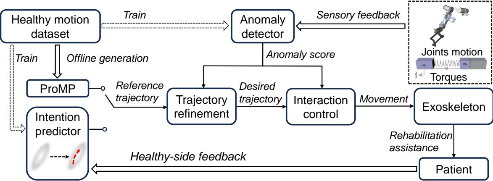  
Figure 5. 双模式训练工作流程。在主动镜像模式下，预测的运动意图作为参考轨迹。在被动跟随模式下，参考轨迹是通过将 ProMPs 拟合至来自健康个体的示教数据离线生成的。在两种模式下，总体目标都是提供尽可能个性化的助力。此外，来自健康个体的运动数据用于训练意图预测器和异常检测器，异常分数用于指导轨迹优化和阻抗参数的调整。

$$
\boldsymbol {u} = \boldsymbol {u} _ {f} + \boldsymbol {u} _ {s},\tag{3}
$$

其中 ${ \pmb u } _ { f }$ 是用于稳定由 (2) 定义的模型的快时间尺度控制项，u 是用于稳定由 (1) 定义的模型的慢时间尺度控制项。$\pmb { u } _ { f }$ 的典型形式表示如下：

$$
\boldsymbol {u} _ {f} = - \boldsymbol {S} _ {2} ^ {\top} \boldsymbol {K} _ {v} (\dot {\boldsymbol {\theta}} - \boldsymbol {S} _ {2} \dot {\boldsymbol {q}}),\tag{4}
$$

其中 $\pmb { K } _ { v } \in \Re ^ { 3 \times 3 }$ 为对角正定矩阵。将 (3) 和 (4) 代入 (2) 可得

$$
\boldsymbol {B} \ddot {\boldsymbol {\theta}} + \boldsymbol {K} (\boldsymbol {\theta} - \boldsymbol {S} _ {2} \boldsymbol {q}) + \boldsymbol {K} _ {v} (\dot {\boldsymbol {\theta}} - \boldsymbol {S} _ {2} \dot {\boldsymbol {q}}) = \boldsymbol {S} _ {2} \boldsymbol {u} _ {s},\tag{5}
$$

通过定义 $\tau _ { o } = K ( \theta -$ $S _ { 2 } \pmb { q } )$，可将其重写如下：

$$
\boldsymbol {B} \ddot {\boldsymbol {\tau}} _ {o} + \boldsymbol {K} _ {v} \dot {\boldsymbol {\tau}} _ {o} + \boldsymbol {K} \boldsymbol {\tau} _ {o} = \boldsymbol {S} _ {2} \boldsymbol {u} _ {s} - \boldsymbol {B} \boldsymbol {S} _ {2} \ddot {\boldsymbol {q}}.\tag{6}
$$

通过引入 $K = K _ { 1 } / \varepsilon ^ { 2 }$ 和 $K _ { v } = K _ { 2 } / \varepsilon$（其中 $\varepsilon$ 为一个微小的正参数），(6) 可以写为如下形式：

$$
\varepsilon^ {2} \boldsymbol {B} \ddot {\boldsymbol {\tau}} _ {o} + \varepsilon \boldsymbol {K} _ {2} \dot {\boldsymbol {\tau}} _ {o} + \boldsymbol {K} _ {1} \boldsymbol {\tau} _ {o} = \boldsymbol {K} _ {1} (\boldsymbol {S} _ {2} \boldsymbol {u} _ {s} - \boldsymbol {B} \boldsymbol {S} _ {2} \ddot {\boldsymbol {q}}).\tag{7}
$$

当 $\varepsilon = 0 ,$ 时，(7) 的解为 $\bar { \tau } _ { o } = S _ { 2 } u _ { s } - B S _ { 2 } \ddot { q } .$

若将快时间尺度设为 $\gamma = \frac { t } { \varepsilon }$，则 $\bar { \tau } _ { o }$ 在 $\gamma \to \infty$ 时达到。在 $\varepsilon = 0$ 时，$\bar { \tau } _ { o }$ 保持恒定。接下来，我们引入新变量 $\pmb { \eta } = \pmb { \tau } _ { o } - \bar { \pmb { \tau } } _ { o }$，在快时间尺度上将 (7) 重写如下：

$$
\boldsymbol {B} \left(\frac {\mathrm{d} ^ {2} \boldsymbol {\eta}}{\mathrm{d} \gamma^ {2}}\right) + \boldsymbol {K} _ {2} \left(\frac {\mathrm{d} \boldsymbol {\eta}}{\mathrm{d} \gamma}\right) + \boldsymbol {K} _ {1} \boldsymbol {\eta} = \mathbf {0},\tag{8}
$$

该式定义了边界层系统。

将 (8) 的解代入 (1)，可得到捕捉整个系统慢动态的准稳态系统。该动态可表示如下：

$$
(M (\boldsymbol {q}) + \bar {B}) \ddot {\boldsymbol {q}} + C (\dot {\boldsymbol {q}}, \boldsymbol {q}) \dot {\boldsymbol {q}} + \boldsymbol {g} (\boldsymbol {q}) = \boldsymbol {u} _ {s} + \boldsymbol {\tau} _ {e} + S _ {2} ^ {\top} \boldsymbol {\tau} _ {f},\tag{9}
$$

其中 $\bar { B } = S _ { \mathrm { 2 } } ^ { \mathrm { T } } B S _ { \mathrm { 2 } }$ 为投影电机转动惯量矩阵。

根据奇异摄动理论（singular perturbation theory），若边界层系统和准稳态系统均为指数稳定，则整个系统的稳定性得到保证。该系统的稳定性分析见附录。

由 (1) 和 (2) 描述的整体动力学模型是一个高阶系统，其中 (1) 表示刚性关节侧，(2) 表示柔顺执行器侧。对这样的系统进行稳定和控制绝非易事。

上肢外骨骼机器人需要通过紧密交互引导患者进行重复性运动，以帮助患者恢复运动功能。因此，控制上肢外骨骼机器人根据以下阻抗模型跟踪时变轨迹：

$$
\boldsymbol {M} _ {d} (\ddot {\boldsymbol {q}} - \ddot {\boldsymbol {q}} _ {d}) + \boldsymbol {C} _ {d} (\dot {\boldsymbol {q}} - \dot {\boldsymbol {q}} _ {d}) + \boldsymbol {K} _ {d} (\boldsymbol {q} - \boldsymbol {q} _ {d}) = \boldsymbol {\tau} _ {e},\tag{10}
$$

其中 $\mathbf { \Delta } q _ { d } \in \mathfrak { R } ^ { n }$ 为期望轨迹向量，$M _ { d } , C _ { d } , K _ { d } \in \Re ^ { n \times n }$ 分别为期望惯量矩阵、期望阻尼矩阵和期望刚度矩阵，它们均为对角正定矩阵。根据阻抗模型跟踪期望轨迹允许患者偏离该轨迹，从而提供一定程度的柔顺性以提高安全性。

所提出的双模式训练框架如图 Figure 5 所示。异常检测器和意图预测器均采用基于健康个体运动数据集训练的生成模型进行设计。这些模型旨在捕获患者健侧的运动意图，并评估当前人机交互的舒适度与自然度。个性化通过两种方法实现，即：利用异常分数引导符合动力学约束的期望轨迹的细化，以及利用 ProMPs（概率运动原语）将各种辅助轨迹整合为个性化的辅助分布。此外，通过根据异常分数调整阻抗参数来增强运动过程的安全性，从而确保安全且有效的康复环境。

## 在线轨迹细化

本节介绍了用于上肢外骨骼机器人的新型轨迹生成方法。该方法基于生成模型，可在线细化以适应患者，同时保持安全性和个性化特征，进而确保有效性。首先，在两种训练模式（即主动镜像模式和被动跟随模式）中，我们引入了一个通用的综合向量 $\pmb { x } _ { d } = [ \pmb { q } _ { d } ^ { \top } , \dot { \pmb { q } } _ { d } ^ { \top } ] ^ { \top }$，它封装了关节空间内的一系列离散化轨迹点，从而实现对轨迹的参数化。构建以下二次规划问题以描述该规划过程：

$$
\min _ {\boldsymbol {x} _ {d}, \boldsymbol {u} _ {d}, s} \sum_ {i = t} ^ {t + N _ {p}} \left[ \| \boldsymbol {q} _ {d} ^ {(i)} - \boldsymbol {q} _ {r} ^ {(i)} \| _ {\boldsymbol {Q}} ^ {2} + \| \boldsymbol {u} _ {d} ^ {(i)} \| _ {\boldsymbol {R}} ^ {2} + (s ^ {(i)}) ^ {2} \right],\tag{11}
$$

$$
\begin{array}{r l} {s. t.} & {\pmb {x} _ {d} ^ {(t + 1)} = \left[ \begin{array}{l l} \pmb {I} & \pmb {I} \Delta t \\ \pmb {0} & \pmb {I} \end{array} \right] \pmb {x} _ {d} ^ {(t)} + \left[ \begin{array}{l} \pmb {0} \\ \pmb {I} \Delta t \end{array} \right] \pmb {u} _ {d} ^ {(t)}} \\ & {s ^ {(t + 1)} = s ^ {(t)} + \left[ - (\frac {\partial f}{\partial \pmb {\tau} _ {e}}) ^ {\intercal} \pmb {K} _ {a} \Delta t \right] \pmb {x} _ {d} ^ {(t)}} \\ & {- (\frac {\partial f}{\partial \pmb {\tau} _ {e}}) ^ {\intercal} \pmb {C} _ {a} \pmb {u} _ {d} ^ {(t)} \Delta t} \\ & {\pmb {x} _ {d} \in \mathcal {X}, \pmb {u} _ {d} \in \mathcal {U}} \end{array}
$$

其中 $N _ { p }$ 为预测时域，$Q$ 和 $\pmb { R }$ 为对称正定权重矩阵，$\mathbf { \pmb { u } } _ { d }$ 为期望轨迹的加速度，$C _ { a }$ 和 ${ \pmb K } _ { a }$ 为后文定义的时变阻抗参数，$f ( \cdot )$ 为异常检测网络的函数表示。此外，上标表示时间步，X 和 $\mathcal { U }$ 分别为轨迹空间约束集合与加速度约束集合。因此，(11) 使得在两种训练模式中均可纳入各种约束和安全措施。

## 主动训练模式

在轻度运动障碍的情况下（例如中风早期所观察到的情况），患者在其健侧仍保留有功能的运动能力。因此，上肢外骨骼机器人必须准确估计患者健侧的运动意图，从而为患者的患侧提供镜像支持。这种镜像过程使患侧肢体能够模拟健侧肢体的运动，进而促进运动功能的恢复。

意图估计系统输入一系列 $N$ 个历史观测值，定义为 ${ \pmb o } _ { ( i ) } = \{ { \pmb q } _ { h ( i ) } ^ { ( t ) } \in \Re ^ { 5 } | t =$ $- N _ { o } , - N _ { o } + 1 , \cdots , 0 \} , \forall i \in \{ 1 , 2 , \cdots , N \}$，其中 $N _ { o }$ 是过去的时间步数，$\pmb { q } _ { h ( i ) } ^ { ( t ) }$ 是在时间步 t 时身体健侧的位置。系统还会生成运动意图的预测，表示为 $\pmb { p } _ { ( i ) } = \{ \pmb { q } _ { h ( i ) } ^ { ( t ) } \in \Re ^ { 5 } | t = 1 , 2 , \cdots , N _ { p } \}$。为了估计合理轨迹的潜在分布，我们引入了一种基于去噪扩散概率模型（denoising diffusion probabilistic models, DDPMs）（Ho et al. 2020）的概率预测器，因为 DDPMs 能够有效描述人类运动意图的不确定性本质。为了表述清晰，我们在接下来的小节中省略下标 (i)，并将过去和未来的轨迹分别记为 o 和 $^ { p , }$。

意图预测器：意图预测器的作用是生成未来轨迹的概率预测。因此，意图预测器接收一个初始的、模糊的预测轨迹 ${ \pmb p } _ { T }$，它表示未来轨迹 $\scriptstyle { p _ { 0 } }$ 经过 $T$ 步扩散后受噪声扰动的估计值，其中 $T$ 是预设的最大扩散步数。该预测器旨在推断逆向扩散过程，表示为序列 $( p _ { T } , { \pmb p } _ { T - 1 } , \cdots , { \pmb p } _ { 0 } )$。该序列在数学上构建为以高斯转移概率为特征的马尔可夫链，并通过减少初始不确定性来细化预测。此外，意图预测器结合了编码到上下文向量 c 中的历史观测，该向量通过参数化为 ϕ 的神经网络合成。该上下文向量为轨迹生成过程提供指导信息。意图预测器的原理如图 Figure 6 所示。在该框架下，上肢外骨骼机器人被赋予了基于初始含噪预测的简单采样来精确估计未来轨迹的能力。重要的是，未来轨迹代表患者的运动意图，而不是基于对患者健侧肢体的直接测量。因此，该方法生成了一条与患者原始运动模式紧密贴合的自我镜像轨迹，从而代表了一条个性化轨迹。

  
Figure 6. 意图预测器的整体结构：在训练阶段，历史轨迹 o 被编码为上下文向量 $^ { c , }$，该向量与未来轨迹 p 结合用于训练扩散模型。在推理阶段，仅使用上下文向量来引导去噪过程，以此预测未来轨迹。

与扩散过程和反向过程相关的后验分布如下给出：

$$
q (\pmb {p} _ {t} | \pmb {p} _ {t - 1}) = \mathcal {N} (\pmb {p} _ {t}; \sqrt {1 - \beta_ {t}} \pmb {p} _ {t - 1}, \beta_ {t} \pmb {I}),\tag{12}
$$

$$
q _ {\psi} (\boldsymbol {p} _ {t - 1} | \boldsymbol {p} _ {t}, \boldsymbol {c}) = \mathcal {N} (\boldsymbol {p} _ {t - 1}; \boldsymbol {\mu} _ {\psi} (\boldsymbol {p} _ {t}, \boldsymbol {c}), \tilde {\beta} _ {t} \boldsymbol {I}),\tag{13}
$$

其中 $\beta _ { 1 } , \beta _ { 2 } , \cdots , \beta _ { T }$ 是用于调节注入噪声的方差调度（variance schedule）。调整后的方差 $\tilde { \beta } _ { t }$ 定义为 $\begin{array} { r } { \tilde { \beta } _ { t } = \frac { 1 - \bar { \alpha } _ { t - 1 } } { 1 - \bar { \alpha } _ { t } } \beta _ { t } } \end{array}$，该公式是通过采用定义 $\alpha _ { t } = 1 - \beta _ { t }$ 和 $\begin{array} { r } { \bar { \alpha } _ { t } = \prod _ { i = 1 } ^ { t } \alpha _ { i } } \end{array}$ 推导得出的。

预测器的目标是最大化对数似然，表示为 $\mathbb { E } [ \log q _ { \psi } ( \pmb { p } _ { 0 } ) ]$。鉴于直接计算该指标是不可行的，因此采用变分下界作为训练损失的替代项：

$$
\begin{array}{l} \mathcal {L} _ {v l b} (\phi , \psi) = \sum_ {t = 2} ^ {T} D _ {K L} \left(q \left(\boldsymbol {p} _ {t - 1} \mid \boldsymbol {p} _ {t}\right) \| q _ {\psi} \left(\boldsymbol {p} _ {t - 1} \mid \boldsymbol {p} _ {t}, \boldsymbol {c}\right)\right) \\ - \log q _ {\psi} \left(\boldsymbol {p} _ {0} \mid \boldsymbol {p} _ {1}, \boldsymbol {c}\right), \end{array} \tag {（}\tag{14}
$$

其中 $D _ { K L } ( \cdot )$ 表示 Kullback–Leibler 散度函数（KL散度）。

在所提出的方法中，条件概率 $q ( \pmb { p } _ { t - 1 } | \pmb { p } _ { t } )$ 被重构为 $q ( \pmb { p } _ { t - 1 } | \pmb { p } _ { t } , \pmb { p } _ { 0 } )$。这一重构使得可以得出如下闭式表达式：

$$
q (\boldsymbol {p} _ {t - 1} | \boldsymbol {p} _ {t}, \boldsymbol {p} _ {0}) = \mathcal {N} (\boldsymbol {p} _ {t - 1}; \tilde {\boldsymbol {\mu}} _ {t} (\boldsymbol {p} _ {t}, \boldsymbol {p} _ {0}), \tilde {\beta} _ {t} \boldsymbol {I}).\tag{15}
$$

通过在扩散过程 (24) 中迭代使用参数化技巧，(15) 中的后验分布均值以及 (13) 中的反向过程可表述如下：

$$
\tilde {\pmb {\mu}} _ {t} (\pmb {p} _ {t}, \pmb {p} _ {0}) = \frac {1}{\sqrt {\alpha_ {t}}} (\pmb {p} _ {t} - \frac {\beta_ {t}}{\sqrt {1 - \bar {\alpha} _ {t}}} \pmb {\epsilon} _ {t}),\tag{16}
$$

$$
\boldsymbol {\mu} _ {\psi} (\boldsymbol {p} _ {t}, \boldsymbol {c}) = \frac {1}{\sqrt {\alpha_ {t}}} (\boldsymbol {p} _ {t} - \frac {\beta_ {t}}{\sqrt {1 - \bar {\alpha} _ {t}}} \boldsymbol {\epsilon} _ {\psi} (\boldsymbol {p} _ {t}, \boldsymbol {c})),\tag{17}
$$

其中 $\epsilon \sim \mathcal { N } ( 0 , I )$，且在主动镜像模式下应用的损失函数进一步简化如下：

$$
\mathcal {L} _ {a} (\phi , \psi) = \mathbb {E} _ {t, \pmb {p} _ {0}, \epsilon} [ \| \pmb {\epsilon} - \pmb {\epsilon} _ {\phi , \psi} (\pmb {p} _ {t}, \pmb {o}) \| ^ {2} ].\tag{18}
$$

一旦反向过程训练完成，即可利用预测器从初始噪声进行推断，从而采样出多条轨迹。为了简便和保守起见，假设每个关节的未来状态是以独立的方式进行预测的。因此，整个推理和统计过程概括如下公式：

$$
\hat {\boldsymbol {p}} _ {0}, \hat {\boldsymbol {\Sigma}} _ {p} = f _ {a} (\boldsymbol {o}),\tag{19}
$$

其中 $\hat { \pmb { p } } _ { 0 } = \{ \hat { \pmb q } _ { h } ^ { ( t ) } \in \Re ^ { 5 } | t = 1 , 2 , \cdots , N _ { p } \}$ 表示估计的运动意图，$\hat { \pmb { \Sigma } } _ { p } = \{ d i a g ( \hat { \pmb { \sigma } } _ { h } ^ { ( t ) } ) \in$ $\mathfrak { R } ^ { 5 \times 5 } | t = 1 , 2 , \cdot \cdot \cdot , N _ { p } \}$ 表示预测的标准差。

预先调整（Preemptive Tuning）：给定预测的未来轨迹分布，必须预先调整参考轨迹以确保其符合既定约束。具体而言，对于每个关节 $i$（以下标表示），可行轨迹必须满足以下概率不等式：

$$
\mathcal {P} (q _ {h i} ^ {(t)} \notin \mathcal {Q} _ {i}) <   \varepsilon ,\tag{20}
$$

其中 $\mathcal { Q } _ { i }$ 是预先定义的允许运动范围 $[ q _ { \mathrm { m i n } , i } , q _ { \mathrm { m a x } , i } ]$。规定 $\hat { q } _ { h i } ^ { ( 0 ) } = q _ { i }$，其中 $q _ { i }$ 是上肢外骨骼机器人关节 $i$ 的当前位置。根据 Cantelli 不等式（Cantelli’s inequality），预测分布具有以下特征：

$$
\mathcal {P} (q _ {h i} ^ {(t)} \geq \hat {q} _ {h i} ^ {(t)} + \delta_ {i} ^ {(t)}) \leq \frac {\hat {\sigma} _ {h i} ^ {(t)}}{\hat {\sigma} _ {h i} ^ {(t)} + (\delta_ {i} ^ {(t)}) ^ {2}},\tag{21}
$$

$$
\delta_ {i} ^ {(t)} = \min (\| \hat {q} _ {h i} ^ {(t - 1)} - q _ {\min, i} \|, \| q _ {\max, i} - \hat {q} _ {h i} ^ {(t - 1)} \|).\tag{22}
$$

Algorithm 1 参考轨迹的预先调整 (Preemptive Tuning for the Reference Trajectory)

给定：$\hat{p}_{0}, \hat{\Sigma}_{p}, q, \varepsilon$ $q_{r}^{(0)} = \text{Saturate}(\hat{q}_{h}^{(0)}, q_{\min}, q_{\max})$ 

for t = 1 to  $N_{p}$  do

    for i = 1 to 5 do

    $\delta_{i}^{(t)} = \min(\|\hat{q}_{hi}^{(t-1)} - q_{\min,i}\|, \|q_{\max,i} - \hat{q}_{hi}^{(t-1)}\|)$ 

    if  $\frac{\hat{\sigma}_{hi}^{(t)}}{\hat{\sigma}_{hi}^{(t)} + (\delta_{i}^{(t)})^{2}} \leq \varepsilon$  then

    $q_{ri}^{(t)} = \hat{q}_{hi}^{(t)}$ 

    else

    $q_{ri}^{(t)} = q_{ri}^{(t-1)}$ 

    end if

    end for

end for

输出：$q_{r}^{(0)}$ 至 $q_{r}^{(N_{p})}$

现在，我们引入以下用于预测的调节律：

$$
q _ {r i} ^ {(t)} = \left\{ \begin{array}{l l} \hat {q} _ {h i} ^ {(t)}, & \text { if } \frac {\hat {\sigma} _ {h i} ^ {(t)}}{\hat {\sigma} _ {h i} ^ {(t)} + (\delta_ {i} ^ {(t)}) ^ {2}} \leq \varepsilon , \\ q _ {r i} ^ {(t - 1)}, & \text { otherwise }. \end{array} \right.\tag{23}
$$

此处，${ q _ { r i } ^ { ( t ) } }$ 是时间步 t 处关节 i 的参考轨迹。当运动趋势处于设定的边界范围内时，它会更新为预测的运动意图 $\hat { q } _ { h i } ^ { ( t ) }$。然而，如果检测到潜在的越界风险，它将保持上一时间步的轨迹以防止超出极限。上述过程也在 Algorithm 1 中进行了详细说明。调整后的参考轨迹 $\pmb q _ { r }$ 提供了对身体健侧意图运动的精确估计，确保了安全性得到充分考虑。通过求解 (11)，能够为上肢外骨骼机器人生成一条不仅平滑且具有最小加速度特征的轨迹，同时还能确保未来期望轨迹的安全性。

## 被动训练模式

在严重运动功能障碍的情况下，上肢外骨骼机器人进行被动跟随训练。这种训练模式对于辅助患者跟随预定义轨迹至关重要。此外，为了促进康复，在按需辅助（assist-as-needed）的调节中实现辅助的个性化是极其关键的。被动跟随训练的工作流程如图 Figure 5 所示。在此模式下，采集健康受试者的上肢运动数据，以用于两个不同模块的训练。

异常检测器（Anomaly Detector）：为了实现个性化助力，需要一个实时准则来评估助力轨迹。我们使用异常检测器来量化穿戴舒适度以及康复效果。该异常检测器基于扩散模型（diffusion model）架构，并用于识别上肢运动中的不规则模式，如图 Figure 7 所示。随后，异常检测器计算出一个评分，用于量化当前人机交互与自然交互状态之间的偏差，从而指导个性化助力的实施。在该方法中，通过滑动窗口机制捕获的特定时间步 $i$ 处的传感反馈被输入到异常检测器中，表示为 $\mathbf { x } ^ { ( i ) } \in \Re ^ { L _ { s } N _ { c } }$，其中 $L _ { s }$ 是滑动窗口的宽度，$N _ { c }$ 是数据通道的数量。

  
Figure 7. 异常检测器示意图：透明矩形棱柱划定了可行工作空间，涵盖了上肢运动被归类为正常且安全时的范围。这些运动融合了位置、速度和交互力矩信息，整体以蓝色弯曲箭头描绘，并用 x 表示。

如前所述，异常检测器基于扩散模型，其中时长为 $T ^ { p }$ 的反向扩散过程被描绘为序列 $\left( { \bf x } _ { T ^ { p } } , { \bf x } _ { T ^ { p } - 1 } , \cdot \cdot \cdot , { \bf x } _ { 0 } \right)$。相关的扩散过程与反向扩散过程定义如下：

$$
q (\mathbf {x} _ {t} | \mathbf {x} _ {t - 1}) = \mathcal {N} (\mathbf {x} _ {t}; \sqrt {1 - \beta_ {t} ^ {p}} \mathbf {x} _ {t - 1}, \beta_ {t} ^ {p} \boldsymbol {I}),\tag{24}
$$

$$
q _ {\Psi} (\mathbf {x} _ {t - 1} | \mathbf {x} _ {t}) = \mathcal {N} (\mathbf {x} _ {t - 1}; \pmb {\mu} _ {\Psi} (\mathbf {x} _ {t}), \tilde {\beta} _ {t} ^ {p} \pmb {I}),\tag{25}
$$

其中 $\beta _ { 1 } ^ { p } , \beta _ { 2 } ^ { p } , \cdots , \beta _ { T \tau } ^ { p }$ 是用于调节该过程中注入噪声水平的方差计划表。调整后的方差 $\tilde { \beta } _ { t } ^ { p }$ 使用公式 $\tilde { \beta } _ { t } ^ { p } =$ $\frac { 1 - \bar { \alpha } _ { t - 1 } ^ { a } } { 1 - \bar { \alpha } _ { t } ^ { p } } \beta _ { t } ^ { p }$ 计算，并利用定义 $\alpha _ { t } ^ { p } = 1 - \beta _ { t } ^ { p }$ 以及 $\begin{array} { r } { \bar { \alpha } _ { t } ^ { p } = \prod _ { i = 1 } ^ { t } \alpha _ { i } ^ { p } } \end{array}$。

与意图预测器中概述的概念一致，在被动跟随模式下用于训练扩散模型的损失函数具体如下

$$
\mathcal {L} _ {p} (\Psi) = \mathbb {E} _ {t, \mathbf {x} _ {0}, \epsilon} [ \| \boldsymbol {\epsilon} - \boldsymbol {\epsilon} _ {\Psi} (\mathbf {x} _ {t}) \| ^ {2} ].\tag{26}
$$

一旦从包含上肢运动的数据集中有效学习了逆向过程，异常检测器便能熟练地从受污染的传感器数据中滤除噪声，以获得清晰的输出。这种能力有助于通过异常检测器生成精细化的传感输入。如算法 2（Algorithm 2）所述，该输入用于计算异常分数，其中 $\epsilon _ { p } , z _ { p } \sim \mathcal { N } ( 0 , I )$，且 $\nu \in [ 1 , T ^ { p } ]$ 为常数参数。为简明起见，计算异常分数的方法可由以下函数概括：

$$
s = f (\boldsymbol {q}, \dot {\boldsymbol {q}}, \boldsymbol {\theta}, \dot {\boldsymbol {\theta}}, \boldsymbol {\tau} _ {e}).\tag{27}
$$

该异常检测器集成了扩散模型，因此擅长通过分析传感器数据来捕获上肢运动固有的时空模式和随机运动趋势。因此，可以在人机交互过程中实时计算异常分数。这些分数可用作评估上肢外骨骼机器人所提供助力的舒适度与自然度的指标。

算法 2 异常检测 (Algorithm 2 Anomaly Detection)

Require: $q, \dot{q}, \theta, \dot{\theta}, \tau_e$

1: 初始化滑动窗口队列
2: for 每个新数据点 do
3: $\mathbf{x}_{now}^{(i)} \leftarrow (\boldsymbol{q}, \dot{\boldsymbol{q}}, \boldsymbol{\theta}, \dot{\boldsymbol{\theta}}, \tau_e)$
4: 将 $\mathbf{x}_{now}^{(i)}$ 入队到滑动窗口队列
5: if 滑动窗口队列已满 then
6: $\mathbf{x}_0 \leftarrow \text{GetWindowData}$
7: $\epsilon_p \leftarrow \text{Sample}$
8: $\hat{\mathbf{x}}_\nu \leftarrow \mathbf{x}_0 \sqrt{\bar{\alpha}_\nu^p} + \epsilon_p \sqrt{1 - \bar{\alpha}_\nu^p}$
9: for $t = \nu, \cdots, 1$ do
10: $z_p \leftarrow \text{Sample}()$
11: $\hat{\mathbf{x}}_{t-1} \leftarrow \frac{1}{\sqrt{\alpha_t^p}} (\hat{\mathbf{x}}_t - \frac{1 - \alpha_t^p}{\sqrt{1 - \bar{\alpha}_t^p}} \epsilon_\Psi (\hat{\mathbf{x}}_t)) + \tilde{\beta}_t^p z_p$
12: end for
13: $s \leftarrow ||\mathbf{x}_0 - \hat{\mathbf{x}}_0||^2$
14: Output: $s$
15: 从滑动窗口队列出队
16: end if
17: end for

参考轨迹生成：为了在被动跟随训练期间定制辅助，结合历史性上肢轨迹与如 (11) 所述的在线轨迹优化，以建立一个概率模型。在此背景下，采用 ProMPs（概率运动基元）将一组轨迹编码到概率框架中 (Paraschos et al. 2013)，该框架能够通过采样生成相似的参考轨迹。将 ProMPs 应用于轨迹采样特别适合分析被动跟随训练中遇到的重复性动作。这种适用性归因于该概率模型能有效容纳传感器噪声、人体不确定性以及个体偏差。

为了实现 ProMPs，我们通过权重向量 $\omega \in \Re ^ { \hat { D } n \times 1 }$ 1 来表示轨迹，其中 D 为基函数的数量，n 为主动关节的数量，使得

$$
\boldsymbol {y} _ {t} = \left[ \begin{array}{c c c} \boldsymbol {q} _ {1, t} ^ {\mathsf {T}} & \dots & \boldsymbol {q} _ {n, t} ^ {\mathsf {T}} \end{array} \right] ^ {\mathsf {T}} = \left[ \begin{array}{c} \boldsymbol {\Phi} _ {t} \\ \dot {\boldsymbol {\Phi}} _ {t} \end{array} \right] \boldsymbol {\omega} + \boldsymbol {\epsilon} _ {y},\tag{28}
$$

$$
\pmb {q} _ {i, t} = \left[ \begin{array}{l l} q _ {i, t} & \dot {q} _ {i, t} \end{array} \right] ^ {\mathsf {T}},\tag{29}
$$

$$
p (\boldsymbol {\tau} _ {y} | \boldsymbol {w}) = \prod_ {t} \mathcal {N} (\boldsymbol {y} _ {t} | \boldsymbol {\Phi} _ {t} \boldsymbol {\omega}, \boldsymbol {\Sigma} _ {y}),\tag{30}
$$

其中 $\pmb q _ { i , t } \in \Re ^ { 2 }$ 表示在时间步 $t$ 时第 $i$ 个关节的复合向量，$\epsilon _ { y } \sim \mathcal { N } ( \mathbf { 0 } , \Sigma _ { y } )$ 表示零均值独立同分布（i.i.d.）高斯噪声，$\tau _ { y }$ 是示教期间的轨迹，选取为高斯形式的 $\Phi _ { t } \in \mathfrak { R } ^ { n \times D n }$ 是时变基矩阵。

在假设 $\omega$ 服从正态分布 $\omega \sim \mathcal { N } ( \omega | \mu _ { \omega } ^ { ( k ) } , \Sigma _ { \omega } ^ { ( k ) } )$ 的前提下，时间步 $t$ 处的新轨迹可以建模如下：

$$
p (\boldsymbol {y} _ {t}; \boldsymbol {\mu} _ {\omega} ^ {(k)}, \boldsymbol {\Sigma} _ {\omega} ^ {(k)}) = \int \mathcal {N} (\boldsymbol {y} _ {t} | \boldsymbol {\Phi} _ {t} \boldsymbol {\omega}, \boldsymbol {\Sigma} _ {y}) \mathcal {N} (\boldsymbol {\omega} | \boldsymbol {\mu} _ {\omega} ^ {(k)}, \boldsymbol {\Sigma} _ {\omega} ^ {(k)}) d \boldsymbol {\omega}.\tag{31}
$$

因此，参考轨迹由下式给出：

$$
\boldsymbol {q} _ {r} (t) = [ q _ {i, t}, \dots , q _ {n, t}, ]\tag{32}
$$

为了便于生成个性化辅助，引入以下代价函数来评估所提供的参考轨迹的性能：

$$
\mathcal {S} (\boldsymbol {q} _ {r}) = \int_ {T _ {r}} \left\{\| \boldsymbol {q} _ {d} (\boldsymbol {q} _ {r}) - \boldsymbol {q} \| _ {\boldsymbol {Q}} ^ {2} + s ^ {2} \right\} d t,\tag{33}
$$

其中 $T _ { r }$ 表示助力的持续时间，而 $\mathbf { \pmb { q } } _ { d }$ 表示通过 (11) 在线优化得到的期望轨迹。

鉴于每条采样的轨迹都可以通过其代价来进行评估，因此可以为它们赋予一个信息论权重（information-theoretic weight），以反映全部 $k$ 条轨迹的性能（Williams et al. 2017）：

$$
w ^ {(i)} = \frac {1}{\eta_ {k}} \exp (- \frac {1}{\lambda_ {p}} \mathcal {S} (\boldsymbol {q} _ {r} ^ {(i)})),\tag{34}
$$

其中 $\pmb q _ { r } ^ { ( i ) }$ 是第 $i$ 次采样得到的参考轨迹，$\eta _ { k }$ 是归一化常数，$\lambda _ { p }$ 是一个较小的正常数。关于所采用权重设置的详细分析见附录（Appendix）。

考虑到轨迹的性能，参数 $\mu _ { \omega } ^ { \bar { ( k ) } }$ 和 $\bar { \Sigma } _ { \omega } ^ { ( k ) }$ 是从收集到的 $k$ 条轨迹中推导出来的，如下所示：

$$
\boldsymbol {\omega} ^ {(i)} = (\boldsymbol {\Phi} ^ {\mathsf {T}} \boldsymbol {\Phi}) ^ {- 1} \boldsymbol {\Phi} ^ {\mathsf {T}} \boldsymbol {Y} ^ {(i)},\tag{35}
$$

$$
\boldsymbol {\mu} _ {\omega} ^ {(k)} = \sum_ {i} w ^ {(i)} \boldsymbol {\omega} ^ {(i)},\tag{36}
$$

$$
\boldsymbol {\Sigma} _ {\omega} ^ {(k)} = \sum_ {i} w ^ {(i)} (\boldsymbol {\omega} ^ {(i)} - \boldsymbol {\mu} _ {\omega} ^ {(k)}) (\boldsymbol {\omega} ^ {(i)} - \boldsymbol {\mu} _ {\omega} ^ {(k)}) ^ {\mathsf {T}},\tag{37}
$$

其中 $\Phi \in \Re ^ { N _ { r } n \times D n }$ 是一个由块对角矩阵 $\Phi _ { t }$ 构成的矩阵，根据采样数量 $N _ { r }$ 进行垂直堆叠，而 $\pmb { Y } ^ { ( i ) } \in \dot { \Re ^ { N _ { r } n } }$ 对应于第 $i$ 条采集到的轨迹。该过程有助于概率模型的构建。

将调整后的轨迹集成到上肢外骨骼机器人中以辅助患者。随后，采集患者在训练过程中的实际运动，并用于迭代优化概率模型 (31)。具体而言，$\mu _ { \omega } ^ { ( k ) }  \mu _ { \omega } ^ { ( k + 1 ) }$ 且 $\Sigma _ { \omega } ^ { ( k ) } \gets$ $\Sigma _ { \omega } ^ { ( k + 1 ) }$，随后用于促进后续轨迹的规划，如 Algorithm 3 所示。$N _ { s }$ 是基于预先收集的示教进行自由探索的次数。助力的优化受异常得分控制，反映了先验的健康运动行为。该得分作为康复过程中运动舒适度和自然度的指标，确保轨迹调整能够从本质上提升助力质量。

通过由粗到精的方法确定最优助力分布。最初，基于预定义的示教建立样本分布，主要利用初始样本指导探索阶段。随后的迭代通过逐步缩小采样空间并利用先前探索的最优轨迹值来改进助力分布。

该概率模型聚焦于表现最佳的轨迹以提供最优助力，从而有效应对患者在任务过程中可能遇到的各种不确定性。融入患者的运动数据确保了后续轨迹变得越来越个性化，进而更好地符合患者的医疗需求。因此，该方法使上肢外骨骼机器人能够利用在线交互，达到增强交互安全性并提高被动跟随训练效果的双重目的。

算法 3 参考轨迹生成
输入： $Y^{(k+1)}$ 
1: if  $k \leq N_{s}$  then
2: 利用预先收集的数据初始化  $\boldsymbol{\mu}_{\omega}^{(k+1)}, \Sigma_{\omega}^{(k+1)}$ 。
3: else
4: 利用式 (33) 计算代价  $\mathcal{S}(\boldsymbol{q}_{r}^{(k+1)})$ 
5: for all 收集到的  $k + 1$  条轨迹 do
6: 利用式 (34) 和式 (35) 计算代价  $w^{(i)}, \omega^{(i)}$ 
7: end for
8: 利用式 (36) 和式 (37) 计算分布  $\mathcal{N}(\boldsymbol{\omega}|\boldsymbol{\mu}_{\omega}^{(k+1)}, \Sigma_{\omega}^{(k+1)})$ 
9: end if
10:  $\omega \leftarrow \text{Sample}(\mathcal{N}(\boldsymbol{\omega}|\boldsymbol{\mu}_{\omega}^{(k+1)}, \Sigma_{\omega}^{(k+1)}))$ 
11:  $\boldsymbol{q}_{r}(t) \leftarrow \Phi_{t}\boldsymbol{\omega}$

## 交互控制

肩关节以下的关节采用钢丝驱动，这降低了与运动相关的惯性，从而提高了舒适度。鉴于这些关节的存在，存在较大的摩擦力，这会阻碍关节的运动，因此应当进行充分的补偿。

为此，上肢外骨骼机器人首先在没有患者参与的情况下进行运动，此时 $\pmb { \tau } _ { e } = \mathbf { 0 } .$。此外，扰动转矩可以参数化表示如下 (De Wit et al. 1995)：

$$
\begin{array}{l} \boldsymbol {\tau} _ {f} = (\boldsymbol {a} _ {f} + \boldsymbol {b} _ {f} \odot e ^ {- \boldsymbol {c} _ {f} \odot \dot {\boldsymbol {q}}} + \boldsymbol {d} _ {f} \odot \dot {\boldsymbol {q}}) \odot s g n (\dot {\boldsymbol {q}}) \\ \approx (\bar {\boldsymbol {a}} _ {f} + \bar {\boldsymbol {b}} _ {f} \odot \dot {\boldsymbol {q}} + \bar {\boldsymbol {c}} _ {f} \odot \dot {\boldsymbol {q}} \odot \dot {\boldsymbol {q}}) \odot s g n (\dot {\boldsymbol {q}}) = \boldsymbol {Y} (\dot {\boldsymbol {q}}) \boldsymbol {\zeta}, \end{array}\tag{38}
$$

其中 $ { \boldsymbol { a } } _ { f } ,  { \boldsymbol { b } } _ { f } ,  { \boldsymbol { c } } _ { f } , d _ { f }$ 为未知参数，$\bar { \mathbf { a } } _ { f } , \bar { \mathbf { b } } _ { f } , \bar { \mathbf { c } } _ { f }$ 源自泰勒展开（Taylor expansion），用作模型的简化，⊙ 表示克罗内克积（Kronecker product），sgn(·) 表示符号函数，$\mathbf { \boldsymbol { Y } } ( \cdot )$ 表示回归矩阵，$\zeta$ 表示模型参数矢量。式 (38) 中给出的近似是合理的，因为在给定的康复过程中，上肢外骨骼机器人的关节速度保持在相当低的水平。

由于上肢外骨骼机器人的所有主动关节均配有力传感器，因此在无患者的情况下可以直接测量并记录摩擦力。结合记录的关节速度，通过多项式拟合学习摩擦模型的参数。估计的摩擦力表示如下：

$$
\hat {\boldsymbol {\tau}} _ {f} = \boldsymbol {Y} (\dot {\boldsymbol {q}}) \hat {\boldsymbol {\zeta}}.\tag{39}
$$

一旦估计出摩擦力，便提出了一种变阻抗模型。该模型必须能够识别人机交互状态并解决康复过程中的冲突。这些能力使得该模型能够调节上肢外骨骼机器人的动作。

为了调节阻抗模型，引入了一个权重函数 (Zhang et al. 2023) 来考虑异常得分。该函数在数学上定义如下：

$$
w (s) = \lambda_ {1} \tanh (- \frac {s}{\chi_ {1}} + \chi_ {2}) + \lambda_ {2},\tag{40}
$$

其中 $\lambda _ { 1 }$ 和 $\lambda _ { 2 }$ 分别是决定权重函数范围和中位数的正常数，$\chi _ { 1 }$ 是将异常得分归一化到指定小范围内的常数，$\chi _ { 2 }$ 是权重函数沿正水平轴偏离坐标原点的偏移量。基于该函数，期望的阻抗模型被重新定义如下：

$$
\boldsymbol {C} _ {d} (\dot {\boldsymbol {q}} - \dot {\boldsymbol {q}} _ {d}) + \boldsymbol {K} _ {d} (\boldsymbol {q} - \boldsymbol {q} _ {d}) = \frac {1}{w (s)} \boldsymbol {\tau} _ {e}.\tag{41}
$$

将式 (41) 的两边乘以 $w ( s )$ 可得

$$
\boldsymbol {C} _ {a} (t) (\dot {\boldsymbol {q}} - \dot {\boldsymbol {q}} _ {d}) + \boldsymbol {K} _ {a} (t) (\boldsymbol {q} - \boldsymbol {q} _ {d}) = \boldsymbol {\tau} _ {e},\tag{42}
$$

其中 $C _ { a } ( t ) \overset { \triangle } { = } w ( s ) C _ { d }$ 和 $K _ { a } ( t ) \triangleq w ( s ) K _ { d } .$ 为时变表观阻抗参数。如 (11) 所述，这些参数用于推导期望轨迹与交互力矩之间的关系。该机制的作用在于：异常分数的增加会导致 $w ( s )$ 减小，从而降低阻抗参数的幅值。这种降低确保了上肢外骨骼机器人在响应任何检测到的冲突时增加其顺应性（被动性）。相反，当异常分数较低时，阻抗参数恢复到其原始值，从而保持上肢外骨骼机器人提供的助力水平。

随后，引入阻抗向量如下：

$$
\begin{array}{l} \boldsymbol {z} = \dot {\boldsymbol {q}} - \dot {\boldsymbol {q}} _ {r} \\ \quad = \dot {\boldsymbol {q}} - \dot {\boldsymbol {q}} _ {d} + \boldsymbol {C} _ {d} ^ {- 1} \boldsymbol {K} _ {d} (\boldsymbol {q} - \boldsymbol {q} _ {d}) - \frac {1}{w (s)} \boldsymbol {C} _ {d} ^ {- 1} \boldsymbol {\tau} _ {e}, \end{array}\tag{43}
$$

其中

$$
\dot {\pmb {q}} _ {r} = \dot {\pmb {q}} _ {d} - \pmb {C} _ {d} ^ {- 1} \pmb {K} _ {d} (\pmb {q} - \pmb {q} _ {d}) + \frac {1}{w (s)} \pmb {C} _ {d} ^ {- 1} \pmb {\tau} _ {e}\tag{44}
$$

为参考向量。根据 (43)，$z  0$ 的收敛意味着期望阻抗模型 (41) 的实现。

总控制输入如 (3) 中所定义进行设计，其中快时间尺度控制项如 (4) 中所定义。接下来，通过使用估计的摩擦力 $\hat { \tau } _ { f }$ 来建立慢时间尺度控制项，以稳定 (9) 中表达的动力学并实现期望的阻抗模型，具体如下：

$$
\begin{array}{r l} \boldsymbol {u} _ {s} = - \boldsymbol {K} _ {z} \boldsymbol {z} - \boldsymbol {S} _ {2} ^ {\top} \hat {\boldsymbol {\tau}} _ {f} - \boldsymbol {\tau} _ {e} - k _ {g} \cdot \boldsymbol {s g n} (\boldsymbol {z}) \\ & + (M (\boldsymbol {q}) + \bar {B}) \ddot {\boldsymbol {q}} _ {r} + C (\dot {\boldsymbol {q}}, \boldsymbol {q}) \dot {\boldsymbol {q}} _ {r} + g (\boldsymbol {q}), \end{array}\tag{45}
$$

其中 $s g n ( \cdot )$ 为符号函数，定义如下：

$$
\operatorname{sgn} (z) = \left\{ \begin{array}{l l} 1, & z > 0 \\ 0, & z = 0 \\ - 1, & z <   0 \end{array} \right.\tag{46}
$$

其中 $k _ { g }$ 为正常数，$\pmb { K } _ { z } \in \Re ^ { n \times n }$ 为对角正定矩阵。

如附录中提供的稳定性分析所示，在 (3)、(4) 和 (45) 中描述的所提出的变阻抗控制器可被证明是指数稳定的。

## 实验

所提出的双模式轨迹细化方法在上肢外骨骼机器人中得以实现，以评估两种康复模式的有效性。图 8 展示了实验配置，其中主控板控制上肢外骨骼机器人的阻抗。该主控板通过串口连接与一台配备了 Intel i5-13490F CPU 和 RTX 4060Ti 显卡的 PC 进行通信。PC 运行异常检测模块，计算参考轨迹 $\mathbf { \delta q } _ { r } ,$ ，并在导（在线）动态更新期望轨迹 $\mathbf { q } _ { d }$。受试者在被动跟随模式或主动镜像模式下进行康复训练。在后一种模式中，受试者在身体健侧佩戴带有标记点（markers）的支具，以辅助参与康复训练。使用光学动作捕捉设备（Nokov）来精确捕获运动意图。

  
Figure 8. 主动镜像模式下的实验装置使用动作捕捉设备获取身体健侧的反馈。SEA（串联弹性执行器）通过弹簧和线缆连接电机输出端与关节端构成。

可变阻抗控制器的实现需要动力学模型的先验知识。因此，动力学参数使用开源 Orocos Kinematics and Dynamics

Library\* 进行实时解析计算。在本次计算中，上肢外骨骼机器人被解构为一系列连杆和关节，以建立定义其物理构型的模型，涵盖每个连杆的长度、质量和惯性等特性。随后，基于该模型使用牛顿-欧拉方程（Newton–Euler equations）推导出正向动力学。

意图预测器和异常检测模块需要运动数据，这些数据是在健康受试者操作上肢外骨骼机器人期间采集的。为了促进自由且自然的运动，在数据采集阶段将上肢外骨骼机器人设置为在透明模式下运行（Chen et al. 2023a）。具体而言，控制器设计如下（Zimmermann et al. 2020）：

$$
\boldsymbol {u} _ {0} = (M (\boldsymbol {q}) + \bar {\boldsymbol {B}}) \ddot {\boldsymbol {q}} _ {0} + C (\dot {\boldsymbol {q}}, \boldsymbol {q}) \dot {\boldsymbol {q}}
$$

$$
+ \pmb {g} (\pmb {q}) - \pmb {S} _ {2} ^ {\top} \hat {\pmb {\tau}} _ {f} - \pmb {\tau} _ {e} + \pmb {u} _ {f},\tag{47}
$$

$$
\ddot {\pmb {q}} _ {0} = \frac {1}{\gamma_ {0}} (\pmb {M} (\pmb {q}) + \bar {\pmb {B}}) ^ {- 1} \pmb {\tau} _ {e},\tag{48}
$$

其中 $\gamma _ { 0 }$ 表示控制虚拟质量大小的参数，$\ddot { \pmb q } _ { 0 }$ 表示期望加速度。在这种透明模式下，健康受试者或患者能够轻松操纵上肢外骨骼机器人，且不会感到明显不适。

下一节展示了五项实验的结果，具体描述如下。

\- 意图预测器（Intention Predictor）：本实验旨在验证所提出的意图预测器的有效性和准确性。使用采集的数据训练了多种意图预测方法，随后进行了对比分析，以展示所提出的意图预测器的优越性。

\- 异常检测（Anomaly Detection）：本实验旨在评估异常检测网络的性能。在各种模拟异常场景中验证了其检测准确性，包括超出正常范围的运动、中风引起的抽搐以及人机交互冲突。此外，还进行了对比研究，以说明所提出的基于扩散模型的异常检测器在检测准确性上显著优于其他异常检测方法。

\- 交互控制（Interaction Control）：本实验旨在评估系统的动态能力及其抗扰动能力。为此执行了一项轨迹跟踪任务。此外，还在包含异常的场景中验证了所提出的可变阻抗控制器的有效性。

\- 主动镜像训练（Active Mirroring Training）：本实验旨在评估在线轨迹修正的有效性。为此进行了消融实验。此外，还研究了异常得分如何影响该修正过程生成的轨迹。进而，实现了一种主动镜像模式，并使用动作捕捉系统验证了所提出的方法能够有效约束辅助轨迹并在整个康复过程中保证安全性。

\- 被动跟随训练（Passive Following Training）：本实验旨在验证被动跟随训练对康复效果的促进作用。进行了一项消融实验，以证明在线轨迹修正在整个训练过程中显著提升了运动自然度和任务表现。此外，对中风患者进行了临床试验，以获取该康复框架显著有助于运动功能恢复的证据。

## 结果

招募了两名先前没有上肢外骨骼机器人使用经验的健全受试者进行运动数据采集。Table 3 展示了数据采集过程中上肢外骨骼机器人的运动范围。该运动范围覆盖了上肢日常活动的主要空间区域。

Table 3. 关节运动范围

<table><tr><td>关节</td><td>1</td><td>2</td><td>3</td><td>4</td><td>5</td></tr><tr><td>最小值(°)</td><td>-90</td><td>-45</td><td>-30</td><td>-5</td><td>-30</td></tr><tr><td>最大值(°)</td><td>30</td><td>115</td><td>30</td><td>120</td><td>30</td></tr></table>

表 4 概括了受试者的统计属性。在实验阶段之前，受试者签署了书面知情同意书。随后，受试者进行了时长 6 分钟的预训练阶段，以熟悉佩戴上肢外骨骼机器人时的运动。在数据采集阶段，未施加任何特定的运动指导。因此，受试者被允许以其偏好的速度（即快速或慢速）移动上肢外骨骼机器人，或者保持静止状态。采集到的数据被整理成一个数据集，用于训练意图预测器和异常检测模块。

Table 4. 受试者的统计信息

<table><tr><td>受试者</td><td>性别</td><td>年龄(y)</td><td>体重(kg)</td><td>身高(cm)</td></tr><tr><td>1</td><td>男</td><td>30</td><td>87</td><td>181</td></tr><tr><td>2</td><td>男</td><td>24</td><td>70</td><td>172</td></tr></table>

## 意图预测器

为了实现对人体运动意图的实时估计，利用采集到的运动数据来训练意图预测器。为了提高训练模型的泛化能力，我们在训练过程中将采集到的运动数据按 8:2:1 的比例划分为训练集、测试集和验证集。我们采用 Trajectron++ (Salzmann et al. 2020) 作为提取轨迹特征的主干网络，并选择 Transformer 架构来管理扩散过程。意图预测器的参数设置如下：$N _ { o } = 5 , N _ { p } = 7 .$，以及 $T =$

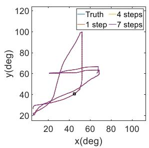

  
(a)

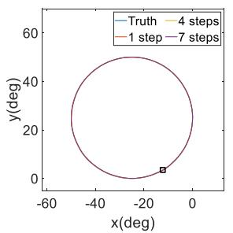

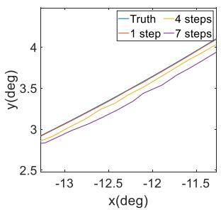  
(c)

(b)  

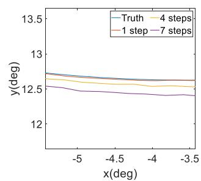  
(d)  
Figure 9. 四种不同任务中各步长的预测轨迹。(a) 自由移动；(b) 正弦；(c) 圆形；以及 (d) 双纽线任务。

100. 去噪扩散隐式模型（Denoising Diffusion Implicit Models, DDIMs）（Song et al. 2020）被应用于推理过程中。意图预测依赖于历史观测数据，且预测的轨迹长度相当短。因此，我们选择了前向积分以及先前在估计机器人关节行为方面展现出优异性能的基于卷积神经网络–长短期记忆（CNN-LSTM）的神经网络（Kim and Cho 2019）作为实验的基准线（baselines）。

Table 5. 不同方法的预测结果

<table><tr><td>方法</td><td>FDE(°)</td><td>ADE(°)</td><td>MAE(°)</td><td>RMSE(°)</td></tr><tr><td>Forward-int.</td><td>0.171</td><td>0.102</td><td>0.055</td><td>0.066</td></tr><tr><td>CNN-LSTM</td><td>0.165 ↑</td><td>0.099 ↑</td><td>0.056 ↓</td><td>0.067 ↓</td></tr><tr><td>Ours</td><td>0.096 ↑</td><td>0.061 ↑</td><td>0.033 ↑</td><td>0.040 ↑</td></tr></table>

此外，我们采用最终位移误差（Final Displacement Error, FDE）、平均位移误差（Average Displacement Error, ADE）、平均绝对误差（Mean Absolute Error, MAE）和均方根误差（Root-Mean-Square Error, RMSE）作为衡量预测精度的评估指标。FDE 和 ADE 是在由关节 2（Joint 2）和关节 4（Joint 4）构成的二维平面上计算的，这两个关节具有最大的运动范围且运动最为频繁。MAE 和 RMSE 则是对所有主动关节取平均值。验证集的预测结果如 Table 5 所示。这些结果表明，在所考虑的实时意图预测任务中，基于 CNN-LSTM 网络的方法的轨迹预测性能与前向积分方法相当。然而，我们基于扩散模型的意图预测器显著优于前向积分方法。具体而言，与前向积分方法相比，我们的意图预测器的 FDE 降低了 43.9%，ADE 降低了 40.2%，MAE 降低了 40.0%，RMSE 降低了 39.4%。

我们进行了对比分析，以验证我们的意图预测器在四项任务中不同运动条件下的适用性。其中两项任务基于参与者佩戴上肢外骨骼机器人时采集的运动数据，包括与训练数据相似的自由运动数据以及摆臂正弦运动数据。另外两项任务基于模拟的平滑轨迹，即圆形和双纽线（lemniscate）轨迹。并非所有测试轨迹都包含在训练阶段使用的预采集数据集中。Table 6 报告了意图预测器在这四项任务中的性能（对五个主动关节取平均值）。可以看出，我们的意图预测器在所有指标上均展现出最佳性能。

Figure 9 展示了轨迹预测第 1、4 和 7 步的轨迹以及实际参考轨迹。为清晰起见，我们将实验结果展示在以关节 2 为 x 轴、关节 4 为 y 轴的二维平面中。此外，每个子图的右侧显示了黑框内轨迹预测细节的放大视图。可以看出，第 1 步的轨迹预测与实际轨迹高度吻合，而第 4 步和第 7 步的轨迹预测与真实轨迹略有偏差。这些结果表明，随着预测步数的增加，预测精度略有下降，相应的预测方差增大。抢占式整定算法（preemptive tuning algorithm）中明确考虑了这一趋势。总体而言，上述结果证实了我们的意图预测器通过基于历史观测捕获轨迹的动态趋势，能够可靠地预测上肢关节运动以及某些规律性运动。自由运动（free move）任务模拟了现实生活场景，与实际应用中的人体运动直接相关。相比之下，正弦（sinusoidal）、圆形（circular）和双纽线（lemniscate）任务旨在测试我们的意图预测器在康复训练以外场景中的泛化性能。

Table 6. 不同任务的预测结果

<table><tr><td>任务</td><td>方法</td><td>FDE(°)</td><td>ADE(°)</td><td>MAE(°)</td><td>RMSE(°)</td></tr><tr><td rowspan="3">自由运动 (Free move)</td><td>前向积分 (Forward integration)</td><td>0.209</td><td>0.125</td><td>0.076</td><td>0.090</td></tr><tr><td>CNN-LSTM</td><td>0.163</td><td>0.098</td><td>0.060</td><td>0.073</td></tr><tr><td>Ours（本文方法）</td><td>0.111 (46.9 % ↑)</td><td>0.071 (43.2 % ↑)</td><td>0.042 (44.7 % ↑)</td><td>0.052 (42.2 % ↑)</td></tr><tr><td rowspan="3">正弦 (Sinusoidal)</td><td>前向积分 (Forward integration)</td><td>0.731</td><td>0.379</td><td>0.243</td><td>0.297</td></tr><tr><td>CNN-LSTM</td><td>0.739</td><td>0.387</td><td>0.248</td><td>0.302</td></tr><tr><td>Ours（本文方法）</td><td>0.616 (15.7 % ↑)</td><td>0.331 (12.7 % ↑)</td><td>0.212 (12.8 % ↑)</td><td>0.258 (13.2 % ↑)</td></tr><tr><td rowspan="3">圆形 (Circular)</td><td>前向积分 (Forward integration)</td><td>0.078</td><td>0.037</td><td>0.024</td><td>0.029</td></tr><tr><td>CNN-LSTM</td><td>0.101</td><td>0.054</td><td>0.031</td><td>0.038</td></tr><tr><td>Ours（本文方法）</td><td>0.066 (15.4 % ↑)</td><td>0.029 (21.6 % ↑)</td><td>0.018 (25.0 % ↑)</td><td>0.024 (17.2 % ↑)</td></tr><tr><td rowspan="3">双纽线 (Lemniscate)</td><td>前向积分 (Forward integration)</td><td>0.111</td><td>0.049</td><td>0.032</td><td>0.041</td></tr><tr><td>CNN-LSTM</td><td>0.095</td><td>0.045</td><td>0.028</td><td>0.036</td></tr><tr><td>Ours（本文方法）</td><td>0.086 (22.5 % ↑)</td><td>0.035 (28.6 % ↑)</td><td>0.022 (31.3 % ↑)</td><td>0.029 (29.3 % ↑)</td></tr></table>

## 异常检测

收集的包含交互信息的运动数据被整合用于训练我们的异常检测器，该检测器实时运行以评估运动的安全性与自然度。因此，这些数据作为安全且自然的交互反馈库，使异常检测器能够识别其潜在关系，进而识别人机交互过程中的异常交互。参数为 $L _ { s } = 1 0 0$ 和 $N _ { c } = 2 1$ ，分别表示关节和电机运动数据的历史长度以及交互力矩。扩散模型在训练和推理阶段的参数均为 Tp = 100 和 ν = 60。在推理阶段还采用了 DDIMs。

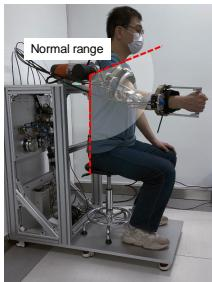  
(a)

  
(b)

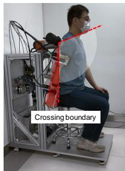  
(c)

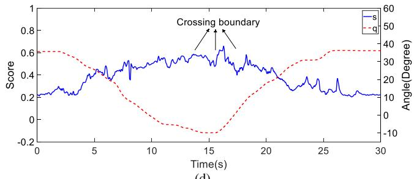  
(d)  
Figure 10. (a)–(c) 过度运动导致异常的快照；(d) 过度运动期间的异常得分和关节位置。白色扇区表示活动正常的区域，而红色扇区表示活动异常的区域。

在实验过程中，要求一名参与者穿戴上肢外骨骼机器人进行运动，以模拟各种异常情况。考虑了三种异常场景：过度运动场景（涉及超出正常范围的关节运动）、平衡偏差场景（涉及偏离相对平衡位置）以及模拟中风震颤场景。在过度运动场景中，参与者最初将上肢外骨骼机器人维持在正常运动范围内，随后放下手臂以模拟异常。随着手臂逐渐放下，肩关节角度减小并逐渐跨越运动边界，因此异常程度逐渐增加。随后，手臂被抬起恢复至正常运动范围。结果如图 10 所示，表明随着关节位置逐渐接近并越过边界，异常得分增加。这些结果表明，我们的异常检测器能够有效检测出偏离正常运动范围（即所采集数据的运动范围）的偏差。

在模拟中风震颤场景中，参与者最初将上肢外骨骼机器人保持在静息阶段。随后，参与者晃动上肢外骨骼机器人的整个手臂以模拟震颤。相应的异常得分和关节位置如图 11 所示。显而易见的是，在模拟中风震颤期间，异常得分总体上升，并且在震颤持续期间，该得分一直保持在较高水平。

在平衡偏差场景中，参与者最初将上肢外骨骼机器人保持在静态平衡位置，该位置代表上肢外骨骼机器人提供助力时的平衡状态。随后，指导参与者向上和向下操纵上肢外骨骼机器人，以模拟助力过程中的不对齐情况。结果如图 Figure 12 所示，并表明无论偏差方向如何（即无论患者的运动轨迹是高于还是低于预定轨迹），每当发生偏差时，异常分数都会显著增加。分数的这种增加表明上述异常已被检测到。

  
(a)

  
(b)

  
(c)

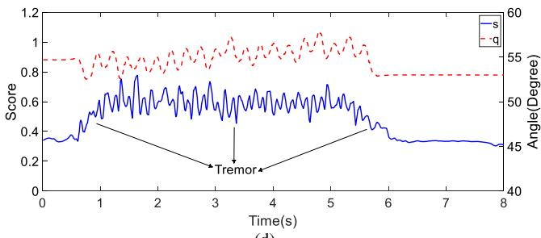  
(d)

Figure 11. (a)–(c) 模拟中风震颤引起的冲突快照；(d) 模拟中风震颤期间的异常分数和关节位置  
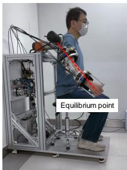  
(a)

  
(b)

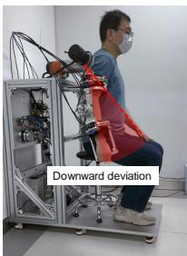  
(c)

  
(d)  
Figure 12. (a)–(c) 平衡偏差引起的冲突快照；(d) 平衡偏差期间的异常分数和关节位置。红色扇区代表发生异常的区域。

Table 7. 两种异常检测方法的 AUC 比较

<table><tr><td>方法</td><td>VAE</td><td>Ours</td></tr><tr><td>AUC</td><td>0.865</td><td>0.999</td></tr></table>

以基于 VAE 的异常检测器（Zhang et al. 2023）作为基线，对我们提出的异常检测器的性能进行了实验评估。具体而言，使用受试者工作特征（ROC）曲线评估了在中风震颤场景下的检测性能，该曲线说明了分类模型区分不同类别的能力。所考量模型的 ROC 曲线下面积如 Table 7 所示，计算得出的异常分数如图 Figure 13 所示。

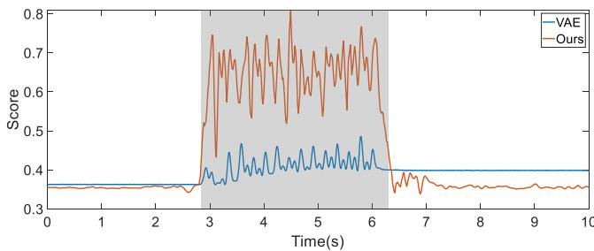  
Figure 13. 两种不同异常检测方法的异常分数曲线，阴影区域表示发生异常的区域。

13. 从图中可以看出，当异常发生时，所提出异常检测器生成的分数显著增加。此外，基于 VAE 的异常检测器生成的分数在异常停止后未能恢复到正常水平。这些结果表明，得益于扩散模型（diffusion model）优越的生成性能，与基于 VAE 的异常检测器相比，我们的异常检测器在对不同关节构型下的异常进行分类时具有更强的自适应性。

## 交互控制

在康复训练过程中，上肢外骨骼机器人需要在考虑摩擦补偿的情况下，按照期望的阻抗模型调节人机交互。为此，在无受试者参与的情况下操作上肢外骨骼机器人缓慢运动，并对摩擦力进行了量化。即计算了电机输出端电位计读数与关节末端扭矩传感器测量值之间的差值。此外，还记录了关节速度。随后，基于简化摩擦模型 (38) 进行多项式拟合，得到了 Table 8 中给出的摩擦参数估计值。

Table 8. 估计的摩擦模型

<table><tr><td></td><td> $\bar{a}_f$ </td><td> $\bar{b}_f$ </td><td> $\bar{c}_f$ </td></tr><tr><td>关节 3</td><td>0.822</td><td>-2.132</td><td>0.557</td></tr><tr><td>关节 4</td><td>1.718</td><td>11.441</td><td>-3.028</td></tr><tr><td>关节 5</td><td>0.636</td><td>-1.212</td><td>1.005</td></tr></table>

接下来，我们在无患者参与的情况下，将阻抗控制器应用于上肢外骨骼机器人中，以跟踪包含所有主动关节的预定义正弦轨迹。该实验旨在验证摩擦补偿的准确性并评估控制器的动态性能。阻抗参数设置如下：$C _ { d } = 1 0 I _ { 5 } , K _ { d } = 5 0 I _ { 5 }$，其中 $I _ { 5 }$ 为 5 × 5 单位矩阵。加权函数的参数设置如下：$\lambda _ { 1 } = 0 . 5 , \chi _ { 1 } = 0 . 0 4 , \chi _ { 2 } =$ 8.75 以及 $\lambda _ { 2 } = 1 . 5$。控制参数设置如下：$K _ { v } = 1 . 1 I _ { 3 }$ 以及 $\pmb { K } _ { z } = d i a g ( 1 . 5 , 0 . 6 , 0 . 7 , 4 , 1 . 8 )$。实验结果表明，阻抗控制器有效地补偿了摩擦力，使上肢外骨骼机器人能够准确跟踪期望轨迹，如 Figure 14 所示。具体而言，在该轨迹跟踪任务中，各关节的 RMSE 分别为：关节 1 为 $0 . 6 1 3 ^ { \circ }$，关节 2 为 $0 . 7 2 8 ^ { \circ }$，关节 3 为 $0 . 9 9 7 ^ { \circ }$，关节 4 为 2.143◦，关节 5 为 $0 . 9 4 8 ^ { \circ }$。

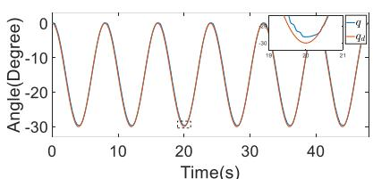  
(a)

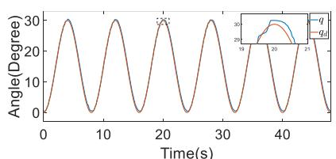  
(b)

  
(d)

(c)  
  
(e)  
Figure 14. (a)-(e) 外骨骼关节 1 至关节 5 的轨迹跟踪性能。

  
(a)

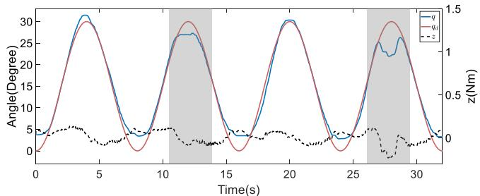  
(b)

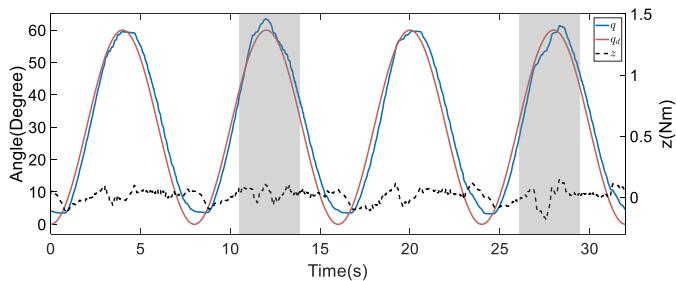  
(c)  
Figure 15. (a)–(c) 患者参与情况下上肢外骨骼机器人关节 1、关节 2 和关节 4 的可变阻抗控制器性能。阴影区域表示发生异常的时间段。

此外，我们评估了阻抗控制器在发生异常情况下的性能。这是通过让上肢外骨骼机器人引导患者进行轨迹跟踪，同时患者在模拟异常的姿势下握持上肢外骨骼机器人来实现的。该实验的结果如图 15 所示。可以看出，在整个实验过程中，阻抗向量始终保持接近于零，这表明尽管有人体参与且发生了异常，所期望的可变阻抗模型仍得到了有效维持。

  
(a)

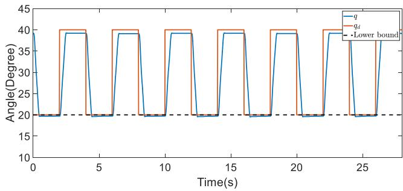  
(b)  
Figure 16. 应对关节 2 突发外部冲击的能力测试：(a) 无在线轨迹优化；(b) 有在线轨迹优化

## 主动镜像训练

在主动镜像训练中，上肢外骨骼机器人的运动与患者健侧身体的运动意图保持一致（如图 8 所示）。此外，在线轨迹优化被用于平滑运动指令，并通过动态约束提高安全性。实验的详细信息如下。

\- 为了评估所提出方法应对突发外部冲击的能力，我们在上肢外骨骼机器人肩部的关节 2 上进行了实验。

\- 我们在实验过程中通过突然改变期望位置来模拟突发的外部扰动。

\- 为了表示在线轨迹优化的下限约束，我们将位置指令的下限设为 $2 0 ^ { \circ }$，从而模拟了超出可接受运动范围的趋势。

- 在对比试验中，我们通过停用健侧的位置反馈，消除了由身体健侧反馈引起的运动指令不一致问题。因此，我们转而依靠上肢外骨骼机器人的本体感觉传感器（具体而言为其编码器），并在没有患者参与的情况下进行了实验。

  
Figure 17. 系统通过在线轨迹优化引导上肢外骨骼机器人进入异常得分低于其他区域的表现，阴影区域表示由异常内收角引起的异常。

分别在实施与未实施在线轨迹优化情况下的位置指令和关节位置如图 Figure 16 所示。该图表明，在没有在线轨迹优化的情况下，关节位置超出了设定的运动边界。然而，当启用在线轨迹优化时，关节运动对动态约束做出了有效响应，并保持在边界附近。具体而言，在没有轨迹优化的情况下，运动超出设定边界约 $9 ^ { \circ }$ 。相比之下，在进行轨迹优化后，超出量显著减少至仅 $0 . 5 ^ { \circ }$ 。轨迹优化旨在调整轨迹以符合约束条件，并减轻关节位置超出运动边界的程度。因此，即使进行了轨迹优化，关节位置也可能会轻微越界，正如本实验中观察到的 $0 . 5 ^ { \circ }$ 越界量。

接下来，我们对关节 1（Joint 1）进行了实验，以验证所提方法能够识别异常区域，并将规划轨迹引导至比当前区域异常分数更低的更安全区域。理想情况下，该关节的正常工作范围不应显著超过零。特别是在典型活动中，肩部内收角应保持较小。因此，由于动作捕捉系统可能会因标记点遮挡而产生不准确的内收角估计，我们改用上肢外骨骼机器人的编码器反馈来获取内收角估计值。结果如图 17 所示。从图中可以看出，随着肩部内收角的增加，在线轨迹修正生成的运动指令减小了运动的内收角，而不是确保其严格依从目标轨迹。此外，当关节角度恢复到正常范围时（即肩部移动到外展空间时），轨迹修正重新聚焦于在动力学约束内使轨迹与目标轨迹保持一致。这些结果证实了所提方法能够跟踪正常活动范围内人体运动意图的变化并相应地修正轨迹。

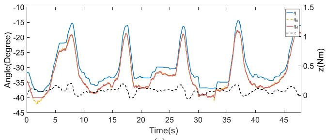  
(a)

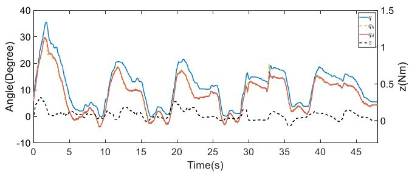  
(b)

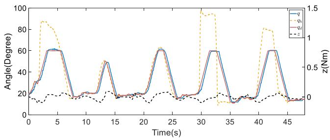  
(c)  
Figure 18. (a)–(c) 上肢外骨骼机器人关节 1、2 和 4 上主动镜像训练的性能

在临床试验中开展主动镜像训练（active mirroring training）必须在医院安装动作捕捉系统，而此类系统会带来额外的限制和不便。因此，我们未开展主动镜像训练的临床试验。相反，我们通过将一名健康受试者的左臂（即健侧）运动映射到右臂（即模拟患侧），使用上肢外骨骼进行主动镜像训练来评估我们的方法。通过光学动作捕捉系统获取人体上肢的精确角度需要定制专用服装，这超出了本研究的范围。因此，我们采用了一种内嵌关键标记点的自制支具以及装有标记点的手套，来估计三个肢体关节的角度，具体对应于关节 1、2 和 4。然而，由于支具形变和标记点遮挡，上肢关节角度的精度被限制在一定范围内。因此，为确保安全并展示我们的方法对上肢运动施加约束的能力，我们将关节 1、2 和 4 的位置约束分别设置为 $[ - 4 0 ^ { \circ } , 1 0 ^ { \circ } ]$ $[ - 1 0 ^ { \circ } , 8 0 ^ { \circ } ]$ ] 和 $[ 0 ^ { \circ } , 6 0 ^ { \circ } ]$。

如图 18 所示，期望轨迹始终与人体肢体轨迹 $\mathbf { \delta } \mathbf { q } _ { h }$ 保持一致，并根据动态约束进行了优化修正。

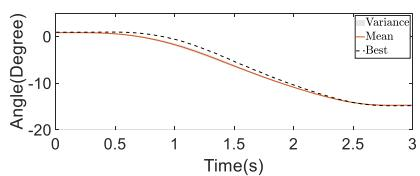  
(a)

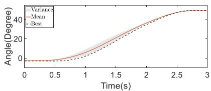

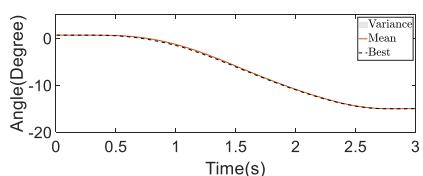  
(d)  
(b)

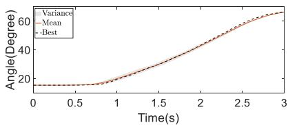

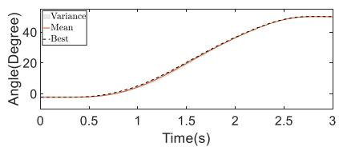  
(e)

(c)  
  
(f)

Figure 19. (a)–(c) 未经在线修正与 (d)–(f) 经过在线修正时的优化助力分布。  
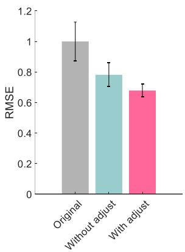

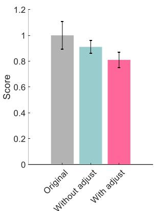

(a)  
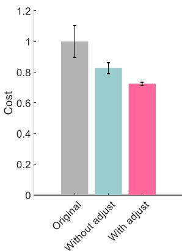  
(c)

(b)  
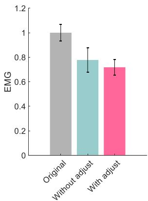  
(d)  
Figure 20. (a)-(d) 被动跟随训练的评估结果，展示指标包括：RMSE、异常得分、代价以及肱二头肌的 EMG 信号水平。所有指标均在一个周期内取平均值，并相对于初始助力进行归一化。

此外，当身体健侧迅速移动到已建立的运动边界之外的位置时，所提出的轨迹修正策略会迅速进行调整。也就是说，系统应用了预定的最大速度，以防止超出设定的关节位置边界。当身体健侧关节的运动保持在这些动态约束范围内时，上肢外骨骼机器人会跟踪健侧肢体的轨迹。同时，在整个训练过程中，我们的可变阻抗控制器有效地将人机交互维持在期望的阻抗模型内。

## 被动跟随训练

我们进行了一系列实验，以验证所提出的个性化框架在被动跟随训练任务中的有效性。这些实验围绕上肢康复中的一个典型任务展开：将上肢抬高至固定点。该任务需要肩部和肘部之间的协调，具体涉及关节 1、2 和 4。在成本计算过程中，异常得分被缩放到与跟踪误差具有相同的数量级，并且超参数 $\lambda _ { p }$ 被设置为 0.003。此外，由于辅助个性化的探索部分主要由基于示范的初始轨迹采样组成，我们将 $N _ { s } =$ 40。训练过程设计为当连续两次迭代之间分布的平均轨迹的 RMSE 降至小于 $0 . 1 ^ { \circ }$ 或达到最大迭代次数时停止。此外，示范数据大大缩减了采样空间。根据实际经验，所设置的样本数量被认为足以满足当前任务中的探索需求。

首先，我们在一名健康受试者参与的情况下进行了消融实验，以验证在线修正模块在被动跟随训练场景中的有效性。此外，执行了五次重启以规避局部最优。这些研究的结果如图 Figure 19 所示。在图中，黑色虚线表示在探索阶段获得最低代价的轨迹，而红色实线表示辅助轨迹分布的均值。在没有在线轨迹修正的情况下，实验历经了 67 次迭代；而在具有在线轨迹修正的情况下，实验历经了 55 次迭代。实验结果表明，在被动跟随训练个性化中若不进行在线修正，收敛后的辅助轨迹分布表现出较大的方差，且代价最低的轨迹显著偏离了分布的均值。这表明具有相似代价的轨迹分布相当宽泛。相比之下，在被动跟随训练个性化中引入在线修正后，收敛后的辅助轨迹分布方差较小，表明具有相似代价的轨迹集合更为集中。这种集中性主要归因于在线修正中使用了传感器反馈和异常得分，从而促进了对辅助轨迹的实时调整。该过程有效减少了运动意图的不确定性，并最大程度地减少了人机交互中的冲突。因此，代价函数评估和区分不同轨迹性能的精度得以提高，从而提升了训练的整体有效性。

个性化辅助的有效性通过四个指标进行评估：跟踪 RMSE、异常得分、代价 (33) 以及肱二头肌的 EMG 信号水平。该评估结果展示于 Figure 20 中。为了便于比较，所有指标均在一个周期内取平均值，并相对于原始辅助进行了归一化。与其他辅助方式（即示教的均值轨迹以及未经在线修正的优化辅助）相比，结合了在线修正的辅助在提高跟踪精度和减少运动过程中的异常得分方面表现出最佳性能。此外，应用在线修正使得被动训练后的代价最低，且 EMG 信号水平有所降低。这些结果证实了所提出的被动跟随训练个性化框架的有效性。

我们还招募了 7 名患者进行临床试验，以证明所提出方法的有效性。由于一名受试者转至另一家医院，最终仅有 6 名受试者完成了试验。由于中风的影响，所有患者的健侧肢体活动均不自然。因此，采用了被动跟随训练。每位受试者均签署了知情同意书，所有实验均获得了由 Shenzhen MileBot Robotics Co., Ltd（深圳市迈步机器人科技有限公司）于 2023 年 5 月设立的伦理委员会的批准。受试者被分配至对照组或实验组，其详细信息总结在 Table 9 中。两组均进行日常常规康复训练，实验组则额外进行了为期 14 天的被动跟随训练。

康复任务设置为与前述举臂任务相同，涉及关节 1、2 和 4 的协调运动，如图 Figure 21 所示。交互信息在被视为训练任务的肢体抬起阶段进行记录，而在 t = 3.5s 开始的肢体放下阶段则用于返回初始位置。两组的运动能力由专业医护人员使用特定评估指标进行评估和评分。这些指标包括肌张力等级和 Fugl-Meyer 评估（FMA）量表评分（Fugl-Meyer et al. 1975）。较低的肌张力等级和较高的 FMA 评分表明上肢运动能力良好。两组在治疗前均接受了运动功能评估。在治疗阶段，实验组每天参加被动跟随训练，每次训练持续约 15 分钟。两组均在治疗开始 2 周后接受重新评估。相对于初始评估归一化后的实验结果显示在 Figure 21 中，详细评估结果包含在附录（Appendix）中。与对照组不同，实验组与治疗前的初始评估相比，在所有指标上均表现出显著改善。因此，与对照组的结果相比，实验组的结果表明上肢外骨骼机器人的被动跟随训练加速了运动功能的恢复。因此，这种训练可以增强对中风和脑出血等疾病的治疗效果。

  
(a)

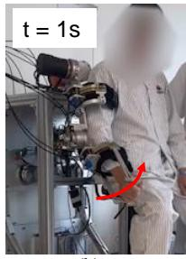  
(b)

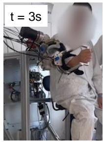  
(c)

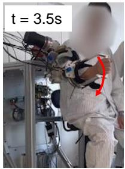  
(d)

  
(e)

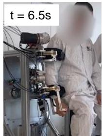  
(f)

  
Figure 21. (a)–(f) 训练期间上肢运动的快照，红色箭头表示运动方向；(g) 临床试验的对比结果，归一化至初始评估。

## 结论与讨论

## 结论

总体而言：本文介绍了一种结合生成模型的双模式个性化框架。该框架结合了意图预测器和异常检测器，用于捕获患者健侧的运动意图，并在康复任务期间实时评估人机交互。在主动镜像模式下，辅助能够反映患者最初的运动意图。在被动跟随模式下，辅助会根据交互反馈为患者量身定制。两种模式下的轨迹均整合在在线轨迹优化框架中，确保其平滑、符合动力学约束并具有个性化，从而有效地支持患者的康复。

Table 9. 参与者属性

<table><tr><td>组别</td><td>受试者</td><td>性别</td><td>年龄(y)</td><td>体重(kg)</td><td>身高(cm)</td><td>臂长(cm)</td><td>诊断</td></tr><tr><td rowspan="3">对照组</td><td>1</td><td>男</td><td>46</td><td>70</td><td>176</td><td>61</td><td>脑出血</td></tr><tr><td>2</td><td>男</td><td>60</td><td>65</td><td>167</td><td>57</td><td>脑卒中</td></tr><tr><td>3</td><td>男</td><td>62</td><td>75</td><td>170</td><td>58</td><td>脑卒中</td></tr><tr><td rowspan="3">实验组</td><td>4</td><td>男</td><td>44</td><td>67</td><td>169</td><td>59</td><td>脑卒中</td></tr><tr><td>5</td><td>男</td><td>51</td><td>77</td><td>177</td><td>64</td><td>脑卒中</td></tr><tr><td>6</td><td>男</td><td>66</td><td>66</td><td>167</td><td>57</td><td>脑卒中</td></tr></table>

详细信息：在线轨迹细化融合了两种训练配置，并利用生成模型来实现个性化辅助。具体而言，在主动镜像模式下，参考轨迹来自健侧肢体，意图预测器提供预测的轨迹分布，该分布经过预先调整以减轻潜在的风险动作。相反，在被动跟随模式下，参考轨迹根据人类示教预先定义。此外，异常检测器在指导在线细化过程中发挥着至关重要的作用，以实时提升动作的自然度。该检测器评估当前交互数据与从健康个体获取的标准示教数据之间的偏差，从而便于在被动跟随训练期间进行性能评估。在被动跟随模式下，针对特定训练任务应用了 ProMPs（概率运动基元），并根据代价函数对患者的每个动作进行加权。该方法显著增强了所生成的辅助分布的有效性。

性能：我们进行了一系列实验（包括一项临床试验），以验证所提出的各个模块，并证明它们在增强辅助和确保安全性方面的有效性。在预测精度方面，意图预测器的性能优于其他对比方法，即前向积分和 CNN-LSTM。此外，异常检测器在不同场景下均能准确识别异常。而且，可变阻抗控制器的性能在轨迹跟踪以及在发生异常时辅助患者方面得到了验证。在主动镜像训练期间，在线细化在存在意外冲击的情况下有效降低了约束违背程度。它还能够识别运动空间内的异常区域，并引导上肢外骨骼机器人使异常得分降低。该主动镜像训练方法在动作捕捉系统下进行了测试，验证了其有效性。在被动跟随模式下，分别对健康个体进行了测试并开展了临床试验。结果证实，该方法为健康受试者提供了个性化辅助，并显著加速了中风受试者运动功能的恢复。具体而言，临床试验数据表明，参与被动跟随训练的实验组在完成治疗方案后，在各项性能指标上均表现出改善。

## 讨论

局限性：当前的轨迹生成方法存在三个主要局限性，详述如下。

1) 意图预测器（intention predictor）和异常检测器（anomaly detector）的性能取决于数据集的规模与质量。扩充数据集以纳入更多受试者，将显著提升生成模型的性能。这将提高对患者运动意图预测的准确性，以及对运动过程中异常交互检测的精确度，从而增强训练模式的个性化程度。

2) 临床试验仅纳入了六名参与者，且仅专注于被动跟随模式（passive following mode）的康复效果。开展包含更多参与者的临床试验并将主动镜像模式（active mirroring mode）融入康复过程中，将能对所提出的双模式个性化框架提供更全面的评估。

以所述方式解决这些局限性的工作，将构成我们未来研发活动的基础。

学术贡献（Intellectual Merits）：我们开发了一种融合生成模型的创新型双模式个性化框架，从而为自适应康复系统树立了新的基准。该新型框架能够根据患者的需求在主动镜像与被动跟随模式之间进行切换，进而提供个性化辅助并提升康复效果。该框架的核心特征在于其实时意图预测与异常检测能力。具体而言，意图预测器从患者的健侧捕获运动意图，而异常检测器则实时评估人机交互，确保对患者的动作实现即时自适应与响应。此外，该框架集成了在线轨迹优化（online trajectory refinement），统合了来自主动镜像与被动跟随模式的轨迹，以确保其平滑、符合动力学约束且具备个性化。因此，该框架比其他框架能提供更自然且有效的辅助。应用生成模型基于交互反馈实现辅助的个性化，确保了康复过程能够切实响应个体患者的具体病情与需求。

潜在影响：融合生成式模型的双模态个性化框架的开发代表了一项重大进展，能够提升康复技术在临床和家庭护理环境中的部署与有效性。具体而言，由于这一创新框架能够根据实时反馈和患者的具体运动意图提供个性化且自适应的辅助，因此它具有彻底变革康复过程的潜力。据作者所知，本研究首次将生成式模型整合到上肢外骨骼机器人中并开展了临床试验。我们的开创性方法不仅增强了康复设备的功能，还通过将人工智能（AI）与康复医学相结合，对该领域产生了深远的影响。也就是说，我们的方法可以有效弥合 AI 与康复医学之间的鸿沟，从而促进 AI 领域的先进成果转化为实际的医疗应用。本研究融合了机器人学、控制系统、机器学习和临床康复等领域的原理，展现了跨学科研究的强大力量。这推动了各领域的进步，并为未来旨在开发全面且自适应的康复系统的研究树立了范例。此外，本研究所设计的框架应对了人口老龄化带来的更广泛的社会挑战。具体来说，该框架提供的方法可用于开发适用于医疗机构和家庭环境的先进康复解决方案。

## 资助信息

本工作部分由科技创新2030-重大项目（项目编号 2021ZD0201404）资助，部分由清华大学国强研究院（Institute for Guo Qiang, Tsinghua University）资助，部分由国家自然科学基金（National Natural Science Foundation of China，项目编号 U21A20517 和 52075290）资助。

## 参考文献

Albu-Schäffer A, Ott C and Hirzinger G (2007) A unified passivitybased control framework for position, torque and impedance control of flexible joint robots. The International Journal of Robotics Research 26(1): 23–39.

Chen T, Casas R and Lum PS (2019) An elbow exoskeleton for upper limb rehabilitation with series elastic actuator and cabledriven differential. IEEE Transactions on Robotics 35(6): 1464–1474.

Chen Y, Chen G, Ye J, Fu C, Liang B and Li X (2023a) Learning to assist different wearers in multitasks: Efficient and individualized human-in-the-loop adaption framework for exoskeleton robots. arXiv preprint arXiv:2309.14720 .

Chen Y, Chen G, Ye J, Qiu X and Li X (2023b) Safe and individualized motion planning for upper-limb exoskeleton robots using human demonstration and interactive learning. arXiv preprint arXiv:2309.08178 .

Clark G and Amor HB (2022) Learning ergonomic control in human–robot symbiotic walking. IEEE Transactions on Robotics 39(1): 327–342.

De Wit CC, Olsson H, Astrom KJ and Lischinsky P (1995) 摩擦系统控制的新模型. IEEE Transactions on automatic control 40(3): 419–425.

Ebrahimi A, Gröninger D, Singer R and Schneider U (2017) 基于主观反馈的主动动力上半身外骨骼控制参数优化. In: 2017 3rd international conference on control, automation and robotics (ICCAR). IEEE, pp. 432–437.

Fugl-Meyer AR, Jääskö L, Leyman I, Olsson S and Steglind S (1975) 一种身体机能评估方法. Scand J Rehabil Med 7(1): 13–31.

Gull MA, Bai S and Bak T (2020) 上肢外骨骼设计综述. Robotics 9(1): 16.

Han S, Wang H and Yu H (2023) 基于人机交互评估的串联弹性致动器驱动上肢康复机器人 AAN 控制. IEEE Transactions on Robotics .

Ho J, Jain A and Abbeel P (2020) 去噪扩散概率模型. Advances in neural information processing systems 33: 6840–6851.

Huang J, Huo W, Xu W, Mohammed S and Amirat Y (2015) 基于运动意图识别的人机接口上肢助力外骨骼控制. IEEE transactions on automation science and engineering 12(4): 1257–1270.

Huang VS and Krakauer JW (2009) 机器人神经康复：计算运动学习视角. Journal of neuroengineering and rehabilitation 6: 1–13.

Jau BM (1988) 拟人化外骨骼双臂/手遥控机器人控制器. In: IEEE International Workshop on Intelligent Robots. IEEE, pp. 715–718.

Jezernik S, Colombo G and Morari M (2004) 用于 4 自由度机器人矫形器康复的步态模式自动自适应算法. IEEE Transactions on Robotics and Automation 20(3): 574–582.

Kagawa T, Ishikawa H, Kato T, Sung C and Uno Y (2015) 基于优化的穿戴式机器人助行关节空间运动规划. IEEE Transactions on Robotics 31(2): 415–424.

Kalita B, Narayan J and Dwivedy SK (2021) 主动下肢机器人矫形器与外骨骼设备的发展：系统综述. International Journal ofSocial Robotics 13: 775–793.

Kim B and Deshpande AD (2017) 具有解剖学肩部机构的上半身康复外骨骼 Harmony：设计、建模、控制与性能评估. The International Journal ofRobotics Research 36(4): 414–435.

Kim H, Miller LM, Byl N, Abrams GM and Rosen J (2012) 人体手臂与上肢外骨骼的冗余度解析. IEEE transactions on biomedical engineering 59(6): 1770–1779.

Kim TY and Cho SB (2019) 使用 CNN-LSTM 神经网络预测住宅能耗. Energy 182: 72– 81.

Lanotte F, McKinney Z, Grazi L, Chen B, Crea S and Vitiello N (2021) 穿戴式机器人辅助与离散运动动态同步的自适应控制方法：提升任务用例验证. IEEE Transactions on Robotics 37(6): 2193–2209.

Lee SH, Park G, Cho DY, Kim HY, Lee JY, Kim S, Park SB and Shin JH (2020) Comparisons between end-effector and exoskeleton rehabilitation robots regarding upper extremity function among chronic stroke patients with moderate-to-severe upper limb

impairment. Scientific reports 10(1): 1806.

Lenzi T, De Rossi SMM, Vitiello N and Carrozza MC (2012) Intention-based emg control for powered exoskeletons. IEEE transactions on biomedical engineering 59(8): 2180–2190.

Li H, Guo S, Bu D, Wang H and Kawanishi M (2023a) Subjectindependent estimation of continuous movements using cnnlstm for a home-based upper limb rehabilitation system. IEEE Robotics and Automation Letters .

Li N, Yang Y, Li G, Yang T, Wang Y, Chen W, Yu P, Xue X, Zhang C, Wang W et al. (2022) Multi-sensor fusion-based mirror adaptive assist-as-needed control strategy of a soft exoskeleton for upper limb rehabilitation. IEEE Transactions on Automation Science and Engineering .

Li X, Liu Y and Yu H (2018a) Iterative learning impedance control for rehabilitation robots driven by series elastic actuators. Autom. 90: 1–7. URL https://api. semanticscholar.org/CorpusID:30545766.

Li X, Liu YH and Yu H (2018b) Iterative learning impedance control for rehabilitation robots driven by series elastic actuators. Automatica 90: 1–7.

Li X, Pan Y, Chen G and Yu H (2017) Multi-modal control scheme for rehabilitation robotic exoskeletons. The International Journal ofRobotics Research 36(5-7): 759–777.

Li X, Zhang X, Li X, Long J, Li J, Xu L, Chen G and Ye J (2021) Bear-h: An intelligent bilateral exoskeletal assistive robot for smart rehabilitation. IEEE Robotics & Automation Magazine 29(3): 34–46.

Li Z, Li Q, Huang P, Xia H and Li G (2023b) Human-in-theloop adaptive control of a soft exo-suit with actuator dynamics and ankle impedance adaptation. IEEE Transactions on Cybernetics .

Long Y, Du Zj, Wang Wd and Dong W (2018) Human motion intent learning based motion assistance control for a wearable exoskeleton. Robotics and Computer-Integrated Manufacturing 49: 317–327.

Mao Y and Agrawal SK (2012) Design of a cable-driven arm exoskeleton (carex) for neural rehabilitation. IEEE transactions on robotics 28(4): 922–931.

Martinez A, Lawson B, Durrough C and Goldfarb M (2018) A velocity-field-based controller for assisting leg movement during walking with a bilateral hip and knee lower limb exoskeleton. IEEE Transactions on Robotics 35(2): 307–316.

Martinez JA, Ng P, Lu S, Campagna MS and Celik O (2013) Design of wrist gimbal: A forearm and wrist exoskeleton for stroke rehabilitation. In: 2013 IEEE 13th international conference on rehabilitation robotics (ICORR). IEEE, pp. 1–6.

Nasr A, Bell S and McPhee J (2023) Optimal design of activepassive shoulder exoskeletons: A computational modeling of human-robot interaction. Multibody System Dynamics 57(1): 73–106.

Pan J, Astarita D, Baldoni A, Dell’Agnello F, Crea S, Vitiello N and Trigili E (2022) Nesm-γ: An upper-limb exoskeleton with compliant actuators for clinical deployment. IEEE Robotics and Automation Letters 7(3): 7708–7715.

Pan Y, Wang H, Li X and Yu H (2017) Adaptive command-filtered backstepping control of robot arms with compliant actuators. IEEE transactions on control systems technology 26(3): 1149– 1156.

Paraschos A, Daniel C, Peters JR and Neumann G (2013) Probabilistic movement primitives. Advances in neural

information processing systems 26.

Perry JC, Rosen J and Burns S (2007) Upper-limb powered exoskeleton design. IEEE/ASME transactions on mechatronics 12(4): 408–417.

Pratt GA and Williamson MM (1995) Series elastic actuators. In: Proceedings 1995 IEEE/RSJ international conference on intelligent robots and systems. Human robot interaction and cooperative robots, volume 1. IEEE, pp. 399–406.

Qiu S, Guo W, Caldwell D and Chen F (2020) Exoskeleton online learning and estimation of human walking intention based on dynamical movement primitives. IEEE Transactions on Cognitive and Developmental Systems 13(1): 67–79.

Quigley M, Conley K, Gerkey B, Faust J, Foote T, Leibs J, Wheeler R, Ng AY et al. (2009) Ros: an open-source robot operating system. In: ICRA workshop on open source software, volume 3. Kobe, Japan, p. 5.

Said RR, Heyat MBB, Song K, Tian C and Wu Z (2022) A systematic review of virtual reality and robot therapy as recent rehabilitation technologies using eeg-brain–computer interface based on movement-related cortical potentials. Biosensors 12(12): 1134.

Salzmann T, Ivanovic B, Chakravarty P and Pavone M (2020) Trajectron++: Dynamically-feasible trajectory forecasting with heterogeneous data. In: Computer Vision–ECCV 2020: 16th European Conference, Glasgow, UK, August 23–28, 2020, Proceedings, Part XVIII 16. Springer, pp. 683–700.

Sambhus R, Gokce A, Welch S, Herron CW and Leonessa A (2023) Real-time model-free deep reinforcement learning for force control of a series elastic actuator. In: 2023 IEEE/RSJ International Conference on Intelligent Robots and Systems (IROS). IEEE, pp. 5645–5652.

Sommerhalder M, Zimmermann Y, Simovic L, Hutter M, Wolf P and Riener R (2023) Trajectory optimization framework for rehabilitation robots with multi-workspace objectives and constraints. IEEE Robotics and Automation Letters .

Song J, Meng C and Ermon S (2020) Denoising diffusion implici models. arXiv preprint arXiv:2010.02502 .

Spong MW (1987) Modeling and control of elastic joint robots .

Tiboni M, Borboni A, Vérité F, Bregoli C and Amici C (2022) Sensors and actuation technologies in exoskeletons: A review. Sensors 22(3): 884.

Tikhonov AN (1952) Systems of differential equations containing small parameters in the derivatives. Matematicheskii sbornik 73(3): 575–586.

Wang Y, Zahedi A, Zhao Y and Zhang D (2022) 配备扭矩传感器的绳索驱动上肢外骨骼的人-外骨骼交互扭矩提取. IEEE/ASME Transactions on mechatronics 27(6): 4269–4280.

Williams G, Wagener N, Goldfain B, Drews P, Rehg JM, Boots B and Theodorou EA (2017) 用于基于模型的强化学习的信息论 MPC. In: 2017 IEEE international conference on robotics and automation (ICRA). IEEE, pp. 1714–1721.

Wu Q, Wang X and Du F (2016) 用于上肢主动康复训练的重力平衡外骨骼的研制与分析. Proceedings of the Institution of Mechanical Engineers, Part C: Journal ofMechanical Engineering Science 230(20): 3777–3790.

Xu J, Xu L, Li Y, Cheng G, Shi J, Liu J and Chen S (2020) 一种用于机器人镜像

疗法的多通道强化学习框架. IEEE Robotics and Automation Letters 5(4): 5385– 5392.

Xu M, Zhou Z, Wang Z, Ruan L, Mai J and Wang Q (2023) 用于穿戴式机器人设备的仿生绳索驱动系统：设计、控制与表征. IEEE Transactions on Robotics .

Zhang J, Fiers P, Witte KA, Jackson RW, Poggensee KL, Atkeson CG and Collins SH (2017) 行走过程中外骨骼助力的在环人优化. Science 356(6344): 1280–1284.

Zhang Q, Nalam V, Tu X, Li M, Si J, Lewek MD and Huang HH (2022) 通过外骨骼控制施加健康髋部运动模式与范围以实现个性化助力. IEEE Robotics and Automation Letters 7(4): 11126–11133.

Zhang X, Shu Y, Chen Y, Chen G, Ye J, Li X and Li X (2023) 具有本体感受感知的外骨骼机器人的多模态学习与物理冲突缓解. In: 2023 IEEE International Conference on Robotics and Automation (ICRA). IEEE, pp. 10490–10496.

Zhu H, Nesler C, Divekar N, Peddinti V and Gregg RD (2021) 部分助力动力膝关节矫形器中紧凑、可反向驱动的驱动设计原则. IEEE/ASME Transactions On Mechatronics 26(6): 3104–3115.

Zhu L, Wang Z, Ning Z, Zhang Y, Liu Y, Cao W, Wu X and Chen C (2020) 一种基于 IMU 的软体外骨骼运动意图识别新方法. Electronics 9(12): 2176.

Zimmermann Y, Küçüktabak EB, Farshidian F, Riener R and Hutter M (2020) 迈向动态透明：在手臂外骨骼上使用多传感控制进行鲁棒交互力跟踪. In: 2020 IEEE/RSJ International Conference on Intelligent Robots and Systems (IROS). IEEE, pp. 7417– 7424.

Zimmermann Y, Sommerhalder M, Wolf P, Riener R and Hutter M (2023a) Anyexo 2.0：一种用于康复所有阶段的操作和关节定向训练的全驱动上肢外骨骼. IEEE Transactions on Robotics .

Zimmermann Y, Song J, Deguelle C, Läderach J, Zhou L, Hutter M, Riener R and Wolf P (2023b) 外骨骼的人机穿戴连接系统：设计与性能分析. IEEE Transactions on Robotics .

## 附录

## 稳定性分析

为了证明整个系统的稳定性，我们将式 (43) 和 (45) 代入 (9)，得到以下系统动力学方程：

$$
(M (\boldsymbol {q}) + \bar {\boldsymbol {B}}) \dot {\boldsymbol {z}} + C (\dot {\boldsymbol {q}}, \boldsymbol {q}) \boldsymbol {z} = - K _ {z} \boldsymbol {z} - S _ {2} ^ {\top} \tilde {\tau} _ {f} - k _ {g} s g n (\boldsymbol {z}),\tag{49}
$$

其中 $\tilde { \tau } _ { f } = \hat { \tau } _ { f } - \tau _ { f }$ 表示摩擦力的估计误差。

随后，我们提出以下候选 Lyapunov 函数：

$$
V = \frac {1}{2} \boldsymbol {z} ^ {T} (\boldsymbol {M} (\boldsymbol {q}) + \bar {\boldsymbol {B}}) \boldsymbol {z}.\tag{50}
$$

对 (50) 关于时间求导并将式 (49) 的动力学代入，推导出

以下表达式：

$$
\dot {V} = - \pmb {z} ^ {T} \pmb {K} _ {z} \pmb {z} - \pmb {z} ^ {T} \pmb {S} _ {2} ^ {\intercal} \tilde {\pmb {\tau}} _ {f} - k _ {g} \pmb {z} ^ {T} s g \pmb {n} (\pmb {z}).\tag{51}
$$

假设 $\| S _ { 2 } ^ { \mathsf { T } } \tilde { \tau } _ { f } \| \leq \kappa .$ ，$\dot { V }$ 的上界推导如下：

$$
\dot {V} \leq - \boldsymbol {z} ^ {T} \boldsymbol {K} _ {z} \boldsymbol {z} - (k _ {g} - \kappa) \| \boldsymbol {z} \|,\tag{52}
$$

如果 $k _ { g }$ 足够大使得 $k _ { g } > \kappa$ ，则不等式简化为

$$
\dot {V} \leq - \boldsymbol {z} ^ {T} \boldsymbol {K} _ {z} \boldsymbol {z} <   0,\tag{53}
$$

鉴于 $V > 0$ 且 $\dot { V } < 0$ ，该准稳态系统是指数稳定的。考虑到边界层系统可以通过适当调节 $\pmb { K } _ { 1 }$ 和 $K _ { 2 } .$ 实现本质稳定，根据 Tikhonov (1952) 理论，闭环系统的稳定性得到了保证，从而确保收敛到期望的阻抗向量。

## 被动跟随模式下的权重设置

对于涉及人机交互的特定训练任务，我们假设患者意图与上肢外骨骼机器人同步运动。然而，人体运动意图的随机性等物理因素可能会影响上肢外骨骼机器人的跟踪性能。鉴于在动力学模型中显式考虑此类扰动存在较大难度，我们将这种干扰建模为轨迹规划中的附加噪声。其动力学描述如下：

$$
\pmb {x} _ {p} ^ {(t + 1)} = g _ {p} (\pmb {x} _ {p} ^ {(t)}, \pmb {q} _ {r}),\tag{54}
$$

$$
\pmb {q} _ {r} \sim \mathcal {N} (\pmb {q} _ {r p}, \pmb {\Sigma} _ {p}),\tag{55}
$$

其中 $\pmb { x } _ { p } = [ \pmb { x } _ { d } ^ { \top } , s ] ^ { \top }$ 为增广状态向量，$g _ { p } ( \cdot )$ 是一个非线性时变函数，它将在线微调、阻抗控制器以及人机交互中人体运动意图的确定性分量进行整合。$\mathbf { \Delta } \mathbf { q } _ { r p }$ 是辅助分布的均值，而 $\Sigma _ { p }$ 概括了整体随机扰动，其中包括人体运动意图的随机性以及生成模型的采样变异性。

根据 Williams et al. (2017)，为了最小化以下代价

$$
\hat {\mathcal {S}} (\boldsymbol {q} _ {r}) = \int_ {T _ {r}} \{\| \boldsymbol {q} _ {d} (\boldsymbol {q} _ {r}) - \boldsymbol {q} \| _ {\boldsymbol {Q}} ^ {2} + s ^ {2} + \frac {\lambda_ {p}}{2} \boldsymbol {q} _ {r p} ^ {\top} \Sigma_ {p} ^ {- 1} \boldsymbol {q} _ {r p} \} d t,\tag{56}
$$

其中最优控制输入以代价解耦的方式构建如下：

$$
\begin{array}{c} \hat {w} (\boldsymbol {q} _ {r}) = \frac {1}{\hat {\eta} _ {k}} \exp (- \frac {1}{\lambda_ {p}} (\hat {\mathcal {S}} (\boldsymbol {q} _ {r}) + \gamma_ {p} \sum \tilde {\boldsymbol {q}} _ {r p} ^ {\mathsf {T}} \Sigma_ {p} ^ {- 1} \boldsymbol {q} _ {r})), \\ \hat {\boldsymbol {q}} _ {r p} ^ {*} = \mathbb {E} [ \hat {w} (\boldsymbol {q} _ {r}) \boldsymbol {q} _ {r} ]. \end{array}\tag{57}
$$

(58)

此处，$\gamma _ { p } = \lambda _ { p } ( 1 - \alpha _ { p } )$ 为解耦温度参数，定义满足 $\alpha _ { p } \in [ 0 , 1 ]$，而 $\tilde { \pmb q } _ { r p }$ 是初始轨迹估计的均值。

在该方法中，最优辅助量由当前轨迹分布的期望值推导得出。

Table 10. 详细临床评估

<table><tr><td>组别</td><td>受试者</td><td>初始肌张力等级</td><td>试验后肌张力等级</td><td>初始 FMA</td><td>试验后 FMA</td></tr><tr><td rowspan="3">对照组</td><td>1</td><td>1.5</td><td>1.5</td><td>8</td><td>12</td></tr><tr><td>2</td><td>1.5</td><td>1.5</td><td>31</td><td>35</td></tr><tr><td>3</td><td>2</td><td>1.5</td><td>23</td><td>30</td></tr><tr><td rowspan="3">实验组</td><td>4</td><td>1.5</td><td>1</td><td>8</td><td>16</td></tr><tr><td>5</td><td>2</td><td>1.5</td><td>19</td><td>35</td></tr><tr><td>6</td><td>2</td><td>2</td><td>3</td><td>5</td></tr></table>

每次采样迭代均基于先前改进的轨迹分布，这可能会导致采样空间的不一致性。为了解决这些潜在的不一致性并确保充分的探索，我们在 Algorithm 3 中选择了较大的样本量 $N _ { s }$。此外，我们设置 $\alpha _ { p } = 1$ 以减轻不同样本间 $\tilde { \pmb q } _ { r p }$ 不一致性的影响，从而提高最优控制解的鲁棒性和可靠性。

鉴于 (56) 中的最后一项在康复过程中是不希望出现的，理想设定为 $\lambda _ { p } = 0$ ，从而导出最佳助力的如下定义：

$$
\hat {\boldsymbol {q}} _ {r p} ^ {*} = \underset {\boldsymbol {q} _ {r}} {\arg \min} \hat {\mathcal {S}} (\boldsymbol {q} _ {r}).\tag{59}
$$

在这种情况下，最佳助力被确定为成本最低的采样轨迹，而所有其他采样结果均被忽略。然而，该表述忽略了最佳助力的分布，导致迭代改进机制无法实现。因此，为了保持迭代改进的可行性并尽量减小不良项的影响，控制解的紧密度的参数 $\lambda _ { p } .$ 被设置为一个较小的值。该调整确保了 ${ \hat { S } } ( q _ { r } ) \to S ( q _ { r } )$ ，且 (57) 中的最优权重公式简化为 (34) 中所采用的配置。此设定平衡了最小化不良项与维持实用且有效的迭代改进过程的需求。

## 临床评估结果

在本临床试验中，肌张力水平采用包含 0、1、1+、2、3 和 4 级的评分量表进行评估，其中 0 级表示肌张力正常。出于数值分析的目的，1+ 级被量化为 1.5。评估结果记录在 Table 10 中。所有评估均专门针对上肢。在 FMA 的上肢部分，满分为 66 分，表示功能正常。