# 基于时序差分学习的模型预测控制

Nicklas Hansen <sup>1</sup> Xiaolong Wang <sup>\*</sup> <sup>1</sup> Hao Su <sup>\*</sup> <sup>1</sup>

## 摘要

数据驱动的模型预测控制（Model Predictive Control, MPC）相比无模型（model-free）方法具有两个关键优势：通过模型学习有望提高样本效率，以及随着规划计算预算的增加能够获得更优的性能。然而，在长时域（long horizons）上进行规划不仅计算开销巨大，而且难以获取准确的环境模型。在本研究中，我们结合了无模型方法和基于模型（model-based）方法的优势。我们使用学习到的面向任务的潜空间动力学模型在短时域内进行局部轨迹优化，并利用学习到的终端价值函数来估计长期回报，两者均通过时序差分（Temporal Difference, TD）学习进行联合训练。我们的方法 TD-MPC 在来自 DMControl 和 Meta-World 的基于状态及基于图像的连续控制任务中，均取得了优于以往工作的样本效率和渐近性能。代码和视频可在 https: //nicklashansen.github.io/td-mpc 获取。

## 1. 引言

为了在环境中实现预期的行为，强化学习（Reinforcement Learning, RL）智能体需要与环境进行迭代交互并整合关于环境的知识。规划（Planning）是解决此类序列决策问题的一种强大方法，并在游戏博弈（Kaiser et al., 2020; Schrittwieser et al., 2020）和连续控制（Tassa et al., 2012; Chua et al., 2018; Janner et al., 2019）等应用领域取得了巨大成功。通过利用环境的内部模型，智能体可以提前规划出一条能导向期望行为的动作轨迹；这与完全通过试错来学习策略的无模型算法形成了鲜明对比。

具体而言，先前关于基于模型方法的研究主要可细分为两个方向，各自利用了基于模型学习的核心优势：(i) 规划，其优于单纯学习策略，但在长时域上进行规划的计算成本可能极其高昂（Janner et al., 2019; Lowrey et al., 2019; Hafner et al., 2019; Argenson & Dulac-Arnold, 2021）；以及 (ii) 利用学习到的模型来提升无模型方法的样本效率，例如通过模型生成的轨迹展开（rollouts）进行学习，但这往往会导致模型偏差也传播到策略中（Ha & Schmidhuber, 2018; Hafner et al., 2020b; Clavera et al., 2020）。因此，在连续控制任务中，基于模型的方法一直以来都难以超越更简单的无模型方法（Srinivas et al., 2020; Kostrikov et al., 2020）。


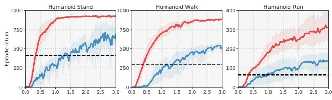

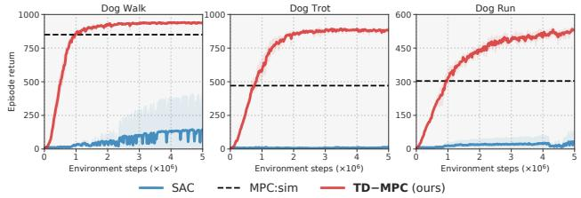  
Figure 1. 概览。（上图）我们提出了一种 MPC 框架，该框架利用面向任务的潜在动力学模型和通过时序差分学习联合学习的价值函数。我们在模型展开（rollout）上进行轨迹优化，并使用价值函数进行长期回报估计。（下图）我们的方法、SAC 以及带有真实模拟器的 MPC 在具有挑战性的高维 Humanoid 和 Dog 任务（Tassa et al., 2018）上的单回合回报（Episode return）。5 次运行的均值；阴影区域为 95% 置信区间。

我们能否转而借助无模型学习（model-free learning）的优势来增强基于模型的规划（model-based planning）？由于长时域规划的巨大代价，模型预测控制（Model Predictive Control, MPC）通常在较短的有限时域内优化轨迹，这仅能产生时间上的局部最优解。MPC 可以通过引入终端价值函数来估计规划时域之外的折扣回报，从而扩展为近似全局最优解。然而，获取准确的模型和价值函数极具挑战性。

在这项工作中，我们提出了面向模型预测控制的时序差分学习（Temporal Difference Learning for Model Predictive Control, TD-MPC），这是一个用于数据驱动 MPC 的框架，它利用面向任务的潜在动力学模型以及通过时序差分（Temporal Difference, TD）学习联合学习的终端价值函数。在每个决策步中，我们使用由学习到的模型生成的短期奖励估计来进行轨迹优化，并使用学习到的价值函数进行长期回报估计。例如，在 Figure 1 所示的 Humanoid 运动任务中，利用模型进行规划可能有利于精准的关节运动，而更高层次的目标（例如奔跑方向）则可以由长期价值估计来指导。

一项关键的技术贡献在于模型的学习方式。尽管以往的工作通过状态或视频预测来学习模型，但我们认为对环境中的一切事物进行建模（包括无关物理量以及阴影等视觉细节）效率极低，因为这种方法会饱受模型不精确度和复合误差的困扰。为了克服这些挑战，我们对模型学习进行了三项关键改进。首先，我们纯粹从奖励中学习动力学模型的潜在表示，忽略对于当前任务而言不必要的细微差异。这使得其学习比状态/图像预测更具样本效率。其次，我们通过模型的多个展开步反向传播来自奖励和 TD 目标的梯度，从而改善了长时域上的奖励和价值预测。这缓解了在进行展开时的误差复合。最后，我们在潜在空间中提出了一种模态无关的预测损失，该损失在无需显式状态或图像预测的情况下，强制使学习到的表示保持时间一致性。

我们在来自 DMControl (Tassa et al., 2018) 和 Meta-World (Yu et al., 2019) 的各种连续控制任务上评估了我们的方法，结果发现该方法在样本效率和渐近性能上均优于以往基于模型和无模型的方法。特别是，我们的方法仅用 1M 环境步数就解决了连续动作空间高达 38 维的 Humanoid 和 Dog 运动任务（见 Figure 1），并且可以轻易扩展以达到基于图像的强化学习（image-based RL）的最新水平。

## 2. 预备知识

问题表述。我们考虑由元组 $( S , \mathcal { A } , \mathcal { T } , \mathcal { R } , \gamma , p _ { 0 } )$ 表征的无限时域马尔可夫决策过程（Markov Decision Processes, MDP），其中 $S \in \mathbb { R } ^ { n }$ 和 $\mathcal { A } \in \mathbb { R } ^ { m }$ 分别为连续状态空间和动作空间，$\mathcal { T } \colon \mathcal { S } \times \mathcal { A } \times \mathcal { S } \mapsto \mathbb { R } _ { + }$ 为状态转移（动力学）函数，$\mathcal { R } \colon S \times \mathcal { A } \mapsto \mathbb { R }$ 为奖励函数，$\gamma \in [ 0 , 1 )$ 为折扣因子，$p _ { 0 }$ 为初始状态分布。我们的目标是学习一个带有参数 θ 的参数化映射 $\Pi _ { \theta } \colon S \mapsto A$，使得沿着遵循 $\Pi _ { \theta }$ 的轨迹 $\Gamma = ( \mathbf { s } _ { 0 } , \mathbf { a } _ { 0 } , \mathbf { s } _ { 1 } , \mathbf { a } _ { 1 } , \dots )$（通过在每个决策步 t 采样动作 $\mathbf { a } _ { t } \sim \Pi _ { \theta } ( \cdot | \mathbf { s } _ { t } )$ 并到达状态 $\mathbf { s } _ { t + 1 } \sim \mathcal { T } ( \cdot | \mathbf { s } _ { t } , \mathbf { a } _ { t } )$）的折扣回报 $\begin{array} { r } { \mathbb { E } _ { \Gamma \sim \Pi _ { \theta } } [ \sum _ { t = 1 } ^ { \infty } \gamma ^ { t } r _ { t } ] , \ r _ { t } \sim \mathcal { R } ( \cdot | \mathbf { s } _ { t } , \mathbf { a } _ { t } ) } \end{array}$ 最大化。

拟合 Q 迭代。无模型时序差分学习（Model-free TD-learning）算法旨在利用参数化价值函数 $Q _ { \theta } ( \mathbf { s } , \mathbf { a } ) ~ \approx ~ Q ^ { * } ( \mathbf { s } , \mathbf { a } ) ~ = ~ \mathrm { m a x } _ { \mathbf { a } ^ { \prime } } \mathbb { E } [ \mathcal { R } ( \mathbf { s } , \mathbf { a } ) ~ + ~$ $\gamma Q ^ { * } ( \mathbf { s } ^ { \prime } , \mathbf { a } ^ { \prime } ) ] \ \forall \mathbf { s } \in \mathcal { S }$ 来估计最优状态-动作价值函数 $Q ^ { * } \colon S \ \times \ A \ \mapsto \ \mathbb { R }$，其中 $\mathbf { s } ^ { \prime } , \mathbf { a } ^ { \prime }$ 为下一步的状态和动作，θ 为该函数的参数 (Sutton, 2005)。当 $\gamma \approx 1$ 时，$Q ^ { * }$ 估计了无限时域内最优策略的折扣回报。尽管 $Q ^ { * }$ 通常未知，但可以通过使用更新规则反复拟合 $Q _ { \theta }$ 来进行近似

$$
\theta^ {k + 1} \leftarrow \arg \min _ {\theta} \mathbb {E} _ {(\mathbf {s}, \mathbf {a}, \mathbf {s} ^ {\prime}) \sim \mathcal {B}} \| Q _ {\theta} (\mathbf {s}, \mathbf {a}) - y \| _ {2} ^ {2}\tag{1}
$$

其中 $Q \ – t a r g e t y = \mathcal { R } ( \mathbf { s } , \mathbf { a } ) + \gamma \operatorname* { m a x } _ { \mathbf { a } ^ { \prime } } Q _ { \theta ^ { - } } ( \mathbf { s } ^ { \prime } , \mathbf { a } ^ { \prime } )$，$\mathcal{B}$ 是随着新数据的收集而迭代增长的经验回放池（replay buffer），$\theta ^ { - }$ 是在线参数 $\theta$ 的缓慢移动平均，在每次迭代中使用常数系数 $\zeta \in [ 0 , 1 )$ 按照规则 $\theta _ { k + 1 } ^ { - } \longleftarrow { ( 1 - \zeta ) \theta _ { k } ^ { - } } +$ $\zeta \theta _ { k }$ 进行更新。

模型预测控制（Model Predictive Control）。在 Actor-Critic 强化学习（RL）算法中，$\Pi$ 通常是由神经网络参数化的策略，该策略通过学习来近似 $\Pi _ { \theta } ( \cdot | \mathbf { s } )$ ≈ arg $\begin{array} { r } { \operatorname* { m a x } _ { \mathbf { a } } \mathbb { E } \left[ Q _ { \theta } ( \mathbf { s } , \mathbf { a } ) \right] \forall \mathbf { s } \in \mathcal { S } , } \end{array}$，即全局最优策略。在控制理论中，$\Pi$ 传统上被实现为一个轨迹优化过程。为了使问题易于处理，通常在每个步骤 $t$ 通过估计有限时域 $H$ 内的最优动作 $\mathbf { a } _ { t : t + H }$ 并执行第一个动作 $\mathbf { a } _ { t } .$ 来获得轨迹优化问题的局部解，这被称为模型预测控制（Model Predictive Control, MPC）：

$$
\Pi_ {\theta} ^ {\mathrm{MPC}} (\mathbf {s} _ {t}) = \arg \max _ {\mathbf {a} _ {t: t + H}} \mathbb {E} \left[ \sum_ {i = t} ^ {H} \gamma^ {i} \mathcal {R} (\mathbf {s} _ {i}, \mathbf {a} _ {i}) \right],\tag{2}
$$

其中 $\gamma ,$ 与拟合 Q 迭代（fitted Q-iteration）不同，通常设置为 1，即无折扣。直观地说，公式 2 可以被看作是标准加性成本最优控制目标的一个特例。可以通过使用无梯度的交叉熵方法（Cross-Entropy Method, CEM; Rubinstein (1997)）以及模型生成的采样轨迹，将一组分布族（$\mathrm { e . g . , }$ 对角协方差多元高斯的 $\mu , \sigma$）的参数迭代拟合到有限时域内的动作空间来获得解。与拟合 Q 迭代相反，公式 2 无法预测长期奖励，因此是一个短视的解。当价值函数已知时（例如，启发式函数，或在本文方法的语境中：使用公式 1 估计得到），它可以与

公式 2 用于估计状态 $\mathbf { s } _ { t + H }$ 及之后的折扣回报；此类方法被称为带有终端价值函数的 MPC（MPC with a terminal valuefunction）。在下文中，我们从行动者-评论家强化学习算法（Actor-Critic RL）和模型预测控制（规划）的双重视角来考虑参数化映射 $\Pi$。为了区分这些概念，我们将 MPC 规划记为 $\Pi _ { \theta }$，将策略网络记为 $\pi _ { \theta }$。我们统称使用神经网络的参数化表示为 $\theta$（在线网络）和 $\theta ^ { - }$（目标网络；$\theta$ 的慢速移动平均），作为组合特征向量。

## 3. 面向模型预测控制的时序差分学习

我们提出了 TD-MPC，这是一个在线强化学习设定下，将 MPC 与通过时序差分学习（TD-learning）联合学习的任务导向潜空间动力学模型以及终端价值函数相结合的框架。具体而言，TD-MPC 利用模型预测路径积分（Model Predictive Path Integral，简称 MPPI；Williams et al. (2015)）控制进行规划（记为 $\Pi _ { \theta }$），分别学习了关于（潜空间）动力学和奖励信号的模型 $d _ { \theta } , R _ { \theta }$、一个终端状态-动作价值函数 $Q _ { \theta }$，以及一个用于指导规划的参数化策略 $\pi _ { \theta }$。我们在图 1（Figure 1）和算法 1（Algorithm 1）中总结了我们的框架。在本节中，我们详细介绍了该方法在推理时的行为，而训练部分的讨论则留至第 4 节。

MPPI 是一种 MPC 算法，它通过估计的前 $k$ 个采样轨迹（按期望回报排序）的重要性加权平均，迭代更新一组分布族的参数；在实践中，我们拟合具有对角协方差的时变多元高斯分布的参数。我们对 MPPI 的调整如下。从初始参数 $( \mu ^ { 0 } , \bar { \sigma ^ { 0 } } ) _ { t : t + H } , \mu ^ { 0 } , \sigma ^ { 0 } \in \mathbb { R } ^ { m } , \mathcal { A } \in \mathbb { R } ^ { m }$ 开始，即在长度为 $H$ 的时域内每个动作的独立参数，我们利用学习到的模型 $d _ { \theta }$ 生成的预演（rollouts）独立采样 $N$ 条轨迹，并将采样轨迹 $\Gamma$ 的总回报 $\phi_{\Gamma}$ 估计为

$$
\phi_ {\Gamma} \triangleq \mathbb {E} _ {\Gamma} \left[ \gamma^ {H} Q _ {\theta} (\mathbf {z} _ {H}, \mathbf {a} _ {H}) + \sum_ {t = 0} ^ {H - 1} \gamma^ {t} R _ {\theta} (\mathbf {z} _ {t}, \mathbf {a} _ {t}) \right],\tag{3}
$$

其中在迭代 $j - 1$ 时，$\mathbf { z } _ { \mathbf { t } + 1 } = d _ { \theta } ( \mathbf { z } _ { t } , \mathbf { a } _ { t } )$ 且 $\mathbf { a } _ { t } \sim \mathcal { N } ( \mu _ { t } ^ { j - 1 } , ( \sigma _ { t } ^ { j - 1 } ) ^ { 2 } \mathrm { I } )$，如算法 1（Algorithm 1）中红色高亮所示。我们选取前 $k$ 个最高回报 $\phi _ { \Gamma } ^ { \star }$，并在迭代 $j$ 时通过经 $\phi _ { \Gamma } ^ { \star }$ 归一化的经验估计得到新参数 $\mu ^ { j } , \sigma ^ { j }$：

$$
\mu^ {j} = \frac {\sum_ {i = 1} ^ {k} \Omega_ {i} \Gamma_ {i} ^ {\star}}{\sum_ {i = 1} ^ {k} \Omega_ {i}}, \sigma^ {j} = \sqrt {\frac {\sum_ {i = 1} ^ {k} \Omega_ {i} (\Gamma_ {i} ^ {\star} - \mu^ {j}) ^ {2}}{\sum_ {i = 1} ^ {k} \Omega_ {i}}},\tag{4}
$$

其中 $\Omega _ { i } = e ^ { \tau ( \phi _ { \Gamma , i } ^ { \star } )}$，$\tau$ 是控制加权“锐度”（sharpness）的温度参数，$\Gamma _ { i } ^ { \star }$ 表示对应于回报估计 $\phi _ { \Gamma } ^ { \star }$ 的第 $i$ 个 top-k 轨迹。在固定迭代次数 $^ { J , }$ 后，规划过程终止，并从最终经回报归一化的动作序列分布中采样一条轨迹。我们在每个决策步 $t$ 进行规划，且仅执行第一个动作，即采用后退视界 MPC（receding-horizon MPC）来生成反馈策略。为了减少收敛所需的迭代次数，我们在每个步骤 $t$ 通过复用前一步骤获得的单步平移均值 $\mu$ 对轨迹优化进行“热启动”（warm start）（Argenson & Dulac-Arnold, 2021），但始终使用较大的初始方差以避免陷入局部极小值。

<div class="mineru-algorithm" style="white-space: pre-wrap; font-family:monospace;">
算法 1 TD-MPC（推理）

Require: $\theta$: 学习得到的网络参数
    $\mu^0, \sigma^0$: $\mathcal{N}$ 的初始参数 $N, N_\pi$: 采样/策略轨迹数
    $\mathbf{s}_t, H$: 当前状态，展开时域

1: 编码状态 $\mathbf{z}_t \leftarrow h_\theta(\mathbf{s}_t) \quad \triangleleft$ 假设 TOLD 模型

2: for each iteration $j = 1..J$ do

3: 从 $\mathcal{N}(\mu^{j-1}, (\sigma^{j-1})^2\mathrm{I})$ 采样 $N$ 条长度为 $H$ 的轨迹

4: 使用 $\pi_\theta, d_\theta$ 采样 $N_\pi$ 条长度为 $H$ 的轨迹
    // 从 $\mathbf{z}_t$ 开始且初始设 $\phi_\Gamma = 0$，使用 $d_\theta, R_\theta, Q_\theta$ 估计轨迹回报 $\phi_\Gamma$：

5: for all $N + N_\pi$ trajectories ($\mathbf{a}_t, \mathbf{a}_{t+1}, \ldots, \mathbf{a}_{t+H}$) do

6: for step $t = 0..H - 1$ do

7: $\phi_\Gamma = \phi_\Gamma + \gamma^t R_\theta(\mathbf{z}_t, \mathbf{a}_t)$ $\triangleleft$ 奖励

8: $\mathbf{z}_{t+1} \leftarrow d_\theta(\mathbf{z}_t, \mathbf{a}_t)$ $\triangleleft$ 潜在状态转移

9: $\phi_\Gamma = \phi_\Gamma + \gamma^H Q_\theta(\mathbf{z}_H, \mathbf{a}_H)$ $\triangleleft$ 终端价值

// 更新下一次迭代的参数 $\mu, \sigma$：

10: $\mu^j, \sigma^j =$ 公式 4（及公式 5）

11: return $\mathbf{a} \sim \mathcal{N}(\mu^J, (\sigma^J)^2\mathrm{I})$
</div>

通过规划进行探索。诸如 DDPG (Lillicrap et al., 2016) 等无模型强化学习（Model-free RL）算法在训练期间通过向学到的策略 $\pi _ { \theta }$ 注入动作噪声（例如高斯噪声或 Ornstein-Uhlenbeck 噪声）来鼓励探索，并可选择遵循线性退火计划。尽管由于轨迹采样，我们的轨迹优化过程本质上是随机的，但我们发现 $\sigma$ 衰减的速率在不同任务之间差异很大，对于较小的 $\sigma$ 会导致（潜在较差的）局部最优解。为了在各项任务中促进一致的探索，我们约束采样分布的标准差，使得对于在迭代 $j$ 中从公式 4 获得的 $\mu ^ { j }$，我们将 $\sigma ^ { j }$ 替换更新为

$$
\sigma^ {j} = \max \left(\sqrt {\frac {\sum_ {i = 1} ^ {N} \Omega_ {i} (\Gamma_ {i} ^ {\star} - \mu^ {j}) ^ {2}}{\sum_ {i = 1} ^ {N} \Omega_ {i}}}, \epsilon\right),\tag{5}
$$

其中 $\epsilon \in \mathbb { R } _ { + }$ 是一个线性衰减的常数。同样，我们在训练早期将规划时域从 1 线性增加到 H，因为模型在初始阶段是不准确的，规划因此会由模型偏差主导。

策略引导的轨迹优化。类似于 Schrittwieser et al. (2020); Sikchi et al. (2022)，TD-MPC 除了规划过程 $\Pi _ { \theta }$ 之外还学习了一个策略 $\pi _ { \theta }$，并使用来自 $\pi _ { \theta }$ 的额外样本来增强采样过程（在算法 1 中以蓝色高亮显示）。这会导致以下两种情况之一：策略轨迹被估计为 (i) 较差的，可能被排除在 top-k 轨迹之外；或 (ii) 良好的，可能会被包含在内，其影响与其估计的回报 $\phi _ { \Gamma }$ 成正比。虽然 LOOP 依赖 SAC (Haarnoja et al., 2018) 的最大熵目标来进行探索，但 TD-MPC 学习的是确定性策略。为了使采样具有随机性，我们像 DDPG (Lillicrap et al., 2016) 一样对 $\pi _ { \theta }$ 动作应用线性退火的（高斯）噪声。我们的完整过程总结在算法 1 中。

## 4. 面向任务的潜空间动力学模型

为了与 TD-MPC 结合使用，我们提出了一种面向任务的潜空间动力学（Task-Oriented Latent Dynamics, TOLD）模型，该模型使用时序差分学习（TD-learning）与终端价值函数联合学习。我们的 TOLD 模型并不是尝试对环境本身进行建模，而是学会仅对环境中可预测奖励的元素进行建模，这是一个简单得多的问题。在推理过程中，我们的 TD-MPC 框架利用学到的 TOLD 模型进行轨迹优化，使用模型展开来估计短期奖励，并使用终端价值函数来估计长期回报。TD-MPC 和 TOLD 支持连续动作空间、任意输入模态和稀疏奖励信号。Figure 2 提供了 TOLD 训练过程的概述。

组件（Components）。在整个训练过程中，我们的智能体迭代执行以下两项操作：(i) 利用先前与环境交互收集的数据来改进学习到的 TOLD 模型；以及 (ii) 通过 TD-MPC 进行动作序列的在线规划，并利用 TOLD 生成想象展开（imagined rollouts），从而从环境中收集新数据。我们提出的 TOLD 包含五个可学习组件 $h _ { \theta } , d _ { \theta } , R _ { \theta } , Q _ { \theta } , \pi _ { \theta }$，用于预测以下量：

$$
\begin{array}{l l} \text {Representation:} & \mathbf {z} _ {t} = h _ {\theta} (\mathbf {s} _ {t}) \\ \text {Latent dynamics:} & \mathbf {z} _ {t + 1} = d _ {\theta} (\mathbf {z} _ {t}, \mathbf {a} _ {t}) \\ \text {Reward:} & \hat {r} _ {t} = R _ {\theta} (\mathbf {z} _ {t}, \mathbf {a} _ {t}) \\ \text {Value:} & \hat {q} _ {t} = Q _ {\theta} (\mathbf {z} _ {t}, \mathbf {a} _ {t}) \\ \text {Policy:} & \hat {\mathbf {a}} _ {t} \sim \pi_ {\theta} (\mathbf {z} _ {t}) \end{array}\tag{6}
$$

给定在时间步 $t$ 观察到的观测值 $\mathbf { s } _ { t }$，表示网络 $h _ { \theta }$ 将 $\mathbf { s } _ { t }$ 编码为潜表示（latent representation）$\mathbf { z } _ { t } .$。根据 $\mathbf { z } _ { t }$ 和在时间步 t 采取的动作 $\mathbf { a } _ { t }$，TOLD 随后预测 (i) 潜动力学（下一时间步的潜表示 $\mathbf { z } _ { t + 1 }$）；(ii) 获得的单步奖励；(iii) 其状态-动作（Q）值；以及 (iv) 一个（近似）最大化 Q 函数的动作。为了降低 TOLD 对复合误差的敏感性，我们从预测的未来潜状态出发，循环地向未来多步预测上述量，并通过时间反向传播梯度。与先前的工作（Ha & Schmidhuber, 2018; Janner et al., 2019; Hafner et al., 2019; 2020b; Sikch et al., 2022）不同，我们发现将 TOLD 的所有组件仅实现为纯确定性 MLP 就足够了，即不需要 RNN 门控机制或概率模型。

  
Figure 2. 训练我们的 TOLD 模型。从经验回放池（replay buffer）中采样长度为 H 的轨迹 $\Gamma _ { 0 : H }$，第一个观测值 s 由 $h _ { \theta }$ 编码为潜表示 $\mathbf { z } _ { 0 } .$。然后，TOLD 循环预测后续的潜状态 $\mathbf { z } _ { 1 } , \mathbf { z } _ { 2 } , \ldots , \mathbf { z } _ { H } .$，以及每个潜状态的价值 ${ \hat { q } } ,$、奖励 ${ \hat { r } } ,$ 和动作 aˆ，我们使用公式 7 对 TOLD 进行优化。后续观测值使用目标网络 $h _ { \theta ^ { - } } \ : ( \theta ^ { - }$：θ 的慢移动平均）进行编码，并且仅在训练期间用作潜目标（以灰色显示）。

目标。我们首先阐述完整的目标函数，然后说明各个模块及其对应目标项的设计动机。在训练期间，我们最小化一个时间加权的目标函数

$$
\mathcal {J} (\theta ; \Gamma) = \sum_ {i = t} ^ {t + H} \lambda^ {i - t} \mathcal {L} (\theta ; \Gamma_ {i}),\tag{7}
$$

其中 $\Gamma \sim B$ 是从经验回放池（replay buffer）$B$ 中采样的轨迹 $( \mathbf { s } _ { t } , \mathbf { a } _ { t } , r _ { t } , \mathbf { s } _ { t + 1 } ) _ { t : t + H }$，$\lambda \in \mathbb { R } _ { + }$ 是一个赋予近期预测更高权重的常数，并且单步损失

$$
\mathcal {L} (\theta ; \Gamma_ {i}) = c _ {1} \underbrace {\| R _ {\theta} (\mathbf {z} _ {i} , \mathbf {a} _ {i}) - r _ {i} \| _ {2} ^ {2}} _ {\text {reward}}\tag{8}
$$

$$
+ c _ {2} \underbrace {\left\| Q _ {\theta} (\mathbf {z} _ {i} , \mathbf {a} _ {i}) - (r _ {i} + \gamma Q _ {\theta^ {-}} (\mathbf {z} _ {i + 1} , \pi_ {\theta} (\mathbf {z} _ {i + 1}))) \right\| _ {2} ^ {2}} _ {\text { value }}\tag{9}
$$

$$
+ c _ {3} \underbrace {\| d _ {\theta} (\mathbf {z} _ {i} , \mathbf {a} _ {i}) - h _ {\theta^ {-}} (\mathbf {s} _ {i + 1}) \| _ {2} ^ {2}} _ {\text { latent   state   consistency }}\tag{10}
$$

被用于联合优化奖励预测、价值预测以及一个对所学表示进行正则化的潜状态一致性损失。在此，$c _ { 1 : 3 }$ 是平衡这三项损失的常数系数。对于每个转移 $\left( \mathbf { z } _ { i } , \mathbf { a } _ { i } \right)$，奖励项（公式 8）预测单步奖励，价值项（公式 9）遵循先前关于行动者-评论家（actor-critic）算法的研究（Lillicrap et al., 2016; Haarnoja et al., 2018）采用了公式 1 中的拟合 Q 迭代（fitted Q-iteration），而一致性项（公式 10）则预测未来状态的潜表示。

关键在于，循环预测完全在潜在空间中从状态 $\mathbf { z } _ { i } ~ = ~ h _ { \theta } ( \mathbf { s } _ { i } ) , ~ \mathbf { z } _ { i + 1 } ~ = ~ d _ { \theta } ( \mathbf { z } _ { i } , \mathbf { a } _ { i } )$ ${ \bf z } _ { i + H } = d _ { \theta } ( { \bf z } _ { i + H - 1 } , { \bf a } _ { i + H - 1 } )$ 进行，因此只有第一个观测 $\mathbf { s } _ { i }$ 使用 $h _ { \theta }$ 进行编码，并且来自所有三项的梯度都会随时间反向传播。这与以往基于模型的学习工作形成对比，那些工作通过状态或视频预测来学习模型，与策略和/或价值学习完全解耦 (Ha & Schmidhuber, 2018; Hafner et al., 2020b; Sikchi et al., 2022)。我们使用在线网络参数 θ 的指数移动平均 $\theta ^ { - }$ 来计算价值目标 (Lillicrap et al., 2016)，并且同样使用 $\theta ^ { - }$ 计算潜在状态一致性目标 $h _ { \theta ^ { - } } ( \mathbf { s } _ { i + 1 } )$ 。接下来将介绍策略 $\pi _ { \theta }$，而一致性损失的讨论则放在下一节。

计算 TD 目标。公式 9 中的 TD 目标需要估计量 $\operatorname* { m a x } _ { \mathbf { a } _ { t } } Q _ { \theta ^ { - } } ( \mathbf { z } _ { t } , \mathbf { a } _ { t } )$ ，而使用规划方法计算该量的代价极高 (Lowrey et al., 2019)。因此，我们转而通过最小化以下目标来学习一个最大化 $Q _ { \theta }$ 的策略 π<sub>θ</sub>：

$$
\mathcal {J} _ {\pi} (\theta ; \Gamma) = - \sum_ {i = t} ^ {t + H} \lambda^ {i - t} Q _ {\theta} (\mathbf {z} _ {i}, \pi_ {\theta} (\mathrm{sg} (\mathbf {z} _ {i}))),\tag{11}
$$

这是无模型 Actor-Critic 方法（如 DDPG (Lillicrap et al., 2016) 和 SAC (Haarnoja et al., 2018)）中常用的策略目标在时间加权上的改编。这里，sg 表示梯度截断（stop-grad）算子，且公式 11 仅针对策略参数进行优化。尽管我们通过实验观察到，对于复杂任务，学到的 π<sub>θ</sub> 表现逊于规划（在第 5 节讨论），但我们发现它具有足够的表达能力来实现高效的价值学习。

潜状态一致性（Latent state consistency）。为了为模型学习提供丰富的学习信号，以往关于基于模型的强化学习（model-based RL）的工作通常学习直接预测未来的状态或像素（Ha & Schmidhuber, 2018; Janner et al., 2019; Lowrey et al., 2019; Kaiser et al., 2020; Sikchi et al., 2022）。然而，学习预测未来的观测是一个极其困难的问题，因为它强迫网络对环境中的一切事物进行建模，包括与任务无关的量以及诸如阴影之类的细节。相反，我们提出使用潜状态一致性损失（如公式 10 所示）来正则化 TOLD，该损失迫使时间步 $t + 1$ 处的未来潜状态预测 $\mathbf { z } _ { t + 1 } = d _ { \theta } ( \mathbf { z } _ { t } , \mathbf { a } _ { t } )$ 与对应真实观测的潜表示 $h _ { \theta ^ { - } } \big ( \mathbf { s } _ { t + 1 } \big )$ 相似，从而完全避免了对观测的预测。此外，这一设计选择有效地使模型学习与观测模态无关。训练过程如算法 2 所示；伪代码见附录 F。

## 5. 实验

我们在来自 Deep-Mind Control Suite（DMControl; Tassa et al. (2018)）的总共 92 个多样且具有挑战性的连续控制任务上评估了采用 TOLD 模型的 TD-MPC，以及

<div class="mineru-algorithm" style="white-space: pre-wrap; font-family:monospace;">
Algorithm 2 TOLD (training)

Require: $\theta, \theta^{-}$: randomly initialized network parameters $\eta, \tau, \lambda, \mathcal{B}$: learning rate, coefficients, buffer

1: while not tired do

2: // Collect episode with TD-MPC from $s_0 \sim p_0$:

3: for step $t = 0...T$ do

4: $\mathbf{a}_t \sim \Pi_\theta(\cdot|h_\theta(\mathbf{s}_t)) \triangleleft$ Sample with TD-MPC

5: $(\mathbf{s}_{t+1}, r_t) \sim \mathcal{T}(\cdot|\mathbf{s}_t, \mathbf{a}_t), \mathcal{R}(\cdot|\mathbf{s}_t, \mathbf{a}_t) \triangleleft$ Step env.

6: $\mathcal{B} \leftarrow \mathcal{B} \cup (\mathbf{s}_t, \mathbf{a}_t, r_t, \mathbf{s}_{t+1}) \triangleleft$ Add to buffer

7: // Update TOLD using collected data in $\mathcal{B}$:

8: for num updates per episode do

9: $\{\mathbf{s}_t, \mathbf{a}_t, r_t, \mathbf{s}_{t+1}\}_{t:t+H} \sim \mathcal{B} \triangleleft$ Sample traj.

10: $\mathbf{z}_t = h_\theta(\mathbf{s}_t) \triangleleft$ Encode first observation

11: $J = 0 \triangleleft$ Initialize J for loss accumulation

12: for $i = t...t + H$ do

13: $\hat{r}_i = R_\theta(\mathbf{z}_i, \mathbf{a}_i) \triangleleft$ Equation 8

14: $\hat{q}_i = Q_\theta(\mathbf{z}_i, \mathbf{a}_i) \triangleleft$ Equation 9

15: $\mathbf{z}_{i+1} = d_\theta(\mathbf{z}_i, \mathbf{a}_i) \triangleleft$ Equation 10

16: $\hat{a}_i = \pi_\theta(\mathbf{z}_i) \triangleleft$ Equation 11

17: $J \leftarrow J + \lambda^{i-t} \mathcal{L}(\mathbf{z}_{i+1}, \hat{r}_i, \hat{q}_i, \hat{\mathbf{a}}_i) \triangleleft$ Equation 7

18: $\theta \leftarrow \theta - \frac{1}{H} \eta \nabla_\theta J \triangleleft$ 更新在线网络

19: $\theta^{-} \leftarrow (1-\tau) \theta^{-} + \tau \theta \triangleleft$ 更新目标网络
</div>

Meta-World v2 (Yu et al., 2019)，包括具有稀疏奖励、高维状态和动作空间、图像观测、多模态输入、目标条件化以及多任务学习设置的任务；任务可视化见附录 L。我们选择这两个基准是因为它们具有极大的任务多样性，以及基线实现和结果的可用性。我们旨在回答以下问题：

− 与最先进的基于模型和无模型方法相比，使用 TD-MPC 进行规划表现如何？

− 尽管使用了以奖励为中心的目标，TOLD 模型是否具备多任务和迁移行为的能力？

− 性能与规划过程的计算预算之间有何关系？

TD-MPC 的实现可在 https://nicklashansen.github.io/td-mpc 获取，它可以在单张 GPU 上一小时内解决大部分任务。

实现细节。所有组件都是确定性的，并使用 MLP（多层感知机）实现。我们在前 25k 个决策步<sup>1</sup>中，将 $\Pi$ 和 $\pi _ { \theta }$ 的探索参数从 0.5 线性退火至 0.05。我们使用 $H = 5$ 的规划时域，并使用优先经验回放（Schaul et al., 2016）对轨迹进行采样，其优先级按价值损失缩放。在规划期间，我们进行 6 次迭代规划（Dog 为 8 次；Humanoid 为 12 次），采样 $N = 5 1 2$ 条轨迹（+5% 从 $\pi$ 中采样），并且我们在每次迭代中根据排名前 64 的轨迹计算 $\mu , \sigma$ 参数。对于基于图像的任务，观测值为 3 帧堆叠的 84×84 维 RGB 图像帧，并且我们使用 ±4 像素平移增强（Kostrikov et al., 2020）。其他细节请参见附录 F。

  
Figure 3. DMControl 任务。我们的方法（TD-MPC）和基线在来自 DMControl (Tassa et al., 2018) 的 15 个基于状态的连续控制任务上的回报。5 次运行的均值；阴影区域为 95% 置信区间。在左上方，我们展示了所有 15 个任务的平均结果。我们观察到在具有复杂动力学的任务上性能提升尤为显著，例如 Quadruped 和 Acrobot 任务。

基线方法。我们将我们的方法与以下算法进行评估对比：

− Soft Actor-Critic (SAC; (Haarnoja et al., 2018))，一种源自最大熵强化学习（Ziebart et al., 2008）的最先进无模型算法。由于 SAC 的流行程度以及在 DMControl 和 Meta-World 上的强劲表现，我们选择 SAC 作为主要对比基线。特别是，我们采用了 Yarats & Kostrikov (2020) 的实现。

− LOOP (Sikchi et al., 2022)，一种通过规划和学习模型来扩展 SAC 的混合算法。LOOP 已被证明在某些选定的 MuJoCo 任务上优于多种基于模型的方法（例如 MBPO (Janner et al., 2019) 和 POLO (Lowrey et al., 2019)）。鉴于其与 TD-MPC 的相似性，它是一个尤为相关的基准。

− 使用真实模拟器的 MPC（记为 MPC:sim）。由于使用模拟器进行规划的计算量很大，我们将规划时域限制为 10（是我们方法的 2 倍），采样轨迹数限制为 200，并优化 4 次迭代（我们方法为：6 次）。

− CURL (Srinivas et al., 2020)、DrQ (Kostrikov et al., 2020) 和 DrQ-v2 (Yarats et al., 2021)，三种最先进的无模型（model-free）算法。

− PlaNet (Hafner et al., 2019)、Dreamer (Hafner et al., 2020b) 和 Dreamer-v2 (Hafner et al., 2020a)。这三种方法都使用重构损失来学习模型，并使用 MPC 或学习到的策略来选择动作。

− MuZero (Schrittwieser et al., 2020) 和 EfficientZero (Ye et al., 2021)，它们从奖励中学习潜动力学模型，并使用 MCTS 进行离散动作选择。

− 消融实验（Ablations）。我们考虑：(i) 使用状态预测器实现的我们方法（h<sub>θ</sub> 为恒等函数），(ii) 不使用公式 10 中的潜一致性损失实现的我们方法，以及最后：将一致性损失替换为 (iii) PlaNet 和 Dreamer 的重构目标，或 (iv) EfficientZero 的对比目标。

有关基准的进一步讨论，请参见附录 G。

Table 1. 基于像素的学习。在 Srinivas et al. (2020); Kostrikov et al. (2020); Ye et al. (2021) 所使用的基于图像的 DMControl 100k 基准上，我们方法（TD-MPC）与最先进算法的回报。基线专门针对基于图像的强化学习（RL）进行了调优，而我们的方法则没有。SAC、CURL、DrQ 和 PlaNet 的结果部分取自 Srinivas et al. (2020); Kostrikov et al. (2020)，Dreamer、MuZero 和 EfficientZero 的结果取自 Hafner et al. (2020b); Ye et al. (2021)。数据为 10 次运行的均值和标准差。\*：MuZero 和 EfficientZero 使用离散化的动作空间，且 EfficientZero 在评估前额外进行了 20k 步梯度更新，而其他方法没有。由于离散化带来的维度爆炸，MuZero 和 EfficientZero 无法切实解决具有更高维动作空间任务，例如 Walker Walk 和 Cheetah Run $( \mathcal { A } \in \mathbb { R } ^ { 6 } )$，而我们的方法可以。

<table><tr><td>100k 环境步数</td><td>SAC State</td><td>SAC Pixels</td><td>CURL</td><td>DrQ</td><td>PlaNet</td><td>Dreamer</td><td>MuZero*</td><td>Eff.Zero*</td><td>TD-MPC</td></tr><tr><td>Cartpole Swingup</td><td> $812 \pm 45$ </td><td> $419 \pm 40$ </td><td> $597 \pm 170$ </td><td> $759 \pm 92$ </td><td> $563 \pm 73$ </td><td> $326 \pm 27$ </td><td> $219 \pm 122$ </td><td> $813 \pm 19$ </td><td> $770 \pm 70$ </td></tr><tr><td>Reacher Easy</td><td> $919 \pm 123$ </td><td> $145 \pm 30$ </td><td> $517 \pm 113$ </td><td> $601 \pm 213$ </td><td> $82 \pm 174$ </td><td> $314 \pm 155$ </td><td> $493 \pm 145$ </td><td> $952 \pm 34$ </td><td> $628 \pm 105$ </td></tr><tr><td>Cup Catch</td><td> $957 \pm 26$ </td><td> $312 \pm 63$ </td><td> $772 \pm 241$ </td><td> $913 \pm 53$ </td><td> $710 \pm 217$ </td><td> $246 \pm 174$ </td><td> $542 \pm 270$ </td><td> $942 \pm 17$ </td><td> $933 \pm 24$ </td></tr><tr><td>Finger Spin</td><td> $672 \pm 76$ </td><td> $166 \pm 128$ </td><td> $779 \pm 108$ </td><td> $901 \pm 104$ </td><td> $560 \pm 77$ </td><td> $341 \pm 70$ </td><td>—</td><td>—</td><td> $943 \pm 59$ </td></tr><tr><td>Walker Walk</td><td> $604 \pm 317$ </td><td> $42 \pm 12$ </td><td> $344 \pm 132$ </td><td> $612 \pm 164$ </td><td> $221 \pm 43$ </td><td> $277 \pm 12$ </td><td>—</td><td>—</td><td> $577 \pm 208$ </td></tr><tr><td>Cheetah Run</td><td> $228 \pm 95$ </td><td> $103 \pm 38$ </td><td> $307 \pm 48$ </td><td> $344 \pm 67$ </td><td> $165 \pm 123$ </td><td> $235 \pm 137$ </td><td>—</td><td>—</td><td> $222 \pm 88$ </td></tr></table>

  
CURL DrQ DrQ-v2 Dreamer-v2 TD−MPC (ours)  
Figure 4. 基于像素的学习。我们的方法（TD-MPC）与前沿算法在 12 个具有挑战性的基于图像的 DMControl 任务上的回报。我们遵循先前的研究（Hafner et al., 2020b;a; Yarats et al., 2021），对所有任务均采用 2 的动作重复（action repeat）。与表 1 所示的 DMControl 100k 基准相比，我们在此考虑了更困难的任务，数据量最多增加了 30 倍。DrQ-v2 和 Dreamer-v2 的结果引自 Yarats et al. (2021) 和 Hafner et al. (2020a)，DrQ 的结果部分引自 Kostrikov et al. (2020)，而 CURL 的结果则是使用其公开可用的实现复现所得（Srinivas et al., 2020）。基线方法使用了与任务相关的超参数，而 TD-MPC 在所有任务中均使用相同的超参数。5 次运行的均值；阴影区域表示 95% 置信区间。TD-MPC 持续优于 CURL 和 DrQ，且与 DrQ-v2 和 Dreamer-v2 相比具有竞争力。

任务。我们考虑以下 92 个任务：

− 6 个具有高维状态和动作空间的极具挑战性的 Humanoid $( \mathcal { A } \in \mathbb { R } ^ { 2 1 } )$ 与 Dog $( \boldsymbol { \mathcal { A } } \in \mathbb { R } ^ { 3 8 } )$ 运动任务。结果如图 1 所示。

− 15 个来自 DMControl 的多样化连续控制任务，其中 6 个具有稀疏奖励。结果如图 3 所示。

− 来自高数据效率 DMControl 100k 基准测试的 6 个基于图像的任务。结果如 Table 1 所示。

− 来自 DMControl Dreamer

基准测试（3M 环境步数）的 12 个基于图像的任务。结果如 Figure 4 所示。

− 2 个多模态（本体感觉数据 + 第一人称视角相机）3D 运动任务，其中四足智能体需要绕过障碍物进行导航。结果如 Figure 5（中）所示。

− 来自 Meta-World 的 50 个目标条件操作任务，以及同时学习 10 个任务的多任务设置。结果如 Figure 5（上）所示。

在整个实验中，我们都在相对较少的环境步数下评估性能，例如针对 Humanoid 任务仅使用 3M 步，而以往的工作通常运行 30M 步（10 倍）。

与其他方法的比较。我们发现，在所考虑的大多数任务中，我们的方法均优于或匹敌基线方法，通常在复杂任务（如 DMControl 中的 Humanoid、Dog 以及 Meta-World 中的 Bin Picking）上取得更大的提升；同时我们注意到，TD-MPC 实际上是首个有记录解决 DMControl 中复杂 Dog 任务的方法。LOOP 的性能与 SAC 相似，而带有模拟器的 MPC（MPC:sim）在运动任务上表现良好，但在稀疏奖励任务中失效。尽管我们并未针对基于图像的强化学习（RL）对方法进行专门调优，但我们取得了与当前最先进的基于模型和无模型算法相媲美的结果，而这些算法都针对基于图像的强化学习进行了精心调优，且包含多达 15 倍的可学习参数。值得注意的是，尽管 EfficientZero 在低维动作空间任务上取得了优异的成果，但其蒙特卡洛树搜索（MCTS）需要对动作空间进行离散化，这在高维空间中是不可行的。相比之下，TD-MPC 在扩展到 Dog 任务的 38 维连续动作空间时表现极佳。最后，在 Figure 3 所示的困难探索任务 Finger Turn Hard 上，我们观察到相比 SAC 和 LOOP 其样本效率较低，这表明在未来的研究中引入更先进的探索策略可能大有可为。我们将消融正则化损失选择的实验移至 Appendix D，但发现我们提出的潜状态一致性损失能够产生最稳健一致的结果。

多任务强化学习（Multi-task RL）、多模态强化学习（multi-modal RL）与泛化性。支持通用模型的一个常见论点是，它们可以从跨任务的数据共享中获益。因此，我们试图回答以下问题：尽管 TOLD 采用以奖励为中心的目标，它是否也能从任务间的协同效应中获益？我们通过两个实验来测试该假设：训练单个策略同时执行 10 个不同的任务（Meta-World MT10），以及评估在一个任务（Walk）上训练并迁移到同一领域的不同任务（Run）时的模型泛化能力。多任务结果如图 5（上）所示，迁移结果见附录 A。我们发现我们的方法在两个实验中均受益于数据共享，且迁移结果表明 $h _ { \theta }$ 能很好地泛化到新任务，而 $d _ { \theta }$ 则编码了更多特定于任务的行为。我们推测，尽管 TOLD 仅学习对奖励具有预测性的特征，但相似的任务通常具有相似的奖励结构，这使得任务间能够共享信息。然而，我们仍然预期通用模型比 TOLD 能从同一环境下的不相关任务中获益更多。最后，我们以任务为中心的目标带来的另一个额外优势是它与输入模态无关。为了证明这一点，我们使用 TD-MPC 解决了两个多模态（本体感觉数据 + 自我中心视角相机）运动任务；结果如图 5（下）所示。我们发现 TD-MPC 成功融合了来自两种输入模态的信息，并解决了这些任务。相比之下，无法访问自我中心视角相机的盲智能体（Blind）则失败了。有关多模态实验的更多细节见附录 J，多任务实验的细节见附录 I。

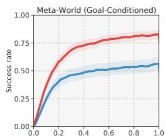

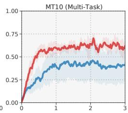

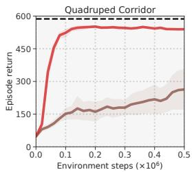

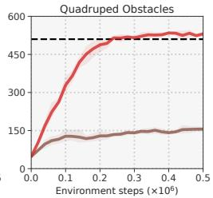

Figure 5. （上）Meta-World。使用独立策略在 50 个目标条件化 Meta-World 任务上的成功率，以及同时在 10 个任务上训练的多任务策略（Meta-World MT10）的成功率。单个任务的结果见附录 I。（下）多模态强化学习。TD-MPC 在使用本体感觉数据 + 自我中心视角相机的两个多模态运动任务上的回合回报。Blind 仅使用本体感觉数据。可视化见附录 L。所有结果均为 5 次运行的均值；阴影区域为 95% 置信区间。  
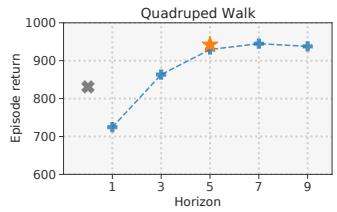

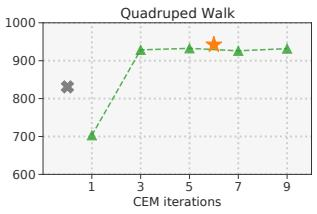  
Figure 6. 可变计算预算。在可变预算下 TD-MPC 在 Quadruped Walk 上的回报。我们评估了充分训练的智能体在改变（左）规划时域；（右）规划迭代次数时的性能。在改变一个超参数时，另一个固定为默认值。我们包含了对所学策略 π<sub>θ</sub> 的评估，以及训练中使用的 6 次迭代和 5 步时域的默认设置。5 次运行的均值。

性能与计算预算。我们研究了 DMControl 任务中计算预算（即规划时域和迭代次数）与性能之间的关系；见 Figure 6。我们发现，对于 Quadruped Walk $( \mathcal { A } \in \mathbb { R } ^ { 1 2 } )$ 等复杂任务，更多的规划通常会带来更好的性能。然而，我们还观察到，通过减少迭代次数，我们可以在推理阶段将规划成本降低 50%（与训练阶段相比）而不会导致性能下降。为了实现极快的推理，可以完全放弃规划，直接使用联合学习的策略 $\pi _ { \boldsymbol { \theta } } ;$；然而，π<sub>θ</sub> 的表现通常劣于规划。更多结果见 Appendix C。

Table 2. 实际运行时间。（上）解决任务所需时间，以及（下）DMControl 中 Walker Walk 和 Humanoid Stand 任务每 500k 环境步的时间（以小时计）。当方法分别达到 940 和 800 的平均回报时，我们认为任务已被解决。TD-MPC 解决 Walker Walk 的速度比 LOOP 快 16×，同时每 500k 步使用的计算量减少了 3.3×。5 次运行的均值。

<table><tr><td></td><td colspan="4">Walker Walk</td><td colspan="2">Humanoid Stand</td></tr><tr><td>实际运行时间 (h)</td><td>SAC</td><td>LOOP</td><td>MPC:sim</td><td>TD-MPC</td><td>SAC</td><td>TD-MPC</td></tr><tr><td>解决时间 ↓</td><td>0.41</td><td>7.72</td><td>0.91</td><td>0.47</td><td>9.31</td><td>9.39</td></tr><tr><td>h/500k 步 ↓</td><td>1.41</td><td>18.5</td><td>-</td><td>5.60</td><td>1.82</td><td>12.94</td></tr></table>

训练实际运行时间。为了更好地证实我们的结果，我们报告了 TD-MPC 与 SAC、与我们方法最相似的 LOOP 以及带有真实模拟器（非参数化）的 MPC 相比的训练实际运行时间。所有方法均在单张 RTX3090 GPU 上进行基准测试。结果如 Table 2 所示。TD-MPC 解决 Walker Walk 的速度比 LOOP 快 16×，并在 Walker Walk 和 Humanoid Stand 上均达到了与 SAC 相当的解决时间，同时样本效率显著更高。因此，我们的方法有效地弥合了无模型方法与基于模型的方法在解决时间上的差距。这是一项显著的缩减，因为已知 LOOP 本身就比纯基于模型的方法 POLO 快 12×（Lowrey et al., 2019; Sikchi et al., 2022）。我们在 Appendix H 中提供了关于推理时间的额外实验。

## 6. 相关工作

时序差分学习（Temporal Difference Learning）。常见的无模型异策略（model-free off-policy）算法，如 DDPG (Lillicrap et al., 2016) 和 SAC (Haarnoja et al., 2018)，代表了基于大量文献 (Sutton, 1988; Mnih et al., 2013; Hasselt et al., 2016; Mnih et al., 2016; Fujimoto et al., 2018; Kalashnikov et al., 2018; Espeholt et al., 2018; Pourchot & Sigaud, 2019; Kalashnikov et al., 2021) 的深度 TD 学习进展。DDPG 和 SAC 均学习策略 $\pi _ { \theta }$ 和价值函数 $Q _ { \theta } ,$，但不学习模型。Kalashnikov et al. (2018); Shao et al. (2020); Kalashnikov et al. (2021) 也学习 $Q _ { \theta }$，但使用无模型的 CEM（交叉熵方法）替代或增强 $\pi _ { \theta }$。与此不同，我们使用 TD 学习联合学习模型、价值函数和策略，并通过基于采样的规划进行交互。

基于模型的强化学习（Model-based RL）。一种常见的范式是学习一个可用于规划的环境模型 (Ebert et al., 2018; Zhang et al., 2018; Janner et al., 2019; Hafner et al., 2019; Lowrey et al., 2019; Kaiser et al., 2020; Bhardwaj et al., 2020; Yu et al., 2020; Schrittwieser et al., 2020; Nguyen et al., 2021)，或者利用生成的数据来训练无模型算法 (Pong et al., 2018; Ha & Schmidhuber, 2018; Hafner et al., 2020b; Sekar et al., 2020)。例如，Zhang et al. (2018); Ha & Schmidhuber (2018); Hafner et al. (2019; 2020b) 使用视频预测损失来学习动力学模型，Yu et al. (2020); Kidambi et al. (2020) 考虑了离线设定下的基于模型的强化学习，而 MuZero/EfficientZero (Schrittwieser et al., 2020; Ye et al., 2021) 则利用奖励预测来学习潜空间动力学模型。EfficientZero 在模型学习方面与我们的方法最为相似，但其基于 MCTS（蒙特卡洛树搜索）的动作选择机制在本质上与连续动作空间不兼容。最后，尽管此前已有人提出为 MPC（模型预测控制）学习终端价值函数 (Negenborn et al., 2005; Lowrey et al., 2019; Bhardwaj et al., 2020; Hatch & Boots, 2021)，但据我们所知，我们是首个在连续控制中通过 TD 学习联合学习模型和价值函数的工作。

混合算法（Hybrid algorithms）。此前的若干工作致力于开发结合无模型和基于模型要素的算法 (Nagabandi et al., 2018; Buckman et al., 2018; Pong et al., 2018; Hafez et al., 2019; Sikchi et al., 2022; Wang & Ba, 2020; Clavera et al., 2020; Hansen et al., 2021; Morgan et al., 2021; Bhardwaj et al., 2021; Margolis et al., 2021)，其中许多工作与我们的贡献是正交的。例如，Clavera et al. (2020) 以及 Buckman et al. (2018); Lowrey et al. (2019) 分别利用学习到的模型通过生成的轨迹来改进策略和价值学习。LOOP (Sikchi et al., 2022) 使用学习到的状态预测模型对 SAC 进行了扩展，并约束规划轨迹使其接近 SAC 的轨迹；相比之下，我们通过 TD-MPC 进行规划来替代参数化策略，并学习一个面向任务的潜空间动力学模型。

我们在附录 B 中提供了 TD-MPC 与先前工作关键组件的定性比较。

## 7. 结论与未来方向

令我们感到振奋的是，尽管我们的 TD-MPC 框架在模型的学习与使用方式上与以往工作显著不同，但它已经能够在多样的连续控制任务上超越基于模型（model-based）和无模型（model-free）的方法，并且（仅需微小修改）同时在基于图像的强化学习（RL）任务上达到最先进水平（state-of-the-art）。然而，我们相信通过扩展 TD-MPC 框架，仍有广阔的性能提升空间。例如，通过以创造性的方式利用所学模型（Clavera et al., 2020; Buckman et al., 2018; Lowrey et al., 2019）、融入更有效的探索策略，或者通过架构创新来改进模型。

## 致谢

本项目部分受到 NSF CCF-2112665 (TILOS) 的资助，以及来自 Meta、Qualcomm 的支持。

作者衷心感谢 Yueh-Hua Wu、Ruihan Yang、Sander Tonkens、Tongzhou Mu 和 Yuzhe Qin 进行的有益讨论。

## 参考文献

Agarwal, R., Schwarzer, M., Castro, P. S., Courville, A., and Bellemare, M. G. Deep reinforcement learning at the edge of the statistical precipice. Advances in Neural Information Processing Systems, 2021.

Argenson, A. and Dulac-Arnold, G. Model-based offline planning. ArXiv, abs/2008.05556, 2021.

Bhardwaj, M., Handa, A., Fox, D., and Boots, B. Information theoretic model predictive q-learning. ArXiv, abs/2001.02153, 2020.

Bhardwaj, M., Choudhury, S., and Boots, B. Blending mpc & value function approximation for efficient reinforcement learning. ArXiv, abs/2012.05909, 2021.

Buckman, J., Hafner, D., Tucker, G., Brevdo, E., and Lee, H. Sample-efficient reinforcement learning with stochastic ensemble value expansion. In NeurIPS, 2018.

Chen, X. and He, K. Exploring simple siamese representation learning. 2021 IEEE/CVF Conference on Computer Vision and Pattern Recognition (CVPR), pp. 15745– 15753, 2021.

Chua, K., Calandra, R., McAllister, R., and Levine, S. Deep reinforcement learning in a handful of trials using probabilistic dynamics models. In NeurIPS, 2018.

Clavera, I., Fu, Y., and Abbeel, P. Model-augmented actor-critic: Backpropagating through paths. ArXiv, abs/2005.08068, 2020.

Ebert, F., Finn, C., Dasari, S., Xie, A., Lee, A. X., and Levine, S. Visual foresight: Model-based deep reinforcement learning for vision-based robotic control. ArXiv, abs/1812.00568, 2018.

Espeholt, L., Soyer, H., Munos, R., Simonyan, K., Mnih, V., Ward, T., Doron, Y., Firoiu, V., Harley, T., Dunning, I., Legg, S., and Kavukcuoglu, K. Impala: Scalable distributed deep-rl with importance weighted actor-learner architectures. ArXiv, abs/1802.01561, 2018.

Fujimoto, S., Hoof, H. V., and Meger, D. Addressing function approximation error in actor-critic methods. ArXiv, abs/1802.09477, 2018.

Ha, D. and Schmidhuber, J. Recurrent world models facilitate policy evolution（循环世界模型促进策略演化）. In Advances in Neural Information Processing Systems 31, pp. 2451–2463. Curran Associates, Inc., 2018.

Haarnoja, T., Zhou, A., Hartikainen, K., Tucker, G., Ha, S., Tan, J., Kumar, V., Zhu, H., Gupta, A., Abbeel, P., and Levine, S. Soft actor-critic algorithms and applications（软行动者-评论家算法及应用）. ArXiv, abs/1812.05905, 2018.

Hafez, M. B., Weber, C., Kerzel, M., and Wermter, S. Curious meta-controller: Adaptive alternation between modelbased and model-free control in deep reinforcement learning（好奇元控制器：深度强化学习中基于模型与无模型控制之间的自适应交替）. 2019 International Joint Conference on Neural Networks (IJCNN), pp. 1–8, 2019.

Hafner, D., Lillicrap, T., Fischer, I., Villegas, R., Ha, D., Lee, H., and Davidson, J. Learning latent dynamics for planning from pixels（学习潜在动力学以实现基于像素的规划）. In International Conference on Machine Learning, pp. 2555–2565, 2019.

Hafner, D., Lillicrap, T., Norouzi, M., and Ba, J. Mastering atari with discrete world models（利用离散世界模型精通 Atari）. arXiv preprint arXiv:2010.02193, 2020a.

Hafner, D., Lillicrap, T. P., Ba, J., and Norouzi, M. Dream to control: Learning behaviors by latent imagination（梦想控制：通过潜在想象学习行为）. ArXiv, abs/1912.01603, 2020b.

Hansen, N. and Wang, X. Generalization in reinforcement learning by soft data augmentation（通过软数据增强实现强化学习中的泛化）. In International Conference on Robotics and Automation (ICRA), 2021.

Hansen, N., Jangir, R., Sun, Y., Alenya, G., Abbeel, P.,\` Efros, A. A., Pinto, L., and Wang, X. Self-supervised policy adaptation during deployment（部署期间的自监督策略自适应）. In International Conference on Learning Representations (ICLR), 2021.

Hasselt, H. V., Guez, A., and Silver, D. Deep reinforcement learning with double q-learning（基于双重 Q 学习的深度强化学习）. In Aaai, 2016.

Hatch, N. and Boots, B. The value of planning for infinitehorizon model predictive control（无限时域模型预测控制中规划的价值）. 2021 IEEE International Conference on Robotics and Automation (ICRA), pp. 7372–7378, 2021.

Janner, M., Fu, J., Zhang, M., and Levine, S. When to trust your model: Model-based policy optimization（何时信任你的模型：基于模型的策略优化）. ArXiv, abs/1906.08253, 2019.

Kaiser, L., Babaeizadeh, M., Milos, P., Osinski, B., Campbell, R. H., Czechowski, K., Erhan, D., Finn, C., Kozakowski, P., Levine, S., Sepassi, R., Tucker, G., and Michalewski, H. Model-based reinforcement learning for atari（针对 Atari 的基于模型的强化学习）. ArXiv, abs/1903.00374, 2020.

Kalashnikov, D., Irpan, A., Pastor, P., Ibarz, J., Herzog, A., Jang, E., Quillen, D., Holly, E., Kalakrishnan, M., Vanhoucke, V., and Levine, S. Qt-opt: Scalable deep reinforcement learning for vision-based robotic manipulation（QT-Opt：用于基于视觉的机器人操作的大规模深度强化学习）. ArXiv, abs/1806.10293, 2018.

Kalashnikov, D., Varley, J., Chebotar, Y., Swanson, B., Jonschkowski, R., Finn, C., Levine, S., and Hausman, K. Mt-opt: Continuous multi-task robotic reinforcement learning at scale（MT-Opt：大规模连续多任务机器人强化学习）. ArXiv, abs/2104.08212, 2021.

Kidambi, R., Rajeswaran, A., Netrapalli, P., and Joachims, T. Morel : Model-based offline reinforcement learning（MOReL：基于模型的离线强化学习）. ArXiv, abs/2005.05951, 2020.

Kostrikov, I., Yarats, D., and Fergus, R. 图像增强即所需：基于像素正则化深度强化学习. International Conference on Learning Representations, 2020.

Lillicrap, T., Hunt, J., Pritzel, A., Heess, N., Erez, T., Tassa, Y., Silver, D., and Wierstra, D. 基于深度强化学习的连续控制. CoRR, abs/1509.02971, 2016.

Lowrey, K., Rajeswaran, A., Kakade, S. M., Todorov, E., and Mordatch, I. 在线规划，离线学习：通过基于模型的控制实现高效学习与探索. ArXiv, abs/1811.01848, 2019.

Margolis, G., Chen, T., Paigwar, K., Fu, X., Kim, D., Kim, S., and Agrawal, P. 学习从像素中起跳. In CoRL, 2021.

Mnih, V., Kavukcuoglu, K., Silver, D., Graves, A., Antonoglou, I., Wierstra, D., and Riedmiller, M. 利用深度强化学习玩 Atari 游戏. arXiv preprint arXiv:1312.5602, 2013.

Mnih, V., Badia, A. P., Mirza, M., Graves, A., Lillicrap, T. P., Harley, T., Silver, D., and Kavukcuoglu, K. 深度强化学习的异步方法. In ICML, 2016.

Morgan, A. S., Nandha, D., Chalvatzaki, G., D’Eramo, C., Dollar, A. M., and Peters, J. 模型预测 Actor-Critic：利用深度强化学习加速机器人技能获取. 2021 IEEE International Conference on Robotics and Automation (ICRA), pp. 6672–6678, 2021.

Nagabandi, A., Kahn, G., Fearing, R. S., and Levine, S. 用于基于模型的深度强化学习的神经网络动力学及无模型微调. 2018 IEEE International Conference on Robotics and Automation (ICRA), pp. 7559–7566, 2018.

Negenborn, R. R., De Schutter, B., Wiering, M. A., and Hellendoorn, H. 面向马尔可夫决策过程的基于学习的模型预测控制. IFAC Proceedings Volumes, 38(1):354–359, 2005. 16th IFAC World Congress.

Nguyen, T. D., Shu, R., Pham, T., Bui, H. H., and Ermon, S. 潜空间中基于模型规划的时序预测编码. In ICML, 2021.

Pong, V. H., Gu, S. S., Dalal, M., and Levine, S. 时序差分模型：用于基于模型控制的无模型深度强化学习. ArXiv, abs/1802.09081, 2018.

Pourchot, A. and Sigaud, O. CEM-RL：结合进化与基于梯度的方法进行策略搜索. ArXiv, abs/1810.01222, 2019.

Rubinstein, R. Y. 具有稀有事件的计算机仿真模型优化. European Journal of Operational Research, 99:89–112, 1997.

Schaul, T., Quan, J., Antonoglou, I., and Silver, D. 优先经验回放. CoRR, abs/1511.05952, 2016.

Schrittwieser, J., Antonoglou, I., Hubert, T., Simonyan, K., Sifre, L., Schmitt, S., Guez, A., Lockhart, E., Hassabis, D., Graepel, T., Lillicrap, T. P., and Silver, D. 通过学习模型的规划掌握 Atari、围棋、国际象棋与将棋. Nature, 588 7839:604–609, 2020.

Sekar, R., Rybkin, O., Daniilidis, K., Abbeel, P., Hafner, D., and Pathak, D. 通过自监督世界模型规划进行探索. ArXiv, abs/2005.05960, 2020.

Shao, L., You, Y., Yan, M., Sun, Q., and Bohg, J. Grac: Selfguided and self-regularized actor-critic. arXiv preprint arXiv:2009.08973, 2020.

Sikchi, H., Zhou, W., and Held, D. Learning off-policy with online planning. In Conference on Robot Learning, pp. 1622–1633. PMLR, 2022.

Srinivas, A., Laskin, M., and Abbeel, P. Curl: Contrastive unsupervised representations for reinforcement learning. arXiv preprint arXiv:2004.04136, 2020.

Sutton, R. Learning to predict by the method of temporal differences. Machine Learning, 3:9–44, 08 1988. doi: 10.1007/BF00115009.

Sutton, R. Learning to predict by the methods of temporal differences. Machine Learning, 3:9–44, 2005.

Tassa, Y., Erez, T., and Todorov, E. Synthesis and stabilization of complex behaviors through online trajectory optimization. 2012 IEEE/RSJ International Conference on Intelligent Robots and Systems, pp. 4906–4913, 2012.

Tassa, Y., Doron, Y., Muldal, A., Erez, T., Li, Y., de Las Casas, D., Budden, D., Abdolmaleki, A., et al. Deepmind control suite. Technical report, DeepMind, 2018.

Wang, T. and Ba, J. Exploring model-based planning with policy networks. ArXiv, abs/1906.08649, 2020.

Williams, G., Aldrich, A., and Theodorou, E. A. Model predictive path integral control using covariance variable importance sampling. ArXiv, abs/1509.01149, 2015.

Yarats, D. and Kostrikov, I. Soft actor-critic (sac) implementation in pytorch. https://github.com/ denisyarats/pytorch\_sac, 2020.

Yarats, D., Fergus, R., Lazaric, A., and Pinto, L. Mastering visual continuous control: Improved data-augmented reinforcement learning. arXiv preprint arXiv:2107.09645, 2021.

Ye, W., Liu, S., Kurutach, T., Abbeel, P., and Gao, Y. Mastering atari games with limited data. ArXiv, abs/2111.00210, 2021.

Yu, T., Quillen, D., He, Z., Julian, R., Hausman, K., Finn, C., and Levine, S. Meta-world: A benchmark and evaluation for multi-task and meta reinforcement learning. In Conference on Robot Learning (CoRL), 2019.

Yu, T., Thomas, G., Yu, L., Ermon, S., Zou, J. Y., Levine, S., Finn, C., and Ma, T. Mopo: Model-based offline policy optimization. ArXiv, abs/2005.13239, 2020.

Zhang, M., Vikram, S., Smith, L., Abbeel, P., Johnson, M. J., and Levine, S. Solar: Deep structured latent representations for model-based reinforcement learning. ArXiv, abs/1808.09105, 2018.

Ziebart, B. D., Maas, A., Bagnell, J. A., and Dey, A. K. Maximum entropy inverse reinforcement learning. In Proceedings ofthe 23rd National Conference on Artificial Intelligence, volume 3, 2008.


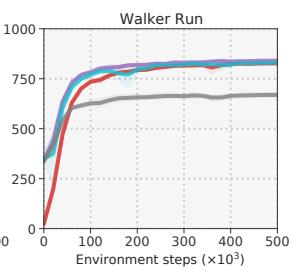  
Figure 7. 模型泛化性。我们的方法在三种不同设置下的回报：（Rand. init）TD-MPC 在两个 Run 任务上从头训练；（Finetune）TD-MPC 最初在 Walk 任务上训练，然后在 Run 任务上进行在线微调，不冻结任何权重；（Finetune,freeze $h _ { \theta } )$ 与前面相同设置，但冻结编码器 h<sub>θ</sub>；以及（Finetune, freeze $h _ { \theta } , d _ { \theta } )$ 冻结编码器 h 和潜移动力学预测器 d。5 次运行的均值；阴影区域为 95% 置信区间。

## A. 模型泛化性

我们研究了 TOLD 模型在相关任务之间的可迁移性。具体而言，我们考虑了 Walker 和 Quadruped 两个运动（locomotion）领域中的模型迁移，其中我们首先在 Walk 任务上训练策略，然后在 Run 任务上微调学习到的模型。我们在在线设置下进行微调，即从头训练与微调之间的唯一区别在于权重初始化，并且我们保持所有超参数完全相同。实验结果如图 Figure 7 所示。当微调完整的 TOLD 模型时，我们发现我们的方法收敛速度明显更快，这表明 TOLD 确实学习到了可以在相关任务之间迁移的特征。我们进行了两个额外的微调实验：在微调期间冻结表征 $h _ { \theta } .$ 的参数，以及同时冻结 $h _ { \theta }$ 和潜移动力学预测器 $d _ { \theta }$ 的参数。我们发现冻结 $h _ { \theta }$ 的结果与不冻结权重的微调结果几乎一致，这表明 $h _ { \theta }$ 学习到了编码可在任务间迁移的信息。然而，当同时冻结 $h _ { \theta } .$ 和 d<sub>θ</sub> 进行微调时，收敛速度大幅下降，这表明 $d _ { \theta }$ 倾向于编码更多特定于任务的行为。

## B. 与以往工作的比较

在此，我们对第 6 节中的相关工作讨论进行扩展。Table 3 提供了 TD-MPC 与以往基于模型和无模型方法的关键组件的定性比较，例如比较模型目标、（终端）价值函数的使用以及推理时的行为。尽管 TD-MPC 的不同方面在以往工作中已有所探索，但我们首次提出了一个完整的框架，用于基于 TD 学习（TD-learning）所学模型的 MPC。

## C. 可变计算预算

本节对图 6 中关于推理期间规划的可变计算预算实验进行了补充；更多结果见图 8。我们观察到，对于具有高维动作空间的任务（例如两个 Quadruped 任务），规划性能与策略性能之间的差距往往更大。我们同样发现，与具有更复杂动力学的任务相比，动力学较简单的任务（例如 Cartpole 任务）在改变计算预算时性能变化相对较小。我们发现我们的默认超参数（$H = 5$ 且迭代 6 次；在图 8 中以星号表示）在计算量和性能之间取得了良好的平衡。

## D. Latent Dynamics Objective

我们通过将公式 10 中提出的潜状态一致性损失替换为以下目标，对潜动力学目标的选择进行了消融实验：(i) 类似于 Ye et al. (2021); Hansen & Wang (2021) 的对比损失（contrastive loss），以及 (ii) 类似于 Ha & Schmidhuber (2018); Hafner et al. (2019; 2020b) 的重构目标。具体而言，对于 (i)，我们采用了最近提出的 SimSiam (Chen & He, 2021) 自监督框架，并将投影层实现为具有 2 个隐藏层且输出大小为 32 的 MLP，预测头则是具有 1 个隐藏层的 MLP。所有层均使用 ELU 激活函数，隐藏层大小为 256。与 Ye et al. (2021); Hansen & Wang (2021) 的公开实现一致，我们发现在投影和预测模块中应用 BatchNorm 是有益的。我们还发现使用更高的损失系数 $c _ { 3 } = 1 0 0$（由 2 调高）会产生稍好的结果。对于 (ii)，我们通过镜像编码器来实现用于状态重构的解码器；即一个具有 1 个隐藏层和 ELU 激活函数的 MLP。为了完整起见，我们还包含了一个无正则化（no regularization）基线。结果如图 10 所示。


Table 3. 与先前工作的对比。我们将 TD-MPC 的关键组件与先前的基于模型和无模型方法进行了比较。Model objective 描述了用于学习（潜）动力学模型的目标，value 表示是否学习了价值函数，inference 提供了推理时动作选择的简要概述，continuous 表示算法是否支持连续动作空间，compute 是对各方法在训练和推理期间相对计算成本的整体估计。我们使用 policy w/ CEM 来表示主要基于学习到的策略进行推理，反之亦然。

<table><tr><td>方法</td><td>模型目标</td><td>价值</td><td>推理</td><td>连续动作</td><td>计算量</td></tr><tr><td>SAC</td><td>✗</td><td>√</td><td>Policy</td><td>√</td><td>低</td></tr><tr><td>QT-Opt</td><td>✗</td><td>√</td><td>CEM</td><td>√</td><td>低</td></tr><tr><td>MPC:sim</td><td>真实环境模型</td><td>✗</td><td>CEM</td><td>√</td><td>高</td></tr><tr><td>POLO</td><td>真实环境模型</td><td>√</td><td>CEM</td><td>√</td><td>高</td></tr><tr><td>LOOP</td><td>状态预测</td><td>√</td><td>Policy 配合 CEM</td><td>√</td><td>中</td></tr><tr><td>PlaNet</td><td>图像预测</td><td>✗</td><td>CEM</td><td>√</td><td>高</td></tr><tr><td>Dreamer</td><td>图像预测</td><td>√</td><td>Policy</td><td>√</td><td>中</td></tr><tr><td>MuZero</td><td>奖励/价值预测</td><td>√</td><td>MCTS 配合策略</td><td>✗</td><td>中</td></tr><tr><td>EfficientZero</td><td>奖励/价值预测 + 对比学习</td><td>√</td><td>MCTS 配合策略</td><td>✗</td><td>中</td></tr><tr><td>TD-MPC（本方法）</td><td>奖励/价值预测 + 潜变量预测</td><td>√</td><td>CEM 配合策略</td><td>√</td><td>低</td></tr></table>

Figure 8. 可变计算预算。我们的方法（TD-MPC）在可变计算预算下的回报。除了 Figure 6 中的任务外，我们还提供了来自 DMControl 的其他四个任务的结果：Quadruped Run $( \mathcal { A } \in \bar { \mathbb { R } } ^ { 1 2 } )$、Fish Swim $( \mathcal { A } \in \mathbb { R } ^ { 5 } )$、Reacher Hard $( \mathcal { A } \in \mathbb { R } ^ { 2 } )$ 和 Cartpole Swingup Sparse $( A \in \mathbb { R } )$。我们在改变（蓝色）规划时域（planning horizon）以及（绿色）规划迭代次数时，评估完全训练好的智能体的表现。为了完整起见，我们还包含了对联合学习策略 $\pi$ 的评估，以及训练期间使用的 6 次迭代和时域为 5 的默认设置。更高的数值需要更多的计算量。5 次运行的均值。

## E. 通过规划进行探索 (Exploration by planning)

我们研究了 TD-MPC 的规划在探索中所起的作用。Figure 9 展示了三个 Humanoid 任务（按难度递增列出：Stand、Walk 和 Run）在规划的最终迭代之后，我们规划过程的平均标准差。我们观察到标准

差（进而代表探索程度）随着训练的推进而减小，并在任务被解决时趋于收敛。总的来说，我们发现对于困难任务，探索程度的下降速度较慢，我们推测这是由于奖励和价值估计中存在更大的方差。因此，TD-MPC 框架在本质上平衡了探索与利用。

## F. 实现细节 (Implementation Details)

我们在第 5 节中提供了我们方法的实现细节概述。为完整起见，我们在 Table 4 中列出了所有相关的超参数。正如附录 G 中所讨论的，我们沿用了 SAC 实现（Yarats & Kostrikov, 2020）中的大部分超参数。遵循先前的研究（Hafner et al., 2019），我们在 DMControl 上使用了特定于任务的动作重复（action repeat）超参数，该参数在所有方法中保持一致；具体数值列表见 Table 7。对于基于状态的实验，我们使用具有单个维度为 256 的隐藏层的 MLP 来实现表征函数 $h _ { \theta }$。对于基于图像的实验，$h _ { \theta }$ 是一个 4 层 CNN，卷积核大小为 (7, 5, 3, 3)，步长为 (2, 2, 2, 2)，每层有 32 个滤波器。所有其他组件均使用维度为 512 的 2 层 MLP 实现。遵循先前的工作（Yarats & Kostrikov, 2020; Srinivas et al., 2020; Kostrikov et al., 2020），我们对价值函数应用了层归一化（layer normalization）。奖励预测器 $R _ { \theta }$ 和价值函数 $Q _ { \theta }$ 最后一层的权重与偏置均采用零初始化，以减少训练早期的模型和价值偏差，所有其他全连接层均采用正交初始化；SAC 和 LOOP 基准模型也进行了类似的实现。无论是在基于状态还是基于图像的实验中，我们都没有发现使用更大的网络能带来持续的提升。在多任务实验中，我们使用独热（one-hot）任务向量来增强状态输入。在多模态实验中，我们分别对状态和图像进行编码，并将特征相加。我们在下文中提供了面向任务的潜动力学模型（task-oriented latent dynamics model）的类似 PyTorch 风格的概述。为清晰起见，我们分别用 S、Z 和 A 表示状态、潜状态和动作的维度，并报告了针对 Walker Run 任务 $( \mathcal { S } \in \mathbb { R } ^ { 2 4 } , \mathcal { A } \in \mathbb { A } ^ { 6 } )$ 初始化的 TOLD 模型的可学习参数总数。

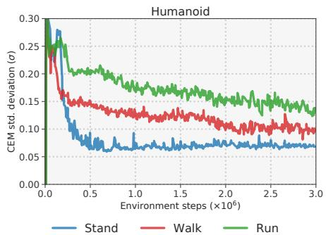  
Figure 9. 通过规划进行探索。在训练过程中，规划过程在最后一次规划迭代后的平均标准差（σ）。结果展示了三个 Humanoid 任务：Stand、Walk 和 Run，按难度递增顺序排列。

```python
Total parameters: approx. 1,507,000
(h): Sequential(
    (0): Linear(in_features=S, out_features=256)
    (1): ELU(alpha=1.0)
    (2): Linear(in_features=256, out_features=Z))
(d): Sequential(
    (0): Linear(in_features=Z+A, out_features=512)
    (1): ELU(alpha=1.0)
    (2): Linear(in_features=512, out_features=512)
    (3): ELU(alpha=1.0)
    (4): Linear(in_features=512, out_features=Z))
(R): Sequential(
    (0): Linear(in_features=Z+A, out_features=512)
    (1): ELU(alpha=1.0)
    (2): Linear(in_features=512, out_features=512)
    (3): ELU(alpha=1.0)
    (4): Linear(in_features=512, out_features=1))
(pi): Sequential(
    (0): Linear(in_features=Z, out_features=512)
    (1): ELU(alpha=1.0)
```

```python
(2): Linear(in_features=512, out_features=512)
(3): ELU(alpha=1.0)
(4): Linear(in_features=512, out_features=A))
(Q1): Sequential(
(0): Linear(in_features=Z+A, out_features=512)
(1): LayerNorm((512,), elementwise_affine=True)
(2): Tanh()
(3): Linear(in_features=512, out_features=512)
(4): ELU(alpha=1.0)
(5): Linear(in_features=512, out_features=1))
(Q2): Sequential(
(0): Linear(in_features=Z+A, out_features=512)
(1): LayerNorm((512,), elementwise_affine=True)
(2): Tanh()
(3): Linear(in_features=512, out_features=512)
(4): ELU(alpha=1.0)
(5): Linear(in_features=512, out_features=1))
```

## 此外，用于训练我们 TOLD 模型的类 PyTorch 伪代码（算法 2 的代码化版本）如下所示：

```python
def update(replay_buffer):
    """
    A single gradient update of our TOLD model.
    h, R, Q, d: TOLD components.
    c1, c2, c3: loss coefficients.
    rho: temporal loss coefficient.
    """
    states, actions, rewards = replay_buffer.sample()

    # Encode first observation
    z = h(states[0])

    # Recurrently make predictions
    reward_loss = 0
    value_loss = 0
    consistency_loss = 0
    for t in range(H):
    r = R(z, actions[t])
    q1, q2 = Q(z, actions[t])
    z = d(z, actions[t])

    # Compute targets and losses
    z_target = h_target(states[t+1])
    td_target = compute_td(rewards[t], states[t+1])
    reward_loss += rho**t * mse(r, rewards[t])
    value_loss += rho**t * \
    (mse(q1, td_target) + mse(q2, td_target))
    consistency_loss += rho**t * mse(z, z_target)

    # Update
    total_loss = c1 * reward_loss + \
    c2 * value_loss + \
    c3 * consistency_loss
    total_loss.backward()
    optim.step()

    # Update slow-moving average
    update_target_network()
```

## G. 基线方法的详细描述

我们对我们的方法和基线方法均进行了调优，使其在 DMControl 上表现良好，随后使用相同的超参数设置在 Meta-World 上对各算法进行基准测试。在下文中，我们提供了关于基线实现调优工作的更多细节。

SAC。我们采用了 Yarats & Kostrikov (2020) 的实现，该实现已在文献中被广泛用作基于状态的 DMControl 的基准实现。除了目标网络动量系数 ζ 之外，我们使用原始超参数；我们发现将原始实现中的 0.995 改为更快的更新速率 ζ = 0.99 对 SAC、LOOP 以及我们的方法都有益。此外，为了与我们的方法进行公平比较，我们将批次大小从 1024 减小到 512。为了完整起见，我们在 Table 5 中列出了 SAC 基线的重要超参数。

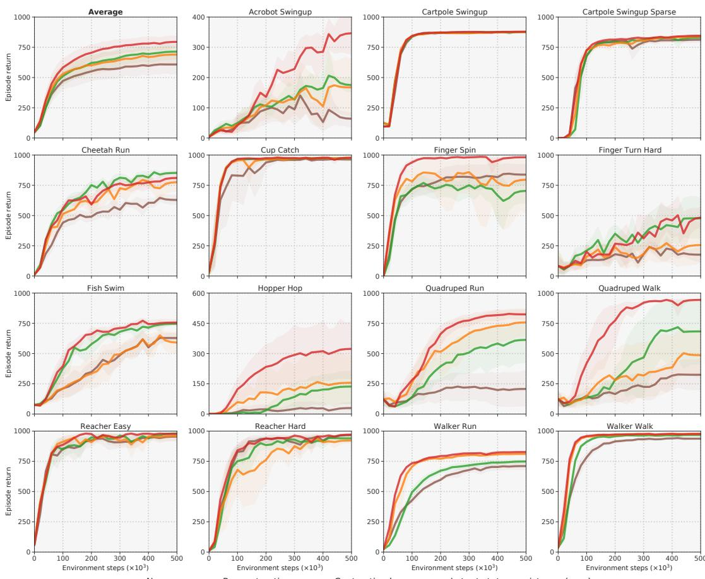  
Figure 10. 潜动力学目标。除奖励和价值预测外，使用不同潜动力学目标时我们方法（TD-MPC）的回报。来自 DMControl (Tassa et al., 2018) 的 15 个基于状态的连续控制任务。No reg. 表示不使用正则化项，reconstruction 使用状态预测损失，contrastive loss 采用 Ye et al. (2021); Hansen & Wang (2021) 的对比目标，latent state consistency 对应于公式 10。5 次运行的均值；阴影区域为 95% 置信区间。在左上方，我们可视化了所有 15 个任务的平均结果。重构损失和对比损失相较于无正则化的基线均有所提升，但我们提出的潜状态一致性损失取得了更为一致的结果。

LOOP。我们以 Sikchi et al. (2022) 的官方实现为基准进行对比，但据我们所知，LOOP 此前未在 DMControl 或 Meta-World 上进行过基准测试。因此，我们尽最大努力调整其超参数。与 SAC 实现中一样，我们发现 LOOP 使用 ζ = 0.99 时的表现优于其原始值 0.995，并且我们将批次大小从 256 增加到 512。最后，我们将种子步数设置为 1, 000（从 10, 000 减少）以匹配 SAC 的实现。由于 LOOP 使用 SAC 作为骨干学习算法，我们发现这些调整是有益的。LOOP 特定的

## 超参数列于 Table 6 中。

MPC:sim。我们将 TD-MPC 与一个使用环境真实模型（仿真器）但不包含终端价值函数的原生 MPC 算法进行比较。因此，该基线是非参数化的。我们使用了与我们方法中相同的 MPC 实现（MPPI；Williams et al. (2015)）。由于使用仿真器进行规划的计算开销很大，我们将规划视界（planning horizon）限制为 10（仍是 TD-MPC 的 2 倍），并将迭代次数减少到 4（我们的方法使用 6），因为我们发现使用真实模型时 MPC 收敛更快。在每次迭代中，我们采样 N = 200 条轨迹，并使用排名前 20（10%）的采样动作序列来更新分布参数。我们保持所有其他超参数与我们的方法一致。由于规划视界有限，该 MPC 基线在局部解即可满足要求的运动（locomotion）任务中通常表现良好，但在例如稀疏奖励等任务中往往会失败。

Table 4. TD-MPC 超参数。我们在此列出了带有 TOLD 的 TD-MPC 的超参数，并强调在可能的情况下，我们对 SAC 采用了相同的参数。

<table><tr><td>超参数</td><td>取值</td></tr><tr><td>折扣因子 ( $\gamma$ )</td><td>0.99</td></tr><tr><td>种子步数</td><td>5,000</td></tr><tr><td>经验回放缓冲区大小</td><td>无限制</td></tr><tr><td>采样技术</td><td>PER ( $\alpha = 0.6, \beta = 0.4$ )</td></tr><tr><td>规划视界 ( $H$ )</td><td>5</td></tr><tr><td>初始参数 ( $\mu^{0}, \sigma^{0}$ )</td><td>(0,2)</td></tr><tr><td>种群大小</td><td>512</td></tr><tr><td>精英数量</td><td>64</td></tr><tr><td>迭代次数</td><td>12 (Humanoid)8 (Dog, pixels)6 (其他)</td></tr><tr><td>策略比例</td><td>5%</td></tr><tr><td>粒子数量</td><td>1</td></tr><tr><td>动量系数</td><td>0.1</td></tr><tr><td>温度 ( $\tau$ )</td><td>0.5</td></tr><tr><td>MLP 隐藏层大小</td><td>512</td></tr><tr><td>MLP 激活函数</td><td>ELU</td></tr><tr><td>潜在维度</td><td>100 (Humanoid, Dog)50 (其他)</td></tr><tr><td>学习率</td><td>3e-4 (Dog, pixels)1e-3 (其他)</td></tr><tr><td>优化器 ( $\theta$ )</td><td>Adam ( $\beta_{1} = 0.9, \beta_{2} = 0.999$ )</td></tr><tr><td>时间系数 ( $\lambda$ )</td><td>0.5</td></tr><tr><td>奖励损失系数 ( $c_{1}$ )</td><td>0.5</td></tr><tr><td>价值损失系数 ( $c_{2}$ )</td><td>0.1</td></tr><tr><td>一致性损失系数 ( $c_{3}$ )</td><td>2</td></tr><tr><td>探索调度 ( $\epsilon$ )</td><td> $0.5 \rightarrow 0.05$  (25k steps)</td></tr><tr><td>规划视界调度</td><td> $1 \rightarrow 5$  (25k steps)</td></tr><tr><td>批次大小</td><td>2048 (Dog)256 (pixels)512 (其他)</td></tr><tr><td>动量系数 ( $\zeta$ )</td><td>0.99</td></tr><tr><td>每次梯度更新步数</td><td>1</td></tr><tr><td> $\theta^{-}$  更新频率</td><td>2</td></tr></table>

Table 5. SAC 超参数。我们列出了 SAC 基线的关键超参数。请注意，我们主要遵循 Yarats & Kostrikov (2020) 的实现，但改进了某些超参数的选择，例如动量系数 $\zeta$ 以及特定于 Dog 任务的数值。

<table><tr><td>超参数</td><td>数值</td></tr><tr><td>折扣因子 ( $\gamma$ )</td><td>0.99</td></tr><tr><td>种子步数</td><td>1,000</td></tr><tr><td>经验回放缓冲区大小</td><td>无限制</td></tr><tr><td>采样方式</td><td>均匀采样</td></tr><tr><td>MLP 隐藏层维度</td><td>1024</td></tr><tr><td>MLP 激活函数</td><td>RELU</td></tr><tr><td>隐空间维度</td><td>100 (Humanoid, Dog)50 (其他)</td></tr><tr><td>优化器 ( $\theta$ )</td><td>Adam ( $\beta_1 = 0.9, \beta_2 = 0.999$ )</td></tr><tr><td>优化器 (SAC 的 $\alpha$ )</td><td>Adam ( $\beta_1 = 0.5, \beta_2 = 0.999$ )</td></tr><tr><td>学习率 ( $\theta$ )</td><td>3e-4 (Dog)1e-3 (其他)</td></tr><tr><td>学习率 (SAC 的 $\alpha$ )</td><td>1e-4</td></tr><tr><td>批大小</td><td>2048 (Dog)512 (其他)</td></tr><tr><td>动量系数 ( $\zeta$ )</td><td>0.99</td></tr><tr><td>每次梯度更新步数</td><td>1</td></tr><tr><td> $\theta^-$ 更新频率</td><td>2</td></tr></table>

Table 6. LOOP 超参数。我们在 Table 5 中列出了 LOOP 共用的通用 SAC 超参数，此处仅列出特定于 LOOP 的超参数。我们使用了 Sikchi et al. (2022) 的官方实现，但为了完整性列出了其超参数。请注意，与 SAC 实现中一样，我们使用了与 Sikchi et al. (2022) 不同的批大小和动量系数，因为我们发现这能略微提升在 DMControl 上的性能。

<table><tr><td>超参数</td><td>数值</td></tr><tr><td>规划时域 (H)</td><td>3</td></tr><tr><td>种群大小</td><td>100</td></tr><tr><td>精英比例</td><td>20%</td></tr><tr><td>迭代次数</td><td>5</td></tr><tr><td>策略比例</td><td>5%</td></tr><tr><td>粒子数量</td><td>4</td></tr><tr><td>动量系数</td><td>0.1</td></tr><tr><td>MLP 隐藏层维度</td><td>256</td></tr><tr><td>MLP 激活函数</td><td>ELU/RELU</td></tr><tr><td>集成大小</td><td>5</td></tr></table>

无隐空间消融实验。我们对我们的方法进行了如下修改：将 $h _ { \theta }$ 替换为恒等函数，即 $\mathbf { x } = h _ { \theta } ( \mathbf { x } )$ 。因此，环境动力学直接在状态空间中通过前向预测进行建模，一致性损失实际上退化为状态预测损失。该消融实验使我们的方法更类似于以往基于状态的基于模型强化学习（model-based RL）的工作（Janner et al., 2019; Lowrey et al., 2019; Sikchi et al., 2022; Argenson & Dulac-Arnold, 2021）。然而，与以往将模型学习与策略及价值学习解耦的工作不同，我们仍然将来自奖励和价值目标函数的梯度通过模型进行反向传播，这是一个更强的基线。

无一致性正则化。我们将公式 10 中对应于潜在状态一致性损失的系数 $c _ { 3 }$ 设为 0，使得 TOLD 模型仅通过奖励和价值预测损失进行训练。该消融实验使我们的方法更类似于 MuZero (Schrittwieser et al., 2020)。

其他基线。其他基准模型的结果均来自相关工作。具体而言，SAC、CURL、DrQ 和 PlaNet 的结果取自 Srinivas et al. (2020) 以及 Kostrikov et al. (2020)，而 Dreamer、MuZero 和 EfficientZero 的结果取自 Hafner et al. (2020b) 以及 Ye et al. (2021)。

## H. 推理时间

在第 5 节的实验中，我们研究了 TD-MPC 规划的性能与计算预算之间的关系。为了完整起见，我们还评估了计算预算与推理时间之间的关系。Figure 11 展示了随着规划时域和迭代次数的变化，TD-MPC 的推理时间。与先前的实验一致，我们在单块 RTX3090 GPU 上测试推理时间基准。不出所料，我们发现计算预算与推理时间之间存在近似线性的关系。然而，值得注意的是，我们在训练期间使用的默认设置每步仅需约 20ms（即 50Hz），这对于许多实时机器人应用（例如操纵、导航，以及在某种程度上的运动控制，假定配备机载 GPU）来说已经足够快。对于对推理时间要求严苛的应用，可以调整计算预算以满足要求。例如，我们在 Figure 8 中发现，在 Quadruped Run 任务上可以将 TD-MPC 的规划时域从 5 减少到 1，而性能没有明显下降，这使得每步的推理时间降至约 12ms。虽然与 TD-MPC 联合学习的无模型策略的性能确实低于规划，但在推理时它仍然比规划快近 6 倍。

默认策略  
Table 7. 动作重复。我们从先前的工作 (Hafner et al., 2019; Kostrikov et al., 2020) 中沿用了 DMControl 在基于状态的实验以及 DMControl 100k 基准中的动作重复超参数；我们在下方列出了所有数值。对于 DMControl Dreamer 基准，所有方法无论何种任务均使用 2 的动作重复。对于 Meta-World，我们不使用动作重复。

<table><tr><td>任务</td><td>动作重复</td></tr><tr><td>Humanoid</td><td>2</td></tr><tr><td>Dog</td><td>2</td></tr><tr><td>Walker</td><td>2</td></tr><tr><td>Finger</td><td>2</td></tr><tr><td>Cartpole</td><td>8</td></tr><tr><td>Other (DMControl)</td><td>4</td></tr><tr><td>Meta-World</td><td>1</td></tr></table>

  
时域（Horizon） CEM 迭代次数

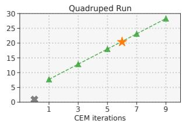  
Figure 11. 可变预算下的推理时间。TD-MPC 在 Quadruped Run 任务中不同计算预算下每个决策步骤的毫秒数。我们评估了在改变（左）规划视界（planning horizon）；（右）规划期间迭代次数时完全训练好的智能体的性能。当改变一个超参数时，另一个固定为默认值。为了完整起见，我们还包含了学到的策略 $\pi$ 的推理时间，以及训练期间使用的 6 次迭代和视界为 5 的默认设置。

Table 8. Meta-World MT10。由于我们在 Figure 5 中报告的性能指标与 Meta-World v2 基准提案（Yu et al., 2019）不同，我们在此使用与原论文中 MT10 多任务实验相同的每个任务最大成功率指标来报告我们 SAC 基线的结果。

<table><tr><td>Task</td><td>Max. success rate</td></tr><tr><td>Window Close</td><td>1.00</td></tr><tr><td>Window Open</td><td>1.00</td></tr><tr><td>Door Open</td><td>1.00</td></tr><tr><td>Peg Insert Side</td><td>0.00</td></tr><tr><td>Drawer Open</td><td>0.85</td></tr><tr><td>Pick Place</td><td>0.00</td></tr><tr><td>Reach</td><td>1.00</td></tr><tr><td>Button Press Down</td><td>1.00</td></tr><tr><td>Push</td><td>0.00</td></tr><tr><td>Drawer Close</td><td>1.00</td></tr></table>

## I. Meta-World

我们在 Figure 14 中提供了单个 Meta-World（Yu et al., 2019）任务的学习曲线和成功率。由于任务数量庞大，我们选择仅可视化来自 Meta-World 总共 50 个任务中的前 24 个任务（按字母顺序排序）。注意，我们使用的是 Meta-World v2，并且考虑的是目标条件化（goal-conditioned）的任务版本，这被认为比相关工作中常用的单目标变体更难。我们普遍发现 SAC 在大多数任务中与 TD-MPC 相当，但 TD-MPC 在涉及复杂操作的任务中样本效率高得多，例如 Bin Picking、Box Close 和 Hammer。这三个任务中每个任务的成功轨迹都在 Figure 15 中进行了可视化。通常，我们选择专注于样本效率，经验表明 1M 环境步数（多任务实验为 3M）足以在 Meta-World 中实现显著的成功率。由于原论文在多任务实验中报告的是每个任务的最大成功率而不是平均成功率，我们也在 Table 8 中报告了我们 SAC 基线的这一指标。考虑到我们仅在 3M 步内进行评估，我们发现我们的 SAC 基线与原论文的结果相比具有惊人的竞争力。

## J. 多模态强化学习（Multi-Modal RL）

我们在两个 3D 运动任务中展示了 TD-MPC 成功融合来自多种输入模态（本体感觉数据 + 自我中心视角相机）信息的能力：

− Quadruped Corridor，智能体需要以恒定的目标速度沿着走廊移动。为了成功完成任务，智能体必须感知走廊墙壁并相应地调整其行走方向。

− Quadruped Obstacles，智能体需要沿着充满障碍物的走廊移动，这些障碍物会遮挡视线并迫使智能体以恒定的目标速度呈之字形移动。为了成功完成任务，智能体必须同时感知走廊墙壁和障碍物，并持续调整其行走方向。

  
Figure 12. Rliable 指标。TD-MPC 和基线在 15 个基于状态的 DMControl 任务上的中位数、四分位距均值（IQM）和均值表现。置信区间按照 Agarwal et al. (2021) 的建议，使用分层抽样的百分位数自举法进行估计。数值越高越好。5 个随机种子。

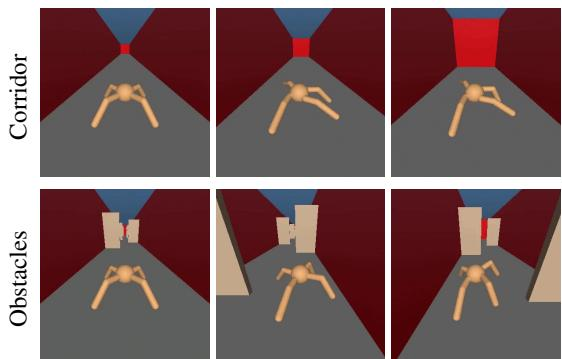  
后续页面包含补充材料 ↓  
Figure 13. 多模态强化学习。我们构建的两个多模态 3D 运动任务的可视化。

这两个任务的轨迹如图 Figure 13 所示。

## K. 附加指标

我们使用 Agarwal et al. (2021) 提供的 rliable 工具包，报告了 SAC、LOOP 和 TD-MPC 在 15 个基于状态的 DM-Control 任务集上的附加（聚合）性能指标。具体而言，我们报告了基于训练后（经过 500k 环境步数）智能体的回合回报计算得出的聚合中位数、四分位距均值（IQM）以及带有 95% 置信区间的平均回报。按照 Agarwal et al. (2021) 的建议，置信区间使用分层抽样的百分位数自举法进行估计。

## L. 任务可视化

Figure 15 提供了由 TD-MPC 在来自 DMControl 和 Meta-World 的七个任务上生成的成功轨迹的可视化，TD-MPC 解决所有这些任务所用的环境步数均少于 1M 步。在这全部七个轨迹中，我们仅展示了轨迹中的关键帧，因为实际的回合长度分别为 1000（DMControl）和 500（Meta-World）。完整的视频轨迹请参见 https://nicklashansen.github.io/td-mpc。

  
Figure 14. 单个 Meta-World 任务。我们的方法（TD-MPC）和 SAC 在来自 Meta-World (Yu et al., 2019) 的多样化操作任务上的成功率。我们使用的是目标条件版本的 Meta-World，该版本被认为比固定目标版本更具挑战性。由于任务数量较多（50 个），我们选择仅可视化前 24 个任务（按字母顺序排序）。5 次运行的均值；阴影区域为 95% 置信区间。我们的方法能够解决 SAC 仅取得较低成功率的复杂任务（例如 Basketball）。请注意，我们使用的是 Meta-World v2，因此性能无法与使用 v1 的先前工作直接比较。

time −→

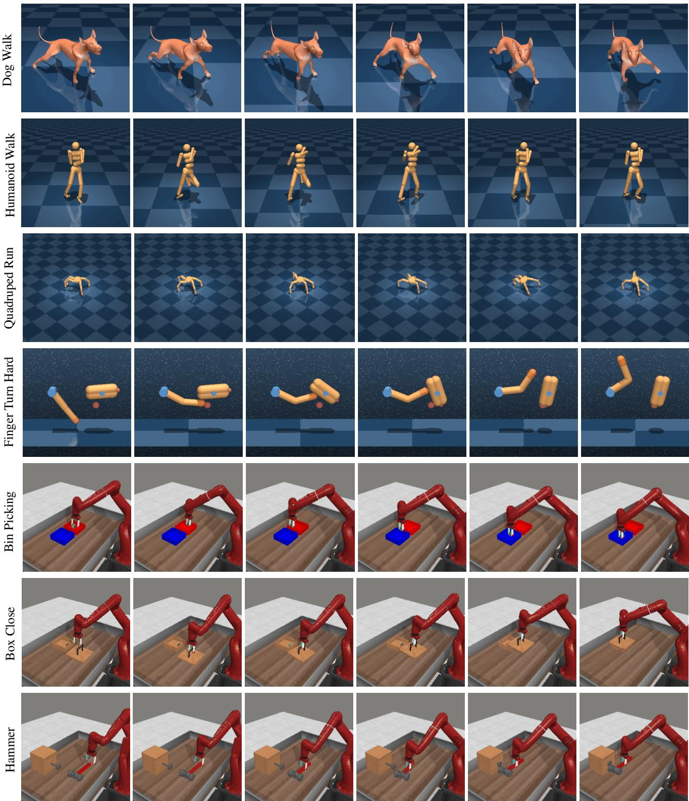  
Figure 15. 可视化。我们展示了本文方法在两个基准的七个选定任务上生成的轨迹，（从上到下）依次排列如下：(1) Dog Walk，一个具有高维动作空间 $( \mathcal { A } \in \mathbb { R } ^ { 3 8 } )$ 的挑战性运动任务；(2) Humanoid Walk，一个具有挑战性的运动任务 $( \mathcal { A } \in \mathbb { R } ^ { 2 1 } )$；(3) Quadruped Run，一个四足运动任务 $( \bar { \mathcal { A } } \in \mathbb { R } ^ { 1 2 } )$；(4) Finger Turn Hard，一个具有稀疏奖励的困难探索任务；(5) Bin Picking，一个三维抓取与放置任务；(6) Box Close，一个三维操作任务；最后是 (7) Hammer，另一个三维操作任务。在所有七个轨迹中，我们仅展示了轨迹中的关键帧。实际的回合长度分别为 1000（DMControl）和 500（Meta-World）。我们的方法（TD-MPC）能够在少于 1M 环境步数内解决其中的每个任务。视频结果可在 https://nicklashansen.github.io/td-mpc 获取。