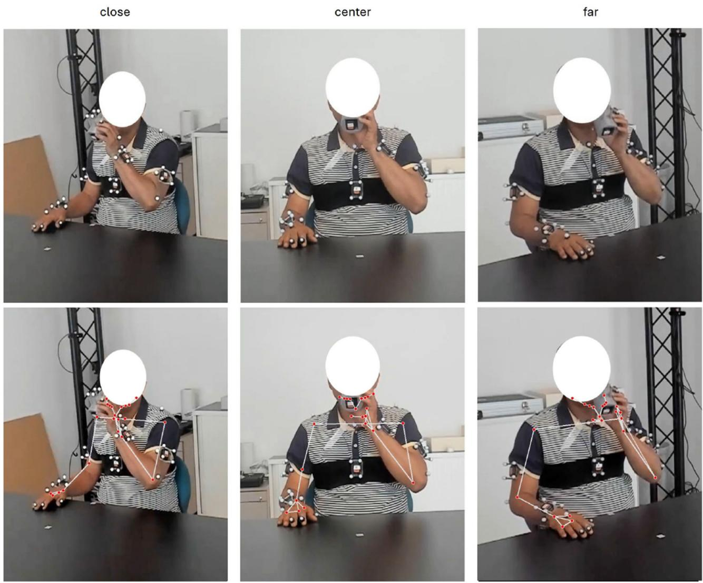
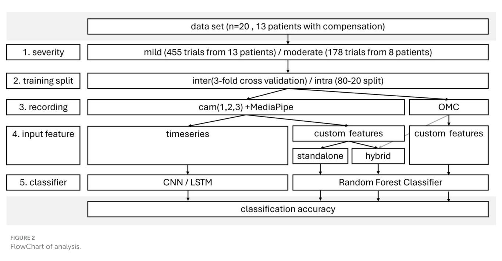
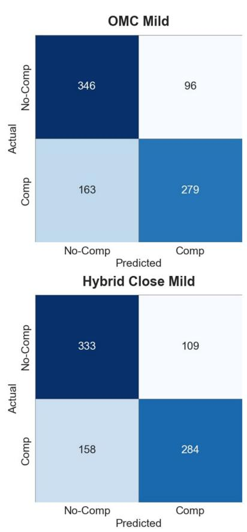
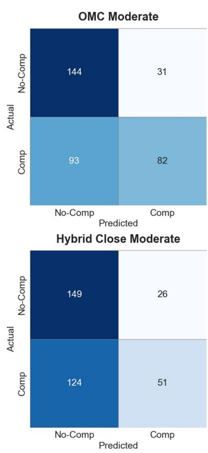

# 基于消费级网络摄像头利用深度学习检测卒中后患者上肢代偿——可行性研究

## 检查更新

## 开放获取（OPEN ACCESS）

编辑：Wei Wang，Sun Yat-sen University（中山大学），中国

审稿人：Rita Chiaramonte，University of Catania，意大利；Dante Trabassi，Sapienza University of Rome，意大利；Paolo Tasca，Polytechnic University of Turin，意大利

\*通信作者：Tim Unger tim.unger@llui.org

†这些作者共同享有第一作者署名 ‡这些作者共同享有末位作者署名

收稿日期：2025年6月11日；录用日期：2025年10月13日；发表日期：2025年11月14日

## 引用格式

Unger T. Kühnis B. Sauerzopf L. Spiess MR, de Spindler A, Luft AR, Easthope Awai C, Schönhammer JG and Gavagnin E (2025) Using deep learning to detect upper limb compensation in individuals post-stroke using consumer-grade webcams—A feasibility study. Front, Med. 12:1645369 doi: 10.3389/fmed.2025.1645369

## 版权

2025 Unger, Kühnis, Sauerzopf, Spiess, de Spindler, Luft, Easthope Awai, Schönhammer and Gavagnin. 这是一篇遵循知识共享署名许可协议（Creative Commons Attribution License, CC BY）分发的开放获取文章。在遵循公认学术规范的前提下，只要注明原作者和版权所有者，并引用本期刊的原始发表信息，即允许在其他平台中使用、传播或复制。任何不符合这些条款的使用、传播或复制均不被允许。

Tim Unger1\*†, Benjamin Kühnis2†, Lena Sauerzopf3,4, Martina R. Spiess3,4, Alexander de Spindler2, Andreas R. Luft5,6,7, Chris Easthope Awai1, Josef G. Schönhammer5,7‡ and Elena Gavagnin2,8‡

¹Data Analytics and Rehabilitation Technology (DART), Lake Lucerne Institute, Vitznau, Switzerland 2ZHAW School of Management and Law, Institute of Business Information Technology, Winterthur, Switzerland, 3ZHAW School of Health Sciences, Institute of Occupational Therapy, Winterthur, Switzerland, 4Faculty of Medicine, University of Zurich, Zurich, Switzerland, ⁵Division of Vascular Neurology and Neurorehabilitation, Department of Neurology and Clinical Neuroscience Center, University of Zurich and University Hospital Zurich, Zurich, Switzerland, 6Cereneo, Center for Neurology and Rehabilitation, Vitznau, Switzerland, 7Neurocore Lab, Lake Lucerne Institute, Vitznau. Switzerland, 8ZHAW School of Engineering, Centre for Artificial Intelligence, Winterthur, Switzerland

随着社会老龄化，中风患者人数不断增加，迫切需要更有效的康复策略。超过半数的中风幸存者伴有上肢功能障碍，这使得感觉运动功能的评估对于改进干预措施和追踪康复进展至关重要。理想情况下，此类评估也可以在无需治疗师在场的情况下于家中进行。计算机视觉和人体姿态估计（human pose estimation）的进步，使得利用消费级摄像头进行人体运动分析成为可能。本研究探讨了结合人体姿态估计与深度学习算法的单个网络摄像头（webcam），是否能够自动检测中风患者在执行饮水任务时的代偿动作。本研究招募了 20 名伴有轻度至中度上肢功能障碍的中风受试者。每位受试者多次重复执行饮水任务，同时通过多个摄像头和光学动作捕捉系统（optical motion capture, OMC，用于提供运动学真实真值）进行记录。视频由治疗师进行标注，以指示是否存在代偿动作。使用 MediaPipe 从视频中提取人体姿态，并训练深度学习模型基于 MediaPipe 关键点预测这些代偿动作。本研究评估了影响代偿检测准确率的若干因素。基于原始 MediaPipe 关键点训练的用于人际间（inter-person）代偿检测的模型未能实现良好的泛化，准确率仅在 50% 左右。使用自定义特征替代原始关键点将准确率提高到了 70%。相比之下，个体自身内部（intraperson）分类取得了较高的准确率，通常超过 90%。与使用 MediaPipe 关键点相比，使用 OMC 数据显著提高了分类准确率。摄像头角度对准确率存在影响，且卷积神经网络（convolutional neural networks, CNN）的表现优于长短期记忆网络（long short-term memory networks, LSTM）。泛化模型的性能仍受到以下因素的限制：(1) 人体姿态估计的测量不确定性；(2) 代表全部代偿策略谱系的数据不足；(3) 代偿标签的准确性。结果表明，当运动表征足够精确时，深度学习方法能够区分代偿动作与非代偿动作。未来的工作应改进姿态估计并扩充标注数据集，以更好地反映中风患者群体的情况。尽管通用模型的准确率有限，但使用消费级摄像头的个性化模型可为居家康复提供支持。这种数字化评估方法具有在整个连续医疗护理过程中量化康复进展的潜力。

关键词

中风, 评估, 运动质量, 上肢, 人工智能, 计算机视觉, 人体姿态估计, 网络摄像头

## 1 引言

全球人口正在迅速老龄化 (1)。年龄是脑卒中（stroke）的一项显著且不可改变的危险因素，脑卒中病例数预计也将随之增加 (2)。目前，全球有超过 1 亿脑卒中幸存者，每年报告的新发病例达 1200 万 (3)。在这些幸存者中，多达 50% 经历慢性上肢功能障碍 (4)，如关节活动度降低、病理协同动作、运动协调问题和痉挛 (5)，严重限制了他们在日常生活中的独立性。这种日益增加的负担对医疗保健系统提出了重大挑战，凸显了对更有效、可扩展的康复策略以改善患者预后的紧迫需求。

为应对这些挑战，在住院、门诊和居家护理中最大限度地提高康复效果至关重要。远程康复和技术辅助解决方案正在成为这项工作中不可或缺的工具 (6)。通过神经可塑性实现脑卒中患者上肢功能的真正康复是理想目标，这涉及通过神经通路的重构来恢复运动功能 (7)。这构成了结合传统与创新疗法以恢复功能的康复策略的一部分 (8)。然而，许多脑卒中患者依赖代偿策略（例如使用未受累肢体或采用适应不良的运动模式）来恢复功能。尽管这些策略能带来短期益处，但它们可能会阻碍神经可塑性恢复，并强化不良的运动习惯 (9)。因此，对代偿的严重依赖可作为神经可塑性恢复受限的生物标志物 (10–12)。

常见的代偿模式包括躯干倾斜、肩外展和耸肩。为了在不增加治疗师工作负担的情况下将这些代偿与真正康复区分开来，采用基于仪器的技术化评估越来越受到支持 (9)。

该方法面临三个主要挑战：选择适当的运动任务、准确测量运动，以及量化运动质量/检测代偿运动。由 Kwakkel 等人 (9) 提出作为标准化运动任务的饮水任务（drinking task）(13)，尤其适用于脑卒中康复。它是实现自主性所必需的关键日常生活活动，并包含伸手和手到口动作等基本运动原语（movement primitives），使其既具有功能相关性，又易于标准化。作为该框架的延伸，目前也有研究尝试从连续活动流中分割特定类型的功能性动作，从而迈向在日常生活活动中对上肢运动质量进行连续评估 (14)。

虽然光学运动捕捉（OMC）系统能够提供高精度的运动学数据 (13, 15)，但其成本和复杂性限制了其在临床和家庭环境中的广泛应用。替代方法，例如 RGB 和 RGB-D 相机 (16, 17)、惯性测量单元（IMU）(18–20) 以及多相机 3D 重建系统 (21)，提供了更易获取且经济实惠的解决方案，但在精度上有所折衷。

配备集成摄像头的消费级设备（如智能手机、平板电脑和笔记本电脑）普及度高，能够实现对运动质量和康复进展的客观、大规模远程评估。

主要目标：评估使用单目 RGB 相机和深度学习模型检测脑卒中患者在执行饮水任务时上肢代偿运动的可行性。

次要目标：系统研究影响检测精度的因素，确定实现完整临床功能所需解决的主要挑战。为此，评估了以下因素对代偿检测性能的贡献：

1. 代偿严重程度：根据治疗师的标注，参与者被分为轻度或中度代偿者。假设：更严重的代偿更容易被检测到，从而使该亚组具有更高的分类准确率。

2. 跨参与者与参与者内分类：鉴于代偿策略和运动模式的变异性，以及缺乏全面捕捉脑卒中后代偿的大规模数据集，评估了以下因素：

跨参与者（Inter-Participant）：在一组参与者上进行训练，并在之前未见过的参与者上进行测试。

参与者内（Intra-Participant）：在某一参与者的部分试验数据上进行训练，并在该参与者的其他试验数据上进行测试。

3. 相机视角与运动数据质量：由于姿态估计精度取决于视角，本研究对比了饮水任务中三种可在“居家”环境下复现的视角：正视图、45° 同侧（近端）和 45° 对侧（远端）。选择 MediaPipe 是因为其可在消费级设备上运行，从而避免了在云端处理时可能出现的数据安全问题。为了区分姿态估计噪声与分类性能的影响，基准结果基于以下数据进行评估：

高质量光学运动捕捉（OMC）数据（金标准）。

来自单目 RGB 相机的更具噪声的人体姿态估计（HPE）数据。

4. 输入特征：对比自定义运动学特征与原始关键点时间序列数据在代偿运动分类中的表现。

5. 分类器架构：评估不同的分类模型：

用于时间序列数据的 CNN 和 LSTM。

用于自定义运动学特征的随机森林（Random Forest）。

本研究旨在通过提供可扩展的、数据驱动的工具来量化运动质量，从而推进脑卒中康复，这与欧洲脑卒中康复指南 (9, 11) 相契合。

## 2 方法与分析

## 2.1 参与者

本研究严格遵守伦理标准（《赫尔辛基宣言》（Declaration of Helsinki）及瑞士国家标准），并获得了当地伦理委员会的批准（BASEC 编号：2022-00491）。受试者招募自苏黎世大学医院卒中登记库（University Hospital Zurich Stroke Registry）和 cereneo 诊所（cereneo clinic）。符合研究条件的受试者被邀请参加单次时长约两至三小时的测量。纳入标准要求受试者年满 18 周岁，具备提供知情同意的能力，且确诊为偏瘫性卒中。此外，受试者需要具备至少部分无需协助即可使用患手完成伸展触及动作并以圆柱握方式抓握水杯的能力。排除标准包括既往存在的上肢功能障碍（如骨科损伤）以及其他神经系统疾病。

收集了受试者的人口统计学特征，并使用上肢 Fugl-Meyer 评估（Fugl-Meyer Assessment for Upper Extremity, FMA-UE）评估了上肢感觉运动障碍的严重程度。FMA-UE 由一名经过培训的评估员在单次测试期间与饮水任务的测量一并完成。最终样本包含 20 名卒中患者［14 名慢性期（卒中发病时间 > 6 个月），6 名亚急性期（卒中发病时间在 1 至 6 个月之间）］，在测试当天评估的 FMA-UE 平均得分为 51.7（11.5），反映了中度的上肢功能障碍水平，其人口统计学数据（平均年龄 72 岁，14 名男性，6 名女性）与以往的研究（22）相匹配。处于亚急性期的受试者是在其于 cereneo 诊所康复住院期间招募的。

## 2.2 测量程序

测量流程遵循先前研究（22）中建立的方案，要求参与者以标准化姿势开始和结束饮水任务。杯子始终放置在距离桌子边缘 30 cm 处（见 Figure 1）。杯中装有约 100 ml 水，并在测试间隙按需补充。饮水任务的每次重复均被视为一次测试（trial）。参与者被要求在每次测试中喝一小口水。在极少数参与者掉落水杯并洒水的情况下（有 2 名参与者出现此情况），水被替换为重量相近的球，并要求参与者无论如何都要继续完成饮水动作。每位参与者先用受影响较轻的手臂完成 40 次饮水任务测试，随后用受影响较重的手臂完成 40 次测试。受影响较轻的手臂作为对照，代表年龄匹配的健全个体的代理数据。每次测试均单独记录，参与者在每次测试开始时都会收到口头指令，记录在测试完成时停止，并在新测试开始时重新启动。在重复数次后，会询问参与者是否需要休息；如需休息，则提供休息时间以尽量减少潜在的疲劳影响。如果某些测试被认定为无效（例如，在开始记录之前动作就已发生，或动作未完成），则会进行额外补充测试。完成饮水任务后，进行了 FMA-UE 评估。

## 2.3 测量系统

本研究采用了两套主要的测量系统：网络摄像头和 OMC（光学动作捕捉）系统。包括桌子、杯子、记录视角以及参与者身上的 OMC 标记点在内的测量装置如图 Figure 1 所示。两套系统通过由 OMC（主设备）触发的 LED 自动实现同步，该 LED 在网络摄像头的视野内可见，用于标记记录的开始和结束。

OMC：OMC 系统的采样频率为 100 Hz，根据具体的测量配置，采用了来自 Vicon、Qualisys 或 Optitrack 的技术，并利用了 7 到 10 台 OMC 相机。根据以往使用 OMC 测量饮水任务的研究（13, 22）的标准标记点设置，研究在手臂、躯干和面部的解剖标志点上布置了 9 个逆反射标记点用于分析。任务中所使用的杯子为 3D 打印制作，可粘贴 OMC 标记点，这对阶段分类至关重要。

网络摄像头：三台 Logitech Brio 4k 网络摄像头放置在参与者前方约 1.5m 处。一台摄像机置于 0 度拍摄角度（中央摄像机），另外两台置于朝向参与者额状面 45 度拍摄角度。被称为“近端（close）”的 45 度摄像机放置在执行饮水任务的一侧。各网络摄像头进行了内部同步，并以 1,080p（1,920 1,080）分辨率、每秒 60 帧的速度连续录制。摄像机视角的选择基于其在临床或家庭环境中使用平板电脑、笔记本电脑或类似终端设备的可重复性，旨在确定用于分类精度的最佳拍摄角度。

  
参与者执行饮水任务，从三个不同的摄像机视角（“近端”、“中央”、“远端”）以及光学运动捕捉和相应的关键点叠加进行记录。

## 2.4 数据准备与建模

使用与 OMC 系统同步的 LED 信号，来自每个摄像机的视频被自动分割为各个试验。根据 Alt Murphy (22) 的研究，OMC 数据进一步使饮水任务能够细分为五个阶段：(1) 伸展（包括抓握），(2) 向前运送（杯子到嘴），(3) 饮水，(4) 向后运送（杯子到桌子，包括释放），以及 (5) 返回（手回到初始位置）。

经验丰富的治疗师根据 Barth 等人 (23) 的检查清单和伸手表现量表（Reaching Performance Scale, 24）（并在 Sauerzopf 等人 (25) 中进行了详尽描述）对每个阶段的代偿运动进行了标注。肩部代偿定义为在肩屈不足情况下的过度肩胛骨抬高、耸肩或外展。手部代偿包括手部张开或抓握不充分。每位参与者患侧标注了大约 40 次试验，而健侧试验则一致标注为无代偿。该标注提供了跨参与者、阶段和代偿类型的真值（ground truth）。由于测量噪声，使用 MediaPipe 进行可靠的手部代偿检测不可行，因此随后的分析重点放在了肩部代偿上。

代偿严重程度被归类为轻度（1 个阶段标注为是）、中度（3 个阶段标注为是）和较少受累（所有阶段均为否）。排除了无代偿的参与者（没有任何试验被标注为代偿“是”），最终得到 13 名存在肩部代偿的参与者。采用欠采样以使代偿性和非代偿性试验具有相等的代表性。数据归一化包括按双耳间距缩放，以及镜像右手试验以确保一致的左手表示。

使用 MediaPipe BlazePose（重型模型，heavy model）(26) 从所有视频中提取姿态数据。在可用的 33 个 3D 关键点中，仅保留了上半身关键点（0–22），并且由于坐姿参与者的深度信息不可靠，分析中采用了 2D 坐标。三个摄像机视角（近景、远景、中心）分别进行处理，以便后续评估视角效应。

除原始关键点外，还参考 Alt Murphy (22) 从 MediaPipe 和 OMC 中提取了自定义运动学特征（Table 1）。这些特征包括最小肘部伸展度、最大肩关节角度和峰值切向速度等指标。某些特征需要相位持续时间，这些持续时间既通过 OMC 计算，也直接从 MediaPipe 关键点计算。这种双重方法允许在基于精确 OMC 的相位分割与噪声更大、纯粹基于视觉的分割之间进行比较。假定从 OMC 衍生的特征具有最小的测量误差，因此作为基准。在这些特征上训练了一个随机森林（Random Forest）分类器（20 个估计器）。

对于原始关键点，测试了两种深度学习模型：一种是具有三个卷积层（64 个滤波器）、全局平均池化和 Softmax 分类器的 1D 卷积神经网络（1D Convolutional Neural Network, CNN）；另一种是具有两个循环层（每层 50 个单元）、Dropout（0.2）、全连接层（20 个单元）和 Softmax 输出的长短期记忆网络（Long Short-Term Memory, LSTM）。CNN 和 LSTM 均使用 Adam 优化器进行训练，采用稀疏分类交叉熵（sparse categorical crossentropy）作为损失函数，批大小（batch size）为 32。为了减轻过拟合并促进高效训练，采用了早停法（early stopping）。通过初步搜索选择参数，以平衡性能与复杂性。对于自定义特征，随机森林作为经典基线。

所有分析均在 Python（3.9.6）中实现。视频处理使用 OpenCV

(opencv-python==4.8.1.78)；深度学习使用 tensorflow==2.15.0；随机森林分类及实用工具使用 Scikit-learn (scikit-learn==1.4.0)。

## 2.5 影响代偿检测性能的关键因素比较

比较了多个分析流程，并系统地改变了五个关键因素，以评估各因素对分类准确率的影响（参见 Figure 2）。每个流程的性能由其在检测代偿时的测试准确率、召回率和精确率决定。测试准确率定义为正确分类为是否存在代偿的试验百分比。

1. 代偿严重程度（Severity of compensation）：通过将数据集划分为包含轻度和中度代偿的数据以及仅包含中度代偿的数据，评估了代偿严重程度的影响。这使我们能够确定姿态估计方法是能够检测细微代偿，还是仅限于更大、更明显的动作。

2. 受试者间与受试者内分类：采用了两种训练和验证策略。受试者内分类涉及将来自同一受试者的试验划分为训练集和测试集，以评估单个个体内的性能（试验按 80–20 进行训练-测试划分）。对于受试者间分类，数据集按受试者进行划分，以评估模型泛化到具有不同代偿模式的未知个体的能力。采用了分层分组 3 折交叉验证（StratifiedGroupKFold），确保在每个折中，来自特定受试者的所有数据仅包含在训练集或测试集中。该方法在防止受试者之间发生信息泄露的同时，保持了各折之间的类别平衡。

TABLE 1 基于关键点的自定义特征。

<table><tr><td>名称</td><td>描述</td></tr><tr><td>Min Elbow Extension</td><td>伸展阶段的最小肘部伸展度（关键点 11、13、15 构成的夹角）。</td></tr><tr><td>Average Smoothness</td><td>根据伸展臂的肩部、肘部和手部关键点之间的速度方差，计算运动的平均平滑度。</td></tr><tr><td>Number of Movement Units</td><td>在各阶段测得的运动单元数量。</td></tr><tr><td>Peak Average Velocity</td><td>伸展阶段的肘部峰值速度（像素/帧）。应用大小为 8 的滑动窗口以平滑数据。</td></tr><tr><td>Peak Tangential Velocity</td><td>伸展阶段的峰值切向速度（像素/帧）。计算为每帧肩部（关键点 11）与手部（关键点 15）之间的距离。应用大小为 8 的滑动窗口以平滑数据。</td></tr><tr><td>Max Shoulder Angle</td><td>所有阶段的最大肩部角度（关键点 11、13 和 23）。</td></tr></table>

3. 摄像机视角与运动数据质量：测试了三种摄像机角度（远、近和中心——见 Figure 1），以评估视角对姿态估计精度的影响，进而评估其对代偿运动分类的影响。所选角度旨在反映临床和家庭环境中可行的设置。

来自 OMC 的高质量运动数据结合 Murphy 等人 (22) 的运动质量度量指标，作为基线条件，以将 MediaPipe 的测量不确定性与代偿运动分类中的固有不确定性区分开来。测试了数据质量递增的三种数据模态（MediaPipe standalone：基于 MediaPipe 关键点的特征和阶段分类；Hybrid：基于 MediaPipe 的特征和基于 OMC 的阶段分类；OMC：基于 OMC 的特征和阶段分类）。使用随机森林（Random Forest）分类器作为稳健的经典模型，以作为深度学习方法的基准。

4. 输入特征：测试了两种类型的输入特征：第一种是源自运动学和动作阶段的自定义运动学特征（见 Table 1）；第二种是基于 MediaPipe 关键点的时间序列数据。

5. 分类器架构：对于原始关键点输入，测试了一维卷积神经网络（1D Convolutional Neural Networks, CNN）和长短期记忆网络（Long Short-Term Memory networks, LSTM）作为时间序列数据分类问题的标准方法。对于运动学特征输入，使用随机森林（Random Forests）作为经典机器学习基线，以便对深度学习与传统方法进行对比。

## 3 结果

本项分析得出了跨一系列实验设置的分类准确率，这些设置根据代偿严重程度（轻度与中度）、训练集划分（被试间与被试内）、摄像机视角（近景、中景、远景）以及运动数据质量、输入特征和分类器架构而有所不同。共比较了三种数据模态：(1) 单独的 MediaPipe 关键点，(2) 结合 MediaPipe 关键点与基于 OMC 的阶段分类的混合方法，以及 (3) 作为高保真基线的完整 OMC 数据。

自定义特征的结果（测试准确率、召回率和精确率）汇总于 Table 2 中，时间序列数据（被试内，CNN）的结果汇总于 Table 3 中。研究结果根据假设会影响分类性能的关键因素进行组织。

## 1. 代偿严重程度

代偿动作的严重程度在不同的评估设置下对分类性能产生了不同的影响（Table 2）。在被试间场景中，与中度代偿相比，轻度代偿的分类准确率更高，召回率也更高。例如，在 Hybrid–近景摄像机条件下，轻度代偿的被试间准确率为 0.70 ( 0.02)，而中度代偿为 0.58 ( 0.09)；轻度代偿的召回率为 0.64 ( 0.05)，中度代偿为 0.30 ( 0.17)。然而，中度代偿的精确率 $( 0 . 7 6 ~ \pm ~ 0 . 2 2 )$ 略高于轻度代偿 (0.72 0.03)，但变异性更大。这些结果表明，轻度代偿虽然更为细微，但在不同被试之间的检测通常更为一致，而中度代偿则导致召回率的可靠性较低。

在被试内分类中，这种差异不太明显，且在某些情况下，中度代偿的表现略优于轻度代偿。例如，在近景摄像机条件下，准确率分别为 0.88（轻度）和 0.91（中度），而精确率则从 0.72（轻度）提高到 0.76（中度）。这表明当在同一个体上进行训练和测试时，无论代偿严重程度如何，分类性能均保持较高水平，且中度代偿具有微弱优势。

使用关键点时间序列数据结合 CNN，轻度和中度代偿组均获得了持续较高的受试者内准确率（0.92–0.95；Table 3）。

除了采用欠采样的分层 3 折交叉验证（stratified 3-fold cross-validation）外，还进行了更为严格的结合 SMOTE 的留一受试者（leave-one-subject-out, LOSO）分析（见补充材料）。在 OMC 轻度以及混合（Hybrid）轻度/中度条件下，两种评估方案的结果高度一致，证实了这些发现的鲁棒性。唯一次显著偏差出现在 OMC 中度组中，与分层 CV 相比，LOSO 性能有所下降，这突显了在样本量有限的情况下对该状况进行泛化的难度。

## 2. 受试者间与受试者内分类

在受试者间与受试者内评估之间观察到了显著的性能差距。在所有特征集和相机视角下，受试者内模型始终取得了大幅更高的准确率、召回率和精确率。例如，对于轻度代偿，使用 Standalone-center 的自定义特征时，准确率从受试者间评估的 0.48 ( 0.10) 提高到了受试者内划分的 0.83。在精确率（受试者间 0.49 0.14 vs. 受试者内 0.83）和召回率（受试者间 0.32 0.07 vs. 受试者内 0.83）上也观察到了类似的效果。基于更高质量数据的自定义特征也表现出相同的规律：在基于 OMC 的分类中，受试者间准确率介于 0.65 ( 0.22)（中度，受试者间）和 0.71 ( 0.06)（轻度，受试者间）之间，而受试者内准确率则持续稳定在 0.92–0.94 的高水平。这些结果表明，跨受试者的泛化明显比受试者内分类更具挑战性，凸显了代偿运动模式中强烈的个体差异性。

TABLE 2 使用 Standalone、Hybrid 和 OMC 特征进行受试者间与受试者内分类的测试准确率（A）、召回率（R）和精确率（P）。

<table><tr><td colspan="3">自定义特征方法</td><td colspan="2">独立</td><td colspan="2">混合</td><td colspan="2">OMC (A/R/P)</td></tr><tr><td>代偿</td><td>相机</td><td>指标</td><td>受试者间</td><td>受试者内</td><td>受试者间</td><td>受试者内</td><td>受试者间</td><td>受试者内</td></tr><tr><td rowspan="9">轻度</td><td rowspan="3">中心</td><td>准确率</td><td>0.48 (± 0.10)</td><td>0.83</td><td>0.48 (± 0.12)</td><td>0.82</td><td rowspan="9">0.71 (± 0.06)</td><td rowspan="9">0.63 (± 0.14) 0.84 (± 0.18)</td></tr><tr><td>召回率</td><td>0.32 (± 0.07)</td><td>0.83</td><td>0.37 (± 0.12)</td><td>0.82</td></tr><tr><td>精确率</td><td>0.49 (± 0.14)</td><td>0.83</td><td>0.48 (± 0.16)</td><td>0.83</td></tr><tr><td rowspan="3">远</td><td>准确率</td><td>0.57 (± 0.05)</td><td>0.86</td><td>0.58 (± 0.09)</td><td>0.88</td></tr><tr><td>召回率</td><td>0.42 (± 0.06)</td><td>0.86</td><td>0.48 (± 0.15)</td><td>0.88</td></tr><tr><td>精确率</td><td>0.61 (± 0.09)</td><td>0.86</td><td>0.61 (± 0.10)</td><td>0.88</td></tr><tr><td rowspan="3">近</td><td>准确率</td><td>0.63 (± 0.07)</td><td>0.83</td><td>0.70 (± 0.02)</td><td>0.88</td></tr><tr><td>召回率</td><td>0.62 (± 0.21)</td><td>0.83</td><td>0.64 (± 0.05)</td><td>0.88</td></tr><tr><td>精确率</td><td>0.63 (± 0.08)</td><td>0.83</td><td>0.72 (± 0.03)</td><td>0.88</td></tr><tr><td rowspan="9">中度</td><td rowspan="3">中心</td><td>准确率</td><td>0.43 (± 0.03)</td><td>0.89</td><td>0.42 (± 0.04)</td><td>0.85</td><td rowspan="9">0.65 (± 0.22)</td><td rowspan="9">0.48 (± 0.40) 0.59 (± 0.34)</td></tr><tr><td>召回率</td><td>0.01 (± 0.01)</td><td>0.89</td><td>0.02 (± 0.00)</td><td>0.85</td></tr><tr><td>精确率</td><td>0.05 (± 0.04)</td><td>0.90</td><td>0.11 (± 0.06)</td><td>0.86</td></tr><tr><td rowspan="3">远</td><td>准确率</td><td>0.58 (± 0.06)</td><td>0.89</td><td>0.60 (± 0.10)</td><td>0.88</td></tr><tr><td>召回率</td><td>0.28 (± 0.12)</td><td>0.89</td><td>0.33 (± 0.16)</td><td>0.88</td></tr><tr><td>精确率</td><td>0.68 (± 0.16)</td><td>0.89</td><td>0.67 (± 0.21)</td><td>0.88</td></tr><tr><td rowspan="3">近</td><td>准确率</td><td>0.55 (± 0.09)</td><td>0.93</td><td>0.58 (± 0.09)</td><td>0.91</td></tr><tr><td>召回率</td><td>0.29 (± 0.20)</td><td>0.93</td><td>0.30 (± 0.17)</td><td>0.91</td></tr><tr><td>精确率</td><td>0.70 (± 0.25)</td><td>0.93</td><td>0.76 (± 0.22)</td><td>0.91</td></tr></table>

行按代偿严重程度和相机角度进行分组。受试者间评估结果显示为均值（± 标准差），受试者内评估结果显示为单点估计值。

TABLE 3 使用 MediaPipe 关键点时间序列数据的 CNN 模型在不同代偿强度亚组（轻度、中度）和相机角度（远、近、中心）下的受试者内比较。

<table><tr><td rowspan="2">代偿</td><td rowspan="2">摄像机</td><td colspan="3">训练集</td><td colspan="3">测试集</td></tr><tr><td>准确率</td><td>召回率</td><td>精确率</td><td>准确率</td><td>召回率</td><td>精确率</td></tr><tr><td>轻度</td><td>中心</td><td>0.94</td><td>0.94</td><td>0.94</td><td>0.94</td><td>0.94</td><td>0.94</td></tr><tr><td>轻度</td><td>远</td><td>0.92</td><td>0.92</td><td>0.93</td><td>0.94</td><td>0.94</td><td>0.95</td></tr><tr><td>轻度</td><td>近</td><td>0.94</td><td>0.94</td><td>0.94</td><td>0.92</td><td>0.92</td><td>0.92</td></tr><tr><td>中度</td><td>中心</td><td>0.96</td><td>0.96</td><td>0.96</td><td>0.92</td><td>0.92</td><td>0.92</td></tr><tr><td>中度</td><td>远</td><td>0.97</td><td>0.97</td><td>0.97</td><td>0.93</td><td>0.93</td><td>0.93</td></tr><tr><td>中度</td><td>近</td><td>0.95</td><td>0.95</td><td>0.95</td><td>0.95</td><td>0.95</td><td>0.95</td></tr></table>

如果至少有一个阶段被标记为表现出代偿，则代偿严重程度被归类为轻度；若有三个或更多阶段出现该情况，则归类为中度。

相比之下，关键点时间序列模型未能在受试者间（inter-participant）设置中实现泛化（准确率约为 0.5），但在受试者内（intra-participant）分类中表现良好（0.92–0.95）。

## 3. 摄像机视角与运动数据质量

摄像机视角和数据质量均对分类结果产生了显著影响。正如预期的那样，OMC 条件始终提供了最高的性能，对于轻度代偿的受试者间准确率为 0.71（ 0.06），中度代偿为 0.65（ 0.22），并且在受试者内取得了接近完美的准确率：0.92（轻度）和 0.93（中度）。Hybrid（混合）特征与 Standalone（独立）特征表现出相似的性能，在其他条件相当的情况下，准确率相同或最高提升了 0.07。例如，在轻度–近距离条件下，Hybrid 将受试者间准确率从 0.63（ 0.07）提高到了 0.70（

0.02），被试内准确率从 0.83 提升至 0.88。相机视角也起到了重要作用：近距离视角优于中心视角和远距离视角，尤其是在中度代偿情况下。在 Hybrid–close 条件下，被试间准确率（轻度）达到 0.70（0.02），相比之下中心视角为 0.48（0.12），远距离视角为 0.58（0.09）。值得注意的是，center–moderate 被试间条件表现极差，在 Standalone 和 Hybrid 模型中的准确率仅在 0.42–0.43 之间，召回率在 0.01–0.02 之间，精确率在 0.05–0.11 之间，表明在该设置下几乎完全无法检测到代偿。在近距离（中度）条件下，被试内准确率也最高（0.91），而在远距离和中心视角下为 0.85–0.88。这些结果证实，更丰富的运动学细节（OMC 或更近的视角）显著提高了分类性能，而较远的视角则会降低性能，特别是在被试间分类中。

## 4. 输入特征

输入特征的选择对性能有显著影响，但在被试间和被试内评估中这种影响存在差异。使用自定义特征时，被试间和被试内分类均可行，尽管被试间准确率仍然较为有限（轻度代偿在 0.48–0.70 之间，中度代偿在 0.42–0.60 之间）。相比之下，时间序列模型（CNN）仅在被试内设置中收敛，并在该设置下取得了显著更高且更一致的性能。具体而言，在所有条件下，CNN 的被试内测试准确率介于 0.92 到 0.95 之间，且具有均衡的精确率和召回率值（0.92）。例如，在 mild–far 条件下，被试内测试准确率从 0.88（自定义特征）提高到 0.94（CNN 时间序列）。类似地，在 moderate–close 条件下，准确率从 0.91（自定义特征）提高到 0.95（CNN）。

相比之下，在被试间评估中，时间序列分类未能收敛，准确率接近或低于 0.50，突显了在跨被试泛化方面的困难。

## 5. 分类器架构

在比较用于时间序列分类的模型架构时，CNN 的表现始终优于 LSTM。在被试内设置中，CNN 在所有条件下均取得了较高且均衡的性能，测试准确率在 0.92–0.95 之间，而 LSTM 未能收敛，产生的准确率接近或低于 0.50，实际上处于随机猜测水平。例如，在 moderate–far 被试内条件下，CNN 的性能达到了 0.93 的准确率、0.93 的召回率和 0.93 的精确率，而 LSTM 未能超过随机水平。在被试间设置中，CNN 和 LSTM 均未能收敛，表明当前形式的时间模型无法捕捉个体间的变异性。

这些研究结果表明，CNN（卷积神经网络）非常适用于受试者内（intra-participant）的时间序列分类，能够有效利用关键点轨迹来检测代偿动作，而 LSTM 在该任务中则表现不稳定且效果不佳。然而，CNN 和 LSTM 在跨受试者（inter-participant）分类中的失败表明，仅靠时间模型可能不足以应对代偿动作模式在受试者之间的变异性。

## 4 讨论

基于单 RGB 摄像头的计算机视觉 2D 姿态估计的最新进展，为运动分析提供了一种极具前景的低成本替代方案。尽管 2D 姿态估计已达到较高的精度水平，但其性能高度依赖于摄像机角度等记录条件以及动作的复杂性。关节角度估计的误差范围可从 10 度以下到 50 度以上，这凸显了针对特定应用优化记录设置的必要性。在中风康复背景下，确定最佳摄像机视角、姿态估计算法以及用于在饮水任务期间检测上肢代偿的结局指标，仍然是一项重大挑战。

尽管姿态估计算法正在不断改进，但它们尚未达到 OMC（光学动作捕捉）系统的精度，因此需要替代方法来量化动作质量。运动治疗师为这项任务带来了宝贵的专业知识，但他们的人力资源有限，尤其是在居家环境中。这凸显了对易于获取且能够以治疗师级别洞察力检测代偿动作的自动化工具的需求。先前的研究已证明使用消费级网络摄像头和深度学习分类器在饮水任务中检测代偿动作的可行性 (30)，但仍需进一步研究以提高这些方法的鲁棒性和泛化能力。

## 4.1 研究结果总结

本研究表明，使用单个 RGB 摄像头进行代偿动作检测是可行的，其中有若干因素会显著影响分类准确率。在跨受试者评估中，轻度代偿的检测比中度代偿更可靠；而在受试者内评估中，中度代偿的检测则比轻度代偿更可靠。受试者内分类始终保持高准确率，而跨受试者分类仍然具有挑战性，特别是对于基于 MediaPipe 的模型。总体而言，特写（close view）摄像机视角比正面和远距离摄像机视角能提供更好的结果。在跨受试者分类中，使用自定义运动学特征的模型优于使用原始关键点的模型，尤其是与来自 OMC 数据的高质量阶段分类相结合时。相反，在使用 CNN 的受试者内设置中，原始关键点的表现略好。在所有设置中，使用时间序列数据时 CNN 的表现均优于 LSTM。

## 4.2 解释与既往研究的关系

近年来关于中风康复中代偿检测的研究探索了多种传感和分析方法。根据 Wang 等人 (27) 的研究，身体佩戴式传感器和 OMC（光学运动捕捉）在该领域占主导地位，不过像 2D 姿态估计这样的无标记系统也正在受到越来越多的关注。机器学习的应用仍然不足，且大多数研究的样本量较小，限制了其泛化能力。

研究人员已使用 OMC (22)、IMUs（惯性测量单元）(28) 以及无标记方法 (29) 对饮水任务进行了分析。虽然 OMC 具有较高的精度，但并不适合居家使用；IMUs 在真实场景下面临漂移和校准的挑战；而 2D 姿态估计虽然更易获取，但可能缺乏足够的精度。Lin 等人 (30) 使用 BlazePose 检测中风患者执行饮水任务时的代偿动作，展示了具有潜力的受试者内（intra-subject）结果，但他们的研究缺乏参与者间（inter-participant）的验证。

对客观且可靠标注的需求仍然是一个挑战。Jose 等人 (31) 和 Sauerzopf 等人 (32) 强调了基于视频的评分存在评分者间信度差异（inter-rater variability），凸显了对自动化、标准化方法的需求。

在这些研究结果的基础上，本研究结合基于 MediaPipe 的 2D 姿态估计与深度学习，用于在饮水任务期间进行自动化代偿检测。研究结果围绕影响分类性能的五个因素展开讨论：

## 1. 代偿的严重程度

与我们最初的假设相反，在参与者间设置中，轻度代偿的分类准确率通常高于中度代偿。例如，采用 OMC 特征时，轻度代偿的参与者间准确率达到了 0.71 ( 0.06)，而中度代偿仅为 0.65 ( 0.22)；召回率和精确率也呈现出相同的规律 [轻度：召回率为 0.63 ( 0.14)，精确率为 0.84 ( 0.18)；中度：召回率为 0.48 ( 0.40)，精确率为 0.59 ( 0.34)]。这些结果连同混淆矩阵（Figure 3）表明，轻度代偿在跨参与者泛化方面更为稳健。一个可能的原因在于数据集的构成：轻度样本明显更多，而只有五名患者表现出足够的中度代偿，导致该组的方差较大且可靠性较低。混淆矩阵（Figure 3）进一步显示，中度代偿在参与者间设置中常常被错误分类，这可以归因于中度病例数量较少以及由此导致的患者间变异性。尽管中度代偿在个体内部（受试者内）表现得更为明显，但其样本的稀缺性使得其在参与者之间难以进行可靠的泛化。

原始假设仅在受试者内分类（intra-participant classification）中得到了支持，其中中度代偿达到了略高的准确率（OMC：0.93 对比轻度的 0.92），这表明在个体内部，更显著的代偿更容易被检测到。此外，标注的不一致性（特别是在边缘情况下）会向数据中引入噪声 (32)，并可能影响测试准确率。这凸显了对更大规模、更均衡的数据集的需求，以及对更具鲁棒性的标注和特征表示的需求，以便以同等的可靠性捕捉微弱和显著的代偿动作。

## 2. 受试者间与受试者内评估

正如预期的那样，受试者内模型的表现优于受试者间模型。这可能反映了代偿策略的个体差异性，这种策略在不同受试者之间可能无法很好地泛化。为了提高受试者间的代偿检测能力，通过更广泛的数据收集或使用合成运动数据进行数据增强来扩充数据集，有助于更好地表征饮水任务期间中风后代偿策略的变异性。这种性能差距在精度较低的数据源中尤为显著，这强调了受试者间分类需要运动模式在测量噪声增加的情况下仍然保持可检测性。使用高保真 OMC 数据时受试者间准确率的提升进一步凸显了这一点。

## 3. 相机视角与数据质量

尽管 MediaPipe 针对正视图进行了优化，但在本研究中近距离相机的表现始终最佳。这可能反映了矢状面信息对于伸手（reaching）等任务的重要性，而这类信息很难从纯正视角度捕捉。近距离相机提供了正面与矢状面的混合视角，提高了检测相关运动特征的能力。相比之下，中等距离-中心相机（moderate–center camera）条件下的表现欠佳，极有可能是因为缺乏无法从正视图中获取的深度信息，导致某些特征不太可靠。同样，轻度-远距离（mild–far）条件受到了遮挡的负面影响，因为运动中的手臂在较远距离处被部分遮挡，导致分类性能下降。

更高质量的运动数据始终带来更好的分类性能。这不仅在比较 OMC 与 MediaPipe 时显而易见，在将 MediaPipe 关键点与源自 OMC 的阶段分割配对的混合方法中也是如此。这些结果表明，只要运动表示在空间质量和时间分割方面都足够准确，深度学习模型就能够识别代偿模式。

## 4. 输入特征

MediaPipe 关键点时间序列数据在跨受试者（inter-participant）分类中未能实现有效泛化，这可能是由于信噪比较低所致。受试者数量有限以及关键点中的噪声，可能阻碍了模型学习到鲁棒的代偿模式。提高泛化能力需要更高质量的时间序列数据和更大规模的训练人群。使用 MediaPipe 时间序列数据进行的受试者内（intra-participant）分类准确率达到了 0.92–0.95，这与 Lin et al. (30) 报道的 0.92 一致。

使用自定义特征的受试者内模型性能的提升，表明了先验特征选择在提高信噪比方面的优势。例如，在轻度组（近距离摄像头，混合方法）中准确率达到了 0.70，这表明如果能够有效结合领域知识，即使从噪声较大的数据源中仍然可以提取出有意义的运动学特征。

## 5. 分类器架构

CNN 在可靠捕捉关节轨迹中的局部时空模式方面优于 LSTM，受试者内准确率达到了 0.92。相比之下，LSTM 未能收敛（准确率在 0.5 左右）。LSTM 对数据量的需求更高且对变异性更敏感，在数据集规模有限的情况下，这可能加剧了不稳定性。两种模型在跨受试者分类中均告失败，这表明仅靠架构选择不足以实现泛化，并凸显了采用归一化或领域自适应（domain adaptation）等策略的必要性。

  
轻度和中度条件下 OMC 与 Hybrid Close 模型的混淆矩阵。

## 4.3 局限性与未来方向

本研究展示了消费级网络摄像头和深度学习在饮水任务中检测脑卒中患者上肢代偿运动的潜力。然而，未来的研究必须解决若干局限性，以实现鲁棒的自动化代偿检测并提升临床适用性。

样本量有限，仅包含 20 名参与者，其中 13 名表现出代偿运动，限制了数据集在多样化代偿模式上的代表性。数据量较少确实限制了训练过程中验证数据的使用，通常会导致模型过拟合。本研究仅依赖测试数据集来评估性能。此外，饮水任务的运动要求排除了严重损伤的个体，使样本偏向于功能水平较高的患者。这可能削弱了模型泛化至更广泛中风人群的能力。未来研究应优先考虑涵盖广泛损伤程度的更大规模队列，并探索利用数据增强方法（33–35）合成丰富数据集的方法，正如先前在优化罕见病步态分类中所成功实施的那样（36）。即使治疗师将这些运动标记为非代偿运动，使用参与者的健侧作为健全人运动的替代也可能构成一种局限性。因此，未来的工作应纳入年龄匹配的健全参与者的运动数据进行对比。

姿态估计精度是一项重大挑战，因为 MediaPipe 的 2D 关键点可能难以辨别代偿性运动与非代偿性运动之间的细微差异。

从一开始，仅使用 MediaPipe 就是一个明确的选择，因为它可以在消费级设备上高效运行，并避免了与基于云的处理相关的数据安全隐患。然而，这种轻量级算法是以降低精度为代价的，这构成了本研究的一个主要局限性。因此，未来的工作应包括与更先进的姿态估计模型进行比较分析，以量化潜在的性能提升，并评估可访问性与准确性之间的权衡是否可以进一步优化。

本研究是在具有标准化条件的受控环境中进行的，包括固定的相机位置且视野中仅有一人。然而，现实世界的应用可能会带来额外的挑战，例如画面中出现多人、光照条件多变、摄像设备多样化，以及在缺乏支持的情况下如何使用该应用程序的挑战。未来的工作应检验这些因素及其在现实场景中的影响，并研究如何设计平板电脑、智能手机或笔记本电脑上的应用程序以最大化中风患者的可用性，包括提供明确的用户指南和教程，以及利用特定最终用户的运动数据对分类模型进行微调的潜在选项。

代偿运动的二元标注系统虽然实用，但缺乏提供详细临床见解所需的细粒度，并且容易受到评估者间和评估者内变异性的影响 (32)。治疗师的手动标注非常耗费人力，并且可能会在训练数据中引入噪声。不一致的标注会掩盖代偿模式，在小型数据集中尤为如此，从而削弱模型性能。如 Sauerzopf 等人 (32) 中所详细描述的，伸手、饮水和返回阶段的评估者间信度良好（ICC 为 0.75–0.88），而运送阶段的评估者间信度为中等（ICC 为 0.65–0.68）。未来的工作应开发数据驱动的标注方法，例如无监督学习或连续评估量表，以提高一致性并减少对人工标注的依赖。

综上所述，提高追踪精度、扩大数据集多样性以及完善标注方法，对于开发用于卒中康复的低成本、用户友好的工具至关重要。这些改进将提升患者在临床和居家环境中的康复效果，契合可扩展的、技术驱动型护理的愿景。

## 5 结论

提高康复策略和居家治疗的有效性，并结合智能居家评估的实施，对于未来的患者护理至关重要。为了使这些技术得到成功应用，它们必须具备低成本、可及性高和用户友好的特点。本研究表明，借助定制算法，当前的计算机视觉技术已经可以应用于检测代偿运动。然而，准确的运动表征的重要性以及对更大规模数据集的需求，对于开发具有良好泛化能力之模型依然至关重要。技术和数据采集方法的持续进步将进一步增强计算机视觉在康复领域的潜力，最终促进更有效且更普惠的患者护理。

## 数据可用性声明

本文所呈现的数据集目前无法直接获取，因为匿名化数据集将在未来开源。获取数据集的申请应发送至 tim.unger@llui.org。

## 伦理声明

涉及人类的研究已获得瑞士西北部和中部伦理委员会（Ethikkomission Nordwest- und Zentralschweiz, EKNZ）的批准（BASEC 编号：2022-00491）。研究严格按照当地法律法规和机构要求进行。参与者提供了参与本研究的书面知情同意书。已从个人处获得书面知情同意，以发表本文中包含的任何可能具有辨识性的图像或数据。

## 作者贡献

TU：项目管理、验证、数据管理、方法学、可视化、调查研究、软件、撰写 – 审阅与编辑、概念构思、资源、监督指导、撰写 – 初稿。BK：监督指导、方法学、撰写 – 审阅与编辑、数据管理、验证、撰写 – 初稿、形式分析、软件、可视化。LS：数据管理、撰写 – 审阅与编辑、调查研究、方法学、撰写 – 初稿、概念构思、监督指导。MS：撰写 – 审阅与编辑、资源、监督指导、项目管理、方法学、撰写 – 初稿、概念构思。AdS：监督指导、资源、撰写 – 审阅与编辑、撰写 – 初稿。AL：经费获取、撰写 – 审阅与编辑、撰写 – 初稿、资源。CE：撰写 – 审阅与编辑、经费获取、项目管理、撰写 – 初稿、监督指导、资源、概念构思。JS：数据管理、方法学、调查研究、撰写 – 审阅与编辑、概念构思、软件、撰写 – 初稿、资源、经费获取、监督指导、项目管理。EG：撰写 – 初稿、资源、经费获取、概念构思、监督指导、项目管理、方法学、撰写 – 审阅与编辑。

## 资助

作者声明本研究和/或本论文的发表获得了资金支持。本工作的部分资金由 DIZH（苏黎世高校数字化计划，Digitalisierungsinitiative Zürcher Hochschulen）资助。

## 利益冲突

作者声明，该研究是在不存在任何可能被解释为潜在利益冲突的商业或财务关系的情况下进行的。

## 生成式人工智能声明

作者声明在撰写本稿件时使用了生成式人工智能（Gen AI）。生成式人工智能仅用于改写书面内容和改善表述。

本文中随附图表提供的任何替代文本（alt text）均由 Frontiers 在人工智能的支持下生成，并已尽合理努力确保其准确性，包括在可行的情况下由作者进行审核。如果您发现任何问题，请与我们联系。

## 出版商声明

本文所表达的所有主张仅代表作者个人观点，并不一定代表其附属机构、出版商、编辑及审稿人的观点。本文中可能评估的任何产品，或

## 参考文献

1. Benjamin EJ, Virani SS, Callaway CW, Chamberlain AM, Chang AR, Cheng S, et al. Heart disease and stroke statistics - 2018 update: a report from the American Heart Association. Circulation. (2018) 137:E67–E492. doi: 10.1161/CIR.0000000000000573

2. Wafa HA, Wolfe CDA, Emmett E, Roth GA, Johnson CO, Wang Y. 欧洲卒中负担：发病率、患病率、死亡率和伤残调整生命年的三十年预测（Burden of stroke in europe: thirty-year projections of incidence, prevalence, deaths, and disability-adjusted life years）. Stroke. (2020) 51:2418–27. doi: 10.1161/STROKEAHA.120.029606

3. Feigin VL, Brainin M, Norrving B, Martins S, Sacco RL, Hacke W, et al. World Stroke Organization (WSO，世界卒中组织): 2022年全球卒中情况说明书（Global Stroke Fact Sheet 2022）. New York: SAGE Publications Inc. (2022). doi: 10.1177/17474930211065917

4. Markus HS, Brainin M, Fisher M. 追踪卒中与痴呆的全球负担：2020年世界卒中日（Tracking the global burden of stoke and dementia: World Stroke Day 2020）. Int J Stroke. (2020) 15:817–8. doi: 10.1177/1747493020959186

5. Raghavan P. 卒中后上肢运动功能障碍（Upper limb motor impairment post stroke）. Phys Med Rehabil Clin N Am. (2015) 26:599–610. doi: 10.1016/j.pmr.2015.06.008

6. Lambercy O, Lehner R, Chua K, Wee SK, Rajeswaran DK, Kuah CWK, et al. 远程神经康复：智能技术能否支持分散化获取优质治疗？（Neurorehabilitation from a distance: can intelligent technology support decentralized access to quality therapy?） Front Robot AI. (2021) 8:612415. doi: 10.3389/frobt.2021.612415

7. Pekna M, Pekny M, Nilsson M. 神经可塑性调节作为卒中康复的基础（Modulation of neural plasticity as a basis for stroke rehabilitation）. Stroke. (2012) 43:2819–28. doi: 10.1161/STROKEAHA.112.654228

8. Chiaramonte R, D’Amico S, Caramma S, Grasso G, Pirrone S, Ronsisvalle MG, et al. 目标导向双重任务本体感觉训练在亚急性卒中中的有效性：一项回顾性观察研究（The efectiveness of goal-oriented dual task proprioceptive training in subacute stroke: a retrospective observational study）. Ann Rehabil Med. (2024) 48:31–41 doi: 10.5535/arm.23086

9. Kwakkel G, Wegen EEHV, Burridge JH, Winstein CJ, van Dokkum LEH, Murphy MA, et al. 卒中后上肢运动质量的标准化测量：第二届卒中恢复与康复圆桌会议基于共识的核心建议（Standardized measurement of quality of upper limb movement after stroke: Consensus-based core recommendations from the Second Stroke Recovery and Rehabilitation Roundtable）. Int J Stroke. (2019) 14:783-91 doi: 10.1177/1747493019873519

10. Demers M, Levin MF. 神经病学实践中常用的活动水平结局指标是否评估了上肢运动质量？（Do Activity Level Outcome Measures Commonly Used in Neurological Practice Assess Upper-Limb Movement Quality?） New York: SAGE Publications Inc. (2017). doi: 10.1177/1545968317714576

11. Kwakkel G, Stinear C, Essers B, Munoz-Novoa M, Branscheidt M, Cabanas Valds R, et al. 卒中后运动康复：European Stroke Organisation (ESO，欧洲卒中组织) 基于共识的定义与指导框架（Motor rehabilitation after stroke: European Stroke Organisation (ESO) consensus-based definition and guiding framework）. Eur Stroke J. (2023) 8:1–15. doi: 10.1177/23969873231191304

12. Levin MF, Kleim JA, Wolf SL. 卒中患者的运动“恢复”与“代偿”意味着什么？（What do motor "recovery" and "compensationg" mean in patients following stroke?） Neurorehabil Neural Repair. (2009) 23:313–9. doi: 10.1177/1545968308328727

13. Murphy MA, Willén C, Sunnerhagen KS. 卒中后前三个月内上肢运动学指标的反应度与临床改善（Responsiveness of upper extremity kinematic measures and clinical improvement during the first three months aftei stroke）. Neurorehabil Neural Repair. (2013) 27:844–53. doi: 10.1177/1545968313491008

14. Pohl J, Ryser A, Veerbeek JM, Verheyden G, Vogt JE, Luft AR, et al. 基于惯性测量单元对卒中后上肢功能障碍患者功能性与非功能性手臂使用的分类（Classification of functional and non-functional arm use by inertial measurement units in individuals with upper limb impairment after stroke）. Front Physiol. (2022) 13:952757, doi: 10.3389/fphys,2022.952757

15. Frykberg GE, Grip H, Murphy MA. How many trials are needed in kinematic analysis of reach-to-grasp? A study of the drinking task in persons with stroke and non-disabled controls. J NeuroEng Rehabilit. (2021) 18:101. doi: 10.1186/s12984-021-00895-3

16. Ma Y, Liu D, Cai L. Deep learning-based upper limb functional assessment using a single kinect v2 sensor. Sensors. (2020) 20:1903. doi: 10.3390/s20071903

制造商可能提出的任何声明均未获得出版商的保证或认可。

## 补充材料

本文的补充材料可在线获取：https://www.frontiersin.org/articles/10.3389/fmed.2025. 1645369/full#supplementary-material

17. Vonstad EK, Su X, Vereijken B, Bach K, Nilsen JH. Comparison of a deep learning-based pose estimation system to marker-based and kinect systems in exergaming for balance training. Sensors (Switzerland). (2020) 20:1–16. doi: 10.3390/s20236940

18. Hughes CML, Tran B, Modan A, Zhang X. Accuracy and validity of a single inertial measurement unit-based system to determine upper limb kinematics for medically underserved populations. Front Bioeng Biotechnol. (2022) 10:918617. doi: 10.3389/fbioe,2022.918617

19. Seo NJ, Coupland K, Finetto C, Scronce G. Wearable sensor to monitor quality of upper limb task practice for stroke survivors at home. Sensors. (2024) 24:554. doi: 10.3390/s24020554

20. Werner C, Schnhammer JG, Steitz MK, Lambercy O, Luft AR, Demkó L, et al. Using wearable inertial sensors to estimate clinical scores of upper limb movement quality in stroke. Front Physiol. (2022) 13:877563. doi: 10.3389/fphys.2022.877563

21. Das K, de Paula Oliveira T, Newell J. Comparison of markerless and marker-based motion capture systems using 95% functional limits of agreement in a linear mixed-effects modelling framework. Sci Rep. (2023) 13:22880. doi: 10.1038/s41598-023-49360-2

22. Murphy MA, Murphy S, Persson HC, Bergstr UB, Sunnerhagen KS. Kinematic analysis using 3D motion capture of drinking task in people with and without upper-extremity impairments. J Visual Exper. (2018) 133:57228.

23. Barth J, Klaesner JW, Lang CE. Relationships between accelerometry and general compensatory movements of the upper limb after stroke. J NeuroEng Rehabilit. (2020) 17:178. doi: 10.1186/s12984-020-00773-4

24. Levin MF, Desrosiers J, Beauchemin D, Bergeron N, Rochette A. Development and validation of a scale for rating motor compensations used for reaching in patients with hemiparesis: the reaching performance scale. Phys Ther. (2004) 84:8–22. doi: 10.1093/ptj/84.1.8

25. Sauerzopf L, Luft A, Maeusli V, Klamroth-Marganska V, Sy M, Spiess MR, et al. Technology use for home-based stroke rehabilitation in Switzerland from the perspectives of persons living with stroke, informal caregivers, and therapists: qualitative interview and focus group study. JMIR Rehabilit Assist Technol. (2024) 11:e59781. doi: 10.2196/59781

26. Bazarevsky V, Grishchenko I, Raveendran K, Zhu T, Zhang F, Grundmann M. BlazePose: on-device real-time body pose tracking. arxiv.org/abs/2006.10204 (2020).

27. Wang X, Fu Y, Ye B, Babineau J, Ding Y, Mihailidis A. Technology-based compensation assessment and detection of upper extremity activities of stroke survivors: systematic review. J Med Internet Res. (2022) 24:e34307. doi: 10.2196/34307

28. Unger T, de Sousa Ribeiro R, Mokni M, Weikert T, Pohl J, Schwarz A, et al. Upper limb movement quality measures: comparing IMUs and optical motion capture in stroke patients performing a drinking task. Front Digital Health. (2024) 6:1359776. doi: 10.3389/fdgth.2024.1359776

29. Unger T, Moslehian AS, Peifer JD, Ullrich J, Gassert R, Lambercy O, et al. Diferentiable biomechanics for markerless motion capture in upper limb stroke rehabilitation: a comparison with optical motion capture. arXiv:2411.14992. (2024).

30. Lin HP, Zhao L, Woolley D, Zhang X, Cheng HJ, Liang W, et al. Exploring the feasibility of computer vision for detecting post-stroke compensatory movements. In: 2023 International Conference on Rehabilitation Robotics (ICORR). Singapore, Singapore: IEEE (2023). p. 1–6. doi: 10.1109/ICORR58425.2023.10304697

31. Jose M, Munoz-Novoa M, Alt Murphy M, A. reliable and valid assessment of upper limb movement quality after stroke: the observational drinking task assessment. J Rehabilit Med. (2024) 56:40362. doi: 10.2340/jrm.v56.40362

32. Sauerzopf L, Panduro CGC, Luft AR, Khnis B, Gavagnin E, Unger T, et al. Evaluating inter- and intra-rater reliability in assessing upper limb compensatory movements post-stroke: creating a ground truth through video analysis? J Neuroeng Rehabil. (2024) 21:217. doi: 10.1186/s12984-024-01506-7

33. Maeda T, Ukita N. MotionAug: augmentation with physical correction for human motion prediction. In Proceedings of the IEEE/CVF Conference on Computer Vision and Pattern Recognition. (2022). p. 6427–6436. doi: 10.1109/CVPR52688.2022.00632

34. Perrone M, Mell S, Martin J, Nho SJ, Simmons S, Malloy P. Synthetic data generation in motion analysis: a generative deep learning framework. Proc Inst

Mechan Eng Part H J Eng Med. (2024) 239:202–211. doi: 10.1177/09544119251315877

35. Hadley AJ, Pulliam CL. Enhancing activity recognition after stroke: generative adversarial networks for kinematic data augmentation. Sensors. (2024) 24:6861. doi: 10.3390/s24216861

36. Trabassi D, Castiglia SF, Bini F, Marinozzi F, Ajoudani A, Lorenzini M, et al. Optimizing rare disease gait classification through data balancing and generative ai: insights from hereditary cerebellar ataxia. Sensors. (2024) 24:3613. doi: 10.3390/s24113613