# 基于躯干-手腕惯性测量单元的机器学习代偿性躯干运动实时检测

Jannis Gabler∗, Clement Lhoste´ ∗, Max Quast, Laura Mayrhuber, Andrea Ronco, Olivier Lambercy†, Paulius Viskaitis†, and Dane Donegan†

摘要— 代偿性躯干运动（Compensatory trunk movements, CTMs）在脑卒中后十分常见，并可能导致不良运动模式，从而限制对受损结构的针对性训练。由于通常需要复杂的测量设置，且在实时应用中的适用性有限，在康复治疗和日常生活活动中对 CTM 进行客观、连续的检测仍然具有挑战性。本研究探讨了双惯性测量单元（inertial measurement unit, IMU）配置是否能够利用机器学习实现可靠、实时的 CTM 检测。数据采集自十名健全受试者（苏黎世联邦理工学院伦理委员会，EK 2022-N-195），他们在模拟损伤条件下（限制屈伸的肘部支具，以及诱导屈肌协同样模式的弹力阻力带）执行日常生活活动，并以同步光学动作捕捉（optical motion capture, OMC）和人工标注的视频记录作为参考基准。使用 OMC 进行的系统性位置精简分析表明，手腕和躯干的运动学特征是一组最小但充分的解剖传感位置。采用极限梯度提升分类器（XGBoost）并通过留一受试者交叉验证进行评估，我们的双 IMU 模型取得了优异的判别性能（macro-$\mathsf { F } \mathsf { 1 } = \mathsf { 0 } . 8 \mathsf { 0 } \pm \mathsf { 0 } . \mathsf { 0 } \mathsf { 7 } _ { \mathrm { : } }$ ，MCC = 0.73 ± 0.08；ROC-AUC > 0.93），其性能与基于 OMC 的模型相当，且预测耗时适用于实时应用。可解释性分析揭示了躯干动力学特征以及手腕-躯干交互特征的主导贡献。在对四名神经系统疾病患者（BASEC ID: 2025-01124 和 2024-01425）的记录数据进行的初步评估中，该模型保持了良好的判别能力（ROC-AUC ≈ 0.78），但在阈值相关性能上表现出一定下降且存在变异性，这凸显了临床泛化中的挑战。这些结果表明，稀疏穿戴式传感是在康复治疗和日常生活中实现可扩展、实时的 CTM 监测的可行途径。

索引词— 代偿性躯干运动, 惯性测量单元 (IMUs), 机器学习, 脑卒中康复

## I. 引言

中风是导致长期上肢残疾的主要原因，超过50%的幸存者在损伤发生六个月后仍存在持续的感觉运动障碍[1]。为此，物理治疗和作业治疗旨在恢复日常活动（activities of daily living, ADL）的功能能力，但患者往往会采取代偿动作（compensatory movements, CMs）来弥补患肢有限的关节活动度[2], [3]。一个普遍的例子是躯干代偿动作（compensatory trunk movements, CTMs），即利用躯干屈曲、侧倾或旋转来代偿肘伸展或肩屈曲的不足，这通常是由异常的屈肌协同模式引起的[4]–[6]。尽管CTMs在短期内有助于在任务执行过程中促进功能能力，但它们会强化潜在的不良运动模式，并限制对受累结构的针对性训练，从而导致持续的运动功能障碍和继发性肌肉骨骼疼痛[3]。因此，对CTMs进行准确的监测和评估对于更有效地指导康复至关重要。

在此背景下，诸如简式Fugl-Meyer上肢运动功能评定量表（Fugl-Meyer Upper Extremity Assessment, FMA-UE）[7]和Wolf运动功能测试（Wolf Motor Function Test, WMF）[8]等标准化临床评估可以间接提供关于CMs的信息，而伸展表现量表（Reaching Performance Scale, RPS）则可直接对CTMs进行评分[9]。尽管应用广泛，但这些评估依赖于经过培训的评估员，可能存在评估员间变异性[10]，且通常仅在受监督的临床环境中低频次进行。因此，目前缺乏能够在自然的现实环境中捕捉所产生CTMs的连续且客观的评估手段。这一空白推动了基于技术的方法的发展，这些方法主要通过基于摄像头的系统和可穿戴传感器来实现CTM的自动化检测，并为基于诊所的评估提供可扩展的替代方案[11]。

多项研究表明，利用低成本、基于摄像头的骨骼追踪技术结合基于阈值的方法[12], [13]或机器学习（machine learning, ML）算法[14]–[17]，实现CTM检测是可行的。无标记追踪以及对传感器漂移的鲁棒性是这些系统的主要优势。然而，易受遮挡影响以及在多摄像头配置下对精确定位或繁琐校准的需求，限制了它们在无监督环境中的可用性，并制约了其部署场景。

惯性测量单元（Inertial Measurement Units, IMUs）为 CTM（代偿性躯干运动）检测提供了一种便携且低成本的替代方案。现有方法既包括在多个身体部位布置传感器以实现精细关节角度重建的系统 [18]–[21]，也包括仅依赖单个躯干安装传感器的简单配置 [22]。尽管形式多样，现有方法仍存在若干局限性。多传感器方法增加了佩戴设置的工作量和潜在的不适感，并且为了实现精确的关节角度重建需要更繁琐的校准过程。相比之下，单传感器方法虽然使用和设置简单，但通常依赖于受限的工作空间或与健侧的对比，从而限制了其在现实场景中的应用，并制约了其在实时监测中的适用性 [22]。

为弥补这一不足，我们提出了一种利用稀疏可穿戴传感配置和 ML（机器学习）实时检测 CTM 的新框架。该方法旨在支持在康复治疗和 ADL（日常生活活动）期间对 CTM 进行稳健且无干扰的监测，为未来面向不同场景下的患者和临床医生的实时反馈应用奠定基础。该框架利用极简的双 IMU 配置（手腕和躯干）以及基于窗口的分类流程，在动作执行过程中连续推断 CTM 的发生。我们假设手腕和躯干的运动学提供了互补的信息，足以在不受约束的工作空间中将 CTM 与生理上合理的躯干参与区分开来，并且这种极简传感配置能够在不同用户和运动任务之间实现稳健的泛化。为了评估所提出的方法，我们采集了十名健全受试者在外部施加约束（使用肘部支具和弹力带以模拟中风后的运动受限）下执行广泛 ADL 时的同步 IMU 和光学运动捕捉（Optical Motion Capture, OMC）数据。CTM 的真实标签（Ground-truth）通过对同步视频录像的手动标注获得。首先，利用 OMC 数据，我们进行了传感器位置缩减分析，以确定能够实现可靠 CTM 检测的最小解剖位置集合。该方法将位置依赖性效应与传感器非理想特性隔离开来，并使用嵌套留一被试交叉验证（nested leave-one-subject-out cross-validation, LOSO-CV）进行了评估。根据这些结果，我们训练了相应的双 IMU 模型并进行了类似的评估。实时可行性通过实时部署该流程并测量端到端预测延迟来进行评估。最后，通过在四名患有神经系统疾病的个体进行伸展任务和常规上肢治疗的记录数据上测试基于健全受试者数据训练的模型，初步探讨了临床泛化能力。

## II. 方法

## A. 健全受试者数据采集

数据采集自十名健全成年受试者（平均年龄：$2 5 . 3 ~ \pm ~ 2 . 1$ 岁；20% 为女性），所有受试者均纳入分析。受试者均招募自 ETH Zurich（苏黎世联邦理工学院）的学生群体。该研究已获得 ETH Zurich 伦理委员会的批准（EK 2022-N-195），并获得了所有受试者的知情同意。

为通过整合基于标记的 OMC、IMU 和视频记录来实现同步运动学分析与直观检查，本研究搭建了一套多模态数据采集装置（Fig. 1A）。OMC 数据使用采样频率为 120 Hz 的 14 摄像机系统（OptiTrack, NaturalPoint, Corvallis, USA）进行采集，作为运动运动学的参考标准。反光标记点阵列分别贴附于手腕、上臂以及位于胸骨附近的项链上，以捕捉各个身体部位的运动。IMU 传感器（LSM6DSV16BX, STMicroelectronics, Geneva, Switzerland）与手腕和项链处的标记点同位置放置，对应于预期的最终双 IMU 配置，采样频率同样为 120 Hz。此外，两台以 $4 5 ^ { \circ }$ 角度置于受试者前方的网络摄像头以 15 帧/秒的目标帧率录制同步视频，以辅助人工标注和传感器信号的可视化解释。

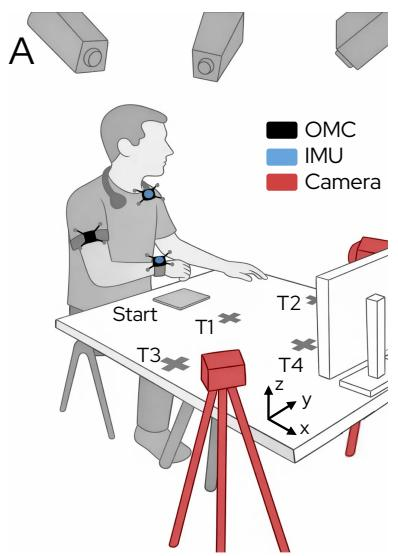

B  

C  
  
Fig. 1. 数据采集的实验装置与任务条件。(A) 光学动作捕捉（OMC）标记点（黑色）附着于手腕、上臂和躯干，惯性测量单元（IMU，蓝色）同位置安装在手腕和躯干。RGB 摄像机（红色）提供两个视角的同步视频录制。受试者在预定目标位置（“Start”、“T1-T4”）执行标准化的日常生活活动，任务说明显示在受试者前方的屏幕上。标出了与解剖结构对齐的坐标系坐标轴 $( \mathsf { x } , \mathsf { y } , \mathsf { z } )$。(B) 用于限制肘部屈曲和伸展的支具条件示意图。(C) 旨在诱发屈肌协同样行为的弹力带条件示意图。

为探究健全受试者的代偿性躯干运动（CTM）检测，任务在三种运动条件下进行，以模拟从无约束到类中风模式的一系列运动行为：(A) 允许自然运动的无约束手臂运动；(B) 使用限制屈曲和伸展的肘部支具进行约束运动，反映中风后常见的肘关节活动度降低（Fig. 1B）[23], [24]；以及 (C) 对抗从对侧肩部延伸至手腕的斜向阻力带进行运动，诱发中风人群中经常报告的类屈肌协同运动行为（Fig. 1C）[25], [26]。在这些运动条件的基础上，该方案强调运动的多样性，而非重复执行有限的任务集，以更好地反映与日常生活活动（ADL）相关的上肢运动的自然变异性。任务改编自已建立的运动评估程序 [8], [9], [27]–[29]，并分为六个类别：(1) 平面伸展与转移（Planar Reaching & Transport），(2) 饮水与倒水（Drinking & Pouring），(3) 高处伸展与转移（Elevated Reaching & Transport），(4) 平面滑动（Planar Sliding），(5) 精细物体操作（Fine Object Manipulation），以及 (6) 连续运动（Continuous Movements）。在每个类别中，定义了一组不同的运动任务（所有类别共计 38 项），每项任务在三种运动条件下各执行一次（更多细节见附录 Tab. I）。所有运动均使用右臂进行，以减少数据采集需求。

实验开始前，受试者端坐在固定不旋转的椅子上。桌子的高度和距离均经过个体化调整，以保持自然姿势。测量个体伸展距离（定义为在无躯干参与的情况下可实现的最大手臂伸展幅度），并用于确定四个个性化的目标位置（Fig. 1A；更多细节见附录 I）。其中三个目标位置（T2–T4）被选定为即使在无约束条件下也能自然诱发躯干参与，确保在生理上适当的非代偿性运动期间也存在躯干运动。相比之下，“Start”和“T1”目标旨在捕捉在无约束条件下无需躯干参与的运动。

在每次记录开始时，参与者均执行一种标准化的校准姿势，包括直立躯干姿态、约 90° 肘关节屈曲以及前臂向左侧方向对齐（Fig. 1）。选择该姿势是由于其对具有典型脑卒中后运动受限的个体而言具有舒适性和可行性，且随后用于为两个 IMU 传感器建立解剖学对齐的坐标系。校准之后，参与者根据屏幕上显示的标准化视觉和口头指令（Fig. 1A）执行运动任务，每个任务均以校准姿势开始和结束。每个参与者的任务顺序均进行了随机化，以尽量减少预期行为并在各任务类别之间分散潜在的传感器漂移。此流程在所有三种运动条件下重复进行，这些条件同样预先进行了随机化。这产生了不间断的多模态记录（每种条件 13–18 min），反映了现实世界中的测量条件。

## B. 临床数据集

为补充健全人数据集并评估所提出方法在神经系统疾病患者身上的初步性能，从在异构环境中开展的两项独立研究中汇总了一个临床数据集。四名患者根据《赫尔辛基宣言》（Declaration of Helsinki）提供了书面知情同意书。

首先，从一项正在进行的研究（BASEC ID: 2025-01124）中招募了三名男性慢性脑卒中患者（P18：44 岁，左侧受累，FMA = 18；P31：65 岁，左侧受累，FMA = 26；P31：59 岁，右侧受累，FMA = 52）。类似于 Fig. 1，采集了同步的 OMC、IMU 和视频数据。IMU 放置于双侧手腕以及躯干上。在该研究中，患者使用受累较重和受累较轻的手臂依次执行了平面触及和转移任务（见 Appendix Tab. I）。在本次采集过程中，触及运动分别朝向三个目标位置（左、右和前）执行，每个位置重复五次，随后进行额外的正面触及任务，每侧手臂同样重复五次（约 7min）。

此外，本研究还纳入并重新分析了一名脊髓损伤患者在上肢物理治疗期间的运动数据（P03：男性，67 岁，ARAT：27）[30]。相应的研究方案已获得当地州医学与伦理委员会的批准（BASEC ID: 2024-01425），并在 ClinicalTrials.gov 完成注册（NCT06623721）。IMU 放置在受训手臂（右侧）和躯干上，并采集了同步视频记录。数据采集于执行插板任务和叠杯任务期间，这些活动与先前包含的任务不同，旨在评估泛化能力。选取了一段连续 10-min 的数据片段用于分析。

## C. 数据标注

为了支持使用 IMU 和 OMC 数据的监督模型训练和性能评估，通过对同步视频录像的手动标注建立了真值参考（ground-truth reference）。基于实验约束条件（肘部支具和阻力带）预期的生物力学效应（主要是限制肘关节屈曲和伸展），躯干屈曲预计将是主要的 CTM。虽然观察到了偶发的躯干旋转或侧屈（通常在肩关节外展或旋转受限时出现），但为了避免严重的类别不平衡，它们被归入单一的 CTM 类别中。共定义了三个类别：(1) 校准（Calib），(2) 运动：无躯干代偿（Mov: No TC），以及 (3) 运动：躯干代偿（Mov: TC）。重要的是，标签是根据运动上下文而非瞬时动作分配的；任务执行过程中的短暂暂停（例如，当触及目标或放置物体时）仍被视为运动阶段的一部分，并标注为 Mov: No TC 或 Mov: TC，而非 Calib。

制定标注指南旨在以与任务无关且独立于工作空间的方式对这些类别进行形式化定义（见 Appendix II）。尽管参考了现有文献 [31], [32]，但该指南根据 RPS [9] 的原则进行了改进，以强调躯干与手腕运动之间的关系。其核心观点是，躯干运动本质上并不属于代偿：当任务或工作空间需要且伴随适当的手臂伸展时，大幅度的躯干偏移可以是非代偿性的；而当小幅度的躯干运动替代了不足的肘关节伸展并用于达到所需的活动度时，则属于代偿性的（Fig. 2）。这一定义对于非实验室的真实世界环境尤为重要，在这些环境中任务是不受约束的，即使在生理上正常的运动过程中也可能自然引发躯干参与。因此，该标注策略与前文描述的目标位置一致，即即使在未受损状态下，这些目标位置也必然涉及躯干的参与（见 Sec. II-A）。由于我们的目标是建立一个在运动执行过程中产生连续预测而非针对每个运动序列仅输出单个标签的 CTM 框架，该指南还明确了类别起始和终止的时间规则（例如，CTM 在何时开始和停止）。所有标准均由经验丰富的物理治疗师进行了审核和完善。

在标注方面，同步的双视角视频进行了画面叠加拼接，以减少遮挡并确保躯干和手臂运动学的持续可见性。合并后的视频被上传至 Labelbox（Labelbox, Inc., San Francisco, USA），在其中按照最终确定的指导原则进行逐帧标注，每一帧严格分配一个类别。所有健全受试者的记录均由一名经过培训的研究人员进行标注以确保一致性（JG），而临床数据集则由一名具有物理治疗背景且具备神经系统疾病患者工作经验的研究人员进行标注（LM）。

## D. 数据处理与模型训练

对于每次记录，手腕和躯干 IMU 的原始加速度计和陀螺仪信号均使用预定义的特定轴数值进行偏置校正，以降低对漂移的敏感性。随后，使用 6D 通用四元数滤波器（Versatile Quaternion Filter, VQF）[33] 估计传感器在全局世界坐标系中的姿态，并从加速度计数据中去除重力分量。为了将该世界坐标系与受试者的解剖轴对齐，在每次记录开始时利用已知的 Calib 姿态进行静态解剖校准（见附录 III）。该解剖对齐坐标系的方向如图 1A 所示（x: 前向，y: 左侧，z: 上方）。该流程实现了相对于工作空间的姿态数据的一致性解读，同时允许使用原始传感器坐标系数据以及解剖对齐后的加速度和角速度表示（见附录 IV）。对于患者，手臂放置在桌面上并与矢状面对齐的 Calib 姿态亦被接受；左臂记录随后关于矢状面进行镜像处理，以获得等效的右臂数据（详见附录 III）。

OMC 数据提供了刚体标记点位置以及相对于系统设置期间定义的实验室参考坐标系的单位四元数肢体段姿态。该参考坐标系被配置为与解剖对齐的 IMU 坐标系相匹配，从而能够对运动学变量进行直接跨模态比较。通过最大化对应 IMU 与 OMC 标记点姿态信号之间的互相关，对这两种模态进行了时间对齐。从同步的 OMC 和 IMU 信号中，提取了用于下游分析的额外运动学数据流，包括运动相关特征（加速度、角速度和线速度）、姿态相关特征（绝对肢体段姿态和相对肢体段间姿态）以及基于 OMC 标记点距离的空间特征（见附录 IV）。对于随后的 ML 模型训练，从 Labelbox 导出了基于视频的真实标签（ground-truth labels），并使用最近邻插值映射到 IMU 和 OMC 时间序列中，从而生成了完全同步且带标注的多模态数据集。

  
(a)

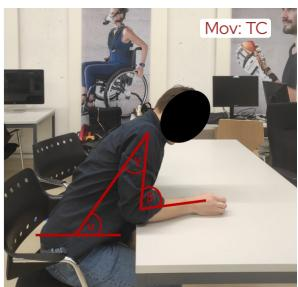  
(b)

  
(c)

  
(d)  
Fig. 2. 说明前向伸展任务中手臂-躯干协调策略以及标记代偿性躯干运动理由的示例场景。(a) 肘关节伸展度（β）和肩关节屈曲度（γ）足以触及目标。因此不需要躯干屈曲来扩展手臂的触及范围。(b) 肘关节伸展度（β）和肩关节屈曲度（γ）不足以触及目标。作为响应，躯干屈曲（α ↓）以扩展手臂的前向触及范围。(c) 肘关节伸展度（β）和肩关节屈曲度（γ）达到最大值。躯干屈曲以扩展手臂朝向目标的前向触及范围。由于该躯干屈曲并非用于代偿受限的肘关节伸展或肩关节屈曲，因此不被视为代偿性的。(d) 肘关节伸展度（β）和肩关节外展度（γ）显著低于触及目标所需的范围。因此，躯干过度屈曲（α ↓）作为扩展手臂前向触及范围的代偿策略。红色注释表示躯干屈曲角（α）、肘关节伸展度（β）和肩关节屈曲/外展度（γ）。

基于预先计算的运动学数据流，我们设计了一个用于训练和评估 CTM 预测模型（CTMprediction model）的流程（Fig. 3）。每次记录被分割为 500 ms（60 个样本）的滑动窗口，重叠部分为 375 ms（窗口大小的 75%）。对于每个窗口，从运动学数据流中提取一组由统计指标、位置相似性（运动学流的两两比较以捕捉协调性，例如手腕-躯干）和平滑度指标（参见附录 IV）组成的特征，构成模型的输入。设计这些特征是为了同时捕捉运动学幅度、环节间协调性以及运动质量，因为假设与生理上适宜的运动相比，代偿性躯干运动（CTM）会表现为协调模式的改变和平滑度的降低。每个窗口的标签定义为窗口内最后一个样本的标签，这反映了一种因果预测设定，即模型以最小延迟从过去的数据中推断最新的运动状态。通过选择具有最高后验概率的类别来获取预测结果。总体而言，这种加窗策略在保留充分的时序上下文的同时，实现了高频预测。

作为分类器，极限梯度提升（XGBoost）因其在表格式手工特征集上展现出的出色性能和计算效率而被选用 [35]。为了评估独立于被试的泛化能力，并鉴于 XGBoost 庞大的超参数（HP）空间以限制过拟合风险，本研究实施了嵌套 LOSO-CV 方案（Fig. 3）。在此方案中，一个折（包含来自一名参与者的全部数据）用作测试集。其余九名参与者的数据用于内部 3 折 CV 进行超参数优化。各折之间的搜索空间保持一致，并通过贝叶斯优化在 50 次迭代中优化超参数。为了解决我们数据集中固有的类别不平衡问题（Calib：34.51%，Mov: No TC：48.84%，Mov: TC：16.65%），我们采用了平衡样本权重，以减轻训练过程中对多数类的偏差。在确定最优超参数后，模型在九名参与者的数据上重新训练，并在留出的参与者上进行测试。重复该过程，直到每位参与者都作为测试折使用过一次。

## E. 数据分析

利用所提出的流程，进行了一系列实验以系统地评估模型在不同实验设置下的行为和性能（Fig. 3）。在所有实验中，分类性能主要通过 F1 分数和马修斯相关系数（MCC）进行量化，MCC 作为一种对类别不平衡具有鲁棒性且考虑了混淆矩阵所有项的互补指标 [36]。作为次要指标，我们使用了一对其余（one-vs-rest）受试者工作特征（ROC）曲线及其对应的曲线下面积（AUC）值、精确率和召回率以及混淆矩阵。对于 LOSO-CV 评估，性能指标针对每位参与者独立计算，并总结为参与者间的均值 ± 标准差，而混淆矩阵则在所有测试参与者中进行聚合。

首先，为了检验手腕和躯干衍生的运动学特征能够提供足以进行 CTM 检测的互补信息这一假设，我们逐步减少了基于 OMC 模型的标记点集，并量化了由此导致的分类性能变化。该分析在无漂移的 OMC 数据上进行，以将解剖位置的影响与 IMU 特有的非理想因素（如漂移和校准不准确）隔离开来。为了在统计学上验证性能差异，对 Mov: TC 类别的每位受试者 F1 分数进行了配对 Wilcoxon 符号秩检验，因为该类别反映了 CTM 检测性能，因而具有首要的临床相关性。先验地定义了一组计划的比较。首先，比较了三标记点（手腕+躯干+上臂）与双标记点（手腕+躯干）

配置，以评估上臂运动学的贡献。随后，进行了另外两次比较，以评估将配置精简为单个标记点的效果（手腕+躯干 vs. 手腕，以及手腕+躯干 vs. 躯干）。为了控制多重比较，应用了 Holm–Bonferroni 校正以控制族误差率（family-wise error rate）。文中报告了校正后的 p 值，并在整篇手稿中将统计显著性定义为 $p _ { c o r r } < 0 . 0 5$。为了保证完整性，还对所有类别（Calib、Mov: No TC、Mov: TC）和所有成对模型比较执行了相同的统计分析。

其次，我们使用所提出的双 IMU（手腕+躯干）配置训练了一个模型，并在健全人数据上对其进行了评估，将其与基于 OMC 的基线双标记点（手腕+躯干）模型进行直接比较。使用 Wilcoxon 符号秩检验评估了 OMC 和 IMU 性能在每个类别的 F1 分数上的配对差异，并应用 Holm–Bonferroni 校正来控制多重比较中的族误差率。此外，我们还纳入了任务相关性能变化的分析，以评估模型在不同运动情境下的鲁棒性，并识别潜在的任务特异性性能差异，从而反映日常生活中遇到的广泛任务。在完成该评估之后，使用所有可用的健全人数据训练了一个最终的 IMU 模型（不设立单独的测试集），以用于后续分析。通过对数值参数取中位数、对分类参数取选择频率最高的值，对从嵌套 LOSO-CV 中获得的超参数进行了整合。随后，使用 Shapley 加性解释（Shapley Additive Explanations, SHAP）[34] 对该模型进行了可解释性分析，以识别区分 Mov: No TC 和 Mov: TC 两个类别的特征。为此，我们计算了有符号 SHAP 值差异：

$$
\Delta \mathrm{SHAP} _ {i, j} = \phi_ {i, j} ^ {(\mathrm{Mov:TC})} - \phi_ {i, j} ^ {(\mathrm{Mov:NoTC})},
$$

其中 $\phi _ { i , j } ^ { ( c ) }$ 表示样本 i 的特征 j 相对于类别 c 的 SHAP 值。$\Delta { \mathrm { S H A P } _ { i , j } }$ 的正值表明该特征使模型预测倾向于 Mov: TC，而负值则表明倾向于 Mov: No TC，从而可以评估每个特征贡献的方向性。为了量化每个特征独立于其方向性的总体判别能力，我们引入了分离度得分（separation score），定义为所有样本中这些差异的平均绝对幅度：

$$
\operatorname{Mean} \left| \Delta \mathrm{SHAP} _ {j} \right| = \frac {1}{N} \sum_ {i = 1} ^ {N} \left| \Delta \mathrm{SHAP} _ {i, j} \right|,
$$

其中 N 表示样本数量。特征随后按照该分离得分降序排列，数值越大表示类别区分贡献越强。所有 SHAP 分析均在从健全受试者训练数据中采样的代表性子集上使用固定背景数据集进行。此外，为了评估实时部署的可行性，该流程使用环形缓冲区实现，并在标准笔记本电脑（MacBook Pro，Apple M1 Pro，16 GB 内存，Apple Inc.，美国）上评估了其各个组件的计算延迟，包括预处理、特征提取和模型推理。

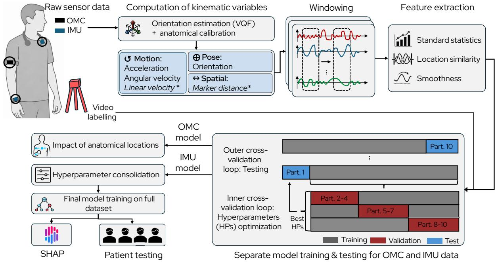  
Fig. 3. 信号处理和建模流程概述。惯性测量单元（IMU）和光学运动捕捉（OMC）信号被转换为多种运动学表征（*斜体变量仅存在于 OMC 数据中），分割为重叠窗口，并使用统计学指标、位置相似性指标（运动学流的两两比较以捕捉协调性，例如手腕-躯干）以及平滑度指标进行表征。模型训练和评估在嵌套留一受试者交叉验证（LOSO-CV）方案中进行，并采用平衡样本加权以缓解类别不平衡。对患者数据的最终评估以及事后 $\mathsf { S H A P }$ 分析 [34]，支持了初步的临床适用性，并为模型可解释性提供了深入见解。

最后，我们通过在患者数据集上使用与健全受试者队列相同的评估指标测试最终模型，评估了其初步的临床适用性。该分析旨在评估模型在健全受试者上验证了受试者独立泛化能力后，是否也能从模拟损伤跨领域泛化到神经系统疾病患者的运动模式。为此，首先在受控实验室环境下执行伸手任务期间获得的患者记录上评估模型性能，该环境与健全受试者的采集方案具有可比性。随后，在涉及较少约束运动且任务变异性增加的常规上肢治疗期间记录的患者数据上，进一步评估了泛化能力。

## III. 结果

## A. 解剖位置对 CTM 检测性能的影响

为了确定能够提供稳定 CTM 检测的最小解剖学位置集合，我们评估了不同 OMC 标记点配置下的分类器性能（Fig. 4；更多细节见附录 V）。在不同配置中，三标记点设置（手腕+躯干+上臂）在所有三个类别中均取得了最高的整体性能 $( \mathrm { F 1 } _ { \mathrm { m a c r o } } = 0 . 8 6 \pm 0 . 0 5 , \mathrm { M C C } = 0 . 8 1 \pm 0 . 0 8 )$。移除上臂标记点仅导致性能发生边际变化，且在各折（folds）之间的离散度相当 $( \mathrm { F 1 } _ { \mathrm { m a c r o } } ~ = ~ 0 . 8 5 ~ \pm ~ 0 . 0 6 , ~ \mathrm { M C C } ~ = ~ 0 . 7 9 ~ \pm ~ 0 . 0 9 )$，三标记点与双标记点配置之间的 $\mathrm { F 1 } _ { \mathrm { M o v : ~ T C } }$ 得分无显著差异 $( p _ { c o r r } = 0 . 6 2 5 )$。

相比之下，仅使用躯干或手腕数据的单标记点配置导致分类性能出现更明显的下降。当完全依赖躯干信息时，所有类别的性能均持续下降 (F1macro $= 0 . 6 6 \pm 0 . 1 2 , \mathrm { M C C } = 0 . 5 0 \pm 0 . 1 3 )$，其中 Calib 类别的性能退化尤为显著 $( \mathrm { F 1 } _ { \mathrm { C a l i b } } = \ 0 . 6 5 \ \pm$ 0.16)。对 Mov: TC 类别的更详细分析进一步表明，$\mathrm { r e c a l l _ { M o v : T C } }$ 仍保持在较高水平（手腕+躯干：0.86 $\pm \ 0 . 1 0 .$，仅躯干：$0 . 8 3 \pm \ : 0 . 1 6 )$，而 precisionMov: TC 则下降更为明显（手腕+躯干：$0 . 7 2 \pm 0 . 1 7 .$，仅躯干：$0 . 6 0 ~ \pm ~ 0 . 2 4 )$，表明 CTM 假阳性预测率增加。与这一性能差距一致，双标记点配置的 $\mathrm { F l } _ { \mathrm { M o v : ~ T C } }$ 得分显著高于仅躯干配置 $( p _ { c o r r } = 0 . 0 1 2 )$。

对于仅手腕（wrist-only）配置，整体分类性能保持在中等水平 $( \mathrm { F 1 } _ { \mathrm { m a c r o } } = 0 . 7 8 \pm 0 . 0 6 ,$ $\mathsf { M C C } = 0 . 7 1 \pm 0 . 0 8 )$，但性能变化更加依赖于类别。尽管 Calib 的性能依然保持在较高水平 $( \mathrm { F 1 } _ { \mathrm { C a l i b } } = 0 . 9 2 \pm 0 . 0 6 )$，但 Mov: TC 类别的检测性能有所下降，表现为更低的 $\mathrm { r e c a l l _ { M o v : T C } }$（手腕+躯干：$0 . 8 6 \pm 0 . 1 0$，仅手腕：$0 . 7 7 \pm 0 . 0 9$）和 precisionMov: TC（手腕+躯干：$0 . 7 2 \pm \ : 0 . 1 7 .$ 仅手腕：$0 . 5 4 \pm \ : 0 . 1 3$）。这表明在 CTM 分类中，漏检数量增加且假阳性率上升。相应地，双标记点配置的 $\mathrm { F l } _ { \mathrm { M o v : ~ T C } }$ 得分显著高于仅手腕配置 $( p _ { c o r r } ~ = ~ 0 . 0 1 2 )$。为保证完整性，所有任务类别的统计数据和成对模型比较见附录中的 Tab VI。

  
Fig. 4. 健全受试者（n=10）在不同光学动作捕捉标记点配置下的分类性能。箱线图展示了使用留一受试者交叉验证（leave-one-subject-out cross-validation）获得的三个类别（校准 Calibration、运动：无躯干代偿 Movement: No Trunk Compensation 以及运动：躯干代偿 Movement: Trunk Compensation）的折叠 F1 分数。叠加的数据点表示单个受试者的表现。不同标记点配置在运动：躯干代偿任务上的统计比较由括号标出 $( ^ { \star } p _ { c o r r } < 0 . 0 5 .$，n.s 表示不显著）。所有类别的结果和成对模型比较见 Tab VI。

## B. 跨 ADL 任务的双 IMU 分类性能

在基于 OMC 的分析之后，手腕和躯干被用作后续评估的最小传感位置。IMU 模型取得了稳健的整体性能 $( \mathrm { F 1 } _ { \mathrm { m a c r o } } = 0 . 8 0 \pm 0 . 0 7 , \mathrm { M C C } = 0 . 7 3 \pm 0 . 0 8 )$。尽管其性能略低于双标记点 OMC 参考模型 $( \mathrm { F 1 } _ { \mathrm { m a c r o } } ~ = ~ 0 . 8 5 ~ \pm ~ 0 . 0 6$ , MCC = $0 . 7 9 \mathrm { ~ \pm ~ } 0 . 0 9 )$，但两种模态之间的受试者间变异性仍相当，这表明尽管降低了传感复杂度，仍具有相似的泛化能力 (Fig. 5A)。在各类别中，IMU 配置的平均 F1 分数略有下降 $( \Delta \mathrm { F } 1 _ { \mathrm { C a l i b } } ~ = ~ - 0 . 0 4 , ~ \Delta \mathrm { F } 1 _ { \mathrm { M o v : ~ N o ~ T C } } ~ = ~ - 0 . 0 3 , ~ \Delta \mathrm { F } 1 _ { \mathrm { M o v : ~ T C } } ~ = ~ 0 . 0 3$ −0.09)，而标准差的最大差异仅为 0.015。使用经 Holm-Bonferroni 校正的 Wilcoxon 符号秩检验进行的统计比较显示，在 Calib 条件下 OMC 与 IMU 之间没有显著差异 $( \mathtt { p } _ { \mathtt { c o r r } }$ $= 0 . 0 6 4 )$。相比之下，在两种运动条件下均观察到了显著差异，其中 OMC 在 Mov: No TC $( \mathrm { p } _ { \mathrm { c o r r } } = 0 . 0 2 0 )$ 和 Mov: TC $( \mathrm { p } _ { \mathrm { c o r r } } = 0 . 0 1 2 )$ 中表现出更高的性能。为了进一步表征独立于所选决策规则的类别可分性，我们检验了在各测试折（test folds）上取平均的一对多（one-vs-rest）ROC 曲线。所得曲线 (Fig. 5B) 显示出在所有三个类别中均具有强大的判别性能，ROC-AUC 值也证明了这一点 $( \mathrm { A U C } _ { \mathrm { C a l i b } } =$ $0 . 9 7 \pm 0 . 0 5 , \mathrm { A U C _ { M o v : N o \ T C } = 0 . 9 3 \pm 0 . 0 4 , A U C _ { M o v : T C } = 0 . 9 5 }$ $\pm \ 0 . 0 2 )$。

从图 6A 中的混淆矩阵可以进一步深入了解模型性能，该混淆矩阵经过行归一化以解决类别不平衡问题。总体而言，该模型在各类别的召回率均 >0.8，大多数误分类发生在两个运动类别之间（Mov: No TC 与 Mov: TC）。具体而言，17.8% 的 CTMs（代偿性躯干运动）被误分类为正常运动，而相反的混淆情况发生在 14.4% 的案例中。为了表征误分类模式，模型性能按运动任务类别进行了分层（图 6B）。在所有类别中，Calib 和 Mov: No TC 始终保持着较高且稳定的平均 F1 分数（>0.73），且受试者间变异性较低 $( \mathrm { s t d } < 0 . 1 3 )$。相比之下，Mov: TC 的性能表现出明显的任务依赖性。尽管平面触及与搬运（Planar Reaching & Transport，$ \mathrm { F 1 } _ { \mathrm { M o v : ~ T C } } = 0 . 7 7 \pm 0 . 1 0 $）和平面滑动（Planar Sliding，$ \mathrm { F 1 } _ { \mathrm { M o v : T C } } = 0 . 7 3 \pm 0 . 1 1 $）在各折之间取得了稳定的性能，但其余任务类别显示出更大的参与者间变异性（饮水与倒水 Drinking & Pouring：$\mathrm { F 1 } _ { \mathrm { M o v : T C } } = 0 . 5 8$ $\pm \ 0 . 1 7$，高处触及与搬运 Elevated Reaching & Transport：$\mathrm { F 1 } _ { \mathrm { M o v : ~ T C } } = 0 . 5 0 \pm$ 0.21，精细物体操作 Fine Object Manipulation：$\mathrm { F 1 } _ { \mathrm { M o v : T C } } = 0 . 4 9 \pm 0 . 2 2$），并出现了若干低性能折。在这三个任务类别中，F1 分数的下降主要是由于 $\mathrm { r e c a l l _ { M o v : T C } }$ 的降低所致，表明 CTMs 经常被误分类为非代偿性运动（CTMs 被误分类为非代偿性运动的百分比：饮水与倒水 Drinking & Pouring，25.0%；高处触及与搬运 Elevated Reaching & Transport，41.7%；精细物体操作 Fine Object Manipulation，39.7%；连续运动 Continuous Movements：22.1 %）。

B  
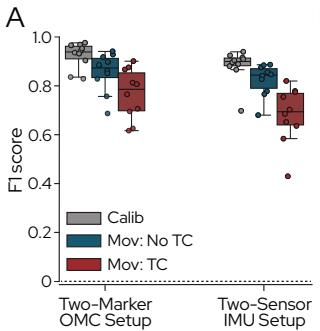

  
Fig. 5. 基于双 IMU 模型的性能。(A) 箱线图显示了在健全受试者 $( n = 1 \dot { 0 } )$ 中使用手腕和躯干信号的基于光学动作捕捉（OMC）和基于惯性测量单元（IMU）设置的逐折 F1 分数。叠加的数据点表示单个受试者的表现。(B) 健全受试者 $\mathbf { \bar { \rho } } ( n = \mathbf { \bar { 10 } } )$ 在三个类别上的平均一对多（one-vs-rest）受试者工作特征（ROC）曲线展示了 IMU 模型的强判别性能。

为了识别区分 Mov: No TC 和 Mov: TC 最具辨别力的运动学特征，对最终基于 IMU 的模型应用了基于 SHAP 的模型可解释性分析。特征根据其分离得分（separation score）进行排序（Fig. 7）。为了评估不同特征组（手腕、躯干、交互）的相对贡献，在每个组内聚合了分离得分 Mean|∆SHAP|。在排名前 10 的预测特征中，源自躯干的特征占总分离得分的 64%，手腕-躯干交互特征占 30%，单独的手腕特征占 6%。这些比例表明，模型的决策边界主要由躯干运动学塑造，而基于协调的交互特征提供了互补的辨别依据。

就方向效应而言，躯干前屈（姿态俯仰角，orientation pitch）增加和整体躯干运动强度（陀螺仪幅值，gyroscope magnitude）增大，以及躯干侧倾（姿态横滚角，orientation roll）改变，均与正的 ∆SHAP 值持续相关，这表明模型对 Mov: TC 类别的置信度提高。描述相对体段姿态（姿态俯仰角/偏航角的动态时间规整距离，Dynamic Time Warping Distance, DTWD）和运动（陀螺仪偏航角 DTWD 及陀螺仪幅值差异）的手腕-躯干交互特征在其 ∆SHAP 分布中表现出截然不同的模式。事实上，与运动相关的交互特征展现出明确的方向趋势，较低的相对值（即躯干与手腕的运动更为相似）主要与对 Mov: TC 的正 ∆SHAP 贡献相关。相比之下，基于姿态的交互特征则呈现出更具异质性的双向分布，在整个特征值范围内均观察到了正负贡献。

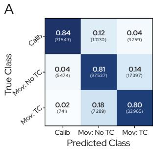  
B

  
Fig. 6. 基于 IMU 的模型性能详细分析。(A) 行归一化混淆矩阵，总结了在所有测试折上聚合的标定（Calibration, Calib）、运动：无躯干代偿（Movement: No Trunk Compensation, Mov: No TC）以及运动：躯干代偿（Movement: Trunk Compensation, Mov: TC）的各类别预测结果（召回率）。(B) 箱线图描绘了健全受试者 $( n = 1 0 )$ 在不同折上的 F1 分数，按运动任务类别分层。叠加的点表示单个受试者的表现。

通过在 $n = 5 7 1 0$ 个样本上测量各组件的计算延迟，评估了该处理流程的实时适用性。模型推理需要 $2 9 . 2 5 \pm$ 10.93 ms，而预处理和特征提取分别需要 $4 2 . 4 7 \pm 1 7 . 3 1$ ms 和 $4 6 . 8 6 \pm 1 6 . 6 8$ ms。

## C. 患者评估

为了评估初步的临床泛化能力，将完全基于模拟损伤下健全人数据训练的最终模型在四名患者的数据上进行了评估。在这些数据记录中，该模型保持了较强的判别能力，$\mathrm { { A U C } _ { \mathrm { { m a c r o } } } }$ 值为 $0 . 7 8 \pm 0 . 0 6 ~ ( \mathrm { F i g . ~ 8 A }$ 详情见 Table VII）。特别是，$\mathrm { A U C } _ { \mathrm { M o v : ~ N o ~ T C } }$ 保持在较高水平 $( 0 . 7 8 \pm 0 . 1 0 )$，表明在患者记录中代偿性与非代偿性躯干运动片段依然是可分的。

相比之下，依赖阈值的分类指标表现出中等性能，其中 $\mathrm { F 1 } _ { \mathrm { m a c r o } } = 0 . 4 3 \pm 0 . 0 6$ 且 $\mathrm { M C C } = 0 . 2 8 \pm 0 . 0 4$。运动阶段的检测最为一致 $( \mathrm { F } 1 _ { \mathrm { M o v : ~ N o ~ T C } } ~ = ~ 0 . 6 5 ~ \pm ~ 0 . 1 6 )$，而代偿检测在不同患者之间存在显著差异 $\mathrm { ( p r e c i s i o n _ { M o v : \ T C } = 0 . 5 7 \pm 0 . 2 7 ) }$。例如，P63 取得了较高的 $\mathrm { p r e c i s i o n } _ { \mathrm { M o v : } \mathrm { T C } } \ ( 0 . 9 6 )$，但 $\mathrm { r e c a l l _ { M o v : T C } } ~ ( 0 . 1 1 )$ 较低，这表明预测出的代偿性躯干运动（CTM）事件通常是正确的，但遗漏了很大一部分 CTM 时间点。这一趋势在 P03 的常规治疗记录中也有所体现，这是一个更具挑战性且约束更少的评估场景。在此场景下，模型对 Mov: No TC 取得了较高的性能 $( \mathrm { p r e c i s i o n } _ { \mathrm { M o v : ~ N o ~ T C } } = 0 . 8 9 8$ ，recall $\mathbf { \Delta } _ { \mathrm { N o \ T C } } = 0 . 9 6 3$ $\mathrm { F 1 } _ { \mathrm { M o v : N o ~ T C } } = 0 . 9 2 9 )$，而 CTM 检测再次表现出相对较高的 $\mathrm { \ h i g h { \ p r e c i s i o n } _ { M o v : \ T C } } ~ ( 0 . 6 7 4 )$，但 $\mathrm { r e c a l l _ { M o v : } }$ TC (0.266) 较低，导致 $\mathrm { F l } _ { \mathrm { M o v } : }$ TC 得分为 0.381。该记录的一个代表性时间序列片段如图 Fig. 8B 所示，展示了模型预测相对于真实标注（ground-truth annotations）的时间演变过程。

## IV. 讨论

在本研究中，我们评估了利用极简 IMU 配置基于机器学习（ML）检测 CTM 的可行性。具体而言，我们假设在无约束工作空间中的日常生活活动（ADL）任务期间，仅躯干和手腕的运动学信息就足以实现稳健、实时的 CTM 检测。我们进一步评估了这种精简传感器配置能否从模拟损伤下的健全人数据记录泛化到在实验室和常规上肢治疗环境中采集的初步临床数据。

## A. 手腕与躯干提供互补信息

关于传感器放置位置对 CTM（代偿性躯干运动）检测性能的影响，基于 OMC（光学运动捕捉）的标记点移除研究和基于 IMU（惯性测量单元）的 SHAP 特征分析均提供了一致的证据，表明最具辨别力的信息是由躯干和手腕运动学共同捕获的。双标记点配置（手腕+躯干）达到了与三标记点配置（手腕+躯干+上臂）相当的性能，而单位置模型的性能显著降低，其中仅躯干模型由于假阳性 CTM 预测增加而表现出精确度下降。特征层面的可解释性进一步突出了占主导地位的躯干衍生特征以及排名靠前的手腕-躯干交互特征，表明相对协调模式对 CTM 辨别具有实质性贡献。

这些发现与先前将代偿描述为躯干-远端协调改变的生物力学研究 [37], [38] 以及基于 IMU 的研究（报告了手腕-躯干配置相比仅躯干传感具有更强性能）[39] 相一致。虽然躯干运动学构成了 CTM 的主要指标，但仅躯干模型精确度的下降表明其区分代偿性躯干参与与生理上合理的躯干参与的能力有限。正如 SHAP 分析中所观察到的，纳入腕部信号通过捕获协调和朝向线索提高了辨别能力。此外，尽管上臂传感对于详细的生物力学分析十分重要 [19], [20]，但其对该分类任务的增量效益有限，这可能是由于它与腕部衍生信息存在冗余。总体而言，手腕-躯干配置代表了性能与可部署性之间的实用权衡，降低了用于无监督日常生活时的仪器佩戴负担和校准工作量。

Fig. 7. 使用沙普利加性解释（Shapley Additive Explanations, SHAP）进行的可解释性分析，以识别“动作：无躯干代偿”（Movement: No Trunk Compensation, Mov: No TC）与“动作：躯干代偿”（Movement: Trunk Compensation, Mov: TC）之间区分度最高的前 10 个特征。(A) 带符号的 ∆SHAP 值分布，指示方向性类别支持度，其中正值偏向 Mov: TC，负值偏向 Mov: No TC。特征值根据其相对大小按从低（蓝色）到高（红色）进行颜色编码。(B) 以每个特征的 Mean|∆SHAP| 表示的分离分数，总结了整体判别重要性。柱状图按特征来源（躯干、手腕、交互）进行颜色编码。  
A  
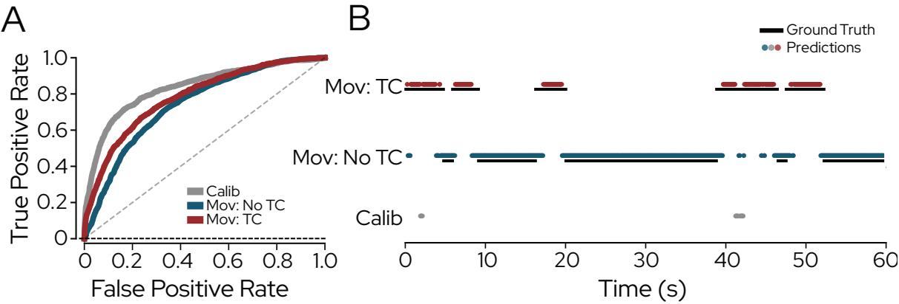  
Fig. 8. 临床数据集上的检测性能。(A) 患者使用受累最严重的手臂执行任务时的平均一对多（one-vs-rest）受试者工作特征（ROC）曲线，手腕传感器位于受累最严重的肢体上（n = 4）。(B) 一位进行常规上肢康复训练的患者的代表性 60 秒时间序列片段，展示了真实类别标签和预测类别标签。真实标注以黑线表示，三个类别（动作：躯干代偿、动作：无躯干代偿和校准）的模型预测以彩色圆点表示。

## B. 基于机器学习的 CTM 检测实现了稳健的性能，但仍具有任务依赖性

我们提出的双 IMU 模型在 CTM 检测中取得了强大的判别性能，这体现在健全受试者中高 ROC-AUC 值以及稳定的宏平均 F1 和 MCC 分数上。尽管与双标记点 OMC 参考模型相比性能略低，但受试者间变异性仍然相当，表明尽管传感复杂度降低，但泛化能力相似。

先前的研究已经证明了在各种传感模态和分类方法下进行 CTM 检测的可行性。基于 IMU 的系统在使用预分割数据进行试验级（trial-level）或重复级（repetition-level）分类时报告了极高的性能（准确率通常 >90%）[39]–[41]。然而，这些方法无法在任务执行过程中提供连续预测，限制了它们在日常生活环境中进行实时监测的适用性。相比之下，连续 CTM 检测主要通过基于摄像机 [16] 或基于压力 [42], [43] 的系统来实现，这些系统提供了密集的时间信息，但依赖于便携性较差的传感设备。

在健全受试者数据集中观察到了任务依赖性的性能差异，其中在“饮水与倒水”（Drinking and Pouring）、“高处伸手取物与搬运”（Elevated Reaching and Transport）以及“精细物体操作”（Fine Object Manipulation）任务中，Mov: No TC 与 Mov: TC 之间的误分类有所增加。这些错误主要是由于遗漏了 CTM 事件导致召回率降低，这与先前的报道一致 [39], [44]。这可能是由于不同参与者之间的代偿模式较弱且更具异质性，以及在无法稳定诱发显著 CTM 的任务中存在标注模糊性 [32]。此外，基于窗口的推理对模糊的起始和结束转换较为敏感，这可能会进一步增加误分类率。

## C. 向患者数据的泛化可行但存在变异性

对患者数据的评估提供了初步证据，表明在模拟损伤下从健全受试者记录中学习到的代偿相关运动学特征，在一定程度上可以迁移到真实的脑卒中后运动模式中。在四次记录中，持续较高的 ROC-AUC 值表明，尽管患者运动的异质性增加且可重复性降低，该模型仍保持了强大的辨别能力。

相比之下，宏平均 F1 和 MCC 等依赖阈值的指标仅达到中等水平，这与先前强调在异质性神经疾患人群中实现稳健的代偿标注 [32] 和分类 [17] 面临挑战的报道一致。ROC-AUC 与阈值依赖型指标之间的不匹配表明，模型保留了辨别信息，但患者运动策略的差异、类别流行度（class prevalence）以及运动起始和结束时的时间模糊性影响了最佳决策阈值，并增加了分类错误。特别是，在 CTM 类别中观察到的相对较高精确率与较低召回率的组合（与在多项健全受试者任务中观察到的现象相似），表明模型具有保守的预测行为。这种保守的预测行为可能是有益的，因为 CTM 的假阳性检测可能会错误地对正常运动进行惩罚，而漏检代偿时间点主要只是降低了敏感性。重要的是，康复治疗记录（P03）代表了一个更真实且更具挑战性的实验室外评估场景。尽管面临这些条件，该模型仍保持了强大的运动阶段检测能力和中等的 CTM 检测性能，支持了其实时部署的可行性。

## D. 局限性与未来工作

本研究的一个主要局限性在于，所提出的机器学习（ML）模型是利用小规模健全受试者群体开发的，其中代偿性躯干运动（CTMs）是通过外部施加的运动约束诱导产生的。尽管此类范式在先前的研究中已有应用 [39], [45]，但脑卒中后的代偿策略源自潜在的神经损伤，因此预计会表现出更加复杂且异质的运动学特征以及关节间协调模式 [2], [37]。尽管所采用的支具和弹力带约束是基于脑卒中幸存者中常见的运动受限情况而设计的 [23]–[26]，但它们可能仅捕捉到了临床观察到的代偿行为的一部分，尤其是在不同损伤严重程度之间。因此，在健全受试者数据上训练的模型所学习到的决策规则可能只能部分泛化到真实的卒中后运动模式中，这在患者评估中观察到的中等且不稳定的表现上得到了体现。因此，未来的工作应纳入涵盖广泛损伤严重程度的更大规模且更具异质性的患者群体，以便直接在临床运动变异性上进行模型训练和验证。与此同时，在模拟损伤下记录的健全受试者数据仍可作为一种有效的数据增强策略，尤其是在大规模患者记录受限的情况下。此外，还可以利用预测概率在时间上对逐帧输出进行聚合，从而实时形成更稳健的动作级决策。针对特定类别的概率阈值还可以进一步支持根据具体应用调整 CTM 检测的假阳性和假阴性率，从而潜在地提高面向反馈部署的实用性。

第二个局限性在于采用了仅指示 CTM 存在与否的粗粒度分类标签方案。将轻微代偿和显著代偿归为单一类别可能会掩盖具有临床相关性的差异，并导致类别边界处的误分类。采用分级代偿严重度标签（例如 0–3 级，如基于 RPS [9]），可以对模型行为进行更细粒度的评估，并揭示检测性能是否随 CTM 严重程度发生系统性变化。这种分层对于反馈应用尤为重要，因为在出现显著代偿行为时，及时的干预最为关键。

尽管存在这些局限性，本研究提出的方法突出了极简可穿戴传感在连续 CTM（代偿性躯干运动）监测中的潜力。鉴于其实时处理能力，该系统可直接扩展以提供反馈，例如通过将佩戴于躯干的设备（如项链式）与佩戴于手腕的设备相结合，使患者在有监督治疗和无监督家庭训练期间检测到 CTM 时能够接收听觉或视觉提示。这有望将动作质量反馈延伸至临床之外，减轻治疗师的工作负担，并在不同场景下支持更一致和客观的反馈。此外，更长时间跨度的连续监测可实现对日常活动中代偿频率和持续时间的客观追踪，从而可能为临床决策和康复进展的纵向评估提供支持。

## V. 结论

本研究探讨了利用极简可穿戴传感配置进行基于机器学习的 CTM 检测的可行性。通过健全受试者在上肢任务中模拟中风后运动受限的 OMC（光学运动捕捉）记录，我们将手腕和躯干运动学确定为用于 CTM 检测最具信息量的解剖部位。在此分析的基础上，我们开发了一种能够进行连续实时推理的双 IMU（躯干–手腕）模型，在健全受试者中实现了稳健且稳定的分类性能。当应用于在伸手任务和常规上肢治疗期间采集的初步患者记录时，该模型保持了较高的判别能力，但表现出有所下降且波动的阈值依赖性能，突显了向异质性临床运动模式泛化所面临的挑战。未来的工作将侧重于利用更大规模且更多样化的患者队列进行重新训练和验证，并将所提出的方法集成到闭环康复和辅助系统中。

## 致谢

作者感谢 Abigail Vogel 在图表设计以及用于传感器和标记点固定的可穿戴硬件制造方面所做出的贡献。此外，我们还要感谢 Alen Roady 对数据采集软件的重要贡献。我们进一步感谢 Manuel Ehrler 在实时推理流程方面的工作，以及 Sho Sugimoto 在患者数据初步评估中提供的支持。我们同样非常感谢 Jeannine Muller 在临床数据采集期间给予的支持与合作。

## 利益冲突

MQ、OL、PV 和 DD 受雇于 Skaaltec $\mathrm { A G } ,$，该公司参与了本研究所述技术的开发/商业化。其余作者声明不存在利益冲突。

## 附录 I

## 工作空间、任务设置与运动任务

本附录提供了对正文进行补充的额外方法细节和结果。实验工作空间和任务设置如图 Fig. 9 所示，相应的动作任务总结在 Tab. I 中。

## 附录 II 标注指南

标注指南展示在 Tab. II 中。

## 附录 III 解剖学校准与左臂变换

遵循 Nguyen et al. [22] 的方法，采用解剖学校准将所有基于 IMU 的运动学数据表示在解剖学对齐的坐标系中（Fig. 10）。该解剖学坐标系根据参与者保持 Sec. II-A 中介绍的标准化校准姿势时每次记录的第一个采样点进行初始化。为了建立该坐标系，我们首先提取了由通用四元数滤波器（Versatile Quaternion Filter, VQF）估计的每个传感器 $s \in$ {wrist, trunk} 在第一个采样点的世界坐标系方向四元数 $\mathbf { q } _ { \mathrm { w o r l d } , s , 0 }$。在第二步中，我们假设在校准姿势期间，一个局部传感器轴与解剖学上的左外侧方向对齐。由于传感器的安装方式，手腕传感器对应于局部 x 轴，躯干传感器对应于局部 y 轴。通过使用初始传感器朝向旋转相应的纯四元数轴向量，得到相应的世界坐标系方向：

$$
\begin{array}{l} \mathbf {q} _ {\text {lat,wrist}} = \mathbf {q} _ {\text {world,wrist,0}} \otimes [ 0, 1, 0, 0 ] ^ {\top} \otimes \mathbf {q} _ {\text {world,wrist,0}} ^ {- 1} \\ \mathbf {q} _ {\text {lat,trunk}} = \mathbf {q} _ {\text {world,trunk,0}} \otimes [ 0, 0, 1, 0 ] ^ {\top} \otimes \mathbf {q} _ {\text {world,trunk,0}} ^ {- 1} \end{array}
$$

舍去 $\mathbf { q } _ { \mathrm { l a t } , s }$ 的实部即可得到对应的三维方向向量，记作 $\tilde { \mathbf { y } } _ { \mathrm { c a l i b } , s } \in \mathbb { R } ^ { 3 }$。对于两个传感器，校准坐标系的垂直轴均固定为 $\mathbf { z } _ { \mathrm { c a l i b } } =$ $[ 0 , 0 , 1 ] ^ { \top }$（世界向上的方向）。通过外积构建右手标准正交基：

$$
\begin{array}{l} \tilde {\mathbf {x}} _ {\text { calib }, s} = \tilde {\mathbf {y}} _ {\text { calib }, s} \times \mathbf {z} _ {\text { calib }}, \\ \mathbf {x} _ {\text { calib }, s} = \frac {\tilde {\mathbf {x}} _ {\text { calib } , s}}{\| \tilde {\mathbf {x}} _ {\text { calib } , s} \|}, \\ \mathbf {y} _ {\text { calib }, s} = \mathbf {z} _ {\text { calib }} \times \mathbf {x} _ {\text { calib }, s}, \qquad s \in \{\text { wrist }, \text { trunk } \}. \end{array}
$$

组合这些单位轴即可得到特定传感器的旋转矩阵

$$
\mathbf {R} _ {\mathrm{rot}, s} = \left[ \begin{array}{c c c} \mathbf {x} _ {\mathrm{calib}, s} & \mathbf {y} _ {\mathrm{calib}, s} & \mathbf {z} _ {\mathrm{calib}} \end{array} \right],
$$

以及等效四元数 $\mathbf { q } _ { \mathrm { r o t } , s } ,$ 表示从校准后的解剖坐标系到 VQF 世界坐标系的旋转。随后，在 VQF 世界坐标系中表示的任意传感器朝向 $\mathbf { q } _ { \mathrm { w o r l d } , s } ( t )$ 通过下式映射到校准坐标系中：

$$
\mathbf {q} _ {\text { calib }, s} (t) = \mathbf {q} _ {\text { rot }, s} ^ {- 1} \otimes \mathbf {q} _ {\text { world }, s} (t), \quad s \in \{\text { wrist }, \text { trunk } \}.
$$

对于患者记录中校准姿势为手臂静止放置在桌面上且与矢状面平齐的情况，所得解剖坐标系存在一个固定的平面内旋转差异。为此，将校准后的坐标系绕垂直（z）轴旋转 $9 0 ^ { \circ }$，以确保与健全受试者记录中所用的解剖坐标系定义保持一致。这种调整在适应修改后的校准姿势的同时，保留了解剖轴的对齐：

$$
\mathbf {q} _ {z} = \left[ \begin{array}{c c c c} \cos (\theta / 2) & 0 & 0 & \sin (\theta / 2) \end{array} \right] ^ {\top}, \qquad \theta = 9 0 ^ {\circ},
$$

从而获得校正后的朝向：

$$
\mathbf {q} _ {\text { calib }, w r i s t} ^ {\prime} (t) = \mathbf {q} _ {z} \otimes \mathbf {q} _ {\text { calib }, w r i s t} (t)
$$

对于采集自左臂的患者记录，运动学数据相对于矢状面进行了镜像处理，以获得等效的右臂表示。应用该步骤是为了确保受试者之间的一致性，并允许使用统一的解剖参考来处理所有记录。

镜像处理通过使用反射矩阵跨矢状面反射传感器信号来实现：

$$
\mathbf {R} _ {\text {mirror}} = \left[ \begin{array}{c c c} 1 & 0 & 0 \\ 0 & - 1 & 0 \\ 0 & 0 & 1 \end{array} \right].
$$

线性加速度信号转换如下：

$$
\mathbf {a} _ {\mathrm{mirrored}} (t) = \mathbf {a} (t) \mathbf {R} _ {\mathrm{mirror}} ^ {\top},
$$

而角速度信号则额外进行了符号反转，以考虑旋转量的伪向量（pseudovector）特性：

$$
\boldsymbol {\omega} _ {\mathrm{mirrored}} (t) = - \boldsymbol {\omega} (t) \mathbf {R} _ {\mathrm{mirror}} ^ {\top}.
$$

这种变换在将左臂运动映射到等效右臂坐标表示的同时，保留了运动学信号的物理一致性。

此外，在某些患者记录中，躯干 IMU 使用织物弹性固定系统安装在胸骨上。由于不同记录采集期间传感器放置的变化，相对于躯干的初始传感器朝向可能与健全受试者数据集中使用的参考配置不同。

为了补偿这种偏差，对校准后的躯干姿态四元数 ${ \mathbf { q } } _ { \mathrm { c a l i b , t r u n k } } ( t )$ 应用了额外的对齐步骤。具体而言，基于在健全受试者记录中观察到的平均初始躯干姿态定义了一个参考四元数 $\mathbf { q } _ { \mathrm { r e f } }$。设 $\mathbf { q } _ { \mathrm { c a l i b , t r u n k } } ( 0 )$ 表示给定患者记录的第一个校准后躯干四元数。

(2)

(3)

(6)

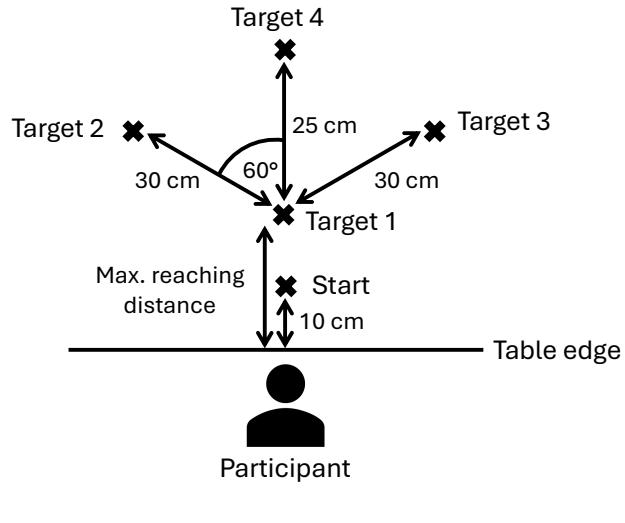  
(A)

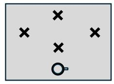  
(1)

  
(4)

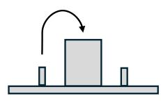

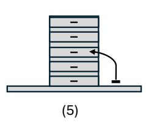  
(B)

Fig. 9. 实验工作空间和任务设置。(a) 工作空间示意图，显示了固定的起始位置（距桌边 10 cm）和四个目标位置。目标 1（T1）对应于参与者的最大伸展距离，而目标 2–4（T2–T4）放置在预定义的径向距离（25–30 cm）处，角度间隔为 60◦。(b) 任务类别概述：(1) 平面伸展与搬运；(2) 饮水与倒水；(3) 抬高伸展与搬运；(4) 平面滑动；(5) 精细物体操作；以及 (6) 连续动作。

<table><tr><td>任务类别</td><td>物品与设置</td><td>运动任务</td></tr><tr><td>平面伸展与搬运</td><td>起点处放置单个杯子</td><td>- 伸展至 T1-T4（任务编号 1-4） - 起点与 T1-T4 之间的杯子搬运（任务编号 5-8） - 顺序搬运：起点 → T2 → T3 → 起点 以及 起点 → T3 → T2 → 起点（任务编号 9-10） - 以伪随机顺序在 T1-T4 之间连续伸展（任务编号 11-12）</td></tr><tr><td>饮水与倾倒</td><td>T1 左右两侧各放置一个杯子</td><td>- 倒水（右 ↔ 左）（任务编号 13-14） - 从右侧和左侧杯子饮水（任务编号 15-16）</td></tr><tr><td>抬高伸展与搬运</td><td>T1 处放置一个大积木，两侧各放置一个小积木</td><td>- 将小积木抬升至大积木上，翻转 180° 后返回（任务编号 17-18） - 越过大积木搬运至对侧并返回（任务编号 19-20）</td></tr><tr><td>平面滑动</td><td>起点处放置单张卡片</td><td>- 双手滑动：起点 → T2 → T3 → 起点 以及 起点 → T3 → T2 → 起点（任务编号 21-22） - 双手滑动：起点 → T1 → 起点 以及 起点 → T4 → 起点（任务编号 23-24） - 单手滑动至 T1-T4 并翻转卡片 180°（任务编号 25-28） - 单手顺序滑动：起点 → T2 → T3 → 起点 以及 起点 → T3 → T2 → 起点（任务编号 29-30） - 连续多目标滑动序列（任务编号 31-32）</td></tr><tr><td>精细物体操作</td><td>T1 处放置五抽屉盒，其右侧放置一枚硬币</td><td>- 跨抽屉硬币操作（打开、关闭、放入、转移）（任务编号 33-34） - 依次打开和关闭所有抽屉（任务编号 35-36）</td></tr><tr><td>连续运动</td><td>—</td><td>- 手摇车运动（20-30 s）（任务编号 37） - 游泳动作（20-30 s）（任务编号 38）</td></tr></table>

TABLE I  
健全受试者数据采集方案中相对于目标位置 T1–T4 定义的任务类别、物品及运动任务概述。

若 $\mathbf { q } _ { \mathrm { c a l i b , t r u n k } } ( 0 )$ 与 $\mathbf { q } _ { \mathrm { r e f } }$ 之间的差异超过预定义阈值（范数为 0.1），则计算校正四元数如下：

$$
\mathbf {q} _ {\text { corr }} = \mathbf {q} _ {\text { ref }} \otimes \mathbf {q} _ {\text { calib,trunk }} (0) ^ {- 1}.
$$

随后，通过将所有校准后的躯干四元数左乘该校正四元数，获得对齐后的躯干姿态轨迹：

$$
\mathbf {q} _ {\text { calib,trunk }} ^ {\prime} (t) = \mathbf {q} _ {\text { corr }} \otimes \mathbf {q} _ {\text { calib,trunk }} (t).
$$

该流程确保了躯干 IMU 坐标系在各次记录中初始对齐的一致性，从而减少了因不同测试阶段胸骨传感器放置位置差异所带来的变异性。

## 附录 IV

## 运动学数据流与统计特征

我们将原生 IMU 传感器坐标系称为局部坐标系（local frame），将通过校准（见附录 III）获得的解剖对齐坐标系称为校准坐标系（calibrated frame）。OMC 参考坐标系配置为与解剖对齐的 IMU 坐标系匹配，并支持对运动学变量进行直接跨模态比较，该坐标系被称为记录坐标系（recording frame）。运动学数据流的概述见表 III（Tab. III），特征类别的汇总见表 IV（Tab. IV）。

<table><tr><td>标签</td><td>描述</td></tr><tr><td>动作：躯干代偿</td><td>动作模式：矢状面上躯干相对于骨盆发生可见位移。肘部伸展和肩部屈曲仍低于所需范围，且躯干屈曲代偿了受限的触及范围。起始：躯干开始前向位移，伴随有限的肩部和肘部运动。结束：恢复直立姿势并稳定。</td></tr><tr><td>动作：无躯干代偿</td><td>动作模式：手臂发生运动，而躯干位移保持在任务执行所需的功能范围内。未观察到代偿性躯干运动。起始：躯干保持稳定，手臂出现可见运动。结束：手臂回到校准位置且姿势稳定。</td></tr><tr><td>校准</td><td>动作模式：手臂弯曲贴近身体静止，无可见的躯干或手腕运动。肩部、骨盆和脊柱保持中立对齐。起始：完成前一任务并在校准姿势下稳定。结束：通过手腕、肩部或躯干的可见位移开始运动。</td></tr></table>

TABLE II  
三类运动的标注指南，包括动作特征以及起始/结束定义。

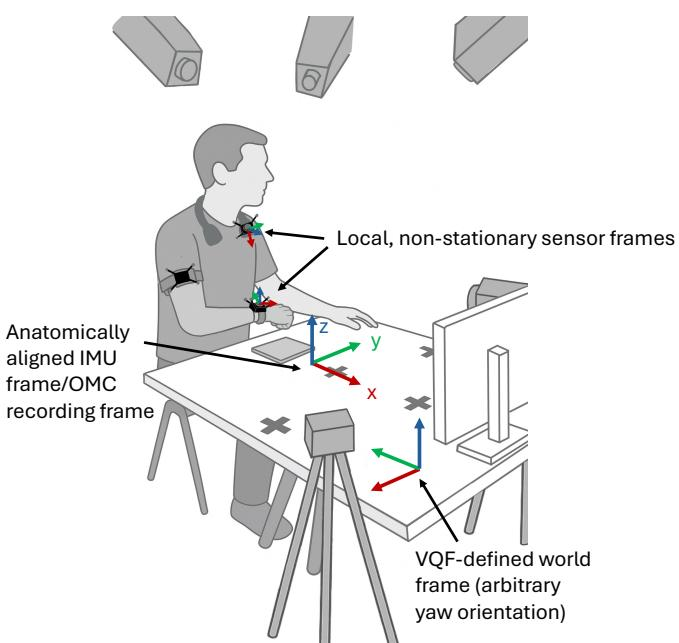  
Fig. 10. 用于基于 IMU 的解剖校准的坐标系：局部传感器坐标系附着在每个 IMU 上并随肢体节段运动而变化，而 VQF 在具有任意偏航角的全局世界坐标系中估计方向。标准化的校准姿态用于定义与 OMC 记录坐标系匹配的特定于传感器的解剖对齐坐标系，从而实现对传感器方向的一致解释。

## APPENDIX V 健全受试者模型评估

使用 OMC 和 IMU 对健全受试者的性能分类结果见表 V（Tab. V），而使用 OMC 在不同传感器位置（手腕、躯干和上臂）之间的统计成对模型比较报告于表 VI（Tab. VI）中。

## APPENDIX VI 临床数据集模型评估

在任务执行期间，将传感器放置在受累最严重的手臂上的临床泛化结果见表 VII（Tab. VII）。

<table><tr><td>模态</td><td>运动学数据流</td><td>坐标系</td></tr><tr><td rowspan="4">IMU</td><td>手腕/躯干加速度（3轴及幅值）</td><td>局部与校准坐标系（Local &amp; Calibrated）</td></tr><tr><td>手腕/躯干角速度（3轴及幅值）</td><td>局部与校准坐标系（Local &amp; Calibrated）</td></tr><tr><td>手腕/躯干绝对朝向（3轴）</td><td>校准坐标系（Calibrated）</td></tr><tr><td>手腕-躯干相对朝向（3轴及3D旋转角）</td><td>校准坐标系（Calibrated）</td></tr><tr><td rowspan="6">OMC</td><td>手腕/躯干/上臂加速度（3轴及幅值）</td><td>记录坐标系（Recording）</td></tr><tr><td>手腕/躯干/上臂角速度（3轴及幅值）</td><td>记录坐标系（Recording）</td></tr><tr><td>手腕/躯干/上臂线速度（3轴及幅值）</td><td>记录坐标系（Recording）</td></tr><tr><td>手腕/躯干/上臂绝对朝向（3轴）</td><td>记录坐标系（Recording）</td></tr><tr><td>手腕-躯干/手腕-上臂/上臂-躯干相对朝向（3轴及3D旋转角）</td><td>记录坐标系（Recording）</td></tr><tr><td>手腕-躯干/手腕-上臂/上臂-躯干相对距离（3轴及幅值）</td><td>记录坐标系（Recording）</td></tr></table>

TABLE III  
预处理后传感模态与可用运动学数据流及其各自坐标系的总结。三轴物理量沿笛卡尔坐标轴（X/Y/Z）或旋转轴（横滚角/俯仰角/偏航角，Roll/Pitch/Yaw）表示。幅值表示相应向量信号的欧几里得范数。3D旋转角表示两个朝向之间的总角位移。

<table><tr><td>指标类别</td><td>测量指标</td></tr><tr><td>单变量通道级统计量</td><td>均值、标准差（std）、最小值（min）、最大值（max）、极差（range）、均方根（RMS）、平均绝对偏差（MAD）、趋势、偏度、峰度</td></tr><tr><td>双变量通道级相似性指标（应用于加速度、绝对朝向、线速度/角速度）</td><td>最大归一化互相关、归一化动态时间规整距离（DTWD）</td></tr><tr><td>平滑度指标（应用于加速度和线速度）</td><td>手腕与躯干的对数无量纲加加速度（LDJ） + 手腕与躯干之间的 LDJ 比值</td></tr></table>

TABLE IV

应用到表 III 中列出的运动学数据流及派生描述符的特征指标类别总结。单变量指标针对每个输入信号独立计算，而双变量指标则量化信号对之间的关系。通道级指标分别针对每个信号分量（例如，矢量物理量的 X/Y/Z 或欧拉角的横滚/俯仰/偏航）进行计算，每个分量均被视为运动学数据流中的一个独立通道（即多维信号的单个维度）。对于 3D 矢量信号，欧几里得范数被额外作为一个附加通道处理。所有指标均在滑动窗口分割的每个分析窗口内计算，并用作分类模型的输入特征。

TABLE V  
使用手腕（W）、躯干（T）和上臂（UA）信息的不同传感配置下的健全人分类性能。指标以均值 ± 标准差的形式报告。

<table><tr><td rowspan="2">配置</td><td rowspan="2"> $F1_{macro}$ </td><td rowspan="2">MCC</td><td colspan="3">Calib</td><td colspan="3">Mov: No TC</td><td colspan="3">Mov: TC</td></tr><tr><td>Prec</td><td>Rec</td><td>F1</td><td>Prec</td><td>Rec</td><td>F1</td><td>Prec</td><td>Rec</td><td>F1</td></tr><tr><td>IMU(W+T)</td><td>0.80 ± 0.07</td><td>0.73 ± 0.08</td><td>0.92 ± 0.06</td><td>0.86 ± 0.13</td><td>0.88 ± 0.07</td><td>0.85 ± 0.08</td><td>0.81 ± 0.12</td><td>0.82 ± 0.07</td><td>0.64 ± 0.21</td><td>0.82 ± 0.14</td><td>0.68 ± 0.11</td></tr><tr><td>OMC(W+T+UA)</td><td>0.86 ± 0.05</td><td>0.81 ± 0.08</td><td>0.95 ± 0.03</td><td>0.92 ± 0.08</td><td>0.93 ± 0.05</td><td>0.88 ± 0.07</td><td>0.88 ± 0.07</td><td>0.88 ± 0.06</td><td>0.75 ± 0.12</td><td>0.83 ± 0.13</td><td>0.78 ± 0.09</td></tr><tr><td>OMC(W+T)</td><td>0.85 ± 0.06</td><td>0.79 ± 0.09</td><td>0.95 ± 0.04</td><td>0.91 ± 0.10</td><td>0.92 ± 0.05</td><td>0.89 ± 0.07</td><td>0.84 ± 0.12</td><td>0.86 ± 0.08</td><td>0.72 ± 0.17</td><td>0.86 ± 0.10</td><td>0.77 ± 0.10</td></tr><tr><td>OMC(T)</td><td>0.66 ± 0.12</td><td>0.50 ± 0.13</td><td>0.72 ± 0.08</td><td>0.68 ± 0.26</td><td>0.65 ± 0.16</td><td>0.73 ± 0.14</td><td>0.62 ± 0.11</td><td>0.66 ± 0.10</td><td>0.60 ± 0.24</td><td>0.83 ± 0.16</td><td>0.65 ± 0.17</td></tr><tr><td>OMC(W)</td><td>0.78 ± 0.06</td><td>0.71 ± 0.08</td><td>0.95 ± 0.03</td><td>0.91 ± 0.10</td><td>0.92 ± 0.06</td><td>0.86 ± 0.07</td><td>0.77 ± 0.09</td><td>0.81 ± 0.06</td><td>0.54 ± 0.13</td><td>0.77 ± 0.09</td><td>0.62 ± 0.09</td></tr></table>

TABLE VI  
使用 Wilcoxon 符号秩检验（Holm 校正的 p 值）进行的成对模型比较（使用手腕 (W)、躯干 (T) 和上臂 (UA) 信息）。Sig.\* 对应于 pcorr < 0.05

<table><tr><td>模型 A</td><td>模型 B</td><td>类别</td><td>p</td><td>pcorr</td><td>显著性</td></tr><tr><td>W+T+UA</td><td>W+T</td><td>Calib</td><td>0.232</td><td>1.000</td><td></td></tr><tr><td>W+T+UA</td><td>W+T</td><td>Mov: No TC</td><td>0.193</td><td>1.000</td><td></td></tr><tr><td>W+T+UA</td><td>W+T</td><td>Mov: TC</td><td>0.625</td><td>1.000</td><td></td></tr><tr><td>W+T+UA</td><td>T</td><td>Calib</td><td>0.002</td><td>0.035</td><td>*</td></tr><tr><td>W+T+UA</td><td>T</td><td>Mov: No TC</td><td>0.002</td><td>0.035</td><td>*</td></tr><tr><td>W+T+UA</td><td>T</td><td>Mov: TC</td><td>0.004</td><td>0.039</td><td>*</td></tr><tr><td>W+T+UA</td><td>W</td><td>Calib</td><td>0.322</td><td>1.000</td><td></td></tr><tr><td>W+T+UA</td><td>W</td><td>Mov: No TC</td><td>0.002</td><td>0.035</td><td>*</td></tr><tr><td>W+T+UA</td><td>W</td><td>Mov: TC</td><td>0.002</td><td>0.035</td><td>*</td></tr><tr><td>W+T</td><td>T</td><td>Calib</td><td>0.002</td><td>0.035</td><td>*</td></tr><tr><td>W+T</td><td>T</td><td>Mov: No TC</td><td>0.002</td><td>0.035</td><td>*</td></tr><tr><td>W+T</td><td>T</td><td>Mov: TC</td><td>0.004</td><td>0.039</td><td>*</td></tr><tr><td>W+T</td><td>W</td><td>Calib</td><td>0.922</td><td>1.000</td><td></td></tr><tr><td>W+T</td><td>W</td><td>Mov: No TC</td><td>0.084</td><td>0.588</td><td></td></tr><tr><td>W+T</td><td>W</td><td>Mov: TC</td><td>0.004</td><td>0.039</td><td>*</td></tr><tr><td>T</td><td>W</td><td>Calib</td><td>0.002</td><td>0.035</td><td>*</td></tr><tr><td>T</td><td>W</td><td>Mov: No TC</td><td>0.002</td><td>0.035</td><td>*</td></tr><tr><td>T</td><td>W</td><td>Mov: TC</td><td>0.375</td><td>1.000</td><td></td></tr></table>

表 VII  
在涉及受累最严重肢体的任务期间，使用放置在受累最严重手臂上的传感器所获得的临床泛化结果。

<table><tr><td rowspan="2">患者</td><td rowspan="2"> $F1_{macro}$ </td><td rowspan="2">MCC</td><td rowspan="2"> $AUC_{macro}$ </td><td colspan="3">校准 (Calib)</td><td colspan="3">运动：无躯干代偿 (Mov: No TC)</td><td colspan="3">运动：躯干代偿 (Mov: TC)</td></tr><tr><td>精确率</td><td>召回率</td><td>F1</td><td>精确率</td><td>召回率</td><td>F1</td><td>精确率</td><td>召回率</td><td>F1</td></tr><tr><td>P03（右侧）</td><td>0.51</td><td>0.35</td><td>0.85</td><td>0.15</td><td>0.34</td><td>0.21</td><td>0.90</td><td>0.96</td><td>0.93</td><td>0.67</td><td>0.27</td><td>0.38</td></tr><tr><td>P18（左侧）</td><td>0.40</td><td>0.28</td><td>0.73</td><td>0.96</td><td>0.39</td><td>0.55</td><td>0.34</td><td>0.91</td><td>0.50</td><td>0.39</td><td>0.09</td><td>0.15</td></tr><tr><td>P63（左侧）</td><td>0.34</td><td>0.26</td><td>0.82</td><td>0.96</td><td>0.15</td><td>0.27</td><td>0.40</td><td>0.99</td><td>0.57</td><td>0.96</td><td>0.11</td><td>0.20</td></tr><tr><td>P31（右侧）</td><td>0.45</td><td>0.25</td><td>0.72</td><td>0.86</td><td>0.31</td><td>0.44</td><td>0.48</td><td>0.85</td><td>0.61</td><td>0.28</td><td>0.34</td><td>0.30</td></tr><tr><td>均值 ± 标准差</td><td>0.43±0.06</td><td>0.28±0.04</td><td>0.78±0.06</td><td>0.73±0.35</td><td>0.30±0.09</td><td>0.37±0.14</td><td>0.53±0.22</td><td>0.93±0.06</td><td>0.65±0.16</td><td>0.57±0.28</td><td>0.20±0.11</td><td>0.26±0.09</td></tr></table>

## 参考文献

[1] D. O’Flaherty and K. Ali, “Recommendations for upper limb motor recovery: An overview of the UK and european rehabilitation after stroke guidelines (2023),” Healthcare, vol. 12, no. 14, p. 1433, 2024.

[2] M. Levin, J. Kleim, and S. Wolf, “What do motor “recovery” and “compensation” mean in patients following stroke?” Neurorehabilitation and Neural Repair, vol. 23, pp. 313–319, May 2009.

[3] T. Jones, “Motor compensation and its effects on neural reorganization after stroke,” Nature Reviews Neuroscience, vol. 18, Mar. 2017.

[4] B. Kim, J. Girnis, V. Sweet, T. Nobiling, T. Agag, and C. Neville, “Impact of motor task conditions on end-point kinematics and trunk movements during goal-directed arm reach,” Scientific Reports, vol. 14, Feb. 2024.

[5] M. Alt Murphy and C. Hager, “Kinematic analysis of the upper extremity after stroke—how far have we reached and what have we grasped?” Physical Therapy Reviews, vol. 20, pp. 137–155, May 2015.

[6] A. Roby-Brami, A. Feydy, M. Combeaud, E. Biryukova, B. Bussel, and M. Levin, “Motor compensation and recovery for reaching in stroke patients,” Acta Neurologica Scandinavica, vol. 107, pp. 369–381, Jun. 2003.

[7] J. See, L. Dodakian, C. Chou, V. Chan, A. McKenzie, D. Reinkensmeyer, and S. Cramer, “A standardized approach to the Fugl-Meyer assessment and its implications for clinical trials,” Neurorehabilitation and Neural Repair, vol. 27, Jun. 2013.

[8] S. L. Wolf, P. A. Catlin, M. Ellis, A. L. Archer, B. Morgan, and A. Piacentino, “Assessing Wolf Motor Function Test as outcome measure for research in patients after stroke,” Stroke, vol. 32, no. 7, pp. 1635– 1639, 2001.

[9] M. Levin, J. Desrosiers, D. Beauchemin, N. Bergeron, and A. Rochette, “Development and validation of a scale for rating motor compensations used for reaching in patients with hemiparesis: The Reaching Performance Scale,” Physical Therapy, vol. 84, pp. 8–22, Feb. 2004.（偏瘫患者伸手动作运动代偿评估量表的开发与验证：伸手表现量表）

[10] S. Duff, J. He, M. Nelsen, C. Lane, V. Rowe, S. Wolf, and A. Dromerick, “Interrater reliability of the Wolf Motor Function Test-Functional Ability Scale: Why it matters,” Neurorehabilitation and Neural Repair, vol. 29, Oct. 2014.（Wolf 运动功能测试-功能能力量表的评定者间信度：其重要性所在）

[11] X. Wang, Y. Fu, B. Ye, J. Babineau, Y. Ding, and A. Mihailidis, “Technology-based compensation assessment and detection of upper extremity activities of stroke survivors: Systematic review,” Journal of Medical Internet Research, vol. 24, p. e34307, Jun. 2022.（基于技术的脑卒中幸存者上肢活动代偿评估与检测：系统评价）

[12] E. Averell, D. Knox, and F. van Wijck, “A real-time algorithm for the detection of compensatory movements during reaching,” Journal of Rehabilitation and Assistive Technologies Engineering, vol. 9, p. 20556683221117085, Sep. 2022.（用于伸手过程中代偿动作检测的实时算法）

[13] A. Coias, M. Lee, and A. Bernardino, “A low-cost virtual coach for 2D video-based compensation assessment of upper extremity rehabilitation exercises,” Journal of NeuroEngineering and Rehabilitation, vol. 19, Jul. 2022.（用于基于 2D 视频的上肢康复训练代偿评估的低成本虚拟教练）

[14] Y. Zhi, M. Lukasik, M. Li, E. Dolatabadi, R. Wang, and B. Taati, “Automatic detection of compensation during robotic stroke rehabilitation therapy,” IEEE Journal of Translational Engineering in Health and Medicine, vol. PP, pp. 1–1, Dec. 2017.（机器人辅助脑卒中康复治疗中代偿的自动检测）

[15] N. B. Nordin, S. Q. Xie, and B. C. Wunsche, “Simple torso model for upper limb compensatory assessment after stroke,” in Proc. IEEE Int. Conf. Advanced Intelligent Mechatronics (AIM), 2016, pp. 775–780.（用于脑卒中后上肢代偿评估的简易躯干模型）

[16] H.-P. Lin, L. Zhao, D. Woolley, X. Zhang, H.-J. Cheng, W. Liang, C. Kuah, T. Plunkett, K. Chua, L. Zhang, and N. Wenderoth, “Exploring the feasibility of computer vision for detecting post-stroke compensatory movements,” in Proc. IEEE Int. Conf. Rehabil. Robot. (ICORR), Sep. 2023, pp. 1–6.（探索利用计算机视觉检测脑卒中后代偿动作的可行性）

[17] T. Unger, B. Kuhnis, L. Sauerzopf, M. R. Spiess, A. de Spindler, A. R. Luft, C. Easthope Awai, J. G. Schonhammer, and E. Gavagnin, “Using deep learning to detect upper limb compensation in individuals poststroke using consumer-grade webcams—a feasibility study,” Frontiers in Medicine, vol. 12, 2025.（使用消费级网络摄像头利用深度学习检测脑卒中后患者上肢代偿——可行性研究）

[18] J. Held, B. Klaassen, A. Eenhoorn, B.-J. van Beijnum, J. Buurke, P. Veltink, and A. Luft, “Inertial sensor measurements of upper-limb kinematics in stroke patients in clinic and home environment,” Frontiers in Bioengineering and Biotechnology, vol. 6, Apr. 2018.（临床与家庭环境中脑卒中患者上肢运动学的惯性传感器测量）

[19] A. Schwarz, M. M. C. Bhagubai, G. Wolterink, J. P. O. Held, A. R. Luft, and P. H. Veltink, “Assessment of upper limb movement impairments after stroke using wearable inertial sensing,” Sensors, vol. 20, no. 17, p. 4770, 2020.（使用可穿戴惯性传感评估脑卒中后上肢运动障碍）

[20] A. Schwarz, J. Veerbeek, J. Held, J. Buurke, and A. Luft, “Measures of interjoint coordination post-stroke across different upper limb movement tasks,” Frontiers in Bioengineering and Biotechnology, vol. 8, p. 620805, Jan. 2021.

[21] F. Wittmann, J. P. Held, O. Lambercy, M. L. Starkey, A. Curt, R. Hover,¨ R. Gassert, A. R. Luft, and R. R. Gonzenbach, “Self-directed arm therapy at home after stroke with a sensor-based virtual reality training system,” Journal ofNeuroEngineering and Rehabilitation, vol. 13, no. 1, Aug. 2016.

[22] G. Nguyen, J. MacLean, and L. Stirling, “Quantification of compensatory torso motion in post-stroke patients using wearable inertial measurement units,” IEEE Sensors Journal, vol. PP, pp. 1–1, Apr. 2021.

[23] R. F. Beer, J. D. Given, and J. P. A. Dewald, “Task-dependent weakness at the elbow in patients with hemiparesis,” Archives ofPhysical Medicine and Rehabilitation, vol. 80, no. 7, pp. 766–772, 1999.

[24] P. H. McCrea, J. J. Eng, and A. J. Hodgson, “Biomechanics of reaching: Clinical implications for individuals with acquired brain injury,” Disability and Rehabilitation, vol. 24, pp. 534–541, Aug. 2002.

[25] J. P. A. Dewald, P. S. Pope, J. D. Given, T. S. Buchanan, and W. Z. Rymer, “Abnormal muscle coactivation patterns during isometric torque generation at the elbow and shoulder in hemiparetic subjects,” Brain, vol. 118, no. 2, pp. 495–510, 1995.

[26] M. D. Ellis, I. Schut, and J. P. A. Dewald, “Flexion synergy overshadows flexor spasticity during reaching in chronic moderate to severe hemiparetic stroke,” Clinical Neurophysiology, vol. 128, no. 7, pp. 1308– 1314, 2017.

[27] G. M. Johansson, H. Grip, and C. Hager, “Introducing a standardized Nine Hole Peg Test in persons with stroke—kinematic analysis,” Gait & Posture, vol. 42, p. S57, Dec. 2015.

[28] R. C. Lyle, “A performance test for assessment of upper limb function in physical rehabilitation treatment and research,” International Journal of Rehabilitation Research, vol. 4, no. 4, pp. 483–492, Dec. 1981.

[29] R. H. Jebsen, N. Taylor, R. B. Trieschmann, M. J. Trotter, and L. A. Howard, “An objective and standardized test of hand function,” Archives of Physical Medicine and Rehabilitation, vol. 50, no. 6, pp. 311–319, 1969.

[30] C. Lhoste, M. Quast, A. Ronco, A. Vogel, C. E. Awai, M. Branscheidt, O. Lambercy, P. Viskaitis, and D. Donegan, “Closed-loop movementpaired transcutaneous auricular vagus nerve stimulation for upper-limb rehabilitation: A feasibility study,” Sep. 2025, research Square preprint.

[31] J. Barth, J. Klaesner, and C. Lang, “Relationships between accelerometry and general compensatory movements of the upper limb after stroke,” Journal of NeuroEngineering and Rehabilitation, vol. 17, p. 138, Oct. 2020.

[32] L. Sauerzopf, C. G. C. Panduro, A. R. Luft, B. Kuhnis, E. Gavagnin, T. Unger, C. E. Awai, J. G. Schonhammer, J. Degenfellner, and M. R. Spiess, “评估脑卒中后上肢代偿运动评估的评分者间及评分者内信度：通过视频分析构建真实基准？” *Journal of NeuroEngineering and Rehabilitation*, vol. 21, no. 1, Dec. 2024.

[33] D. Laidig and T. Seel, “VQF：具有偏差估计和磁干扰抑制的高精度 IMU 姿态估计,” *Information Fusion*, vol. 91, pp. 187–204, 2023.

[34] S. M. Lundberg and S.-I. Lee, “解释模型预测的统一方法,” in *Advances in Neural Information Processing Systems (NeurIPS)*, 2017, pp. 4768–4777.

[35] T. Chen and C. Guestrin, “XGBoost：一种可扩展的树提升系统,” in *Proc. ACM SIGKDD Int. Conf. Knowledge Discovery and Data Mining (KDD)*, 2016, pp. 785–794.

[36] D. Chicco and G. Jurman, “在二分类评估中马修斯相关系数（MCC）相比于 F1 分数和准确率的优势,” *BMC Genomics*, vol. 21, no. 1, Jan. 2020.

[37] C. Cirstea and M. Levin, “脑卒中患者伸手动作中的代偿策略,” *Brain*, vol. 123, no. 5, pp. 940–953, Jun. 2000.

[38] A. Roby-Brami, N. Jarrasse, and R. Parry, “脑卒中后灵巧上肢功能的受损与代偿：从锥体束损伤的直接后果到日常活动中双上肢的行为参与,” *Frontiers in Human Neuroscience*, vol. 15, Jun. 2021.

[39] R. Ranganathan, R. Wang, B. Dong, and S. Biswas, “基于可穿戴传感器系统识别上肢代偿运动模式,” *Physiological Measurement*, vol. 38, no. 12, pp. 2222–2234, Nov. 2017.

[40] K. Ding, J. Wang, X. Wang, L. Zhou, D. Xiong, and L. Guo, “基于可穿戴传感器和机器学习算法的脑卒中患者代偿运动检测与定量评估系统,” *IEEE Sensors Journal*, vol. 24, no. 14, pp. 22 830–22 842, 2024.

[41] R. Ranganathan, R. Wang, R. Gebara, and S. Biswas, “使用可穿戴系统检测脑卒中康复者的躯干代偿运动,” in *Proc. Workshop Wearable Systems and Applications*, Jun. 2017, pp. 29–32.

[42] S. Cai, G. Li, E. Su, X. Wei, S. Huang, K. Ma, H. Zheng, and L. Xie, “脑卒中患者代偿模式的实时检测以减少机器人康复治疗中的代偿,” *IEEE Journal of Biomedical and Health Informatics*, vol. 24, no. 9, pp. 2630–2638, 2020.

[43] S. Cai, X. Wei, E. Su, W. Wu, H. Zheng, and L. Xie, “用于实时减少伸手过程中代偿动作的在线代偿检测：一项针对脑卒中康复者的初步研究,” *Journal of NeuroEngineering and Rehabilitation*, vol. 17, Apr. 2020.

[44] N. J. Seo, K. Coupland, C. Finetto, and G. Scronce, “用于监测中风幸存者居家上肢任务练习质量的可穿戴传感器,” Sensors, vol. 24, p. 554, Jan. 2024.

[45] M. Berjis, M.-E. LeBel, D. Lizotte, and A. Trejos, “利用 s-EMG 传感器选择用于检测上肢代偿运动的肌肉,” IEEE Transactions on Medical Robotics and Bionics, vol. PP, pp. 1–1, Jan. 2025.