# 扩散策略：通过动作扩散进行视觉运动策略学习

Cheng Chi∗1, Zhenjia Xu∗1, Siyuan Feng2, Eric Cousineau2, Yilun Du3, Benjamin Burchfiel2, Russ Tedrake 2,3, Shuran Song1,4

## 摘要

本文提出了扩散策略（Diffusion Policy），这是一种通过将机器人的视觉运动策略表示为条件去噪扩散过程来生成机器人行为的新方法。我们在来自 4 个不同机器人操作基准的 15 项不同任务上对 Diffusion Policy 进行了基准测试，发现它始终优于现有的最先进机器人学习方法，平均提升达 46.9%。Diffusion Policy 学习动作分布得分函数（score function）的梯度，并在推理过程中通过一系列随机朗之万动力学（Langevin dynamics）步长根据该梯度场进行迭代优化。我们发现，将扩散模型公式用于机器人策略时展现出强大的优势，包括能够从容处理多模态动作分布、适用于高维动作空间，并表现出优异的训练稳定性。为了充分释放扩散模型在实体机器人视觉运动策略学习上的潜力，本文提出了一系列关键技术贡献，包括引入后退地平线控制（receding horizon control）、视觉条件调节以及时间序列扩散 Transformer（time-series diffusion transformer）。我们希望这项工作将有助于推动新一代策略学习技术的发展，使其能够利用扩散模型强大的生成建模能力。代码、数据和训练细节见 diffusion-policy.cs.columbia.edu。

## 关键词

Imitation learning, visuomotor policy, manipulation

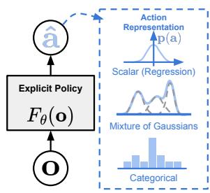  
(a) 显式策略

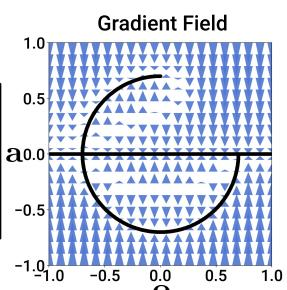  
(c) 扩散策略  
Figure 1. 策略表示。a) 具有不同类型动作表示的显式策略。b) 隐式策略学习以动作和观测为条件的能量函数，并对使能量景观最小化的动作进行优化。c) p(a)扩散策略通过学习到的梯度场将噪声细化为动作。该形式化方法提供了稳定的训练过程，使学习到的策略能够准确建模多模态动作分布，并容纳高维动作序列。

## 1 引言

基于示教的策略学习（Policy learning from demonstration）在最简形式下，可表述为学习将观测映射到动作的监督回归任务。然而在实际应用中，预测机器人动作的独特性质——例如多峰分布（multimodal distributions）的存在、时序相关性以及对高精度的要求——使得该任务与其他监督学习问题相比截然不同且极具挑战性。

先前的研究试图通过探索不同的动作表征（Fig 1 a）来应对这一挑战——例如使用高斯混合模型（mixtures of Gaussians）Mandlekar et al. (2021)、量化动作的分类表征 Shafiullah et al. (2022)；或者通过改变策略表征（Fig 1 b）——从显式表征转为隐式表征，以更好地捕获多峰分布 Florence et al. (2021); Wu et al. (2020)。

在这项工作中，我们试图通过引入一种新形式的机器人视觉运动策略（visuomotor policy）来应对这一挑战，该策略通过“机器人动作空间上的条件去噪扩散过程 Ho et al. (2020)”来生成行为，即 Diffusion Policy。在这种构建方式下，策略不再直接输出动作，而是在视觉观测为条件的前提下，经过 $K$ 次去噪迭代来推断动作得分梯度（action-score gradient）（Fig. 1 c）。这种形式化使机器人策略能够继承扩散模型的若干关键特性——从而显著提升性能。

• 表达多峰动作分布。通过学习动作得分函数的梯度 Song and Ermon (2019) 并在该梯度场上执行随机朗之万动力学（Stochastic Langevin Dynamics）采样，Diffusion Policy 可以表达任意可归一化的分布 Neal et al. (2011)，其中包括多峰动作分布这一策略学习中公认的难题。

• 高维输出空间。正如其令人瞩目的图像生成结果所证明的，扩散模型对高维输出空间展现出了出色的可扩展性。这一特性使策略能够联合推断一系列未来动作，而非仅推断单步动作，这对于促进动作的时间一致性并避免短视规划至关重要。

• 稳定的训练。训练基于能量的策略（energy-based policies）通常需要负采样来估计难以计算的归一化常数，已知这会导致训练不稳定 Du et al. (2020); Florence et al. (2021)。Diffusion Policy 通过学习能量函数的梯度避开了这一需求，从而在保持分布表达能力的同时实现了稳定的训练。

我们的主要贡献在于将上述优势引入机器人领域，并在复杂的真实世界机器人操作任务中验证了它们的有效性。为了成功将扩散模型应用于视觉运动策略学习，我们提出了以下技术贡献，以增强 Diffusion Policy 的性能并释放其在实体机器人上的全部潜力：

• 闭环动作序列。我们将策略预测高维动作序列的能力与后退时域控制（receding-horizon control）相结合，以实现鲁棒的执行。该设计允许策略以闭环方式连续重新规划其动作，同时保持时间动作一致性——在长视距规划与响应性之间实现平衡。

• 视觉条件化。我们引入了一种以视觉为条件的扩散策略，其中视觉观测被视为条件，而不是联合数据分布的一部分。在这种形式化中，无论去噪迭代次数如何，策略仅提取一次视觉表征，这极大地减少了计算量并实现了实时动作推理。

• 时间序列扩散 Transformer。我们提出了一种新型的基于 Transformer 的扩散网络，该网络最大限度地减少了典型基于 CNN 的模型的过度平滑效应，并在需要高频动作变化和速度控制的任务上取得了最先进的性能。

我们在行为克隆形式化下，跨 4 个不同基准 Florence et al. (2021); Gupta et al. (2019); Mandlekar et al. (2021); Shafiullah et al. (2022) 的 15 个任务上系统地评估了 Diffusion Policy。评估涵盖了仿真和真实世界环境、2 自由度（2DoF）到 6 自由度（6DoF）动作、单任务和多任务基准，以及全驱动和欠驱动系统，涉及刚体和流体物体，并使用了由单个和多个用户收集的演示数据。

实证表明，我们在所有基准上均发现了持续的性能提升，平均提升达 46.9%，这为 Diffusion Policy 的有效性提供了有力证据。我们还提供了详细的分析，仔细研究了所提算法的特性以及关键设计决策的影响。

本工作是会议论文 Chi et al. (2023) 的扩展版本。我们在以下几个方面扩展了本文的内容：

• 增加了一个新的讨论章节，探讨扩散策略与控制理论之间的联系。见第 4.5 节。

• 在仿真中增加了关于备选网络架构设计以及不同预训练和微调范式的额外消融实验，第 5.4 节。

• 在第 7 节中，通过打蛋器（Egg Beater）、展开垫子（Mat Unrolling）和折叠衬衫（Shirt Folding）三个双臂操作任务扩展了真实世界的实验结果。

用于复现我们结果的代码、数据和训练细节已公开提供于 diffusion-policy.cs. columbia.edu。

## 2 扩散策略形式化

我们将视觉运动机器人策略形式化为去噪扩散概率模型（Denoising Diffusion Probabilistic Models，DDPMs）Ho et al. (2020)。至关重要的是，扩散策略能够表达复杂的多模态动作分布，并具有稳定的训练行为——几乎不需要针对特定任务进行超参数调优。以下各节将更详细地描述 DDPM，并解释如何将其调整以表示视觉运动策略。

## 2.1 去噪扩散概率模型（Denoising Diffusion Probabilistic Models）

DDPM 是一类生成模型，其中输出的生成被建模为一个去噪过程，通常被称为随机朗之万动力学（Stochastic Langevin Dynamics）Welling and Teh (2011)。

从高斯噪声中采样的 $\mathbf { x } ^ { K }$ 开始，DDPM 执行 K 次去噪迭代，以生成一系列噪声水平逐渐降低的中间动作 $\mathbf { x } ^ { k } , \mathbf { x } ^ { k - 1 } . . . \mathbf { x } ^ { 0 }$，直到形成期望的无噪声输出 $\mathbf { x } ^ { 0 }$。该过程遵循如下公式：

$$
\mathbf {x} ^ {k - 1} = \alpha (\mathbf {x} ^ {k} - \gamma \varepsilon_ {\theta} (\mathbf {x} ^ {k}, k) + \mathcal {N} (0, \sigma^ {2} I)),\tag{1}
$$

其中 $\varepsilon _ { \theta }$ 是具有参数 θ 的噪声预测网络，该参数将通过学习进行优化，而 $\dot { \mathcal { N } } ( 0 , \sigma ^ { 2 } I )$ 是在每次迭代中添加的高斯噪声。

上述公式 1 也可以被解释为单个带噪声的梯度下降步骤：

$$
\mathbf {x} ^ {\prime} = \mathbf {x} - \gamma \nabla E (\mathbf {x}),\tag{2}
$$

其中噪声预测网络 $\varepsilon _ { \boldsymbol { \theta } } ( \mathbf { x } , k )$ 有效地预测了梯度场 $\nabla E ( \mathbf { x } )$，γ 为学习率。

将 、、 选择为迭代步数 k 的函数（也称为噪声调度，noise schedule），可以解释为梯度下降过程中的学习率调度。略小于 1 的 α 已被证明可以提高稳定性 Ho et al. (2020)。有关噪声调度的细节将在 Sec 3.3 中讨论。

  
Figure 2. 扩散策略概览 a) 通用表述。在时间步 t，策略将最新的 $T _ { o }$ 步观测数据 $O _ { t }$ 作为输入，并输出 $T _ { a }$ 步动作 A。b) 在基于 CNN 的扩散策略中，在通道维度上对每个卷积层应用观测特征 $O _ { t }$ 的 FiLM（特征级线性调制，Feature-wise Linear Modulation）Perez et al. (2018) 条件化。从高斯噪声中抽取的 $\mathbf { A } _ { t } ^ { K }$ 开始，减去噪声预测网络 $\varepsilon _ { \theta }$ 的输出，重复 K 次以获得去噪后的动作序列 ${ \bf A } _ { t } ^ { 0 }$。c) 在基于 Transformer Vaswani et al. $( 2 0 1 7 )$ 的扩散策略中，观测 $\mathbf { O } _ { t }$ 的嵌入被传入每个 transformer 解码器块的多头交叉注意力层。使用图示的注意力掩码，每个动作嵌入被约束为仅关注自身及先前的动作嵌入（因果注意力）。

## 2.2 DDPM 训练

训练过程首先从数据集中随机抽取未经修改的样本 $\mathbf { x } ^ { 0 }$。对于每个样本，我们随机选择一个去噪迭代步 $k$，然后采样一个对于迭代步 $k$ 具有合适方差的随机噪声 $\varepsilon ^ { k }$。噪声预测网络被要求根据添加了噪声的数据样本来预测该噪声。

$$
\mathscr {L} = M S E \left(\varepsilon^ {k}, \varepsilon_ {\theta} \left(\mathbf {x} ^ {0} + \varepsilon^ {k}, k\right)\right)\tag{3}
$$

正如 Ho et al. (2020) 所示，最小化式 (3) 中的损失函数同时也最小化了数据分布 $p ( \mathbf { x } ^ { 0 } )$ 与使用式 (1) 从 DDPM 中抽取的样本分布 $q ( \mathbf { x } ^ { 0 } )$ 之间的 KL 散度（KL-divergence）的变分下界。

## 2.3 用于视觉运动策略学习的扩散模型

虽然 DDPM 通常用于图像生成（$x$ 是图像），但我们使用 DDPM 来学习机器人视觉运动策略（visuomotor policies）。这需要在公式表述上进行两项主要修改：1. 将输出 $x$ 改为表示机器人动作。2. 使去噪过程以输入观测 $\mathbf { O } _ { t }$ 为条件。以下各段将分别讨论这些修改，图 2（Fig. 2）展示了整体概览。

闭环动作序列预测：有效的动作表述应在长视距规划中促进时间一致性和平滑性，同时允许对意外观测做出迅速反应。为了实现这一目标，我们在重新规划之前，在固定时长内坚持执行扩散模型生成的动作序列预测。具体而言，在时间步 $t$，策略将最新的 $T _ { o }$ 步观测数据 $\mathbf { O } _ { t }$ 作为输入，并预测 $T _ { p }$ 步动作，其中 $T _ { a }$ 步动作在机器人上执行且无需重新规划。在此，我们将 $T _ { o }$ 定义为观测视距（observation horizon），$T _ { p }$ 定义为动作预测视距（action prediction horizon），$T _ { a }$ 定义为动作执行视距（action execution horizon）。这在保持响应能力的同时促进了动作在时间上的连贯一致。关于 $T _ { a }$ 影响的更多细节将在 4.3 节（Sec 4.3）中讨论。我们的公式表述还允许使用滚动时域控制（receding horizon control，Mayne and Michalska (1988)），通过利用先前的动作序列预测对下一次推理设置进行热启动（warm-starting），从而进一步提高动作平滑度。

视觉观测条件化：我们使用 DDPM 来近似条件分布 $p ( \mathbf { A } _ { t } | \mathbf { O } _ { t } )$，而不是像 Janner et al. (2022a) 中用于规划的联合分布 $p ( \mathbf { A } _ { t } , \mathbf { O } _ { t } )$。这种表述使模型能够以观测为条件预测动作，而无需承担推断未来状态的开销，从而加快了扩散过程并提高了生成动作的准确性。为了建模条件分布 $p ( \mathbf { A } _ { t } | \mathbf { O } _ { t } )$，我们将式 (1) 修改为：

$$
\mathbf {A} _ {t} ^ {k - 1} = \alpha (\mathbf {A} _ {t} ^ {k} - \gamma \varepsilon_ {\theta} (\mathbf {O} _ {t}, \mathbf {A} _ {t} ^ {k}, k) + \mathcal {N} (0, \sigma^ {2} I))\tag{4}
$$

训练损失由公式 3 修改为：

$$
\mathcal {L} = M S E (\boldsymbol {\varepsilon} ^ {k}, \boldsymbol {\varepsilon} _ {\theta} (\mathbf {O} _ {t}, \mathbf {A} _ {t} ^ {0} + \boldsymbol {\varepsilon} ^ {k}, k))\tag{5}
$$

从去噪过程的输出中排除观测特征 $\mathbf { O } _ { t }$ 显著提高了推理速度，并更好地适应实时控制。这也有助于使视觉编码器的端到端训练变得可行。有关视觉编码器的详细信息在第 3.2 节中描述。

## 3 关键设计决策

在本节中，我们将介绍 Diffusion Policy 的关键设计决策，以及使用神经网络架构对 $\varepsilon _ { \theta }$ 的具体实现。

## 3.1 网络架构选择

第一个设计决策是为 $\varepsilon _ { \theta }$ 选择神经网络架构。在这项工作中，我们研究了两种常见的网络架构类型：卷积神经网络（CNNs）Ronneberger et al. (2015) 和 Transformers Vaswani et al. (2017)，并比较了它们的性能和训练特性。请注意，噪声预测网络 $\varepsilon _ { \theta }$ 的选择独立于视觉编码器，hi h ill b d ib d i

基于 CNN 的 Diffusion Policy 我们采用了来自 Janner et al. (2022b) 的一维时间卷积网络（1D temporal CNN），并进行了若干修改：首先，我们通过特征级线性调制（Feature-wise Linear Modulation，FiLM）

Perez et al. (2018) 以及去噪迭代次数 k 将动作生成过程以观测特征 $\mathbf { O } _ { t }$ 为条件，从而仅对条件分布 $p ( \mathbf { A } _ { t } | \mathbf { O } _ { t } )$ 进行建模，如图 2 (b) 所示。其次，我们仅预测动作轨迹，而不是拼接的观测-动作轨迹。第三，由于基于图像修复（inpainting）的目标状态条件化与我们采用后退预测时域（receding prediction horizon）的框架不兼容，我们移除了该方法。然而，使用与观测相同的 FiLM 条件化方法仍然可以实现目标条件化。

在实践中，我们发现基于 CNN 的主干网络在大多数任务上开箱即用且表现良好，无需进行大量超参数调优。然而，当期望的动作序列随时间快速且剧烈变化时（例如速度指令动作空间），它的表现较差，这可能是由于时间卷积偏好低频信号的归纳偏置所致 Tancik et al. (2020)。

时间序列扩散 Transformer（Time-series diffusion transformer） 为了减少 CNN 模型中的过度平滑（oversmoothing）效应 Tancik et al. (2020)，我们引入了一种新颖的基于 Transformer 的 DDPM，它采用来自 minGPT Shafiullah et al. (2022) 的 Transformer 架构进行动作预测。带有噪声的动作 $A _ { t } ^ { k }$ 作为输入 token 传入 Transformer 解码器块，扩散迭代步数 k 的正弦嵌入（sinusoidal embedding）作为第一个 token 前置拼接。观测 $\mathbf { O } _ { t }$ 通过共享 MLP 转换为观测嵌入序列，然后作为输入特征传入 Transformer 解码器堆栈。“梯度” $\mathbf { \nabla } ^ { \prime } \varepsilon _ { \theta } ( \mathbf { O _ { t } } , \mathbf { A _ { t } } ^ { k } , k )$ 由解码器堆栈的每个对应输出 token 预测得出。

在我们基于状态（state-based）的实验中，大多数性能最佳的策略都是通过 Transformer 主干网络实现的，特别是在任务复杂度高且动作变化率大的情况下。然而，我们发现 Transformer 对超参数更为敏感。Transformer 训练的困难性 Liu et al. (2020) 并非 Diffusion Policy 所独有，未来随着 Transformer 训练技术的改进或数据规模的增加，这可能会得到解决。

建议。通常情况下，我们建议在尝试新任务时，首先采用基于 CNN 的扩散策略实现。如果由于任务复杂度或高频动作变化导致性能较低，则可以采用时间序列扩散 Transformer 构型，以额外的调参代价来潜在地提高性能。

## 3.2 视觉编码器

视觉编码器将原始图像序列映射为潜在嵌入 $O _ { t }$，并与扩散策略进行端到端训练。不同的相机视角使用独立的编码器，每个时间步的图像被独立编码，然后拼接形成 $O _ { t }$ 。我们使用标准的 ResNet-18（无预训练）作为编码器，并进行了以下修改：1) 用空间 Softmax 池化（spatial softmax pooling）替换全局平均池化以保留空间信息 Mandlekar et al. (2021)。2) 用 GroupNorm Wu and He (2018) 替换 BatchNorm 以实现稳定训练。当归一化层与指数移动平均（Exponential Moving Average，EMA）He et al. (2020)（常用于 DDPM）结合使用时，这一点非常重要。

## 3.3 噪声调度

由作为 $k$ 的函数的 σ、$\alpha ,$ γ 以及加性高斯噪声 $\varepsilon ^ { k }$ 所定义的噪声调度（noise schedule）已得到广泛研究 Ho et al. (2020); Nichol and Dhariwal (2021)。底层的噪声调度控制着扩散策略捕获动作信号高频和低频特性的程度。在我们的控制任务中，我们通过实验发现 iDDPM Nichol and Dhariwal (2021) 中提出的平方余弦调度（Square Cosine Schedule）在我们的任务中表现最好。

## 3.4 加速实时控制的推理

我们将扩散过程用作机器人的策略；因此，具有快速的推理速度对于闭环实时控制至关重要。去噪扩散隐式模型（Denoising Diffusion Implicit Models, DDIM）方法 Song et al. (2021) 解耦了训练和推理中的去噪迭代次数，从而允许算法在推理时使用更少的迭代次数以加快该过程。在我们的真实世界实验中，使用具有 100 次训练迭代和 10 次推理迭代的 DDIM，在 Nvidia 3080 GPU 上实现了 0.1s 的推理延迟。

## 4 扩散策略的独特性质

在本节中，我们提供了关于扩散策略及其相较于其他形式策略表示的优势的一些见解和直观理解。

## 4.1 建模多模态动作分布

在人类演示中建模多模态分布的挑战已在行为克隆文献 Florence et al. (2021); Shafiullah et al. (2022); Mandlekar et al. (2021) 中得到了广泛讨论。扩散策略自然且精确地表达多模态分布的能力是其核心优势之一。

直观地说，扩散策略在动作生成中的多模态性源于两个方面——底层的随机采样过程和随机初始化。在随机朗之万动力学（Stochastic Langevin Dynamics）中，在每个采样过程开始时从标准高斯分布中抽取初始样本 $\mathbf { A } _ { t } ^ { K }$，这有助于为最终的动作预测 $\bar { \mathbf { A } } _ { t } ^ { 0 }$ 指定不同的可能收敛盆（convergence basins）。然后，该动作在大量迭代中通过添加高斯扰动进一步进行随机优化，这使得单个动作样本能够收敛并在不同的多模态动作盆之间移动。Fig. 3 展示了扩散策略在平面推块任务（Push T，下文介绍）中的多模态行为示例，且测试场景并未包含在显式演示中。

## 4.2 与位置控制的协同效应

我们发现，具有位置控制动作空间的 Diffusion Policy 始终优于具有速度控制的 Diffusion Policy，如图 4 所示。这一令人惊讶的结果与近期大多数通常依赖速度控制的行为克隆（behavior cloning）工作 Mandlekar et al. (2021); Shafiullah et al. (2022); Zhang et al. (2018); Florence et al. (2019); Mandlekar et al. $( 2 0 2 0 \mathrm { b } , \mathrm { a } )$ 形成鲜明对比。我们推测这种差异有两个主要原因：首先，在位置控制模式下，动作的多模态性比使用速度控制时更为显著。由于 Diffusion Policy 能够比现有方法更好地表达动作多模态性，我们推测它本质上受此缺点的影响较现有方法更小。此外，与速度控制相比，位置控制受累积误差效应的影响更小，因此更适合动作序列预测（如下一节所述）。因此，Diffusion Policy 既较少受到位置控制主要缺点的负面影响，又能更好地利用位置控制的优势。

  
Figure 3. 多模态行为。在给定状态下，末端执行器（蓝色）可以向左或向右移动来推动滑块。Diffusion Policy 学习到了这两种模态，并在每次推演（rollout）中仅专注于一种模态。相比之下，LSTM-GMM Mandlekar et al. (2021) 和 IBC Florence et al. (2021) 都偏向于单一模态，而 BET Shafiullah et al. (2022) 则由于缺乏时间维度的动作一致性而无法专注于单一模态。展示的动作为性能最佳的检查点推演 40 步所生成的。

  
Figure 4. 速度控制与位置控制的对比。从速度控制切换到位置控制时的性能差异。虽然 BC-RNN 和 BET 的性能都有所下降，但 Diffusion Policy 能够利用位置控制的优势并提升其性能。

## 4.3 动作序列预测的优势

由于难以在高维输出空间中进行有效采样，大多数策略学习方法通常会避免序列预测。例如，IBC 很难在具有非平滑能量地形的高维动作空间中进行有效采样。类似地，BC-RNN 和 BET 很难指定动作分布中存在的模态数量（这是 GMM 或 k-means 步骤所必需的）。

相比之下，正如在诸多图像生成应用中所证明的那样，DDPM 在输出维度扩展时表现良好，且不会牺牲模型的表达能力。利用这一能力，Diffusion Policy 将动作表示为高维动作序列的形式，从而自然地解决了以下问题：

• 时间动作一致性（Temporal action consistency）：以图 3 为例。为了从底部将 T 形块推入目标位置，策略可以从左侧或右侧绕过 T 形块。然而，假设序列中的每个动作都被预测为独立的多模态分布（如 BC-RNN 和 BET 中所做的那样）。在这种情况下，连续的动作可能会从不同的模态中抽取，导致动作产生抖动并在两条有效轨迹之间交替。

• 对空闲动作的鲁棒性（Robustness to idle actions）：当示教暂停时就会出现空闲动作，导致一系列相同的位置动作或接近零的速度动作。这在遥操作（teleoperation）中很常见，在液体倾倒等任务中有时也是必需的。然而，单步策略很容易过拟合这种暂停行为。例如，在真实世界实验中，如果没有从训练中显式移除空闲动作，BC-RNN 和 IBC 通常会陷入卡顿。

  
Figure 5. Diffusion Policy 消融实验。Y 轴显示了相对于每个任务最大成功率的变化（差值）。左图：选择动作时域（action horizon）时在时间一致性与响应性之间的权衡。右图：采用位置控制的 Diffusion Policy 对延迟具有鲁棒性。延迟定义为从最后一帧观测到第一个可执行动作之间的步数。

## 4.4 训练稳定性

尽管 IBC 在理论上应具备与扩散策略类似的优势。然而，由于 IBC 固有的训练不稳定性，在实践中使其获得可靠且高性能的结果极具挑战性 Ta et al. (2022)。图 6 显示了在整个训练过程中出现的训练误差峰值以及不稳定的评估表现，这使得超参数调优变得至关重要，且检查点（checkpoint）的选择十分困难。因此，Florence et al. (2021) 评估了每一个检查点，并报告了性能最好的检查点的结果。在真实世界环境中，这种工作流程需要在硬件上评估许多策略以选出最终策略。在此，我们讨论为什么 Diffusion Policy 在训练时显得明显更加稳定。

隐式策略使用基于能量的模型（Energy-Based Model，EBM）来表示动作分布：

$$
p _ {\theta} (\mathbf {a} | \mathbf {o}) = \frac {e ^ {- E _ {\theta} (\mathbf {o} , \mathbf {a})}}{Z (\mathbf {o} , \theta)}\tag{6}
$$

其中 $Z ( \mathbf { 0 } , \theta )$ 是一个（关于 a 的）难以计算的归一化常数。

  
Figure 6. 训练稳定性。左图：尽管能量函数的训练损失平滑下降，但 IBC 无法以越来越高的精度推断训练动作。右图：IBC 的评估成功率发生震荡，使得检查点选择变得困难（在仿真中使用策略 rollout 进行评估）。

为了训练隐式策略的 EBM（能量模型），使用了一种 InfoNCE 风格的损失函数，该函数等价于公式 6 的负对数似然：

$$
\mathcal {L} _ {i n f o N C E} = - \log (\frac {e ^ {- E _ {\theta} (\mathbf {o} , \mathbf {a})}}{e ^ {- E _ {\theta} (\mathbf {o} , \mathbf {a})} + \sum_ {j = 1} ^ {N _ {n e g}} e ^ {- E _ {\theta} (\mathbf {o} , \widetilde {\mathbf {a}} ^ {j})}})\tag{7}
$$

其中一组负样本 $\{ \widetilde { \mathbf { a } } ^ { j } \} _ { j = 1 } ^ { N _ { n e g } }$ 用于估计难以计算的归一化常数 $Z ( \mathbf { 0 } , \theta )$。在实践中，已知负采样的不准确性会导致 EBM 训练不稳定 Du et al. (2020); Ta et al. (2022)。

Diffusion Policy 和 DDPMs 通过对公式 6 中相同动作分布的分数函数（score function）Song and Ermon (2019) 进行建模，从而完全避开了估计 $Z ( \mathbf { a } , \theta )$ 的问题：

$$
\nabla_ {\mathbf {a}} \log p (\mathbf {a} | \mathbf {0}) = - \nabla_ {\mathbf {a}} E _ {\theta} (\mathbf {a}, \mathbf {0}) - \underbrace {\nabla_ {\mathbf {a}} \log Z (\mathbf {o} , \theta)} _ {= 0} \approx - \varepsilon_ {\theta} (\mathbf {a}, \mathbf {0})\tag{8}
$$

其中噪声预测网络 $\varepsilon _ { \boldsymbol { \theta } } ( \mathbf { a } , \mathbf { 0 } )$ 近似于分数函数 $\nabla _ { \mathbf { a } }$ log $p ( \mathbf { a } | \mathbf { o } )$ 的负值 Liu et al. (2022)，该值与归一化常数 $Z ( \mathbf { 0 } , \theta )$ 无关。因此，Diffusion Policy 的推理过程（公式 4）和训练过程（公式 5）均不涉及计算 $Z ( \mathbf { 0 } , \theta )$，从而使 Diffusion Policy 的训练更加稳定。

## 4.5 与控制理论的联系

当任务非常简单时，Diffusion Policy 具有简单明了的极限行为；这使得我们有可能借助控制理论中一些严谨的理解。考虑我们希望控制一个采用标准状态空间形式的线性动力系统的情况：

$$
\mathbf {s} _ {t + 1} = \mathbf {A} \mathbf {s} _ {t} + \mathbf {B} \mathbf {a} _ {t} + \mathbf {w} _ {t}, \qquad \mathbf {w} _ {t} \sim \mathcal {N} (0, \Sigma_ {w}).
$$

现在假设我们从线性反馈策略获取演示轨迹（rollouts）：$\mathbf { a } _ { t } = - \mathbf { K } \mathbf { s } _ { t }$。例如，该策略可以通过求解类似线性二次调节器（Linear Quadratic Regulator, LQR）的线性最优控制问题来获得。模仿该策略并不需要扩散模型的建模能力，但作为合理性检验（sanity check），我们可以看到 Diffusion Policy 能够做出正确的行为。

特别地，当预测时域为一个时间步，即 $T _ { p } = 1$ 时，可以看出最小化

$$
\mathscr {L} = M S E \left(\varepsilon^ {k}, \varepsilon_ {\theta} \left(\mathbf {s} _ {t}, - \mathbf {K s} _ {t} + \varepsilon^ {k}, k\right)\right)\tag{9}
$$

的最优去噪器由下式给出

$$
\varepsilon_ {\theta} (\mathbf {s}, \mathbf {a}, k) = \frac {1}{\sigma_ {k}} [ \mathbf {a} + \mathbf {K s} ],
$$

其中 $\sigma _ { k }$ 是去噪迭代 $k$ 处的方差。此外，在推理时，DDIM 采样将收敛到 $\mathbf { a } = - \mathbf { K } \mathbf { s }$ 处的全局最小值。

轨迹预测 $( T _ { p } > 1 )$ 可以自然推导得出。为了将 $\mathbf { a } _ { t + t ^ { \prime } }$ 预测为 $\mathbf{s}$ 的函数，最优去噪器将产生 $\mathbf { a } _ { t + t ^ { \prime } } = - \mathbf { K } ( \mathbf { A } - \mathbf { B } \mathbf { K } ) ^ { t ^ { \prime } } \mathbf { s } _ { t }$；所有涉及 $\mathbf { w } _ { t }$ 的项在期望上均为零。这表明，为了完美克隆依赖于状态的行为，学习器必须隐式地学习一个（与任务相关的）动力学模型 Subramanian and Mahajan (2019); Zhang et al. (2020)。请注意，如果被控对象（plant）或策略是非线性的，那么预测未来动作可能会变得明显更具挑战性，并再次涉及多模态预测。

## 5 评估

我们系统地在来自 4 个基准 Florence et al. (2021); Gupta et al. (2019); Mandlekar et al. (2021); Shafiullah et al. (2022) 的 15 个任务上评估了 Diffusion Policy。该评估套件涵盖了仿真和真实环境、单任务与多任务基准、全驱动与欠驱动系统，以及刚体和流体对象。我们发现 Diffusion Policy 在所有测试基准上均始终优于先前的最先进方法，平均成功率提升了 46.9%。在接下来的各节中，我们提供了每个任务的概述、在该任务上的评估方法以及我们的关键结论。

## 5.1 仿真环境与数据集

Robomimic Mandlekar et al. (2021) 是一个旨在研究模仿学习和离线强化学习（offline RL）的大规模机器人操作基准。该基准包含 5 个任务，每个任务都有熟练人类（PH）遥操作演示数据集，其中 4 个任务还包含熟练/非熟练人类混合（MH）演示数据集（共 9 个变体）。对于每个变体，我们均报告了基于状态和基于图像的观测结果。每个任务的属性汇总于 Tab.3 中。

Push-T 改编自 IBC Florence et al. (2021)，要求使用圆形末端执行器（蓝色）将 T 形块（灰色）推到固定目标位置（红色）。通过为 T 形块和末端执行器设置随机初始条件来增加多样性。该任务需要利用复杂且富含接触的物体动力学，通过点接触精确推动 T 形块。该任务有两个变体：一种使用 RGB 图像观测，另一种使用从 T 形块真值位姿中获取的 9 个 2D 关键点，两者均包含末端执行器位置的本体感知。

Multimodal Block Pushing 改编自 BET Shafiullah et al. (2022)，该任务通过推动两个滑块来测试策略对多模态动作分布的建模能力

<table><tr><td rowspan="2"></td><td colspan="2">Lift</td><td colspan="2">Can</td><td colspan="2">Square</td><td colspan="2">Transport</td><td>ToolHang</td><td>Push-T</td></tr><tr><td>ph</td><td>mh</td><td>ph</td><td>mh</td><td>ph</td><td>mh</td><td>ph</td><td>mh</td><td>ph</td><td>ph</td></tr><tr><td>LSTM-GMM</td><td>1.00/0.96</td><td>1.00/0.93</td><td>1.00/0.91</td><td>1.00/0.81</td><td>0.95/0.73</td><td>0.86/0.59</td><td>0.76/0.47</td><td>0.62/0.20</td><td>0.67/0.31</td><td>0.67/0.61</td></tr><tr><td>IBC</td><td>0.79/0.41</td><td>0.15/0.02</td><td>0.00/0.00</td><td>0.01/0.01</td><td>0.00/0.00</td><td>0.00/0.00</td><td>0.00/0.00</td><td>0.00/0.00</td><td>0.00/0.00</td><td>0.90/0.84</td></tr><tr><td>BET</td><td>1.00/0.96</td><td>1.00/0.99</td><td>1.00/0.89</td><td>1.00/0.90</td><td>0.76/0.52</td><td>0.68/0.43</td><td>0.38/0.14</td><td>0.21/0.06</td><td>0.58/0.20</td><td>0.79/0.70</td></tr><tr><td>DiffusionPolicy-C</td><td>1.00/0.98</td><td>1.00/0.97</td><td>1.00/0.96</td><td>1.00/0.96</td><td>1.00/0.93</td><td>0.97/0.82</td><td>0.94/0.82</td><td>0.68/0.46</td><td>0.50/0.30</td><td>0.95/0.91</td></tr><tr><td>DiffusionPolicy-T</td><td>1.00/1.00</td><td>1.00/1.00</td><td>1.00/1.00</td><td>1.00/0.94</td><td>1.00/0.89</td><td>0.95/0.81</td><td>1.00/0.84</td><td>0.62/0.35</td><td>1.00/0.87</td><td>0.95/0.79</td></tr></table>

Table 1. 行为克隆基准（状态策略）我们以（最高性能）/（最后 10 个检查点的平均值）的形式展示了不同检查点选择方法的成功率，每项数据均在 3 个训练随机种子和 50 种不同环境初始条件下取平均（总共 150 次）。LSTM-GMM 对应于 RoboMimic Mandlekar et al. (2021) 中的 BC-RNN，我们对其进行了复现，并获得了略优于原论文的结果。我们的结果表明，Diffusion Policy 全面显著提升了最先进的性能（SOTA）。

<table><tr><td rowspan="2"></td><td colspan="2">Lift</td><td colspan="2">Can</td><td colspan="2">Square</td><td colspan="2">Transport</td><td>ToolHang</td><td>Push-T</td></tr><tr><td>ph</td><td>mh</td><td>ph</td><td>mh</td><td>ph</td><td>mh</td><td>ph</td><td>mh</td><td>ph</td><td>ph</td></tr><tr><td>LSTM-GMM</td><td>1.00/0.96</td><td>1.00/0.95</td><td>1.00/0.88</td><td>0.98/0.90</td><td>0.82/0.59</td><td>0.64/0.38</td><td>0.88/0.62</td><td>0.44/0.24</td><td>0.68/0.49</td><td>0.69/0.54</td></tr><tr><td>IBC</td><td>0.94/0.73</td><td>0.39/0.05</td><td>0.08/0.01</td><td>0.00/0.00</td><td>0.03/0.00</td><td>0.00/0.00</td><td>0.00/0.00</td><td>0.00/0.00</td><td>0.00/0.00</td><td>0.75/0.64</td></tr><tr><td>DiffusionPolicy-C</td><td>1.00/1.00</td><td>1.00/1.00</td><td>1.00/0.97</td><td>1.00/0.96</td><td>0.98/0.92</td><td>0.98/0.84</td><td>1.00/0.93</td><td>0.89/0.69</td><td>0.95/0.73</td><td>0.91/0.84</td></tr><tr><td>DiffusionPolicy-T</td><td>1.00/1.00</td><td>1.00/0.99</td><td>1.00/0.98</td><td>1.00/0.98</td><td>1.00/0.90</td><td>0.94/0.80</td><td>0.98/0.81</td><td>0.73/0.50</td><td>0.76/0.47</td><td>0.78/0.66</td></tr></table>

Table 2. 行为克隆基准（视觉策略）性能以与表 1 相同的格式报告。除已报告的最佳检查点性能外，我们复现了 LSTM-GMM 的数据以获得完整评估。Diffusion Policy 展现出一致的性能提升，特别是在 Transport 和 ToolHang 等复杂任务上。

<table><tr><td>任务</td><td># Rob</td><td># Obj</td><td>ActD</td><td>#PH</td><td>#MH</td><td>步数</td><td>图像?</td><td>高精度</td></tr><tr><td colspan="9">仿真基准</td></tr><tr><td>Lift</td><td>1</td><td>1</td><td>7</td><td>200</td><td>300</td><td>400</td><td>是</td><td>否</td></tr><tr><td>Can</td><td>1</td><td>1</td><td>7</td><td>200</td><td>300</td><td>400</td><td>是</td><td>否</td></tr><tr><td>Square</td><td>1</td><td>1</td><td>7</td><td>200</td><td>300</td><td>400</td><td>是</td><td>是</td></tr><tr><td>Transport</td><td>2</td><td>3</td><td>14</td><td>200</td><td>300</td><td>700</td><td>是</td><td>否</td></tr><tr><td>ToolHang</td><td>1</td><td>2</td><td>7</td><td>200</td><td>0</td><td>700</td><td>是</td><td>是</td></tr><tr><td>Push-T</td><td>1</td><td>1</td><td>2</td><td>200</td><td>0</td><td>300</td><td>是</td><td>是</td></tr><tr><td>BlockPush</td><td>1</td><td>2</td><td>2</td><td>0</td><td>0</td><td>350</td><td>否</td><td>否</td></tr><tr><td>Kitchen</td><td>1</td><td>7</td><td>9</td><td>656</td><td>0</td><td>280</td><td>否</td><td>否</td></tr><tr><td colspan="9">真实世界基准</td></tr><tr><td>Push-T</td><td>1</td><td>1</td><td>2</td><td>136</td><td>0</td><td>600</td><td>是</td><td>是</td></tr><tr><td>6DoF Pour</td><td>1</td><td>液体</td><td>6</td><td>90</td><td>0</td><td>600</td><td>是</td><td>否</td></tr><tr><td>Peri Spread</td><td>1</td><td>液体</td><td>6</td><td>90</td><td>0</td><td>600</td><td>是</td><td>否</td></tr><tr><td>Mug Flip</td><td>1</td><td>1</td><td>7</td><td>250</td><td>0</td><td>600</td><td>是</td><td>否</td></tr></table>

Table 3. 任务总结。# Rob：机器人数量，#Obj：物体数量，ActD：动作维度，PH：熟练人类演示，MH：多人类演示，Steps：最大展开步数，HiPrec：任务是否有高精度要求。BlockPush 使用了 1000 个回合的脚本化演示。

以任意顺序推入两个正方形区域内。演示数据由能够获取真实状态信息的脚本化专家生成。该专家随机选择一个初始滑块进行推动，并将其移动到随机选择的正方形区域中。随后，将剩余的滑块推入剩余的正方形区域中。该任务包含无法通过从观测到动作的单一函数映射进行建模的长时域多模态性（multimodality）。

Franka Kitchen 是一个用于评估模仿学习（IL）和离线强化学习（Offline-RL）方法学习多个长时域任务能力的流行环境。Franka Kitchen 环境在 Relay Policy Learning Gupta et al. (2019) 中提出，包含 7 个可交互物体，并附带一个包含 566 条演示的人类演示数据集，每条演示以任意顺序完成 4 个任务。其目标是不限顺序地执行尽可能多的演示任务，展示了短时域和长时域的多模态性。

## 5.2 评估方法

我们展示了来自所有可能来源中各基线方法在各个基准测试上的最佳表现——包括我们复现的结果（LSTM-GMM）或原论文中报告的原始数值（BET、IBC）。我们报告了跨 3 个训练随机种子和 50 次环境初始化下最后 10 个检查点（每 50 个 epoch 保存一次）的平均结果（总计平均 1500 次实验）。大多数任务的评估指标是成功率，唯独 Push-T 任务使用的是目标区域覆盖率。此外，对于 robomimic 和 Push-T 任务，我们报告了表现最佳检查点的平均值，以与各自原论文 Mandlekar et al. (2021); Florence et al. (2021) 的评估方法保持一致。所有基于状态的任务均训练 4500 个 epoch，而基于图像的任务则训练 3000 个 epoch。每种方法均在其表现最佳的动作空间下进行评估：Diffusion Policy 采用位置控制，基线方法采用速度控制（动作空间的影响将在 5.3 节中详细讨论）。这些仿真基准测试的结果总结在 Table 1 和 Table 2 中。

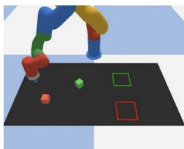  
方块推动 (Block Push)

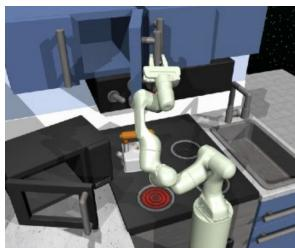  
厨房 (Kitchen)

<table><tr><td rowspan="2"></td><td colspan="2">BlockPush</td><td colspan="4">Kitchen</td></tr><tr><td>p1</td><td>p2</td><td>p1</td><td>p2</td><td>p3</td><td>p4</td></tr><tr><td>LSTM-GMM</td><td>0.03</td><td>0.01</td><td>1.00</td><td>0.90</td><td>0.74</td><td>0.34</td></tr><tr><td>IBC</td><td>0.01</td><td>0.00</td><td>0.99</td><td>0.87</td><td>0.61</td><td>0.24</td></tr><tr><td>BET</td><td>0.96</td><td>0.71</td><td>0.99</td><td>0.93</td><td>0.71</td><td>0.44</td></tr><tr><td>DiffusionPolicy-C</td><td>0.36</td><td>0.11</td><td>1.00</td><td>1.00</td><td>1.00</td><td>0.99</td></tr><tr><td>DiffusionPolicy-T</td><td>0.99</td><td>0.94</td><td>1.00</td><td>0.99</td><td>0.99</td><td>0.96</td></tr></table>

Table 4. 多阶段任务（状态观测）。对于 PushBlock，px 表示将 x 个方块推入目标的频率。对于 Kitchen，px 表示与 x 个或更多物体（例如下炉灶）发生交互的频率。我们的结果表明，Diffusion Policy 表现更优，尤其是在较难的指标上，如 Block Pushing 的 p2 以及 Kitchen 的 p4。

## 5.3 主要发现

在我们的仿真基准测试研究中（Table 1、2 和 4），无论是在状态观测还是视觉观测下，Diffusion Policy 在所有任务及其变体上均优于其他备选方法，平均提升幅度达到 46.9%。以下各段总结了主要结论。

Diffusion Policy 能够表达短视界多模态性（short-horizon multimodality）。我们将短视界动作多模态性定义为实现同一即时目标的多种方式，这在人类示范数据中十分普遍 Mandlekar et al. (2021)。在 Fig 3 中，我们展示了在 Push-T 任务中这种短视界多模态性的案例研究。Diffusion Policy 学会了以均等的概率从左侧或右侧接近接触点，而 LSTM-GMM Mandlekar et al. (2021) 和 IBC Florence et al. (2021) 则表现出偏向某一侧的偏差，BET Shafiullah et al. (2022) 则无法稳定选择其中一种模态。

Diffusion Policy 能够表达长视界多模态性（long-horizon multimodality）。长视界多模态性是指以不固定的顺序完成不同的子目标。例如，在 Block Push 任务中推动特定方块的顺序，或在 Kitchen 任务中与 7 个可能物体交互的顺序都是任意的。我们发现 Diffusion Policy 能够很好地应对这种类型的多模态性；它在这两个任务上都大幅超越了基线方法：在 Block Push 的 p2 指标上提升了 32%，在 Kitchen 的 p4 指标上提升了 213%。

Diffusion Policy 能够更好地利用位置控制（position control）。我们的消融实验（Fig. 4）表明，选择位置控制作为 Diffusion Policy 的动作空间显著优于速度控制（velocity control）。然而，我们评估的基线方法在使用速度控制时表现最佳（这也反映在现有文献中，大多数现有工作都报告使用了速度控制动作空间 Mandlekar et al. (2021); Shafiullah et al. (2022); Zhang et al. (2018); Florence et al. (2019); Mandlekar et al. (2020b,a)）。

动作视界（action horizon）的权衡。如 Sec 4.3 中所讨论的，动作视界大于 1 有助于策略预测一致的动作并弥补示范中的空闲部分，但过长的视界会因反应时间变慢而降低性能。我们的实验证实了这种权衡（Fig. 5 左图），并发现在我们测试的大多数任务中，8 步的动作视界是最佳的。

对延迟的鲁棒性。Diffusion Policy 采用后退视界位置控制（receding horizon position control）来预测未来的一系列动作。这种设计有助于解决由图像处理、策略推理和网络延迟引起的延迟差距（latency gap）。我们在模拟延迟下进行的消融实验表明，Diffusion Policy 在延迟高达 4 步的情况下仍能保持峰值性能（Fig 5）。我们还发现，速度控制受延迟的影响比位置控制更大，这可能是由于复合误差效应（compounding error effects）所致。

Diffusion Policy 训练稳定。我们发现 Diffusion Policy 的最佳超参数在不同任务间基本保持一致。相比之下，IBC Florence et al. (2021) 容易出现训练不稳定的情况。该性质在 Sec 4.4 中进行了讨论。

## 5.4 消融实验

我们在仿真 robomimic square 任务上探索了备选的视觉编码器（vision encoder）设计方案。具体而言，我们评估了 3 种不同的架构：ResNet-18、ResNet-34 He et al. (2016) 以及 ViT-B/16 Dosovitskiy et al. (2020)。对于每种架构，我们评估了 3 种不同的训练策略：从头开始端到端训练（from scratch）、使用冻结的预训练视觉编码器，以及微调预训练视觉编码器（学习率比策略网络低 10 倍）。我们对 ResNet 使用 ImageNet-21k Ridnik et al. (2021) 预训练，对 ViT-B/16 使用 CLIP Radford et al. (2021) 预训练。在 square 任务与熟练人类（proficient-human, PH）数据集上的定量比较如 Tab. 5 所示。

我们发现从头训练 ViT 极具挑战性（成功率仅为 22%），这可能是由于数据量有限。我们还发现使用冻结的预训练视觉编码器进行训练会导致性能较差，这表明扩散策略（diffusion policy）所需的视觉表征与当前流行预训练方法所提供的表征有所不同。然而，我们发现使用较小的学习率（比扩散策略网络小 10 倍）微调预训练视觉编码器在整体上能获得最佳性能。对于经 CLIP 训练的 ViT-B/16 尤为如此，仅经过 50 个 epoch 的训练成功率就达到了 98%。总体而言，尽管不同架构之间存在显著的理论容量差距，但它们的最佳性能差异并不大。我们预计在更复杂的任务上，它们的性能差距可能会更加明显。

<table><tr><td rowspan="2">架构与预训练数据集</td><td rowspan="2">从头训练</td><td colspan="2">预训练</td></tr><tr><td>冻结</td><td>微调</td></tr><tr><td>Resnet18 (in21)</td><td>0.94</td><td>0.58</td><td>0.92</td></tr><tr><td>Resnet34 (in21)</td><td>0.92</td><td>0.40</td><td>0.94</td></tr><tr><td>ViT-base (clip)</td><td>0.22</td><td>0.70</td><td>0.98</td></tr></table>

Table 5. 视觉编码器比较 所有模型均使用基于 CNN 的扩散策略在 robomimic square (ph) 任务上进行训练。每个模型训练 500 个 epoch，并每隔 50 个 epoch 在 50 种不同的环境初始条件下进行评估。

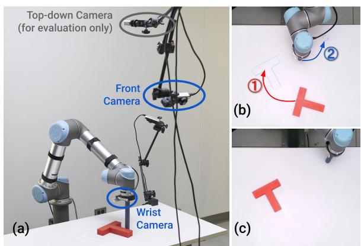

<table><tr><td></td><td>人类演示</td><td colspan="2">IBC 位置 速度</td><td colspan="2">LSTM-GMM 位置 速度</td><td colspan="4">Diffusion Policy T-E2E ImgNet R3M E2E</td></tr><tr><td>IoU</td><td>0.84</td><td>0.14</td><td>0.19</td><td>0.24</td><td>0.25</td><td>0.53</td><td>0.24</td><td>0.66</td><td>0.80</td></tr><tr><td>Succ%</td><td>1.00</td><td>0.00</td><td>0.00</td><td>0.20</td><td>0.10</td><td>0.65</td><td>0.15</td><td>0.80</td><td>0.95</td></tr><tr><td>Dur.</td><td>20.3</td><td>56.3</td><td>41.6</td><td>47.3</td><td>51.7</td><td>57.5</td><td>55.8</td><td>31.7</td><td>22.9</td></tr></table>

Table 6. 真实世界 Push-T 实验。a) 硬件设置。b) 任务说明。机器人需要 ⃝1 精确地将 T 形块推入目标区域，并且 ⃝2 将末端执行器移动到终止区域。c) 用于计算本表所用 IoU 指标的真实最终状态。表格：成功定义为最终状态的 IoU 大于示范数据集中的最小 IoU。平均轮次（episode）时长以秒呈现。T-E2E 代表端到端训练的基于 Transformer 的扩散策略（Diffusion Policy）。

## 6 真实世界评估

我们在跨 2 种硬件设置的 4 项任务上评估了 Diffusion Policy 的真实世界性能——每种设置的训练数据均来自不同的示范者。在真实世界 Push-T 任务上，我们进行了消融实验，检验了 Diffusion Policy 在 2 种架构选项和 3 种视觉编码器选项下的表现；我们还与采用位置控制和速度控制动作空间的 2 种基准方法进行了对比。在所有任务中，同时具有 CNN 主干网络和端到端训练视觉编码器的 Diffusion Policy 变体均取得了最佳性能。关于任务设置和参数的更多细节可在补充材料中找到。

## 6.1 真实世界 Push-T 任务

由于以下 3 项修改，真实世界的 Push-T 比仿真版本要困难得多：1. 真实世界的 Push-T 任务是多阶段的。它要求机器人 ⃝1 将 T 形块推入目标区域，然后 ⃝2 将其末端执行器移入指定的终止区域以避免遮挡。2. 策略需要进行微调，以确保在前往终止区域之前 T 形块完全位于目标区域内，这造成了额外的短期多峰性（multimodality）。3. IoU 指标是在最后一步进行测量的，而不是取所有步的最大值。我们以人类示范数据集所达到的最小 IoU 指标作为成功率的阈值。我们基于 UR5 的实验设置如图 Fig 6 所示。Diffusion Policy 以 10 Hz 的频率预测机器人指令，随后这些指令被线性插值至 125 Hz 以供机器人执行。

结果分析。Diffusion Policy 表现接近人类水平，成功率达 95%，平均 IoU 为 0.8 对比 0.84，相比之下，表现最佳的 IBC 和 LSTM-GMM 变体的成功率分别为 0% 和 20%。Fig 7 定性展示了每种方法从相同初始条件开始的行为。我们观察到，阶段转换期间表现不佳是基准方法最常见的失败案例，这是由于这些部分的高多峰性以及模糊的决策边界所致。LSTM-GMM 在 20 次评估中有 8 次卡在 T 形块附近（第 3 行），而 IBC 在 20 次评估中有 6 次过早离开了 T 形块（第 4 行）。由于任务要求，我们并未遵循从训练数据中移除空闲动作的常见做法，这也导致了 LSTM 和 IBC 倾向于过拟合微小动作并在此任务中卡住。结合补充材料中的视频可以更好地理解这些结果。

端到端与预训练视觉编码器 我们测试了搭配预训练视觉编码器（ImageNet Deng et al. (2009) 和 R3M Nair et al. (2022)）的 Diffusion Policy，如 Tab. 6 所示。搭配 R3M 的 Diffusion Policy 取得了 80% 的成功率，但与端到端训练的版本相比，其预测的动作存在抖动，且更容易卡住。搭配 ImageNet 的 Diffusion Policy 表现较差，动作生硬且性能不佳。我们发现，端到端训练仍然是将视觉观测融入 Diffusion Policy 最有效的方式，我们表现最佳的模型全部都是端到端训练的。

对扰动的鲁棒性 我们在独立于 Tab 6 实验的单独回合中评估了 Diffusion Policy 对视觉和物理扰动的鲁棒性。如图 8 所示，我们施加了三种类型的扰动：1）前置摄像头被挥动的手遮挡了 3 秒（左列），但扩散策略尽管表现出一些抖动，仍然保持在既定路线上并将 T 形块推入目标位置。2）在 Diffusion Policy 对 T 形块位置进行微调时，我们移动了 T 形块。Diffusion Policy 立即重新规划并从相反方向推动，消除了扰动的影响。3）在第一阶段完成后机器人正前往终点区域的途中，我们移动了 T 形块。Diffusion Policy 立即改变路线，将 T 形块调整回其目标位置，然后继续前往终点区域。该实验表明，Diffusion Policy 能够针对未见过的观测生成新的行为。

## 6.2 马克杯翻转任务

马克杯翻转任务旨在测试 Diffusion Policy 在接近硬件运动学极限的情况下处理复杂 3D 旋转的能力。目标是重新调整随机放置的马克杯姿态，使得 ⃝1 杯口朝下 ⃝2 杯把朝左，如图 9 所示。根据马克杯的初始姿态，演示者可能直接将马克杯放置为所需方向，或者可能额外推一下杯把来旋转马克杯。因此，演示数据集具有高度的多模态性：抓取与推动、不同类型的抓取（正手与反手）或局部抓取调整（绕马克杯主轴旋转），这对基线方法来说特别具有挑战性。

  
Figure 7. 真实世界 Push-T 对比。第 1-4 列显示了基于关键事件的动作轨迹。最后一列显示了最终状态的平均图像。A：Diffusion Policy（End2End）实现了更准确和一致的最终状态。B：Diffusion Policy（R3M）最初卡住，但随后恢复并完成了任务。C：LSTM-GMM 在调整 T 形块时未能到达终点区域，遮挡了评估摄像头的视野。D：IBC 过早结束了推动阶段。

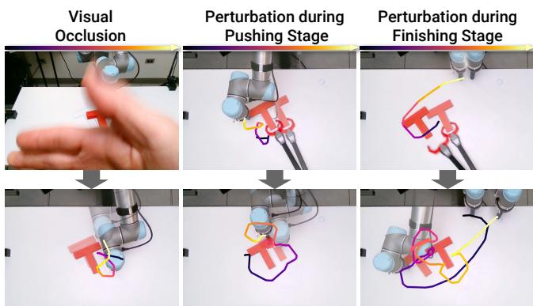  
Figure 8. Diffusion Policy 的鲁棒性测试。左：在相机前挥手 3 秒会导致轻微抖动，但预测的动作仍能按预期执行。中：在推移阶段，Diffusion Policy 能够立即将发生偏移的木块位置纠正至目标状态。右：策略在检测到木块偏移后，会立即中止前往结束区域的动作，并将木块恢复至目标状态。这种新颖的行为从未在演示中出现过。请查看补充材料中的视频。

结果分析。Diffusion Policy 能够在 20 次试验中以 90% 的成功率完成该任务。通过视频可以最好地领略所捕捉行为的丰富性。尽管从未在演示中展示过，该策略在必要时还能够执行一系列多次推移以对齐杯柄，或在马克杯掉落时重新抓取。作为对比，我们还使用相同数据的子集训练了一个 LSTM-GMM 策略。在 20 个分布内的初始条件下，LSTM-GMM 策略从未与马克杯正确对齐，且在所有试验中均抓取失败。

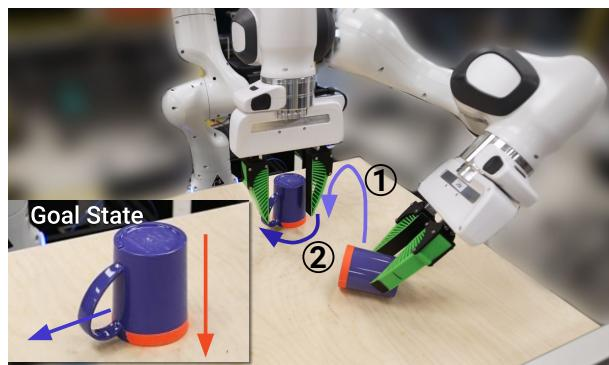

<table><tr><td></td><td>人类 (Human)</td><td>LSTM-GMM</td><td>Diffusion Policy</td></tr><tr><td>成功率 %</td><td>1.0</td><td>0.0</td><td>0.9</td></tr></table>

Figure 9. 6DoF 马克杯翻转任务。机器人需要 ⃝1 拿起一个随机放置的马克杯并将其杯口朝下放置（标记为橙色）。⃝ 旋转马克杯使其手柄朝左。

## 6.3 酱汁倾倒与涂抹

酱汁倾倒与涂抹任务旨在测试 Diffusion Policy 在真实世界环境中处理非刚性物体、6自由度（6DoF）动作空间以及周期性动作的能力。我们的 Franka Panda 设置和任务如图 10 所示。6DoF 倾倒任务的目标是将满满一勺酱汁倒在披萨饼底的中心，性能通过倾倒出的酱汁掩膜与披萨饼底中心的名义圆（如图 10 中的绿色圆圈所示）之间的 IoU 来衡量。周期性涂抹任务的目标是将酱汁涂抹在披萨饼底上，性能通过酱汁覆盖率来衡量。不同评估回合之间的变化来自于饼底和酱汁碗的随机放置位置。成功率是通过设定人类最低表现为阈值来计算的。结果最好在补充视频中查看。两项任务均使用相同的 Push-T 超参数进行训练，并且在第一次尝试时就获得了成功的策略。

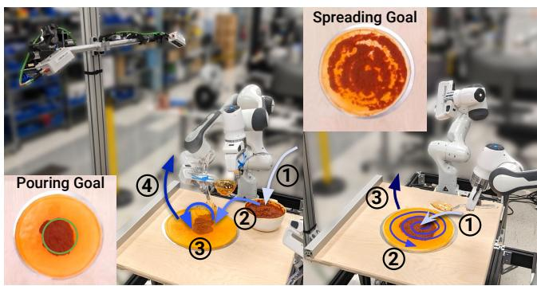

<table><tr><td rowspan="2"></td><td colspan="2">倾倒 (Pour)</td><td colspan="2">涂抹 (Spread)</td></tr><tr><td>IoU</td><td>成功率</td><td>覆盖率</td><td>成功率 %</td></tr><tr><td>人类 (Human)</td><td>0.79</td><td>1.00</td><td>0.79</td><td>1.00</td></tr><tr><td>LSTM-GMM</td><td>0.06</td><td>0.00</td><td>0.27</td><td>0.00</td></tr><tr><td>Diffusion Policy</td><td>0.74</td><td>0.79</td><td>0.77</td><td>1.00</td></tr></table>

Figure 10. 真实世界酱料操作。[左] 6自由度倾倒任务。机器人需要：⃝1 浸入长柄勺从碗中舀取酱料，⃝2 接近披萨面团中心，⃝3 倾倒酱料，以及 ⃝4 抬起长柄勺以完成任务。[右] 周期性涂抹任务。机器人需要：⃝1 手持勺子接近酱料中心，⃝2 以螺旋图案涂抹酱料以覆盖披萨，以及 ⃝3 抬起勺子以完成任务。

倒酱料任务要求机器人在一段时间内保持静止，以使浓稠的番茄酱填满长柄勺。众所周知，由此产生的静止动作（idle actions）对行为克隆算法构成了挑战，因此通常会被避免或过滤掉。在倒酱料过程中进行微调是必要的，以确保覆盖范围并达到所需的形状。

示范的酱料涂抹策略受到人类厨师技巧的启发，它既需要长时域（long-horizon）的循环模式来最大化覆盖面积，又需要短时域反馈来实现均匀分布（因为使用的番茄酱通常会以大小不可预测的块状滴落）。众所周知，周期性运动很难学习，因此通常通过专门的动作表示来解决 Yang et al. (2022)。这两个任务都要求策略通过抬起长柄勺/勺子来自行终止。

结果分析。Diffusion Policy 在两项任务上均达到了接近人类的表现，在倾倒任务中的覆盖率为 0.74 对比 0.79，在涂抹任务中为 0.77 对比 0.79。Diffusion Policy 对外部扰动做出了优雅的响应，例如在倾倒和涂抹过程中用手移动披萨面团。通过补充材料中的视频可以最好地体会这些结果。

LSTM-GMM 在倒酱料和涂抹任务中均表现不佳。在倾倒试验中，它在 20 次试验中有 15 次在成功舀取酱料后未能抬起长柄勺。而在长柄勺成功抬起时，酱料又倾倒偏离了中心。LSTM-GMM 在所有试验中均未能自行终止。我们推测 LSTM-GMM 的隐藏状态未能捕获足够长的历史信息，以区分任务中长柄勺浸入和抬起的阶段。对于涂抹酱料任务，LSTM-GMM 总是在刚开始后就抬起勺子，并且在所有 20 次实验中均未能接触到酱料。

## 7 真实世界双手任务

除了单臂设置之外，我们还在几个具有挑战性的双臂任务上进一步展示了 Diffusion Policy。为了支持双臂任务，大部分精力都花在扩展我们的机器人技术栈以支持多臂遥操作和控制上。Diffusion Policy 在这些任务上无需超参数调优即可开箱即用。

## 7.1 观测与动作空间

本体感受观测空间被扩展为包含两个末端执行器的位姿以及两个夹爪的夹爪宽度。我们还将观测空间扩展为包含这些物理量的实际值和期望值。图像观测空间由两个场景相机和两个腕部相机组成，每个机械臂各安装一个腕部相机。动作空间扩展为包含两个末端执行器的期望位姿和两个夹爪的期望夹爪宽度。

## 7.2 遥操作

对于这些需要协调配合的双臂任务，我们发现同时使用 2 个 SpaceMouse 对演示者来说相当具有挑战性。因此，我们实现了两种新的遥操作模式：使用带有两个手部控制器的 Meta Quest Pro VR 设备，或者使用 2 个 Haption Virtuose™ 6D HF TAO 设备进行触觉使能控制，采用 Siciliano et al. (2008) 触觉部分简要描述的双向位置-位置耦合（bilateral position-position coupling）。这种耦合在 Haption 设备与 Franka Panda 机械臂之间进行。有关控制器本身的更多细节可参见 Sec. D.1。下文提供了关于各个任务和策略性能的更多细节。

## 7.3 双臂打蛋器

双臂打蛋器任务在 Fig. 11 中进行了图示和说明，使用了一个 OXO™ 打蛋器和一个 Room Essentials™ 塑料碗。我们选择这个任务是为了说明触觉反馈对于遥操作双臂操控的重要性，即使对于日常生活中协调使用工具这样的常见任务也是如此。在没有触觉反馈的情况下，专家在 10 次尝试中未能成功完成哪怕 1 次演示。其中 5 次失败是由于机器人将曲柄手柄从打蛋器上拔脱；3 次失败是由于机器人失去对手柄的抓握；2 次失败是由于机器人触发了扭矩限制。相比之下，同一操作者在拥有触觉反馈的情况下可以轻松完成 10 次尝试中的全部 10 次。与没有反馈相比，使用触觉反馈使演示既更快速又具有更高的质量。

结果分析。使用 210 次演示训练的 Diffusion Policy 能够在 20 次试验中以 55% 的成功率完成该任务。其主要失败模式是打蛋器的初始位置超出分布范围，或者未能抓到打蛋器曲柄手柄或中途脱落。所有运行过程的初始和最终状态在 18 和 19 中进行了可视化展示。

## 7.4 双臂展开垫子

展开垫子任务如图 12 所示并进行了描述，使用的是 XXL Dog Buddy™ 狗垫。该任务使用 VR 装置进行遥操作，因为执行该任务不需要丰富的触觉反馈。我们训练了该技能具备双手通用性（omnidextrous），即它可以根据初始条件向左或向右展开。

Figure 11. 双手打蛋器操作。机器人需要 ⃝1 将碗推到位（仅在离左臂太近时），⃝2 用右手接近并拿起打蛋器，⃝3 将打蛋器放入碗中，⃝4 接近并抓取打蛋器曲柄摇把，以及 ⃝5 旋转曲柄摇把 3 次或更多次。  
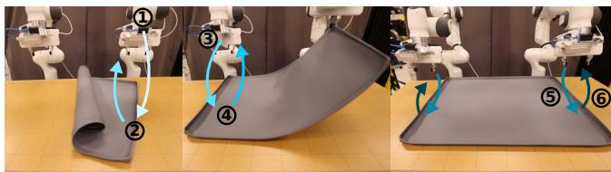  
Figure 12. 双手展开垫子。机器人需要 ⃝1 使用左臂或右臂拿起垫子的一侧（如果需要），⃝2 提起并展开垫子（如果需要），⃝3 确保垫子的两侧均被抓取，⃝4 提起垫子，⃝5 将垫子与桌子对齐放置并大致居中，以及 ⃝6 释放垫子。

结果分析。使用 162 次演示训练的扩散策略（Diffusion Policy）在 20 次试验中能够以 75% 的成功率完成该任务。主要失败模式是最初抓取垫子时的漏抓，此时策略难以自我纠正，从而卡在重复相同行为的状态。所有执行过程（rollouts）的初始和最终状态在 16 和 17 中进行了可视化展示。

## 7.5 双手叠衬衫

叠衬衫任务在图 13 中进行了描述和说明，使用的是一件短袖 T 恤。该任务同样使用 VR 装置进行遥操作，因为执行该任务不需要丰富的反馈。由于运动学和工作空间的约束，该任务明显耗时更长，最多可包含九个离散步骤。最后几步需要两个夹爪彼此非常靠近。我们的中层控制器显式地处理避障，这对于遥操作和策略执行都尤为重要。

结果分析。使用 284 次演示训练的扩散策略在 20 次试验中能够以 75% 的成功率完成该任务。主要失败模式是初始折叠（衣袖和衣领）时的漏抓，以及策略在最后无法停止调整衬衫。所有执行过程的初始和最终状态在 20 和 21 中进行了可视化展示。

## 8 相关工作

无需对行为进行显式编程即可构建具备高能力的机器人，是该领域长期存在的挑战 Atkeson and Schaal (1997); Argall et al. (2009); Ravichandar et al. (2020)。尽管概念简单，行为克隆（behavior cloning）已在诸多真实世界机器人任务中展现出令人瞩目的前景，包括操作任务 Zhang et al. (2018); Florence et al. (2019); Mandlekar et al. (2020b,a); Zeng et al. (2021); Rahmatizadeh et al. (2018); Avigal et al. (2022) 以及自动驾驶 Pomerleau (1988); Bojarski et al. (2016)。根据策略的结构，当前的行为克隆方法可分为两类。

  
Figure 13. 双臂折叠衬衫。机器人需要 ⃝1 双臂靠近并抓取最近的袖子，⃝2 折叠袖子并释放，⃝3 将衬衫拉近（如需要），⃝4 双臂靠近并抓取另一只袖子，⃝5 折叠袖子并释放，⃝6 将衬衫拖动到便于折叠的方向，⃝7 抓取衣领并将衬衫对折，⃝8 将衬衫拖动到中心，以及 ⃝9 抚平衬衫并将手臂移开。

显式策略（Explicit Policy）。显式策略的最简单形式直接将世界状态或观测映射到动作 Pomerleau (1988); Zhang et al. (2018); Florence et al. (2019); Ross et al. (2011); Toyer et al. (2020); Rahmatizadeh et al. (2018); Bojarski et al. (2016)。它们可以通过直接的回归损失进行监督，并通过单次前向传播实现高效的推理。然而，这种类型的策略不适合对多模态演示行为进行建模，并且在处理高精度任务时十分困难 Florence et al. (2021)。在保持直接动作映射简单性的同时对多模态动作分布进行建模的一种流行方法是，通过离散化动作空间将回归任务转换为分类任务 Zeng et al. (2021); Wu et al. (2020); Avigal et al. (2022)。然而，逼近连续动作空间所需的离散区间（bins）数量随着维度的增加呈指数级增长。另一种方法是通过使用混合密度网络（MDNs）Bishop (1994); Mandlekar et al. (2021) 或聚类结合偏移量预测 Shafiullah et al. (2022); Sharma et al. (2018) 来结合分类分布和高斯分布以表示连续的多模态分布。尽管如此，这些模型往往对超参数调节敏感，容易出现模式崩溃（mode collapse），并且在表达高精度行为方面的能力仍然有限 Florence et al. (2021)。

隐式策略（Implicit Policy）。隐式策略 (Florence et al. 2021; Jarrett et al. 2020) 通过使用基于能量的模型（Energy-Based Models，EBMs）(LeCun et al. 2006; Du and Mordatch 2019; Dai et al. 2019; Grathwohl et al. 2020;

Du et al. 2020)。在这种设定下，每个动作都被赋予一个能量值，动作预测则对应于寻找最小能量动作的优化问题。由于不同的动作可能被赋予较低的能量，隐式策略自然能够表示多模态分布。然而，现有的隐式策略 (Florence et al. 2021) 训练并不稳定，因为在计算底层的 Info-NCE 损失时必须抽取负样本。

扩散模型（Diffusion Models）。扩散模型是一种概率生成模型，它通过迭代细化随机采样的噪声，从而生成来自潜在分布的样本。从概念上讲，它们也可以被理解为学习隐式动作分数的梯度场，然后在推理过程中对该梯度进行优化。扩散模型 (Sohl-Dickstein et al. 2015; Ho et al. 2020) 最近已被应用于解决各种不同的控制任务 (Janner et al. 2022a; Urain et al. 2022; Ajay et al. 2022)。

具体而言，Janner et al. (2022a) 和 Huang et al. (2023) 探讨了如何在规划背景下使用扩散模型，并推断可在给定环境中执行的动作轨迹。在强化学习（Reinforcement Learning）背景下，Wang et al. (2022) 将扩散模型用于基于状态观测的策略表示与正则化。相比之下，在本工作中，我们探讨了扩散模型如何有效地应用于行为克隆（behavioral cloning），以构建有效的视觉运动控制策略。为了构建有效的视觉运动控制策略，我们提出将 DDPM 预测高维动作序列的能力与闭环控制相结合，并提出了一种用于动作扩散的新 Transformer 架构，以及将视觉输入整合到动作扩散模型中的方法。

Wang et al. (2023) 探讨了如何利用从专家演示中学习的扩散模型来增强经典的显式策略，而不是直接利用扩散模型作为策略表示。

与我们同时期的工作中，Pearce et al. (2023)、Reuss et al. (2023) 和 Hansen-Estruch et al. (2023) 对仿真环境中的基于扩散的策略进行了互补性分析。尽管他们更侧重于有效的采样策略、利用无分类器引导（classifier-free guidance）进行目标条件化以及在强化学习中的应用，而我们侧重于有效的动作空间，但我们的经验性结论在仿真领域大体一致。此外，我们大量的真实世界实验为以下方面提供了强有力的证据：滚动时域预测（receding-horizon prediction）方案的重要性、速度控制与位置控制之间的审慎选择、针对实时推理进行优化的必要性，以及针对物理机器人系统的其他关键设计决策。

## 9 局限性与未来工作

尽管我们已经在仿真和真实世界系统中展示了扩散策略（diffusion policy）的有效性，但仍存在未来工作可以改进的局限性。首先，我们的实现继承了行为克隆（behavior cloning）的局限性，例如在演示数据不充分时性能欠佳。扩散策略可以应用于其他范式，如强化学习（reinforcement learning）Wang et al. (2023); Hansen-Estruch et al. (2023)，以利用次优数据和负样本数据。其次，与 LSTM-GMM 等更简单的方法相比，扩散策略具有更高的计算成本和推理延迟。我们的动作序列预测方法在一定程度上缓解了这个问题，但对于需要高频控制的任务可能仍显不足。未来的工作可以利用扩散模型加速方法的最新进展来减少所需的推理步数，例如新的噪声调度（noise schedules）Chen (2023)、推理求解器（inference solvers）Karras et al. (2022) 以及一致性模型（consistency models）Song et al. (2023)。

## 10 结论

在这项工作中，我们评估了基于扩散的策略在机器人行为中的可行性。通过对仿真和真实世界中 15 个任务的全面评估，我们证明了基于扩散的视觉运动策略（visuomotor policies）始终且明确地优于现有方法，同时保持了训练的稳定性和易用性。我们的结果还强调了关键的设计要素，包括滚动时域动作预测（receding-horizon action prediction）、末端执行器位置控制（end-effector position control）以及高效的视觉条件化（visual conditioning），这些对于释放基于扩散策略的全部潜力至关重要。尽管有许多因素会影响行为克隆策略的最终质量——包括演示数据的质量和数量、机器人的物理能力、策略架构以及所使用的预训练机制——但我们的实验结果强烈表明，策略结构在行为克隆过程中构成了显著的性能瓶颈。我们希望这项工作能够推动该领域对基于扩散的策略进行进一步探索，并强调除了用于策略训练的数据之外，综合考虑行为克隆过程各方面的重要性。

## 11 致谢

我们要感谢 Naveen Kuppuswamy、Hongkai Dai、Aykut Onol、Terry Suh、Tao Pang、Huy Ha、Samir Gadre、¨ Kevin Zakka 和 Brandon Amos 进行的富有见地的讨论。感谢 Jarod Wilson 提供的 3D 打印支持，以及 Huy Ha 提供的摄影和灯光建议。感谢 Xiang Li 在 GitHub 上发现了我们评估代码中的漏洞。

## 资助

本项工作得到了丰田研究院（Toyota Research Institute）、NSF CMMI-2037101 和 NSF IIS-2132519 的资助。我们要感谢 Google 提供的 UR5 机器人硬件。本文所包含的观点和结论仅代表作者本人，不应被视为必然代表赞助方的官方政策（无论是明示的还是暗示的）。

## 参考文献

Ajay A, Du Y, Gupta A, Tenenbaum J, Jaakkola T and Agrawa P (2022) 条件生成建模是否就是决策制定所需的全部？（Is conditional generative modeling all you need for decision-making?） arXiv preprint arXiv:2211.15657 .

Argall BD, Chernova S, Veloso M and Browning B (2009) 机器人示范学习综述（A survey of robot learning from demonstration）. Robotics and autonomous systems 57(5): 469–483.

Atkeson CG and Schaal S (1997) 机器人示范学习（Robot learning from demonstration）. In: ICML, volume 97. pp. 12–20.

Avigal Y, Berscheid L, Asfour T, Kroger T and Goldberg K (2022) Speedfolding：学习高效的双手机器人衣物折叠（Speedfolding: Learning efficient bimanual folding of garments）. In: 2022 IEEE/RSJ International Conference on Intelligent Robots and Systems (IROS). IEEE, pp. 1–8.

Bishop CM (1994) 混合密度网络（Mixture density networks）. Aston University.

Bojarski M, Del Testa D, Dworakowski D, Firner B, Flepp B, Goyal P, Jackel LD, Monfort M, Muller U, Zhang J et al. (2016) 自动驾驶汽车的端到端学习（End to end learning for self-driving cars）. arXiv preprint arXiv:1604.07316 .

Chen T (2023) 论扩散模型噪声调度的重要性（On the importance of noise scheduling for diffusion models）. arXiv preprint arXiv:2301.10972 .

Chi C, Feng S, Du Y, Xu Z, Cousineau E, Burchfiel B and Song S (2023) Diffusion Policy：通过动作扩散实现视觉运动策略学习（Diffusion policy: Visuomotor policy learning via action diffusion）. In: Proceedings of Robotics: Science and Systems (RSS).

Dai B, Liu Z, Dai H, He N, Gretton A, Song L and Schuurmans D (2019) 基于对抗动力学嵌入的指数族估计（Exponential family estimation via adversarial dynamics embedding）. Advances in Neural Information Processing Systems 32.

Deng J, Dong W, Socher R, Li LJ, Li K and Fei-Fei L (2009) ImageNet：大规模分层图像数据库（Imagenet: A large-scale hierarchical image database）. In: 2009 IEEE conference on computer vision and pattern recognition. Ieee, pp. 248–255.

Dosovitskiy A, Beyer L, Kolesnikov A, Weissenborn D, Zhai X, Unterthiner T, Dehghani M, Minderer M, Heigold G, Gelly S et al. (2020) 一张图像相当于 16x16 个词：用于大规模图像识别的 Transformer（An image is worth 16x16 words: Transformers for image recognition at scale）. arXiv preprint arXiv:2010.11929 .

Du Y, Li S, Tenenbaum J and Mordatch I (2020) 基于能量模型的改进对比散度训练（Improved contrastive divergence training of energy based models）. arXiv preprint arXiv:2012.01316 .

Du Y and Mordatch I (2019) 基于能量的模型中的隐式生成与泛化（Implicit generation and generalization in energy-based models）. arXiv preprint arXiv:1903.08689 .

Florence P, Lynch C, Zeng A, Ramirez OA, Wahid A, Downs L, Wong A, Lee J, Mordatch I and Tompson J (2021) 隐式行为克隆（Implicit behavioral cloning）. In: 5th Annual Conference on Robot Learning.

Florence P, Manuelli L and Tedrake R (2019) 视觉运动策略学习中的自监督对应（Self-supervised correspondence in visuomotor policy learning）. IEEE Robotics and Automation Letters 5(2): 492–499.

Grathwohl W, Wang KC, Jacobsen JH, Duvenaud D and Zemel R (2020) 学习 Stein 差异以在无需采样的情况下训练和评估基于能量的模型（Learning the stein discrepancy for training and evaluating energy-based models without sampling）. In: International Conference on Machine Learning.

Gupta A, Kumar V, Lynch C, Levine S and Hausman K (2019) 中继策略学习：通过模仿与强化学习解决长周期任务（Relay policy learning: Solving long-horizon tasks via imitation and reinforcement learning）. arXiv preprint arXiv:1910.11956 .

Hansen-Estruch P, Kostrikov I, Janner M, Kuba JG and Levine S (2023) Idql: Implicit q-learning as an actor-critic method with diffusion policies. arXiv preprint arXiv:2304.10573 .

He K, Fan H, Wu Y, Xie S and Girshick R (2020) Momentum contrast for unsupervised visual representation learning. In: Proceedings of the IEEE/CVF conference on computer vision and pattern recognition. pp. 9729–9738.

He K, Zhang X, Ren S and Sun J (2016) Deep residual learning for image recognition. In: Proceedings of the IEEE conference on computer vision and pattern recognition. pp. 770–778.

Ho J, Jain A and Abbeel P (2020) Denoising diffusion probabilistic models. arXiv preprint arXiv:2006.11239 .

Huang S, Wang Z, Li P, Jia B, Liu T, Zhu Y, Liang W and Zhu SC (2023) Diffusion-based generation, optimization, and planning in 3d scenes. arXiv preprint arXiv:2301.06015 .

Janner M, Du Y, Tenenbaum J and Levine S (2022a) Planning with diffusion for flexible behavior synthesis. In: International Conference on Machine Learning.

Janner M, Du Y, Tenenbaum J and Levine S (2022b) Planning with diffusion for flexible behavior synthesis. In: Chaudhuri K, Jegelka S, Song L, Szepesvari C, Niu G and Sabato S (eds.) Proceedings of the 39th International Conference on Machine Learning, Proceedings of Machine Learning Research. PMLR.

Jarrett D, Bica I and van der Schaar M (2020) Strictly batch imitation learning by energy-based distribution matching. Advances in Neural Information Processing Systems 33: 7354– 7365.

Karras T, Aittala M, Aila T and Laine S (2022) Elucidating the design space of diffusion-based generative models. arXiv preprint arXiv:2206.00364 .

Khatib O (1987) A unified approach for motion and force control of robot manipulators: The operational space formulation. IEEE Journal on Robotics and Automation 3(1): 43–53. DOI:10. 1109/JRA.1987.1087068. Conference Name: IEEE Journal on Robotics and Automation.

LeCun Y, Chopra S, Hadsell R, Huang FJ and et al (2006) A tutoria on energy-based learning. In: Predicting Structured Data. MIT Press.

Liu L, Liu X, Gao J, Chen W and Han J (2020) Understanding the difficulty of training transformers. arXiv preprin arXiv:2004.08249 .

Liu N, Li S, Du Y, Torralba A and Tenenbaum JB (2022) Compositional visual generation with composable diffusion models. arXiv preprint arXiv:2206.01714 .

Mandlekar A, Ramos F, Boots B, Savarese S, Fei-Fei L, Garg A and Fox D (2020a) Iris: Implicit reinforcement without interaction at scale for learning control from offline robot manipulation data. In: 2020 IEEE International Conference on Robotics and Automation (ICRA). IEEE.

Mandlekar A, Xu D, Mart´ın-Mart´ın R, Savarese S and Fei-Fei L (2020b) Learning to generalize across long-horizon tasks from human demonstrations. arXiv preprint arXiv:2003.06085 .

Mandlekar A, Xu D, Wong J, Nasiriany S, Wang C, Kulkarni R, Fei-Fei L, Savarese S, Zhu Y and Mart´ın-Mart´ın R (2021) 机器人操作中从离线人类演示学习的关键因素（What matters in learning from offline human demonstrations for robot manipulation）. In: 5th Annual Conference on Robot Learning.

Mayne DQ and Michalska H (1988) 非线性系统的后退时域控制（Receding horizon control of nonlinear systems）. In: Proceedings of the 27th IEEE Conference on Decision and Control. IEEE, pp. 464–465.

Nair S, Rajeswaran A, Kumar V, Finn C and Gupta A (2022) R3m：一种用于机器人操作的通用视觉表征（R3m: A universal visual representation for robot manipulation）. In: 6th Annual Conference on Robot Learning.

Neal RM et al. (2011) 利用哈密顿动力学的 MCMC（Mcmc using hamiltonian dynamics）. Handbook ofmarkov chain monte carlo .

Nichol AQ and Dhariwal P (2021) 改进的去噪扩散概率模型（Improved denoising diffusion probabilistic models）. In: International Conference on Machine Learning. PMLR, pp. 8162–8171.

Pearce T, Rashid T, Kanervisto A, Bignell D, Sun M, Georgescu R, Macua SV, Tan SZ, Momennejad I, Hofmann K et al. (2023) 利用扩散模型模仿人类行为（Imitating human behaviour with diffusion models）. arXiv preprint arXiv:2301.10677 .

Perez E, Strub F, De Vries H, Dumoulin V and Courville A (2018) FiLM：具有通用条件层的视觉推理（Film: Visual reasoning with a general conditioning layer）. In: Proceedings ofthe AAAI Conference on Artificial Intelligence.

Pomerleau DA (1988) ALVINN：神经网络中的自主地面车辆（Alvinn: An autonomous land vehicle in a neural network）. Advances in neural information processing systems 1.

Radford A, Kim JW, Hallacy C, Ramesh A, Goh G, Agarwal S, Sastry G, Askell A, Mishkin P, Clark J et al. (2021) 从自然语言监督中学习可迁移的视觉模型（Learning transferable visual models from natural language supervision）. In: International conference on machine learning. PMLR, pp. 8748–8763.

Rahmatizadeh R, Abolghasemi P, Bol¨ oni L and Levine S (2018)¨ 基于端到端演示学习的低成本机器人视觉多任务操作（Vision-based multi-task manipulation for inexpensive robots using end-to-end learning from demonstration）. In: 2018 IEEE international conference on robotics and automation (ICRA). IEEE, pp. 3758–3765.

Ravichandar H, Polydoros AS, Chernova S and Billard A (2020) 机器人演示学习的最新进展（Recent advances in robot learning from demonstration）. Annual review of control, robotics, and autonomous systems 3: 297– 330.

Reuss M, Li M, Jia X and Lioutikov R (2023) 基于分数的扩散策略的目标条件模仿学习（Goal-conditioned imitation learning using score-based diffusion policies）. In: Proceedings ofRobotics: Science and Systems (RSS).

Ridnik T, Ben-Baruch E, Noy A and Zelnik-Manor L (2021) 面向大众的 ImageNet-21k 预训练（Imagenet-21k pretraining for the masses）.

Ronneberger O, Fischer P and Brox T (2015) U-net：用于生物医学图像分割的卷积网络（U-net: Convolutional networks for biomedical image segmentation）. In: Medical Image Computing and Computer-Assisted Intervention– MICCAI 2015: 18th International Conference, Munich, Ger many, October 5-9, 2015, Proceedings, Part III 18. Springer, pp. 234–241.

Ross S, Gordon G and Bagnell D (2011) 将模仿学习和结构化预测归约为无悔在线学习（A reduction of imitation learning and structured prediction to no-regret online learning）. In: Proceedings of the fourteenth international conference on artificial intelligence and statistics. JMLR Workshop and Conference Proceedings, pp. 627–635.

Shafiullah NMM, Cui ZJ, Altanzaya A and Pinto L (2022) Behavior transformers: Cloning \$k\$ modes with one stone. In: Oh AH, Agarwal A, Belgrave D and Cho K (eds.) Advances in Neural Information Processing Systems.

Sharma P, Mohan L, Pinto L and Gupta A (2018) Multiple interactions made easy (mime): Large scale demonstrations data for imitation. In: Conference on robot learning. PMLR.

Siciliano B, Khatib O and Kroger T (2008)¨ Springer handbook of robotics, volume 200. Springer.

Sohl-Dickstein J, Weiss E, Maheswaranathan N and Ganguli S (2015) Deep unsupervised learning using nonequilibrium thermodynamics. In: International Conference on Machine Learning.

Song J, Meng C and Ermon S (2021) Denoising diffusion implicit models. In: International Conference on Learning Representations.

Song Y, Dhariwal P, Chen M and Sutskever I (2023) Consistency models. arXiv preprint arXiv:2303.01469 .

Song Y and Ermon S (2019) Generative modeling by estimating gradients of the data distribution. Advances in neural

information processing systems 32.

Subramanian J and Mahajan A (2019) Approximate information state for partially observed systems. In: 2019 IEEE 58th Conference on Decision and Control (CDC). IEEE, pp. 1629– 1636.

Ta DN, Cousineau E, Zhao H and Feng S (2022) Conditiona energy-based models for implicit policies: The gap between theory and practice. arXiv preprint arXiv:2207.05824 .

Tancik M, Srinivasan P, Mildenhall B, Fridovich-Keil S, Raghavan N, Singhal U, Ramamoorthi R, Barron J and Ng R (2020) Fourier features let networks learn high frequency functions in low dimensional domains. Advances in Neural Information Processing Systems 33: 7537–7547.

Toyer S, Shah R, Critch A and Russell S (2020) The magica benchmark for robust imitation. Advances in Neural Information Processing Systems 33: 18284–18295.

Urain J, Funk N, Chalvatzaki G and Peters J (2022) Se (3)- diffusionfields: Learning cost functions for joint grasp and motion optimization through diffusion. arXiv preprint arXiv:2209.03855 .

Vaswani A, Shazeer N, Parmar N, Uszkoreit J, Jones L, Gomez AN, Kaiser Ł and Polosukhin I (2017) Attention is all you need. Advances in neural information processing systems 30.

Wang Z, Hunt JJ and Zhou M (2022) Diffusion policies as an expressive policy class for offline reinforcement learning. arXiv preprint arXiv:2208.06193 .

Wang Z, Hunt JJ and Zhou M (2023) Diffusion policies as an expressive policy class for offline reinforcement learning. In: The Eleventh International Conference on Learning Representations. URL https://openreview.net/ forum?id=AHvFDPi-FA.

Welling M and Teh YW (2011) Bayesian learning via stochastic gradient langevin dynamics. In: Proceedings of the 28th international conference on machine learning (ICML-11). pp. 681–688.

Wu J, Sun X, Zeng A, Song S, Lee J, Rusinkiewicz S and Funkhouser T (2020) Spatial action maps for mobile manipulation. In: Proceedings of Robotics: Science and Systems (RSS).

Wu Y and He K (2018) Group normalization. In: Proceedings ofthe European conference on computer vision (ECCV). pp. 3–19.

Yang J, Zhang J, Settle C, Rai A, Antonova R and Bohg J (2022) Learning periodic tasks from human demonstrations. In: 2022 International Conference on Robotics and Automation (ICRA). IEEE, pp. 8658–8665.

Zeng A, Florence P, Tompson J, Welker S, Chien J, Attarian M, Armstrong T, Krasin I, Duong D, Sindhwani V et al. (2021) Transporter networks: Rearranging the visual world for robotic manipulation. In: Conference on Robot Learning. PMLR, pp. 726–747.

Zhang A, McAllister RT, Calandra R, Gal Y and Levine S (2020) Learning invariant representations for reinforcement learning without reconstruction. In: International Conference on Learning Representations.

Zhang T, McCarthy Z, Jow O, Lee D, Chen X, Goldberg K and Abbeel P (2018) Deep imitation learning for complex manipulation tasks from virtual reality teleoperation. In: 2018 IEEE International Conference on Robotics and Automation (ICRA). IEEE, pp. 5628–5635.

Zhou Y, Barnes C, Lu J, Yang J and Li H (2019) On the continuity of rotation representations in neural networks. In: Proceedings of the IEEE/CVF Conference on Computer Vision and Pattern Recognition. pp. 5745–5753.

## A Diffusion Policy 实现细节

## A.1 归一化

对动作数据进行适当的归一化对于使 Diffusion Policy 达到最佳性能至关重要。将每个动作维度的最小值和最大值独立缩放至 [−1, 1] 对大多数任务都很有效。由于 DDPM 在每次迭代时都会将预测值截断至 [−1, 1] 以确保稳定性，常见的零均值单位方差归一化会导致动作空间的某些区域无法访问。当数据方差较小（例如接近常数值）时，仅将数据平移至零均值而不进行缩放，以避免数值问题。我们对对应于旋转表示（例如四元数 Quaternion）的动作维度保持不变。

## A.2 旋转表示

对于所有采用速度控制动作空间的环境，我们遵循 Mandlekar et al. (2021) 的标准做法，对动作的旋转分量采用 3D 轴角表示。由于速度动作指令通常接近于 0，轴角表示的奇异性和不连续性通常不会引发问题。对于所有采用位置控制动作空间的环境（现实世界和仿真），我们均使用了 Zhou et al. (2019) 中提出的 6D 旋转表示。

## A.3 图像增强

遵循 Mandlekar et al. (2021)，我们在训练期间采用了随机裁剪增强。每个任务的裁剪尺寸如 Tab. 7 所示。在推理期间，我们采用相同尺寸的静态中心裁剪。

## A.4 超参数

在仿真和真实世界基准测试中用于 Diffusion Policy 的超参数见 Tab. 7 和 Tab. 8。由于 Block Push 任务使用马尔可夫脚本专家策略（Markovian scripted oracle policy）来生成演示数据，我们发现其用于观测时界（observation horizon）和动作时界（action horizon）的最佳超参数与采用人类遥操作演示的其他任务大不相同。

我们发现基于 CNN 的 Diffusion Policy 的最佳超参数在各个任务之间是一致的。相比之下，基于 Transformer 的 Diffusion Policy 的最佳注意力丢弃率（attention dropout rate）和权重衰减在不同任务之间差异很大。在调参过程中，我们发现增加基于 CNN 的 Diffusion Policy 的参数量总能提升性能，因此其最佳模型大小仅受限于可用的计算和内存容量。另一方面，增加基于 Transformer 的 Diffusion Policy 的模型大小（特别是层数）有时会损害性能。对于基于 CNN 的 Diffusion Policy，我们发现在除 Push-T 之外的所有任务上，使用 FiLM 条件化来传入观测均优于图像修补（inpainting）。Tab. 1 中报告的 DiffusionPolicy-C 在 Push-T 上的性能使用了修补而非 FiLM。

  
Figure 14. 观测时界消融研究。基于状态的 Diffusion Policy 对观测时界不敏感。基于视觉的 Diffusion Policy 更倾向于较小但大于 1 的观测时界，其中 2 对大多数任务来说是一个很好的折中选择。

  
Figure 15. 数据效率消融研究。在所有训练数据集规模下，Diffusion Policy 的性能均优于 LSTM-GMM Mandlekar et al. (2021)。

在仿真基准测试中，我们使用了 iDDPM 算法 Nichol and Dhariwal (2021)，并在训练和推理中均采用相同的 100 步去噪扩散迭代。我们在真实世界基准测试中使用了 DDIM Song et al. (2021)，将推理去噪迭代次数减少到 16 步，从而降低了推理延迟。

我们对所有基于状态的实验使用 256 的批大小（batch size），对所有基于图像的实验使用 64 的批大小。对于学习率调度，我们使用了带线性预热（linear warmup）的余弦调度（cosine schedule）。基于 CNN 的 Diffusion Policy 预热 500 步，而基于 Transformer 的 Diffusion Policy 预热 1000 步。

## A.5 数据效率

如图 15 所示，我们发现 Diffusion Policy 在每种训练数据集规模下均优于 LSTM-GMM Mandlekar et al. (2021)。

## B 额外消融实验结果

## B.1 观测时界

如图 14 所示，我们发现基于状态的 Diffusion Policy 对观测时界不敏感。然而，基于视觉的 Diffusion Policy（特别是具有 CNN 主干网络的变体）随着观测时界的增加而出现性能下降。在实践中，我们发现对于状态和图像观测，观测时界设为 2 对大多数任务都是合适的。

<table><tr><td>H-Param</td><td>Ctrl</td><td>To</td><td>Ta</td><td>Tp</td><td>ImgRes</td><td>CropRes</td><td>#D-Params</td><td>#V-Params</td><td>Lr</td><td>WDecay</td><td>D-Iters Train</td><td>D-Iters Eval</td></tr><tr><td>Lift</td><td>Pos</td><td>2</td><td>8</td><td>16</td><td>2x84x84</td><td>2x76x76</td><td>256</td><td>22</td><td>1e-4</td><td>1e-6</td><td>100</td><td>100</td></tr><tr><td>Can</td><td>Pos</td><td>2</td><td>8</td><td>16</td><td>2x84x84</td><td>2x76x76</td><td>256</td><td>22</td><td>1e-4</td><td>1e-6</td><td>100</td><td>100</td></tr><tr><td>Square</td><td>Pos</td><td>2</td><td>8</td><td>16</td><td>2x84x84</td><td>2x76x76</td><td>256</td><td>22</td><td>1e-4</td><td>1e-6</td><td>100</td><td>100</td></tr><tr><td>Transport</td><td>Pos</td><td>2</td><td>8</td><td>16</td><td>4x84x85</td><td>4x76x76</td><td>264</td><td>45</td><td>1e-4</td><td>1e-6</td><td>100</td><td>100</td></tr><tr><td>ToolHang</td><td>Pos</td><td>2</td><td>8</td><td>16</td><td>2x240x240</td><td>2x216x216</td><td>256</td><td>22</td><td>1e-4</td><td>1e-6</td><td>100</td><td>100</td></tr><tr><td>Push-T</td><td>Pos</td><td>2</td><td>8</td><td>16</td><td>1x96x96</td><td>1x84x84</td><td>256</td><td>22</td><td>1e-4</td><td>1e-6</td><td>100</td><td>100</td></tr><tr><td>Block Push</td><td>Pos</td><td>3</td><td>1</td><td>12</td><td>N/A</td><td>N/A</td><td>256</td><td>0</td><td>1e-4</td><td>1e-6</td><td>100</td><td>100</td></tr><tr><td>Kitchen</td><td>Pos</td><td>2</td><td>8</td><td>16</td><td>N/A</td><td>N/A</td><td>256</td><td>0</td><td>1e-4</td><td>1e-6</td><td>100</td><td>100</td></tr><tr><td>Real Push-T</td><td>Pos</td><td>2</td><td>6</td><td>16</td><td>2x320x240</td><td>2x288x216</td><td>67</td><td>22</td><td>1e-4</td><td>1e-6</td><td>100</td><td>16</td></tr><tr><td>Real Pour</td><td>Pos</td><td>2</td><td>8</td><td>16</td><td>2x320x240</td><td>2x288x216</td><td>67</td><td>22</td><td>1e-4</td><td>1e-6</td><td>100</td><td>16</td></tr><tr><td>Real Spread</td><td>Pos</td><td>2</td><td>8</td><td>16</td><td>2x320x240</td><td>2x288x216</td><td>67</td><td>22</td><td>1e-4</td><td>1e-6</td><td>100</td><td>16</td></tr><tr><td>Real Mug Flip</td><td>Pos</td><td>2</td><td>8</td><td>16</td><td>2x320x240</td><td>2x288x216</td><td>67</td><td>22</td><td>1e-4</td><td>1e-6</td><td>100</td><td>16</td></tr></table>

Table 7. 基于 CNN 的扩散策略（Diffusion Policy）超参数 Ctrl：位置或速度控制 To：观测视界 Ta：动作视界 Tp：动作预测视界 ImgRes：环境观测分辨率（相机视角数 x 宽 x 高） CropRes：随机裁剪分辨率 #D-Params：扩散网络参数量（以百万计） #V-Params：视觉编码器参数量（以百万计） Lr：学习率 WDecay：权重衰减 D-Iters Train：训练扩散迭代次数 D-Iters Eval：推理扩散迭代次数（由 DDIM Song et al. (2021) 启用）

<table><tr><td>H-Param</td><td>Ctrl</td><td>To</td><td>Ta</td><td>Tp</td><td>#D-params</td><td>#V-params</td><td>#Layers</td><td>Emb Dim</td><td>Attn Drp</td><td>Lr</td><td>WDecay</td><td>D-Iters Train</td><td>D-Iters Eval</td></tr><tr><td>Lift</td><td>Pos</td><td>2</td><td>8</td><td>10</td><td>9</td><td>22</td><td>8</td><td>256</td><td>0.3</td><td>1e-4</td><td>1e-3</td><td>100</td><td>100</td></tr><tr><td>Can</td><td>Pos</td><td>2</td><td>8</td><td>10</td><td>9</td><td>22</td><td>8</td><td>256</td><td>0.3</td><td>1e-4</td><td>1e-3</td><td>100</td><td>100</td></tr><tr><td>Square</td><td>Pos</td><td>2</td><td>8</td><td>10</td><td>9</td><td>22</td><td>8</td><td>256</td><td>0.3</td><td>1e-4</td><td>1e-3</td><td>100</td><td>100</td></tr><tr><td>Transport</td><td>Pos</td><td>2</td><td>8</td><td>10</td><td>9</td><td>45</td><td>8</td><td>256</td><td>0.3</td><td>1e-4</td><td>1e-3</td><td>100</td><td>100</td></tr><tr><td>ToolHang</td><td>Pos</td><td>2</td><td>8</td><td>10</td><td>9</td><td>22</td><td>8</td><td>256</td><td>0.3</td><td>1e-4</td><td>1e-3</td><td>100</td><td>100</td></tr><tr><td>Push-T</td><td>Pos</td><td>2</td><td>8</td><td>16</td><td>9</td><td>22</td><td>8</td><td>256</td><td>0.01</td><td>1e-4</td><td>1e-1</td><td>100</td><td>100</td></tr><tr><td>Block Push</td><td>Vel</td><td>3</td><td>1</td><td>5</td><td>9</td><td>0</td><td>8</td><td>256</td><td>0.3</td><td>1e-4</td><td>1e-3</td><td>100</td><td>100</td></tr><tr><td>Kitchen</td><td>Pos</td><td>4</td><td>8</td><td>16</td><td>80</td><td>0</td><td>8</td><td>768</td><td>0.1</td><td>1e-4</td><td>1e-3</td><td>100</td><td>100</td></tr><tr><td>Real Push-T</td><td>Pos</td><td>2</td><td>6</td><td>16</td><td>80</td><td>22</td><td>8</td><td>768</td><td>0.3</td><td>1e-4</td><td>1e-3</td><td>100</td><td>16</td></tr></table>

Table 8. 基于 Transformer 的 Diffusion Policy 超参数。Ctrl：位置或速度控制；To：观测视界（observation horizon）；Ta：动作视界（action horizon）；Tp：动作预测视界（action prediction horizon）；#D-Params：扩散网络参数量（百万）；#V-Params：视觉编码器参数量（百万）；Emb Dim：Transformer 词元嵌入维度；Attn Drp：Transformer 注意力 dropout 概率；Lr：学习率；WDecay：权重衰减（仅适用于 Transformer）；D-Iters Train：训练扩散迭代次数；D-Iters Eval：推理扩散迭代次数（由 DDIM Song et al. (2021) 实现）。

## B.2 性能提升计算

对于 Tab. 1、Tab. 2 和 Tab. 4 中报告的每个任务 $i$（列）（忽略 mh 结果），我们找出基线方法的最高性能 max baseline 以及 Diffusion Policy 变体（CNN 与 Transformer）的最高性能 max ours。对于每个任务，性能提升计算为 improvement = max oursi−max baselinei（对所有任务均为正值）。最后，平均提升计算为 avg improvement =

## C 真实世界任务细节

## C.1 Push-T

C.1.1 示范数据 收集了 136 次示范并用于训练。通过随机推动或将 T 形块抛掷到桌面上来改变初始状态。在本次数据收集阶段之前，操作员已执行该任务数小时，应被视为熟练掌握该任务。

C.1.2 评估 我们对每种方法采用了固定的 12 小时训练时间，并且除 IBC 外均选择了最后一个检查点（checkpoint）；对于 IBC，由于其训练稳定性问题，选择了在训练集动作预测 MSE 误差最小的检查点。正文 Fig. 7 展示了 IBC 的训练和检查点选择的难度。每种方法均在 20 个回合（episode）中进行评估，所有回合都从相同的一组初始条件开始。为确保初始条件的一致性，我们根据俯视相机的叠加图像仔细调整了 T 形块和机器人的位姿。每个评估回合在满足以下条件之一时终止：末端执行器保持在终点区域内超过 0.5 秒，或者达到 60 秒的时间限制。IoU 指标直接在俯视相机像素空间中计算。

## C.2 酱汁倾倒与涂抹

C.2.1 示范数据 每个任务收集了 50 次示范，其中 90% 用于训练。对于倾倒任务，改变了披萨面团和酱汁碗的初始位置。每次示范后，将酱汁倒回碗中，并将面团擦拭干净。对于涂抹任务，改变了披萨面团的位置以及倾倒后的酱汁形状。对于重置操作，我们手动将酱汁聚拢到面团中心，并将剩余的面团擦拭干净。在涂抹和转移酱汁过程中，丢弃遥操作指令的旋转分量，以避免意外舀出或洒出酱汁。

C.2.2 评估 Diffusion Policy 和 LSTM-GMM 均训练 1000 个 epoch。使用最后一个检查点进行评估。

每种方法均在同一组随机初始条件下进行评估，其中披萨面团和酱汁碗的位置各不相同。我们使用与 Push-T 类似的协议来设置初始条件。对于涂抹任务，我们不尝试匹配倾倒酱汁的初始形状。相反，我们确保在所有实验中酱汁的量保持固定。

当勺子向上移动（远离面团）0.5 秒，或操作员认为策略的行为不安全时，评估回合终止。

覆盖率指标的计算方法是：首先通过单应性变换（homography）将来自左右两侧相机的 RGB 图像投影到桌面空间，然后计算每个投影图像中的覆盖率。报告左右相机之间的最大覆盖率。

## D 真实世界设置细节

D.0.1 UR5 机器人工作站 Push-T 任务的实验在 UR5 机器人工作站上进行。

UR5 机器人以 125Hz 接收末端执行器空间位置指令，该指令是从人类演示或策略输出的 10Hz 指令线性插值得到的。出于安全考虑，插值控制器将末端执行器速度限制在 0.43 m/s 以下，并将其位置限制在桌面以上 1cm 的区域内。位置控制策略直接预测期望的末端执行器位姿，而速度控制策略则预测当前位置设定点与前一设定点之间的差值。

UR5 机器人工作站配备了 5 台 RealSense D415 深度相机，以 30fps 录制 720p RGB 视频。其中仅有 2 台相机用于策略观测，并被下采样至 320x240、10fps。

在演示过程中，操作员通过 3Dconnexion SpaceMouse 以 10Hz 遥操作机器人。

## D.1 Franka 机器人工作站

倒酱与涂抹（Sauce Pouring and Spreading）、双臂打蛋（Bimanual Egg Beater）、双臂展开垫子（Bimanual Mat Unrolling）以及双臂折叠衬衫（Bimanual Shirt Folding）任务的实验均在 Franka 机器人工作站上进行。

对于非触觉控制，实现了一个自定义的中层控制器，用于根据学习策略输出的期望末端执行器位姿生成期望的关节位置。在每个时间步，我们求解一个微分运动学问题（形式化为二次规划，Quadratic Program）以计算期望的关节速度来跟踪期望的末端执行器速度。得到的关节速度经欧拉积分转换为关节位置，由机器人上的关节级控制器进行跟踪。这种形式化表达使我们能够施加诸如双臂与桌面的避障、末端执行器安全区域以及关节限位等约束。它还允许在末端执行器指令的零空间中调节冗余自由度（DoF）。该中层控制器在硬件部署期间对于保护学习策略的安全特别有价值。

对于触觉遥操作控制，实现了另一个自定义的中层控制器，但被形式化为纯力矩控制器。该控制器基于操作空间控制（Operational Space Control，Khatib (1987)）形式化为运行在 200 Hz 的二次规划，其中位置、速度和力矩限制作为约束添加，主要空间目标和次要零空间姿态目标作为代价。结合良好的 Franka Panda 机械臂模型（包括折算转子转动惯量），这使我们能够通过纯空间反馈实现良好的跟踪，并通过前馈空间加速度实现更佳的跟踪。目前此控制模式尚未启用避障功能。

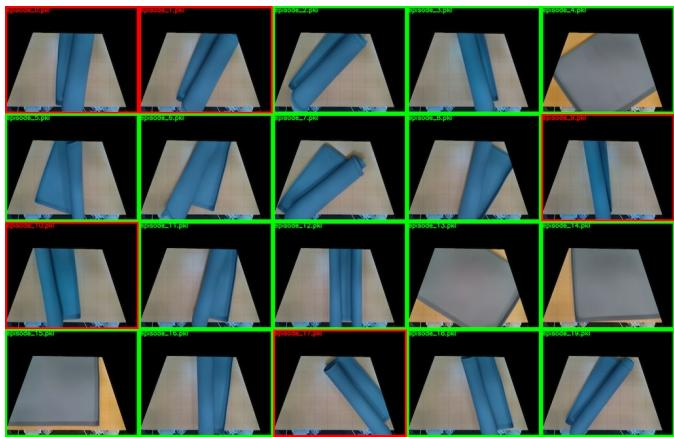

Figure 16. 展开垫子任务的初始状态  
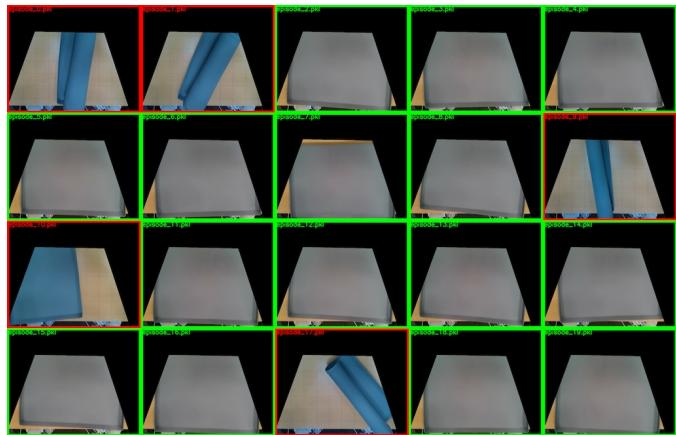  
Figure 17. 展开垫子任务的最终状态

需要注意的是，在推理时，我们使用非触觉控制。未来的工作计划简化这种控制策略，仅使用单一控制器来实现我们给定的目标。

操作员使用 SpaceMouse 或 VR 控制器输入设备来控制机器人的末端执行器，夹爪则通过对应设备上的触发按钮进行控制。遥操作（Tele-op）和学习到的策略以 10Hz 运行，中层控制器的运行频率约为 1kHz。期望的末端执行器位姿命令由中层控制器进行插值。该工作台配有 2 台 RealSense D415 RGBD 相机，以 30fps 的帧率推流 VGA RGB 图像，这些图像被降采样至 320x240、10fps，作为学习策略的输入。

## D.2 双臂任务的初始与最终状态

以下各图展示了四项双臂任务的初始状态和最终状态。绿色和红色框分别表示成功和失败的运行轮次（rollout）。由于垫子和衬衫是非常扁平的物体，我们采用了单应性投影（homographic projection）来更好地可视化初始和最终状态。

Figure 18. Egg Beater（打蛋器）的初始状态  
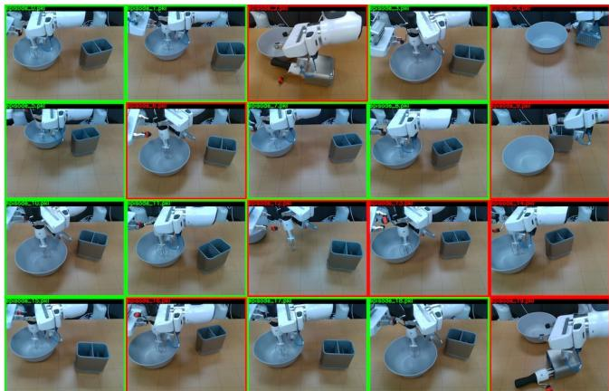  
Figure 19. Egg Beater（打蛋器）的最终状态

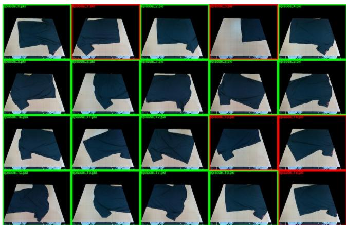

Figure 20. Shirt Folding（叠衬衫）的初始状态  
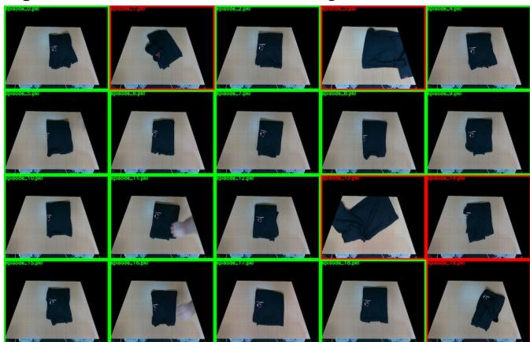  
Figure 21. Shirt Folding（叠衬衫）的最终状态