# 通过世界模型掌握多样化领域

Danijar Hafner, $^{12}$ Jurgis Pasukonis, $^{1}$ Jimmy Ba, $^{2}$ Timothy Lillicrap $^{1}$

## 摘要

开发一种能够学习解决广泛应用领域中各种任务的通用算法，一直是人工智能领域的一项根本性挑战。尽管当前的强化学习算法可以轻松应用于与其开发场景类似的任务，但要针对新的应用领域对其进行配置，仍需要大量的人类专业知识与实验。我们提出了 DreamerV3，这是一种通用算法，仅使用单一配置就在超过 150 项多样化任务中超越了专门的方法。Dreamer 学习环境的模型，并通过想象未来场景来改进其行为。基于归一化、平衡和变换的鲁棒性技术实现了跨领域的稳定学习。在开箱即用的情况下，Dreamer 是首个在没有人类数据或课程学习的情况下，从零开始在《我的世界》（Minecraft）中收集到钻石的算法。这项成就是人工智能领域公认的一大挑战，它要求在开放世界中从像素和稀疏奖励中探索具有远见的策略。我们的工作使得无需大量实验即可解决具有挑战性的控制问题，使强化学习具备了广泛的适用性。

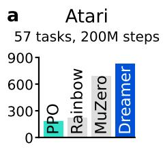

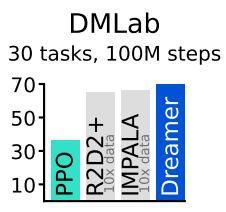  
b

  
调优专家算法

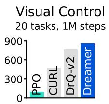

  
统一配置

  
Figure 1: 基准测试总结。a, 在所有领域中使用固定超参数，Dreamer 在广泛的基准测试和数据预算下均优于经过调优的专家算法。Dreamer 也大幅优于广泛适用的 PPO 算法的高质量实现。b, 在开箱即用的情况下，Dreamer 在稀疏奖励下从零开始学会了在热门视频游戏《我的世界》（Minecraft）中获取钻石，这是人工智能领域长期存在的一项重大挑战，此前的方法都需要人类数据或特定领域的启发式规则。

  
(a) Control Suite

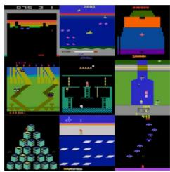  
(b) Atari

  
(c) ProcGen

  
(d) DMLab

  
(e) Minecraft  
Figure 2: 实验中使用的多样化视觉领域。Dreamer 在这些领域中均取得了成功，涵盖机器人运动与操作任务、Atari 游戏、程序化生成的 ProcGen 关卡、需要空间和时间推理的 DMLab 任务，以及复杂且无限的 Minecraft 世界。我们还在非视觉领域对 Dreamer 进行了评估。

## 引言

强化学习（Reinforcement learning）使计算机能够通过交互来解决任务，例如在围棋（Go）和 Dota 游戏中超越人类 $^{1,2}$。它也是使大语言模型超越其预训练数据展现水平的关键组成部分 $^{3,4}$。尽管 PPO $^{5}$ 已成为强化学习领域的标准算法，但为了获得更高的性能，人们通常采用更专用的算法。这些专用算法针对不同应用领域带来的独特挑战，例如连续控制 $^{6}$、离散动作 $^{7,8}$、稀疏奖励 $^{9}$、图像输入 $^{10}$、空间环境 $^{11}$ 和棋盘游戏 $^{12}$。然而，将强化学习算法应用于全新的任务——例如从视频游戏转向机器人任务——需要投入大量的精力、专业知识和计算资源来微调算法的超参数 $^{13}$。这种脆弱性成为了将强化学习应用于新问题的瓶颈，同时也限制了强化学习在计算开销极大的模型或无法进行大量调参的任务中的适用性。构建一个无需重新配置即可学会掌握新领域的通用算法，一直是人工智能的核心挑战，这也将为强化学习开拓广阔的实际应用前景。

我们提出了 Dreamer，这是一种通用算法，在采用固定超参数的情况下，在广泛的领域中超越了专用专家算法，使强化学习能够直接应用于新问题。该算法基于学习世界模型（world model）的思想，该模型为智能体赋予了丰富的感知能力和对未来的想象能力 $^{14,15,16}$ 。世界模型预测潜在动作的结果，Critic 神经网络评估每个结果的价值，Actor 神经网络选择动作以达成最佳结果。尽管这种方法直观上极具吸引力，但稳健地学习和利用世界模型以实现强大的任务性能一直是一个悬而未决的难题 $^{17}$ 。Dreamer 通过一系列基于归一化、平衡和变换的鲁棒性技术克服了这一挑战。我们观察到，不仅在 Figure 2 总结的各个领域的 150 多个任务中实现了稳健的学习，而且在不同模型大小和训练预算下也是如此，为提升性能提供了可预测的途径。值得注意的是，更大的模型不仅能取得更高的分数，而且解决任务所需的交互次数也更少。

为了拓展强化学习的边界，我们考虑了近年来成为研究焦点的流行视频游戏 Minecraft（我的世界）$^{18,19,20}$ ，并举办了旨在开发能够自主学习在 Minecraft 中收集钻石的算法的国际竞赛\*。由于该开放世界游戏稀疏的奖励、探索的难度、长时程以及程序化生成的多样性，在没有人类数据的情况下解决这一问题已被公认为人工智能领域的一项重大挑战 $^{18}$ 。由于这些障碍，以往的方法不得不借助人类专家数据和特定领域的课程学习 $^{19,20}$ 。开箱即用的 Dreamer 是第一个能够从零开始在 Minecraft 中收集钻石的算法。

  
(a) 世界模型学习

  
(b) Actor Critic 学习  
Figure 3: Dreamer 的训练过程。世界模型将感官输入编码为离散表征 $z_{t}$ ，在给定动作 $a_{t}$ 的情况下，具有循环状态 $h_{t}$ 的序列模型对这些离散表征进行预测。通过重建输入来塑造这些表征。Actor 和 Critic 预测动作 $a_{t}$ 与价值 $v_{t}$ ，并从世界模型预测的抽象表征轨迹中进行学习。

## 学习算法

我们提出了 Dreamer 算法 $^{21,22}$ 的第三代版本。该算法由三个神经网络组成：世界模型（world model）预测潜在动作的结果，评价网络（critic）评估每个结果的价值，行动网络（actor）选择能够实现最有价值结果的动作。这些组件在智能体与环境交互的同时，利用重放经验进行并发训练。为了在不同领域均取得成功，所有三个组件都需要适应不同的信号幅度，并在其目标函数中鲁棒地平衡各项。这是极具挑战性的，因为我们的目标不仅是在同一领域内的类似任务上表现良好，而是旨在以固定的超参数跨越多种不同的领域进行学习。本节介绍了世界模型、评价网络和行动网络及其鲁棒损失函数，以及用于鲁棒预测未知数量级数值的工具。

## 世界模型学习

世界模型通过自编码 $^{23}$ 学习感官输入的紧凑表征，并通过预测潜在动作的未来表征和奖励来实现规划。我们将世界模型实现为一个循环状态空间模型（Recurrent State-Space Model, RSSM） $^{24}$，如图 3 所示。首先，编码器将感官输入 $x_{t}$ 映射为随机表征 $z_{t}$。接着，带有循环状态 $h_{t}$ 的序列模型在给定过去动作 $a_{t-1}$ 的情况下预测这些表征的序列。$h_{t}$ 和 $z_{t}$ 的拼接构成了模型状态，我们据此预测奖励 $r_{t}$ 和回合延续标志 $c_{t} \in \{0, 1\}$，并重构输入以确保表征具有充分的信息量：

上下文输入 开环预测  
  
Figure 4: DMLab 迷宫（上）和四足机器人（下）的多步视频预测。在给定 5 帧上下文图像和完整动作序列的情况下，模型在无法获取中间图像的情况下向未来预测了 45 帧。世界模型学会了对每个环境潜在结构的理解。

$$
\text { RSSM } \left\{ \begin{array}{l l} & \text { Sequence   model: } \\ & \text { Encoder: } \\ & \text { Dynamics   predictor: } \\ & \text { Reward   predictor: } \\ & \text { Continue   predictor: } \\ & \text { Decoder: } \end{array} \right.
$$

$$
\begin{array}{r l} & h _ {t} = f _ {\phi} (h _ {t - 1}, z _ {t - 1}, a _ {t - 1}) \\ & z _ {t} \sim q _ {\phi} (z _ {t} \mid h _ {t}, x _ {t}) \\ & \hat {z} _ {t} \sim p _ {\phi} (\hat {z} _ {t} \mid h _ {t}) \\ & \hat {r} _ {t} \sim p _ {\phi} (\hat {r} _ {t} \mid h _ {t}, z _ {t}) \\ & \hat {c} _ {t} \sim p _ {\phi} (\hat {c} _ {t} \mid h _ {t}, z _ {t}) \\ & \hat {x} _ {t} \sim p _ {\phi} (\hat {x} _ {t} \mid h _ {t}, z _ {t}) \end{array}\tag{1}
$$

Figure 4 可视化了世界模型的长期视频预测。编码器和解码器对图像输入使用卷积神经网络（CNN），对向量输入使用多层感知机（MLP）。动力学、奖励和继续预测器也采用 MLP。表征是从 softmax 分布向量中采样的，并且我们通过采样步骤采用直通梯度（straight-through gradients）$^{25,22}$。给定输入 $x_{1:T}$、动作 $a_{1:T}$、奖励 $r_{1:T}$ 和继续标志 $c_{1:T}$ 的序列批次，端到端优化世界模型参数 $\phi$，以最小化预测损失 $L_{pred}$、动力学损失 $L_{dyn}$ 和表征损失 $L_{rep}$，对应的损失权重分别为 $\beta_{pred} = 1$、$\beta_{dyn} = 1$ 和 $\beta_{rep} = 0.1$：

$$
\mathcal {L} (\phi) \doteq \mathrm{E} _ {q _ {\phi}} \left[ \sum_ {t = 1} ^ {T} (\beta_ {\mathrm{pred}} \mathcal {L} _ {\mathrm{pred}} (\phi) + \beta_ {\mathrm{dyn}} \mathcal {L} _ {\mathrm{dyn}} (\phi) + \beta_ {\mathrm{rep}} \mathcal {L} _ {\mathrm{rep}} (\phi)) \right].\tag{2}
$$

预测损失通过后文描述的 symlog 平方损失来训练解码器和奖励预测器，并通过逻辑回归训练继续预测器。动力学损失通过最小化预测器 $p_{\phi}(z_{t} \mid h_{t})$ 与下一个随机表征 $q_{\phi}(z_{t} \mid h_{t}, x_{t})$ 之间的 KL 散度来训练序列模型预测下一个表征。反过来，表征损失训练表征使其变得更具可预测性，从而使我们能够在想象训练（imagination training）期间使用分解动力学预测器进行快速采样。这两种损失的区别在于停止梯度算子（stop-gradient operator）$\mathrm{sg}(\cdot)$ 及其损失尺度。为了避免出现动力学极易预测但无法包含足够输入信息的退化解，我们采用了自由比特（free bits）$^{26}$，将动力学和表征损失截断在 1 nat $\approx$ 1.44 bits 的值以下。当它们已经被充分最小化时，这将停用它们，从而将学习重点放在预测损失上：

$$
\begin{array}{r l} & {\mathcal {L} _ {\mathrm{pred}} (\phi) \doteq - \ln p _ {\phi} (x _ {t} \mid z _ {t}, h _ {t}) - \ln p _ {\phi} (r _ {t} \mid z _ {t}, h _ {t}) - \ln p _ {\phi} (c _ {t} \mid z _ {t}, h _ {t})} \\ & {\mathcal {L} _ {\mathrm{dyn}} (\phi) \doteq \max \bigl (1, \mathrm{KL} \bigl [ \operatorname{sg} (q _ {\phi} (z _ {t} \mid h _ {t}, x _ {t})) \big | \big | \quad p _ {\phi} (z _ {t} \mid h _ {t}) \bigr ] \bigr)} \\ & {\mathcal {L} _ {\mathrm{rep}} (\phi) \doteq \max \bigl (1, \mathrm{KL} \bigl [ \quad q _ {\phi} (z _ {t} \mid h _ {t}, x _ {t}) \quad \big | \big | \operatorname{sg} (p _ {\phi} (z _ {t} \mid h _ {t})) \bigr ] \bigr)} \end{array}\tag{3}
$$

以往的世界模型需要根据环境的视觉复杂度对表征损失（representation loss）进行不同的缩放 $^{21}$。复杂的 3D 环境包含对控制而言不必要的细节，因此需要更强的正则化项来简化表征并使其更具可预测性。在具有静态背景且单个像素可能对任务至关重要的游戏中，则需要较弱的正则化项以提取精细细节。我们发现，将自由位（free bits）与较小的表征损失相结合可以解决这一两难问题，从而允许在跨领域中使用固定的超参数。此外，我们使用后文描述的 symlog 函数对向量观测进行变换，以防止过大的输入和过大的重构梯度，从而进一步稳定与表征损失之间的权衡。

在早期的实验中，我们偶尔会观察到 KL 损失出现尖峰，这与深度变分自编码器（deep variational autoencoders）的相关报道一致 $^{27}$。为了防止这种情况，我们将编码器和动力学预测器的类别分布参数化为 1% 的均匀分布和 99% 的神经网络输出的混合，使得它们不可能退化为确定性分布，从而确保了表现良好的 KL 损失。更多模型细节和超参数包含在补充材料中。

## Critic 学习

Actor 和 Critic 神经网络完全从世界模型预测的表征抽象轨迹中学习行为 $^{14}$。在与环境交互时，我们通过从 Actor 网络中采样来选择动作，而无需前瞻规划（lookahead planning）。Actor 和 Critic 在模型状态 $s_{t} \doteq \{h_{t}, z_{t}\}$ 上运行，因此受益于循环世界模型学习到的马尔可夫表征。Actor 的目标是在每个模型状态下最大化回报 $R_{t} \doteq \sum_{\tau=0}^{\infty} \gamma^{\tau} r_{t+\tau}$，其中折扣因子为 $\gamma = 0.997$。为了考虑预测时域 T = 16 之外的奖励，Critic 学习近似在当前 Actor 行为下每个状态的回报分布 $^{28}$：

$$
\text { Actor: } \quad a _ {t} \sim \pi_ {\theta} (a _ {t} \mid s _ {t}) \qquad \text { Critic: } \quad v _ {\psi} (R _ {t} \mid s _ {t})\tag{4}
$$

从重放输入的表征开始，世界模型和 Actor 生成一段由想象模型状态 $s_{1:T}$、动作 $a_{1:T}$、奖励 $r_{1:T}$ 以及延续标志 $c_{1:T}$ 构成的轨迹。因为 Critic 预测的是一个分布，我们将其预测价值 $v_{t} \doteq \mathrm{E}[v_{\psi}(\cdot \mid s_{t})]$ 读取为该分布的期望。为了估计考虑了预测时域之外奖励的回报，我们计算整合了预测奖励与价值的自举 $\lambda$-回报（bootstrapped $\lambda$-returns）$^{29}$。Critic 使用极大似然损失来学习预测回报估计值 $R_{t}^{\lambda}$ 的分布：

$$
\mathcal {L} (\psi) \doteq - \sum_ {t = 1} ^ {T} \ln p _ {\psi} (R _ {t} ^ {\lambda} \mid s _ {t}) R _ {t} ^ {\lambda} \doteq r _ {t} + \gamma c _ {t} \Big ((1 - \lambda) v _ {t} + \lambda R _ {t + 1} ^ {\lambda} \Big) R _ {T} ^ {\lambda} \doteq v _ {T}\tag{5}
$$

虽然一个简单的选择是将评判网络（critic）参数化为正态分布，但回报分布可能具有多模态性，并且在不同环境之间可能存在数个数量级的差异。为了在这些条件下稳定并加速学习，我们将评判网络参数化为具有指数间隔区间的分类分布，从而将梯度的尺度与预测目标解耦，具体如后文所述。为了在奖励难以预测的环境中改进价值预测，我们将评判网络损失同时应用于损失缩放系数为 $\beta_{val} = 1$ 的想象轨迹，以及损失缩放系数为 $\beta_{repval} = 0.3$ 的从重放缓冲区（replay buffer）采样的轨迹中。评判网络重放损失使用想象展开起始状态处的想象回报 $R_{t}^{\lambda}$ 作为重放轨迹的同策略（on-policy）价值标注，进而在重放奖励上计算 $\lambda$ 回报（$\lambda$-returns）。

由于评判网络回归的目标依赖于其自身的预测，我们通过对评判网络进行正则化，使其趋向于预测自身参数的指数移动平均（EMA）的输出，以此来稳定学习过程。这与以往在强化学习中使用的目标网络 $^{7}$ 类似，但允许我们使用当前的评判网络来计算回报。我们进一步注意到，在训练开始时随机初始化的奖励预测器和评判网络可能会产生过大的预测奖励，从而推迟学习的启动。因此，我们将奖励预测器和评判网络的输出权重矩阵初始化为零，这缓解了该问题并加速了早期学习。

## Actor 学习

Actor 通过学习选择能够最大化回报的动作，同时通过熵正则化项 $^{30}$ 进行探索。然而，该正则化项的合适尺度取决于环境中奖励的尺度和频率。理想情况下，如果奖励稀疏，我们希望智能体进行更多探索；如果奖励密集或近在眼前，则进行更多利用。与此同时，探索的程度不应受到环境中奖励任意尺度缩放的影响。这需要在保留奖励频率信息的同时对回报尺度进行归一化。

为了在不同领域间使用固定的熵系数 $\eta = 3 \times 10^{-4}$，我们将回报归一化，使其大致落在区间 [0, 1] 内。在实践中，从回报中减去一个偏移量并不会改变 Actor（行动者）梯度，因此仅除以范围 S 就已足够。此外，为了避免在稀疏奖励下放大来自函数逼近的噪声，我们仅按比例缩小较大的回报幅度，而对低于阈值 L = 1 的较小回报保持不变。我们在离散和连续动作中均使用 Reinforce 估计器 $^{31}$，从而得到如下代理损失函数：

$$
\mathcal {L} (\theta) \doteq - \sum_ {t = 1} ^ {T} \mathrm{sg} \left(\left(R _ {t} ^ {\lambda} - v _ {\psi} (s _ {t})\right) / \max (1, S)\right) \log \pi_ {\theta} \left(a _ {t} \mid s _ {t}\right) + \eta \mathrm{H} \left[ \pi_ {\theta} \left(a _ {t} \mid s _ {t}\right) \right]\tag{6}
$$

回报分布可能是多模态的并包含离群值，尤其是在某些回合可达到的回报高于其他回合的随机化环境中。此时若使用观测到的最小和最大回报进行归一化，会过度缩小回报，从而可能导致次优收敛。为了对这些离群值保持稳健，我们计算回报批次中从第 $5$ 百分位数到第 $95$ 百分位数之间的范围，并使用指数移动平均来平滑该估计值：

$$
S \doteq \operatorname{EMA} \left(\operatorname{Per} \left(R _ {t} ^ {\lambda}, 9 5\right) - \operatorname{Per} \left(R _ {t} ^ {\lambda}, 5\right), 0. 9 9\right)\tag{7}
$$

以往的工作通常归一化优势 $^{5}$ 而非回报，这会导致无论奖励是否触手可及，都在最大化回报与熵之间施加固定的侧重。在奖励稀疏时放大优势会放大噪声，使其压过熵正则化项并阻碍探索。按标准差归一化奖励或回报在稀疏奖励下可能会失效，因为此时它们的标准差接近于零，从而无论奖励大小如何都会急剧放大奖励。约束优化旨在跨状态平均实现固定的目标熵 $^{32,33}$，而无论可达到的回报如何，该方法虽然稳健，但在稀疏奖励下探索缓慢，在密集奖励下收敛效果较差。我们未能为这些方法在跨领域场景中找到稳定的超参数。带有分母限制的回报归一化克服了这些挑战，在稀疏奖励下能够快速探索，并在各种不同的领域中均能收敛至高性能。

## 稳健预测

重构输入以及预测奖励和回报可能具有挑战性，因为这些量的尺度在不同领域之间可能差异很大。使用平方损失预测较大的目标可能导致发散，而绝对损失和 Huber 损失 $^{7}$ 则会使学习停滞。另一方面，基于滑动统计量（running statistics）$^{5}$ 对目标进行归一化会给优化引入非平稳性。我们提出了 symlog 平方误差作为解决这一困境的简单方案。为此，一个具有输入 $x$ 和参数 $\theta$ 的神经网络 $f(x,\theta)$ 学习预测其目标 $y$ 的变换版本。为了读出网络的预测值 $\hat{y}$，我们应用逆变换：

$$
\mathcal {L} (\theta) \doteq \frac {1}{2} \big (f (x, \theta) - \mathrm{symlog} (y) \big) ^ {2} \quad \hat {y} \doteq \mathrm{symexp} \big (f (x, \theta) \big)\tag{8}
$$

使用对数作为变换将无法使我们预测取负值的目标。因此，我们从双对称对数族（bi-symmetric logarithmic family）$^{34}$ 中选择了一个函数作为变换，并将其命名为 symlog，其逆函数为 symexp：

$$
\operatorname{symlog} (x) \doteq \operatorname{sign} (x) \ln \bigl (| x | + 1 \bigr) \quad \operatorname{symexp} (x) \doteq \operatorname{sign} (x) \bigl (\exp (| x |) - 1 \bigr)\tag{9}
$$

symlog 函数压缩了较大正值和负值的数值幅度。与对数不同，它关于原点对称，同时保留了输入符号。这使得优化过程在需要时能够迅速将网络预测值移动到较大的数值。symlog 函数在原点附近近似于恒等函数，因此它不会影响本就足够小的目标的学习。

对于潜在的随机目标（例如奖励或回报），我们引入了 symexp twohot 损失。在这里，网络输出呈指数间隔的分箱 $b_{i} \in B$ 上的 softmax 分布的 logits。预测值通过以各分箱位置按其预测概率加权求平均来读出。重要的是，网络可以输出该区间内的任意连续值，因为加权平均值可以落在分箱之间：

$$
\hat {y} \doteq \operatorname{softmax} (f (x)) ^ {T} B \quad B \doteq \operatorname{symexp} (\left[ - 2 0 \dots + 2 0 \right])\tag{10}
$$

该网络在 twohot 编码目标 $^{8,28}$ 上进行训练，这是 onehot 编码向连续值的一种推广。标量的 twohot 编码是一个具有 $|B|$ 个条目的向量，除最接近该编码标量的两个分箱（bin）的索引 $k$ 和 $k + 1$ 外，其余条目均为 0。这两个条目之和为 1，且与编码连续值更接近的分箱被赋予线性更高的权重。随后，训练该网络以最小化带有软目标分类的类别交叉熵损失。需要注意的是，该损失仅取决于分配给各个分箱的概率，而不取决于与分箱位置相关的连续值，从而将梯度的大小与目标的大小解耦：

$$
\mathcal {L} (\theta) \doteq - \mathrm{twohot} (y) ^ {T} \log \mathrm{softmax} (f (x, \theta))\tag{11}
$$

应用这些原理，Dreamer 在编码器输入和解码器目标中均使用 symlog 函数转换向量观测值，并对奖励预测器和评价器（critic）采用 synexp twohot 损失。我们发现这些技术能够在许多不同的领域实现鲁棒且快速的学习。对于评价器学习，先前曾提出过一种替代的非对称变换 $^{35}$，但我们发现在跨领域平均表现上其效果较差。与其他替代方案不同，symlog 变换避免了截断过大的目标 $^{7}$、因归一化引入非平稳性 $^{5}$，或在检测到新的极值时调整网络权重 $^{36}$。

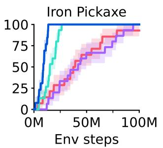

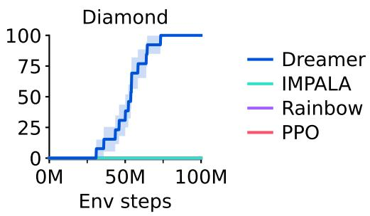  
Figure 5: 在 Minecraft Diamond 任务中发现最后三种物品中每一种的受训智能体比例。尽管先前的算法最多能进展到铁镐，但 Dreamer 是所有对比算法中唯一能够发现钻石的算法，并且表现稳定可靠。

## 结果

我们在固定超参数下，跨越 8 个领域（涵盖 150 多个任务）评估了 Dreamer 的通用性。我们设计的实验旨在将 Dreamer 与文献中的最佳方法进行比较，而这些方法通常是专门针对特定基准设计和调优的。我们还与 PPO $^{5}$ 的高质量实现进行了比较，PPO 是一种以鲁棒性著称的标准强化学习算法。我们使用固定的超参数运行 PPO，这些超参数旨在最大化跨领域的性能，并复现了 PPO 在 ProcGen $^{37}$ 上的强劲已发表结果。为了拓展强化学习的边界，我们将 Dreamer 应用于极具挑战性的视频游戏 Minecraft，并将其与以往的强大算法进行对比。最后，我们分析了 Dreamer 各个组件的重要性，以及它对不同模型大小和计算预算的鲁棒性。所有 Dreamer 智能体均在单张 Nvidia A100 GPU 上训练，这使得许多研究实验室都能够复现。项目网站上提供了可复现所有结果的 Dreamer 公开实现。

基准测试（Benchmarks） 我们在 8 个领域进行了广泛的实证研究，这些领域包括连续和离散动作、视觉和低维输入、稠密和稀疏奖励、不同的奖励尺度、2D 和 3D 世界以及程序化生成。Figure 1 总结了基准测试结果，表明 Dreamer 在不同领域中均优于众多先前的专家算法。至关重要的是，Dreamer 在所有领域上都大幅超越了 PPO。

\- Atari 这一经典基准包含 57 款 Atari 2600 游戏，预算为 200M 帧，带来了各种各样的挑战 $^{38}$。我们采用了粘性动作（sticky action）模拟器设置 $^{39}$。Dreamer 在仅使用一小部分计算资源的情况下，超越了强大的 MuZero 算法 $^{8}$。Dreamer 也超越了广泛使用的专家算法 Rainbow $^{40}$ 和 IQN $^{41}$。

\- ProcGen 这一包含 16 款游戏的基准具有随机生成的关卡和视觉干扰，用于测试智能体的鲁棒性和泛化能力 $^{42}$。在 50M 帧的预算内，Dreamer 达到了经过调优的专家算法 PPG $^{37}$ 的性能水平，并超越了 Rainbow $^{42,40}$。我们采用固定超参数的 PPO 智能体达到了高度调优的官方 PPO 实现的已发表得分 $^{37}$。

\- DMLab 这一包含 30 个任务的测试套件以 3D 环境为特色，用于测试空间和时间推理能力 $^{43}$。在 100M 帧内，Dreamer 超越了可扩展的 IMPALA 和 R2D2+ 智能体 $^{35}$ 在 1B 环境步数下的性能，相当于数据效率提升了 1000% 以上。我们注意到，这些基线并非为数据效率而设计，但它们作为先前在大规模计算下所能达到性能的重要对照参考。

a 鲁棒性技术  

  
Figure 6: Dreamer 的消融实验与稳健扩展。a，平均而言，所有单项稳健性技术都对 Dreamer 的性能有所贡献，尽管每项单独的技术可能只对部分任务产生影响。各个任务的训练曲线包含在补充材料中。b，Dreamer 的性能主要依赖于其世界模型的无监督重构损失，这与大多数主要依赖奖励和价值预测梯度的现有算法不同 $^{7,5,8}$。c，随着模型规模从 12M 增加到 400M 参数，Dreamer 的性能单调提升。值得注意的是，更大的模型不仅提升了任务性能，而且需要更少的环境交互。d，更高的回放比率（replay ratio）可预测地提升了 Dreamer 的性能。与模型规模相结合，这使得从业者能够通过使用更多的计算资源来提高任务性能和数据效率。

\- Atari100k 该数据效率基准包含 26 款 Atari 游戏，预算仅为 400K 帧，相当于 2 小时的游戏时间 $^{17}$。EfficientZero $^{44}$ 通过结合在线树搜索、优先回放和超参数调度保持了最先进水平（state-of-the-art），但它也会提前重置关卡以增加数据多样性，从而使对比变得困难。在没有这些复杂机制的情况下，Dreamer 超越了其余的最佳方法，包括基于 Transformer 的 IRIS 和 TWM 智能体、无模型的 SPR 以及 SimPLe $^{45}$。

\- Proprio Control 该基准包含 18 个控制任务，具有连续动作、本体感觉向量输入以及 500K 环境步数的预算 $^{46}$。任务范围涵盖经典控制、运动控制到机器人操作任务，具有稠密和稀疏奖励特征。Dreamer 在该基准上树立了新的最先进水平，超越了 D4PG、DMPO 和 MPO $^{33}$。

\- Visual Control 该基准由 20 个连续控制任务组成，其中智能体仅接收高维图像作为输入，预算为 1M 环境步数 $^{46}$。Dreamer 在该基准上树立了新的最先进水平，超越了专用于视觉环境并利用数据增强的 DrQ-v2 和 CURL $^{47}$。

\- BSuite 该基准包含 23 个环境，共计 468 种配置，专门用于测试信用分配（credit assignment）、对奖励尺度和随机性的稳健性、记忆、泛化以及探索 $^{48}$。Dreamer 在该基准上树立了新的最先进水平，超越了 Boot DQN 和其他方法 $^{49}$。Dreamer 相比以往算法的提升尤其体现在尺度稳健性（scale robustness）类别中。

Minecraft 在热门游戏 Minecraft 中收集钻石一直是人工智能领域长期存在的挑战 $^{18,19,20}$。游戏中的每个回合都设定在一个独特的、随机生成的且无限的 3D 世界中。回合持续至玩家死亡或最多达到 36000 步（相当于 30 分钟），在此期间，玩家需要通过搜寻资源和合成工具，在稀疏奖励下依次发现 12 种物品。经验丰富的人类玩家大约需要 20 分钟才能获得钻石 $^{20}$。我们遵循先前工作 $^{19}$ 中的方块破坏设定，因为所提供的动作空间会使随机策略难以长时间持续按住按键。

由于在该复杂领域中的训练时间较长，在 Minecraft 中进行广泛的超参数调优将十分困难。因此，我们直接开箱即用 Dreamer，采用其默认超参数。如 Figure 1 和 Figure 5 所示，Dreamer 是首个在 Minecraft 中从零开始收集到钻石的算法，无需像 VPT $^{20}$ 那样使用人类数据，也无需采用自适应课程 $^{19}$。我们在 Minecraft 上训练的所有 Dreamer 智能体都在 100M 环境步内发现了钻石。虽然有几个强大的基准模型（baselines）推进到了铁镐等高级物品，但没有一个能发现钻石。

消融实验（Ablations） 在 Figure 6 中，我们在由 14 个任务组成的多样化集合上消融了鲁棒性技术和学习信号，以理解它们的重要性。单个任务的训练曲线包含在补充材料中。我们观察到所有的鲁棒性技术都有助于提升性能，其中最为显著的是世界模型的 KL 目标，其次是回报归一化（return normalization）以及用于奖励和价值预测的 symexp twohot 回归。总体而言，我们发现每项单独的技术在部分任务子集上都是至关重要的，但可能不会影响其他任务的性能。

为了研究世界模型的效果，我们通过阻止特定于任务的奖励与价值预测梯度，或阻止任务无关的重构梯度参与其表征构建，从而对 Dreamer 的学习信号进行了消融。与以往通常仅依赖特定任务学习信号的强化学习算法 $^{7,8}$ 不同，Dreamer 主要依赖其世界模型的无监督目标。这一发现可能有助于未来开发利用无监督数据进行预训练的算法变体。

扩展特性 为了探究 Dreamer 是否能够稳健地扩展，我们在 Crafter $^{50}$ 和一项 DMLab 任务 $^{43}$ 上训练了参数量从 12M 到 400M 的 6 种模型尺寸，以及不同的回放比（replay ratio）。回放比会影响智能体执行的梯度更新次数。Figure 6 显示，在所对比的模型尺寸和回放比下，Dreamer 在固定超参数的情况下表现出稳健的学习能力。此外，增大模型尺寸可以直接转化为更高的任务性能和更低的数据需求。增加梯度步数进一步减少了学习成功行为所需的交互次数。结果表明，Dreamer 在不同的模型尺寸和回放比下都能稳健地学习，并且在给定计算资源的情况下，为其提升性能提供了一种可预测的途径。

## 相关工作

开发通用算法长期以来一直是强化学习研究的目标。PPO $^{5}$ 是应用最广泛的算法之一，相对较为稳健，但它需要大量的经验，且性能往往低于专用的替代方法。SAC $^{32}$ 是连续控制领域的热门选择，并利用经验回放来实现高数据效率，但在实践中需要调优（尤其是其熵尺度），并且在高维输入下面临困难 $^{51}$。MuZero $^{8}$ 使用价值预测模型进行规划，并已应用于棋盘游戏和 Atari，但作者并未开源其实现，且该算法包含多个复杂组件，使其复现极具挑战。Gato $^{52}$ 将一个大模型拟合到多个任务的专家演示中，但仅在存在专家数据时才适用。相比之下，Dreamer 凭借固定的超参数掌握了各种各样的环境，不需要专家数据，并且其代码实现是开源的。

Minecraft 一直是近期研究的焦点。借助 MALMO $^{53}$，Microsoft（微软）发布了这款热门游戏的免费版本用于研究。MineRL $^{18}$ 提供了多个竞赛环境，我们将其作为实验的基础。MineRL 竞赛通过多样化的人类数据集支持智能体探索并学习有意义的技能 $^{18}$。Voyager 通过对语言模型进行 API 调用，获得了与 Dreamer 在科技树相似深度的物品，但它运行在专为该游戏设计并提供高级动作接口的 MineFlayer 机器人脚本层之上 $^{54}$。VPT $^{20}$ 通过基于承包商收集的键盘和鼠标动作专家数据进行行为克隆，并使用强化学习进行微调，使用 720 块 GPU 训练了 9 天以获得钻石。相比之下，Dreamer 使用 MineRL 竞赛的动作空间，在没有人类数据的情况下，仅用 1 块 GPU 耗时 9 天即可自主学会从稀疏奖励中收集钻石。

## 结论

我们提出了第三代 Dreamer 算法，这是一种通用的强化学习算法，能够在固定超参数的情况下精通广泛的领域。Dreamer 不仅在超过 150 项任务中表现出色，而且在不同的数据和计算预算下都能稳健地学习，推动强化学习走向广泛的实际应用。在开箱即用的情况下，Dreamer 是首个在《我的世界》（Minecraft）中从零开始收集到钻石的算法，达成了人工智能领域的一个重要里程碑。作为一种基于学习到的世界模型（world model）的高性能算法，Dreamer 为未来的研究方向铺平了道路，包括利用互联网视频向智能体传授世界知识，以及跨领域学习单一世界模型以使人工智能体能够积累日益通用的知识和能力。

致谢 我们感谢 Mohammad Norouzi、Jessy Lin、Abbas Abdolmaleki、John Schulman、Adam Kosiorek 和 Oleh Rybkin 开展的富有见地的讨论。我们感谢 Bobak Shahriari、Denis Yarats、Karl Cobbe 和 Hubert Soyer 分享了基线算法的训练曲线。我们感谢 Daniel Furrer、Andrew Chen 和 Dakshesh Garambha 在 Google Cloud 基础设施方面提供的帮助。

## References

1. David Silver, Aja Huang, Chris J Maddison, Arthur Guez, Laurent Sifre, George Van Den Driessche, Julian Schrittwieser, Ioannis Antonoglou, Veda Panneershelvam, Marc Lanctot, et al. Mastering the game of go with deep neural networks and tree search. nature, 529(7587):484, 2016.

2. OpenAI. OpenAI Five. https://blog.openai.com/openai-five/, 2018.

3. Long Ouyang, Jeffrey Wu, Xu Jiang, Diogo Almeida, Carroll Wainwright, Pamela Mishkin, Chong Zhang, Sandhini Agarwal, Katarina Slama, Alex Ray, et al. Training language models to follow instructions with human feedback. Advances in neural information processing systems, 35:27730–27744, 2022.

4. Hung Le, Yue Wang, Akhilesh Deepak Gotmare, Silvio Savarese, and Steven Chu Hong Hoi. Coderl: Mastering code generation through pretrained models and deep reinforcement learning. Advances in Neural Information Processing Systems, 35:21314–21328, 2022.

5. John Schulman, Filip Wolski, Prafulla Dhariwal, Alec Radford, and Oleg Klimov. Proximal policy optimization algorithms. arXiv preprint arXiv:1707.06347, 2017.

6. Timothy P Lillicrap, Jonathan J Hunt, Alexander Pritzel, Nicolas Heess, Tom Erez, Yuval Tassa, David Silver, and Daan Wierstra. Continuous control with deep reinforcement learning. arXiv preprint arXiv:1509.02971, 2015.

7. Volodymyr Mnih, Koray Kavukcuoglu, David Silver, Andrei A Rusu, Joel Veness, Marc G Bellemare, Alex Graves, Martin Riedmiller, Andreas K Fidjeland, Georg Ostrovski, et al. Human-level control through deep reinforcement learning. Nature, 518(7540):529, 2015.

8. Julian Schrittwieser, Ioannis Antonoglou, Thomas Hubert, Karen Simonyan, Laurent Sifre, Simon Schmitt, Arthur Guez, Edward Lockhart, Demis Hassabis, Thore Graepel, et al. Mastering atari, go, chess and shogi by planning with a learned model. arXiv preprint arXiv:1911.08265, 2019.

9. Max Jaderberg, Volodymyr Mnih, Wojciech Marian Czarnecki, Tom Schaul, Joel Z Leibo, David Silver, and Koray Kavukcuoglu. Reinforcement learning with unsupervised auxiliary tasks. arXiv preprint arXiv:1611.05397, 2016.

10. Ankesh Anand, Evan Racah, Sherjil Ozair, Yoshua Bengio, Marc-Alexandre Côté, and R Devon Hjelm. Unsupervised state representation learning in atari. Advances in neural information processing systems, 32, 2019.

11. Danny Driess, Ingmar Schubert, Pete Florence, Yunzhu Li, and Marc Toussaint. Reinforcement learning with neural radiance fields. arXiv preprint arXiv:2206.01634, 2022.

12. David Silver, Julian Schrittwieser, Karen Simonyan, Ioannis Antonoglou, Aja Huang, Arthur Guez, Thomas Hubert, Lucas Baker, Matthew Lai, Adrian Bolton, et al. Mastering the game of go without human knowledge. Nature, 550(7676):354, 2017.

13. Marcin Andrychowicz, Anton Raichuk, Piotr Stańczyk, Manu Orsini, Sertan Girgin, Raphael Marinier, Léonard Hussenot, Matthieu Geist, Olivier Pietquin, Marcin Michalski, et al. What matters in on-policy reinforcement learning? a large-scale empirical study. arXiv preprint arXiv:2006.05990, 2020.

14. Richard S Sutton. Dyna, an integrated architecture for learning, planning, and reacting. ACM SIGART Bulletin, 2(4):160–163, 1991.

15. Chelsea Finn and Sergey Levine. Deep visual foresight for planning robot motion. In 2017 IEEE International Conference on Robotics and Automation (ICRA), pages 2786–2793. IEEE, 2017.

16. David Ha and Jürgen Schmidhuber. World models. arXiv preprint arXiv:1803.10122, 2018.

17. Lukasz Kaiser, Mohammad Babaeizadeh, Piotr Milos, Blazej Osinski, Roy H Campbell, Konrad Czechowski, Dumitru Erhan, Chelsea Finn, Piotr Kozakowski, Sergey Levine, et al. Model-based reinforcement learning for atari. arXiv preprint arXiv:1903.00374, 2019.

18. William H Guss, Cayden Codel, Katja Hofmann, Brandon Houghton, Noboru Kuno, Stephanie Milani, Sharada Mohanty, Diego Perez Liebana, Ruslan Salakhutdinov, Nicholay Topin, et al. The minerl competition on sample efficient reinforcement learning using human priors. arXiv e-prints, pages arXiv–1904, 2019.

19. Ingmar Kanitscheider, Joost Huizinga, David Farhi, William Hebgen Guss, Brandon Houghton, Raul Sampedro, Peter Zhokhov, Bowen Baker, Adrien Ecoffet, Jie Tang, et al. Multi-task curriculum learning in a complex, visual, hard-exploration domain: Minecraft. arXiv preprint arXiv:2106.14876, 2021.

20. Bowen Baker, Ilge Akkaya, Peter Zhokhov, Joost Huizinga, Jie Tang, Adrien Ecoffet, Brandon Houghton, Raul Sampedro, and Jeff Clune. Video pretraining (vpt): Learning to act by watching unlabeled online videos. arXiv preprint arXiv:2206.11795, 2022.

21. Danijar Hafner, Timothy Lillicrap, Jimmy Ba, and Mohammad Norouzi. Dream to control: Learning behaviors by latent imagination. arXiv preprint arXiv:1912.01603, 2019.

22. Danijar Hafner, Timothy Lillicrap, Mohammad Norouzi, and Jimmy Ba. Mastering atari with discrete world models. arXiv preprint arXiv:2010.02193, 2020.

23. Diederik P Kingma and Max Welling. Auto-encoding variational bayes. arXiv preprint arXiv:1312.6114, 2013.

24. Danijar Hafner, Timothy Lillicrap, Ian Fischer, Ruben Villegas, David Ha, Honglak Lee, and James Davidson. Learning latent dynamics for planning from pixels. arXiv preprint arXiv:1811.04551, 2018.

25. Yoshua Bengio, Nicholas Léonard, and Aaron Courville. Estimating or propagating gradients through stochastic neurons for conditional computation. arXiv preprint arXiv:1308.3432, 2013.

26. Durk P Kingma, Tim Salimans, Rafal Jozefowicz, Xi Chen, Ilya Sutskever, and Max Welling. Improved variational inference with inverse autoregressive flow. Advances in neural information processing systems, 29, 2016.

27. Rewon Child. Very deep vaes generalize autoregressive models and can outperform them on images. arXiv preprint arXiv:2011.10650, 2020.

28. Marc G Bellemare, Will Dabney, and Rémi Munos. A distributional perspective on reinforcement learning. In International Conference on Machine Learning, pages 449–458. PMLR, 2017.

29. Richard S Sutton and Andrew G Barto. Reinforcement learning: An introduction. MIT press, 2018.

30. Ronald J Williams and Jing Peng. Function optimization using connectionist reinforcement learning algorithms. Connection Science, 3(3):241–268, 1991.

31. Ronald J Williams. Simple statistical gradient-following algorithms for connectionist reinforcement learning. Machine learning, 8(3-4):229–256, 1992.

32. Tuomas Haarnoja, Aurick Zhou, Pieter Abbeel, and Sergey Levine. Soft actor-critic: Off-policy maximum entropy deep reinforcement learning with a stochastic actor. arXiv preprint arXiv:1801.01290, 2018.

33. Abbas Abdolmaleki, Jost Tobias Springenberg, Yuval Tassa, Remi Munos, Nicolas Heess, and Martin Riedmiller. Maximum a posteriori policy optimisation. arXiv preprint arXiv:1806.06920, 2018.

34. J Beau W Webber. A bi-symmetric log transformation for wide-range data. Measurement Science and Technology, 24(2):027001, 2012.

35. Steven Kapturowski, Georg Ostrovski, John Quan, Remi Munos, and Will Dabney. Recurrent experience replay in distributed reinforcement learning. In International conference on learning representations, 2018.

36. Matteo Hessel, Hubert Soyer, Lasse Espeholt, Wojciech Czarnecki, Simon Schmitt, and Hado van Hasselt. Multi-task deep reinforcement learning with popart. In Proceedings of the AAAI Conference on Artificial Intelligence, volume 33, pages 3796–3803, 2019.

37. Karl W Cobbe, Jacob Hilton, Oleg Klimov, and John Schulman. Phasic policy gradient. In International Conference on Machine Learning, pages 2020–2027. PMLR, 2021.

38. Marc G Bellemare, Yavar Naddaf, Joel Veness, and Michael Bowling. The arcade learning environment: An evaluation platform for general agents. Journal of Artificial Intelligence Research, 47:253–279, 2013.

39. Marlos C Machado, Marc G Bellemare, Erik Talvitie, Joel Veness, Matthew Hausknecht, and Michael Bowling. Revisiting the arcade learning environment: Evaluation protocols and open problems for general agents. Journal of Artificial Intelligence Research, 61:523–562, 2018.

40. Matteo Hessel, Joseph Modayil, Hado Van Hasselt, Tom Schaul, Georg Ostrovski, Will Dabney, Dan Horgan, Bilal Piot, Mohammad Azar, and David Silver. Rainbow: Combining improvements in deep reinforcement learning. In Thirty-Second AAAI Conference on Artificial Intelligence, 2018.

41. Will Dabney, Georg Ostrovski, David Silver, and Rémi Munos. Implicit quantile networks for distributional reinforcement learning. In International conference on machine learning, pages 1096–1105. PMLR, 2018.

42. Karl Cobbe, Chris Hesse, Jacob Hilton, and John Schulman. Leveraging procedural generation to benchmark reinforcement learning. In International conference on machine learning, pages 2048–2056. PMLR, 2020.

43. Charles Beattie, Joel Z Leibo, Denis Teplyashin, Tom Ward, Marcus Wainwright, Heinrich Küttler, Andrew Lefrancq, Simon Green, Víctor Valdés, Amir Sadik, et al. Deepmind lab. arXiv preprint arXiv:1612.03801, 2016.

44. Weirui Ye, Shaohuai Liu, Thanard Kurutach, Pieter Abbeel, and Yang Gao. Mastering atari games with limited data. Advances in Neural Information Processing Systems, 34:25476–25488, 2021.

45. Vincent Micheli, Eloi Alonso, and François Fleuret. Transformers are sample efficient world models. arXiv preprint arXiv:2209.00588, 2022.

46. Yuval Tassa, Yotam Doron, Alistair Muldal, Tom Erez, Yazhe Li, Diego de Las Casas, David Budden, Abbas Abdolmaleki, Josh Merel, Andrew Lefrancq, et al. Deepmind control suite. arXiv preprint arXiv:1801.00690, 2018.

47. Denis Yarats, Rob Fergus, Alessandro Lazaric, and Lerrel Pinto. Mastering visual continuous control: Improved data-augmented reinforcement learning. arXiv preprint arXiv:2107.09645, 2021.

48. Ian Osband, Yotam Doron, Matteo Hessel, John Aslanides, Eren Sezener, Andre Saraiva, Katrina McKinney, Tor Lattimore, Csaba Szepesvari, Satinder Singh, et al. Behaviour suite for reinforcement learning. arXiv preprint arXiv:1908.03568, 2019.

49. Olivia Dizon-Paradis, Stephen Wormald, Daniel Capecci, Avanti Bhandarkar, and Damon Woodard. Investigating the practicality of existing reinforcement learning algorithms: A performance comparison. Authorea Preprints, 2023.

50. Danijar Hafner. Benchmarking the spectrum of agent capabilities. arXiv preprint arXiv:2109.06780, 2021.

51. Denis Yarats, Amy Zhang, Ilya Kostrikov, Brandon Amos, Joelle Pineau, and Rob Fergus. Improving sample efficiency in model-free reinforcement learning from images. arXiv preprint arXiv:1910.01741, 2019.

52. Scott Reed, Konrad Zolna, Emilio Parisotto, Sergio Gomez Colmenarejo, Alexander Novikov, Gabriel Barth-Maron, Mai Gimenez, Yury Sulsky, Jackie Kay, Jost Tobias Springenberg, et al. A generalist agent. arXiv preprint arXiv:2205.06175, 2022.

53. Matthew Johnson, Katja Hofmann, Tim Hutton, and David Bignell. The malmo platform for artificial intelligence experimentation. In IJCAI, pages 4246–4247. Citeseer, 2016.

54. Guanzhi Wang, Yuqi Xie, Yunfan Jiang, Ajay Mandlekar, Chaowei Xiao, Yuke Zhu, Linxi Fan, and Anima Anandkumar. Voyager: An open-ended embodied agent with large language models. arXiv preprint arXiv:2305.16291, 2023.

55. Shengyi Huang, Rousslan Fernand Julien Dossa, Antonin Raffin, Anssi Kanervisto, and Weixun Wang. The 37 implementation details of proximal policy optimization. The ICLR Blog Track 2023, 2022.

56. Matt Hoffman, Bobak Shahriari, John Aslanides, Gabriel Barth-Maron, Feryal Behbahani, Tamara Norman, Abbas Abdolmaleki, Albin Cassirer, Fan Yang, Kate Baumli, et al. Acme: A research framework for distributed reinforcement learning. arXiv preprint arXiv:2006.00979, 2020.

57. Simon Schmitt, Matteo Hessel, and Karen Simonyan. Off-policy actor-critic with shared experience replay. In International Conference on Machine Learning, pages 8545–8554. PMLR, 2020.

58. Tom Schaul, John Quan, Ioannis Antonoglou, and David Silver. Prioritized experience replay. arXiv preprint arXiv:1511.05952, 2015.

59. Andy Brock, Soham De, Samuel L Smith, and Karen Simonyan. High-performance large-scale image recognition without normalization. In International Conference on Machine Learning, pages 1059–1071. PMLR, 2021.

60. Liu Ziyin, Zhikang T Wang, and Masahito Ueda. Laprop: Separating momentum and adaptivity in adam. arXiv preprint arXiv:2002.04839, 2020.

61. Diederik P Kingma and Jimmy Ba. Adam: A method for stochastic optimization. arXiv preprint arXiv:1412.6980, 2014.

62. Audrunas Gruslys, Will Dabney, Mohammad Gheshlaghi Azar, Bilal Piot, Marc Bellemare, and Remi Munos. The reactor: A fast and sample-efficient actor-critic agent for reinforcement learning. arXiv preprint arXiv:1704.04651, 2017.

63. Kyunghyun Cho, Bart Van Merriënboer, Caglar Gulcehre, Dzmitry Bahdanau, Fethi Bougares, Holger Schwenk, and Yoshua Bengio. Learning phrase representations using rnn encoder-decoder for statistical machine translation. arXiv preprint arXiv:1406.1078, 2014.

64. Matthijs Van Keirsbilck, Alexander Keller, and Xiaodong Yang. Rethinking full connectivity in recurrent neural networks. arXiv preprint arXiv:1905.12340, 2019.

65. Marlos C Machado, Marc G Bellemare, Erik Talvitie, Joel Veness, Matthew Hausknecht, and Michael Bowling. Revisiting the arcade learning environment: Evaluation protocols and open problems for general agents. Journal of Artificial Intelligence Research, 61:523–562, 2018.

66. Lasse Espeholt, Hubert Soyer, Remi Munos, Karen Simonyan, Volodymir Mnih, Tom Ward, Yotam Doron, Vlad Firoiu, Tim Harley, Iain Dunning, et al. Impala: Scalable distributed deep-rl with importance weighted actor-learner architectures. arXiv preprint arXiv:1802.01561, 2018.

## 方法

## 基线

我们采用近端策略优化（Proximal Policy Optimization, PPO）算法 $^{5}$——该算法已成为该领域的标准选择——以便在所有基准测试中采用固定超参数与 Dreamer 进行比较。目前公开可用的 PPO 实现繁多，且已知它们在任务性能上存在显著差异 $^{55}$。为确保该对比能够代表 PPO 在跨领域固定超参数下所能达到的最高性能，我们选用了 Acme 框架 $^{56}$ 中提供的高质量 PPO 实现，并根据建议 $^{55,13}$ 在表 1 中选定了其超参数；此外，我们还调整了其 epoch 批次大小，使其足够大以适用于复杂环境 $^{42}$，并调优了其学习率和熵缩放。我们使折扣因子与 Dreamer 保持一致，因为它在跨领域表现良好，并且是文献中的常见选择 $^{35,8}$。我们选择了经发现优于其他备选方案的 IMPALA 网络架构 $^{42}$，并将小批次大小设置为单个 A100 GPU 所能容纳的最大值。我们在 ProcGen 基准上验证了我们 PPO 实现及超参数的性能，PPO 作者此前在该基准上报告过高度调优的 PPO 实现 $^{37}$。我们发现，我们的实现达到或略微超过了这一性能参考标准。

<table><tr><td>参数</td><td>数值</td></tr><tr><td>观测归一化</td><td>Yes</td></tr><tr><td>奖励归一化</td><td>Yes</td></tr><tr><td>奖励截断（标准差）</td><td>10</td></tr><tr><td>Epoch 批次</td><td>64 × 256</td></tr><tr><td>Epoch 轮数</td><td>3</td></tr><tr><td>小批次大小</td><td>8</td></tr><tr><td>小批次长度</td><td>256</td></tr><tr><td>策略信任域</td><td>0.2</td></tr><tr><td>价值信任域</td><td>No</td></tr><tr><td>优势归一化</td><td>Yes</td></tr><tr><td>熵惩罚缩放</td><td>0.01</td></tr><tr><td>折扣因子</td><td>0.997</td></tr><tr><td>GAE lambda</td><td>0.95</td></tr><tr><td>学习率</td><td> $3 \times 10^{-4}$ </td></tr><tr><td>梯度截断</td><td>0.5</td></tr><tr><td>Adam epsilon</td><td> $10^{-5}$ </td></tr></table>

Table 1: 在所有基准测试中使用的 PPO 超参数。

对于 Minecraft，我们额外微调并运行了 IMPALA 和 Rainbow 算法，因为文献中尚未见从头开始端到端成功学习的报道 $^{18}$。我们使用这些算法的 Acme 实现 $^{56}$，采用与 PPO 相同的 IMPALA 网络，并微调了学习率和熵正则化项。对于所有其他基准测试，我们与结果部分所引用的文献中报道的微调专家算法进行对比。

## 实现细节

经验回放 我们使用带有在线队列 $^{57}$ 的均匀回放缓冲区（uniform replay buffer）来实现 Dreamer。具体而言，每个微批次（minibatch）首先由不重叠的在线轨迹构成，然后由从回放缓冲区中均匀采样的轨迹填满。我们在数据收集期间将隐状态存入回放缓冲区，以在回放轨迹上初始化世界模型，并将训练展开（training rollout）得到的新隐状态写回缓冲区。尽管与我们对比的一些专家算法使用了优先经验回放（prioritized replay）$^{58}$，且我们发现它也能提升 Dreamer 的性能，但为了实现的简便性，我们在实验中选择了均匀回放。

我们通过回放比率（replay ratio）对训练量进行参数化。这是指在不考虑动作重复（action repeat）的情况下，每从环境中收集一个时间步所训练的时间步比例。将回放比率除以微批次中的时间步数以及动作重复次数，即可得到梯度步数与环境步数的比率。例如，在 Atari 上，当动作重复为 4、批次形状为 $16 \times 64$ 时，32 的回放比率对应于每 128 个环境步进行 1 次梯度步，即在 200M 环境步中进行 1.5M 次梯度步。

优化器 我们采用了自适应梯度裁剪（Adaptive Gradient Clipping，AGC）$^{59}$，若每个张量的梯度超过其对应权重矩阵 L2 范数的 30%，则对其进行裁剪，采用其默认的 $\epsilon = 10^{-3}$。AGC 将裁剪阈值与损失尺度解耦，允许在不调整裁剪阈值的情况下更改损失函数或损失尺度。我们使用 LaProp 优化器 $^{60}$ 应用裁剪后的梯度，设置 $\epsilon = 10^{-20}$ 及其默认参数 $\beta_{1} = 0.9$ 和 $\beta_{2} = 0.99$。LaProp 通过 RMSProp 对梯度进行归一化，然后通过动量进行平滑，而不是像 Adam $^{61}$ 那样在原始梯度上同时计算动量和归一化项。这一简单的改变允许使用更小的 epsilon，并避免了我们在 Adam 下观察到的偶尔出现的不稳定性。

分布 编码器、动力学预测器和行动者（actor）的分布是 99% 的预测 softmax 输出与 1% 的均匀分布的混合分布 $^{62}$，以防止出现零概率和无穷大的对数概率。奖励和评论家（critic）神经网络输出指数间隔分箱 $b \in B$ 上的 softmax 分布，并针对 twohot 编码的目标进行训练：

$$
\operatorname{twohot} (x) _ {i} \doteq \left\{ \begin{array}{l l} | b _ {k + 1} - x | / | b _ {k + 1} - b _ {k} | & \text { if } i = k \\ | b _ {k} - x | / | b _ {k + 1} - b _ {k} | & \text { if } i = k + 1 \\ 0 & \text { else } \end{array} \right. \quad k \doteq \sum_ {j = 1} ^ {| B |} \delta (b _ {j} <   x)\tag{12}
$$

twohot 分布的输出权重初始化为零，以确保智能体在初始化时不会虚构奖励和价值。为了计算跨越多个数量级的分箱（bins）下 softmax 分布的期望预测，求和顺序十分重要，正负分箱应分别从小分箱到大分箱进行求和，然后再相加。具体实现请参考源代码。

网络 图像使用步长为 2 的卷积编码至 $6 \times 6$ 或 $4 \times 4$ 的分辨率然后展平，并使用输出端带有 sigmoid 激活函数的转置步长为 2 的卷积进行解码。向量输入经过 symlog 变换，然后使用 3 层 MLP 进行编码和解码。Actor 和 Critic 神经网络也是 3 层 MLP，奖励和继续（continue）预测器是 1 层 MLP。序列模型是带有 8 个块的块对角循环权重 $^{64}$ 的 GRU $^{63}$，以允许存在大量的记忆单元而不会引起参数量和 FLOPs 的二次方增长。在每个时间步，GRU 的输入是采样的潜变量 $z_{t}$、动作 $a_{t}$ 以及循环状态的线性嵌入，以允许各块之间进行混合。

## 基准测试

评估协议总结于 Table 2 中，在已建立标准评估协议的基准测试上，我们遵循这些标准协议。Atari $^{38}$ 使用包含粘性动作（sticky actions）$^{65}$ 的 57 个任务。文献中用于归一化得分的随机基准和人类基准参考得分各不相同，我们选择了最常见的参考值，并在 Table 6 中进行了复现。DMLab $^{43}$ 使用 30 个任务 $^{66}$，并且我们采用固定动作空间 $^{36,35}$。我们在 100M 步时进行评估，因为像某些先前工作那样运行 10B 步是不可行的。由于现已发表的基准线在 100M 步时表现较差，我们改为与它们在 1B 步时的表现进行比较，从而给予了它们 10 倍的数据优势。ProcGen 采用困难难度设置和无限关卡集 $^{42}$。先前工作在不同的步数预算下进行比较 $^{42,37}$，由于没有动作重复（action repeat），出于计算成本考虑，我们在 50M 步时进行比较。对于纯粹从稀疏奖励中获取的 Minecraft Diamond（钻石），我们建立了评估协议，报告在 100M 环境步数下测得的单回合回报，这相当于约 100 天的游戏内时间。Atari100k $^{17}$ 包含 26 个任务，预算为 400K 环境步，动作重复后为 100K 步。先前工作使用了各种环境设置（总结于 Table 10 中），我们选择了最初引入时的环境设置。Visual Control $^{46,21}$ 涵盖 20 个任务，动作重复次数为 2。Proprioceptive Control 遵循相同的协议，但由于先前工作 $^{47}$ 中基准线的可用性问题，我们排除了两个四足任务。

<table><tr><td>Benchmark</td><td>Tasks</td><td>Env Steps</td><td>Action Repeat</td><td>Env Instances</td><td>Replay Ratio</td><td>GPU Days</td><td>Model Size</td></tr><tr><td>Minecraft</td><td>1</td><td>100M</td><td>1</td><td>64</td><td>32</td><td>8.9</td><td>200M</td></tr><tr><td>DMLab</td><td>30</td><td>100M</td><td>4</td><td>16</td><td>32</td><td>2.9</td><td>200M</td></tr><tr><td>ProcGen</td><td>16</td><td>50M</td><td>1</td><td>16</td><td>64</td><td>16.1</td><td>200M</td></tr><tr><td>Atari</td><td>57</td><td>200M</td><td>4</td><td>16</td><td>32</td><td>7.7</td><td>200M</td></tr><tr><td>Atari100K</td><td>26</td><td>400K</td><td>4</td><td>1</td><td>128</td><td>0.1</td><td>200M</td></tr><tr><td>BSuite</td><td>23</td><td>—</td><td>1</td><td>1</td><td>1024</td><td>0.5</td><td>200M</td></tr><tr><td>Proprio Control</td><td>18</td><td>500K</td><td>2</td><td>16</td><td>512</td><td>0.3</td><td>12M</td></tr><tr><td>Visual Control</td><td>20</td><td>1M</td><td>2</td><td>16</td><td>512</td><td>0.1</td><td>12M</td></tr></table>

Table 2: 基准测试概览。所有智能体均各自在单张 Nvidia A100 GPU 上进行训练。

环境实例 在早期的实验中，我们观察到 Dreamer 和 PPO 的性能对环境实例的数量均具有鲁棒性。基于我们训练机器上可用的 CPU 资源，我们默认使用 16 个环境实例。对于 BSuite，该基准测试要求使用单个环境实例。我们在 Atari100K 上也使用单个环境实例，因为该基准测试的预算为 400K 环境步（env steps），而 Atari 中的最大单局长度（episode length）原则上为 432K 环境步。对于 Minecraft，由于该环境单步执行较慢，我们通过远程 CPU 工作节点使用了 64 个环境以加快实验速度。

随机种子与误差棒 我们在每个基准测试中为 Dreamer 和 PPO 分别运行 5 个随机种子，但由于计算资源限制，ProcGen 仅运行 1 个随机种子；根据基准测试要求，BSuite 运行 10 个随机种子；Minecraft 运行 10 个随机种子以可靠地报告获得钻石的运行比例。所有曲线均显示跨随机种子的均值，并附带一个标准差的阴影区域。

计算选择 本文中的所有 Dreamer 和 PPO 智能体均各自在单张 Nvidia A100 GPU 上进行训练。Dreamer 默认使用 200M 的模型大小。在两个控制套件上，Dreamer 使用速度显著更快的 12M 模型即可达到相同的性能，这使其对研究人员而言更易于获取和使用。重放比率（replay ratio）控制着计算成本与数据效率之间的权衡（如 Figure 6 所分析），并且其设定与每个基准测试的步数预算相匹配。

## 模型大小

为了适应不同的计算预算并分析对不同模型大小的鲁棒性，我们定义了一系列参数量在 12M 到 400M 之间的模型，如 Table 3 所示。模型大小由模型维度（model dimension）进行参数化，该维度大约以 1.5 倍递增，在 2 的幂次与经过 1.5 倍缩放的 2 的幂次之间交替。这产生了满足硬件效率要求的 8 的倍数的张量形状。不同网络组件的大小均由模型维度派生。MLP 的隐藏单元数量即为模型维度。序列模型拥有 8 倍于模型维度的循环单元（recurrent units），并被划分为 8 个与 MLP 大小相同的块。最接近数据的卷积编码器和解码器层使用的通道数比模型维度少 $16 \times$。每个潜在变量（latent）使用的编码数也比模型维度少 $16 \times$。隐藏层的数量和潜在变量的数量在不同模型大小之间保持固定。包括学习率和批次大小（batch size）在内的所有超参数在不同模型大小之间均保持固定。

<table><tr><td>参数量</td><td>12M</td><td>25M</td><td>50M</td><td>100M</td><td>200M</td><td>400M</td></tr><tr><td>隐藏层大小 (d)</td><td>256</td><td>384</td><td>512</td><td>768</td><td>1024</td><td>1536</td></tr><tr><td>循环单元 (8d)</td><td>1024</td><td>3072</td><td>4096</td><td>6144</td><td>8192</td><td>12288</td></tr><tr><td>基础 CNN 通道数 (d/16)</td><td>16</td><td>24</td><td>32</td><td>48</td><td>64</td><td>96</td></tr><tr><td>每个潜变量的编码数 (d/16)</td><td>16</td><td>24</td><td>32</td><td>48</td><td>64</td><td>96</td></tr></table>

Table 3: Dreamer 模型尺寸。MLP 隐藏单元的数量定义了模型维度，循环单元、卷积通道数以及每个潜变量的编码数均由此派生。层数和潜变量数量在不同模型尺寸间保持不变。

## Dreamer 的前几代

我们展示了 Dreamer 系列工作的第三代。在需要区分之处，我们将该算法称为 DreamerV3。DreamerV1 算法 $^{21}$ 仅限于连续控制，DreamerV2 算法 $^{22}$ 在 Atari 上超越了人类水平，而 DreamerV3 算法能够在各类不同的基准测试中实现开箱即用的学习。

我们将 DreamerV3 引入的变化总结如下：

\- 鲁棒性技术：观测 symlog、KL 平衡与自由比特（free bits）、针对所有分类分布的 1% unimix、百分位数回报归一化、用于奖励头和评论家（critic）的 symexp twohot 损失。

• 网络架构：Block GRU、RMSNorm 归一化、SiLu 激活函数。

\- 优化器：自适应梯度裁剪（AGC，Adaptive gradient clipping）、LaProp（RMSProp 后接动量）。

\- 经验回放缓冲区（Replay buffer）：更大容量、在线队列、存储和更新潜状态。

超参数

<table><tr><td>名称</td><td>符号</td><td>数值</td></tr><tr><td colspan="3">通用</td></tr><tr><td>经验回放容量</td><td>—</td><td> $5 \times 10^{6}$ </td></tr><tr><td>批大小</td><td> $B$ </td><td>16</td></tr><tr><td>批长度</td><td> $T$ </td><td>64</td></tr><tr><td>激活函数</td><td>—</td><td>RMSNorm + SiLU</td></tr><tr><td>学习率</td><td>—</td><td> $4 \times 10^{-5}$ </td></tr><tr><td>梯度裁剪</td><td>—</td><td>AGC(0.3)</td></tr><tr><td>优化器</td><td>—</td><td>LaProp( $\epsilon = 10^{-20}$ )</td></tr><tr><td colspan="3">世界模型</td></tr><tr><td>重建损失尺度</td><td> $\beta_{\text{pred}}$ </td><td>1</td></tr><tr><td>动力学损失尺度</td><td> $\beta_{\text{dyn}}$ </td><td>1</td></tr><tr><td>表征损失尺度</td><td> $\beta_{\text{rep}}$ </td><td>0.1</td></tr><tr><td>潜变量均匀混合比例</td><td>—</td><td>1%</td></tr><tr><td>自由 nats</td><td>—</td><td>1</td></tr><tr><td colspan="3">Actor-Critic</td></tr><tr><td>想象时域</td><td> $H$ </td><td>15</td></tr><tr><td>折扣时域</td><td> $1/(1 - \gamma)$ </td><td>333</td></tr><tr><td>回报 lambda</td><td> $\lambda$ </td><td>0.95</td></tr><tr><td>Critic 损失尺度</td><td> $\beta_{\text{val}}$ </td><td>1</td></tr><tr><td>Critic 回放损失尺度</td><td> $\beta_{\text{repval}}$ </td><td>0.3</td></tr><tr><td>Critic EMA 正则项</td><td>—</td><td>1</td></tr><tr><td>Critic EMA 衰减率</td><td>—</td><td>0.98</td></tr><tr><td>Actor 损失尺度</td><td> $\beta_{\text{pol}}$ </td><td>1</td></tr><tr><td>Actor 熵正则项</td><td> $\eta$ </td><td> $3 \times 10^{-4}$ </td></tr><tr><td>Actor 均匀混合比例</td><td>—</td><td>1%</td></tr><tr><td>Actor RetNorm 尺度</td><td> $S$ </td><td>Per( $R, 95$ ) – Per( $R, 5$ )</td></tr><tr><td>Actor RetNorm 限制</td><td> $L$ </td><td>1</td></tr><tr><td>Actor RetNorm 衰减率</td><td>—</td><td>0.99</td></tr></table>

Table 4: Dreamer 超参数。所有基准测试均使用相同数值，包括本体感受和视觉输入、连续和离散动作，以及 2D 和 3D 领域。我们不使用任何超参数退火、优先经验回放、权重衰减或 Dropout。

## Minecraft

游戏描述 拥有1亿月活跃用户的 Minecraft 是全球最受欢迎的电子游戏之一。Minecraft 包含一个由程序生成的3D世界，涵盖不同的生物群系，包括平原、森林、丛林、山地、沙漠、针叶林、积雪苔原、冰刺、沼泽、热带草原、恶地、海滩、石岸、河流和海洋。这个世界由1米见方的方块组成，玩家可以破坏和放置这些方块。游戏中有大约30种不同的生物可供玩家互动或战斗。利用收集到的资源，玩家可以使用超过350种配方来合成新物品并推进科技树，同时还要确保安全和食物供应以生存下去。Minecraft 中有许多可以设想的任务，作为第一步，研究界重点关注了获取钻石这一核心任务，钻石是一种在地下深处发现的稀有物品，需要逐步推进科技树才能获得。

学习环境 我们在 MineRL 之上构建了 Minecraft Diamond 环境，以定义扁平的分类动作空间，并通过人类玩家测试修复了在原始环境中发现的问题。例如，在破坏钻石矿石时，物品有时会直接进入物品栏，有时则需要从地面拾取。原始环境会在破坏钻石矿石时终止回合，导致许多成功的回合在拾取物品之前就结束了，从而无法获得奖励。我们移除了这一提前终止条件，并在玩家死亡或达到 36000 步（对应在 20Hz 控制频率下的 30 分钟）后结束回合。另一个问题是跳跃动作必须持续按住超过一个控制步才能触发跳跃，我们通过在后台保持按键按下 200ms 解决了这个问题。我们在 MineRL v0.4.4 $^{18}$ 之上构建了该环境，该版本提供了抽象的合成动作。Minecraft 版本为 1.11.2。

观测与奖励 智能体观测到一个 $64 \times 64 \times 3$ 的第一人称图像、一个包含 400 多种物品的物品栏计数向量、一个自回合开始以来的最大物品栏计数向量（用于告知智能体其已达成的里程碑）、一个指示当前装备物品的独热向量（one-hot vector），以及生命值、饥饿度和呼吸值的标量输入。我们遵循 MineRL 竞赛环境 $^{18}$ 的稀疏奖励结构，对通往钻石的 12 个里程碑进行奖励，涵盖获取以下物品：原木、木板、木棍、工作台、木镐、圆石、石镐、铁矿石、熔炉、铁锭、铁镐和钻石。每个物品的奖励在每个回合中仅发放一次，智能体必须学会多次收集某些物品以达成下一个里程碑。为了使回报易于解释，我们为每个里程碑提供 +1 的奖励，而不是根据每个物品的珍贵程度对奖励进行缩放。此外，每损失一颗心我们给予 -0.01 的奖励，每恢复一颗心给予 +0.01 的奖励，但尚未研究这是否有帮助。

## 补充材料 Minecraft 视频预测

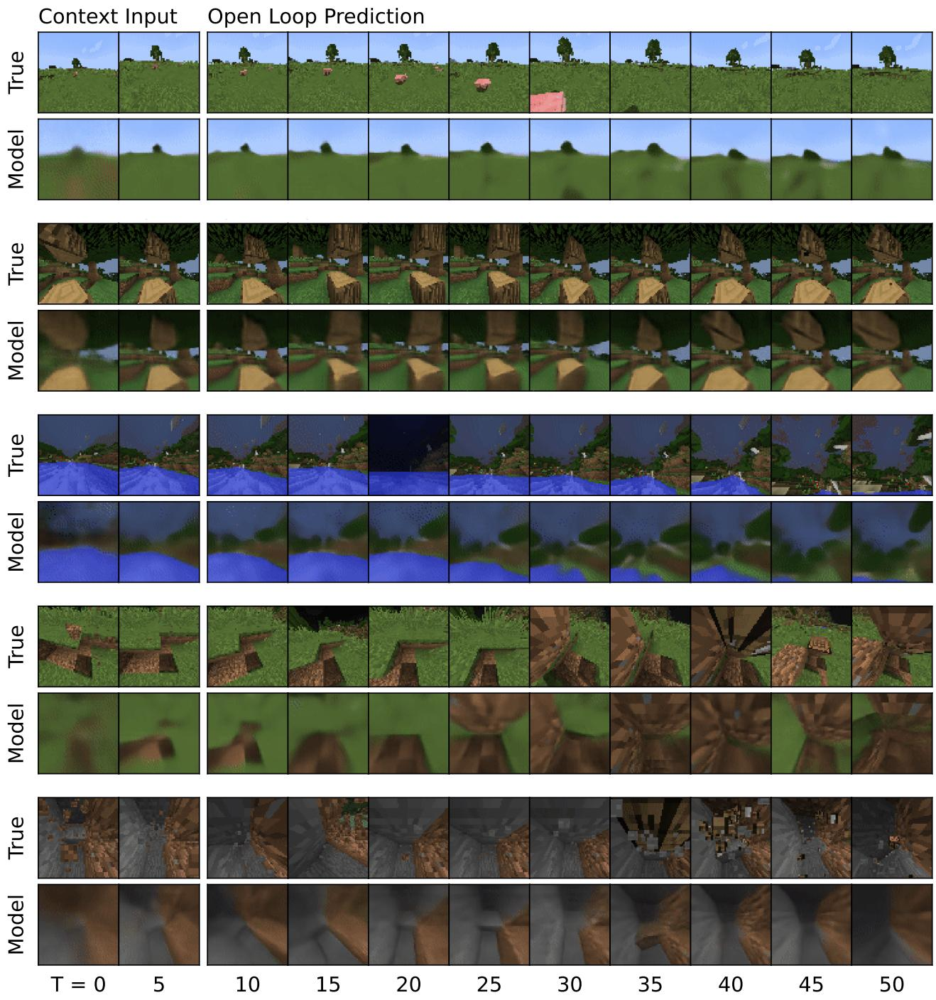  
Figure 7: Minecraft 上的多步预测。世界模型接收前 5 帧作为上下文输入，并在给定动作序列且无法获取中间图像的情况下，预测未来的 45 步。

Dreamer IMPALA Rainbow PPO

## Minecraft 额外结果

<table><tr><td>方法</td><td>回报</td></tr><tr><td>Dreamer</td><td>9.1</td></tr><tr><td>IMPALA</td><td>7.1</td></tr><tr><td>Rainbow</td><td>6.3</td></tr><tr><td>PPO</td><td>5.1</td></tr></table>

Table 5: 100M 环境步数下的 Minecraft 钻石得分。

  
Figure 8: Minecraft 学习曲线。

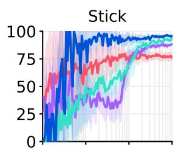

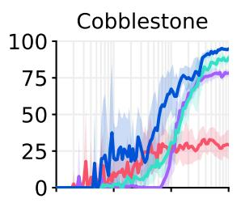

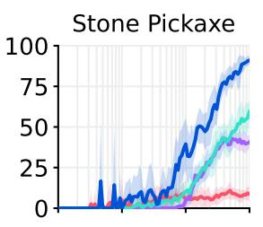

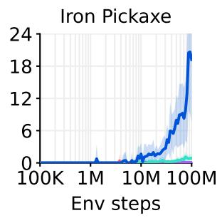

Figure 9: 物品获取成功率（占回合数的百分比）。Dreamer 获取物品的成功率显著高于基线模型，并在达到 100M 步数预算前持续提升。在达到步数预算时，Dreamer 在 0.4% 的回合中获取了钻石，为未来的研究留下了挑战。该指标不同于 Figure 5，Figure 5 展示的是在整个训练过程中，不考虑回合边界的情况下，100% 的 Dreamer 智能体都获取了一颗或多颗钻石，而基线智能体为 0%。

Atari 学习曲线  
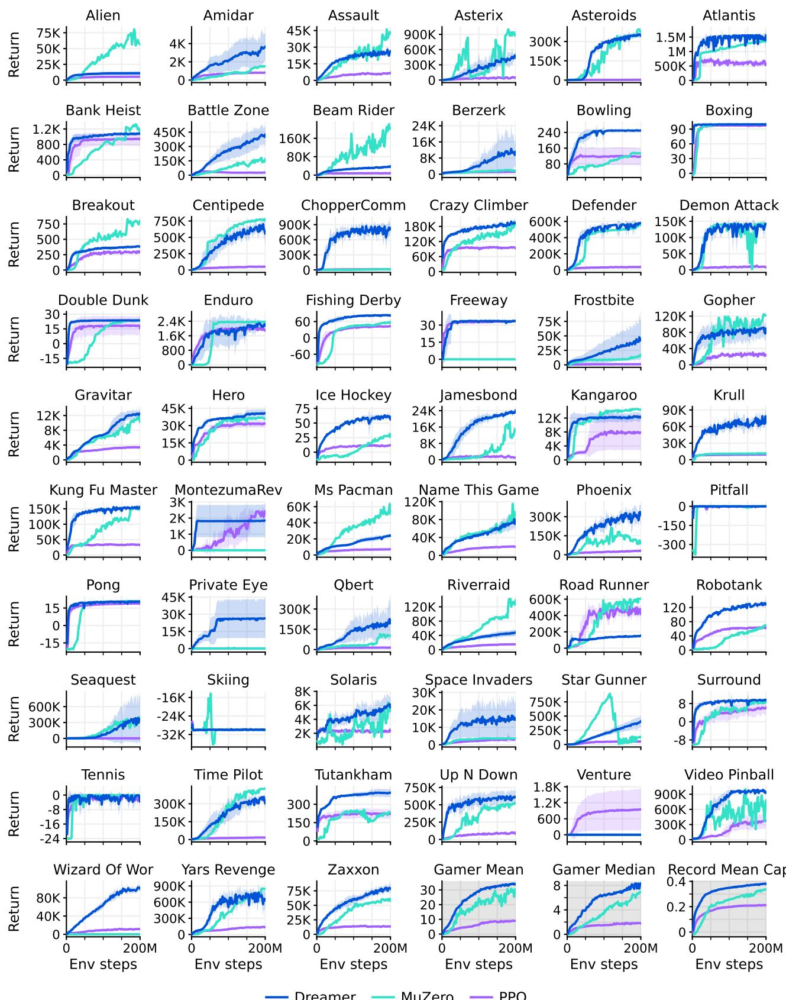  
Figure 10: Atari 学习曲线。

<table><tr><td>任务</td><td>Random</td><td>Gamer</td><td>Record</td><td>PPO</td><td>MuZero</td><td>Dreamer</td></tr><tr><td>环境步数</td><td>—</td><td>—</td><td>—</td><td>200M</td><td>200M</td><td>200M</td></tr><tr><td>Alien</td><td>228</td><td>7128</td><td>251916</td><td>5476</td><td>56835</td><td>10977</td></tr><tr><td>Amidar</td><td>6</td><td>1720</td><td>104159</td><td>817</td><td>1517</td><td>3612</td></tr><tr><td>Assault</td><td>222</td><td>742</td><td>8647</td><td>6673</td><td>42742</td><td>26010</td></tr><tr><td>Asterix</td><td>210</td><td>8503</td><td>1000000</td><td>47190</td><td>879375</td><td>441763</td></tr><tr><td>Asteroids</td><td>719</td><td>47389</td><td>10506650</td><td>2479</td><td>374146</td><td>348684</td></tr><tr><td>Atlantis</td><td>12850</td><td>29028</td><td>10604840</td><td>539721</td><td>1353617</td><td>1553222</td></tr><tr><td>Bank Heist</td><td>14</td><td>753</td><td>82058</td><td>946</td><td>1077</td><td>1083</td></tr><tr><td>Battle Zone</td><td>2360</td><td>37188</td><td>801000</td><td>27816</td><td>167412</td><td>419653</td></tr><tr><td>Beam Rider</td><td>364</td><td>16926</td><td>999999</td><td>7973</td><td>201154</td><td>37073</td></tr><tr><td>Berzerk</td><td>124</td><td>2630</td><td>1057940</td><td>1186</td><td>1698</td><td>10557</td></tr><tr><td>Bowling</td><td>23</td><td>161</td><td>300</td><td>118</td><td>133</td><td>250</td></tr><tr><td>Boxing</td><td>0</td><td>12</td><td>100</td><td>98</td><td>100</td><td>100</td></tr><tr><td>Breakout</td><td>2</td><td>30</td><td>864</td><td>299</td><td>799</td><td>384</td></tr><tr><td>Centipede</td><td>2091</td><td>12017</td><td>1301709</td><td>51833</td><td>774421</td><td>554553</td></tr><tr><td>Chopper Command</td><td>811</td><td>7388</td><td>999999</td><td>12667</td><td>8945</td><td>802698</td></tr><tr><td>Crazy Climber</td><td>10780</td><td>35829</td><td>219900</td><td>93176</td><td>184394</td><td>193204</td></tr><tr><td>Defender</td><td>2874</td><td>18689</td><td>6010500</td><td>38270</td><td>554492</td><td>579875</td></tr><tr><td>Demon Attack</td><td>152</td><td>1971</td><td>1556345</td><td>8229</td><td>142509</td><td>142109</td></tr><tr><td>Double Dunk</td><td>-19</td><td>-16</td><td>22</td><td>16</td><td>23</td><td>24</td></tr><tr><td>Enduro</td><td>0</td><td>860</td><td>9500</td><td>1887</td><td>2369</td><td>2166</td></tr><tr><td>Fishing Derby</td><td>-92</td><td>-39</td><td>71</td><td>43</td><td>58</td><td>82</td></tr><tr><td>Freeway</td><td>0</td><td>30</td><td>38</td><td>33</td><td>0</td><td>34</td></tr><tr><td>Frostbite</td><td>65</td><td>4335</td><td>454830</td><td>1123</td><td>17087</td><td>41888</td></tr><tr><td>Gopher</td><td>258</td><td>2412</td><td>355040</td><td>24792</td><td>122025</td><td>87600</td></tr><tr><td>Gravitar</td><td>173</td><td>3351</td><td>162850</td><td>3436</td><td>10301</td><td>12570</td></tr><tr><td>Hero</td><td>1027</td><td>30826</td><td>1000000</td><td>31967</td><td>36063</td><td>40677</td></tr><tr><td>Ice Hockey</td><td>-11</td><td>1</td><td>36</td><td>12</td><td>26</td><td>57</td></tr><tr><td>Jamesbond</td><td>29</td><td>303</td><td>45550</td><td>1019</td><td>14872</td><td>24010</td></tr><tr><td>Kangaroo</td><td>52</td><td>3035</td><td>1424600</td><td>7769</td><td>14380</td><td>12229</td></tr><tr><td>Krull</td><td>1598</td><td>2666</td><td>104100</td><td>9193</td><td>11476</td><td>69858</td></tr><tr><td>Kung Fu Master</td><td>258</td><td>22736</td><td>1000000</td><td>32335</td><td>148936</td><td>154893</td></tr><tr><td>Montezuma Revenge</td><td>0</td><td>4753</td><td>1219200</td><td>2368</td><td>0</td><td>1852</td></tr><tr><td>Ms Pacman</td><td>307</td><td>6952</td><td>290090</td><td>7041</td><td>51310</td><td>24079</td></tr><tr><td>Name This Game</td><td>2292</td><td>8049</td><td>25220</td><td>19441</td><td>85331</td><td>77809</td></tr><tr><td>Phoenix</td><td>761</td><td>7243</td><td>4014440</td><td>31412</td><td>105593</td><td>316606</td></tr><tr><td>Pitfall</td><td>-229</td><td>6464</td><td>114000</td><td>-2</td><td>0</td><td>0</td></tr><tr><td>Pong</td><td>-21</td><td>15</td><td>21</td><td>19</td><td>21</td><td>20</td></tr><tr><td>Private Eye</td><td>25</td><td>69571</td><td>101800</td><td>73</td><td>100</td><td>26432</td></tr><tr><td>Qbert</td><td>164</td><td>13455</td><td>2400000</td><td>14554</td><td>102129</td><td>201084</td></tr><tr><td>Riverraid</td><td>1338</td><td>17118</td><td>1000000</td><td>14860</td><td>137983</td><td>48080</td></tr><tr><td>Road Runner</td><td>12</td><td>7845</td><td>2038100</td><td>423995</td><td>604083</td><td>150402</td></tr><tr><td>Robotank</td><td>2</td><td>12</td><td>76</td><td>63</td><td>70</td><td>132</td></tr><tr><td>Seaquest</td><td>68</td><td>42055</td><td>999999</td><td>1927</td><td>399764</td><td>356584</td></tr><tr><td>Skiing</td><td>-17098</td><td>-4337</td><td>-3272</td><td>-29926</td><td>-30000</td><td>-29965</td></tr><tr><td>Solaris</td><td>1236</td><td>12327</td><td>111420</td><td>2368</td><td>5860</td><td>5851</td></tr><tr><td>Space Invaders</td><td>148</td><td>1669</td><td>621535</td><td>3489</td><td>3639</td><td>15005</td></tr><tr><td>Star Gunner</td><td>664</td><td>10250</td><td>77400</td><td>53439</td><td>127417</td><td>408961</td></tr><tr><td>Surround</td><td>-10</td><td>6</td><td>6</td><td>6</td><td>9</td><td>9</td></tr><tr><td>Tennis</td><td>-24</td><td>-8</td><td>21</td><td>-1</td><td>0</td><td>-3</td></tr><tr><td>Time Pilot</td><td>3568</td><td>5229</td><td>65300</td><td>17250</td><td>427209</td><td>314947</td></tr><tr><td>Tutankham</td><td>11</td><td>168</td><td>5384</td><td>225</td><td>235</td><td>395</td></tr><tr><td>Up N Down</td><td>533</td><td>11693</td><td>82840</td><td>83743</td><td>522962</td><td>614065</td></tr><tr><td>Venture</td><td>0</td><td>1188</td><td>38900</td><td>953</td><td>0</td><td>0</td></tr><tr><td>Video Pinball</td><td>16257</td><td>17668</td><td>89218328</td><td>382306</td><td>775304</td><td>940631</td></tr><tr><td>Wizard Of Wor</td><td>564</td><td>4756</td><td>395300</td><td>10910</td><td>0</td><td>99136</td></tr><tr><td>Yars Revenge</td><td>3093</td><td>54577</td><td>15000105</td><td>137164</td><td>846061</td><td>675774</td></tr><tr><td>Zaxxon</td><td>32</td><td>9173</td><td>83700</td><td>13599</td><td>58115</td><td>78443</td></tr><tr><td colspan="7"></td></tr><tr><td>人类玩家中位数 (%)</td><td>0</td><td>100</td><td>3716</td><td>180</td><td>693</td><td>830</td></tr><tr><td>人类玩家平均值 (%)</td><td>0</td><td>100</td><td>123001</td><td>892</td><td>3054</td><td>3381</td></tr><tr><td>纪录平均值 (%)</td><td>0</td><td>13</td><td>100</td><td>21</td><td>66</td><td>74</td></tr><tr><td>纪录截断平均值 (%)</td><td>0</td><td>13</td><td>100</td><td>21</td><td>34</td><td>38</td></tr></table>

Table 6: Atari 得分。

ProcGen 学习曲线  
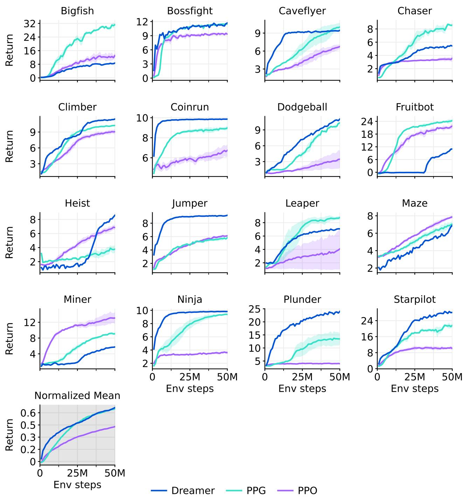  
Figure 11: ProcGen 学习曲线。

ProcGen 得分

<table><tr><td>任务</td><td>原始 PPO</td><td>PPO</td><td>PPG</td><td>Dreamer</td></tr><tr><td>环境步数</td><td>50M</td><td>50M</td><td>50M</td><td>50M</td></tr><tr><td>Bigfish</td><td>10.92</td><td>12.72</td><td>31.26</td><td>8.62</td></tr><tr><td>Bossfight</td><td>10.47</td><td>9.36</td><td>11.46</td><td>11.61</td></tr><tr><td>Caveflyer</td><td>6.03</td><td>6.71</td><td>10.02</td><td>9.42</td></tr><tr><td>Chaser</td><td>4.48</td><td>3.54</td><td>8.57</td><td>5.49</td></tr><tr><td>Climber</td><td>7.59</td><td>9.04</td><td>10.24</td><td>11.43</td></tr><tr><td>Coinrun</td><td>7.93</td><td>6.71</td><td>8.98</td><td>9.86</td></tr><tr><td>Dodgeball</td><td>4.80</td><td>3.44</td><td>10.31</td><td>10.93</td></tr><tr><td>Fruitbot</td><td>20.28</td><td>21.69</td><td>24.32</td><td>11.04</td></tr><tr><td>Heist</td><td>2.25</td><td>6.87</td><td>3.77</td><td>8.51</td></tr><tr><td>Jumper</td><td>5.09</td><td>6.13</td><td>5.84</td><td>9.17</td></tr><tr><td>Leaper</td><td>5.90</td><td>4.07</td><td>8.76</td><td>7.05</td></tr><tr><td>Maze</td><td>4.97</td><td>7.86</td><td>7.06</td><td>6.85</td></tr><tr><td>Miner</td><td>7.56</td><td>12.97</td><td>9.08</td><td>5.71</td></tr><tr><td>Ninja</td><td>6.16</td><td>3.62</td><td>9.38</td><td>9.82</td></tr><tr><td>Plunder</td><td>11.16</td><td>3.99</td><td>13.44</td><td>23.81</td></tr><tr><td>Starpilot</td><td>17.00</td><td>10.13</td><td>21.57</td><td>28.00</td></tr><tr><td>归一化均值</td><td>41.16</td><td>42.80</td><td>64.89</td><td>66.01</td></tr></table>

Table 7: ProcGen 得分。我们在整篇论文中使用的采用固定超参数的 PPO 实现，其表现与原始 PPO 相当或更好，而原始 PPO 的作者将其描述为经过高度调优且具有接近最优的超参数 $^{37}$。

## DMLab 学习曲线

  
Figure 12: DMLab 学习曲线。

## DMLab 得分

<table><tr><td>任务</td><td>R2D2+</td><td>IMPALA</td><td>IMPALA</td><td>IMPALA</td><td>PPO</td><td>Dreamer</td></tr><tr><td>环境步数</td><td>10B</td><td>10B</td><td>1B</td><td>100M</td><td>100M</td><td>100M</td></tr><tr><td>探索目标位置 大</td><td>174.7</td><td>316.0</td><td>137.8</td><td>64.2</td><td>21.2</td><td>116.7</td></tr><tr><td>探索目标位置 小</td><td>460.7</td><td>482.0</td><td>302.8</td><td>196.1</td><td>115.1</td><td>372.8</td></tr><tr><td>探索物体位置 大</td><td>60.6</td><td>91.0</td><td>55.1</td><td>34.3</td><td>22.5</td><td>63.9</td></tr><tr><td>探索物体位置 小</td><td>83.7</td><td>100.4</td><td>75.9</td><td>50.6</td><td>38.9</td><td>93.5</td></tr><tr><td>探索物体奖励 少</td><td>80.7</td><td>92.6</td><td>46.9</td><td>34.6</td><td>19.0</td><td>40.0</td></tr><tr><td>探索物体奖励 多</td><td>75.8</td><td>89.4</td><td>68.5</td><td>53.3</td><td>25.5</td><td>58.1</td></tr><tr><td>探索受阻目标 大</td><td>95.5</td><td>102.0</td><td>57.9</td><td>23.7</td><td>12.9</td><td>52.8</td></tr><tr><td>探索受阻目标 小</td><td>311.9</td><td>372.0</td><td>214.9</td><td>118.0</td><td>70.4</td><td>224.6</td></tr><tr><td>语言回答数量问题</td><td>344.4</td><td>362.0</td><td>304.7</td><td>1.0</td><td>0.3</td><td>266.0</td></tr><tr><td>语言执行随机任务</td><td>497.4</td><td>465.4</td><td>140.8</td><td>-44.4</td><td>-2.5</td><td>223.7</td></tr><tr><td>语言选择描述物体</td><td>617.6</td><td>664.0</td><td>618.4</td><td>0.2</td><td>526.9</td><td>665.5</td></tr><tr><td>语言选择定位物体</td><td>772.8</td><td>731.4</td><td>413.0</td><td>38.2</td><td>397.5</td><td>679.5</td></tr><tr><td>激光枪战 单对手 大</td><td>0.0</td><td>0.0</td><td>0.0</td><td>-0.1</td><td>0.0</td><td>-0.1</td></tr><tr><td>激光枪战 单对手 小</td><td>31.8</td><td>0.0</td><td>0.0</td><td>-0.1</td><td>0.0</td><td>0.0</td></tr><tr><td>激光枪战 三对手 大</td><td>28.6</td><td>32.2</td><td>10.4</td><td>-0.1</td><td>0.0</td><td>9.0</td></tr><tr><td>激光枪战 三对手 小</td><td>49.0</td><td>57.2</td><td>37.1</td><td>12.1</td><td>0.4</td><td>18.8</td></tr><tr><td>Natlab 固定大地图</td><td>60.6</td><td>63.4</td><td>53.8</td><td>13.0</td><td>15.8</td><td>50.5</td></tr><tr><td>Natlab 可变随机地图</td><td>42.4</td><td>47.0</td><td>40.5</td><td>35.3</td><td>29.6</td><td>31.2</td></tr><tr><td>Natlab 可变再生地图</td><td>24.6</td><td>34.0</td><td>25.5</td><td>15.3</td><td>16.3</td><td>16.7</td></tr><tr><td>Psychlab 任意视觉运动映射</td><td>33.1</td><td>38.4</td><td>16.5</td><td>11.9</td><td>16.0</td><td>30.7</td></tr><tr><td>Psychlab 连续识别</td><td>30.0</td><td>28.6</td><td>30.0</td><td>30.1</td><td>30.5</td><td>33.8</td></tr><tr><td>Psychlab 序列比较</td><td>30.0</td><td>29.6</td><td>0.0</td><td>0.0</td><td>30.0</td><td>44.3</td></tr><tr><td>Psychlab 视觉搜索</td><td>79.9</td><td>80.0</td><td>0.0</td><td>0.0</td><td>76.6</td><td>40.1</td></tr><tr><td>房间 收集优质物体测试</td><td>9.9</td><td>10.0</td><td>9.9</td><td>9.3</td><td>9.7</td><td>9.9</td></tr><tr><td>房间 利用延迟效果测试</td><td>38.1</td><td>62.2</td><td>37.6</td><td>34.5</td><td>39.0</td><td>40.4</td></tr><tr><td>房间 钥匙与门谜题</td><td>46.2</td><td>54.6</td><td>36.9</td><td>24.2</td><td>26.0</td><td>42.4</td></tr><tr><td>房间 选择非匹配物体</td><td>63.6</td><td>39.0</td><td>63.2</td><td>4.0</td><td>2.7</td><td>73.1</td></tr><tr><td>房间 水迷宫</td><td>49.0</td><td>47.0</td><td>50.1</td><td>23.6</td><td>21.2</td><td>26.1</td></tr><tr><td>空中迷宫 不可逆路径 困难</td><td>76.0</td><td>80.0</td><td>46.4</td><td>7.7</td><td>0.0</td><td>80.9</td></tr><tr><td>空中迷宫 不可逆路径 多样</td><td>76.0</td><td>100.0</td><td>69.8</td><td>32.7</td><td>31.3</td><td>87.7</td></tr><tr><td>人类截断均值 (%)</td><td>85.4</td><td>85.1</td><td>66.3</td><td>31.0</td><td>35.9</td><td>71.4</td></tr></table>

Table 8: DMLab 在 100M 环境步数及更大预算下的得分。IMPALA 智能体对应于 Kapturowski et al. $^{35}$ 提出的“IMPALA (deep)”，他们公开了其学习曲线。

Atari100k 学习曲线  
  
Figure 13: Atari100k 学习曲线。

## Atari100k 得分

<table><tr><td>任务</td><td>随机</td><td>人类</td><td>PPO</td><td>SimPLe</td><td>SPR</td><td>TWM</td><td>IRIS</td><td>Dreamer</td></tr><tr><td>环境步数</td><td>—</td><td>—</td><td>400K</td><td>400K</td><td>400K</td><td>400K</td><td>400K</td><td>400K</td></tr><tr><td>Alien</td><td>228</td><td>7128</td><td>276</td><td>617</td><td>842</td><td>675</td><td>420</td><td>1118</td></tr><tr><td>Amidar</td><td>6</td><td>1720</td><td>26</td><td>74</td><td>180</td><td>122</td><td>143</td><td>97</td></tr><tr><td>Assault</td><td>222</td><td>742</td><td>327</td><td>527</td><td>566</td><td>683</td><td>1524</td><td>683</td></tr><tr><td>Asterix</td><td>210</td><td>8503</td><td>292</td><td>1128</td><td>962</td><td>1117</td><td>854</td><td>1062</td></tr><tr><td>Bank Heist</td><td>14</td><td>753</td><td>14</td><td>34</td><td>345</td><td>467</td><td>53</td><td>398</td></tr><tr><td>Battle Zone</td><td>2360</td><td>37188</td><td>2233</td><td>4031</td><td>14834</td><td>5068</td><td>13074</td><td>20300</td></tr><tr><td>Boxing</td><td>0</td><td>12</td><td>3</td><td>8</td><td>36</td><td>78</td><td>70</td><td>82</td></tr><tr><td>Breakout</td><td>2</td><td>30</td><td>3</td><td>16</td><td>20</td><td>20</td><td>84</td><td>10</td></tr><tr><td>Chopper Command</td><td>811</td><td>7388</td><td>1005</td><td>979</td><td>946</td><td>1697</td><td>1565</td><td>2222</td></tr><tr><td>Crazy Climber</td><td>10780</td><td>35829</td><td>14675</td><td>62584</td><td>36700</td><td>71820</td><td>59324</td><td>86225</td></tr><tr><td>Demon Attack</td><td>152</td><td>1971</td><td>160</td><td>208</td><td>518</td><td>350</td><td>2034</td><td>577</td></tr><tr><td>Freeway</td><td>0</td><td>30</td><td>2</td><td>17</td><td>19</td><td>24</td><td>31</td><td>0</td></tr><tr><td>Frostbite</td><td>65</td><td>4335</td><td>127</td><td>237</td><td>1171</td><td>1476</td><td>259</td><td>3377</td></tr><tr><td>Gopher</td><td>258</td><td>2412</td><td>368</td><td>597</td><td>661</td><td>1675</td><td>2236</td><td>2160</td></tr><tr><td>Hero</td><td>1027</td><td>30826</td><td>2596</td><td>2657</td><td>5859</td><td>7254</td><td>7037</td><td>13354</td></tr><tr><td>Jamesbond</td><td>29</td><td>303</td><td>41</td><td>100</td><td>366</td><td>362</td><td>463</td><td>540</td></tr><tr><td>Kangaroo</td><td>52</td><td>3035</td><td>55</td><td>51</td><td>3617</td><td>1240</td><td>838</td><td>2643</td></tr><tr><td>Krull</td><td>1598</td><td>2666</td><td>3222</td><td>2205</td><td>3682</td><td>6349</td><td>6616</td><td>8171</td></tr><tr><td>Kung Fu Master</td><td>258</td><td>22736</td><td>2090</td><td>14862</td><td>14783</td><td>24555</td><td>21760</td><td>25900</td></tr><tr><td>Ms Pacman</td><td>307</td><td>6952</td><td>366</td><td>1480</td><td>1318</td><td>1588</td><td>999</td><td>1521</td></tr><tr><td>Pong</td><td>-21</td><td>15</td><td>-20</td><td>13</td><td>-5</td><td>19</td><td>15</td><td>-4</td></tr><tr><td>Private Eye</td><td>25</td><td>69571</td><td>100</td><td>35</td><td>86</td><td>87</td><td>100</td><td>3238</td></tr><tr><td>Qbert</td><td>164</td><td>13455</td><td>317</td><td>1289</td><td>866</td><td>3331</td><td>746</td><td>2921</td></tr><tr><td>Road Runner</td><td>12</td><td>7845</td><td>602</td><td>5641</td><td>12213</td><td>9109</td><td>9615</td><td>19230</td></tr><tr><td>Seaquest</td><td>68</td><td>42055</td><td>305</td><td>683</td><td>558</td><td>774</td><td>661</td><td>962</td></tr><tr><td>Up N Down</td><td>533</td><td>11693</td><td>1502</td><td>3350</td><td>10859</td><td>15982</td><td>3546</td><td>46910</td></tr><tr><td>玩家均值 (%)</td><td>0</td><td>100</td><td>11</td><td>33</td><td>62</td><td>96</td><td>105</td><td>125</td></tr><tr><td>玩家中位数 (%)</td><td>0</td><td>100</td><td>2</td><td>13</td><td>40</td><td>51</td><td>29</td><td>49</td></tr></table>

Table 9: 400K 环境步（对应 100k 智能体步）下的 Atari100k 得分。

<table><tr><td>设置</td><td>SimPLe</td><td>EffMuZero</td><td>SPR</td><td>IRIS</td><td>TWM</td><td>Dreamer</td></tr><tr><td>玩家得分 (%)</td><td>33</td><td>190</td><td>62</td><td>105</td><td>96</td><td>125</td></tr><tr><td>玩家中位数得分 (%)</td><td>13</td><td>109</td><td>40</td><td>29</td><td>51</td><td>49</td></tr><tr><td>GPU 天数</td><td>5.0</td><td>0.6</td><td>0.1</td><td>3.5</td><td>0.4</td><td>0.1</td></tr><tr><td>在线规划</td><td>—</td><td>X</td><td>—</td><td>—</td><td>—</td><td>—</td></tr><tr><td>数据增强</td><td>—</td><td>—</td><td>X</td><td>—</td><td>—</td><td>—</td></tr><tr><td>非均匀回放</td><td>—</td><td>X</td><td>X</td><td>—</td><td>X</td><td>—</td></tr><tr><td>独立超参数</td><td>—</td><td>—</td><td>—</td><td>X</td><td>—</td><td>—</td></tr><tr><td>提高分辨率</td><td>—</td><td>X</td><td>X</td><td>—</td><td>—</td><td>—</td></tr><tr><td>使用生命值信息</td><td>—</td><td>X</td><td>X</td><td>X</td><td>X</td><td>—</td></tr><tr><td>使用提前重置</td><td>—</td><td>X</td><td>—</td><td>X</td><td>—</td><td>—</td></tr><tr><td>独立评估回合</td><td>X</td><td>X</td><td>X</td><td>X</td><td>X</td><td>—</td></tr></table>

Table 10: Atari 100k 基准测试的评估协议。计算资源均换算为 A100 GPU 天数。EfficientMuZero $^{44}$ 取得了最高分，但改变了标准 $^{17}$ 环境配置。IRIS 在 Freeway 任务上使用了单独的超参数来控制其探索强度。

## 本体感受控制学习曲线

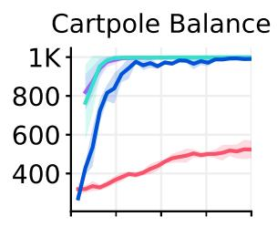

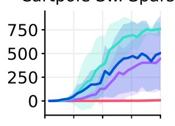

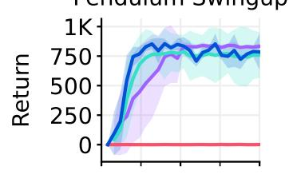

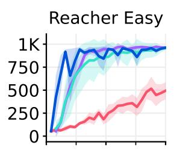

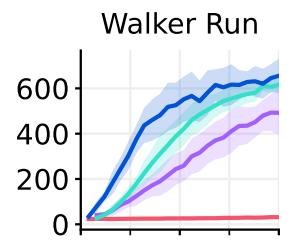

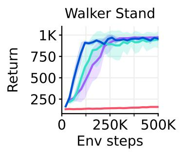

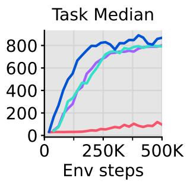  
Figure 14: 本体感觉输入下的 DeepMind Control Suite 学习曲线。

本体感觉控制得分

<table><tr><td>任务</td><td>PPO</td><td>DDPG</td><td>DMPO</td><td>D4PG</td><td>Dreamer</td></tr><tr><td>环境步数</td><td>500K</td><td>500K</td><td>500K</td><td>500K</td><td>500K</td></tr><tr><td>Acrobot Swingup</td><td>6</td><td>100</td><td>103</td><td>124</td><td>134</td></tr><tr><td>Ball In Cup Catch</td><td>632</td><td>917</td><td>968</td><td>968</td><td>962</td></tr><tr><td>Cartpole Balance</td><td>523</td><td>997</td><td>999</td><td>999</td><td>990</td></tr><tr><td>Cartpole Balance Sparse</td><td>930</td><td>992</td><td>999</td><td>974</td><td>990</td></tr><tr><td>Cartpole Swingup</td><td>240</td><td>864</td><td>860</td><td>875</td><td>852</td></tr><tr><td>Cartpole Swingup Sparse</td><td>7</td><td>703</td><td>438</td><td>752</td><td>491</td></tr><tr><td>Cheetah Run</td><td>82</td><td>596</td><td>650</td><td>624</td><td>614</td></tr><tr><td>Finger Spin</td><td>18</td><td>775</td><td>769</td><td>823</td><td>931</td></tr><tr><td>Finger Turn Easy</td><td>281</td><td>499</td><td>620</td><td>612</td><td>793</td></tr><tr><td>Finger Turn Hard</td><td>106</td><td>313</td><td>495</td><td>421</td><td>889</td></tr><tr><td>Hopper Hop</td><td>0</td><td>36</td><td>68</td><td>80</td><td>113</td></tr><tr><td>Hopper Stand</td><td>3</td><td>484</td><td>549</td><td>762</td><td>576</td></tr><tr><td>Pendulum Swingup</td><td>1</td><td>767</td><td>834</td><td>759</td><td>788</td></tr><tr><td>Reacher Easy</td><td>494</td><td>934</td><td>961</td><td>960</td><td>954</td></tr><tr><td>Reacher Hard</td><td>288</td><td>949</td><td>968</td><td>937</td><td>938</td></tr><tr><td>Walker Run</td><td>31</td><td>561</td><td>493</td><td>616</td><td>649</td></tr><tr><td>Walker Stand</td><td>159</td><td>965</td><td>975</td><td>947</td><td>964</td></tr><tr><td>Walker Walk</td><td>64</td><td>952</td><td>942</td><td>969</td><td>936</td></tr><tr><td>任务均值</td><td>94</td><td>771</td><td>801</td><td>792</td><td>871</td></tr><tr><td>任务中位数</td><td>215</td><td>689</td><td>705</td><td>733</td><td>754</td></tr></table>

Table 11: 本体感觉输入下的 DeepMind Control Suite 得分。

视觉控制学习曲线  
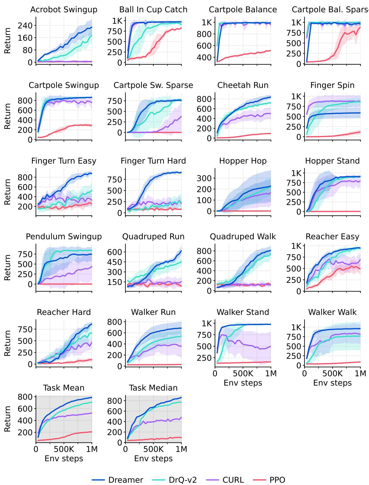  
Figure 15: 视觉输入下的 DeepMind Control Suite 学习曲线。

## 视觉控制得分

<table><tr><td>任务</td><td>PPO</td><td>SAC</td><td>CURL</td><td>DrQ-v2</td><td>Dreamer</td></tr><tr><td>环境步数</td><td>1M</td><td>1M</td><td>1M</td><td>1M</td><td>1M</td></tr><tr><td>Acrobot Swingup</td><td>3</td><td>4</td><td>4</td><td>166</td><td>229</td></tr><tr><td>Ball In Cup Catch</td><td>829</td><td>176</td><td>970</td><td>928</td><td>972</td></tr><tr><td>Cartpole Balance</td><td>516</td><td>937</td><td>980</td><td>992</td><td>993</td></tr><tr><td>Cartpole Balance Sparse</td><td>881</td><td>956</td><td>999</td><td>987</td><td>964</td></tr><tr><td>Cartpole Swingup</td><td>290</td><td>706</td><td>771</td><td>863</td><td>861</td></tr><tr><td>Cartpole Swingup Sparse</td><td>1</td><td>149</td><td>373</td><td>773</td><td>759</td></tr><tr><td>Cheetah Run</td><td>95</td><td>20</td><td>502</td><td>716</td><td>836</td></tr><tr><td>Finger Spin</td><td>118</td><td>291</td><td>880</td><td>862</td><td>589</td></tr><tr><td>Finger Turn Easy</td><td>253</td><td>200</td><td>340</td><td>525</td><td>878</td></tr><tr><td>Finger Turn Hard</td><td>79</td><td>94</td><td>231</td><td>247</td><td>904</td></tr><tr><td>Hopper Hop</td><td>0</td><td>0</td><td>164</td><td>221</td><td>227</td></tr><tr><td>Hopper Stand</td><td>4</td><td>5</td><td>777</td><td>903</td><td>903</td></tr><tr><td>Pendulum Swingup</td><td>1</td><td>592</td><td>413</td><td>843</td><td>744</td></tr><tr><td>Quadruped Run</td><td>88</td><td>54</td><td>149</td><td>450</td><td>617</td></tr><tr><td>Quadruped Walk</td><td>112</td><td>49</td><td>121</td><td>726</td><td>811</td></tr><tr><td>Reacher Easy</td><td>487</td><td>67</td><td>689</td><td>944</td><td>951</td></tr><tr><td>Reacher Hard</td><td>94</td><td>7</td><td>472</td><td>670</td><td>862</td></tr><tr><td>Walker Run</td><td>30</td><td>27</td><td>360</td><td>539</td><td>684</td></tr><tr><td>Walker Stand</td><td>161</td><td>143</td><td>486</td><td>978</td><td>976</td></tr><tr><td>Walker Walk</td><td>87</td><td>40</td><td>822</td><td>768</td><td>961</td></tr><tr><td>任务均值</td><td>94</td><td>81</td><td>479</td><td>770</td><td>861</td></tr><tr><td>任务中位数</td><td>206</td><td>226</td><td>525</td><td>705</td><td>786</td></tr></table>

Table 12: 视觉输入下的 DeepMind Control Suite 得分。

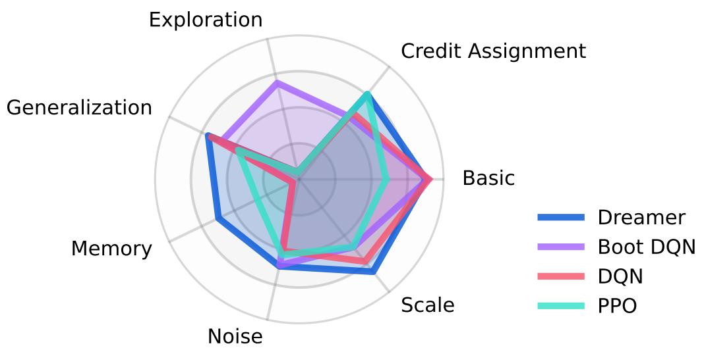  
Figure 16: 按类别可视化的 BSuite 得分 $^{48}$。Dreamer 在尺度（scale）和记忆（memory）类别上超越了以往的方法。尺度类别用于衡量对奖励尺度的鲁棒性。

<table><tr><td>任务</td><td>Random</td><td>PPO</td><td>AC-RNN</td><td>DQN</td><td>Boot DQN</td><td>Dreamer</td></tr><tr><td>Bandit</td><td>0.00</td><td>0.38</td><td>1.00</td><td>0.93</td><td>0.98</td><td>0.96</td></tr><tr><td>Bandit Noise</td><td>0.00</td><td>0.61</td><td>0.63</td><td>0.71</td><td>0.80</td><td>0.75</td></tr><tr><td>Bandit Scale</td><td>0.00</td><td>0.39</td><td>0.60</td><td>0.74</td><td>0.83</td><td>0.78</td></tr><tr><td>Cartpole</td><td>0.04</td><td>0.84</td><td>0.40</td><td>0.85</td><td>0.69</td><td>0.93</td></tr><tr><td>Cartpole Noise</td><td>0.04</td><td>0.77</td><td>0.20</td><td>0.82</td><td>0.69</td><td>0.93</td></tr><tr><td>Cartpole Scale</td><td>0.04</td><td>0.83</td><td>0.12</td><td>0.72</td><td>0.65</td><td>0.92</td></tr><tr><td>Cartpole Swingup</td><td>0.00</td><td>0.00</td><td>0.00</td><td>0.00</td><td>0.15</td><td>0.03</td></tr><tr><td>Catch</td><td>0.00</td><td>0.91</td><td>0.87</td><td>0.92</td><td>0.99</td><td>0.96</td></tr><tr><td>Catch Noise</td><td>0.00</td><td>0.54</td><td>0.27</td><td>0.58</td><td>0.68</td><td>0.53</td></tr><tr><td>Catch Scale</td><td>0.00</td><td>0.90</td><td>0.17</td><td>0.85</td><td>0.65</td><td>0.94</td></tr><tr><td>Deep Sea</td><td>0.00</td><td>0.00</td><td>0.00</td><td>0.00</td><td>1.00</td><td>0.00</td></tr><tr><td>Deep Sea Stochastic</td><td>0.00</td><td>0.00</td><td>0.00</td><td>0.00</td><td>0.90</td><td>0.00</td></tr><tr><td>Discounting Chain</td><td>0.20</td><td>0.24</td><td>0.39</td><td>0.25</td><td>0.22</td><td>0.40</td></tr><tr><td>Memory Len</td><td>0.00</td><td>0.17</td><td>0.70</td><td>0.04</td><td>0.04</td><td>0.65</td></tr><tr><td>Memory Size</td><td>0.00</td><td>0.47</td><td>0.29</td><td>0.00</td><td>0.00</td><td>0.59</td></tr><tr><td>Mnist</td><td>0.05</td><td>0.77</td><td>0.56</td><td>0.85</td><td>0.85</td><td>0.61</td></tr><tr><td>Mnist Noise</td><td>0.05</td><td>0.41</td><td>0.22</td><td>0.38</td><td>0.34</td><td>0.34</td></tr><tr><td>Mnist Scale</td><td>0.05</td><td>0.76</td><td>0.09</td><td>0.49</td><td>0.31</td><td>0.55</td></tr><tr><td>Mountain Car</td><td>0.10</td><td>0.10</td><td>0.10</td><td>0.93</td><td>0.93</td><td>0.92</td></tr><tr><td>Mountain Car Noise</td><td>0.10</td><td>0.10</td><td>0.10</td><td>0.89</td><td>0.82</td><td>0.87</td></tr><tr><td>Mountain Car Scale</td><td>0.10</td><td>0.10</td><td>0.10</td><td>0.85</td><td>0.56</td><td>0.90</td></tr><tr><td>Umbrella Distract</td><td>0.00</td><td>1.00</td><td>0.09</td><td>0.30</td><td>0.26</td><td>0.74</td></tr><tr><td>Umbrella Length</td><td>0.00</td><td>0.87</td><td>0.43</td><td>0.39</td><td>0.39</td><td>0.78</td></tr><tr><td>基础（Basic）</td><td>0.04</td><td>0.60</td><td>0.58</td><td>0.90</td><td>0.89</td><td>0.88</td></tr><tr><td>信用分配（Credit assignment）</td><td>0.03</td><td>0.76</td><td>0.37</td><td>0.59</td><td>0.56</td><td>0.75</td></tr><tr><td>探索（Exploration）</td><td>0.00</td><td>0.00</td><td>0.00</td><td>0.00</td><td>0.68</td><td>0.01</td></tr><tr><td>泛化（Generalization）</td><td>0.06</td><td>0.47</td><td>0.19</td><td>0.68</td><td>0.60</td><td>0.70</td></tr><tr><td>记忆（Memory）</td><td>0.00</td><td>0.32</td><td>0.49</td><td>0.02</td><td>0.02</td><td>0.62</td></tr><tr><td>噪声（Noise）</td><td>0.02</td><td>0.54</td><td>0.24</td><td>0.51</td><td>0.61</td><td>0.62</td></tr><tr><td>尺度（Scale）</td><td>0.04</td><td>0.60</td><td>0.22</td><td>0.73</td><td>0.60</td><td>0.82</td></tr><tr><td>任务均值 (%)</td><td>3</td><td>49</td><td>32</td><td>54</td><td>60</td><td>66</td></tr><tr><td>类别均值 (%)</td><td>3</td><td>47</td><td>30</td><td>49</td><td>57</td><td>63</td></tr></table>

Table 13: 在各环境配置下取平均后的每个任务的 BSuite 得分，以及按类别和所有任务聚合的性能。

鲁棒性消融实验

  
Figure 17: 鲁棒性消融实验的各个独立学习曲线。所有鲁棒性技术都有助于 Dreamer 的整体性能，尽管每种单独的技术可能仅提高任务子集上的性能。

## 学习信号消融实验

  
Figure 18: 学习信号消融实验的各个独立学习曲线。Dreamer 主要依赖其世界模型的欠监督重构目标，额外的奖励和价值梯度进一步提高了任务子集上的性能。