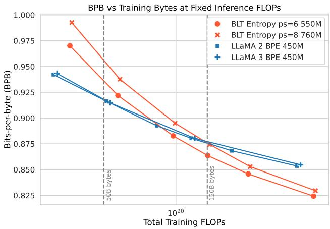
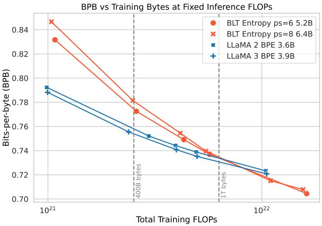
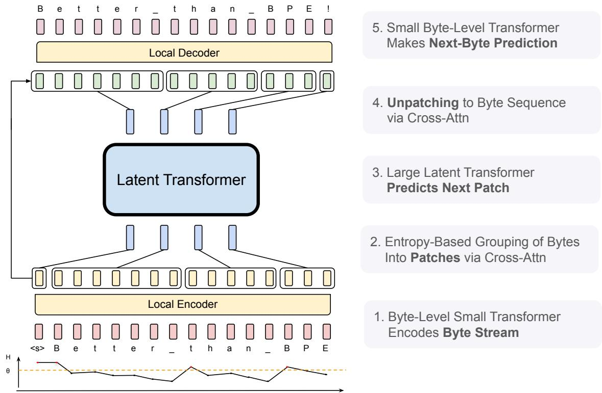
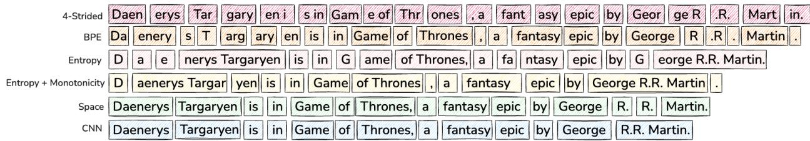
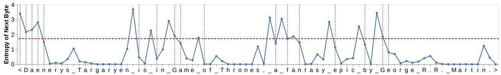
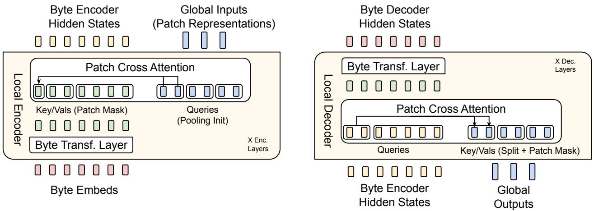
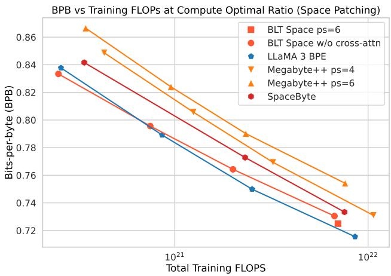
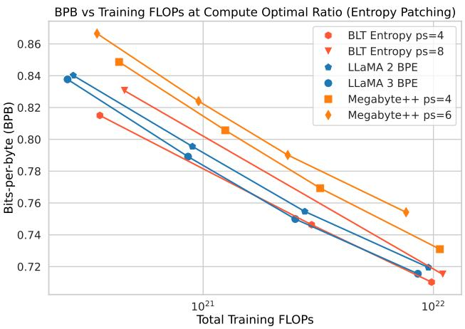
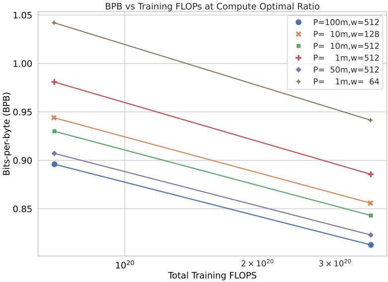
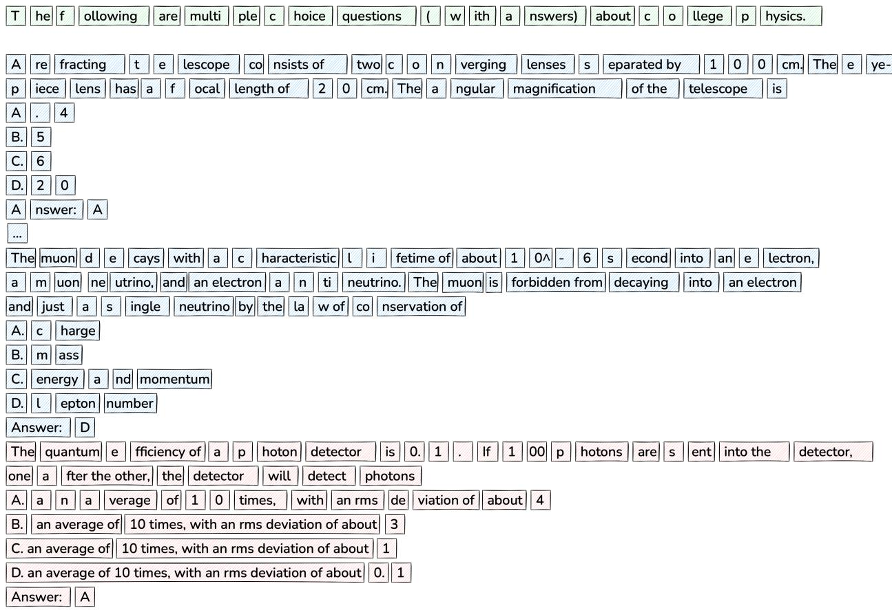

# Byte Latent Transformer：Patch 比 Token 具有更好的扩展性

Artidoro Pagnoni, Ram Pasunuru‡, Pedro Rodriguez‡, John Nguyen‡, Benjamin Muller, Margaret Li1,⋄, Chunting Zhou⋄, Lili Yu, Jason Weston, Luke Zettlemoyer, Gargi Ghosh, Mike Lewis, Ari Holtzman†,2,⋄, Srinivasan Iyer†

FAIR at Meta, 1Paul G. Allen School of Computer Science & Engineering, University of Washington, 2University of Chicago

‡共同第二作者，†共同通讯/末位作者，⋄在 Meta 完成的工作

我们提出了 Byte Latent Transformer（BLT），这是一种新型的字节级大语言模型（LLM）架构。该架构首次在大规模训练下达到了基于分词（tokenization）的 LLM 的性能，同时在推理效率和鲁棒性方面取得了显著提升。BLT 将字节编码为动态大小的 Patch（数据块），并将其作为主要的计算单元。Patch 的切分基于下一个字节的熵，从而在数据复杂度更高的位置分配更多的计算量和模型容量。我们首次针对参数量高达 8B、训练数据达 4T 字节的字节级模型进行了受控 FLOPs 的扩展规律研究（scaling study）。实验结果证明了在无需固定词表的情况下，对基于原始字节训练的模型进行规模扩展的可行性。得益于在数据可预测时动态选择较长的 Patch，模型的训练和推理效率均得到了提升，同时在推理能力与长尾泛化方面也获得了质的改善。总体而言，在固定的推理成本下，BLT 通过同时增大 Patch 大小和模型规模，展现出显著优于基于分词的模型的扩展特性。

日期：2024 年 12 月 16 日 通讯：artidoro at cs.washington.edu, sviyer at meta.com 代码：https://github.com/facebookresearch/blt

∞Meta

## 1 引言

我们提出了 Byte Latent Transformer（BLT），这是一种无需分词器（tokenizer-free）的架构，它直接从原始字节数据中学习，并首次在大规模训练下达到了基于分词的模型的性能，同时在效率和鲁棒性方面取得了显著提升（§6）。现有的大语言模型（LLM）几乎完全是端到端训练的，但分词除外——这是一个启发式的预处理步骤，用于将字节分组为静态的 Token 集合。这种 Token 会对字符串的压缩方式引入偏差，从而导致诸多缺陷，例如领域/模态敏感性（Dagan et al., 2024）、对输入噪声敏感（§6）、缺乏正字法知识（Edman et al., 2024）以及多语言不平等问题（Liang et al., 2023; Petrov et al., 2024; Limisiewicz et al., 2024）。

分词（Tokenization）此前一直是必不可少的，因为由于序列长度过长，直接在字节级别上进行大规模 LLM（大语言模型）训练的成本极其高昂（Xue et al., 2022）。先前的工作通过采用更高效的自注意力机制（El Boukkouri et al., 2020; Clark et al., 2022）或无注意力架构（Wang et al., 2024）（§8）来缓解这一问题。然而，这主要有助于小型模型的训练。在规模化时，Transformer 的计算成本主要由运行在每个字节上的大型前馈网络层主导，而非注意力机制的成本。

为了高效分配计算资源，我们提出了一种将字节动态且可学习地分组为 patch（分块）的方法（§2），以及一种混合字节与 patch 信息的新型模型架构。与分词不同，BLT 没有固定的 patch 词表。任意字节组都通过轻量级的可学习编码器和解码器模块映射为潜在 patch 表示。我们表明，相比基于分词的模型，这种方法能够更高效地分配计算资源。

基于分词的 LLM 为每个 token 分配相同数量的计算量。这牺牲了效率来换取性能，因为 token 是通过压缩启发式规则诱导生成的，而这些规则并不总是与预测的复杂度相关。我们架构的核心思想是：模型应该在需要的地方动态分配计算资源。例如，预测大多数词的结尾并不需要大型 Transformer，因为与选择新句子的首词相比，这些是相对容易、低熵的决策。这体现在 BLT 的架构（§3）中，该架构包含三个 Transformer 模块：两个小型字节级局部模型和一个大型全局潜在 Transformer（Figure 2）。为了确定如何将字节分组为 patch 进而动态分配计算量，BLT 根据下一个字节预测的熵对数据进行分割，从而创建出信息密度相对均匀的上下文化字节分组。

  
Figure 1 在不同训练预算下（充分）训练的固定推理 FLOP 模型的扩展趋势。在基于 token 的模型中，固定的推理预算决定了模型大小。相比之下，BLT 架构提供了一个新的扩展维度，允许在保持相同训练和推理预算的同时，同步增加模型大小和 patch 大小。BLT patch 大小（ps）为 6 和 8 的模型迅速超越了采用 BPE 的 Llama 2 和 3 的扩展趋势。转向更大的推理预算使得更大的 patch 大小 8 模型更早展现出优势。BPE 计算最优解点和交叉点均用垂直线标出。

我们展示了首个针对参数规模达 8B 且训练数据达 4T 字节的字节级模型在受控 FLOPs 下的扩展性研究，证明了我们可以在不使用固定词表分词的情况下，端到端地对字节级模型进行大规模训练。总体而言，BLT 在训练 FLOPs 受控的条件下达到了与 Llama 3 相当的性能1，同时在推理时最多可减少 50% 的 FLOPs（§5）。我们还表明，直接处理原始字节在对数据长尾部分进行建模时能带来显著提升。在面对噪声输入时，BLT 模型比基于分词器的模型更加稳健，并在正字法知识、音系学以及低资源机器翻译任务中展现出了更强的字符级理解能力（§6）。最后，借助 BLT 模型，我们可以在保持相同推理 FLOPs 预算的同时，同步增加模型大小和分块大小（patch size）。平均而言，更长的分块大小节省了计算量，由于全局潜变量 Transformer（global latent transformer）的运行频次降低，这些节省下来的计算量可被重新分配以扩大其规模。我们进行了受控推理 FLOPs 的扩展实验（Figure 1），并观察到了显著优于基于分词架构的扩展趋势。

综上所述，本文做出以下贡献：1) 我们提出了 BLT，一种能够动态分配计算量以提高 FLOPs 效率的字节潜变量大语言模型（byte latent LLM）架构；2) 我们证明了在高达 8B 规模下，其在训练 FLOPs 受控的条件下能达到与 Llama 3 相当的性能，同时可以选择以评估指标的微小损失为代价，换取高达 50% 的 FLOPs 效率提升；3) BLT 模型开辟了扩展 LLM 的新维度，使得模型大小可以在保持固定推理预算的同时进行扩展；4) 我们证明了 BLT 模型对输入噪声具有更强的鲁棒性，并且能够感知基于 token 的 LLM 所忽略的输入数据子词（sub-word）层面特征。我们在 https://github.com/facebookresearch/blt 开源了 BLT 的训练和推理代码。

## 2 分块：从单个字节到字节组

将字节分割为 patch 使 BLT 能够根据上下文动态分配计算。Figure 3 展示了将字节分割为 patch 的几种不同方法。形式化地，分块函数（patching function）$f _ { p }$ 通过将每个 $x _ { i }$ 映射到集合 {0,1}（其中 1 表示新 patch 的起始），将长度为 n 的字节序列 $\pmb { x } = \{ x _ { i } , | i = 1 , \dots n \}$ 分割为 $m < n$ 个 patch 的序列 $\pmb { p } = \{ p _ { j } | j = 1 , \dots , m \}$。对于基于 token 和基于 patch 的模型，处理数据的计算成本主要由主 Transformer 执行的步数决定。在 BLT 中，这就是在给定分块函数下对数据进行编码所需的 patch 数量。因此，patch 的平均大小（或简称为 patch 大小）是在给定分块函数下决定训练和推理期间数据处理成本的主要因素（§4.5）。接下来，我们将介绍三种分块函数：每个 patch 具有固定字节数的分块（§2.1）、空格分块（§2.2），以及利用小型字节 lm 的熵进行动态分块（§2.3）。最后，我们讨论增量分块以及分词（tokenization）与分块的区别（§2.4）。

  
Figure 2 BLT 包含三个模块：一个用于将输入字节编码为 patch 表示的轻量级局部编码器（Local Encoder）、一个在 patch 表示上运行且计算开销较大的潜空间 Transformer（Latent Transformer），以及一个用于解码下一个字节 patch 的轻量级局部解码器（Local Decoder）。BLT 结合了字节 n-gram 嵌入和交叉注意力机制，以最大化潜空间 Transformer 与字节级模块之间的信息流（Figure 5）。与固定词表的分词不同，BLT 动态地将字节组合成 patch，同时保留了对字节级信息的访问能力。

## 2.1 每 K 个字节的跨步分块

将字节分组或许最直接的方法是像 MegaByte（Yu et al., 2023）那样将其划分为固定大小 k 的 patch。固定的步长在训练和推理时易于实现，为改变平均 patch 大小提供了直接的机制，因此便于控制 FLOP 成本。然而，这种分块函数存在显著的缺点。首先，计算资源无法动态分配给最需要的地方：如果仅仅是在预测代码中的空格，可能会浪费一个 Transformer 步骤 j；或者对包含高信息密度的字节（例如数学内容）分配的计算量不足。其次，这会导致相似字节序列的分块不一致且脱离上下文，例如同一个单词可能被以不同方式切分。

Figure 3 Patching 方案以不同方式对字节进行分组，每种方式都会产生不同数量的 patch。由于每个 patch 均由一个大型 Transformer 步处理，因此 patch 的数量直接决定了以 FLOPs 计的大部分计算开销。这些方案对字节进行分块的方式包括：(a) 如 MegaByte (Yu et al., 2023) 那样每四个字节步进一次（§2.1）；(b) 使用字节对编码（Byte-Pair Encoding, BPE）进行分词，此处为 Llama-3 (Dubey et al., 2024) 分词器；(c 与 d) 如本研究所述基于熵的 patching（§2.3）；(e) 基于空格字节的 patching (Slagle, 2024)；(f) 以及使用具有 2 字节上下文的小型 CNN 字节级模型基于熵进行 patching。  
  
Figure 4 该图绘制了“Daenerys Targeryen is in Game of Thrones, a fantasy epic by George R.R. Martin.”中每个字节的熵 $H ( x _ { i } )$，其中空格显示为下划线。当 $H ( x _ { i } )$ 超过全局阈值 $\theta _ { g } ,$（显示为红色水平线）时，patch 结束。新 patch 的起始位置用灰色竖线表示。例如，“George R.R. Martin”中的 ${ } ^ { 6 6 } \mathrm { C } ^ { 9 9 }$ 和 $^ { 6 } \mathrm { e } ^ { 9 }$ 的熵超过了 $\theta _ { g } ,$，因此 ${ } ^ { 6 6 } \mathrm { G } ^ { 9 9 }$ 是一个单字节 patch 的开始，而 $^ { 6 } \mathrm { e } ^ { 9 }$ 是一个延伸至该命名实体末尾的更大 patch 的开始，因为其熵 $H ( x _ { i } )$ 保持较低水平，从而不会产生额外的 patch。

## 2.2 空格分块（Space Patching）

Slagle (2024) 提出了一种针对步进分块（strided patching）的简单而有效的改进方案，该方案在任何类空格字节2之后创建新的 patch，在许多语言中这些字节是语言单位的自然边界。在空格分块中，每个词都被分配一个潜在的 Transformer 步（即更多的 FLOPs）来进行建模。这确保了单词在不同序列中以相同的方式进行分块，并将 FLOPs 分配给通常紧随空格之后的较难预测部分。例如，预测问题“Who composed the Magic Flute $? _ { - } "$ 答案的第一个字节，要比在出现“M”之后预测剩余字节困难得多，因为首字符大幅减少了可能的选择数量，使得补全“Mozart”的预测变得相对容易。然而，空格分块无法良好地应对所有语言和领域，最重要的是无法改变 patch 大小。接下来，我们介绍一种新的分块方法，它借鉴了“词的首字节通常最难预测”这一见解，同时提供了一种控制 patch 大小的自然机制。

## 2.3 熵分块（Entropy Patching）：利用小型字节 LM 的下一字节熵

我们没有依赖像空白符这样的基于规则的启发式方法，而是采用数据驱动的方法来识别具有高不确定性的下一字节预测。我们引入了熵分块（entropy patching），它利用熵估计来获取 patch 边界。

我们在 BLT 的训练数据上训练了一个小型字节级自回归语言模型（auto-regressive language model），并在字节词表 V 上根据该 LM 的分布 $p _ { e }$ 计算下一个字节的熵：

$$
H (x _ {i}) = \sum_ {v \in \mathcal {V}} p _ {e} (x _ {i} = v | \pmb {x} _ {<   i}) \log p _ {e} (x _ {i} = v | \pmb {x} _ {<   i})\tag{1}
$$

我们尝试了两种在给定熵 $H ( x _ { i } )$ 的情况下识别补丁边界（patch boundaries）的方法。第一种方法是寻找高于全局熵阈值的点，如图 4 所示。第二种方法是识别相对于前一个熵值较高的点。第二种方法也可以解释为识别打破补丁内近似单调递减熵的点。

$$
\begin{array}{c c} \text {Global Constraint} & H (x _ {t}) > \theta_ {g} \\ \text {Approx. Monotonic Constraint} & H (x _ {t}) - H (x _ {t - 1}) > \theta_ {r} \end{array}
$$

补丁边界是在数据加载过程中执行的一个轻量级预处理步骤中识别的。这与 Nawrot et al. (2023) 不同，后者训练了一个分类器来预测基于熵的补丁边界。在我们的实验（§4）中，我们比较了这两种区分低熵和高熵字节的方法。

## 2.4 字节对编码（BPE）分词器与增量补丁

许多现代 LLM（包括我们的基线 Llama 3）都使用类似 BPE（Byte-Pair Encoding）的子词分词器（Gage, 1994; Sennrich et al., 2016）。我们使用“token”指代从训练前确定的有限词表中提取的字节组，而“patch（补丁）”则指没有固定词表的动态分组序列。补丁与 token 之间的一个关键区别在于，使用 token 时，模型无法直接访问底层的字节特征。

BLT 相比基于分词的模型的一个关键改进在于，它重新定义了词表大小与计算量之间的权衡。在标准 LLM 中，增大词表大小意味着平均 token 更大，因而模型的步数更少，但模型最终投影层的输出维度也会更大。这种权衡实际上使得基于分词的方法几乎没有空间在 token 大小和推理成本上实现显著的变化。例如，与 Llama 2 相比，Llama 3 将平均 token 大小从 3.7 字节增加到了 4.4 字节，其代价是将嵌入表的大小增加了 4 倍。

在生成时，BLT 需要确定字节序列中的当前步是否处于补丁边界，因为这决定了是否要通过 Latent Transformer 调用更多的计算。该决策必须独立于尚未生成的序列其余部分来进行。因此，补丁划分不能假设能够访问未来的字节来选择如何分割字节序列。形式上，如果一个补丁方案 $f _ { p }$ 满足以下条件，则它满足增量补丁（incremental patching）的性质：

$$
f _ {p} (\pmb {x} _ {<   i}) = f _ {p} (\pmb {x}) _ {<   i}
$$

BPE 并非一种增量式 patch 划分方案（incremental patching scheme），因为相同的前缀可能会根据后续序列被切分为不同的 token，因此不满足上述性质3。

## 3 BLT 架构

BLT 由一个在 patch 表示上运行的大型全局自回归语言模型，以及两个较小的局部模型组成，这两个局部模型分别将字节序列编码为 patch 并将 patch 表示解码回字节（Figure 2）。

## 3.1 隐式全局 Transformer 模型

隐式全局 Transformer 是一个具有 $l _ { \mathcal { G } }$ 层的自回归 Transformer 模型 G，它将隐式输入 patch 表示序列 $p _ { j }$ 映射为输出 patch 表示序列 $o _ { j }$。在整篇论文中，我们使用下标 j 表示 patch，使用下标 i 表示字节。该全局模型采用块因果注意力掩码（Dubey et al., 2024），该掩码将注意力限制在当前文档内直至并包括当前 patch 的范围内。该模型在预训练以及推理期间消耗了绝大部分 FLOPs，因此，选择何时调用它使我们能够根据输入/输出的复杂度，控制并改变在输入和输出的不同部分上所消耗的计算量。

## 3.2 局部编码器

局部编码器模型（记为 E）是一个具有 $l \varepsilon < < l \varsigma$ 层的轻量级基于 Transformer 的模型，其主要作用是高效地将输入字节序列 $b _ { i }$ 映射为具有表现力的 patch 表示 $p _ { j } . \mathrm { ~ A ~ }$ 与 Transformer 架构的主要区别在于每个 Transformer 层之后添加了一个交叉注意力层，其功能是将字节表示池化为 patch 表示（Figure 5）。首先，输入的字节序列 $b _ { i }$ 使用 $\mathbb { R } ^ { 2 5 6 \times h \varepsilon }$ 矩阵进行嵌入，记为 $x _ { i } .$ 然后，这些嵌入可以选择性地以哈希嵌入（hash-embeddings）（§3.2.1）的形式补充额外信息。随后，一系列交替的 Transformer 层和交叉注意力层（§3.2.2）将这些表示转换为 patch 表示 $p _ { i }$，并由全局 Transformer ${ \mathcal { G } } .$ 进行处理。Transformer 层使用局部块因果注意力掩码；每个字节关注其前 wE 个字节的固定窗口，该窗口通常可以跨越动态 patch 边界，但不能跨越文档边界。以下小节将详细描述嵌入和交叉注意力模块。

## 3.2.1 编码器哈希 n-gram 嵌入

在每一步 i 创建鲁棒且具有表现力的表示的一个关键组成部分是融入关于前序字节的信息。在 BLT 中，我们通过将字节 $b _ { i }$ 单独建模以及作为字节 n-gram 的一部分进行建模来实现这一点。对于每一步 i，我们首先构建字节元（byte-grams）

$$
g _ {i, n} = \{b _ {i - n + 1}, \dots , b _ {i} \}\tag{2}
$$

对于每个字节位置 $i$ 以及从 3 到 8 的 $n$。4

然后，我们引入哈希 n-gram 嵌入（hash n-gram embeddings），对于每个尺寸 $n \in \{ 3 , 4 , 5 , 6 , 7 , 8 \}$（Bai et al., 2010），通过哈希函数将所有字节 n-gram 映射到一个固定大小的嵌入表 $E _ { n } ^ { h a s h }$ 中的索引。随后，将生成的嵌入添加到该字节的嵌入中，经过归一化后作为输入传递给局部编码器模型。我们计算增强后的嵌入

$$
e _ {i} = x _ {i} + \sum_ {n = 3, \dots , 8} E _ {n} ^ {\text {hash}} (\operatorname{Hash} (g _ {i, n}))\tag{3}
$$

$$
\mathrm{where,} \mathrm{Hash} (g _ {i, n}) = \mathrm{RollPolyHash} (g _ {i, n}) \% | E _ {n} ^ {h a s h} |\tag{4}
$$

我们通过 n-gram 尺寸的数量加一来对 $e _ { i }$ 进行归一化，并使用附录 C 中定义的 RollPolyHash。在 Section $^ { 7 , }$ 中，我们消融实验了不同 $n$ 值和嵌入表大小的 n-gram 哈希嵌入对 FLOP 受控的缩放定律（scaling law）趋势的影响。除了哈希 n-gram 嵌入外，我们还尝试了基于频率的 n-gram 嵌入，并在附录 D 中提供了该探索的详细信息。

## 3.2.2 编码器多头交叉注意力

我们紧密遵循 Perceiver 架构（Jaegle et al., 2021）的输入交叉注意力模块，主要区别在于潜在表示对应于可变 patch 表示，而不是一组固定的潜在表示（Figure 5），并且仅关注构成相应 patch 的字节。该模块包含一个对应于每个 patch $p _ { j }$ 的查询向量，该向量通过池化对应于 patch $p _ { j } .$ 的字节表示来初始化，随后进行线性投影 $\mathcal { E } _ { C } \in \mathbb { R } ^ { h _ { \varepsilon } \times ( h _ { \varepsilon } \times \check { U } _ { \varepsilon } ) }$，其中 $U _ { \mathcal { E } }$ 是编码器交叉注意力头的数量。形式上，如果我们用 $f _ { \mathrm { b y t e s } } ( p _ { j } )$ 表示对应于 patch $p _ { j }$ 的字节序列，则计算如下

$$
P _ {0, j} = \mathcal {E} _ {C} (f _ {\mathrm{bytes}} ((p _ {j})), f \mathrm{isapoolingfunction}\tag{5}
$$

$$
P _ {l} = P _ {l - 1} + W _ {o} \left(\mathrm{softmax} \left(\frac {Q K ^ {T}}{\sqrt {d _ {k}}}\right) V\right)\tag{6}
$$

$$
\text { where } Q _ {j} = W _ {q} (P _ {l - 1, j}), K _ {i} = W _ {k} (h _ {l - 1, i}), V _ {i} = W _ {v} (h _ {l - 1, i})\tag{7}
$$

$$
h _ {l} = \mathrm{Encoder-Transformer-Layer} _ {l} (h _ {l - 1})\tag{8}
$$

其中 $P \in \mathbb { R } ^ { n _ { p } \times h _ { \mathcal { G } } }$ 表示由全局模型处理的 $n _ { p }$ 个 patch 表示，它是通过对对应于每个 patch $p _ { j }$ 的字节嵌入 $e _ { i }$ 进行池化来初始化的。$W _ { q } , W _ { k } , W _ { v }$ 和 $W _ { o }$ 分别是对应于查询（queries）、键（keys）、值（values）和输出的投影矩阵，其中键和值是来自前一层的字节表示 $h _ { i }$ 的投影（第一层为 $e _ { i }$）。我们采用了一种特定于 patching 的掩码策略，其中每个查询 $Q _ { j }$ 仅关注对应于 patch j 中字节的键和值。由于我们在 Q、K 和 V 上使用多头注意力，且 patch 表示的维度 $\left( h _ { \mathcal { G } } \right)$ 通常大于 $h \varepsilon$ ，因此我们在进行交叉注意力时将 $P _ { l }$ 维护为多个维度为 $h \varepsilon$ 的头，随后将这些表示拼接为 $h _ { \mathcal { G } }$ 维。此外，我们在查询、键和值上使用预层归一化（pre-LayerNorm），并且在该交叉注意力模块中不使用位置嵌入。最后，我们在交叉注意力块周围使用了残差连接。

  
Figure 5 局部编码器使用以 patch 表示作为查询、字节表示作为键/值的交叉注意力块，将字节表示编码为 patch 表示。局部解码器使用类似的块，但角色相反，即字节表示现在作为查询，patch 表示作为键/值。此处我们使用 Cross-Attn $k = 2$

## 3.3 局部解码器

与局部编码器类似，局部解码器 D 是一个具有 $l _ { \mathcal { D } } < < l _ { \mathcal { G } }$ 层的基于 Transformer 的轻量级模型，它将全局 patch 表示序列 $o _ { j }$ 解码为原始字节 $y _ { i }$。局部解码器将原始字节序列预测为先前已解码字节的函数，因此它将局部编码器为字节序列生成的隐藏表示作为输入。它应用了一系列由交叉注意力和 Transformer 层组成的 $l _ { \mathcal { D } }$ 个交替层。解码器中的交叉注意力层应用在 Transformer 层之前，以首先从 patch 表示中生成字节表示，随后局部解码器的 Transformer 层在生成的字节序列上进行操作。

## 3.3.1 解码器多头交叉注意力

在解码器交叉注意力中，查询（query）与键/值（key/value）的角色发生了互换，即字节表示现在作为查询，而 patch 表示现在作为键/值。用于交叉注意力的初始字节表示被初始化为来自最后一个编码器层的字节嵌入，即 $h _ { l \varepsilon }$。第 $l$ 层的后续字节表示 $d _ { l , i }$ 计算如下：

$$
D _ {0} = h _ {l _ {\mathcal {E}}}\tag{9}
$$

$$
B _ {l} = D _ {l - 1} + W _ {o} \left(\operatorname{softmax} \left(\frac {Q K ^ {T}}{\sqrt {d _ {k}}}\right) V\right),\tag{10}
$$

$$
\text { where } Q _ {i} = W _ {q} (d _ {l - 1, i}), K _ {i} = W _ {k} (\mathcal {D} _ {C} (o _ {j})), V _ {i} = W _ {v} (\mathcal {D} _ {C} (o _ {j}))\tag{11}
$$

$$
D _ {l} = \mathrm{Decoder-Transformer-layer} _ {l} (B _ {l})\tag{12}
$$

其中，$W _ { k } , W _ { v }$ 同样是键/值投影矩阵，作用于应用于全局模型最终 patch 表示 $o _ { j }$ 的线性变换与分割操作 $\mathcal { D } _ { C }$；$W _ { q }$ 是作用于来自前一个解码器 Transformer 层的字节表示 $d _ { l - 1 }$（对于第一层则为 $h _ { l \varepsilon }$）的查询投影矩阵；$W _ { o }$ 是输出投影矩阵，从而使得 $B \in \mathbb { R } ^ { h _ { \mathcal { D } } \times n _ { b } }$，其中 $n _ { b }$ 是输出字节的数量。下一个解码器表示 $D _ { l }$ 是通过在交叉注意力模块的输出 $B$ 上应用解码器 Transformer 层计算得到的。与局部编码器交叉注意力一样，我们在注意力机制中使用了多头机制、前置 LayerNorm（pre LayerNorms）、无位置嵌入，并在交叉注意力模块周围引入了残差连接。

## 4 实验设置

我们精心设计了对照实验，将 BLT 与基于分词（tokenization）的模型进行比较，并特别注意避免 BLT 因可能使用更长的序列上下文而获得任何优势。

## 4.1 预训练数据集

我们在本文中实验的所有模型规模均在两个数据集上进行预训练：1) Llama 2 数据集（Touvron et al., 2023），该数据集包含从各种公开可用来源收集的 2 万亿个 token，并随后经过清洗和过滤以提高质量；以及 2) BLT-1T：一个包含 1 万亿个 token 的新数据集，收集自各种公开来源，并且还包含了由 Datacomp-LM（Li et al., 2024）发布的预训练数据的一个子集。前者用于按照 Dubey et al. (2024) 确定的最佳 token 数量进行缩放定律（scaling law）实验，以确定 BLT 的最佳架构选择；而后者则用于完整的预训练运行，以便在下游任务上与 Llama 3 进行对比。这两个数据集均不包含从 Meta 产品或服务中收集的任何数据。此外，对于基于分词器（tokenizer）的模型的基线实验，我们使用了词表大小为 128K token 的 Llama 3 分词器，在我们的实验中，它比 Llama 2 分词器产生了更强的基线性能。

## 4.2 熵模型

我们实验中的熵模型是一个字节级语言模型，在与完整 BLT 模型相同的训练分布上进行训练。除非另有说明，我们使用具有 100M 参数、14 层、隐藏层维度为 512 以及 512 字节滑动窗口注意力的 transformer。其余超参数与我们的局部和全局 transformer 中的超参数相同。正如第 7 节中所讨论的，我们尝试了不同的模型大小、感受野和架构。特别是，当模型的感受野足够小时，训练好的熵模型可以被编码到一个高效的查找表中。

## 4.3 熵阈值与上下文长度均衡

对于使用基于熵的分块（patching）的模型，我们估计了一个能够在预训练混合数据上达到所需平均 patch 大小的分块阈值。在 BLT 中，与分词不同，patch 大小可以任意选择，这对模型使用的上下文大小具有重大影响。为了保持相同的平均上下文长度并避免给较大的 patch 大小带来不公平的优势，我们确保每个 batch 中的字节数在期望上保持恒定。这意味着我们减少了具有较大 patch 大小的模型的序列长度。在 Llama 2 数据上，我们使用 8k 字节的上下文，而在 BLT-1T 数据集上，我们将上下文平均增加到 16k 字节，同时保持平均 16M 字节的相同 batch 大小。

虽然平均批次大小（batch size）是恒定的，但在加载数据批次时，动态分块（dynamic patching）方法会产生不同的字节与补丁（patch）比例。出于效率考虑，我们在 BLT 训练的实现中对补丁批次进行打包（pack），以避免在计算开销更大的潜在 Transformer（latent transformer）中进行填充（padding）步骤。这确保了每个批次具有相同数量的补丁。在训练期间，对于 Llama 2 和 BLT-1T 数据集，我们分别将字节序列填充或可能截断至 12k 和 24k 字节，以避免因包含异常大补丁的序列而导致内存激增。

## 4.4 熵模型上下文

从经验上看，我们发现在多项选择任务等结构化内容（参见 Figure 9 中 MMLU 示例上的分块）中，使用熵分块会产生逐渐变大的补丁，这类内容通常具有高度重复性。这些变化是由熵模型上下文中出现的重复内容的较低熵值所引起的。因此，对于补丁大小为 4.5 的 BLT-Entropy 大规模运行，我们通过换行符重置熵上下文，并使用近似单调性约束，因为它受上下文长度变化引起的“熵漂移”（entropy drift）的影响较小。这一改动仅影响我们计算熵的方式，但我们仍然遵循相同的流程来确定熵阈值。

## 4.5 FLOPs 估计

我们大体遵循 Chinchilla (Hofmann et al., 2022) 中计算 Transformer FLOPs 的公式，其中包括前馈层、自注意力层中的 qkvo 投影以及注意力计算和输出投影的 FLOPs。一个显著的区别在于，我们假设输入嵌入层实现为高效查找而非稠密矩阵乘法，因此变为 0-FLOP 操作。遵循先前的工作，我们估计反向传播的 FLOPs 是前向传播的两倍。

为了计算 BLT 模型每字节的 FLOPs，我们将局部编码器 Transformer、全局潜在 Transformer 和局部解码器 Transformer 的 FLOPs，连同编码器和解码器中的交叉注意力块加总在一起：

$$
\mathrm{FL} _ {\mathrm{BLT}} = \mathrm{Transf.} \mathrm{FL} (h _ {\mathcal {G}}, l _ {\mathcal {G}}, m = n _ {c t x} / n _ {p}, V = 0) / n _ {p}\tag{13}
$$

$$
+ \mathrm{Transf.} \mathrm{FL} (h _ {\mathcal {E}}, l _ {\mathcal {E}}, m = w _ {\mathcal {E}}, V = 0)\tag{14}
$$

$$
+ \text { Transf. } \mathrm{FL} (h _ {\mathcal {D}}, l _ {\mathcal {D}}, m = w _ {\mathcal {D}}, V = 2 5 6)\tag{15}
$$

$$
+ \mathrm{CrossAttn.} \mathrm{FL} (h _ {\mathcal {E}}, l _ {\mathcal {E}}, m = n _ {p}, r = n _ {p} / k) \times k / n _ {p}\tag{16}
$$

$$
+ \mathrm{CrossAttn.} \mathrm{FL} (h _ {\mathcal {D}}, l _ {\mathcal {D}}, m = k, r = k / n _ {p})\tag{17}
$$

其中 $n _ { c t x }$ 是以字节为单位的序列长度，$n _ { p }$ 是补丁大小（patch size），r 是查询与键/值的比率，k 是补丁维度与字节维度的比率，即拼接形成全局模型表示的局部模型拆分数量（在 Figure 5 中 k = 2）。V 对应于输出投影的词表大小，仅在局部解码器中使用。根据模块是应用于字节序列还是补丁序列，注意力机制使用不同的上下文长度 m。我们据此对每个组件的注意力 FLOPs 进行了调整。Transformer-FLOPs 和交叉注意力 FLOPs 的精确计算公式在附录 B 中提供。

## 4.6 每字节比特数估计

困惑度（Perplexity）仅在固定分词器的语境下才有意义，因为它是衡量每个 token 不确定性的指标。在比较字节级模型和 token 级模型时，遵循先前的研究（Xue et al., 2022; Yu et al., 2023; Wang et al., 2024），我们改为报告每字节比特数（Bits-Per-Byte, BPB），这是一种独立于分词器的困惑度指标。具体而言：

$$
\mathrm{BPB} (x) = \frac {\mathcal {L} _ {C E} (\boldsymbol {x})}{\ln (2) \cdot n _ {\mathrm{bytes}}}\tag{18}
$$

其中，通过交叉熵损失总和衡量的数据 x 的不确定性，由 x 中的总字节数和一个常数进行归一化。

## 4.7 Transformer 架构超参数

对于 BLT 中的所有 Transformer 块（即局部模型和全局模型），我们基本遵循了 Llama 3（Dubey et al., 2024）的架构；我们在前馈层中使用 SwiGLU 激活函数（Shazeer, 2020），仅在自注意力层中使用带有 $\theta = 500000$（Xiong et al., 2024）的旋转位置编码（RoPE）（Su et al., 2021），并使用 RMSNorm（Zhang and Sennrich, 2019）进行层归一化。对于所有使用固定标准注意力掩码（例如块因果或固定窗口块因果）的自注意力层，我们使用 Flash Attention（Dao et al., 2022），对于固定宽度注意力掩码则采用 512 的窗口大小。由于我们的交叉注意力层涉及依赖于补丁的动态掩码，因此我们使用 Flex Attention5 来生成融合实现，从而显著加速训练。

  
Figure 6 采用不同架构选择的 BLT 模型以及基线 BPE token 模型的扩展趋势。我们在从 1B 到 8B 参数的多个规模下训练模型，训练 token 数量达到 Dubey et al. (2024) 计算出的最优值，并在来自训练分布的样本上报告每字节比特数。在规模扩展下，BLT 模型的表现与 Llama 3 等最先进的基于分词器的模型相当。PS 表示补丁大小（patch size）。我们展示了基于空格分块（左）的各项架构改进，并将其与动态分块（右）相结合。

## 4.8 BLT 专属超参数

为了研究 BLT 模型的有效性，我们沿两个方向开展实验：缩放趋势和下游任务评估，并在这些实验中考虑了不同规模的模型：400M、1B、2B、4B 和 8B。这些模型的架构超参数如附录 Table 10 所示。我们使用最大池化（max-pooling）来初始化局部编码器（local encoder）中第一个交叉注意力层的查询（queries）。对于所有 BLT 模型，我们使用单个哈希函数和 500, 000 个哈希值，n-gram 大小范围为 3 到 8。我们对所有模型使用 4e − 4 的学习率。token 模型和 BLT 模型之间匹配学习率的选择，是基于在 400M 和 1B 模型规模下对 $1 e - 3$ 到 $1 e - 4$ 之间进行的超参数搜索，结果表明相同的学习率是最优的。对于在 Llama-2 数据上的缩放趋势，我们采用 Dubey et al. (2024) 推荐的训练批次大小（batch-sizes）或其等效的字节数。在优化方面，我们使用 AdamW 优化器（Loshchilov and Hutter, 2017），其中 $\beta _ { 1 }$ 设为 0.9，$\beta _ { 2 }$ 设为 0.95，$\epsilon = 1 0 ^ { - 8 }$。我们采用 2000 步的线性预热（linear warm-up），配合学习率衰减至 0 的余弦衰减调度，权重衰减设为 0.1，全局梯度裁剪阈值设为 1.0。

## 5 缩放趋势

我们呈现了字节级模型缩放趋势的全貌，这可为 BLT 模型的进一步规模扩展提供参考。我们的缩放研究旨在通过以下方式解决以往关于字节级模型研究的局限性：(a) 我们对比了计算最优训练机制下的趋势，(b) 我们在相当规模的训练数据（高达 1T tokens/4T bytes）上训练匹配的 8B 模型，并在下游任务上进行评估，以及 (c) 我们在控制推理成本的设置下测量缩放趋势。在随后的章节中，我们将探讨建模字节序列所带来的具体优势。

## 5.1 参数匹配的计算最优缩放趋势

利用 Llama 2 数据集，我们在从 1B 到 8B 参数的四种不同规模下训练了多种计算最优的 bpe 和 BLT 模型。然后，我们绘制了在训练数据混合物的代表性子集上的训练 FLOPs 与语言建模性能之间的关系图。bpe 模型是使用由 Llama 3 (Dubey et al., 2024) 确定的模型参数与训练数据的最优比例进行训练的。这种计算最优设置在理论上旨在给定训练预算内实现训练数据集上的最佳性能（Hofmann et al., 2022），从而为我们的模型提供了稳健的基线。对于每个 bpe 模型，我们还在相同的数据上训练了一个对应的 BLT 模型，其使用的 Latent Transformer 在大小和架构上均与对应的 bpe Transformer 相匹配。

如图 6（右）所示，BLT 模型的表现与基于 BPE 的对应模型相当或更优，并且随着我们扩展模型规模和 FLOPs，这一趋势依然成立。据我们所知，BLT 是第一个在计算最优（compute optimal）区间内实现与基于 BPE 的模型相匹配的缩放趋势（scaling trends）的字节级 Transformer 架构。因此，这验证了我们的假设：BPE 的参数与训练计算量的最优比例同样适用于 BLT，或者至少相差不远。

架构改进和动态分块（dynamic patching）对于匹配 BPE 的缩放趋势都至关重要。在图 6（左）中，我们将基于空格分块（space-patching）的模型与 Llama 3 进行了对比。我们通过不包含 n-gram 嵌入和交叉注意力（cross-attention）的 BLT 空格分块来近似 SpaceByte（Slagle, 2024）。尽管 SpaceByte 相比 Megabyte 有所改进，但仍落后于 Llama 3。在图 6（右）中，我们展示了架构改动和动态分块所带来的提升。在规模扩展时，BLT 模型的表现与最先进的基于分词器的模型（如 Llama 3）相当。

我们还观察到分词器的选择对基于分词器的模型性能的影响，即在相同的训练数据上，使用 Llama-3 分词器训练的模型优于使用 Llama-2 分词器训练的模型。

最后，当使用明显更大的分块大小（patch size）时，我们的 BLT 架构表现介于 Llama 2 和 3 之间。Llama 2 和 3 的 BPE 分词器的平均 token 大小分别为 3.7 和 4.4 字节。相比之下，BLT 在平均分块大小为 6 甚至 8 字节时即可实现相似的缩放趋势。推理 FLOPs 与平均分块大小成反比，因此使用 8 字节的分块大小将带来近 50% 的推理 FLOPs 节省。随着模型和数据规模的扩大，具有更大分块大小的模型似乎也表现得更好。分块大小为 8 的 BLT 在 1B 规模下起始表现明显逊于 BPE Llama 2，但在 7B 规模下最终超越了 BPE。这表明随着模型规模和训练计算量的增长，这种分块大小在更大规模下可能表现得更好，并且更大的分块大小也可能是可行的。

## 5.2 超越计算最优的任务评估

为了进一步评估缩放特性，我们在 BLT-1T 数据集（一个更大、更高质量的数据集）上超越计算最优比例训练了一个 8B 的 BLT 模型，并在一系列标准分类和生成基准上衡量其性能。在评估中，我们选择了以下常识推理、世界知识和代码生成任务：

分类任务包括 ARC-Easy（0-shot）（Clark 等，2018）、Arc-Challenge（0-shot）（Clark 等，2018）、HellaSwag（0-shot）（Zellers 等，2019）、PIQA（0-shot）（Bisk 等，2020）以及 MMLU（5-shot）（Hendrycks 等，2020）。我们采用提示评分法（prompt-scoring method），计算各个选项字符上的似然度，并报告平均准确率。

编程相关生成任务：我们报告了在 MBPP（3-shot）（Austin 等人，2021）和 HumanEval（0-shot）（Chen 等人，2021）上的 pass@1 得分，以评估 LLMs 生成 Python 代码的能力。

在表 1（Table 1）中，我们比较了在 BLT-1T 数据集上训练的三种模型：基于 BPE Llama 3 分词器（tokenizer）的模型6，以及 BLT 模型的两个变体。其中一个采用基于空格的分块方案（BLT-Space），另一个采用基于熵的分块方案（BLT-Entropy），该方案具有近似单调性约束，并使用换行符重置熵模型的上下文（如 4.4 小节所述）。所有三个模型均在等效的 FLOPs 预算下进行训练。然而，对于 BLT-Entropy，我们还在推理阶段将熵阈值从 0.6 调整为 0.1，我们发现这会以增加推理步数为代价来提高任务性能。

<table><tr><td></td><td>Llama 31T Tokens</td><td>BLT-Space6T Bytes</td><td>BLT-Entropy4.5T Bytes</td></tr><tr><td>Arc-E</td><td>77.6</td><td>75.4</td><td>79.6</td></tr><tr><td>Arc-C</td><td>53.3</td><td>49.8</td><td>52.1</td></tr><tr><td>HellaSwag</td><td>79.1</td><td>79.6</td><td>80.6</td></tr><tr><td>PIQA</td><td>80.7</td><td>81.1</td><td>80.6</td></tr><tr><td>MMLU</td><td>58.1</td><td>54.8</td><td>57.4</td></tr><tr><td>MBPP</td><td>40.2</td><td>37.6</td><td>41.8</td></tr><tr><td>HumanEval</td><td>31.1</td><td>27.4</td><td>35.4</td></tr><tr><td>Average</td><td>60.0</td><td>58.0</td><td>61.1</td></tr><tr><td>Bytes/Patch on Train Mix</td><td>4.4</td><td>6.1</td><td>4.5</td></tr></table>

Table 1 在包含来自公开来源的高质量文本和代码标记（tokens）的 BLT-1T 数据集上训练的 FLOPs 匹配的 BLT 8B 模型与使用 Llama 3 分词器的基线模型的比较。BLT 平均表现优于 Llama 3，并且根据分块方案的不同，可以在性能略有下降的情况下显著节省 FLOPs。

<table><tr><td>Llama 2</td><td>Llama 3</td><td>Entropy ps=6</td><td>Entropy ps=8</td><td>Inference FLOPs</td><td>Compute Optimal (Bytes)</td><td>Crossover (Bytes)</td></tr><tr><td>470m</td><td>450m</td><td>610m (1.2x)</td><td>760m (1.6x)</td><td>3.1E8</td><td>50B</td><td>150B</td></tr><tr><td>3.6B</td><td>3.9B</td><td>5.2B (1.3x)</td><td>6.6B (1.7x)</td><td>2.1E9</td><td>400B</td><td>1T</td></tr></table>

Table 2 固定推理扩展性研究中使用的模型详细信息。我们报告了每个模型的非嵌入参数量及其相对于 Llama 2 的相对倍数。我们选择每字节推理 FLOPs 相等的模型大小。我们还指出了 BPE 的计算最优训练数据量以及如图 1（Figure 1）所示 BLT 超越 BPE 的交叉点（两者均以训练数据的字节数表示）。与许多现代训练预算相比，该点在小得多的规模下即可达到。

在训练字节数相同的情况下，BLT-Entropy 模型在 7 个任务中的 4 个上优于 Llama 3 模型。这种提升可能归因于以下两点的结合：(1) 通过动态分块（dynamic patching）更好地利用训练算力；(2) 与 token（词元）相对，直接对字节级信息进行建模。

另一方面，BLT-Space 在除一项任务外的所有任务上表现均不及 Llama 3 分词器，但凭借其更大的平均 patch 大小（6 字节），它显著降低了推理 FLOPs。相比之下，基于 BPE 和基于熵分块（entropy-patching）的模型在训练混合数据上的平均 patch 大小大致相当，约为 4.5 字节。在相同的训练预算下，patch 大小更大的模型比其他两个模型涵盖的数据量多 30%，这可能会使 BLT 进一步偏离算力最优（compute-optimal）平衡点。

## 5.3 Patch 的扩展性优于 Token

使用 BLT 模型，我们可以在保持训练和推理 FLOP 预算相同且训练数据量不变的情况下，同时增加模型大小和 patch 大小。如第 2.4 节所讨论的，任意增大 patch 大小是基于 patch 的模型的一项独特特性，它摆脱了固定词表 token 模型在效率上的权衡取舍。更长的 patch 大小可以节省算力，由于全局潜在 Transformer（global latent transformer）运行频率降低，节省下来的算力可以重新分配用于增大该模块的规模。

我们进行了一项固定推理扩展（fixed inference scaling）研究，以检验以下假设：在更大的 patch 上执行较少步数的大模型，其性能可能优于执行较多步数的小模型。从采用 Llama 2 分词器、参数量为 400M 和 3.6B 的模型规模出发，我们在训练混合数据上找到了与 Llama 3 分词器 FLOP 等价的模型，以及平均 patch 大小为 6 和 8 字节的 BLT-Entropy 模型（模型详情见 Table 2）。对于 patch 大小为 8 的模型，我们使用 3 个编码器层而不是 1 层。我们在多种不同的训练 FLOP 预算下训练了每个模型。

<table><tr><td></td><td>Llama 3(1T tokens)</td><td>Llama 3.1(16T tokens)</td><td>BLT(1T tokens)</td></tr><tr><td>HellaSwag Original</td><td>79.1</td><td>80.7</td><td>80.6</td></tr><tr><td>HellaSwag Noise Avg.</td><td>56.9</td><td>64.3</td><td>64.3</td></tr><tr><td>- AntSpeak</td><td>45.6</td><td>61.3</td><td>57.9</td></tr><tr><td>- Drop</td><td>53.8</td><td>57.3</td><td>58.2</td></tr><tr><td>- RandomCase</td><td>55.3</td><td>65.0</td><td>65.7</td></tr><tr><td>- Repeat</td><td>57.0</td><td>61.5</td><td>66.6</td></tr><tr><td>- UpperCase</td><td>72.9</td><td>76.5</td><td>77.3</td></tr><tr><td>Phonology-G2P</td><td>11.8</td><td>18.9</td><td>13.0</td></tr><tr><td>CUTE</td><td>27.5</td><td>20.0</td><td>54.1</td></tr><tr><td>- Contains Char</td><td>0.0</td><td>0.0</td><td>55.9</td></tr><tr><td>- Contains Word</td><td>55.1</td><td>21.6</td><td>73.5</td></tr><tr><td>- Del Char</td><td>34.6</td><td>34.3</td><td>35.9</td></tr><tr><td>- Del Word</td><td>75.5</td><td>84.5</td><td>56.1</td></tr><tr><td>- Ins Char</td><td>7.5</td><td>0.0</td><td>7.6</td></tr><tr><td>- Ins Word</td><td>33.5</td><td>63.3</td><td>31.2</td></tr><tr><td>- Orthography</td><td>43.1</td><td>0.0</td><td>52.4</td></tr><tr><td>- Semantic</td><td>65</td><td>0.0</td><td>90.5</td></tr><tr><td>- Spelling</td><td>1.1</td><td>-</td><td>99.9</td></tr><tr><td>- Spelling Inverse</td><td>30.1</td><td>3.6</td><td>99.9</td></tr><tr><td>- Substitute Char</td><td>0.4</td><td>1.2</td><td>48.7</td></tr><tr><td>- Substitute Word</td><td>16.4</td><td>6.8</td><td>72.8</td></tr><tr><td>- Swap Char</td><td>2.6</td><td>2.4</td><td>11.5</td></tr><tr><td>- Swap Word</td><td>20.1</td><td>4.1</td><td>21</td></tr></table>

Table 3 我们在评估噪声鲁棒性和语言成分感知能力的任务上，将我们的 8B BLT 模型与在 1T token 上训练的 8B BPE Llama 3 进行了比较（最佳结果加粗）。我们还报告了 Llama 3.1 在相同任务上的性能，并对总体最佳结果加下划线。BLT 大幅超越了 Llama 3 BPE 模型，甚至在许多任务上超越了 Llama 3.1，这表明字节级感知能力并非仅靠更多数据就能轻易获得。

Figure 1 显示，在两种推理 FLOPs 类别下，BLT 模型均取得了比基于分词（tokenization-based）的架构更好的扩展趋势（scaling trends）。在这两种情况下，BPE 模型在较小的训练预算下表现更佳，但很快就被 BLT 超越，且超越点距计算最优（compute-optimal）状态并不远。在实践中，人们可能更倾向于在一次性预训练中投入更多算力，以在固定的推理预算下获得性能更优的模型。一个绝佳的例子就是 8B 模型类别，例如 Llama 3.1，它的训练数据量比该模型规模下的计算最优数据量高出两个数量级。

当迁移到更大计算量（FLOP）级别的模型时，BLT 超越基于分词（token-based）模型的交叉点已略微向计算最优（compute-optimal）点靠拢（从计算最优预算的 3 倍下降至 2.5 倍）。类似地，较大的 patch 大小为 8 的模型在更大 FLOP 级别中具有更陡峭的缩放趋势，能更早超越其他模型。如第 5.1 节所述，在更大的模型规模下，较大的 patch 大小表现似乎更接近 BPE 模型。我们将此部分归因于字节级编码器（Encoder）和解码器（Decoder）模块占总 FLOP 的比例下降，这些模块的扩展速度似乎慢于隐式 Transformer（Latent Transformer）。当总参数量从 400M 增长 20 倍到 8B 时，我们仅将 BLT 的局部模型参数量大致翻倍。这一点很重要，因为较大的 patch 大小仅影响来自 patch 隐式 Transformer 的 FLOP，而不影响字节级模块。事实上，这就是为什么在迁移到更大模型规模时，BLT-Entropy ps=8 从 Llama 2 模型大小的 1.6 倍变为 1.7 倍的原因。

总之，我们的 patch 长度扩展研究表明，BLT 基于 patch 的架构可以通过同时增加 patch 大小和模型大小来获得更好的扩展趋势。这种趋势在更大的模型规模下似乎能够持续甚至进一步改善。

<table><tr><td>语言</td><td colspan="2">语言 → 英语</td><td colspan="2">英语 → 语言</td></tr><tr><td></td><td>Llama 3</td><td>BLT</td><td>Llama 3</td><td>BLT</td></tr><tr><td>阿拉伯语</td><td>22.3</td><td>24.6</td><td>10.4</td><td>8.8</td></tr><tr><td>德语</td><td>41.3</td><td>42.0</td><td>29.8</td><td>31.2</td></tr><tr><td>印地语</td><td>20.7</td><td>20.9</td><td>7.8</td><td>7.2</td></tr><tr><td>意大利语</td><td>34.0</td><td>33.9</td><td>24.4</td><td>26.2</td></tr><tr><td>越南语</td><td>31.2</td><td>31.0</td><td>28.4</td><td>23.7</td></tr><tr><td>泰语</td><td>17.9</td><td>18.1</td><td>10.5</td><td>7.7</td></tr><tr><td>亚美尼亚语</td><td>1.7</td><td>6.3</td><td>0.6</td><td>0.9</td></tr><tr><td>阿姆哈拉语</td><td>1.3</td><td>3.1</td><td>0.4</td><td>0.5</td></tr><tr><td>阿萨姆语</td><td>2.7</td><td>5.4</td><td>0.8</td><td>1.6</td></tr><tr><td>孟加拉语</td><td>4.7</td><td>12.7</td><td>1.7</td><td>4.1</td></tr><tr><td>波斯尼亚语</td><td>36.0</td><td>37.3</td><td>16.9</td><td>19.6</td></tr><tr><td>宿务语</td><td>18.2</td><td>20.6</td><td>5.8</td><td>9.1</td></tr><tr><td>格鲁吉亚语</td><td>1.7</td><td>7.4</td><td>1.0</td><td>2.5</td></tr><tr><td>古吉拉特语</td><td>2.0</td><td>5.8</td><td>1.0</td><td>2.2</td></tr><tr><td>豪萨语</td><td>5.75</td><td>5.9</td><td>1.2</td><td>1.3</td></tr><tr><td>冰岛语</td><td>16.1</td><td>17.9</td><td>4.8</td><td>5.3</td></tr><tr><td>卡纳达语</td><td>1.6</td><td>3.9</td><td>0.7</td><td>1.7</td></tr><tr><td>哈萨克语</td><td>5.6</td><td>7.0</td><td>1.0</td><td>2.6</td></tr><tr><td>佛得角克里奥尔语</td><td>20.3</td><td>20.9</td><td>5.1</td><td>6.8</td></tr><tr><td>高棉语</td><td>4.4</td><td>9.5</td><td>0.8</td><td>0.8</td></tr><tr><td>吉尔吉斯语</td><td>4.6</td><td>5.1</td><td>0.9</td><td>2.0</td></tr><tr><td>马拉雅拉姆语</td><td>1.8</td><td>3.5</td><td>0.7</td><td>1.4</td></tr><tr><td>奥里亚语</td><td>1.6</td><td>2.7</td><td>0.8</td><td>1.1</td></tr><tr><td>索马里语</td><td>5.0</td><td>5.0</td><td>1.1</td><td>1.4</td></tr><tr><td>斯瓦希里语</td><td>10.1</td><td>12.0</td><td>1.4</td><td>2.3</td></tr><tr><td>乌尔都语</td><td>9.3</td><td>9.5</td><td>2.0</td><td>1.4</td></tr><tr><td>祖鲁语</td><td>4.7</td><td>5.0</td><td>0.6</td><td>0.5</td></tr><tr><td>总体平均</td><td>12.1</td><td>14.0</td><td>5.9</td><td>6.4</td></tr></table>

Table 4 经过 1T token 训练的 8B BLT 和 8B Llama 3 在 FLORES-101 基准（Goya et al., 2022）上，针对六种广泛使用的语言和二十一种使用不同文字的低资源语言的双向翻译性能。

## 6 字节建模提升鲁棒性

我们还评估了 BLT 相比于缺乏直接字节级信息的基于 token 的模型的鲁棒性，并提出了一种将预训练的基于 token 的模型进行字节化（byte-ify）的方法。

## 6.1 字符级任务

训练字节级模型的一个非常早期的动机是利用它们对输入中字节级噪声的鲁棒性，并发挥它们对 token 组成成分的感知能力，而当前基于分词器的模型在这一点上面临困难。为了衡量这些现象，我们在评估输入噪声鲁棒性以及字符感知能力（包括英语和多语言，涵盖数字和音素）的基准上进行了额外的评估。我们在 Table 3 中展示了这些结果。

噪声数据 我们创建了第 5.2 节中描述的基准分类任务的加噪版本，以比较基于分词器的模型与 BLT 的鲁棒性。我们采用了五种不同的字符级加噪策略来在文本中引入变异：(a) AntSpeak：该策略将整个文本转换为大写的、由空格分隔的字符。(b) Drop：从文本中随机删除 10% 的字符。(c)

<table><tr><td>任务</td><td>提示词</td><td>Llama 3</td><td>BLT</td></tr><tr><td>替换单词</td><td>问题：在 &quot; She went to the kitchen and saw two cereals. &quot; 中将 &quot; and &quot; 替换为 &quot; internet &quot;。答案：</td><td>She went to the kitchen and saw two cereals.</td><td>She went to the kitchen internet saw two cereals.</td></tr><tr><td>交换字符</td><td>问题：在 &quot; that &quot; 中交换 &quot; h &quot; 和 &quot; a &quot;。答案：</td><td>that</td><td>taht</td></tr><tr><td>替换字符</td><td>问题：在 &quot; page &quot; 中将 &quot; a &quot; 替换为 &quot; m &quot;。答案：</td><td>-</td><td>pmge</td></tr><tr><td>语义相似度</td><td>问题：与 &quot; are &quot; 在语义上更相关的是：&quot; seem &quot;，&quot; acre &quot;。答案：</td><td>acre</td><td>seem</td></tr><tr><td>正字法相似度</td><td>问题：在 Levenshtein 距离（莱文斯坦距离）上与 &quot; time &quot; 更接近的是：&quot; timber &quot;，&quot; period &quot;。答案：</td><td>period</td><td>timber</td></tr><tr><td>插入字符</td><td>问题：在 &quot; not &quot; 中的每个 &quot; n &quot; 后面添加一个 &quot; z &quot;。答案：</td><td>znotz</td><td>nzot</td></tr></table>

Figure 7 来自 CUTE 基准各项任务的 Llama 3 和 BLT 模型的输出响应。与基于分词器的 Llama 3 模型相比，BLT 模型在序列操作任务上表现更好。请注意，为保持清晰，上述提示词中未显示少样本（few-shot）示例。

RandomCase：在整个文本中随机将 50% 的字符转换为大写，50% 转换为小写。(d) Repeat：重复 20% 的字符，最多重复四次。(e) UpperCase：将文本中的所有字符转换为大写。在评估过程中，我们将每种加噪策略分别应用于提示词（prompt）、补全（completion）或两者，作为独立的任务，并报告平均得分。在 Table 3 中，我们报告了在加噪 HellaSwag (Zellers et al., 2019) 上的结果，发现 BLT 在鲁棒性方面确实全面优于基于分词器的模型，比在相同数据上训练的模型平均领先 8 个点，甚至优于在更大规模数据集上训练的 Llama 3.1 模型。

音系学 - 字位到音位（Phonology - Grapheme-to-Phoneme, G2P） 我们评估了 BLT 将字位序列（代表单词的字符）映射为其发音转写（音位）的能力。在 Table 3 中，我们展示了使用 Phonology Bench (Suvarna et al., 2024) 在 5-shot 设置下的 G2P 任务结果，发现 BLT 在此任务上优于基于分词器的基线 Llama 3 1T 模型。

CUTE 为了评估字符级理解能力，我们在 CUTE 基准测试 (Edman et al., 2024) 上对 BLT 进行了评估，该基准包含多个任务，大致分为三类：理解构成、理解正字法相似性以及操作序列的能力。该基准对大多数基于分词器的模型构成了重大挑战，因为它们似乎掌握了其 token 的拼写知识，但难以有效利用这些信息来操作文本。Table 3 显示，BLT-Entropy 在该基准上比两个 BPE Llama 3 模型高出 25 个点以上。特别是，我们的模型在字符操作任务中表现出极高的熟练度，在两项拼写任务中均达到了 99.9%。尽管 BLT 的训练数据比 Llama 3.1 少 16 倍，但仍取得了如此巨大的提升，这表明字符级信息对于 BPE 模型而言很难学习。Figure 7 展示了几个 Llama 3 分词器模型表现不佳而我们的 BLT 模型表现优异的场景。单词删除和插入是仅有的两个 BPE 表现更好的任务。此类单词操作对于字节级模型来说可能并不直观，但差距并不大，且从字符构建到单词可能比反过来更容易。我们在所有任务中使用相同的评估设置以及来自 Huggingface 的原始提示词。BPE 模型可能会受益于额外的提示工程。

低资源机器翻译 我们在 FLORES-101 基准（Goyal et al., 2022）上评估了 BLT 在 6 个常见语系以及 21 种具有不同文字的较低资源语言之间的互译表现，并在 Table 4 中报告了 SentencePiece BLEU 分数。我们的结果表明，BLT 的表现优于使用 Llama 3 分词器训练的模型，在译入英语方面取得了 2 个百分点的整体优势，在从英语译出方面取得了 0.5 个百分点的优势。在常见语言对中，BLT 的表现与 Llama 3 相当或略好。然而，在较低资源语系内的许多语言对上，BLT 均优于 Llama 3，这突显了字节建模在泛化到长尾字节序列方面的有效性。

<table><tr><td></td><td>Llama 3 8B(220B tokens)</td><td>BLT 8B(220B tokens)</td><td>BLT from Llama 3.1 8B(220B tokens)</td><td>Llama 3.1 8B(15T tokens)</td></tr><tr><td>Arc-E</td><td>67.4</td><td>66.8</td><td>66.6</td><td>83.4</td></tr><tr><td>Arc-C</td><td>40.4</td><td>38.8</td><td>45.8</td><td>55.2</td></tr><tr><td>HellaSwag</td><td>71.2</td><td>72.2</td><td>76.1</td><td>80.7</td></tr><tr><td>PIQA</td><td>77.0</td><td>78.2</td><td>77.4</td><td>80.7</td></tr><tr><td>MMLU</td><td>26.5</td><td>25.2</td><td>63.7</td><td>66.3</td></tr><tr><td>MBPP</td><td>11.8</td><td>10.0</td><td>38.2</td><td>47.2</td></tr><tr><td>HumanEval</td><td>9.2</td><td>7.3</td><td>34.2</td><td>37.2</td></tr></table>

Table 5 使用 Llama 3 的非嵌入参数初始化 BLT 的全局 Transformer 模型可提升其在多项基准任务上的性能。前三个模型在 Llama 2 数据上按照计算最优步数进行训练。

## 6.2 从 Llama 3 训练 BLT

我们探索了一种工作流程，使 BLT 模型能够利用现有的基于分词器的预训练模型，以实现更好、更快的训练收敛；具体通过使用预训练 Llama 3.1 模型的参数来初始化 BLT 的全局 Transformer（global transformer）参数来实现。随后，我们使用局部编码器和局部解码器模型所采用学习率的十分之一来更新全局 Transformer 的权重，训练步数为 Llama 3 的最优步数，并在 Table 5 中展示了与基线 BLT 的对比。显而易见，基于 Llama 3.1 的 BLT 显著优于以相同 FLOPs 训练的 Llama 3 和 BLT 基线。此外，与在更大规模数据集（1T tokens）上训练的 BLT-Entropy 模型（如 Table 1 所示）相比，基于 Llama 3.1 的 BLT 在 MMLU 任务上仍然取得了更优异的性能，这表明该方法可以作为显著减少训练 FLOPs 的有效途径。

这种设置也可以看作是将基于分词器（tokenizer-based）的模型转换为无分词器（tokenizer-free）的模型，从而有效地将预训练的 LLaMA 3.1 模型转换为 BLT 模型。为了提供全面的比较，我们在 Table 5 中包含了在 15T token 上训练的原始 LLaMA 3.1 模型，并将其与由 LLaMA 3 派生出的 BLT 进行了评估。我们的模型在 MMLU 和 HumanEval 上的性能略有下降，但在其他任务上的下降更为显著。这表明需要进一步的研究来充分利用预训练模型并提升其性能，特别是在优化数据混合比例和其他超参数方面。

## 7 消融实验与讨论

在本节中，我们讨论了证明 BLT 架构选择合理性的消融实验，以及在 BLT-1T 数据集上训练的 BLT 8B 参数模型的 patching 方案和超参数。

熵模型超参数（Entropy Model Hyper-parameters） 为了研究改变熵模型大小和上下文窗口长度对 scaling 性能的影响，我们训练了参数量在 1m 到 100m 之间、上下文窗口长度在 64 到 512 之间的不同大小的字节级熵 Transformer 模型。我们绘制了使用在 Llama-2 数据集上训练的 400m 和 1b BLT 模型生成的 bpb 与训练 FLOPs 的 scaling law 曲线，并在 Figure 8 中展示。我们发现 scaling 性能与熵模型的这两个维度都呈正相关，但当参数量扩展超过 50m 时收益开始递减。

Patching 类型（Types of Patching） 我们对 Section 2 中介绍的四种不同 patching 方案进行了消融实验，即：1) 步长为 4 和 6 的步长 Patching（Strided Patching），2) 基于空格的 Patching（Patching on whitespace），3) 基于 Llama 3 分词器的 BPE 分词器 Patching（BPE Tokenizer patching），以及 4) 使用小型字节 LLM 的基于熵的 Patching（Entropy based patching）。

Figure 8 使用不同大小和上下文窗口的熵模型进行 patch 化的 400m 和 1b BLT 模型的语言建模性能（以每字节比特数 bpb 计）随训练 FLOPs 的变化。这两个维度都能提升 scaling 性能，但在上下文为 512 字节且参数量超过 50m 的熵模型之后收益递减。

<table><tr><td></td><td>Llama 3 BPE</td><td>Space Patching BLT</td><td>Entropy BLT</td></tr><tr><td>Arc-E</td><td>67.4</td><td>67.2</td><td>68.9</td></tr><tr><td>Arc-C</td><td>40.5</td><td>37.6</td><td>38.3</td></tr><tr><td>HellaSwag</td><td>71.3</td><td>70.8</td><td>72.7</td></tr><tr><td>PIQA</td><td>77.0</td><td>76.5</td><td>77.6</td></tr></table>

Table 6 8b BLT 模型的两种 patching 方案与 BPE Llama3 基线的基准评估。这些模型在 Llama 2 数据上按照 Dubey et al. (2024) 确定的最佳步数进行了训练。

尽管动态分块（dynamic patching）减少了序列的有效长度，但我们控制了序列长度，以使所有分块方案保持相似的上下文长度。在训练和推理过程中，所有模型在期望上每个序列看到的字节数都相同，以防止因能够建模更大的上下文而产生任何混杂因素。Figure 6 重点展示了这些消融实验的结果。所有其余的分块方案均优于静态分块（static patching），其中空格分块（space patching）是基于动态熵分块（dynamic entropy based patching）的非常接近的竞争对手。

在 Table 6 中，我们展示了 BLT 模型的基准评估，对比了在 Llama 2 数据集上训练了最优步数（Dubey et al., 2024）的基于分词器（tokenizer）的模型、空格分块以及基于熵的分块。尽管空格分块是一种更简单的策略，在训练过程中不涉及实时运行熵模型，但我们发现，在使用基于熵的分块时在扩展趋势（Section 5）上观察到的增益确实延续到了下游基准任务中。7

交叉注意力（Cross-Attention） 在 Table 7 中，我们对在 BLT 的编码器和解码器中不同位置引入交叉注意力进行了消融实验。对于编码器交叉注意力，我们测试了使用以下方式初始化查询（queries）：1) 对每个全局状态使用相同的可学习嵌入（learned embedding），2) 分块中字节的哈希嵌入（hash embedding），以及 3) 对给定编码器层中分块字节的编码器隐藏表示进行池化（pooling）。

我们发现，在解码器中使用交叉注意力是最有效的。在编码器中，使用交叉注意力略有改进，但仅在对查询采用池化初始化时有效。此外，我们发现交叉注意力在 Common-Crawl 上尤其有效，特别是在分块尺寸较大时。

<table><tr><td rowspan="2">解码器交叉注意力</td><td rowspan="2">编码器交叉注意力</td><td rowspan="2">池化初始化</td><td colspan="4">BPB</td></tr><tr><td>Wikipedia</td><td>CC</td><td>Github</td><td>Train Dist</td></tr><tr><td>-</td><td>所有层</td><td>False</td><td>0.830</td><td>0.915</td><td>0.442</td><td>0.891</td></tr><tr><td>-</td><td>最后一层</td><td>False</td><td>0.836</td><td>0.906</td><td>0.447</td><td>0.886</td></tr><tr><td>-</td><td>-</td><td>-</td><td>0.833</td><td>0.892</td><td>0.446</td><td>0.866</td></tr><tr><td>第一层</td><td>最后一层</td><td>True</td><td>0.825</td><td>0.883</td><td>0.443</td><td>0.861</td></tr><tr><td>所有层</td><td>最后一层</td><td>True</td><td>0.823</td><td>0.871</td><td>0.443</td><td>0.846</td></tr><tr><td>所有层</td><td>所有层</td><td>True</td><td>0.828</td><td>0.868</td><td>0.443</td><td>0.844</td></tr></table>

Table 7 在 100B 字节上训练的 1B BLT 模型中使用交叉注意力（Cross Attention）的消融实验。我们报告了不同数据集上的每字节比特数（bpb）。我们还报告了训练数据随机样本上的 bpb（表示为 Train Dist.）。Cross Attn. Enc. 和 Dec. 列分别表示交叉注意力块在局部编码器和解码器中分别应用于哪些 Transformer 层之后（对于解码器则是之前）。

<table><tr><td rowspan="2">Ngram 大小</td><td rowspan="2">单个 Ngram 词表</td><td rowspan="2">总词表</td><td colspan="4">BPB</td></tr><tr><td>Wikipedia</td><td>CC</td><td>Github</td><td>Train Dist</td></tr><tr><td>-</td><td>-</td><td>-</td><td>0.892</td><td>0.867</td><td>0.506</td><td>0.850</td></tr><tr><td>6,7,8</td><td>100k</td><td>300k</td><td>0.873</td><td>0.860</td><td>0.499</td><td>0.842</td></tr><tr><td>6,7,8</td><td>200k</td><td>600k</td><td>0.862</td><td>0.856</td><td>0.492</td><td>0.838</td></tr><tr><td>3,4,5</td><td>100k</td><td>300k</td><td>0.859</td><td>0.855</td><td>0.491</td><td>0.837</td></tr><tr><td>6,7,8</td><td>400k</td><td>1M</td><td>0.855</td><td>0.853</td><td>0.491</td><td>0.834</td></tr><tr><td>3,4,5</td><td>200k</td><td>600k</td><td>0.850</td><td>0.852</td><td>0.485</td><td>0.833</td></tr><tr><td>3,4,5,6,7,8</td><td>100k</td><td>600k</td><td>0.850</td><td>0.852</td><td>0.486</td><td>0.833</td></tr><tr><td>3,4,5</td><td>400k</td><td>1M</td><td>0.844</td><td>0.851</td><td>0.483</td><td>0.832</td></tr><tr><td>3,4,5,6,7,8</td><td>200k</td><td>1M</td><td>0.840</td><td>0.849</td><td>0.481</td><td>0.830</td></tr><tr><td>3,4,5,6,7,8</td><td>400k</td><td>2M</td><td>0.831</td><td>0.846</td><td>0.478</td><td>0.826</td></tr></table>

Table 8 在 100B 字节上训练的 1B BLT 模型中使用 n-gram 哈希嵌入表的消融实验。我们发现哈希 n-gram 嵌入非常有效，能显著改善 BPB。最关键的参数是单个 n-gram 的词表大小，且较小的 n-gram 尺寸比较大的尺寸具有更大的影响。

n-gram 哈希嵌入 我们对 0、100K、200K 和 400K 的 n-gram 哈希嵌入词表设置进行了消融实验，结果如 Table 8 所示。我们发现哈希嵌入在所有领域均有助益，尤其是在 Wikipedia 和 Github 上（在 8B 规模下经过 15k 步后差异为 0.04 bpb，而其他领域仅相差 0.01 bpb）。在 8B 规模下，从 500K 哈希降至 300K 哈希在 15k 步时的性能变化仅为 0.001 bpb。这表明哈希对于使 BLT 的性能匹敌基于分词器（tokenizer）的模型至关重要，然而在达到 300K 哈希之后，收益便开始递减。此外，由于它们在不同的数据集上带来改进，这种增益似乎与交叉注意力在很大程度上是互补的。

局部模型超参数 在 Table 9 中，我们对局部编码器和解码器中层数的不同设置进行了消融实验。当与哈希 n-gram 嵌入结合时，BLT 在配备极轻量级的编码器（即仅一层）和较重的解码器时表现良好。

## 8 相关工作

字符级 RNN（Character-Level RNNs）：自神经模型早期以来，字符语言建模（Character Language Modeling）一直是一项热门任务（Sutskever et al., 2011; Mikolov et al., 2012; Graves, 2013），这得益于它们能够自然地对词表外词进行建模，而无需借助回退方法。Kim et al. (2016) 也训练了一个仅在输入端处理字符的模型，该模型使用卷积和高速网络（highway networks）输入到基于 LSTM 的 RNN 中，不仅在英语上达到了当时基于 RNN 的最先进语言模型的性能，而且在形态丰富的语言上超越了它们，这是字符级 LLM 的另一个备受青睐的优势。Kenter et al. (2018) 使用字节级 LSTM 模型进行机器阅读理解，同样在形态丰富的土耳其语和俄语上超越了词级模型。沿着类似的思路，Zhang et al. (2015) 将基于字符的卷积模型用于分类任务，在某些任务上优于词级模型。Chung et al. (2019) 使用在每一层都带有边界检测器的分层 LSTM 模型来发现文本中的潜在层次结构，从而进一步提升字符级语言建模的性能。Kalchbrenner et al. (2016) 提出的 ByteNet 在字符上使用基于 CNN 的层而非注意力机制来进行机器翻译。

<table><tr><td>N-gram 嵌入</td><td>编码器层数</td><td>解码器层数</td><td>训练分布 BPB</td></tr><tr><td>False</td><td>1</td><td>9</td><td>0.850</td></tr><tr><td>False</td><td>5</td><td>5</td><td>0.843</td></tr><tr><td>True</td><td>5</td><td>5</td><td>0.844</td></tr><tr><td>True</td><td>3</td><td>7</td><td>0.824</td></tr><tr><td>True</td><td>1</td><td>9</td><td>0.822</td></tr></table>

Table 9 当与哈希 n-gram 嵌入配对时，轻量级的局部编码器就足够了。在相同开销下，可以将更多层分配给解码器。

字符级 Transformer（Character-Level Transformers）：使用注意力机制的 Transformer 模型的发展（Vaswani et al., 2017）结合子词分词（Sennrich et al., 2016），显著提升了神经模型在语言建模和基准任务上的性能。然而，词和子词单元隐式地为模型应当运行的抽象级别定义了归纳偏差。为了将 Transformer 模型的成功与字符语言建模早期的喜人成果结合起来，Al-Rfou et al. (2019) 使用了非常深的 Transformer，并在辅助损失的帮助下，训练了性能超越先前基于 LSTM 的字符级 LLM 的 Transformer 模型。然而，他们仍然观察到与词级 LLM 之间存在显著差距。GPT-2（Radford et al., 2019）也观察到，在诸如 10 亿词基准等大规模数据集上，字节级 LM 相比词级 LM 仍缺乏竞争力。

尽管 Choe et al. (2019) 证明了基于 Transformer 的字节级 LLM 可以优于参数量相当的子词级 LLM，但这些模型消耗了多得多的计算资源，且训练耗时也长得多。类似地，El Boukkouri et al. (2020) 训练了一个通过对字符嵌入应用卷积来构建词表示的 BERT 模型（CharFormer），并在医学领域展示了性能提升，但他们在此过程中也耗费了多得多的计算资源。Clark et al. (2022) 开发了 CANINE，这是一个直接在字符序列上操作的 150M 参数量仅编码器（encoder-only）模型。CANINE 在核心部分使用了与我们的全局模型理念相似的深层 Transformer 堆栈，并结合局部 Transformer 与跨步卷积对输入字符进行下采样，在下游多语言任务上超越了同等规模的基于 Token 的仅编码器模型（mBERT）。ByT5 (Xue et al., 2022) 探索了不使用任何分块（patching）操作的字节级编码器-解码器模型方法。尽管他们的模型对噪声表现出更强的鲁棒性，并且在使用少 4 倍的数据时就能与基于分词器的模型相媲美，但缺乏分块操作意味着模型需要对每个字节计算昂贵的注意力操作，计算开销极其巨大。直接对字节而非子词单元建模增加了输入的序列长度，使得高效扩展字节级模型变得极具挑战性。最近，利用能够在超长上下文长度上保持固定大小记忆状态的 Mamba 架构（Gu and Dao, 2023），Wang et al. (2024) 同样在不使用分块的情况下训练了字节级 Mamba 架构，并在控制 FLOP 的设置及 350M 参数规模下，在多个数据集的每字节比特数（bits-per-byte）上超越了字节级 Transformer 模型。

基于 Patch 的方法（Patching-based approaches）：有效利用 Patch 化（patching）能够降低字节级大语言模型（LLM）原本高企的 FLOPs 消耗，同时潜在地保持性能；许多工作在较小的模型规模和训练字节数下展示了初步的成功。Nawrot et al. (2022) 尝试了基于静态 Patch（static patching）的下采样和上采样，并开发了沙漏型 Transformer（hourglass transformer），在 150M 参数规模下超越了其他字节级基线。Nawrot et al. (2023) 借助动态 Patch（dynamic patching）方案进一步改进了该方法，包括以端到端方式学习的边界预测器、使用特定分词器监督的边界预测器，以及类似于 BLT 的基于熵的 Patch 模型，并证明该方法在 40M 参数规模、400M Token 的语言建模任务上可以超越当时的原始 Transformer。Lester et al. (2024) 研究了在利用算术编码压缩的序列上进行训练，以实现超越 BPE 所能达到的压缩率，并通过使用等信息窗口（equal-info windows）技术，在语言建模任务上超越了字节级基线，但表现逊于子词（subword）基线。

我们的工作汲取了灵感并与 MegaByte (Yu et al., 2023) 最为密切相关。MegaByte 是一种仅解码器（decoder-only）的因果 LLM，它使用固定的静态 Patch 和表示拼接将字节转换为 Patch，并在解码器端使用局部模型将 Patch 转换回字节。他们证明了 MegaByte 在 400B 字节的数据集上、在 1B 参数规模下能够匹敌基于分词器的模型。我们在所有实验中对 MegaByte 进行了消融分析，发现在 FLOPs 受控的设置下，静态 Patch 落后于当前最先进的、按计算最优训练的基于分词器的模型，并且我们展示了 BLT 如何弥合这一差距。Slagle (2024) 对 MegaByte 提出了同样的观察结果，并建议将静态 Patch 方法扩展为在空格及其他类空格字节上进行 Patch 化，同时还增加了一个局部编码器模型。他们发现在计算受控的设置下，在 Github 和 arXiv 等某些领域中，该方法在 1B 参数规模上相较于基于 Token 的 Transformer 模型有所提升。我们还报告了针对该模型的实验，并表明需要进一步的架构改进，以进一步扩展字节级模型的规模，真正匹敌当前最先进的基于 Token 的模型（如 Llama 3）。

## 9 局限性与未来工作

在这项工作中，出于架构选择的目的，我们按照为 Llama 3（Dubey et al., 2024）确定的最佳步数来训练模型。然而，这些缩放定律（scaling laws）是针对 BPE 级别的 Transformer 计算得出的，对于 BLT 而言可能会导致次优的（数据、参数规模）比例。我们将计算 BLT 的缩放定律留待未来工作中进行，这可能会为我们的架构带来更有利的缩放趋势。此外，这些实验中有许多是在高达 1B 参数的规模下进行的，随着我们将规模扩大到 8B 参数及以上，最佳架构选择可能会发生改变，这可能会为更大规模解锁更高的性能。

现有的 Transformer 库和代码库旨在针对基于分词器（tokenizer-based）的 Transformer 架构实现高效率。尽管我们展示了理论 FLOP 匹配的实验，并且还使用了一些高效实现（如 FlexAttention）来处理偏离原生（vanilla）Transformer 架构的层，但我们的实现在实际运行时间（wall-clock time）方面可能仍未达到与基于分词器的模型同等的水平，并可能受益于进一步的优化。

虽然 BLT 使用单独训练的熵模型来进行分块（patching），但以端到端的方式学习分块模型是未来工作的一个有趣方向。在第 6.2 节中，我们展示了初步实验，表明通过使用基于分词器的模型（如在超过 10T token 上训练的 Llama 3）的权重来初始化并冻结全局 Transformer，对这类模型进行“字节化（byte-ifying）”具有成功的迹象。该方向的进一步工作可能会发现一些方法，不仅能够保留字节化的优势，还能在无需从头开始训练的情况下，使性能超越这些基于分词器的模型。

## 10 结论

本文提出了字节潜变量 Transformer（Byte Latent Transformer，简称 BLT），这是一种重新定义了大语言模型对固定词表分词传统依赖的新型架构。通过引入一种将字节分组为补丁（patches）的动态、可学习方法，BLT 能够根据数据复杂度有效分配计算资源，从而在效率和鲁棒性方面均取得了显著提升。我们广泛的扩展定律（scaling）研究表明，在高达 8B 参数量和 4T 字节的规模下，BLT 模型能够匹敌诸如 Llama 3 等基于分词的模型性能，并能在评估指标略有损失的情况下降低高达 50% 的推理 FLOPs。此外，BLT 开辟了扩展的新维度，允许在固定的推理预算内同时增大模型规模和补丁大小。这种新范式在实际应用中常见的计算环境下展现出显著优势。在直接处理原始字节数据的同时，BLT 还提升了模型处理长尾数据的能力，对带噪输入的鲁棒性显著增强，并对子词结构具有更深刻的理解。总体而言，这些结果表明 BLT 有望成为传统分词方法的有力替代方案，为构建更高效、更具适应性的语言模型提供了一个可扩展且稳健的框架。

## 致谢

我们谨向 Kalyan Saladi 在预训练基础设施相关工作中的全面帮助表示感谢；感谢 Gabriel Synnaeve、Ammar Rizvi、Jacob Kahn、Michel Meyer 协助组织扩展 BLT 所需的资源；感谢 Badr Youbi Idirissi、Mathurin Videau 和 Jade Copet 对 BLT 进行的宝贵讨论和反馈、提供用于开源 BLT 代码的 Lingua 框架使用权限，以及协助准备本文使用的 BLT-1T 数据集；感谢在项目早期积极参与并提供宝贵反馈与想法的 Omer Levy；感谢 Driss Guessous 在 FlexAttention 方面提供的帮助；以及感谢 Sida Wang、Melanie Sclar、Amanda Bertsch 和 Hunter Lang 提供的反馈与讨论。

## 贡献者

在本节中，我们列出个人贡献。

核心贡献者：Artidoro Pagnoni, Srinivasan Iyer, Ramakanth Pasunuru, Pedro Rodriguez, John Nguyen, Gargi Ghosh（项目负责人）

核心顾问组：Mike Lewis, Ari Holtzman, Luke Zettlemoyer

顾问与贡献者：Jason Weston, Benjamin Muller, Margaret Li, Chunting Zhou, Lili Yu

## 参考文献

Rami Al-Rfou, Dokook Choe, Noah Constant, Mandy Guo, and Llion Jones. Character-level language modeling with deeper self-attention. In Association for the Advancement of Artificial Intelligence, volume 33, pages 3159–3166, 2019.

Jacob Austin, Augustus Odena, Maxwell Nye, Maarten Bosma, Henryk Michalewski, David Dohan, Ellen Jiang, Carrie Cai, Michael Terry, Quoc Le, and Charles Sutton. Program synthesis with large language models, 2021.

Bing Bai, Jason Weston, David Grangier, Ronan Collobert, Kunihiko Sadamasa, Yanjun Qi, Olivier Chapelle, and Kilian Weinberger. 利用（大量）词特征进行排序学习（Learning to rank with (a lot of) word features）. Information retrieval, 13:291–314, 2010.

Yonatan Bisk, Rowan Zellers, Jianfeng Gao, Yejin Choi, et al. PIQA：自然语言中的物理常识推理（Piqa: Reasoning about physical commonsense in natural language）. In Association for the Advancement of Artificial Intelligence, pages 7432–7439, 2020.

Adam Casson. Transformer FLOPs, 2023. https://www.adamcasson.com/posts/transformer-flops.

Mark Chen, Jerry Tworek, Heewoo Jun, Qiming Yuan, Henrique Ponde de Oliveira Pinto, Jared Kaplan, Harri Edwards, Yuri Burda, Nicholas Joseph, Greg Brockman, Alex Ray, Raul Puri, Gretchen Krueger, Michael Petrov, Heidy Khlaaf, Girish Sastry, Pamela Mishkin, Brooke Chan, Scott Gray, Nick Ryder, Mikhail Pavlov, Alethea Power, Lukasz Kaiser, Mohammad Bavarian, Clemens Winter, Philippe Tillet, Felipe Petroski Such, Dave Cummings, Matthias Plappert, Fotios Chantzis, Elizabeth Barnes, Ariel Herbert-Voss, William Hebgen Guss, Alex Nichol, Alex Paino, Nikolas Tezak, Jie Tang, Igor Babuschkin, Suchir Balaji, Shantanu Jain, William Saunders, Christopher Hesse, Andrew N. Carr, Jan Leike, Josh Achiam, Vedant Misra, Evan Morikawa, Alec Radford, Matthew Knight, Miles Brundage, Mira Murati, Katie Mayer, Peter Welinder, Bob McGrew, Dario Amodei, Sam McCandlish, Ilya Sutskever, and Wojciech Zaremba. 评估在代码上训练的大语言模型（Evaluating large language models trained on code）, 2021.

Dokook Choe, Rami Al-Rfou, Mandy Guo, Heeyoung Lee, and Noah Constant. 弥合无分词器语言模型的差距（Bridging the gap for tokenizer-free language models）. arXiv, abs/1908.10322, 2019.

Junyoung Chung, Sungjin Ahn, and Yoshua Bengio. 分层多尺度循环神经网络（Hierarchical multiscale recurrent neural networks）. In Proceedings of the International Conference on Learning Representations, 2019.

Jonathan H Clark, Dan Garrette, Iulia Turc, and John Wieting. Canine：预训练用于语言表示的高效无分词编码器（Canine: Pre-training an eficient tokenization-free encoder for language representation）. Transactions of the Association for Computational Linguistics, 10:73–91, 2022.

Peter Clark, Isaac Cowhey, Oren Etzioni, Tushar Khot, Ashish Sabharwal, Carissa Schoenick, and Oyvind Tafjord. 以为你解决了问答系统？试试 ARC，AI2 推理挑战赛（Think you have solved question answering? Try ARC, the AI2 reasoning challenge）. arXiv, 2018.

Gautier Dagan, Gabriel Synnaeve, and Baptiste Roziere. 充分利用分词器进行预训练和领域自适应（Getting the most out of your tokenizer for pre-training and domain adaptation）. In Forty-first International Conference on Machine Learning, 2024.

Tri Dao, Dan Fu, Stefano Ermon, Atri Rudra, and Christopher Ré. FlashAttention：具有 IO 感知的高速且内存高效的精确注意力机制（FlashAttention: Fast and memory-eficient exact attention with io-awareness）. Proceedings of Advances in Neural Information Processing Systems, 35, 2022.

Abhimanyu Dubey, Abhinav Jauhri, Abhinav Pandey, Abhishek Kadian, Ahmad Al-Dahle, Aiesha Letman, Akhi Mathur, Alan Schelten, Amy Yang, Angela Fan, et al. Llama 3 系列模型（The llama 3 herd of models）. arXiv, 2024.

Lukas Edman, Helmut Schmid, and Alexander Fraser. CUTE：衡量大语言模型对其 Token 的理解（CUTE: Measuring llms’ understanding of their tokens）. arXiv, 2024.

Hicham El Boukkouri, Olivier Ferret, Thomas Lavergne, Hiroshi Noji, Pierre Zweigenbaum, and Jun’ichi Tsujii. CharacterBERT: Reconciling elmo and bert for word-level open-vocabulary representations from characters. In Proceedings of International Conference on Computational Linguistics, 2020.

Philip Gage. A new algorithm for data compression. The C Users Journal, 12(2):23–38, 1994.

Naman Goyal, Cynthia Gao, Vishrav Chaudhary, Peng-Jen Chen, Guillaume Wenzek, Da Ju, Sanjana Krishnan, Marc’Aurelio Ranzato, Francisco Guzmán, and Angela Fan. The Flores-101 evaluation benchmark for low-resource and multilingual machine translation. Transactions of the Association for Computational Linguistics, 10:522–538, 2022. doi: 10.1162/tacl\_a\_00474. https://aclanthology.org/2022.tacl-1.30.

Alex Graves. Generating sequences with recurrent neural networks. arXiv, 2013.

Albert Gu and Tri Dao. Mamba: Linear-time sequence modeling with selective state spaces. arXiv, 2023.

Dan Hendrycks, Collin Burns, Steven Basart, Andy Zou, Mantas Mazeika, Dawn Song, and Jacob Steinhardt. Measuring massive multitask language understanding. In Proceedings of the International Conference on Learning Representations, 2020.

Jordan Hofmann, Sebastian Borgeaud, Arthur Mensch, Elena Buchatskaya, Trevor Cai, Eliza Rutherford, Diego de Las Casas, Lisa Anne Hendricks, Johannes Welbl, Aidan Clark, et al. Training compute-optimal large language models. In Proceedings of Advances in Neural Information Processing Systems, 2022.

Andrew Jaegle, Felix Gimeno, Andy Brock, Oriol Vinyals, Andrew Zisserman, and Joao Carreira. Perceiver: Genera perception with iterative attention. In Proceedings of the International Conference of Machine Learning. PMLR, 2021.

Nal Kalchbrenner, Lasse Espeholt, Karen Simonyan, Aäron van den Oord, Alexander Graves, and Koray Kavukcuoglu. Neural machine translation in linear time. arXiv, 2016.

Jared Kaplan, Sam McCandlish, Tom Henighan, Tom B Brown, Benjamin Chess, Rewon Child, Scott Gray, Alec Radford, Jefrey Wu, and Dario Amodei. Scaling laws for neural language models. arXiv, 2020.

Tom Kenter, Llion Jones, and Daniel Hewlett. Byte-level machine reading across morphologically varied languages. In Association for the Advancement of Artificial Intelligence, 2018.

Yoon Kim, Yacine Jernite, David Sontag, and Alexander Rush. Character-aware neural language models. In Association for the Advancement of Artificial Intelligence, 2016.

Brian Lester, Jaehoon Lee, Alex Alemi, Jefrey Pennington, Adam Roberts, Jascha Sohl-Dickstein, and Noah Constant. Training llms over neurally compressed text. arXiv, 2024.

Jefrey Li, Alex Fang, Georgios Smyrnis, Maor Ivgi, Matt Jordan, Samir Gadre, Hritik Bansal, Etash Guha, Sedrick Keh, Kushal Arora, et al. Datacomp-lm: In search of the next generation of training sets for language models. arXiv, 2024.

Davis Liang, Hila Gonen, Yuning Mao, Rui Hou, Naman Goyal, Marjan Ghazvininejad, Luke Zettlemoyer, and Madian Khabsa. Xlm-v: Overcoming the vocabulary bottleneck in multilingual masked language models. In Proceedings of Empirical Methods in Natural Language Processing, 2023.

Tomasz Limisiewicz, Terra Blevins, Hila Gonen, Orevaoghene Ahia, and Luke Zettlemoyer. Myte: Morphology-driven byte encoding for better and fairer multilingual language modeling. arXiv, 2024.

Ilya Loshchilov and Frank Hutter. Decoupled weight decay regularization. arXiv, 2017.

Tomáš Mikolov, Ilya Sutskever, Anoop Deoras, Hai-Son Le, Stefan Kombrink, and Jan Cernocky. Subword language modeling with neural networks. preprint (http://www. fit. vutbr. cz/imikolov/rnnlm/char. pdf), 8(67), 2012.

Piotr Nawrot, Szymon Tworkowski, Michał Tyrolski, Lukasz Kaiser, Yuhuai Wu, Christian Szegedy, and Henryk Michalewski. Hierarchical transformers are more eficient language models. In Conference of the North American Chapter of the Association for Computational Linguistics. Association for Computational Linguistics, 2022.

Piotr Nawrot, Jan Chorowski, Adrian Lancucki, and Edoardo Maria Ponti. Eficient transformers with dynamic token pooling. In Proceedings of the Association for Computational Linguistics. Association for Computational Linguistics, 2023.

Aleksandar Petrov, Emanuele La Malfa, Philip Torr, and Adel Bibi. Language model tokenizers introduce unfairness between languages. Proceedings of Advances in Neural Information Processing Systems, 2024.

Alec Radford, Jefrey Wu, Rewon Child, David Luan, Dario Amodei, Ilya Sutskever, et al. Language models are unsupervised multitask learners. OpenAI blog, 1(8):9, 2019.

Rico Sennrich, Barry Haddow, and Alexandra Birch. Neural machine translation of rare words with subword units. In Proceedings of the Association for Computational Linguistics. Association for Computational Linguistics, 2016.

Noam Shazeer. GLU variants improve transformer. arXiv, 2020.

Kevin Slagle. Spacebyte: Towards deleting tokenization from large language modeling. arXiv, 2024.

Jianlin Su, Yu Lu, Shengfeng Pan, Ahmed Murtadha, Bo Wen, and Yunfeng Liu. RoFormer: Enhanced transformer with rotary position embedding. arxiv e-prints, art. arXiv, 2021.

Ilya Sutskever, James Martens, and Geofrey E Hinton. Generating text with recurrent neural networks. In Proceedings of the International Conference of Machine Learning, pages 1017–1024, 2011.

Ashima Suvarna, Harshita Khandelwal, and Nanyun Peng. Phonologybench: Evaluating phonological skills of large language models. arXiv, 2024.

Hugo Touvron, Louis Martin, Kevin Stone, Peter Albert, Amjad Almahairi, Yasmine Babaei, Nikolay Bashlykov, Soumya Batra, Prajjwal Bhargava, Shruti Bhosale, et al. Llama 2: Open foundation and fine-tuned chat models. arXiv, 2023.

Ashish Vaswani, Noam M. Shazeer, Niki Parmar, Jakob Uszkoreit, Llion Jones, Aidan N. Gomez, Lukasz Kaiser, and Illia Polosukhin. Attention is all you need. In Neural Information Processing Systems, 2017.

Junxiong Wang, Tushaar Gangavarapu, Jing Nathan Yan, and Alexander M Rush. Mambabyte: Token-free selective state space model. arXiv, 2024.

Wenhan Xiong, Jingyu Liu, Igor Molybog, Hejia Zhang, Prajjwal Bhargava, Rui Hou, Louis Martin, Rashi Rungta, Karthik Abinav Sankararaman, Barlas Oguz, et al. Efective long-context scaling of foundation models. In Conference of the North American Chapter of the Association for Computational Linguistics, 2024.

Linting Xue, Aditya Barua, Noah Constant, Rami Al-Rfou, Sharan Narang, Mihir Kale, Adam Roberts, and Colin Rafel. Byt5: Towards a token-free future with pre-trained byte-to-byte models. Transactions of the Association for Computational Linguistics, 10:291–306, 2022

Lili Yu, Dániel Simig, Colin Flaherty, Armen Aghajanyan, Luke Zettlemoyer, and Mike Lewis. Megabyte: Predicting million-byte sequences with multiscale transformers. Proceedings of Advances in Neural Information Processing Systems, 2023.

Rowan Zellers, Ari Holtzman, Yonatan Bisk, Ali Farhadi, and Yejin Choi. Hellaswag: Can a machine really finish your sentence? arXiv, 2019.

Biao Zhang and Rico Sennrich. Root mean square layer normalization. Proceedings of Advances in Neural Information Processing Systems, 32, 2019.

Xiang Zhang, Junbo Zhao, and Yann LeCun. Character-level convolutional networks for text classification. In C. Cortes, N. Lawrence, D. Lee, M. Sugiyama, and R. Garnett, editors, Proceedings of Advances in Neural Information Processing Systems, volume 28. Curran Associates, Inc., 2015. https://proceedings.neurips.cc/paper\_ files/paper/2015/file/250cf8b51c773f3f8dc8b4be867a9a02-Paper.pdf.

## 附录

## A 模型超参数

Table 10 展示了 BLT 模型的不同超参数设置。

<table><tr><td rowspan="2">模型</td><td colspan="4">编码器（Encoder）</td><td colspan="4">全局隐式 Transformer（Global Latent Transf.）</td><td colspan="4">解码器（Decoder）</td><td colspan="2">交叉注意力（Cross-Attn.）</td></tr><tr><td> $l_{\mathcal{E}}$ </td><td>#heads</td><td> $h_{\mathcal{E}}$ </td><td>#Params</td><td> $l_{\mathcal{G}}$ </td><td>#heads</td><td> $h_{\mathcal{G}}$ </td><td>#Params</td><td> $l_{\mathcal{D}}$ </td><td>#heads</td><td> $h_{\mathcal{D}}$ </td><td>#Params</td><td>#heads</td><td>k</td></tr><tr><td>400M</td><td>1</td><td>12</td><td>768</td><td>7M</td><td>24</td><td>10</td><td>1280</td><td>470M</td><td>7</td><td>12</td><td>768</td><td>50M</td><td>10</td><td>2</td></tr><tr><td>1B</td><td>1</td><td>16</td><td>1024</td><td>12M</td><td>25</td><td>16</td><td>2048</td><td>1B</td><td>9</td><td>16</td><td>1024</td><td>113M</td><td>16</td><td>2</td></tr><tr><td>2B</td><td>1</td><td>16</td><td>1024</td><td>12M</td><td>26</td><td>20</td><td>2560</td><td>2B</td><td>9</td><td>16</td><td>1024</td><td>113M</td><td>16</td><td>3</td></tr><tr><td>4B</td><td>1</td><td>16</td><td>1024</td><td>12M</td><td>36</td><td>24</td><td>3072</td><td>4.1B</td><td>9</td><td>16</td><td>1024</td><td>113M</td><td>16</td><td>3</td></tr><tr><td>8B</td><td>1</td><td>20</td><td>1280</td><td>20M</td><td>32</td><td>32</td><td>4096</td><td>6.4B</td><td>6</td><td>20</td><td>1280</td><td>120M</td><td>20</td><td>4</td></tr></table>

Table 10 针对本文描述的受控计算量（flop-controlled）实验所训练的不同 BLT 模型尺寸的架构超参数。

## B FLOPs 方程

在此，我们基于 Hofmann et al. (2022)；Kaplan et al. (2020)；Casson (2023) 提供了用于 Transformer 和 BLT 模型前向传播 flop 计算的方程。我们假设反向传播使用的 FLOPs 是前向传播的两倍。

<table><tr><td>操作</td><td>每个 token/字节的 FLOPs</td></tr><tr><td>Attention (l, hk, nheads, m)</td><td>4 × l × hk × nheads ×  $\frac{m+1}{2}$ </td></tr><tr><td>QKVO (l, h, r)</td><td>(r × 2 + 2) × 2 × l × h $^{2}$ </td></tr><tr><td>Feed-forward (l, h, dff)</td><td>2 × l × 2 × h × dffh</td></tr><tr><td>De-Embedding (h, V)</td><td>2 × h × |V|</td></tr><tr><td>Cross-Attention (l, hk, nheads, p, r)</td><td>Attention(l, hk, nheads, p) + QKVO(l, hk × nheads, r)</td></tr></table>

Table 11 Transformer 和 BLT 模型中各操作所使用的 FLOPs。l 对应层数，h 为隐藏层维度（具有 $n _ { h e a d s }$ 个头且头维度为 $h _ { k }$），m 为上下文长度，$d _ { f f } = 4$ 为前馈维度倍数，p 为 patch 大小，r 为查询（query）与键（key）的比率。

对于具有 l 层、隐藏层维度 $h$、上下文长度 $m$、$n _ { h e a d s }$ 个维度为 $h _ { k }$ 的注意力头以及前馈倍数 $d _ { f f }$ 的 Transformer 模型，我们按如下方式计算 FLOPs：

$$
\text { Transformer - FLOPs } (l, h, m, n _ {\text { heads }}, h _ {k}, d _ {f f}, V) = \text { Feed - forward } (l, h, d _ {f f})\tag{19}
$$

$$
+ \mathrm{QKVO} (l, h, r = 1)\tag{20}
$$

$$
+ \text { Attention } (l, h _ {k}, n _ {\text { heads }}, m)\tag{21}
$$

$$
+ \text {   De - Embedding } (h, V)\tag{22}
$$

对于 BLT 模型，我们使用上述原语结合第 4.5 节中的 FLOPs 公式来计算总 FLOPs。

## C 滚动多项式哈希

给定一个字节 n-gram $g _ { i , n } = \{ b _ { i - n + 1 } , . . . , b _ { i } \}$ ，$g _ { i , n }$ 的滚动多项式哈希定义为：

$$
\operatorname{Hash} (g _ {i, n}) = \sum_ {j = 1} ^ {n} b _ {i - j + 1} a ^ {j - 1}\tag{23}
$$

其中 a 被选为一个 10 位质数。

## D 基于频率的 n-gram 嵌入

在最终的 BLT 架构中使用哈希 n-gram 嵌入之前，我们还尝试了基于频率的 n-gram 嵌入。对于每个 n ∈ {1, 2, 3, 4, 5, 6, 7, 8}，都有一个嵌入矩阵 Engram，其中包含给定 n 下最频繁的字节元（byte-gram）。由于随着 n 的增大存储嵌入在计算上是不可行的，因此对于每个字节元长度，我们仅存储最频繁的 100, 000 个字节元的嵌入。如果特定位置 i 包含存在于相应嵌入矩阵中的 n-gram，则将该嵌入传递到下一步，即编码器多头交叉注意力机制。如果某个字节元是不高频的，从而未包含在矩阵中，则改为从编码器哈希嵌入中获取其嵌入。

由于基于频率的 n-gram 受限于 n-gram 表的词表，且低频 n-gram 完全无法被表示，因此我们随后转向了基于哈希的 n-gram 嵌入。关于基于哈希和基于频率的 n-gram 嵌入的比较，参见 Table 12。

<table><tr><td rowspan="2">哈希 N-gram 尺寸</td><td rowspan="2">单个哈希 N-gram 词表大小</td><td rowspan="2">N-gram 尺寸</td><td rowspan="2">单个 N-gram 词表大小</td><td rowspan="2">总词表大小</td><td colspan="4">bpb</td></tr><tr><td>Wikipedia</td><td>CC</td><td>Github</td><td>训练分布</td></tr><tr><td>-</td><td>-</td><td>-</td><td>-</td><td>-</td><td>0.892</td><td>0.867</td><td>0.506</td><td>0.850</td></tr><tr><td>6,7,8</td><td>50k</td><td>6,7,8</td><td>50k</td><td>300k</td><td>0.878</td><td>0.860</td><td>0.497</td><td>0.843</td></tr><tr><td>6,7,8</td><td>100k</td><td>-</td><td>-</td><td>300k</td><td>0.873</td><td>0.860</td><td>0.499</td><td>0.842</td></tr><tr><td>6,7,8</td><td>100k</td><td>6,7,8</td><td>100k</td><td>600k</td><td>0.868</td><td>0.857</td><td>0.494</td><td>0.839</td></tr><tr><td>6,7,8</td><td>200k</td><td>-</td><td>-</td><td>600k</td><td>0.862</td><td>0.856</td><td>0.492</td><td>0.838</td></tr><tr><td>3,4,5</td><td>50k</td><td>3,4,5</td><td>50k</td><td>300k</td><td>0.862</td><td>0.856</td><td>0.491</td><td>0.837</td></tr><tr><td>3,4,5</td><td>100k</td><td>-</td><td>-</td><td>300k</td><td>0.859</td><td>0.855</td><td>0.491</td><td>0.837</td></tr><tr><td>6,7,8</td><td>200k</td><td>6,7,8</td><td>200k</td><td>1M</td><td>0.861</td><td>0.855</td><td>0.491</td><td>0.837</td></tr><tr><td>6,7,8</td><td>400k</td><td>-</td><td>-</td><td>1M</td><td>0.855</td><td>0.853</td><td>0.491</td><td>0.834</td></tr><tr><td>3,4,5,6,7,8</td><td>50k</td><td>3,4,5,6,7,8</td><td>50k</td><td>600k</td><td>0.855</td><td>0.853</td><td>0.488</td><td>0.834</td></tr><tr><td>3,4,5</td><td>100k</td><td>3,4,5</td><td>100k</td><td>600k</td><td>0.851</td><td>0.853</td><td>0.486</td><td>0.834</td></tr><tr><td>3,4,5</td><td>200k</td><td>-</td><td>-</td><td>600k</td><td>0.850</td><td>0.852</td><td>0.485</td><td>0.833</td></tr><tr><td>3,4,5,6,7,8</td><td>100k</td><td>-</td><td>-</td><td>600k</td><td>0.850</td><td>0.852</td><td>0.486</td><td>0.833</td></tr><tr><td>3,4,5</td><td>400k</td><td>-</td><td>-</td><td>1M</td><td>0.844</td><td>0.851</td><td>0.483</td><td>0.832</td></tr><tr><td>3,4,5</td><td>200k</td><td>3,4,5</td><td>200k</td><td>1M</td><td>0.843</td><td>0.850</td><td>0.482</td><td>0.830</td></tr><tr><td>3,4,5,6,7,8</td><td>100k</td><td>3,4,5,6,7,8</td><td>100k</td><td>1M</td><td>0.844</td><td>0.850</td><td>0.482</td><td>0.830</td></tr><tr><td>3,4,5,6,7,8</td><td>200k</td><td>-</td><td>-</td><td>1M</td><td>0.840</td><td>0.849</td><td>0.481</td><td>0.830</td></tr><tr><td>3,4,5,6,7,8</td><td>200k</td><td>3,4,5,6,7,8</td><td>200k</td><td>2M</td><td>0.833</td><td>0.846</td><td>0.478</td><td>0.826</td></tr><tr><td>3,4,5,6,7,8</td><td>400k</td><td>-</td><td>-</td><td>2M</td><td>0.831</td><td>0.846</td><td>0.478</td><td>0.826</td></tr></table>

Table 12 在基于 100B 字节训练的 1B BLT 模型上，关于使用基于频率以及基于哈希的 n-gram 嵌入表的消融实验。

## E 来自 MMLU 的熵修补示例

我们在 Figure 9 中展示了如何使用针对 BLT 模型训练的熵模型对下游任务（即 MMLU (Hendrycks et al., 2020)）中的少样本示例进行 patch 切分。直接在全上下文窗口中使用熵模型会导致重复模式被过度分块（形成极大的 patch）。例如，MMLU 查询中的“10 times, with an rms deviation of about”在首次出现时被切分成多个较小的 patch，但在接下来的三次出现中则成为了极大 patch 的一部分；这种现象虽然具有推理效率，但对于逻辑推理可能是不利的。我们用来避免这种“熵”漂移的一种方法是通过换行符重置熵上下文，并使用近似单调性约束（参见第 4.4 节）。

  
Figure 9 在 MMLU 推理期间使用全局阈值的默认基于熵的 patch 切分示例。绿色表示提示词（prompt），蓝色表示少样本示例，红色表示待回答的问题。请注意，答案选项中重复短语的 patch 尺寸要大得多，这意味着在该推理 patch 切分方案下，全局模型的调用次数显著少于基于分词器的对应模型。