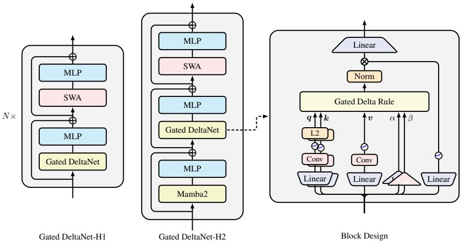
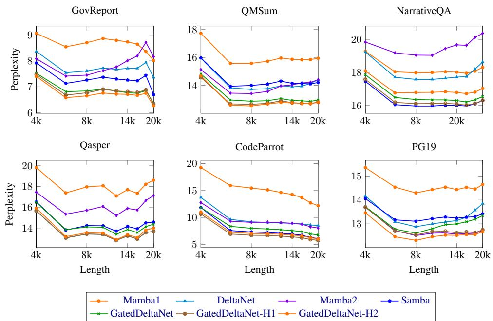
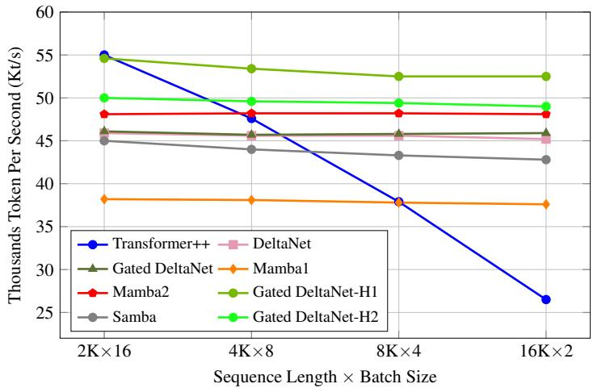

# GATED DELTA NETWORKS：利用 DELTA 规则改进 MAMBA2

Songlin Yang ∗ MIT CSAIL yangsl66@mit.edu

Jan Kautz NVIDIA jkautz@nvidia.com

Ali Hatamizadeh ⋆ NVIDIA ahatamizadeh@nvidia.com

## 摘要

线性 Transformer（Linear Transformers）作为标准 Transformer 的高效替代方案受到了广泛关注，但它们在检索和长上下文任务中的表现一直受限。为了解决这些局限性，近期的工作探索了两种截然不同的机制：用于自适应记忆控制的门控机制，以及用于精确记忆修改的 Delta 更新规则。我们观察到这两种机制是互补的——门控能够实现记忆的快速擦除，而 Delta 规则有助于实现针对性的更新。基于这一见解，我们提出了门控 Delta 规则（gated delta rule），并开发了一种针对现代硬件优化的并行训练算法。我们提出的架构 Gated DeltaNet 在语言建模、常识推理、上下文内检索、长度外推和长上下文理解等多项基准测试中，均持续超越现有的 Mamba2 和 DeltaNet 等模型。我们通过开发将 Gated DeltaNet 层与滑动窗口注意力（sliding window attention）或 Mamba2 层相结合的混合架构，进一步提升了性能，同时实现了训练效率的提高与更优越的任务表现。代码：https://github.com/NVlabs/GatedDeltaNet

## 1 引言

Transformer 架构显著推动了大型语言模型（Large Language Models，LLMs）能力的发展，凭借其高效的注意力机制在广泛的任务中展现出卓越的性能。该机制擅长精确的序列建模，并在训练过程中充分利用了现代 GPU 的并行处理能力。然而，自注意力组件的计算复杂度随序列长度呈二次方增长，导致了巨大的计算需求，这对训练和推理都构成了严峻的挑战。

为了缓解这些问题，研究人员探索了诸如线性 Transformer（linear Transformers，Katharopoulos et al., 2020a）等替代方案，它们通过基于核化点积的线性注意力取代了传统的基于 Softmax 的注意力，并通过重构为具有矩阵值状态的线性 RNN，大幅降低了推理期间的显存需求。尽管早期版本的线性 Transformer 在语言建模任务中的表现逊色于标准 Transformer，但近期的改进——例如引入类似于 LSTM 中的数据依赖门控机制（以 GLA (Yang et al., 2024a) 和 Mamba2 (Dao & Gu, 2024a) 等模型为代表）——已经展现出令人鼓舞的提升。然而，在管理长序列信息方面挑战依然存在，特别是在上下文内检索任务中，传统 Transformer 仍然保持着其优势（Arora et al., 2023a; 2024a; Jelassi et al., 2024; Wen et al., 2024; Akyürek et al., 2024）。

这种现象并不令人意外：线性 Transformer（linear Transformers）可以被解释为实现了一种基于外积的键值关联记忆，这让人联想到张量积表示（tensor product representation, Smolensky, 1990）。然而，它们能够存储的正交键值对数量受限于模型的维度。当序列长度超过该维度时，“记忆冲突”（memory collisions）就变得不可避免，从而阻碍了精准检索（Schlag et al., 2021a）。

Mamba2 通过引入一种简单的门控更新规则来解决这一局限性：$\mathbf { S } _ { t } = \alpha _ { t } \mathbf { S } _ { t - 1 } + v _ { t } \pmb { k } _ { t } ^ { \top }$ t ，它在每个时间步通过动态比例 $\alpha _ { t } \in ( 0 , 1 )$ 均匀地衰减所有键值关联。

然而，这种方法没有考虑不同键值关联的不同重要性，可能会导致记忆利用效率低下。如果模型需要遗忘某个特定的键值关联，所有的键值关联都会被同等程度地遗忘，从而使得该过程缺乏针对性且效率较低。

相比之下，采用 Delta 规则（Widrow et al., 1960）的线性 Transformer——即 DeltaNet（Schlag et al., 2021a; Yang et al., 2024b）——通过以顺序方式（软性地）用新传入的键值对替换旧键值对，从而有选择性地更新记忆。该方法在上下文检索（in-context retrieval）的合成基准测试中展现出了令人瞩目的性能。然而，由于该过程每次仅修改单个键值对，模型缺乏快速清除过时或无关信息的能力，尤其是在需要擦除先前数据的上下文切换期间。因此，DeltaNet 在实际任务中的表现较为一般（Yang et al., 2024b），这可能是由于缺乏强大的记忆清除机制所致。

认识到门控更新规则和 Delta 规则在记忆管理中的互补优势，我们提出了门控 Delta 规则（gated delta rule），这是一种结合了两种方法的简单而直观的机制。这一统一规则实现了灵活的记忆控制：它可以通过设置 $\alpha _ { t }  0$ 迅速清除记忆，同时通过设置 $\alpha _ { t }  1$（实际上切换到了纯 Delta 规则）选择性地更新特定内容而不影响其他信息。

剩下的挑战在于如何以硬件高效的方式实现门控 Delta 规则。基于 Yang et al. (2024b) 使用 WY 表示（WY representation, Bischof & Loan, 1985）并行化 Delta 规则计算的高效算法，我们对其方法进行了精心扩展，以纳入门控项。我们的扩展保留了分块并行（chunkwise parallelism, Hua et al., 2022b; Sun et al., 2023a; Yang et al., 2024a;b）的优势，从而实现了硬件高效的训练。

我们最终得到的架构 Gated DeltaNet 在一系列全面的基准测试中均持续优于 Mamba2 和 DeltaNet，包括语言建模、常识推理、上下文内检索、长度外推以及长上下文理解。在这些结果的基础上，我们还开发了混合架构，将 Gated DeltaNet 层与滑动窗口注意力（sliding window attention）或 Mamba2 层进行策略性结合，从而进一步提升了训练效率和模型性能。

## 2 预备知识

## 2.1 MAMBA2：带衰减的线性注意力

众所周知，在不考虑归一化和查询/键激活函数的情况下，线性 Transformer（Linear Transformer, Katharopoulos et al., 2020b）可以表示为如下线性递推形式：

$$
\mathbf {S} _ {t} = \mathbf {S} _ {t - 1} + \boldsymbol {v} _ {t} \boldsymbol {k} _ {t} ^ {\intercal} \in \mathbb {R} ^ {d _ {v} \times d _ {k}},
$$

$$
\boldsymbol {o} _ {t} = \mathbf {S} _ {t} \boldsymbol {q} _ {t} \in \mathbb {R} ^ {d _ {v}}
$$

其中 $d _ { k }$ 和 $d _ { v }$ 分别表示查询/键和值的（头）维度。通过展开该递推式，我们可以将其表示为如下的向量形式（左）和矩阵形式（右）：

$$
\boldsymbol {o} _ {t} = \sum_ {i = 1} ^ {t} (\boldsymbol {v} _ {i} \boldsymbol {k} _ {i} ^ {\intercal}) \boldsymbol {q} _ {t} = \sum_ {i = 1} ^ {t} \boldsymbol {v} _ {i} (\boldsymbol {k} _ {i} ^ {\intercal} \boldsymbol {q} _ {t}) \in \mathbb {R} ^ {d _ {v}}, \quad \mathbf {O} = (\mathbf {Q K} ^ {\intercal} \odot \mathbf {M}) \mathbf {V} \in \mathbb {R} ^ {L \times d _ {v}}
$$

其中 $L$ 为序列长度，$\mathbf { M } \in \mathbb { R } ^ { L \times L }$ 是因果掩码（causal mask），定义为当 $i < j$ 时 ${ { \bf { M } } _ { i j } } = 0$，否则为 1。

然而，这种朴素的线性注意力在语言建模中的表现大幅落后于 Transformer。为了解决这一问题，通常会添加一个衰减项来遗忘历史信息。这里我们以 Mamba2（Dao & Gu, 2024a）为例，在特定参数化下它可以表示为如下线性递推形式：

$$
\mathbf {S} _ {t} = \alpha_ {t} \mathbf {S} _ {t - 1} + \boldsymbol {v} _ {t} \boldsymbol {k} _ {t} ^ {\intercal}, \qquad \boldsymbol {o} _ {t} = \mathbf {S} _ {t} \boldsymbol {q} _ {t}
$$

其中 $\alpha _ { t } \in ( 0 , 1 )$ 是随 $t$ 变化的数据依赖标量衰减项。定义累积衰减乘积 $\begin{array} { r } { \gamma _ { j } = \prod _ { i = 1 } ^ { j } \alpha _ { i } } \end{array}$ i，通过展开该递推式，我们可以将结果表示为向量形式（左）和矩阵并行形式（右）：

$$
\boldsymbol {o} _ {t} = \sum_ {i = 1} ^ {t} \left(\frac {\gamma_ {t}}{\gamma_ {i}} \boldsymbol {v} _ {i} \boldsymbol {k} _ {i} ^ {\intercal}\right) \boldsymbol {q} _ {t} = \sum_ {i = 1} ^ {t} \boldsymbol {v} _ {i} \left(\frac {\gamma_ {t}}{\gamma_ {i}} \boldsymbol {k} _ {i} ^ {\intercal} \boldsymbol {q} _ {t}\right), \quad \mathbf {O} = ((\mathbf {Q K} ^ {\intercal}) \odot \Gamma) \mathbf {V}
$$

在此，$\Gamma \in \mathbb { R } ^ { L \times L }$ 是一个衰减感知因果掩码（decay-aware causal mask），其中当 $i \ge j$ 时 $\begin{array} { r } { \Gamma _ { i j } = \frac { \gamma _ { i } } { \gamma _ { j } } \mathrm { ~ if ~ } i \ge j } \end{array}$，否则 $\Gamma _ { i j } = 0$。这些并行形式与循环形式之间的等价性也被称为 Dao & Gu (2024a) 中描述的状态空间对偶性（state space duality, SSD）。这种循环结构也出现在其他几种架构中，包括 Gated RFA (Peng et al., 2021)、xLSTM (Beck et al., 2024) 和 Gated RetNet (Sun et al., 2024b)。当 $\gamma _ { t }$ 与数据无关时，该公式退化为 RetNet (Sun et al., 2023a) 和 Lightning-Attention (Qin et al., 2024a)。此外，$\mathrm { i f } \ \gamma _ { t }$ 被扩展为矩阵值而非标量值时，若采用外积结构进行参数化，仍然可以实现高效的训练算法，正如 Yang et al. (2024a) 所证明，并被 Yang et al. (2024a); Peng et al. (2024); Qin et al. (2024b); Zhang et al. (2024); Chou et al. (2024); He et al. (2025); Lu et al. (2025) 所采用。

分块训练 然而，循环形式和并行形式对于高效训练都不是最理想的 (Hua et al., 2022b; Yang et al., 2024a)，这促使人们采用分块并行形式 (Hua et al., 2022b; Sun et al., 2023a) 来实现硬件高效的线性时间训练，如下文所述。概括而言，分块并行形式将输入和输出划分为若干大小为 $C ,$ 的块，并根据前一个块的最终状态以及当前块的查询/键/值块来计算每个块的输出。遵循 Sun et al. (2023b); Yang et al. (2024a;b) 的表示法，我们以查询块 ${ \mathbf { } } q ,$ 为例。我们将块 t 的查询块表示为 $\mathbf { Q } _ { [ t ] } : = \pmb { q } _ { t C + 1 : ( t + 1 ) C + 1 }$，将块 t 内的第 r 个查询表示为 $\pmb { q } _ { [ t ] } ^ { r } : = \pmb { q } _ { t C + r }$。块 t 的初始状态定义为 $\mathbf { S } _ { [ t ] } : = \mathbf { S } _ { [ t ] } ^ { 0 } = \mathbf { \bar { S } } _ { [ t - 1 ] } ^ { C }$。通过对循环进行部分展开，我们有

$$
\mathbf {S} _ {[ t ]} ^ {r} = \mathbf {S} _ {[ t ]} + \sum_ {i = 1} ^ {r} \boldsymbol {v} _ {[ t ]} ^ {i} \boldsymbol {k} _ {[ t ]} ^ {i \intercal} \in \mathbb {R} ^ {d _ {v} \times d _ {k}}, \qquad \boldsymbol {o} _ {[ t ]} ^ {r} = \mathbf {S} _ {[ t ]} ^ {r} \boldsymbol {q} _ {[ t ]} ^ {r} = \mathbf {S} _ {[ t ]} \boldsymbol {q} _ {[ t ]} ^ {r} + \sum_ {i = 1} ^ {r} \boldsymbol {v} _ {[ t ]} ^ {i} \left(\boldsymbol {k} _ {[ t ]} ^ {i \intercal} \boldsymbol {q} _ {[ t ]} ^ {r}\right) \in \mathbb {R} ^ {d _ {v}}
$$

等价地，以矩阵形式表示为：

$$
\mathbf {S} _ {[ t + 1 ]} = \mathbf {S} _ {[ t ]} + \mathbf {V} _ {[ t ]} \mathbf {K} _ {[ t ]} ^ {\intercal} \in \mathbb {R} ^ {d _ {v} \times d _ {k}}, \qquad \mathbf {O} _ {[ t ]} = \mathbf {Q} _ {[ t ]} \mathbf {S} _ {[ t ]} ^ {\intercal} + \left(\mathbf {Q} _ {[ t ]} \mathbf {K} _ {[ t ]} ^ {\intercal} \odot \mathbf {M}\right) \mathbf {V} _ {[ t ]} \in \mathbb {R} ^ {C \times d _ {v}}
$$

其中 $\mathbf { M } \in \mathbb { R } ^ { C \times C }$ 为因果掩码（causal mask）。上述公式包含大量的矩阵乘法（matmuls），便于进行基于 Tensor Core 的硬件优化。该分块算法（chunkwise algorithm）可以很容易地推广到带衰减的线性注意力：

$$
\mathbf {S} _ {[ t + 1 ]} = \overrightarrow {\mathbf {S} _ {[ t ]}} + \mathbf {V} _ {[ t ]} ^ {\intercal} \overrightarrow {\mathbf {K} _ {[ t ]}} \in \mathbb {R} ^ {d _ {v} \times d _ {k}}, \quad \mathbf {O} _ {[ t ]} = \overleftarrow {\mathbf {Q} _ {[ t ]}} \mathbf {S} _ {[ t ]} ^ {\intercal} + \left(\mathbf {Q} _ {[ t ]} \mathbf {K} _ {[ t ]} ^ {\intercal} \odot \Gamma_ {[ t ]}\right) \mathbf {V} _ {[ t ]} \in \mathbb {R} ^ {C \times d _ {v}}\tag{1}
$$

其中 $\begin{array} { r } { ( \Gamma _ { [ t ] } ) _ { i j } = \frac { \gamma _ { [ t ] } ^ { i } } { \gamma _ { [ t ] } ^ { j } } , \gamma _ { [ t ] } ^ { j } = \prod _ { j = t C + 1 } ^ { t C + j } \alpha _ { j } . ^ { 1 } } \end{array}$。在此，我们分别使用左箭头 $( ^ {  } )$ 或右箭头 $( \vec { \cdot } \mathbf { \nabla } ^ { \cdot } )$ 来表示一个变量衰减至每个分块（chunk）的第一个位置和最后一个位置：

$$
\overleftarrow {\pmb {q} _ {[ t ]} ^ {r}} = \gamma_ {[ t ]} ^ {r} \pmb {q} _ {[ t ]} ^ {r}
$$

将每个向量衰减至分块 t 的第一个位置

$$
\overrightarrow {\pmb {k} _ {[ t ]} ^ {r}} = \frac {\gamma_ {[ t ]} ^ {C}}{\gamma_ {[ t ]} ^ {r}} \pmb {k} _ {[ t ]} ^ {r}
$$

将每个向量衰减至分块 t 的最后一个位置

$$
\overrightarrow {\mathbf {S} _ {[ t ]}} = \gamma_ {[ t ]} ^ {C} \mathbf {S} _ {[ t ]}
$$

在整个分块 t 上衰减状态矩阵

(2)

其他变量 $( \mathrm { e } . \mathrm { g } . , \vec { v } )$ 亦是如此。Mamba2 中引入的 SSD 分解算法在很大程度上等价于该分块算法。对于更一般化的方法，Yang et al. (2024a) 提出了一种结合细粒度衰减机制的线性注意力扩展分块算法。

## 2.2 Delta 网络：带有 Delta 规则的线性注意力

Delta 更新规则（Widrow et al., 1960; Schlag et al., 2021b）动态擦除与当前输入键 $\left( k _ { t } \right)$ 相关联的值 $( \pmb { v } _ { t } ^ { \mathrm { o l d } } )$，并写入新值 $( \pmb { v } _ { t } ^ { \mathrm { n e w } } )$，该新值是基于“写入强度” βt ∈ (0, 1) 的当前输入值与旧值的线性组合。2

$$
\mathbf {S} _ {t} = \mathbf {S} _ {t - 1} - \underbrace {\left(\mathbf {S} _ {t - 1} \boldsymbol {k} _ {t}\right)} _ {\boldsymbol {v} _ {t} ^ {\text {old}}} \boldsymbol {k} _ {t} ^ {\intercal} + \underbrace {\left(\beta_ {t} \boldsymbol {v} _ {t} + (1 - \beta_ {t}) \mathbf {S} _ {t - 1} \boldsymbol {k} _ {t})\right)} _ {\boldsymbol {v} _ {t} ^ {\text {new}}} \boldsymbol {k} _ {t} ^ {\intercal} = \mathbf {S} _ {t - 1} \left(\mathbf {I} - \beta_ {t} \boldsymbol {k} _ {t} \boldsymbol {k} _ {t} ^ {\intercal}\right) + \beta_ {t} \boldsymbol {v} _ {t} \boldsymbol {k} _ {t} ^ {\intercal}
$$

如上所示，DeltaNet 实现了带有广义 Householder 转移矩阵 $( \mathbf { I } - \beta _ { t } { k _ { t } } \bar { { k } } _ { t } ^ { \top } )$ ) 的一阶线性递推。尽管展现出了卓越的关联回忆（associative recall）和语言建模性能（Schlag et al., 2021a），但由于计算效率低下，DeltaNet 受到的关注十分有限，直到 Yang et al. (2024b) 提出了一种硬件高效的分块训练算法，详见下文。

分块并行形式。通过对递推式进行部分展开，我们得到

$$
\mathbf {S} _ {[ t ]} ^ {r} = \mathbf {S} _ {[ t ]} \underbrace {\left(\prod_ {i = 1} ^ {r} \mathbf {I} - \beta_ {[ t ]} ^ {i} \boldsymbol {k} _ {[ t ]} ^ {i} \boldsymbol {k} _ {[ t ]} ^ {i \intercal}\right)} _ {:= \mathbf {P} _ {[ t ]} ^ {r}} + \underbrace {\sum_ {i = 1} ^ {r} \left(\beta_ {[ t ]} ^ {i} \boldsymbol {v} _ {[ t ]} ^ {i} \boldsymbol {k} _ {[ t ]} ^ {i \intercal} \prod_ {j = i + 1} ^ {r} \left(\mathbf {I} - \beta_ {[ t ]} ^ {j} \boldsymbol {k} _ {[ t ]} ^ {j} \boldsymbol {k} _ {[ t ]} ^ {j \intercal}\right)\right)} _ {:= \mathbf {H} _ {[ t ]} ^ {r}}\tag{3}
$$

其中 ${ \mathbf { P } } _ { [ t ] } ^ { j }$ 涉及广义 Householder 矩阵的累乘，这可以通过经典的 WY 表示法（Bischof & Loan, 1985）进行优化：

$$
\mathbf {P} _ {[ t ]} ^ {r} = \mathbf {I} - \sum_ {i = 1} ^ {r} \mathbf {w} _ {[ t ]} ^ {i} \boldsymbol {k} _ {[ t ]} ^ {i \intercal} \in \mathbb {R} ^ {d _ {k} \times d _ {k}} \quad \quad \mathbf {w} _ {[ t ]} ^ {r} = \beta_ {[ t ]} ^ {r} \left(\boldsymbol {k} _ {[ t ]} ^ {r} - \sum_ {i = 1} ^ {r - 1} \left(\mathbf {w} _ {[ t ]} ^ {i} (\boldsymbol {k} _ {[ t ]} ^ {i \intercal} \boldsymbol {k} _ {[ t ]} ^ {r})\right)\right) \in \mathbb {R} ^ {d _ {k}}\tag{4}
$$

同样，${ \bf { H } } _ { [ t ] } ^ { r }$ 可以表示为：

$$
\mathbf {H} _ {[ t ]} ^ {r} = \sum_ {i = 1} ^ {r} \mathbf {u} _ {[ t ]} ^ {i} \boldsymbol {k} _ {[ t ]} ^ {i \intercal} \in \mathbb {R} ^ {d _ {v} \times d _ {k}} \quad \mathbf {u} _ {[ t ]} ^ {r} = \beta_ {[ t ]} ^ {r} \left(\boldsymbol {v} _ {[ t ]} ^ {r} - \sum_ {i = 1} ^ {r - 1} \left(\mathbf {u} _ {[ t ]} ^ {i} (\boldsymbol {k} _ {[ t ]} ^ {i \intercal} \boldsymbol {k} _ {[ t ]} ^ {r})\right)\right) \in \mathbb {R} ^ {d _ {v}}\tag{5}
$$

其矩阵形式为：$\mathbf P _ { [ t ] } = \mathbf I - \mathbf W _ { [ t ] } ^ { \top } \mathbf K _ { [ t ] } \in \mathbb R ^ { d _ { k } \times d _ { k } } , \mathbf H _ { [ t ] } = \mathbf U _ { [ t ] } ^ { \top } \mathbf K _ { [ t ] } \in \mathbb R ^ { d _ { v } \times d _ { k } }$。通过使用 UT 变换（Joffrain et al., 2006），我们可以进一步将 W 和 U 表示为矩阵形式：

$$
\mathbf {T} _ {[ t ]} = \left[ \mathbf {I} + \mathrm{strictLower} \left(\mathrm{diag} (\beta_ {[ t ]}) \mathbf {K} _ {[ t ]} \mathbf {K} _ {[ t ]} ^ {\intercal}\right) \right] ^ {- 1} \mathrm{diag} \left(\beta_ {[ t ]}\right) \in \mathbb {R} ^ {C \times C}\tag{6}
$$

$$
\mathbf {W} _ {[ t ]} = \mathbf {T} _ {[ t ]} \mathbf {K} _ {[ t ]} \in \mathbb {R} ^ {C \times d _ {k}}, \qquad \mathbf {U} _ {[ t ]} = \mathbf {T} _ {[ t ]} \mathbf {V} _ {[ t ]} \in \mathbb {R} ^ {C \times d _ {v}}\tag{7}
$$

将这些结果代回式 3，即可得到 DeltaNet 的一种硬件高效的分块算法（chunkwise algorithm），该算法充分利用了矩阵乘法，从而实现了基于 Tensor Core 的 GPU 优化：

$$
\mathbf {S} _ {[ t + 1 ]} = \mathbf {S} _ {[ t ]} \mathbf {P} _ {[ t ]} + \mathbf {H} _ {[ t ]} = \mathbf {S} _ {[ t ]} + \left(\mathbf {U} _ {[ t ]} - \mathbf {W} _ {[ t ]} \mathbf {S} _ {[ t ]} ^ {\intercal}\right) ^ {\intercal} \mathbf {K} _ {[ t ]} \qquad \in \mathbb {R} ^ {d _ {v} \times d _ {k}}\tag{8}
$$

$$
\mathbf {O} _ {[ t ]} = \mathbf {Q} _ {[ t ]} \mathbf {S} _ {[ t ]} ^ {\intercal} + (\mathbf {Q} _ {[ t ]} \mathbf {K} _ {[ t ]} ^ {\intercal} \odot \mathbf {M}) \left(\mathbf {U} _ {[ t ]} - \mathbf {W} _ {[ t ]} \mathbf {S} _ {[ t ]} ^ {\intercal}\right)\tag{9}
$$

## 3 门控 DELTA 网络

## 3.1 公式表述：门控 DELTA 规则

所提出的门控 delta 规则简单而有效：

$$
\mathbf {S} _ {t} = \mathbf {S} _ {t - 1} \left(\alpha_ {t} (\mathbf {I} - \beta_ {t} \boldsymbol {k} _ {t} \boldsymbol {k} _ {t} ^ {\intercal})\right) + \beta_ {t} \boldsymbol {v} _ {t} \boldsymbol {k} _ {t} ^ {\intercal}\tag{10}
$$

其中数据依赖的门控项 $\alpha _ { t } \in ( 0 , 1 )$ ) 控制状态衰减。该公式结合了门控机制与 delta 规则的双重优势：门控项实现了自适应记忆管理，而 delta 更新结构则促进了有效的键值关联学习。

我们通过 Liu et al. (2024) 提出的在线学习框架视角，对门控增量规则（gated delta rule）进行了形式化分析。在该框架中，循环状态更新表现为在线学习问题的闭式解，如 Table 1 所示。近期的线性 RNN 架构通常在其在线学习目标中引入正则化项，以防止状态偏离先前的值，从而实现记忆保持。然而，当状态的信息趋于饱和时，这种保持机制就会出现问题。在这种情况下，每个状态都会编码多个信息片段的叠加，导致精确检索变得困难。为了解决这一局限性，Mamba2 和 Gated DeltaNet 引入了一个自适应缩放因子 $\alpha _ { t }$ 来放宽正则化项，允许 $\mathbf { S } _ { t }$ 与 $\mathbf { S } _ { t - 1 }$ 之间存在受控的偏差。这种修改通过选择性遗忘实现了动态记忆管理，这有助于过滤不相关的信息（见 §3.2）。

Table 1: 使用 Liu et al. (2024) 的框架对不同线性 RNN 模型及其对应的在线学习目标的比较。为简便起见，我们将 Longhorn 的向量值 $\beta$ 简化为标量 $\beta .$

<table><tr><td>方法</td><td>在线学习目标</td><td>在线更新</td></tr><tr><td>LA</td><td> $\| \mathbf{S}_{t} - \mathbf{S}_{t-1} \|_{F}^{2} - 2\langle \mathbf{S}_{t}\boldsymbol{k}_{t}, \boldsymbol{v}_{t} \rangle$ </td><td> $\mathbf{S}_{t} = \mathbf{S}_{t-1} + \boldsymbol{v}_{t}\boldsymbol{k}_{t}^{T}$ </td></tr><tr><td>Mamba2</td><td> $\| \mathbf{S}_{t} - \alpha_{t}\mathbf{S}_{t-1} \|_{F}^{2} - 2\langle \mathbf{S}_{t}\boldsymbol{k}_{t}, \boldsymbol{v}_{t} \rangle$ </td><td> $\mathbf{S}_{t} = \alpha_{t}\mathbf{S}_{t-1} + \boldsymbol{v}_{t}\boldsymbol{k}_{t}^{T}$ </td></tr><tr><td>Longhorn</td><td> $\| \mathbf{S}_{t} - \mathbf{S}_{t-1} \|_{F}^{2} - \beta_{t} \| \mathbf{S}_{t}\boldsymbol{k}_{t} - \boldsymbol{v}_{t} \|^{2}$ </td><td> $\mathbf{S}_{t} = \mathbf{S}_{t-1} (\mathbf{I} - \epsilon \boldsymbol{k}_{t}\boldsymbol{k}_{t}^{T}) + \epsilon_{t}\boldsymbol{v}_{t}\boldsymbol{k}_{t}^{T}, \epsilon_{t} = \frac{\beta_{t}}{1 + \beta_{t}\boldsymbol{k}_{t}^{\top}\boldsymbol{k}_{t}}$ </td></tr><tr><td>DeltaNet</td><td> $\| \mathbf{S}_{t} - \mathbf{S}_{t-1} \|_{F}^{2} - 2\langle \mathbf{S}_{t}\boldsymbol{k}_{t}, \beta_{t} (\boldsymbol{v}_{t} - \mathbf{S}_{t-1}\boldsymbol{k}_{t}) \rangle$ </td><td> $\mathbf{S}_{t} = \mathbf{S}_{t-1} (\mathbf{I} - \beta_{t}\boldsymbol{k}_{t}\boldsymbol{k}_{t}^{T}) + \beta_{t}\boldsymbol{v}_{t}\boldsymbol{k}_{t}^{T}$ </td></tr><tr><td>Gated DeltaNet</td><td> $\| \mathbf{S}_{t} - \alpha_{t}\mathbf{S}_{t-1} \|_{F}^{2} - 2\langle \mathbf{S}_{t}\boldsymbol{k}_{t}, \beta_{t} (\boldsymbol{v}_{t} - \alpha_{t}\mathbf{S}_{t-1}\boldsymbol{k}_{t}) \rangle$ </td><td> $\mathbf{S}_{t} = \mathbf{S}_{t-1} \left( \alpha_{t} (\mathbf{I} - \beta_{t}\boldsymbol{k}_{t}\boldsymbol{k}_{t}^{T}) \right) + \beta_{t}\boldsymbol{v}_{t}\boldsymbol{k}_{t}^{T}$ </td></tr></table>

Table 2: 1.3B 模型在 S-NIAH 基准测试集上的零样本（zero-shot）性能对比（实验设置见 §4）

<table><tr><td rowspan="2">模型</td><td colspan="4">S-NIAH-1（密码检索/pass-key retrieval）</td><td colspan="4">S-NIAH-2（大海捞数字/number in haystack）</td><td colspan="3">S-NIAH-3（大海捞UUID/uuid in haystack）</td></tr><tr><td>1K</td><td>2K</td><td>4K</td><td>8K</td><td>1K</td><td>2K</td><td>4K</td><td>8K</td><td>1K</td><td>2K</td><td>4K</td></tr><tr><td>DeltaNet</td><td>97.4</td><td>96.8</td><td>99.0</td><td>98.8</td><td>98.4</td><td>45.6</td><td>18.6</td><td>14.4</td><td>85.2</td><td>47.0</td><td>22.4</td></tr><tr><td>Mamba2</td><td>99.2</td><td>98.8</td><td>65.4</td><td>30.4</td><td>99.4</td><td>98.8</td><td>56.2</td><td>17.0</td><td>64.4</td><td>47.6</td><td>4.6</td></tr><tr><td>Gated DeltaNet</td><td>98.4</td><td>88.4</td><td>91.4</td><td>91.8</td><td>100.0</td><td>99.8</td><td>92.2</td><td>29.6</td><td>86.6</td><td>84.2</td><td>27.6</td></tr></table>

另一方面，Linear Attention (LA) 和 Mamba2 使用简单的负内积损失 $\mathbf { \nabla } _ { - } \langle \mathbf { S } _ { t } k _ { t } , v _ { t } \rangle$ ，而 Longhorn (Liu et al., 2024) 则使用更具表达能力的在线回归目标 $\lVert \mathbf { \dot { S } } _ { t } \pmb { k } _ { t } - \dot { \pmb { v } } _ { t } \rVert ^ { 2 }$ 来更好地建模键值关联。由此产生的 Longhorn 更新规则与 Delta 更新规则高度相似，3 这表明在上下文关联回忆（in-context associative recall）中，（门控）Delta 规则相较于 Mamba2 具有优越性。

从快速权重编程（fast weight programming，Irie et al., 2022a）以及测试时训练（test-time training，Sun et al., 2024a）与回归（Wang et al., 2025）的视角来看，隐藏状态 S 可以被解释为一个（快速）权重矩阵，Delta 规则通过测试时随机梯度下降（SGD）来优化在线回归目标 $\begin{array} { r } { \mathscr { L } ( \mathbf { S } _ { t } ) = \frac { 1 } { 2 } \| \mathbf { S } _ { t } \pmb { k } _ { t } - \pmb { v } _ { t } \| ^ { 2 } } \end{array}$：

$$
\mathbf {S} _ {t + 1} = \mathbf {S} _ {t} - \beta_ {t} \nabla \mathcal {L} (\mathbf {S} _ {t}) = \mathbf {S} _ {t} - \beta_ {t} (\mathbf {S} _ {t} \boldsymbol {k} _ {t} - \boldsymbol {v} _ {t}) \boldsymbol {k} _ {t} ^ {\intercal} = \mathbf {S} _ {t} \left(\mathbf {I} - \beta_ {t} \boldsymbol {k} _ {t} \boldsymbol {k} _ {t} ^ {\intercal}\right) + \beta_ {t} \boldsymbol {v} _ {t} \boldsymbol {k} _ {t} ^ {\intercal}
$$

其中 $\beta _ { t }$ 表示（自适应）学习率。从这个角度来看，门控 Delta 规则可以看作是在 SGD 更新中引入了一个自适应权重衰减项 $\alpha _ { t }$，这是深度学习中广泛使用的一项技术 (Krogh & Hertz, 1991; Andriushchenko et al., 2023)。与此同时，Titans (Behrouz et al., 2024) 也证明了在 RNN 测试时 SGD 更新中引入权重衰减机制的有效性。

## 3.2 案例研究：单针大海捞针（S-NIAH）

为了更好地理解 Delta 规则与门控规则之间的互补优势，我们对来自 RULER (Hsieh et al., 2024) 的单针大海捞针（Single Needle-In-A-Haystack, S-NIAH）基准测试套件进行了案例研究，其中键值对充当大海（上下文）中的“针”，模型在给定键时必须回忆出对应的值。Table 2 展示了实验结果，我们得出了三个主要观察结论：

衰减会损害记忆保留能力。在具有重复合成上下文的最简单 S-NIAH-1 设置中，模型仅需记忆极少的信息，主要用于测试长期保留能力。DeltaNet 在所有序列长度上均取得了近乎完美的表现。Mamba2 由于对历史信息衰减过快，在序列长度超过 2K 时性能显著下降，而得益于 Delta 规则的使用，Gated DeltaNet 的性能下降幅度要小得多。

门控机制有助于过滤。在带有真实文章上下文的 S-NIAH-2/3 中，模型会存储所有潜在相关的信息，从而测试了高效的记忆管理能力。在固定状态大小的情况下，缺乏清除机制会导致记忆冲突——信息发生叠加且变得难以区分。由于记忆清除能力差，DeltaNet 在较长序列上的性能显著下降。Mamba2 和 Gated DeltaNet 则通过过滤无关信息的门控机制保持了更好的性能。

Delta 规则有助于记忆。在 S-NIAH-3 中，值从数字变为 UUID，测试了复杂模式的记忆能力。Mamba2 的性能迅速下降，而 Gated DeltaNet 的表现更好，验证了 delta 规则确实具有更强的记忆能力。

## 3.3 算法：硬件高效的分块训练

在本小节中，我们推导了一种用于训练 Gated DeltaNet 的硬件高效分块算法。通过对公式 10 中的递推关系进行部分展开，我们得到

$$
\mathbf {S} _ {[ t ]} ^ {r} = \mathbf {S} _ {[ t ]} \underbrace {\left(\prod_ {i = 1} ^ {r} \alpha_ {[ t ]} ^ {i} \left(\mathbf {I} - \beta_ {[ t ]} ^ {i} \boldsymbol {k} _ {[ t ]} ^ {i} \boldsymbol {k} _ {[ t ]} ^ {i \intercal}\right)\right)} _ {:= \mathbf {F} _ {[ t ]} ^ {r}} + \underbrace {\sum_ {i = 1} ^ {r} \left(\beta_ {[ t ]} ^ {i} \boldsymbol {v} _ {[ t ]} ^ {i} \boldsymbol {k} _ {[ t ]} ^ {i \intercal} \prod_ {j = i + 1} ^ {r} \alpha_ {[ t ]} ^ {j} \left(\mathbf {I} - \beta_ {[ t ]} ^ {j} \boldsymbol {k} _ {[ t ]} ^ {j} \boldsymbol {k} _ {[ t ]} ^ {j \intercal}\right)\right)} _ {:= \mathbf {G} _ {[ t ]} ^ {r}}
$$

很容易看出 $\mathbf { F } _ { [ t ] } ^ { r } = \gamma _ { [ t ] } ^ { r } \mathrm { P _ { [ t ] } ^ { r } = \overleftarrow { P _ { [ t ] } ^ { r } } }$ 。至于 $\mathbf { G } _ { [ t ] } ^ { r } .$ ，我们将公式 5 改写如下，

$$
\mathbf {G} _ {[ t ]} ^ {r} = \sum_ {i = 1} ^ {r} \frac {\gamma_ {[ t ]} ^ {r}}{\gamma_ {[ t ]} ^ {i}} \tilde {\mathbf {u}} _ {[ t ]} ^ {i} \boldsymbol {k} _ {[ t ]} ^ {i \intercal} \in \mathbb {R} ^ {d _ {v} \times d _ {k}} \qquad \tilde {\mathbf {u}} _ {[ t ]} ^ {r} = \beta_ {[ t ]} ^ {r} \left(\boldsymbol {v} _ {[ t ]} ^ {r} - \sum_ {i = 1} ^ {r - 1} \left(\tilde {\mathbf {u}} _ {[ t ]} ^ {i} (\frac {\gamma_ {[ t ]} ^ {r}}{\gamma_ {[ t ]} ^ {i}} \boldsymbol {k} _ {[ t ]} ^ {i \intercal} \boldsymbol {k} _ {[ t ]} ^ {r})\right)\right) \in \mathbb {R} ^ {d _ {v}}
$$

（证明见 §A）。通过 UT 变换，我们得到矩阵形式：

$$
\widetilde {\mathbf {U} _ {[ t ]}} = \left[ \mathbf {I} + \text {strictLower} \left(\operatorname{diag} \left(\beta_ {[ t ]}\right) \left(\Gamma_ {[ t ]} \odot \mathbf {K} _ {[ t ]} \mathbf {K} _ {[ t ]} ^ {\intercal}\right)\right) \right] ^ {- 1} \operatorname{diag} \left(\beta_ {[ t ]}\right) \mathbf {V} _ {[ t ]} \quad \in \mathbb {R} ^ {C \times d _ {v}}
$$

类似于 Mamba2 扩展线性注意力（公式 1）的方式，我们可以调整 DeltaNet 的分块算法（公式 8-9）以适用于 Gated DeltaNet，从而实现硬件高效的训练，如下所示：

$$
\begin{array}{r l r} \mathbf {S} _ {[ t + 1 ]} = \overrightarrow {\mathbf {S} _ {[ t ]}} + \left(\widetilde {\mathbf {U} _ {[ t ]}} - \overleftarrow {\mathbf {W} _ {[ t ]}} \mathbf {S} _ {[ t ]} ^ {\intercal}\right) ^ {\intercal} \overrightarrow {\mathbf {K} _ {[ t ]}} & \in \mathbb {R} ^ {d _ {v} \times d _ {k}} \\ \mathbf {O} _ {[ t ]} = \overleftarrow {\mathbf {Q} _ {[ t ]}} \mathbf {S} _ {[ t ]} ^ {\intercal} + (\mathbf {Q} _ {[ t ]} \mathbf {K} _ {[ t ]} ^ {\intercal} \odot \mathbf {M}) \left(\widetilde {\mathbf {U} _ {[ t ]}} - \overleftarrow {\mathbf {W} _ {[ t ]}} \mathbf {S} _ {[ t ]} ^ {\intercal}\right) & \in \mathbb {R} ^ {C \times d _ {v}} \end{array}
$$

其中 $\begin{array} { r } { \overleftarrow { \mathbf { q } _ { [ t ] } ^ { r } } = \gamma _ { [ t ] } ^ { r } \mathbf { q } _ { [ t ] } ^ { r } , \overleftarrow { \mathbf { w } _ { [ t ] } ^ { r } } = \gamma _ { [ t ] } ^ { r } \mathbf { w } _ { [ t ] } ^ { r } , \overrightarrow { k _ { [ t ] } ^ { r } } = \frac { \gamma _ { [ t ] } ^ { C } } { \gamma _ { [ t ] } ^ { r } } \pmb { k } _ { [ t ] } ^ { r } } \end{array}$，且 $\overrightarrow { \mathbf { S } _ { [ t ] } } = \gamma _ { [ t ] } ^ { C } \mathbf { S } _ { [ t ] }$ 正如我们在公式 2 中所定义的那样。

## 3.4 门控 DELTA 网络与混合模型

Token 混合块（Token mixer block）。基础 Gated DeltaNet 遵循 Llama 的宏观架构，将 token 混合层与 SwiGLU MLP 层堆叠，但用门控 delta 规则 token 混合替换了自注意力。图 1（右）展示了其模块设计。对于门控 delta 规则（公式 10），查询、键和值 $\{ q , k , v \}$ 通过线性投影、短卷积和 SiLU 生成，并对 ${ \mathbf { } } q ,$ k 应用 L2 归一化以提高训练稳定性。$\alpha , \beta$ 仅使用线性投影。4 遵循 Sun et al. (2023a)，在应用输出投影之前，输出会经过归一化和门控处理。

混合模型（Hybrid models）。线性 Transformer 在建模局部偏移和比较方面存在局限性，并且其固定的状态大小使其难以胜任检索任务（Arora et al., 2024a）。遵循近期诸如 Griffin（De et al., 2024）和 Samba（Ren et al., 2024）等混合架构，我们将线性循环层与滑动窗口注意力（sliding window attention，SWA）相结合，构建了 GatedDeltaNet-H1。我们还将 Mamba2、GatedDeltaNet 和 SWA 进行堆叠，构建了 GatedDeltaNet-H2。

## 4 实验

设置 我们的实验对近期的前沿架构进行了全面比较，包括纯 Transformer 模型、基于 RNN 的方法以及混合架构。我们与以下基线模型进行对比评估：RetNet (Sun et al., 2023a)、HGRN2 (Qin et al., 2024b)、Mamba (Gu & Dao, 2023)、Mamba2 (Dao & Gu, 2024b)、Samba (Ren et al., 2024) 以及 DeltaNet (Yang et al., 2024b)。为了公平比较，所有模型均在相同条件下训练，参数量均为 1.3B，并在从 FineWeb-Edu 数据集 (Penedo et al., 2024) 采样的 100B token 上进行训练。我们使用 AdamW 优化器，峰值学习率为 4e-4，权重衰减为 0.1，梯度裁剪为 1.0。学习率采用余弦退火调度，包含 1B token 的预热期，批大小为 0.5M token。所有模型均采用词表大小为 32,000 的 Llama2 分词器。对于序列建模，我们将训练长度设置为 4K token，其中 Samba 和我们的混合模型使用 2K 的滑动窗口大小。评估设置详见 § B.1，消融实验详见 § B.2。

  
Figure 1: Gated DeltaNet 模型的（混合）架构与模块设计可视化。Gated DeltaNet-H1 和 H2 分别采用 Gated DeltaNet + SWA 以及 Mamba2 + Gated DeltaNet + SWA 模式。在模块设计中，query/key 路径由线性投影（linear proj.）、短卷积（shortconv.）、SiLU 和 L2 归一化（L2 norm）组成；value 路径包含线性投影、短卷积和 SiLU；alpha/beta 采用线性投影；输出门（output gate）应用带有 SiLU 的线性投影。

<table><tr><td>模型</td><td>Wiki. ppl ↓</td><td>LMB. ppl ↓</td><td>LMB. acc ↑</td><td>PIQA acc ↑</td><td>Hella. acc_n ↑</td><td>Wino. acc ↑</td><td>ARC-e acc ↑</td><td>ARC-c acc_n ↑</td><td>SIQA acc ↑</td><td>BoolQ acc ↑</td><td>平均</td></tr><tr><td colspan="12">循环模型</td></tr><tr><td>RetNet</td><td>19.08</td><td>17.27</td><td>40.52</td><td>70.07</td><td>49.16</td><td>54.14</td><td>67.34</td><td>33.78</td><td>40.78</td><td>60.39</td><td>52.02</td></tr><tr><td>HGRN2</td><td>19.10</td><td>17.69</td><td>39.54</td><td>70.45</td><td>49.53</td><td>52.80</td><td>69.40</td><td>35.32</td><td>40.63</td><td>56.66</td><td>51.79</td></tr><tr><td>Mamba</td><td>17.92</td><td>15.06</td><td>43.98</td><td>71.32</td><td>52.91</td><td>52.95</td><td>69.52</td><td>35.40</td><td>37.76</td><td>61.13</td><td>53.12</td></tr><tr><td>Mamba2</td><td>16.56</td><td>12.56</td><td>45.66</td><td>71.87</td><td>55.67</td><td>55.24</td><td>72.47</td><td>37.88</td><td>40.20</td><td>60.13</td><td>54.89</td></tr><tr><td>DeltaNet</td><td>17.71</td><td>16.88</td><td>42.46</td><td>70.72</td><td>50.93</td><td>53.35</td><td>68.47</td><td>35.66</td><td>40.22</td><td>55.29</td><td>52.14</td></tr><tr><td>Gated DeltaNet</td><td>16.42</td><td>12.17</td><td>46.65</td><td>72.25</td><td>55.76</td><td>57.45</td><td>71.21</td><td>38.39</td><td>40.63</td><td>60.24</td><td>55.32</td></tr><tr><td colspan="12">注意力或混合模型</td></tr><tr><td>Transformer++</td><td>18.53</td><td>18.32</td><td>42.60</td><td>70.02</td><td>50.23</td><td>53.51</td><td>68.83</td><td>35.10</td><td>40.66</td><td>57.09</td><td>52.25</td></tr><tr><td>Samba</td><td>16.13</td><td>13.29</td><td>44.94</td><td>70.94</td><td>53.42</td><td>55.56</td><td>68.81</td><td>36.17</td><td>39.96</td><td>62.11</td><td>54.00</td></tr><tr><td>Gated DeltaNet-H1</td><td>16.07</td><td>12.12</td><td>47.73</td><td>72.57</td><td>56.53</td><td>58.40</td><td>71.75</td><td>40.10</td><td>41.40</td><td>63.21</td><td>56.40</td></tr><tr><td>Gated DeltaNet-H2</td><td>15.91</td><td>12.55</td><td>48.76</td><td>72.19</td><td>56.88</td><td>57.77</td><td>71.33</td><td>39.07</td><td>41.91</td><td>61.55</td><td>56.18</td></tr></table>

Table 3: 语言建模与零样本常识推理的性能对比。

常识推理 在 Table 3 中，我们展示了 400M 和 1.3B 参数量模型在常识推理基准测试上的语言建模困惑度以及零样本准确率。在两种规模下，Gated DeltaNet 均始终优于其他线性模型，包括 RetNet、HGRN2、Mamba、Mamba2 和 DeltaNet。正如预期的那样，混合变体进一步提升了性能。

真实世界数据上的上下文内检索 Table 4 展示了在 Arora et al. (2024b) 所使用的真实世界检索密集型任务上的结果。正如预期的那样，线性循环模型表现出显著的性能

<table><tr><td>模型</td><td>SWDE</td><td>SQD</td><td>FDA</td><td>TQA</td><td>NQ</td><td>Drop</td><td>平均</td></tr><tr><td colspan="8">循环模型</td></tr><tr><td>RetNet</td><td>14.0</td><td>28.5</td><td>7.0</td><td>54.4</td><td>16.2</td><td>17.3</td><td>22.9</td></tr><tr><td>HGRN2</td><td>8.3</td><td>25.3</td><td>4.8</td><td>51.2</td><td>14.2</td><td>16.9</td><td>20.1</td></tr><tr><td>Mamba</td><td>9.8</td><td>25.8</td><td>3.7</td><td>54.3</td><td>14.9</td><td>17.4</td><td>21.0</td></tr><tr><td>Mamba2</td><td>19.1</td><td>33.6</td><td>25.3</td><td>61.0</td><td>20.8</td><td>19.2</td><td>29.8</td></tr><tr><td>DeltaNet</td><td>17.9</td><td>30.9</td><td>18.4</td><td>53.9</td><td>17.3</td><td>18.6</td><td>26.2</td></tr><tr><td>Gated DeltaNet</td><td>25.4</td><td>34.8</td><td>23.7</td><td>60.0</td><td>20.0</td><td>19.8</td><td>30.6</td></tr><tr><td colspan="8">注意力或混合模型</td></tr><tr><td>Transformer++</td><td>29.5</td><td>38.0</td><td>52.2</td><td>58.3</td><td>22.5</td><td>21.6</td><td>37.0</td></tr><tr><td>Samba</td><td>33.0</td><td>39.2</td><td>50.5</td><td>57.7</td><td>23.5</td><td>20.2</td><td>37.3</td></tr><tr><td>Gated DeltaNet-H1</td><td>35.6</td><td>39.7</td><td>52.0</td><td>60.1</td><td>24.6</td><td>22.2</td><td>39.0</td></tr><tr><td>Gated DeltaNet-H2</td><td>38.2</td><td>40.4</td><td>50.7</td><td>63.3</td><td>24.8</td><td>23.3</td><td>40.1</td></tr></table>

Table 4: 输入截断至 2K token 的现实世界检索任务准确率。SQD: SQUADE。TQA: Trivial QA。

与 Transformers 相比的差距，而结合了线性循环和注意力的混合模型在检索任务中优于纯注意力模型。

对于纯循环模型，尽管 DeltaNet 在合成上下文检索任务上表现优异（Yang et al., 2024b），但其在现实世界检索中的表现却落后于 Mamba2，这与我们在 S-NIAH-2 和 S-NIAH-3 中的观察结果一致（Table 2）。得益于其门控 delta 规则，Gated DeltaNet 的表现优于 DeltaNet 和 Mamba2，尽管其提升幅度小于 Table 2 中的表现。我们将这种性能差距的缩小归因于未经指令对齐的小语言模型容易出现重复错误，而这是这些任务中的主要错误来源（参见 Arora et al. (2024b, Appendix E)）。由于该问题在很大程度上与更新规则的选择无关，因此模型之间的性能差异相比 Table 2 不那么显著。

  
Figure 2: 在六个长文本基准测试上的长度外推表现。

长序列上的长度外推。如图 2 所示，我们在六个长上下文基准测试中评估了模型外推至长达 20K tokens 序列的能力。在 RNN 模型中，Gated DeltaNet 在各项任务中取得了最低的整体困惑度（perplexity）。尽管我们在长度外推方面观察到了参差不齐的结果，但 Gated DeltaNet 表现出了相对更稳健的性能，这表明其具有更好的记忆管理能力。混合模型通过利用注意力机制进行局部上下文建模在此基础上进一步提升，从而减轻了其循环组件上的记忆管理负担。未来的工作将探索这些模型在更长序列上的能力。

长上下文理解 如表 5 所示，我们评估了模型在 LongBench（Bai et al., 2023）上的性能。在循环模型中，Gated DeltaNet 表现出持续的优势，尤其是在单文档问答（single-doc QA）、少样本上下文学习（few-shot in-context learning）和代码任务中，分别展示了其在检索、上下文学习和状态追踪方面的卓越能力。

吞吐量对比。不同模型之间的训练吞吐量对比展示在图 3 中。正如我们的分析所示，与原始 delta 规则相比，所提出的门控 delta 规则（gated delta rule）仅引入了微小的开销，Gated DeltaNet 实现了与 DeltaNet 基本相同的吞吐量。由于具有更具表达能力的转移矩阵，两者都略慢于 Mamba2（2-3K tokens/sec）。

得益于高度优化的 Flash-Attention-2 内核（Dao, 2023），Transformer++ 在 2K 上下文窗口领域取得了最佳性能。因此，将 2K 窗口大小的 SWA 注意力与其他 token 混合器相结合的混合方法展现出比独立混合器更高的吞吐量：Samba 优于 Mamba，而 Gated DeltaNet-H1 和 -H2 优于 Gated DeltaNet。值得注意的是，Gated DeltaNet-H1 在所有序列长度下均保持了极具竞争力的训练吞吐量，即使在短序列上也是如此。

<table><tr><td rowspan="2">模型</td><td colspan="3">单文档问答</td><td colspan="3">多文档问答</td><td colspan="3">文本摘要</td><td colspan="3">少样本学习</td><td colspan="2">代码</td><td rowspan="2">平均</td></tr><tr><td>NQA</td><td>QQA</td><td>MFQ</td><td>HQA</td><td>2WM</td><td>Mus</td><td>GvR</td><td>QMS</td><td>MNs</td><td>TRC</td><td>TQA</td><td>SSM</td><td>LCC</td><td>RBP</td></tr><tr><td colspan="16">循环模型</td></tr><tr><td>RetNet</td><td>12.1</td><td>10.7</td><td>19.1</td><td>10.7</td><td>18.0</td><td>5.8</td><td>4.8</td><td>15.8</td><td>7.9</td><td>19.0</td><td>18.0</td><td>12.8</td><td>14.1</td><td>17.9</td><td>13.2</td></tr><tr><td>HGRN2</td><td>10.7</td><td>12.1</td><td>19.1</td><td>11.3</td><td>15.7</td><td>6.0</td><td>5.2</td><td>15.1</td><td>9.2</td><td>16.0</td><td>15.8</td><td>10.3</td><td>18.6</td><td>20.8</td><td>13.5</td></tr><tr><td>Mamba</td><td>13.0</td><td>10.1</td><td>20.4</td><td>10.1</td><td>16.7</td><td>6.0</td><td>7.2</td><td>15.9</td><td>8.4</td><td>23.1</td><td>21.9</td><td>11.2</td><td>17.9</td><td>19.0</td><td>14.6</td></tr><tr><td>DeltaNet</td><td>12.9</td><td>10.8</td><td>21.5</td><td>10.9</td><td>13.2</td><td>5.1</td><td>6.5</td><td>13.5</td><td>7.2</td><td>15.5</td><td>23.3</td><td>11.6</td><td>17.6</td><td>20.3</td><td>13.6</td></tr><tr><td>Mamba2</td><td>11.1</td><td>11.3</td><td>18.6</td><td>11.8</td><td>15.1</td><td>6.7</td><td>6.7</td><td>14.5</td><td>7.4</td><td>13.0</td><td>23.6</td><td>8.4</td><td>17.9</td><td>20.6</td><td>13.5</td></tr><tr><td>Gated DeltaNet</td><td>14.1</td><td>14.0</td><td>23.3</td><td>13.7</td><td>14.4</td><td>5.8</td><td>7.5</td><td>16.4</td><td>7.9</td><td>30.0</td><td>22.4</td><td>23.0</td><td>18.7</td><td>22.1</td><td>16.6</td></tr><tr><td colspan="16">注意力或混合模型</td></tr><tr><td>Transformer++</td><td>11.8</td><td>9.3</td><td>10.0</td><td>10.9</td><td>4.2</td><td>6.1</td><td>7.4</td><td>15.8</td><td>6.6</td><td>16.9</td><td>13.5</td><td>3.9</td><td>17.2</td><td>18.7</td><td>11.0</td></tr><tr><td>Samba</td><td>12.5</td><td>12.9</td><td>25.4</td><td>11.2</td><td>19.7</td><td>6.8</td><td>9.1</td><td>15.7</td><td>11.0</td><td>20.0</td><td>22.7</td><td>22.8</td><td>18.1</td><td>21.1</td><td>15.9</td></tr><tr><td>Gated DeltaNet-H1</td><td>14.5</td><td>12.3</td><td>26.6</td><td>12.6</td><td>23.6</td><td>6.1</td><td>9.1</td><td>16.1</td><td>12.8</td><td>33.5</td><td>23.9</td><td>26.8</td><td>15.5</td><td>19.2</td><td>17.8</td></tr><tr><td>Gated DeltaNet-H2</td><td>12.7</td><td>13.0</td><td>27.1</td><td>12.7</td><td>20.6</td><td>7.5</td><td>10.4</td><td>16.2</td><td>13.0</td><td>40.5</td><td>22.7</td><td>27.9</td><td>19.9</td><td>22.1</td><td>18.4</td></tr></table>

Table 5: 在 LongBench (Bai et al., 2023) 的 14 项任务上的准确率，按顺序依次为：Narrative QA、QasperQA、MultiField QA、HotpotQA、2WikiMulti QA、Musique、GovReport、QMSum、MultiNews、TRec、Trivia QA、SamSum、LCC 和 RepoBench-P。

  
Figure 3: 单张 H100 GPU 上 1.3B 模型的训练吞吐量对比。

## 5 相关工作

门控线性 RNN（Gated linear RNN）。大型线性循环语言模型因其训练和推理效率而受到了广泛关注。线性 RNN 领域经历了快速发展，从采用数据独立衰减机制（如 S4 (Gu et al., 2022)、S5 (Smith et al., 2023)、LRU (Orvieto et al., 2023)、RWKV4/5 (Peng et al., 2023) 和 RetNet (Sun et al., 2023a) 等模型所示），演进到在更新的架构中引入数据依赖衰减机制（如 HGRN1/2 (Qin et al., 2024b; 2023b)、Mamba1/2 (Gu & Dao, 2023; Dao & Gu, 2024a)、RWKV6 (Peng et al., 2024)、GSA (Zhang et al., 2024)）。这种转变源于门控/遗忘机制（在 Mamba 中被称为选择性机制）已被证明的优势——这是源自门控 RNN 文献（Gers et al., 2000）的经典概念，其重要性已得到持续重申（Greff et al., 2015; van der Westhuizen & Lasenby, 2018; Qin et al., 2024b; 2023b; Gu & Dao, 2023）。

现代遗忘门不同于 LSTM 等传统设计，它消除了对前一隐藏状态的依赖，仅依赖于输入数据。这一修改实现了跨序列长度的高效并行化（Martin & Cundy, 2018; Qin et al., 2023b）。缺乏遗忘门一直是 DeltaNet 的一个显著局限，而我们的门控扩展以一种自然、有效且对硬件友好的方式弥补了这一空白。我们还注意到最近的一项同期工作 $\mathrm { R W K V } _ { - } 7 \ ^ { 5 }$ 采用了类似的思想，但使用了更松弛的形式化表述，即对角加低秩转移矩阵：$\mathbf { S } _ { t } = \mathbf { \bar { S } } _ { t - 1 } ( \mathrm { d i a g } ( \mathbf { d } _ { t } ) - \mathbf { a } _ { t } \mathbf { b } _ { t } ^ { \top } ) + v _ { t } k _ { t } ^ { \top }$，其中 ${ \bf d } _ { t } , { \bf a } _ { t } , { \bf b } _ { t } \in \mathbb { R } ^ { d _ { k } }$。分块算法（chunkwise algorithm）也可以类似地适配到这种情况，正如在 Flash Linear Attention（Yang & Zhang, 2024）中所实现的那样。6

Delta 规则（Delta rule）。相较于赫布学习（Hebbian learning）（Gardner, 1988; Prados & Kak, 1989），Delta 学习规则展现出更优越的记忆容量，DeltaNet 利用了这一优势，而线性 Transformer（linear transformers）则依赖于类赫布规则。这种记忆容量优势在合成上下文学习（in-context learning）任务中显而易见，并延伸至语言建模（Irie et al., 2021; Yang et al., 2024b）、强化学习（Irie et al., 2022b）和图像生成（Irie & Schmidhuber, 2023）。Yang et al. (2024b) 实现了 Delta 规则计算的并行化，并证明了 DeltaNet 的数据依赖型单位矩阵加低秩结构 $( \mathbf { I } - \mathbf { \bar { \rho } } _ { \beta _ { t } } \mathbf { k } _ { t } \mathbf { \bar { \rho } } _ { k _ { t } ^ { \intercal } } )$ 相比 Mamba2 的数据依赖型对角矩阵 $( \alpha _ { t } \mathbf { I } )$ 提供了更大的灵活性。这种结构优势能够支持复杂的推理，包括正则语言识别（Fan et al., 2024; Grazzi et al., 2024）以及超越 $\mathrm { T C ^ { 0 } }$ 复杂度的状态追踪（state-tracking）（Merrill et al., 2024）——这对于编程和推理应用至关重要。

尽管具有这些显著优势，Delta 规则仍面临理论局限性（Irie et al., 2023），并且在真实世界数据集上仅表现出一般的性能（Yang et al., 2024b），表明仍有改进空间。以往试图通过非线性循环来增强表达能力的尝试（Irie et al., 2021; 2022b）虽然解决了一些局限性，但牺牲了训练并行性，造成了性能与效率之间的权衡。近期的研究提出了一些在不牺牲并行性的情况下提升状态追踪性能的改进方案，包括使用负特征值（Grazzi et al., 2024）以及能够实现高秩变换的 Householder 转移矩阵的多重乘积（Siems et al., 2025）。这些方法可以无缝应用于 Gated DeltaNet。

从（在线）学习目标的角度来看，替代形式可以进一步扩展表达能力：例如 TTT (Sun et al., 2024a) 和 Titans (Behrouz et al., 2024) 中的非线性回归 $\begin{array} { r } { \overline { { ( \mathscr { L } ( \mathbf { S } _ { t } ) } } ^ { - } = \frac { 1 } { 2 } | | f _ { \mathbf { S } _ { t } } ( \pmb { k } _ { t } ) - \pmb { v } _ { t } | | ^ { 2 } ) } \end{array}$，其中 fS 是由 S 参数化的非线性函数；或者如 Mesa layer (von Oswald et al., 2024) 中考虑整个历史的回归 $\begin{array} { r } { ( \mathscr { L } ( \mathbf { S } _ { t } ) = \frac { 1 } { 2 } \sum _ { i = 1 } ^ { t } | | \mathbf { S } _ { t } \pmb { k } _ { i } - \pmb { v } _ { i } | | ^ { 2 } ) } \end{array}$——这类似于最小均方（Least Mean Square）算法与递归最小二乘（Recursive Least Square）算法之间的差异。然而，这些表达能力更强的变体引入了非线性循环，因而需要一些折衷方案，例如仅在处理完整的数据块（chunk）后才执行非线性更新（如 TTT 和 Titans）；或是采用近似非线性循环的方法，如 Lim et al. (2024)；Gonzalez et al. (2024)；Schöne et al. (2025)。

混合模型。在这项工作中，我们探索了在层与层之间交替混合注意力层，这种做法已被广泛采用，例如 MiniMax-01 (MiniMax et al., 2025) 和 Hybrid Mamba2-Attention (Waleffe et al., 2024)。此外，在单层内探索线性/Softmax混合注意力（Hua et al., 2022a; Zancato et al., 2024; Munkhdalai et al., 2024; Nunez et al., 2024; Dong et al., 2025; Zhang et al., 2025）也是一个值得研究的方向。

## 6 结论

在这项工作中，我们提出了 Gated DeltaNet。与 Mamba2 相比，它能够实现更好的键值关联学习；与 DeltaNet 相比，它具备更具自适应性的记忆清除能力，从而在各项任务中持续取得更好的实证结果。我们扩展了 Yang et al. (2024b) 的并行算法，实现了 Gated DeltaNet 的硬件高效训练。我们的混合 Gated DeltaNet 模型实现了更高的训练吞吐量和更优的综合性能，使其非常适合实际部署。

## 致谢

我们感谢 Yu Zhang 在图表制作和模型评估方面提供的帮助；感谢 Kazuki Irie 对论文初稿提供的宝贵反馈；感谢 Simeng Sun 和 Zhixuan Lin 就长序列任务评估设置进行的富有见地的讨论；并感谢 Eric Alcaide 和 Volodymyr Kyrylov 就 DeltaNet 的在线学习视角开展的有益讨论。

## 参考文献

Ekin Akyürek, Bailin Wang, Yoon Kim, and Jacob Andreas. In-Context Language Learning: Architectures and Algorithms, 2024. URL https://arxiv.org/abs/2401.12973.

Maksym Andriushchenko, Francesco D’Angelo, Aditya Vardhan Varre, and Nicolas Flammarion. Why do we need weight decay in modern deep learning? ArXiv, abs/2310.04415, 2023. URL https://api.semanticscholar.org/CorpusID:263829417.

Simran Arora, Sabri Eyuboglu, Aman Timalsina, Isys Johnson, Michael Poli, James Zou, Atri Rudra, and Christopher Ré. Zoology: Measuring and improving recall in efficient language models. ArXiv preprint, abs/2312.04927, 2023a. URL https://arxiv.org/abs/2312.04927.

Simran Arora, Brandon Yang, Sabri Eyuboglu, Avanika Narayan, Andrew Hojel, Immanuel Trummer, and Christopher Ré. Language Models Enable Simple Systems for Generating Structured Views of Heterogeneous Data Lakes, 2023b. URL https://arxiv.org/abs/2304.09433.

Simran Arora, Sabri Eyuboglu, Michael Zhang, Aman Timalsina, Silas Alberti, Dylan Zinsley, James Zou, Atri Rudra, and Christopher Ré. Simple linear attention language models balance the recall-throughput tradeoff. ArXiv preprint, abs/2402.18668, 2024a. URL https://arxiv.org/abs/2402.18668.

Simran Arora, Aman Timalsina, Aaryan Singhal, Benjamin Spector, Sabri Eyuboglu, Xinyi Zhao, Ashish Rao, Atri Rudra, and Christopher Ré. Just read twice: closing the recall gap for recurrent language models, 2024b. URL https://arxiv.org/abs/2407.05483.

Yushi Bai, Xin Lv, Jiajie Zhang, Hongchang Lyu, Jiankai Tang, Zhidian Huang, Zhengxiao Du, Xiao Liu, Aohan Zeng, Lei Hou, et al. Longbench: A bilingual, multitask benchmark for long context understanding. ArXiv preprint, abs/2308.14508, 2023. URL https://arxiv.org/abs/2308.14508.

Maximilian Beck, Korbinian Pöppel, Markus Spanring, Andreas Auer, Oleksandra Prudnikova, Michael Kopp, Günter Klambauer, Johannes Brandstetter, and Sepp Hochreiter. xlstm: Extended long short-term memory. ArXiv preprint, abs/2405.04517, 2024. URL https://arxiv.org/abs/2405.04517.

Ali Behrouz, Peilin Zhong, and Vahab Mirrokni. Titans: Learning to memorize at test time, 2024. URL https://arxiv.org/abs/2501.00663.

Christian H. Bischof and Charles Van Loan. The WY representation for products of householder matrices. In SIAM Conference on Parallel Processing for Scientific Computing, 1985. URL https://api.semanticscholar.org/CorpusID:36094006.

Yonatan Bisk, Rowan Zellers, Ronan LeBras, Jianfeng Gao, and Yejin Choi. PIQA: reasoning about physical commonsense in natural language. In The Thirty-Fourth AAAI Conference on Artificial Intelligence, AAAI 2020, The Thirty-Second Innovative Applications ofArtificial Intelligence Conference, IAAI 2020, The Tenth AAAI Symposium on Educational Advances in Artificial Intelligence, EAAI 2020, New York, NY, USA, February 7-12, 2020, pp. 7432–7439. AAAI Press, 2020. URL https://aaai.org/ojs/index.php/AAAI/article/view/6239.

Yuhong Chou, Man Yao, Kexin Wang, Yuqi Pan, Rui-Jie Zhu, Jibin Wu, Yiran Zhong, Yu Qiao, Bo XU, and Guoqi Li. MetaLA: Unified optimal linear approximation to softmax attention map. In The Thirty-eighth Annual Conference on Neural Information Processing Systems, 2024. URL https://openreview.net/forum?id=Y8YVCOMEpz.

Christopher Clark, Kenton Lee, Ming-Wei Chang, Tom Kwiatkowski, Michael Collins, and Kristina Toutanova. BoolQ: Exploring the surprising difficulty of natural yes/no questions. In Jill Burstein, Christy Doran, and Thamar Solorio (eds.), Proceedings of the 2019 Conference of the North American Chapter of the Association for Computational Linguistics: Human Language Technologies,

Volume 1 (Long and Short Papers), pp. 2924–2936, Minneapolis, Minnesota, 2019. Association for Computational Linguistics. doi: 10.18653/v1/N19-1300. URL https://aclanthology.org/ N19-1300.

Peter Clark, Isaac Cowhey, Oren Etzioni, Tushar Khot, Ashish Sabharwal, Carissa Schoenick, and Oyvind Tafjord. Think you have solved question answering? try arc, the ai2 reasoning challenge. ArXiv preprint, abs/1803.05457, 2018. URL https://arxiv.org/abs/1803.05457.

Tri Dao. Flashattention-2: Faster attention with better parallelism and work partitioning. ArXiv preprint, abs/2307.08691, 2023. URL https://arxiv.org/abs/2307.08691.

Tri Dao and Albert Gu. Transformers are ssms: Generalized models and efficient algorithms through structured state space duality. arXiv preprint arXiv: 2405.21060, 2024a.

Tri Dao and Albert Gu. Transformers are SSMs: Generalized models and efficient algorithms through structured state space duality. In Proceedings of the 41st International Conference on Machine Learning, volume 235 of Proceedings of Machine Learning Research, pp. 10041–10071. PMLR, 2024b. URL https://proceedings.mlr.press/v235/dao24a.html.

Pradeep Dasigi, Kyle Lo, Iz Beltagy, Arman Cohan, Noah A. Smith, and Matt Gardner. A dataset of information-seeking questions and answers anchored in research papers. In Kristina Toutanova, Anna Rumshisky, Luke Zettlemoyer, Dilek Hakkani-Tur, Iz Beltagy, Steven Bethard, Ryan Cotterell, Tanmoy Chakraborty, and Yichao Zhou (eds.), Proceedings of the 2021 Conference of the North American Chapter of the Association for Computational Linguistics: Human Language Technologies, pp. 4599–4610, Online, 2021. Association for Computational Linguistics. doi: 10.18653/v1/2021.naacl-main.365. URL https://aclanthology.org/2021.naacl-main.365.

Soham De, Samuel L. Smith, Anushan Fernando, Aleksandar Botev, George Cristian-Muraru, Albert Gu, Ruba Haroun, Leonard Berrada, Yutian Chen, Srivatsan Srinivasan, Guillaume Desjardins, Arnaud Doucet, David Budden, Yee Whye Teh, Razvan Pascanu, Nando De Freitas, and Caglar Gulcehre. Griffin: Mixing Gated Linear Recurrences with Local Attention for Efficient Language Models, 2024. URL https://arxiv.org/abs/2402.19427.

Xin Dong, Yonggan Fu, Shizhe Diao, Wonmin Byeon, ZIJIA CHEN, Ameya Sunil Mahabalesh warkar, Shih-Yang Liu, Matthijs Van keirsbilck, Min-Hung Chen, Yoshi Suhara, Yingyan Celine Lin, Jan Kautz, and Pavlo Molchanov. Hymba: A hybrid-head architecture for small language models. In The Thirteenth International Conference on Learning Representations, 2025. URL https://openreview.net/forum?id=A1ztozypga.

Dheeru Dua, Yizhong Wang, Pradeep Dasigi, Gabriel Stanovsky, Sameer Singh, and Matt Gardner. DROP：一个需要对段落进行离散推理的阅读理解基准。载于 Jill Burstein, Christy Doran, and Thamar Solorio (eds.), Proceedings of the 2019 Conference of the North American Chapter of the Association for Computational Linguistics: Human Language Technologies, Volume 1 (Long and Short Papers), pp. 2368–2378, Minneapolis, Minnesota, 2019. Association for Computational Linguistics. doi: 10.18653/v1/N19-1246. URL https:// aclanthology.org/N19-1246.

Alexander Fabbri, Irene Li, Tianwei She, Suyi Li, and Dragomir Radev. Multi-news：大规模多文档摘要数据集与生成式分层模型。载于 Anna Korhonen, David Traum, and Lluís Màrquez (eds.), Proceedings of the 57th Annual Meeting of the Association for Computational Linguistics, pp. 1074–1084, Florence, Italy, 2019. Association for Computational Linguistics. doi: 10.18653/v1/P19-1102. URL https://aclanthology.org/ P19-1102.

Ting-Han Fan, Ta-Chung Chi, and Alexander Rudnicky. 推进线性循环神经网络中的正则语言推理。载于 Kevin Duh, Helena Gomez, and Steven Bethard (eds.), Proceedings ofthe 2024 Conference ofthe North American Chapter ofthe Associationfor Computational Linguistics: Human Language Technologies (Volume 2: Short Papers), pp. 45–53, Mexico City, Mexico, 2024. Association for Computational Linguistics. URL https://aclanthology. org/2024.naacl-short.4.

Leo Gao, Jonathan Tow, Stella Biderman, Sid Black, Anthony DiPofi, Charles Foster, Laurence Golding, Jeffrey Hsu, Kyle McDonell, Niklas Muennighoff, Jason Phang, Laria Reynolds, Eric Tang, Anish Thite, Ben Wang, Kevin Wang, and Andy Zou. 少样本语言模型评估框架，2021。

E. Gardner. 神经网络模型中的相互作用空间。Journal ofPhysics A, 21:257–270, 1988. URL https://api.semanticscholar.org/CorpusID:15378089.

Felix A. Gers, Jürgen Schmidhuber, and Fred A. Cummins. 学会遗忘：基于 LSTM 的持续预测。Neural Comput., 12(10):2451–2471, 2000.

Bogdan Gliwa, Iwona Mochol, Maciej Biesek, and Aleksander Wawer. SAMSum 语料库：用于生成式摘要的人工标注对话数据集。载于 Lu Wang, Jackie Chi Kit Cheung, Giuseppe Carenini, and Fei Liu (eds.), Proceedings of the 2nd Workshop on New Frontiers in Summarization, pp. 70–79, Hong Kong, China, 2019. Association for Computational Linguistics. doi: 10.18653/v1/D19-5409. URL https://aclanthology.org/D19-5409.

Xavier Gonzalez, Andrew Warrington, Jimmy T.H. Smith, and Scott Linderman. 迈向非线性 RNN 的可扩展且稳定的并行化。载于 The Thirty-eighth Annual Conference on Neural Information Processing Systems, 2024. URL https://openreview.net/forum? id=hBCxxVQDBw.

Riccardo Grazzi, Julien N. Siems, Jorg K. H. Franke, Arber Zela, Frank Hutter, and Massimiliano Pontil. Unlocking state-tracking in linear rnns through negative eigenvalues. 2024. URL https://api.semanticscholar.org/CorpusID:274141450.

Klaus Greff, Rupesh Kumar Srivastava, Jan Koutník, Bas R. Steunebrink, and Jürgen Schmidhuber. Lstm: A search space odyssey. IEEE Transactions on Neural Networks and Learning Systems, 28:2222–2232, 2015. URL https://api.semanticscholar.org/CorpusID:3356463.

Albert Gu and Tri Dao. Mamba: Linear-Time Sequence Modeling with Selective State Spaces. 2023.

Albert Gu, Karan Goel, and Christopher Ré. Efficiently modeling long sequences with structured state spaces. In The Tenth International Conference on Learning Representations, ICLR 2022, Virtual Event, April 25-29, 2022. OpenReview.net, 2022. URL https://openreview.net/forum? id=uYLFoz1vlAC.

Daya Guo, Canwen Xu, Nan Duan, Jian Yin, and Julian J. McAuley. Longcoder: A long-range pre trained language model for code completion. In Andreas Krause, Emma Brunskill, Kyunghyun Cho, Barbara Engelhardt, Sivan Sabato, and Jonathan Scarlett (eds.), International Conference on Machine Learning, ICML 2023, 23-29 July 2023, Honolulu, Hawaii, USA, volume 202 of Proceedings of Machine Learning Research, pp. 12098–12107. PMLR, 2023. URL https:// proceedings.mlr.press/v202/guo23j.html.

Zhihao He, Hang Yu, Zi Gong, Shizhan Liu, Jianguo Li, and Weiyao Lin. Rodimus\*: Breaking the accuracy-efficiency trade-off with efficient attentions. In The Thirteenth International Conference on Learning Representations, 2025. URL https://openreview.net/forum?id=IIVYiJ1ggK.

Xanh Ho, Anh-Khoa Duong Nguyen, Saku Sugawara, and Akiko Aizawa. Constructing a multihop QA dataset for comprehensive evaluation of reasoning steps. In Donia Scott, Nuria Bel, and Chengqing Zong (eds.), Proceedings ofthe 28th International Conference on Computational Linguistics, pp. 6609–6625, Barcelona, Spain (Online), 2020. International Committee on Com putational Linguistics. doi: 10.18653/v1/2020.coling-main.580. URL https://aclanthology. org/2020.coling-main.580.

Cheng-Ping Hsieh, Simeng Sun, Samuel Kriman, Shantanu Acharya, Dima Rekesh, Fei Jia, Yang Zhang, and Boris Ginsburg. Ruler: What’s the real context size of your long-context language models? ArXiv preprint, abs/2404.06654, 2024. URL https://arxiv.org/abs/2404.06654.

Weizhe Hua, Zihang Dai, Hanxiao Liu, and Quoc V. Le. Transformer quality in linear time. In Kamalika Chaudhuri, Stefanie Jegelka, Le Song, Csaba Szepesvári, Gang Niu, and Sivan Sabato (eds.),

International Conference on Machine Learning, ICML 2022, 17-23 July 2022, Baltimore, Maryland, USA, volume 162 of Proceedings of Machine Learning Research, pp. 9099–9117. PMLR, 2022a. URL https://proceedings.mlr.press/v162/hua22a.html.

Weizhe Hua, Zihang Dai, Hanxiao Liu, and Quoc V. Le. Transformer quality in linear time. In Kamalika Chaudhuri, Stefanie Jegelka, Le Song, Csaba Szepesvári, Gang Niu, and Sivan Sabato (eds.), International Conference on Machine Learning, ICML 2022, 17-23 July 2022, Baltimore, Maryland, USA, volume 162 of Proceedings of Machine Learning Research, pp. 9099–9117. PMLR, 2022b. URL https://proceedings.mlr.press/v162/hua22a.html.

Luyang Huang, Shuyang Cao, Nikolaus Parulian, Heng Ji, and Lu Wang. Efficient attentions for long document summarization. In Kristina Toutanova, Anna Rumshisky, Luke Zettlemoyer, Dilek Hakkani-Tur, Iz Beltagy, Steven Bethard, Ryan Cotterell, Tanmoy Chakraborty, and Yichao Zhou (eds.), Proceedings of the 2021 Conference of the North American Chapter of the Association for Computational Linguistics: Human Language Technologies, pp. 1419–1436, Online, 2021. Association for Computational Linguistics. doi: 10.18653/v1/2021.naacl-main.112. URL https://aclanthology.org/2021.naacl-main.112.

Kazuki Irie and Jürgen Schmidhuber. Images as weight matrices: Sequential image generation through synaptic learning rules. In The Eleventh International Conference on Learning Representations, ICLR 2023, Kigali, Rwanda, May 1-5, 2023. OpenReview.net, 2023. URL https://openreview.net/pdf?id=ddad0PNUvV.

Kazuki Irie, Imanol Schlag, Róbert Csordás, and Jürgen Schmidhuber. Going beyond linear transformers with recurrent fast weight programmers. In Marc’Aurelio Ranzato, Alina Beygelzimer, Yann N. Dauphin, Percy Liang, and Jennifer Wortman Vaughan (eds.), Advances in Neural Information Processing Systems 34: Annual Conference on Neural Information Processing Systems 2021, NeurIPS 2021, December 6-14, 2021, virtual, pp. 7703–7717, 2021. URL https://proceedings.neurips.cc/paper/2021/hash/3f9e3767ef3b10a0de4c256d7ef9805d-Abstract.html.

Kazuki Irie, Róbert Csordás, and Jürgen Schmidhuber. The dual form of neural networks revisited: Connecting test time predictions to training patterns via spotlights of attention. In Kamalika Chaudhuri, Stefanie Jegelka, Le Song, Csaba Szepesvári, Gang Niu, and Sivan Sabato (eds.), International Conference on Machine Learning, ICML 2022, 17-23 July 2022, Baltimore, Maryland, USA, volume 162 of Proceedings of Machine Learning Research, pp. 9639–9659. PMLR, 2022a. URL https://proceedings.mlr.press/v162/irie22a.html.

Kazuki Irie, Imanol Schlag, Róbert Csordás, and Jürgen Schmidhuber. A modern self-referential weight matrix that learns to modify itself. In Kamalika Chaudhuri, Stefanie Jegelka, Le Song, Csaba Szepesvári, Gang Niu, and Sivan Sabato (eds.), International Conference on Machine Learning, ICML 2022, 17-23 July 2022, Baltimore, Maryland, USA, volume 162 of Proceedings of Machine Learning Research, pp. 9660–9677. PMLR, 2022b. URL https://proceedings.mlr.press/v162/irie22b.html.

Kazuki Irie, Róbert Csordás, and Jürgen Schmidhuber. Practical computational power of linear transformers and their recurrent and self-referential extensions. In Houda Bouamor, Juan Pino, and Kalika Bali (eds.), Proceedings of the 2023 Conference on Empirical Methods in Natural Language Processing, pp. 9455–9465, Singapore, 2023. Association for Computational Linguistics. doi: 10.18653/v1/2023.emnlp-main.588. URL https://aclanthology.org/2023.emnlp-main.588.

Samy Jelassi, David Brandfonbrener, Sham M. Kakade, and Eran Malach. Repeat After Me: Transformers are Better than State Space Models at Copying. ArXiv preprint, abs/2402.01032, 2024. URL https://arxiv.org/abs/2402.01032.

Thierry Joffrain, Tze Meng Low, Enrique S. Quintana-Ortí, Robert A. van de Geijn, and Field G. Van Zee. Accumulating householder transformations, revisited. ACM Trans. Math. Softw., 32: 169–179, 2006. URL https://api.semanticscholar.org/CorpusID:15723171.

Mandar Joshi, Eunsol Choi, Daniel Weld, and Luke Zettlemoyer. TriviaQA: A large scale distantly supervised challenge dataset for reading comprehension. In Regina Barzilay and Min-Yen Kan

(eds.), Proceedings of the 55th Annual Meeting of the Association for Computational Linguistics (Volume 1: Long Papers), pp. 1601–1611, Vancouver, Canada, 2017a. Association for Computational Linguistics. doi: 10.18653/v1/P17-1147. URL https://aclanthology.org/P17-1147.

Mandar Joshi, Eunsol Choi, Daniel Weld, and Luke Zettlemoyer. TriviaQA: A large scale distantly supervised challenge dataset for reading comprehension. In Regina Barzilay and Min-Yen Kan (eds.), Proceedings ofthe 55th Annual Meeting ofthe Associationfor Computational Linguistics (Volume 1: Long Papers), pp. 1601–1611, Vancouver, Canada, 2017b. Association for Computational Linguistics. doi: 10.18653/v1/P17-1147. URL https://aclanthology.org/P17-1147.

Angelos Katharopoulos, Apoorv Vyas, Nikolaos Pappas, and François Fleuret. Transformers are rnns: Fast autoregressive transformers with linear attention. In Proceedings of the 37th International Conference on Machine Learning, ICML 2020, 13-18 July 2020, Virtual Event, volume 119 of Proceedings ofMachine Learning Research, pp. 5156–5165. PMLR, 2020a. URL http://proceedings.mlr.press/v119/katharopoulos20a.html.

Angelos Katharopoulos, Apoorv Vyas, Nikolaos Pappas, and François Fleuret. Transformers are rnns: Fast autoregressive transformers with linear attention. In Proceedings of the 37th International Conference on Machine Learning, ICML 2020, 13-18 July 2020, Virtual Event, volume 119 of Proceedings ofMachine Learning Research, pp. 5156–5165. PMLR, 2020b. URL http://proceedings.mlr.press/v119/katharopoulos20a.html.

Tomáš Kociský, Jonathan Schwarz, Phil Blunsom, Chris Dyer, Karl Morˇ itz Hermann, Gábor Melis, and Edward Grefenstette. The NarrativeQA reading comprehension challenge. Transactions of the Association for Computational Linguistics, 6:317–328, 2018. doi: 10.1162/tacl\_a\_00023. URL https://aclanthology.org/Q18-1023.

Anders Krogh and John A. Hertz. A simple weight decay can improve generalization. In Neural Information Processing Systems, 1991. URL https://api.semanticscholar.org/CorpusID: 10137788.

Brian Kulis and Peter L. Bartlett. Implicit online learning. In Johannes Fürnkranz and Thorsten Joachims (eds.), Proceedings ofthe 27th International Conference on Machine Learning (ICML-10), June 21-24, 2010, Haifa, Israel, pp. 575–582. Omnipress, 2010. URL https://icml.cc/ Conferences/2010/papers/429.pdf.

Tom Kwiatkowski, Jennimaria Palomaki, Olivia Redfield, Michael Collins, Ankur Parikh, Chris Alberti, Danielle Epstein, Illia Polosukhin, Jacob Devlin, Kenton Lee, Kristina Toutanova, Llion Jones, Matthew Kelcey, Ming-Wei Chang, Andrew M. Dai, Jakob Uszkoreit, Quoc Le, and Slav Petrov. Natural questions: A benchmark for question answering research. Transactions of the Association for Computational Linguistics, 7:452–466, 2019. doi: 10.1162/tacl\_a\_00276. URL https://aclanthology.org/Q19-1026.

Xin Li and Dan Roth. Learning question classifiers. In COLING 2002: The 19th International Conference on Computational Linguistics, 2002. URL https://aclanthology.org/C02-1150.

Yi Heng Lim, Qi Zhu, Joshua Selfridge, and Muhammad Firmansyah Kasim. Parallelizing nonlinear sequential models over the sequence length, 2024. URL https://arxiv.org/abs/2309. 12252.

Bo Liu, Rui Wang, Lemeng Wu, Yihao Feng, Peter Stone, and Qiang Liu. @articleDBLP:journals/corr/abs-2407-14207, author = Bo Liu and Rui Wang and Lemeng Wu and Yihao Feng and Peter Stone and Qiang Liu, title = Longhorn: State Space Models are Amortized Online Learners, journal = CoRR, volume = abs/2407.14207, year = 2024, url = https://doi.org/10.48550/arXiv.2407.14207, doi = 10.48550/ARXIV.2407.14207, eprinttype = arXiv, eprint = 2407.14207, timestamp = Fri, 23 Aug 2024 08:12:16 +0200, biburl = https://dblp.org/rec/journals/corr/abs-2407-14207.bib, bibsource = dblp computer science bibliography, https://dblp.org : State space models are amortized online learners. ArXiv preprint, abs/2407.14207, 2024. URL https://arxiv.org/abs/2407.14207.

Tianyang Liu, Canwen Xu, and Julian McAuley. RepoBench: Benchmarking repository-level code auto-completion systems. ArXiv preprint, abs/2306.03091, 2023. URL https://arxiv.org/ abs/2306.03091.

Colin Lockard, Prashant Shiralkar, and Xin Luna Dong. OpenCeres: When open information extraction meets the semi-structured web. In Jill Burstein, Christy Doran, and Thamar Solorio (eds.), Proceedings ofthe 2019 Conference ofthe North American Chapter ofthe Associationfor Computational Linguistics: Human Language Technologies, Volume 1 (Long and Short Papers), pp. 3047–3056, Minneapolis, Minnesota, 2019. Association for Computational Linguistics. doi: 10.18653/v1/N19-1309. URL https://aclanthology.org/N19-1309.

Peng Lu, Ivan Kobyzev, Mehdi Rezagholizadeh, Boxing Chen, and Philippe Langlais. Regla: Refining gated linear attention, 2025. URL https://arxiv.org/abs/2502.01578.

Eric Martin and Chris Cundy. Parallelizing linear recurrent neural nets over sequence length. In 6th International Conference on Learning Representations, ICLR 2018, Vancouver, BC, Canada, April 30 - May 3, 2018, Conference Track Proceedings. OpenReview.net, 2018. URL https:// openreview.net/forum?id=HyUNwulC-.

Stephen Merity, Caiming Xiong, James Bradbury, and Richard Socher. Pointer sentinel mixture mod els. In 5th International Conference on Learning Representations, ICLR 2017, Toulon, France, April 24-26, 2017, Conference Track Proceedings. OpenReview.net, 2017. URL https:// openreview.net/forum?id=Byj72udxe.

William Merrill, Jackson Petty, and Ashish Sabharwal. The Illusion of State in State-Space Models, 2024. URL https://arxiv.org/abs/2404.08819.

MiniMax, Aonian Li, Bangwei Gong, Bo Yang, Boji Shan, Chang Liu, Cheng Zhu, Chunhao Zhang, Congchao Guo, Da Chen, Dong Li, Enwei Jiao, Gengxin Li, Guojun Zhang, Haohai Sun, Houze Dong, Jiadai Zhu, Jiaqi Zhuang, Jiayuan Song, Jin Zhu, Jingtao Han, Jingyang Li, Junbin Xie, Junhao Xu, Junjie Yan, Kaishun Zhang, Kecheng Xiao, Kexi Kang, Le Han, Leyang Wang, Lian fei Yu, Liheng Feng, Lin Zheng, Linbo Chai, Long Xing, Meizhi Ju, Mingyuan Chi, Mozhi Zhang, Peikai Huang, Pengcheng Niu, Pengfei Li, Pengyu Zhao, Qi Yang, Qidi Xu, Qiexiang Wang, Qin Wang, Qiuhui Li, Ruitao Leng, Shengmin Shi, Shuqi Yu, Sichen Li, Songquan Zhu, Tao Huang, Tianrun Liang, Weigao Sun, Weixuan Sun, Weiyu Cheng, Wenkai Li, Xiangjun Song, Xiao Su, Xiaodong Han, Xinjie Zhang, Xinzhu Hou, Xu Min, Xun Zou, Xuyang Shen, Yan Gong, Yingjie Zhu, Yipeng Zhou, Yiran Zhong, Yongyi Hu, Yuanxiang Fan, Yue Yu, Yufeng Yang, Yuhao Li, Yunan Huang, Yunji Li, Yunpeng Huang, Yunzhi Xu, Yuxin Mao, Zehan Li, Zekang Li, Zewei Tao, Zewen Ying, Zhaoyang Cong, Zhen Qin, Zhenhua Fan, Zhihang Yu, Zhuo Jiang, and Zijia Wu. Minimax-01: Scaling foundation models with lightning attention, 2025. URL https:// arxiv.org/abs/2501.08313.

Tsendsuren Munkhdalai, Manaal Faruqui, and Siddharth Gopal. Leave no context behind: Efficient infinite context transformers with infini-attention. ArXiv preprint, abs/2404.07143, 2024. URL https://arxiv.org/abs/2404.07143.

Elvis Nunez, Luca Zancato, Benjamin Bowman, Aditya Golatkar, Wei Xia, and Stefano Soatto. 扩展跨度：在混合状态空间模型中结合衰减记忆与检索（Expansion span: Combining fading memory and retrieval in hybrid state space models）, 2024. URL https://arxiv.org/abs/2412.13328.

Antonio Orvieto, Samuel L. Smith, Albert Gu, Anushan Fernando, Çaglar Gülçehre, Razvan Pascanu, and Soham De. 复兴用于长序列的循环神经网络（Resurrecting recurrent neural networks for long sequences）. 载于 Andreas Krause, Emma Brunskill, Kyunghyun Cho, Barbara Engelhardt, Sivan Sabato, and Jonathan Scarlett (eds.), International Conference on Machine Learning, ICML 2023, 23-29 July 2023, Honolulu, Hawaii, USA, volume 202 of Proceedings of Machine Learning Research, pp. 26670–26698. PMLR, 2023. URL https://proceedings.mlr.press/v202/orvieto23a.html.

Denis Paperno, Germán Kruszewski, Angeliki Lazaridou, Ngoc Quan Pham, Raffaella Bernardi, Sandro Pezzelle, Marco Baroni, Gemma Boleda, and Raquel Fernández. LAMBADA 数据集：需要广泛篇章上下文的词预测（The LAMBADA dataset: Word prediction requiring a broad discourse context）. 载于 Katrin Erk and Noah A. Smith (eds.), Proceedings of the 54th Annual Meeting of the Association for Computational Linguistics (Volume 1: Long Papers), pp. 1525–1534, Berlin, Germany, 2016. Association for Computational Linguistics. doi: 10.18653/v1/P16-1144. URL https://aclanthology.org/P16-1144.

Guilherme Penedo, Hynek Kydlícek, Anton Lozhkov, Margaret Mitchell, Colin Raffel, Leandro Von Werra, Thomas Wolf, et al. FineWeb 数据集：大规模提炼网络中最优质的文本数据（The fineweb datasets: Decanting the web for the finest text data at scale）. ArXiv preprint, abs/2406.17557, 2024. URL https://arxiv.org/abs/2406.17557.

Bo Peng, Eric Alcaide, Quentin Anthony, Alon Albalak, Samuel Arcadinho, Stella Biderman, Huanqi Cao, Xin Cheng, Michael Chung, Leon Derczynski, Xingjian Du, Matteo Grella, Kranthi Gv, Xuzheng He, Haowen Hou, Przemyslaw Kazienko, Jan Kocon, Jiaming Kong, Bartłomiej Koptyra, Hayden Lau, Jiaju Lin, Krishna Sri Ipsit Mantri, Ferdinand Mom, Atsushi Saito, Guangyu Song, Xiangru Tang, Johan Wind, Stanisław Wo´zniak, Zhenyuan Zhang, Qinghua Zhou, Jian Zhu, and Rui-Jie Zhu. RWKV：为 Transformer 时代重塑 RNN（RWKV: Reinventing RNNs for the transformer era）. 载于 Houda Bouamor, Juan Pino, and Kalika Bali (eds.), Findings of the Association for Computational Linguistics: EMNLP 2023, pp. 14048–14077, Singapore, 2023. Association for Computational Linguistics. doi: 10.18653/v1/2023.findings-emnlp.936. URL https://aclanthology.org/2023.findings-emnlp.936.

Bo Peng, Daniel Goldstein, Quentin Anthony, Alon Albalak, Eric Alcaide, Stella Biderman, Eugene Cheah, Xingjian Du, Teddy Ferdinan, Haowen Hou, Przemysław Kazienko, Kranthi Kiran GV, Jan Kocon, Bartłomiej Koptyra, Satyapriya Krishna, Ronald McClelland Jr., Niklas Muennighoff, Fares Obeid, Atsushi Saito, Guangyu Song, Haoqin Tu, Stanisław Wo´zniak, Ruichong Zhang, Bingchen Zhao, Qihang Zhao, Peng Zhou, Jian Zhu, and Rui-Jie Zhu. Eagle 与 Finch：具有矩阵值状态和动态循环的 RWKV（Eagle and Finch: RWKV with Matrix-Valued States and Dynamic Recurrence）, 2024. URL https://arxiv.org/abs/2404.05892.

Hao Peng, Nikolaos Pappas, Dani Yogatama, Roy Schwartz, Noah A. Smith, and Lingpeng Kong. Random feature attention. In 9th International Conference on Learning Representations, ICLR 2021, Virtual Event, Austria, May 3-7, 2021. OpenReview.net, 2021. URL https://openreview. net/forum?id=QtTKTdVrFBB.

DL Prados and SC Kak. Neural network capacity using delta rule. Electronics Letters, 3(25):197– 199, 1989.

Zhen Qin, Dong Li, Weigao Sun, Weixuan Sun, Xuyang Shen, Xiaodong Han, Yunshen Wei, Baohong Lv, Fei Yuan, Xiao Luo, Y. Qiao, and Yiran Zhong. Transnormerllm: A faster and better large language model with improved transnormer. 2023a. URL https://api.semanticscholar. org/CorpusID:260203124.

Zhen Qin, Songlin Yang, and Yiran Zhong. Hierarchically gated recurrent neural network for sequence modeling. In Alice Oh, Tristan Naumann, Amir Globerson, Kate Saenko, Moritz Hardt, and Sergey Levine (eds.), Advances in Neural Information Processing Systems 36: Annual Con ference on Neural Information Processing Systems 2023, NeurIPS 2023, New Orleans, LA, USA, December 10 - 16, 2023, 2023b. URL http://papers.nips.cc/paper\_files/paper/2023/ hash/694be3548697e9cc8999d45e8d16fe1e-Abstract-Conference.html.

Zhen Qin, Weigao Sun, Dong Li, Xuyang Shen, Weixuan Sun, and Yiran Zhong. Lightning attention-2: A free lunch for handling unlimited sequence lengths in large language models. 2024a.

Zhen Qin, Songlin Yang, Weixuan Sun, Xuyang Shen, Dong Li, Weigao Sun, and Yiran Zhong. Hgrn2: Gated linear rnns with state expansion. ArXiv preprint, abs/2404.07904, 2024b. URL https://arxiv.org/abs/2404.07904.

Pranav Rajpurkar, Robin Jia, and Percy Liang. Know what you don’t know: Unanswerable questions for SQuAD. In Iryna Gurevych and Yusuke Miyao (eds.), Proceedings ofthe 56th Annual Meeting ofthe Associationfor Computational Linguistics (Volume 2: Short Papers), pp. 784–789, Melbourne, Australia, 2018. Association for Computational Linguistics. doi: 10.18653/v1/P18-2124. URL https://aclanthology.org/P18-2124.

Liliang Ren, Yang Liu, Yadong Lu, Yelong Shen, Chen Liang, and Weizhu Chen. Samba: Simple hybrid state space models for efficient unlimited context language modeling. ArXiv preprint, abs/2406.07522, 2024. URL https://arxiv.org/abs/2406.07522.

Keisuke Sakaguchi, Ronan Le Bras, Chandra Bhagavatula, and Yejin Choi. Winogrande: An ad versarial winograd schema challenge at scale. In The Thirty-Fourth AAAI Conference on Artificial Intelligence, AAAI 2020, The Thirty-Second Innovative Applications ofArtificial Intelligence Conference, IAAI 2020, The Tenth AAAI Symposium on Educational Advances in Artificial Intelli gence, EAAI 2020, New York, NY, USA, February 7-12, 2020, pp. 8732–8740. AAAI Press, 2020. URL https://aaai.org/ojs/index.php/AAAI/article/view/6399.

Maarten Sap, Hannah Rashkin, Derek Chen, Ronan Le Bras, and Yejin Choi. Social IQa: Commonsense reasoning about social interactions. In Kentaro Inui, Jing Jiang, Vincent Ng, and Xiaojun Wan (eds.), Proceedings ofthe 2019 Conference on Empirical Methods in Natural Language Processing and the 9th International Joint Conference on Natural Language Processing (EMNLP-IJCNLP), pp. 4463–4473, Hong Kong, China, 2019. Association for Computational Linguistics. doi: 10.18653/v1/D19-1454. URL https://aclanthology.org/D19-1454.

Imanol Schlag, Kazuki Irie, and Jürgen Schmidhuber. Linear transformers are secretly fast weight programmers. In Marina Meila and Tong Zhang (eds.), Proceedings of the 38th International Conference on Machine Learning, ICML 2021, 18-24 July 2021, Virtual Event, volume 139 of Proceedings of Machine Learning Research, pp. 9355–9366. PMLR, 2021a. URL http:// proceedings.mlr.press/v139/schlag21a.html.

Imanol Schlag, Kazuki Irie, and Jürgen Schmidhuber. Linear transformers are secretly fast weight programmers. In Marina Meila and Tong Zhang (eds.), Proceedings of the 38th International Conference on Machine Learning, ICML 2021, 18-24 July 2021, Virtual Event, volume 139 of Proceedings of Machine Learning Research, pp. 9355–9366. PMLR, 2021b. URL http:// proceedings.mlr.press/v139/schlag21a.html.

Mark Schöne, Babak Rahmani, Heiner Kremer, Fabian Falck, Hitesh Ballani, and Jannes Gladrow. Implicit language models are rnns: Balancing parallelization and expressivity, 2025. URL https://arxiv.org/abs/2502.07827.

Julien Siems, Timur Carstensen, Arber Zela, Frank Hutter, Massimiliano Pontil, and Riccardo Grazzi. Deltaproduct: Increasing the expressivity of deltanet through products of householders, 2025. URL https://arxiv.org/abs/2502.10297.

Jimmy T. H. Smith, Andrew Warrington, and Scott W. Linderman. Simplified state space layers for sequence modeling. In The Eleventh International Conference on Learning Representations, ICLR 2023, Kigali, Rwanda, May 1-5, 2023. OpenReview.net, 2023. URL https://openreview. net/pdf?id=Ai8Hw3AXqks.

Paul Smolensky. Tensor product variable binding and the representation of symbolic structures in connectionist systems. Artif. Intell., 46(1-2):159–216, 1990. doi: 10.1016/0004-3702(90) 90007-M. URL https://doi.org/10.1016/0004-3702(90)90007-M.

Yu Sun, Xinhao Li, Karan Dalal, Jiarui Xu, Arjun Vikram, Genghan Zhang, Yann Dubois, Xinlei Chen, Xiaolong Wang, Sanmi Koyejo, Tatsunori Hashimoto, and Carlos Guestrin. Learning to (learn at test time): Rnns with expressive hidden states. ArXiv preprint, abs/2407.04620, 2024a. URL https://arxiv.org/abs/2407.04620.

Yutao Sun, Li Dong, Shaohan Huang, Shuming Ma, Yuqing Xia, Jilong Xue, Jianyong Wang, and Furu Wei. Retentive network: A successor to transformer for large language models. ArXiv preprint, abs/2307.08621, 2023a. URL https://arxiv.org/abs/2307.08621.

Yutao Sun, Li Dong, Shaohan Huang, Shuming Ma, Yuqing Xia, Jilong Xue, Jianyong Wang, and Furu Wei. Retentive network: A successor to transformer for large language models（Retentive network：大语言模型中 Transformer 的继任者）. ArXiv preprint, abs/2307.08621, 2023b. URL https://arxiv.org/abs/2307.08621.

Yutao Sun, Li Dong, Yi Zhu, Shaohan Huang, Wenhui Wang, Shuming Ma, Quanlu Zhang, Jianyong Wang, and Furu Wei. You only cache once: Decoder-decoder architectures for language models（你只需缓存一次：用于语言模型的解码器-解码器架构）. ArXiv preprint, abs/2405.05254, 2024b. URL https://arxiv.org/abs/2405.05254.

Harsh Trivedi, Niranjan Balasubramanian, Tushar Khot, and Ashish Sabharwal. MuSiQue: Multihop questions via single-hop question composition（MuSiQue：通过单跳问题组合构建的多跳问题）. Transactions of the Association for Computational Linguistics, 10:539–554, 2022. doi: 10.1162/tacl\_a\_00475. URL https://aclanthology.org/2022.tacl-1.31.

Jos van der Westhuizen and Joan Lasenby. The unreasonable effectiveness of the forget gate（遗忘门非同寻常的有效性）. ArXiv preprint, abs/1804.04849, 2018. URL https://arxiv.org/abs/1804.04849.

Johannes von Oswald, Maximilian Schlegel, Alexander Meulemans, Seijin Kobayashi, Eyvind Niklasson, Nicolas Zucchet, Nino Scherrer, Nolan Miller, Mark Sandler, Blaise Agüera y Arcas, Max Vladymyrov, Razvan Pascanu, and João Sacramento. Uncovering mesa-optimization algorithms in transformers（揭示 Transformer 中的中间优化算法）, 2024. URL https://arxiv.org/abs/2309.05858.

Roger Waleffe, Wonmin Byeon, Duncan Riach, Brandon Norick, Vijay Korthikanti, Tri Dao, Albert Gu, Ali Hatamizadeh, Sudhakar Singh, Deepak Narayanan, Garvit Kulshreshtha, Vartika Singh, Jared Casper, Jan Kautz, Mohammad Shoeybi, and Bryan Catanzaro. An empirical study of mamba-based language models（基于 Mamba 的语言模型的实证研究）, 2024. URL https://arxiv.org/abs/2406.07887.

Ke Alexander Wang, Jiaxin Shi, and Emily B. Fox. Test-time regression: a unifying framework for designing sequence models with associative memory（测试时回归：设计具有联想记忆的序列模型的统一框架）, 2025. URL https://arxiv.org/abs/2501.12352.

Kaiyue Wen, Xingyu Dang, and Kaifeng Lyu. RNNs are not Transformers (Yet): The Key Bottleneck on In-context Retrieval（RNN（尚）不是 Transformer：上下文检索的关键瓶颈）. ArXiv preprint, abs/2402.18510, 2024. URL https://arxiv.org/abs/2402.18510.

Bernard Widrow, Marcian E Hoff, et al. Adaptive switching circuits（自适应开关电路）. In IRE WESCON convention record, volume 4, pp. 96–104. New York, 1960.

Songlin Yang and Yu Zhang. FLA: A Triton-Based Library for Hardware-Efficient Implementations of Linear Attention Mechanism（FLA：基于 Triton 的线性注意力机制硬件高效实现库）, 2024. URL https://github.com/sustcsonglin/flash-linear-attention. original-date: 2023-12-20T06:50:18Z.

Songlin Yang, Bailin Wang, Yikang Shen, Rameswar Panda, and Yoon Kim. Gated linear attention transformers with hardware-efficient training（具有硬件高效训练的门控线性注意力 Transformer）. In Proceedings of the 41st International Conference on Machine Learning, volume 235 of Proceedings of Machine Learning Research, pp. 56501–56523. PMLR, 2024a. URL https://proceedings.mlr.press/v235/yang24ab.html.

Songlin Yang, Bailin Wang, Yu Zhang, Yikang Shen, and Yoon Kim. Parallelizing linear transformers with the delta rule over sequence length（基于 Delta 规则沿序列长度并行化线性 Transformer）. NeurIPS, 2024b.

Zhilin Yang, Peng Qi, Saizheng Zhang, Yoshua Bengio, William Cohen, Ruslan Salakhutdinov, and Christopher D. Manning. HotpotQA: A dataset for diverse, explainable multi-hop ques tion answering. In Ellen Riloff, David Chiang, Julia Hockenmaier, and Jun’ichi Tsujii (eds.), Proceedings of the 2018 Conference on Empirical Methods in Natural Language Processing, pp. 2369–2380, Brussels, Belgium, 2018. Association for Computational Linguistics. doi: 10.18653/v1/D18-1259. URL https://aclanthology.org/D18-1259.

Luca Zancato, Arjun Seshadri, Yonatan Dukler, Aditya Golatkar, Yantao Shen, Benjamin Bowman, Matthew Trager, Alessandro Achille, and Stefano Soatto. B’MOJO: Hybrid state space realizations of foundation models with eidetic and fading memory. In The Thirty-eighth Annual Conference on Neural Information Processing Systems, 2024. URL https://openreview.net/forum? id=RnQdRY1h5v.

Rowan Zellers, Ari Holtzman, Yonatan Bisk, Ali Farhadi, and Yejin Choi. HellaSwag: Can a machine really finish your sentence? In Anna Korhonen, David Traum, and Lluís Màrquez (eds.), Proceedings of the 57th Annual Meeting of the Association for Computational Linguistics, pp. 4791–4800, Florence, Italy, 2019. Association for Computational Linguistics. doi: 10.18653/v1/ P19-1472. URL https://aclanthology.org/P19-1472.

Michael Zhang, Simran Arora, Rahul Chalamala, Benjamin Frederick Spector, Alan Wu, Krithik Ramesh, Aaryan Singhal, and Christopher Re. LoLCATs: On low-rank linearizing of large lan guage models. In The Thirteenth International Conference on Learning Representations, 2025. URL https://openreview.net/forum?id=8VtGeyJyx9.

Yu Zhang, Songlin Yang, Ruijie Zhu, Yue Zhang, Leyang Cui, Yiqiao Wang, Bolun Wang, Freda Shi, Bailin Wang, Wei Bi, Peng Zhou, and Guohong Fu. Gated slot attention for efficient linear-time sequence modeling. 2024. URL https://api.semanticscholar.org/CorpusID:272593079.

Ming Zhong, Da Yin, Tao Yu, Ahmad Zaidi, Mutethia Mutuma, Rahul Jha, Ahmed Hassan Awadallah, Asli Celikyilmaz, Yang Liu, Xipeng Qiu, and Dragomir Radev. QMSum: A new benchmark for query-based multi-domain meeting summarization. In Kristina Toutanova, Anna Rumshisky, Luke Zettlemoyer, Dilek Hakkani-Tur, Iz Beltagy, Steven Bethard, Ryan Cotterell, Tanmoy Chakraborty, and Yichao Zhou (eds.), Proceedings of the 2021 Conference of the North American Chapter of the Association for Computational Linguistics: Human Language Technologies, pp. 5905–5921, Online, 2021. Association for Computational Linguistics. doi: 10.18653/v1/2021.naacl-main.472. URL https://aclanthology.org/2021.naacl-main.472.

## A 门控 Delta 规则的扩展 WY 表示

为了简化符号表示，这里我们仅考虑第一个分块（chunk）。

对于 $\mathbf { S } _ { t }$，其扩展 WY 表示为

$$
\mathbf {S} _ {t} = \sum_ {i = 1} ^ {t} \frac {\gamma_ {t}}{\gamma_ {i}} \mathbf {u} _ {i} \boldsymbol {k} _ {i} ^ {\intercal}, \quad \mathbf {u} _ {t} = \beta_ {t} \left(\boldsymbol {v} _ {t} - \sum_ {i = 1} ^ {t - 1} \frac {\gamma_ {t}}{\gamma_ {i}} \mathbf {u} _ {i} \boldsymbol {k} _ {i} ^ {T} \boldsymbol {k} _ {t}\right)
$$

我们通过数学归纳法证明这一点。

证明。

$$
\begin{array}{l} \mathbf {S} _ {t + 1} = \mathbf {S} _ {t} \left(\alpha_ {t + 1} (\mathbf {I} - \beta_ {t + 1} \boldsymbol {k} _ {t + 1} \boldsymbol {k} _ {t + 1} ^ {\intercal})\right) + \beta_ {t + 1} \boldsymbol {v} _ {t + 1} \boldsymbol {k} _ {t + 1} ^ {\intercal} \\ = \alpha_ {t + 1} (\sum_ {i = 1} ^ {t} \frac {\gamma_ {t}}{\gamma_ {i}} \mathbf {u} _ {i} \boldsymbol {k} _ {i} ^ {\intercal}) - \alpha_ {t + 1} \beta_ {t + 1} (\sum_ {i = 1} ^ {t} \frac {\gamma_ {t}}{\gamma_ {i}} \mathbf {u} _ {i} \boldsymbol {k} _ {i} ^ {\intercal} \boldsymbol {k} _ {i} \boldsymbol {k} _ {t + 1} ^ {\intercal}) + \beta_ {t + 1} \boldsymbol {v} _ {t + 1} \boldsymbol {k} _ {t + 1} ^ {\intercal} \\ = \sum_ {i = 1} ^ {t} \frac {\gamma_ {t + 1}}{\gamma_ {i}} \mathbf {u} _ {i} \boldsymbol {k} _ {i} ^ {\intercal} + \underbrace {\beta_ {t + 1} \left(\boldsymbol {v} _ {t + 1} - \sum_ {i = 1} ^ {t} \frac {\gamma_ {t + 1}}{\gamma_ {i}} \mathbf {u} _ {i} \boldsymbol {k} _ {i} ^ {T} \boldsymbol {k} _ {t + 1}\right)} _ {\mathbf {u} _ {t + 1}} \boldsymbol {k} _ {t + 1} ^ {\intercal} \\ = \sum_ {i = 1} ^ {t} \frac {\gamma_ {t + 1}}{\gamma_ {i}} \mathbf {u} _ {i} \boldsymbol {k} _ {i} ^ {\intercal} + \underbrace {\frac {\gamma_ {t + 1}}{\gamma_ {t + 1}}} _ {\textbf {{1}}} \mathbf {u} _ {t + 1} \boldsymbol {k} _ {t + 1} ^ {\intercal} \\ = \sum_ {i = 1} ^ {t + 1} \frac {\gamma_ {t + 1}}{\gamma_ {i}} \mathbf {u} _ {i} \boldsymbol {k} _ {i} ^ {\intercal} \end{array}
$$

## B 实验补充

## B.1 评估

常识推理 遵循 Gu & Dao (2023)，我们在多个常识推理基准上评估了我们的模型：PIQA (Bisk et al., 2020)、HellaSwag (Hella.; Zellers et al., 2019)、WinoGrande (Wino.; Sakaguchi et al., 2020)、ARC-easy (ARC-e) 和 ARC-challenge (ARC-c) (Clark et al., 2018)、SIQA (Sap et al., 2019)、BoolQ (Clark et al., 2019)、Wikitext (Wiki.; Merity et al., 2017) 以及 LAMBADA (LMB.; Paperno et al., 2016)。

上下文检索 我们的评估包括合成任务和真实世界任务。对于合成任务，我们使用来自 RULER（Hsieh et al., 2024）的 Needle-In-A-Haystack Single（NIAH-S，大海捞针单针）基准测试套件，其中包括三个复杂度递增的任务：S-NIAH-1（密码检索）、S-NIAH-2（大海捞数字针）和 S-NIAH-3（大海捞基于词的针）。对于真实世界任务，遵循 Arora et al. (2024b)，我们在多种数据集上进行评估：用于结构化 HTML 关系抽取的 SWDE（Lockard et al., 2019）、用于 PDF 键值检索的 FDA（Arora et al., 2023b），以及若干问答数据集，包括 SQuAD（Rajpurkar et al., 2018）、TriviaQA（Joshi et al., 2017a）、Drop（Dua et al., 2019）和 NQ（Kwiatkowski et al., 2019）。由于我们的预训练模型未经指令微调，我们采用了 Arora et al. (2024b) 提供的完形填空格式化（Cloze Completion Formatting）提示词，这更好地契合了我们模型的下一词预测训练目标。

长上下文理解 我们在来自 Longbench（Bai et al., 2023）的 14 个任务上进行了评估，涵盖：叙事理解（Narrative QA（Kociský et al. ˇ , 2018））、科学理解（QasperQA（Dasigi et al., 2021））、多跳推理（MultiField QA、HotpotQA（Yang et al., 2018）、2WikiMulti QA（Ho et al., 2020）、Musique（Trivedi et al., 2022））、文档摘要（GovReport（Huang et al., 2021）、QMSum（Zhong et al., 2021）、MultiNews（Fabbri et al., 2019）），以及各类专门任务（TRec（Li & Roth, 2002）、Trivia QA（Joshi et al., 2017b）、SamSum（Gliwa et al., 2019）、LCC（Guo et al., 2023）和 RepoBench-P（Liu et al., 2023））。

Table S.1: Gated DeltaNet 模块的消融实验研究。Avg-PPL 和 Avg-Acc 分别表示平均困惑度和零样本常识推理准确率（如 Table 3 所示）。所有模型均拥有 400M 参数，并在 FineWeb-Edu 数据集（Penedo et al., 2024）的相同子集上训练了 15B 个 token。

<table><tr><td>Gated DeltaNet 消融实验 (400M)</td><td>Avg-PPL (↓)</td><td>Avg-Acc (↑)</td></tr><tr><td>Gated DeltaNet，头维度 128</td><td>27.35</td><td>47.26</td></tr><tr><td colspan="3">宏观设计</td></tr><tr><td>采用朴素 Delta 规则</td><td>30.87</td><td>45.12</td></tr><tr><td>无短卷积</td><td>28.95</td><td>46.16</td></tr><tr><td>无输出门控</td><td>29.12</td><td>45.46</td></tr><tr><td>无输出归一化</td><td>27.55</td><td>47.07</td></tr><tr><td colspan="3">归一化与特征映射</td></tr><tr><td>采用  $L_1$  范数与 ReLU</td><td>30.79</td><td>45.92</td></tr><tr><td>采用  $L_1$  范数与 1+ELU</td><td>30.34</td><td>46.05</td></tr><tr><td>采用  $L_1$  范数与 SiLU</td><td>30.18</td><td>46.09</td></tr><tr><td>采用  $L_2$  范数与 ReLU</td><td>27.67</td><td>46.94</td></tr><tr><td>采用  $L_2$  范数与 1+ELU</td><td>27.58</td><td>47.17</td></tr><tr><td colspan="3">模型维度</td></tr><tr><td>头维度 64</td><td>28.31</td><td>46.35</td></tr><tr><td>头维度 256</td><td>27.13</td><td>47.38</td></tr></table>

## B.2 消融实验

<table><tr><td>Model</td><td>Wiki. ppl ↓</td><td>LMB. ppl ↓</td><td>LMB. acc ↑</td><td>PIQA acc ↑</td><td>Hella. acc_n ↑</td><td>Wino. acc ↑</td><td>ARC-e acc ↑</td><td>ARC-c acc_n ↑</td><td>SIQA acc ↑</td><td>BoolQ acc ↑</td><td>Avg.</td></tr><tr><td>Hybrid Ablations (500M/15B)</td><td colspan="11"></td></tr><tr><td>Gated DeltaNet + SWA + Mamba2</td><td>24.02</td><td>28.20</td><td>34.77</td><td>67.08</td><td>40.84</td><td>50.74</td><td>60.35</td><td>28.83</td><td>38.94</td><td>61.49</td><td>47.88</td></tr><tr><td>Gated DeltaNet + Mamba2 + SWA</td><td>23.69</td><td>26.83</td><td>36.17</td><td>67.51</td><td>41.51</td><td>51.85</td><td>61.19</td><td>29.77</td><td>38.58</td><td>53.73</td><td>47.54</td></tr><tr><td>Mamba2 + SWA + Gated DeltaNet</td><td>24.14</td><td>25.21</td><td>36.79</td><td>64.96</td><td>41.18</td><td>52.01</td><td>60.90</td><td>30.03</td><td>38.07</td><td>59.44</td><td>47.92</td></tr><tr><td>Mamba2 + Gated DeltaNet + SWA</td><td>23.54</td><td>24.11</td><td>36.92</td><td>66.48</td><td>41.70</td><td>52.72</td><td>61.06</td><td>30.54</td><td>39.91</td><td>60.51</td><td>48.73</td></tr></table>

Table S.2：Gated DeltaNet 模型的消融实验。所有评估均使用 lm-evaluation-harness（Gao et al., 2021）进行。所有模型均使用 Llama 分词器（tokenizer），并在 FineWeb-Edu 数据集（Penedo et al., 2024）的相同子集上进行训练。

Table S.1 展示了关于 Gated DeltaNet 模块各组件的消融实验。我们的实验表明，短卷积和输出门控对模型性能都至关重要，而输出归一化带来的提升较小。与 Yang et al. (2024b) 的结论一致，我们发现 L2 归一化对于获得最佳性能必不可少，而特征图（feature map）的选择影响相对较小。尽管如此，SiLU 的表现始终优于其他激活函数，这与 Qin et al. (2023a) 的观察一致。通过实证分析，我们确定 128 的头维度（head dimension）在性能与计算效率之间提供了最佳权衡。此外，Table S.2 表明，在各种混合架构中，按 Mamba2、Gated DeltaNet 和 SWA 这一特定顺序进行组合能够取得更优异的结果。