# Mamba：基于选择性状态空间的线性时间序列建模 (Mamba: Linear-Time Sequence Modeling with Selective State Spaces)

Albert Gu∗1 and Tri Dao∗2

Machine Learning Department, Carnegie Mellon University

Department of Computer Science, Princeton University agu@cs.cmu.edu, tri@tridao.me

## 摘要

基础模型（Foundation models）如今支撑着深度学习中大多数令人振奋的应用，它们几乎普遍基于 Transformer 架构及其核心的注意力（attention）模块。为了解决 Transformer 在长序列上的计算低效问题，研究人员开发了许多亚二次时间复杂度的架构，例如线性注意力、门控卷积与循环模型，以及结构化状态空间模型（SSMs），但它们在语言等重要模态上的表现均不及注意力机制。我们发现，这类模型的一个关键缺陷在于其无法进行基于内容的推理，并据此提出了多项改进。首先，仅需使 SSM 参数成为输入的函数，即可解决其在离散模态上的不足，从而允许模型根据当前标记（token）在序列长度维度上有选择地传递或遗忘信息。其次，尽管这一改动使得无法再使用高效卷积，我们仍在循环模式下设计了一种硬件感知的并行算法。我们将这些选择性 SSM 集成到一个无需注意力、甚至无需 MLP 块的简化端到端神经网络架构中（Mamba）。Mamba 具有快速推理（吞吐量比 Transformer 高出 5 倍）和序列长度线性扩展的优势，且其性能在长达百万长度序列的真实数据上仍能持续提升。作为通用的序列模型骨干网络，Mamba 在语言、音频和基因组学等多种模态上均取得了最先进的（state-of-the-art）性能。在语言建模任务中，无论是在预训练还是下游评估中，我们的 Mamba-3B 模型都超越了同等规模的 Transformer，并能匹敌两倍于其规模的 Transformer。

## 1 引言

基础模型（Foundation Models, FMs），即在海量数据上进行预训练然后针对下游任务进行适配的大型模型，已成为现代机器学习中一种有效的范式。这些 FM 的骨干网络通常是序列模型，处理来自语言、图像、语音、音频、时间序列和基因组学等广泛领域的任意输入序列 (Brown et al. 2020; Dosovitskiy et al. 2020; Ismail Fawaz et al. 2019; Oord et al. 2016; Poli et al. 2023; Sutskever, Vinyals, and Quoc V Le 2014)。尽管这一概念与具体的模型架构选择无关，但现代 FM 主要基于单一类型的序列模型：Transformer (Vaswani et al. 2017) 及其核心注意力层 (Bahdanau, Cho, and Bengio 2015)。自注意力机制的有效性归因于其在上下文窗口内密集路由信息的能力，使其能够对复杂数据进行建模。然而，这一特性带来了根本性的缺陷：无法对有限窗口之外的任何内容进行建模，以及计算复杂度随窗口长度呈二次方缩放。为了克服这些缺陷，涌现了大量关于更高效注意力变体的研究 (Tay, Dehghani, Bahri, et al. 2022)，但这些变体往往以牺牲使其有效的核心特性为代价。迄今为止，尚未有任何一种变体被证明能够在跨领域的大规模应用中取得具有竞争力的实证效果。

最近，结构化状态空间序列模型（structured state space sequence models, SSMs）（Gu, Goel, and Ré 2022; Gu, Johnson, Goel, et al. 2021）已成为一类极具前景的序列建模架构。这些模型可以被解释为循环神经网络（recurrent neural networks, RNNs）与卷积神经网络（convolutional neural networks, CNNs）的结合，其灵感源于经典状态空间模型（Kalman 1960）。这类模型既可以作为循环也可以作为卷积进行极高效的计算，并且在序列长度上具有线性或近线性的扩展性。此外，它们在某些数据模态中具有对长程依赖进行建模的原则性机制（Gu, Dao, et al. 2020），并在 Long Range

Arena（Tay, Dehghani, Abnar, et al. 2021）等基准测试中占据主导地位。SSMs 的诸多变体（Gu, Goel, and Ré 2022; Gu, Gupta, et al. 2022; Gupta, Gu, and Berant 2022; Y. Li et al. 2023; Ma et al. 2023; Orvieto et al. 2023; Smith, Warrington, and Linderman 2023）在涉及连续信号数据（如音频和视觉）的领域取得了成功（Goel et al. 2022; Nguyen, Goel, et al. 2022; Saon, Gupta, and Cui 2023）。然而，它们在建模诸如文本等离散且信息密集的数据方面效果较差。

我们提出了一类新的选择性状态空间模型（selective state space models），它在多个维度上改进了先前的研究，在序列长度呈线性扩展的同时达到了 Transformers 的建模能力。

选择机制。首先，我们指出了先前模型的一个关键局限：缺乏以输入依赖的方式高效选择数据的能力（即聚焦于或忽略特定输入）。基于对选择性复制（selective copy）和归纳头（induction heads）等重要合成任务的直觉理解，我们通过根据输入来对 SSM 参数进行参数化，设计了一种简单的选择机制。这使得模型能够过滤掉无关信息，并无限期地记住相关信息。

硬件感知算法。这一简单的改变给模型的计算带来了技术挑战；事实上，所有先前的 SSM 模型为了保证计算效率，都必须具有时不变性与输入不变性。我们通过一种硬件感知算法克服了这一问题，该算法通过扫描（scan）而非卷积以循环方式计算模型，但并不物化（materialize）展开后的状态，以避免在 GPU 存储层次结构的不同层级之间产生 IO 访问。最终的实现在理论上（随序列长度呈线性扩展，而所有基于卷积的 SSM 则呈拟线性扩展）以及在现代硬件上（在 A100 GPU 上最高提速 3 倍）均比以往的方法更快。

架构。我们通过将先前 SSM 架构（Dao, Fu, Saab, et al. 2023）的设计与 Transformer 的 MLP 块结合为单个模块，简化了先前的深度序列模型架构，从而形成了一种融入选择性状态空间、简洁且同质的架构设计（Mamba）。

选择性状态空间模型（Selective SSMs），以及由此延伸的 Mamba 架构，是具备关键特性的全循环模型，这使得它们非常适合作为处理序列的通用基础模型（foundation models）骨干网络。(i) 高质量：选择性机制在语言和基因组学等密集模态上带来了强劲的性能表现。(ii) 快速训练与推理：训练期间计算和内存开销随序列长度呈线性扩展；推理期间由于无需缓存先前的元素，自回归展开模型每步仅需常数时间。(iii) 长上下文：高质量与高效率相结合，在真实数据上使得序列长度达到 1M 时依然能实现性能提升。

我们在多种模态和设定下，从预训练质量和特定领域任务性能两方面实证验证了 Mamba 作为通用序列基础模型（FM）骨干网络的潜力：

• 合成任务（Synthetics）。在被认为对大语言模型至关重要的复制（copying）和归纳头（induction heads）等关键合成任务上，Mamba 不仅能轻松解决，而且能将解决方案外推至无限长（>1M tokens）。

• 音频与基因组学（Audio and Genomics）。在音频波形和 DNA 序列建模方面，无论是在预训练质量还是下游指标上（例如，在一个极具挑战性的语音生成数据集上将 FID 降低了一半以上），Mamba 均优于先前的 SOTA 模型（如 SaShiMi、Hyena 和 Transformers）。在这两种设定下，其性能都会随着上下文长度的增加（长达百万级长度的序列）而进一步提升。

• 语言建模。Mamba 是首个在预训练困惑度（perplexity）和下游任务评估中，均真正达到 Transformer 级性能的线性时间序列模型。通过最高达 10 亿参数（1B）的扩展律（scaling laws），我们证明了 Mamba 的性能超越了众多基线模型，包括基于 LLaMa（Touvron et al. 2023）构建的非常强大的现代 Transformer 训练方案。我们的 Mamba 语言模型相比同等规模的 Transformer 具有 5 倍的生成吞吐量，且 Mamba-3B 的质量与两倍于其规模的 Transformer 相当（例如，在常识推理任务上相比 Pythia-3B 平均高出 4 个百分点，甚至超过了 Pythia-7B）。

模型代码和预训练检查点已开源在 https://github.com/state-spaces/mamba。

## 2 状态空间模型

结构化状态空间序列模型（Structured state space sequence models, S4）是近期用于深度学习的一类序列模型，它们与 RNN、CNN 以及经典状态空间模型广泛相关。它们受到一个特定连续系统 (1) 的启发，该系统将

# 具备硬件感知状态扩展的选择性状态空间模型

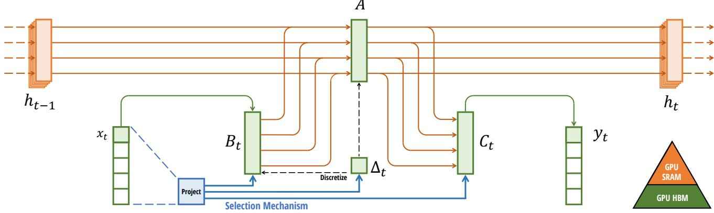  
Figure 1: （概述。）结构化 SSM 通过更高维的潜状态 $h \left( \mathrm { e . g . } N = 4 \right)$，将输入 $x$ 的每个通道（例如 $D = 5$）独立映射到输出 $y$。先前的 SSM 通过需要时不变性（time-invariance）的巧妙替代计算路径，避免实体化这一庞大的有效状态（$DN$，乘以批大小 $B$ 和序列长度 $L$）：即 $(\Delta, A, B, C)$ 参数在时间上是恒定的。我们的选择机制重新引入了输入依赖的动态特性，这也需要一种精细的硬件感知算法，仅在 GPU 内存层级中更高效的级别上实体化扩展状态。

一维函数或序列 $x ( t ) \in \mathbb { R } \mapsto y ( t ) \in \mathbb { R }$ 通过隐式潜状态 $h ( t ) \in \mathbb { R } ^ { N }$ 进行映射

具体而言，S4 模型由四个参数 $( \Delta , A , B , C )$ 定义，它们分两个阶段定义了一个序列到序列（sequence-to-sequence）变换。

$$
h ^ {\prime} (t) = A h (t) + B x (t)\tag{1a}
$$

$$
h _ {t} = \overline {{A}} h _ {t - 1} + \overline {{B}} x _ {t}
$$

(2a)

$$
\overline {{K}} = (C \overline {{B}}, C \overline {{A B}}, \dots , C \overline {{A}} ^ {k} \overline {{B}}, \dots)\tag{3a}
$$

$$
y (t) = C h (t)\tag{1b}
$$

$$
y _ {t} = C h _ {t}
$$

(2b)

$$
y = x * \overline {{K}}\tag{3b}
$$

**离散化**。第一阶段通过固定公式 $\overline { { { \cal A } } } = f _ { A } ( \Delta , A )$ 和 $\overline { { B } } = f _ { B } ( \Delta , A , B )$ 将“连续参数” ${ \bf \Sigma } ^ { , } ( \Delta , A , B )$ 转换为“离散参数” $\mathbf { \overline { { \nabla } } } ( \overline { { A } } , \overline { { B } } )$，其中参数对 $( f _ { A } , f _ { B } )$ 被称为离散化规则。可以使用各种规则，例如在公式 (4) 中定义的零阶保持（zero-order hold, ZOH）。

$$
\overline {{{A}}} = \exp (\Delta A) \quad \overline {{{B}}} = (\Delta A) ^ {- 1} (\exp (\Delta A) - I) \cdot \Delta B\tag{4}
$$

离散化与连续时间系统有着深厚的联系，这可以赋予它们额外的性质，例如分辨率不变性（Nguyen, Goel, et al. 2022）以及自动确保模型得到适当归一化（Gu, Johnson, Timalsina, et al. 2023; Orvieto et al. 2023）。它还与 RNN 的门控机制存在联系（Gu, Gulcehre, et al. 2020; Tallec and Ollivier 2018），我们将在第 3.5 节重新讨论这一点。然而，从计算机制的角度来看，离散化可以简单地看作 SSM 前向传播计算图中的第一步。其他形式的 SSM 可以绕过离散化步骤，直接对 $( { \overline { { A } } } , { \bar { B } } )$ 进行参数化（Zhang et al. 2023），这可能更容易进行推导与分析。

计算（Computation）。在参数从 $( \Delta , A , B , C ) \mapsto ( { \overline { { A } } } , { \overline { { B } } } , C )$ 转换之后，模型可以通过两种方式进行计算，即线性循环（2）或全局卷积（3）。

通常，模型在高效的可并行化训练中使用卷积模式（3）（此时整个输入序列预先可见），并在高效的自回归推理中切换为循环模式（2）（此时输入在每个时间步逐一给出）。

线性时不变性（Linear Time Invariance, LTI）。方程（1）至（3）的一个重要性质是模型的动力学特性随时间保持恒定。换句话说，(Δ, , , ) 以及随之而来的 (, ) 在所有时间步上都是固定的。这一性质被称为线性时不变性（LTI），它与循环和卷积有着深刻的联系。通俗地说，我们认为 LTI SSM 等价于任何线性循环（2a）或卷积（3b），并使用 LTI 作为这类模型统称。

到目前为止，由于基本的效率约束（在第 3.3 节中讨论），所有结构化 SSM 都是 LTI 的（例如，以卷积形式计算）。然而，本工作的一个核心见解是，LTI 模型在对某些类型的数据建模时存在根本局限性，而我们的技术贡献在于去除 LTI 约束的同时克服效率瓶颈。

结构与维度（Structure and Dimensions）。最后，我们指出，结构化 SSM 之所以如此命名，是因为对其进行高效计算还需要对  矩阵施加结构。最流行的结构形式是对角结构（Gu, Gupta, et al. 2022; Gupta, Gu, and Berant 2022; Smith, Warrington, and Linderman 2023），这也是我们所采用的形式。

在这种情况下，$A \in \mathbb { R } ^ { N \times N } , B \in \mathbb { R } ^ { N \times 1 } , C \in \mathbb { R } ^ { 1 \times N }$ 矩阵均可由 $N$ 个数表示。为了在批大小为 $B$、长度为 $L$ 且具有 $D$ 个通道的输入序列 $x$ 上进行运算，SSM 会独立地应用于每个通道。需要注意的是，在这种情况下，每个输入的总隐藏状态维度为 $DN$，在整个序列长度上对其进行计算需要 $O(BLDN)$ 的时间和内存；这是 3.3 节中所解决的根本效率瓶颈的根源。

通用状态空间模型（General State Space Models）。我们注意到，状态空间模型（state space model）这一术语具有非常宽泛的含义，它仅表示任何具有潜在状态的循环过程的概念。它已被用于指代不同学科中许多截然不同的概念，包括马尔可夫决策过程（Markov decision processes, MDP）（强化学习（Hafner et al. 2020））、动态因果建模（dynamic causal modeling, DCM）（计算神经科学（Friston, Harrison, and Penny 2003））、卡尔曼滤波（Kalman filters）（控制理论（Kalman 1960））、隐马尔可夫模型（hidden Markov models, HMM）和线性动力系统（linear dynamical systems, LDS）（机器学习），以及广义上的循环（有时是卷积）模型（深度学习）。

在整篇论文中，我们使用术语“SSM”专门指代结构化 SSM（structured SSMs）或 S4 模型类（Gu, Goel, and Ré 2022; Gu, Gupta, et al. 2022; Gupta, Gu, and Berant 2022; Hasani et al. 2023; Ma et al. 2023; Smith, Warrington, and Linderman 2023），并互换使用这些术语。为方便起见，我们还可能包含此类模型的衍生模型，例如侧重于线性循环或全局卷积视角的模型（Y. Li et al. 2023; Orvieto et al. 2023; Poli et al. 2023），并在必要时澄清细微差异。

SSM 架构。SSM 是独立的序列变换，可以整合到端到端神经网络架构中。（我们有时也将 SSM 架构称为 SSNN，正如 CNN 对应于线性卷积层一样，SSNN 对应于 SSM 层。）我们讨论了一些最知名的 SSM 架构，其中许多也将作为我们的主要基准。

• 线性注意力（Linear attention, Katharopoulos et al. 2020）是自注意力的一种近似，包含一个可视为退化线性 SSM 的循环。

• H3（Dao, Fu, Saab, et al. 2023）将这种循环泛化为使用 S4；它可以被视为一种在两个门控连接之间夹入 SSM 的架构（Figure 3）。H3 还在主 SSM 层之前插入了一个标准局部卷积，并将其构建为移位 SSM（shift-SSM）。

• Hyena（Poli et al. 2023）使用了与 H3 相同的架构，但将 S4 层替换为 MLP 参数化的全局卷积（Romero et al. 2021）。

• RetNet（Y. Sun et al. 2023）在架构中添加了一个额外的门控，并使用了更简单的 SSM，从而允许一种替代的可并行计算路径，使用多头注意力（multi-head attention, MHA）的变体来代替卷积。

• RWKV（B. Peng et al. 2023）是近期设计用于语言建模的 RNN，它基于另一种线性注意力近似方法——无注意力 Transformer（Attention-Free Transformer，S. Zhai et al. 2021）。其核心的“WKV”机制包含 LTI 循环，并可视为两个 SSM 的比率。

其他紧密相关的 SSM 和架构在扩展相关工作中进行了进一步讨论（Appendix B）。我们特别强调 S5（Smith, Warrington, and Linderman 2023）、QRNN（Bradbury et al. 2016）和 SRU（Lei et al. 2017），我们认为它们是与我们核心的选择性 SSM 最密切相关的方法。

## 3 选择性状态空间模型 (Selective State Space Models)

我们利用来自合成任务的直觉来阐明我们选择机制的动机（Section 3.1），然后解释如何将该机制融入状态空间模型中（Section 3.2）。由此产生的时变 SSM 不能使用卷积，这带来了一个如何高效计算它们的技术挑战。我们通过一种利用现代硬件内存层次结构的硬件感知算法克服了这一问题（Section 3.3）。随后，我们描述了一个不含注意力机制甚至 MLP 模块的简单 SSM 架构（Section 3.4）。最后，我们讨论了选择机制的一些额外特性（Section 3.5）。

## 3.1 动机：选择作为一种压缩手段 (Motivation: Selection as a Means of Compression)

我们认为，序列建模的一个根本问题是将上下文压缩为一个更小的状态。事实上，我们可以从这个角度来看待主流序列模型的权衡取舍。例如，注意力机制（attention）既有效又低效，因为它显式地完全不压缩上下文。这一点可以从以下事实看出：自回归推理需要显式存储整个上下文（即 KV cache），这直接导致了 Transformer 较慢的线性时间推理和二次方时间训练。另一方面，循环模型（recurrent models）之所以高效，是因为它们具有有限的状态，这意味着恒定时间推理和线性时间训练。然而，它们的有效性受到该状态对上下文压缩程度的限制。

为了理解这一原理，我们重点关注合成任务的两个典型示例（Figure 2）。

• 选择性复制（Selective Copying）任务通过改变待记忆 token 的位置，对广泛使用的复制任务（Arjovsky, Shah, and Bengio 2016）进行了修改。它需要内容感知推理能力，以便记住相关 token（彩色）并过滤掉无关 token（白色）。

• 归纳头（Induction Heads）任务是一种被假定用于解释 LLM 大部分上下文学习能力的著名机制（Olsson et al. 2022）。它需要上下文感知推理能力，以便在适当的上下文（黑色）中知道何时生成正确的输出。

这些任务揭示了 LTI（线性时不变）模型的失效模式。从循环视角来看，其恒定的动态机制（例如公式 (2) 中的 $( { \overline { { A } } } , { \overline { { B } } } )$ 转移）无法让它们从上下文中选择正确的信息，也无法以输入相关的方式影响沿序列传递的隐藏状态。从卷积视角来看，众所周知，全局卷积可以解决标准的 Copying 任务（Romero et al. 2021），因为该任务仅需要时间感知能力；但由于缺乏内容感知能力，它们在 Selective Copying 任务上面临困难（Figure 2）。更具体地说，输入与输出之间的间距是可变的，无法通过静态卷积核进行建模。

总结来说，序列模型在效率与有效性之间的权衡取决于它们对状态的压缩程度：高效的模型必须具有较小的状态，而有效的模型必须具有包含来自上下文的所有必要信息的状态。进而，我们提出构建序列模型的一个基本原则是选择性（selectivity）：即聚焦于输入或将其过滤进序列状态的上下文感知能力。具体而言，选择机制控制着信息如何沿着序列维度传播或交互（更多讨论见 Section 3.5）。

## 3.2 通过选择机制改进 SSM

将选择机制融入模型的一种方法是使其影响沿序列交互的参数（例如 RNN 的循环动态机制或 CNN 的卷积核）变为输入相关的。

算法 1 和算法 2 展示了我们所使用的主要选择机制（Selection Mechanism）。主要区别仅在于使几个参数 $\Delta, B, C$ 成为输入的函数，并在整个过程中伴随张量形状的相应变化。特别是，我们强调这些参数现在具有长度维度 $L$，这意味着模型已从时不变（time-invariant）变为时变（time-varying）。（请注意，形状标注已在第 2 节中说明。）这破坏了与卷积 (3) 的等价性，对其效率产生了影响，这将在下文讨论。

我们具体选择 $s _ { B } ( x ) = \mathrm { L i n e a r } _ { N } ( x ) , s _ { C } ( x ) = \mathrm { L i n e a r } _ { N } ( x ) , s _ { \Lambda } ( x ) = \mathrm { B r o a d c a s t } _ { D } ( \mathrm { L i n e a r } _ { 1 } ( x ) ) , \mathrm { a n d ~ } \tau _ { \Lambda } = \mathrm { s o f t p l u s } ,$ 其中 $\mathrm{Linear}_d$ 是到维度 $d$ 的参数化投影。$s_\Delta$ 和 $\tau_\Delta$ 的选择源于与 RNN 门控机制的关联，详见第 3.5 节。

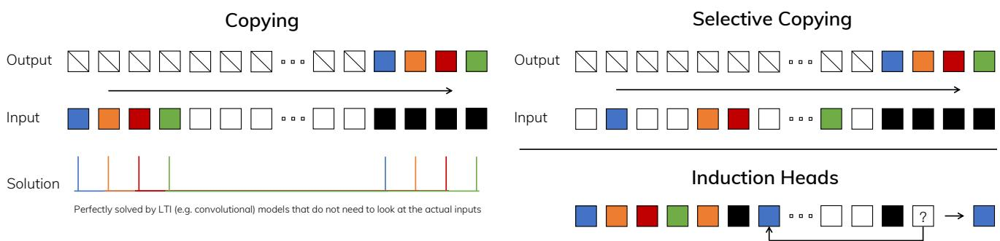  
Figure 2: （左）复制任务（Copying task）的标准版本涉及输入和输出元素之间的恒定间隔，很容易被时不变模型（如线性循环和全局卷积）解决。（右上）选择性复制任务（Selective Copying task）在输入之间具有随机间隔，需要时变模型根据输入的内容选择性地记住或忽略输入。（右下）归纳头任务（Induction Heads task）是联想记忆的一个示例，它需要根据上下文检索答案，这是 LLM 的一项关键能力。

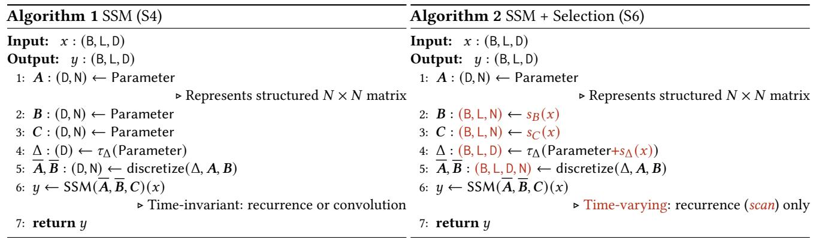

## 3.3 选择性 SSM 的高效实现

诸如卷积（Krizhevsky, Sutskever, and Hinton 2012）和注意力机制（Bahdanau, Cho, and Bengio 2015；Vaswani et al. 2017）等硬件友好型原语已得到广泛应用。在此，我们的目标同样是使选择性 SSM 在现代硬件（GPU）上高效运行。选择机制十分自然，早期的工作曾尝试引入选择机制的特例，例如在循环 SSM 中让 $\Delta$ 随时间变化（Gu, Dao, et al. 2020）。然而，如前所述，使用 SSM 的一个核心局限在于其计算效率，这也是 S4 及其所有衍生模型均采用 LTI（非选择性）模型的原因，且最常见的形式是全局卷积。

## 3.3.1 先前模型的动机

我们首先回顾这一动机，并概述我们克服先前方法局限性的途径。

• 从高层次来看，像 SSM 这样的循环模型始终在表达能力与速度之间权衡：正如第 3.1 节所讨论的，具有更大隐藏状态维度的模型应当更有效，但速度也更慢。因此，我们希望在不付出速度和内存代价的前提下，最大化隐藏状态维度。

• 注意，循环模式比卷积模式更加灵活，因为卷积模式 (3) 是由循环模式 (2) 展开推导而来的（Gu, Goel, and Ré 2022；Gu, Johnson, Goel, et al. 2021）。然而，这将需要计算并显式物化形状为 $(B, L, D, N)$ 的潜在状态 $h$，该状态比形状为 $(B, L, D)$ 的输入 $x$ 和输出 $y$ 大得多（大了一个因子 $N$，即 SSM 状态维度）。因此，文献中引入了更高效的卷积模式，该模式可以绕过状态计算，且仅物化大小为 $(B, L, D)$ 的卷积核 (3a)。

• 先前的 LTI 状态空间模型利用循环-卷积双重形式，在不损失效率的前提下将有效状态维度提升了 $N$ 倍（$\approx 10 - 100$），这远大于传统的 RNN。

## 3.3.2 选择性扫描概述：硬件感知的状态扩展

选择机制旨在克服 LTI（线性时不变）模型的局限性；与此同时，我们也因此需要重新审视 SSM（状态空间模型）的计算问题。我们通过三种经典技术来解决这一问题：核函数融合（kernel fusion）、并行扫描（parallel scan）和重计算（recomputation）。我们得出了两个主要观察结果：

• 朴素的循环计算使用 $O(BLDN)$ FLOPs，而卷积计算使用 $O ( B L D \log ( L ) ) { \mathrm { F L O P s } } _ { \mathrm { ~ } }$，且前者的常数因子更小。因此，对于长序列以及不太大的状态维度 $N$，循环模式实际上可以使用更少的 FLOPs。

• 两个主要挑战在于循环的顺序性特征以及巨大的内存占用。为了解决后者，正如卷积模式一样，我们可以尝试不实际物化（materialize）完整的状态 $h$。

核心思想是利用现代加速器（GPU）的特性，仅在存储层级结构（memory hierarchy）中更高效的层级上物化状态 $h$。特别是，大多数操作（除矩阵乘法外）都受限于内存带宽（Dao, Fu, Ermon, et al. 2022; Ivanov et al. 2021; Williams, Waterman, and Patterson 2009）。这包括我们的扫描操作，并且我们使用核函数融合来减少内存 I/O 量，相较于标准实现带来了显著的加速。

具体而言，我们不在 GPU HBM（高带宽内存，high-bandwidth memory）中准备大小为 (B, L, D, N) 的扫描输入 $( { \overline { { A } } } , { \overline { { B } } } )$，而是将 SSM 参数 (Δ, , , ) 直接从较慢的 HBM 加载到快速的 SRAM 中，在 SRAM 中执行离散化和递推，然后将大小为 (B L D) 的最终输出写回 HBM。

为避免顺序递推，我们注意到尽管它不是线性的，但仍可以通过工作高效的并行扫描算法（parallel scan algorithm）（Blelloch 1990; Martin and Cundy 2018; Smith, Warrington, and Linderman 2023）来实现并行化。

最后，我们还必须避免保存反向传播所需的中间状态。我们精心应用了重计算（recomputation）这一经典技术来降低内存需求：中间状态不进行存储，而是在反向传播过程中当输入从 HBM 加载到 SRAM 时重新计算。因此，融合选择性扫描层的内存需求与采用 FlashAttention 的优化 Transformer 实现相同。

融合算子与重计算的详细信息见 Appendix D。完整的 Selective SSM 层和算法如图 Figure 1 所示。

## 3.4 简化的 SSM 架构

与结构化 SSM（structured SSM）一样，选择性 SSM（selective SSM）是独立的序列变换，可以灵活地整合到神经网络中。H3 架构是最知名的 SSM 架构的基础（Section 2），这些架构通常由一个受线性注意力（linear attention）启发的模块与一个 MLP（多层感知机，multi-layer perceptron）模块交替堆叠而成。我们通过将这两个组件合二为一来简化该架构，并对其进行同质化堆叠（Figure 3）。这一设计的灵感来源于门控注意力单元（GAU，gated attention unit）（Hua et al. 2022），该单元对注意力机制也进行了类似的设计。

该架构通过一个可控的扩展因子 $E$ 来扩展模型维度 $D$。对于每个块，大部分参数 $(3 E D ^ { 2 })$ 集中在线性投影中（输入投影占 $2 E D ^ { 2 }$，输出投影占 $E D ^ { 2 }$），而内部 SSM 贡献的参数较少。相比之下，SSM 的参数量（$\Delta, B, C$ 的投影以及矩阵 $A$）要小得多。我们重复该块，并与标准归一化和残差连接交替结合，以构建 Mamba 架构。在我们的实验中，我们始终固定 $E = 2$，并堆叠两个该模块，以匹配 Transformer 中交替的 MHA（多头注意力，multi-head attention）和 MLP 块的 $12 D ^ { 2 }$ 参数量。我们使用 SiLU / Swish 激活函数 (Hendrycks and Gimpel 2016; Ramachandran, Zoph, and Quoc V Le 2017)，动机是使门控 MLP 变为流行的“SwiGLU”变体 (Chowdhery et al. 2023; Dauphin et al. 2017; Shazeer 2020; Touvron et al. 2023)。最后，我们额外使用了一个可选的归一化层（我们选择 LayerNorm (J. L. Ba, Kiros, and Hinton 2016)），这是受到 RetNet 在类似位置使用归一化层的启发 (Y. Sun et al. 2023)。

## 3.5 选择机制的特性

选择机制是一个更广泛的概念，可以以不同的方式应用，例如应用于更传统的 RNN 或 CNN、不同的参数（例如算法 2 中的 $A$），或使用不同的变换 $s(x)$。

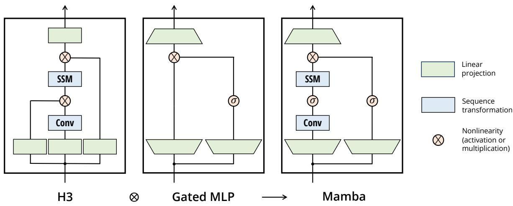  
Figure 3：（架构。）我们简化的块设计将作为大多数 SSM 架构基础的 H3 块与现代神经网络中广泛使用的 MLP 块相结合。我们没有交替使用这两个块，而是简单地同质化重复堆叠 Mamba 块。与 H3 块相比，Mamba 用激活函数替换了第一个乘法门。与 MLP 块相比，Mamba 在主分支中添加了一个 SSM。对于 $\sigma$，我们使用 SiLU / Swish 激活函数 (Hendrycks and Gimpel 2016; Ramachandran, Zoph, and Quoc V Le 2017)。

## 3.5.1 与门控机制的联系

我们强调最重要的联系：RNN 的经典门控机制是我们 SSM 选择机制的一个特例。我们注意到，RNN 门控与连续时间系统的离散化之间的联系早已确立 (Funahashi and Nakamura 1993; Tallec and Ollivier 2018)。事实上，定理 1 是对 Gu, Johnson, Goel, et al. (2021, Lemma 3.1) 的改进，推广到了零阶保持（ZOH）离散化和输入相关门控（证明见附录 C）。更广泛地讲，SSM 中的 $\Delta$ 可以被视为扮演了 RNN 门控机制的泛化角色。与先前的工作一致，我们认为 SSM 的离散化是启发式门控机制的原则性基础。

定理 1。当 $N = 1 , A = - 1 , B = 1 , s _ { \Delta } = \mathsf { L i n e a r } ( x )$ 且 $\tau_\Delta = \text{softplus}$ 时，选择性 SSM 递推（算法 2）的形式为

$$
\begin{array}{l} g _ {t} = \sigma (\operatorname{Linear} (x _ {t})) \\ h _ {t} = (1 - g _ {t}) h _ {t - 1} + g _ {t} x _ {t}. \end{array}\tag{5}
$$

正如第 3.2 节所提及的，我们对 ${ \dot { s } } _ { \Delta } , \tau _ { \Delta }$ 的具体选择正是来源于这一联系。特别需要注意的是，如果某个给定的输入 $x _ { t }$ 应当被完全忽略（正如在合成任务中所必需的那样），那么所有通道都应当忽略它，因此我们在使用 $\Delta$ 进行重复/广播之前，先将输入投影降至 1 维。

## 3.5.2 选择机制的解释

我们详细阐述选择机制的三种特定机理效应。

可变间距（Variable Spacing）。选择性允许过滤掉感兴趣的输入之间可能出现的不相关噪声标记（token）。选择性复制（Selective Copying）任务便是这一特性的典范，但它也普遍存在于常见的数据模态中，尤其是离散数据——例如语言中诸如“um”等填充词的出现。产生这一特性的原因在于，模型可以在机理上过滤掉任何特定的输入 $x _ { t } ,$，例如在门控 RNN 的情况下（定理 1），当 $g _ { t } \to 0$ 时。

过滤上下文（Filtering Context）。经验表明，尽管原则上更多的上下文应该带来严格更优的性能，但许多序列模型在上下文更长时性能并没有提升（F. Shi et al. 2023）。一种解释是，许多序列模型在必要时无法有效忽略不相关的上下文；全局卷积（以及一般的 LTI 模型）就是一个直观的例子。另一方面，选择性模型可以随时重置其状态以清除无关的历史信息，因此原则上它们的性能会随上下文长度单调提升（例如第 4.3.2 节）。

边界重置。在将多个独立序列拼接在一起的场景中，Transformer 可以通过实例化特定的注意力掩码（attention mask）来保持它们相互独立，而 LTI（线性时不变）模型则会在序列之间泄露信息。选择性 SSM 也可以在边界处重置其状态（例如 $\Delta _ { t } \to \infty$，或在定理 1 中当 $g _ { t } \to 1$ 时）。这些场景可能是人为构建的（例如为了提高硬件利用率而将文档打包拼接在一起），也可能是自然产生的（例如强化学习中的回合边界 (Lu et al. 2023)）。

此外，我们详细阐述各个选择性参数的作用。

$\Delta$ 的解释。通常，$\Delta$ 控制着关注还是忽略当前输入 $x _ { t }$ 的平衡。它推广了 RNN 门控机制（例如定理 1 中的 $g_t$）：从机理上讲，较大的 $\Delta$ 会重置状态 $h$ 并聚焦于当前输入 $x$，而较小的 $\Delta$ 则会保持状态并忽略当前输入。SSM (1)-(2) 可以解释为由时间步长 $\Delta$ 离散化的连续系统，在此背景下的直觉是：较大的 $\Delta \to \infty$ 表示系统对当前输入关注更长时间（从而“选择”它并遗忘其当前状态），而较小的 $\Delta \to 0$ 则表示被忽略的瞬态输入。

$A$ 的解释。我们指出，虽然参数 $A$ 也可以是选择性的，但它最终仅通过离散化公式 (4) 中的 $\overline { { A } } = \exp ( \Delta A )$ 与 $\Delta$ 相互作用来影响模型。因此，$\Delta$ 的选择性足以确保 $( \overline { { A } } , \overline { { B } } )$ 的选择性，并且是性能提升的主要来源。我们推测，在 $\Delta$ 之外（或代替 $\Delta$）将 $A$ 设为选择性的会取得相似的性能，为了简单起见在此省略。

和  的解释。正如 3.1 节所讨论的，选择性最重要的特性是过滤无关信息，从而使序列模型的上下文能够被压缩进一个高效的状态中。在 SSM 中，将  和  修改为具备选择性，可以更细粒度地控制是让输入 $x _ { t }$ 进入状态 $h _ { t } ,$，还是让状态进入输出 $y _ { t }$。这可以解释为允许模型分别基于内容（输入）和上下文（隐藏状态）来调节循环动力学。

## 3.6 额外模型细节

实数与复数。大多数先前的 SSM 在其状态 $h ,$ 中使用复数，这对于在感知模态的许多任务中取得强劲性能是必要的 (Gu, Goel, and Ré 2022)。然而，经验观察表明，在某些设定下，完全实值的 SSM 似乎运行良好，甚至可能更好 (Ma et al. 2023)。我们默认使用实数值，这在我们除一项任务之外的所有任务中都表现良好；我们推测复数与实数之间的权衡与数据模态中的连续-离散谱系相关，其中复数对连续模态（例如音频、视频）有帮助，但对离散模态（例如文本、DNA）则不然。

初始化。大多数先前的 SSM 还建议采用特殊的初始化，尤其是在复数值情况下，这在低数据量等多种设定下会有所帮助。我们在复数情况下的默认初始化是 S4D-Lin，实数情况下是 S4D-Real (Gu Gu ta et al. 2022)，后者基于 HIPPO 理论 (Gu Dao et al. 2020)。这些分别将 $A { \mathrm { a s } } - 1 / 2 +$  和 $- ( n + 1 )$ 定义为其第  个元素。然而，我们预期许多初始化都能正常工作，特别是在大数据量和实值 SSM 设定下；4.6 节中考虑了一些消融实验。

$\Delta$ 的参数化。我们将对 $\Delta$ 的选择性调整定义为 $s _ { \Delta } ( x ) = { \tt B r o a d c a s t } _ { D } ( { \tt L i n e a r } _ { 1 } ( x ) )$，其灵感源于 $\Delta$ 的机制（第 3.5 节）。我们发现它可以从维度 1 推广到更大的维度 $R$。我们将其设置为 $D$ 的一小部分，与该模块中的主要线性投影相比，所占用的参数量可以忽略不计。此外，我们注意到广播操作也可以被视作另一个线性投影，并初始化为 1 和 $0$ 的特定模式；如果该投影是可训练的，则会引出替代形式 $s _ { \Delta } ( x ) = \mathsf { L i n e a r } _ { D } ( \mathsf { L i n e a r } _ { R } ( x ) )$，这可以被视为低秩投影。

在我们的实验中，遵循先前关于 SSM 的研究（Gu, Johnson, Timalsina, et al. 2023），$\Delta$ 参数（可被视为偏置项）初始化为 $\tau _ { \Delta } ^ { - 1 } ( \mathsf { U n i f o r m } ( [ 0 . 0 0 1 , 0 . 1 ] ) )$。

注 3.1（Remark 3.1）。为使实验结果表述简洁，我们有时将选择性 SSM 简称为 S6 模型，因为它们是带有选择机制（selection mechanism）并使用扫描（scan）进行计算的 S4 模型。

## 4 实证评估

在第 4.1 节中，我们测试了 Mamba 解决第 3.1 节中提出的两个合成任务的能力。随后，我们在三个领域展开评估，每个领域均针对自回归预训练以及下游任务进行评估。

• 第 4.2 节：语言模型预训练（缩放定律）与零样本下游评估。

• 第 4.3 节：DNA 序列预训练，以及长序列分类任务上的微调。

• 第 4.4 节：音频波形预训练，以及自回归生成语音片段的质量。

最后，第 4.5 节展示了 Mamba 在训练和推理阶段的计算效率，第 4.6 节对架构和选择性 SSM（selective SSM）的各个组件进行了消融实验。

## 4.1 合成任务

这些任务的完整实验细节（包括任务详情和训练方案）见附录 E.1（Appendix E.1）。

## 4.1.1 选择性复制

复制（Copying）任务是序列建模中研究最充分的合成任务之一，最初设计用于测试循环模型的记忆能力。如第 3.1 节所述，LTI SSM（线性循环和全局卷积）可以通过仅追踪时间而不是对数据进行推理来轻松解决此任务；例如，通过构建一个长度恰好合适的卷积核（Figure 2）。这在早期关于全局卷积的研究中得到了明确验证（Romero et al. 2021）。选择性复制（Selective Copying）任务通过随机化 token 之间的间距来防止这种捷径。需要注意的是，该任务此前曾作为去噪（Denoising）任务被引入（Jing et al. 2019）。

注意，许多先前的工作认为添加架构门控（乘法交互）可以赋予模型“数据依赖性”并解决相关任务（Dao, Fu, Saab, et al. 2023; Poli et al. 2023）。然而，从直觉上看，我们发现这种解释是不充分的，因为此类门控不会沿序列轴进行交互，也无法影响 token 之间的间距。特别是，架构门控并不属于选择机制的范例（附录 A）。

Table 1 证实，像 H3 和 Mamba 这样的门控架构仅能部分提升性能，而选择机制（将 S4 修改为 S6）则能轻松解决此任务，特别是与这些更强大的架构相结合时。

## 4.1.2 归纳头（Induction Heads）

归纳头（Induction heads）任务（Olsson et al. 2022）是从机制可解释性（mechanistic interpretability）视角（Elhage et al. 2021）提出的一个简单任务，它对大语言模型（LLMs）的上下文学习（in-context learning）能力具有出人意料的预测性。它要求模型执行关联回忆和复制：例如，如果模型在序列中看到了诸如“Harry Potter”之类的二元组（bigram），那么当下一次“Harry”出现在同一序列中时，模型应该能够通过从历史中复制来预测出“Potter”。

数据集（Dataset）。我们在序列长度为 256、词表大小为 16 的归纳头任务上训练了一个 2 层模型，这与该任务先前的研究工作（Dao, Fu, Saab, et al. 2023）相当，但采用了更长的序列。此外，我们还通过在测试时评估从 $2 ^ { 6 } = 6 4$ 到高达 $2 ^ { 2 0 } = 1 0 4 8 5 7 6$ 的一系列序列长度，来探究泛化和外推能力。

模型（Models）。遵循关于归纳头的既有研究工作，我们使用 2 层模型，这使得注意力机制能够从机理上解决归纳头任务（Olsson et al. 2022）。我们测试了多头注意力（8 个头，配备各种位置编码）和 SSM 变体。我们对 Mamba 使用了 64 的模型维度 $D$，对其他模型使用了 128。

结果（Results）。表 2（Table 2）表明，Mamba——更准确地说是其选择性 SSM 层——具备完美解决该任务的能力，因为它能够选择性地记住相关标记（token），同时忽略其间的所有其他内容。它可以完美泛化到百万级别的序列长度，即比训练时所见长度长 4000 倍，而其他方法均未能超过 2 倍。

<table><tr><td>模型 (MODEL)</td><td>架构 (ARCH.)</td><td>层 (LAYER)</td><td>准确率 (Acc.)</td></tr><tr><td>S4</td><td>无门控 (No gate)</td><td>S4</td><td>18.3</td></tr><tr><td>-</td><td>无门控 (No gate)</td><td>S6</td><td>97.0</td></tr><tr><td>H3</td><td>H3</td><td>S4</td><td>57.0</td></tr><tr><td>Hyena</td><td>H3</td><td>Hyena</td><td>30.1</td></tr><tr><td>-</td><td>H3</td><td>S6</td><td>99.7</td></tr><tr><td>-</td><td>Mamba</td><td>S4</td><td>56.4</td></tr><tr><td>-</td><td>Mamba</td><td>Hyena</td><td>28.4</td></tr><tr><td>Mamba</td><td>Mamba</td><td>S6</td><td>99.8</td></tr></table>

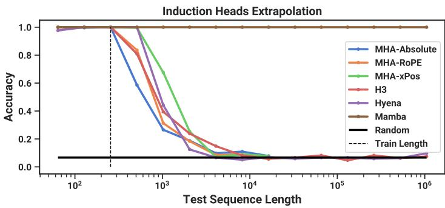  
Table 2: （归纳头。）模型在序列长度 $2 ^ { 8 } =$ 256 上进行训练，并在从 $2 ^ { 6 } = 6 4$ 到 $2 ^ { 2 0 } \ =$ 1048576 递增的序列长度上进行测试。完整数据见 Table 11。

Table 1: （选择性复制。）  
不同架构与内部序列层组合的准确率。  
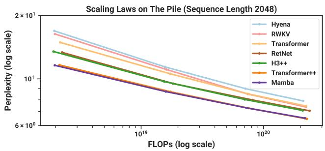

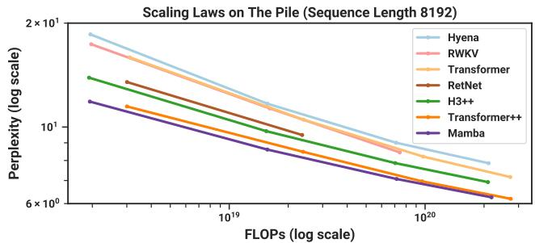  
Figure 4: （缩放法则。）参数量约为 125M 到 1.3B 的模型在 Pile 数据集上训练。Mamba 的缩放表现优于所有其他无注意力机制模型（attention-free models），并且是首个能与现已成为标准的极强“Transformer++”方案相媲美的模型，尤其是在序列长度增加时。

在注意力模型的位置编码变体中，xPos（专为长度外推而设计）略优于其他变体；同时需要注意，由于显存限制，所有注意力模型最多仅测试到序列长度 $2^{14} = 16384$。在其他 SSM 中，H3 和 Hyena 表现相似，这与 Poli et al. (2023) 中的发现相反。

## 4.2 语言建模

我们在标准自回归语言建模任务上，将 Mamba 架构与其他架构在预训练指标（困惑度）和零样本评估两方面进行了评估。我们将模型大小（深度和宽度）设置为与 GPT3 规范相对应。我们使用 Pile 数据集（L. Gao, Biderman, et al. 2020），并遵循 Brown et al. (2020) 中描述的训练配方。所有训练细节均在 Appendix E.2 中。

## 4.2.1 缩放法则

对于基线模型，我们与标准 Transformer 架构（GPT3 架构）以及我们所知最强的 Transformer 配方（此处称为 Transformer++）进行了对比，后者基于 PaLM 和 LLaMa 架构（例如旋转位置编码（rotary embedding）、SwiGLU MLP、用 RMSNorm 代替 LayerNorm、无线性偏置以及更高的学习率）。我们还与其他近期提出的次二次方（subquadratic）架构进行了对比（Figure 4）。所有模型细节见附录 E.2。

Figure 4 展示了在标准 Chinchilla（Hofmann et al. 2022）协议下，参数量从约 125M 到约 1.3B 的模型缩放定律（scaling laws）。Mamba 是首个能够匹敌现已成为标准的极强 Transformer 配方（Transformer++）性能的无注意力（attention-free）模型，尤其是在序列长度增长的情况下。（我们注意到，作为此前同样可解释为 SSM 的强大循环模型基线，RWKV 和 RetNet 由于缺乏高效实现导致显存溢出（out-of-memory）或计算需求过高，因而缺失了在 8k 上下文长度下的完整结果。）

## 4.2.2 下游任务评估

Table 3 展示了 Mamba 在一系列常用下游零样本评估任务上的性能。我们与该参数规模下最知名的开源模型进行了对比，最主要的是 Pythia（Biderman et al. 2023）和 RWKV（B. Peng et al. 2023），它们采用了与我们模型相同的分词器（tokenizer）、数据集以及训练长度（300B tokens）进行训练。（注意：Mamba 和 Pythia 训练时的上下文长度为 2048，而 RWKV 训练时的上下文长度为 1024。）

Table 3:（零样本评估。）各尺寸的最佳结果以粗体显示。我们与使用不同分词器（tokenizer）、训练量高达 300B token 的开源语言模型（LM）进行了对比。Pile 指的是验证集划分，仅与在相同数据集和分词器（GPT-NeoX-20B）上训练的模型进行比较。对于每种模型尺寸，Mamba 在每一项评估结果中均为同类最佳，且通常能与两倍于其尺寸的基线模型相媲美。

<table><tr><td>模型</td><td>分词器</td><td>PILE PPL ↓</td><td>LAMBADA PPL ↓</td><td>LAMBADA ACC ↑</td><td>HELLASWAG ACC ↑</td><td>PIQA ACC ↑</td><td>ARC-E ACC ↑</td><td>ARC-C ACC ↑</td><td>WINOGRANDE ACC ↑</td><td>平均准确率 ↑</td></tr><tr><td>Hybrid H3-130M</td><td>GPT2</td><td>—</td><td>89.48</td><td>25.77</td><td>31.7</td><td>64.2</td><td>44.4</td><td>24.2</td><td>50.6</td><td>40.1</td></tr><tr><td>Pythia-160M</td><td>NeoX</td><td>29.64</td><td>38.10</td><td>33.0</td><td>30.2</td><td>61.4</td><td>43.2</td><td>24.1</td><td>51.9</td><td>40.6</td></tr><tr><td>Mamba-130M</td><td>NeoX</td><td>10.56</td><td>16.07</td><td>44.3</td><td>35.3</td><td>64.5</td><td>48.0</td><td>24.3</td><td>51.9</td><td>44.7</td></tr><tr><td>Hybrid H3-360M</td><td>GPT2</td><td>—</td><td>12.58</td><td>48.0</td><td>41.5</td><td>68.1</td><td>51.4</td><td>24.7</td><td>54.1</td><td>48.0</td></tr><tr><td>Pythia-410M</td><td>NeoX</td><td>9.95</td><td>10.84</td><td>51.4</td><td>40.6</td><td>66.9</td><td>52.1</td><td>24.6</td><td>53.8</td><td>48.2</td></tr><tr><td>Mamba-370M</td><td>NeoX</td><td>8.28</td><td>8.14</td><td>55.6</td><td>46.5</td><td>69.5</td><td>55.1</td><td>28.0</td><td>55.3</td><td>50.0</td></tr><tr><td>Pythia-1B</td><td>NeoX</td><td>7.82</td><td>7.92</td><td>56.1</td><td>47.2</td><td>70.7</td><td>57.0</td><td>27.1</td><td>53.5</td><td>51.9</td></tr><tr><td>Mamba-790M</td><td>NeoX</td><td>7.33</td><td>6.02</td><td>62.7</td><td>55.1</td><td>72.1</td><td>61.2</td><td>29.5</td><td>56.1</td><td>57.1</td></tr><tr><td>GPT-Neo 1.3B</td><td>GPT2</td><td>—</td><td>7.50</td><td>57.2</td><td>48.9</td><td>71.1</td><td>56.2</td><td>25.9</td><td>54.9</td><td>52.4</td></tr><tr><td>Hybrid H3-1.3B</td><td>GPT2</td><td>—</td><td>11.25</td><td>49.6</td><td>52.6</td><td>71.3</td><td>59.2</td><td>28.1</td><td>56.9</td><td>53.0</td></tr><tr><td>OPT-1.3B</td><td>OPT</td><td>—</td><td>6.64</td><td>58.0</td><td>53.7</td><td>72.4</td><td>56.7</td><td>29.6</td><td>59.5</td><td>55.0</td></tr><tr><td>Pythia-1.4B</td><td>NeoX</td><td>7.51</td><td>6.08</td><td>61.7</td><td>52.1</td><td>71.0</td><td>60.5</td><td>28.5</td><td>57.2</td><td>55.2</td></tr><tr><td>RWKV-1.5B</td><td>NeoX</td><td>7.70</td><td>7.04</td><td>56.4</td><td>52.5</td><td>72.4</td><td>60.5</td><td>29.4</td><td>54.6</td><td>54.3</td></tr><tr><td>Mamba-1.4B</td><td>NeoX</td><td>6.80</td><td>5.04</td><td>64.9</td><td>59.1</td><td>74.2</td><td>65.5</td><td>32.8</td><td>61.5</td><td>59.7</td></tr><tr><td>GPT-Neo 2.7B</td><td>GPT2</td><td>—</td><td>5.63</td><td>62.2</td><td>55.8</td><td>72.1</td><td>61.1</td><td>30.2</td><td>57.6</td><td>56.5</td></tr><tr><td>Hybrid H3-2.7B</td><td>GPT2</td><td>—</td><td>7.92</td><td>55.7</td><td>59.7</td><td>73.3</td><td>65.6</td><td>32.3</td><td>61.4</td><td>58.0</td></tr><tr><td>OPT-2.7B</td><td>OPT</td><td>—</td><td>5.12</td><td>63.6</td><td>60.6</td><td>74.8</td><td>60.8</td><td>31.3</td><td>61.0</td><td>58.7</td></tr><tr><td>Pythia-2.8B</td><td>NeoX</td><td>6.73</td><td>5.04</td><td>64.7</td><td>59.3</td><td>74.0</td><td>64.1</td><td>32.9</td><td>59.7</td><td>59.1</td></tr><tr><td>RWKV-3B</td><td>NeoX</td><td>7.00</td><td>5.24</td><td>63.9</td><td>59.6</td><td>73.7</td><td>67.8</td><td>33.1</td><td>59.6</td><td>59.6</td></tr><tr><td>Mamba-2.8B</td><td>NeoX</td><td>6.22</td><td>4.23</td><td>69.2</td><td>66.1</td><td>75.2</td><td>69.7</td><td>36.3</td><td>63.5</td><td>63.3</td></tr><tr><td>GPT-J-6B</td><td>GPT2</td><td>—</td><td>4.10</td><td>68.3</td><td>66.3</td><td>75.4</td><td>67.0</td><td>36.6</td><td>64.1</td><td>63.0</td></tr><tr><td>OPT-6.7B</td><td>OPT</td><td>—</td><td>4.25</td><td>67.7</td><td>67.2</td><td>76.3</td><td>65.6</td><td>34.9</td><td>65.5</td><td>62.9</td></tr><tr><td>Pythia-6.9B</td><td>NeoX</td><td>6.51</td><td>4.45</td><td>67.1</td><td>64.0</td><td>75.2</td><td>67.3</td><td>35.5</td><td>61.3</td><td>61.7</td></tr><tr><td>RWKV-7.4B</td><td>NeoX</td><td>6.31</td><td>4.38</td><td>67.2</td><td>65.5</td><td>76.1</td><td>67.8</td><td>37.5</td><td>61.0</td><td>62.5</td></tr></table>

## 4.3 DNA 建模

受大型语言模型成功的启发，近期已有研究探索将基础模型（Foundation Model，FM）范式应用于基因组学。DNA 与语言类似，都由具有有限词表的离散标记序列组成。众所周知，对 DNA 进行建模需要捕捉长程依赖关系（Avsec et al. 2021）。我们在与近期 DNA 长序列模型（Nguyen, Poli, et al. 2023）相同的设置下，研究了将 Mamba 作为基础模型骨干网络进行预训练和微调的效果。具体而言，我们重点开展了两项探索：模型大小与序列长度的缩放定律（Scaling Laws）（Figure 5），以及一项需要长上下文的困难下游合成分类任务（Figure 6）。

在预训练方面，我们在训练和模型细节上基本遵循标准的因果语言建模（下一个标记预测）设置（另见 Appendix E.2）。在数据集方面，我们基本遵循 HyenaDNA（Nguyen, Poli, et al. 2023）的设置，使用 HG38 数据集进行预训练，其训练集中包含单个人类基因组约 45 亿个标记（DNA 碱基对）。

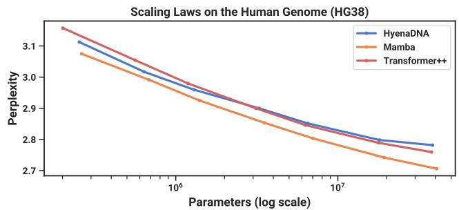

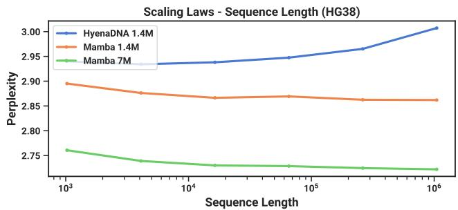  
Figure 5:（DNA 缩放定律。）在 HG38（人类基因组）数据集上的预训练。（左）固定短上下文长度 $2 ^ { 1 0 } = 1 0 2 4$ 并将模型大小从 ≈ 200K 增加到 ≈ 40M 参数，Mamba 的扩展性优于基线模型。（右）固定模型大小并增加序列长度，同时保持每批 token 数和总训练 token 数不变。与基线模型不同，Mamba 的选择机制随着上下文长度的增加实现了更好的性能。

## 4.3.1 扩展：模型大小

在本实验中，我们研究了具有不同模型骨干（backbones）的基因组学基础模型的扩展特性（Figure 5 左图）。

训练。为了有利于基线模型，我们在 1024 的短序列长度上进行训练；如 4.3.2 节所示，我们预计在更长的序列长度下，结果将更有利于 Mamba。我们固定全局批大小（global batch size）为 1024，每批总计 $2 ^ { 2 0 }$ ≈ 1M token。模型训练了 10K 个梯度步，总计 10B token。

结果。Figure $\dot { ) } \left( L e f \hat { t } \right)$ 显示，Mamba 的预训练困惑度（perplexity）随模型大小平滑改善，并且 Mamba 的扩展性优于 HyenaDNA 和 Transformer++。例如，在最大模型大小（≈ 40M 参数）下，曲线表明 Mamba 仅需大约少 3× 至 4× 的参数量即可匹配 Transformer++ 和 HyenaDNA 模型的性能。

## 4.3.2 扩展：上下文长度

在接下来的 DNA 实验中，我们研究了模型关于序列长度的扩展特性（scaling properties）。我们仅比较 HyenaDNA 和 Mamba 模型，因为在更长的序列长度下，二次注意力机制（quadratic attention）的计算开销变得极其高昂。我们在序列长度 $2 ^ { 1 0 } \ = \ 1 0 2 4 , \ 2 ^ { 1 2 } \ = \ 4 0 9 6 , \ \dot { 2 } ^ { 1 4 } \ = \ 1 6 3 \dot { 8 } 4 , \ 2 ^ { \bar { 1 } 6 } \ = \ 6 5 5 3 6 , \ 2 ^ { \bar { 1 } 8 } \ = \ \hat { 2 } 6 2 1 4 4 ,$ $2 ^ { 2 0 } = 1 0 4 8 5 7 6$ 上对模型进行预训练。我们将模型大小固定为 6 层、宽度 128（约 1.3M–1.4M 参数）。模型训练了 20K 个梯度步，共计约 330M 个 token。较长的序列长度使用了类似于 (Nguyen, Poli, et al. 2023) 的序列长度预热（sequence length warmup）。

结果。Figure 5（右）显示，Mamba 能够充分利用更长的上下文，甚至扩展到长达 1M 的极长序列，并且随着上下文的增加，其预训练困惑度（pretraining perplexity）持续改善。另一方面，HyenaDNA 模型的效果则随着序列长度的增加而变差。根据 3.5 节中关于选择机制特性的讨论，这是符合直觉的。具体而言，LTI（线性时不变）模型无法选择性地忽略信息；从卷积的角度来看，极长的卷积核会聚合长序列上的所有信息，而这些信息可能存在极大的噪声。需要注意的是，尽管 HyenaDNA 声称能随更长的上下文而取得性能提升，但其结果并未对计算时间进行控制。

## 4.3.3 合成物种分类

我们在下游任务上对模型进行评估，该任务通过随机采样一段连续的 DNA 片段来对 5 种不同的物种进行分类。该任务改编自 HyenaDNA，后者使用的物种为 {人类、狐猴、小鼠、猪、河马}。我们对该任务进行了修改，使其更具挑战性：对已知拥有 99% 相同 DNA 的五种类人猿物种 {人类、黑猩猩、大猩猩、红毛猩猩、倭黑猩猩} 进行分类。

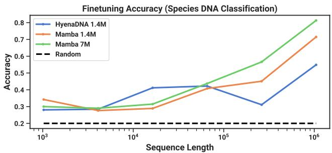  
Figure 6: （类人猿 DNA 分类。）使用相同上下文长度的预训练模型，在长度从 $2 ^ { 1 0 } = 1 0 2 4 \mathrm { u p }$ 到 $2 ^ { 2 0 } = 1 0 4 8 5 7 6$ 的序列上进行微调后的准确率。具体数值结果见 Table 13。

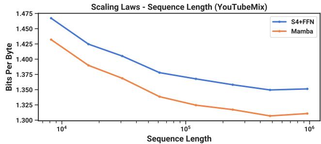  
Figure 7: （音频预训练。）在自回归音频建模中，Mamba 的性能优于先前的最先进模型（Sashimi），同时在扩展至长达数分钟的上下文或百万级长度的序列时性能持续提升（在控制计算量的情况下）。

## 4.4 音频建模与生成

对于音频波形模态，我们主要与 SaShiMi 架构及训练协议（Goel et al. 2022）进行对比。该模型包含：

1. 一个具有两个池化阶段的 U-Net 骨干网络（backbone），每个阶段通过因子  进行池化并使模型维度  翻倍，

2. 每个阶段中交替的 S4 和 MLP 块。

我们考虑将 S4+MLP 块替换为 Mamba 块。实验细节见附录 E.4。

## 4.4.1 长上下文自回归预训练

我们在 YouTubeMix (DeepSound 2017) 上评估预训练质量（自回归下一采样点预测），这是先前工作所采用的标准钢琴音乐数据集，包含以 16000 Hz 采样率采样的 4 小时独奏钢琴音乐。预训练细节主要遵循标准语言建模设置（第 4.2 节）。Figure 7 评估了在保持计算量固定的情况下，将训练序列长度从 $2 ^ { 1 3 } = 8 1 9 2$ 增加到 220 ≈ 106 的效果。（数据整理的方式存在一些轻微的边缘情况，这可能会导致缩放曲线出现拐点。例如，由于数据集中仅有一分钟长的片段可用，因此最大序列长度实际上受限于 $6 0 s \cdot 1 6 0 0 0 H z = 9 6 0 0 0 0 . _ { . }$。）

Mamba 和 SaShiMi (S4+MLP) 基线模型均随着上下文长度的增加而持续提升；Mamba 在整个过程中表现更优，并且在更长序列长度下差距进一步拉大。主要评估指标为每字节比特数（BPB, bits per byte），它与其他模态预训练中使用的标准负对数似然（NLL, negative log-likelihood）损失相差一个常数因子 $\log(2)$。

我们指出一个重要的细节：这是本文中唯一一个我们将实数参数化切换为复数参数化的实验（第 3.6 节）。我们在附录 E.4 中展示了额外的消融实验。

## 4.4.2 自回归语音生成

SC09 是一个基准语音生成数据集（Donahue, McAuley, and Puckette 2019; Warden 2018），由采样率为 16000 Hz 的数字“zero”至“nine”的 1 秒音频片段组成，具有极高的特征多样性。我们大体遵循 Goel et al. (2022) 的自回归训练设置和生成方案。

Table 4 展示了 Mamba-UNet 模型与来自 Goel et al. (2022) 的多种基线模型的自动化评估指标对比：WaveNet (Oord et al. 2016)、SampleRNN (Mehri et al. 2017)、WaveGAN (Donahue, McAuley, and Puckette 2019)、DiffWave (Z. Kong et al. 2021) 以及 SaShiMi。一个较小的 Mamba 模型便超越了最先进的（且规模大得多的）基于 GAN 和基于扩散的模型。而参数量与基线相匹配的更大模型，则在保真度指标上取得了进一步的大幅提升。

Table 5 以小型 Mamba 模型为基础，研究了外层阶段和中心阶段采用不同架构组合的效果。结果表明，在外层块中，Mamba 始终优于 S4+MLP，而在中心块中，各架构的表现关系为 Mamba $> S 4 \mathrm { + } M \mathrm { L P } >$ MHA+MLP。

Table 4: (SC09) 在具有挑战性的固定长度语音片段数据集上进行无条件生成的自动化评估指标。（从上至下）自回归基线、非自回归基线、Mamba 以及数据集指标。

<table><tr><td>模型</td><td>参数量</td><td>NLL ↓</td><td>FID ↓</td><td>IS ↑</td><td>MIS ↑</td><td>AM ↓</td></tr><tr><td>SampleRNN</td><td>35.0M</td><td>2.042</td><td>8.96</td><td>1.71</td><td>3.02</td><td>1.76</td></tr><tr><td>WaveNet</td><td>4.2M</td><td>1.925</td><td>5.08</td><td>2.27</td><td>5.80</td><td>1.47</td></tr><tr><td>SaShiMi</td><td>5.8M</td><td>1.873</td><td>1.99</td><td>5.13</td><td>42.57</td><td>0.74</td></tr><tr><td>WaveGAN</td><td>19.1M</td><td>-</td><td>2.03</td><td>4.90</td><td>36.10</td><td>0.80</td></tr><tr><td>DiffWave</td><td>24.1M</td><td>-</td><td>1.92</td><td>5.26</td><td>51.21</td><td>0.68</td></tr><tr><td>+ SaShiMi</td><td>23.0M</td><td>-</td><td>1.42</td><td>5.94</td><td>69.17</td><td>0.59</td></tr><tr><td>Mamba</td><td>6.1M</td><td>1.852</td><td>0.94</td><td>6.26</td><td>88.54</td><td>0.52</td></tr><tr><td>Mamba</td><td>24.3M</td><td>1.860</td><td>0.67</td><td>7.33</td><td>144.9</td><td>0.36</td></tr><tr><td>训练集</td><td>-</td><td>-</td><td>0.00</td><td>8.56</td><td>292.5</td><td>0.16</td></tr><tr><td>测试集</td><td>-</td><td>-</td><td>0.02</td><td>8.33</td><td>257.6</td><td>0.19</td></tr></table>

Table 5：（SC09 模型消融实验）具有 6M 参数的模型。在 SaShiMi 的 U-Net 主干网络中，有 8 个运行在序列长度 1000 上的中心块，其两侧各夹有 8 个运行在序列长度 4000 上的外层块，再外侧各夹有 8 个运行在序列长度 16000 上的外层块（总共 40 个块）。这 8 个中心块的架构独立于其余部分进行消融实验。注意，由于效率限制，未在更重要的外层块中测试 Transformer（MHA+MLP）。

<table><tr><td>外层 (OUTER)</td><td>中心 (CENTER)</td><td>NLL ↓</td><td>FID ↓</td><td>IS ↑</td><td>mIS ↑</td><td>AM ↓</td></tr><tr><td>S4+MLP</td><td>MHA+MLP</td><td>1.859</td><td>1.45</td><td>5.06</td><td>47.03</td><td>0.70</td></tr><tr><td>S4+MLP</td><td>S4+MLP</td><td>1.867</td><td>1.43</td><td>5.42</td><td>53.54</td><td>0.65</td></tr><tr><td>S4+MLP</td><td>Mamba</td><td>1.859</td><td>1.42</td><td>5.71</td><td>56.51</td><td>0.64</td></tr><tr><td>Mamba</td><td>MHA+MLP</td><td>1.850</td><td>1.37</td><td>5.63</td><td>58.23</td><td>0.62</td></tr><tr><td>Mamba</td><td>S4+MLP</td><td>1.853</td><td>1.07</td><td>6.05</td><td>73.34</td><td>0.55</td></tr><tr><td>Mamba</td><td>Mamba</td><td>1.852</td><td>0.94</td><td>6.26</td><td>88.54</td><td>0.52</td></tr></table>

## 4.5 速度与内存基准测试

我们在 Figure 8 中对 SSM 扫描操作的速度（状态扩展  = 16）以及 Mamba 的端到端推理吞吐量进行了基准测试。在序列长度超过 2K 时，我们高效的 SSM 扫描比我们所知的最佳注意力机制实现（FlashAttention-2 (Dao 2024)）更快，并且比 PyTorch 中的标准扫描实现快高达 20-40×。Mamba 实现了比同等规模 Transformer 高 4-5× 的推理吞吐量，因为无需 KV 缓存（KV cache），它可以使用大得多的批次大小（batch sizes）。例如，一个 Mamba-6.9B（未训练）的推理吞吐量会高于比其小 5× 的 Transformer-1.3B。详情见 Appendix E.5，其中还额外包含了内存消耗的基准测试。

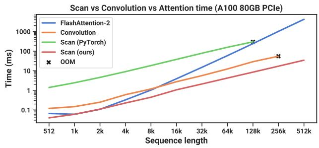

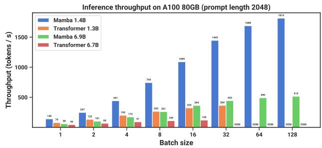  
Figure 8：（效率基准测试。）（左）训练：我们高效的扫描实现比标准实现快 40 倍。（右）推理：作为一种循环模型，Mamba 的吞吐量可达到 Transformers 的 5 倍。

## 4.6 模型消融实验

我们对模型的各个组件进行了一系列详细的消融实验，重点关注在 Chinchilla token 数量下规模约为 350M 的语言建模设定（与 Figure 4 的设定相同）。

## 4.6.1 架构

Table 6 探究了架构（模块）及其内部 SSM 层（Figure 3）的影响。我们发现：

• 在以往等价于全局卷积的非选择性（LTI）SSM 中，性能非常接近。

• 将先前工作中的复数值 S4 变体替换为实数值变体对性能影响不大，这表明（至少对于 LM 而言）在考虑硬件效率时，实数值 SSM 可能是更好的选择。

• 将其中任何一种替换为选择性 SSM（S6）都会显著提高性能，验证了 Section 3 的动机。

Table 6：（消融实验：架构与 SSM 层。）Mamba 模块在保持与 H3 性能相当的同时更加简单。在内部层中，LTI 模型的不同参数化之间差异很小，而选择性 SSM（S6）带来了大幅提升。更具体地说，S4（实数）变体为 S4D-Real，S4（复数）变体为 S4D-Lin。

<table><tr><td>模型</td><td>架构</td><td>SSM 层</td><td>困惑度 (PERPLEXITY)</td></tr><tr><td>Hyena</td><td>H3</td><td>Hyena</td><td>10.24</td></tr><tr><td>H3</td><td>H3</td><td>S4 (complex)</td><td>10.30</td></tr><tr><td>-</td><td>H3</td><td>S4 (real)</td><td>10.34</td></tr><tr><td>-</td><td>H3</td><td>S6</td><td>8.95</td></tr></table>

<table><tr><td>模型</td><td>架构</td><td>SSM 层</td><td>困惑度</td></tr><tr><td>-</td><td>Mamba</td><td>Hyena</td><td>10.75</td></tr><tr><td>-</td><td>Mamba</td><td>S4 (complex)</td><td>10.54</td></tr><tr><td>-</td><td>Mamba</td><td>S4 (real)</td><td>10.56</td></tr><tr><td>Mamba</td><td>Mamba</td><td>S6</td><td>8.69</td></tr></table>

Table 7: （消融实验：选择性参数。）$\Delta$ 是最重要的参数（定理 1），但同时使用多个选择性参数具有协同效应。

<table><tr><td>选择性 Δ</td><td>选择性 B</td><td>选择性 C</td><td>困惑度</td></tr><tr><td>X</td><td>X</td><td>X</td><td>10.93</td></tr><tr><td>X</td><td>√</td><td>X</td><td>10.15</td></tr><tr><td>X</td><td>X</td><td>√</td><td>9.98</td></tr><tr><td>√</td><td>X</td><td>X</td><td>9.81</td></tr><tr><td>√</td><td>√</td><td>√</td><td>8.71</td></tr></table>

Table 8: （消融实验：$A$ 的参数化。）当 SSM 具有选择性时，基于 S4D-Lin (Gu, Gupta, et al. 2022) 的更标准的初始化方法表现劣于 S4D-Real 或随机初始化。

<table><tr><td> $A_n$  初始化</td><td>数域</td><td>困惑度</td></tr><tr><td> $A_n = -\frac{1}{2} + ni$ </td><td>复数</td><td>9.16</td></tr><tr><td> $A_n = -1/2$ </td><td>实数</td><td>8.85</td></tr><tr><td> $A_n = -(n+1)$ </td><td>实数</td><td>8.71</td></tr><tr><td> $A_n \sim \exp(\mathcal{N}(0,1))$ </td><td>实数</td><td>8.71</td></tr></table>

• Mamba 架构的表现与 H3 架构相似（且在使用选择性层时似乎略胜一筹）。

我们还在附录 E.2.2 中研究了将 Mamba 块与其他块（例如传统架构 MLP，混合注意力架构 MHA）进行交错堆叠的情况。

## 4.6.2 选择性 SSM

表 7 通过考虑选择性参数 $\Delta$、$B$ 和 $C$ 的不同组合（算法 2）对选择性 SSM 层进行了消融实验，结果表明，由于 $\Delta$ 与 RNN 门控机制的联系（定理 1），它是最重要的参数。

Table 8 探讨了 SSM 的不同初始化方式，这些初始化已被证明在某些数据模态和设置中会产生很大差异（Gu, Goel, and Ré 2022；Gu, Gupta, et al. 2022）。在语言建模任务上，我们发现更简单的实值对角初始化（S4D-Real，第 3 行）比更标准的复数值参数化（S4D-Lin，第 1 行）表现更好。随机初始化同样表现良好，这与先前研究的发现一致（Mehta et al. 2023）。

Table 9 和 Table 10 分别探讨了改变 $\Delta$ 以及 $(B, C)$ 投影维度的情况。将它们从静态改为选择性带来的收益最大，而进一步增加维度通常能在仅小幅增加参数量的情况下适度提升性能。

特别值得注意的是，当状态大小 $N$ 增加时，选择性 SSM 获得了显著的提升，仅以增加 1% 的参数为代价就带来了超过 1.0 的困惑度（perplexity）改善。这验证了我们在第 3.1 节和第 3.3 节中的核心动机。

## 5 讨论

我们讨论了相关工作、局限性以及一些未来的研究方向。

**相关工作**（Related Work）。附录 A 讨论了选择机制与类似概念之间的关联。附录 B 提供了关于 SSM 以及其他相关模型的扩展相关工作。

Table 9: （消融实验：Δ 的表达能力。）Δ 的选择机制是通过输入的投影来构建它的。即使仅投影到维度 1，也能大幅提升性能；进一步增加该维度会以适度的参数量增加为代价带来进一步的改进。状态大小固定为 $N = 16$。  
Table 10: （消融实验：SSM 状态维度。）（上）常数 $B$ 和 $C$ （下）选择性 $B$ 和 $C$。增加 SSM 状态维度 $N$（可被视为循环状态维度的扩展因子），能够以极小的参数量/FLOPs 代价显著提升性能，但这仅在 $B$ 和 $C$ 也具有选择性时有效。Δ 投影大小固定为 64。

<table><tr><td>Δ 投影大小</td><td>参数量 (M)</td><td>困惑度 (PERPLEXITY)</td></tr><tr><td>-</td><td>358.9</td><td>9.12</td></tr><tr><td>1</td><td>359.1</td><td>8.97</td></tr><tr><td>2</td><td>359.3</td><td>8.97</td></tr><tr><td>4</td><td>359.7</td><td>8.91</td></tr><tr><td>8</td><td>360.5</td><td>8.83</td></tr><tr><td>16</td><td>362.1</td><td>8.84</td></tr><tr><td>32</td><td>365.2</td><td>8.80</td></tr><tr><td>64</td><td>371.5</td><td>8.71</td></tr></table>

<table><tr><td>状态维度 N</td><td>参数量 (M)</td><td>困惑度 (PERPLEXITY)</td></tr><tr><td>1</td><td>367.1</td><td>9.88</td></tr><tr><td>2</td><td>367.4</td><td>9.86</td></tr><tr><td>4</td><td>368.0</td><td>9.82</td></tr><tr><td>8</td><td>369.1</td><td>9.82</td></tr><tr><td>16</td><td>371.5</td><td>9.81</td></tr><tr><td>1</td><td>367.1</td><td>9.73</td></tr><tr><td>2</td><td>367.4</td><td>9.40</td></tr><tr><td>4</td><td>368.0</td><td>9.09</td></tr><tr><td>8</td><td>369.1</td><td>8.84</td></tr><tr><td>16</td><td>371.5</td><td>8.71</td></tr></table>

天下没有免费的午餐：连续-离散谱（No Free Lunch: Continuous-Discrete Spectrum）。结构化 SSM 最初被定义为连续系统的离散化 (1)，并且对感知信号（例如音频、视频）等连续时间数据模态具有很强的归纳偏置（inductive bias）。正如第 3.1 节和第 3.5 节所讨论的，选择机制克服了它们在离散模态（例如文本和 DNA）上的弱点；但这反过来可能会影响它们在 LTI SSM 所擅长的数据上的性能。我们对音频波形的消融实验更详细地检验了这种权衡。

下游功能（Downstream Affordances）。基于 Transformer 的基础模型（特别是 LLM）拥有丰富的特性生态以及与预训练模型交互的模式，例如微调（fine-tuning）、适配（adaptation）、提示（prompting）、上下文学习（in-context learning）、指令微调（instruction tuning）、RLHF、量化（quantization）等。我们特别关注像 SSM 这样的 Transformer 替代架构是否具备类似的特性和功能。

模型扩展（Scaling）。我们的实证评估局限于较小的模型规模，低于大多数强大的开源 LLM（例如 Llama (Touvron et al. 2023)）以及其他循环模型（例如已在 7B 参数规模及以上进行过评估的 RWKV (B. Peng et al. 2023) 和 RetNet (Y. Sun et al. 2023)）的参数门槛。在这些更大的规模下，Mamba 是否依然具有优势仍有待评估。我们还注意到，扩展 SSM 的规模可能涉及进一步的工程挑战以及对模型的调整，这些内容在本文中未作探讨。

## 6 结论

我们将选择机制引入结构化状态空间模型，使其在序列长度呈线性扩展的同时能够进行依赖上下文的推理。当整合到一个简单的无注意力架构中时，Mamba 在多个不同领域均取得了最先进的结果，其性能达到或超越了强大的 Transformer 模型。我们对选择性状态空间模型在构建不同领域基础模型方面的广泛应用感到振奋，特别是在基因组学、音频和视频等需要长上下文的新兴模态中。我们的结果表明，Mamba 是成为通用序列模型骨干网络的有力候选者。

## 致谢

我们感谢 Karan Goel、Arjun Desai 和 Kush Bhatia 对初稿提出的宝贵反馈。

## 参考文献

[1] Martin Arjovsky, Amar Shah, and Yoshua Bengio. “Unitary Evolution Recurrent Neural Networks”. In: The International Conference on Machine Learning (ICML). 2016, pp. 1120–1128.

[2] Žiga Avsec, Vikram Agarwal, Daniel Visentin, Joseph R Ledsam, Agnieszka Grabska-Barwinska, Kyle R Taylor, Yannis Assael, John Jumper, Pushmeet Kohli, and David R Kelley. “Efective Gene Expression Prediction from Sequence by Integrating Long-range Interactions”. In: Nature Methods 18.10 (2021), pp. 1196–1203.

[3] Jimm Ba, Geofre E Hinton, Volod m r Mnih, Joel Z Leibo, and Catalin Ionescu. “Usin Fast Wei hts to Attend to the Recent Past”. In: Advances in Neural Information Processing Systems (NeurIPS) 29 (2016).

[4] Jimmy Lei Ba, Jamie Ryan Kiros, and Geofrey E Hinton. “Layer Normalization”. In: arXiv preprint arXiv:1607.06450 (2016).

[5] Dzmitry Bahdanau, Kyunghyun Cho, and Yoshua Bengio. “Neural Machine Translation by Jointly Learning to Align and Translate”. In: The International Conference on Learning Representations (ICLR). 2015.

[6] David Balduzzi and Muhammad Ghifary. “Strongly-typed Recurrent Neural Networks”. In: International Conference on Machine Learning. PMLR. 2016, pp. 1292–1300.

[7] Stella Biderman, Hailey Schoelkopf, Quentin Gregory Anthony, Herbie Bradley, Kyle O’Brien, Eric Hallahan, Mohammad Aflah Khan, Shivanshu Purohit, USVSN Sai Prashanth, Edward Raf, et al. “Pythia: A Suite for Analyzing Large Language Models across Training and Scaling”. In: The International Conference on Machine Learning (ICML). PMLR. 2023, pp. 2397–2430.

[8] Yonatan Bisk, Rowan Zellers, Jianfeng Gao, Yejin Choi, et al. “PIQA: Reasoning about Physical Commonsense in Natural Language”. In: Proceedings of the AAAI conference on Artificial Intelligence. Vol. 34. 2020.

[9] Sid Black, Stella Biderman, Eric Hallahan, Quentin Anthony, Leo Gao, Laurence Golding, Horace He, Connor Leahy, Kyle McDonell, Jason Phang, et al. “Gpt-NeoX-20B: An Open-source Autoregressive Language Model”. In: arXiv preprint arXiv:2204.06745 (2022).

[10] Guy E Blelloch. “Prefix Sums and Their Applications”. In: (1990).

[11] James Bradbury, Stephen Merity, Caiming Xiong, and Richard Socher. “Quasi-recurrent Neural Networks”. In: arXiv preprint arXiv:1611.01576 (2016).

[12] Tom Brown, Benjamin Mann, Nick Ryder, Melanie Subbiah, Jared D Kaplan, Prafulla Dhariwal, Arvind Neelakantan, Pranav Shyam, Girish Sastry, Amanda Askell, et al. “Language Models are Few-shot Learners”. In: Advances in Neural Information Processing Systems (NeurIPS) 33 (2020), pp. 1877–1901.

[13] Aydar Bulatov, Yuri Kuratov, and Mikhail S Burtsev. “Scaling Transformer to 1M tokens and Beyond with RMT”. In: arXiv preprint arXiv:2304.11062 (2023).

[14] Rewon Child, Scott Gray, Alec Radford, and Ilya Sutskever. “Generating Long Sequences with Sparse Transformers”. In: arXiv preprint arXiv:1904.10509 (2019).

[15] Krzysztof Choromanski, Valerii Likhosherstov, David Dohan, Xingyou Song, Andreea Gane, Tamas Sarlos, Peter Hawkins, Jared Davis, Afroz Mohiuddin, Lukasz Kaiser, et al. “Rethinking Attention with Performers”. In: The International Conference on Learning Representations (ICLR). 2021.

[16] Aakanksha Chowdhery, Sharan Narang, Jacob Devlin, Maarten Bosma, Gaurav Mishra, Adam Roberts, Paul Barham, Hyung Won Chung, Charles Sutton, Sebastian Gehrmann, et al. “PaLM: Scaling Language Modeling with Pathways”. In: Journal ofMachine Learning Research 24.240 (2023), pp. 1–113. url: http://jmlr.org/papers/v24/22- 1144.html.

[17] Junyoung Chung, Caglar Gulcehre, KyungHyun Cho, and Yoshua Bengio. “Empirical Evaluation of Gated Recurrent Neural Networks on Sequence Modeling”. In: arXiv preprint arXiv:1412.3555 (2014).

[18] Peter Clark, Isaac Cowhey, Oren Etzioni, Tushar Khot, Ashish Sabharwal, Carissa Schoenick, and Oyvind Tafjord. “Think you have Solved Question Answering? Try ARC, the AI2 Reasoning Challenge”. In: arXiv preprint arXiv:1803.05457 (2018).

[19] Tri Dao. “FlashAttention-2: Faster Attention with Better Parallelism and Work Partitioning”. In: The International Conference on Learning Representations (ICLR). 2024.

[20] Tri Dao, Daniel Y Fu, Stefano Ermon, Atri Rudra, and Christopher Ré. “FlashAttention: Fast and Memory-Eficient Exact Attention with IO-Awareness”. In: Advances in Neural Information Processing Systems (NeurIPS). 2022.

[21] Tri Dao, Daniel Y Fu, Khaled K Saab, Armin W Thomas, Atri Rudra, and Christopher Ré. “Hungry Hungry Hippos: Towards Language Modeling with State Space Models”. In: The International Conference on Learning Representations (ICLR). 2023.

[22] Yann N Dauphin, Angela Fan, Michael Auli, and David Grangier. “Language Modeling with Gated Convolutional Networks”. In: The International Conference on Machine Learning (ICML). PMLR. 2017, pp. 933–941.

[23] DeepSound. SampleRNN. https://github.com/deepsound-project/samplernn-pytorch. 2017.

[24] Jiayu Ding, Shuming Ma, Li Dong, Xingxing Zhang, Shaohan Huang, Wenhui Wang, and Furu Wei. “LongNet: Scaling Transformers to 1,000,000,000 Tokens”. In: arXiv preprint arXiv:2307.02486 (2023).

[25] Chris Donahue, Julian McAuley, and Miller Puckette. “Adversarial Audio Synthesis”. In: The International Conference on Learning Representations (ICLR). 2019.

[26] Alexey Dosovitskiy, Lucas Beyer, Alexander Kolesnikov, Dirk Weissenborn, Xiaohua Zhai, Thomas Unterthiner, Mostafa Dehghani, Matthias Minderer, Georg Heigold, Sylvain Gelly, et al. “An Image is Worth 16x16 Words: Transformers for Image Recognition at Scale”. In: The International Conference on Learning Representations (ICLR). 2020.

[27] Nelson Elhage, Neel Nanda, Catherine Olsson, Tom Henighan, Nicholas Joseph, Ben Mann, Amanda Askell, Yuntao Bai, Anna Chen, Tom Conerly, Nova DasSarma, Dawn Drain, Deep Ganguli, Zac Hatfield-Dodds, Danny Hernandez, Andy Jones, Jackson Kernion, Liane Lovitt, Kamal Ndousse, Dario Amodei, Tom Brown, Jack Clark, Jared Kaplan, Sam McCandlish, and Chris Olah. “A Mathematical Framework for Transformer Circuits”. In: Transformer Circuits Thread (2021). https://transformer-circuits.pub/2021/framework/index.html.

[28] Mahan Fathi, Jonathan Pilault, Pierre-Luc Bacon, Christopher Pal, Orhan Firat, and Ross Goroshin. “Block-State Transformer”. In: arXiv preprint arXiv:2306.09539 (2023).

[29] Yassir Fathullah, Chunyang Wu, Yuan Shangguan, Junteng Jia, Wenhan Xiong, Jay Mahadeokar, Chunxi Liu, Yangyang Shi, Ozlem Kalinli, Mike Seltzer, and Mark J. F. Gales. “Multi-Head State Space Model for Speech Recognition”. In: Proc. INTERSPEECH 2023. 2023, pp. 241–245. doi: 10.21437/Interspeech.2023-1036.

[30] Karl J Friston, Lee Harrison, and Will Penny. “Dynamic Causal Modelling”. In: Neuroimage 19.4 (2003), pp. 1273– 1302.

[31] Daniel Y Fu, Elliot L Epstein, Eric Nguyen, Armin W Thomas, Michael Zhang, Tri Dao, Atri Rudra, and Christopher Ré. “Simple Hardware-efficient Long Convolutions for Sequence Modeling”. In: The International Conference on Machine Learning (ICML) (2023).

[32] Ken-ichi Funahashi and Yuichi Nakamura. “Approximation of Dynamical Systems by Continuous Time Recurrent Neural Networks”. In: Neural Networks 6.6 (1993), pp. 801–806.

[33] Leo Gao, Stella Biderman, Sid Black, Laurence Golding, Travis Hoppe, Charles Foster, Jason Phang, Horace He, Anish Thite, Noa Nabeshima, Shawn Presser, and Connor Leahy. “The Pile: An 800GB Dataset of Diverse Text for Language Modeling”. In: arXiv preprint arXiv:2101.00027 (2020).

[34] Leo Gao, Jonathan Tow, Stella Biderman, Sid Black, Anthony DiPofi, Charles Foster, Laurence Golding, Jeffrey Hsu, Kyle McDonell, Niklas Muennighoff, Jason Phang, Laria Reynolds, Eric Tang, Anish Thite, Ben Wang, Kevin Wang, and Andy Zou. A Framework for Few-shot Language Model Evaluation. Version v0.0.1. Sept. 2021. doi: 10.5281/zenodo.5371628. url: https://doi.org/10.5281/zenodo.5371628.

[35] Karan Goel, Albert Gu, Chris Donahue, and Christopher Ré. “It’s Raw! Audio Generation with State-Space Models”. In: The International Conference on Machine Learning (ICML). 2022.

[36] Albert Gu, Tri Dao, Stefano Ermon, Atri Rudra, and Christopher Ré. “HIPPO: Recurrent Memory with Optimal Polynomial Projections”. In: Advances in Neural Information Processing Systems (NeurIPS). 2020.

[37] Albert Gu, Karan Goel, and Christopher Ré. “Efficiently Modeling Long Sequences with Structured State Spaces”. In: The International Conference on Learning Representations (ICLR). 2022.

[38] Albert Gu, Caglar Gulcehre, Tom Le Paine, Matt Hofman, and Razvan Pascanu. “改进循环神经网络的门控机制（Improving the Gating Mechanism of Recurrent Neural Networks）”. In: The International Conference on Machine Learning (ICML). 2020.

[39] Albert Gu, Ankit Gupta, Karan Goel, and Christopher Ré. “论对角状态空间模型的参数化与初始化（On the Parameterization and Initialization of Diagonal State Space Models）”. In: Advances in Neural Information Processing Systems (NeurIPS). 2022.

[40] Albert Gu, Isys Johnson, Karan Goel, Khaled Saab, Tri Dao, Atri Rudra, and Christopher Ré. “结合循环、卷积和连续时间模型与线性状态空间层（Combining Recurrent, Convolutional, and Continuous-time Models with the Linear State Space Layer）”. In: Advances in Neural Information Processing Systems (NeurIPS). 2021.

[41] Albert Gu, Isys Johnson, Aman Timalsina, Atri Rudra, and Christopher Ré. “如何训练你的 HIPPO：基于广义基投影的状态空间模型（How to Train Your HIPPO: State Space Models with Generalized Basis Projections）”. In: The International Conference on Learning Representations (ICLR). 2023.

[42] Ankit Gupta, Albert Gu, and Jonathan Berant. “对角状态空间与结构化状态空间同样有效（Diagonal State Spaces are as Effective as Structured State Spaces）”. In: Advances in Neural Information Processing Systems 35 (2022), pp. 22982–22994.

[43] Ankit Gupta, Harsh Mehta, and Jonathan Berant. “利用对角线性 RNN 简化与理解状态空间模型（Simplifying and Understanding State Space Models with Diagonal Linear RNNs）”. In: arXiv preprint arXiv:2212.00768 (2022).

[44] David Ha, Andrew Dai, and Quoc V. Le. “超网络（HyperNetworks）”. In: The International Conference on Learning Representations (ICLR). 2017.

[45] Danijar Hafner, Timothy Lillicrap, Jimmy Ba, and Mohammad Norouzi. “梦想控制：通过潜在想象学习行为（Dream to Control: Learning Behaviors by Latent Imagination）”. In: The International Conference on Learning Representations (ICLR). 2020.

[46] Ramin Hasani, Mathias Lechner, Tsun-Hsuan Wang, Makram Chahine, Alexander Amini, and Daniela Rus. “液态结构状态空间模型（Liquid Structural State-Space Models）”. In: The International Conference on Learning Representations (ICLR). 2023.

[47] Mikael Henaff, Arthur Szlam, and Yann LeCun. “循环正交网络与长时记忆任务（Recurrent Orthogonal Networks and Long-Memory Tasks）”. In: The International Conference on Machine Learning (ICML). 2016.

[48] Dan Hendrycks and Kevin Gimpel. “高斯误差线性单元（Gaussian Error Linear Units (GELUs)）”. In: arXiv preprint arXiv:1606.08415 (2016).

[49] Sepp Hochreiter. “动态神经网络研究（Untersuchungen zu dynamischen neuronalen Netzen）”. In: Diploma, Technische Universität München 91.1 (1991), p. 31.

[50] Sepp Hochreiter, Yoshua Bengio, Paolo Frasconi, Jürgen Schmidhuber, et al. 循环网络中的梯度流：学习长期依赖的困难性（Gradient Flow in Recurrent Nets: The Difficulty of Learning Long-term Dependencies）. 2001.

[51] Sepp Hochreiter and Jürgen Schmidhuber. “长短期记忆（Long Short-Term Memory）”. In: Neural Computation 9.8 (1997), pp. 1735–1780.

[52] Jordan Hoffmann, Sebastian Borgeaud, Arthur Mensch, Elena Buchatskaya, Trevor Cai, Eliza Rutherford, Diego de Las Casas, Lisa Anne Hendricks, Johannes Welbl, Aidan Clark, et al. “An Empirical Analysis of Compute-Optimal Large Language Model Training”. In: Advances in Neural Information Processing Systems (NeurIPS) 35 (2022), pp. 30016–30030.

[53] Weizhe Hua, Zihang Dai, Hanxiao Liu, and Quoc Le. “Transformer Quality in Linear Time”. In: The International Conference on Machine Learning (ICML). PMLR. 2022, pp. 9099–9117.

[54] Hassan Ismail Fawaz, Germain Forestier, Jonathan Weber, Lhassane Idoumghar, and Pierre-Alain Muller. “Deep Learning for Time Series Classification: A Review”. In: Data Mining and Knowledge Discovery 33.4 (2019), pp. 917– 963.

[55] Andrei Ivanov, Nikoli Dryden, Tal Ben-Nun, Shigang Li, and Torsten Hoefler. “Data Movement is All You Need: A Case Study on Optimizing Transformers”. In: Proceedings of Machine Learning and Systems 3 (2021), pp. 711–732.

[56] Li Jing, Caglar Gulcehre, John Peurifoy, Yichen Shen, Max Tegmark, Marin Soljacic, and Yoshua Bengio. “Gated Orthogonal Recurrent Units: On Learning to Forget”. In: Neural Computation 31.4 (2019), pp. 765–783.

[57] Rudolph Emil Kalman. “A New Approach to Linear Filtering and Prediction Problems”. In: (1960).

[58] Angelos Katharopoulos, Apoorv Vyas, Nikolaos Pappas, and François Fleuret. “Transformers are RNNs: Fast Autoregressive Transformers with Linear Attention”. In: International Conference on Machine Learning. PMLR. 2020, pp. 5156–5165.

[59] Shiva Kaul. “Linear Dynamical Systems as a Core Computational Primitive”. In: Advances in Neural Information Processing Systems 33 (2020), pp. 16808–16820.

[60] Zhifeng Kong, Wei Ping, Jiaji Huang, Kexin Zhao, and Bryan Catanzaro. “DiffWave: A Versatile Diffusion Model for Audio Synthesis”. In: International Conference on Learning Representations. 2021.

[61] Chrysoula Kosma, Giannis Nikolentzos, and Michalis Vazirgiannis. “Time-Parameterized Convolutional Neural Networks for Irregularly Sampled Time Series”. In: arXiv preprint arXiv:2308.03210 (2023).

[62] Alex Krizhevsky, Ilya Sutskever, and Geoffrey E Hinton. “ImageNet Classification with Deep Convolutional Neural Networks”. In: Advances in Neural Information Processing Systems (NeurIPS) 25 (2012).

[63] Tao Lei. “When Attention Meets Fast Recurrence: Training Language Models with Reduced Compute”. In: Proceedings of the 2021 Conference on Empirical Methods in Natural Language Processing. 2021, pp. 7633–7648.

[64] Tao Lei, Yu Zhang, Sida I Wang, Hui Dai, and Yoav Artzi. “Simple Recurrent Units for Highly Parallelizable Recurrence”. In: arXiv preprint arXiv:1709.02755 (2017).

[65] Mario Lezcano-Casado and David Martínez-Rubio. “Cheap Orthogonal Constraints in Neural Networks: A Simple Parametrization of the Orthogonal and Unitary Group”. In: The International Conference on Machine Learning (ICML). 2019.

[66] Yuhong Li, Tianle Cai, Yi Zhang, Deming Chen, and Debadeepta Dey. “What Makes Convolutional Models Great on Long Sequence Modeling?” In: The International Conference on Learning Representations (ICLR). 2023.

[67] Vasileios Lioutas and Yuhong Guo. “Time-aware Large Kernel Convolutions”. In: The International Conference on Machine Learning (ICML). PMLR. 2020, pp. 6172–6183.

[68] Chris Lu, Yannick Schroecker, Albert Gu, Emilio Parisotto, Jakob Foerster, Satinder Singh, and Feryal Behbahani. “Structured State Space Models for In-Context Reinforcement Learning”. In: Advances in Neural Information Processing Systems (NeurIPS). 2023.

[69] Shahar Lutati, Itamar Zimerman, and Lior Wolf. “Focus Your Attention (with Adaptive IIR Filters)”. In: arXiv preprint arXiv:2305.14952 (2023).

[70] Xuezhe Ma, Chunting Zhou, Xiang Kong, Junxian He, Liangke Gui, Graham Neubig, Jonathan May, and Luke Zettlemoyer. “Mega: Moving Average Equipped Gated Attention”. In: The International Conference on Learning Representations (ICLR). 2023.

[71] Eric Martin and Chris Cundy. “Parallelizing Linear Recurrent Neural Nets Over Sequence Length”. In: The International Conference on Learning Representations (ICLR). 2018.

[72] Soroush Mehri, Kundan Kumar, Ishaan Gulrajani, Rithesh Kumar, Shubham Jain, Jose Sotelo, Aaron Courville, and Yoshua Bengio. “SampleRNN: An Unconditional End-to-End Neural Audio Generation Model”. In: The International Conference on Learning Representations (ICLR). 2017.

[73] Harsh Mehta, Ankit Gupta, Ashok Cutkosky, and Behnam Neyshabur. “Long Range Language Modeling via Gated State Spaces”. In: The International Conference on Learning Representations (ICLR). 2023.

[74] Zakaria Mhammedi, Andrew Hellicar, Ashfaqur Rahman, and James Bailey. “Eficient Orthogonal Parametrisation of Recurrent Neural Networks using Householder Reflections”. In: International Conference on Machine Learning. PMLR. 2017, pp. 2401–2409.

[75] Eric Nguyen, Karan Goel, Albert Gu, Gordon Downs, Preey Shah, Tri Dao, Stephen Baccus, and Christopher Ré. “S4ND：将图像和视频建模为具有状态空间的多维信号”. In: Advances in Neural Information Processing Systems (NeurIPS). 2022.

[76] Eric Nguyen, Michael Poli, Marjan Faizi, Armin Thomas, Callum Birch-Sykes, Michael Wornow, Aman Patel, Clayton Rabideau, Stefano Massaroli, Yoshua Bengio, et al. “HyenaDNA：单核苷酸分辨率的长程基因组序列建模”. In: Advances in Neural Information Processing Systems (NeurIPS). 2023.

[77] Catherine Olsson, Nelson Elhage, Neel Nanda, Nicholas Joseph, Nova DasSarma, Tom Henighan, Ben Mann, Amanda Askell, Yuntao Bai, Anna Chen, Tom Conerly, Dawn Drain, Deep Ganguli, Zac Hatfield-Dodds, Danny Hernandez, Scott Johnston, Andy Jones, Jackson Kernion, Liane Lovitt, Kamal Ndousse, Dario Amodei, Tom Brown, Jack Clark, Jared Kaplan, Sam McCandlish, and Chris Olah. “上下文学习与归纳头”. In: Transformer Circuits Thread (2022). https://transformer-circuits.pub/2022/in-context-learning-and-induction-heads/index.html.

[78] Aaron van den Oord, Sander Dieleman, Heiga Zen, Karen Simonyan, Oriol Vinyals, Alex Graves, Nal Kalchbrenner, Andrew Senior, and Koray Kavukcuoglu. “WaveNet：用于原始音频的生成模型”. In: arXiv preprint arXiv:1609.03499 (2016).

[79] Antonio Orvieto, Samuel L Smith, Albert Gu, Anushan Fernando, Caglar Gulcehre, Razvan Pascanu, and Soham De. “复兴用于长序列的循环神经网络”. In: The International Conference on Machine Learning (ICML). 2023.

[80] Denis Paperno, Germán Kruszewski, Angeliki Lazaridou, Ngoc-Quan Pham, Rafaella Bernardi, Sandro Pezzelle, Marco Baroni, Gemma Boleda, and Raquel Fernández. “LAMBADA 数据集：需要广泛篇章上下文的词预测”. In: Proceedings of the 54th Annual Meeting of the Association for Computational Linguistics. 2016, pp. 1525–1534.

[81] Razvan Pascanu, Tomas Mikolov, and Yoshua Bengio. “On the Dificulty of Training Recurrent Neural Networks”. In: International Conference on Machine Learning. 2013, pp. 1310–1318.

[82] Bo Peng, Eric Alcaide, Quentin Anthony, Alon Albalak, Samuel Arcadinho, Huanqi Cao, Xin Cheng, Michael Chung, Matteo Grella, Kranthi Kiran GV, et al. “RWKV: Reinventing RNNs for the Transformer Era”. In: arXiv preprint arXiv:2305.13048 (2023).

[83] Hao Peng, Nikolaos Pappas, Dani Yogatama, Roy Schwartz, Noah A Smith, and Lingpeng Kong. “Random Feature Attention”. In: The International Conference on Learning Representations (ICLR). 2021.

[84] Michael Poli, Stefano Massaroli, Eric Nguyen, Daniel Y Fu, Tri Dao, Stephen Baccus, Yoshua Bengio, Stefano Ermon, and Christopher Ré. “Hyena Hierarchy: Towards Larger Convolutional Language Models”. In: The International Conference on Machine Learning (ICML). 2023.

[85] Zhen Qin, Xiaodong Han, Weixuan Sun, Bowen He, Dong Li, Dongxu Li, Yuchao Dai, Lingpeng Kong, and Yiran Zhong. “Toeplitz Neural Network for Sequence Modeling”. In: The International Conference on Learning Representations (ICLR). 2023.

[86] Zhen Qin, Xiaodong Han, Weixuan Sun, Dongxu Li, Lingpeng Kong, Nick Barnes, and Yiran Zhong. “The devil in linear transformer”. In: arXiv preprint arXiv:2210.10340 (2022).

[87] Zhen Qin, Weixuan Sun, Hui Deng, Dongxu Li, Yunshen Wei, Baohong Lv, Junjie Yan, Lingpeng Kong, and Yiran Zhong. “CosFormer: Rethinking Softmax in Attention”. In: The International Conference on Learning Representations (ICLR). 2022.

[88] Ali Rahimi and Benjamin Recht. “Random Features for Large-Scale Kernel Machines”. In: Advances in Neural Information Processing Systems (NeurIPS) 20 (2007).

[89] Prajit Ramachandran, Barret Zoph, and Quoc V Le. “Swish: A Self-gated Activation Function”. In: arXiv preprint arXiv:1710.05941 7.1 (2017), p. 5.

[90] David W Romero, Anna Kuzina, Erik J Bekkers, Jakub M Tomczak, and Mark Hoogendoorn. “CKConv: Continuous Kernel Convolution For Sequential Data”. In: arXiv preprint arXiv:2102.02611 (2021).

[91] Keisuke Sakaguchi, Ronan Le Bras, Chandra Bhagavatula, and Yejin Choi. “Winogrande: An Adversarial Winograd Schema Challenge at Scale”. In: Communications ofthe ACM 64.9 (2021), pp. 99–106.

[92] George Saon, Ankit Gupta, and Xiaodong Cui. “Diagonal State Space Augmented Transformers for Speech Recognition”. In: ICASSP 2023-2023 IEEE International Conference on Acoustics, Speech and Signal Processing (ICASSP). IEEE. 2023, pp. 1–5.

[93] Imanol Schlag, Kazuki Irie, and Jürgen Schmidhuber. “Linear Transformers are Secretly Fast Weight Programmers”. In: The International Conference on Machine Learning (ICML). PMLR. 2021, pp. 9355–9366.

[94] Jürgen Schmidhuber. “Learning to control fast-weight memories: An alternative to dynamic recurrent networks”. In: Neural Computation 4.1 (1992), pp. 131–139.

[95] Noam Shazeer. “GLU Variants Improve Transformer”. In: arXiv preprint arXiv:2002.05202 (2020).

[96] Freda Shi, Xinyun Chen, Kanishka Misra, Nathan Scales, David Dohan, Ed H Chi, Nathanael Schärli, and Denny Zhou. “Large Language Models can be Easily Distracted by Irrelevant Context”. In: The International Conference on Machine Learning (ICML). PMLR. 2023, pp. 31210–31227.

[97] Jiaxin Shi, Ke Alexander Wang, and Emily Fox. “Sequence Modeling with Multiresolution Convolutional Memory”. In: The International Conference on Machine Learning (ICML). PMLR. 2023, pp. 31312–31327.

[98] Jimmy TH Smith, Andrew Warrington, and Scott W Linderman. “Simplified State Space Layers for Sequence Modeling”. In: The International Conference on Learning Representations (ICLR). 2023.

[99] Jianlin Su, Yu Lu, Shengfeng Pan, Ahmed Murtadha, Bo Wen, and Yunfeng Liu. “Roformer: Enhanced Transformer with Rotar Position Embeddin ”. In: arXiv preprint arXiv:2104.09864 (2021).

[100] Yutao Sun, Li Dong, Shaohan Huang, Shuming Ma, Yuqing Xia, Jilong Xue, Jianyong Wang, and Furu Wei. “Retentive network: A successor to transformer for large language models”. In: arXiv preprint arXiv:2307.08621 (2023).

[101] Ilya Sutskever, Oriol Vinyals, and Quoc V Le. “Sequence to Sequence Learning with Neural Networks”. In: Advances in Neural Information Processing Systems (NeurIPS) 27 (2014).

[102] Corentin Tallec and Yann Ollivier. “Can Recurrent Neural Networks Warp Time?” In: The International Conference on Learning Representations (ICLR). 2018.

[103] Yi Tay, Mostafa Dehghani, Samira Abnar, Yikang Shen, Dara Bahri, Philip Pham, Jinfeng Rao, Liu Yang, Sebastian Ruder, and Donald Metzler. “Long Range Arena: A Benchmark for Eficient Transformers”. In: International Conference on Learning Representations (ICLR). 2021.

[104] Yi Tay, Mostafa Dehghani, Dara Bahri, and Donald Metzler. “Eficient Transformers: A Survey”. In: ACM Computing Surveys 55.6 (2022), pp. 1–28.

[105] Hugo Touvron, Thibaut Lavril, Gautier Izacard, Xavier Martinet, Marie-Anne Lachaux, Timothée Lacroix, Baptiste Rozière, Naman Goyal, Eric Hambro, Faisal Azhar, et al. “Llama: Open and Eficient Foundation Language Models”. In: arXiv preprint arXiv:2302.13971 (2023).

[106] Ashish Vaswani, Noam Shazeer, Niki Parmar, Jakob Uszkoreit, Llion Jones, Aidan N. Gomez, Lukasz Kaiser, and Illia Polosukhin. “Attention Is All You Need”. In: Advances in Neural Information Processing Systems (NeurIPS). 2017.

[107] Eugene Vorontsov, Chiheb Trabelsi, Samuel Kadoury, and Chris Pal. “On Orthogonality and Learning Recurrent Networks with Long Term Dependencies”. In: International Conference on Machine Learning. PMLR. 2017, pp. 3570– 3578.

[108] Jue Wang, Wentao Zhu, Pichao Wang, Xiang Yu, Linda Liu, Mohamed Omar, and Rafay Hamid. “Selective Structured State-Spaces for Long-form Video Understanding”. In: Proceedings ofthe IEEE/CVF Conference on Computer Vision and Pattern Recognition. 2023, pp. 6387–6397.

[109] Pete Warden. “Speech Commands: A Dataset for Limited-Vocabulary Speech Recognition”. In: ArXiv abs/1804.03209 (2018).

[110] Samuel Williams, Andrew Waterman, and David Patterson. “Roofline: An Insightful Visual Performance Model for Multicore Architectures”. In: Communications ofthe ACM 52.4 (2009), pp. 65–76.

[111] Brandon Yang, Gabriel Bender, Quoc V Le, and Jiquan Ngiam. “CondConv: Conditionally Parameterized Convolutions for Eficient Inference”. In: Advances in Neural Information Processing Systems (NeurIPS) 32 (2019).

[112] Rowan Zellers, Ari Holtzman, Yonatan Bisk, Ali Farhadi, and Yejin Choi. “HellaSwag: Can a Machine Really Finish Your Sentence?” In: Proceedings ofthe 57th Annual Meeting ofthe Association for Computational Linguistics. 2019.

[113] Shuangfei Zhai, Walter Talbott, Nitish Srivastava, Chen Huang, Hanlin Goh, Ruixiang Zhang, and Josh Susskind. “An Attention Free Transformer”. In: arXiv preprint arXiv:2105.14103 (2021).

[114] Michael Zhang, Khaled K Saab, Michael Poli, Tri Dao, Karan Goel, and Christopher Ré. “Efectively Modeling Time Series with Simple Discrete State Spaces”. In: The International Conference on Learning Representations (ICLR). 2023.

[115] Lin Zheng, Chong Wang, and Lingpeng Kong. “Linear complexity randomized self-attention mechanism”. In: International Conference on Machine Learning. PMLR. 2022, pp. 27011–27041.

[116] Simiao Zuo, Xiaodong Liu, Jian Jiao, Denis Charles, Eren Manavoglu, Tuo Zhao, and Jianfeng Gao. “Efficient Long Sequence Modeling via State Space Augmented Transformer”. In: arXiv preprint arXiv:2212.08136 (2022).

## A 讨论：选择机制

我们的选择机制（selection mechanism）受到了门控（gating）、超网络（hypernetworks）以及数据依赖性（data-dependence）等概念的启发并与之相关。它也可以被视为与“快速权重”（fast weights）（J. Ba et al. 2016; Schmidhuber 1992）相关，后者将经典 RNN 与线性注意力机制（linear attention）（Schlag, Irie, and Schmidhuber 2021）联系起来。然而，我们认为这是一个值得澄清的独特概念。

门控（Gating）。门控最初是指诸如 LSTM（Hochreiter and Schmidhuber 1997）和 GRU（J. Chung et al. 2014）等 RNN 的门控机制，或是定理 1 中的门控方程 (5)。这被解释为一种用于控制是否让输入进入 RNN 隐藏状态的特定机制。特别是，这会影响信号随时间的传播，并导致输入在序列长度维度上产生相互作用。

然而，门控的概念在后来的通用语境中被放宽，仅表示任何乘法交互（通常带有激活函数）。例如，神经网络架构中逐元素的乘法组件（并不在序列长度维度上交互）现在通常被称为门控架构（Hua et al. 2022; Mehta et al. 2023），尽管其含义与最初的 RNN 门控截然不同。因此，我们认为原始的 RNN 门控概念与乘法门控的流行用法实际上具有非常不同的语义。

超网络（Hypernetworks）。超网络是指其参数本身由更小的神经网络生成的神经网络。最初的想法（Ha, Dai, and Quoc V. Le 2017）从狭义上将其定义为一个大型 RNN，其循环参数由一个较小的 RNN 生成，而其他变体也早已存在（Schmidhuber 1992）。

数据依赖性（Data-dependence）。与超网络（hypernetworks）类似，数据依赖性可以指模型的某些参数依赖于数据的任何概念 (Poli et al. 2023)。

示例：GLU 激活（GLU Activation）。为了说明这些概念存在的问题，考虑一个简单的对角线性层  = ，其中  是一个对角权重参数。现在假设  本身由  的线性变换生成，并带有可选的非线性： = ()。由于它是对角的，乘法就变成了逐元素积： = () ◦ 。

这是一个相当平凡的变换，但它在技术上符合门控（gating，因为它具有乘法“分支”）、超网络（hypernetworks，因为参数  由另一层生成）以及数据依赖（data-dependent，因为  依赖于数据 ）的常见含义。然而，这实际上仅仅定义了一个 GLU 函数，该函数非常简单，以至于通常只被视为一个激活函数 (Dauphin et al. 2017; Shazeer 2020)，而不是一个有实质意义的层。

选择机制（Selection）。因此，尽管选择机制可以被视为架构门控、超网络或数据依赖等思想的特例，但大量其他结构同样可以被如此看待——本质上任何包含乘法的结构都是如此，包括标准注意力机制 (Bahdanau, Cho, and Bengio 2015; Vaswani et al. 2017)——而我们发现将它们作此理解并不能提供有效信息。

相反，我们认为它与传统循环神经网络（RNN）的门控机制关联最为紧密，后者是一个特例（定理 1/Theorem 1），并且通过 $\Delta$ 的可变（输入依赖）离散化，与状态空间模型（SSM）有着更深厚的历史渊源 (Funahashi and Nakamura 1993; Gu, Dao, et al. 2020; Tallec and Ollivier 2018)。我们还避免使用“门控（gating）”一词，而倾向于使用“选择（selection）”，以澄清前者被多义滥用的情况。更狭义地讲，我们使用选择来指代模型选择或忽略输入、并促进沿序列长度方向进行数据交互的机制性行为（第 3.1 节）。除了选择性 SSM 和门控 RNN 之外，其他示例还可包括输入依赖卷积 (Kosma, Nikolentzos, and Vazirgiannis 2023; Lioutas and Guo 2020; Lutati, Zimerman, and Wolf 2023; Yang et al. 2019) 甚至注意力机制。

## B 相关工作

我们简要回顾与我们方法相关的几项前人工作。我们指出，一些最为密切相关的模型包括诸如 S4、S5 和准循环神经网络（quasi-RNNs）等循环层；以及诸如 H3、RetNet 和 RWKV 等端到端架构。

## B.1 S4 变体与衍生模型

我们简要概述以往工作中出现的一些结构化状态空间模型（structured SSMs），特别是那些与我们的方法相关的模型。

• S4 (Gu, Goel, and Ré 2022; Gu, Johnson, Goel, et al. 2021) 引入了首个结构化 SSM，描述了对角结构和对角加低秩（DPLR）结构。由于与连续时间在线记忆（HIPPO）（Gu, Dao, et al. 2020）存在联系，它侧重于针对 DPLR SSM 的高效卷积算法。

• DSS (Gupta, Gu, and Berant 2022) 通过逼近 HIPPO 初始化，首次发现了对角结构化 SSM 的实证有效性。S4D (Gu, Gupta, et al. 2022) 在此基础上进行了理论拓展。

• S5 (Smith, Warrington, and Linderman 2023) 独立发现了对角 SSM 近似，并且是首个利用并行扫描（parallel scan）以循环方式计算的 S4 模型。然而，这需要降低有效状态维度，他们通过将 SSM 维度从 SISO（单输入单输出）切换为 MIMO（多输入多输出）公式表述来实现这一点。我们提出的 S6 共享了并行扫描，但不同之处在于：(i) 保持了 SISO 维度，从而提供了更大的有效循环状态；(ii) 使用硬件感知算法来克服计算问题；(iii) 引入了选择机制。

Lu et al. (2023) 将 S5 应用于元强化学习（meta-RL），以处理在回合轨迹（episode trajectories）之间重置 SSM 状态的问题。他们的机制可以看作是选择机制的一种特定硬编码实例，其中  被手动设置为 0，而不是像我们这样依赖于输入的可学习机制。将选择性 SSM 通用性地应用于这种场景，并探究模型是否已经学会在回合边界（episode boundaries）上自动重置其状态，将会是一项有趣的研究。

• Mega (Ma et al. 2023) 引入了 S4 的一种简化形式，将其从复数值改为实数值，从而赋予了它指数移动平均（EMA）的解释。他们还将 SSM 的离散化步骤与 EMA 阻尼项之间建立了有趣的联系。与原始 S4 论文中的发现相反，这是第一个证明实数值 SSM 在特定设定下或与其他架构组件结合时在实证上有效的模型。

• Liquid S4 (Hasani et al. 2023) 的动机同样是通过输入依赖的状态转移来增强 S4。从这个角度来看，它与选择机制有相似之处，尽管它采用的是一种受限形式，仍然通过卷积计算且接近线性时不变（LTI）。

• SGConv (Y. Li et al. 2023)、Hyena (Poli et al. 2023)、LongConv (Fu et al. 2023)、MultiresConv (J. Shi, K. A. Wang, and Fox 2023) 以及 Toeplitz Neural Network (Qin, Han, W. Sun, B. He, et al. 2023) 都专注于 S4 的卷积表示，并通过不同的参数化方式构建全局或长卷积核。然而，这些方法无法直接进行快速自回归推理。

值得注意的是，所有这些方法以及我们所知的所有其他结构化 SSM，都是非选择性的，且通常是严格 LTI（线性时不变，linear time invariant）的。

## B.2 SSM 架构

我们使用 SSM 架构或状态空间神经网络（SSNN）来指代将前述 SSM 之一作为黑盒层融入的深度神经网络架构。

• GSS (Mehta et al. 2023) 是首个结合了 SSM 的门控神经网络架构。它受到了 Hua et al. (2022) 的门控注意力单元（GAU）的启发，且形式上与我们的模块非常相似，只是增加了额外的投影。最重要的是，基于第 3.1 节中的动机，它的投影通过压缩模型维度来减小 SSM 的状态大小，而我们的方法则通过扩展模型维度来增大状态大小。

• Mega (Ma et al. 2023) 将上文描述的 S4 的 EMA 简化形式与高效注意力近似相结合，构建了一种混合架构。

• H3 (Dao, Fu, Saab, et al. 2023) 的动机是将 S4 与线性注意力（Katharopoulos et al. 2020）相结合。它是首个将这种线性注意力的形式推广到更通用循环（recurrences）的工作，这也构成了后续架构的基础。

• Selective S4 (J. Wang et al. 2023) 将 S4 作为一个黑盒引入，用于生成与输入相乘的二进制掩码（binary mask）。尽管都带有“选择（selection）”之名，但我们认为这是一种更接近于架构门控（architectural gating）而非选择机制的架构修改（附录 A）。例如，我们推测它无法解决选择性复制（Selective Copying）任务，因为仅仅掩盖不相关的输入并不会改变相关输入之间的间距（事实上，如果噪声 token 被嵌入为 0，选择性复制任务甚至可以被视为已经预先进行了掩蔽）。

• RetNet (Y. Sun et al. 2023) 同样基于线性注意力（Linear Attention）且与 H3 非常相似，但它将内部的 S4 层简化为了状态维度 $N = 1$ 的特例。尽管并未以此方式进行表述，但它的循环形式可以被视为线性 SSM 的一种特例。

其性能提升的主要来源在于使用了具有较大头维度（head dimension）的线性注意力，这可以被视为执行输入相关状态扩展（input-dependent state expansion）的另一种方法。在线性注意力变体的背景下，使用更大的头维度最早由 H3 采用，但并未得到广泛应用，因为这需要成比例的额外计算量。RetNet 通过一种替代方式避免了这个问题，即使用标准多头注意力（multi-head attention）的变体而非卷积来并行化计算，而其作为简单 EMA（指数移动平均）运作的特殊 SSM 特例使这一方法变得可行。

• RWKV (B. Peng et al. 2023) 是近期为语言建模设计的另一种 RNN。它基于 AFT（无注意力 Transformer (S. Zhai et al. 2021)），即线性注意力的另一种变体。其核心“WKV”机制涉及 LTI 递归，可视为两个 SSM 的比率。

我们还特别指出了 Hua et al. (2022) 提出的门控注意力单元（GAU），其动机是将 Transformer 的 MHA 和 MLP 块结合在一起，这也启发了我们将 H3 和 MLP 块相结合的架构（第 3.4 节）。

## B.3 与 RNN 的关系

RNN 与 SSM 具有广泛的联系，因为它们都涉及在隐状态上进行递归的概念。

一些较早的 RNN，例如强类型 RNN（strongly typed RNN）(Balduzzi and Ghifary 2016)、准 RNN（quasi-RNN, QRNN）(Bradbury et al. 2016) 和简单循环单元（simple recurrent unit, SRU）(Lei 2021; Lei et al. 2017)，涉及不具有时间维度非线性的门控 RNN 形式。由于门控机制与选择机制之间的联系，这些模型可以被视为选择性 SSM 的特例，因此在某种意义上比上述 LTI 结构化 SSM 家族更为强大。主要区别在于：

• 它们不使用状态扩展（$N = 1$）或选择性 $B, C$ 参数，而这两者对于性能都至关重要（第 4.6 节）。

• 它们使用启发式门控机制，我们将其泛化为选择机制与离散化的结果（定理 1）。与原则性 SSM 理论的联系提供了更优的参数化与初始化（第 3.6 节）。

此外，早期的 RNN 众所周知受制于效率问题和梯度消失问题（Hochreiter 1991; Hochreiter, Bengio, et al. 2001; Pascanu, Mikolov, and Bengio 2013），这两者均由其顺序计算特性所致。对于上述某些 RNN，前者可以通过利用并行扫描（parallel scan）（Martin and Cundy 2018）来解决，但在缺乏后来为 SSM 开发的理论的情况下，后者则难以解决。例如，现代结构化 SSM（structured SSMs）的不同之处在于，其受经典 SSM 理论启发，对循环动态进行了更加细致的参数化（例如通过离散化（Gu, Johnson, Goel, et al. 2021; Gu, Johnson, Timalsina, et al. 2023）），或直接进行理论分析（Gupta, Mehta, and Berant 2022; Kaul 2020; Orvieto et al. 2023））。

我们还注意到，关于正交 RNN（orthogonal RNNs）（Arjovsky, Shah, and Bengio 2016; Henaff, Szlam, and LeCun 2016; Lezcano-Casado and Martínez-Rubio 2019; Mhammedi et al. 2017; Vorontsov et al. 2017）已有长期的系列研究，其出发点是通过将转移矩阵约束为正交矩阵或酉矩阵，以控制其特征值并防止梯度消失问题。然而，这些模型存在其他局限性；我们认为这源于正交/酉 RNN 同样属于线性时不变（LTI）系统这一事实。例如，它们几乎总是在 Copying（复制）任务上进行评估且能够完美解决，但据观察它们在 Selective Copying（选择性复制）任务上表现吃力（Jin et al. 2019）。

## B.4 线性注意力 (Linear Attention)

线性注意力（Linear Attention, LA）（Katharopoulos et al. 2020）框架是一项重要成果，它推广了核注意力（kernel attention），并展示了其如何与循环自回归模型（recurrent autoregressive models）相关联。许多变体提出了替代核及其它改进。随机特征注意力（Random Feature Attention, RFA）（H. Peng et al. 2021）利用高斯核的随机傅里叶特征近似（Rahimi and Recht 2007）来选择核特征映射，以近似 softmax 注意力（即 exp 特征映射）。Performer（Choromanski et al. 2021）找到了一种仅包含正特征的指数核近似，这同样允许进行 softmax 归一化项的计算。TransNormer（Qin, Han, W. Sun, D. Li, et al. 2022）表明 LA 的分母项可能不稳定，并建议用 LayerNorm 替换它。cosFormer（Qin, W. Sun, et al. 2022）通过结合位置信息以强调局部性的余弦重加权机制对 RFA 进行了增强。线性随机化注意力（Linear Randomized Attention）（Zheng, C. Wang, and L. Kong 2022）从重要性采样的角度推广了 RFA，并对其进行扩展以提供对完整 softmax 核（而不仅是经 exp 变换的分子）的更优估计。

除了核注意力之外，还存在许多其它高效注意力（efficient attention）的变体；Tay, Dehghani, Bahri, et al. (2022) 的综述对其中许多方法进行了详尽的分类。

## B.5 长上下文模型

长上下文已成为一个热门课题，近期有若干模型声称能够扩展到越来越长的序列。然而，这些通常是从计算角度出发的，尚未经过充分的验证。其中包括：

• Recurrent Memory Transformer (Bulatov, Kuratov, and Burtsev 2023)，一种围绕 Transformer 骨干网络的轻量级封装。它展示了泛化到长达 1M 序列的能力，但仅在合成记忆任务上进行了验证；其主要结果类似于我们的归纳头（Induction Heads）外推实验（Table 2）。

• LongNet (Ding et al. 2023)，声称可扩展到 1B 长度，但实际任务中仅在长度 < 100K 时进行了评估。

• Hyena 和 HyenaDNA (Nguyen, Poli, et al. 2023; Poli et al. 2023)，声称利用了高达 1M 的上下文。然而，他们的实验在更长上下文下按比例训练了更多数据，这使得很难断定 1M 上下文下的质量提升究竟是源于上下文长度，还是源于更多的数据和计算量。

• Sparse Transformer (Child et al. 2019) 提供了使用跨步稀疏注意力（strided sparse attention）Transformer 建模长度为 $2 ^ { 2 0 } = 1 0 4 8 5 7 6$ 的音频波形的概念验证，尽管在控制计算量和模型大小的情况下并未讨论性能权衡。

相比之下，我们认为本工作是首批切实证明性能随上下文长度增加而提升的方法之一。

## C 选择性 SSM 的机制

定理 1 的证明。考虑一个具有 $N = 1 , A = - 1 , B = 1 , s _ { \Delta } = \mathsf { L i n e a r } ( x ) , \tau _ { \Delta } = \mathsf { s o f t p l u s } .$ 的选择性 SSM（Algorithm 2）。对应的连续时间 SSM (1) 为

$$
h (t) = - h (t) + x (t)
$$

其也被称为漏积分器（leaky integrator）。

离散化步长为

$$
\begin{array}{r l} \Delta_ {t} & = \tau_ {\Delta} (\text { Parameter } + s _ {\Delta} (x _ {t})) \\ & = \text { softplus } (\text { Parameter } + \text { Linear } (x _ {t})) \\ & = \text { softplus } (\text { Linear } (x _ {t})) \end{array}
$$

其中我们注意到该参数可被视为可学习偏置，并合并至线性投影中。

现在应用零阶保持（zero-order hold, ZOH）离散化公式：

$$
\begin{array}{l} \overline {{A}} _ {t} = \exp (\Delta A) = \frac {1}{1 + \exp (\operatorname{Linear} (x _ {t}))} = \sigma (- \operatorname{Linear} (x _ {t})) \\ \qquad = 1 - \sigma (\operatorname{Linear} (x _ {t})) \\ \overline {{B}} _ {t} = (\Delta A) ^ {- 1} (\exp (\Delta A) - I) \cdot \Delta B = - (\exp (\Delta A) - I) = 1 - \overline {{A}} \\ \qquad = \sigma (\operatorname{Linear} (x _ {t})). \end{array}
$$

因此最终的离散递推式 (2a) 为

$$
g _ {t} = \sigma (\operatorname{Linear} (x _ {t}))
$$

$$
h _ {t} = (1 - g _ {t}) h _ {t - 1} + g _ {t} x _ {t}
$$

如所预期。

## D 选择性 SSM 的硬件感知算法

在没有输入依赖选择性的情况下，SSM 可以高效地实现为卷积（Dao, Fu, Saab, et al. 2023; Gu, Goel, and Ré 2022），它利用快速傅里叶变换（FFT）作为原语。引入选择性后，SSM 不再等价于卷积，但我们利用了并行关联扫描（parallel associative scan）。尽管 SSM 扫描在理论上是高效的（() FLOPs，随  线性缩放），但使用选择性 SSM 训练基础模型还需要它们在现代硬件（GPU）上同样高效。我们描述了如何利用算子融合（kernel fusion）和重计算（recomputation）来使 SSM 扫描兼具高速与内存高效性。我们在第 4.5 节中评估了我们的扫描实现与卷积和注意力机制相比的速度，结果表明在序列长度为 32K 时，它比注意力机制快高达 7× 倍，并且与最佳的注意力实现（FlashAttention）一样具备内存高效性。

速度。在现代硬件加速器（GPU）上，大多数操作（矩阵乘法除外）都受限于内存带宽（Dao, Fu, Ermon, et al. 2022; Ivanov et al. 2021; Williams, Waterman, and Patterson 2009）。我们的扫描操作也是如此，我们使用核函数融合（kernel fusion）来减少内存 I/O 次数，与标准实现相比带来了显著的加速。

实现第 3.2 节中扫描算法的标准方法是在 GPU HBM（高带宽内存，通常称为 GPU 显存）中准备大小为 $( B , L , D , N )$ 的扫描输入 $\overline { { A } } , \overline { { B } }$，调用并行结合扫描实现将大小为 $( B , L , D , N )$ 的扫描输出写入 GPU HBM，然后将该扫描输出与  相乘，生成大小为 (, , ) 的输出。然而，这需要的内存读写次数达到了 () 数量级。相反，我们可以将离散化步骤、扫描以及与  的乘法融合到一个核函数中：

1. 我们将 ( + ) 字节的内存 (Δ, , , ) 从慢速 HBM 读取到快速 SRAM 中。

2. 我们在 SRAM 中进行离散化，生成大小为 (, , , ) 的 , 。

3. 我们执行并行结合扫描，在 SRAM 中产生大小为 (, , , ) 的中间状态。

4. 我们与  相乘并求和，生成大小为 (, , ) 的输出并将其写入 HBM。

通过这种方式，我们将 I/O 减少了 () 倍（状态维度），在实践中将该操作加速了 20 到 40 倍（第 4.5 节）。

对于序列长度  过长导致无法将序列放入 SRAM（其容量远小于 HBM）的情况，我们将序列切分成块（chunks），并在每个块上执行融合扫描。只要我们保留了中间扫描状态，就可以继续对下一个块进行扫描。

内存。我们介绍了如何利用重计算（recomputation）这一经典技术来减少训练选择性 SSM（selective SSM）层所需的内存总量。

从我们融合前向传播的方式来看，为了避免内存爆炸，我们不保存大小为 $(B, L, D, N)$ 的中间状态。然而，反向传播计算梯度时需要这些中间状态。因此，我们在反向传播中重新计算这些中间状态。由于从 HBM 读取到 SRAM 的输入 $\Delta, A, B, C$ 和输出梯度的大小为 $O(BLD + BLN)$，且输入梯度的大小也为 $O(BLD + BLN)$，重计算避免了从 HBM 读取 $O(BLDN)$ 个元素的开销。这意味着，与将 SSM 状态存储并从 HBM 读取相比，在反向传播中重新计算这些状态反而加快了计算速度。

除了仅优化扫描（scan）操作的内存需求之外，我们还利用重计算来优化整个选择性 SSM（selective SSM）块（输入投影、卷积、激活、扫描、输出投影）的内存需求。具体而言，我们不保存占用大量内存但重计算速度很快的中间激活值（例如激活函数的输出或短卷积）。因此，选择性 SSM 层的内存需求与采用 FlashAttention 的优化 Transformer 实现相当。具体来说，每个注意力层（FlashAttention）每个 token 存储约 12 字节的激活值，每个 MLP 层每个 token 存储约 20 字节的激活值，总共 32 字节（假设在 FP16 或 BF16 下进行混合精度训练）。每个选择性 SSM 每个 token 存储约 16 字节的激活值。因此，两层选择性 SSM 的激活内存与一个注意力层加一个 MLP 层大致相同。

Table 11: （归纳头，Induction heads。）模型在序列长度 $2 ^ { 8 } = 2 5 6 ,$ 上进行训练，并在从 $2 ^ { 6 } = 6 4$ 到 $2 ^ { 2 0 } = 1 0 4 8 5 7 6$ 的各种序列长度上进行测试。✓ 表示完美的泛化准确率，而 ✗ 表示内存不足（out of memory）。

<table><tr><td rowspan="2">模型</td><td rowspan="2">参数量</td><td colspan="15">不同序列长度下的测试准确率 (%)</td></tr><tr><td> $2^6$ </td><td> $2^7$ </td><td> $2^8$ </td><td> $2^9$ </td><td> $2^{10}$ </td><td> $2^{11}$ </td><td> $2^{12}$ </td><td> $2^{13}$ </td><td> $2^{14}$ </td><td> $2^{15}$ </td><td> $2^{16}$ </td><td> $2^{17}$ </td><td> $2^{18}$ </td><td> $2^{19}$ </td><td> $2^{20}$ </td></tr><tr><td>MHA-Abs</td><td>137K</td><td>✓</td><td>99.6</td><td>100.0</td><td>58.6</td><td>26.6</td><td>18.8</td><td>9.8</td><td>10.9</td><td>7.8</td><td>✘</td><td>✘</td><td>✘</td><td>✘</td><td>✘</td><td>✘</td></tr><tr><td>MHA-RoPE</td><td>137K</td><td>✓</td><td>✓</td><td>100.0</td><td>83.6</td><td>31.3</td><td>18.4</td><td>8.6</td><td>9.0</td><td>5.5</td><td>✘</td><td>✘</td><td>✘</td><td>✘</td><td>✘</td><td>✘</td></tr><tr><td>MHA-xPos</td><td>137K</td><td>✓</td><td>✓</td><td>100.0</td><td>99.6</td><td>67.6</td><td>25.4</td><td>7.0</td><td>9.0</td><td>7.8</td><td>✘</td><td>✘</td><td>✘</td><td>✘</td><td>✘</td><td>✘</td></tr><tr><td>H3</td><td>153K</td><td>✓</td><td>✓</td><td>100.0</td><td>80.9</td><td>39.5</td><td>23.8</td><td>14.8</td><td>8.2</td><td>5.9</td><td>6.6</td><td>8.2</td><td>4.7</td><td>8.2</td><td>6.3</td><td>7.4</td></tr><tr><td>Hyena</td><td>69M*</td><td>97.7</td><td>✓</td><td>100.0</td><td>✓</td><td>44.1</td><td>12.5</td><td>6.6</td><td>5.1</td><td>7.0</td><td>5.9</td><td>6.6</td><td>6.6</td><td>5.9</td><td>6.3</td><td>9.8</td></tr><tr><td>Mamba</td><td>74K</td><td>✓</td><td>✓</td><td>100.0</td><td>✓</td><td>✓</td><td>✓</td><td>✓</td><td>✓</td><td>✓</td><td>✓</td><td>✓</td><td>✓</td><td>✓</td><td>✓</td><td>✓</td></tr></table>

∗ 大部分参数都在可学习的位置编码中。

## E 实验细节与补充结果

## E.1 合成任务

选择性复制（Selective Copying）。我们的设置基于长度为 4096 的序列，词表大小为 16 个候选 token（包括 Figure 2 中的白色“噪声” token），并要求模型记忆 16 个“数据” token。我们使用模型维度为 $D = 6 4$ 的 2 层模型。

模型在恒定学习率 0.0001 和批大小为 64 的条件下训练 400K 步。

归纳头（Induction Heads）。训练过程包含每一步随机生成数据，批次大小（batch size）为 8。我们设定 8192 步为一个“epoch”的大小，并在每个目标序列长度的固定验证集（同样为随机生成）上追踪准确率。对于 MHA-Abs 和 Mamba 模型，在第 25 个 epoch（8192 × 25 = 204800 步）后汇报结果。对于 MHA-RoPE 和 MHA-xPos 模型，在第 50 个 epoch（8192 × 50 = 409600 步）后汇报结果。对于 LTI H3 和 Hyena 模型，在第 10 个 epoch（81920 步）后汇报结果，因为它们届时已经收敛，且无法进一步提升。

我们使用无权重衰减（weight decay）的 Adam 优化器。所有模型均在恒定学习率 $2\text{e}-4$ 和 $1\text{e}-3$ 下进行训练，并汇报每个模型更优的结果（除 Mamba 外的所有模型均为 $2\text{e}-4$）。Attention 和 Hyena 模型在学习率（LR）为 $1\text{e}-3$ 时未能成功学习。H3 在两种学习率下均能学习，但有趣的是，在较小的学习率 $2\text{e}-4$ 下能更好地泛化到较短序列。Mamba 在两种学习率下均能学习，但在较大的学习率 $1\text{e}-3$ 下外推效果更好。

## E.2 语言建模（Language Modeling）

## E.2.1 缩放定律细节（Scaling Law Details）

缩放定律实验大体遵循 GPT-3 的配置方案。所有模型均使用 GPT-2 分词器（tokenizer）在 Pile 数据集上进行训练。

模型大小。Table 12 详细说明了我们用于缩放定律的模型大小。这直接取自 GPT3 规范（Brown et al. 2020），并进行了非常微小的修改。首先，我们将 1.3B 模型的批大小（batch size）从 1M tokens 更改为 0.5M tokens，因为我们没有使用足以需要更大批大小的并行规模。其次，我们修改了训练步数和总 token 数，以大致匹配 Chinchilla 缩放定律（Hofmann et al. 2022），该定律指出训练 token 数应与模型大小成比例增加。

训练方案。所有模型均使用 AdamW 优化器，并配置：

Table 12: （缩放定律模型大小。）我们用于缩放实验的模型大小和超参数。（模型维度和头数仅适用于 Transformer 模型。）

<table><tr><td>参数量</td><td>层数 (n_layers)</td><td>模型维度 (d_model)</td><td>头数 / 头维度 (n_heads / d_head)</td><td>训练步数</td><td>学习率</td><td>批大小</td><td>TOKEN数</td></tr><tr><td>125M</td><td>12</td><td>768</td><td>12 / 64</td><td>4800</td><td>6e-4</td><td>0.5M tokens</td><td>2.5B</td></tr><tr><td>350M</td><td>24</td><td>1024</td><td>16 / 64</td><td>13500</td><td>3e-4</td><td>0.5M tokens</td><td>7B</td></tr><tr><td>760M</td><td>24</td><td>1536</td><td>16 / 96</td><td>29000</td><td>2.5e-4</td><td>0.5M tokens</td><td>15B</td></tr><tr><td>1.3B</td><td>24</td><td>2048</td><td>32 / 64</td><td>50000</td><td>2e-4</td><td>0.5M tokens</td><td>26B</td></tr></table>

• 梯度裁剪值 1.0

• 权重衰减 0.1

• 无 dropout

• 带有余弦衰减的线性学习率预热

默认情况下，峰值学习率采用 GPT3 规范。

受 PaLM（Chowdhery et al. 2023）和 LLaMa（Touvron et al. 2023）等主流大型语言模型所采用改进的启发，我们为若干模型提供了一种“改进方案”。其中包括：

• 线性学习率预热（warmup），并伴随余弦衰减至 $1\text{e}-5$，峰值为 GPT3 设定值的 5 倍

• 无线性偏置项

• 使用 RMSNorm 代替 LayerNorm

• AdamW 超参数 $\beta = (0.9, 0.95)$（GPT3 设定值），而非 PyTorch 默认的 $\beta = (0.9, 0.999)$

## 架构与训练细节。我们的模型包括：

• Transformer：基于 GPT3 的标准 Transformer（Table 12）。

• Transformer++：采用改进架构的 Transformer，即旋转位置编码（rotary positional encodings，Su et al. 2021）和 SwiGLU MLP（Shazeer 2020），以及上述改进的训练方案。

• Hyena：将 Hyena 块（将 S4 替换为由 MLP 参数化的全局卷积的 H3 块）与标准 MLP 块交错堆叠。MLP 块的扩展因子为 2 而非 4，层数相应增加 1.5 倍以保持参数量不变。

• H3++：经过少量修改的 H3 架构，包括 (i) 使用上述相同的“瘦”（thin）Hyena 维度；(ii) 上述改进的训练方案；(iii) 线性注意力头维度为 8。

• RWKV：来自 B. Peng et al. (2023) 的默认 RWKV 模型，包括其修改后的 MLP 块。我们还尽可能采用了其指定的训练方案，例如对某些参数的学习率提高 2 倍或 3 倍。

• RetNet：来自 Y. Sun et al. (2023) 的默认 RetNet 模型。我们同样对其应用了上述改进的训练方案。

• Mamba：标准 Mamba 架构，采用改进的训练方案。

## E.2.2 附加缩放定律消融实验

我们使用与 Figure 4（左）中 2k 上下文长度缩放定律相同的方案，对架构进行了额外的消融实验。

Mamba 架构：交错块（Interleaving Blocks）。我们测试了不同架构块与 Mamba 块相结合的效果。我们着重于这样一个视角：Mamba 块仅仅是在标准 SwiGLU 块中额外添加了一条 conv → SSM 路径。这引出了两个自然的消融实验：

• 如果将 Mamba 块与标准 MLP 块交错放置，而不是同质堆叠，会怎样？这也可以理解为在 Mamba 的基础上移除了半数的 SSM。

The Pile 上的缩放定律（序列长度 2048）  
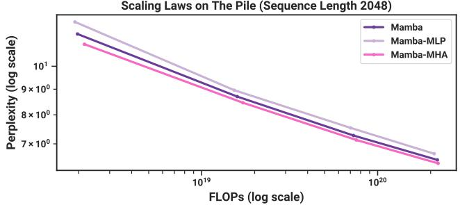

The Pile 上的缩放定律（序列长度 2048）  
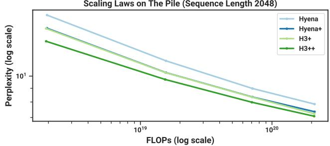  
Figure 9: （缩放定律：额外消融实验。）（左）替换为 （右）替换为

• 如果将 Mamba 块与 MHA（多头注意力，multi-head attention）块交错放置会怎样？这也可以理解为采用带有 SwiGLU MLP 的 Transformer（即我们所称的 Transformer++），并直接在其 MLP 块中添加 SSM。

Figure 9（右）展示了这些变体与原始（同质）Mamba 架构的对比。有趣的是，这两种改动的影响都不大。Mamba-MLP 架构仅略微逊色，且仍优于除 Transformer++ 之外的所有模型。Mamba-MHA 架构仅略有提升，考虑到近期许多研究发现将（LTI）SSM 与注意力机制结合可以带来实质性改进（Dao, Fu, Saab, et al. 2023; Fathi et al. 2023; Fathullah et al. 2023; Saon, Gupta, and Cui 2023; Zuo et al. 2022），这一结果多少有些令人意外。

H3 架构：训练方案。接下来，我们对 Hyena 和 H3++ 模型之间的差异进行消融实验，这两个模型是除 Transformer++ 和 Mamba 之外我们表现最弱和最强的模型，此举旨在特别分离出训练方案的影响。

• Hyena：采用其原始架构和 GPT3 训练方案的 Hyena 块（与 Figure 4 相同）。

• Hyena+：相同的架构，但采用了上文描述的改进训练方案。

• H3+：与 Hyena+ 相同的架构，但将 Hyena 卷积核替换为 S4D 卷积核。

• H3++：与 H3+ 相同，但线性注意力头维度设为 8。这增加了 SSM 循环内部的计算量，但不会增加参数量。

我们的通用惯例是：“Model+” 表示采用改进训练方案的基础模型，而 “Model++” 还允许进行架构上的修改。

Figure 9（右）表明：

• 改进的训练方案带来了显著的提升，该方案被用于主文 Figure 4 中的许多模型（RetNet、H3++、Transformer++、Mamba）。

• 内部 LTI SSM 的选择无关紧要（例如 Hyena 与 S4），这与贯穿本文的研究结果一致。

• 头维度的扩展提升了性能，这与我们的核心主题之一相符，即扩展状态维度可以提高 SSM 的性能（第 3 节）。

## E.2.3 下游评估细节

该预训练过程与缩放定律（scaling law）协议相同，但扩展到了 300B token，并使用了 GPT-NeoX 分词器（Black et al. 2022）而非 GPT2 分词器。对于 1.3B 模型，我们采用 1M token 的批次大小（batch size），以与 GPT3 规范保持一致。我们汇报了在 Pile 验证集上的困惑度（perplexity），并且在该指标上仅与在相同数据集和相同分词器下训练的模型进行对比，特别是 Pythia 和 RWKV。

对于下游评估，我们使用了 EleutherAI 的 LM evaluation harness（L. Gao, Tow, et al. 2021），这与该领域的大多数工作一致。我们在以下用于评估常识推理的任务/数据集上进行了评估：

• LAMBADA (Paperno et al. 2016)

• HellaSwag (Zellers et al. 2019)

• PIQA (Bisk et al. 2020)

• ARC-challenge (P. Clark et al. 2018)

• ARC-easy：ARC-challenge 的简单子集

• WinoGrande (Sakaguchi et al. 2021)

我们汇报了 LAMBADA、WinoGrande、PIQA 和 ARC-easy 的准确率，以及 HellaSwag 和 ARC-challenge 按序列长度归一化后的准确率（因为在这些任务中，几乎所有模型的归一化准确率都更高）。

## E.3 DNA 建模

## E.3.1 预训练细节

我们更详细地描述了 HG38 预训练任务的数据集和训练过程。

该数据集沿用了先前基因组学领域 Enformer 研究（Avsec et al. 2021）的数据集划分；训练集总共包含覆盖基因组的 $N = 34021$ 个长度为 $\bar { 2 ^ { 1 7 } } = 1 3 1 0 7 2$ 的片段，总计约 45 亿个 token（DNA 碱基对）。这些片段是形如（染色体编号、起始索引、终止索引）的元组，并且在必要时可以进行扩展（例如，以获得更长的片段）。

当训练序列长度不为 $2 ^ { 1 7 }$ 时，我们采用了不同于 HyenaDNA 的处理方式。HyenaDNA 总是截取固定的子片段（例如规定片段的开头或中间），因此对于任意训练序列长度，每个 epoch 都固定为 34021 个样本，并且不一定会遍历整个基因组。相比之下，我们使用了全部训练数据：

• 当上下文长度 $L$ 小于（或等于）$2 ^ { 1 7 }$ 时，我们将每个片段划分为长度为 $L$ 的不重叠子片段，因此总样本数为 $\begin{array} { r } { S \times { \frac { 2 ^ { 1 7 } } { L } } } \end{array}$，每个 epoch 约包含 $S \times 2 ^ { 1 7 } \approx 4 . 5 B$ 个 token。

• 当上下文长度 $L$ 大于 $2 ^ { 1 7 }$ 时，我们将每个片段转化为两个样本：一个以规定片段开头，另一个以规定片段结尾。因此每个 epoch 拥有 $2S$ 个样本项，每个 epoch 包含 $2SL$ 个 token。例如，在序列长度为 $2 ^ { 1 8 } = 2 6 2 1 4 4$ 时，token 数量是默认情况的 4 倍；在序列长度为 $\dot { 2 } ^ { 2 0 }$ 时，token 数量则是默认情况的 16 倍。

其他训练细节大体遵循与我们的语言建模实验相同的方案（附录 E.2）。例如，我们使用 $(\beta_1, \beta_2) = (0.9, 0.95)$ 的 AdamW，无 dropout，权重衰减为 0.1。我们使用余弦学习率调度器，并在前 10% 的总步数中进行线性预热（warmup）。

## E.3.2 缩放：模型大小细节

模型。我们考虑的模型包括：

• Transformer++：一种具有改进架构的 Transformer，特别是采用了 RoPE 位置编码（Su et al. 2021）。经验上，我们发现其显著优于（Vaswani et al. 2017）中的原始位置编码。

• HyenaDNA：来自 Nguyen, Poli, et al. (2023) 和 Poli et al. (2023) 的 Hyena 模型，大致相当于将 MHA 块替换为使用由 MLP 参数化的全局卷积的 H3 块的 Transformer。

• Mamba：标准的 Mamba 架构。

模型大小。我们使用以下模型大小。

<table><tr><td>块数</td><td>4</td><td>5</td><td>6</td><td>7</td><td>8</td><td>10</td><td>12</td></tr><tr><td>模型维度</td><td>64</td><td>96</td><td>128</td><td>192</td><td>256</td><td>384</td><td>512</td></tr><tr><td>参数量（约）</td><td>250K</td><td>700K</td><td>1.4M</td><td>3.5M</td><td>7.0M</td><td>19.3M</td><td>40.7M</td></tr></table>

请注意，Mamba 的块数翻倍了，因为一个 Transformer“层”同时包含了 MHA 和 MLP 块（Hyena 亦是如此），为了匹配参数量需要两个 Mamba 块（第 3.4 节）。

训练。对于每个模型（Transformer++、HyenaDNA、Mamba），我们在 $\{ 1 e - 3 , 2 e - 3 , 4 e - 3 , 8 e - 3 \}$ 范围内扫描了学习率。在所有尺寸下，Transformer 和 HyenaDNA 的最佳学习率均为 2e-3。Mamba 的最佳学习率为 8e-3；需要注意的是，在匹配的学习率 $( 2 \mathrm { e } \mathrm { - } 3 )$ 下，Mamba 的表现优于基线模型，但在更高的学习率下表现得更加稳定且提升更为明显。（此外，由于该学习率处于扫描范围的上限，我们的结果仍有可能未达到最优。）

请注意，与标准的语言模型（LM）缩放定律（Table 12）不同，为了简化起见，我们在不同模型尺寸间保持了学习率恒定。对于更大的模型，最佳学习率应该降低，但在我们所考虑的小模型尺寸（最多几百万参数）下，我们并未发现显著影响。

## E.3.3 扩展：上下文长度细节

对于每个序列长度，我们在每个训练步使用 $2 ^ { 2 4 }$ ≈ 16M token 的总批次大小（例如，在长度为 $2 ^ { 2 0 }$ 时每个批次有 16 个片段，而在长度为 $2 ^ { 1 0 }$ 时每个批次有 16384 个片段）。按照通常的 LM 标准，相对于模型大小而言这是一个很大的批次大小，但需要注意的是，在一台配备 8 块 GPU 且序列长度为 $2 ^ { 2 } 0$ 的机器上，批次大小 $\cot 2 ^ { 2 3 }$ 是所能支持的最小值，而且 HyenaDNA 使用了更大的批次大小 $2 ^ { 2 8 }$。

所使用的学习率对于 Mamba 为 0.008，对于 HyenaDNA 为 0.001；我们最初尝试对 HyenaDNA 使用与上一节相同的 0.002 学习率，但发现在最长上下文长度下该学习率不稳定。

序列长度预热（Sequence Length Warmup）。遵循 (Nguyen, Poli, et al. 2023)，我们在预训练期间使用序列长度预热（SLW）。我们选择了一个简单的调度方案，即从 $2 ^ { 1 0 } = 1 0 2 4$ 开始，在每个 2 的幂次序列长度上训练 2 个 epoch（注意，由于数据的整理方式，在最长序列长度下，按比例消耗了更多的步数和 token。具体而言，直至长度 $2 ^ { 1 7 }$ 为止的每个阶段处理相同数量的 token，但在长度 $2 ^ { 1 8 }$ 处处理的 token 数量是其 4 倍，在长度 $2 ^ { \overset { \smile } { 1 9 } }$ 处为 8 倍，在长度 $2 ^ { 2 0 } .$ 处为 16 倍。）。

与 HyenaDNA 不同，我们始终控制每次梯度更新的 token 数量，因此随着每个阶段序列长度翻倍，批大小（batch size）相应地依次减半。

Remark E.1. 我们还注意到该调度方案未经过调优，并且在这些预训练实验中，我们从未尝试过关闭序列长度预热。我们后来发现，在类似长度的音频预训练中，SLW 并没有带来显著帮助（第 4.4 节），因此在 DNA 预训练中它可能也并非必要。

## E.3.4 物种（类人猿）分类

模型是因果的，因此模型输出中（沿序列长度方向的）仅最后一个元素用于分类头。请注意，我们控制了每个梯度步中损失函数包含的元素总数。预训练目标包含沿序列长度的所有位置，因此 batch\_size × sequence\_length 保持恒定；换句话说，批大小（batch size）会随着序列长度的增加而减小。然而，对于分类任务，由于只有最后一个位置进入损失计算，因此批大小本身保持恒定。请注意，这也意味着微调具有更长序列长度的模型在计算成本上更高。

训练包含 10 个周期（epochs），每个周期包含 1024 个梯度步。每个梯度步使用的批大小为 64，所有样本均通过先均匀随机抽取一个物种，再均匀随机抽取一条染色体，最后均匀随机抽取一段连续的 DNA 片段而独立随机生成。

参考 (Nguyen, Poli, et al. 2023)，最大上下文长度大于 $2^{14} = 16384$ 的模型采用序列长度预热（sequence length warmup）：在长度为 $2 ^ { 1 4 } = 1 6 3 8 4$ 下训练 1 个 epoch，在长度为 $2 ^ { 1 5 } = 3 2 7 6 8$ 下训练 1 个 epoch，在长度为 $2 ^ { 1 6 } = 6 5 5 3 6$ 下训练 1 个 epoch，依此类推直至达到最大序列长度。例如，上下文长度为 $2 ^ { 2 0 } = 1 0 4 8 5 7 6$ 的模型会先经历 6 个 epoch 的序列长度预热，随后在其最大序列长度下再进行 4 个 epoch 的训练。

所有 Hyena 模型的学习率均为 4e − 5，而所有 Mamba 模型的学习率均为 1e − 4。这些参数是通过在较短序列长度 $( 2 ^ { 1 0 } , \hat { 2 ^ { 1 2 } } , 2 ^ { 1 4 } , 2 ^ { 1 \hat { 6 } } )$ 下，对各模型在 $\left\{ 1 e - 5 , 2 e - 5 , 4 e - 5 , 1 e - 4 , 2 e - 4 \right\}$ 范围内进行学习率搜索确定的，且这些数值在各个模型中均一致表现最佳。在长度 $2 ^ { 1 8 }$ 下进行了简化的学习率搜索，其结果与这些数值相符；而在长度 $2 ^ { 2 0 }$ 下仅进行了一次运行（如上文所述，这些实验的计算成本与序列长度成正比）。学习率采用带预热的余弦衰减调度策略，其中包括 5 个 epoch 线性预热至最大学习率，以及 5 个 epoch 余弦衰减至 $1 e - 6 .$ 选择这种异常长的学习率预热调度，是因为序列长度预热的时间也较长（例如，对于上下文长度为 $2 ^ { 2 0 }$ 的模型，预热占了 10 个 epoch 中的 6 个）；我们未对此选择做进一步对比实验。

Table 13: （类人猿 DNA 分类。）使用相同上下文长度的预训练模型，在长度从 $2 ^ { 1 0 } = 1 0 2 4 \mathrm { u p }$ 到 $2 ^ { 2 0 }$ = 1048576 的序列上微调后的准确率。随机猜测为 20%。

<table><tr><td rowspan="2">模型</td><td rowspan="2">参数量</td><td colspan="6">不同序列长度下的准确率 (%)</td></tr><tr><td> $2^{10}$ </td><td> $2^{12}$ </td><td> $2^{14}$ </td><td> $2^{16}$ </td><td> $2^{18}$ </td><td> $2^{20}$ </td></tr><tr><td>HyenaDNA</td><td>1.4M</td><td>28.04</td><td>28.43</td><td>41.17</td><td>42.22</td><td>31.10</td><td>54.87</td></tr><tr><td>Mamba</td><td>1.4M</td><td>31.47</td><td>27.50</td><td>27.66</td><td>40.72</td><td>42.41</td><td>71.67</td></tr><tr><td>Mamba</td><td>7M</td><td>30.00</td><td>29.01</td><td>31.48</td><td>43.73</td><td>56.60</td><td>81.31</td></tr></table>

Table 14: YouTubeMix 长度缩放的序列长度与批次大小。

<table><tr><td>序列长度</td><td>批次大小</td><td>TOKENS / 批次</td></tr><tr><td>468 × 2048 = 958464</td><td>1</td><td>958464</td></tr><tr><td>234 × 2048 = 479232</td><td>2</td><td>958464</td></tr><tr><td>117 × 2048 = 239616</td><td>4</td><td>958464</td></tr><tr><td>59 × 2048 = 120832</td><td>8</td><td>966656</td></tr><tr><td>30 × 2048 = 61440</td><td>16</td><td>983040</td></tr><tr><td>15 × 2048 = 30720</td><td>32</td><td>983040</td></tr><tr><td>8 × 2048 = 16384</td><td>64</td><td>1048576</td></tr><tr><td>4 × 2048 = 8192</td><td>128</td><td>1048576</td></tr></table>

物种分类任务的结果见 Table 13。

## E.4 音频细节

## E.4.1 YouTubeMix 音频预训练

模型。我们使用的模型每个阶段包含 3 个块（总共 $( 3 \times 5 = 1 5$ 个 Mamba 块），池化因子 $p = 1 6 ,$，外维度 $D = 6 4$，参数量约为 3.5M。

数据集。数据采用 8 位 mu-law 编码，因此模型是对词表大小为 256 的离散 token 进行建模。

该数据集由长达 1 分钟（即长度为 960000）的片段组成，这些片段经过下采样并被划分为任意所需序列长度的段。由于该架构包含两个池化因子为 16 的池化阶段，且为了硬件效率，我们希望最终得到的序列长度为 8 的倍数，因此最长可能的序列为 $4 6 8 \times 2 0 4 8 = 9 5 8 4 6 4$。我们其余的序列长度是通过将该长度依次减半并向上取整至最接近的 2048 的倍数来定义的。

Table 14 列出了 Figure 7 中使用的具体规格。除了变化的批大小（batch size）之外，训练集中的有效片段数量在不同序列长度之间也有所不同（例如，图表中不同数据点每个 epoch 的训练步数并不恒定），这可能是导致缩放曲线中出现拐折的原因。

训练。模型训练了 200k 个训练步，最大学习率为 0.002，预热步数（warmup steps）为 20k（10%），权重衰减（weight decay）为 0.1（与我们跨领域的通用预训练方案类似）。

额外消融实验：SSM 参数化。我们在图 7 的设定下研究了长音频波形预训练中的 SSM 参数化。该设定稍作修改，使用了更大的模型（8 层且 $D = 6 4$ 对应 6M 参数，即 SaShiMi 默认设置）、更短的序列（从 $2 ^ { 1 3 } \ \mathrm { t o } \ 2 ^ { 2 0 }$ 调整为 $2 ^ { 1 1 } = 2 0 4 8 \mathrm { t o } 2 ^ { \bar { 1 } 8 } = 2 6 2 1 4 4$）、更低的学习率（LR，从 0.002 降至 0.001）以及更短的训练周期（100K 步代替 200K 步）。

图 10 表明，从 $S 4  S 6$（即选择机制）的改变并不总是有益的。在长音频波形上，它实际上显著阻碍了性能，这从音频是均匀采样且非常平滑的角度来看可能是直观的，因此受益于连续线性时不变（LTI）方法。在消融掉选择机制后，请注意所得到的模型是 Mamba 块内部的 S4 层。为了消除歧义，我们称其为 Mamba-S4，而默认的 Mamba 架构则称为 Mamba-S6。

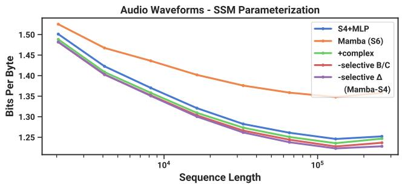

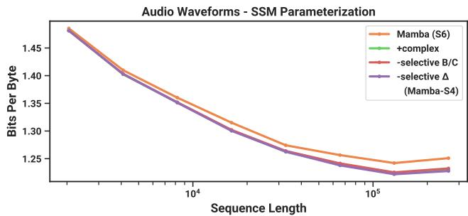  
Figure 10: （音频预训练（YouTubeMix）消融实验。）作为一种均匀采样的“连续”信号模态，音频波形实际上受益于具有匹配归纳偏置的 LTI 模型。（左）同质模型（所有块具有相同的参数化）（右）仅消融中心 U-Net 块；外层块为 Mamba-S4。紫色线条与左图相同。

然而，在右侧，我们保留了 U-Net 的外层为 Mamba-S4，仅对内层进行消融。性能差异显著缩小；这进一步支持了以下假设：更接近原始音频信号的层应当是 LTI（线性时不变），但一旦它们被外层“标记化（tokenized）”并压缩后，内层便不再需要是 LTI。然而在此设置下，实值 SSM 的性能仍然逊于复值 SSM。

## E.4.2 SC09 语音生成

自回归训练基本遵循自回归语言建模协议，例如：

• 权重衰减 0.1

• 学习率预热占总步数的 10%

• AdamW 优化器，$\beta = ( 0 . 9 , 0 . 9 5 )$

• 梯度裁剪值 0.1

我们在批次大小为 16 的情况下，使用了 0.002 的学习率和 200000 个训练步数。

Table 4 中的大型 Mamba 模型每个阶段包含 15 层，外层维度为  = 96，池化因子为 4。我们注意到该数据集较小（训练进行了 100 个 epoch），对于这个大型模型而言，BPB 或 NLL 出现了显著的过拟合。然而，生成样本的自动化指标在整个训练过程中仍在持续提升。

表 5 中架构消融实验的模型在每个阶段均包含 8 层，外部维度为 $D = 64$，池化因子为 4。S4+MLP 块大致具有 $2 D ^ { 2 } + 4 D ^ { 2 }$ 个参数（MLP 中的扩展因子为 2）。Transformer 块具有 $4 D ^ { 2 } + 2 D ^ { 2 }$ 个参数（MLP 中的扩展因子为 1）。Mamba 块具有常规的 $\approx 6 D ^ { 2 }$ 个参数。所有模型的总参数量大致均为 6M。

## E.5 效率基准测试

扫描操作（Scan Operation）。我们在 A100 80GB PCIe GPU 上，将选择性 SSM 的核心操作——并行扫描（第 3.3 节）与卷积和注意力机制进行了比较。请注意，这些测试并不包含该核心操作之外的其他操作开销，例如在全局卷积模型中计算卷积核，或在注意力机制中计算 QKV 投影。

作为基线，我们在 PyTorch 中实现了一个未进行核函数融合的标准并行扫描。这需要在 HBM 中显式存储参数 , , 。

我们的扫描实现融合了离散化步骤和并行扫描，避免了在 HBM 中显式存储所有大参数的开销。

Table 15: （内存基准测试。）Mamba 的内存占用与经过极致优化的 Transformer 相当。结果基于 125M 模型。

<table><tr><td>批大小</td><td>Transformer (搭配 FlashAttention-2)</td><td>Mamba</td></tr><tr><td>1</td><td>4.6GB</td><td>4.8GB</td></tr><tr><td>2</td><td>5.2GB</td><td>5.8GB</td></tr><tr><td>4</td><td>6.9GB</td><td>7.3GB</td></tr><tr><td>8</td><td>11.5GB</td><td>12.3GB</td></tr><tr><td>16</td><td>20.7GB</td><td>23.1GB</td></tr><tr><td>32</td><td>34.5GB</td><td>38.2GB</td></tr></table>

对于卷积，我们使用 PyTorch 中的标准实现，它分别对输入和滤波器执行快速傅里叶变换（FFT），在频域中将它们相乘，然后执行逆快速傅里叶变换以获得结果。对于序列长度 ，其理论复杂度为 ( log())。

对于注意力机制，我们与已知最快的实现（带因果掩码的 FlashAttention-2 (Dao 2024)）进行了对比。请注意，带因果掩码的 FlashAttention-2 比不带因果掩码快约 1.7 倍，因为大约只计算了一半的注意力项。

我们使用的批大小为 1，并将序列长度从 $2 ^ { 9 } = 5 1 2 , 2 ^ { 1 0 } \approx 1 K , 2 ^ { 1 1 } \approx 2 K$ 增加到 $2 ^ { 1 9 } \approx 5 0 0 K$（某些基线在达到 500K 之前就耗尽了显存）。我们使用的模型维度为  = 1024，状态维度为  = 16。我们使用 BF16 输入进行测算，这是大规模训练中最常用的数据类型。

端到端推理。我们测量了 Mamba 1.4B 模型和未经训练的 Mamba 6.9B 模型的推理吞吐量，并与 1.3B 和 6.7B 大小的标准 Transformer（GPT3 架构）进行了对比。我们使用了 HuggingFace transformers 库中的标准 Transformer 实现。

我们将提示词长度（prompt length）设为 2048，生成长度设为 128。我们将批大小（batch size）从 1、2、4、8、16、32、64 变化至 128，并测量生成 128 个 token 所需的时间。随后，我们将吞吐量（tokens/s）计算为 批大小 × 128 / 所用时间。我们重复测量 3 次并取平均值。测量在一张 A100 80GB PCIe GPU 上完成。

内存基准测试。与大多数深度序列模型一样，内存占用仅与激活张量的大小成正比。我们报告了 125M 模型在 1 张 A100 80GB GPU 上的训练内存需求测量结果。每个批次由长度为 2048 的序列组成。我们将其与我们所知内存效率最高的 Transformer 实现（采用了来自 torch.compile 的算子融合技术并结合了 FlashAttention-2）进行了对比。Table 15 表明，Mamba 的内存需求与经过极致优化的同等大小 Transformer 相当，并且我们预计未来 Mamba 的内存占用还会进一步改善。