# Titans：在测试阶段学习记忆

† Ali Behrouz , Peilin Zhong , and Vahab Mirrokni

Google Research {alibehrouz, peilinz, mirrokni}@google.com

## 摘要

十多年来，关于如何有效利用循环模型（recurrent models）与注意力机制（attentions）已有了广泛的研究探索。循环模型旨在将数据压缩到固定大小的记忆（称为隐藏状态）中，而注意力机制则允许关注整个上下文窗口，捕捉所有 token 之间的直接依赖关系。然而，这种对依赖关系更精确的建模伴随着二次方的计算开销，从而将模型限制在固定长度的上下文内。我们提出了一种新型神经长期记忆模块（neural long-term memory module），它学习记忆历史上下文，并协助注意力机制在利用长久历史信息的同时关注当前上下文。我们表明，该神经记忆兼具快速可并行化训练的优势，同时保持了快速的推理能力。从记忆的角度来看，我们认为注意力机制由于其有限的上下文但精确的依赖建模表现为短期记忆，而神经记忆凭借其记忆数据的能力，则扮演了长期且更持久的记忆角色。基于这两个模块，我们引入了一类名为 Titans 的新架构族，并提出了三种变体来解决如何将记忆有效融入该架构的问题。我们在语言建模、常识推理、基因组学和时间序列任务上的实验结果表明，Titans 比 Transformers 和近期现代的线性循环模型更有效。此外，与基线相比，它们能够有效扩展到超过 2M 的上下文窗口大小，并在大海捞针（needle-in-haystack）任务中表现出更高的准确率。

## 1 引言

“真正的记忆之术即是注意之术！”

— Samuel Johnson，1787

作为纯基于注意力机制的架构，Transformers（Vaswani et al. 2017）已被牢固确立为序列建模中最先进（state-of-the-art）的模型，这主要归功于它们的上下文学习（in-context learning）以及规模化学习的能力（Kaplan et al. 2020）。Transformers 的核心构建模块——注意力模块——充当联想记忆块（Bietti et al. 2024），它们通过学习存储键-值（key-value）关联，并通过计算查询（query，即搜索信号）与键（key，即上下文）之间的两两相似度来检索它们。因此，从设计上看，Transformer 的输出完全取决于当前上下文窗口中 token 的直接依赖关系。然而，这种对依赖关系的精确建模带来了随上下文长度呈二次方增长的时间和内存复杂度。在复杂的现实世界任务中（例如语言建模（N. F. Liu et al. 2024）、视频理解（C.-Y. Wu et al. 2019）、长期时间序列预测（H. Zhou et al. 2021）），上下文窗口可能变得极其庞大，使得 Transformers 在这些下游任务中的应用充满挑战。

为了克服 Transformers 的可扩展性问题，近期的研究旨在设计线性 Transformers（linear Transformers）的不同变体（Kacham, Mirrokni, and P. Zhong 2024; Katharopoulos et al. 2020; S. Yang, B. Wang, Shen, et al. 2024），其中注意力机制中的 softmax 被核函数所取代（详见 §2.1），从而显著降低了内存消耗。尽管具备高效性以及扩展到更长上下文的能力，但由于核技巧（kernel trick）使模型转变为一个线性循环网络，其中数据被压缩为矩阵值状态（Katharopoulos et al. 2020），导致线性 Transformers 相比于 Transformers 并未展现出具有竞争力的性能。然而，这引出了关于线性循环（或线性 Transformers）模型的一个矛盾事实：一方面，我们使用这些线性模型来提高可扩展性和效率（线性复杂度对比二次复杂度），其优势在极长上下文中得以显现；另一方面，极长的上下文又无法被恰当地压缩到一个较小的向量值或矩阵值状态中（S. Wang 2024）。

此外，除了效率之外，大多数现有架构——从 Hopfield 网络（Hopfield Networks, Hopfield 1982）到 LSTM（Jür gen Schmidhuber and Hochreiter 1997）和 Transformer（Vaswani et al. 2017）——在处理泛化、长度外推和/或推理（Anil et al. 2022; Qin, Y. Zhong, and Deng 2024）时都面临挑战，而所有这些都是许多复杂的现实世界任务中不可或缺的组成部分。尽管这些架构从人脑中汲取了灵感，但它们各自都缺失了以下内容：(1) 学习过程的关键组件——如短期记忆、长期记忆、元记忆、对当前上下文的注意等（Cowan 2008）；(2) 这些组件如何作为能够独立运作的互联系统；以及/或者 (3) 从数据中主动学习并对过去历史的抽象进行记忆的能力。我们认为，在一个有效的学习范式中，类似于人脑，存在着截然不同但又相互连接的模块，每个模块都负责对学习过程至关重要的一个组件。

## 记忆视角

记忆是一种基本的心理过程，是人类学习不可分割的组成部分（Terry 2017）。如果没有一个正常运作的记忆系统，人类和动物将被限制在基本反射和刻板行为中。因此，记忆一直是机器学习文献中许多开创性研究的灵感来源；例如 Hopfield 网络（Hopfield Networks, Hopfield 1982）、LSTM（Jürgen Schmidhuber and Hochreiter 1997）和 Transformer（Vaswani et al. 2017）。

借鉴神经心理学文献中对记忆和学习的通用定义（Okano, Hirano, and Balaban 2000），大多数现有架构将记忆视为由输入引起的神经更新，并在给定目标的情况下将学习定义为获取有效且有用记忆的过程。从这个视角来看，循环神经网络（Recurrent Neural Networks, RNNs）（Williams and Zipser 1989）可以被定义为具有向量值记忆模块 M（也称为隐藏状态）的模型，包含两个主要步骤：在时间  给定一个新输入  时，该模型 (1) 使用函数 $f ( \mathscr { M } _ { t - 1 } , x _ { t } )$ 更新记忆（伴随压缩）；以及 (2) 使用函数 $g ( \boldsymbol { M } _ { t } , \boldsymbol { x } _ { t } )$ 检索输入的相应记忆（详见 §2.1）。类似地，Transformer 可以被看作是具有不断增长的记忆以及两个相似步骤的架构。也就是说，键（Key）和值（Value）矩阵对充当模型的记忆，并且该模型：(1) 通过将键和值追加到记忆中来更新记忆（不伴随压缩），以及 (2) 通过计算查询向量与键向量的相似度来检索查询向量的相应记忆，然后将其用于对值向量进行加权以产生输出。

这一视角可以帮助我们更好地理解现有范式及其关键差异，并设计出更有效的架构。例如，Transformers（Vaswani et al. 2017）与线性 Transformers（linear Transformers，Katharopoulos et al. 2020）之间的主要区别在于记忆结构以及记忆更新步骤，其中线性 Transformers 将历史数据压缩为一个固定大小的矩阵值记忆（matrix-valued memory），而 Transformers 则在不进行任何压缩的情况下保留（上下文长度内的）所有历史数据。虽然线性 Transformers 和线性 RNNs（linear RNNs，包括状态空间模型 state space models）都在记忆更新步骤中压缩信息，但关键区别在于记忆的结构：线性 RNNs 使用向量值记忆（vector-valued memory），而线性 Transformers 使用矩阵值记忆。因此，这一视角促使我们提出：（Q1）何谓良好的记忆结构？（Q2）什么是适宜的记忆更新机制？以及（Q3）什么是良好的记忆检索过程？

重新审视我们对人类记忆的理解，它既不是一个单一的过程，也不仅承担单一的功能（Cowan 2008）。事实上，记忆是由多个系统构成的联合体——例如短期记忆、工作记忆和长期记忆——每个系统具有不同的神经结构，服务于不同的功能，并且均能够独立运作（Willingham 1997）。这一事实促使我们提出：（Q4）如何设计一个融合不同互联记忆模块的高效架构？最后，存储记忆是一个需要对过去的抽象表征进行编码和存储的神经过程。若假设以线性方式对数据进行编码的单一向量或矩阵足以存储长期历史，可能是一种过度简化。（Q5）为了有效存储/记住久远的过去，是否需要深度记忆模块（deep memory module）？

## 贡献与路线图

在本文中，我们旨在通过设计一个能够在测试阶段高效且有效地学习记忆的长期神经记忆模块（long-term neural memory module），来回答上述五个问题。基于该设计，我们进一步讨论了如何将其整合进整体架构之中。

神经记忆（§3）。我们提出了一种（深度）神经长期记忆，它（作为一个元上下文内模型）在测试时学习如何将数据记忆/存储到其参数中。受到人类长期记忆系统（Mandler 2014）的启发，我们设计了该记忆模块，使得违背预期的事件（令人感到惊讶的事件）更易被记住。为此，我们在联想记忆损失中，使用神经网络关于输入的梯度来衡量输入的惊讶度（详见 §3.1）。为了更好地处理有限的记忆容量，我们提出了一种衰减机制，该机制综合考虑记忆大小的比例和数据的惊讶程度，从而实现更优的记忆管理。我们证明了这种衰减机制实际上是现代循环模型中遗忘机制的推广（Dao and Gu 2024; Gu and Dao 2024; S. Yang, Kautz, and Hatamizadeh 2024）。有趣的是，我们发现该机制等价于使用小批量梯度下降、动量和权重衰减来优化一个元神经网络。基于将小批量梯度下降张量化以使用更多矩阵乘法（matmul）操作的方法（Yu Sun et al. 2024），我们提出了一种快速且可并行化的算法来训练我们的深度神经长期记忆。

Titans 架构（§4）。在设计好长期神经记忆之后，一个遗留的重要问题是如何有效且高效地将记忆整合到深度学习架构中。我们提出了 Titans，这是一个由三个超头部（hyper-heads）组成的深度模型族：(1) 核心（Core）：该模块由短期记忆组成，负责处理数据的主流程（我们使用有限窗口大小的注意力机制）；(2) 长期记忆（Long-term Memory）：该分支是我们的神经长期记忆模块，负责存储/记住久远的过去；(3) 持久记忆（Persistent Memory）：这是一组可学习但与数据无关的参数，用于编码关于任务的知识。最后，作为概念验证，我们提出了 Titans 的三种变体，分别将记忆整合为：(i) 上下文，(ii) 网络层，以及 (iii) 门控分支。

实验结果（§5）。我们在语言建模、常识推理、召回密集型任务、大海捞针（needle in haystack）、时间序列预测以及 DNA 建模任务上进行了实验评估。我们观察到，在一组全面的基准测试中，我们的 Titan 架构优于所有现代循环模型及其混合变体（与滑动窗口注意力相结合）。此外，Titans 优于具有相同上下文窗口的 Transformers，并且与使用完整上下文的 Transformers 表现出相当的竞争力。取得这些结果的同时，与 Transformers 相反，Titans 能够扩展到超过 2M 的上下文窗口大小。

## 2 预备知识

在本节中，我们讨论在整篇论文中使用的符号表示和一些背景概念。我们令……为注意力机制，且 $M$ 为注意力掩码。当对序列进行分段时，我们使用 $\mathsf { S } ^ { ( i ) }$ 来表示第 $i$ 个分段。在整篇论文中，我们沿用符号简记，使用下标来表示矩阵、向量或分段中的特定元素。例如，我们令 $\mathsf { S } _ { j } ^ { ( i ) }$ 为第 $i$ 个分段中的第 $j$ 个 token。唯一的例外是带有 $t$ 的下标，我们保留它来索引随时间的循环，或神经网络在时间 $t$ 的状态。给定一个神经网络 $N$ 和一个数据样本 $x$，我们使用 $N ( x )$（分别对应 $N ^ { * } ( x )$）来表示带有（分别对应不带）权重调整的前向传播。此外，我们沿用符号简记，使用 $N ^ { ( k ) }$ 来表示神经网络的第 $k$ 层。在下文中，我们首先讨论注意力机制及其高效变体的背景，随后回顾现代线性 RNN。最后，我们从记忆的角度讨论这些架构，这促使我们设计了 Titans。

## 2.1 背景

注意力机制（Attention）。Transformer（Vaswani et al. 2017）作为许多深度学习模型的事实标准主干网络，是建立在注意力机制之上的。给定输入 $\boldsymbol { x } \in \mathbb { R } ^ { N \times d _ { \mathrm { i n } } }$ n，因果注意力（causal attention）基于对依赖于输入的键（key）、值（value）和查询（query）矩阵的 softmax 计算输出 $\mathbf { y } \in \mathbb { R } ^ { N \times d _ { \mathrm { i n } } }$：

$$
\mathbf {Q} = x \mathbf {W} _ {\mathbf {Q}}, \qquad \mathbf {K} = x \mathbf {W} _ {\mathbf {K}}, \qquad \mathbf {V} = x \mathbf {W} _ {\mathbf {V}},\tag{1}
$$

$$
\mathbf {y} _ {i} = \sum_ {j = 1} ^ {i} \frac {\exp (\mathbf {Q} _ {i} ^ {\top} \mathbf {K} _ {j} / \sqrt {d _ {\mathrm{in}}}) \mathbf {V} _ {j}}{\sum_ {\ell = 1} ^ {i} \exp (\mathbf {Q} _ {i} ^ {\top} \mathbf {K} _ {\ell} / \sqrt {d _ {\mathrm{in}}})},\tag{2}
$$

其中 ${ \bf W } _ { \mathrm { Q } } , { \bf W } _ { \bf K }$ 和 $\mathbf { W } _ { \mathrm { V } } \in \mathbb { R } ^ { d _ { \mathrm { i n } } \times d _ { \mathrm { i n } } }$ 是可学习参数。尽管 Transformer 具有强大的能力和出色的召回效果，但它至少需要 $N \times d$ 个算子来计算输出，从而导致对于较长序列产生更大的内存消耗和更低的吞吐量。

高效注意力机制（Efficient Attention）。为了改善长序列下 Softmax 注意力的内存消耗和吞吐量，多项研究聚焦于注意力的 I/O 感知实现 (Dao 2024; Dao, D. Fu, et al. 2022)、通过稀疏化注意力矩阵来设计更高效的注意力机制 (B. Chen et al. 2021; Choromanski et al. 2021; Dai et al. 2019)、近似 Softmax (Arora et al. 2024)，或开发基于核函数的（线性）注意力 (Aksenov et al. 2024; Kacham, Mirrokni, and P. Zhong 2024; Schlag, Irie, and Jürgen Schmidhuber 2021; S. Yang, B. Wang, Shen, et al. 2024)。在本部分中，我们重点关注后者，即线性注意力，其中标准注意力中的 Softmax 被替换为替代核函数 $\phi ( . , . )$ ，满足 $\phi ( x , y ) = \phi ( x ) \phi ( y )$ 。因此，注意力可以表示为：

$$
\mathbf {y} _ {i} = \sum_ {j = 1} ^ {i} \frac {\phi (Q _ {i} ^ {\top} K _ {j})}{\sum_ {\ell = 1} ^ {i} \phi (Q _ {i} ^ {\top} K _ {\ell})} V _ {j} = \sum_ {j = 1} ^ {i} \frac {\phi (Q _ {i}) ^ {\top} \phi (K _ {j})}{\sum_ {\ell = 1} ^ {i} \phi (Q _ {i}) ^ {\top} \phi (K _ {\ell})} V _ {j} = \frac {\phi (Q _ {i}) ^ {\top} \sum_ {j = 1} ^ {i} \phi (K _ {j}) V _ {j}}{\phi (Q _ {i}) ^ {\top} \sum_ {\ell = 1} ^ {i} \phi (K _ {\ell})},\tag{3}
$$

由于项 $\textstyle \sum _ { j = 1 } ^ { i } \phi ( K _ { j } )$ 和 $\textstyle \sum _ { \ell = 1 } ^ { i } \phi ( K _ { \ell } )$ 在每个时间步都可以复用，从而带来了更高的吞吐量。当选择核函数为单位矩阵时 (Yutao Sun et al. 2023)，上述公式也可以写成循环形式：

$$
\mathcal {M} _ {t} = \mathcal {M} _ {t - 1} + K _ {t} ^ {\top} V _ {t},\tag{4}
$$

$$
\mathbf {y} _ {t} = Q _ {t} \pmb {\mathcal {M}} _ {t},\tag{5}
$$

这使得线性注意力能够实现高效推理。

现代线性模型及其记忆视角。如前文所述，学习可以被定义为一个获取有效且有用记忆的过程。基于此，可以将循环神经网络（RNNs）的隐藏状态视作一个记忆单元，模型旨在将信息压缩到该单元中。因此，在循环神经网络的通用形式中，隐藏状态可以被视为记忆单元，而循环过程可以分解为对该记忆单元的读操作和写操作。也就是说，设输入为 $x \in \mathbb { R } ^ { \mathbf { \tilde { N } } \times d _ { \mathrm { i n } } }$ ，记忆单元为 $M \in \mathbb { R } ^ { d }$ ，输出为 $\mathbf { y } \in \mathbb { R } ^ { d _ { \mathrm { i n } } }$ ，则循环神经网络的通用形式定义为：

$$
\mathcal {M} _ {t} = f (\mathcal {M} _ {t - 1}, x _ {t}),
$$

$$
\text { Write   Operation }\tag{6}
$$

$$
\mathbf {y} _ {t} = g (\mathcal {M} _ {t}, x _ {t}),
$$

$$
\text { Read   Operation }\tag{7}
$$

其中 $f ( . , . )$ 是读取函数，$g ( . , . )$ 是对应的写入函数。请注意，此处 $\textstyle { \mathcal { M } } _ { t }$ 的下标表示时间 $t$ 时的记忆状态。

从这个视角来看，线性 Transformer（linear Transformers）的递推公式（见 Equation 4）等价于将键和值 $( K _ { t } , V _ { t } )$ 以加法方式压缩并写入矩阵值记忆单元 $\boldsymbol { \mathcal { M } } _ { t }$ 中。因此，当处理长上下文数据时，该过程的加法特性会导致记忆溢出（memory overflow），严重损害模型的性能。为了解决这一问题，研究主要集中在两个极具前景的方向：(1) 添加遗忘机制：多项研究提出了针对线性模型的自适应（数据依赖的）遗忘门机制，使其能够在需要时擦除记忆。作为此类模型的代表，我们参考了 GLA (S. Yang, B. Wang, Shen, et al. 2024)、LRU (Orvieto et al. 2023)、Grifin (De et al. 2024)、xLSTM (Beck et al. 2024) 以及 Mamba2 (Dao and Gu 2024)，其中后者还与传统状态空间模型（state space models）的离散化版本相关联 (Gu and Dao 2024)。(2) 改进写入操作：为了克服传统循环模型中记忆写入操作的加法特性，Widrow and Hof (1988) 提出了 Delta 规则（Delta Rule），在添加新记忆（即一对键和值）之前，模型会先移除其过去的值。为了提升可并行化训练与扩展能力，S. Yang, B. Wang, Yu Zhang, et al. (2024) 提出了一种快速可并行化算法。最后在最近，S. Yang, Kautz, and Hatamizadeh (2024) 通过添加遗忘门进一步改进了 DeltaNets。

记忆模块（Memory Modules）。记忆一直是神经网络设计的核心部分之一 (Graves, Wayne, and Danihelka 2014; JH Schmidhuber 1992; Jürgen Schmidhuber and Hochreiter 1997; J. Zhang et al. 2024)。将线性层视为键值（联想）记忆系统的思想可追溯到快速权重程序（fast weight programs），其中动态快速程序被合并到循环神经网络中以用作可写记忆 (JH Schmidhuber 1992)。赫布规则（Hebbian, Hebb 2005）和 Delta 规则 (Prados and Kak 1989) 是快速权重程序中最流行的两种学习规则，并在多项研究中得到了广泛探讨 (Irie, Schlag, et al. 2021; Munkhdalai, Sordoni, et al. 2019; Munkhdalai and H. Yu 2017; Schlag, Irie, and Jürgen Schmidhuber 2021; JH Schmidhuber 1992; S. Yang, Kautz, and Hatamizadeh 2024; S. Yang, B. Wang, Yu Zhang, et al. 2024)。然而，所有这些模型都基于瞬时惊奇（momentary surprise），忽略了序列中的词元流（token flow）（见 Section 3.1），且大部分模型缺乏遗忘门，导致记忆管理效果欠佳。

我们在 Appendix C 中进一步讨论了我们的架构与近期模型之间的联系。更多相关工作在 Appendix A 中进行讨论。

## 3 在测试时学习记忆

在本节中，我们提出了一种神经长期记忆模块，它是一个在测试时学习如何进行记忆的元模型（meta model）。在 3.1 节中，我们首先讨论神经记忆的动机和设计。在 3.2 节中，我们讨论我们的架构设计如何受益于快速且可并行化的训练。最后，在 3.3 节中，我们使用持久记忆模块来增强我们的架构，其中我们使用可学习但与数据无关的参数来学习关于任务的元信息。

## 3.1 长期记忆

为了设计神经长期记忆模块，我们需要一个能够将过去历史的抽象编码到其参数中的模型。一个例子是已被证明会记住其训练数据的大语言模型（LLM）（Leybzon and Kervadec 2024; Schwarzschild et al. 2024; Staab et al. 2024）。因此，一个简单的想法是训练一个神经网络并期望它记住其训练数据。然而，记忆在神经网络中几乎一直被认为是一种不受欢迎的现象，因为它限制了模型的泛化能力（Bayat et al. 2024），引起隐私问题（Staab et al. 2024），从而导致测试时的性能不佳。此外，对训练数据的记忆在测试时可能没有帮助，因为此时数据可能是分布外的（out-of-distribution）。我们认为，我们需要一个在线元模型，在测试时学习如何记忆/遗忘数据。在这种设置下，模型学习的是一种具备记忆能力的功能，但并未过拟合训练数据，从而在测试时实现更好的泛化。

学习过程与惊喜度度量。训练长期记忆的关键思想是将其训练视为一个在线学习问题，其中我们的目标是将过去的信息 $x _ { 1 } , \ldots , x _ { t - 1 }$ 压缩到长期神经记忆模块 $\textstyle { \mathcal { M } } _ { t }$ 的参数中。如前所述，违背预期的事件（即令人意外的事件）对人类来说更容易被记住（Mandler 2014）。受此启发，模型惊喜度的一个简单定义可以是其关于输入的梯度。梯度越大，输入数据与过去数据的差异就越大。相应地，利用这个惊喜度分数，我们可以按如下方式更新记忆：

$$
\mathcal {M} _ {t} = \mathcal {M} _ {t - 1} - \theta_ {t} \underbrace {\nabla \ell (\mathcal {M} _ {t - 1} ; x _ {t})} _ {\text { Surprise }}.\tag{8}
$$

然而，这种惊讶度度量可能会导致遗漏重大惊讶时刻之后的重要信息。也就是说，在经历几个惊讶的步骤后，梯度可能会变得极小，从而导致停滞在平坦区域（即局部极小值），并丢失序列中某些部分的信息。从人类记忆的角度来看，某个事件虽然令人难忘，但可能不会在很长一段时间内持续给我们带来惊讶。原因是最初的时刻足够令人惊讶，足以在很长的时间范围内引起我们的注意，从而让我们记住整个时间段。为了改进上述惊讶度度量（公式 8），我们将惊讶度度量分解为：(1) 过去惊讶度（past surprise），用于衡量最近过去的惊讶程度；以及 (2) 瞬时惊讶度（momentary surprise），用于衡量输入数据的惊讶程度：

$$
\begin{array}{l} \mathcal {M} _ {t} = \mathcal {M} _ {t - 1} + S _ {t}, \\ S _ {t} = \eta_ {t} \underbrace {S _ {t - 1}} _ {\text { Past   Surprise }} - \theta_ {t} \underbrace {\nabla \ell \left(M _ {t - 1} ; x _ {t}\right)} _ {\text { Momentary   Surprise }}. \end{array}\tag{9}
$$

(10)

有趣的是，这种形式类似于带有动量的梯度下降（gradient descent with momentum），其中 $S _ { t }$ 是动量项。因此，这里的动量充当了跨时间（序列长度）的惊讶度记忆。在该公式中，$\eta _ { t }$ 项是数据依赖的惊讶度衰减（$x _ { t }$ 的函数），控制惊讶度随时间衰减的程度；而 $\theta _ { t }$ 项则以数据依赖的方式控制应将多少瞬时惊讶度纳入最终的惊讶度度量中。这种数据依赖性在该设计中尤为重要：虽然可能需要前面标记（token）的惊讶度来影响下一个标记的惊讶度，但这主要在所有标记都相关且处于相同语境（context）时才有效。因此，数据依赖的 $\eta_t$ 可以控制记忆是否需要：(1) 通过设置 $\eta _ { t } \to 0$ 来忽略上一次的惊讶（可能是由于语境的改变），或者 (2) 通过设置 $\eta _ { t }  1$ 来完全吸收上一次的惊讶（可能是因为该标记与其最近过去的标记高度相关）。

目标。我们上述的惊讶度度量基于损失函数 $\ell ( . ; . )$，该损失函数是我们的记忆在测试时学习表现的目标。也就是说，我们的记忆模块是一个元模型（meta model），它基于损失函数 $\ell ( . ; . )$ 来学习一个函数。

在这项工作中，我们专注于联想记忆（associative memory），旨在将过去的数据存储为键值对（pairs of keys and values）。给定 $x _ { t }$，类似于 Transformers (Vaswani et al. 2017)，我们使用两个线性层将 $x _ { t }$ 投影为一个键和一个值：

$$
\mathbf {k} _ {t} = x _ {t} W _ {K}, \qquad \mathbf {v} _ {t} = x _ {t} W _ {V},\tag{11}
$$

其中 $W _ { K }$ 和 $W _ { V } \in \mathbb { R } ^ { d _ { \mathrm { i n } } \times d _ { \mathrm { i n } } }$。接下来，我们希望记忆模块能够学习键与值之间的关联。为此，我们将损失定义如下：

$$
\ell (\mathcal {M} _ {t - 1}; x _ {t}) = \left\| \mathcal {M} _ {t - 1} (\mathbf {k} _ {t}) - \mathbf {v} _ {t} \right\| _ {2} ^ {2}\tag{12}
$$

通过在元模型（记忆）的内循环中优化上述损失函数，模型学会在测试时如何记忆键与值之间的映射。需要注意的是，与元学习模型（Nichol 2018；Zintgraf et al. 2019）类似，记忆的训练处于内循环中，因此参数 $W _ { K }$ 和 $W _ { V }$ 在上述损失函数中相当于超参数。相应地，在内循环中，我们优化 $\mathcal{M}$ 的权重，而在外循环中，我们优化整个架构的其他参数。

遗忘机制。在处理极长序列（例如数百万个标记）时，即使拥有深层或极大的矩阵值记忆，管理哪些过去的信息应当被遗忘也是至关重要的。为此，我们采用了一种自适应遗忘机制，允许记忆遗忘不再需要的信息，从而更好地管理记忆的有限容量。也就是说，给定下一个标记 $x _ { t }$，我们将更新规则修改为：

$$
\mathcal {M} _ {t} = (1 - \alpha_ {t}) \mathcal {M} _ {t - 1} + S _ {t},\tag{13}
$$

$$
S _ {t} = \eta_ {t} S _ {t - 1} - \theta_ {t} \nabla \ell (M _ {t - 1}; x _ {t}),\tag{14}
$$

其中 $\alpha _ { t } \in [ 0 , 1 ]$ 是灵活控制记忆的门控机制；即决定应当遗忘多少信息。例如，通过令 $\alpha _ { t } \to 0$，它可以在不影响以往抽象表示的情况下更新记忆；而通过令 $\alpha _ { t } \to 1$，它可以清空全部记忆。在本节稍后部分，我们将展示这种权重衰减机制与现代 RNN（Dao and Gu 2024；Orvieto et al. 2023）中的门控机制密切相关。

记忆架构。在本文中，我们重点采用具有 $L _ { \mathcal { M } } \ge 1$ 层的简单 MLP 作为我们长期记忆的架构。做出这一选择的主要原因在于，我们希望专注于更好地阐述长期记忆的设计初衷及其融入架构的方式。然而，我们的公式形式和架构设计开辟了一个新的研究方向，即设计在数据记忆方面更有效、更高效的神经架构。最近，设计此类架构已成为一系列极具前景的研究工作（Berges et al. 2024；Cetin et al. 2024；J. Zhang et al. 2024），将它们融入我们的框架中（即用此类架构替代简单的 MLP）将是一项有意义的未来工作。

当使用向量值或矩阵值记忆（De et al. 2024；Orvieto et al. 2023；S. Yang, B. Wang, Shen, et al. 2024）时，记忆模块正在压缩过去的数据并将其拟合为一条直线。也就是说，从元学习（meta learning）或在线学习（online learning）的角度来看（Yu Sun et al. 2024），使用矩阵值记忆 $\mathcal { M } = W \in \mathbb { R } ^ { d _ { \mathrm { i n } } \times d _ { \mathrm { i n } } }$ 等价于优化 $\ell ( W _ { t - 1 } ; x _ { t } ) = \| W _ { t - 1 } \mathbf { k } _ { t } - \mathbf { v } _ { t } \| _ { 2 } ^ { 2 }$，这是一个在线线性回归目标，因此最优解假定了历史数据的潜在依赖关系是线性的。另一方面，我们主张使用深层记忆模块（即 $L _ { \mathcal { M } } \geq 2 )$。与至少包含两层的多层感知机（MLP）在表达能力上严格优于线性模型的理论结果一致（Hornik, Stinchcombe, and White 1989），我们在第 5.5 节中展示了深层记忆模块在实践中更为有效。

检索记忆。在上文中，我们讨论了如何设计和训练一个在测试时学习进行记忆的长期记忆模块。剩下的一个关键问题是：如何从记忆中检索信息？我们直接使用不进行权重更新的前向传播（即推理）来检索与查询对应的记忆。形式上，给定输入 $x _ { t } ,$ 我们使用线性层 $W _ { Q }$ 来投影输入，即 $\mathbf { q } _ { t } = { \boldsymbol { x } } _ { t } W _ { Q }$，并通过下式从记忆中检索相应（或有用）的信息 $y _ { t }$：

$$
y _ {t} = \mathcal {M} ^ {*} (\mathbf {q} _ {t}).\tag{15}
$$

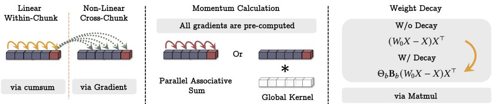  
Figure 1: 展示如何并行且利用矩阵乘法进行神经记忆训练的示意图。

## 3.2 如何并行化长期记忆训练

如上所述，我们的长期记忆模块设计等价于通过结合动量和权重衰减的梯度下降来优化联想记忆损失函数 $\ell ( M _ { t - 1 } ; x _ { t } ) = \| { \mathcal { M } } _ { t - 1 } ( { \mathbf { k } } _ { t } ) - { \mathbf { v } } _ { t } \| _ { 2 } ^ { 2 }$，以此来训练一个元模型。因此，在理论上，长期记忆模块的训练需要 O () 次 FLOPs，其中  为序列长度。然而在实践中，我们需要将训练过程并行化，并且为了充分利用硬件加速器（例如 TPU、GPU），我们需要将该过程张量化并使用更多的矩阵乘法。

接下来，我们展示如何将内循环中使用小批量梯度下降（mini-batch gradient descent）、数据依赖型学习率（data-dependent learning rate）和权重衰减（weight decay）计算权重的过程进行重构，使其仅使用矩阵乘法（matmuls）和求和。我们基于 Yu Sun et al. (2024) 的工作，该工作表明使用小批量梯度下降（采用常数学习率）进行优化的模型前向传播可以通过矩阵乘法来计算。我们可以将序列划分为大小为 $b \geq 1 ,$ 的块（chunks），并将小批量梯度下降写为：

$$
\mathcal {M} _ {t} = (1 - \alpha_ {t}) \mathcal {M} _ {t - 1} - \theta_ {t} \nabla \ell (\mathcal {M} _ {t - 1}; x _ {t}) = \beta_ {t} \mathcal {M} _ {0} - \sum_ {i = 1} ^ {t} \theta_ {i} \frac {\beta_ {t}}{\beta_ {i}} \nabla \ell (\mathcal {M} _ {t ^ {\prime}}; x _ {i}),\tag{16}
$$

其中 $t ^ { \prime } = t - { \mathfrak { m o d } } ( t , b )$，且 $\begin{array} { r } { \beta _ { i } = \prod _ { j = 1 } ^ { i } ( 1 - \alpha _ { j } ) } \end{array}$。为简便起见，我们重点关注第一个块，即 $t = b$ 从而 $t ^ { \prime } = 0$。此外，我们针对 $\boldsymbol { \mathcal { M } } _ { t } = \boldsymbol { W _ { t } }$ 为线性的情况解释该过程。对于 $N _ { p } \geq 2$ 的 MLP，其过程是类似的。使用我们的损失函数，可得：

$$
\nabla \ell (W _ {0}; x _ {t}) = (W _ {0} x _ {t} - x _ {t}) x _ {t} ^ {\top} \Rightarrow \sum_ {i = 1} ^ {b} \theta_ {i} \frac {\beta_ {b}}{\beta_ {i}} \nabla \ell (W _ {0}; x _ {i}) = \Theta_ {b} \mathbf {B} _ {b} (W _ {0} X - X) X ^ {\top},\tag{17}
$$

其中 $\Theta _ { b } = \operatorname { d i a g } \left( \left[ \theta _ { 1 } \quad \theta _ { 2 } \quad \ldots \quad \theta _ { b } \right] \right)$，而 $\mathbf { B } _ { b }$ 类似地在 $\frac { \beta _ { b } } { \beta _ { i } } s$ 上定义。注意，我们不需要存储所有 $k = 1 , \ldots , N / b .$ 的 $\Theta _ { k b }$ 和 $\mathbf { B } _ { k b }$，而是仅为每个块存储这些矩阵，从而占用更少的内存。接下来，我们扩展这种表示形式，以便将动量项也纳入其中。在带动量的分块梯度下降中，考察动量项，我们有：

$$
S _ {t} = \eta_ {t} S _ {t - 1} - \theta_ {t} u _ {t},\tag{18}
$$

其中 $u _ { t } = \nabla \ell \left( M _ { t ^ { \prime } } ; x _ { t } \right)$。注意，我们可以同时计算所有的 $u _ { t }$，因此公式 18 是一个以 $u _ { t }$ 为输入、 为隐藏状态、$\eta _ { t }$ 为输入依赖型转移值的线性递推关系。相应地，我们可以使用并行结合扫描（parallel associative scan, J. T. Smith, Warrington, and Linderman 2023）来计算该块中的 $S _ { t } s$。

参数作为块的函数。除了将 $\alpha _ { t } , \theta _ { t }$ 和 $\eta _ { t }$ 等参数设计为依赖于输入的（即作为 token $x _ { t }$ 的函数）之外，我们还可以将它们设计为其所在块（chunk）的函数。尽管这会牺牲一定的表达能力，但该表述形式有助于进一步加快训练速度。在这种情况下，我们在每个块中对 、 和  分别使用相同的值。相应地，在公式 17 中，我们可以使用单个标量来存储 Θ。同样地，我们也可以加速公式 18。也就是说，当  和  在每个块内部是可学习但时间不变时，该方程就变成了一个线性时不变系统（LTI），可以通过全局卷积（global convolution）来计算 $( \mathrm { G u } ,$ Goel, and Re 2022)。在我们的实验中，我们将这些参数设置为 token 的函数。然而，此类简化（即作为块的函数）可作为未来工作的研究方向，以更高效的方式训练更大的模型。

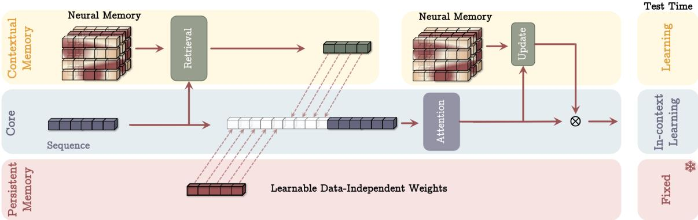  
Figure 2: 上下文即记忆（Memory as a Context, MAC）架构。该架构包含三个分支：(1) 核心分支（core）、(2) 上下文（长期）记忆分支（contextual (long-term) memory）以及 (3) 持久记忆分支（persistent memory）。核心分支将相应的长期记忆和持久记忆与输入序列拼接。接着，在序列上执行注意力机制，并决定哪些部分的信息应当存储在长期记忆中。在测试时，对应上下文记忆的参数仍在学习，对应核心分支的参数负责上下文学习（in-context learning），而持久记忆的参数负责存储关于任务的知识，因而保持固定。

## 3.3 持久记忆

我们的长期记忆也可以被视为一种上下文记忆，这意味着其输出完全依赖于上下文。因此，除了长期记忆之外，我们还使用了一组可学习但与输入无关的参数来充当与任务相关的记忆。在文献中，这种类型的记忆被称为持久记忆（persistent memory）或元记忆（meta-memory）(X. Dong et al. 2024; Sukhbaatar, Grave, et al. 2019)。给定 $N _ { p } \geq 1$ ，我们使用可学习参数 $P = \left[ p _ { 1 } \quad p _ { 2 } \quad \ldots \quad p _ { N _ { p } } \right]$ 并将其追加到输入序列的开头：即在给定上下文窗口大小为  的情况下，我们将输入修改为：

$$
x _ {\mathrm{new}} = \left[ \begin{array}{l l l l} p _ {1} & p _ {2} & \dots & p _ {N _ {p}} \end{array} \right] | | x,\tag{19}
$$

其中 || 表示拼接。接下来，我们从三个角度讨论持久记忆的动机：

记忆视角。如前所述，我们的神经长期记忆是一种上下文记忆，其中所有参数都依赖于输入。然而，一个有效的记忆系统还需要与输入无关的参数来存储任务知识的抽象表示。也就是说，掌握一项任务需要记住关于如何完成该任务的知识，而这些参数正是负责存储此类知识的。

前馈网络视角。在 Transformer 架构中，注意力模块之后存在全连接层，这些全连接层已被证明类似于注意力权重，但具有与数据无关的参数。也就是说，Sukhbaatar, Grave, et al. (2019) 表明，用 Softmax 替换全连接层中的 ReLU 可以产生类似注意力的权重，其中权重与数据无关：

$$
F F N (x) = W _ {V} \operatorname{Softmax} \left(W _ {K} x\right).\tag{20}
$$

事实上，当 $W _ { K }$ 和 $W _ { V }$ 与输入无关时，它们的作用类似于注意力模块中的  和  矩阵。持久记忆权重预计具有相同的功能，这意味着在序列的第一部分使用它们会导致产生与输入无关的注意力权重（Sukhbaatar, Grave, et al. 2019）。

技术视角。带有因果掩码的注意力机制对序列中的初始标记存在隐式偏差，因此注意力权重几乎总是对初始标记高度激活，从而导致性能受损。从技术角度来看，序列开头的这些可学习参数可以通过更有效地重新分配注意力权重来缓解这种影响（Han et al. 2024; Xiao et al. 2024）。

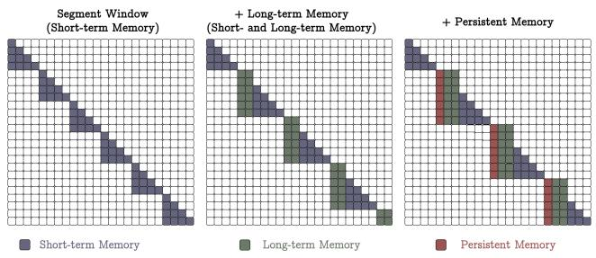  
(a) 记忆作为上下文（Memory as a Context, MAC）。我们将序列分段并在每个窗口中使用全因果注意力。同样，前 $N _ { p }$ 个标记是持久记忆，接下来的  个标记是长期记忆标记

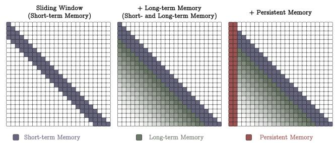  
(b) 记忆作为门控（Memory as Gating, MAG）。我们使用滑动窗口注意力（SWA）作为短期记忆，使用我们的神经记忆模块作为长期记忆，并通过门控进行结合。  
Figure 3: Titans 不同变体的注意力掩码。

## 4 如何结合记忆？

一个尚未解决的重要问题是：如何有效且高效地将所设计的神经记忆整合到深度学习架构中？如前所述，从记忆的角度来看，Transformers 中的 K 和 V 矩阵对可以被解释为一个联想记忆模块。由于它们对依赖关系的高精度建模以及有限的上下文窗口，我们将它们解释为短期记忆模块，仅关注当前的上下文窗口大小。另一方面，我们的神经记忆具有从数据中持续学习并将其存储在其权重中的能力，因而可以扮演长期记忆的角色。在本节中，我们旨在通过提出 Titans 的三种不同变体来回答上述问题。在随后的实验中，我们展示了这些变体各自的优缺点，并展现了在超长上下文中效率与有效性之间的权衡。

## 4.1 记忆作为上下文

在第一种架构设计中（参见 Figure 2），我们将记忆视为当前信息的上下文。也就是说，给定一个长序列 $\boldsymbol { x } \in \mathbb { R } ^ { N \times d _ { \mathrm { i n } } }$，我们首先将该序列划分为固定大小的分块 $\mathsf { S } ^ { ( i ) } \mathrm { ~ f o r ~ } i = 1 , \ldots , N / C$。给定输入的当前分块 $\mathsf { S } ^ { ( t ) }$，我们将其视为当前上下文，将其过去的分块视为历史信息。因此，设 $\mathbf { \delta } \mathcal { M } _ { t - 1 }$ 为分块 $\mathsf { S } ^ { ( t ) }$ 之前的长期记忆状态，我们使用输入上下文作为记忆 $\mathbf { \delta } M _ { t - 1 }$ 的查询（query），以从长期记忆中检索相应的信息。也就是说，我们检索与 $\mathsf { S } ^ { ( t ) }$ 对应的过去信息为：

$$
h _ {t} = \mathcal {M} _ {t - 1} ^ {*} (\mathbf {q} _ {t}),\tag{21}
$$

其中 $\mathbf { q } _ { t } = \mathsf { S } ^ { ( t ) } W _ { Q }$。接着，我们将该历史信息连同持久记忆参数一起作为注意力模块的输入序列：

$$
\tilde {S} ^ {(t)} = \left[ \begin{array}{c c c c} p _ {1} & p _ {2} & \ldots & p _ {N _ {p}} \end{array} \right] | | h _ {t} | | S ^ {(t)},\tag{22}
$$

$$
y _ {t} = \operatorname{Attn} \left(\tilde {\mathsf {S}} ^ {(t)}\right).\tag{23}
$$

整个序列上的注意力图结构如 Figure 3a 所示。然后，我们使用 $y _ { t }$ 来更新下一个分块的长期记忆模块并生成最终输出：

$$
\mathcal {M} _ {t} = \mathcal {M} _ {t - 1} (y _ {t}),\tag{24}
$$

$$
o _ {t} = y _ {t} \otimes \mathcal {M} _ {t} ^ {*} (y _ {t}).\tag{25}
$$

注意，在上述过程中，我们是通过前向传播来更新 $\boldsymbol { \mathcal { M } } _ { t - 1 }$ 的权重。

该架构具有两个主要优势：(1) 注意力机制通过同时具备历史和当前上下文，有能力根据当前数据决定是否需要长期记忆信息。(2) 注意力模块帮助长期记忆仅存储来自当前上下文的有用信息。也就是说，并非每个片段中的所有标记（token）都是有用的，记住所有标记可能会导致记忆溢出。因此，注意力帮助记忆理解哪些信息是有用的，从而更好地管理记忆容量。(3) 在测试时：(i) 持久记忆参数是固定的，因为它们编码了关于任务的知识，不应被更改；(ii) 注意力模块的权重是上下文内学习器（in-context learner）；(iii) 长期记忆模块在测试时仍在学习（记忆）信息。也就是说，我们在测试时甚至也会更新神经记忆的权重，因为这些权重编码了遥远过去的抽象表示。

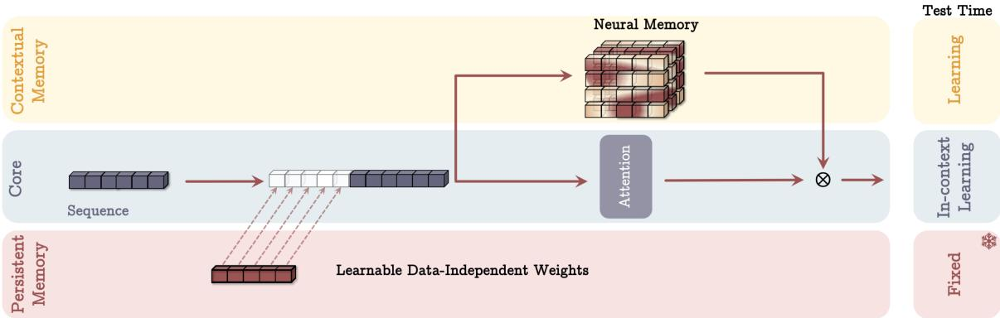  
Figure 4: 记忆作为门控（Memory as a Gate，MAG）架构。该架构同样具有三个分支：(1) 核心分支、(2) 上下文记忆分支和 (3) 持久记忆分支。然而，它仅将持久记忆纳入上下文，并通过门控机制将记忆与核心分支结合。在测试时，其行为与 Figure 2 相同。

## 4.2 门控记忆

在下一个变体中（见 Figure 4），在一个分支中，我们直接使用输入数据来更新长期记忆，在第二个分支中，我们使用滑动窗口注意力（Sliding Window Attention，SWA）：

$$
\tilde {x} = \left[ \begin{array}{l l l l} p _ {1} & p _ {2} & \dots & p _ {N _ {p}} \end{array} \right] | | x,\tag{26}
$$

$$
y = \text { SW - Attn } ^ {*} (\tilde {x}),\tag{27}
$$

$$
o = y \otimes \mathcal {M} (\tilde {x}),\tag{28}
$$

其中 $S W - A t t n ^ { \ast }$ 是带有前缀的滑动窗口注意力（见 Figure 3b）。请注意，与先前的设计相反，我们没有对输入数据进行分段。此外，我们滥用记号，使用 M() 指代在序列的所有标记上完成全部递归后记忆的最终输出。在上述公式中，⊗ 可以是任何非线性门控。在我们的实验中，我们使用可学习的向量值权重对输出  和 M (˜) 进行归一化，随后接一个非线性函数 (.)。

该设计的整体注意力掩码如图 Figure 3b 所示。在该设计中，滑动窗口注意力充当精确的短期记忆，而神经记忆模块则充当模型的渐隐记忆（fading memory）。这种架构设计也可以被看作是一种注意力头结构不同的多头架构（X. Dong et al. 2024）。

## 4.3 记忆作为一层

最后一个变体将神经记忆作为深度神经网络的一层（Memory As a Layer，MAL）（见 Figure 5）。这种架构设计在文献中更为常见，其中混合模型将循环模型与全注意力或滑动窗口注意力堆叠在一起。给定输入 ，我们有：

$$
\tilde {x} = \left[ \begin{array}{c c c c} p _ {1} & p _ {2} & \ldots & p _ {N _ {p}} \end{array} \right] | | x,\tag{29}
$$

$$
y = \mathcal {M} (\tilde {x}),\tag{30}
$$

$$
o = S W - A t t n (y),\tag{31}
$$

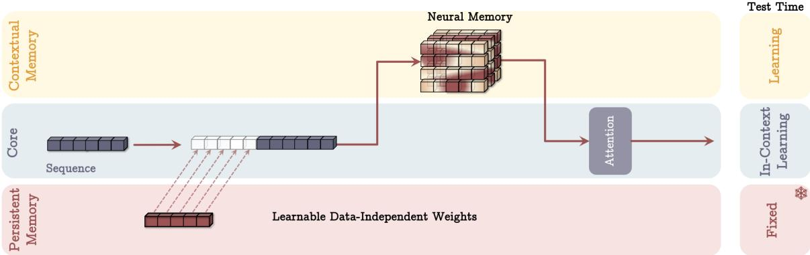  
Figure 5: 记忆作为一层（Memory as a Layer，MAL）架构。在该架构中，记忆层负责在注意力模块之前压缩过去和当前的上下文。

其中 SW-Attn 表示滑动窗口注意力（sliding window attention）。这种设计的主要缺点是模型的表达能力受限于各个单独的层，因此无法充分利用注意力和神经记忆模块在数据处理上的互补优势。在我们的实验中，为了评估这种设计下的记忆，我们采用了与 H3 (D. Y. Fu et al. 2023) 类似的架构，将序列模型替换为我们的神经记忆模块（LMM）。

无注意力的记忆（Memory Without Attention）。尽管在上述讨论中，我们将 MAL 视为 LMM 和注意力以串行方式的组合，但 MAL 的一个简单变体是将 LMM 作为没有任何注意力的序列模型使用。从记忆的角度来看，正如第 1 节所讨论的，我们期望记忆系统的各个组成部分能够独立工作，即使其他组件受到干扰。因此，即使没有短期记忆（即注意力），长期记忆模块也应该是一个强大的模型。我们在实验中将这种变体称为 LMM 或 Titans (LMM)。我们在附录 C 中提供了关于 Titans 与其他现代循环模型之间关联的进一步讨论。

## 4.4 架构细节

为了表述的简洁性，我们避免讨论诸如使用残差连接、带有线性层的门控以及归一化等实现细节。在所有模块中，我们都使用了残差连接。在我们的实现中，我们使用 SiLU(.) 激活函数 (Elfwing, Uchibe, and Doya 2018) 作为计算 query、key 和 value 的非线性激活函数，并使用 ℓ2-范数对 query 和 key 进行归一化。

卷积。遵循近期现代线性循环模型的设计 (Gu and Dao 2024; S. Yang, Kautz, and Hatamizadeh 2024)，我们在每个 query、key 和 value 投影之后加入了一维深度可分离卷积层（1D depthwise-separable convolution layer）。虽然不会显著改变性能，但这些一维卷积已被证明能提高性能且具有很高的计算效率。

门控。我们同样遵循近期的架构设计，在最终输出投影之前使用归一化以及带有线性层的门控 (Mehta et al. 2023)。

定理 4.1（Theorem 4.1）。与均受限于 TC0 (Merrill, Petty, and Sabharwal 2024) 的 Transformer、对角线性循环模型和 DeltaNet 相反，Titans 能够解决超出 TC0 的问题，这意味着 Titans 在状态跟踪任务中理论上比 Transformer 和大多数现代线性循环模型具有更强的表达能力。

## 5 实验

接下来，我们评估 Titans 及其变体在语言建模、常识推理、大海捞针（needle in haystack）、DNA 建模和时间序列预测任务中的表现1。更具体地，在本节中，我们回答以下实证问题：(1) 在下游任务中，Titans 与基线模型相比表现如何？（见 §5.2、§5.6 和 §5.7）；(2) Titans 的实际上下文长度是多少？（见 §5.3 和 §5.4）；(3) Titans 如何随上下文长度进行扩展？（见 §5.8）；(4) 记忆深度如何同时影响性能和效率？（见 §5.5）；以及 (5) Titans 的各个组件对其性能的贡献分别是什么？（见 §5.9）。

## 5.1 实验设置

**模型（Models）。** 在我们的实验中，我们重点关注 Titans 的三种变体，我们将其称为：(1) 记忆作为上下文（Memory as a Context, MAC）、(2) 记忆作为门（Memory as a Gate, MAG）和 (3) 记忆作为一层（Memory as a Layer, MAL）的 Titans，以及 (4) 单独的神经记忆模块。将我们的长期记忆作为独立模块使用的原因基于我们对学习的定义。正如第 1 节所讨论的，我们将学习定义为获取有效且有用记忆的过程。因此，我们期望我们的长期记忆即使在没有注意力机制的情况下，也能有效地从数据中学习。对于这些模型中的每一个，我们考虑了四种参数规模：(i) 170M、(ii) 340M、(iii) 400M 和 (iv) 760M 参数。前三个模型在从 FineWeb-Edu 数据集（Penedo et al. 2024）采样的 15B token 上进行训练，最后一个模型则在来自同一数据集的 30B token 上进行训练。

**基线模型（Baselines）。** 我们将我们的模型与最先进的线性循环模型、Transformer 以及混合模型（循环 + 注意力）进行比较。更具体地说，在语言任务中，我们与 Transformer++ (Touvron et al. 2023)、RetNet (Yutao Sun et al. 2023)、门控线性注意力（Gated Linear Attention, GLA）(S. Yang, B. Wang, Shen, et al. 2024)、Mamba (Gu and Dao 2024)、Mamba2 (Dao and Gu 2024)、DeltaNet (S. Yang, B. Wang, Yu Zhang, et al. 2024)、TTT (Yu Sun et al. 2024) 和 Gated DeltaNet (S. Yang, Kautz, and Hatamizadeh 2024) 进行了比较。在大海捞针任务中，我们还与 GPT4 (Achiam et al. 2023)、结合 RAG 的 Llama3 (Touvron et al. 2023)、RecurrentGemma2-9B (Botev et al. 2024) 和 Mistral (Jiang et al. 2023) 模型进行了比较，所有这些模型均由该基准测试提供（Yuri Kuratov et al. 2024）。在时间序列任务中，我们与基于 Mamba 的模型 (Behrouz, Santacatterina, and Zabih 2024)、基于 Transformer 的模型 (Y. Liu et al. 2023; Nie et al. 2022; Yunhao Zhang and Yan 2023) 以及线性模型 (Das et al. 2023; Z. Li et al. 2023; H. Wu et al. 2023; Zeng et al. 2023) 进行了比较。

**训练（Training）。** 在训练中，我们遵循 S. Yang, Kautz, and Hatamizadeh (2024) 的训练流程，使用词表大小为 32K 的 LLama 2 分词器，并采用 4K token 的训练长度。我们采用 AdamW 优化器，学习率为 $4\times 10^{-4}$，配合余弦退火调度，批大小为 0.5M token，权重衰减为 0.1。

## 5.2 语言建模

我们首先关注语言建模中的困惑度以及常识推理任务。表 1（Table 1）报告了 Titans 变体以及三种不同规模（340M、400M 和 760M）基线模型的结果。在包括 Transformer++ 在内的非混合模型中，我们的神经记忆模块在困惑度和准确率指标上均取得了最佳性能。将我们的神经记忆模块与同为基于梯度的循环模型 TTT 进行对比，可以体现出我们的权重衰减以及动量的重要性。如前所述，权重衰减可被解释为在需要时遗忘过去数据的一种门控机制。同时，动量通过为意外度（surprise）指标提供额外的记忆，有助于我们更好地管理记忆。尽管部分基线模型也利用了门控机制（例如 Mamba、Mamba2 和 Gated DeltaNet），但我们神经记忆模块的卓越性能表明了我们的意外度机制以及拥有深度和非线性记忆的重要性。我们将在第 5.5 节进一步讨论后者。

对比混合模型，我们发现 Titans 的所有三种变体（MAC、MAG 和 MAL）的表现均优于 Samba（Mamba + attention）和 Gated DeltaNet-H2（Gated DeltaNet + attention）。我们将 Titans（MAL）的优越性能归因于神经记忆模块的强大能力，因为两者的架构设计和所使用的注意力机制完全相同。对比 Titans（MAG）和（MAC），我们发现虽然它们的性能接近，但 MAC 在处理数据中的长距离依赖时表现更佳。有趣的是，MAG 和 MAC 的表现都优于 MAL 变体，由于它们使用了相同的模块，我们将这一结果归因于这些模型的架构设计。这一发现尤为重要，因为文献中现有的混合模型（除 Hymba（X. Dong et al. 2024）之外）均采用 MAL 风格的循环模型与注意力机制组合方式。

## 5.3 大海捞针

将模型扩展到更长的上下文窗口并不总是等同于在极长序列上有效（Hsieh et al. 2024）。大海捞针（needle-in-a-haystack, NIAH）任务旨在衡量模型的实际有效上下文长度。在该任务中，我们评估模型从长篇干扰文本（即“干草堆”）中检索一条信息（即“针”）的能力。在这一部分中，我们使用 RULER 基准测试（Hsieh et al. 2024）中的单针检索（Single NIAH, S-NIAH）任务，并在长度为 2K、4K、8K 和 16K 的序列上评估 Titans 及各基线模型。结果如 Table 2 所示。与基线模型相比，Neural Memory（神经记忆）模块在所有三项任务中均取得了最佳结果。我们将这种优越的性能归因于 Titans 与现有序列模型之间的三个关键差异：(1) 与 TTT 相比，我们的 Neural Memory 通过使用动量以及遗忘机制（即权重衰减），能够更好地处理记忆容量。因此，随着序列长度的增加，Neural Memory 的性能并没有下降，而是呈现出一致的趋势；(2) 与具有门控（遗忘）机制的 Mamba2 相比，Titans 具有深层非线性记忆，从而带来了更好的记忆管理。此外，与我们的神经记忆和 DeltaNet 相反，Mamba2 无法移除记忆，因此在增加序列长度时我们可以看到其性能显著下降；(3) 与 DeltaNet 相比，尽管它能够利用 delta 规则移除记忆，但它无法擦除记忆，缺乏遗忘机制。最后，正如预期的那样，在使用 Titans 变体时我们可以看到持平或更好的结果，其中最佳结果对应于 MAC。

Table 1：Titans 以及基于循环（recurrent）和 Transformer 的基线模型在语言建模与常识推理任务上的性能。混合模型用 ∗ 标记。简单模型和混合模型中的最佳结果已加粗高亮显示。

<table><tr><td>模型</td><td>Wiki. ppl ↓</td><td>LMB. ppl ↓</td><td>LMB. acc ↑</td><td>PIQA acc ↑</td><td>Hella. acc_n ↑</td><td>Wino. acc ↑</td><td>ARC-e acc ↑</td><td>ARC-c acc_n ↑</td><td>SIQA acc ↑</td><td>BoolQ acc ↑</td><td>平均 ↑</td></tr><tr><td colspan="12">340M 参数 / 15B token</td></tr><tr><td>Transformer++</td><td>31.52</td><td>41.08</td><td>30.76</td><td>62.98</td><td>34.76</td><td>50.53</td><td>45.21</td><td>24.05</td><td>36.81</td><td>58.24</td><td>42.92</td></tr><tr><td>RetNet</td><td>32.50</td><td>49.73</td><td>28.24</td><td>62.61</td><td>34.15</td><td>50.91</td><td>44.27</td><td>23.62</td><td>36.79</td><td>59.72</td><td>42.54</td></tr><tr><td>GLA</td><td>28.51</td><td>43.02</td><td>28.73</td><td>64.05</td><td>35.96</td><td>50.00</td><td>54.19</td><td>24.29</td><td>37.13</td><td>58.39</td><td>44.09</td></tr><tr><td>Mamba</td><td>30.83</td><td>40.21</td><td>29.94</td><td>63.79</td><td>35.88</td><td>49.82</td><td>49.24</td><td>24.56</td><td>35.41</td><td>60.07</td><td>43.59</td></tr><tr><td>DeltaNet</td><td>28.65</td><td>47.30</td><td>28.43</td><td>63.52</td><td>35.95</td><td>49.63</td><td>52.68</td><td>25.37</td><td>37.96</td><td>58.79</td><td>44.04</td></tr><tr><td>TTT</td><td>27.44</td><td>34.19</td><td>30.06</td><td>63.97</td><td>35.71</td><td>50.08</td><td>53.01</td><td>26.11</td><td>37.32</td><td>59.83</td><td>44.51</td></tr><tr><td>Gated DeltaNet</td><td>27.01</td><td>30.94</td><td>34.11</td><td>63.08</td><td>38.12</td><td>51.60</td><td>55.28</td><td>26.77</td><td>34.89</td><td>59.54</td><td>45.42</td></tr><tr><td>Titans (LMM)</td><td>26.18</td><td>29.97</td><td>34.98</td><td>64.73</td><td>39.61</td><td>51.85</td><td>55.60</td><td>28.14</td><td>34.52</td><td>59.99</td><td>46.17</td></tr><tr><td>Titans (MAC)*</td><td>25.43</td><td>28.13</td><td>36.00</td><td>65.32</td><td>40.35</td><td>51.21</td><td>58.17</td><td>29.00</td><td>38.63</td><td>60.18</td><td>47.36</td></tr><tr><td>Titans (MAG)*</td><td>25.07</td><td>28.72</td><td>36.71</td><td>64.88</td><td>40.56</td><td>52.49</td><td>57.72</td><td>28.16</td><td>39.75</td><td>60.01</td><td>47.54</td></tr><tr><td>Titans (MAL)*</td><td>24.69</td><td>28.80</td><td>35.74</td><td>64.97</td><td>39.44</td><td>51.97</td><td>56.58</td><td>28.21</td><td>38.14</td><td>57.32</td><td>46.55</td></tr><tr><td colspan="12">400M 参数 / 15B token</td></tr><tr><td>Transformer++</td><td>30.63</td><td>37.37</td><td>29.64</td><td>64.27</td><td>37.72</td><td>51.53</td><td>54.95</td><td>27.36</td><td>38.07</td><td>61.59</td><td>45.64</td></tr><tr><td>RetNet</td><td>29.92</td><td>46.83</td><td>29.16</td><td>65.23</td><td>36.97</td><td>51.85</td><td>56.01</td><td>27.55</td><td>37.30</td><td>59.66</td><td>45.47</td></tr><tr><td>HGRN2</td><td>32.33</td><td>47.14</td><td>26.12</td><td>64.52</td><td>35.45</td><td>52.24</td><td>55.97</td><td>25.51</td><td>37.35</td><td>59.02</td><td>44.52</td></tr><tr><td>GLA</td><td>27.96</td><td>36.66</td><td>27.86</td><td>65.94</td><td>37.41</td><td>49.56</td><td>56.01</td><td>26.36</td><td>38.94</td><td>59.84</td><td>45.24</td></tr><tr><td>Mamba</td><td>29.22</td><td>39.88</td><td>29.82</td><td>65.72</td><td>37.93</td><td>50.11</td><td>58.37</td><td>26.70</td><td>37.76</td><td>61.13</td><td>45.94</td></tr><tr><td>Mamba2</td><td>26.34</td><td>33.19</td><td>32.03</td><td>65.77</td><td>39.73</td><td>52.48</td><td>59.00</td><td>27.64</td><td>37.92</td><td>60.72</td><td>46.91</td></tr><tr><td>DeltaNet</td><td>27.69</td><td>44.04</td><td>29.96</td><td>64.52</td><td>37.03</td><td>50.82</td><td>56.77</td><td>27.13</td><td>38.22</td><td>60.09</td><td>45.57</td></tr><tr><td>TTT</td><td>26.11</td><td>31.52</td><td>33.25</td><td>65.70</td><td>39.11</td><td>51.68</td><td>58.04</td><td>28.99</td><td>38.26</td><td>59.87</td><td>46.86</td></tr><tr><td>Gated DeltaNet</td><td>25.47</td><td>29.24</td><td>34.40</td><td>65.94</td><td>40.46</td><td>51.46</td><td>59.80</td><td>28.58</td><td>37.43</td><td>60.03</td><td>47.26</td></tr><tr><td>Samba*</td><td>25.32</td><td>29.47</td><td>36.86</td><td>66.09</td><td>39.24</td><td>51.45</td><td>60.12</td><td>27.20</td><td>38.68</td><td>58.22</td><td>47.23</td></tr><tr><td>Gated DeltaNet-H2*</td><td>24.19</td><td>28.09</td><td>36.77</td><td>66.43</td><td>40.79</td><td>52.17</td><td>59.55</td><td>29.09</td><td>39.04</td><td>58.56</td><td>47.69</td></tr><tr><td>Titans (LMM)</td><td>25.03</td><td>28.99</td><td>35.21</td><td>65.85</td><td>40.91</td><td>52.19</td><td>59.97</td><td>29.20</td><td>38.74</td><td>60.85</td><td>47.83</td></tr><tr><td>Titans (MAC)*</td><td>25.61</td><td>27.73</td><td>36.92</td><td>66.39</td><td>41.18</td><td>52.80</td><td>60.24</td><td>29.69</td><td>40.07</td><td>61.93</td><td>48.65</td></tr><tr><td>Titans (MAG)*</td><td>23.59</td><td>27.81</td><td>37.24</td><td>66.80</td><td>40.92</td><td>53.21</td><td>60.01</td><td>29.45</td><td>39.91</td><td>61.28</td><td>48.60</td></tr><tr><td>Titans (MAL)*</td><td>23.93</td><td>27.89</td><td>36.84</td><td>66.29</td><td>40.74</td><td>52.26</td><td>59.85</td><td>29.71</td><td>38.92</td><td>58.40</td><td>47.87</td></tr><tr><td colspan="12">760M 参数 / 30B token</td></tr><tr><td>Transformer++</td><td>25.21</td><td>27.64</td><td>35.78</td><td>66.92</td><td>42.19</td><td>51.95</td><td>60.38</td><td>32.46</td><td>39.51</td><td>60.37</td><td>48.69</td></tr><tr><td>RetNet</td><td>26.08</td><td>24.45</td><td>34.51</td><td>67.19</td><td>41.63</td><td>52.09</td><td>63.17</td><td>32.78</td><td>38.36</td><td>57.92</td><td>48.46</td></tr><tr><td>Mamba</td><td>28.12</td><td>23.96</td><td>32.80</td><td>66.04</td><td>39.15</td><td>52.38</td><td>61.49</td><td>30.34</td><td>37.96</td><td>57.62</td><td>47.22</td></tr><tr><td>Mamba2</td><td>22.94</td><td>28.37</td><td>33.54</td><td>67.90</td><td>42.71</td><td>49.77</td><td>63.48</td><td>31.09</td><td>40.06</td><td>58.15</td><td>48.34</td></tr><tr><td>DeltaNet</td><td>24.37</td><td>24.60</td><td>37.06</td><td>66.93</td><td>41.98</td><td>50.65</td><td>64.87</td><td>31.39</td><td>39.88</td><td>59.02</td><td>48.97</td></tr><tr><td>TTT</td><td>24.17</td><td>23.51</td><td>34.74</td><td>67.25</td><td>43.92</td><td>50.99</td><td>64.53</td><td>33.81</td><td>40.16</td><td>59.58</td><td>47.32</td></tr><tr><td>Gated DeltaNet</td><td>21.18</td><td>22.09</td><td>35.54</td><td>68.01</td><td>44.95</td><td>50.73</td><td>66.87</td><td>33.09</td><td>39.21</td><td>59.14</td><td>49.69</td></tr><tr><td>Samba*</td><td>20.63</td><td>22.71</td><td>39.72</td><td>69.19</td><td>47.35</td><td>52.01</td><td>66.92</td><td>33.20</td><td>38.98</td><td>61.24</td><td>51.08</td></tr><tr><td>Gated DeltaNet-H2*</td><td>19.88</td><td>20.83</td><td>39.18</td><td>68.95</td><td>48.22</td><td>52.57</td><td>67.01</td><td>35.49</td><td>39.39</td><td>61.11</td><td>51.49</td></tr><tr><td>Titans (LMM)</td><td>20.04</td><td>21.96</td><td>37.40</td><td>69.28</td><td>48.46</td><td>52.27</td><td>66.31</td><td>35.84</td><td>40.13</td><td>62.76</td><td>51.56</td></tr><tr><td>Titans (MAC)</td><td>19.93</td><td>20.12</td><td>39.62</td><td>70.46</td><td>49.01</td><td>53.18</td><td>67.86</td><td>36.01</td><td>41.87</td><td>62.05</td><td>52.51</td></tr><tr><td>Titans (MAG)</td><td>18.61</td><td>19.86</td><td>40.98</td><td>70.25</td><td>48.94</td><td>52.89</td><td>68.23</td><td>36.19</td><td>40.38</td><td>62.11</td><td>52.50</td></tr><tr><td>Titans (MAL)</td><td>19.07</td><td>20.33</td><td>40.05</td><td>69.99</td><td>48.82</td><td>53.02</td><td>67.54</td><td>35.65</td><td>30.98</td><td>61.72</td><td>50.97</td></tr></table>

Table 2: Titans 和基线模型在 RULER 基准的 S-NIAH 任务上的性能。简单模型和混合模型中的最佳结果均已高亮显示。

<table><tr><td rowspan="2">模型</td><td colspan="4">S-NIAH-PK</td><td colspan="4">S-NIAH-N</td><td colspan="4">S-NIAH-W</td></tr><tr><td>2K</td><td>4K</td><td>8K</td><td>16K</td><td>2K</td><td>4K</td><td>8K</td><td>16K</td><td>2K</td><td>4K</td><td>8K</td><td>16K</td></tr><tr><td>TTT</td><td>98.4</td><td>98.8</td><td>98.0</td><td>88.4</td><td>60.2</td><td>36.6</td><td>10.2</td><td>4.4</td><td>78.8</td><td>28.0</td><td>4.4</td><td>0.0</td></tr><tr><td>Mamba2</td><td>98.6</td><td>61.4</td><td>31.0</td><td>5.4</td><td>98.4</td><td>55.8</td><td>14.2</td><td>0.0</td><td>42.2</td><td>4.2</td><td>0.0</td><td>0.0</td></tr><tr><td>DeltaNet</td><td>96.8</td><td>98.8</td><td>98.6</td><td>71.4</td><td>47.2</td><td>15.4</td><td>12.8</td><td>5.4</td><td>46.2</td><td>20.0</td><td>1.6</td><td>0.0</td></tr><tr><td>Titans (LMM)</td><td>99.8</td><td>98.4</td><td>98.2</td><td>96.2</td><td>100.0</td><td>99.8</td><td>93.4</td><td>80.2</td><td>90.4</td><td>89.4</td><td>85.8</td><td>80.6</td></tr><tr><td>Titans (MAC)</td><td>99.2</td><td>98.8</td><td>99.0</td><td>98.4</td><td>99.6</td><td>98.2</td><td>97.6</td><td>97.4</td><td>98.2</td><td>98.2</td><td>95.6</td><td>95.2</td></tr><tr><td>Titans (MAG)</td><td>99.4</td><td>98.0</td><td>97.4</td><td>97.4</td><td>99.2</td><td>98.8</td><td>97.2</td><td>98.6</td><td>98.0</td><td>98.0</td><td>90.2</td><td>88.2</td></tr><tr><td>Titans (MAL)</td><td>98.8</td><td>98.6</td><td>98.8</td><td>97.8</td><td>99.8</td><td>98.1</td><td>96.8</td><td>96.4</td><td>98.0</td><td>97.4</td><td>92.0</td><td>90.4</td></tr></table>

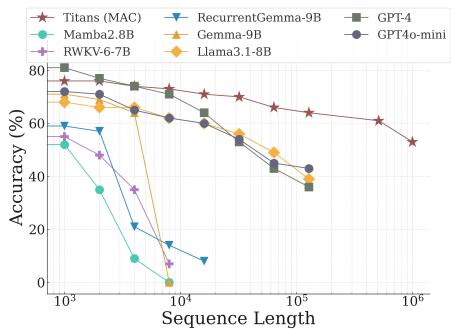  
(a) 少样本设置

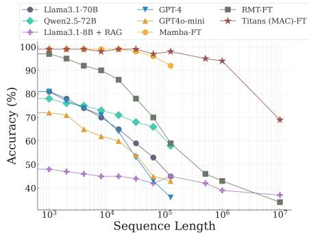  
(b) 微调设置  
Figure 6: Titans 和基线模型在 BABILong 基准上的性能。Titans (MAC) 优于所有基线模型，包括诸如 GPT4 等超大型模型。

## 5.4 BABILong 基准测试

在上一节中，我们讨论了在仅需检索单个“针”的简单 NIAH 任务上的结果。尽管 Titans 相比基线展现出了更优越的性能，但它们在极长序列上的真正优势仍未完全体现。为此，在本节中，我们采用了来自 BABILong 基准（Yuri Kuratov et al. 2024）中一个难度更高的任务，在该任务中，模型需要对分布在极长文档中的事实进行推理。我们遵循了该基准中原始的实验设置和训练流程。共有两种设置：(1) 少样本（Few-shot）设置，其中我们使用大型预训练模型；(2) 微调（fine-tuning）设置，其中我们微调 Titans 的 MAC 变体，以将其与其他微调基线进行比较。少样本设置的结果报告在 Figure 6a 中。在此设置下，我们可以看到 Titans 优于所有基线——即 Mamba2.8B（Gu and Dao 2024）、RWKV-6-7B（Peng, Goldstein, et al. 2024）、RecurrentGemma-9B（Botev et al. 2024）、Gemma-9B（Team et al. 2024）、Llama3.1-8B（Touvron et al. 2023）、GPT-4 以及 GPT4o-mini（Achiam et al. 2023）。这些结果是在 Titans (MAC) 的参数量远少于基线模型的情况下取得的。

在微调设置中，我们将小型微调版本的 Titans (MAC) 与以下模型进行了比较：(i) 小型模型的微调版本（参数量与 Titans 大致相同），例如 Mamba（Gu and Dao 2024）、RMT（Bulatov, Yury Kuratov, and Burtsev 2022）；(ii) 结合检索增强生成（Retrieval-Augmented Generation, RAG）（P. Lewis et al. 2020）的大型模型，例如 Llama3.1-8B（Touvron et al. 2023）；以及 (iii) 超大型模型，例如 GPT-4（Achiam et al. 2023）、GPT4o-mini、Qwen2.5-72B（A. Yang et al. 2024）和 Llama3.1-70B（Touvron et al. 2023）。基线结果由（Yuri Kuratov et al. 2024）报道。Titans 和基线的结果展示在 Figure 6b 中。Titans 优于所有模型，甚至是像 GPT4 这样的超大型模型。此外，与类似 RMT 这样带记忆的 Transformer 架构模型相比，Titans 表现出更好的性能，这主要归功于其强大的记忆能力。也就是说，RMT 将历史数据压缩为大小为 16 的向量值记忆，而带有上下文在线记忆学习器的 Titans 能够将过去的信息编码到模型的参数中。有趣的是，即使是用 RAG 增强的 Llama3.1-8B 模型，其表现也逊于参数量少了约 $\times 70$ 倍的 Titans。

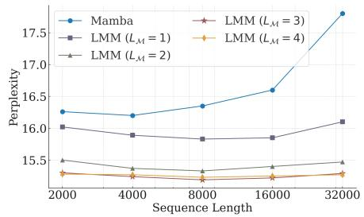  
(a) 170M 参数

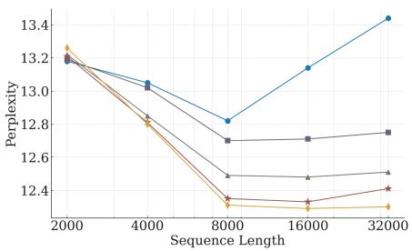  
(b) 360M 参数

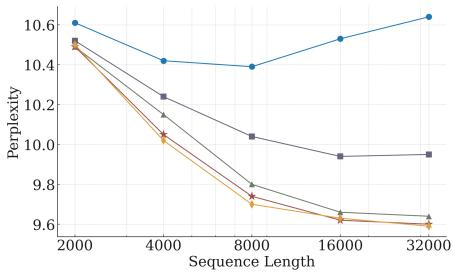  
(c) 760M 参数  
Figure 7: 记忆深度对困惑度的影响。更深的长期记忆在更长序列中带来更好的扩展性。

Table 3: 长期预测性能。最佳结果已加粗高亮。

<table><tr><td rowspan="2"></td><td colspan="2">Neural Memory</td><td colspan="2">Simba</td><td colspan="2">iTransformer</td><td colspan="2">RLinear</td><td colspan="2">PatchTST</td><td colspan="2">Crossformer</td><td colspan="2">TiDE</td><td colspan="2">TimesNet</td><td colspan="2">DLinear</td></tr><tr><td>MSE</td><td>MAE</td><td>MSE</td><td>MAE</td><td>MSE</td><td>MAE</td><td>MSE</td><td>MAE</td><td>MSE</td><td>MAE</td><td>MSE</td><td>MAE</td><td>MSE</td><td>MAE</td><td>MSE</td><td>MAE</td><td>MSE</td><td>MAE</td></tr><tr><td>ETTm1</td><td>0.358</td><td>0.387</td><td>0.383</td><td>0.396</td><td>0.407</td><td>0.410</td><td>0.414</td><td>0.407</td><td>0.387</td><td>0.400</td><td>0.513</td><td>0.496</td><td>0.419</td><td>0.419</td><td>0.400</td><td>0.406</td><td>0.403</td><td>0.407</td></tr><tr><td>ETTm2</td><td>0.261</td><td>0.309</td><td>0.271</td><td>0.327</td><td>0.288</td><td>0.332</td><td>0.286</td><td>0.327</td><td>0.281</td><td>0.326</td><td>0.757</td><td>0.610</td><td>0.358</td><td>0.404</td><td>0.291</td><td>0.333</td><td>0.350</td><td>0.401</td></tr><tr><td>ETTh1</td><td>0.420</td><td>0.421</td><td>0.441</td><td>0.432</td><td>0.454</td><td>0.447</td><td>0.446</td><td>0.434</td><td>0.469</td><td>0.454</td><td>0.529</td><td>0.522</td><td>0.541</td><td>0.507</td><td>0.458</td><td>0.450</td><td>0.456</td><td>0.452</td></tr><tr><td>ETTh2</td><td>0.336</td><td>0.382</td><td>0.361</td><td>0.391</td><td>0.383</td><td>0.407</td><td>0.374</td><td>0.398</td><td>0.387</td><td>0.407</td><td>0.942</td><td>0.684</td><td>0.611</td><td>0.550</td><td>0.414</td><td>0.427</td><td>0.559</td><td>0.515</td></tr><tr><td>ECL</td><td>0.162</td><td>0.261</td><td>0.169</td><td>0.274</td><td>0.178</td><td>0.270</td><td>0.219</td><td>0.298</td><td>0.205</td><td>0.290</td><td>0.244</td><td>0.334</td><td>0.251</td><td>0.344</td><td>0.192</td><td>0.295</td><td>0.212</td><td>0.300</td></tr><tr><td>Traffic</td><td>0.415</td><td>0.289</td><td>0.493</td><td>0.291</td><td>0.428</td><td>0.282</td><td>0.626</td><td>0.378</td><td>0.481</td><td>0.304</td><td>0.550</td><td>0.304</td><td>0.760</td><td>0.473</td><td>0.620</td><td>0.336</td><td>0.625</td><td>0.383</td></tr><tr><td>Weather</td><td>0.231</td><td>0.265</td><td>0.255</td><td>0.280</td><td>0.258</td><td>0.278</td><td>0.272</td><td>0.291</td><td>0.259</td><td>0.281</td><td>0.259</td><td>0.315</td><td>0.271</td><td>0.320</td><td>0.259</td><td>0.287</td><td>0.265</td><td>0.317</td></tr></table>

## 5.5 深层记忆的影响

在本节中，我们评估了深层记忆在实际训练时间（wall-clock training time）和模型性能方面的效果2。为此，我们重点关注了神经记忆（Neural Memory）模块的不同变体，其中 $L _ { \mathcal { M } } = 1 , 2 , 3 , 4$。我们还将 Mamba 作为模型性能的基线。为了进行公平的比较，我们对所有模型采用相同的训练流程，并在 Pile 数据集（L. Gao et al. 2020）的一个子集上对其进行训练。

我们在 Figure 7 中报告了我们的模型和基线模型随序列长度变化的困惑度（perplexity）。有趣的是，随着记忆深度 $L _ { { \mathcal { M } } }$ 的增加，模型在所有序列长度上都能取得更好的困惑度。此外，当模型参数量较少时，更深的记忆模块对序列长度更具鲁棒性。随着参数量的增加，所有模型在更长的序列上均表现出更好的性能。

我们还评估了记忆深度 $( L _ { \mathcal { M } } = 1 , 2 , 3 , 4 )$ 对训练吞吐量的影响。我们在 Figure 8 中报告了随序列长度变化的训练吞吐量（每秒 token 数量）。所有模型随上下文长度呈线性扩展（即每秒 token 数量随序列长度保持恒定趋势）。此外，正如预期的那样，随着记忆深度的增加，我们可以看到更深的记忆会导致训练变慢的线性趋势。因此，使用更深的记忆模块并不总是高效的，这体现了有效性与效率之间的权衡。

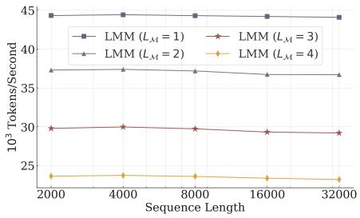  
Figure 8: 记忆深度对训练吞吐量的影响

## 5.6 时间序列预测

为了展示我们的记忆模块在更广泛任务中的有效性，我们还在时间序列预测任务中评估了其性能。为此，我们使用 Simba 框架（Patro and Agneeswaran 2024）进行时间序列预测，并将其中的 Mamba 模块替换为我们的神经记忆。我们在常见的时间序列预测基准数据集——ETT、ECL、Trafic 和 Weather（H. Zhou et al. 2021）上报告了实验结果。结果如 Table 3 所示。我们的神经记忆模块优于所有基线，包括基于 Mamba、基于线性模型以及基于 Transformer 的架构。

Table 4: 预训练 DNA 模型在 GenomicsBenchmarks（Grešová et al. 2023）上的下游评估。我们报告了 top-1 分类准确率（%）。

<table><tr><td>模型</td><td>Enhancer Cohn</td><td>Enhancer Ens</td><td>Human Reg.</td><td>Non-TATA Promoters</td><td>Human OCR Ens.</td></tr><tr><td>CNN</td><td>69.5</td><td>68.9</td><td>93.3</td><td>84.6</td><td>68.0</td></tr><tr><td>DNABERT</td><td>74.0</td><td>85.7</td><td>88.1</td><td>85.6</td><td>75.1</td></tr><tr><td>GPT</td><td>70.5</td><td>83.5</td><td>91.5</td><td>87.7</td><td>73.0</td></tr><tr><td>HyenaDNA</td><td>74.2</td><td>89.2</td><td>93.8</td><td>96.6</td><td>80.9</td></tr><tr><td>Transformer++</td><td>73.4</td><td>89.5</td><td>89.9</td><td>94.4</td><td>79.5</td></tr><tr><td>Mamba</td><td>73.0</td><td>-</td><td>-</td><td>96.6</td><td>-</td></tr><tr><td>Based</td><td>74.6</td><td>89.5</td><td>89.5</td><td>96.8</td><td>79.0</td></tr><tr><td>Neural Memory Module</td><td>75.2</td><td>89.6</td><td>89.3</td><td>96.6</td><td>79.9</td></tr></table>

## 5.7 DNA 建模

为了了解 Titans 在自然语言之外的能力，我们进一步评估了我们的神经记忆模块在 DNA 建模任务上的性能。为此，我们在 GenomicsBenchmarks（Grešová et al. 2023）的下游任务上评估了预训练模型。我们遵循 Nguyen et al. (2024) 的相同实验设置，并复用了 Arora et al. (2024) 报告的基准模型结果。Titans (LMM) 和基准模型的性能见 Table 4。我们发现，在不同的下游基因组学任务中，LMM 与最先进的架构相比具有竞争力。

## 5.8 效率

在这一部分中，我们将我们的神经记忆以及 Titans 与最先进的序列模型的效率进行了比较。不同序列长度 × 批次大小下的模型训练吞吐量见 Figure 9。对比包括我们的神经记忆模块在内的循环模型，可以看出我们的记忆模块略慢于 Mamba2 和 Gated DeltaNet，这主要是因为：(1) 具有深度记忆和更具表现力的转移过程（记忆更新），以及 (2) Mamba2 的实现中使用了高度优化的算子（kernel）。有趣的是，Titans (MAL) 比基准模型以及记忆模块都要快。这种更高吞吐量的主要原因在于 Flash-Attention (Dao 2024) 的高度优化算子，该算子用于在 Titans 中实现 SWA 和全注意力模块。

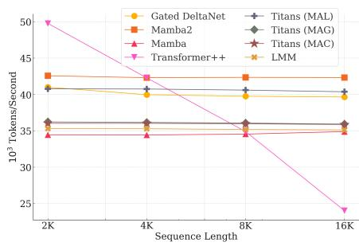  
Figure 9: Titans 与基线模型的训练吞吐量对比。

## 5.9 消融实验

最后，我们对 Titans 中的不同架构选择进行了消融实验。我们将神经记忆模块作为基础模型，然后一次更改一个组件：(1) 用线性记忆替换深度记忆，移除 (2) 卷积，(3) 惊异度度量（surprise measure）中的动量，(4) 权重衰减（或遗忘机制），以及 (5) 持久记忆。结果见 Table 5。神经记忆设计的所有组件对其性能均有正面贡献，其中贡献最大的依次是权重衰减、动量、卷积和持久记忆。

架构设计的影响。为了评估架构设计的影响，我们从 (i) 语言建模、(ii) 常识推理以及 (iii) 长上下文 NIAH (BABILong) 任务这三个方面比较了 Titans 的三种代表性变体的性能。结果见 Table 5。我们发现 MAC 和 MAG 在语言建模和常识推理任务中性能接近，而 MAC 在长上下文 NIAH 任务中取得了显著更优的性能。这两个模型的表现均优于 MAL。这些结果结合 Figure 9 表明，快速训练与更具表现力的设计之间存在权衡。

Table 5: Titans 的消融实验。Titans 的所有组件对其性能均有正面贡献。

<table><tr><td>模型</td><td>语言建模 ppl ↓</td><td>推理准确率 acc ↑</td><td>长上下文准确率 acc ↑</td></tr><tr><td>LMM</td><td>27.01</td><td>47.83</td><td>92.68</td></tr><tr><td>+Attn (MAC)</td><td>26.67</td><td>48.65</td><td>97.95</td></tr><tr><td>+Attn (MAG)</td><td>25.70</td><td>48.60</td><td>96.70</td></tr><tr><td>+Attn (MAL)</td><td>25.91</td><td>47.87</td><td>96.91</td></tr><tr><td>Linear Memory</td><td>28.49</td><td>46.97</td><td>85.34</td></tr><tr><td>无卷积 (w/o Convolution)</td><td>28.73</td><td>45.82</td><td>90.28</td></tr><tr><td>无动量 (w/o Momentum)</td><td>28.98</td><td>45.49</td><td>87.12</td></tr><tr><td>无权重衰减 (w/o Weight Decay)</td><td>29.04</td><td>45.11</td><td>85.60</td></tr><tr><td>无持久记忆 (w/o Persistent Memory)</td><td>27.63</td><td>46.35</td><td>92.49</td></tr></table>

## 6 结论

在本文中，我们提出了一种神经长期记忆（neural long-term memory），它作为一个元上下文学习器（meta in-context learner），能够在测试时学会记忆。该神经记忆模块本质上是一个循环模型，能够自适应地记忆更具意外性（surprising）的 token 或与这些意外 token 相近的内容。与现代循环模型相比，它具有更具表达力的记忆更新和存储机制。基于这种记忆机制，我们提出了 Titans 架构及其三种变体，建议将该记忆模块分别作为 (1) 上下文、(2) 门控以及 (3) 单独的层来融入模型中。我们在多样化任务上的实验评估证实，Titans 比 Transformer 以及近期的现代线性循环模型更有效，尤其是在长上下文场景下。也就是说，Titans 能够扩展到超过 2M 的上下文窗口大小，并取得优于基线模型的准确率。

Titans 基于 PyTorch 和 JAX 实现，我们计划尽快公开用于训练和评估模型的代码。

## 参考文献

[1] Josh Achiam, Steven Adler, Sandhini Agarwal, Lama Ahmad, Ilge Akkaya, Florencia Leoni Aleman, Diogo Almeida, Janko Altenschmidt, Sam Altman, Shyamal Anadkat, et al. “Gpt-4 technical report”. In: arXiv preprint arXiv:2303.08774 (2023).

[2] Yaroslav Aksenov, Nikita Balagansky, Sofia Maria Lo Cicero Vaina, Boris Shaposhnikov, Alexey Gorbatovski, and Daniil Gavrilov. “Linear Transformers with Learnable Kernel Functions are Better In-Context Models”. In: arXiv preprint arXiv:2402.10644 (2024).

[3] Marcin Andrychowicz, Misha Denil, Sergio Gomez, Matthew W Hofman, David Pfau, Tom Schaul, Brendan Shillingford, and Nando De Freitas. “Learning to learn by gradient descent by gradient descent”. In: Advances in neural information processing systems 29 (2016).

[4] Cem Anil, Yuhuai Wu, Anders Andreassen, Aitor Lewkowycz, Vedant Misra, Vinay Ramasesh, Ambrose Slone, Guy Gur-Ari, Ethan Dyer, and Behnam Neyshabur. “Exploring length generalization in large language models”. In: Advances in Neural Information Processing Systems 35 (2022), pp. 38546–38556.

[5] Simran Arora, Sabri Eyuboglu, Michael Zhang, Aman Timalsina, Silas Alberti, James Zou, Atri Rudra, and Christopher Re. “简单线性注意力语言模型平衡召回率与吞吐量的权衡”. 收录于：Forty-first International Conference on Machine Learning. 2024. url: https://openreview.net/forum?id=e93ffDcpH3.

[6] Dzmitry Bahdanau. “通过联合学习对齐与翻译的神经机器翻译”. 收录于：arXiv preprint arXiv:1409.0473 (2014).

[7] Reza Bayat, Mohammad Pezeshki, Elvis Dohmatob, David Lopez-Paz, and Pascal Vincent. “记忆的陷阱：记忆何时会损害泛化能力”. 收录于：arXiv preprint arXiv:2412.07684 (2024).

[8] Maximilian Beck, Korbinian Pöppel, Markus Spanring, Andreas Auer, Oleksandra Prudnikova, Michael Kopp, Günter Klambauer, Johannes Brandstetter, and Sepp Hochreiter. “xLSTM：扩展长短期记忆”. 收录于：arXiv preprint arXiv:2405.04517 (2024).

[9] Ali Behrouz, Michele Santacatterina, and Ramin Zabih. “MambaMixer：具有双重词元与通道选择的高效选择性状态空间模型”. 收录于：arXiv preprint arXiv:2403.19888 (2024).

[10] Vincent-Pierre Berges, Barlas Oğuz, Daniel Haziza, Wen-tau Yih, Luke Zettlemoyer, and Gargi Gosh. “大规模记忆层”. 收录于：arXiv preprint arXiv:2412.09764 (2024).

[11] Alberto Bietti, Vivien Cabannes, Diane Bouchacourt, Herve Jegou, and Leon Bottou. “Transformer 的诞生：一种记忆视角”. 收录于：Advances in Neural Information Processing Systems 36 (2024).

[12] Yonatan Bisk, Rowan Zellers, Jianfeng Gao, Yejin Choi, et al. “PIQA：自然语言中的物理常识推理”. 收录于：Proceedings ofthe AAAI conference on artificial intelligence. Vol. 34. 05. 2020, pp. 7432–7439.

[13] Aleksandar Botev, Soham De, Samuel L Smith, Anushan Fernando, George-Cristian Muraru, Ruba Haroun, Leonard Berrada, Razvan Pascanu, Pier Giuseppe Sessa, Robert Dadashi, et al. “RecurrentGemma：超越 Transformer 的高效开源语言模型”. 收录于：arXiv preprint arXiv:2404.07839 (2024).

[14] Léon Bottou and Vladimir Vapnik. “局部学习算法”. 收录于：Neural computation 4.6 (1992), pp. 888–900.

[15] Aydar Bulatov, Yuri Kuratov, Yermek Kapushev, and Mikhail S Burtsev. “利用 RMT 将 Transformer 扩展至 100 万词元及以上”. 收录于：arXiv preprint arXiv:2304.11062 (2023).

[16] Aydar Bulatov, Yury Kuratov, and Mikhail Burtsev. “循环记忆 Transformer”. 收录于：Advances in Neural Information Processing Systems 35 (2022), pp. 11079–11091.

[17] Edoardo Cetin, Qi Sun, Tianyu Zhao, and Yujin Tang. “一种进化的通用 Transformer 记忆”. 收录于：arXiv preprint arXiv:2410.13166 (2024).

[18] Beidi Chen, Tri Dao, Eric Winsor, Zhao Song, Atri Rudra, and Christopher Ré. “Scatterbrain：统一稀疏与低秩注意力”. 收录于：Advances in Neural Information Processing Systems 34 (2021), pp. 17413–17426.

[19] Krzysztof Marcin Choromanski, Valerii Likhosherstov, David Dohan, Xingyou Song, Andreea Gane, Tamas Sarlos, Peter Hawkins, Jared Quincy Davis, Afroz Mohiuddin, Lukasz Kaiser, David Benjamin Belanger, Lucy J Colwell, and Adrian Weller. “Rethinking Attention with Performers”. In: International Conference on Learning Representations. 2021. url: https://openreview.net/forum?id=Ua6zuk0WRH.

[20] Christopher Clark, Kenton Lee, Ming-Wei Chang, Tom Kwiatkowski, Michael Collins, and Kristina Toutanova. “BoolQ: Exploring the Surprising Dificulty of Natural Yes/No Questions”. In: Proceedings of the 2019 Conference of the North American Chapter of the Association for Computational Linguistics: Human Language Technologies, Volume 1 (Long and Short Papers). Ed. by Jill Burstein, Christy Doran, and Thamar Solorio. Minneapolis, Minnesota: Association for Computational Linguistics, June 2019, pp. 2924–2936. doi: 10.18653/v1/N19-1300. url: https: //aclanthology.org/N19-1300/.

[21] Peter Clark, Isaac Cowhey, Oren Etzioni, Tushar Khot, Ashish Sabharwal, Carissa Schoenick, and Oyvind Tafjord. “Think you have solved question answering? try arc, the ai2 reasoning challenge”. In: arXiv preprint arXiv:1803.05457 (2018).

[22] Nelson Cowan. “What are the diferences between long-term, short-term, and working memory?” In: Progress in brain research 169 (2008), pp. 323–338.

[23] Zihang Dai, Zhilin Yang, Yiming Yang, Jaime G. Carbonell, Quoc Viet Le, and Ruslan Salakhutdinov. “Transformer-XL: Attentive Language Models beyond a Fixed-Length Context”. In: ACL (1). Ed. by Anna Korhonen, David R. Traum, and Lluís Màrquez. Association for Computational Linguistics, 2019, pp. 2978–2988. isbn: 978-1-950737-48-2.

[24] Tri Dao. “FlashAttention-2: Faster Attention with Better Parallelism and Work Partitioning”. In: The Twelfth International Conference on Learning Representations. 2024. url: https://openreview.net/forum?id=mZn2Xyh9Ec.

[25] Tri Dao, Dan Fu, Stefano Ermon, Atri Rudra, and Christopher Ré. “FlashAttention: Fast and Memory-Eficient Exact Attention with IO-Awareness”. In: Advances in Neural Information Processing Systems. Ed. by S. Koyejo, S. Mohamed, A. Agarwal, D. Belgrave, K. Cho, and A. Oh. Vol. 35. Curran Associates, Inc., 2022, pp. 16344–16359. url: https://proceedings.neurips.cc/paper\_files/paper/2022/file/67d57c32e20fd0a7a302cb81d36e40d5- Paper-Conference.pdf.

[26] Tri Dao and Albert Gu. “Transformers are SSMs: Generalized models and eficient algorithms through structured state space duality”. In: arXiv preprint arXiv:2405.21060 (2024).

[27] Abhimanyu Das, Weihao Kong, Andrew Leach, Shaan K Mathur, Rajat Sen, and Rose Yu. “Long-term Forecasting with TiDE: Time-series Dense Encoder”. In: Transactions on Machine Learning Research (2023). issn: 2835-8856. url: https://openreview.net/forum?id=pCbC3aQB5W.

[28] Soham De, Samuel L Smith, Anushan Fernando, Aleksandar Botev, George Cristian-Muraru, Albert Gu, Ruba Haroun, Leonard Berrada, Yutian Chen, Srivatsan Srinivasan, et al. “Grifin: Mixing gated linear recurrences with local attention for eficient language models”. In: arXiv preprint arXiv:2402.19427 (2024).

[29] Juechu Dong, Boyuan Feng, Driss Guessous, Yanbo Liang, and Horace He. “Flex Attention: A Programming Model for Generating Optimized Attention Kernels”. In: arXiv preprint arXiv:2412.05496 (2024).

[30] Xin Dong, Yonggan Fu, Shizhe Diao, Wonmin Byeon, Zijia Chen, Ameya Sunil Mahabaleshwarkar, Shih-Yang Liu, Matthijs Van Keirsbilck, Min-Hung Chen, Yoshi Suhara, et al. “Hymba: A Hybrid-head Architecture for Small Language Models”. In: arXiv preprint arXiv:2411.13676 (2024).

[31] Stefan Elfwing, Eiji Uchibe, and Kenji Doya. “Sigmoid-weighted linear units for neural network function approximation in reinforcement learning”. In: Neural networks 107 (2018), pp. 3–11.

[32] Yukun Feng, Feng Li, Ziang Song, Boyuan Zheng, and Philipp Koehn. “Learn to remember: Transformer with recurrent memory for document-level machine translation”. In: arXiv preprint arXiv:2205.01546 (2022).

[33] Daniel Y Fu, Tri Dao, Khaled Kamal Saab, Armin W Thomas, Atri Rudra, and Christopher Re. “Hungry Hungry Hippos: Towards Language Modeling with State Space Models”. In: The Eleventh International Conference on Learning Representations. 2023. url: https://openreview.net/forum?id=COZDy0WYGg.

[34] Yossi Gandelsman, Yu Sun, Xinlei Chen, and Alexei Efros. “Test-time training with masked autoencoders”. In: Advances in Neural Information Processing Systems 35 (2022), pp. 29374–29385.

[35] Leo Gao, Stella Biderman, Sid Black, Laurence Golding, Travis Hoppe, Charles Foster, Jason Phang, Horace He, Anish Thite, Noa Nabeshima, et al. “The pile: An 800gb dataset of diverse text for language modeling”. In: arXiv preprint arXiv:2101.00027 (2020).

[36] Felix A Gers, Jürgen Schmidhuber, and Fred Cummins. “Learning to forget: Continual prediction with LSTM”. In: Neural computation 12.10 (2000), pp. 2451–2471.

[37] Alex Graves, Greg Wayne, and Ivo Danihelka. Neural Turing Machines. 2014. arXiv: 1410.5401 [cs.NE]. url: https://arxiv.org/abs/1410.5401.

[38] Klaus Gref, Rupesh K Srivastava, Jan Koutník, Bas R Steunebrink, and Jürgen Schmidhuber. “LSTM: A search space odyssey”. In: IEEE transactions on neural networks and learning systems 28.10 (2016), pp. 2222–2232.

[39] Katarína Grešová, Vlastimil Martinek, David Čechák, Petr Šimeček, and Panagiotis Alexiou. “Genomic benchmarks: a collection of datasets for genomic sequence classification”. In: BMC Genomic Data 24.1 (2023), p. 25.

[40] Albert Gu and Tri Dao. “Mamba: Linear-Time Sequence Modeling with Selective State Spaces”. In: First Conference on Language Modeling. 2024. url: https://openreview.net/forum?id=tEYskw1VY2.

[41] Albert Gu, Karan Goel, and Christopher Re. “利用结构化状态空间高效建模长序列”（Eficiently Modeling Long Sequences with Structured State Spaces）. 载于：International Conference on Learning Representations. 2022. url: https : / / openreview . net / forum ? id = uYLFoz1vlAC.

[42] Chi Han, Qifan Wang, Hao Peng, Wenhan Xiong, Yu Chen, Heng Ji, and Sinong Wang. “LM-Infinite: Zero-Shot Extreme Length Generalization for Large Language Models”（LM-Infinite：大语言模型的零样本极端长度泛化）. 载于：Proceedings of the 2024 Conference of the North American Chapter of the Association for Computational Linguistics: Human Language Technologies (Volume 1: Long Papers). 编者：Kevin Duh, Helena Gomez, and Steven Bethard. Mexico City, Mexico: Association for Computational Linguistics, 2024年6月, pp. 3991–4008. doi: 10.18653/v1/2024.naacl-long.222. url: https://aclanthology. org/2024.naacl-long.222.

[43] Ramin Hasani, Mathias Lechner, Tsun-Hsuan Wang, Makram Chahine, Alexander Amini, and Daniela Rus. “液态结构状态空间模型”（Liquid Structural State-Space Models）. 载于：The Eleventh International Conference on Learning Representations. 2023. url: https://openreview.net/forum?id=g4OTKRKfS7R.

[44] Zexue He, Leonid Karlinsky, Donghyun Kim, Julian McAuley, Dmitry Krotov, and Rogerio Feris. “CAMELoT: Towards Large Language Models with Training-Free Consolidated Associative Memory”（CAMELoT：迈向具有免训练固化联想记忆的大语言模型）. 载于：arXiv preprint arXiv:2402.13449 (2024).

[45] Donald Olding Hebb. 《行为的组织：一种神经心理学理论》（The organization of behavior: A neuropsychological theory）. Psychology press, 2005.

[46] John J Hopfield. “具有涌现集体计算能力的神经网络与物理系统”（Neural networks and physical systems with emergent collective computational abilities.）载于：Proceedings of the national academy of sciences 79.8 (1982), pp. 2554–2558.

[47] Kurt Hornik, Maxwell Stinchcombe, and Halbert White. “多层前馈网络是通用逼近器”（Multilayer feedforward networks are universal approximators）. 载于：Neural networks 2.5 (1989), pp. 359–366.

[48] Cheng-Ping Hsieh, Simeng Sun, Samuel Kriman, Shantanu Acharya, Dima Rekesh, Fei Jia, and Boris Ginsburg. “RULER: What’s the Real Context Size of Your Long-Context Language Models?”（RULER：长上下文语言模型的真实上下文尺寸是多少？）. 载于：First Conference on Language Modeling. 2024. url: https://openreview.net/forum?id=kIoBbc76Sy.

[49] DeLesley Hutchins, Imanol Schlag, Yuhuai Wu, Ethan Dyer, and Behnam Neyshabur. “分块循环 Transformer”（Block-recurrent transformers）. 载于：Advances in neural information processing systems 35 (2022), pp. 33248–33261.

[50] Kazuki Irie, Róbert Csordás, and Jürgen Schmidhuber. “重访神经网络的对偶形式：通过注意力聚光灯将测试期预测与训练模式相连接”（The dual form of neural networks revisited: Connecting test time predictions to training patterns via spotlights of attention）. 载于：International Conference on Machine Learning. PMLR. 2022, pp. 9639–9659.

[51] Kazuki Irie, Imanol Schlag, Róbert Csordás, and Jürgen Schmidhuber. “利用循环快速权重编程器超越线性 Transformer”（Going beyond linear transformers with recurrent fast weight programmers）. 载于：Advances in neural information processing systems 34 (2021), pp. 7703–7717.

[52] Vidit Jain and Erik Learned-Miller. “预训练级联分类器的在线领域自适应”（Online domain adaptation of a pre-trained cascade of classifiers）. 载于：CVPR 2011. IEEE. 2011, pp. 577–584.

[53] Albert Q Jiang, Alexandre Sablayrolles, Arthur Mensch, Chris Bamford, Devendra Singh Chaplot, Diego de las Casas, Florian Bressand, Gianna Lengyel, Guillaume Lample, Lucile Saulnier, et al. “Mistral 7B”. In: arXiv preprint arXiv:2310.06825 (2023).

[54] Praneeth Kacham, Vahab Mirrokni, and Peilin Zhong. “PolySketchFormer: Fast Transformers via Sketching Polynomial Kernels”. In: Forty-first International Conference on Machine Learning. 2024. url: https://openreview.net/ forum?id=ghYrfdJfjK.

[55] Jared Kaplan, Sam McCandlish, Tom Henighan, Tom B Brown, Benjamin Chess, Rewon Child, Scott Gray, Alec Radford,Jefrey Wu, and Dario Amodei. “Scaling laws for neural language models”. In: arXivpreprintarXiv:2001.08361 (2020).

[56] Angelos Katharopoulos, Apoorv Vyas, Nikolaos Pappas, and François Fleuret. “Transformers are rnns: Fast autoregressive transformers with linear attention”. In: International conference on machine learning. PMLR. 2020, pp. 5156–5165.

[57] Urvashi Khandelwal, Omer Levy, Dan Jurafsky, Luke Zettlemoyer, and Mike Lewis. “Generalization through Memorization: Nearest Neighbor Language Models”. In: International Conference on Learning Representations. 2020. url: https://openreview.net/forum?id=HklBjCEKvH.

[58] Yuri Kuratov, Aydar Bulatov, Petr Anokhin, Ivan Rodkin, Dmitry Igorevich Sorokin, Artyom Sorokin, and Mikhail Burtsev. “BABILong: Testing the Limits of LLMs with Long Context Reasoning-in-a-Haystack”. In: The Thirtyeight Conference on Neural Information Processing Systems Datasets and Benchmarks Track. 2024. url: https: //openreview.net/forum?id=u7m2CG84BQ.

[59] Hung Le, Truyen Tran, and Svetha Venkatesh. “Self-attentive associative memory”. In: International conference on machine learning. PMLR. 2020, pp. 5682–5691.

[60] Patrick Lewis, Ethan Perez, Aleksandra Piktus, Fabio Petroni, Vladimir Karpukhin, Naman Goyal, Heinrich Küttler, Mike Lewis, Wen-tau Yih, Tim Rocktäschel, et al. “Retrieval-augmented generation for knowledge-intensive nlp tasks”. In: Advances in Neural Information Processing Systems 33 (2020), pp. 9459–9474.

[61] Danny Leybzon and Corentin Kervadec. “Learning, Forgetting, Remembering: Insights From Tracking LLM Memorization During Training”. In: Proceedings ofthe 7th BlackboxNLP Workshop: Analyzing and Interpreting Neural Networks for NLP. 2024, pp. 43–57.

[62] Zhe Li, Shiyi Qi, Yiduo Li, and Zenglin Xu. “Revisiting long-term time series forecasting: An investigation on linear mapping”. In: arXiv preprint arXiv:2305.10721 (2023).

[63] Bo Liu, Rui Wang, Lemeng Wu, Yihao Feng, Peter Stone, and Qiang Liu. “Longhorn: State space models are amortized online learners”. In: arXiv preprint arXiv:2407.14207 (2024).

[64] Nelson F Liu, Kevin Lin, John Hewitt, Ashwin Paranjape, Michele Bevilacqua, Fabio Petroni, and Percy Liang. “Lost in the middle: How language models use long contexts”. In: Transactions of the Association for Computational Linguistics 12 (2024), pp. 157–173.

[65] Yong Liu, Tengge Hu, Haoran Zhang, Haixu Wu, Shiyu Wang, Lintao Ma, and Mingsheng Long. “itransformer: Inverted transformers are efective for time series forecasting”. In: arXiv preprint arXiv:2310.06625 (2023).

[66] George Mandler. “The structure of value: Accounting for taste”. In: Afect and cognition. Psychology Press, 2014, pp. 3–36.

[67] Harsh Mehta, Ankit Gupta, Ashok Cutkosky, and Behnam Neyshabur. “Long Range Language Modeling via Gated State Spaces”. In: The Eleventh International Conference on Learning Representations. 2023. url: https: //openreview.net/forum?id=5MkYIYCbva.

[68] Stephen Merity, Caiming Xiong, James Bradbury, and Richard Socher. “Pointer Sentinel Mixture Models”. In: International Conference on Learning Representations. 2017. url: https://openreview.net/forum?id=Byj72udxe.

[69] William Merrill, Jackson Petty, and Ashish Sabharwal. “The Illusion of State in State-Space Models”. In: Forty-first International Conference on Machine Learning. 2024. url: https://openreview.net/forum?id=QZgo9JZpLq.

[70] Ravi Teja Mullapudi, Steven Chen, Keyi Zhang, Deva Ramanan, and Kayvon Fatahalian. “Online model distillation for eficient video inference”. In: Proceedings of the IEEE/CVF International conference on computer vision. 2019, pp. 3573–3582.

[71] Tsendsuren Munkhdalai, Manaal Faruqui, and Siddharth Gopal. “Leave no context behind: Eficient infinite context transformers with infini-attention”. In: arXiv preprint arXiv:2404.07143 (2024)

[72] Tsendsuren Munkhdalai, Alessandro Sordoni, Tong Wang, and Adam Trischler. “Metalearned neural memory”. In: Advances in Neural Information Processing Systems 32 (2019).

[73] Tsendsuren Munkhdalai and Hong Yu. “Neural semantic encoders”. In: Proceedings ofthe conference. Association for Computational Linguistics. Meeting. Vol. 1. NIH Public Access. 2017, p. 397.

[74] Eric Nguyen, Michael Poli, Marjan Faizi, Armin Thomas, Michael Wornow, Callum Birch-Sykes, Stefano Massaroli, Aman Patel, Clayton Rabideau, Yoshua Bengio, et al. “Hyenadna: Long-range genomic sequence modeling at single nucleotide resolution”. In: Advances in neural information processing systems 36 (2024).

[75] A Nichol. “On first-order meta-learning algorithms”. In: arXiv preprint arXiv:1803.02999 (2018).

[76] Yuqi Nie, Nam H Nguyen, Phanwadee Sinthong, and Jayant Kalagnanam. “A time series is worth 64 words: Long-term forecasting with transformers”. In: arXiv preprint arXiv:2211.14730 (2022).

[77] Hideyuki Okano, Tomoo Hirano, and Evan Balaban. “Learning and memory”. In: Proceedings of the National Academy ofSciences 97.23 (2000), pp. 12403–12404.

[78] Antonio Orvieto, Samuel L Smith, Albert Gu, Anushan Fernando, Caglar Gulcehre, Razvan Pascanu, and Soham De. “Resurrecting recurrent neural networks for long sequences”. In: International Conference on Machine Learning. PMLR. 2023, pp. 26670–26698.

[79] Denis Paperno, Germán Kruszewski, Angeliki Lazaridou, Ngoc Quan Pham, Rafaella Bernardi, Sandro Pezzelle, Marco Baroni, Gemma Boleda, and Raquel Fernández. “The LAMBADA dataset: Word prediction requiring a broad discourse context”. In: Proceedings ofthe 54th Annual Meeting ofthe Associationfor Computational Linguistics (Volume 1: Long Papers). Ed. by Katrin Erk and Noah A. Smith. Berlin, Germany: Association for Computational Linguistics, Aug. 2016, pp. 1525–1534. doi: 10.18653/v1/P16-1144. url: https://aclanthology.org/P16-1144/.

[80] Badri N. Patro and Vijay S. Agneeswaran. SiMBA: Simplified Mamba-Based Architecture for Vision and Multivariate Time series. 2024. arXiv: 2403.15360 [cs.CV].

[81] Guilherme Penedo, Hynek Kydlíček, Loubna Ben allal, Anton Lozhkov, Margaret Mitchell, Colin Rafel, Leandro Von Werra, and Thomas Wolf. “The FineWeb Datasets: Decanting the Web for the Finest Text Data at Scale”. In: The Thirty-eight Conference on Neural Information Processing Systems Datasets and Benchmarks Track. 2024. url: https://openreview.net/forum?id=n6SCkn2QaG.

[82] Bo Peng. RWKV-LM. Version 1.0.0. Aug. 2021. doi: 10.5281/zenodo.5196577. url: https://github.com/ BlinkDL/RWKV-LM.

[83] Bo Peng, Eric Alcaide, Quentin Gregory Anthony, Alon Albalak, Samuel Arcadinho, Stella Biderman, Huanqi Cao, Xin Cheng, Michael Nguyen Chung, Leon Derczynski, Xingjian Du, Matteo Grella, Kranthi Kiran GV, Xuzheng He, Haowen Hou, Przemyslaw Kazienko, Jan Kocon, Jiaming Kong, Bartłomiej Koptyra, Hayden Lau, Jiaju Lin, Krishna Sri Ipsit Mantri, Ferdinand Mom, Atsushi Saito, Guangyu Song, Xiangru Tang, Johan S. Wind, Stanisław Woźniak, Zhenyuan Zhang, Qinghua Zhou, Jian Zhu, and Rui-Jie Zhu. “RWKV: Reinventing RNNs for the Transformer Era”. In: The 2023 Conference on Empirical Methods in Natural Language Processing. 2023. url: https://openreview. net/forum?id=7SaXczaBpG.

[84] Bo Peng, Daniel Goldstein, Quentin Anthony, Alon Albalak, Eric Alcaide, Stella Biderman, Eugene Cheah, Xingjian Du, Teddy Ferdinan, Haowen Hou, et al. “Eagle and finch: Rwkv with matrix-valued states and dynamic recurrence”. In: arXiv preprint arXiv:2404.05892 (2024).

[85] DL Prados and SC Kak. “Neural network capacity using delta rule”. In: Electronics Letters 25.3 (1989), pp. 197–199.

[86] Zhen Qin, Yiran Zhong, and Hui Deng. “Exploring Transformer Extrapolation”. In: Proceedings of the AAAI Conference on Artificial Intelligence. Vol. 38. 17. 2024, pp. 18897–18905.

[87] Liliang Ren, Yang Liu, Yadong Lu, Yelong Shen, Chen Liang, and Weizhu Chen. “Samba: Simple Hybrid State Space Models for Eficient Unlimited Context Language Modeling”. In: arXiv preprint arXiv:2406.07522 (2024).

[88] Ivan Rodkin, Yuri Kuratov, Aydar Bulatov, and Mikhail Burtsev. “Associative recurrent memory transformer”. In: arXiv preprint arXiv:2407.04841 (2024).

[89] Aurko Roy, Mohammad Safar, Ashish Vaswani, and David Grangier. “Eficient content-based sparse attention with routing transformers”. In: Transactions of the Association for Computational Linguistics 9 (2021), pp. 53–68.

[90] Keisuke Sakaguchi, Ronan Le Bras, Chandra Bhagavatula, and Yejin Choi. “Winogrande: An adversarial winograd schema challenge at scale”. In: Communications of the ACM 64.9 (2021), pp. 99–106.

[91] Maarten Sap, Hannah Rashkin, Derek Chen, Ronan Le Bras, and Yejin Choi. “Social IQa: Commonsense Reasoning about Social Interactions”. In: Proceedings of the 2019 Conference on Empirical Methods in Natural Language Processing and the 9th International Joint Conference on Natural Language Processing (EMNLP-IJCNLP). Ed. by Kentaro Inui, Jing Jiang, Vincent Ng, and Xiaojun Wan. Hong Kong, China: Association for Computational Linguistics, Nov. 2019, pp. 4463–4473. doi: 10.18653/v1/D19-1454. url: https://aclanthology.org/D19-1454/.

[92] Imanol Schlag, Kazuki Irie, and Jürgen Schmidhuber. “Linear transformers are secretly fast weight programmers”. In: International Conference on Machine Learning. PMLR. 2021, pp. 9355–9366.

[93] JH Schmidhuber. “Learning to control fast-weight memories: An alternative to recurrent nets. Accepted for publication in”. In: Neural Computation (1992).

[94] Jürgen Schmidhuber. “Reducing the ratio between learning complexity and number of time varying variables in fully recurrent nets”. In: ICANN’93: Proceedings of the International Conference on Artificial Neural Networks Amsterdam, The Netherlands 13–16 September 1993 3. Springer. 1993, pp. 460–463.

[95] Jürgen Schmidhuber and Sepp Hochreiter. “Long Short-term Memory”. In: Neural Computation MIT-Press (1997).

[96] Avi Schwarzschild, Zhili Feng, Pratyush Maini, Zachary C Lipton, and J Zico Kolter. “Rethinking llm memorization through the lens of adversarial compression”. In: arXiv preprint arXiv:2404.15146 (2024).

[97] Jimmy T.H. Smith, Andrew Warrington, and Scott Linderman. “Simplified State Space Layers for Sequence Modeling”. In: The Eleventh International Conference on Learning Representations. 2023. url: https://openreview.net/forum? id=Ai8Hw3AXqks.

[98] Robin Staab, Mark Vero, Mislav Balunovic, and Martin Vechev. “Beyond Memorization: Violating Privacy via Inference with Large Language Models”. In: The Twelfth International Conference on Learning Representations. 2024. url: https://openreview.net/forum?id=kmn0BhQk7p

[99] Sainbayar Sukhbaatar, Edouard Grave, Guillaume Lample, Herve Jegou, and Armand Joulin. “Augmenting selfattention with persistent memory”. In: arXiv preprint arXiv:1907.01470 (2019).

[100] Sainbayar Sukhbaatar, Jason Weston, Rob Fergus, et al. “End-to-end memory networks”. In: Advances in neural information processing systems 28 (2015).

[101] Yu Sun, Xinhao Li, Karan Dalal, Jiarui Xu, Arjun Vikram, Genghan Zhang, Yann Dubois, Xinlei Chen, Xiaolong Wang, Sanmi Koyejo, et al. “Learning to (learn at test time): Rnns with expressive hidden states”. In: arXiv preprint arXiv:2407.04620 (2024).

[102] Yutao Sun, Li Dong, Shaohan Huang, Shuming Ma, Yuqing Xia, Jilong Xue, Jianyong Wang, and Furu Wei. “Retentive network: A successor to transformer for large language models”. In: arXiv preprint arXiv:2307.08621 (2023).

[103] Gemma Team, Thomas Mesnard, Cassidy Hardin, Robert Dadashi, Surya Bhupatiraju, Shreya Pathak, Laurent Sifre, Morgane Rivière, Mihir Sanjay Kale, Juliette Love, et al. “Gemma: Open models based on gemini research and technology”. In: arXiv preprint arXiv:2403.08295 (2024).

[104] W Scott Terry. Learning and memory: Basic principles, processes, and procedures. Routledge, 2017.

[105] Matteo Tiezzi, Michele Casoni, Alessandro Betti, Tommaso Guidi, Marco Gori, and Stefano Melacci. “On the resurgence of recurrent models for long sequences: Survey and research opportunities in the transformer era”. In: arXiv preprint arXiv:2402.08132 (2024).

[106] Hugo Touvron, Thibaut Lavril, Gautier Izacard, Xavier Martinet, Marie-Anne Lachaux, Timothée Lacroix, Baptiste Rozière, Naman Goyal, Eric Hambro, Faisal Azhar, et al. “Llama: Open and eficient foundation language models”. In: arXiv preprint arXiv:2302.13971 (2023).

[107] Jos Van Der Westhuizen and Joan Lasenby. “The unreasonable efectiveness of the forget gate”. In: arXiv preprint arXiv:1804.04849 (2018).

[108] Ashish Vaswani, Noam Shazeer, Niki Parmar, Jakob Uszkoreit, Llion Jones, Aidan N Gomez, Łukasz Kaiser, and Illia Polosukhin. “Attention is All you Need”. In: Advances in Neural Information Processing Systems. Ed. by I. Guyon, U. Von Luxburg, S. Bengio, H. Wallach, R. Fergus, S. Vishwanathan, and R. Garnett. Vol. 30. Curran Associates, Inc., 2017. url: https : / / proceedings . neurips . cc / paper \_ files / paper / 2017 / file / 3f5ee243547dee91fbd053c1c4a845aa-Paper.pdf.

[109] Shida Wang. “LongSSM: On the Length Extension of State-space Models in Language Modelling”. In: arXiv preprint arXiv:2406.02080 (2024).

[110] Yu Wang, Yifan Gao, Xiusi Chen, Haoming Jiang, Shiyang Li, Jingfeng Yang, Qingyu Yin, Zheng Li, Xian Li, Bing Yin, Jingbo Shang, and Julian McAuley. “MEMORYLLM: Towards Self-Updatable Large Language Models”. In: Forty-first International Conference on Machine Learning. 2024. url: https://openreview.net/forum?id=p0lKWzdikQ.

[111] Yu Wang, Chi Han, Tongtong Wu, Xiaoxin He, Wangchunshu Zhou, Nafis Sadeq, Xiusi Chen, Zexue He, Wei Wang, Gholamreza Hafari, et al. “Towards LifeSpan Cognitive Systems”. In: arXiv preprint arXiv:2409.13265 (2024).

[112] Zhiwei Wang, Yao Ma, Zitao Liu, and Jiliang Tang. “R-transformer: Recurrent neural network enhanced transformer”. In: arXiv preprint arXiv:1907.05572 (2019).

[113] Jason Weston, Sumit Chopra, and Antoine Bordes. “Memory networks”. In: arXiv preprint arXiv:1410.3916 (2014).

[114] Bernard Widrow and Marcian E Hof. “Adaptive switching circuits”. In: Neurocomputing: foundations ofresearch. 1988, pp. 123–134.

[115] Ronald J Williams and David Zipser. “A learning algorithm for continually running fully recurrent neural networks”. In: Neural computation 1.2 (1989), pp. 270–280.

[116] Daniel B Willingham. “Systems of memory in the human brain”. In: Neuron 18.1 (1997), pp. 5–8.

[117] Chao-Yuan Wu, Christoph Feichtenhofer, Haoqi Fan, Kaiming He, Philipp Krahenbuhl, and Ross Girshick. “Longterm feature banks for detailed video understanding”. In: Proceedings ofthe IEEE/CVF conference on computer vision and pattern recognition. 2019, pp. 284–293.

[118] Haixu Wu, Tengge Hu, Yong Liu, Hang Zhou, Jianmin Wang, and Mingsheng Long. “TimesNet: Temporal 2D-Variation Modeling for General Time Series Analysis”. In: The Eleventh International Conference on Learning Representations. 2023. url: https://openreview.net/forum?id=ju\_Uqw384Oq.

[119] Qingyang Wu, Zhenzhong Lan, Kun Qian, Jing Gu, Alborz Geramifard, and Zhou Yu. “Memformer: A memoryaugmented transformer for sequence modeling”. In: arXiv preprint arXiv:2010.06891 (2020).

[120] Guangxuan Xiao, Yuandong Tian, Beidi Chen, Song Han, and Mike Lewis. “Eficient Streaming Language Models with Attention Sinks”. In: The Twelfth International Conference on Learning Representations. 2024. url: https: //openreview.net/forum?id=NG7sS51zVF.

[121] An Yang, Baosong Yang, Beichen Zhang, Binyuan Hui, Bo Zheng, Bowen Yu, Chengyuan Li, Dayiheng Liu, Fei Huang, Haoran Wei, et al. “Qwen2. 5 Technical Report”. In: arXiv preprint arXiv:2412.15115 (2024).

[122] Songlin Yang, Jan Kautz, and Ali Hatamizadeh. “Gated Delta Networks: Improving Mamba2 with Delta Rule”. In: arXiv preprint arXiv:2412.06464 (2024).

[123] Songlin Yang, Bailin Wang, Yikang Shen, Rameswar Panda, and Yoon Kim. “Gated Linear Attention Transformers with Hardware-Eficient Training”. In: Forty-first International Conference on Machine Learning. 2024. url: https: //openreview.net/forum?id=ia5XvxFUJT.

[124] Songlin Yang, Bailin Wang, Yu Zhang, Yikang Shen, and Yoon Kim. “Parallelizing Linear Transformers with the Delta Rule over Sequence Length”. In: The Thirty-eighth Annual Conference on Neural Information Processing Systems. 2024. url: https://openreview.net/forum?id=y8Rm4VNRPH.

[125] Luca Zancato, Arjun Seshadri, Yonatan Dukler, Aditya Golatkar, Yantao Shen, Benjamin Bowman, Matthew Trager, Alessandro Achille, and Stefano Soatto. “B’MOJO: Hybrid State Space Realizations of Foundation Models with Eidetic and Fading Memory”. In: The Thirty-eighth Annual Conference on Neural Information Processing Systems. 2024. url: https://openreview.net/forum?id=RnQdRY1h5v.

[126] Rowan Zellers, Ari Holtzman, Yonatan Bisk, Ali Farhadi, and Yejin Choi. “HellaSwag: Can a Machine Really Finish Your Sentence?” In: Proceedings of the 57th Annual Meeting of the Association for Computational Linguistics. Ed. by Anna Korhonen, David Traum, and Lluís Màrquez. Florence, Italy: Association for Computational Linguistics, July 2019, pp. 4791–4800. doi: 10.18653/v1/P19-1472. url: https://aclanthology.org/P19-1472/.

[127] Ailing Zeng, Muxi Chen, Lei Zhang, and Qiang Xu. “Are transformers efective for time series forecasting?” In: Proceedings of the AAAI conference on artificial intelligence. Vol. 37. 2023, pp. 11121–11128.

[128] Hao Zhang, Alexander C Berg, Michael Maire, and Jitendra Malik. “SVM-KNN: Discriminative nearest neighbor classification for visual category recognition”. In: 2006 IEEE Computer Society Conference on Computer Vision and Pattern Recognition (CVPR’06). Vol. 2. IEEE. 2006, pp. 2126–2136.

[129] Jianyu Zhang, Niklas Nolte, Ranajoy Sadhukhan, Beidi Chen, and Léon Bottou. “Memory Mosaics”. In: arXiv preprint arXiv:2405.06394 (2024).

[130] Yunhao Zhang and Junchi Yan. “Crossformer: Transformer utilizing cross-dimension dependency for multivariate time series forecasting”. In: The eleventh international conference on learning representations. 2023.

[131] Haoyi Zhou, Shanghang Zhang, Jieqi Peng, Shuai Zhang, Jianxin Li, Hui Xiong, and Wancai Zhang. “Informer: Beyond eficient transformer for long sequence time-series forecasting”. In: Proceedings of the AAAI conference on artificial intelligence. Vol. 35. 12. 2021, pp. 11106–11115.

[132] Luisa Zintgraf, Kyriacos Shiarli, Vitaly Kurin, Katja Hofmann, and Shimon Whiteson. “Fast context adaptation via meta-learning”. In: International Conference on Machine Learning. PMLR. 2019, pp. 7693–7702.

## A 相关工作

有多种不同的视角可以独立地引出 Titans 或其组件的设计。因此，为了进一步将我们的工作置于更广泛的背景中，我们回顾了三类研究：

## A.1 线性循环模型

最近，为了解决 Transformers 在训练和推理过程中的计算成本问题，线性循环模型引起了广泛关注（Tiezzi et al. 2024），这主要得益于它们快速的推理和训练能力。第一代模型——例如 RetNet（Yutao Sun et al. 2023）、LRU（Orvieto et al. 2023）、RWKV（Peng, Alcaide, et al. 2023）、S5（J. T. Smith, Warrington, and Linderman 2023）和 S4（Gu, Goel, and Re 2022）——采用了与数据无关的状态转移矩阵/衰减机制。这类模型的第二代开始将传统 RNNs 中广泛使用的门控机制（Gers, Jürgen Schmidhuber, and Cummins 2000; Gref et al. 2016; Van Der Westhuizen and Lasenby 2018）引入此类线性架构中——例如 Grifin（De et al. 2024）、SSMs（Behrouz, Santacatterina, and Zabih 2024; Dao and Gu 2024; Gu and Dao 2024; Hasani et al. 2023）、RWKV6（Peng, Goldstein, et al. 2024）。第三代线性循环模型则基于更复杂的记忆更新规则，该规则建立在元学习、在线学习和/或 delta 规则之上，从而产生了更具表达力和有效性的模型，例如：Longhorn（B. Liu et al. 2024）、Gated DeltaNet（S. Yang, Kautz, and Hatamizadeh 2024）、TTT（Yu Sun et al. 2024）和 DeltaNet（S. Yang, B. Wang, Yu Zhang, et al. 2024）。我们的 LMM 模型可以被视为此类模型的下一代，在其中我们将 token 流融入记忆更新机制中，具备了更强大的记忆更新过程。有关不同循环模型和 Titans 的详细讨论，请参阅附录 C。

## A.2 基于 Transformer 的架构

Transformers。Transformers（Vaswani et al. 2017）作为许多深度学习模型事实上的骨干网络，基于注意力机制（Bahdanau 2014）。然而，它们面临着二次方计算成本的问题，限制了其扩展到长上下文窗口的能力。为了改善针对更长序列的 softmax 注意力的内存消耗和吞吐量，各项研究聚焦于 I/O 感知的注意力实现（Dao 2024; Dao, D. Fu, et al. 2022）、通过稀疏化注意力矩阵来设计更高效的注意力机制（B. Chen et al. 2021; Choromanski et al. 2021; Dai et al. 2019; J. Dong et al. 2024; Roy et al. 2021）、近似 softmax（Arora et al. 2024），或开发基于核函数的（线性）注意力（Aksenov et al. 2024; Kacham, Mirrokni, and P. Zhong 2024; Schlag, Irie, and Jürgen Schmidhuber 2021; S. Yang, B. Wang, Shen, et al. 2024）。

基于分段的 Transformer（Segment-based Transformers）。提高 Transformer 效率的另一条研究路线是基于分段的或分块 Transformer（Chunk Transformers）（Dai et al. 2019）。分块 Transformer 的主要缺点在于分段之间完全独立，因此上下文窗口受限于块（chunks）的长度。为了解决这一问题，多项研究探讨了记忆（memory）的重要性，以帮助模型跨块传递信息（Bulatov, Yuri Kuratov, et al. 2023; Bulatov, Yury Kuratov, and Burtsev 2022; Feng et al. 2022; Hutchins et al. 2022; Rodkin et al. 2024; Z. Wang et al. 2019; Q. Wu et al. 2020; Zancato et al. 2024）。Titans 与这些模型的关键区别在于：(1) 这些模型中的记忆是简单的小尺寸向量，缺乏压缩复杂信息的表达能力；(2) 记忆模块缺乏遗忘机制，导致记忆迅速溢出；(3) 仅关注瞬时惊异（momentary surprise），忽略了信息流。更具体地说，回顾循环记忆 Transformer（Recurrent Memory Transformers, RMT）（Bulatov, Yuri Kuratov, et al. 2023; Bulatov, Yury Kuratov, and Burtsev 2022; Rodkin et al. 2024），我们可以将 Titans (MAC) 视为 RMT 的推广泛化，其中我们使用了神经记忆模块来替代向量值的小尺寸记忆。

大语言模型的记忆机制（Memory for Large Language Models）。另一个有趣的研究方向是在训练后向 LLM 引入外部记忆模块（Z. He et al. 2024; Khandelwal et al. 2020; Y. Wang, Y. Gao, et al. 2024）。此类模型与我们的方法不同，因为我们将记忆作为初始架构的一部分引入，并以端到端的方式对其进行训练。此外，这些显式记忆模块大多面临与基于分块的 Transformer（如上所述）相同的局限性。有关此类模型的详细讨论，请参阅 Y. Wang, Han, et al. (2024) 的最新研究。

## A.3 测试时训练与快速权重程序 (Test Time Training and Fast Weight Programs)

记忆设计与记忆增强（Memory Design and Augmentation with Memory）。在文献中，已有大量研究致力于设计能够记忆知识抽象（例如持久记忆，persistent memory）（Sukhbaatar, Grave, et al. 2019），或通过循环（Bulatov, Yury Kuratov, and Burtsev 2022; Rodkin et al. 2024; Zancato et al. 2024）、Transformers（Berges et al. 2024; Cetin et al. 2024; Feng et al. 2022; Le, Tran, and Venkatesh 2020; Munkhdalai, Faruqui, and Gopal 2024; J. Zhang et al. 2024）、梯度（Irie, Csordás, and Jürgen Schmidhuber 2022; Munkhdalai, Sordoni, et al. 2019）或其他学习范式（Sukhbaatar, Weston, Fergus, et al. 2015; Weston, Chopra, and Bordes 2014）来记忆依赖于数据的信息（亦称为上下文记忆，contextual memory）的记忆模块。然而，这些记忆模型要么 (1) 基于瞬时意外（momentary surprise），忽略了数据流和事件；(2) 缺乏用于清除记忆的遗忘机制，导致记忆快速溢出；(3) 是固定大小的浅层（矩阵值）记忆，导致在长上下文中表现不佳；要么 (4) 在测试时基于固定参数，缺乏测试时自适应能力。

快速权重程序（Fast Weight Programs）。将线性层视为键值（联想）记忆系统（key-value (associative) memory system）的思想可以追溯到快速权重程序，在该程序中，动态快速程序被整合到循环神经网络中以用作可写记忆（Schlag, Irie, and Jürgen Schmidhuber 2021; JH Schmidhuber 1992; Jürgen Schmidhuber 1993）。赫布（Hebbian）（Hebb 2005）和 delta（Prados and Kak 1989）这两种学习规则是快速权重程序中最受欢迎的学习规则，已在多项研究中得到了广泛探索（Irie, Schlag, et al. 2021; Munkhdalai, Sordoni, et al. 2019; Munkhdalai and H. Yu 2017; Schlag, Irie, and Jürgen Schmidhuber 2021; JH Schmidhuber 1992; S. Yang, Kautz, and Hatamizadeh 2024; S. Yang, B. Wang, Yu Zhang, et al. 2024）。然而，所有这些模型都是基于瞬时意外的，遗漏了序列中的 token 流（参见第 3.1 节），且其中大多数模型缺乏遗忘门，从而导致较差的记忆管理。

测试时训练（Test Time Training）。在测试时学习或学会学习（learning to learn，即（Andrychowicz et al. 2016））的核心思想可以追溯到关于局部学习（local learning）的早期研究 Bottou and Vapnik 1992，其中每个测试数据样本在进行预测之前都会在其近邻样本上进行训练（Gandelsman et al. 2022; H. Zhang et al. 2006）。该方法在视觉任务中进一步展现出了具有前景的性能（Jain and Learned-Miller 2011; Mullapudi et al. 2019），这主要归功于它们缓解分布外（out-of-distribution）样本问题的能力。在该方向上与我们最相似的研究是 MNM（Munkhdalai, Sordoni, et al. 2019）和 TTT-layer（Yu Sun et al. 2024），我们在附录 C 中讨论了其主要差异。

## B 语言建模与常识推理数据集

遵循最近关于线性循环模型（Dao and Gu 2024; S. Yang, Kautz, and Hatamizadeh 2024; S. Yang, B. Wang, Yu Zhang, et al. 2024）的研究，我们使用了 Wikitext（Merity et al. 2017）、LMB（Paperno et al. 2016）、PIQA（Bisk et al. 2020）、HellaSwag（Zellers et al. 2019）、WinoGrande（Sakaguchi et al. 2021）、ARC-easy（ARC-e）和 ARC-challenge（ARC-c）（P. Clark et al. 2018）、SIQA（Sap et al. 2019）以及 BoolQ（C. Clark et al. 2019）。此外，400M 模型的基线结果来自 S. Yang, Kautz, and Hatamizadeh（2024）报道的结果。

## C 长期记忆模块（LMM）作为序列模型

在本节中，我们讨论 LMM 作为序列模型是如何与现代线性循环模型建立联系的。为简单起见，我们从线性记忆开始，其中 $\mathcal { M } _ { t } = W _ { t } \in \mathbb { R } ^ { d _ { \mathrm { i n } } \times d _ { \mathrm { i n } } }$ 。在这种情况下，我们的目标函数变为 $\begin{array} { r } { \ell ( M ; x _ { t } ) = \frac { 1 } { 2 } \| M _ { t } \mathbf { k } _ { t } - \mathbf { v } _ { t } \| _ { 2 } ^ { 2 } } \end{array}$ ，其中我们使用带有动量和权重衰减的梯度下降进行优化。因此，回顾公式 13 中的循环公式：

$$
\mathcal {M} _ {t} = \mathrm{diag} (1 - \alpha_ {t}) \mathcal {M} _ {t} + S _ {t}\tag{32}
$$

$$
S _ {t} = \operatorname{diag} \left(\eta_ {t}\right) S _ {t - 1} - \operatorname{diag} \left(\theta_ {t}\right) \left(\mathcal {M} _ {t - 1} \mathbf {k} _ {t} ^ {\top} \mathbf {k} _ {t} - \mathbf {v} _ {t} ^ {\top} \mathbf {k} _ {t}\right).\tag{33}
$$

LMM 是泛化的 Gated DeltaNet。正如 S. Yang, Kautz, and Hatamizadeh（2024）所讨论的，DeltaNet（S. Yang, B. Wang, Yu Zhang, et al. 2024）也可以被解释为一个优化 $\begin{array} { r } { \mathcal { L } = \frac { 1 } { 2 } \left\| \mathbf { S } _ { t } \mathbf { k } _ { t } - \mathbf { v } _ { t } \right\| _ { 2 } ^ { 2 } } \end{array}$ 的在线学习问题，从而得到：

$$
\mathbf {S} _ {t + 1} = \mathbf {S} _ {t} - \theta_ {t} \nabla \mathcal {L} = \mathbf {S} _ {t} \left(\mathbf {I} - \theta_ {t} \mathbf {k} _ {t} \mathbf {k} _ {t} ^ {\top}\right) + \theta_ {t} \mathbf {v} _ {t} \mathbf {k} _ {t} ^ {\top}.\tag{34}
$$

在此表述中，Gated DeltaNet 与上述形式相同，但增加了一个额外的权重衰减项（S. Yang, Kautz, and Hatamizadeh 2024）。比较公式 32 和公式 34，我们可以看到令 $\eta _ { t } = 0$ 会使两种表述等价。因此，可以说 LMM 从三个方面泛化了 Gated DeltaNet 的最新研究（S. Yang, Kautz, and Hatamizadeh 2024）：

• 基于动量的规则（Momentum-based Rule）：Delta 规则基于瞬时惊讶度（momentary surprise），这意味着 token 流无法影响记忆更新规则。然而，LMM 基于动量规则，同时考虑了过去的和瞬时的惊讶度。

• 深度记忆（Deep Memory）：虽然 Gated DeltaNet 由于需要求解闭式循环形式而局限于线性（矩阵值）记忆，但 LMM 通过使用基于梯度的公式化表述，允许使用深度记忆模块，从而带来更高的表达能力。

• 非线性循环（Non-Linear Recurrence）：虽然 DeltaNet 和 Gated DeltaNet 基于线性循环，但我们的 LMM 采用了块间（inter-chunk）非线性循环和块内（intra-chunk）线性循环。这种设计使 LMM 具备更高的表达能力。

在此，我们以 Gated DeltaNet 作为近期循环模型一代的一个范例进行了讨论。类似的方法如 RWKV-7 (Peng 2021) 也采用了相同的公式表述和损失函数，因此 LMM 是对所有此类模型的泛化。

LMM 是泛化的 Longhorn。与 DeltaNet 类似，Longhorn (B. Liu et al. 2024) 使用相同的损失函数，但它利用隐式在线学习导出了闭式解：

$$
\mathbf {S} _ {t + 1} = \mathbf {S} _ {t} \left(\mathbf {I} - \delta_ {t} \mathbf {k} _ {t} \mathbf {k} _ {t} ^ {\top}\right) + \delta_ {t} \mathbf {v} _ {t} \mathbf {k} _ {t} ^ {\top},\tag{35}
$$

其中 $\begin{array} { r } { \delta _ { t } = \frac { \theta _ { t } } { 1 + \theta _ { t } \mathbf { k } _ { t } \mathbf { k } _ { t } ^ { \top } } } \end{array}$。然而，它缺少遗忘门，导致记忆溢出更快。因此，除了上述的 (1) 基于动量的规则、(2) 深度记忆以及 (3) 非线性循环之外，LMM 还具备使用额外的 (4) 遗忘门的优势，从而实现更好的记忆管理。

LMM 是泛化的 TTT 层。据我们所知，TTT (Yu Sun et al. 2024) 是唯一采用基于梯度的更新规则的现代线性循环模型。除了不同的架构设计和目标函数之外，我们的 LMM 与已提出的 TTT 层 (Yu Sun et al. 2024) 相比有三个关键区别：

1. 遗忘机制（Forgetting Mechanism）：TTT 层在每个时间步都更新记忆，而没有机会遗忘过去的数据。因此，当记忆大小固定时，该模型无法针对长序列管理记忆。类似于 LMM 的遗忘机制允许在不再需要很久以前的信息时清理记忆。我们证明了在一般情况下，这种遗忘机制等价于权重衰减（weight decay），并提供了一种将其纳入并行训练的快速方法。

2. 基于动量的更新规则（Momentum-based Update Rule）：TTT 层基于瞬时惊奇度（momentary surprise），这意味着 token 流无法影响记忆更新规则。然而，LMM 基于动量规则，同时考虑了过去的惊奇度与瞬时惊奇度。有关该设计的动机，请参见第 3.1 节。

3. 深度记忆（Deep Memory）：虽然 TTT 层允许使用更深的记忆，但此类更深记忆模块的优缺点尚未经过实验评估。

据我们所知，我们的神经长期记忆模块是首个具有基于动量更新规则的线性循环模型。

最后，与上述所有研究以及其他近期线性循环研究的一个关键区别在于，现代线性模型的混合变体——例如 Grifin (De et al. 2024)、DeltaNet (S. Yang, B. Wang, Yu Zhang, et al. 2024)、Gated DeltaNet (S. Yang, Kautz, and Hatamizadeh 2024)、H3 (D. Y. Fu et al. 2023)、Mamba2 (Dao and Gu 2024)、Samba (Ren et al. 2024) 等——均基于逐层顺序设计（sequential layer-wise design）。我们提出了 Titans，以展示如何有效地将此类记忆模块整合到架构中。