# Tr<sub>a</sub>n<sub>s</sub>f<sub>o</sub>rm<sub>e</sub>r<sub>s</sub> <sub>a</sub>r<sub>e</sub> SSM<sub>s</sub>: G<sub>e</sub>n<sub>e</sub>r<sub>a</sub>liz<sub>e</sub>d M<sub>o</sub>d<sub>e</sub>l<sub>s</sub> <sub>a</sub>nd Efi<sub>c</sub>i<sub>e</sub>nt Al<sub>go</sub>rithm<sub>s</sub> Thro<sub>ug</sub>h Str<sub>u</sub>ct<sub>u</sub>red State S<sub>p</sub>ace D<sub>u</sub>alit<sub>y</sub>

T<sub>r</sub>i D<sub>ao</sub><sup>∗1</sup> <sub>an</sub>d Alb<sub>er</sub>t G<sub>u</sub><sup>∗2</sup>

D<sub>epa</sub>rtm<sub>e</sub>nt <sub>o</sub>f C<sub>o</sub>m<sub>pu</sub>t<sub>e</sub>r S<sub>c</sub>i<sub>e</sub>n<sub>ce,</sub> Prin<sub>ce</sub>t<sub>o</sub>n Uni<sub>ve</sub>r<sub>s</sub>it<sub>y</sub>

M<sub>ac</sub>hin<sub>e</sub> L<sub>ea</sub>rnin<sub>g</sub> D<sub>epa</sub>rtm<sub>e</sub>nt<sub>,</sub> C<sub>a</sub>rn<sub>eg</sub>i<sub>e</sub> M<sub>e</sub>ll<sub>o</sub>n Uni<sub>ve</sub>r<sub>s</sub>it<sub>y</sub> tri@tridao.me, agu@cs.cmu.edu

## Abstract

Whil<sub>e</sub> T<sub>rans</sub>f<sub>ormers</sub> h<sub>ave</sub> b<sub>een</sub> th<sub>e ma</sub>i<sub>n arc</sub>hit<sub>ec</sub>t<sub>ure</sub> b<sub>e</sub>hi<sub>n</sub>d d<sub>eep</sub> l<sub>earn</sub>i<sub>ng</sub>’<sub>s success</sub> i<sub>n</sub> l<sub>anguage mo</sub>d<sub>e</sub>li<sub>ng, s</sub>t<sub>a</sub>t<sub>e-space</sub> models (SSMs) such as Mamba have recentl<sub>y</sub> been shown to match or out<sub>p</sub>erform Transformers at small to medium scale. W<sub>e s</sub>h<sub>ow</sub> th<sub>a</sub>t th<sub>ese</sub> f<sub>am</sub>ili<sub>es o</sub>f <sub>mo</sub>d<sub>e</sub>l<sub>s are ac</sub>t<sub>ua</sub>ll<sub>y qu</sub>it<sub>e c</sub>l<sub>ose</sub>l<sub>y re</sub>l<sub>a</sub>t<sub>e</sub>d<sub>, an</sub>d d<sub>eve</sub>l<sub>op a r</sub>i<sub>c</sub>h f<sub>ramewor</sub>k <sub>o</sub>f th<sub>eore</sub>ti<sub>ca</sub>l <sub>connec</sub>ti<sub>ons</sub> b<sub>e</sub>t<sub>ween</sub> SSM<sub>s an</sub>d <sub>var</sub>i<sub>an</sub>t<sub>s o</sub>f <sub>a</sub>tt<sub>en</sub>ti<sub>on, connec</sub>t<sub>e</sub>d th<sub>roug</sub>h <sub>var</sub>i<sub>ous</sub> d<sub>ecompos</sub>iti<sub>ons o</sub>f <sub>a we</sub>ll<sub>-s</sub>t<sub>u</sub>di<sub>e</sub>d <sub>c</sub>l<sub>ass</sub> of structured semiseparable matrices. Our state space duality (SSD) framework allows us to design a new architecture (Mamba-2) whose core layer is an a refinement of Mamba’s selective SSM that is 2-8× faster, while continuing to be com<sub>p</sub>etitive with Transformers on lan<sub>g</sub>ua<sub>g</sub>e modelin<sub>g</sub>.

## 1 Introduction

Transformers, in <sub>p</sub>articular decoder-onl<sub>y</sub> models (e.<sub>g</sub>. GPT (Brown et al. 2020), Llama (Touvron, Lavril, et al. 2023)) which <sub>p</sub>rocess in<sub>p</sub>ut se<sub>q</sub>uences in a causal fashion<sub>,</sub> are one of the main drivers of modern dee<sub>p</sub> learnin<sub>g</sub>’s success. Numerous a<sub>pp</sub>roaches attem<sub>p</sub>t to a<sub>pp</sub>roximate the core attention la<sub>y</sub>er to address its eficienc<sub>y</sub> issues (Ta<sub>y</sub> et al. 2022), such as scalin<sub>g q</sub>uadraticall<sub>y</sub> in se<sub>q</sub>uence len<sub>g</sub>th durin<sub>g</sub> trainin<sub>g</sub> and re<sub>q</sub>uirin<sub>g</sub> a cache of size linear in se<sub>q</sub>uence len<sub>g</sub>th durin<sub>g</sub> autore<sub>g</sub>ressive <sub>g</sub>eneration. In <sub>p</sub>arallel, a class of alternative se<sub>q</sub>uence models, structured state-s<sub>p</sub>ace models (SSMs), have <sub>emer e</sub>d <sub>w</sub>ith li<sub>near sca</sub>li<sub>n</sub> i<sub>n se uence</sub> l<sub>en</sub> th d<sub>ur</sub>i<sub>n</sub> t<sub>ra</sub>i<sub>n</sub>i<sub>n an</sub>d <sub>cons</sub>t<sub>an</sub>t <sub>s</sub>t<sub>a</sub>t<sub>e s</sub>i<sub>ze</sub> d<sub>ur</sub>i<sub>n enera</sub>ti<sub>on.</sub> Th<sub>e s</sub>h<sub>ow</sub> stron<sub>g</sub> <sub>p</sub>erformance on lon<sub>g</sub>-ran<sub>g</sub>e tasks (e.<sub>g</sub>. S4 (Gu, Goel, and Ré 2022)) and recentl<sub>y</sub> matched or beat Transformers on lan<sub>g</sub>ua<sub>g</sub>e modelin<sub>g</sub> (e.<sub>g</sub>. Mamba (Gu and Dao 2023)) at small to moderate scale. However, the develo<sub>p</sub>ment of SSMs have appeare<sup>d d</sup>isjoint <sup>f</sup>rom t<sup>h</sup>e community<sup>’</sup>s co<sup>ll</sup>ective e<sup>f</sup>ort to improve Trans<sup>f</sup>ormers, suc<sup>h</sup> as un<sup>d</sup>erstan<sup>d</sup>ing t<sup>h</sup>em t<sup>h</sup>eoreti-<sub>ca</sub>ll<sub>y as we</sub>ll <sub>as op</sub>ti<sub>m</sub>i<sub>z</sub>i<sub>ng</sub> th<sub>em on mo</sub>d<sub>ern</sub> h<sub>ar</sub>d<sub>ware.</sub> A<sub>s a resu</sub>lt<sub>,</sub> it i<sub>s more</sub> difi<sub>cu</sub>lt t<sub>o un</sub>d<sub>ers</sub>t<sub>an</sub>d <sub>an</sub>d <sub>exper</sub>i<sub>men</sub>t <sub>w</sub>ith SSMs com<sub>p</sub>ared to Transformers<sub>,</sub> and it remains challen<sub>g</sub>in<sub>g</sub> to train SSMs as eficientl<sub>y</sub> as Transformers from both an al<sub>g</sub>orithmic and s<sub>y</sub>stems <sub>p</sub>ers<sub>p</sub>ective.

O<sub>u</sub>r main <sub>g</sub>oal is to develo<sub>p</sub> a rich bod<sub>y</sub> oftheoretical connections between str<sub>u</sub>ct<sub>u</sub>red SSMs and variants ofattention. This will allow us to transfer al<sub>g</sub>orithmic and s<sub>y</sub>stems o<sub>p</sub>timizations ori<sub>g</sub>inall<sub>y</sub> develo<sub>p</sub>ed for Transformers to SSMs<sub>,</sub> towards th<sub>e goa</sub>l <sub>o</sub>f b<sub>u</sub>ildi<sub>ng</sub> f<sub>oun</sub>d<sub>a</sub>ti<sub>on mo</sub>d<sub>e</sub>l<sub>s</sub> th<sub>a</sub>t <sub>per</sub>f<sub>orm</sub> b<sub>e</sub>tt<sub>er</sub> th<sub>an</sub> T<sub>rans</sub>f<sub>ormers w</sub>hil<sub>e sca</sub>li<sub>ng more e</sub>fi<sub>c</sub>i<sub>en</sub>tl<sub>y</sub> i<sub>n sequence</sub> length. A milestone contribution in this direction was the Linear Attention (LA) framework (Katharopoulos et al. 2020), <sub>w</sub>hi<sub>c</sub>h d<sub>er</sub>i<sub>ve</sub>d <sub>a</sub> <sub>connec</sub>ti<sub>on</sub> b<sub>e</sub>t<sub>ween</sub> <sub>au</sub>t<sub>oregress</sub>i<sub>ve</sub> <sub>a</sub>tt<sub>en</sub>ti<sub>on</sub> <sub>an</sub>d li<sub>near</sub> RNN<sub>s</sub> b<sub>y</sub> <sub>s</sub>h<sub>ow</sub>i<sub>ng</sub> th<sub>e</sub> <sub>equ</sub>i<sub>va</sub>l<sub>ence</sub> b<sub>e</sub>t<sub>ween</sub> “d<sub>ua</sub>l f<sub>orms</sub>” <sub>o</sub>f <sub>qua</sub>d<sub>ra</sub>ti<sub>c</sub> k<sub>erne</sub>li<sub>ze</sub>d <sub>a</sub>tt<sub>en</sub>ti<sub>on</sub> <sub>an</sub>d <sub>a</sub> <sub>par</sub>ti<sub>cu</sub>l<sub>ar</sub> li<sub>near</sub> <sub>recurrence.</sub> Thi<sub>s</sub> d<sub>ua</sub>lit<sub>y</sub> <sub>a</sub>ll<sub>ows</sub> <sub>new</sub> <sub>capa</sub>biliti<sub>es</sub> <sub>suc</sub>h <sub>as</sub> th<sub>e a</sub>bilit<sub>y</sub> t<sub>o</sub> h<sub>ave</sub> b<sub>o</sub>th <sub>e</sub>fi<sub>c</sub>i<sub>en</sub>t <sub>para</sub>ll<sub>e</sub>li<sub>za</sub>bl<sub>e</sub> t<sub>ra</sub>i<sub>n</sub>i<sub>ng an</sub>d <sub>e</sub>fi<sub>c</sub>i<sub>en</sub>t <sub>au</sub>t<sub>oregress</sub>i<sub>ve</sub> i<sub>n</sub>f<sub>erence.</sub> I<sub>n</sub> th<sub>e same sp</sub>i<sub>r</sub>it<sub>,</sub> thi<sub>s</sub> <sub>p</sub>a<sub>p</sub>er <sub>p</sub>rovides multi<sub>p</sub>le view<sub>p</sub>oints connectin<sub>g</sub> linear-com<sub>p</sub>lexit<sub>y</sub> SSMs with <sub>q</sub>uadratic-com<sub>p</sub>lexit<sub>y</sub> forms to combine the stren<sub>g</sub>ths of SSMs and attention.<sup>1</sup>

State Space Duality. Our framework connecting structured SSMs and variants of attention, which we call structured state space duality (SSD), is made through the abstractions of structured matrices: matrices with sub-<sub>q</sub>uadratic <sub>p</sub>arameters and multi<sub>p</sub>lication com<sub>p</sub>lexit<sub>y</sub>. We de-<sub>ve</sub>l<sub>op</sub> t<sub>wo</sub> b<sub>roa</sub>d f<sub>ramewor</sub>k<sub>s</sub> f<sub>or</sub> <sub>represen</sub>ti<sub>ng</sub> <sub>sequence</sub> <sub>mo</sub>d<sub>-</sub> <sub>e</sub>l<sub>s, one as ma</sub>t<sub>r</sub>i<sub>x</sub> t<sub>rans</sub>f<sub>orma</sub>ti<sub>ons an</sub>d <sub>one as</sub> t<sub>ensor con</sub>t<sub>rac-</sub> ti<sub>ons, w</sub>hi<sub>c</sub>h <sub>eac</sub>h <sub>revea</sub>l dif<sub>eren</sub>t <sub>perspec</sub>ti<sub>ves o</sub>f th<sub>e</sub> d<sub>ua</sub>lit<sub>y.</sub> O<sub>ur</sub> t<sub>ec</sub>h<sub>n</sub>i<sub>ca</sub>l <sub>con</sub>t<sub>r</sub>ib<sub>u</sub>ti<sub>ons</sub> i<sub>nc</sub>l<sub>u</sub>d<sub>e:</sub>

<sub>•</sub> W<sub>e</sub> <sub>s</sub>h<sub>ow</sub> <sub>an</sub> <sub>equ</sub>i<sub>va</sub>l<sub>ence</sub> b<sub>e</sub>t<sub>ween</sub> <sub>s</sub>t<sub>a</sub>t<sub>e</sub> <sub>space</sub> <sub>mo</sub>d<sub>e</sub>l<sub>s</sub> <sub>an</sub>d <sub>a</sub> well-studied family of structured matrices called semiseparable matrices (Section 3). This connection is at the h<sub>ear</sub>t <sub>our</sub> f<sub>ramewor</sub>k<sub>,</sub> <sub>revea</sub>li<sub>ng</sub> <sub>new</sub> <sub>proper</sub>ti<sub>es</sub> <sub>an</sub>d <sub>a</sub>l<sub>go-</sub> rithms for SSMs. A central messa<sub>g</sub>e of this <sub>p</sub>a<sub>p</sub>er is that diferent methods of computing state space models can be reframed as various matrix multiplication algorithms on structured matrices.

• We si<sub>g</sub>nificantl<sub>y</sub> im<sub>p</sub>rove the theor<sub>y</sub> of linear attention (Katharo<sub>p</sub>oulos et al. 2020). We first <sub>p</sub>rovide an in-<sub>c</sub>i<sub>s</sub>i<sub>ve</sub> <sub>proo</sub>f <sub>o</sub>f it<sub>s</sub> <sub>recurren</sub>t f<sub>orm</sub> th<sub>roug</sub>h th<sub>e</sub> l<sub>anguage</sub> <sub>o</sub>f tensor contractions<sub>,</sub> and then <sub>g</sub>eneralize it to a new famil<sub>y</sub> of structured masked attention (SMA) (Section 4).

• We connect SSMs and SMA<sub>,</sub> sho<sub>w</sub>in<sub>g</sub> that the<sub>y</sub> ha<sub>v</sub>e a lar<sub>g</sub>e i<sub>n</sub>t<sub>ersec</sub>ti<sub>on</sub> th<sub>a</sub>t <sub>are</sub> d<sub>ua</sub>l<sub>s o</sub>f <sub>eac</sub>h <sub>o</sub>th<sub>er, possess</sub>i<sub>ng</sub> b<sub>o</sub>th SSM-like linear and attention-like <sub>q</sub>uadratic forms (Section 5). We also <sub>p</sub>rove that an<sub>y</sub> kernel attention method <sub>p</sub>ossessin<sub>g</sub> a fast rec<sub>u</sub>rrent form m<sub>u</sub>st be an SSM.

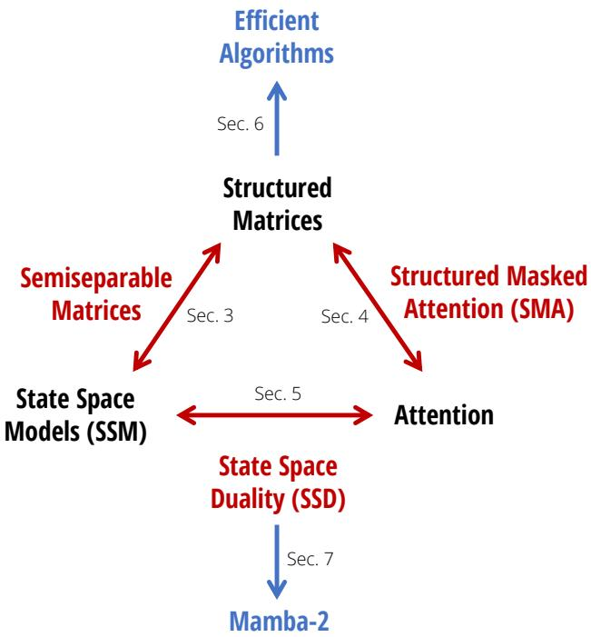  
Figure 1: (Structured State-Space Duality.) This paper fl<sub>es</sub>h<sub>es</sub> <sub>ou</sub>t th<sub>e</sub> <sub>re</sub>l<sub>a</sub>ti<sub>ons</sub>hi<sub>p</sub> b<sub>e</sub>t<sub>ween</sub> <sub>s</sub>t<sub>a</sub>t<sub>e</sub> <sub>space</sub> <sub>mo</sub>d<sub>e</sub>l<sub>s</sub> <sub>an</sub>d <sub>a</sub>tt<sub>en</sub>ti<sub>on</sub> th<sub>roug</sub>h th<sub>e</sub> b<sub>r</sub>id<sub>ge o</sub>f <sub>s</sub>t<sub>ruc</sub>t<sub>ure</sub>d <sub>ma</sub>t<sub>r</sub>i<sub>ces.</sub>

Be<sub>y</sub>ond its intrinsic theoretical value<sub>,</sub> our framework o<sub>p</sub>ens u<sub>p</sub> a broad set of directions for understandin<sub>g</sub> and im<sub>p</sub>rovin<sub>g</sub> <sub>sequence mo</sub>d<sub>e</sub>l<sub>s.</sub>

Eficient Algorithms. First and most importantly, our framework exposes new eficient and easily-implementable algorithms for computing SSMs (Section 6). We introduce a new SSD algorithm, based on block decompositions of semisepa-<sub>ra</sub>bl<sub>e</sub> <sub>ma</sub>t<sub>r</sub>i<sub>ces,</sub> th<sub>a</sub>t t<sub>a</sub>k<sub>es</sub> <sub>a</sub>d<sub>van</sub>t<sub>age</sub> <sub>o</sub>f b<sub>o</sub>th th<sub>e</sub> li<sub>near</sub> SSM <sub>recurrence</sub> <sub>an</sub>d <sub>qua</sub>d<sub>ra</sub>ti<sub>c</sub> d<sub>ua</sub>l f<sub>orm,</sub> <sub>o</sub>bt<sub>a</sub>i<sub>n</sub>i<sub>ng</sub> <sub>op</sub>ti<sub>ma</sub>l t<sub>ra</sub>d<sub>eo</sub>f<sub>s</sub> on all main eficienc<sub>y</sub> axes (e.<sub>g</sub>. trainin<sub>g</sub> and inference com<sub>p</sub>ute, memor<sub>y</sub> usa<sub>g</sub>e, and abilit<sub>y</sub> to levera<sub>g</sub>e matrix multi<sub>p</sub>lication units on modern hardware). A dedicated im lementation of SSD is 2 − 8× faster than the o timized selective scan im<sub>p</sub>lementation of Mamba, while simultaneousl<sub>y</sub> allowin<sub>g</sub> for much lar<sub>g</sub>er recurrent state sizes (8× the size of Mamba or even hi<sub>g</sub>her, with minimal slowdown). SSD is hi<sub>g</sub>hl<sub>y</sub> com<sub>p</sub>etitive with o<sub>p</sub>timized im<sub>p</sub>lementations of softmax attention (FlashAttention-2 (Dao 2024)), crossin<sub>g</sub> over at se<sub>q</sub>uence len<sub>g</sub>th 2K and 6× faster at se<sub>q</sub>uence len<sub>g</sub>th 16K.

Architecture Design. One major obstacle to adopting new architectures such as SSMs is the ecosystem tailored to T<sub>rans</sub>f<sub>ormers, suc</sub>h <sub>as</sub> h<sub>ar</sub>d<sub>ware-e</sub>fi<sub>c</sub>i<sub>en</sub>t <sub>op</sub>ti<sub>m</sub>i<sub>za</sub>ti<sub>on an</sub>d <sub>para</sub>ll<sub>e</sub>li<sub>sm</sub> t<sub>ec</sub>h<sub>n</sub>i<sub>ques</sub> f<sub>or</sub> l<sub>arge-sca</sub>l<sub>e</sub> t<sub>ra</sub>i<sub>n</sub>i<sub>ng.</sub> O<sub>ur</sub> f<sub>ramewor</sub>k <sub>a</sub>ll<sub>ows us</sub>i<sub>ng es</sub>t<sub>a</sub>bli<sub>s</sub>h<sub>e</sub>d <sub>conven</sub>ti<sub>ons an</sub>d t<sub>ec</sub>h<sub>n</sub>i<sub>ques</sub> f<sub>or a</sub>tt<sub>en</sub>ti<sub>on</sub> t<sub>o</sub> b<sub>u</sub>ild <sub>a voca</sub>b<sub>u</sub>l<sub>ary o</sub>f <sub>arc</sub>hit<sub>ec</sub>t<sub>ure</sub> d<sub>es</sub>i<sub>gn c</sub>h<sub>o</sub>i<sub>ces</sub> f<sub>or</sub> SSMs, and further im<sub>p</sub>rove them (Section 7). For exam<sub>p</sub>le, we introduce the analo<sub>g</sub> of heads from multi-head attention (MHA) to SSMs. We show that the Mamba architecture is a multi-input SSM (MIS) that turns out to be analogous to multi-value attention (MVA), and compare other variants of Mamba with diferent head structures.

W<sub>e a</sub>l<sub>so use</sub> th<sub>ese</sub> id<sub>eas</sub> t<sub>o ma</sub>k<sub>e s</sub>li<sub>g</sub>ht <sub>mo</sub>difi<sub>ca</sub>ti<sub>ons</sub> t<sub>o</sub> th<sub>e</sub> M<sub>am</sub>b<sub>a</sub> bl<sub>oc</sub>k<sub>, w</sub>hi<sub>c</sub>h <sub>a</sub>ll<sub>ows</sub> t<sub>ensor para</sub>ll<sub>e</sub>li<sub>sm</sub> t<sub>o</sub> b<sub>e</sub> i<sub>mp</sub>l<sub>e-</sub> mented (e.<sub>g</sub>. in the st<sub>y</sub>le of Me<sub>g</sub>atron (Shoe<sub>y</sub>bi et al. 2019)). The main ideas include introducin<sub>g g</sub>rou<sub>p</sub>ed-value attention (GVA) head structure, and movin<sub>g</sub> all data-de<sub>p</sub>endent <sub>p</sub>rojections to occur in <sub>p</sub>arallel at the be<sub>g</sub>innin<sub>g</sub> of the block.

Th<sub>e com</sub>bi<sub>na</sub>ti<sub>on o</sub>f th<sub>e mo</sub>difi<sub>e</sub>d <sub>ara</sub>ll<sub>e</sub>l M<sub>am</sub>b<sub>a</sub> bl<sub>oc</sub>k<sub>,</sub> t<sub>oge</sub>th<sub>er w</sub>ith <sub>us</sub>i<sub>ng</sub> SSD <sub>as</sub> th<sub>e</sub> i<sub>nner</sub> SSM l<sub>ayer, resu</sub>lt<sub>s</sub> i<sub>n</sub> th<sub>e</sub> Mamba-2 architecture. We investigate Chinchilla scaling laws for Mamba-2 in the same setting as Mamba, finding that it P<sub>are</sub>t<sub>o</sub> d<sub>om</sub>i<sub>na</sub>t<sub>es</sub> M<sub>am</sub>b<sub>a an</sub>d T<sub>rans</sub>f<sub>ormer++</sub> i<sub>n</sub> b<sub>o</sub>th <sub>perp</sub>l<sub>ex</sub>it<sub>y an</sub>d <sub>wa</sub>ll<sub>-c</sub>l<sub>oc</sub>k ti<sub>me.</sub> W<sub>e a</sub>dditi<sub>ona</sub>ll<sub>y</sub> t<sub>ra</sub>i<sub>n a</sub> f<sub>am</sub>il<sub>y o</sub>f

Mamba-2 models at var<sub>y</sub>in<sub>g</sub> sizes on the Pile<sub>,</sub> showin<sub>g</sub> that it matches or out<sub>p</sub>erforms Mamba and o<sub>p</sub>en source Transf<sub>ormers on s</sub>t<sub>an</sub>d<sub>ar</sub>d d<sub>owns</sub>t<sub>ream eva</sub>l<sub>ua</sub>ti<sub>ons.</sub> F<sub>or exam</sub> l<sub>e,</sub> M<sub>am</sub>b<sub>a-</sub>2 <sub>w</sub>ith 2<sub>.</sub>7B <sub>arame</sub>t<sub>ers</sub> t<sub>ra</sub>i<sub>ne</sub>d <sub>on</sub> 300B t<sub>o</sub>k<sub>ens on</sub> the Pile o<sub>u</sub>t<sub>p</sub>erforms Mamba-2.8B<sub>,</sub> P<sub>y</sub>thia-2.8B and e<sub>v</sub>en P<sub>y</sub>thia-6.9B trained on the same dataset.

Systems Optimizations. The SSD framework connects SSMs and Transformers, allowing us to leverage a rich body of work on s<sub>y</sub>stems o<sub>p</sub>timizations develo<sub>p</sub>ed for Transformers (Section 8).

• For exam<sub>p</sub>le, Tensor Parallelism (TP) is an im<sub>p</sub>ortant model <sub>p</sub>arallelism techni<sub>q</sub>ue to train lar<sub>g</sub>e Transformer models b<sub>y</sub> s<sub>p</sub>littin<sub>g</sub> each la<sub>y</sub>er across GPUs on the same node. We desi<sub>g</sub>n Mamba-2 to be TP-friendl<sub>y,</sub> reducin<sub>g</sub> the number of <sub>sync</sub>h<sub>ron</sub>i<sub>za</sub>ti<sub>on po</sub>i<sub>n</sub>t <sub>per</sub> bl<sub>oc</sub>k b<sub>y</sub> h<sub>a</sub>lf<sub>.</sub>

<sub>•</sub> F<sub>or very</sub> l<sub>ong sequences w</sub>h<sub>ose ac</sub>ti<sub>va</sub>ti<sub>ons</sub> d<sub>o no</sub>t fit <sub>on one</sub> d<sub>ev</sub>i<sub>ce, sequence para</sub>ll<sub>e</sub>li<sub>sm</sub> h<sub>as</sub> b<sub>een</sub> d<sub>eve</sub>l<sub>ope</sub>d f<sub>or</sub> th<sub>e</sub> attention blocks. We describe how to train SSMs in <sub>g</sub>eneral and Mamba-2 in <sub>p</sub>artic<sub>u</sub>lar with se<sub>qu</sub>ence <sub>p</sub>arallelism<sub>,</sub> b<sub>y</sub> <sub>p</sub>assin<sub>g</sub> the recurrent states between devices.

<sub>•</sub> F<sub>or</sub> fi<sub>ne</sub>t<sub>un</sub>i<sub>ng</sub> <sub>w</sub>ith <sub>examp</sub>l<sub>es</sub> <sub>o</sub>f dif<sub>eren</sub>t l<sub>eng</sub>th<sub>s,</sub> f<sub>or</sub> b<sub>es</sub>t <sub>e</sub>fi<sub>c</sub>i<sub>ency,</sub> T<sub>rans</sub>f<sub>ormer</sub> <sub>requ</sub>i<sub>res</sub> <sub>sop</sub>hi<sub>s</sub>ti<sub>ca</sub>t<sub>e</sub>d t<sub>ec</sub>h<sub>n</sub>i<sub>ques</sub> t<sub>o</sub> <sub>remove a</sub>ddi<sub>n</sub> t<sub>o</sub>k<sub>ens an</sub>d <sub>er</sub>f<sub>orm a</sub>tt<sub>en</sub>ti<sub>on on var</sub>i<sub>a</sub>bl<sub>e</sub> l<sub>en</sub> th <sub>se uences.</sub> W<sub>e s</sub>h<sub>ow</sub> h<sub>ow</sub> M<sub>am</sub>b<sub>a-</sub>2 <sub>can</sub> b<sub>e</sub> t<sub>ra</sub>i<sub>ne</sub>d with variable se<sub>q</sub>uence len<sub>g</sub>ths eficientl<sub>y,</sub> re<sub>q</sub>uirin<sub>g</sub> no <sub>p</sub>addin<sub>g</sub> tokens.

Section 9 em<sub>p</sub>iricall<sub>y</sub> validates Mamba-2 on lan<sub>g</sub>ua<sub>g</sub>e modelin<sub>g,</sub> trainin<sub>g</sub> eficienc<sub>y,</sub> and a dificult multi-<sub>q</sub>uer<sub>y</sub> associative recall task (Arora, E<sub>y</sub>ubo<sub>g</sub>lu, Zhan<sub>g</sub>, et al. 2024). Finall<sub>y</sub>, in Section 10, we <sub>p</sub>rovide an extended related work and discuss <sub>po</sub>t<sub>en</sub>ti<sub>a</sub>l <sub>researc</sub>h di<sub>rec</sub>ti<sub>ons opene</sub>d <sub>up</sub> b<sub>y our</sub> f<sub>ramewor</sub>k<sub>.</sub>

Model code and <sub>p</sub>re-trained check<sub>p</sub>oints are o<sub>p</sub>en-sourced at https://github.com/state-spaces/mamba.

## 2 Background and Overview

## 2.1 Structured State Space Models

Structured state s<sub>p</sub>ace se<sub>q</sub>uence models (S4) are a recent class ofse<sub>q</sub>uence models for dee<sub>p</sub> learnin<sub>g</sub> that are broadl<sub>y</sub> related to RNNs, CNNs, and classical state s<sub>p</sub>ace models. The<sub>y</sub> are ins<sub>p</sub>ired b<sub>y</sub> a <sub>p</sub>articular continuous s<sub>y</sub>stem (1) that ma<sub>p</sub>s a 1-dimensional se<sub>q</sub>uence <sub>�</sub> $\in \mathbb { R } ^ { \intercal } \mapsto y \in \mathbb { R } ^ { \intercal }$ throu<sub>g</sub>h an im<sub>p</sub>licit latent state $\bar { h } \in \mathbb { R } ^ { ( \top , \mathsf { N } ) }$

A <sub>g</sub>eneral discrete form of structured SSMs takes the form of e<sub>q</sub>uation (1).

$$
\begin{array}{l} h _ {t} = A h _ {t - 1} + B x _ {t} \\ y _ {t} = C ^ {\top} h _ {t} \end{array}\tag{1a}
$$

(1b)

$$
h _ {t} = A _ {t} h _ {t - 1} + B _ {t} x _ {t}\tag{2a}
$$

$$
y _ {t} = C _ {t} ^ {\top} h _ {t}\tag{2b}
$$

<sub>w</sub>h<sub>ere</sub> $A \in \mathbb { R } ^ { ( \mathsf { N } , \mathsf { N } ) } , B \in \mathbb { R } ^ { ( \mathsf { N } , 1 ) } , C \in \mathbb { R } ^ { ( \mathsf { N } , 1 ) }$ . Structured SSMs are so named because the � matrix controllin<sub>g</sub> the tem<sub>p</sub>oral dynamics must be structured in order to compute this sequence-to-sequence transformation eficiently enough to be used in dee<sub>p</sub> neural networks. The ori<sub>g</sub>inal structures introduced were dia<sub>g</sub>onal <sub>p</sub>lus low-rank (DPLR) (Gu, Goel, and Ré 2022) and dia<sub>g</sub>onal (Gu, Gu<sub>p</sub>ta, et al. 2022; Gu<sub>p</sub>ta, Gu, and Berant 2022; J. T. Smith, Warrin<sub>g</sub>ton, and Linderman 2023), which remains the most <sub>p</sub>o<sub>p</sub>ular structure.

In this work, we use the term state s<sub>p</sub>ace model (SSM) to refer to structured SSMs. There are man<sub>y</sub> flavors of such SSMs, wit<sup>h d</sup>eep ties to severa<sup>l</sup> major para<sup>d</sup>igms o<sup>f</sup> neura<sup>l</sup> sequence mo<sup>d</sup>e<sup>l</sup>s suc<sup>h</sup> as continuous-time, recurrent, an<sup>d</sup> convolutional models (Gu, Johnson, Goel, et al. 2021). We <sub>p</sub>rovide a brief overview below, and refer to <sub>p</sub>rior work for more context and details (Gu 2023; Gu and Dao 2023).

Continuous-time Models. The original structured SSMs originated as continuous-time maps on functions $x ( t ) \in \mathbb { R } \mapsto$ <sub>�</sub>(�) ∈ R, rather than o<sub>p</sub>eratin<sub>g</sub> directl<sub>y</sub> on se<sub>q</sub>uences. In the continuous-time <sub>p</sub>ers<sub>p</sub>ective, in e<sub>q</sub>uation (1a) the matrices $( A , B )$ <sub>are</sub> <sub>no</sub>t di<sub>rec</sub>tl<sub>y</sub> l<sub>earne</sub>d b<sub>u</sub>t <sub>genera</sub>t<sub>e</sub>d f<sub>rom</sub> <sub>un</sub>d<sub>er</sub>l<sub>y</sub>i<sub>ng</sub> <sub>parame</sub>t<sub>ers</sub> $( { \mathring \cal A } , { \mathring \cal B } )$ , alon<sub>g</sub> with a <sub>p</sub>arameterized ste<sub>p</sub> size Δ. Th<sub>e</sub> “<sub>con</sub>ti<sub>nuous arame</sub>t<sub>ers</sub>” $( \Delta , \mathring { A } , \mathring { B } )$ are converted to “discrete <sub>p</sub>arameters” (�, �) throu<sub>g</sub>h fixed formulas $A = f _ { A } ( \Delta , \mathring { A } )$ <sub>an</sub>d $B = f _ { B } ( \Delta , \mathring { B } )$ <sub>,</sub> <sub>w</sub>h<sub>ere</sub> th<sub>e</sub> <sub>pa</sub>i<sub>r</sub> $( f _ { A } , f _ { B } )$ is called a discretization rule.

Remark 1. While our main models adopt the same parameterization and discretization step as prior work (see Gu and Dao (2023) for details), for simplifying exposition and notation we omit it in the rest ofthis paper. We note that prior work on structured SSMs referred to the continuous parameters $( { \mathring \cal A } , { \mathring \cal B } )$ and discrete parameters (�, �) as (�, �) and (�,<sup>¯</sup> �<sup>¯</sup>) instead; we have changed notation to simplify the presentation andfocus directly on the discrete parameters, which govern the main SSM recurrence.

Recurrent Models. Equations (1) and (2) take the form of a recurrence which is linear in its input �. Structured SSMs can therefore be viewed as t<sub>yp</sub>es of recurrent neural networks (RNNs), where the linearit<sub>y</sub> endows them with additional <sub>p</sub>ro<sub>p</sub>erties and allows them to avoid the se<sub>q</sub>uential com<sub>p</sub>utation of traditional RNNs. Conversel<sub>y,</sub> des<sub>p</sub>ite this sim<sub>p</sub>lification, SSMs are still full<sub>y</sub> ex<sub>p</sub>ressive as se<sub>q</sub>uence transformations (in the sense of universal a<sub>pp</sub>roximation) (Kaul 2020; Orvieto et al. 2023; Shida Wan<sub>g</sub> and Xue 2023)

Convolutional Models. When the SSM’s dynamics are constant through time as in equation (1), the model is called linear time-invariant (LTI). In this case, they are equivalent to convolutions. Thus, SSMs can also be viewed as types of CNNs, but where (i) the convolution kernels are im<sub>p</sub>licitl<sub>y p</sub>arameterized throu<sub>g</sub>h the SSM <sub>p</sub>arameters $( A , B , C )$ and (ii) th<sub>e</sub> <sub>convo</sub>l<sub>u</sub>ti<sub>on</sub> k<sub>erne</sub>l<sub>s</sub> <sub>are</sub> <sub>genera</sub>ll<sub>y</sub> <sub>g</sub>l<sub>o</sub>b<sub>a</sub>l i<sub>ns</sub>t<sub>ea</sub>d <sub>o</sub>f l<sub>oca</sub>l<sub>.</sub> C<sub>onverse</sub>l<sub>y,</sub> th<sub>roug</sub>h <sub>c</sub>l<sub>ass</sub>i<sub>ca</sub>l <sub>s</sub>i<sub>gna</sub>l <sub>process</sub>i<sub>ng</sub> th<sub>eory</sub> <sub>a</sub>ll <sub>su</sub>fi<sub>c</sub>i<sub>en</sub>tl<sub>y we</sub>ll<sub>-</sub>b<sub>e</sub>h<sub>ave</sub>d <sub>convo</sub>l<sub>u</sub>ti<sub>ons can</sub> b<sub>e represen</sub>t<sub>e</sub>d <sub>as</sub> SSM<sub>s.</sub>

Commonl<sub>y</sub>, <sub>p</sub>revious LTI SSMs would use the convolutional mode for eficient <sub>p</sub>arallelizable trainin<sub>g</sub> (where the whole in<sub>p</sub>ut se<sub>q</sub>uence is seen ahead of time), and switched into recurrent mode (1) for eficient autore<sub>g</sub>ressive inference (where the in<sub>p</sub>uts are seen one ste<sub>p</sub> at a time).

Selective State Space Models. The form (2) where the parameters (�, �, �) can also vary in time was introduced in Mamba as the selective SSM. Compared to the standard LTI formulation (1), this model can selectively choose to focus on or i<sub>g</sub>nore in<sub>p</sub>uts at ever<sub>y</sub> timeste<sub>p</sub>. It was shown to <sub>p</sub>erform much better than LTI SSMs on information-dense data such as language, es<sub>p</sub>ecially as its state size N increases allowing for more information ca<sub>p</sub>acity. However, it can only b<sub>e compu</sub>t<sub>e</sub>d i<sub>n recurren</sub>t i<sub>ns</sub>t<sub>ea</sub>d <sub>o</sub>f <sub>convo</sub>l<sub>u</sub>ti<sub>ona</sub>l <sub>mo</sub>d<sub>e, an</sub>d <sub>requ</sub>i<sub>res a care</sub>f<sub>u</sub>l h<sub>ar</sub>d<sub>ware-aware</sub> i<sub>mp</sub>l<sub>emen</sub>t<sub>a</sub>ti<sub>on</sub> t<sub>o</sub> b<sub>e</sub> <sub>e</sub>fi<sub>c</sub>i<sub>en</sub>t<sub>.</sub> E<sub>ven so,</sub> it i<sub>s s</sub>till l<sub>ess e</sub>fi<sub>c</sub>i<sub>en</sub>t th<sub>an</sub> h<sub>ar</sub>d<sub>ware-</sub>f<sub>r</sub>i<sub>en</sub>dl<sub>y mo</sub>d<sub>e</sub>l<sub>s suc</sub>h <sub>as</sub> CNN<sub>s an</sub>d T<sub>rans</sub>f<sub>ormers</sub> b<sub>ecause</sub> it d<sub>oes</sub> not le<sub>v</sub>era<sub>g</sub>e matrix m<sub>u</sub>lti<sub>p</sub>lication <sub>u</sub>nits<sub>, w</sub>hich modern accelerators s<sub>u</sub>ch as GPUs and TPUs are s<sub>p</sub>ecialized for.

While time-invariant SSMs are closely related to continuous, recurrent, and convolutional sequence models, they are not directly related to attention. In this paper, we show a deeper relationship between selective SSMs and attention, and use it to significantly im<sub>p</sub>rove the training s<sub>p</sub>eed of SSMs while simultaneously allowing for much larger state sizes N.

## Structured SSMs as Sequence Transformations.

Definition 2.1. We use the term sequence transformation to refer to a parameterized map on sequences $Y = f _ { \theta } ( X )$ where $X , Y \in \mathbb { R } ^ { ( \mathsf { T } , \mathsf { P } ) }$ and � is an arbitrary collection ofparameters. T represents the sequence or time axis; subscripts index into the first dimension, $e . g . X _ { t } , Y _ { t } \in \mathbb { R } ^ { \mathsf { P } }$

Se<sub>q</sub>uence transformations (e.<sub>g</sub>. SSMs, or self-attention) are the cornerstone of dee<sub>p</sub> se<sub>q</sub>uence models, where the<sub>y</sub> are incor<sub>p</sub>orated into neural network architectures (e.<sub>g</sub>. Transformers). The SSM in (1) or (2) is a se<sub>q</sub>uence transformation <sub>w</sub>ith ${ \mathsf { P } } = 1 ;$ it <sub>can</sub> b<sub>e genera</sub>li<sub>ze</sub>d t<sub>o</sub> $\mathsf { P } > 1$ b<sub>y</sub> sim<sub>p</sub>l<sub>y</sub> broadcastin<sub>g</sub> across this dimension (in other words, viewin<sub>g</sub> the in<sub>p</sub>ut as P independent sequences and applying the SSM to each). One can think of P as a head dimension, which we will <sub>e</sub>l<sub>a</sub>b<sub>o</sub>r<sub>a</sub>t<sub>e o</sub>n in S<sub>ec</sub>ti<sub>o</sub>n 7<sub>.</sub>

Definition 2.2. We define the SSM operator $\mathsf { S S M } ( A , B , C ) \ : = \ : \mathsf { S S M } ( A _ { 0 : T } , B _ { 0 : T } , C _ { 0 : T } )$ as the sequence transformation $X \in$ $\mathbb { R } ^ { ( \mathsf { T } , \mathsf { P } ) } \mapsto Y \in \mathbb { R } ^ { ( \mathsf { T } , \mathsf { P } ) }$ defined by equation (2).

In SSMs, the N dimension is a free parameter called the state size or state dimension. We also call it the state expansion factor, because it expands the size of the input/output by a factor of �, with implications for the computational eficiency <sub>o</sub>f th<sub>ese mo</sub>d<sub>e</sub>l<sub>s</sub>

Finall<sub>y,</sub> we remark that man<sub>y</sub> t<sub>yp</sub>es of se<sub>q</sub>uence transformations<sub>,</sub> such as attention<sub>,</sub> can be re<sub>p</sub>resented as a sin<sub>g</sub>le matrix multi<sub>p</sub>lication across the se<sub>q</sub>uence dimension.

Definition 2.3. We call a sequence transformation $Y = f _ { \theta } ( X )$ a matrix transformation ifit can be written in the form $Y = M _ { \theta } X$ where � is a matrix depending on the parameters �. We identify the sequence transformation with the matrix �, and often drop the dependence on � when clearfrom context.

## 2.2 Attention

Attention broadl<sub>y</sub> refers to a t<sub>yp</sub>e of com<sub>p</sub>utation that assi<sub>g</sub>ns scores to ever<sub>y p</sub>air of <sub>p</sub>ositions in a se<sub>q</sub>uence<sub>,</sub> allowin<sub>g</sub> <sub>eac</sub>h <sub>e</sub>l<sub>emen</sub>t t<sub>o</sub> “<sub>a</sub>tt<sub>en</sub>d” t<sub>o</sub> th<sub>e res</sub>t<sub>.</sub> B<sub>y</sub> f<sub>ar</sub> th<sub>e mos</sub>t <sub>common an</sub>d i<sub>mpor</sub>t<sub>an</sub>t <sub>var</sub>i<sub>an</sub>t <sub>o</sub>f <sub>a</sub>tt<sub>en</sub>ti<sub>on</sub> i<sub>s so</sub>ft<sub>max se</sub>lf<sub>-a</sub>tt<sub>en</sub>ti<sub>on,</sub> <sub>w</sub>hi<sub>c</sub>h <sub>can</sub> b<sub>e</sub> d<sub>e</sub>fi<sub>ne</sub>d <sub>as</sub>

$$
Y = \operatorname{softmax} (Q K ^ {\top}) \cdot V
$$

f<sub>or</sub> $Q , K , V \in \mathbb { R } ^ { ( \mathsf { T } , \mathsf { P } ) }$ . The mechanism of <sub>p</sub>airwise com<sub>p</sub>arisons (induced b<sub>y</sub> materializin<sub>g</sub> $Q K ^ { \top } )$ l<sub>ea</sub>d<sub>s</sub> t<sub>o</sub> th<sub>e c</sub>h<sub>arac</sub>t<sub>er</sub>i<sub>s</sub>ti<sub>c</sub> <sub>qu</sub>adratic trainin<sub>g</sub> cost of attention.

M<sub>any var</sub>i<sub>an</sub>t<sub>s o</sub>f <sub>a</sub>tt<sub>en</sub>ti<sub>on</sub> h<sub>ave</sub> b<sub>een propose</sub>d<sub>,</sub> b<sub>u</sub>t <sub>a</sub>ll <sub>s</sub>h<sub>are</sub> th<sub>e un</sub>d<sub>er</sub>l<sub>y</sub>i<sub>ng core o</sub>f th<sub>ese a</sub>tt<sub>en</sub>ti<sub>on scores, w</sub>ith <sub>var</sub>i<sub>ous</sub> approximations (Tay et al. 2022). The most important variant for this work is linear attention (Katharopoulos et al. 2020). R<sub>oug</sub>hl<sub>y spea</sub>ki<sub>ng,</sub> thi<sub>s</sub> f<sub>am</sub>il<sub>y o</sub>f <sub>me</sub>th<sub>o</sub>d<sub>s</sub> d<sub>rops</sub> th<sub>e so</sub>ft<sub>max</sub> b<sub>y</sub> f<sub>o</sub>ldi<sub>ng</sub> it i<sub>n</sub>t<sub>o a</sub> k<sub>erne</sub>l f<sub>ea</sub>t<sub>ure map, an</sub>d <sub>uses assoc</sub>i<sub>a</sub>ti<sub>v</sub>it<sub>y</sub> <sub>o</sub>f m<sub>a</sub>trix m<sub>u</sub>lti<sub>p</sub>li<sub>ca</sub>ti<sub>o</sub>n t<sub>o</sub> r<sub>ew</sub>rit<sub>e</sub> $( Q K ^ { \top } ) \cdot { \bar { V } } = Q \cdot ( K ^ { \top } V )$ . Moreover, in the im<sub>p</sub>ortant case of causal (autore<sub>g</sub>ressive) <sub>a</sub>tt<sub>en</sub>ti<sub>on,</sub> th<sub>ey s</sub>h<sub>ow</sub> th<sub>a</sub>t <sub>w</sub>h<sub>en</sub> th<sub>e causa</sub>l <sub>mas</sub>k i<sub>s</sub> i<sub>ncorpora</sub>t<sub>e</sub>d i<sub>n</sub>t<sub>o</sub> th<sub>e</sub> l<sub>e</sub>ft<sub>-</sub>h<sub>an</sub>d <sub>s</sub>id<sub>e as</sub> $( L \circ Q K ^ { \intercal } ) \cdot V$ <sub>, w</sub>h<sub>ere</sub> � i<sub>s</sub> th<sub>e</sub> l<sub>ower-</sub>t<sub>r</sub>i<sub>angu</sub>l<sub>ar</sub> 1’<sub>s ma</sub>t<sub>r</sub>i<sub>x,</sub> th<sub>en</sub> th<sub>e r</sub>i<sub>g</sub>ht<sub>-</sub>h<sub>an</sub>d <sub>s</sub>id<sub>e can</sub> b<sub>e expan</sub>d<sub>e</sub>d <sub>as a recurrence.</sub> S<sub>evera</sub>l <sub>recen</sub>t <sub>an</sub>d <sub>concurren</sub>t <sub>wor</sub>k<sub>s</sub> such as RetNet (Y. Sun et al. 2023) and GateLoo (Katsch 2023) stren then this to more eneral forms of � (Section 10). In thi<sub>s wor</sub>k<sub>, our</sub> f<sub>ormu</sub>l<sub>a</sub>ti<sub>on o</sub>f <sub>s</sub>t<sub>ruc</sub>t<sub>ure</sub>d <sub>mas</sub>k<sub>e</sub>d <sub>a</sub>tt<sub>en</sub>ti<sub>on w</sub>ill <sub>s</sub>t<sub>rong</sub>l<sub>y genera</sub>li<sub>ze</sub> th<sub>ese</sub> id<sub>eas.</sub>

## 2.3 Structured Matrices

G<sub>e</sub>n<sub>e</sub>r<sub>a</sub>l m<sub>a</sub>tri<sub>ces</sub> $M \in \mathbb { R } ^ { ( \mathsf { T } , \mathsf { T } ) }$ re<sub>q</sub>u<sup>i</sup>re ${ \mathsf { T } } ^ { 2 }$ p<sup>arameters</sup> <sup>to</sup> <sup>re</sup>p<sup>resent</sup> <sup>and</sup> $O ( \mathsf { T } ^ { 2 } )$ time to <sub>p</sub>erform basic o<sub>p</sub>erations such as matrix-vector multi lication. Structured matrices are those that

(i) can be re<sub>p</sub>resented in sub<sub>q</sub>uadratic (ideall<sub>y</sub> linear) <sub>p</sub>arameters throu<sub>g</sub>h a com<sub>p</sub>ressed re<sub>p</sub>resentation, and

(ii) have fast al<sub>g</sub>orithms (most im<sub>p</sub>ortantl<sub>y</sub> matrix multi<sub>p</sub>lication) b<sub>y</sub> o<sub>p</sub>eratin<sub>g</sub> directl<sub>y</sub> on this com<sub>p</sub>ressed re<sub>p</sub>resentation.

P<sub>er</sub>h<sub>aps</sub> th<sub>e mos</sub>t <sub>canon</sub>i<sub>ca</sub>l f<sub>am</sub>ili<sub>es o</sub>f <sub>s</sub>t<sub>ruc</sub>t<sub>ure</sub>d <sub>ma</sub>t<sub>r</sub>i<sub>ces are sparse an</sub>d l<sub>ow-ran</sub>k <sub>ma</sub>t<sub>r</sub>i<sub>ces.</sub> H<sub>owever,</sub> th<sub>ere ex</sub>i<sub>s</sub>t <sub>many</sub> <sub>o</sub>th<sub>er</sub> f<sub>am</sub>ili<sub>es, suc</sub>h <sub>as</sub> T<sub>oep</sub>lit<sub>z,</sub> C<sub>auc</sub>h<sub>y,</sub> V<sub>an</sub>d<sub>ermon</sub>d<sub>e, an</sub>d b<sub>u</sub>tt<sub>er</sub>fl<sub>y ma</sub>t<sub>r</sub>i<sub>ces, w</sub>hi<sub>c</sub>h h<sub>ave a</sub>ll b<sub>een use</sub>d i<sub>n mac</sub>hi<sub>ne</sub> learnin<sub>g</sub> for eficient models (Dao, Gu, et al. 2019; D. Fu et al. 2024; Gu, Gu<sub>p</sub>ta, et al. 2022; Thomas et al. 2018). Structured <sub>ma</sub>t<sub>r</sub>i<sub>ces are a power</sub>f<sub>u</sub>l <sub>a</sub>b<sub>s</sub>t<sub>rac</sub>ti<sub>on</sub> f<sub>or e</sub>fi<sub>c</sub>i<sub>en</sub>t <sub>represen</sub>t<sub>a</sub>ti<sub>ons an</sub>d <sub>a</sub>l<sub>gor</sub>ith<sub>ms.</sub> I<sub>n</sub> thi<sub>s wor</sub>k<sub>, we w</sub>ill <sub>s</sub>h<sub>ow</sub> th<sub>a</sub>t SSM<sub>s</sub> <sub>are equ</sub>i<sub>va</sub>l<sub>en</sub>t t<sub>o ano</sub>th<sub>er c</sub>l<sub>ass o</sub>f <sub>s</sub>t<sub>ruc</sub>t<sub>ure</sub>d <sub>ma</sub>t<sub>r</sub>i<sub>ces</sub> th<sub>a</sub>t h<sub>ave no</sub>t <sub>prev</sub>i<sub>ous</sub>l<sub>y</sub> b<sub>een use</sub>d i<sub>n</sub> d<sub>eep</sub> l<sub>earn</sub>i<sub>ng, an</sub>d <sub>use</sub> thi<sub>s</sub> <sub>connec</sub>ti<sub>on</sub> t<sub>o</sub> d<sub>er</sub>i<sub>ve e</sub>fi<sub>c</sub>i<sub>en</sub>t <sub>me</sub>th<sub>o</sub>d<sub>s an</sub>d <sub>a</sub>l<sub>gor</sub>ith<sub>ms.</sub>

## 2.4 Overview: Structured State Space Duality

Whil<sub>e</sub> thi<sub>s a er</sub> d<sub>eve</sub>l<sub>o s a muc</sub>h <sub>r</sub>i<sub>c</sub>h<sub>er</sub> f<sub>ramewor</sub>k <sub>o</sub>f <sub>connec</sub>ti<sub>ons</sub> b<sub>e</sub>t<sub>ween</sub> SSM<sub>s, a</sub>tt<sub>en</sub>ti<sub>on, an</sub>d <sub>s</sub>t<sub>ruc</sub>t<sub>ure</sub>d <sub>ma</sub>t<sub>r</sub>i<sub>ces, we</sub> <sub>prov</sub>id<sub>e a</sub> b<sub>r</sub>i<sub>e</sub>f <sub>summary o</sub>f th<sub>e ma</sub>i<sub>n me</sub>th<sub>o</sub>d<sub>, w</sub>hi<sub>c</sub>h i<sub>s ac</sub>t<sub>ua</sub>ll<sub>y qu</sub>it<sub>e se</sub>lf<sub>-con</sub>t<sub>a</sub>i<sub>ne</sub>d <sub>an</sub>d <sub>s</sub>i<sub>mp</sub>l<sub>e a</sub>l<sub>gor</sub>ith<sub>m</sub>i<sub>ca</sub>ll<sub>y.</sub>

Recurrent (Linear) Form. The state space dual (SSD) layer can be defined as a special case of the selective SSM (2). The standard com<sub>p</sub>utation of an SSM as a recurrence (or <sub>p</sub>arallel scan) can be a<sub>pp</sub>lied, which has linear com<sub>p</sub>lexit<sub>y</sub> in se<sub>qu</sub>ence len<sub>g</sub>th. Com<sub>p</sub>ared to the version <sub>u</sub>sed in Mamba<sub>,</sub> SSD has two minor diferences:

• The structure on � is further simplified from diagonal to scalartimes identity structure. Each $A _ { t }$ <sub>can a</sub>l<sub>so</sub> b<sub>e</sub> id<sub>en</sub>tifi<sub>e</sub>d wit<sup>h</sup> just a sca<sup>l</sup>ar in t<sup>h</sup>is case.

• We use a larger head dimension P, com<sub>p</sub>ared to $\mathsf { P } = 1$ used in Mamba. T<sub>yp</sub>icall<sub>y</sub> $\mathsf { P } = \{ 6 4 , 1 2 8 \}$ i<sub>s c</sub>h<sub>osen w</sub>hi<sub>c</sub>h i<sub>s</sub> <sub>s</sub>i<sub>m</sub>il<sub>ar</sub> t<sub>o conven</sub>ti<sub>ons</sub> f<sub>or mo</sub>d<sub>ern</sub> T<sub>rans</sub>f<sub>ormers.</sub>

Com<sub>p</sub>ared to the ori<sub>g</sub>inal selective SSM<sub>,</sub> these chan<sub>g</sub>es can be viewed as sli<sub>g</sub>htl<sub>y</sub> decreasin<sub>g</sub> the ex<sub>p</sub>ressive <sub>p</sub>ower in return for si<sub>g</sub>nificant trainin<sub>g</sub> eficienc<sub>y</sub> im<sub>p</sub>rovements. In <sub>p</sub>articular<sub>,</sub> our new al<sub>g</sub>orithms will allow the use of matrix multi<sub>p</sub>lication units on modern accelerators.

Dual (Quadratic) Form. The dual form of SSD is a quadratic computation closely related to attention, defined as

$$
(L \circ Q K ^ {\top}) \cdot V \qquad L _ {i j} = \left\{ \begin{array}{l l} a _ {i} \times \dots \times a _ {j + 1} & i \geq j \\ 0 & i <   j \end{array} \right.
$$

<sub>w</sub>h<sub>ere</sub> $a _ { i }$ are in<sub>p</sub>ut-de<sub>p</sub>endent scalars bounded in [0, 1].

C<sub>ompare</sub>d t<sub>o s</sub>t<sub>an</sub>d<sub>ar</sub>d <sub>so</sub>ft<sub>max a</sub>tt<sub>en</sub>ti<sub>on,</sub> th<sub>ere are</sub> t<sub>wo ma</sub>i<sub>n</sub> dif<sub>erences</sub>

<sub>•</sub> Th<sub>e</sub> <sub>so</sub>ft<sub>max</sub> i<sub>s</sub> d<sub>roppe</sub>d<sub>.</sub>

• The attention matrix is multi<sub>p</sub>lied elementwise-wise b<sub>y</sub> an additional mask matrix $L .$

B<sub>o</sub>th <sub>o</sub>f th<sub>ese c</sub>h<sub>anges can</sub> b<sub>e v</sub>i<sub>ewe</sub>d <sub>as a</sub>dd<sub>ress</sub>i<sub>ng pro</sub>bl<sub>ems</sub> i<sub>n van</sub>ill<sub>a a</sub>tt<sub>en</sub>ti<sub>on.</sub> F<sub>or examp</sub>l<sub>e,</sub> th<sub>e so</sub>ft<sub>max</sub> h<sub>as</sub> b<sub>een</sub> recentl<sub>y</sub> observed to cause <sub>p</sub>roblems in attention scores, such as the “attention sink” <sub>p</sub>henomenon (Darcet et al. 2024; Xiao et al. 2024). More im<sub>p</sub>ortantl<sub>y</sub>, the mask matrix � can be viewed as re<sub>p</sub>lacin<sub>g</sub> the heuristic <sub>p</sub>ositional embeddin<sub>g</sub>s of Transformers with a diferent data-dependent positional mask that controls how much information is transfered across time.

More broadly, this form is an instance of our structured masked attention generalization of linear attention, defined in S<sub>ec</sub>ti<sub>o</sub>n 4<sub>.</sub>

Matrix Form and SSD Algorithm. The various forms of SSD are connected through a unified matrix representation, b<sub>y</sub> showin<sub>g</sub> that SSMs have a matrix transformation form $Y = M X$ f<sub>or a ma</sub>t<sub>r</sub>i<sub>x</sub> $M _ { \theta } \in \bar { \mathbb { R } } ^ { ( \top , \top ) }$ th<sub>a</sub>t d<sub>epen</sub>d<sub>s on</sub> $\theta = ( A , B , C )$ In <sub>p</sub>articular, the dual form ofSSD is e<sub>q</sub>uivalent to naive (<sub>q</sub>uadratic-time) multi<sub>p</sub>lication b<sub>y</sub> the matrix �, and the recurrent form is a <sub>p</sub>articular eficient (linear-time) al<sub>g</sub>orithm that levera<sub>g</sub>es the structure in �.

Going beyond these, any algorithm for multiplication by � can be applied. Our proposed hardware-eficient SSD algorithm (Section 6) is a new structured matrix multi<sub>p</sub>lication method that involves block decom<sub>p</sub>ositions of�, which obtains b<sub>e</sub>tt<sub>er</sub> <sub>e</sub>fi<sub>c</sub>i<sub>ency</sub> t<sub>ra</sub>d<sub>eo</sub>f<sub>s</sub> th<sub>an</sub> <sub>e</sub>ith<sub>er</sub> th<sub>e</sub> <sub>pure</sub> li<sub>near</sub> <sub>or</sub> <sub>qua</sub>d<sub>ra</sub>ti<sub>c</sub> f<sub>orms.</sub> It i<sub>s</sub> <sub>re</sub>l<sub>a</sub>ti<sub>ve</sub>l<sub>y</sub> <sub>s</sub>i<sub>mp</sub>l<sub>e</sub> <sub>an</sub>d <sub>easy-</sub>t<sub>o-</sub>i<sub>mp</sub>l<sub>emen</sub>t com<sub>p</sub>ared to <sub>g</sub>eneral selective SSMs (Gu and Dao 2023); Listin<sub>g</sub> 1 <sub>p</sub>rovides a com<sub>p</sub>lete im<sub>p</sub>lementation in a few lines of <sub>co</sub>d<sub>e.</sub>

Fi<sub>g</sub>ure 1 <sub>p</sub>rovides a sim<sub>p</sub>le roadma<sub>p</sub> of the relationshi<sub>p</sub>s between the conce<sub>p</sub>ts <sub>p</sub>resented in this <sub>p</sub>a<sub>p</sub>er.

## 2.5 Notation

Throu<sub>g</sub>hout this <sub>p</sub>a<sub>p</sub>er<sub>,</sub> we <sub>p</sub>refer usin<sub>g</sub> <sub>p</sub>recise notation that can be ma<sub>pp</sub>ed to code.

Matrices and Vectors. We generally use lower case to denote vectors (i.e. tensors with a single axis) and upper case to denote matrices (i.e. tensors with more than one axes). We do not bold matrices in this work. Sometimes, if a matrix is tied or re<sub>p</sub>eated alon<sub>g</sub> one axis (and hence can also be viewed as a vector), we ma<sub>y</sub> use either u<sub>pp</sub>er or lower case for $\mathrm { i t . } ^ { 2 }$ · denotes scalar or matrix multi<sub>p</sub>lication while ◦ denotes Hadamard (elementwise) multi<sub>p</sub>lication.

Indexing. We use Python-style indexing, $\mathbf { e . g . } i : j$ <sub>re</sub>f<sub>ers</sub> t<sub>o</sub> th<sub>e range</sub> $( i , i + 1 , \ldots , j - 1 )$ <sub>w</sub>h<sub>en</sub> $i < j$ <sub>an</sub>d $( i , i - 1 , \ldots , j + 1 )$ <sub>w</sub>h<sub>en</sub> $i > j$ <sub>.</sub> F<sub>or examp</sub>l<sub>e,</sub> f<sub>or any sym</sub>b<sub>o</sub>l <sub>� we</sub> l<sub>e</sub>t $\boldsymbol { v } _ { j : i }$ f<sub>or</sub> $j \geq i$ d<sub>eno</sub>t<sub>e</sub> th<sub>e sequence</sub> $\big ( v _ { j } , \ldots , v _ { i + 1 } \big )$ . [�] is e<sub>q</sub>uivalent to $0 : i = ( 0 , \ldots , i - 1 )$ <sub>.</sub> F<sub>or s</sub>h<sub>or</sub>th<sub>an</sub>d<sub>, we a</sub>l<sub>so</sub> l<sub>e</sub>t $\boldsymbol { v } _ { j : i } ^ { \times }$ d<sub>eno</sub>t<sub>e</sub> th<sub>e ro</sub>d<sub>uc</sub>t $v _ { j } \times \cdots \times v _ { i + 1 } . \stackrel { ? } { \cdot }$

Dimensions. To distinguish from matrices and tensors, we often use capital letters in typewriter fonts $( \mathbf { e . g . \ D , N , \top } )$ to d<sub>eno</sub>t<sub>e</sub> di<sub>mens</sub>i<sub>ons an</sub>d t<sub>ensor s</sub>h<sub>apes.</sub> I<sub>ns</sub>t<sub>ea</sub>d <sub>o</sub>f th<sub>e</sub> t<sub>ra</sub>diti<sub>ona</sub>l <sub>no</sub>t<sub>a</sub>ti<sub>on</sub> $\boldsymbol { M } \in \mathbb { R } ^ { T \times T }$ we <sup>f</sup>re<sub>q</sub>uent<sup>l</sup><sub>y</sub> use $M \in \mathbb { R } ^ { ( \mathsf { T } , \mathsf { T } ) }$ to <sub>re</sub>fl<sub>ec</sub>t t<sub>ensor s</sub>h<sub>apes</sub> i<sub>n co</sub>d<sub>e.</sub>

Tensor Contractions. We will heavily rely on tensor contraction or einsum notation both for clarity and as a central tool in statin<sub>g</sub> and <sub>p</sub>rovin<sub>g</sub> our results. We assume the reader to be familiar with this notation<sub>,</sub> which is commonl<sub>y</sub> used in modern tensor libraries such as numpy. For example, we can use contract(MN, NK → MK) to denote the matrix-matrix multiplication operator, and in our notation contract(MN, NK → MK)(�, �) (which is equivalent to $X \cdot Y )$ <sub>can</sub> b<sub>e</sub> t<sub>rans</sub>l<sub>a</sub>t<sub>e</sub>d to code as numpy.einsum(<sup>′</sup>mn, nk → mk<sup>′</sup>, X, Y).

A lar<sub>g</sub>e <sub>g</sub>lossar<sub>y</sub> of notation is incl<sub>u</sub>ded in A<sub>pp</sub>endix A.

## 3 State Space Models are Structured Matrices

This section ex<sub>p</sub>lores diferent <sub>p</sub>ers<sub>p</sub>ectives of the state s<sub>p</sub>ace model as a se<sub>q</sub>uence transformation<sub>,</sub> and outlines <sub>p</sub>ro<sub>p</sub>erties <sub>an</sub>d <sub>a</sub>l<sub>gor</sub>ith<sub>ms</sub> <sub>o</sub>f <sub>suc</sub>h <sub>maps.</sub> Th<sub>e</sub> <sub>ma</sub>i<sub>n</sub> <sub>resu</sub>lt<sub>s</sub> <sub>o</sub>f thi<sub>s</sub> <sub>sec</sub>ti<sub>on</sub> <sub>are</sub> <sub>a</sub>b<sub>ou</sub>t th<sub>e</sub> <sub>equ</sub>i<sub>va</sub>l<sub>ence</sub> b<sub>e</sub>t<sub>ween</sub> <sub>s</sub>t<sub>a</sub>t<sub>e</sub> <sub>space</sub> <sub>mo</sub>d<sub>e</sub>l<sub>s</sub> and a famil<sub>y</sub> of structured matrices called semise<sub>p</sub>arable matrices, which im<sub>p</sub>l<sub>y</sub> new eficienc<sub>y</sub> results (Theorems 3.5 and 3.7).

## 3.1 The Matrix Transformation Form of State Space Models

Recall that our definition of an SSM is defined as a <sub>p</sub>arameterized ma<sub>p</sub> defined throu<sub>g</sub>h (2). Our theoretical framework starts b<sub>y</sub> sim<sub>p</sub>l<sub>y</sub> writin<sub>g</sub> this transformation as a matrix multi<sub>p</sub>lication ma<sub>pp</sub>in<sub>g</sub> the vectors $x \in \mathbb { R } ^ { \mathsf { T } } \mapsto y \in \mathbb { R } ^ { \mathsf { T } }$

B<sub>y</sub> definition<sub>,</sub> $h _ { 0 } = B _ { 0 } x _ { 0 }$ <sub>.</sub> B<sub>y</sub> ind<sub>uc</sub>ti<sub>o</sub>n<sub>,</sub>

$$
\begin{array}{l} h _ {t} = A _ {t} \dots A _ {1} B _ {0} x _ {0} + A _ {t} \dots A _ {2} B _ {1} x _ {1} + \dots + A _ {t} A _ {t - 1} B _ {t - 2} x _ {t - 2} + A _ {t} B _ {t - 1} x _ {t - 1} + B _ {t} x _ {t} \\ = \sum_ {s = 0} ^ {t} A _ {t: s} ^ {\times} B _ {s} x _ {s}. \end{array}
$$

Multi<sub>p</sub>l<sub>y</sub>in<sub>g</sub> b<sub>y</sub> $C _ { t }$ to <sub>p</sub>ro<sup>d</sup>uce $y _ { t }$ and vectorizin<sub>g</sub> the e<sub>q</sub>uation over $t \in [ \top ]$ <sub>,</sub> <sub>we</sub> d<sub>er</sub>i<sub>ve</sub> th<sub>e</sub> <sub>ma</sub>t<sub>r</sub>i<sub>x</sub> t<sub>rans</sub>f<sub>orma</sub>ti<sub>on</sub> f<sub>orm</sub> <sub>o</sub>f SSM<sub>s.</sub>

$$
\begin{array}{c} y _ {t} = \sum_ {s = 0} ^ {t} C _ {t} ^ {\top} A _ {t: s} ^ {\times} B _ {s} x _ {s} \\ y = \mathsf {S S M} (A, B, C) (x) = M x \\ M _ {j i} := C _ {j} ^ {\top} A _ {j} \dots A _ {i + 1} B _ {i} \end{array}\tag{3}
$$

## 3.2 Semiseparable Matrices

� in e<sub>q</sub>uation (3) is a <sub>p</sub>articular re<sub>p</sub>resentation of a class of matrices known as semise<sub>p</sub>arable matrices. Semise<sub>p</sub>arabl <sub>ma</sub>t<sub>r</sub>i<sub>ces are a</sub> f<sub>un</sub>d<sub>amen</sub>t<sub>a</sub>l <sub>ma</sub>t<sub>r</sub>i<sub>x s</sub>t<sub>ruc</sub>t<sub>ure.</sub> W<sub>e</sub> fi<sub>rs</sub>t d<sub>e</sub>fi<sub>ne</sub> th<sub>ese ma</sub>t<sub>r</sub>i<sub>ces an</sub>d th<sub>e</sub>i<sub>r proper</sub>ti<sub>es.</sub>

Definition 3.1. A (lower triangular) matrix � is N-semiseparable if every submatrix contained in the lower triangular portion (i.e. on or below the diagonal) has rank at most N. We call N the order or rank ofthe semiseparable matrix.

Definition 3.1, and other forms of related “se<sub>p</sub>arable” structure (e.<sub>g</sub>. <sub>q</sub>uasise<sub>p</sub>arable matrices and other definitions of semiseparable matrices) are sometimes called structured rank matrices (or rank-structured matrices) because they are characterized b<sub>y</sub> rank conditions on their submatrices. Semise<sub>p</sub>arable matrices have man<sub>y</sub> structured re<sub>p</sub>resentations includin<sub>g</sub> the hierarchical semise<sub>p</sub>arable (HSS), se<sub>q</sub>uential semise<sub>p</sub>arable (SSS), and Bruhat forms (Pernet and Storjohann 2018). We will <sub>p</sub>rimaril<sub>y</sub> use the SSS form

## 3.2.1 The Sequentially Semiseparable (SSS) Representation

Definition 3.2. A lower triangular matrix $M \in \mathbb { R } ^ { ( \mathsf { T } , \mathsf { T } ) }$ has a N-sequentially semiseparable (SSS) representation if it can be written in the form

$$
M _ {j i} = C _ {j} ^ {\top} A _ {j} \cdot \cdot \cdot A _ {i + 1} B _ {i}\tag{4}
$$

for vectors $B _ { 0 } , \dots , B _ { \intercal - 1 } , C _ { 0 } , \dots , C _ { \intercal - 1 } \in \mathbb { R } ^ { \mathsf { N } }$ and matrices $A _ { 0 } , \dots , A _ { \intercal - 1 } \in \mathbb { R } ^ { ( \mathsf { N } , \mathsf { N } ) }$

We define the operator SSS so that $M = { \sf S S S } ( A _ { 0 : \mathrm { T } } , B _ { 0 : \mathrm { T } } , C _ { 0 : \mathrm { T } } )$

A f<sub>un</sub>d<sub>amen</sub>t<sub>a</sub>l <sub>resu</sub>lt <sub>o</sub>f <sub>sem</sub>i<sub>se ara</sub>bl<sub>e ma</sub>t<sub>r</sub>i<sub>ces</sub> i<sub>s</sub> th<sub>a</sub>t th<sub>e are exac</sub>tl <sub>e u</sub>i<sub>va</sub>l<sub>en</sub>t t<sub>o ma</sub>t<sub>r</sub>i<sub>ces w</sub>ith SSS <sub>re resen</sub>t<sub>a</sub>ti<sub>ons.</sub> O<sub>ne</sub> di<sub>rec</sub>ti<sub>on</sub> <sub>can</sub> b<sub>e</sub> d<sub>e</sub>d<sub>uce</sub>d <sub>w</sub>ith <sub>a</sub> <sub>s</sub>i<sub>mp</sub>l<sub>e</sub> <sub>cons</sub>t<sub>ruc</sub>ti<sub>ve</sub> <sub>proo</sub>f<sub>.</sub>

Lemma 3.3. An N-SSS matrix � with representation (4) is N-semiseparable.

Proof. Consider any of-diagonal block $M _ { j : j ^ { \prime } , i ^ { \prime } : i }$ <sub>w</sub>h<sub>ere</sub> $j ^ { \prime } > j \ge i > i ^ { \prime }$ . This has an ex<sub>p</sub>licit rank-N factorization as

$$
\left[ \begin{array}{c c c} C _ {j} ^ {\top} A _ {j: i ^ {\prime}} ^ {\times} B _ {i ^ {\prime}} & \ldots & C _ {j} ^ {\top} A _ {j: i - 1} ^ {\times} B _ {i - 1} \\ \vdots & & \vdots \\ C _ {j ^ {\prime} - 1} ^ {\top} A _ {j ^ {\prime} - 1: i ^ {\prime}} ^ {\times} B _ {i ^ {\prime}} & \ldots & C _ {j ^ {\prime} - 1} ^ {\top} A _ {j ^ {\prime} - 1: i - 1} ^ {\times} B _ {i - 1} \end{array} \right] = \left[ \begin{array}{c} C _ {j} ^ {\top} A _ {j: j} ^ {\times} \\ \vdots \\ C _ {j ^ {\prime} - 1} ^ {\top} A _ {j ^ {\prime} - 1: j} ^ {\times} \end{array} \right] A _ {j: i - 1} ^ {\times} \left[ \begin{array}{c c c} A _ {i - 1: i ^ {\prime}} ^ {\times} B _ {i ^ {\prime}} & \dots & A _ {i - 1: i - 1} ^ {\times} B _ {i - 1} \end{array} \right].\tag{5}
$$

E<sub>q</sub>uation (5) will be used extensivel<sub>y</sub> in derivin<sub>g</sub> our fast al<sub>g</sub>orithms for se<sub>q</sub>uence models. The other direction is well-<sub>es</sub>t<sub>a</sub>bli<sub>s</sub>h<sub>e</sub>d i<sub>n</sub> th<sub>e</sub> lit<sub>era</sub>t<sub>ure on sem</sub>i<sub>separa</sub>bl<sub>e ma</sub>t<sub>r</sub>i<sub>ces.</sub>

Proposition 3.4. Every N-semiseparable matrix has a N-SSS representation.

F<sub>ur</sub>th<sub>ermore, no</sub>t<sub>e</sub> th<sub>a</sub>t <sub>a</sub>lth<sub>oug</sub>h D<sub>e</sub>fi<sub>n</sub>iti<sub>on</sub> 3<sub>.</sub>2 i<sub>nvo</sub>l<sub>ves</sub> $O ( \mathsf { N } ^ { 2 } \mathsf { T } )$ <sub>p</sub>arameters for the re<sub>p</sub>resentation (in <sub>p</sub>articular to store the � matrices), it can actuall<sub>y</sub> be com<sub>p</sub>ressed down to �(NT) <sub>p</sub>arameters, which is as<sub>y</sub>m<sub>p</sub>toticall<sub>y</sub> ti<sub>g</sub>ht (Pernet, Si<sub>g</sub>nar<sub>g</sub>out, and Villard 2023). Therefore in the rest of this a er we will conflate the structured matrix class (Definition 3.1) and a <sub>p</sub>articular re<sub>p</sub>resentation of it (Definition 3.2); we will alwa<sub>y</sub>s use this re<sub>p</sub>resentation instead of other candidates. In turn we will use N-SS to refer to an N-semise<sub>p</sub>arable matrix in SSS form.

Semise<sub>p</sub>arable matrices are a f<sub>u</sub>ndamental matrix str<sub>u</sub>ct<sub>u</sub>re and have man<sub>y</sub> im<sub>p</sub>ortant <sub>p</sub>ro<sub>p</sub>erties. The<sub>y</sub> are dee<sub>p</sub>l<sub>y</sub> related to recurrences at lar<sub>g</sub>e, and can be defined b<sub>y</sub> multi<sub>p</sub>le characterizations (e.<sub>g</sub>. Definitions 3.1 and 3.2) which reveal diferent connections and eficient al<sub>g</sub>orithms for them. We mention some of their other <sub>p</sub>ro<sub>p</sub>erties in A<sub>pp</sub>endix C.1.

Remark 2. The notion of semiseparability is very broad and many similar but subtlely diferent definitions appear in the literature; our definitions may difer slightly from other conventions. First, because we are primarily concerned with causal or autoregressive settings in this paper, we have restricted the definition ofsemiseparability to the triangular case; Definition 3.1 more formally might be called (N, 0)-semiseparability by some authors. Some authors may also instead refer to it as a form of quasiseparability (Eidelman and Gohberg 1999; Pernet 2016). See Vandebril et al. (2005) for a brief survey.

## 3.2.2 1-Semiseparable Matrices: the Scalar SSM Recurrence

We will sin<sub>g</sub>le o<sub>u</sub>t the s<sub>p</sub>ecial case of 1-SS matrices. Note that in this case<sub>,</sub> the $C _ { j }$ <sub>an</sub>d $B _ { i }$ <sub>are sca</sub>l<sub>ars, an</sub>d <sub>can</sub> b<sub>e</sub> f<sub>ac</sub>t<sub>ore</sub>d out of the SSS re<sub>p</sub>resentation (4) (we also use lower-case to em<sub>p</sub>hasize that the <sub>p</sub>arameters are scalars in this case)

$$
\operatorname{SSS} (a, b, c) = \operatorname{diag} (c) \cdot M \cdot \operatorname{diag} (b) \quad \text { where } \quad M _ {j i} = a _ {j: i} ^ {\times}.
$$

Since dia<sub>g</sub>onal matrices are eas<sub>y</sub> to handle (e.<sub>g</sub>. multi<sub>p</sub>lication b<sub>y</sub> a dia<sub>g</sub>onal matrix is the same as elementwise scalar multi<sub>p</sub>lication), we can i<sub>g</sub>nore these terms. Thus our basic re<sub>p</sub>resentation of a 1-SS matrix is ${ M _ { j i } = a _ { j : i } }$ or

$$
M = 1 \mathrm{SS} (a _ {0: T}) := \left[ \begin{array}{c c c c c} 1 & & & & \\ a _ {1} & 1 & & & \\ a _ {2} a _ {1} & a _ {2} & 1 & & \\ \vdots & \vdots & \ddots & \ddots & \\ a _ {T - 1} \ldots a _ {1} & a _ {T - 1} \ldots a _ {2} & \ldots & a _ {T - 1} & 1 \end{array} \right].\tag{6}
$$

The im<sub>p</sub>ortance of 1-SS matrices lies in their e<sub>qu</sub>i<sub>v</sub>alence to the minimal form of a scalar rec<sub>u</sub>rrence – the case of a de<sub>g</sub>enerate SSM with state dimension N = 1 and no $( B , C )$ projections. Note t<sup>h</sup>at mu<sup>l</sup>tip<sup>l</sup>ication $y = M x$ <sub>can</sub> b<sub>e compu</sub>t<sub>e</sub>d b<sub>y</sub> th<sub>e recurrence</sub>

$$
\begin{array}{r l} & y _ {t} = a _ {t: 0} x _ {0} + \dots + a _ {t: t} x _ {t} \\ & \quad = a _ {t} (a _ {t - 1: 0} x _ {0} + \dots + a _ {t - 1: t - 1} x _ {t - 1}) + a _ {t: t} x _ {t} \\ & \quad = a _ {t} y _ {t - 1} + x _ {t}. \end{array}\tag{7}
$$

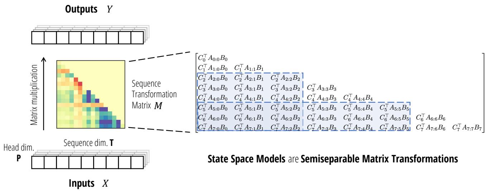  
Figure 2: (State Space Models are Semiseparable Matrices.) As sequence transformations, state space models can be re<sub>p</sub>resented as a matrix transformation $M \in \overline { { \mathbb { R } } } ^ { ( \mathsf { T } , \mathsf { T } ) }$ acting on the se<sub>q</sub>uence dimension T, sharing the same matrix for each channel in a head (Left). This matrix is a semiseparable matrix (Right), which is a rank-structured matrix where every submatrix contained on-and-below the diagonal (Blue) has rank at most N, equal to the SSM’s state dimension.

We thus also refer to matrix multiplication by 1-SS matrices as the scalar SSM recurrence or the cumprodsum (cumulative roduct sum; a eneralization of cumulative roduct and cumulative sum) o erator. As the fundamental form of <sub>recurrence, mu</sub>lti li<sub>ca</sub>ti<sub>on</sub> b 1<sub>-</sub>SS <sub>ma</sub>t<sub>r</sub>i<sub>ces</sub> i<sub>s</sub> i<sub>m or</sub>t<sub>an</sub>t <sub>as a</sub> b<sub>u</sub>ildi<sub>n</sub> bl<sub>oc</sub>k f<sub>or our ma</sub>i<sub>n a</sub>l <sub>or</sub>ith<sub>ms.</sub>

We emphasize that one of the central themes of this paper is that many algorithms on sequence models can be reduced to structured matrix multiplication algorithms. 1-SS matrices exemplify this connection: there are many fast algorithms for com<sub>p</sub>uting the <sub>p</sub>rimitive scalar recurrence or cumprodsum o<sub>p</sub>erator, and all of them turn out to be e<sub>q</sub>uivalent to diff<sub>e</sub>r<sub>e</sub>nt <sub>s</sub>tr<sub>uc</sub>t<sub>u</sub>r<sub>e</sub>d f<sub>ac</sub>t<sub>o</sub>riz<sub>a</sub>ti<sub>o</sub>n <sub>o</sub>f 1-SS m<sub>a</sub>tri<sub>ces.</sub> W<sub>e</sub> d<sub>e</sub>di<sub>ca</sub>t<sub>e</sub> A <sub>e</sub>ndix B t<sub>o</sub> th<sub>ese a</sub>l <sub>o</sub>rithm<sub>s</sub> f<sub>o</sub>r 1-SS m<sub>a</sub>trix m<sub>u</sub>lti li<sub>ca</sub> tion.

## 3.3 State Space Models are Semiseparable Matrices

R<sub>eca</sub>ll th<sub>a</sub>t <sub>our</sub> d<sub>e</sub>fi<sub>n</sub>iti<sub>on</sub> <sub>o</sub>f <sub>an</sub> SSM i<sub>s</sub> d<sub>e</sub>fi<sub>ne</sub>d <sub>as</sub> <sub>a</sub> <sub>parame</sub>t<sub>er</sub>i<sub>ze</sub>d <sub>map</sub> d<sub>e</sub>fi<sub>ne</sub>d th<sub>roug</sub>h D<sub>e</sub>fi<sub>n</sub>iti<sub>on</sub> 2<sub>.</sub>1<sub>.</sub> Th<sub>e</sub> <sub>connec</sub>ti<sub>on</sub> between SSMs and semise<sub>p</sub>arable matrices follows from sim<sub>p</sub>l<sub>y</sub> writin<sub>g</sub> this transformation as a matrix multi<sub>p</sub>lication <sup>ma</sup>pp<sup>in</sup>g <sup>the vectors</sup> $x \mapsto y \in \mathbb { R } ^ { \mathsf { T } }$

E<sub>q</sub>uation (3) directl<sub>y</sub> establishes the link between state s<sub>p</sub>ace models and the se<sub>q</sub>uentiall<sub>y</sub> semise<sub>p</sub>arable re<sub>p</sub>resentation, which in turn are e<sub>q</sub>uivalent to semise<sub>p</sub>arable matrices in <sub>g</sub>eneral (Lemma 3.3 and Pro<sub>p</sub>osition 3.4).

Theorem 3.5. The state space model transformation $y = { \mathsf { S S M } } ( A , B , C ) ( x )$ with state size N is identical to matrix multiplication by an N-SS matrix in sequentially semiseparable representation $y = { \mathrm { S S S } } ( A , B , C ) \cdot x .$

In other words the sequence transformation operator SSM (Definition 2.2) coincides with the matrix construction operator SSS (Definition 3.2), and we use them interchangeably (or sometimes SS as shorthand). Furthermore—by a twist of f<sub>a</sub>t<sub>e—s</sub>t<sub>ruc</sub>t<sub>ure</sub>d <sub>s</sub>t<sub>a</sub>t<sub>e space mo</sub>d<sub>e</sub>l<sub>s an</sub>d <sub>sequen</sub>ti<sub>a</sub>ll<sub>y sem</sub>i<sub>separa</sub>bl<sub>e ma</sub>t<sub>r</sub>i<sub>ces</sub> h<sub>ave</sub> th<sub>e same acronyms, un</sub>d<sub>erscor</sub>i<sub>ng</sub> th<sub>e</sub>i<sub>r</sub> e<sub>q</sub>uivalence! Convenientl<sub>y</sub> we can use an<sub>y</sub> ofthese acron<sub>y</sub>ms SSM (state s<sub>p</sub>ace model or semise<sub>p</sub>arable matrix), SSS (structured state s<sub>p</sub>ace or se<sub>q</sub>uentiall<sub>y</sub> semise<sub>p</sub>arable), or SS (state s<sub>p</sub>ace or semise<sub>p</sub>arable) interchan<sub>g</sub>eabl<sub>y</sub> to unambi<sub>g</sub>uousl<sub>y</sub> refer to either conce<sub>p</sub>t. However<sub>,</sub> we will <sub>g</sub>enerall<sub>y</sub> use the convention that SSM refers to state s<sub>p</sub>ace model<sub>,</sub> SS refers to semise<sub>p</sub>arable<sub>,</sub> and SSS refers to se<sub>qu</sub>entiall<sub>y</sub> semise<sub>p</sub>arable.

Fi<sub>g</sub>ure 2 illustrates the se<sub>q</sub>uence transformation <sub>p</sub>ers<sub>p</sub>ective of state s<sub>p</sub>ace models as semise<sub>p</sub>arable matrices.

## 3.4 Computing State Space Models through Structured Matrix Algorithms

The reason Theorem 3.5 is important is that it will allow us to reduce the problem ofeficient computation ofSSMs (and other sequence models) into eficient algorithms for structured matrix multiplication. We briefly provide an overview and defer our main new al<sub>g</sub>orithm to Section 6<sub>,</sub> after showin<sub>g</sub> the e<sub>q</sub>uivalence of SSMs to other se<sub>q</sub>uence models in Sections 4 <sub>an</sub>d 5<sub>.</sub>

As <sub>p</sub>reviousl<sub>y</sub> defined, semise<sub>p</sub>arable matrices (i.e. rank-structured matrices) are a classical t<sub>yp</sub>e of structured matrix:

(i) The<sub>y</sub> have com<sub>p</sub>ressed re<sub>p</sub>resentations such as the SSS form which has onl<sub>y</sub> �(T) instead of $O ( \mathsf { T } ^ { 2 } )$ p<sup>arameters.</sup>

(ii) The<sub>y</sub> have fast al<sub>g</sub>orithms o<sub>p</sub>eratin<sub>g</sub> directl<sub>y</sub> on the com<sub>p</sub>ressed re<sub>p</sub>resentation.

Furthermore<sub>,</sub> the <sub>p</sub>arameterization and matrix multi<sub>p</sub>lication cost can be ti<sub>g</sub>ht in the semise<sub>p</sub>arable order.

Proposition 3.6 (Pernet, Signargout, and Villard (2023)). An N-SS matrix ofsize T can be represented in �(NT) parameters and has matrix-vector multiplication in time and space �(NT).

F<sub>o</sub>r <sub>e</sub>x<sub>a</sub>m<sub>p</sub>l<sub>e,</sub> 1-SS m<sub>a</sub>tri<sub>ces</sub> ill<sub>us</sub>tr<sub>a</sub>t<sub>e</sub> th<sub>e esse</sub>n<sub>ce o</sub>f thi<sub>s co</sub>nn<sub>ec</sub>ti<sub>o</sub>n<sub>.</sub> Th<sub>e</sub> m<sub>a</sub>trix $ { M } = 1  { \mathrm { S } }  { \mathrm { S } } (  { a } )$ i<sub>s</sub> d<sub>e</sub>fi<sub>ne</sub>d b<sub>y exac</sub>tl<sub>y</sub> $\top - 1$ p<sup>arameters</sup> $a _ { 0 : \mathsf { T } - 1 } = a _ { 1 } , \dotsc , a _ { \mathsf { T } - 1 }$ , and can be com<sub>p</sub>uted in �(T) time b<sub>y</sub> followin<sub>g</sub> the scalar recurrence (7).

## 3.4.1 The Linear (Recurrent) Mode

Pro<sub>p</sub>osition 3.6 can be easil<sub>y</sub> seen in the case of dia<sub>g</sub>onal structured SSMs (S4D (Gu, Gu<sub>p</sub>ta, et al. 2022)), sim<sub>p</sub>l<sub>y</sub> b<sub>y</sub> levera<sub>g</sub>in<sub>g</sub> the state s<sub>p</sub>ace model formulation (2) and unrollin<sub>g</sub> the recurrence. We <sub>p</sub>rovide the formal tensor-contraction al<sub>g</sub>orithm in (8), where the dimension S is e<sub>q</sub>ual to T<sup>4</sup>.

$$
Z = \operatorname{contract} (\mathrm{SP}, \mathrm{SN} \rightarrow \mathrm{SPN}) (X, B)\tag{S, P, N}
$$

$$
H = \operatorname{contract} (\mathrm{TSN}, \mathrm{SPN} \rightarrow \mathrm{TPN}) (L, Z)\tag{T, P, N}
$$

(8b)

$$
Y = \operatorname{contract} (\mathrm{TN}, \mathrm{TPN} \rightarrow \mathrm{TP}) (C, H)\tag{T, P}
$$

(8c)

Here, $L \in \mathbb { R } ^ { ( \mathsf { T } , \mathsf { T } ) }$ is defined as 1SS(�), or in other words $L _ { 0 : \mathsf { T } , 0 : \mathsf { T } } = 1 \mathsf { S S } ( A _ { 0 : \mathsf { T } } )$ f<sub>or</sub> $i \in [ \mathsf { N } ]$ . This al<sub>g</sub>orithm involves three ste<sub>p</sub>s corres<sub>p</sub>ondin<sub>g</sub> to (2):

(i) expanding the input � by the input matrix � (8a),

(ii) unrollin<sub>g</sub> inde<sub>p</sub>endent scalar SSM recurrences (8b), and

(iii) contracting the hidden state � by the output matrix � (8c).

Note that we have used the e<sub>q</sub>uivalence between scalar SSMs and 1-SS matrices in ste<sub>p</sub> (8b).

Remark 3. We note that (8) is a special case ofthe Mamba (S6) model. however, a naive implementation is slow because ofthe expanded tensors � and � ofsize (T, P, N); Gu and Dao (2023) introduced a hardware-aware implementation to avoid materializing these tensors.

Sur<sub>p</sub>risin<sub>g</sub>l<sub>y,</sub> Theorem 3.5 and Pro<sub>p</sub>osition 3.6 immediatel<sub>y</sub> im<sub>p</sub>l<sub>y</sub> that all SSMs have the same as<sub>y</sub>m<sub>p</sub>totic eficienc<sub>y</sub> as al<sub>g</sub>orithm (8).

Theorem 3.7. Any state space model (Definition 2.2) ofstate size N on sequence length T can be computed in time �(TN) (not accounting for potential preprocessing).

We note that this res<sub>u</sub>lt is new to the str<sub>u</sub>ct<sub>u</sub>red SSM literat<sub>u</sub>re. In <sub>p</sub>artic<sub>u</sub>lar<sub>, g</sub>iven dense <sub>u</sub>nstr<sub>u</sub>ct<sub>u</sub>red $A _ { t }$ <sub>ma</sub>t<sub>r</sub>i<sub>ces,</sub> th<sub>e</sub> total re<sub>p</sub>resentation alone seems to be of size �(TN<sup>2</sup>). Thus Theorem 3.7 states the non-trivial result that with a <sub>p</sub>re-<sub>p</sub>rocessin<sub>g</sub> ste<sub>p,</sub> even an unstructured SSM can be com<sub>p</sub>uted o<sub>p</sub>timall<sub>y</sub> eficientl<sub>y,</sub> with u<sub>pp</sub>er bound matchin<sub>g</sub> the lower bound �(TN) <sub>g</sub>iven b<sub>y</sub> the size of � and �.

Remark 4. Theorem 3.7 is perhaps not too surprising in light of the fact that almost all dense matrices over $\mathbb { R } ^ { ( \mathsf { N } , \mathsf { N } ) }$ are diagonalizable over C, leading to the result that almost all dense real SSMs are equivalent to a diagonal complex SSM. This fact underlies the reason why diagonal SSMs are the most popularform ofstructured SSM (Gu, Gupta, et al. 2022; Gupta, Gu, and Berant 2022; J. T. Smith, Warrington, and Linderman 2023). However, Theorem 3.7 implies the much stronger result fo all real SSMs (not just the diagonalizable ones), as well as dense SSMs over other fields (including C itself).

In <sub>p</sub>ractice<sub>,</sub> eficientl<sub>y</sub> com<sub>p</sub>utable SSMs still re<sub>q</sub>uire additional structure on �<sub>, p</sub>articularl<sub>y</sub> to avoid the ex<sub>p</sub>ensive <sub>p</sub>re-<sub>p</sub>rocessin<sub>g</sub> ste<sub>p</sub> (which both has order N extra FLOPs and involves hardware-ineficient o<sub>p</sub>erations such as sin<sub>g</sub>ular value decom<sub>p</sub>ositions). These structures are the focus of <sub>p</sub>ast work on structured SSMs (e.<sub>g</sub>. S4(D) and Mamba) as well as our new al<sub>g</sub>orithms. In <sub>p</sub>articular<sub>,</sub> when sli<sub>g</sub>htl<sub>y</sub> stron<sub>g</sub>er structure is im<sub>p</sub>osed on �<sub>,</sub> we will desi<sub>g</sub>n ver<sub>y</sub> hardware-eficient <sub>a</sub>l<sub>gor</sub>ith<sub>ms</sub> th<sub>roug</sub>h bl<sub>oc</sub>k d<sub>ecompos</sub>iti<sub>ons o</sub>f th<sub>e</sub> SSM <sub>ma</sub>t<sub>r</sub>i<sub>x</sub> $M = { \mathrm { S S S } } ( A , B , C )$ in S<sub>ec</sub>ti<sub>o</sub>n 6<sub>.</sub>

## 3.4.2 The Quadratic (Naive) Mode

We note that there is another wa<sub>y</sub> to com<sub>p</sub>ute an SSM ex<sub>p</sub>osed b<sub>y</sub> our new matrix <sub>p</sub>oint of view. A naive com<sub>p</sub>utation of the matrix SSM re<sub>p</sub>resentation (3) involves sim<sub>p</sub>l<sub>y</sub> materializin<sub>g</sub> the se<sub>q</sub>uence transformation matrix $M = { \mathrm { S S S } } ( A , B , C )$ This is a (T, T) matrix, and therefore this naive al<sub>g</sub>orithm will scale <sub>q</sub>uadraticall<sub>y</sub> in se<sub>q</sub>uence len<sub>g</sub>th. However, when the se uence len th T is short, this can actuall be more eficient than the linear al orithm due to constant factors and the hardware-friendliness of the com<sub>p</sub>utation <sub>p</sub>attern (e.<sub>g</sub>. levera<sub>g</sub>in<sub>g</sub> matrix-matrix multi<sub>p</sub>lications). In fact, for a <sub>p</sub>articular case of structured SSMs, this looks ver<sub>y</sub> similar to a <sub>q</sub>uadratic attention com<sub>p</sub>utation (Section 5).

## 3.4.3 Summary

M<sub>an se uence mo</sub>d<sub>e</sub>l<sub>s are ex</sub> li<sub>c</sub>itl <sub>mo</sub>ti<sub>va</sub>t<sub>e</sub>d <sub>or</sub> d<sub>e</sub>fi<sub>ne</sub>d <sub>as ma</sub>t<sub>r</sub>i<sub>x se uence</sub> t<sub>rans</sub>f<sub>orma</sub>ti<sub>ons – mos</sub>t <sub>no</sub>t<sub>a</sub>bl T<sub>rans-</sub> formers<sub>, w</sub>here the matrix mixer is the attention matrix. On the other hand<sub>,</sub> RNNs and SSMs ha<sub>v</sub>e not <sub>p</sub>re<sub>v</sub>io<sub>u</sub>sl<sub>y</sub> been described in this way. By providing an explicit matrix transformation form of state space models, we reveal new ways of understandin<sub>g</sub> and usin<sub>g</sub> them. From a com<sub>p</sub>utational <sub>p</sub>ers<sub>p</sub>ective<sub>,</sub> an<sub>y</sub> method of com<sub>p</sub>utin<sub>g</sub> the forward <sub>p</sub>ass of a state s<sub>p</sub>ace model can be viewed as a matrix multi<sub>p</sub>lication al<sub>g</sub>orithm on semise<sub>p</sub>arable matrices. The semise<sub>p</sub>arable matrix <sub>p</sub>ers<sub>p</sub>ective <sub>p</sub>rovides one lens into state s<sub>p</sub>ace dualit<sub>y</sub> (SSD), where the dual modes res<sub>p</sub>ectivel<sub>y</sub> refer to a linear-time semise<sub>p</sub>arable matrix multi<sub>p</sub>lication al<sub>g</sub>orithm and <sub>q</sub>uadratic-time naive matrix multi<sub>p</sub>lication.

Moreover, levera<sub>g</sub>in<sub>g</sub> the rich structure of semise<sub>p</sub>arable matrices can lead to even better al<sub>g</sub>orithms and more insi<sub>g</sub>hts (e.<sub>g</sub>. Section 6 and A<sub>pp</sub>endix B). In A<sub>pp</sub>endix C.1, we describe some additional <sub>p</sub>ro<sub>p</sub>erties of semise<sub>p</sub>arable matrices.

## 4 Structured Masked Attention: Generalizing Linear Attention with Structured Matrices

In this section we revisit the linear attention framework from first <sub>p</sub>rinci<sub>p</sub>les. The main results in this section are a sim<sub>p</sub>le tensor-contraction-based <sub>p</sub>roof of linear attention (Pro<sub>p</sub>osition 4.1), and our <sub>g</sub>eneralized abstraction of structured masked attention in Definition 4.2. We note that this section derives the main dualit<sub>y</sub> results from a diferent direction than state <sub>space mo</sub>d<sub>e</sub>l<sub>s an</sub>d <sub>can</sub> b<sub>e rea</sub>d <sub>comp</sub>l<sub>e</sub>t<sub>e</sub>l<sub>y</sub> i<sub>n</sub>d<sub>epen</sub>d<sub>en</sub>tl<sub>y o</sub>f S<sub>ec</sub>ti<sub>on</sub> 3<sub>.</sub>

<sub>•</sub> S<sub>ec</sub>ti<sub>on</sub> 4<sub>.</sub>1 <sub>se</sub>t<sub>s up our</sub> f<sub>ramewor</sub>k f<sub>or var</sub>i<sub>an</sub>t<sub>s o</sub>f <sub>a</sub>tt<sub>en</sub>ti<sub>on, w</sub>ith <sub>a par</sub>ti<sub>cu</sub>l<sub>ar</sub> f<sub>ocus on</sub> k<sub>erne</sub>l <sub>a</sub>tt<sub>en</sub>ti<sub>on an</sub>d <sub>mas</sub>k<sub>e</sub>d k<sub>erne</sub>l <sub>a</sub>tt<sub>en</sub>ti<sub>on.</sub>

<sub>•</sub> S<sub>ec</sub>ti<sub>on</sub> 4<sub>.</sub>2 <sub>prov</sub>id<sub>es</sub> <sub>our</sub> fi<sub>rs</sub>t <sub>ma</sub>i<sub>n</sub> <sub>a</sub>tt<sub>en</sub>ti<sub>on</sub> <sub>resu</sub>lt<sub>,</sub> <sub>a</sub> <sub>s</sub>i<sub>mp</sub>l<sub>e</sub> <sub>proo</sub>f <sub>o</sub>f li<sub>near</sub> <sub>a</sub>tt<sub>en</sub>ti<sub>on</sub> th<sub>roug</sub>h th<sub>e</sub> l<sub>ens</sub> <sub>o</sub>f t<sub>ensor</sub> contractions.

<sub>•</sub> S<sub>ec</sub>ti<sub>on</sub> 4<sub>.</sub>3 d<sub>e</sub>fi<sub>nes s</sub>t<sub>ruc</sub>t<sub>ure</sub>d <sub>mas</sub>k<sub>e</sub>d <sub>a</sub>tt<sub>en</sub>ti<sub>on, our genera</sub>li<sub>za</sub>ti<sub>on o</sub>f <sub>pr</sub>i<sub>or a</sub>tt<sub>en</sub>ti<sub>on var</sub>i<sub>an</sub>t<sub>s</sub> th<sub>roug</sub>h <sub>s</sub>t<sub>ruc</sub>t<sub>ure</sub>d matrices.

## 4.1 The Attention Framework

## 4.1.1 Attention

The basic form of (sin<sub>g</sub>le-head) attention is a ma<sub>p</sub> on three se<sub>q</sub>uences of vectors $( Q , K , V ) \mapsto Y$

$$
\begin{array}{l l} Q = \text {input} & (\mathsf {T}, \mathsf {N}) \\ K = \text {input} & (\mathsf {S}, \mathsf {N}) \\ V = \text {input} & (\mathsf {S}, \mathsf {P}) \\ G = Q K ^ {\top} & (\mathsf {T}, \mathsf {S}) \\ M = f (G) & (\mathsf {T}, \mathsf {S}) \\ Y = G V & (\mathsf {T}, \mathsf {P}) \end{array}\tag{9}
$$

W<sub>e</sub> <sub>use</sub> “<sub>s</sub>h<sub>ape</sub> <sub>anno</sub>t<sub>a</sub>ti<sub>ons</sub>” t<sub>o</sub> i<sub>n</sub>di<sub>ca</sub>t<sub>e</sub> th<sub>e</sub> di<sub>mens</sub>i<sub>ons</sub> <sub>o</sub>f t<sub>ensors,</sub> <sub>e.g.</sub> $Q \in \mathbb { R } ^ { ( \mathsf { T } , \mathsf { N } ) }$ . In this general form, S and T re<sub>p</sub>resent source and target sequence lengths, N represents the feature dimension, and P represents the head dimension.

The most common variant of softmax attention uses a softmax activation $f = { \tt s o f t m a x }$ t<sub>o norma</sub>li<sub>ze</sub> th<sub>e rows o</sub>f th<sub>e</sub> � matrix.

## 4.1.2 Self-Attention

O<sub>ur</sub> t<sub>rea</sub>t<sub>men</sub>t i<sub>s mo</sub>ti<sub>va</sub>t<sub>e</sub>d b<sub>y</sub> th<sub>e mos</sub>t i<sub>mpor</sub>t<sub>an</sub>t <sub>case o</sub>f <sub>se</sub>lf<sub>-a</sub>tt<sub>en</sub>ti<sub>on, w</sub>h<sub>ere</sub>

(i) the source and tar<sub>g</sub>et se<sub>q</sub>uences are the same $( \mathrm { i } . \mathrm { e } . \mathsf { S } = \mathsf { T } )$

(ii) usuall<sub>y</sub> the feature and head dimensions are the same $( \mathrm { i . e . } \ N = \mathsf { P } )$

(iii) and �, �, � are generated by linear projections on the same input vector $( Q = W _ { Q } \cdot X , K = W _ { K } \cdot X , V = W _ { V } \cdot X ) .$

However, our presentation abstracts away these choices and begins from the �, �, � matrices.

Remark 5. Our focus is on the self-attention case with equal head and feature dimensions (i.e. S = T and N = P), which should be used as the running example. We define the general formulation of attention not only so that our framework captures variants such as cross-attention, but also because separating the notation for dimensions (e.g. S and T) makes the contraction notation proofs ofour main results in this section more clear.

Remark 6. While attention is usually framed as an operation on these three inputs �, �, � which are viewed symmetrically, the input and output dimensions in (9) indicate otherwise. In particular, the feature dimension N is not present in the output; therefore in the case when S = T (e.g. self-attention), we view � as the main input, so that (9) defines a proper sequence transformation � ↦→ � (Definition 2.1).

## 4.1.3 Kernel Attention

The ste<sub>p</sub> <sub>w</sub>here the softmax f<sub>u</sub>nction is a<sub>pp</sub>lied to the Gram matrix � can be decom<sub>p</sub>osed into t<sub>w</sub>o <sub>p</sub>arts:

1<sub>.</sub> Ex<sub>po</sub>n<sub>e</sub>nti<sub>a</sub>tin<sub>g</sub> th<sub>e</sub> � m<sub>a</sub>trix<sub>.</sub>

2. Normalizing the � matrix on the S axis.

We can i<sub>g</sub>nore the normalization term for now, as it amounts to sim<sub>p</sub>l<sub>y p</sub>assin<sub>g</sub> in � = 1 and dividin<sub>g</sub> (we revisit this in Section 7.3). The ex<sub>p</sub>onentiation term can be viewed as a kernel transformation: there is an (infinite-dimensional) feature ma<sub>p �</sub> suc<sup>h</sup> t<sup>h</sup>at $\exp ( { \cal Q K } ^ { \top } ) = \varphi ( { \cal Q } ) \varphi ( { \cal K } ) ^ { \top }$ . By abstracting away the feature map into the definition of � and � itself (i.e. define �, � as the post-transformed versions), we can ignore the softmax transformation, and assume that �, � are arbitrarily generated by kernel feature ma<sub>p</sub>s and <sub>p</sub>otentially N ≠ P.

Man<sub>y</sub> instantiations of kernel attention have been <sub>p</sub>ro<sub>p</sub>osed<sub>,</sub> includin<sub>g</sub>:

• The ori<sub>g</sub>inal Linear Attention (Katharo<sub>p</sub>oulos et al. 2020) defines the kernel feature ma<sub>p</sub> as an arbitrar<sub>y</sub> <sub>p</sub>ointwise <sub>ac</sub>ti<sub>va</sub>ti<sub>o</sub>n f<sub>u</sub>n<sub>c</sub>ti<sub>o</sub>n<sub>, suc</sub>h <sub>as</sub> $x \mapsto 1 + \mathsf { e l u } ( x )$

• Random Feature Attention (RFA) (H. Pen<sub>g</sub> et al. 2021) chooses the kernel feature ma<sub>p</sub> to a<sub>pp</sub>roximate softmax attention (i.e. the ex<sub>p</sub> feature ma<sub>p</sub>) usin<sub>g</sub> the random Fourier feature a<sub>pp</sub>roximation of Gaussian kernels (Rahimi and Recht 2007). This involves random projections (i.e. multiplying � and � by a random projection� and applying th<sub>e ac</sub>ti<sub>va</sub>ti<sub>o</sub>n $x \mapsto ( \cos ( x ) , \sin ( x ) )$ .

• Performer (Choromanski et al. 2021) <sub>p</sub>ro<sub>p</sub>oses the fast attention via <sub>p</sub>ositive ortho<sub>g</sub>onal random features (FAVOR+). The <sub>p</sub>ositive random features (PRF) <sub>p</sub>art chooses the kernel feature ma<sub>p</sub> to be a random <sub>p</sub>rojection followed b<sub>y</sub> the feature ma<sub>p</sub> � ↦→ $2 ^ { - 1 / 2 } ( \exp ( x ) , \exp ( - x ) )$ <sub>.</sub> Thi<sub>s c</sub>h<sub>o</sub>i<sub>ce</sub> i<sub>s mo</sub>ti<sub>va</sub>t<sub>e</sub>d <sub>so</sub> th<sub>a</sub>t th<sub>e</sub> k<sub>erne</sub>l <sub>e</sub>l<sub>emen</sub>t<sub>s are pos</sub>iti<sub>ve-va</sub>l<sub>ue</sub>d and provably approximates the softmax attention. [It also proposes choosing the random projections in orthogonal directions, which we do not consider.]

• cosFormer (Qin, Weixuan Sun, et al. 2022) au<sub>g</sub>ment RFA with a cosine rewei<sub>g</sub>htin<sub>g</sub> mechanism that incor<sub>p</sub>orates <sub>p</sub>ositional information to em<sub>p</sub>hasize localit<sub>y</sub>. This efectivel<sub>y p</sub>asses $Q _ { t } , K _ { t }$ throu<sub>g</sub>h the feature ma<sub>p</sub> � ↦→ $( x \cos ( \pi t / 2 T ) , \sin ( \pi t / 2 T ) )$ .

• Linear Randomized Attention (Zhen<sub>g</sub>, C. Wan<sub>g</sub>, and Kon<sub>g</sub> 2022) <sub>g</sub>eneralize RFA from the <sub>p</sub>ers<sub>p</sub>ective of im<sub>p</sub>ortance sampling, and generalize it to provide better estimates of the full softmax kernel (rather than just the exptransformed numerator).

Other related attention variants include Linformer (Sinon<sub>g</sub> Wan<sub>g</sub> et al. 2020) and N<sub>y</sub>ströformer (Xion<sub>g</sub> et al. 2021), which both use low-rank a<sub>pp</sub>roximations of the attention matrix � (and are thus com<sub>p</sub>atible with e<sub>q</sub>uation (9)), throu<sub>g</sub>h random <sub>p</sub>rojections (Johnson-Lindenstrauss) and kernel a<sub>pp</sub>roximation (the N<sub>y</sub>ström method) res<sub>p</sub>ectivel<sub>y</sub>.

## 4.1.4 Masked (Kernel) Attention

Let � be a mask of shape (T, S). Most commonly, in the autoregressive self-attention case when S = T, � may be a lowertrian ular matrix of 1’s re resentin a causal mask. Besides enforcin causalit , man other t es of masks can be a lied <sub>–</sub> i<sub>n</sub> <sub>par</sub>ti<sub>cu</sub>l<sub>ar</sub> <sub>var</sub>i<sub>ous</sub> <sub>spars</sub>it<sub>y</sub> <sub>pa</sub>tt<sub>erns</sub> <sub>suc</sub>h <sub>as</sub> b<sub>an</sub>d<sub>e</sub>d<sub>,</sub> dil<sub>a</sub>t<sub>e</sub>d<sub>,</sub> <sub>or</sub> bl<sub>oc</sub>k di<sub>agona</sub>l <sub>–</sub> <sub>w</sub>hi<sub>c</sub>h <sub>are</sub> <sub>mo</sub>ti<sub>va</sub>t<sub>e</sub>d b<sub>y</sub> <sub>re</sub>d<sub>uc</sub>i<sub>ng</sub> th<sub>e</sub> com<sub>p</sub>lexit<sub>y</sub> of dense attention.

M<sub>as</sub>k<sub>e</sub>d <sub>a</sub>tt<sub>e</sub>nti<sub>o</sub>n i<sub>s usua</sub>ll<sub>y w</sub>ritt<sub>e</sub>n in m<sub>a</sub>trix n<sub>o</sub>t<sub>a</sub>ti<sub>o</sub>n <sub>as</sub>

$$
y = \left(L \circ (Q K ^ {\top})\right) \cdot V.\tag{10}
$$

More <sub>p</sub>recisel<sub>y,</sub> with sha<sub>p</sub>e annotations and breakin<sub>g</sub> this down into the <sub>p</sub>recise se<sub>q</sub>uence of com<sub>p</sub>utations:

$$
\begin{array}{c c} G = Q K ^ {\top} & (\mathsf {T}, \mathsf {S}) \\ M = G \circ L & (\mathsf {T}, \mathsf {S}) \\ Y = M V & (\mathsf {T}, \mathsf {P}) \end{array}\tag{11}
$$

Our improved derivation of attention variants in this section starts by noticing that this formula can be written as a single contraction:

$$
Y = \text { contract } (\text { TN }, \text { SN }, \text { SP }, \text { TS } \to \text { TP }) (Q, K, V, L)\tag{12}
$$

and the al<sub>g</sub>orithm in (11) can be reframed as com<sub>p</sub>utin<sub>g</sub> (12) b<sub>y</sub> a <sub>p</sub>articular orderin<sub>g</sub> of <sub>p</sub>airwise contractions

$$
G = \operatorname{contract} (\mathrm{TN}, \mathrm{SN} \rightarrow \mathrm{TS}) (Q, K)\tag{T, S}
$$

(13a)

$$
M = \operatorname{contract} (\mathrm{TS}, \mathrm{TS} \rightarrow \mathrm{TS}) (G, L)\tag{T, S}
$$

(13b)

$$
Y = \operatorname{contract} (\mathrm{TS}, \mathrm{SP} \rightarrow \mathrm{TP}) (M, V)\tag{T, P}
$$

(13c)

## 4.2 Linear Attention

Linear attention<sub>,</sub> and man<sub>y</sub> other variants of eficient attention<sub>,</sub> is often motivated b<sub>y</sub> chan<sub>g</sub>in<sub>g</sub> the order of matrix as-<sub>soc</sub>i<sub>a</sub>ti<sub>v</sub>it<sub>y</sub> in th<sub>e co</sub>r<sub>e a</sub>tt<sub>e</sub>nti<sub>o</sub>n <sub>co</sub>m<sub>pu</sub>t<sub>a</sub>ti<sub>o</sub>n $( Q K ^ { \top } ) V = Q ( K ^ { \top } V )$ <sub>.</sub> H<sub>owever w</sub>h<sub>en</sub> th<sub>e mas</sub>k i<sub>s a</sub>dd<sub>e</sub>d<sub>,</sub> th<sub>e</sub> d<sub>er</sub>i<sub>va</sub>ti<sub>on</sub> i<sub>s</sub> somewhat less strai<sub>g</sub>htforward (for exam<sub>p</sub>le, the ori<sub>g</sub>inal <sub>p</sub>a<sub>p</sub>er (Katharo<sub>p</sub>oulos et al. 2020) and variants (Y. Sun et al. 2023) state the formula without <sub>p</sub>roof).

Rou<sub>g</sub>hl<sub>y</sub>, the linear attention method claims that the followin<sub>g</sub> formula is e<sub>q</sub>uivalent to (10), which must be verified b<sub>y</sub> <sub>expan</sub>di<sub>ng</sub> th<sub>e sum an</sub>d t<sub>rac</sub>ki<sub>ng</sub> i<sub>n</sub>di<sub>ces care</sub>f<sub>u</sub>ll<sub>y.</sub>

$$
Y = Q \cdot \operatorname{cumsum} (K ^ {\top} V)\tag{14}
$$

Proposition 4.1 ((Katharo oulos et al. 2020)). Autoregressive kernel attention, i.e. masked kernel attention with the causal mask, can be computed in �(�) time by a recurrence taking constant time per step.

## 4.2.1 A Tensor Contraction Proof of Linear Attention

We <sub>p</sub>resent a sim<sub>p</sub>le and ri<sub>g</sub>orous derivation of linear attention that will also immediatel<sub>y</sub> reveal how to <sub>g</sub>eneralize it. The main idea is to <sub>p</sub>erform the contraction (12) in an alternate order. We avoid ambi<sub>g</sub>uous matrix notation and work directl<sub>y</sub> <sub>w</sub>ith <sub>co</sub>ntr<sub>ac</sub>ti<sub>o</sub>n n<sub>o</sub>t<sub>a</sub>ti<sub>o</sub>n:

$$
Z = \operatorname{contract} (\mathrm{SP}, \mathrm{SN} \rightarrow \mathrm{SPN}) (V, K)\tag{S, P, N}
$$

(15a)

$$
H = \operatorname{contract} (\mathrm{TS}, \mathrm{SPN} \rightarrow \mathrm{TPN}) (L, Z)\tag{T, P, N}
$$

(15b)

$$
Y = \operatorname{contract} (\mathrm{TN}, \mathrm{TPN} \rightarrow \mathrm{TP}) (Q, H)\tag{T, P}
$$

(15c)

Intuitivel<sub>y,</sub> we inter<sub>p</sub>ret this contraction order as follows.

The first ste<sub>p</sub> (15a) <sub>p</sub>erforms an “ex<sub>p</sub>ansion” into more features, b<sub>y</sub> a factor of the feature dimension N. The third ste<sub>p</sub> (15c) contracts the ex<sub>p</sub>anded feature dimension awa<sub>y</sub>. If � is viewed as the in<sub>p</sub>ut (Remark 6), then � and � <sub>p</sub>erform the ex<sub>p</sub>ansion and contraction<sub>,</sub> res<sub>p</sub>ectivel<sub>y</sub>.

The second step is the most critical, and explains the linear part of linear attention. First notice that (15b) is just a direct matrix multi<sub>p</sub>lication b<sub>y</sub> � (since the (P, N) axes can be flattened). Also note that this is the onl<sub>y</sub> term that involves both T and S axes, hence should have Ω(TS) com<sub>p</sub>lexit<sub>y</sub> (i.e. <sub>q</sub>uadratic in se<sub>q</sub>uence len<sub>g</sub>th). However, when the mask � is the standard causal attention mask (lower trian<sub>g</sub>ular 1’s), matrix-vector multi<sub>p</sub>lication b<sub>y</sub> � is identical to a feature-wise <sub>cumu</sub>l<sub>a</sub>ti<sub>ve sum</sub>

$$
y = \left[ \begin{array}{c c c} 1 & & \\ \vdots & \ddots & \\ 1 & \ldots & 1 \end{array} \right] x \quad \Longleftrightarrow \quad \begin{array}{l} y _ {0} = x _ {0} \\ y _ {t} = y _ {t - 1} + x _ {t} \end{array} .
$$

## 4.3 Structured Masked Attention

With the tensor contraction <sub>p</sub>ers<sub>p</sub>ective of masked attention (15), we can immediatel<sub>y</sub> see that the crux of the ori<sub>g</sub>inal linear attention is the fact that matrix-vector multiplication by the causal mask is equivalent to the cumulative sum operator.

H<sub>owever, we o</sub>b<sub>serve</sub> th<sub>a</sub>t th<sub>ere</sub> i<sub>s no reason</sub> th<sub>e a</sub>tt<sub>en</sub>ti<sub>on mas</sub>k h<sub>as</sub> t<sub>o</sub> b<sub>e a</sub>ll 1’<sub>s.</sub> All th<sub>a</sub>t i<sub>s necessary</sub> f<sub>or</sub> li<sub>near a</sub>tt<sub>en</sub>ti<sub>on</sub> to be fast is for � to be a structured matrix, which by definition are those that have fast matrix multiplication (Section 2.3). In particular, we can use any mask matrix � that has sub-quadratic (ideally linear) matrix-vector multiplication, which would have the same com<sub>p</sub>lexit<sub>y</sub> as standard linear attention b<sub>y</sub> s<sub>p</sub>eedin<sub>g</sub> u<sub>p</sub> the bottleneck e<sub>q</sub>uation (15b).

Definition 4.2. Structured masked atention (SMA) (or structured atention for short) is defined as a function on queries/keys/values �, �, � as well as any structured matrix � (i.e. has sub-quadratic matrix multiplication), through the 4-way tensor contraction

$$
Y = \operatorname{contract} (\mathrm{TN}, \mathrm{SN}, \mathrm{SP}, \mathrm{TS} \rightarrow \mathrm{TP}) (Q, K, V, L).
$$

The SMA quadratic mode algorithm is the sequence of pairwise contractions defined by (13), which corresponds to the standard (masked) attention computation.

The SMA linear mode algorithm is the sequence ofpairwise contractions defined by (15), where step (15b) is optimized through the subquadratic structured matrix multiplication.

We can instantiate structured masked attention to an<sub>y</sub> <sub>g</sub>iven class of matrix structure. Some exam<sub>p</sub>les include (Fi<sub>g</sub>- ure 3):

• Lin<sub>ea</sub>r <sub>a</sub>tt<sub>e</sub>nti<sub>o</sub>n <sub>uses a causa</sub>l m<sub>as</sub>k<sub>.</sub>

• RetNet (Y. Sun et al. 2023) uses a deca<sub>y</sub> mask $L _ { i j } = \gamma ^ { i - j } \cdot \mathbb { I } [ j \geq i ]$ f<sub>or some</sub> d<sub>ecay</sub> f<sub>ac</sub>t<sub>or</sub> $\gamma \in \left[ 0 , 1 \right]$ <sub>•</sub> Th<sub>e</sub> d<sub>ecay</sub> <sub>mas</sub>k <sub>cou</sub>ld b<sub>e</sub> <sub>genera</sub>li<sub>ze</sub>d t<sub>o</sub> <sub>a</sub> T<sub>oep</sub>lit<sub>z</sub> <sub>ma</sub>t<sub>r</sub>i<sub>x</sub> $L _ { i j } = \alpha _ { i - j }$ for some learnable (or in<sub>p</sub>ut-de<sub>p</sub>endent) set of p<sup>arameters</sup> $\alpha \in \mathbb { R } ^ { \mathsf { T } }$ <sub>.</sub> Thi<sub>s can</sub> b<sub>e</sub> i<sub>n</sub>t<sub>erpre</sub>t<sub>e</sub>d <sub>as a</sub> f<sub>orm o</sub>f <sub>re</sub>l<sub>a</sub>ti<sub>ve pos</sub>iti<sub>ona</sub>l <sub>enco</sub>di<sub>ng, rem</sub>i<sub>n</sub>i<sub>scen</sub>t <sub>o</sub>f <sub>o</sub>th<sub>er me</sub>th<sub>o</sub>d<sub>s</sub> such as AliBi (Press, N. Smith, and Lewis 2022) but multi licative instead of additive.

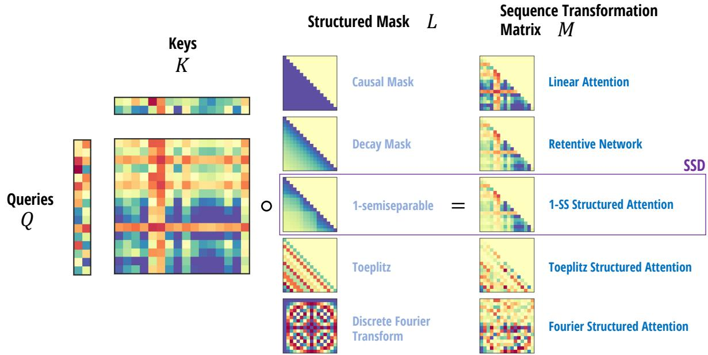  
Figure 3: (Structured Masked Attention.) SMA constructs a masked attention matrix $M = \boldsymbol { Q } \boldsymbol { K } ^ { \intercal } \circ \boldsymbol { L }$ f<sub>or</sub> <sub>any</sub> <sub>s</sub>t<sub>ruc</sub>t<sub>ure</sub>d <sub>ma</sub>t<sub>r</sub>i<sub>x</sub> �<sub>, w</sub>hi<sub>c</sub>h d<sub>e</sub>fi<sub>nes a ma</sub>t<sub>r</sub>i<sub>x sequence</sub> t<sub>rans</sub>f<sub>orma</sub>ti<sub>on</sub> $Y = M V$ <sub>.</sub> All i<sub>ns</sub>t<sub>ances o</sub>f SMA h<sub>ave a</sub> d<sub>ua</sub>l <sub>su</sub>b <sub>ua</sub>d<sub>ra</sub>ti<sub>c</sub> f<sub>orm</sub> induced b<sub>y</sub> a diferent contraction orderin<sub>g,</sub> combined with the eficient structured matrix multi<sub>p</sub>lication b<sub>y</sub> �. Previous exam<sub>p</sub>les include Linear Attention (Katharo<sub>p</sub>oulos et al. 2020) and RetNet (Y. Sun et al. 2023). Be<sub>y</sub>ond SSD (1-semise<sub>p</sub>arable SMA), the focus of this <sub>p</sub>a<sub>p</sub>er, man<sub>y</sub> other <sub>p</sub>otential instantiations of structured attention are <sub>p</sub>ossible.

<sub>•</sub> A<sub>no</sub>th<sub>er var</sub>i<sub>an</sub>t <sub>cou</sub>ld <sub>use a</sub> F<sub>our</sub>i<sub>er ma</sub>t<sub>r</sub>i<sub>x</sub> $L _ { i j } = \omega ^ { i j / \top }$ to encode <sub>p</sub>ositional structure a diferent wa<sub>y</sub>.

In S<sub>ec</sub>ti<sub>o</sub>n 5<sub>, we co</sub>n<sub>s</sub>id<sub>e</sub>r <sub>se</sub>mi<sub>sepa</sub>r<sub>a</sub>bl<sub>e</sub> SMA<sub>, w</sub>hi<sub>c</sub>h d<sub>e</sub>fin<sub>es ou</sub>r m<sub>a</sub>in SSD m<sub>o</sub>d<sub>e</sub>l<sub>.</sub>

## 4.3.1 Summary: The Dual Forms of Masked Attention

Standard (masked kernel) attention is often conflated between a function and an al<sub>g</sub>orithm. Se<sub>p</sub>aratin<sub>g</sub> this distinction <sub>presen</sub>t<sub>s a c</sub>l<sub>ear way</sub> t<sub>o un</sub>d<sub>ers</sub>t<sub>an</sub>d dif<sub>eren</sub>t <sub>var</sub>i<sub>an</sub>t<sub>s o</sub>f <sub>a</sub>tt<sub>en</sub>ti<sub>on.</sub>

• We view masked attention as a particular function (12).

• The standard quadratic attention computation (13) can be viewed as an algorithm to compute the function.

• Linear attention (15) is an alternate algorithm to compute the same function.

M<sub>o</sub>r<sub>eove</sub>r<sub>,</sub> in thi<sub>s case</sub>

• The masked attention function is simply a particular contraction on four terms.

• The quadratic and linear attention algorithms are simply two diferent orders to perform the contractions.

It is known that contraction orderin<sub>g</sub>s can make lar<sub>g</sub>e diferences in com<sub>p</sub>utation com<sub>p</sub>lexit<sub>y,</sub> leadin<sub>g</sub> to the <sub>q</sub>uadratic vs. linear s lit. Just as state s ace models are a transformation that can be com uted in multi le wa s, with dual uadratic vs. linear forms (Section 3.4) linear attention has a similar dualit that results from two contraction orders. In fact thes turn out to be diferent <sub>p</sub>ers<sub>p</sub>ectives on the same underl<sub>y</sub>in<sub>g</sub> dualit<sub>y,</sub> which we make ex<sub>p</sub>licit in Section 5.

## 5 State Space Duality

I<sub>n</sub> S<sub>ec</sub>ti<sub>ons</sub> 3 <sub>an</sub>d 4<sub>, we</sub> d<sub>e</sub>fi<sub>ne</sub>d <sub>s</sub>t<sub>ruc</sub>t<sub>ure</sub>d <sub>s</sub>t<sub>a</sub>t<sub>e s ace mo</sub>d<sub>e</sub>l<sub>s an</sub>d <sub>s</sub>t<sub>ruc</sub>t<sub>ure</sub>d <sub>a</sub>tt<sub>en</sub>ti<sub>on,</sub> di<sub>scusse</sub>d th<sub>e</sub>i<sub>r ro er</sub>ti<sub>es, an</sub>d <sub>s</sub>h<sub>owe</sub>d th<sub>a</sub>t th<sub>ey</sub> b<sub>o</sub>th h<sub>ave a qua</sub>d<sub>ra</sub>ti<sub>c a</sub>l<sub>gor</sub>ith<sub>m an</sub>d <sub>a</sub> li<sub>near a</sub>l<sub>gor</sub>ith<sub>m.</sub> Thi<sub>s sec</sub>ti<sub>on connec</sub>t<sub>s</sub> th<sub>em</sub> t<sub>oge</sub>th<sub>er.</sub> O<sub>ur ma</sub>i<sub>n</sub> <sub>resu</sub>lt i<sub>s s</sub>h<sub>ow</sub>i<sub>n</sub> th<sub>a</sub>t <sub>a ar</sub>ti<sub>cu</sub>l<sub>ar case o</sub>f <sub>s</sub>t<sub>ruc</sub>t<sub>ure</sub>d <sub>s</sub>t<sub>a</sub>t<sub>e s ace mo</sub>d<sub>e</sub>l<sub>s co</sub>i<sub>nc</sub>id<sub>es w</sub>ith <sub>a ar</sub>ti<sub>cu</sub>l<sub>ar case o</sub>f <sub>s</sub>t<sub>ruc</sub>t<sub>ure</sub>d <sub>a</sub>tt<sub>en</sub>ti<sub>on, an</sub>d th<sub>a</sub>t th<sub>e</sub> li<sub>near-</sub>ti<sub>me</sub> SSM <sub>a</sub>l<sub>gor</sub>ith<sub>m an</sub>d <sub>qua</sub>d<sub>ra</sub>ti<sub>c-</sub>ti<sub>me</sub> k<sub>erne</sub>l <sub>a</sub>tt<sub>en</sub>ti<sub>on a</sub>l<sub>gor</sub>ith<sub>m are</sub> d<sub>ua</sub>l f<sub>orms o</sub>f <sub>eac</sub>h <sub>o</sub>th<sub>er.</sub>

• Section 5.1 s<sub>p</sub>ecializes state s<sub>p</sub>ace models to scalar structure<sub>,</sub> where the naive <sub>q</sub>uadratic com<sub>p</sub>utation can be seen as <sub>an</sub> i<sub>ns</sub>t<sub>ance o</sub>f k<sub>erne</sub>l <sub>a</sub>tt<sub>en</sub>ti<sub>on.</sub>

• Section 5.2 s<sub>p</sub>ecializes str<sub>u</sub>ct<sub>u</sub>red masked attention to semise<sub>p</sub>arable SMA<sub>,</sub> which characterizes masked attention with eficient autore<sub>g</sub>ression.

<sub>•</sub> S<sub>ec</sub>ti<sub>on</sub> 5<sub>.</sub>3 <sub>summar</sub>i<sub>zes</sub> th<sub>e</sub> <sub>connec</sub>ti<sub>on</sub> b<sub>e</sub>t<sub>ween</sub> <sub>s</sub>t<sub>ruc</sub>t<sub>ure</sub>d <sub>mas</sub>k<sub>e</sub>d <sub>a</sub>tt<sub>en</sub>ti<sub>on</sub> <sub>an</sub>d <sub>s</sub>t<sub>ruc</sub>t<sub>ure</sub>d <sub>s</sub>t<sub>a</sub>t<sub>e</sub> <sub>space</sub> <sub>mo</sub>d<sub>e</sub>l<sub>s,</sub> t<sub>erme</sub>d <sub>s</sub>t<sub>ruc</sub>t<sub>ure</sub>d <sub>s</sub>t<sub>a</sub>t<sub>e space</sub> d<sub>ua</sub>lit<sub>y.</sub>

## 5.1 Scalar-Identity Structured State Space Models

In Section 3 we showed that state s<sub>p</sub>ace models are e<sub>q</sub>uivalent to semise<sub>p</sub>arable matrix transformations<sub>,</sub> resultin<sub>g</sub> in both <sub>a</sub> li<sub>near recurren</sub>t f<sub>orm an</sub>d <sub>qua</sub>d<sub>ra</sub>ti<sub>c na</sub>i<sub>ve</sub> f<sub>orm.</sub>

R<sub>eca</sub>ll th<sub>a</sub>t SSM<sub>s are</sub> d<sub>e</sub>fi<sub>ne</sub>d b<sub>y</sub> $y = { \mathsf { S S M } } ( A , B , C ) ( x )$ , and the matrix form of SSMs uses the SSS (se<sub>q</sub>uentiall<sub>y</sub> semise<sub>p</sub>arable) re<sub>p</sub>resentation $M = { \cal S } { \cal S } { \cal S } ( A , B , C )$ <sub>w</sub>h<sub>ere</sub> $M _ { j i } = C _ { j } ^ { \top } A _ { j : i } B _ { i }$ (e<sub>q</sub>uation (3)).

N<sub>ow</sub> l<sub>e</sub>t <sub>us cons</sub>id<sub>er</sub> th<sub>e case w</sub>h<sub>ere</sub> $A _ { j }$ is sim<sub>p</sub>l<sub>y</sub> a scalar<sub>;</sub> in other <sub>w</sub>ords<sub>,</sub> an instantiation of a str<sub>u</sub>ct<sub>u</sub>red SSM <sub>w</sub>here the � matrices are extremely structured: $A = a I$ for scalar <sub>�</sub> and identit<sub>y</sub> matrix �. Then we can rearran<sub>g</sub>e

$$
M _ {j i} = A _ {j: i} \cdot (C _ {j} ^ {\top} B _ {i}).
$$

A<sub>n</sub>d thi<sub>s can</sub> b<sub>e vec</sub>t<sub>or</sub>i<sub>ze</sub>d i<sub>n</sub>t<sub>o</sub>

$$
\begin{array}{c} L := 1 \text {SS} (a) \\ M = L \circ (C B ^ {\top}) \end{array}
$$

<sub>w</sub>h<sub>ere</sub> $B , C \in \mathbb { R } ^ { ( \mathsf { T } , \mathsf { N } ) }$

U<sub>s</sub>i<sub>ng</sub> thi<sub>s</sub> f<sub>ormu</sub>l<sub>a</sub>ti<sub>on,</sub> th<sub>e</sub> f<sub>u</sub>ll <sub>ou</sub>t<sub>pu</sub>t $Y = M X$ is com<sub>p</sub>uted <sub>p</sub>recisel<sub>y</sub> as

$$
G = \operatorname{contract} (\mathsf {T N}, \mathsf {S N} \to \mathsf {T S}) (C, B)\tag{T, S}
$$

$$
M = \operatorname{contract} (\mathrm{TS}, \mathrm{TS} \rightarrow \mathrm{TS}) (G, L)\tag{T, S}
$$

(16)

$$
Y = \operatorname{contract} (\mathrm{TS}, \mathrm{SP} \rightarrow \mathrm{TP}) (M, X)\tag{T, P}
$$

<sub>w</sub>h<sub>ere</sub> ${ \mathsf S } = { \mathsf T }$ . But this is exactl<sub>y</sub> the same as ori<sub>g</sub>inal definition of masked kernel attention definition (13)!

Therefore, as alluded to in Section 3.4, naively computing the scalar structured SSM—by materializing the semiseparable matrix � and performing quadratic matrix-vector multiplication—is exactly the same as quadratic masked kernel attention.

## 5.2 1-Semiseparable Structured Masked Attention

St<sub>ruc</sub>t<sub>ure</sub>d <sub>mas</sub>k<sub>e</sub>d <sub>a</sub>tt<sub>en</sub>ti<sub>on a</sub>ll<sub>ows</sub> f<sub>or</sub> th<sub>e use o</sub>f <sub>any s</sub>t<sub>ruc</sub>t<sub>ure</sub>d <sub>mas</sub>k �<sub>.</sub> Wh<sub>en</sub> � i<sub>s</sub> th<sub>e causa</sub>l <sub>mas</sub>k<sub>,</sub> it i<sub>s s</sub>t<sub>an</sub>d<sub>ar</sub>d li<sub>near</sub> <sub>a</sub>tt<sub>en</sub>ti<sub>on.</sub> N<sub>o</sub>t<sub>e</sub> th<sub>a</sub>t th<sub>e causa</sub>l <sub>mas</sub>k i<sub>s</sub> $L = { \sf S S } ( 1 _ { T } )$ <sub>,</sub> i.e. the 1-SS mask is <sub>g</sub>enerated b<sub>y</sub> $a _ { t } = 1$ in definition (6). This motivates generalizing � to the class of 1-semiseparable masks, or 1-semiseparable structured masked attention (1-SS SMA), where the cumsum in linear attention’s recurrence is replaced by a more general recurrence – the scalar SSM scan, i.e. 1-semise<sub>p</sub>arable matrix multi<sub>p</sub>lication (Section 3.2.2).

Finall<sub>y,</sub> the most im<sub>p</sub>ortant reason we consider 1-semise<sub>p</sub>arable SMA is because the linear form for com<sub>p</sub>utin<sub>g</sub> it is a s<sub>p</sub>ecial case of dia<sub>g</sub>onal state s<sub>p</sub>ace model. The linear form of SMA is al<sub>g</sub>orithm (15), where the bottleneck ste<sub>p</sub> (15b)

can be viewed as matrix m<sub>u</sub>lti<sub>p</sub>lication b<sub>y</sub> the 1-SS mask. In Section 3<sub>,</sub> we also wrote o<sub>u</sub>t the com<sub>pu</sub>tation for a dia<sub>g</sub>onal SSM (8), where the bottleneck ste<sub>p</sub> (8b) is a scalar SSM recurrence which is e<sub>q</sub>uivalent to 1-SS multi<sub>p</sub>lication. The onl<sub>y</sub> diference is that (8b) has an extra N dimension in � because the matrix � is a dia onal matrix of size N. This N dimension <sub>wou</sub>ld di<sub>sappear</sub> if <sub>a</sub>ll di<sub>agona</sub>l <sub>en</sub>t<sub>r</sub>i<sub>es o</sub>f � <sub>are</sub> th<sub>e same, w</sub>hi<sub>c</sub>h <sub>resu</sub>lt<sub>s</sub> i<sub>n</sub> C<sub>oro</sub>ll<sub>ary</sub> 5<sub>.</sub>1<sub>.</sub>

Corollary 5.1. 1-SS SMA (masked attention with 1-semiseparable structured matrices �) (15) is a special case of a diagonal SSM (8) where the diagonal matrix is a scalar multiple ofthe identity.

Whil<sub>e</sub> C<sub>oro</sub>ll<sub>ary</sub> 5<sub>.</sub>1 <sub>says</sub> th<sub>a</sub>t 1<sub>-</sub>SS SMA h<sub>as an e</sub>fi<sub>c</sub>i<sub>en</sub>t <sub>recurren</sub>t f<sub>orm, we can a</sub>l<sub>so s</sub>h<sub>ow a converse resu</sub>lt th<sub>a</sub>t <sub>c</sub>h<sub>arac-</sub> t<sub>e</sub>riz<sub>es w</sub>hi<sub>c</sub>h in<sub>s</sub>t<sub>a</sub>n<sub>ces o</sub>f SMA h<sub>as e</sub>fi<sub>c</sub>i<sub>e</sub>nt <sub>au</sub>t<sub>o</sub>r<sub>eg</sub>r<sub>ess</sub>i<sub>o</sub>n<sub>.</sub>

Theorem 5.2. For any instantiation ofstructured masked attention (Definition 4.2) that is an autoregressive process with bounded order, the structured mask � must be a semiseparable matrix.

In other words, eficient autoregressive attention is general semiseparable SMA. Theorem 5.2 is proved in Appendix C.2.

Remark 7. While 1-semiseparable SMA is a special case ofa state space model, general semiseparable SMA is strictly more expressive than 1-SS SMA, and cannot be described by a standard SSM. However, the semiseparable multiplication by � and the linear form of SMA (equation (15a)) each involve an expansion and contraction step, and can be absorbed into a similar instance of 1-SS SMA with a single (larger) expansion.

In s<sub>u</sub>mmar<sub>y,</sub> 1-semise<sub>p</sub>arable str<sub>u</sub>ct<sub>u</sub>red attention is the most im<sub>p</sub>ortant case of SMA<sub>,</sub> beca<sub>u</sub>se it is:

• a natural <sub>g</sub>eneralization of linear attention with an in<sub>p</sub>ut-de<sub>p</sub>endent recurrence.

• the sim<sub>p</sub>lest case of <sub>g</sub>eneral semise<sub>p</sub>arable attention<sub>,</sub> which is e<sub>q</sub>uivalent to eficient autore<sub>g</sub>ressive attention.

<sub>• a spec</sub>i<sub>a</sub>l <sub>case o</sub>f <sub>a</sub> di<sub>agona</sub>l <sub>s</sub>t<sub>a</sub>t<sub>e space mo</sub>d<sub>e</sub>l<sub>.</sub>

## 5.3 Structured State-Space Duality (SSD)

T<sub>o summar</sub>i<sub>ze our resu</sub>lt<sub>s:</sub>

• Structured state-s<sub>p</sub>ace models (Section 3) are a model usuall<sub>y</sub> defined throu<sub>g</sub>h a linear-time recurrence. However, b<sub>y</sub> ex<sub>p</sub>andin<sub>g</sub> the matrix formulation characterizin<sub>g</sub> its linear se<sub>q</sub>uence-to-se<sub>q</sub>uence transformation<sub>,</sub> one can derive <sub>a</sub> <sub>qua</sub>d<sub>ra</sub>ti<sub>c</sub> f<sub>orm.</sub>

• Attention variants (Section 4) are a model defined throu<sub>g</sub>h <sub>q</sub>uadratic-time <sub>p</sub>airwise interactions. However, b<sub>y</sub> viewin<sub>g</sub> it as a four-wa<sub>y</sub> tensor contraction and reducin<sub>g</sub> in a diferent order<sub>,</sub> one can derive a linear form.

• A n<sub>a</sub>t<sub>u</sub>r<sub>a</sub>l <sub>spec</sub>i<sub>a</sub>l <sub>case o</sub>f <sub>eac</sub>h <sub>o</sub>n<sub>e</sub> – m<sub>o</sub>r<sub>e p</sub>r<sub>ec</sub>i<sub>se</sub>l<sub>y, s</sub>t<sub>a</sub>t<sub>e space</sub> m<sub>o</sub>d<sub>e</sub>l<sub>s w</sub>ith <sub>sca</sub>l<sub>a</sub>r-id<sub>e</sub>ntit<sub>y s</sub>tr<sub>uc</sub>t<sub>u</sub>r<sub>e o</sub>n th<sub>e</sub> � <sub>ma</sub>t<sub>r</sub>i<sub>ces, an</sub>d <sub>s</sub>t<sub>ruc</sub>t<sub>ure</sub>d <sub>mas</sub>k<sub>e</sub>d <sub>a</sub>tt<sub>en</sub>ti<sub>on w</sub>ith 1<sub>-sem</sub>i<sub>separa</sub>bl<sub>e s</sub>t<sub>ruc</sub>t<sub>ure on</sub> it<sub>s</sub> � <sub>mas</sub>k <sub>– are</sub> d<sub>ua</sub>l<sub>s o</sub>f <sub>eac</sub>h <sub>o</sub>th<sub>er</sub> <sub>w</sub>ith th<sub>e</sub> <sub>exac</sub>t <sub>same</sub> li<sub>near</sub> <sub>an</sub>d <sub>qua</sub>d<sub>ra</sub>ti<sub>c</sub> f<sub>orms.</sub>

Fi<sub>g</sub>ure 4 summarizes the dualit<sub>y</sub> between these two re<sub>p</sub>resentations.

An extended related work and discussion (Section 10) describes the relationshi<sub>p</sub> between SSD and <sub>g</sub>eneral SSMs / attention i<sub>n more</sub> d<sub>e</sub>t<sub>a</sub>il<sub>.</sub>

## 6 A Hardware-Eficient Algorithm for SSD Models

The benefits of develo<sub>p</sub>in<sub>g</sub> the theoretical SSD framework between SSMs<sub>,</sub> attention<sub>,</sub> and structured matrices lies in usin<sub>g</sub> the connections to im<sub>p</sub>rove the models and al<sub>g</sub>orithms. In this section<sub>,</sub> we show how various al<sub>g</sub>orithms for com<sub>p</sub>utin<sub>g</sub> SSD models eficientl<sub>y</sub> can be derived from various al<sub>g</sub>orithms for com<sub>p</sub>utin<sub>g</sub> structured matrix multi<sub>p</sub>lication.

Our main com<sub>p</sub>utational result is an al<sub>g</sub>orithm for com<sub>p</sub>utin<sub>g</sub> SSD models that combines both the linear (recurrent) mode and <sub>q</sub>uadratic (attention) mode. This al<sub>g</sub>orithm is as com<sub>p</sub>utation eficient as SSMs (linear scalin<sub>g</sub> in se<sub>q</sub>uence len<sub>g</sub>th) and as hardware-friendl<sub>y</sub> as attention (<sub>p</sub>rimaril<sub>y</sub> uses matrix multi<sub>p</sub>lications).

Theorem 6.1. Consider an SSD model with state expansion factor N and head dimension P = N. There exists an algorithm for computing the model on any input $X \in \mathbb { R } ^ { ( \mathsf { T } , \mathsf { P } ) }$ which only requires �(TN<sup>2</sup>) training FLOPs, �(TN) inference FLOPs, �(N<sup>2</sup>) inference memory, and whose work is dominated by matrix multiplications.

<table><tr><td colspan="2">Structured State Space Model</td><td colspan="2">Structured Masked Attention</td></tr><tr><td>C</td><td>(contraction matrix)</td><td>Q</td><td>(queries)</td></tr><tr><td>B</td><td>(expansion matrix)</td><td>K</td><td>(keys)</td></tr><tr><td>X</td><td>(input sequence)</td><td>V</td><td>(values)</td></tr><tr><td> $A_{j:i}$ </td><td>(state matrix)</td><td> $L_{ji}$ </td><td>(mask)</td></tr><tr><td>N</td><td>(state expansion dim.)</td><td>N</td><td>(kernel feature dim.)</td></tr><tr><td>H</td><td>(hidden states (8b))</td><td></td><td>SMA linear dual (15)</td></tr><tr><td>=L·XB</td><td>(linear mode)</td><td></td><td></td></tr><tr><td rowspan="2" colspan="2">SSM quadratic dual (16)</td><td>G</td><td>(Gram matrix (13a))</td></tr><tr><td>=Q·K $^{\top}$ </td><td>(quadratic mode)</td></tr></table>

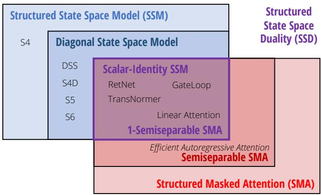  
Figure 4: (Structured State Space Duality.) State space duality describes the close relationship between state space <sub>mo</sub>d<sub>e</sub>l<sub>s an</sub>d <sub>mas</sub>k<sub>e</sub>d <sub>a</sub>tt<sub>en</sub>ti<sub>on.</sub> $( L e f t )$ General SSMs and SMA both <sub>p</sub>ossess linear and <sub>qu</sub>adratic forms<sub>,</sub> with direct analo<sub>g</sub>s in notation. (Right) SSMs and SMA intersect at a large class of state space dual models (SSD) which capture many sequence <sub>mo</sub>d<sub>e</sub>l<sub>s</sub> <sub>as</sub> <sub>spec</sub>i<sub>a</sub>l <sub>cases.</sub>

Note that all of these bounds are tight, because a state s<sub>p</sub>ace model with state ex<sub>p</sub>ansion N o<sub>p</sub>erating on a head size of N has total state size $\mathsf { N } ^ { 2 }$ (<sub>y</sub>ieldin<sub>g</sub> the lower bounds for trainin<sub>g</sub> and inference FLOPs of $O ( \mathsf { T N } ^ { 2 } )$ <sub>an</sub>d $O ( { \mathsf N } ^ { 2 } )$ res<sub>p</sub>ectivel<sub>y</sub>). Furthermore the in<sub>p</sub>ut � itself has TN elements, yielding the memory lower bound.

The main idea behind Theorem 6.1 is once a<sub>g</sub>ain viewin<sub>g</sub> the <sub>p</sub>roblem of com<sub>p</sub>utin<sub>g</sub> a state s<sub>p</sub>ace model as a semise<sub>p</sub>arable matrix multi<sub>p</sub>lication<sub>,</sub> but levera<sub>g</sub>in<sub>g</sub> its structure in a new wa<sub>y</sub>. Instead ofcom<sub>p</sub>utin<sub>g</sub> the whole matrix in either recurrent or attention mode, we perform a block decomposition of the matrix. The diagonal blocks can be computed using the dua <sub>a</sub>tt<sub>en</sub>ti<sub>on mo</sub>d<sub>e, w</sub>hi<sub>c</sub>h <sub>can</sub> b<sub>e e</sub>fi<sub>c</sub>i<sub>en</sub>tl<sub>y</sub> d<sub>one w</sub>ith <sub>ma</sub>t<sub>r</sub>i<sub>x mu</sub>lti<sub>p</sub>li<sub>ca</sub>ti<sub>ons, w</sub>hil<sub>e</sub> th<sub>e o</sub>f<sub>-</sub>di<sub>agona</sub>l bl<sub>oc</sub>k<sub>s can</sub> b<sub>e</sub> f<sub>ac</sub>t<sub>ore</sub>d b<sub>y</sub> th<sub>e ran</sub>k<sub>-s</sub>t<sub>ruc</sub>t<sub>ure o</sub>f <sub>sem</sub>i<sub>separa</sub>bl<sub>e ma</sub>t<sub>r</sub>i<sub>ces an</sub>d <sub>re</sub>d<sub>uce</sub>d t<sub>o a sma</sub>ll<sub>er recurrence.</sub> W<sub>e</sub> hi<sub>g</sub>hli<sub>g</sub>ht th<sub>a</sub>t Li<sub>s</sub>ti<sub>ng</sub> 1 <sub>prov</sub>id<sub>es</sub> a self-contained im<sub>p</sub>lementation of the SSD al<sub>g</sub>orithm. Com<sub>p</sub>ared to the <sub>g</sub>eneral selective SSM of Gu and Dao (2023), this im<sub>p</sub>lementation is much sim<sub>p</sub>ler<sub>,</sub> and relativel<sub>y</sub> eficient even in native P<sub>y</sub>Torch without re<sub>q</sub>uirin<sub>g</sub> s<sub>p</sub>ecial low-level k<sub>erne</sub>l<sub>s.</sub>

T<sub>o</sub> b<sub>eg</sub>in<sub>,</sub> <sub>we</sub> <sub>pa</sub>rtiti<sub>o</sub>n th<sub>e</sub> m<sub>a</sub>trix � int<sub>o</sub> <sub>a</sub> $\textstyle { \frac { \intercal } { 0 } } \times { \frac { \intercal } { 0 } }$ <sub>gr</sub>id <sub>o</sub>f <sub>su</sub>b<sub>ma</sub>t<sub>r</sub>i<sub>ces</sub> <sub>o</sub>f <sub>s</sub>i<sub>ze</sub> ${ \sf Q } \times { \sf Q } ,$ for some block size Q. Note that the of-dia<sub>g</sub>onal blocks are low-rank b<sub>y</sub> the definin<sub>g</sub> <sub>p</sub>ro<sub>p</sub>ert<sub>y</sub> of semise<sub>p</sub>arable matrices (Definition $3 . 1 ) . ^ { 5 }$

$$
\begin{array}{l} \text {(Block Decomposition)} \quad M = \left[ \begin{array}{c c c c} M ^ {(0, 0)} & & & \\ M ^ {(1, 0)} & M ^ {(1, 1)} & & \\ \vdots & \vdots & \ddots & \\ M ^ {(\mathsf {T} / \mathsf {Q} - 1, 0)} & M ^ {(\mathsf {T} / \mathsf {Q} - 1, 1)} & \ldots & M ^ {(\mathsf {T} / \mathsf {Q} - 1, \mathsf {T} / \mathsf {Q} - 1)} \end{array} \right] \\ \text {(Diagonal Block)} \quad M ^ {(j, j)} = \operatorname{SSM} (A _ {j \mathbb {Q}: (j + 1) \mathbb {Q}}, B _ {j \mathbb {Q}: (j + 1) \mathbb {Q}}, C _ {j \mathbb {Q}: (j + 1) \mathbb {Q}}) \\ \text {(Low - Rank Block)} \quad M ^ {(j, i)} = \left[ \begin{array}{c} C _ {j \mathbb {Q}} ^ {\top} A _ {j \mathbb {Q}: j \mathbb {Q} - 1} \\ \vdots \\ C _ {(j + 1) \mathbb {Q} - 1} ^ {\top} A _ {(j + 1) \mathbb {Q} - 1: j \mathbb {Q} - 1} \end{array} \right] A _ {j \mathbb {Q} - 1: (i + 1) \mathbb {Q} - 1} \left[ \begin{array}{c} B _ {i \mathbb {Q}} ^ {\top} A _ {(i + 1) \mathbb {Q} - 1: i \mathbb {Q}} \\ \vdots \\ B _ {(i + 1) \mathbb {Q} - 1} ^ {\top} A _ {(i + 1) \mathbb {Q} - 1: (i + 1) \mathbb {Q} - 1} \end{array} \right] ^ {\top} \end{array}
$$

Thi<sub>s</sub> i<sub>s</sub> <sub>eas</sub>i<sub>es</sub>t ill<sub>us</sub>t<sub>ra</sub>t<sub>e</sub>d th<sub>roug</sub>h <sub>an</sub> <sub>examp</sub>l<sub>e,</sub> <sub>e.g.</sub> f<sub>or</sub> ${ \mathsf T } = 9$ <sub>an</sub>d d<sub>ecompos</sub>i<sub>ng</sub> i<sub>n</sub>t<sub>o</sub> <sub>c</sub>h<sub>un</sub>k<sub>s</sub> <sub>o</sub>f l<sub>eng</sub>th $Q = 3$ <sub>.</sub> Th<sub>e</sub> <sub>s</sub>h<sub>a</sub>d<sub>e</sub>d

<sub>ce</sub>ll<sub>s are</sub> l<sub>ow-ran</sub>k f<sub>ac</sub>t<sub>or</sub>i<sub>za</sub>ti<sub>ons o</sub>f th<sub>e o</sub>f<sub>-</sub>di<sub>agona</sub>l bl<sub>oc</sub>k<sub>s o</sub>f th<sub>e sem</sub>i<sub>separa</sub>bl<sub>e ma</sub>t<sub>r</sub>i<sub>x.</sub>

<table><tr><td rowspan="5"> $M =$ </td><td> $\begin{bmatrix} C_{0}^{\top} A_{0:0} B_{0} \\ C_{1}^{\top} A_{1:0} B_{0} & C_{1}^{\top} A_{1:1} B_{1} \\ C_{2}^{\top} A_{2:0} B_{0} & C_{2}^{\top} A_{2:1} B_{1} & C_{2}^{\top} A_{2:2} B_{2} \end{bmatrix}$ </td><td colspan="3"></td><td colspan="3"></td></tr><tr><td rowspan="2"> $\begin{bmatrix} C_{3}^{\top} A_{3:0} B_{0} & C_{3}^{\top} A_{3:1} B_{1} & C_{3}^{\top} A_{3:2} B_{2} \\ C_{4}^{\top} A_{4:0} B_{0} & C_{4}^{\top} A_{4:1} B_{1} & C_{4}^{\top} A_{4:2} B_{2} \\ C_{5}^{\top} A_{5:0} B_{0} & C_{5}^{\top} A_{5:1} B_{1} & C_{5}^{\top} A_{5:2} B_{2} \end{bmatrix}$ </td><td> $C_{3}^{\top} A_{3:3} B_{3}$ </td><td colspan="2"></td><td colspan="3"></td></tr><tr><td> $C_{4}^{\top} A_{4:3} B_{3} & C_{4}^{\top} A_{4:4} B_{4} \\ C_{5}^{\top} A_{5:3} B_{3} & C_{5}^{\top} A_{5:4} B_{4} & C_{5}^{\top} A_{5:5} B_{5} \end{bmatrix}$ </td><td colspan="2"></td><td colspan="3"></td></tr><tr><td rowspan="2"> $\begin{bmatrix} C_{6}^{\top} A_{6:0} B_{0} & C_{6}^{\top} A_{6:1} B_{1} & C_{6}^{\top} A_{6:2} B_{2} \\ C_{7}^{\top} A_{7:0} B_{0} & C_{7}^{\top} A_{7:1} B_{1} & C_{7}^{\top} A_{7:2} B_{2} \\ C_{8}^{\top} A_{8:0} B_{0} & C_{8}^{\top} A_{8:1} B_{1} & C_{8}^{\top} A_{8:2} B_{2} \end{bmatrix}$ </td><td rowspan="2"> $C_{6}^{\top} A_{6:3} B_{3} & C_{6}^{\top} A_{6:4} B_{4} & C_{6}^{\top} A_{6:5} B_{5} \\ C_{7}^{\top} A_{7:3} B_{3} & C_{7}^{\top} A_{7:4} B_{4} & C_{7}^{\top} A_{7:5} B_{5} \\ C_{8}^{\top} A_{8:3} B_{3} & C_{8}^{\top} A_{8:4} B_{4} & C_{8}^{\top} A_{8:5} B_{5} \end{bmatrix}$ </td><td> $C_{6}^{\top} A_{6:6} B_{6}$ </td><td colspan="3"></td><td></td></tr><tr><td> $C_{7}^{\top} A_{7:6} B_{6} & C_{7}^{\top} A_{7:7} B_{7} \\ C_{8}^{\top} A_{8:6} B_{6} & C_{8}^{\top} A_{8:7} B_{7} & C_{8}^{\top} A_{8:8} B_{8} \end{bmatrix}$ </td><td></td><td></td><td></td><td></td></tr><tr><td rowspan="5"> $=$ </td><td> $\begin{bmatrix} C_{0}^{\top} A_{0:0} B_{0} \\ C_{1}^{\top} A_{1:0} B_{0} & C_{1}^{\top} A_{1:1} B_{1} \\ C_{2}^{\top} A_{2:0} B_{0} & C_{2}^{\top} A_{2:2} B_{1} & C_{2}^{\top} A_{2:2} B_{2} \end{bmatrix}$ </td><td colspan="3"></td><td colspan="3"></td></tr><tr><td rowspan="2"> $\begin{bmatrix} C_{3}^{\top} A_{3:2} \\ C_{4}^{\top} A_{4:2} \\ C_{5}^{\top} A_{5:2} \end{bmatrix} A_{2:2} \begin{bmatrix} B_{0}^{\top} A_{2:0} \\ B_{1}^{\top} A_{2:1} \\ B_{2}^{\top} A_{2:2} \end{bmatrix} ^{\top}$ </td><td> $C_{3}^{\top} A_{3:3} B_{3}$ </td><td colspan="2"></td><td colspan="3"></td></tr><tr><td> $C_{4}^{\top} A_{4:3} B_{3} & C_{4}^{\top} A_{4:4} B_{4} \\ C_{5}^{\top} A_{5:3} B_{3} & C_{5}^{\ top } A_{5:4} B_{4} & C_{5}^{\top } A_{5:5} B_{5} \end{bmatrix}$ </td><td colspan="2"></td><td colspan="3"></td></tr><tr><td rowspan="2"> $\begin{bmatrix} C_{6}^{\top} A_{6:5} \\ C_{7}^{\top} A_{7:5} \\ C_{8}^{\top} A_{8:5} \end{bmatrix} A_{5:2} \begin{bmatrix} B_{0}^{\top} A_{2:0} \\ B_{1}^{\top} A_{2:1} \\ B_{2}^{\top} A_{2:2} \end{bmatrix} ^{\top}$ </td><td rowspan="2"> $\begin{bmatrix} C_{6}^{\top} A_{6:5} \\ C_{7}^{\top} A_{7:5} \\ C_{8}^{\top} A_{8:5} \end{bmatrix} A_{5:5} \begin{bmatrix} B_{3}^{\top} A_{5:3} \\ B_{4}^{\top} A_{5:4} \\ B_{5}^{\top } A_{5:5} \end{bmatrix} ^{\top}$ </td><td> $C_{6}^{\top} A_{6:6} B_{6}$ </td><td colspan="3"></td><td></td></tr><tr><td> $C_{7}^{\top} A_{7:6} B_{6} & C_{7}^{\top }A_{7:7}B_{7} \\ C_{8}^{\top }A_{8:6}B_{6} & C_{8}^{\top }A_{8:7}B_{7} & C_{8}^{\top }A_{8:8}B_{8} \end{bmatrix}$ </td><td></td><td></td><td></td><td></td></tr></table>

F<sub>rom</sub> h<sub>ere we can re</sub>d<sub>uce</sub> th<sub>e pro</sub>bl<sub>em</sub> i<sub>n</sub>t<sub>o</sub> th<sub>ese</sub> t<sub>wo par</sub>t<sub>s.</sub> Th<sub>ese can a</sub>l<sub>so</sub> b<sub>e</sub> i<sub>n</sub>t<sub>erpre</sub>t<sub>e</sub>d <sub>as</sub> di<sub>v</sub>idi<sub>ng</sub> th<sub>e ou</sub>t<sub>pu</sub>t <sub>o</sub>f <sub>a</sub> “<sub>c</sub>h<sub>un</sub>k” $y _ { j 0 : ( j + 1 )  Q }$ i<sub>n</sub>t<sub>o</sub> t<sub>wo</sub> <sub>componen</sub>t<sub>s:</sub> th<sub>e</sub> <sub>e</sub>f<sub>ec</sub>t <sub>o</sub>f i<sub>npu</sub>t<sub>s</sub> <sub>w</sub>ithi<sub>n</sub> th<sub>e</sub> <sub>c</sub>h<sub>un</sub>k $x _ { j 0 : ( j + 1 ) \ Q } \ /$ <sub>, an</sub>d th<sub>e e</sub>f<sub>ec</sub>t <sub>o</sub>f i<sub>npu</sub>t<sub>s</sub> b<sub>e</sub>f<sub>ore</sub> th<sub>e</sub> <sub>c</sub>h<sub>un</sub>k $x _ { 0 : j \ell } .$

## 6.1 Diagonal Blocks

T<sup>h</sup>e <sup>d</sup>iagona<sup>l bl</sup>oc<sup>k</sup>s are easy to <sup>h</sup>an<sup>dl</sup>e, <sup>b</sup>ecause t<sup>h</sup>ey are simp<sup>l</sup>y se<sup>lf</sup>-simi<sup>l</sup>ar pro<sup>bl</sup>ems o<sup>f</sup> a sma<sup>ll</sup>er size. T<sup>h</sup>e �-t<sup>h bl</sup>oc<sup>k</sup> <sup>re</sup>p<sup>resents com</sup>p<sup>utin</sup>g <sup>the answer</sup> $\mathsf { S S M } ( A _ { R } , B _ { R } , C _ { R } ) ( x _ { R } )$ f<sub>or</sub> th<sub>e</sub> <sub>range</sub> $R = j \boldsymbol { \mathbb { Q } } : ( j + 1 ) \boldsymbol { \mathbb { Q } } = ( j \boldsymbol { \mathbb { Q } } , j \boldsymbol { \mathbb { Q } } + 1 , . . . , j \boldsymbol { \mathbb { Q } } + \boldsymbol { \mathbb { Q } } - 1 )$ The key is that this block can be com<sub>p</sub>uted using any desired method. In <sub>p</sub>articular, for small chunk lengths Q, this <sub>pro</sub>bl<sub>em</sub> i<sub>s</sub> <sub>compu</sub>t<sub>e</sub>d <sub>more</sub> <sub>e</sub>fi<sub>c</sub>i<sub>en</sub>tl<sub>y</sub> <sub>us</sub>i<sub>ng</sub> th<sub>e</sub> d<sub>ua</sub>l <sub>qua</sub>d<sub>ra</sub>ti<sub>c</sub> SMA f<sub>orm.</sub> Additi<sub>ona</sub>ll<sub>y,</sub> th<sub>e</sub> <sub>c</sub>h<sub>un</sub>k<sub>s</sub> <sub>can</sub> b<sub>e</sub> <sub>compu</sub>t<sub>e</sub>d i<sub>n</sub> <sub>para</sub>ll<sub>e</sub>l<sub>.</sub>

These subproblems can be interpreted as: what is the output per chunk supposing that the initial state (to the chunk) is 0. In ot<sup>h</sup>er wor<sup>d</sup>s <sup>f</sup>or c<sup>h</sup>un<sup>k</sup> �, t<sup>h</sup>is computes t<sup>h</sup>e correct outputs ta<sup>k</sup>ing into account on<sup>l</sup>y t<sup>h</sup>e c<sup>h</sup>un<sup>k</sup> inputs $x _ { j  Q : ( j + 1 ) Q }$

## 6.2 Low-Rank Blocks

The low-rank factorizations consist of 3 terms<sub>,</sub> and there are corres<sub>p</sub>ondin<sub>g</sub>l<sub>y</sub> three <sub>p</sub>ieces of the com<sub>p</sub>utation. In this factorization<sub>,</sub> we will use the terminolo<sub>gy</sub>

<sub>•</sub> Th<sub>e</sub> t<sub>erms</sub> lik<sub>e</sub> $\begin{array} { r } { \left[ \begin{array} { l } { B _ { 0 } ^ { \top } A _ { 2 : 0 } } \\ { B _ { 1 } ^ { \top } A _ { 2 : 1 } } \\ { B _ { 2 } ^ { \top } A _ { 2 : 2 } } \end{array} \right] ^ { \top } } \end{array}$ ⊤ <sub>are ca</sub>ll<sub>e</sub>d th<sub>e r</sub>i<sub>g</sub>ht f<sub>ac</sub>t<sub>ors or</sub> �<sub>-</sub>bl<sub>oc</sub>k<sub>-</sub>f<sub>ac</sub>t<sub>ors.</sub>

<sub>•</sub> Th<sub>e</sub> t<sub>erms</sub> lik<sub>e</sub> $A _ { 5 : 2 }$ <sub>are ca</sub>ll<sub>e</sub>d th<sub>e cen</sub>t<sub>er</sub> f<sub>ac</sub>t<sub>ors or</sub> �<sub>-</sub>bl<sub>oc</sub>k<sub>-</sub>f<sub>ac</sub>t<sub>ors.</sub>

<sub>•</sub> Th<sub>e</sub> t<sub>erms</sub> lik<sub>e</sub> $\begin{array} { r } { \left[ C _ { 6 } ^ { \top } A _ { 6 : 5 } \right] } \\ { \left. C _ { 7 } ^ { \top } A _ { 7 : 5 } \right| } \\ { \left. C _ { 8 } ^ { \top } A _ { 8 : 5 } \right] } \end{array}$ <sub>are ca</sub>ll<sub>e</sub>d th<sub>e</sub> l<sub>e</sub>ft f<sub>ac</sub>t<sub>ors or</sub> �<sub>-</sub>bl<sub>oc</sub>k<sub>-</sub>f<sub>ac</sub>t<sub>ors.</sub>

<table><tr><td> $\begin{bmatrix} C_{0}^{\top} A_{0:0} B_{0} \\ C_{1}^{\top} A_{1:0} B_{0} & C_{1}^{\top} A_{1:1} B_{1} \\ C_{2}^{\top} A_{2:0} B_{0} & C_{2}^{\top} A_{2:1} B_{1} & C_{2}^{\top} A_{2:2} B_{2} \end{bmatrix}$ </td><td></td><td></td></tr><tr><td></td><td> $\begin{bmatrix} C_{3}^{\top} A_{3:2} \\ C_{4}^{\top} A_{4:2} \\ C_{5}^{\top} A_{5:2} \end{bmatrix} \quad A_{2:2} \quad \begin{bmatrix} B_{0}^{\top} A_{2:0} \\ B_{1}^{\top} A_{2:1} \\ B_{2}^{\top} A_{2:2} \end{bmatrix} ^{\top}$ </td><td> $C_{3}^{\top} A_{3:3} B_{3}$  $C_{4}^{\top} A_{4:3} B_{3} \quad C_{4}^{\top} A_{4:4} B_{4}$  $C_{5}^{\top} A_{5:3} B_{3} \quad C_{5}^{\top} A_{5:4} B_{4} \quad C_{5}^{\top} A_{5:5} B_{5}$ </td></tr><tr><td></td><td> $\begin{bmatrix} C_{6}^{\top} A_{6:5} \\ C_{7}^{\top} A_{7:5} \\ C_{8}^{\top} A_{8:5} \end{bmatrix} \quad A_{5:2} \quad \begin{bmatrix} B_{0}^{\top} A_{2:0} \\ B_{1}^{\top} A_{2:1} \\ B_{2}^{\top} A_{2:2} \end{bmatrix} ^{\top}$ </td><td> $\begin{bmatrix} C_{6}^{\top} A_{6:5} \\ C_{7}^{\top} A_{7:5} \\ C_{8}^{\top} A_{8:5} \end{bmatrix} \quad A_{5:5} \quad \begin{bmatrix} B_{3}^{\top} A_{5:3} \\ B_{4}^{\top} A_{5:4} \\ B_{5}^{\top} A_{5:5} \end{bmatrix} ^{\top}$ </td></tr></table>

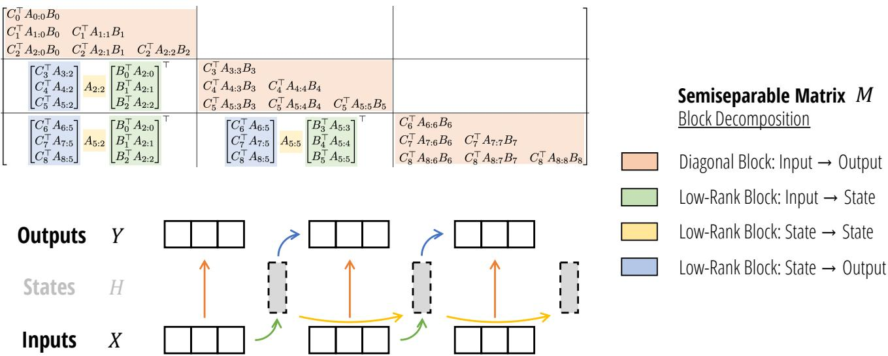  
Figure 5: (SSD Algorithm.) By using the matrix transformation viewpoint of state space models to write them as semise<sub>p</sub>arable matrices (Section 3), we develo<sub>p</sub> a more hardware-eficient com<sub>p</sub>utation of the SSD model throu<sub>g</sub>h a block decom<sub>p</sub>osition matrix multi<sub>p</sub>lication al<sub>g</sub>orithm. The matrix multi<sub>p</sub>lication also has an inter<sub>p</sub>retation as a state s<sub>p</sub>ace <sub>mo</sub>d<sub>e</sub>l<sub>, w</sub>h<sub>ere</sub> bl<sub>oc</sub>k<sub>s represen</sub>t <sub>c</sub>h<sub>un</sub>ki<sub>ng</sub> th<sub>e</sub> i<sub>npu</sub>t <sub>an</sub>d <sub>ou</sub>t<sub>pu</sub>t <sub>sequence.</sub> Di<sub>agona</sub>l bl<sub>oc</sub>k<sub>s represen</sub>t i<sub>n</sub>t<sub>ra-c</sub>h<sub>un</sub>k <sub>compu-</sub> t<sub>a</sub>ti<sub>ons</sub> <sub>an</sub>d th<sub>e</sub> <sub>o</sub>f<sub>-</sub>di<sub>agona</sub>l bl<sub>oc</sub>k<sub>s</sub> <sub>represen</sub>t i<sub>n</sub>t<sub>er-c</sub>h<sub>un</sub>k <sub>compu</sub>t<sub>a</sub>ti<sub>ons,</sub> f<sub>ac</sub>t<sub>ore</sub>d th<sub>roug</sub>h th<sub>e</sub> SSM’<sub>s</sub> hidd<sub>en</sub> <sub>s</sub>t<sub>a</sub>t<sub>e.</sub>

Right Factors. This step computes the multiplication by the right �-block-factors of the low-rank factorization. Note that for each chunk, this is a (N, Q) b<sub>y</sub> (Q, P) matrix multi<sub>p</sub>lication, where N is the state dimension and � is the head dimension. The result is a (N, P) tensor for each chunk, which has the same dimensionalit<sub>y</sub> as the ex<sub>p</sub>anded hidden state ℎ<sub>.</sub>

This can be interpreted as: what is the final state per chunk supposing that the initial state (to the chunk) is 0. In other <sub>wor</sub>d<sub>s</sub> thi<sub>s</sub> <sub>compu</sub>t<sub>es</sub> $h _ { j 0 + \ell - 1 }$ assumin<sub>g</sub> that $x _ { 0 : j \ell } = 0$

Center Factors. This step computes the efect of the center �-block-factors terms in the low-rank factorization. In the <sub>p</sub>revious ste<sub>p</sub>, the final states <sub>p</sub>er chunk have total sha<sub>p</sub>e (T/Q, N, P). This is now multi<sub>p</sub>lied b<sub>y</sub> a 1-SS matrix <sub>g</sub>enerated b<sub>y</sub> $A _ { 2 \mathbb { Q } - 1 : \mathbb { Q } - 1 } ^ { \times } , A _ { 3 \mathbb { Q } - 1 : 2 \mathbb { Q } - 1 } ^ { \times } , \mathscr { \cdot } \mathscr { \cdot } , A _ { \intercal - 1 : \intercal - \mathbb { Q } - 1 } ^ { \times } .$

This ste<sub>p</sub> can be com<sub>p</sub>uted b<sub>y</sub> an<sub>y</sub> al<sub>g</sub>orithm for com<sub>p</sub>utin<sub>g</sub> 1-SS multi<sub>p</sub>lication (also known as the scalar SSM scan or cumprodsum o<sub>p</sub>erator).

This can be interpreted as: what is the actual final state per chunk taking into account all previous inputs; in other words, thi<sub>s compu</sub>t<sub>es</sub> th<sub>e</sub> t<sub>rue</sub> hidd<sub>en s</sub>t<sub>a</sub>t<sub>e</sub> $h _ { j { 0 } }$ t<sub>a</sub>ki<sub>ng</sub> i<sub>n</sub>t<sub>o accoun</sub>t <sub>a</sub>ll <sub>o</sub>f $x _ { 0 : ( j + 1 )  Q }$

Left Factors. This ste com utes the multi lication b the left �-block-factors of the low-rank factorization. For each chunk, this can be represented by a matrix multiplication contract(QN, NP → QP).

This can be interpreted as: what is the output per chunk taking into account the correct initial state $h _ { j 0 - 1 }$ , and supposing the inputs $x _ { j  Q : ( j + 1 ) Q }$ are 0. In other words for chunk �, this computes the correct outputs taking into account only the prior <sup>i</sup>n<sub>p</sub>uts $x _ { 0 : j \ell }$

## 6.3 Computational Cost

We define the notation BMM(B, M, N, K) to define a batched matrix multiplication contract(MK, KN → MN) with batch dimension B. From this notation we can infer three as<sub>p</sub>ects of the eficiency:

• Computation cost: total of �(BMNK) FLOPs.

• Memory cost: total of $O ( \mathsf { B } ( \mathsf { M K } + \mathsf { K N } + \mathsf { M N } ) )$ <sup>s</sup>p<sup>ace.</sup>

```python
Listing 1 Full PyTorch example of the state space dual (SSD) model.

def segsum(x):
    """Naive segment sum calculation. exp(segsum(A)) produces a 1-SS matrix,
    which is equivalent to a scalar SSM."""
    T = x.size(-1)
    x_cumsum = torch.cumsum(x, dim=-1)
    x_segsum = x_cumsum[... , :, None] - x_cumsum[... , None, :]
    mask = torch.tril(torch.ones(T, T, device=x.device, dtype=bool), diagonal=0)
    x_segsum = x_segsum.mask_fill(~mask, -torch.inf)
    return x_segsum

def ssd(X, A, B, C, block_len=64, initial_states=None):
    """
    Arguments:
    X: (batch, length, n_heads, d_head)
    A: (batch, length, n_heads)
    B: (batch, length, n_heads, d_state)
    C: (batch, length, n_heads, d_state)
    Return:
    Y: (batch, length, n_heads, d_head)
    """
    assert X.dtype == A.dtype == B.dtype == C.dtype
    assert X.shape[1] % block_len == 0

# Rearrange into blocks/chunks
X, A, B, C = [rearrange(x, "b (c l) ... -> b c l ...", l=block_len) for x in (X, A, B, C)]

A = rearrange(A, "b c l h -> b h c l")
A_cumsum = torch.cumsum(A, dim=-1)

# 1. Compute the output for each intra-chunk (diagonal blocks)
L = torch.exp(segsum(A))
Y_diag = torch.einsum("bclhn,bcshn,bhcls,bcshp->bclhp", C, B, L, X)

# 2. Compute the state for each intra-chunk
# (right term of low-rank factorization of off-diagonal blocks; B terms)
decay_states = torch.exp((A_cumsum[:, :, :, -1:] - A_cumsum))
states = torch.einsum("bclhn,bhcl,bclhp->bchpn", B, decay_states, X)

# 3. Compute the inter-chunk SSM recurrence; produces correct SSM states at chunk boundaries
# (middle term of factorization of off-diag blocks; A terms)
if initial_states is None:
    initial_states = torch.zeros_like(states[:, :1])
states = torch.cat([initial_states, states], dim=1)
decay_chunk = torch.exp(segsum(F.pad(A_cumsum[:, :, :, -1], (1, 0))))
new_states = torch.einsum("bhzc,bchpn->bzhpn", decay_chunk, states)
states, final_state = new_states[:, :-1], new_states[:, -1]

# 4. Compute state -> output conversion per chunk
# (left term of low-rank factorization of off-diagonal blocks; C terms)
state_decay_out = torch.exp(A_cumsum)
Y_off = torch.einsum('bclhn,bchpn,bhcl->bclhp', C, states, state_decay_out)

# Add output of intra-chunk and inter-chunk terms (diagonal and off-diagonal blocks)
Y = rearrange(Y_diag+Y_off, "b c l h p -> b (c l) h p")
return Y, final_state
```

• Parallelization: larger M, N, K terms can leverage specialized matrix multiplication units on modern accelerators.

Center Blocks. The cost of the quadratic SMA computation consists of three steps (equation (16)):

• Computing the kernel matrix �<sup>⊤</sup>�, which has cost BMM(T/Q, Q, Q, N).

• Multi<sub>p</sub>l<sub>y</sub>in<sub>g</sub> b<sub>y</sub> the mask matrix, which is an elementwise o<sub>p</sub>eration on tensors of sha<sub>p</sub>e (T/Q, Q, Q).

• Multiplying by the � values, which has cost BMM(T/Q, Q, P, N)

Low-Rank Blocks: Right Factors. This step is a single matrix multiplication with cost BMM(T/Q, N, P, Q).

Low-Rank Blocks: Center Factors. This step is a scalar SSM scan (or 1-SS multiplication) of length T/Q on (N, P) inde<sub>p</sub>endent channels. The work of this scan is TNP/Q, which is ne<sub>g</sub>li<sub>g</sub>ible com<sub>p</sub>ared to the other factors.

Note that because ofthe blockin<sub>g</sub> which reduces the len<sub>g</sub>th ofthe se<sub>q</sub>uence from T to T/Q, this scan has Q times smaller cost than a <sub>p</sub>ure SSM scan (e.<sub>g</sub>. the selective scan of Mamba). Thus we observe that on most <sub>p</sub>roblem len<sub>g</sub>ths, other al<sub>g</sub>orithms (A<sub>pp</sub>endix B) ma<sub>y</sub> be more eficient or much easier to im<sub>p</sub>lement without a si<sub>g</sub>nificant slowdown. For exam<sub>p</sub>le, a naive im<sub>p</sub>lementation of this via 1-SS matrix multi<sub>p</sub>lication has cost BMM(1, T/Q, NP, T/Q), which is much easier to im<sub>p</sub>lemen <sub>an</sub>d <sub>can</sub> b<sub>e more e</sub>fi<sub>c</sub>i<sub>en</sub>t th<sub>an a na</sub>i<sub>ve recurrence</sub>/<sub>scan</sub> i<sub>mp</sub>l<sub>emen</sub>t<sub>a</sub>ti<sub>on.</sub>

Low-Rank Blocks: Left Factors. This step is a single matrix multiplication with cost BMM(T/Q, Q, P, N).

Total Cost. If we set ${ \mathsf { N } } = { \mathsf { P } } = { \mathsf { Q } }$ (in other words the state dimension, head dimension, and chunk len<sub>g</sub>th are e<sub>q</sub>ual), then all BMM terms above become BMM(T/N, N, N, N). The computational chacteristics of this are:

• Total FLOP count of �(TN<sup>2</sup>).

• Total memor<sub>y</sub> of �(TN).

• The work consists primarily of matrix multiplications on matrices of shape (N, N).

Notice that the memor<sub>y</sub> consum<sub>p</sub>tion is ti<sub>g</sub>ht<sub>;</sub> the in<sub>p</sub>uts and out<sub>p</sub>uts <sub>�, �</sub> have sha<sub>p</sub>e $( { \sf T } , { \sf P } ) = ( { \sf T } , { \sf N } )$ <sub>.</sub> M<sub>eanw</sub>hil<sub>e</sub> th<sub>e</sub> flo<sub>p</sub> count reflects an extra factor of N, which is cost incurred by the autoregressive state size and is common to all <sub>mo</sub>d<sub>e</sub>l<sub>s.</sub>

A<sub>s</sub>id<sub>e</sub> f<sub>rom</sub> th<sub>e ma</sub>t<sub>mu</sub>l<sub>s,</sub> th<sub>ere</sub> i<sub>s a sca</sub>l<sub>ar</sub> SSM <sub>scan on</sub> ${ \mathsf { N P } } = { \mathsf { N } } ^ { 2 }$ features and se<sub>q</sub>uence len<sub>g</sub>th T/Q. This has cost $O ( \mathsf { T } / \mathsf { Q N } ^ { 2 } )$ FLOPs and �(lo<sub>g</sub>(T/Q)) de<sub>p</sub>th. Althou<sub>g</sub>h it does not use matrix multi<sub>p</sub>lications, it is still <sub>p</sub>arallelizable and the total work done is ne<sub>g</sub>li<sub>g</sub>ible com<sub>p</sub>ared to the other ste<sub>p</sub>s<sub>;</sub> this has a ne<sub>g</sub>li<sub>g</sub>ible cost in our GPU im<sub>p</sub>lementation.

Comparison to Pure SSM and Attention Models. Quadratic attention is also very hardware eficient by only leveraging matrix multi<sub>p</sub>lications, but has T<sup>2</sup>� total FLOPs. Its slower com<sub>p</sub>utation s<sub>p</sub>eed at both training and inference can directl<sub>y</sub> be seen as a conse<sub>q</sub>uence of havin<sub>g</sub> a lar<sub>g</sub>er state size – standard attention has a state size scalin<sub>g</sub> with se<sub>q</sub>uence length T because it caches its history and does not com<sub>p</sub>ress its state.

Lin<sub>ea</sub>r SSM<sub>s</sub> h<sub>ave</sub> ${ \mathsf { T N P } } = { \mathsf { T N } } ^ { 2 }$ t<sub>o</sub>t<sub>a</sub>l FLOP<sub>s, w</sub>hi<sub>c</sub>h i<sub>s</sub> th<sub>e sa</sub>m<sub>e as</sub> SSD<sub>.</sub> H<sub>oweve</sub>r<sub>, a</sub> n<sub>a</sub>i<sub>ve</sub> im<sub>p</sub>l<sub>e</sub>m<sub>e</sub>nt<sub>a</sub>ti<sub>o</sub>n r<sub>equ</sub>ir<sub>es a s</sub>t<sub>a</sub>t<sub>e</sub> ex<sub>p</sub>ansion (15a) that materializes extra memor<sub>y</sub>, and a scalar o<sub>p</sub>eration (15b) that does not levera<sub>g</sub>e matrix multi<sub>p</sub>lications.

<table><tr><td></td><td>Attention</td><td>SSM</td><td>SSD</td></tr><tr><td>State size</td><td>T</td><td>N</td><td>N</td></tr><tr><td>Training FLOPs</td><td> $T^{2}N$ </td><td> $TN^{2}$ </td><td> $TN^{2}$ </td></tr><tr><td>Inference FLOPs</td><td>TN</td><td> $N^{2}$ </td><td> $N^{2}$ </td></tr><tr><td>(Naive) memory</td><td> $T^{2}$ </td><td> $TN^{2}$ </td><td>TN</td></tr><tr><td>Matrix multiplication</td><td>√</td><td></td><td>√</td></tr></table>

We note that man<sub>y</sub> other matrix decom<sub>p</sub>ositions are <sub>p</sub>ossible (for exam<sub>p</sub>le, see A<sub>pp</sub>endix B for a com<sub>p</sub>endium of al<sub>g</sub>orithms for 1-SS multi<sub>p</sub>lication throu<sub>g</sub>h diferent structured matrix decom<sub>p</sub>ositions) which ma<sub>y</sub> lead to more al<sub>g</sub>orithms for SSDs th<sub>a</sub>t <sub>cou</sub>ld b<sub>e</sub> b<sub>e</sub>tt<sub>er</sub> f<sub>or o</sub>th<sub>er spec</sub>i<sub>a</sub>li<sub>ze</sub>d <sub>se</sub>tti<sub>ngs.</sub> E<sub>ven more</sub> b<sub>roa</sub>dl<sub>y, we no</sub>t<sub>e</sub> th<sub>a</sub>t <sub>sem</sub>i<sub>separa</sub>bl<sub>e ma</sub>t<sub>r</sub>i<sub>ces</sub> h<sub>ave a r</sub>i<sub>c</sub>h literature and man<sub>y</sub> more re<sub>p</sub>resentations besides the SSS form that we use (Definition 3.2), and even more eficient <sub>a</sub>l<sub>gor</sub>ith<sub>ms may</sub> b<sub>e poss</sub>ibl<sub>e.</sub>

## 7 The Mamba-2 Architecture

B<sub>y connec</sub>ti<sub>ng</sub> SSM<sub>s an</sub>d <sub>a</sub>tt<sub>en</sub>ti<sub>on,</sub> th<sub>e</sub> SSD f<sub>ramewor</sub>k <sub>a</sub>ll<sub>ows us</sub> t<sub>o</sub> d<sub>eve</sub>l<sub>op a s</sub>h<sub>are</sub>d <sub>voca</sub>b<sub>u</sub>l<sub>ary an</sub>d lib<sub>rary o</sub>f t<sub>ec</sub>h<sub>n</sub>i<sub>ques</sub> for both. In this section we discuss some exam<sub>p</sub>les of understandin<sub>g</sub> and modif<sub>y</sub>in<sub>g</sub> SSD la<sub>y</sub>ers usin<sub>g</sub> ideas ori<sub>g</sub>inall<sub>y</sub> d<sub>eve</sub>l<sub>ope</sub>d f<sub>or</sub> T<sub>rans</sub>f<sub>ormers.</sub> W<sub>e</sub> di<sub>scuss severa</sub>l d<sub>es</sub>i<sub>gn c</sub>h<sub>o</sub>i<sub>ces, resu</sub>lti<sub>ng</sub> i<sub>n</sub> th<sub>e</sub> M<sub>am</sub>b<sub>a-</sub>2 <sub>arc</sub>hit<sub>ec</sub>t<sub>ure.</sub> Th<sub>ese axes o</sub>f <sub>va</sub>ri<sub>a</sub>ti<sub>o</sub>n <sub>a</sub>r<sub>e a</sub>bl<sub>a</sub>t<sub>e</sub>d in S<sub>ec</sub>ti<sub>o</sub>n 9<sub>.</sub>4<sub>.</sub>

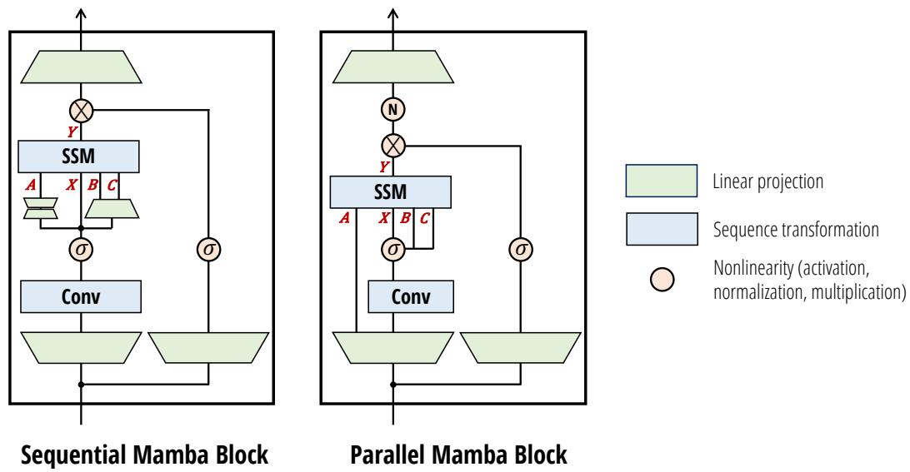  
Figure 6: (Mamba-2 Architecture.) The Mamba-2 block simplifies the Mamba block by removing sequential linear projections; t<sup>h</sup>e SSM parameters �, �, � are pro<sup>d</sup>uce<sup>d</sup> at t<sup>h</sup>e <sup>b</sup>eginning o<sup>f</sup>t<sup>h</sup>e <sup>bl</sup>oc<sup>k</sup> instea<sup>d</sup> o<sup>f</sup>as a <sup>f</sup>unction o<sup>f</sup>t<sup>h</sup>e SSM input �. An additional normalization la<sub>y</sub>er is added as in NormFormer (Shleifer, Weston, and Ott 2021), im<sub>p</sub>rovin<sub>g</sub> stabilit<sub>y</sub>. The � and � <sub>p</sub>rojections onl<sub>y</sub> have a sin<sub>g</sub>le head shared across the � heads, analo<sub>g</sub>ous to multi-value attention (MVA).

## 7.1 Block Design

We first discuss modifications to the neural network block that are inde<sub>p</sub>endent of the inner se<sub>q</sub>uence mixin<sub>g</sub> la<sub>y</sub>er (i.e. outside the core SSD la<sub>y</sub>er).

Parallel Parameter Projections. Mamba-1 was motivated by an SSM-centric point of view where the selective SSM la<sub>y</sub>er is viewed as a ma<sub>p</sub> from � ↦→ �. The SSM <sub>p</sub>arameters �, �, � are viewed as subsidiar<sub>y</sub> and are functions of the SSM input �. Thus the linear projections defining (�, �, �) occur after the initial linear projection to create �.

In Mamba-2, the SSD la<sub>y</sub>er is viewed as a ma<sub>p</sub> from �, �, �, � ↦→ �. It therefore makes sense to <sub>p</sub>roduce �, �, �, � in <sub>p</sub>arallel wit<sup>h</sup> a sing<sup>l</sup>e projection at t<sup>h</sup>e <sup>b</sup>eginning o<sup>f</sup> t<sup>h</sup>e <sup>bl</sup>oc<sup>k</sup>. Note t<sup>h</sup>e ana<sup>l</sup>ogy to stan<sup>d</sup>ar<sup>d</sup> attention arc<sup>h</sup>itectures, w<sup>h</sup>ere �, �, � correspond to the �, �, � projections that are created in parallel.

Note t<sup>h</sup>at a<sup>d</sup>opting para<sup>ll</sup>e<sup>l</sup> projections <sup>f</sup>or t<sup>h</sup>e �, �, �, � inputs to t<sup>h</sup>e SSM s<sup>l</sup>ig<sup>h</sup>t<sup>l</sup>y re<sup>d</sup>uces parameters an<sup>d</sup> more importantl<sub>y</sub> is more amenable to tensor <sub>p</sub>arallelism for lar<sub>g</sub>er models, b<sub>y</sub> usin<sub>g</sub> standard Me<sub>g</sub>atron shardin<sub>g p</sub>atterns (Shoe<sub>y</sub>b et al. 2019)).

Extra Normalization. In preliminary experiments, we found that instabilities were prone to arising in larger models. We were able to alleviate this b<sub>y</sub> addin<sub>g</sub> an extra normalization la<sub>y</sub>er (e.<sub>g</sub>. La<sub>y</sub>erNorm, Grou<sub>p</sub>Norm, or RMSNorm) to the <sup>bl</sup>oc<sup>k</sup> rig<sup>h</sup>t <sup>b</sup>e<sup>f</sup>ore t<sup>h</sup>e <sup>fi</sup>na<sup>l</sup> output projection. T<sup>h</sup>is usage o<sup>f</sup> a norma<sup>l</sup>ization is most <sup>d</sup>irect<sup>l</sup>y re<sup>l</sup>ate<sup>d</sup> to t<sup>h</sup>e NormFormer architecture (Shleifer, Weston, and Ott 2021), which also added normalization la<sub>y</sub>ers at the end of the MLP and MHA bl<sub>oc</sub>k<sub>s.</sub>

W<sub>e a</sub>l<sub>so no</sub>t<sub>e</sub> th<sub>a</sub>t thi<sub>s c</sub>h<sub>ange</sub> i<sub>s s</sub>i<sub>m</sub>il<sub>ar</sub> t<sub>o o</sub>th<sub>er recen</sub>t <sub>mo</sub>d<sub>e</sub>l<sub>s re</sub>l<sub>a</sub>t<sub>e</sub>d t<sub>o</sub> M<sub>am</sub>b<sub>a-</sub>2 th<sub>a</sub>t <sub>were</sub> d<sub>er</sub>i<sub>ve</sub>d f<sub>rom a</sub> li<sub>near a</sub>tt<sub>en</sub>ti<sub>on</sub> view<sub>p</sub>oint. The ori<sub>g</sub>inal linear attention formulation normalizes b<sub>y</sub> a denominator term that emulates the normalization of the softmax function in standard attention. TransNormerLLM (Qin, Don<sub>g</sub> Li, et al. 2023) and RetNet (Y. Sun et al. 2023) fi<sub>n</sub>d th<sub>a</sub>t thi<sub>s norma</sub>li<sub>za</sub>ti<sub>on</sub> i<sub>s uns</sub>t<sub>a</sub>bl<sub>e an</sub>d <sub>a</sub>dd <sub>an ex</sub>t<sub>ra</sub> L<sub>ayer</sub>N<sub>orm or</sub> G<sub>roup</sub>N<sub>orm a</sub>ft<sub>er</sub> th<sub>e</sub> li<sub>near a</sub>tt<sub>en</sub>ti<sub>on</sub> l<sub>ayer.</sub> O<sub>ur</sub> <sub>ex</sub>t<sub>ra norma</sub>li<sub>za</sub>ti<sub>on</sub> l<sub>ayer</sub> dif<sub>ers s</sub>li<sub>g</sub>htl<sub>y</sub> f<sub>rom</sub> th<sub>ese, occur</sub>i<sub>ng a</sub>ft<sub>er</sub> th<sub>e mu</sub>lti<sub>p</sub>li<sub>ca</sub>ti<sub>ve ga</sub>t<sub>e</sub> b<sub>ranc</sub>h i<sub>ns</sub>t<sub>ea</sub>d <sub>o</sub>fb<sub>e</sub>f<sub>ore.</sub>

## 7.2 Multihead Patterns for Sequence Transformations

Recall that SSMs are defined as a se<sub>q</sub>uence transformation (Definition 2.1) where:

• �, �, � <sub>p</sub>arameters have a state dimension N.

<sub>•</sub> Th<sub>ey</sub> d<sub>e</sub>fi<sub>ne</sub> <sub>a</sub> <sub>sequence</sub> t<sub>rans</sub>f<sub>orma</sub>ti<sub>on</sub> $\mathbb { R } ^ { \mathsf { T } } \to \mathbb { R } ^ { \mathsf { T } }$ <sub>,</sub> <sub>w</sub>hi<sub>c</sub>h f<sub>or</sub> <sub>examp</sub>l<sub>e</sub> <sub>can</sub> b<sub>e</sub> <sub>represen</sub>t<sub>e</sub>d <sub>as</sub> <sub>a</sub> <sub>ma</sub>t<sub>r</sub>i<sub>x</sub> $M \in \mathbb { R } ^ { ( \top , \top ) }$

• This transformation o<sub>p</sub>erates over an in<sub>p</sub>ut se<sub>q</sub>uence $X \in \mathbb { R } ^ { ( \mathsf { T } , \mathsf { P } ) }$ , inde<sub>p</sub>endently over the P axis.

One can view this as defining one head of the sequence transformation.

Definition 7.1 (Multihead patterns). A multihead sequence transformation consists of H independent heads, for a total model dimension ofD = d\_model. The parameters may be tied across heads, leading to a head patern.

The state size N and head dimension P are analogous to the �� head dimension and � head dimension ofattention, res<sub>p</sub>ectivel<sub>y</sub>. Just as in modern Transformer architectures (Chowdher<sub>y</sub> et al. 2023; Touvron, Lavril, et al. 2023), in Mamba-2 we generally choose these to be constants around 64 or 128; when the model dimension D increases, we increase the number of heads while kee<sub>p</sub>ing the head dimensions N and P fixed. In order to describe how to do this, we can transfer and generalize ideas from multihead attention to define similar <sub>p</sub>atterns for SSMs<sub>,</sub> or an<sub>y g</sub>eneral se<sub>q</sub>uence transformation.

<table><tr><td colspan="2">Multi-head SSM(Multi-head Attn.)</td><td colspan="2">Multi-contract SSM(Multi-query Attn.)</td><td colspan="2">Multi-expand SSM(Multi-key Attn.)</td><td colspan="2">Multi-input SSM(Multi-value Attn.)</td></tr><tr><td>X</td><td>(T,H,P)</td><td>(X</td><td>(T,1,P)</td><td>(X</td><td>(T,1,P)</td><td>(X</td><td>(T,H,P)</td></tr><tr><td>A</td><td>(T,H)</td><td>A</td><td>(T,H)</td><td>A</td><td>(T,H)</td><td>A</td><td>(T,H)</td></tr><tr><td>B</td><td>(T,H,N)</td><td>B</td><td>(T,1,N)</td><td>B</td><td>(T,H,N)</td><td>B</td><td>(T,1,N)</td></tr><tr><td>C</td><td>(T,H,N)</td><td>C</td><td>(T,H,N)</td><td>C</td><td>(T,1,N)</td><td>C</td><td>(T,1,N)</td></tr></table>

Multihead SSM (MHS) / Multihead Attention (MHA) Pattern. The classic MHA pattern assumes that the head dimension P divides the model dimension D. The number ofheads is defined as H = D/P. Then, H co<sub>p</sub>ies ofthe core se<sub>q</sub>uence transformation are created by creating H inde<sub>p</sub>endent co<sub>p</sub>ies of each <sub>p</sub>arameter. Note that while the MHA <sub>p</sub>attern was first described for the attention se<sub>q</sub>uence transformation<sub>,</sub> it can be a<sub>pp</sub>lied to an<sub>y</sub>thin<sub>g</sub> com<sub>p</sub>atible with Definition 2.1. For exam<sub>p</sub>le, a multi-head SSD la<sub>y</sub>er would acce<sub>p</sub>t in<sub>p</sub>uts with sha<sub>p</sub>es accordin<sub>g</sub> to e<sub>q</sub>uation (17) where the SSD al<sub>g</sub>orithm is broadcasted over the H = n\_heads dimension.

Multi-contract SSM (MCS) / Multi-query Attention (MQA) Pattern. Multi-query attention (Shazeer 2019) is a clever o<sub>p</sub>timization for attention that can dramaticall<sub>y</sub> im<sub>p</sub>rove the s<sub>p</sub>eed of autore<sub>g</sub>ressive inference<sub>,</sub> which relies on cachin<sub>g</sub> the � and � tensors. This techni<sub>q</sub>ue sim<sub>p</sub>l<sub>y</sub> avoids <sub>g</sub>ivin<sub>g</sub> � and � the extra head dimension<sub>,</sub> or in other words broadcasts a sin<sub>g</sub>le head of (�, �) across all the heads of �.

Usin<sub>g</sub> the state s<sub>p</sub>ace dualit<sub>y</sub>, we can define an e<sub>q</sub>uivalent SSM version of MQA as e<sub>q</sub>uation (18). Here, � and � (the SSM analogs of attention’s � and �) are shared across the H heads. We also call this the multi-contract SSM (MCS) head pattern, beca<sub>u</sub>se the � <sub>p</sub>arameter which controls the SSM state contraction has inde<sub>p</sub>endent co<sub>p</sub>ies <sub>p</sub>er head.

We can similarly define a multi-key attention (MKA) or multi-expand SSM (MES) head pattern, where � (which controls the SSM ex<sub>p</sub>ansion) is inde<sub>p</sub>endent <sub>p</sub>er head while � and � are shared across heads.

Multi-input SSM (MIS) / Multi-value Attention (MVA) Pattern. While MQA makes sense for attention because of it<sub>s</sub> KV <sub>cac</sub>h<sub>e,</sub> it i<sub>s</sub> n<sub>o</sub>t th<sub>e</sub> n<sub>a</sub>t<sub>u</sub>r<sub>a</sub>l <sub>c</sub>h<sub>o</sub>i<sub>ce</sub> f<sub>o</sub>r SSM<sub>s.</sub> In M<sub>a</sub>mb<sub>a,</sub> in<sub>s</sub>t<sub>ea</sub>d<sub>,</sub> � i<sub>s v</sub>i<sub>ewe</sub>d <sub>as</sub> th<sub>e</sub> m<sub>a</sub>in in<sub>pu</sub>t t<sub>o</sub> th<sub>e</sub> SSM<sub>, a</sub>nd therefore � and � are <sub>p</sub>arameters that are shared across the in<sub>p</sub>ut channels. We define a new multi-value attention (MVA) of multi-input SSM (MIS) pattern in equation (20), which can again be applied to any sequence transformation such as SSD<sub>.</sub>

Armed with this vocab<sub>u</sub>lar<sub>y,</sub> we can characterize the ori<sub>g</sub>inal Mamba architect<sub>u</sub>re more <sub>p</sub>recisel<sub>y</sub>.

Proposition 7.2. The selective SSM (S6) layer of the Mamba architecture (Gu and Dao 2023) can be viewed as having

• Head dimension $P = 1 :$ every channel has independent SSM dynamics �.

• Multi-input SSM (MIS) or multi-value attention (MVA) head structure: the �, � matrices (corresponding to $K , Q$ in the attention duality) are shared across all channels ofthe input � (corresponding to � in attention).

We can also ablate these head <sub>p</sub>attern variants when a<sub>pp</sub>lied to SSD (Section 9.4.3). Interestin<sub>g</sub>l<sub>y</sub>, des<sub>p</sub>ite bein<sub>g</sub> controlled in <sub>p</sub>arameter counts and total state dimension<sub>,</sub> there is a noticeable diference in downstream <sub>p</sub>erformance. We em<sub>p</sub>iricall<sub>y</sub> fi<sub>n</sub>d th<sub>a</sub>t th<sub>e</sub> MVA <sub>pa</sub>tt<sub>ern as or</sub>i<sub>g</sub>i<sub>na</sub>ll<sub>y use</sub>d i<sub>n</sub> M<sub>am</sub>b<sub>a per</sub>f<sub>orms</sub> b<sub>es</sub>t<sub>.</sub>

Grouped Head Patterns. The ideas of multi-query attention can be extended to grouped-query attention (Ainslie et al. 2023): instead of 1 K and V head, one can create G inde<sub>p</sub>endent K and V heads, where $1 \ < \ 6$ and G divides H. This i<sub>s mo</sub>ti<sub>va</sub>t<sub>e</sub>d b<sub>o</sub>th b<sub>y</sub> b<sub>r</sub>id<sub>g</sub>i<sub>ng</sub> th<sub>e per</sub>f<sub>ormance</sub> dif<sub>erence</sub> b<sub>e</sub>t<sub>ween mu</sub>lti<sub>-query an</sub>d <sub>mu</sub>lti<sub>-</sub>h<sub>ea</sub>d <sub>a</sub>tt<sub>en</sub>ti<sub>on, an</sub>d <sub>ena</sub>bli<sub>ng</sub> more eficient tensor <sub>p</sub>arallelism b<sub>y</sub> settin<sub>g</sub> G to be a multi<sub>p</sub>le of the number of shards (Section 8).

Similarly, the multi-input SSM head pattern used in Mamba-2 can be easily extended to grouped-input SSM (GIS), or synonymously grouped-value attention (GVA). The generalization is straightforward and we omit the details for sim<sub>p</sub>licit<sub>y</sub>.

## 7.3 Other SSD Extensions from Linear Attention

W<sub>e</sub> d<sub>escr</sub>ib<sub>e</sub> h<sub>ere an exam</sub> l<sub>e o</sub>f <sub>arc</sub>hit<sub>ec</sub>t<sub>ura</sub>l <sub>mo</sub>difi<sub>ca</sub>ti<sub>ons</sub> t<sub>o</sub> SSD <sub>mo</sub>ti<sub>va</sub>t<sub>e</sub>d b li<sub>near a</sub>tt<sub>en</sub>ti<sub>on.</sub> W<sub>e a</sub>bl<sub>a</sub>t<sub>e</sub> th<sub>ese</sub> i<sub>n</sub> Section 9.4.3 as a form of ne<sub>g</sub>ative result<sub>,</sub> findin<sub>g</sub> that the<sub>y</sub> do not si<sub>g</sub>nificantl<sub>y</sub> im<sub>p</sub>rove <sub>p</sub>erformance enou<sub>g</sub>h to ado<sub>p</sub>t th<sub>em as</sub> d<sub>e</sub>f<sub>au</sub>lt <sub>se</sub>tti<sub>ngs.</sub> N<sub>one</sub>th<sub>e</sub>l<sub>ess,</sub> th<sub>ese</sub> ill<sub>us</sub>t<sub>ra</sub>t<sub>e</sub> h<sub>ow</sub> th<sub>e vas</sub>t lit<sub>era</sub>t<sub>ure on a</sub>tt<sub>en</sub>ti<sub>on can</sub> b<sub>e</sub> i<sub>ncorpora</sub>t<sub>e</sub>d t<sub>o</sub> d<sub>e</sub>fi<sub>ne</sub> variants of SSD. We treat the choice of kernel feat<sub>u</sub>re ma<sub>p</sub> as a h<sub>yp</sub>er<sub>p</sub>arameter in the Mamba-2 architect<sub>u</sub>re<sub>,</sub> and ex<sub>p</sub>ect <sub>o</sub>th<sub>er</sub> <sub>s</sub>i<sub>mp</sub>l<sub>e</sub> <sub>mo</sub>difi<sub>ca</sub>ti<sub>ons</sub> i<sub>nsp</sub>i<sub>re</sub>d b<sub>y</sub> <sub>a</sub>tt<sub>en</sub>ti<sub>on</sub> t<sub>o</sub> b<sub>e</sub> <sub>poss</sub>ibl<sub>e</sub> <sub>as</sub> <sub>we</sub>ll<sub>.</sub>

Kernel Attention Approximations to Softmax Attention. Man variants of linear attention or kernel attention are motivated by viewing the attention scores softmax $( Q K ^ { \top } )$ <sub>as compose</sub>d <sub>o</sub>f

1<sub>.</sub> A<sub>n</sub> <sub>exponen</sub>ti<sub>a</sub>l k<sub>erne</sub>l $Z = \exp ( Q K ^ { \top } )$ <sub>,</sub> <sub>w</sub>hi<sub>c</sub>h <sub>can</sub> b<sub>e</sub> <sub>approx</sub>i<sub>ma</sub>t<sub>e</sub>d b<sub>y</sub> $Z = \psi ( Q ) \psi ( K ) ^ { \intercal }$ f<sub>or some</sub> k<sub>erne</sub>l f<sub>ea</sub>t<sub>ure</sub> <sup>ma</sup>p<sup>.</sup>

2<sub>.</sub> N<sub>orma</sub>li<sub>z</sub>i<sub>ng</sub> th<sub>e</sub> k<sub>erne</sub>l <sub>so</sub> th<sub>a</sub>t <sub>rows sum</sub> t<sub>o</sub> 1 <sub>v</sub>i<sub>a</sub> $M = G / G 1 1 ^ { \top }$ , where the division happens elementwise and 1 is th<sub>e a</sub>ll 1’<sub>s vec</sub>t<sub>or.</sub>

Exponential Kernel Feature Maps. In Mamba-2, we incorporate a flexible kernel feature map, and apply it to the � and � branches (corres<sub>p</sub>ondin<sub>g</sub> to the � and � branches in attention). The feature ma<sub>p</sub> can also be o<sub>p</sub>tionall<sub>y</sub> a<sub>pp</sub>lied to the � (�) branch, for sim<sub>p</sub>licit<sub>y</sub> and s<sub>y</sub>mmetr<sub>y</sub>. This is re<sub>p</sub>resented in Fi<sub>g</sub>ure 6 b<sub>y</sub> an arbitrar<sub>y</sub> nonlinearit<sub>y</sub>. B<sub>y</sub> default, we simply choose � to be an elementwise Swish / SiLU function (Hendrycks and Gimpel 2016; Ramachandran, Zoph, and Le 2017). We ex<sub>p</sub>lore other o<sub>p</sub>tions in the ablations in Section 9.4.3, includin<sub>g</sub> feature ma<sub>p</sub>s used b<sub>y</sub> Linear Attention, Performer, Random Feature Attention, and cosFormer (Section 4.1.3).

Incorporating a Normalization (Denominator) Term. To find the denominator term, we simply have to compute �1. But recall that the final out<sub>p</sub>ut of the model is just � = �� (e<sub>q</sub>uation (16)). So the normalization terms can be found sim<sub>p</sub>l<sub>y</sub> b<sub>y</sub> au<sub>g</sub>mentin<sub>g</sub> � with an extra column 1, resultin<sub>g</sub> in a tensor of sha<sub>p</sub>e (T, P + 1).

N<sub>o</sub>t<sub>e</sub> th<sub>a</sub>t i<sub>n</sub> thi<sub>s</sub> <sub>case,</sub> th<sub>e</sub> k<sub>erne</sub>l f<sub>ea</sub>t<sub>ure</sub> <sub>map</sub> $\psi$ m<sub>u</sub>st be <sub>p</sub>ositi<sub>v</sub>e so that the s<sub>u</sub>m is <sub>p</sub>ositi<sub>v</sub>e.

## 8 Systems Optimization for SSMs

We describe several s<sub>y</sub>stems o<sub>p</sub>timizations for SSMs<sub>,</sub> in <sub>p</sub>articular the Mamba-2 architecture<sub>,</sub> for lar<sub>g</sub>e-scale eficient t<sub>ra</sub>i<sub>n</sub>i<sub>ng an</sub>d i<sub>n</sub>f<sub>erence.</sub> I<sub>n par</sub>ti<sub>cu</sub>l<sub>ar, we</sub> f<sub>ocus on</sub> t<sub>ensor para</sub>ll<sub>e</sub>l <sub>an</sub>d <sub>sequence para</sub>ll<sub>e</sub>l f<sub>or</sub> l<sub>arge-sca</sub>l<sub>e</sub> t<sub>ra</sub>i<sub>n</sub>i<sub>ng, as a we</sub>ll <sub>var</sub>i<sub>a</sub>bl<sub>e-</sub>l<sub>eng</sub>th <sub>sequences</sub> f<sub>or e</sub>fi<sub>c</sub>i<sub>en</sub>t fi<sub>ne</sub>t<sub>un</sub>i<sub>ng an</sub>d i<sub>n</sub>f<sub>erence</sub>

## 8.1 Tensor Parallel

Tensor <sub>p</sub>arallelism (TP) (Shoe<sub>y</sub>bi et al. 2019) is a model <sub>p</sub>arallelism techni<sub>q</sub>ue that s<sub>p</sub>lits each la<sub>y</sub>er $( \mathbf { e . g . }$ , attention, MLP) to run on multi<sub>p</sub>le accelerators such as GPUs. This techni<sub>q</sub>ue is widel<sub>y</sub> used to train most lar<sub>g</sub>e models (Brown et al. 2020; Chowdher<sub>y</sub> et al. 2023; Touvron, Lavril, et al. 2023; Touvron, L. Martin, et al. 2023) on GPU clusters where each node t<sub>yp</sub>icall<sub>y</sub> has 4-8 GPUs <sub>w</sub>ith fast net<sub>w</sub>orkin<sub>g</sub> s<sub>u</sub>ch as NVLink. TP <sub>w</sub>as ori<sub>g</sub>inall<sub>y</sub> de<sub>v</sub>elo<sub>p</sub>ed for the Transformer <sub>arc</sub>hit<sub>ec</sub>t<sub>ure, an</sub>d it i<sub>s no</sub>t <sub>s</sub>t<sub>ra</sub>i<sub>g</sub>ht<sub>-</sub>f<sub>orwar</sub>d t<sub>o a</sub>d<sub>ap</sub>t it <sub>o</sub>th<sub>er arc</sub>hit<sub>ec</sub>t<sub>ure.</sub> W<sub>e</sub> fi<sub>rs</sub>t <sub>s</sub>h<sub>ow</sub> th<sub>e c</sub>h<sub>a</sub>ll<sub>enge o</sub>f <sub>us</sub>i<sub>ng</sub> TP <sub>w</sub>ith th<sub>e</sub> M<sub>am</sub>b<sub>a arc</sub>hit<sub>ec</sub>t<sub>ure, an</sub>d th<sub>e s</sub>h<sub>ow</sub> h<sub>ow</sub> th<sub>e</sub> M<sub>am</sub>b<sub>a-</sub>2 <sub>arc</sub>hit<sub>ec</sub>t<sub>ure</sub> i<sub>s</sub> d<sub>es</sub>i<sub>gne</sub>d t<sub>o ma</sub>k<sub>e</sub> TP <sub>e</sub>fi<sub>c</sub>i<sub>en</sub>t<sub>.</sub>

Recall the Mamba architecture<sub>,</sub> with a sin<sub>g</sub>le in<sub>p</sub>ut $u ~ \in ~ \mathbb { R } ^ { L \times d }$ (no batchin<sub>g</sub> for sim<sub>p</sub>licit<sub>y</sub>), in<sub>p</sub>ut <sub>p</sub>rojection matrices $W ^ { ( x ) } , W ^ { ( z ) } \in \mathbb { R } ^ { d \times e d }$ where � is the ex<sub>p</sub>ansion factor (t<sub>yp</sub>icall<sub>y</sub> 2), and out<sub>p</sub>ut <sub>p</sub>rojection matrix $\bar { W ^ { ( o ) } } \bar { \in } \bar { \mathbb { R } ^ { e d \times d } }$ :

$$
\begin{array}{l} x = u W ^ {(x) ^ {\top}} \in \mathbb {R} ^ {L \times e d} \\ z = u W ^ {(z) ^ {\top}} \in \mathbb {R} ^ {L \times e d} \\ x _ {c} = \operatorname{conv1d} (x) \in \mathbb {R} ^ {L \times e d} \quad (\text {depthwise, independent along } d) \\ \Delta , B, C = \text {low - rank projection} (x _ {c}) \\ y = S S M _ {A, B, C, \Delta} (x _ {c}) \in \mathbb {R} ^ {L \times e d} \quad (\text {independent along } d) \\ y _ {g} = y \cdot \phi (z) \quad (\text {gating, e.g., with} \phi \text {being SiLU}) \\ \text {out} = y _ {g} W ^ {(o) ^ {\top}} \in \mathbb {R} ^ {L \times d}. \end{array}
$$

Wit<sup>h</sup> TP, suppose t<sup>h</sup>at we want to sp<sup>l</sup>it t<sup>h</sup>e computation a<sup>l</sup>ong 2 GPUs. It is easy to sp<sup>l</sup>it t<sup>h</sup>e input projection matrices $W ^ { ( x ) }$ <sub>an</sub>d $\bar { W } ^ { ( \bar { z } ) }$ int<sub>o</sub> t<sub>wo pa</sub>rtiti<sub>o</sub>n<sub>s eac</sub>h <sub>o</sub>f <sub>s</sub>iz<sub>e</sub> $\bar { d } \times \frac { e d } { 2 }$ <sub>.</sub> Th<sub>en eac</sub>h GPU <sub>wou</sub>ld h<sub>o</sub>ld h<sub>a</sub>lf <sub>o</sub>f $x _ { c }$ <sub>o</sub>f <sub>s</sub>i<sub>ze</sub> $\begin{array} { r } { L \times \frac { e d } { 2 } } \end{array}$ . However, <sub>we see</sub> th<sub>a</sub>t <sub>s</sub>i<sub>nce</sub> $\Delta , B , C$ <sub>are</sub> f<sub>unc</sub>ti<sub>ons are</sub> $x _ { c } ,$ <sub>so we wou</sub>ld <sub>nee</sub>d <sub>an ex</sub>t<sub>ra a</sub>ll<sub>-re</sub>d<sub>uce</sub> b<sub>e</sub>t<sub>ween</sub> th<sub>e</sub> GPU<sub>s</sub> t<sub>o ge</sub>t th<sub>e w</sub>h<sub>o</sub>l<sub>e</sub> <sub>o</sub>f $x _ { c }$ before com<sub>p</sub>utin<sub>g</sub> $\Delta , B , C .$ After that the t<sub>w</sub>o GPUs can com<sub>pu</sub>te the SSM in <sub>p</sub>arallel since the<sub>y</sub> are inde<sub>p</sub>endent a<sup>l</sup>ong <sup>�</sup>. At t<sup>h</sup>e en<sup>d</sup>, we can sp<sup>l</sup>it t<sup>h</sup>e output projection matrices $W ^ { \overline { { ( o ) } } }$ int<sub>o</sub> t<sub>wo pa</sub>rtiti<sub>o</sub>n<sub>s eac</sub>h <sub>o</sub>f <sub>s</sub>iz<sub>e</sub> $\begin{array} { r } { \frac { e d } { 2 } \times d , } \end{array}$ <sub>an</sub>d d<sub>o an</sub> <sub>a</sub>ll<sub>-re</sub>d<sub>uce a</sub>t th<sub>e en</sub>d<sub>.</sub> C<sub>ompare</sub>d t<sub>o</sub> T<sub>rans</sub>f<sub>ormers, we wou</sub>ld i<sub>ncur</sub> t<sub>wo a</sub>ll<sub>-re</sub>d<sub>uces</sub> i<sub>ns</sub>t<sub>ea</sub>d <sub>o</sub>f <sub>one,</sub> d<sub>ou</sub>bli<sub>ng</sub> th<sub>e</sub> ti<sub>me spen</sub>t in communication. For lar<sub>g</sub>e-scale Transformers trainin<sub>g,</sub> communication mi<sub>g</sub>ht alread<sub>y</sub> take a si<sub>g</sub>nificant fraction of time (e.<sub>g</sub>. 10-20%), and doublin<sub>g</sub> communication would make Mamba not as eficient for lar<sub>g</sub>e-scale trainin<sub>g</sub>.

With M<sub>am</sub>b<sub>a-</sub>2<sub>, our goa</sub>l i<sub>s</sub> t<sub>o</sub> h<sub>ave on</sub>l<sub>y one a</sub>ll<sub>-re</sub>d<sub>uce per</sub> bl<sub>oc</sub>k<sub>, s</sub>i<sub>m</sub>il<sub>ar</sub> t<sub>o a</sub>tt<sub>en</sub>ti<sub>on or</sub> MLP bl<sub>oc</sub>k<sub>s</sub> i<sub>n</sub> T<sub>rans</sub>f<sub>ormers.</sub> As a resu<sup>l</sup>t, we <sup>h</sup>ave t<sup>h</sup>e projection to get $\Delta , B , C$ di<sub>rec</sub>tl<sub>y</sub> f<sub>rom �</sub> i<sub>ns</sub>t<sub>ea</sub>d <sub>o</sub>f f<sub>rom</sub> $x _ { c } .$ , a<sup>ll</sup>owing us to sp<sup>l</sup>it t<sup>h</sup>ese projection <sub>ma</sub>t<sub>r</sub>i<sub>ces.</sub> Thi<sub>s</sub> i<sub>mp</sub>li<sub>es</sub> th<sub>a</sub>t <sub>we</sub> h<sub>ave</sub> dif<sub>eren</sub>t <sub>se</sub>t<sub>s</sub> <sub>o</sub>f $\Delta , B , C$ on diferent GPUs<sub>,</sub> which is e<sub>qu</sub>ivalent to havin<sub>g</sub> several “<sub>groups</sub>” <sub>o</sub>f $\Delta , B , C$ <sub>on</sub> <sub>a</sub> l<sub>arger</sub> “l<sub>og</sub>i<sub>ca</sub>l GPU”<sub>.</sub> M<sub>oreover,</sub> <sub>we</sub> <sub>use</sub> G<sub>roup</sub>N<sub>orm</sub> <sub>w</sub>ithi<sub>n</sub> <sub>eac</sub>h bl<sub>oc</sub>k<sub>,</sub> <sub>w</sub>ith <sub>num</sub>b<sub>er</sub> <sub>o</sub>f <sub>groups</sub> divisible b<sub>y</sub> the TP de<sub>g</sub>ree<sub>,</sub> so that the GPUs in a TP <sub>g</sub>rou<sub>p</sub> do not have a communicate within the block:

$$
\begin{array}{r l} & x = u W ^ {(x) ^ {\top}} \in \mathbb {R} ^ {L \times e d} \\ & z = u W ^ {(z) ^ {\top}} \in \mathbb {R} ^ {L \times e d} \\ \Delta , B, C = \text {projection} (u) \quad \text {(one or more groups of} \Delta , B, C \text {per GPU)} \\ & x _ {c} = \text {conv1d} (x) \in \mathbb {R} ^ {L \times e d} \quad \text {(depthwise, independent along} d) \\ & y = S S M _ {A, B, C, \Delta} (x _ {c}) \in \mathbb {R} ^ {L \times e d} \quad \text {(independent along} d) \\ & y _ {g} = y \cdot \phi (z) \quad \text {(gating, e.g., with} \phi \text {being SiLU)} \\ & y _ {n} = \text {groupnorm} (y _ {g}) \quad \text {(number of groups divisible by degree of tensor parallel)} \\ & \text {out} = y _ {g} W ^ {(o) ^ {\top}} \in \mathbb {R} ^ {L \times d}. \end{array}
$$

We see t<sup>h</sup>at we on<sup>l</sup> nee<sup>d</sup> to s <sup>l</sup>it t<sup>h</sup>e in ut rojection matrices, an<sup>d</sup> t<sup>h</sup>e out ut rojection matrices, an<sup>d</sup> on<sup>l</sup> nee<sup>d</sup> to <sup>d</sup>o <sub>a</sub>ll<sub>-re</sub>d<sub>uce a</sub>t th<sub>e en</sub>d <sub>o</sub>f th<sub>e</sub> bl<sub>oc</sub>k<sub>.</sub> Thi<sub>s</sub> i<sub>s s</sub>i<sub>m</sub>il<sub>ar</sub> t<sub>o</sub> th<sub>e</sub> d<sub>es</sub>i<sub>gn o</sub>f TP f<sub>or a</sub>tt<sub>en</sub>ti<sub>on an</sub>d MLP l<sub>ayers.</sub> I<sub>n par</sub>ti<sub>cu</sub>l<sub>ar,</sub> if <sub>we</sub> h<sub>ave</sub> TP d<sub>egree</sub> 2<sub>, we wou</sub>ld <sub>sp</sub>lit $W ^ { ( x ) } = [ W _ { 1 } ^ { ( x ) } , W _ { 2 } ^ { ( x ) } ]$ <sub>w</sub>ith $\overset { \vartriangle } { W _ { i } ^ { ( x ) } } \in \mathbb { R } ^ { d \times e d / 2 } , W ^ { ( z ) } = [ W _ { 1 } ^ { ( z ) } , W _ { 2 } ^ { ( \overset { \cdot } { z } ) } ]$ <sub>w</sub>ith $W _ { i } ^ { ( z ) } \in \mathbb { R } ^ { d \times e d / 2 }$ <sub>an</sub>d $W ^ { ( o ) } = \left[ \begin{array} { l } { W _ { 1 } ^ { ( o ) } } \\ { W _ { 2 } ^ { ( o ) } } \end{array} \right]$ <sub>w</sub>ith $W _ { i } ^ { ( o ) } \in \mathbb { R } ^ { e d / 2 \times d }$ <sub>.</sub> F<sub>o</sub>r $i = 1 , 2 ,$ <sub>,</sub> th<sub>e</sub> TP M<sub>a</sub>mb<sub>a</sub>-2 l<sub>aye</sub>r <sub>ca</sub>n b<sub>e</sub> <sub>w</sub>ritt<sub>e</sub>n <sub>as</sub>:

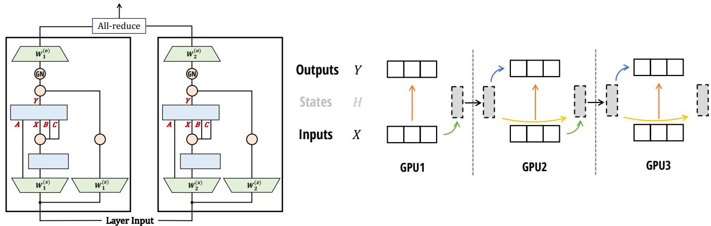  
Figure 7: (Parallelism with the Mamba-2 Block.) (Left: Tensor Parallelism) We split the input projection matrices $W ^ { ( x ) } , W ^ { ( z ) }$ an<sup>d</sup> t<sup>h</sup>e output projection matrix $W ^ { ( o ) }$ <sub>.</sub> E<sub>ac</sub>h SSM h<sub>ea</sub>d $( A , B , C , X ) \mapsto Y$ lives on a sin<sub>g</sub>le device. Choosin<sub>g</sub> GroupNorm <sup>f</sup>or t<sup>h</sup>e <sup>fi</sup>na<sup>l</sup> norma<sup>l</sup>ization <sup>l</sup>ayer avoi<sup>d</sup>s extra communication. We nee<sup>d</sup> one a<sup>ll</sup>-re<sup>d</sup>uce per <sup>l</sup>ayer, just <sup>l</sup>i<sup>k</sup>e t<sup>h</sup>e MLP or attention blocks in a Transformer. (Right: Sequence/Context Parallelism) Analogous to the SSD algorithm, with multi<sub>p</sub>le devices<sub>,</sub> we can s<sub>p</sub>lit alon<sub>g</sub> the se<sub>q</sub>uence dimension. Each device com<sub>p</sub>utes the state of its se<sub>q</sub>uence<sub>,</sub> then <sub>pass</sub> th<sub>a</sub>t <sub>s</sub>t<sub>a</sub>t<sub>e</sub> t<sub>o</sub> th<sub>e</sub> n<sub>e</sub>xt GPU<sub>.</sub>

$$
x ^ {(i)} = u W _ {i} ^ {(x) ^ {\top}} \in \mathbb {R} ^ {L \times e d / 2}
$$

$$
\boldsymbol {z} ^ {(i)} = \boldsymbol {u} W _ {i} ^ {(z) ^ {\top}} \in \mathbb {R} ^ {L \times e d / 2}
$$

Δ<sup>(�)</sup>, � <sup>(�)</sup>, �<sup>(�)</sup> = <sub>p</sub>rojection(�) (one or more <sub>g</sub>rou<sub>p</sub>s of Δ, �, � <sub>p</sub>er GPU)

$$
x _ {c} ^ {(i)} = \mathrm{conv1d} (x ^ {(i)}) \in \mathbb {R} ^ {L \times e d / 2}
$$

$$
y ^ {(i)} = S S M _ {A, B, C, \Delta} (x _ {c} ^ {(i)}) \in \mathbb {R} ^ {L \times e d / 2}
$$

$$
y _ {g} ^ {(i)} = y ^ {(i)} \cdot \phi (z ^ {(i)})
$$

<sub>�</sub> (� ) = <sub>g</sub>rou<sub>p</sub>norm(<sub>�</sub><sup>(�)</sup><sub>�</sub> ) (number of <sub>g</sub>rou<sub>p</sub>s divisible b<sub>y</sub> de<sub>g</sub>ree of tensor <sub>p</sub>arallel)

$$
\mathsf {o u t} ^ {(i)} = y _ {g} ^ {(i)} W _ {i} ^ {(o) ^ {\top}} \in \mathbb {R} ^ {L \times d / 2}
$$

$\mathrm { o u t } = \sum _ { i } \mathrm { o u t } ^ { ( i ) }$ . (summin<sub>g</sub> out<sub>p</sub>uts from all GPUs with an all-reduce)

We illustrate tensor <sub>p</sub>arallel with Mamba-2 in Fi<sub>g</sub>ure $7 \ ( L e f t )$

## 8.2 Sequence Parallelism

For ver<sub>y</sub> lon<sub>g</sub> se<sub>q</sub>uences<sub>,</sub> we mi<sub>g</sub>ht need to s<sub>p</sub>lit the in<sub>p</sub>ut and activation to diferent GPUs alon<sub>g</sub> the se<sub>q</sub>uence len<sub>g</sub>th di<sub>mens</sub>i<sub>on.</sub> Th<sub>ere are</sub> t<sub>wo ma</sub>i<sub>n</sub> t<sub>ec</sub>h<sub>n</sub>i <sub>ues:</sub>

1. Se<sub>q</sub>uence <sub>p</sub>arallelism (SP) for the residual and normalization o<sub>p</sub>erations: first <sub>p</sub>ro<sub>p</sub>osed b<sub>y</sub> Korthikanti et al. (2023), thi<sub>s</sub> t<sub>ec</sub>h<sub>n</sub>i<sub>que</sub> d<sub>ecomposes</sub> th<sub>e a</sub>ll<sub>-re</sub>d<sub>uce</sub> i<sub>n</sub> TP <sub>as re</sub>d<sub>uce-sca</sub>tt<sub>er an</sub>d <sub>a</sub>ll<sub>-ga</sub>th<sub>er.</sub> N<sub>o</sub>ti<sub>c</sub>i<sub>ng</sub> th<sub>a</sub>t th<sub>e res</sub>id<sub>ua</sub>l <sub>an</sub>d normalization o<sub>p</sub>erations are re<sub>p</sub>eated on the same in<sub>pu</sub>t for all GPUs in the same TP <sub>g</sub>ro<sub>up,</sub> SP s<sub>p</sub>lits the acti<sub>v</sub>ations <sub>a</sub>l<sub>ong</sub> th<sub>e sequence</sub> l<sub>eng</sub>th di<sub>mens</sub>i<sub>on</sub> b<sub>y per</sub>f<sub>orm</sub>i<sub>ng: re</sub>d<sub>uce-sca</sub>tt<sub>er, res</sub>id<sub>ua</sub>l <sub>an</sub>d <sub>norma</sub>li<sub>za</sub>ti<sub>on,</sub> th<sub>en a</sub>ll<sub>-ga</sub>th<sub>er.</sub>

Since the Mamba-2 architect<sub>u</sub>re <sub>u</sub>ses the same resid<sub>u</sub>al and normalization str<sub>u</sub>ct<sub>u</sub>re<sub>,</sub> SP a<sub>pp</sub>lies <sub>w</sub>itho<sub>u</sub>t modification.

2. Se<sub>q</sub>uence <sub>p</sub>arallelism for the token-mixin<sub>g</sub> o<sub>p</sub>erations (attention or SSM), also known as “context <sub>p</sub>arallelism” (CP). Several techni<sub>q</sub>ues have been develo<sub>p</sub>ed for attention la<sub>y</sub>er (e.<sub>g</sub>., Rin<sub>g</sub> attention (Liu, Yan, et al. 2024; Liu, Zaharia, and Abbeel 2023)), with so<sub>p</sub>histicated load-balancin<sub>g</sub> techni<sub>q</sub>ue (Brandon et al. 2023). The dificult<sub>y</sub> with se<sub>q</sub>uence <sub>para</sub>ll<sub>e</sub>li<sub>sm</sub> i<sub>n a</sub>tt<sub>en</sub>ti<sub>on</sub> i<sub>s</sub> th<sub>a</sub>t <sub>we can sp</sub>lit <sub>quer</sub>i<sub>es an</sub>d k<sub>eys</sub> i<sub>n</sub>t<sub>o</sub> bl<sub>oc</sub>k<sub>,</sub> b<sub>u</sub>t <sub>eac</sub>h <sub>query</sub> bl<sub>oc</sub>k <sub>nee</sub>d<sub>s</sub> t<sub>o</sub> i<sub>n</sub>t<sub>erac</sub>t <sub>w</sub>ith k<sub>ey</sub> bl<sub>oc</sub>k<sub>s,</sub> l<sub>ea</sub>di<sub>ng</sub> t<sub>o commun</sub>i<sub>ca</sub>ti<sub>on</sub> b<sub>an</sub>d<sub>w</sub>idth <sub>qua</sub>d<sub>ra</sub>ti<sub>c</sub> i<sub>n</sub> th<sub>e num</sub>b<sub>er o</sub>f <sub>wor</sub>k<sub>ers.</sub>

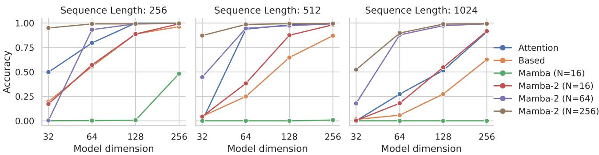  
Figure 8: (Multi-Query Associative Recall (MQAR)). Associative recall tasks are challenging for SSMs, which mus memorize all rele<sub>v</sub>ant information into their rec<sub>u</sub>rrent state. The SSD la<sub>y</sub>er combined <sub>w</sub>ith im<sub>p</sub>ro<sub>v</sub>ed architect<sub>u</sub>re allo<sub>w</sub>s f<sub>or muc</sub>h l<sub>arger s</sub>t<sub>a</sub>t<sub>e s</sub>i<sub>zes</sub> i<sub>n</sub> M<sub>am</sub>b<sub>a-</sub>2<sub>, w</sub>hi<sub>c</sub>h <sub>per</sub>f<sub>orms s</sub>i<sub>gn</sub>ifi<sub>can</sub>tl<sub>y</sub> b<sub>e</sub>tt<sub>er</sub> th<sub>an</sub> M<sub>am</sub>b<sub>a-</sub>1 <sub>an</sub>d <sub>even van</sub>ill<sub>a a</sub>tt<sub>en</sub>ti<sub>on.</sub>

With SSMs<sub>, w</sub>e can s<sub>p</sub>lit the se<sub>qu</sub>ence in a sim<sub>p</sub>le manner: each <sub>w</sub>orker takes an initial state<sub>,</sub> com<sub>pu</sub>te the SSM <sub>w</sub>ith <sub>respec</sub>t t<sub>o</sub> th<sub>e</sub>i<sub>r</sub> i<sub>npu</sub>t<sub>s, re</sub>t<sub>urn</sub> th<sub>e</sub> fi<sub>na</sub>l <sub>s</sub>t<sub>a</sub>t<sub>e, an</sub>d <sub>pass</sub> th<sub>a</sub>t fi<sub>na</sub>l <sub>s</sub>t<sub>a</sub>t<sub>e</sub> t<sub>o</sub> th<sub>e nex</sub>t <sub>wor</sub>k<sub>er.</sub> Th<sub>e commun</sub>i<sub>ca</sub>ti<sub>on</sub> b<sub>an</sub>d<sub>w</sub>idth i<sub>s</sub> li<sub>near</sub> i<sub>n</sub> th<sub>e num</sub>b<sub>er o</sub>f <sub>wor</sub>k<sub>ers.</sub> Thi<sub>s</sub> d<sub>ecompos</sub>iti<sub>on</sub> i<sub>s exac</sub>tl<sub>y</sub> th<sub>e same as</sub> th<sub>e</sub> bl<sub>oc</sub>k<sub>-</sub>d<sub>ecompos</sub>iti<sub>on</sub> in the SSD algorithm (Figure 5) to split into blocks / chunks. We illustrate this context parallelism in Figure 7 (Right).

## 8.3 Variable Length

Whil<sub>e</sub> <sub>pre</sub>t<sub>ra</sub>i<sub>n</sub>i<sub>ng</sub> <sub>o</sub>ft<sub>en</sub> <sub>uses</sub> th<sub>e</sub> <sub>same</sub> <sub>sequence</sub> l<sub>eng</sub>th<sub>s</sub> f<sub>or</sub> th<sub>e</sub> b<sub>a</sub>t<sub>c</sub>h<sub>,</sub> d<sub>ur</sub>i<sub>ng</sub> fi<sub>ne</sub>t<sub>un</sub>i<sub>ng</sub> <sub>or</sub> i<sub>n</sub>f<sub>erence,</sub> th<sub>e</sub> <sub>mo</sub>d<sub>e</sub>l <sub>m</sub>i<sub>g</sub>ht <sub>nee</sub>d t<sub>o</sub> <sub>process</sub> dif<sub>eren</sub>t i<sub>npu</sub>t <sub>sequences</sub> <sub>o</sub>f dif<sub>eren</sub>t l<sub>eng</sub>th<sub>s.</sub> O<sub>ne</sub> <sub>na</sub>i<sub>ve</sub> <sub>way</sub> t<sub>o</sub> h<sub>an</sub>dl<sub>e</sub> thi<sub>s</sub> <sub>case</sub> i<sub>s</sub> t<sub>o</sub> <sub>r</sub>i<sub>g</sub>ht<sub>-pa</sub>d <sub>a</sub>ll <sub>sequences</sub> i<sub>n</sub> th<sub>e</sub> b<sub>a</sub>t<sub>c</sub>h t<sub>o</sub> th<sub>e max</sub>i<sub>mum</sub> l<sub>eng</sub>th<sub>,</sub> b<sub>u</sub>t thi<sub>s can</sub> b<sub>e</sub> i<sub>ne</sub>fi<sub>c</sub>i<sub>en</sub>t if <sub>sequences are w</sub>ildl<sub>y</sub> dif<sub>eren</sub>t l<sub>eng</sub>th<sub>s.</sub> F<sub>or</sub> transformers, so<sub>p</sub>histicated techni<sub>q</sub>ues have been develo<sub>p</sub> to avoid <sub>p</sub>addin<sub>g</sub> and do load-balancin<sub>g</sub> between GPUs (Zen<sub>g</sub> et al. 2022; Y. Zhai et al. 2023), or <sub>p</sub>ackin<sub>g</sub> multi<sub>p</sub>le se<sub>q</sub>uences in the same batch and adjust the attention mask (Din<sub>g</sub> et al. 2024; Pouransari et al. 2024). With SSMs and Mamba in <sub>p</sub>articular, we can handle variable se<sub>q</sub>uence len<sub>g</sub>ths b<sub>y</sub> sim<sub>p</sub>l<sub>y</sub> treatin<sub>g</sub> the whole batch as one lon<sub>g</sub> se<sub>q</sub>uence<sub>,</sub> and avoid <sub>p</sub>assin<sub>g</sub> the states between individual se<sub>q</sub>uences. This is e<sub>q</sub>uivalent to sim<sub>p</sub>l<sub>y</sub> settin<sub>g</sub> $A _ { t } = 0$ f<sub>or</sub> t<sub>o</sub>k<sub>ens</sub> � <sub>a</sub>t th<sub>e en</sub>d <sub>o</sub>f <sub>one sequence</sub> t<sub>o preven</sub>t it f<sub>rom pass</sub>i<sub>ng</sub> i<sub>n</sub>f<sub>orma</sub>ti<sub>on</sub> t<sub>o</sub> th<sub>e</sub> token � + 1, which belon<sub>g</sub>s to a diferent se<sub>q</sub>uence.

## 9 Empirical Validation

We em<sub>p</sub>iricall<sub>y</sub> evaluate Mamba-2 on s<sub>y</sub>nthetic recall tasks that have been challen<sub>g</sub>in<sub>g</sub> for recurrent models (Section 9.1), and standard lan<sub>g</sub>ua<sub>g</sub>e modelin<sub>g p</sub>re-trainin<sub>g</sub> and downstream evaluations (Section 9.2). We validate that our SSD al<sub>g</sub>orithm is much more eficient than Mamba-1 (Section 9.3) and com<sub>p</sub>arable to o<sub>p</sub>timized attention for moderate se<sub>q</sub>uence len<sub>g</sub>ths. Finall<sub>y</sub>, we ablate various desi<sub>g</sub>n choices in the Mamba-2 architecture (Section 9.4).

## 9.1 Synthetics: Associative Recall

S<sub>yn</sub>th<sub>e</sub>ti<sub>c</sub> <sub>assoc</sub>i<sub>a</sub>ti<sub>ve</sub> <sub>reca</sub>ll t<sub>as</sub>k<sub>s</sub> h<sub>ave</sub> b<sub>een</sub> <sub>popu</sub>l<sub>ar</sub> f<sub>or</sub> t<sub>es</sub>ti<sub>ng</sub> th<sub>e</sub> <sub>a</sub>bilit<sub>y</sub> <sub>o</sub>f l<sub>anguage</sub> <sub>mo</sub>d<sub>e</sub>l<sub>s</sub> t<sub>o</sub> l<sub>oo</sub>k <sub>up</sub> i<sub>n</sub>f<sub>orma</sub>ti<sub>on</sub> i<sub>n</sub> their context. Broadl<sub>y,</sub> the<sub>y</sub> involve feedin<sub>g</sub> autore<sub>g</sub>ressive models <sub>p</sub>airs of ke<sub>y</sub>-value associations<sub>,</sub> and then <sub>p</sub>rom<sub>p</sub>tin<sub>g</sub> the model to produce the correct completion upon being shown a previously-seen key. The multi-query associative recall (MQAR) task is a particular formulation of this task that requires the model to memorize multiple associations (Arora, E ubo lu, Timalsina, et al. 2024). The ori inal Mamba a er re orted results on related s nthetic tasks, in articular Selective Co<sub>py</sub>in<sub>g</sub> (Gu and Dao 2023) and Induction Heads (Olsson et al. 2022), which can be seen as easier associative recall tasks. The MQAR task is also closely related to <sup>“</sup>phonebook look-up” tasks which has been shown to be challenging for recurrent models such as SSMs, due to their finite state ca<sub>p</sub>acit<sub>y</sub> (De et al. 2024; Jelassi et al. 2024).

Scaling Laws on The Pile (Sequence Length 8192)  
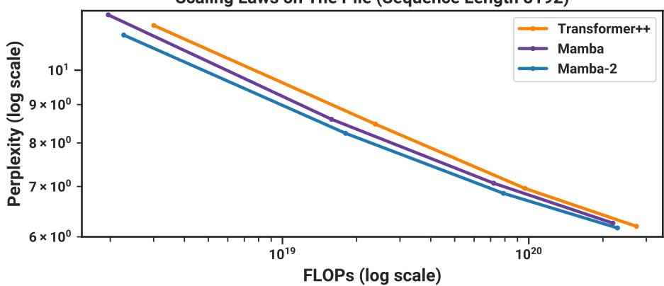  
Figure 9: (Scaling Laws.) Models of size ≈ 125� to ≈ 1.3� parameters, trained on the Pile. Mamba-2 matches or exceeds th<sub>e per</sub>f<sub>ormance o</sub>f M<sub>am</sub>b<sub>a as we</sub>ll <sub>as a s</sub>t<sub>rong</sub> “T<sub>rans</sub>f<sub>ormer++</sub>” <sub>rec</sub>i<sub>pe.</sub> C<sub>ompare</sub>d t<sub>o our</sub> T<sub>rans</sub>f<sub>ormer</sub> b<sub>ase</sub>li<sub>ne,</sub> M<sub>am</sub>b<sub>a-</sub>2 is Pareto dominant on <sub>p</sub>erformance (<sub>p</sub>er<sub>p</sub>lexit<sub>y</sub>), theoretical FLOPs, and actual wall-clock time.

Table 1: (Zero-shot Evaluations.) Best results for each size in bold, second best unlined. We compare against open source LMs with various tokenizers<sub>,</sub> trained for u<sub>p</sub> to 300B tokens. Pile refers to the validation s<sub>p</sub>lit<sub>,</sub> com<sub>p</sub>arin<sub>g</sub> onl<sub>y</sub> a<sub>g</sub>ainst models trained on the same dataset and tokenizer (GPT-NeoX-20B). For each model size Mamba-2 out erforms Mamba and enerall matches P thia at twice the <sub>mo</sub>d<sub>e</sub>l <sub>s</sub>i<sub>ze.</sub> F<sub>u</sub>ll <sub>resu</sub>lt<sub>s</sub> i<sub>n</sub> T<sub>a</sub>bl<sub>e</sub> 10<sub>.</sub>

<table><tr><td>MODEL</td><td>TOKEN.</td><td>PILE PPL ↓</td><td>LAMBADA PPL ↓</td><td>LAMBADA ACC ↑</td><td>HELLASWAG ACC ↑</td><td>PIQA ACC ↑</td><td>ARC-E ACC ↑</td><td>ARC-C ACC ↑</td><td>WINOGRANDE ACC ↑</td><td>OPENBOOKQA ACC ↑</td><td>AVERAGE ACC ↑</td></tr><tr><td>Pythia-1B</td><td>NeoX</td><td>7.82</td><td>7.92</td><td>56.1</td><td>47.2</td><td>70.7</td><td>57.0</td><td>27.1</td><td>53.5</td><td>31.4</td><td>49.0</td></tr><tr><td>Mamba-790M</td><td>NeoX</td><td>7.33</td><td>6.02</td><td>62.7</td><td>55.1</td><td>72.1</td><td>61.2</td><td>29.5</td><td>56.1</td><td>34.2</td><td>53.0</td></tr><tr><td>Mamba-2-780M</td><td>NeoX</td><td>7.26</td><td>5.86</td><td>61.7</td><td>54.9</td><td>72.0</td><td>61.0</td><td>28.5</td><td>60.2</td><td>36.2</td><td>53.5</td></tr><tr><td>Hybrid H3-1.3B</td><td>GPT2</td><td>—</td><td>11.25</td><td>49.6</td><td>52.6</td><td>71.3</td><td>59.2</td><td>28.1</td><td>56.9</td><td>34.4</td><td>50.3</td></tr><tr><td>Pythia-1.4B</td><td>NeoX</td><td>7.51</td><td>6.08</td><td>61.7</td><td>52.1</td><td>71.0</td><td>60.5</td><td>28.5</td><td>57.2</td><td>30.8</td><td>51.7</td></tr><tr><td>RWKV4-1.5B</td><td>NeoX</td><td>7.70</td><td>7.04</td><td>56.4</td><td>52.5</td><td>72.4</td><td>60.5</td><td>29.4</td><td>54.6</td><td>34.0</td><td>51.4</td></tr><tr><td>Mamba-1.4B</td><td>NeoX</td><td>6.80</td><td>5.04</td><td>65.0</td><td>59.1</td><td>74.2</td><td>65.5</td><td>32.8</td><td>61.5</td><td>36.4</td><td>56.4</td></tr><tr><td>Mamba-2-1.3B</td><td>NeoX</td><td>6.66</td><td>5.02</td><td>65.7</td><td>59.9</td><td>73.2</td><td>64.3</td><td>33.3</td><td>60.9</td><td>37.8</td><td>56.4</td></tr><tr><td>Hybrid H3-2.7B</td><td>GPT2</td><td>—</td><td>7.92</td><td>55.7</td><td>59.7</td><td>73.3</td><td>65.6</td><td>32.3</td><td>61.4</td><td>33.6</td><td>54.5</td></tr><tr><td>Pythia-2.8B</td><td>NeoX</td><td>6.73</td><td>5.04</td><td>64.7</td><td>59.3</td><td>74.0</td><td>64.1</td><td>32.9</td><td>59.7</td><td>35.2</td><td>55.7</td></tr><tr><td>RWKV4-3B</td><td>NeoX</td><td>7.00</td><td>5.24</td><td>63.9</td><td>59.6</td><td>73.7</td><td>67.8</td><td>33.1</td><td>59.6</td><td>37.0</td><td>56.4</td></tr><tr><td>Mamba-2.8B</td><td>NeoX</td><td>6.22</td><td>4.23</td><td>69.2</td><td>66.1</td><td>75.2</td><td>69.7</td><td>36.3</td><td>63.5</td><td>39.6</td><td>59.9</td></tr><tr><td>Mamba-2-2.7B</td><td>NeoX</td><td>6.09</td><td>4.10</td><td>69.7</td><td>66.6</td><td>76.4</td><td>69.6</td><td>36.4</td><td>64.0</td><td>38.8</td><td>60.2</td></tr></table>

SSD, Scan, Convolution vs Attention time (A100 80GB PCIe)  
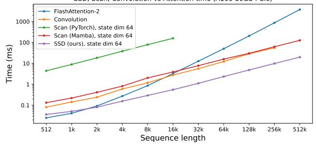

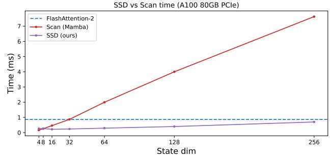  
Figure 10: (Eficiency Benchmarks.) (Left) Our SSD is 2 − 8× faster than a Mamba fused scan for large state expansion (� = 64) and faster than FlashAttention-2 for sequence length 2k and above. (Right) Sequence length 4K: Increasing state ex<sub>p</sub>ansion slows down the Mamba o<sub>p</sub>timized scan im<sub>p</sub>lementation linearl<sub>y</sub>. SSD can handle much lar<sub>g</sub>er state ex<sub>p</sub>ansion f<sub>ac</sub>t<sub>ors w</sub>ith<sub>ou</sub>t <sub>muc</sub>h <sub>s</sub>l<sub>ow</sub>d<sub>own.</sub>

We com<sub>p</sub>are on a challen<sub>g</sub>in<sub>g</sub> version of the MQAR setu<sub>p</sub> from (Arora, E<sub>y</sub>ubo<sub>g</sub>lu, Zhan<sub>g</sub>, et al. 2024), usin<sub>g</sub> a harder task, l<sub>onger sequences, an</sub>d <sub>sma</sub>ll<sub>er mo</sub>d<sub>e</sub>l<sub>s.</sub> O<sub>ur</sub> b<sub>ase</sub>li<sub>nes</sub> i<sub>nc</sub>l<sub>u</sub>d<sub>e s</sub>t<sub>an</sub>d<sub>ar</sub>d <sub>mu</sub>lti<sub>-</sub>h<sub>ea</sub>d <sub>so</sub>ft<sub>max a</sub>tt<sub>en</sub>ti<sub>on as we</sub>ll <sub>as</sub> th<sub>e</sub> B<sub>ase</sub>d <sub>arc</sub>hit<sub>ec</sub>t<sub>ure w</sub>hi<sub>c</sub>h <sub>com</sub>bi<sub>nes convo</sub>l<sub>u</sub>ti<sub>ons,</sub> l<sub>oca</sub>l <sub>a</sub>tt<sub>en</sub>ti<sub>on, an</sub>d <sub>a</sub> li<sub>near a</sub>tt<sub>en</sub>ti<sub>on var</sub>i<sub>an</sub>t<sub>.</sub>

Results are shown in Fi<sub>g</sub>ure 8. While Mamba-1 stru<sub>gg</sub>les on this task<sub>,</sub> Mamba-2 <sub>p</sub>erforms well across all settin<sub>g</sub>s. Sur-<sub>p</sub>risin<sub>g</sub>l<sub>y</sub>, it is si<sub>g</sub>nificantl<sub>y</sub> better than Mamba-1 even when the state sizes are controlled (N = 16). (We are not sure which as<sub>p</sub>ect of the architecture is the <sub>p</sub>redominant factor, which remains a <sub>q</sub>uestion to ex<sub>p</sub>lore in future work.) Additionall<sub>y</sub>, this task validates the im<sub>p</sub>ortance of state size: increasin<sub>g</sub> from N = 16 to N = 64 and N = 256 consistentl<sub>y</sub> im<sub>p</sub>roves <sub>p</sub>erformance on MQAR, as the lar<sub>g</sub>er state allows more information (ke<sub>y</sub>-value <sub>p</sub>airs) to be memorized.

## 9.2 Language Modeling

F<sub>o</sub>ll<sub>ow</sub>i<sub>n s</sub>t<sub>an</sub>d<sub>ar</sub>d <sub>ro</sub>t<sub>oco</sub>l<sub>s</sub> i<sub>n</sub> LLM<sub>s, we</sub> t<sub>ra</sub>i<sub>n an</sub>d <sub>eva</sub>l<sub>ua</sub>t<sub>e</sub> th<sub>e</sub> M<sub>am</sub>b<sub>a-</sub>2 <sub>arc</sub>hit<sub>ec</sub>t<sub>ure on s</sub>t<sub>an</sub>d<sub>ar</sub>d <sub>au</sub>t<sub>ore ress</sub>i<sub>ve</sub> l<sub>an-</sub> <sub>g</sub>ua<sub>g</sub>e modelin<sub>g</sub> a<sub>g</sub>ainst other architectures. We com<sub>p</sub>are both <sub>p</sub>retrainin<sub>g</sub> metrics (<sub>p</sub>er<sub>p</sub>lexit<sub>y</sub>) and zero-shot evaluations. The model sizes (de<sub>p</sub>th and width) follow GPT3 s<sub>p</sub>ecifications, from 125m to 2.7B. We use the Pile dataset (L. Gao, Biderman, et al. 2020), and follow the trainin<sub>g</sub> reci<sub>p</sub>e described in Brown et al. (2020). This follows the same setu<sub>p</sub> as re<sub>p</sub>orted in Mamba (Gu and Dao 2023); trainin<sub>g</sub> details are in A<sub>pp</sub>endix D.

## 9.2.1 Scaling Laws

For baselines, we com<sub>p</sub>are a<sub>g</sub>ainst both Mamba and its Transformer++ reci<sub>p</sub>e (Gu and Dao 2023), which is based on the PaLM and LLaMa architectures (e.<sub>g</sub>. rotar<sub>y</sub> embeddin<sub>g</sub>, SwiGLU MLP, RMSNorm instead ofLa<sub>y</sub>erNorm, no linear bias, and hi<sub>g</sub>her learnin<sub>g</sub> rates). As Mamba has alread<sub>y</sub> demonstrated that it out<sub>p</sub>erforms the standard Transformer architecture (GPT3 architecture) as well as recent sub<sub>q</sub>uadratic architectures (H3 (Dao, D. Y. Fu, et al. 2023), H<sub>y</sub>ena (Poli et al. 2023), RWKV-4 (B. Pen<sub>g</sub>, Alcaide, et al. 2023), RetNet (Y. Sun et al. 2023)), we omit those in the <sub>p</sub>lot for clarit<sub>y</sub> (see Gu and Dao (2023) for com<sub>p</sub>arisons).

Fi<sub>g</sub>ure 9 shows scalin<sub>g</sub> laws under the standard Chinchilla (Hofmann et al. 2022) <sub>p</sub>rotocol, on models from ≈ 125� to ≈ 1.3� <sub>p</sub>arameters.

## 9.2.2 Downstream Evaluations

T<sub>a</sub>bl<sub>e</sub> 1 <sub>s</sub>h<sub>ows</sub> th<sub>e per</sub>f<sub>ormance o</sub>f M<sub>am</sub>b<sub>a-</sub>2 <sub>on a range o</sub>f <sub>popu</sub>l<sub>ar</sub> d<sub>owns</sub>t<sub>ream zero-s</sub>h<sub>o</sub>t <sub>eva</sub>l<sub>ua</sub>ti<sub>on</sub> t<sub>as</sub>k<sub>s, compare</sub>d to the most well-known o<sub>p</sub>en source models at these sizes, most im<sub>p</sub>ortantl<sub>y</sub> P<sub>y</sub>thia (Biderman et al. 2023) which were trained with the same tokenizer, dataset, and trainin<sub>g</sub> len<sub>g</sub>th (300B tokens) as our models.

## 9.2.3 Hybrid Models: Combining SSD Layer with MLP and Attention

Recent and concurrent work (Dao, D. Y. Fu, et al. 2023; De et al. 2024; Glorioso et al. 2024; Lieber et al. 2024) su<sub>gg</sub>ests that a h<sub>y</sub>b<sub>r</sub>id <sub>arc</sub>hit<sub>ec</sub>t<sub>ure w</sub>ith b<sub>o</sub>th SSM l<sub>ayers an</sub>d <sub>a</sub>tt<sub>en</sub>ti<sub>on</sub> l<sub>ayers cou</sub>ld i<sub>mprove</sub> th<sub>e mo</sub>d<sub>e</sub>l <sub>qua</sub>lit<sub>y over</sub> th<sub>a</sub>t <sub>o</sub>f <sub>a</sub> T<sub>rans</sub>f<sub>ormer,</sub> or a <sub>p</sub>ure SSM (e.<sub>g</sub>., Mamba) model, es<sub>p</sub>eciall<sub>y</sub> for in-context learnin<sub>g</sub>. We ex<sub>p</sub>lore the diferent wa<sub>y</sub>s that SSD la<sub>y</sub>ers can b<sub>e com</sub>bi<sub>ne</sub>d <sub>w</sub>ith <sub>a</sub>tt<sub>en</sub>ti<sub>on an</sub>d MLP t<sub>o un</sub>d<sub>ers</sub>t<sub>an</sub>d th<sub>e</sub> b<sub>ene</sub>fit<sub>s o</sub>f <sub>eac</sub>h<sub>.</sub> E<sub>mp</sub>i<sub>r</sub>i<sub>ca</sub>ll<sub>y we</sub> fi<sub>n</sub>d th<sub>a</sub>t h<sub>av</sub>i<sub>ng aroun</sub>d 10% <sub>o</sub>f the total number of la<sub>y</sub>ers bein<sub>g</sub> attention <sub>p</sub>erforms best. Combinin<sub>g</sub> SSD la<sub>y</sub>ers<sub>,</sub> attention la<sub>y</sub>ers<sub>,</sub> and MLP also works b<sub>e</sub>tt<sub>er</sub> th<sub>an e</sub>ith<sub>er pure</sub> T<sub>rans</sub>f<sub>ormer++ or</sub> M<sub>am</sub>b<sub>a-</sub>2<sub>.</sub>

SSD and Attention We find that SSD and attention layers are complementary: by themselves (e.g. in the Mamba-2 architecture vs. Transformer++) their <sub>p</sub>erformance (measured b<sub>y p</sub>er<sub>p</sub>lexit<sub>y</sub>) is nearl<sub>y</sub> the same, but a mixture of SSD and attention la<sub>y</sub>ers out<sub>p</sub>erforms the <sub>p</sub>ure Mamba-2 or Transformer++ architecture. We show some results (Table 2) for the 350M model (48 la<sub>y</sub>ers) trained to 7B tokens on the Pile with the GPT-2 tokenizer (same number of <sub>p</sub>arameters, same hyperparameters, same training and validation set). Adding in just a few attention layers already yields notable i<sub>mprovemen</sub>t <sub>an</sub>d <sub>s</sub>t<sub>r</sub>ik<sub>es</sub> th<sub>e</sub> b<sub>es</sub>t b<sub>a</sub>l<sub>ance</sub> b<sub>e</sub>t<sub>ween qua</sub>lit<sub>y an</sub>d <sub>e</sub>fi<sub>c</sub>i<sub>ency.</sub> W<sub>e</sub> h<sub>ypo</sub>th<sub>es</sub>i<sub>ze</sub> th<sub>a</sub>t th<sub>e</sub> SSM l<sub>ayers</sub> f<sub>unc</sub>ti<sub>on</sub> well as a <sub>g</sub>eneral se<sub>q</sub>uence-to-se<sub>q</sub>uence ma<sub>pp</sub>in<sub>g,</sub> and attention la<sub>y</sub>ers act as a retrieval mechanism to <sub>q</sub>uickl<sub>y</sub> refer to <sub>p</sub>revious tokens in the se<sub>q</sub>uence instead of forcin<sub>g</sub> the model to com<sub>p</sub>ress all the context to its memor<sub>y</sub> (SSM states).

Table 2: (Combining SSD and Attention Blocks.) Perplexity of a 350M model with 48 layers, with diferent number of attention la<sub>y</sub>ers. Havin<sub>g</sub> around a 10% ratio of attention la<sub>y</sub>ers <sub>p</sub>erforms best.

<table><tr><td>Num. ATTN BLOCKS</td><td>0 (Mamba-2)</td><td>1</td><td>2</td><td>3</td><td>4</td><td>5</td><td>6</td><td>7</td><td>9</td><td>11</td><td>15</td><td>24</td><td>Transformer++</td></tr><tr><td>PERPLEXITY ↓</td><td>8.60</td><td>8.38</td><td>8.32</td><td>8.29</td><td>8.29</td><td>8.28</td><td>8.26</td><td>8.27</td><td>8.28</td><td>8.30</td><td>8.34</td><td>8.50</td><td>8.68</td></tr></table>

Hybrid Models with SSD, MLP, and Attention We compare diferent ways that SSD can be combined with the (gated) MLP and attention la<sub>y</sub>ers, and evaluate at the 2.7B scale (64 la<sub>y</sub>ers), trained to 300B tokens on the Pile (same number of <sub>p</sub>arameters, same h<sub>yp</sub>er<sub>p</sub>arameters, same trainin<sub>g</sub> and validation set, same data order):

1. Transformer++: 32 attention la<sub>y</sub>ers and 32 <sub>g</sub>ated MLP<sub>,</sub> interleavin<sub>g</sub>.

2<sub>.</sub> M<sub>a</sub>mb<sub>a</sub>-2: 64 SSD l<sub>aye</sub>r<sub>s.</sub>

3<sub>.</sub> M<sub>a</sub>mb<sub>a</sub>-2-MLP: 32 SSD <sub>a</sub>nd 32 <sub>ga</sub>t<sub>e</sub>d MLP l<sub>aye</sub>r<sub>s,</sub> int<sub>e</sub>rl<sub>eav</sub>in<sub>g.</sub>

4. Mamba-2-Attention: 58 SSD la<sub>y</sub>ers and 6 attention la<sub>y</sub>ers (at indices 9, 18, 27, 36, 45, 56)<sup>6</sup>.

5. Mamba-2-MLP-Attention: 28 SSD la<sub>y</sub>ers and 4 attention la<sub>y</sub>ers<sub>,</sub> interlea<sub>v</sub>in<sub>g</sub> <sub>w</sub>ith 32 <sub>g</sub>ated MLP la<sub>y</sub>ers.

We re<sub>p</sub>ort the validation <sub>p</sub>er<sub>p</sub>lexit<sub>y</sub> on the Pile<sub>,</sub> as well as zero-shot eval<sub>u</sub>ation<sub>,</sub> in Table 3. In <sub>g</sub>eneral<sub>,</sub> the <sub>qu</sub>alit<sub>y</sub> of Trans<sup>f</sup>ormer++ an<sup>d</sup> Mam<sup>b</sup>a-2 mo<sup>d</sup>e<sup>l</sup>s are aroun<sup>d</sup> t<sup>h</sup>e same. We see t<sup>h</sup>at a<sup>dd</sup>ing just 6 attention <sup>l</sup>ayers noticea<sup>bl</sup>y improves over the <sub>p</sub>ure Mamba-2 model (and over Transformer++). Addin<sub>g</sub> MLP la<sub>y</sub>ers reduces model <sub>q</sub>ualit<sub>y</sub>, but can (i) s<sub>p</sub>eed u<sub>p</sub> trainin<sub>g</sub> and inference due to the sim<sub>p</sub>licit<sub>y</sub> and hardware-eficienc<sub>y</sub> of the MLP la<sub>y</sub>er (ii) be easier to u<sub>p</sub>-c<sub>y</sub>cle to MoE models b<sub>y</sub> re<sub>p</sub>lacin<sub>g</sub> MLP la<sub>y</sub>ers with mixture-of-ex<sub>p</sub>erts.

Table 3: (Zero-shot Evaluations.) Best results for each size in bold. We compare diferent ways SSD, MLP, and attention layers can b<sub>e com</sub>bi<sub>ne</sub>d<sub>, eva</sub>l<sub>ua</sub>t<sub>e</sub>d <sub>a</sub>t 2<sub>.</sub>7B <sub>sca</sub>l<sub>e</sub> t<sub>ra</sub>i<sub>ne</sub>d t<sub>o</sub> 300B t<sub>o</sub>k<sub>ens on</sub> th<sub>e</sub> Pil<sub>e.</sub>

<table><tr><td>MODEL</td><td>TOKEN.</td><td>PILE PPL ↓</td><td>LAMBADA PPL ↓</td><td>LAMBADA ACC ↑</td><td>HELLASWAG ACC ↑</td><td>PIQA ACC ↑</td><td>ARC-E ACC ↑</td><td>ARC-C ACC ↑</td><td>WINOGRANDE ACC ↑</td><td>OPENBOOKQA ACC ↑</td><td>AVERAGE ACC ↑</td></tr><tr><td>Transformer++</td><td>NeoX</td><td>6.13</td><td>3.99</td><td>70.3</td><td>66.4</td><td>75.2</td><td>67.7</td><td>37.8</td><td>63.9</td><td>40.4</td><td>60.2</td></tr><tr><td>Mamba-2</td><td>NeoX</td><td>6.09</td><td>4.10</td><td>69.7</td><td>66.6</td><td>76.4</td><td>69.6</td><td>36.4</td><td>64.0</td><td>38.8</td><td>60.2</td></tr><tr><td>Mamba-2-MLP</td><td>NeoX</td><td>6.13</td><td>4.18</td><td>69.3</td><td>65.0</td><td>76.4</td><td>68.1</td><td>37.0</td><td>63.1</td><td>38.2</td><td>59.6</td></tr><tr><td>Mamba-2-Attention</td><td>NeoX</td><td>5.95</td><td>3.85</td><td>71.1</td><td>67.8</td><td>75.8</td><td>69.9</td><td>37.8</td><td>65.3</td><td>39.0</td><td>61.0</td></tr><tr><td>Mamba-2-MLP-Attention</td><td>NeoX</td><td>6.00</td><td>3.95</td><td>70.0</td><td>66.6</td><td>75.4</td><td>70.6</td><td>38.6</td><td>64.6</td><td>39.2</td><td>60.7</td></tr></table>

## 9.3 Speed Benchmarks

We benchmark the s<sub>p</sub>eed of the SSD al<sub>g</sub>orithm a<sub>g</sub>ainst Mamba’s scan im<sub>p</sub>lementation and FlashAttention-2 (Fi<sub>g</sub>ure 10). SSD<sub>,</sub> thanks to its reform<sub>u</sub>lation to <sub>u</sub>se matrix m<sub>u</sub>lti<sub>p</sub>lication as a s<sub>u</sub>bro<sub>u</sub>tine<sub>,</sub> can ex<sub>p</sub>loit s<sub>p</sub>ecialized matrix m<sub>u</sub>lti<sub>p</sub>lication (matmul) units on GPUs, also known as tensor cores. As a result, it is 2-8× faster than Mamba’s fused associative scan, which does not levera<sub>g</sub>e matmul units. Due to its linear scalin<sub>g</sub> in se<sub>q</sub>uence len<sub>g</sub>th<sub>,</sub> SSD is faster than FlashAttention-2 startin<sub>g</sub> at se<sub>q</sub>uence len<sub>g</sub>th 2�.

H<sub>owever,</sub> <sub>we</sub> <sub>no</sub>t<sub>e</sub> th<sub>a</sub>t th<sub>e</sub> M<sub>am</sub>b<sub>a-</sub>2 <sub>mo</sub>d<sub>e</sub>l <sub>as</sub> <sub>a</sub> <sub>w</sub>h<sub>o</sub>l<sub>e</sub> <sub>m</sub>i<sub>g</sub>ht <sub>no</sub>t b<sub>e</sub> <sub>as</sub> <sub>e</sub>fi<sub>c</sub>i<sub>en</sub>t t<sub>o</sub> t<sub>ra</sub>i<sub>n</sub> <sub>as</sub> T<sub>rans</sub>f<sub>ormer</sub> <sub>a</sub>t <sub>s</sub>h<sub>or</sub>t <sub>sequence</sub> len<sub>g</sub>th (e.<sub>g</sub>. at 2�), since a Transformer with � la<sub>y</sub>ers would have $\begin{array} { l } { { \frac { L } { 2 } } } \end{array}$ MLP l<sub>aye</sub>r<sub>s</sub> <sub>a</sub>nd $\begin{array} { l } { { \frac { L } { 2 } } } \end{array}$ <sub>a</sub>tt<sub>en</sub>ti<sub>on</sub> l<sub>ayers,</sub> <sub>w</sub>hil<sub>e</sub> <sub>a</sub> M<sub>am</sub>b<sub>a-</sub>2 <sub>mo</sub>d<sub>e</sub>l <sub>wou</sub>ld h<sub>ave</sub> � SSD l<sub>ayers</sub> f<sub>or</sub> th<sub>e</sub> <sub>same</sub> <sub>num</sub>b<sub>er</sub> <sub>o</sub>f <sub>parame</sub>t<sub>ers.</sub> G<sub>enera</sub>ll<sub>y</sub> th<sub>e</sub> MLP l<sub>ayers</sub> <sub>are</sub> <sub>very</sub> h<sub>ar</sub>d<sub>ware</sub> <sub>e</sub>fi<sub>c</sub>i<sub>en</sub>t since the<sub>y</sub> consist of sim<sub>p</sub>le matrix m<sub>u</sub>lti<sub>p</sub>lication and <sub>p</sub>oint<sub>w</sub>ise linearit<sub>y</sub>. As sho<sub>w</sub>n in Section 9.2.3<sub>,</sub> one can also combine $\begin{array} { l } { { \frac { L } { 2 } } } \end{array}$ SSD l<sub>aye</sub>r<sub>s a</sub>nd $\begin{array} { l } { { \frac { L } { 2 } } } \end{array}$ MLP la<sub>y</sub>ers to s<sub>p</sub>eed u<sub>p</sub> trainin<sub>g</sub> at short se<sub>q</sub>uence len<sub>g</sub>th.

Table 4: (Ablations: Mamba-2 block.) We ablate the major diferences between the Mamba-2 and Mamba-1 neural network blocks (Fi<sub>g</sub>ure $^ { 6 , }$ Section 7.1). Note that these com<sub>p</sub>onents are inde<sub>p</sub>endent of the inner se<sub>q</sub>uence mixin<sub>g</sub> la<sub>y</sub>er; in these ablations, we use SSD for the inner SSM la<sub>y</sub>er (diferin<sub>g</sub> from the S6 la<sub>y</sub>er of Mamba-1).

<table><tr><td>Block</td><td>ABCX PROJECTIONS</td><td>EXTRA NORMALIZATION</td><td>PARAMETERS</td><td>PERPLEXITY</td></tr><tr><td rowspan="3">Mamba-1</td><td>Sequential</td><td>✕</td><td>129.3M</td><td>11.76</td></tr><tr><td>Sequential</td><td>✕</td><td>129.3M</td><td>11.54</td></tr><tr><td>Parallel</td><td>✕</td><td>126.5M</td><td>11.66</td></tr><tr><td>Mamba-2</td><td>Parallel</td><td>✕</td><td>126.5M</td><td>11.49</td></tr></table>

## 9.4 Architecture Ablations

## 9.4.1 Block Design

S<sub>ec</sub>ti<sub>on</sub> 7<sub>.</sub>1 i<sub>n</sub>t<sub>ro</sub>d<sub>uces</sub> th<sub>e</sub> M<sub>am</sub>b<sub>a-</sub>2 bl<sub>oc</sub>k<sub>, w</sub>hi<sub>c</sub>h h<sub>as sma</sub>ll <sub>mo</sub>difi<sub>ca</sub>ti<sub>ons</sub> t<sub>o</sub> th<sub>e</sub> M<sub>am</sub>b<sub>a-</sub>1 bl<sub>oc</sub>k <sub>w</sub>hi<sub>c</sub>h <sub>are par</sub>tl<sub>y mo</sub>ti<sub>va</sub>t<sub>e</sub>d b<sub>y</sub> th<sub>e</sub> <sub>connec</sub>ti<sub>on</sub> t<sub>o</sub> <sub>a</sub>tt<sub>en</sub>ti<sub>on</sub> <sub>an</sub>d <sub>a</sub>l<sub>so</sub> t<sub>o</sub> i<sub>mprove</sub> th<sub>e</sub> <sub>sca</sub>l<sub>a</sub>bilit<sub>y</sub> <sub>o</sub>f M<sub>am</sub>b<sub>a-</sub>2<sub>.</sub> T<sub>a</sub>bl<sub>e</sub> 4 <sub>a</sub>bl<sub>a</sub>t<sub>es</sub> th<sub>ese</sub> <sub>arc</sub>hit<sub>ec</sub>t<sub>ure</sub> <sub>c</sub>h<sub>anges</sub> t<sub>o</sub> th<sub>e</sub> bl<sub>oc</sub>k<sub>, w</sub>hi<sub>c</sub>h <sub>occur ou</sub>t<sub>s</sub>id<sub>e o</sub>f th<sub>e core</sub> SSM l<sub>ayer.</sub>

The ablations validate that <sub>p</sub>arallel <sub>p</sub>rojections to create (�, �, �, �) saves <sub>p</sub>arameters and <sub>p</sub>erforms sli<sub>g</sub>htl<sub>y</sub> better than Mam<sup>b</sup>a<sup>’</sup>s sequentia<sup>l</sup> projections. More important<sup>l</sup>y, t<sup>h</sup>is mo<sup>d</sup>i<sup>fi</sup>cation is amena<sup>bl</sup>e to tensor para<sup>ll</sup>e<sup>l</sup>ism at <sup>l</sup>arger mo<sup>d</sup>e<sup>l</sup> sizes (Section 8). Additionall<sub>y</sub>, the extra normalization la<sub>y</sub>er also sli<sub>g</sub>htl<sub>y</sub> im<sub>p</sub>roves <sub>p</sub>erformance. More im<sub>p</sub>ortantl<sub>y</sub>, <sub>p</sub>reliminar<sub>y</sub> ex<sub>p</sub>eriments at lar<sub>g</sub>er scales observed that it also hel<sub>p</sub>s with trainin<sub>g</sub> stabilit<sub>y</sub>.

## 9.4.2 Head Structure

Section 7.2 <sup>d</sup>escri<sup>b</sup>es <sup>h</sup>ow t<sup>h</sup>e <sup>d</sup>imensions o<sup>f</sup> t<sup>h</sup>e �, �, � projections can <sup>b</sup>e viewe<sup>d</sup> as a <sup>h</sup>yperparameter ana<sup>l</sup>ogous to <sub>no</sub>ti<sub>ons</sub> <sub>o</sub>f <sub>mu</sub>lti<sub>-</sub>h<sub>ea</sub>d <sub>a</sub>tt<sub>en</sub>ti<sub>on</sub> <sub>an</sub>d <sub>mu</sub>lti<sub>-query</sub> <sub>a</sub>tt<sub>en</sub>ti<sub>on.</sub> W<sub>e</sub> <sub>a</sub>l<sub>so</sub> <sub>s</sub>h<sub>owe</sub>d h<sub>ow</sub> th<sub>e</sub> <sub>or</sub>i<sub>g</sub>i<sub>na</sub>l M<sub>am</sub>b<sub>a</sub> <sub>arc</sub>hit<sub>ec</sub>t<sub>ure</sub> i<sub>s</sub> analo<sub>g</sub>ous to multi-value attention (Pro<sub>p</sub>osition 7.2), which was a choice that naturall<sub>y</sub> develo<sub>p</sub>ed from the state-s<sub>p</sub>ace <sub>mo</sub>d<sub>e</sub>l <sub>po</sub>i<sub>n</sub>t <sub>o</sub>f <sub>v</sub>i<sub>ew an</sub>d <sub>was no</sub>t <sub>prev</sub>i<sub>ous</sub>l<sub>y a</sub>bl<sub>a</sub>t<sub>e</sub>d<sub>.</sub>

T<sub>a</sub>bl<sub>e</sub> 5 <sub>a</sub>bl<sub>a</sub>t<sub>es</sub> <sub>c</sub>h<sub>o</sub>i<sub>ces</sub> <sub>o</sub>f th<sub>e</sub> <sub>mu</sub>lti<sub>-</sub>h<sub>ea</sub>d <sub>s</sub>t<sub>ruc</sub>t<sub>ure</sub> f<sub>or</sub> th<sub>e</sub> M<sub>am</sub>b<sub>a-</sub>2 <sub>arc</sub>hit<sub>ec</sub>t<sub>ure.</sub> St<sub>r</sub>iki<sub>ng</sub>l<sub>y,</sub> <sub>we</sub> fi<sub>n</sub>d <sub>a</sub> l<sub>arge</sub> dif<sub>erence</sub> between multi-value and multi-<sub>q</sub>uer<sub>y</sub> or multi-ke<sub>y</sub> head <sub>p</sub>atterns<sub>,</sub> des<sub>p</sub>ite seemin<sub>g</sub> ver<sub>y</sub> similar. Note that this is not ex<sub>p</sub>lained b<sub>y</sub> the total state size, which is the same for all of them (e<sub>q</sub>ual to HPN or the <sub>p</sub>roduct of the number of heads, head dimension, and state dimension).

We also com<sub>p</sub>are to multi-head <sub>p</sub>atterns where the number of �, �, � (analo<sub>g</sub>ous to �, �,�) heads is e<sub>q</sub>ual. We com<sub>p</sub>are <sub>a a</sub>i<sub>ns</sub>t th<sub>e s</sub>t<sub>an</sub>d<sub>ar</sub>d <sub>mu</sub>lti<sub>-</sub>h<sub>ea</sub>d <sub>a</sub>tt<sub>ern, as we</sub>ll <sub>as one w</sub>ith <sub>a ress</sub>i<sub>ve s</sub>h<sub>ar</sub>i<sub>n w</sub>h<sub>ere</sub> th<sub>e a</sub>ll h<sub>ave on</sub>l 1 h<sub>ea</sub>d<sub>.</sub> N<sub>o</sub>t<sub>e</sub> that in the latter case, the model still has H diferent se<sub>q</sub>uence mixers �, because each head still has a diferent �. When parameter matched, these multi-head patterns perform similarly to each other, in between the MVA and MQA/MKA p<sup>atterns.</sup>

## 9.4.3 Attention Kernel Approximations

S<sub>ec</sub>ti<sub>on</sub> 7<sub>.</sub>3 <sub>no</sub>t<sub>e</sub>d h<sub>ow</sub> SSD <sub>can</sub> b<sub>e com</sub>bi<sub>ne</sub>d <sub>w</sub>ith id<sub>eas</sub> f<sub>rom</sub> th<sub>e</sub> li<sub>near a</sub>tt<sub>en</sub>ti<sub>on</sub> lit<sub>era</sub>t<sub>ure, suc</sub>h <sub>as var</sub>i<sub>ous</sub> f<sub>orms o</sub>f k<sub>erne</sub>l <sub>approx</sub>i<sub>ma</sub>ti<sub>ons.</sub> W<sub>e a</sub>bl<sub>a</sub>t<sub>e severa</sub>l <sub>var</sub>i<sub>an</sub>t<sub>s o</sub>f th<sub>ese sugges</sub>t<sub>e</sub>d b<sub>y prev</sub>i<sub>ous wor</sub>k<sub>s</sub> i<sub>n</sub> T<sub>a</sub>bl<sub>e</sub> 6<sub>.</sub> Th<sub>ese</sub> i<sub>nc</sub>l<sub>u</sub>d<sub>e</sub> th<sub>e</sub> cosFormer (Qin, Weixuan Sun, et al. 2022), Random Feature Attention H. Pen<sub>g</sub> et al. 2021, and Positive Random Features (Performer) (Choromanski et al. 2021).

W<sub>e a</sub>l<sub>so a</sub>bl<sub>a</sub>t<sub>e a</sub>ddi<sub>ng a norma</sub>li<sub>za</sub>ti<sub>on</sub> t<sub>erm, a</sub>ki<sub>n</sub> t<sub>o</sub> th<sub>e</sub> d<sub>enom</sub>i<sub>na</sub>t<sub>or o</sub>f th<sub>e so</sub>ft<sub>max</sub> f<sub>unc</sub>ti<sub>on</sub> i<sub>n s</sub>t<sub>an</sub>d<sub>ar</sub>d <sub>a</sub>tt<sub>en</sub>ti<sub>on.</sub> W<sub>e</sub> found that this introduced instabilities to most variants<sub>,</sub> but sli<sub>g</sub>htl<sub>y</sub> im<sub>p</sub>roved <sub>p</sub>erformance for the ReLU activation function �.

Table 7 also tests more recent <sub>p</sub>ro<sub>p</sub>osals to im<sub>p</sub>rove linear attention that involve ex<sub>p</sub>andin<sub>g</sub> the feature dimension (Based (Arora, E<sub>y</sub>ubo<sub>g</sub>lu, Zhan<sub>g</sub>, et al. 2024) and ReBased (Aksenov et al. 2024)). These linear attention extensions aim to a<sub>pp</sub>ro<sub>p</sub>riate the exp kernel with a quadratic approximation. ReBased also proposes to replace the QK activation function with a layer normalization; from an SSM-centric view we a<sub>pp</sub>l<sub>y</sub> a normalization on to<sub>p</sub> of (�, �) before a<sub>pp</sub>l<sub>y</sub>in<sub>g</sub> the SSM function.

Table 5: (Ablations: Multi-head structure.) All models have state expansion factor � = 64 and head size � = 64 and are trained to Chinchilla scaling law token counts. The number of � heads is always e<sub>q</sub>ual to the total heads H, i.e. each head has a separate input-dependent � decay factor. (Top) 125M models, 2.5B tokens (Bottom) 360M models, 7B tokens

<table><tr><td>SSM HEAD PATTERN</td><td>ATTN. ANALOG</td><td>A HEADS</td><td>B HEADS</td><td>C HEADS</td><td>X HEADS</td><td>LAYERS</td><td>PARAMS</td><td>PPL.</td></tr><tr><td>Multi-input (MIS)</td><td>Multi-value (MVA)</td><td>24</td><td>1</td><td>1</td><td>24</td><td>24</td><td>126.5M</td><td>11.66</td></tr><tr><td>Multi-contract (MCS)</td><td>Multi-query (MQA)</td><td>24</td><td>1</td><td>24</td><td>1</td><td>24</td><td>126.5M</td><td>12.62</td></tr><tr><td>Multi-expand (MES)</td><td>Multi-key (MKA)</td><td>24</td><td>24</td><td>1</td><td>1</td><td>24</td><td>126.5M</td><td>12.59</td></tr><tr><td>Multi-head (MHS)</td><td>Multi-head (MHA)</td><td>24</td><td>24</td><td>24</td><td>24</td><td>15</td><td>127.6M</td><td>12.06</td></tr><tr><td>Multi-state (MSS)</td><td>-</td><td>24</td><td>1</td><td>1</td><td>1</td><td>36</td><td>129.6M</td><td>12.00</td></tr><tr><td>Multi-input (MIS)</td><td>Multi-value (MVA)</td><td>32</td><td>1</td><td>1</td><td>32</td><td>48</td><td>361.8M</td><td>8.73</td></tr><tr><td>Multi-contract (MCS)</td><td>Multi-query (MQA)</td><td>32</td><td>1</td><td>32</td><td>1</td><td>48</td><td>361.8M</td><td>9.33</td></tr><tr><td>Multi-expand (MES)</td><td>Multi-key (MKA)</td><td>32</td><td>32</td><td>1</td><td>1</td><td>48</td><td>361.8M</td><td>9.36</td></tr><tr><td>Multi-head (MHS)</td><td>Multi-head (MHA)</td><td>32</td><td>1</td><td>1</td><td>1</td><td>70</td><td>361.3M</td><td>9.01</td></tr><tr><td>Multi-state (MSS)</td><td>-</td><td>32</td><td>32</td><td>32</td><td>32</td><td>29</td><td>357.3M</td><td>9.04</td></tr></table>

Table 7: (Ablations: Kernel approximations.) We test the (Re)Based methods for linear attention a<sub>pp</sub>roximations, which involve expanded feature maps. (Top) 130M models. (Top) 380M models with � = 256.

Table 6: (Ablations: Kernel approximations.) We test var ious proposals for the kernel activation function �, including linear attention variants aimin<sub>g</sub> to a<sub>pp</sub>roximate the ex<sub>p</sub> ker-<sub>ne</sub>l f<sub>rom s</sub>t<sub>an</sub>d<sub>ar</sub>d <sub>so</sub>ft<sub>max a</sub>tt<sub>en</sub>ti<sub>on.</sub>

<table><tr><td>KERNEL ACTIVATION φ</td><td>PERPLEXITY</td></tr><tr><td>none</td><td>11.58</td></tr><tr><td>Swish</td><td>11.66</td></tr><tr><td>Exp</td><td>11.62</td></tr><tr><td>ReLU</td><td>11.73</td></tr><tr><td>ReLU + normalization</td><td>11.64</td></tr><tr><td>cosFormer</td><td>11.97</td></tr><tr><td>Random Feature Attention</td><td>11.57</td></tr><tr><td>Positive Random Features (Performer)</td><td>12.21</td></tr></table>

<table><tr><td>KERNEL ACTIVATION φ</td><td>PERPLEXITY</td></tr><tr><td>Swish</td><td>11.67</td></tr><tr><td>Swish + Taylor (Based)</td><td>12.19</td></tr><tr><td>LayerNorm</td><td>11.50</td></tr><tr><td>LayerNorm + Square (ReBased)</td><td>11.84</td></tr><tr><td>Swish</td><td>8.58</td></tr><tr><td>Swish + Taylor (Based)</td><td>8.71</td></tr><tr><td>LayerNorm</td><td>8.61</td></tr><tr><td>LayerNorm + Square (ReBased)</td><td>8.63</td></tr></table>

We note that this techni<sub>q</sub>ue has been inde<sub>p</sub>endentl<sub>y p</sub>ro<sub>p</sub>osed as the “QK-Norm” for softmax attention (Team 2024) and an “internal normalization” for Mamba (Lieber et al. 2024).

O<sub>vera</sub>ll<sub>,</sub> T<sub>a</sub>bl<sub>e</sub> 6 <sub>an</sub>d T<sub>a</sub>bl<sub>e</sub> 7 f<sub>oun</sub>d th<sub>a</sub>t th<sub>e</sub> k<sub>erne</sub>l <sub>approx</sub>i<sub>ma</sub>ti<sub>on</sub> <sub>me</sub>th<sub>o</sub>d<sub>s</sub> <sub>we</sub> t<sub>r</sub>i<sub>e</sub>d did <sub>no</sub>t <sub>seem</sub> t<sub>o</sub> i<sub>mprove</sub> <sub>over</sub> <sub>s</sub>i<sub>mp</sub>l<sub>e</sub> pointwise non-linear activation functions for �. Thus our default settings for Mamba-2 used �(�) = Swish(�) to follow Mamba-1<sub>,</sub> but we su<sub>gg</sub>est that removin<sub>g</sub> this activation entirel<sub>y</sub> ma<sub>y</sub> be a sim<sub>p</sub>ler choice that we did not extensivel<sub>y</sub> test.

W<sub>e emp</sub>h<sub>as</sub>i<sub>ze</sub> h<sub>owever</sub> th<sub>a</sub>t SSD <sub>an</sub>d <sub>van</sub>ill<sub>a</sub> li<sub>near a</sub>tt<sub>en</sub>ti<sub>on</sub> dif<sub>er</sub> i<sub>n</sub> th<sub>e</sub> i<sub>nc</sub>l<sub>us</sub>i<sub>on o</sub>f th<sub>e</sub> 1<sub>-sem</sub>i<sub>separa</sub>bl<sub>e mas</sub>k �<sub>, w</sub>hil<sub>e</sub> th<sub>e var</sub>i<sub>ous</sub> li<sub>near a</sub>tt<sub>en</sub>ti<sub>on me</sub>th<sub>o</sub>d<sub>s</sub> i<sub>n</sub> th<sub>e</sub> lit<sub>era</sub>t<sub>ure were</sub> d<sub>er</sub>i<sub>ve</sub>d t<sub>o a rox</sub>i<sub>ma</sub>t<sub>e so</sub>ft<sub>max a</sub>tt<sub>en</sub>ti<sub>on w</sub>ith<sub>ou</sub>t thi<sub>s</sub> t<sub>erm;</sub> th<sub>us,</sub> <sub>our</sub> <sub>nega</sub>ti<sub>ve</sub> <sub>resu</sub>lt<sub>s</sub> <sub>may</sub> b<sub>e</sub> <sub>no</sub>t <sub>unexpec</sub>t<sub>e</sub>d<sub>.</sub>

## 10 Related Work and Discussion

Th<sub>e s</sub>t<sub>a</sub>t<sub>e s ace</sub> d<sub>ua</sub>lit fr<sub>a</sub>m<sub>ewo</sub>rk brid <sub>es co</sub>nn<sub>ec</sub>ti<sub>o</sub>n<sub>s</sub> b<sub>e</sub>t<sub>wee</sub>n SSM<sub>s, s</sub>tr<sub>uc</sub>t<sub>u</sub>r<sub>e</sub>d m<sub>a</sub>tri<sub>ces, a</sub>nd <sub>a</sub>tt<sub>e</sub>nti<sub>o</sub>n<sub>.</sub> W<sub>e</sub> di<sub>scuss</sub> in <sub>more</sub> d<sub>ep</sub>th th<sub>e re</sub>l<sub>a</sub>ti<sub>ons</sub> b<sub>e</sub>t<sub>ween</sub> SSD <sub>an</sub>d th<sub>ese concep</sub>t<sub>s more</sub> b<sub>roa</sub>dl<sub>y.</sub> U<sub>s</sub>i<sub>ng</sub> id<sub>eas</sub> f<sub>rom eac</sub>h <sub>o</sub>f th<sub>e v</sub>i<sub>ewpo</sub>i<sub>n</sub>t<sub>s, we a</sub>l<sub>so</sub> <sub>sugges</sub>t <sub>some</sub> di<sub>rec</sub>ti<sub>ons</sub> th<sub>a</sub>t th<sub>e</sub> SSD f<sub>ramewor</sub>k <sub>can</sub> b<sub>e ex</sub>t<sub>en</sub>d<sub>e</sub>d i<sub>n</sub> f<sub>u</sub>t<sub>ure wor</sub>k<sub>.</sub>

## 10.1 State Space Models

St<sub>ruc</sub>t<sub>ure</sub>d <sub>s</sub>t<sub>a</sub>t<sub>e space mo</sub>d<sub>e</sub>l<sub>s can</sub> b<sub>e c</sub>h<sub>arac</sub>t<sub>er</sub>i<sub>ze</sub>d <sub>a</sub>l<sub>ong</sub> th<sub>e axes</sub>

(i) whether it is time-invariant or time-var<sub>y</sub>in<sub>g</sub>.

(ii) the dimensionalit<sub>y</sub> of the s<sub>y</sub>stem.

(iii) the structure on the recurrent transitions �.

SSD <sub>ca</sub>n b<sub>e</sub> d<sub>esc</sub>rib<sub>e</sub>d <sub>as</sub> <sub>a</sub> <sub>se</sub>l<sub>ec</sub>ti<sub>ve</sub> SSM <sub>w</sub>ith SISO dim<sub>e</sub>n<sub>s</sub>i<sub>o</sub>n<sub>s</sub> <sub>a</sub>nd <sub>sca</sub>l<sub>a</sub>r-id<sub>e</sub>ntit<sub>y</sub> <sub>s</sub>tr<sub>uc</sub>t<sub>u</sub>r<sub>e.</sub>

Time Variance (Selectivity). The original structured SSMs (S4) were linear time-invariant (LTI) systems (Gu 2023; Gu, Goel, and Ré 2022) motivated b<sub>y</sub> continuous-time online memorization (Gu, Dao, et al. 2020; Gu, Johnson, Goel, et al. 2021; Gu, Johnson, Timalsina, et al. 2023). Man<sub>y</sub> variants of structured SSMs have been <sub>p</sub>ro<sub>p</sub>osed (Dao, D. Y. Fu, et al. 2023; Gu, Gu<sub>p</sub>ta, et al. 2022; Gu<sub>p</sub>ta, Gu, and Berant 2022; Ma et al. 2023; J. T. Smith, Warrin<sub>g</sub>ton, and Linderman 2023), includin<sub>g</sub> several that dro<sub>p</sub> the recurrence and focus on the convolutional re<sub>p</sub>resentation of LTI SSMs (D. Y. Fu et al. 2023; Y. Li et al. 2023; Poli et al. 2023; Qin, Han, Weixuan Sun, B. He, et al. 2023).

SSD is a time-var in structured SSM, also known as a selective SSM introduced in Mamba (Gu and Dao 2023). Selective SSMs are closel<sub>y</sub> related to <sub>g</sub>atin<sub>g</sub> mechanisms of RNNs, includin<sub>g</sub> classical RNNs such as the LSTM (Hochreiter and Schmidhuber 1997) and GRU (J. Chun<sub>g</sub> et al. 2014) as well as more modern variants such as the QRNN (Bradbur<sub>y</sub> et al. 2016), SRU (Lei 2021; Lei et al. 2017), RWKV (B. Pen<sub>g</sub>, Alcaide, et al. 2023), HGRN (Qin, Yan<sub>g</sub>, and Zhon<sub>g</sub> 2023), and Grifin (Botev et al. 2024; De et al. 2024). These RNNs difer in their <sub>p</sub>arameterizations in various wa<sub>y</sub>s, most im<sub>p</sub>ortantl<sub>y</sub> i<sub>n</sub> th<sub>e</sub> l<sub>ac</sub>k <sub>o</sub>f <sub>a s</sub>t<sub>a</sub>t<sub>e expans</sub>i<sub>on.</sub>

Dimensionality and State Expansion. An important characteristic of SSD, shared by previous SSMs in its lineage (S4, H3, Mamba), is that it is a single-input single-output (SISO) system where input channels are processed independently. This leads to a much lar<sub>g</sub>er efective state size of ND where N is the SSM state size (also called state ex<sub>p</sub>ansion factor) and D is the standard model dimension. Traditional RNNs either have N = 1 or are multi-in<sub>p</sub>ut multi-out<sub>p</sub>ut (MIMO) with d<sub>ense</sub> �<sub>,</sub> � <sub>ma</sub>t<sub>r</sub>i<sub>ces, e</sub>ith<sub>er o</sub>f <sub>w</sub>hi<sub>c</sub>h l<sub>ea</sub>d<sub>s</sub> t<sub>o a sma</sub>ll<sub>er s</sub>t<sub>a</sub>t<sub>e.</sub> Whil<sub>e</sub> MIMO SSM<sub>s</sub> h<sub>ave</sub> b<sub>een s</sub>h<sub>own</sub> t<sub>o wor</sub>k <sub>we</sub>ll i<sub>n some</sub> domains (Lu et al. 2023; Orvieto et al. 2023; J. T. Smith, Warrin<sub>g</sub>ton, and Linderman 2023), Mamba showed that state ex<sub>p</sub>ansion is crucial for information-dense domains such as lan<sub>g</sub>ua<sub>g</sub>e. One of the main advanta<sub>g</sub>es of SSD is allowin<sub>g</sub> for <sub>even</sub> l<sub>arger s</sub>t<sub>a</sub>t<sub>e expans</sub>i<sub>on</sub> f<sub>ac</sub>t<sub>ors w</sub>ith<sub>ou</sub>t <sub>s</sub>l<sub>ow</sub>i<sub>ng</sub> d<sub>own</sub> th<sub>e mo</sub>d<sub>e</sub>l<sub>.</sub> M<sub>any su</sub>b<sub>sequen</sub>t <sub>wor</sub>k<sub>s</sub> h<sub>ave s</sub>i<sub>nce a</sub>d<sub>op</sub>t<sub>e</sub>d <sub>s</sub>t<sub>a</sub>t<sub>e</sub> ex<sub>p</sub>ansion (Section 10.4).

Structure. Compared to previous structured SSMs, the main restriction of SSD is on the expressivity of the state transitions � . We note that more <sub>g</sub>eneral SSMs<sub>,</sub> such as the case of dia<sub>g</sub>onal � <sub>,</sub> have the same theoretical eficienc<sub>y</sub> as SSD<sub>,</sub> b<sub>u</sub>t <sub>are</sub> l<sub>ess</sub> h<sub>ar</sub>d<sub>ware-</sub>f<sub>r</sub>i<sub>en</sub>dl<sub>y.</sub> Thi<sub>s</sub> i<sub>s</sub> b<sub>ecause</sub> th<sub>e</sub> d<sub>ua</sub>l <sub>qua</sub>d<sub>ra</sub>ti<sub>c</sub> f<sub>orm</sub> l<sub>oses</sub> it<sub>s a</sub>tt<sub>en</sub>ti<sub>on-</sub>lik<sub>e</sub> i<sub>n</sub>t<sub>erpre</sub>t<sub>a</sub>ti<sub>on an</sub>d b<sub>ecomes</sub> more dificult to com<sub>p</sub>ute. Thus com<sub>p</sub>ared to Mamba<sub>,</sub> SSD difers onl<sub>y</sub> in a sli<sub>g</sub>htl<sub>y</sub> more restrictive form of dia<sub>g</sub>onal �<sub>�,</sub> and trades of this ex<sub>p</sub>ressivit<sub>y</sub> for im<sub>p</sub>roved hardware eficienc<sub>y</sub> (and ease of im<sub>p</sub>lementation)

We h<sub>yp</sub>othesize that it ma<sub>y</sub> be <sub>p</sub>ossible to refine our structured matrix al<sub>g</sub>orithms to im<sub>p</sub>rove to the <sub>g</sub>eneral dia<sub>g</sub>onal SSM <sub>case as we</sub>ll<sub>.</sub>

## 10.2 Structured Matrices

The first viewpoint of the state space duality adopts the viewpoint of these models as matrix sequence transformations or “matrix mixers”: se<sub>q</sub>uence transformations (Definition 2.1) that can be re<sub>p</sub>resented as matrix multi<sub>p</sub>lication (b<sub>y</sub> a T × T matrix) alon<sub>g</sub> the se<sub>q</sub>uence dimension T.

Several s<sub>u</sub>ch matrix mixers have been <sub>p</sub>ro<sub>p</sub>osed before<sub>,</sub> where the <sub>p</sub>rimar<sub>y</sub> axis of variation is the re<sub>p</sub>resentation of the matrix. These include MLP-Mixer (Tolstikhin et al. 2021) (unstructured matrix), FNet (Lee-Thor<sub>p</sub> et al. 2021) (Fourier Transform matrix), M2 (Dao, B. Chen, et al. 2022; Dao, Gu, et al. 2019; Dao, Sohoni, et al. 2020; D. Fu et al. 2024) (butterfl<sub>y</sub>/monarch matrix), Toe<sub>p</sub>litz matrices (Poli et al. 2023; Qin, Han, Weixuan Sun, B. He, et al. 2023), and even more exotic structures (De Sa et al. 2018; Thomas et al. 2018).

An im<sub>p</sub>ortant characterization is that eficient (sub-<sub>q</sub>uadratic) matrix se<sub>q</sub>uence transformations are exactl<sub>y</sub> those which have structured matrix mixers. A core result of the SSD framework is viewing SSMs as matrix mixers with a particular structure – semise<sub>p</sub>arable matrices (Section 3). The linear vs. <sub>q</sub>uadratic dualit<sub>y</sub> then takes the form of structured matrix m<sub>u</sub>lti<sub>p</sub>li<sub>ca</sub>ti<sub>o</sub>n <sub>vs.</sub> n<sub>a</sub>i<sub>ve</sub> m<sub>a</sub>trix m<sub>u</sub>lti<sub>p</sub>li<sub>ca</sub>ti<sub>o</sub>n<sub>.</sub>

The structure matrix re<sub>p</sub>resentation led to our eficient SSD al<sub>g</sub>orithm throu<sub>g</sub>h block decom<sub>p</sub>ositions of<sub>p</sub>articular semise<sub>p</sub>- arable matrices (Section 6). We note that semise<sub>p</sub>arable matrices are well-studied in the scientific com<sub>p</sub>utin<sub>g</sub> literature, and incor<sub>p</sub>oratin<sub>g</sub> those ideas ma<sub>y</sub> be a <sub>p</sub>romisin<sub>g</sub> avenue for more im<sub>p</sub>rovements to state s<sub>p</sub>ace models. We also su<sub>gg</sub>est that focusin<sub>g</sub> on the matrix mixer view<sub>p</sub>oint can lead to more fruitful directions for se<sub>q</sub>uence models<sub>,</sub> such as desi<sub>g</sub>nin<sub>g</sub> <sub>pr</sub>i<sub>nc</sub>i<sub>p</sub>l<sub>e</sub>d <sub>non-causa</sub>l <sub>var</sub>i<sub>an</sub>t<sub>s o</sub>f M<sub>am</sub>b<sub>a, or</sub> fi<sub>n</sub>di<sub>ng ways</sub> t<sub>o c</sub>h<sub>arac</sub>t<sub>er</sub>i<sub>ze an</sub>d b<sub>r</sub>id<sub>ge</sub> th<sub>e gap</sub> b<sub>e</sub>t<sub>ween so</sub>ft<sub>max a</sub>tt<sub>en</sub>ti<sub>on</sub> <sub>an</sub>d <sub>su</sub>b<sub>-qua</sub>d<sub>ra</sub>ti<sub>c mo</sub>d<sub>e</sub>l<sub>s</sub> th<sub>roug</sub>h <sub>ana</sub>l<sub>yz</sub>i<sub>ng</sub> th<sub>e</sub>i<sub>r ma</sub>t<sub>r</sub>i<sub>x</sub> t<sub>rans</sub>f<sub>orma</sub>ti<sub>on s</sub>t<sub>ruc</sub>t<sub>ure.</sub>

## 10.3 (Linear) Attention

Com<sub>p</sub>ared to standard (causal) attention, SSD has onl<sub>y</sub> two main diferences.

First, SSD does not use the softmax activation ofstandard attention (Bahdanau, Cho, and Ben<sub>g</sub>io 2015; Vaswani et al. 2017), which is what <sub>g</sub>ives attention its <sub>q</sub>uadratic com<sub>p</sub>lexit<sub>y</sub>. When the softmax is dro<sub>pp</sub>ed<sub>,</sub> the se<sub>q</sub>uence can be com<sub>p</sub>uted with linear scalin<sub>g</sub> throu<sub>g</sub>h the linear attention framework (Katharo<sub>p</sub>oulos et al. 2020).

Second<sub>,</sub> SSD m<sub>u</sub>lti<sub>p</sub>lies the lo<sub>g</sub>its matrix b<sub>y</sub> an in<sub>pu</sub>t-de<sub>p</sub>endent 1-semise<sub>p</sub>arable mask. Th<sub>u</sub>s this mask can be viewed as <sub>rep</sub>l<sub>ac</sub>i<sub>ng</sub> th<sub>e so</sub>ft<sub>max</sub> i<sub>n s</sub>t<sub>an</sub>d<sub>ar</sub>d <sub>a</sub>tt<sub>en</sub>ti<sub>on.</sub>

This semise<sub>p</sub>arable mask can also be <sub>v</sub>ie<sub>w</sub>ed as <sub>p</sub>ro<sub>v</sub>idin<sub>g p</sub>ositional information. The elements $a _ { t }$ <sub>ac</sub>t <sub>as</sub> “<sub>ga</sub>t<sub>es</sub>” i<sub>n</sub> th<sub>e</sub> RNN sense, or a “selection” mechanism (see discussion in Mamba <sub>p</sub>a<sub>p</sub>er), and their cumulative <sub>p</sub>roducts $a _ { j : i }$ <sub>con</sub>t<sub>ro</sub>l h<sub>ow muc</sub>h interaction is allowed between <sub>p</sub>ositions � and �. Positional embeddin<sub>g</sub>s (e.<sub>g</sub>. sinusoidal (Vaswani et al. 2017), AliBi (Press, N. Smith, and Lewis 2022), and RoPE (Su et al. 2021)) are an im<sub>p</sub>ortant com<sub>p</sub>onent of Transformers that are often viewed as he<sub>u</sub>ristics<sub>,</sub> and the 1-SS mask of SSD can be seen as a more <sub>p</sub>rinci<sub>p</sub>led form of relative <sub>p</sub>ositional embeddin<sub>g</sub>s. We note that this view was also <sub>p</sub>osited concurrentl<sub>y</sub> b<sub>y</sub> GateLoo<sub>p</sub> (Katsch 2023).

The second view<sub>p</sub>oint of state s<sub>p</sub>ace dualit<sub>y</sub> is a s<sub>p</sub>ecial case of our more <sub>g</sub>eneral structured masked attention (SMA) frame<sub>w</sub>ork<sub>, w</sub>here the d<sub>u</sub>alit<sub>y</sub> is re<sub>v</sub>ealed as diferent contraction orderin<sub>g</sub>s on a sim<sub>p</sub>le 4-<sub>w</sub>a<sub>y</sub> tensor contraction. SMA i<sub>s a s</sub>t<sub>rong genera</sub>li<sub>za</sub>ti<sub>on o</sub>f li<sub>near a</sub>tt<sub>en</sub>ti<sub>on</sub> th<sub>a</sub>t i<sub>s muc</sub>h <sub>more genera</sub>l th<sub>an</sub> SSD <sub>as we</sub>ll<sub>; o</sub>th<sub>er</sub> f<sub>orms o</sub>f <sub>s</sub>t<sub>ruc</sub>t<sub>ure</sub>d <sub>mas</sub>k<sub>s</sub> ma<sub>y</sub> lead to more variants of eficient attention with diferent <sub>p</sub>ro<sub>p</sub>erties than SSD.

Beside leadin<sub>g</sub> to new models<sub>,</sub> these connections to attention can lead to other directions for understandin<sub>g</sub> SSMs. For exam<sub>p</sub>le, we are curious whether the <sub>p</sub>henomenon of attention sinks (Darcet et al. 2024; Xiao et al. 2024) exist for Mamba models, and more broadl<sub>y</sub> whether inter<sub>p</sub>retabilit<sub>y</sub> techni<sub>q</sub>ues can be transferred to SSMs (Ali, Zimerman, and Wolf 2024).

Finall<sub>y</sub>, man<sub>y</sub> other variants of linear attention have been <sub>p</sub>ro<sub>p</sub>osed (Arora, E<sub>y</sub>ubo<sub>g</sub>lu, Timalsina, et al. 2024; Arora, Eyuboglu, Zhang, et al. 2024; Choromanski et al. 2021; H. Peng et al. 2021; Qin, Han, Weixuan Sun, Dongxu Li, et al. 2022; Qin, Weixuan Sun, et al. 2022; Schlag, Irie, and Schmidhuber 2021; Zhang et al. 2024; Zheng, C. Wang, and Kong 2022) (see Section 4.1.3 for descri<sub>p</sub>tions of several of these), and we ex<sub>p</sub>ect that man<sub>y</sub> techni<sub>q</sub>ues can be transferred to SSMs (e.<sub>g</sub>. Section 7.3).

We emphasize that SSD does not generalize standard softmax attention, or any other transformation on the attention kernel matrix that does not have a finite feature map �. Compared to general attention, SSD’s advantage is having a controllable state ex<sub>p</sub>ansion factor N that com<sub>p</sub>resses the history, com<sub>p</sub>ared to <sub>q</sub>uadratic attention’s cache of the entire history scaling with se<sub>q</sub>uence length T ≫ N. Concurrent work has starting studying the tradeofs of these re<sub>p</sub>resentations, for exam<sub>p</sub>le on co<sub>py</sub>in<sub>g</sub> and in-context learnin<sub>g</sub> tasks (Ak<sub>y</sub>ürek et al. 2024; Grazzi et al. 2024; Jelassi et al. 2024; Park et al. 2024). We note that Mamba-2 si<sub>g</sub>nificantl<sub>y</sub> im<sub>p</sub>roves on Mamba on some of these ca<sub>p</sub>abilities (e.<sub>g</sub>. as demonstrated b<sub>y</sub> MQAR results in Section 9.1) but more remains to be understood.

## 10.4 Related Models

W<sub>e</sub> fi<sub>na</sub>ll<sub>y</sub> hi<sub>g</sub>hli<sub>g</sub>ht <sub>a</sub> <sub>grow</sub>i<sub>ng</sub> b<sub>o</sub>d<sub>y</sub> <sub>o</sub>f <sub>recen</sub>t <sub>an</sub>d <sub>concurren</sub>t <sub>wor</sub>k th<sub>a</sub>t h<sub>ave</sub> d<sub>eve</sub>l<sub>ope</sub>d <sub>sequence</sub> <sub>mo</sub>d<sub>e</sub>l<sub>s</sub> <sub>very</sub> <sub>s</sub>i<sub>m</sub>il<sub>ar</sub> t<sub>o</sub> M<sub>am</sub>b<sub>a an</sub>d M<sub>am</sub>b<sub>a-</sub>2<sub>.</sub>

• RetNet (Y. Sun et al. 2023) and TransNormerLLM (Qin, Don<sub>g</sub> Li, et al. 2023) <sub>g</sub>eneralize Linear Attention usin<sub>g</sub> deca<sub>y</sub> t<sub>erms</sub> i<sub>ns</sub>t<sub>ea</sub>d <sub>o</sub>f <sub>a cumu</sub>l<sub>a</sub>ti<sub>ve sum, an</sub>d <sub>propose</sub> d<sub>ua</sub>l <sub>para</sub>ll<sub>e</sub>l/<sub>recurren</sub>t <sub>a</sub>l<sub>gor</sub>ith<sub>ms as we</sub>ll <sub>as a</sub> h<sub>y</sub>b<sub>r</sub>id “<sub>c</sub>h<sub>un</sub>k<sub>w</sub>i<sub>se</sub>” mode. These al<sub>g</sub>orithms can be seen as an instantiation of SSD where �<sub>�</sub> is time-invariant (constant for all �); in the SMA inter<sub>p</sub>retation<sub>,</sub> the mask matrix � <sub>w</sub>o<sub>u</sub>ld be a deca<sub>y</sub> matrix $L _ { i , j } = \gamma ^ { i - j }$ <sub>.</sub> Th<sub>ese mo</sub>d<sub>e</sub>l<sub>s a</sub>l<sub>so</sub> dif<sub>er arc</sub>hit<sub>ec</sub>t<sub>ura</sub>ll<sub>y</sub> i<sub>n</sub> various wa<sub>y</sub>s. For exam<sub>p</sub>le<sub>,</sub> since the<sub>y</sub> were derived from an attention-centric <sub>p</sub>ers<sub>p</sub>ective the<sub>y p</sub>reserve the multi-head attention (MHA) <sub>p</sub>attern; since Mamba-2 was derived from an SSM-centric <sub>p</sub>attern it <sub>p</sub>reserves the multi-value attention (MVA) or multi-ex<sub>p</sub>and SSM (MES) <sub>p</sub>attern, which we show to be better (Section 9.4).

• GateLoo<sub>p</sub> (Katsch 2023) concurrentl<sub>y p</sub>ro<sub>p</sub>osed usin<sub>g</sub> in<sub>p</sub>ut-de<sub>p</sub>endent deca<sub>y</sub> factors �<sub>�</sub>, and develo<sub>p</sub>ed the same dual <sub>qua</sub>d<sub>ra</sub>ti<sub>c</sub> f<sub>orm as</sub> i<sub>n</sub> SSD <sub>w</sub>hi<sub>c</sub>h th<sub>ey ca</sub>ll <sub>a</sub> “<sub>surroga</sub>t<sub>e a</sub>tt<sub>en</sub>ti<sub>on</sub>” f<sub>orm.</sub>

• Gated Linear Attention (GLA) (Yan<sub>g</sub> et al. 2024) <sub>p</sub>ro<sub>p</sub>osed a variant of linear attention with data-de<sub>p</sub>endent <sub>g</sub>ates, alon<sub>g</sub> <sub>w</sub>ith <sub>e</sub>fi<sub>c</sub>i<sub>en</sub>t <sub>a</sub>l<sub>gor</sub>ith<sub>ms</sub> t<sub>o compu</sub>t<sub>e a c</sub>h<sub>un</sub>k<sub>w</sub>i<sub>se mo</sub>d<sub>e an</sub>d h<sub>ar</sub>d<sub>ware-aware</sub> i<sub>mp</sub>l<sub>emen</sub>t<sub>a</sub>ti<sub>ons.</sub>

• HGRN (Qin, Yan<sub>g</sub>, and Zhon<sub>g</sub> 2023) introduced an RNN with in<sub>p</sub>ut-de<sub>p</sub>endent <sub>g</sub>ates, which was im<sub>p</sub>roved to incor<sub>p</sub>orate state ex<sub>p</sub>ansion in HGRN2 (Qin, Yan<sub>g</sub>, Weixuan Sun, et al. 2024).

• Grifin (De et al. 2024) and RecurrentGemma (Botev et al. 2024) showed that an RNN with in<sub>p</sub>ut-de<sub>p</sub>endent <sub>g</sub>atin<sub>g</sub>, combined with local attention, can be ver<sub>y</sub> com<sub>p</sub>etitive with stron<sub>g</sub> modern Transformers. Jamba also showed tha combinin<sub>g</sub> Mamba with a few la<sub>y</sub>ers of attention <sub>p</sub>erforms ver<sub>y</sub> well on lan<sub>g</sub>ua<sub>g</sub>e modelin<sub>g</sub> (Lieber et al. 2024).

• xLSTM (Beck et al. 2024) im<sub>p</sub>roves the xLSTM b<sub>y</sub> ado<sub>p</sub>tin<sub>g</sub> the idea of state ex<sub>p</sub>ansion and other <sub>g</sub>atin<sub>g</sub>, normalization, and stabilization techni<sub>q</sub>ues.

• RWKV(-4) (B. Pen<sub>g</sub>, Alcaide, et al. 2023) is an RNN based on a diferent linear attention a<sub>pp</sub>roximation (the attention-free Transformer (S. Zhai et al. 2021)). It has recentl<sub>y</sub> been im<sub>p</sub>roved to the RWKV-5/6 (Ea<sub>g</sub>le and Finch) architectures (B. Pen<sub>g</sub>, Goldstein, et al. 2024) b<sub>y</sub> ado<sub>p</sub>tin<sub>g</sub> the ideas of selectivit<sub>y</sub> and state ex<sub>p</sub>ansion.

## 11 Conclusion

W<sub>e</sub> <sub>propose</sub>d <sub>a</sub> th<sub>eore</sub>ti<sub>ca</sub>l f<sub>ramewor</sub>k b<sub>ase</sub>d <sub>on</sub> <sub>we</sub>ll<sub>-s</sub>t<sub>u</sub>di<sub>e</sub>d <sub>c</sub>l<sub>asses</sub> <sub>o</sub>f <sub>s</sub>t<sub>ruc</sub>t<sub>ure</sub>d <sub>ma</sub>t<sub>r</sub>i<sub>ces</sub> th<sub>a</sub>t b<sub>r</sub>id<sub>ges</sub> th<sub>e</sub> <sub>concep</sub>t<sub>ua</sub>l <sub>gap</sub> between SSMs and attention variants. This framework <sub>y</sub>ields insi<sub>g</sub>hts on how recent SSMs (e.<sub>g</sub>. Mamba) <sub>p</sub>erform as well as Transformers on lan<sub>g</sub>ua<sub>g</sub>e modelin<sub>g</sub>. Moreover, our theoretical tools <sub>p</sub>rovide new ideas to im<sub>p</sub>rove SSMs (and <sub>p</sub>otentiall<sub>y</sub> Transformers) b<sub>y</sub> connectin<sub>g</sub> the al<sub>g</sub>orithmic and s<sub>y</sub>stems advances on both sides. As a demonstration, the framework <sub>g</sub>uides our desi<sub>g</sub>n of a new architecture (Mamba-2) at the intersection of SSMs and structured attention.

## Acknowledgments

We thank An<sub>g</sub>ela Wu for the su<sub>gg</sub>estion on how to eficientl<sub>y</sub> com<sub>p</sub>ute the <sub>g</sub>radient of Δ in a numericall<sub>y</sub> stable manner. We thank Sukjun Hwang and Aakash Lahoti for assistance with the MQAR experiments.

## References

[1] Joshua Ainslie, James Lee-Thor<sub>p</sub>, Michiel de Jong, Yur<sub>y</sub> Zeml<sub>y</sub>anski<sub>y</sub>, Federico Lebrón, and Sumit Sanghai. <sup>“</sup>GQA: Training Generalized Multi-Query Transformer Models from Multi-Head Checkpoints”. In: arXivpreprintarXiv:2305.13245 (2023).

[2] Yaroslav Aksenov, Nikita Bala<sub>g</sub>ansk<sub>y</sub>, Sofia Maria Lo Cicero Vaina, Boris Sha<sub>p</sub>oshnikov, Alexe<sub>y</sub> Gorbatovski, and Daniil Gavrilov. “Linear Transformers with Learnable Kernel Functions are Better In-Context Models”. In: arXiv preprint arXiv:2402.10644 (2024).

[3] Ekin Ak<sub>y</sub>ürek, Bailin Wan<sub>g</sub>, Yoon Kim, and Jacob Andreas. “In-Context Lan<sub>g</sub>ua<sub>g</sub>e Learnin<sub>g</sub>: Architectures and Algorithms”. In: The International Conference on Machine Learning (ICML). 2024.

[4] Ameen Ali, Itamar Zimerman, and Lior Wolf. The Hidden Attention of Mamba Models. 2024. arXiv: 2403.01590 [cs.LG].

[5] Simran Arora, Sabri E<sub>y</sub>ubo<sub>g</sub>lu, Aman Timalsina, Is<sub>y</sub>s Johnson, Michael Poli, James Zou, Atri Rudra, and Christopher Ré. “Zoology: Measuring and Improving Recall in Eficient Language Models”. In: The International Conference on Learning Representations (ICLR). 2024.

[6] Simran Arora, Sabri E<sub>y</sub>ubo<sub>g</sub>lu, Michael Zhan<sub>g</sub>, Aman Timalsina, Silas Alberti, D<sub>y</sub>lan Zinsle<sub>y</sub>, James Zou, Atri R<sub>u</sub>d<sub>ra,</sub> <sub>an</sub>d Ch<sub>r</sub>i<sub>s</sub>t<sub>op</sub>h<sub>er</sub> Ré<sub>.</sub> “Si<sub>mp</sub>l<sub>e</sub> Li<sub>near</sub> Att<sub>en</sub>ti<sub>on</sub> L<sub>anguage</sub> M<sub>o</sub>d<sub>e</sub>l<sub>s</sub> B<sub>a</sub>l<sub>ance</sub> th<sub>e</sub> R<sub>eca</sub>ll<sub>-</sub>Th<sub>roug</sub>h<sub>pu</sub>t T<sub>ra</sub>d<sub>eo</sub>f”<sub>.</sub> In: The International Conference on Machine Learning (ICML). 2024.

[7] Dzmitr<sub>y</sub> Bahdanau, K<sub>y</sub>un<sub>g</sub>h<sub>y</sub>un Cho, and Yoshua Ben<sub>g</sub>io. “Neural Machine Translation b<sub>y</sub> Jointl<sub>y</sub> Learnin<sub>g</sub> to Align and Translate”. In: The International Conference on Learning Representations (ICLR). 2015.

[8] George A Baker, George A Baker Jr, Peter Graves-Morris, and Susan S Baker. Pade Approximants: Encyclopedia of Mathematics and It’s Applications, Vol. 59 George A. Baker, Jr., Peter Graves-Morris. Vol. 59. Cambridge University Press<sub>,</sub> 1996.

[9] Maximilian Beck, Korbinian Pö<sub>pp</sub>el, Markus S<sub>p</sub>anrin<sub>g</sub>, Andreas Auer, Oleksandra Prudnikova, Michael Ko<sub>pp</sub>, Günter Klambauer<sub>,</sub> Johannes Brandstetter<sub>,</sub> and Se<sub>pp</sub> Hochreiter. “xLSTM: Extended Lon<sub>g</sub> Short-Term Memor<sub>y</sub>”. In: arXiv preprint arXiv:2405.04517 (2024).

[10] Stella Biderman, Haile<sub>y</sub> Schoelko<sub>p</sub>f, Quentin Gre<sub>g</sub>or<sub>y</sub> Anthon<sub>y</sub>, Herbie Bradle<sub>y</sub>, K<sub>y</sub>le O’Brien, Eric Hallahan, Moh<sub>amma</sub>d Afl<sub>a</sub>h Kh<sub>an,</sub> Shi<sub>vans</sub>h<sub>u</sub> P<sub>uro</sub>hit<sub>,</sub> USVSN S<sub>a</sub>i P<sub>ras</sub>h<sub>an</sub>th<sub>,</sub> Ed<sub>war</sub>d R<sub>a</sub>f<sub>,</sub> <sub>e</sub>t <sub>a</sub>l<sub>.</sub> “P<sub>y</sub>thi<sub>a:</sub> A S<sub>u</sub>it<sub>e</sub> f<sub>or</sub> A<sub>na</sub>l<sub>yz</sub>i<sub>ng</sub> Large Language Models across Training and Scaling”. In: The International Conference on Machine Learning (ICML). PMLR. 2023<sub>, pp</sub>. 2397–2430.

[11] Yonatan Bisk, Rowan Zellers, Jianfeng Gao, Yejin Choi, et al. “PIQA: Reasoning about Physical Commonsense in Natural Language”. In: Proceedings of the AAAI conference on Artificial Intelligence. Vol. 34. 2020.

[12] Sid Black, Stella Biderman, Eric Hallahan, Quentin Anthon<sub>y</sub>, Leo Gao, Laurence Goldin<sub>g</sub>, Horace He, Connor Leah<sub>y,</sub> K<sub>y</sub>le McDonell<sub>,</sub> Jason Phan<sub>g,</sub> et al. “G<sub>p</sub>t-NeoX-20B: An O<sub>p</sub>en-source Autore<sub>g</sub>ressive Lan<sub>g</sub>ua<sub>g</sub>e Model”. In: arXiv preprint arXiv:2204.06745 (2022).

[13] Gu<sub>y</sub> E Blelloch. “Prefix Sums and Their A<sub>pp</sub>lications”. In: (1990).

[14] Aleksandar Botev, Soham De, Samuel L Smith, Anushan Fernando, Geor<sub>g</sub>e-Cristian Muraru, Ruba Haroun, Leonard B<sub>erra</sub>d<sub>a,</sub> R<sub>azvan</sub> P<sub>ascanu,</sub> Pi<sub>er</sub> Gi<sub>useppe</sub> S<sub>essa,</sub> R<sub>o</sub>b<sub>er</sub>t D<sub>a</sub>d<sub>as</sub>hi<sub>,</sub> <sub>e</sub>t <sub>a</sub>l<sub>.</sub> “R<sub>ecurren</sub>tG<sub>emma:</sub> M<sub>ov</sub>i<sub>ng</sub> P<sub>as</sub>t T<sub>rans</sub>f<sub>orm-</sub> ers for Eficient Open Language Models”. In: arXiv preprint arXiv:2404.07839 (2024).

[15] George EP Box, Gwilym M Jenkins, Gregory C Reinsel, and Greta M Ljung. Time Series Analysis: Forecasting and Control. John Wiley & Sons, 2015.

[16] James Bradbur<sub>y</sub>, Ste<sub>p</sub>hen Merit<sub>y</sub>, Caimin<sub>g</sub> Xion<sub>g</sub>, and Richard Socher. “Quasi-recurrent Neural Networks”. In: arXiv preprint arXiv:1611.01576 (2016).

[17] William Brandon, Aniruddha Nrusimha, Kevin Qian, Zachary Ankner, Tian Jin, Zhiye Song, and Jonathan Ragan-Kelley. “Striped attention: Faster ring attention for causal transformers”. In: arXiv preprint arXiv:2311.09431 (2023).

[18] Tom Brown, Benjamin Mann, Nick R<sub>y</sub>der, Melanie Subbiah, Jared D Ka<sub>p</sub>lan, Prafulla Dhariwal, Arvind Neelakantan, Pranav Shyam, Girish Sastry, Amanda Askell, et al. “Language Models are Few-shot Learners”. In: Advances in Neural Information Processing Systems (NeurIPS) 33 (2020), pp. 1877–1901.

[19] Krz<sub>y</sub>sztof Choromanski, Valerii Likhosherstov, David Dohan, Xin<sub>gy</sub>ou Son<sub>g</sub>, Andreea Gane, Tamas Sarlos, Peter Hawkins, Jared Davis, Afroz Mohiuddin, Lukasz Kaiser, et al. “Rethinking Attention with Performers”. In: The International Conference on Learning Representations (ICLR). 2021.

[20] Aakanksha Chowdher<sub>y</sub>, Sharan Naran<sub>g</sub>, Jacob Devlin, Maarten Bosma, Gaurav Mishra, Adam Roberts, Paul Barham, H<sub>y</sub>un<sub>g</sub> Won Chun<sub>g,</sub> Charles Sutton<sub>,</sub> Sebastian Gehrmann<sub>,</sub> et al. “PaLM: Scalin<sub>g</sub> Lan<sub>g</sub>ua<sub>g</sub>e Modelin<sub>g</sub> with Pathways”. In: Journal ofMachine Learning Research 24.240 (2023), pp. 1–113. url: http://jmlr.org/papers/v24/22- 1144.html.

[21] Jun<sub>y</sub>oun<sub>g</sub> Chun<sub>g</sub>, Ca<sub>g</sub>lar Gulcehre, K<sub>y</sub>un<sub>g</sub>H<sub>y</sub>un Cho, and Yoshua Ben<sub>g</sub>io. “Em<sub>p</sub>irical Evaluation of Gated Recurrent Neural Networks on Sequence Modeling”. In: arXiv preprint arXiv:1412.3555 (2014).

[22] Peter Clark, Isaac Cowhe<sub>y</sub>, Oren Etzioni, Tushar Khot, Ashish Sabharwal, Carissa Schoenick, and O<sub>y</sub>vind Tafjord. “Think you have Solved Question Answering? Try ARC, the AI2 Reasoning Challenge”. In: arXivpreprintarXiv:1803.05457 (2018).

[23] Tri Dao. “FlashAttention-2: Faster Attention with Better Parallelism and Work Partitioning”. In: The International Conference on Learning Representations (ICLR). 2024.

[24] Tri Dao, Beidi Chen, Nimit S Sohoni, Arjun Desai, Michael Poli, Jessica Gro<sub>g</sub>an, Alexander Liu, Aniruddh Rao, At<sub>r</sub>i R<sub>u</sub>d<sub>ra, an</sub>d Ch<sub>r</sub>i<sub>s</sub>t<sub>op</sub>h<sub>er</sub> Ré<sub>.</sub> “M<sub>onarc</sub>h<sub>:</sub> E<sub>xpress</sub>i<sub>ve s</sub>t<sub>ruc</sub>t<sub>ure</sub>d <sub>ma</sub>t<sub>r</sub>i<sub>ces</sub> f<sub>or e</sub>fi<sub>c</sub>i<sub>en</sub>t <sub>an</sub>d <sub>accura</sub>t<sub>e</sub> t<sub>ra</sub>i<sub>n</sub>i<sub>ng</sub>”<sub>.</sub> I<sub>n:</sub> International Conference on Machine Learning. PMLR. 2022, pp. 4690–4721.

[25] Tri Dao, Daniel Y Fu, Khaled K Saab, Armin W Thomas, Atri Rudra, and Christo<sub>p</sub>her Ré. “Hun<sub>g</sub>r<sub>y</sub> Hun<sub>g</sub>r<sub>y</sub> Hi<sub>pp</sub>os: Towards Language Modeling with State Space Models”. In: The International Conference on Learning Representations (ICLR). 2023.

[26] Tri Dao, Albert Gu, Matthew Eichhorn, Atri Rudra, and Christo<sub>p</sub>her Ré. “Learnin<sub>g</sub> Fast Al<sub>g</sub>orithms for Linear Transforms Using Butterfly Factorizations”. In: The International Conference on Machine Learning (ICML). 2019.

[27] Tri Dao, Nimit Sohoni, Albert Gu, Matthew Eichhorn, Amit Blonder, Me<sub>g</sub>an Leszcz<sub>y</sub>nski, Atri Rudra, and Christo pher Ré. “Kaleidoscope: An Eficient, Learnable Representation for All Structured Linear Maps”. In: The International Conference on Learning Representations (ICLR). 2020.

[28] Timothée Darcet, Maxime O<sub>q</sub>uab, Julien Mairal, and Piotr Bojanowski. “Vision Transformers Need Re<sub>g</sub>isters”. In: The International Conference on Learning Representations (ICLR). 2024.

[29] Soham De, Samuel L Smith, Anushan Fernando, Aleksandar Botev, Geor e Cristian-Muraru, Albert Gu, Ruba H<sub>aroun,</sub> L<sub>eonar</sub>d B<sub>erra</sub>d<sub>a,</sub> Y<sub>u</sub>ti<sub>an</sub> Ch<sub>en,</sub> S<sub>r</sub>i<sub>va</sub>t<sub>san</sub> S<sub>r</sub>i<sub>n</sub>i<sub>vasan, e</sub>t <sub>a</sub>l<sub>.</sub> “G<sub>r</sub>ifi<sub>n:</sub> Mi<sub>x</sub>i<sub>ng</sub> G<sub>a</sub>t<sub>e</sub>d Li<sub>near</sub> R<sub>ecurrences</sub> with Local Attention for Eficient Language Models”. In: arXiv preprint arXiv:2402.19427 (2024).

[30] Christo<sub>p</sub>her De Sa, Albert Gu, Rohan Putta<sub>g</sub>unta, Christo<sub>p</sub>her Ré, and Atri Rudra. “A Two-Pron<sub>g</sub>ed Pro<sub>g</sub>ress in Structured Dense Matrix Vector Multiplication”. In: Proceedings ofthe Twenty-Ninth Annual ACM-SIAMSymposium on Discrete Algorithms. SIAM. 2018, pp. 1060–1079.

[31] Hantian Din<sub>g</sub>, Zijian Wan<sub>g</sub>, Giovanni Paolini, Varun Kumar, Anoo<sub>p</sub> Deoras, Dan Roth, and Stefano Soatto. “Fewer truncations improve language modeling”. In: arXiv preprint arXiv:2404.10830 (2024).

[32] Yuli Eidelman and Israel Gohberg. “On a new class of structured matrices”. In: Integral Equations and Operator Theory 34.3 (1999), pp. 293–324.

[33] Dan Fu, Simran Arora, Jessica Grogan, Isys Johnson, Evan Sabri Eyuboglu, Armin Thomas, Benjamin Spector, Mi<sub>c</sub>h<sub>ae</sub>l P<sub>o</sub>li<sub>,</sub> At<sub>r</sub>i R<sub>u</sub>d<sub>ra, an</sub>d Ch<sub>r</sub>i<sub>s</sub>t<sub>op</sub>h<sub>er</sub> Ré<sub>.</sub> “M<sub>onarc</sub>h <sub>m</sub>i<sub>xer:</sub> A <sub>s</sub>i<sub>mp</sub>l<sub>e su</sub>b<sub>-qua</sub>d<sub>ra</sub>ti<sub>c gemm-</sub>b<sub>ase</sub>d <sub>arc</sub>hit<sub>ec</sub>t<sub>ure</sub>”<sub>.</sub> In: Advances in Neural Information Processing Systems 36 (2024).

[34] Daniel Y Fu, Elliot L E<sub>p</sub>stein, Eric N<sub>g</sub>u<sub>y</sub>en, Armin W Thomas, Michael Zhan<sub>g</sub>, Tri Dao, Atri Rudra, and Christo<sub>p</sub>her Ré. “Sim le Hardware-eficient Lon Convolutions for Se uence Modelin ”. In: The International Conference on Machine Learning (ICML) (2023).

[35] Leo Gao, Stella Biderman, Sid Black, Laurence Goldin<sub>g</sub>, Travis Ho<sub>pp</sub>e, Charles Foster, Jason Phan<sub>g</sub>, Horace He, A<sub>n</sub>i<sub>s</sub>h Thit<sub>e,</sub> N<sub>oa</sub> N<sub>a</sub>b<sub>es</sub>hi<sub>ma,</sub> Sh<sub>awn</sub> P<sub>resser,</sub> <sub>an</sub>d C<sub>onnor</sub> L<sub>ea</sub>h<sub>y.</sub> “Th<sub>e</sub> Pil<sub>e:</sub> A<sub>n</sub> 800GB D<sub>a</sub>t<sub>ase</sub>t <sub>o</sub>f Di<sub>verse</sub> T<sub>ex</sub>t f<sub>or</sub> Lan ua e Modelin ”. In: arXiv preprint arXiv:2101.00027 (2020)

[36] Leo Gao, Jonathan Tow, Stella Biderman, Sid Black, Anthon<sub>y</sub> DiPofi, Charles Foster, Laurence Goldin<sub>g</sub>, Jefre<sub>y</sub> Hsu, K<sub>y</sub>le McDonell, Niklas Muenni<sub>g</sub>hof, Jason Phan<sub>g</sub>, Laria Re<sub>y</sub>nolds, Eric Tan<sub>g</sub>, Anish Thite, Ben Wan<sub>g</sub>, Kevin Wang, and Andy Zou. A Framework for Few-shot Language Model Evaluation. Version v0.0.1. Sept. 2021. doi: 10. 5281/zenodo.5371628. url: https://doi.org/10.5281/zenodo.5371628.

[37] Paolo Glorioso, Quentin Anthony, Yury Tokpanov, James Whittington, Jonathan Pilault, Adam Ibrahim, and Beren Millidge. “Zamba: A Compact 7B SSM Hybrid Model”. In: arXiv preprint arXiv:2405.16712 (2024).

[38] Riccardo Grazzi, Julien Siems, Simon Schrodi, Thomas Brox, and Frank Hutter. “Is Mamba Ca<sub>p</sub>able of In-Context Learning?” In: arXiv preprint arXiv:2402.03170 (2024).

[39] Albert Gu. “Modelin<sub>g</sub> Se<sub>q</sub>uences with Structured State S<sub>p</sub>aces”. PhD thesis. Stanford Universit<sub>y</sub>, 2023.

[40] Albert Gu and Tri Dao. “Mamba: Linear-Time Sequence Modeling with Selective State Spaces”. In: arXiv preprint arXiv:2312.00752 (2023).

[41] Albert Gu, Tri Dao, Stefano Ermon, Atri Rudra, and Christo<sub>p</sub>her Ré. “HIPPO: Recurrent Memor<sub>y</sub> with O<sub>p</sub>timal Polynomial Projections”. In: Advances in Neural Information Processing Systems (NeurIPS). 2020.

[42] Albert Gu, Karan Goel, and Christo<sub>p</sub>her Ré. “Eficientl<sub>y</sub> Modelin<sub>g</sub> Lon<sub>g</sub> Se<sub>q</sub>uences with Structured State S<sub>p</sub>aces”. In: The International Conference on Learning Representations (ICLR). 2022.

[43] Albert Gu, Ankit Gu<sub>p</sub>ta, Karan Goel, and Christo<sub>p</sub>her Ré. “On the Parameterization and Initialization of Dia<sub>g</sub>onal State Space Models”. In: Advances in Neural Information Processing Systems (NeurIPS). 2022.

[44] Albert Gu, Is<sub>y</sub>s Johnson, Karan Goel, Khaled Saab, Tri Dao, Atri Rudra, and Christo<sub>p</sub>her Ré. “Combinin<sub>g</sub> Recurrent, Convolutional, and Continuous-time Models with the Linear State Space Layer”. In: Advances in Neural Information Processing Systems (NeurIPS). 2021.

[45] Albert Gu, Is<sub>y</sub>s Johnson, Aman Timalsina, Atri Rudra, and Christo<sub>p</sub>her Ré. “How to Train Your HIPPO: State S<sub>p</sub>ace Models with Generalized Basis Projections”. In: The International Conference on Learning Representations (ICLR). 2023.

[46] Ankit Gu<sub>p</sub>ta, Albert Gu, and Jonathan Berant. “Dia<sub>g</sub>onal State S<sub>p</sub>aces are as Efective as Structured State S<sub>p</sub>aces”. In: Advances in Neural Information Processing Systems 35 (2022), pp. 22982–22994.

[47] Dan Hendrycks and Kevin Gimpel. “Gaussian Error Linear Units (GELUs)”. In: arXiv preprint arXiv:1606.08415 (2016).

[48] W Daniel Hillis and Guy L Steele Jr. “Data Parallel Algorithms”. In: Communications of the ACM 29.12 (1986), <sub>pp</sub>. 1170–1183.

[49] Sepp Hochreiter and Jürgen Schmidhuber. “Long Short-Term Memory”. In: Neural Computation 9.8 (1997), pp. 1735– 1780.

[50] Jordan Hofmann, Sebastian Bor<sub>g</sub>eaud, Arthur Mensch, Elena Buchatska<sub>y</sub>a, Trevor Cai, Eliza Rutherford, Die<sub>g</sub>o de Las Casas<sub>,</sub> Lisa Anne Hendricks<sub>,</sub> Johannes Welbl<sub>,</sub> Aidan Clark<sub>,</sub> et al. “An Em<sub>p</sub>irical Anal<sub>y</sub>sis of Com<sub>p</sub>ute-

Optimal Large Language Model Training”. In: Advances in Neural Information Processing Systems (NeurIPS) 35 (2022), <sub>pp</sub>. 30016–30030.

[51] Sam<sub>y</sub> Jelassi, David Brandfonbrener, Sham M Kakade, and Eran Malach. “Re<sub>p</sub>eat After Me: Transformers Are Better Than State Space Models at Copying”. In: The International Conference on Machine Learning (ICML). 2024.

[52] An<sub>g</sub>elos Katharo<sub>p</sub>oulos, A<sub>p</sub>oorv V<sub>y</sub>as, Nikolaos Pa<sub>pp</sub>as, and François Fleuret. “Transformers are RNNs: Fast Autoregressive Transformers with Linear Attention”. In: International Conference on Machine Learning. PMLR. 2020, <sub>pp</sub>. 5156–5165.

[53] Tobias Katsch. “GateLoop: Fully Data-Controlled Linear Recurrence for Sequence Modeling”. In: arXiv preprint arXiv:2311.01927 (2023).

[54] Shiva Kaul. “Linear Dynamical Systems as a Core Computational Primitive”. In: Advances in Neural Information Processing Systems 33 (2020), pp. 16808–16820.

[55] Vija<sub>y</sub> Anand Korthikanti, Jared Cas<sub>p</sub>er, San<sub>g</sub>ku<sub>g</sub> L<sub>y</sub>m, Lawrence McAfee, Michael Andersch, Mohammad Shoe<sub>y</sub>bi, and Bryan Catanzaro. “Reducing activation recomputation in large transformer models”. In: Proceedings of Machine Learning and Systems 5 (2023).

[56] James Lee-Thor<sub>p</sub>, Joshua Ainslie, Il<sub>y</sub>a Eckstein, and Santia<sub>g</sub>o Ontanon. “Fnet: Mixin<sub>g</sub> tokens with fourier transforms”. In: arXiv preprint arXiv:2105.03824 (2021).

[57] Tao Lei. “When Attention Meets Fast Recurrence: Training Language Models with Reduced Compute”. In: Proceedings ofthe 2021 Conference on Empirical Methods in Natural Language Processing. 2021, pp. 7633–7648.

[58] Tao Lei, Yu Zhan<sub>g</sub>, Sida I Wan<sub>g</sub>, Hui Dai, and Yoav Artzi. “Sim<sub>p</sub>le Recurrent Units for Hi<sub>g</sub>hl<sub>y</sub> Parallelizable Recurrence”. In: arXiv preprint arXiv:1709.02755 (2017).

[59] Yuhon<sub>g</sub> Li, Tianle Cai, Yi Zhan<sub>g</sub>, Demin<sub>g</sub> Chen, and Debadee<sub>p</sub>ta De<sub>y</sub>. “What Makes Convolutional Models Great on Long Sequence Modeling?” In: The International Conference on Learning Representations (ICLR). 2023.

[60] O<sub>p</sub>her Lieber, Barak Lenz, Hofit Bata, Gal Cohen, Jhonathan Osin, Ita<sub>y</sub> Dalmedi<sub>g</sub>os, Erez Safahi, Shaked Meirom, Yonatan Belinkov, Shai Shalev-Shwartz, et al. “Jamba: A Hybrid Transformer-Mamba Language Model”. In: arXiv preprint arXiv:2403.19887 (2024).

[61] Hao Liu, Wilson Yan, Matei Zaharia, and Pieter Abbeel. “World Model on Million-Len<sub>g</sub>th Video And Lan<sub>g</sub>ua<sub>g</sub>e With RingAttention”. In: arXiv preprint arXiv:2402.08268 (2024).

[62] Hao Liu, Matei Zaharia, and Pieter Abbeel. “Rin<sub>g</sub> attention with blockwise transformers for near-infinite context”. In: arXiv preprint arXiv:2310.01889 (2023).

[63] Chris Lu, Yannick Schroecker, Albert Gu, Emilio Parisotto, Jakob Foerster, Satinder Sin<sub>g</sub>h, and Fer<sub>y</sub>al Behbahani. “Structured State Space Models for In-Context Reinforcement Learning”. In: Advances in Neural Information Processing Systems (NeurIPS). 2023.

[64] Xuezhe Ma, Chuntin<sub>g</sub> Zhou, Xian<sub>g</sub> Kon<sub>g</sub>, Junxian He, Lian<sub>g</sub>ke Gui, Graham Neubi<sub>g</sub>, Jonathan Ma<sub>y</sub>, and Luke Zettlemoyer. “Mega: Moving Average Equipped Gated Attention”. In: The International Conference on Learning Representations (ICLR). 2023.

[65] Eric Martin and Chris Cundy. “Parallelizing Linear Recurrent Neural Nets Over Sequence Length”. In: The International Conference on Learning Representations (ICLR). 2018.

[66] Todor Miha<sub>y</sub>lov, Peter Clark, Tushar Khot, and Ashish Sabharwal. “Can a Suit of Armor Conduct Electricit<sub>y</sub>? A New Dataset for Open Book Question Answering”. In: arXiv preprint arXiv:1809.02789 (2018).

[67] Catherine Olsson, Nelson Elha<sub>g</sub>e, Neel Nanda, Nicholas Jose<sub>p</sub>h, Nova DasSarma, Tom Heni<sub>g</sub>han, Ben Mann, Am<sub>a</sub>nd<sub>a</sub> A<sub>s</sub>k<sub>e</sub>ll<sub>,</sub> Y<sub>u</sub>nt<sub>ao</sub> B<sub>a</sub>i<sub>,</sub> Ann<sub>a</sub> Ch<sub>e</sub>n<sub>,</sub> T<sub>o</sub>m C<sub>o</sub>n<sub>e</sub>rl<sub>y,</sub> D<sub>aw</sub>n Dr<sub>a</sub>in<sub>,</sub> D<sub>eep</sub> G<sub>a</sub>n<sub>gu</sub>li<sub>,</sub> Z<sub>ac</sub> H<sub>a</sub>tfi<sub>e</sub>ld-D<sub>o</sub>dd<sub>s,</sub> D<sub>a</sub>nn<sub>y</sub> Hernandez, ScottJohnston, And<sub>y</sub>Jones,Jackson Kernion, Liane Lovitt, Kamal Ndousse, Dario Amodei, Tom Brown, Jack Clark, Jared Kaplan, Sam McCandlish, and Chris Olah. “In-context Learning and Induction Heads”. In: TransformerCircuits Thread (2022). https://transformer-circuits.pub/2022/in-context-learning-and-induction-heads/index.html

[68] Antonio Orvieto, Samuel L Smith, Albert Gu, Anushan Fernando, Ca<sub>g</sub>lar Gulcehre, Razvan Pascanu, and Soham De. “Resurrecting Recurrent Neural Networks for Long Sequences”. In: The International Conference on Machine Learning (ICML). 2023.

[69] Denis Pa<sub>p</sub>erno, Germán Kruszewski, An<sub>g</sub>eliki Lazaridou, N<sub>g</sub>oc-Quan Pham, Rafaella Bernardi, Sandro Pezzelle, M<sub>arco</sub> B<sub>aron</sub>i<sub>,</sub> G<sub>emma</sub> B<sub>o</sub>l<sub>e</sub>d<sub>a,</sub> <sub>an</sub>d R<sub>aque</sub>l F<sub>ern</sub>á<sub>n</sub>d<sub>ez.</sub> “Th<sub>e</sub> LAMBADA D<sub>a</sub>t<sub>ase</sub>t<sub>:</sub> W<sub>or</sub>d P<sub>re</sub>di<sub>c</sub>ti<sub>on</sub> R<sub>equ</sub>i<sub>r</sub>i<sub>ng</sub> <sub>a</sub> Broad Discourse Context”. In: Proceedings ofthe 54th Annual Meeting ofthe Association for Computational Linguistics. 2016, pp. 1525–1534.

[70] Jon<sub>g</sub>ho Park, Jaeseun<sub>g</sub> Park, Zhe<sub>y</sub>an<sub>g</sub> Xion<sub>g</sub>, Na<sub>y</sub>oun<sub>g</sub> Lee, Jaewoon<sub>g</sub> Cho, Samet O<sub>y</sub>mak, Kan<sub>g</sub>wook Lee, and Dimitris Pa<sub>p</sub>ailio<sub>p</sub>o<sub>u</sub>los. “Can Mamba Learn How to Learn? A Com<sub>p</sub>arative St<sub>u</sub>d<sub>y</sub> on In-Context Learnin<sub>g</sub> Tasks” In: The International Conference on Machine Learning (ICML). 2024.

[71] Bo Pen<sub>g</sub>, Eric Alcaide, Quentin Anthon<sub>y</sub>, Alon Albalak, Samuel Arcadinho, Huan<sub>q</sub>i Cao, Xin Chen<sub>g</sub>, Michael Chung, Matteo Grella, Kranthi Kiran GV, et al. “RWKV: Reinventing RNNs for the Transformer Era”. In: arXiv preprint arXiv:2305.13048 (2023).

[72] Bo Pen<sub>g</sub>, Daniel Goldstein, Quentin Anthon<sub>y</sub>, Alon Albalak, Eric Alcaide, Stella Biderman, Eu<sub>g</sub>ene Cheah, Tedd<sub>y</sub> F<sub>er</sub>di<sub>nan,</sub> H<sub>aowen</sub> H<sub>ou,</sub> P<sub>rzemys</sub>ł<sub>aw</sub> K<sub>az</sub>i<sub>en</sub>k<sub>o,</sub> <sub>e</sub>t <sub>a</sub>l<sub>.</sub> “E<sub>ag</sub>l<sub>e</sub> <sub>an</sub>d Fi<sub>nc</sub>h<sub>:</sub> RWKV <sub>w</sub>ith <sub>ma</sub>t<sub>r</sub>i<sub>x-va</sub>l<sub>ue</sub>d <sub>s</sub>t<sub>a</sub>t<sub>es</sub> <sub>an</sub>d d<sub>y-</sub> namic recurrence”. In: arXiv preprint arXiv:2404.05892 (2024).

[73] Hao Pen<sub>g</sub>, Nikolaos Pa<sub>pp</sub>as, Dani Yo<sub>g</sub>atama, Ro<sub>y</sub> Schwartz, Noah A Smith, and Lin<sub>gp</sub>en<sub>g</sub> Kon<sub>g</sub>. “Random Feature Attention”. In: The International Conference on Learning Representations (ICLR). 2021.

[74] Clément Pernet. “Computing with Quasiseparable Matrices”. In: Proceedings of the ACM on International Symposium on Symbolic and Algebraic Computation. 2016, pp. 389–396.

[75] Clément Pernet, Hi<sub>pp</sub>ol<sub>y</sub>te Si<sub>g</sub>nar<sub>g</sub>out, and Gilles Villard. “Exact com<sub>p</sub>utations with <sub>q</sub>uasise<sub>p</sub>arable matrices”. In: arXiv preprint arXiv:2302.04515 (2023).

[76] Clément Pernet and Arne Storjohann. “Time and space eficient generators for quasiseparable matrices”. In: Journal ofSymbolic Computation 85 (2018), pp. 224–246.

[77] Michael Poli, Stefano Massaroli, Eric N<sub>g</sub>u<sub>y</sub>en, Daniel Y Fu, Tri Dao, Ste<sub>p</sub>hen Baccus, Yoshua Ben<sub>g</sub>io, Stefano Ermon, and Christo her Ré. “H ena Hierarch : Towards Lar er Convolutional Lan ua e Models”. In: The International Conference on Machine Learning (ICML). 2023.

[78] Hadi Pouransari, Chun-Lian<sub>g</sub> Li, Jen-Hao Rick Chan<sub>g</sub>, Pavan Kumar Anasosalu Vasu, Cem Koc, Vaishaal Shankar, <sub>an</sub>d O<sub>nce</sub>l T<sub>uze</sub>l<sub>.</sub> “D<sub>a</sub>t<sub>ase</sub>t D<sub>ecompos</sub>iti<sub>on:</sub> F<sub>as</sub>t<sub>er</sub> LLM T<sub>ra</sub>i<sub>n</sub>i<sub>ng</sub> <sub>w</sub>ith V<sub>ar</sub>i<sub>a</sub>bl<sub>e</sub> S<sub>equence</sub> L<sub>eng</sub>th C<sub>urr</sub>i<sub>cu</sub>l<sub>um</sub>”<sub>.</sub> I<sub>n:</sub> arXiv preprint arXiv:2405.13226 (2024).

[79] Ofir Press, Noah Smith, and Mike Lewis. “Train Short, Test Lon<sub>g</sub>: Attention with Linear Biases Enables In<sub>p</sub>u Length Extrapolation”. In: International Conference on Learning Representations. 2022.

[80] Zhen Qin, Xiaodon<sub>g</sub> Han, Weixuan Sun, Bowen He, Don<sub>g</sub> Li, Don<sub>g</sub>xu Li, Yuchao Dai, Lin<sub>gp</sub>en<sub>g</sub> Kon<sub>g</sub>, and Yiran Zhong. “Toeplitz Neural Network for Sequence Modeling”. In: The International Conference on Learning Representations (ICLR). 2023.

[81] Zhen Qin, Xiaodon<sub>g</sub> Han, Weixuan Sun, Don<sub>g</sub>xu Li, Lin<sub>gp</sub>en<sub>g</sub> Kon<sub>g</sub>, Nick Barnes, and Yiran Zhon<sub>g</sub>. “The devil in linear transformer”. In: arXiv preprint arXiv:2210.10340 (2022).

[82] Zhen Qin, Don<sub>g</sub> Li, Wei<sub>g</sub>ao Sun, Weixuan Sun, Xu<sub>y</sub>an<sub>g</sub> Shen, Xiaodon<sub>g</sub> Han, Yunshen Wei, Baohon<sub>g</sub> Lv, Xiao Luo, Yu Qiao, et al. <sup>“</sup>TransNormerLLM: A Faster and Better Large Language Model with Improved TransNormer”. In: arXiv preprint arXiv:2307.14995 (2023).

[83] Zhen Qin, Weixuan Sun, Hui Deng, Dongxu Li, Yunshen Wei, Baohong Lv, Junjie Yan, Lingpeng Kong, and Yiran Zhong. “CosFormer: Rethinking Softmax in Attention”. In: The International Conference on Learning Representations (ICLR). 2022.

[84] Zhen Qin, Son<sub>g</sub>lin Yan<sub>g</sub>, Weixuan Sun, Xu<sub>y</sub>an<sub>g</sub> Shen, Don<sub>g</sub> Li, Wei<sub>g</sub>ao Sun, and Yiran Zhon<sub>g</sub>. “HGRN2: Gated Linear RNNs with State Expansion”. In: arXiv preprint arXiv:2404.07904 (2024).

[85] Zhen Qin, Son<sub>g</sub>lin Yan<sub>g</sub>, and Yiran Zhon<sub>g</sub>. “Hierarchicall<sub>y</sub> Gated Recurrent Neural Network for Se<sub>q</sub>uence Model ing”. In: Advances in Neural Information Processing Systems 36 (2023).

[86] Ali Rahimi and Benjamin Recht. “Random Features for Large-Scale Kernel Machines”. In: Advances in Neural Information Processing Systems (NeurIPS) 20 (2007).

[87] Prajit Ramachandran, Barret Zoph, and Quoc V Le. “Swish: A Self-gated Activation Function”. In: arXiv preprint arXiv:1710.05941 7.1 (2017), p. 5.

[88] Keisuke Saka<sub>g</sub>uchi, Ronan Le Bras, Chandra Bha<sub>g</sub>avatula, and Yejin Choi. “Wino<sub>g</sub>rande: An Adversarial Wino<sub>g</sub>rad Schema Challenge at Scale”. In: Communications of the ACM 64.9 (2021), pp. 99–106.

[89] Imanol Schla<sub>g</sub>, Kazuki Irie, and Jür<sub>g</sub>en Schmidhuber. “Linear Transformers are Secretl<sub>y</sub> Fast Wei<sub>g</sub>ht Pro<sub>g</sub>rammers”. In: The International Conference on Machine Learning (ICML). PMLR. 2021, pp. 9355–9366.

[90] Noam Shazeer. “Fast Transformer Decoding: One Write-head is All You Need”. In: arXiv preprint arXiv:1911.02150 (2019).

[91] Sam Shleifer, Jason Weston, and M<sub>y</sub>le Ott. “NormFormer: Im<sub>p</sub>roved Transformer Pretrainin<sub>g</sub> with Extra Normalization”. In: arXiv preprint arXiv:2110.09456 (2021).

[92] Mohammad Shoe<sub>y</sub>bi, Mostofa Patwar<sub>y</sub>, Raul Puri, Patrick LeGresle<sub>y</sub>,Jared Cas<sub>p</sub>er, and Br<sub>y</sub>an Catanzaro. “Me<sub>g</sub>atron-LM: Training Multi-Billion Parameter Language Models Using Model Parallelism”. In: arXiv preprint arXiv:1909.08053 (2019).

[93] Jimm<sub>y</sub> TH Smith, Andrew Warrin<sub>g</sub>ton, and Scott W Linderman. “Sim<sub>p</sub>lified State S<sub>p</sub>ace La<sub>y</sub>ers for Se<sub>q</sub>uence Modeling”. In: The International Conference on Learning Representations (ICLR). 2023.

[94] Jianlin Su, Yu Lu, Shen fen Pan, Ahmed Murtadha, Bo Wen, and Yunfen Liu. “Roformer: Enhanced Transformer with Rotary Position Embedding”. In: arXiv preprint arXiv:2104.09864 (2021).

[95] Yutao Sun, Li Don<sub>g</sub>, Shaohan Huan<sub>g</sub>, Shumin<sub>g</sub> Ma, Yu<sub>q</sub>in<sub>g</sub> Xia, Jilon<sub>g</sub> Xue, Jian<sub>y</sub>on<sub>g</sub> Wan<sub>g</sub>, and Furu Wei. “Retentive network: A successor to transformer for large language models”. In: arXiv preprint arXiv:2307.08621 (2023).

[96] Yi Tay, Mostafa Dehghani, Dara Bahri, and Donald Metzler. “Eficient Transformers: A Survey”. In: ACM Computing Surveys 55.6 (2022), pp. 1–28.

[97] Chameleon Team. “Chameleon: Mixed-Modal Early-Fusion Foundation Models”. In: arXivpreprintarXiv:2405.09818 (2024).

[98] Anna Thomas, Albert Gu, Tri Dao, Atri Rudra, and Christo<sub>p</sub>her Ré. “Learnin<sub>g</sub> Com<sub>p</sub>ressed Transforms with Low Displacement Rank”. In: Advances in Neural Information Processing Systems (NeurIPS). 2018, pp. 9052–9060.

[99] Il<sub>y</sub>a O Tolstikhin, Neil Houlsb<sub>y</sub>, Alexander Kolesnikov, Lucas Be<sub>y</sub>er, Xiaohua Zhai, Thomas Unterthiner, Jessica Yun<sub>g,</sub> Andreas Steiner<sub>,</sub> Daniel Ke<sub>y</sub>sers<sub>,</sub> Jakob Uszkoreit<sub>,</sub> et al. “MLP-Mixer: An All-MLP Architecture for Vision”. In: Advances in Neural Information Processing Systems (NeurIPS) 34 (2021), pp. 24261–24272.

[100] Hu<sub>g</sub>o Touvron, Thibaut Lavril, Gautier Izacard, Xavier Martinet, Marie-Anne Lachaux, Timothée Lacroix, Ba<sub>p</sub>tiste R<sub>oz</sub>iè<sub>re,</sub> N<sub>aman</sub> G<sub>oya</sub>l<sub>,</sub> E<sub>r</sub>i<sub>c</sub> H<sub>am</sub>b<sub>ro,</sub> F<sub>a</sub>i<sub>sa</sub>l A<sub>z</sub>h<sub>ar, e</sub>t <sub>a</sub>l<sub>.</sub> “Ll<sub>ama:</sub> O<sub>pen an</sub>d Efi<sub>c</sub>i<sub>en</sub>t F<sub>oun</sub>d<sub>a</sub>ti<sub>on</sub> L<sub>anguage</sub> M<sub>o</sub>d<sub>e</sub>l<sub>s</sub>”<sub>.</sub> In: arXiv preprint arXiv:2302.13971 (2023).

[101] Hu<sub>g</sub>o Touvron, Louis Martin, Kevin Stone, Peter Albert, Amjad Almahairi, Yasmine Babaei, Nikola<sub>y</sub> Bashl<sub>y</sub>kov, Soumya Batra, Prajjwa<sup>l</sup> B<sup>h</sup>argava, S<sup>h</sup>ruti B<sup>h</sup>osa<sup>l</sup>e, et a<sup>l</sup>. <sup>“</sup>L<sup>l</sup>ama 2: Open <sup>f</sup>oun<sup>d</sup>ation an<sup>d</sup> <sup>fi</sup>ne-tune<sup>d</sup> c<sup>h</sup>at mo<sup>d</sup>e<sup>l</sup>s<sup>”</sup>. In: arXiv preprint arXiv:2307.09288 (2023).

[102] Raf Vandebril, M Van Barel, Gene Golub, and Nicola Mastronardi. “A biblio<sub>g</sub>ra<sub>p</sub>h<sub>y</sub> on semise<sub>p</sub>arable matrices”. In: Calcolo 42 (2005), pp. 249–270.

[103] Ashish Vaswani, Noam Shazeer, Niki Parmar, Jakob Uszkoreit, Llion Jones, Aidan N. Gomez, Lukasz Kaiser, and Illia Polosukhin. “Attention Is All You Need”. In: Advances in Neural Information Processing Systems (NeurIPS). 2017.

[104] Shida Wan<sub>g</sub> and Beichen Xue. “State-s<sub>p</sub>ace Models with La<sub>y</sub>er-wise Nonlinearit<sub>y</sub> are Universal A<sub>pp</sub>roximators with Exponential Decaying Memory”. In: arXiv preprint arXiv:2309.13414 (2023).

[105] Sinon<sub>g</sub> Wan<sub>g</sub>, Belinda Z Li, Madian Khabsa, Han Fan<sub>g</sub>, and Hao Ma. “Linformer: Self-attention with Linear Complexity”. In: arXiv preprint arXiv:2006.04768 (2020).

[106] Guan<sub>g</sub>xuan Xiao, Yuandon<sub>g</sub> Tian, Beidi Chen, Son<sub>g</sub> Han, and Mike Lewis. “Eficient Streamin<sub>g</sub> Lan<sub>g</sub>ua<sub>g</sub>e Models with Attention Sinks”. In: The International Conference on Learning Representations (ICLR). 2024.

[107] Yun<sub>y</sub>an<sub>g</sub> Xion<sub>g</sub>, Zhan<sub>p</sub>en<sub>g</sub> Zen<sub>g</sub>, Rudrasis Chakrabort<sub>y</sub>, Min<sub>g</sub>xin<sub>g</sub> Tan, Glenn Fun<sub>g</sub>, Yin Li, and Vikas Sin<sub>g</sub>h. “Nyströmformer: A Nyström-Based Algorithm for Approximating Self-Attention”. In: Proceedings of the AAAI Conference on Artificial Intelligence. Vol. 35. 2021.

[108] Son<sub>g</sub>lin Yan<sub>g</sub>, Bailin Wan<sub>g</sub>, Yikan<sub>g</sub> Shen, Rameswar Panda, and Yoon Kim. “Gated Linear Attention Transformers with Hardware-Eficient Training”. In: The International Conference on Machine Learning (ICML). 2024.

[109] Rowan Zellers, Ari Holtzman, Yonatan Bisk, Ali Farhadi, and Yejin Choi. “HellaSwa<sub>g</sub>: Can a Machine Reall<sub>y</sub> Finish Your Sentence?” In: Proceedings ofthe 57th Annual Meeting ofthe Association for Computational Linguistics. 2019.

[110] Jinle Zeng, Min Li, Zhihua Wu, Jiaqi Liu, Yuang Liu, Dianhai Yu, and Yanjun Ma. “Boosting distributed training performance of the unpadded bert model”. In: arXiv preprint arXiv:2208.08124 (2022).

[111] Shuan<sub>g</sub>fei Zhai, Walter Talbott, Nitish Srivastava, Chen Huan<sub>g</sub>, Hanlin Goh, Ruixian<sub>g</sub> Zhan<sub>g</sub>, and Josh Susskind. “An Attention Free Transformer”. In: arXiv preprint arXiv:2105.14103 (2021).

[112] Yujia Zhai, Chengquan Jiang, Leyuan Wang, Xiaoying Jia, Shang Zhang, Zizhong Chen, Xin Liu, and Yibo Zhu. “Bytetransformer: A high-performance transformer boosted for variable-length inputs”. In: 2023 IEEE International Parallel and Distributed Processing Symposium (IPDPS). IEEE. 2023, pp. 344–355.

[113] Michael Zhan , Kush Bhatia, Hermann Kumbon , and Christo her Ré. “The Hed eho & the Porcu ine: Ex ressive Linear Attentions with Softmax Mimicry”. In: The International Conference on Learning Representations (ICLR). 2024.

[114] Lin Zheng, Chong Wang, and Lingpeng Kong. “Linear complexity randomized self-attention mechanism”. In: International Conference on Machine Learning. PMLR. 2022, pp. 27011–27041.

## A Glossary

Table 8: Glossar of notation and terminolo ; mnemonics bolded. (Top) Fre uentl used tensor dimensions. (Bottom) M<sub>a</sub>t<sub>r</sub>i<sub>ces an</sub>d t<sub>ensors use</sub>d i<sub>n s</sub>t<sub>a</sub>t<sub>e s ace mo</sub>d<sub>e</sub>l<sub>s or s</sub>t<sub>ruc</sub>t<sub>ure</sub>d <sub>mas</sub>k<sub>e</sub>d <sub>a</sub>tt<sub>en</sub>ti<sub>on.</sub>

<table><tr><td>Notation</td><td>Description</td><td>Definition</td></tr><tr><td>T</td><td>Time axis or target sequence axis</td><td>Definition 2.1</td></tr><tr><td>S</td><td>Source sequence axis (in attention)</td><td>Equation (9)</td></tr><tr><td>D</td><td>Model dimension or d_model</td><td>Definition 7.1</td></tr><tr><td>N</td><td>State/feature dimension or d_state</td><td>Equations (2) and (9)</td></tr><tr><td>P</td><td>Head dimension or d_head</td><td>Definition 2.1</td></tr><tr><td>H</td><td>Number of heads or n_head</td><td>Definition 7.1</td></tr><tr><td>M</td><td>Sequence transformation matrix</td><td>Definition 2.3</td></tr><tr><td>A</td><td>Discrete SSM recurrent (state) matrix</td><td>Equation (2)</td></tr><tr><td>B</td><td>State space model input projection (expansion) matrix</td><td>Equation (2)</td></tr><tr><td>C</td><td>State space model output projection (contraction) matrix</td><td>Equation (2)</td></tr><tr><td>X</td><td>Input matrix (shape (T,P))</td><td>Equations (2) and (9)</td></tr><tr><td>Y</td><td>Output matrix (shape (T,P))</td><td>Equations (2) and (9)</td></tr><tr><td>Q</td><td>Attention query matrix</td><td>Equation (9)</td></tr><tr><td>K</td><td>Attention key matrix</td><td>Equation (9)</td></tr><tr><td>V</td><td>Attention value matrix</td><td>Equation (9)</td></tr><tr><td>G</td><td>Attention Gram matrix</td><td> $QK^{\top}$  (or  $CB^{\top}$ )</td></tr><tr><td>L</td><td>(Structured) mask matrix (lower-triangular in the causal setting)</td><td>Definition 4.2</td></tr></table>

## B Eficient Algorithms for the Scalar SSM Scan (1-SS Multiplication)

I<sub>n</sub> thi<sub>s sec</sub>ti<sub>on we</sub> fl<sub>es</sub>h <sub>ou</sub>t <sub>var</sub>i<sub>ous a</sub>l<sub>gor</sub>ith<sub>ms</sub> f<sub>or compu</sub>ti<sub>ng</sub> th<sub>e sca</sub>l<sub>ar</sub> SSM <sub>scan,</sub> th<sub>roug</sub>h th<sub>e</sub> l<sub>ens o</sub>f <sub>s</sub>t<sub>ruc</sub>t<sub>ure</sub>d <sub>ma</sub>t<sub>r</sub>i<sub>x</sub> decom<sub>p</sub>ositions. The scalar SSM scan is defined as com<sub>p</sub>utin<sub>g</sub> the recurrent <sub>p</sub>art of the discrete SSM (7), in the case when � = 1 (i.e. � is a scalar). This is commonl<sub>y</sub> used to com<sub>p</sub>ute SSMs recurrentl<sub>y</sub>; in <sub>p</sub>articular, the case of structured SSMs where � is dia<sub>g</sub>onall<sub>y</sub> structured reduces down to this o<sub>p</sub>eration, such as in the S5 (J. T. Smith, Warrin<sub>g</sub>ton, and Linderman 2023) and S6 (Gu and Dao 2023) models.

The goal of this section is to support a central theme of this paper that eficient algorithms for sequence models can be viewed as structured matrix multiplication algorithms. The various matrix decomposition ideas we show here are related to ideas used to derive fast SSM al orithms (Section 6) as well as directl used as a subroutine.

## B.1 Problem Definition

Let � : (D, ) and � : (D, ) be sequences of scalars. The scalar SSM scan is defined as

$$
h _ {t} = a _ {t} h _ {t - 1} + b _ {t}.\tag{21}
$$

H<sub>e</sub>r<sub>e</sub> $h _ { - 1 }$ can be an arbitrary value representing the previous hidden state to the SSM recurrence; unless otherwise speci fi<sub>e</sub>d<sub>, we assume</sub> $h _ { - 1 } = 0$

We also call e<sub>q</sub>uation (21) the cumprodsum (cumulative <sub>p</sub>roduct sum). Note that the cumprodsum reduces to the cumprod (cumulative <sub>p</sub>roduct) when � = 0 is the additive identit<sub>y</sub> and it reduces to the cumsum (cumulative sum) when � = 1 is the m<sub>u</sub>lti<sub>p</sub>licati<sub>v</sub>e identit<sub>y</sub>.

Finall<sub>y,</sub> note that in vectorized form we can write

$$
\begin{array}{c} h = M b \\ M = \left[ \begin{array}{c c c c c} 1 & & & & \\ a _ {1} & 1 & & & \\ a _ {2} a _ {1} & a _ {2} & 1 & & \\ \vdots & \vdots & \ddots & \ddots & \\ a _ {T - 1} \ldots a _ {1} & a _ {T - 1} \ldots a _ {2} & \ldots & a _ {T - 1} & 1 \end{array} \right] \end{array}
$$

In other words<sub>,</sub> this is sim<sub>p</sub>l<sub>y</sub> the matrix-vector <sub>p</sub>roduct b<sub>y</sub> a 1-SS matrix �.

Therefore we have three wa<sub>y</sub>s of viewin<sub>g</sub> this fundamental <sub>p</sub>rimitive o<sub>p</sub>eration that are all e<sub>q</sub>uivalent:

• A (scalar) SSM scan.

• A cumprodsum.

• A 1-SS m<sub>a</sub>trix-<sub>vec</sub>t<sub>o</sub>r m<sub>u</sub>lti<sub>p</sub>li<sub>ca</sub>ti<sub>o</sub>n <sub>.</sub>

## B.2 Classical Algorithms

We first describe the two classical wa<sub>y</sub>s of com<sub>p</sub>utin<sub>g</sub> the SSM scan (21), <sub>p</sub>reviousl<sub>y</sub> used b<sub>y</sub> <sub>p</sub>rior work.

## B.2.1 Sequential Recurrence

The recurrent mode sim<sub>p</sub>l<sub>y</sub> com<sub>p</sub>utes (21) one timeste<sub>p</sub> � at a time. From the <sub>p</sub>ers<sub>p</sub>ective of 1-SS multi<sub>p</sub>lication, this was <sub>a</sub>l<sub>so</sub> d<sub>escr</sub>ib<sub>e</sub>d i<sub>n</sub> S<sub>ec</sub>ti<sub>on</sub> 3<sub>.</sub>4<sub>.</sub>1<sub>.</sub>

## B.2.2 Parallel Associative Scan

Second, an im<sub>p</sub>ortant observation is that this recurrence can be turned into an associative scan (E. Martin and Cund<sub>y</sub> 2018; J. T. Smith, Warrin<sub>g</sub>ton, and Linderman 2023). This fact is not com<sub>p</sub>letel<sub>y</sub> obvious. For exam<sub>p</sub>le, S5 defined the correct <sub>assoc</sub>i<sub>a</sub>ti<sub>ve scan opera</sub>t<sub>or an</sub>d th<sub>en s</sub>h<sub>owe</sub>d <sub>assoc</sub>i<sub>a</sub>ti<sub>v</sub>it<sub>y o</sub>f th<sub>e opera</sub>t<sub>or</sub> th<sub>roug</sub>h <sub>ro</sub>t<sub>e ca</sub>l<sub>cu</sub>l<sub>a</sub>ti<sub>on.</sub>

A sli<sub>g</sub>htl<sub>y</sub> cleaner wa<sub>y</sub> to see that this is com<sub>p</sub>utable with an associative scan is to turn the multi-term recurrence into a <sub>s</sub>i<sub>ng</sub>l<sub>e-</sub>t<sub>erm recurrence on a</sub> hidd<sub>en s</sub>t<sub>a</sub>t<sub>e o</sub>f <sub>s</sub>i<sub>ze</sub> 2 i<sub>ns</sub>t<sub>ea</sub>d <sub>o</sub>f 1<sub>:</sub>

$$
\begin{array}{c} h _ {t} = a _ {t} h _ {t - 1} + b _ {t} \\ \left[ \begin{array}{c} h _ {t} \\ 1 \end{array} \right] = \left[ \begin{array}{c c} a _ {t} & b _ {t} \\ 0 & 1 \end{array} \right] \left[ \begin{array}{c} h _ {t - 1} \\ 1 \end{array} \right]. \end{array}
$$

Th<sub>en</sub> <sub>compu</sub>ti<sub>ng</sub> <sub>a</sub>ll th<sub>e</sub> $h _ { t }$ i<sub>s</sub> th<sub>e</sub> <sub>same</sub> <sub>as</sub> t<sub>a</sub>ki<sub>ng</sub> th<sub>e</sub> <sub>cumu</sub>l<sub>a</sub>ti<sub>ve</sub> <sub>pro</sub>d<sub>uc</sub>t<sub>s</sub> <sub>o</sub>f th<sub>ese</sub> $2 \times 2$ m<sub>a</sub>tri<sub>ces.</sub> Sin<sub>ce</sub> m<sub>a</sub>trix m<sub>u</sub>lti-<sub>p</sub>li<sub>ca</sub>ti<sub>o</sub>n i<sub>s</sub> <sub>assoc</sub>i<sub>a</sub>ti<sub>ve,</sub> thi<sub>s</sub> <sub>ca</sub>n b<sub>e</sub> <sub>co</sub>m<sub>pu</sub>t<sub>e</sub>d <sub>w</sub>ith <sub>a</sub>n <sub>assoc</sub>i<sub>a</sub>ti<sub>ve</sub> <sub>sca</sub>n<sub>.</sub> Th<sub>e</sub> <sub>assoc</sub>i<sub>a</sub>ti<sub>ve</sub> bin<sub>a</sub>r<sub>y</sub> <sub>ope</sub>r<sub>a</sub>t<sub>o</sub>r i<sub>s</sub> <sub>s</sub>im<sub>p</sub>l<sub>y</sub> m<sub>a</sub>trix multi<sub>p</sub>lication on these <sub>p</sub>articular matrices:

$$
\left[ \begin{array}{c c} a _ {t} & b _ {t} \\ 0 & 1 \end{array} \right] \left[ \begin{array}{c c} a _ {s} & b _ {s} \\ 0 & 1 \end{array} \right] = \left[ \begin{array}{c c} a _ {t} a _ {s} & a _ {t} b _ {s} + b _ {t} \\ 0 & 1 \end{array} \right].
$$

E<sub>q</sub>uatin<sub>g</sub> the to<sub>p</sub> row <sub>y</sub>ields the same associative scan o<sub>p</sub>erator as defined b<sub>y</sub> S5:

$$
(a _ {t}, b _ {t}) \otimes (a _ {s}, b _ {s}) = (a _ {t} a _ {s}, a _ {t} b _ {s} + b _ {t}).\tag{22}
$$

The reason wh<sub>y</sub> associative scans are im<sub>p</sub>ortant is that the<sub>y</sub> can be <sub>p</sub>arallelized usin<sub>g</sub> a divide-and-con<sub>q</sub>uer al<sub>g</sub>orithm (Blelloch 1990). We omit the details of this al<sub>g</sub>orithm, and instead show that the entire associative SSM scan al<sub>g</sub>orithm can be derived from scratch throu<sub>g</sub>h matrix decom<sub>p</sub>ositions (A<sub>pp</sub>endix B.3.5).

## B.3 Eficient Algorithms via Structured Matrix Decompositions

W<sub>e</sub> di<sub>scuss severa</sub>l <sub>a</sub>l<sub>gor</sub>ith<sub>ms</sub> f<sub>or compu</sub>ti<sub>ng</sub> th<sub>e</sub> SSM <sub>scan, a</sub>ll th<sub>roug</sub>h th<sub>e</sub> l<sub>ens o</sub>f fi<sub>n</sub>di<sub>ng s</sub>t<sub>ruc</sub>t<sub>ure</sub>d <sub>ma</sub>t<sub>r</sub>i<sub>x</sub> d<sub>ecompos</sub>i<sub>-</sub> tions of the 1-SS matrix �. These al<sub>g</sub>orithms or com<sub>pu</sub>tation modes incl<sub>u</sub>de

• A dilated mode where information is propagated 1, 2, 4, 8, . . . steps at a time.

• A state-passing mode where information is propagated forward in chunks.

• A fully recurrent mode that increments one step at a time, which is a special case of the state-passing mode.

• A block decomposition parallel mode where � is divided into hierarchical blocks.

• A scan mode where � is divide into equal size blocks and reduced recursively.

## B.3.1 Dilated Mode

Thi<sub>s</sub> <sub>mo</sub>d<sub>e</sub> f<sub>ac</sub>t<sub>ors</sub> th<sub>e</sub> 1<sub>-</sub>SS <sub>ma</sub>t<sub>r</sub>i<sub>x</sub> i<sub>n</sub> <sub>a</sub> <sub>par</sub>ti<sub>cu</sub>l<sub>ar</sub> <sub>way</sub> i<sub>nvo</sub>l<sub>v</sub>i<sub>ng</sub> i<sub>ncreas</sub>i<sub>ng</sub> “<sub>s</sub>t<sub>r</sub>id<sub>es</sub>”<sub>.</sub> Thi<sub>s</sub> i<sub>s</sub> b<sub>es</sub>t ill<sub>us</sub>t<sub>ra</sub>t<sub>e</sub>d th<sub>roug</sub>h <sub>a</sub> concrete exam<sub>p</sub><sup>l</sup>e:

$$
\begin{array}{l} M = \left[ \begin{array}{c c c c c c c c c} a _ {0: 0} & & & & & & & \\ a _ {1: 0} & a _ {1: 1} & & & & & & \\ a _ {2: 0} & a _ {2: 1} & a _ {2: 2} & & & & & \\ a _ {3: 0} & a _ {3: 1} & a _ {3: 2} & a _ {3: 3} & & & & \\ a _ {4: 0} & a _ {4: 1} & a _ {4: 2} & a _ {4: 3} & a _ {4: 4} & & \\ a _ {5: 0} & a _ {5: 1} & a _ {5: 2} & a _ {5: 3} & a _ {5: 4} & a _ {5: 5} & \\ a _ {6: 0} & a _ {6: 1} & a _ {6: 2} & a _ {6: 3} & a _ {6: 4} & a _ {6: 5} & a _ {6: 6} \\ a _ {7: 0} & a _ {7: 1} & a _ {7: 2} & a _ {7: 3} & a _ {7: 4} & a _ {7: 5} & a _ {7: 6} & a _ {7: 7} \end{array} \right] \\ = \left[ \begin{array}{c c c c c c c c c} a _ {0: 0} & & & & & & & \\ & a _ {1: 1} & & & & \\ & & a _ {2: 2} & & & \\ & & & a _ {3: 3} & & \\ a _ {4: 0} & & & & a _ {4: 4} & \\ & a _ {5: 1} & & & & a _ {5: 5} \\ & & a _ {6: 2} & & & & a _ {6: 6} \\ & & & a _ {7: 3} \end{array} \right] \left[ \begin{array}{c c c c c c c c c} a _ {0: 0} & & & & & \\ & a _ {1: 1} & & & \\ a _ {2: 0} & & a _ {2: 2} & \\ & a _ {3: 1} & & a _ {3: 3} \\ & & a _ {4: 2} & & a _ {4: 4} \\ & & a _ {5: 3} & & a _ {5: 5} \\ & & & a _ {6: 4} & & a _ {6: 6} \\ & & & & a _ {7: 5} \end{array} \right] \left[ \begin{array}{c c c c c c c c c} a _ {0: 0} & & & & \\ a _ {1: 0} & a _ {1: 1} & \\ & a _ {2: 1} & a _ {2: 2} \\ & & a _ {3: 2} & a _ {3: 3} \\ & & a _ {4: 3} & a _ {4: 4} \\ & & a _ {5: 4} & a _ {5: 5} \\ & & a _ {6: 5} & a _ {6: 6} \\ & & \texttt \textit \textbf \textit \textbf \textit \textbf \textit \textbf \textit \textbf \textit \textbf \textit \textbf \textit \textbf \textit \textbf \textit \textbf \textit \textbf \textit \textbf \textit \textbf \textit \textbf \textit \textbf \textit \textbf \textit \textbf \textit\textbf \textit \textbf \textit \textbf \textit \textbf \textit \textbf \textit \textbf \textit \textbf \textit \textbf \textit \textbf \textit \textbf \textit \textbf \textit \textbf \textit \textbf \textit \textbf \textit \textbf \textit \textbf \textit \textbf \tag
$$

N<sub>o</sub>t<sub>e</sub> th<sub>a</sub>t thi<sub>s</sub> <sub>c</sub>l<sub>ose</sub>l<sub>y</sub> <sub>resem</sub>bl<sub>es</sub> th<sub>e</sub> <sub>compu</sub>t<sub>a</sub>ti<sub>on</sub> <sub>o</sub>f dil<sub>a</sub>t<sub>e</sub>d <sub>convo</sub>l<sub>u</sub>ti<sub>ons.</sub>

W<sub>e a</sub>l<sub>so no</sub>t<sub>e</sub> th<sub>a</sub>t thi<sub>s</sub> f<sub>ac</sub>t<sub>or</sub>i<sub>za</sub>ti<sub>on s</sub>h<sub>ows</sub> th<sub>a</sub>t 1<sub>-</sub>SS <sub>ma</sub>t<sub>r</sub>i<sub>ces are a spec</sub>i<sub>a</sub>l <sub>case o</sub>f b<sub>u</sub>tt<sub>er</sub>fl<sub>y ma</sub>t<sub>r</sub>i<sub>ces, ano</sub>th<sub>er</sub> b<sub>roa</sub>d <sub>an</sub>d fundamental t<sub>yp</sub>e of structured matrix (Dao, Gu, et al. 2019; Dao, Sohoni, et al. 2020).

Remark 8. This algoritihm is sometimes described as a “work-ineficient but more parallelizable”prefix sum algorithm (Hillis and Steele Jr 1986), becauses it uses �(� log(� )) operations but has half the depth/span as the work-eficient associative scan algorithm.

## B.3.2 State-Passing (Chunkwise) Mode

Thi<sub>s mo</sub>d<sub>e can</sub> b<sub>e v</sub>i<sub>ewe</sub>d <sub>as a genera</sub>li<sub>za</sub>ti<sub>on o</sub>fth<sub>e s</sub>t<sub>an</sub>d<sub>ar</sub>d <sub>recurren</sub>t <sub>mo</sub>d<sub>e w</sub>h<sub>ere</sub> i<sub>ns</sub>t<sub>ea</sub>d <sub>o</sub>f<sub>pass</sub>i<sub>ng</sub> f<sub>orwar</sub>d th<sub>e recurren</sub>t <sub>s</sub>t<sub>a</sub>t<sub>e</sub> ℎ <sub>one s</sub>t<sub>ep a</sub>t <sub>a</sub> ti<sub>me, we compu</sub>t<sub>e</sub> th<sub>e answer on c</sub>h<sub>un</sub>k<sub>s o</sub>f <sub>ar</sub>bit<sub>rary</sub> l<sub>eng</sub>th � <sub>an</sub>d <sub>pass</sub> th<sub>e s</sub>t<sub>a</sub>t<sub>e</sub> th<sub>roug</sub>h th<sub>e c</sub>h<sub>un</sub>k<sub>.</sub> Thi<sub>s can a</sub>l<sub>so</sub> b<sub>e</sub> d<sub>er</sub>i<sub>ve</sub>d f<sub>rom a s</sub>i<sub>mp</sub>l<sub>e</sub> bl<sub>oc</sub>k d<sub>ecompos</sub>iti<sub>on o</sub>f th<sub>e</sub> 1<sub>-</sub>SS <sub>ma</sub>t<sub>r</sub>i<sub>x.</sub>

Remark 9. While we call this “state-passing” to refer to how states are passed from one local segment to another, this is related to the “chunkwise” algorithms proposed by related models (Y. Sun et al. 2023; Yang et al. 2024).

Consider com<sub>p</sub>utin<sub>g</sub> $h = M b$ i<sub>n</sub> “<sub>c</sub>h<sub>un</sub>k<sub>s</sub>”<sub>:</sub> f<sub>or some</sub> i<sub>n</sub>d<sub>ex</sub> $k \in [ T ]$ , <sup>we</sup> <sup>want</sup> <sup>to</sup> <sup>com</sup>p<sup>ute</sup> $h _ { 0 : k }$ or the out<sub>p</sub>ut u<sub>p</sub> to index $k ,$ and have a wa<sub>y</sub> to reduce the <sub>p</sub>roblem to a smaller <sub>p</sub>roblem on indices [� : �].

We write � as

$$
M = \left[ \begin{array}{c c c c c c c} a _ {0: 0} & & & & & \\ a _ {1: 0} & a _ {1: 1} & & & & \\ \vdots & & \ddots & & & \\ a _ {k - 1: 0} & \ldots & \ldots & a _ {k - 1: k - 1} & & \\ a _ {k: 0} & \ldots & \ldots & a _ {k: k - 1} & a _ {k: k} & & \\ \vdots & & & \vdots & \vdots & \ddots & \\ a _ {T - 1: 0} & \ldots & \ldots & a _ {T - 1: k - 1} & a _ {T - 1: k} & \ldots & a _ {T - 1: T - 1} \end{array} \right]
$$

L<sub>e</sub>t th<sub>e</sub> <sub>upper-</sub>l<sub>e</sub>ft t<sub>r</sub>i<sub>ang</sub>l<sub>e</sub> b<sub>e</sub> $M _ { L }$ <sub>,</sub> l<sub>ower-r</sub>i<sub>g</sub>ht b<sub>e</sub> $M _ { R }$ (left and ri<sub>g</sub>ht sub<sub>p</sub>roblems), and lower-left be $M _ { C }$ <sub>.</sub> Di<sub>v</sub>id<sub>e</sub> <sub>up</sub> � int<sub>o</sub> $b _ { L } = b _ { 0 : k }$ <sub>an</sub>d $b _ { R } = b _ { k : T }$ in the same wa<sub>y</sub>. Note that

$$
M b = \left[ \begin{array}{c} M _ {L} b _ {L} \\ M _ {R} b _ {R} + M _ {C} b _ {L} \end{array} \right]
$$

Al<sub>so,</sub> $M _ { C }$ has the rank-1 factorization (this is essentiall<sub>y</sub> the definin<sub>g</sub> <sub>p</sub>ro<sub>p</sub>ert<sub>y</sub> of semise<sub>p</sub>arable matrices)

$$
M _ {C} = \left[ \begin{array}{c} a _ {k: k} \\ \vdots \\ a _ {T - 1: k} \end{array} \right] a _ {k} \left[ \begin{array}{c c c} a _ {k - 1: 0} & \dots & a _ {k - 1: k - 1} \end{array} \right]
$$

Th<sub>us</sub>

$$
M _ {C} b _ {L} = \left[ \begin{array}{c} a _ {k: k} \\ \vdots \\ a _ {T - 1: k} \end{array} \right] a _ {k} \cdot (M b) _ {k - 1}.
$$

H<sub>ere we</sub> thi<sub>n</sub>k <sub>o</sub>f $( M b ) _ { k - 1 } = h _ { k - 1 }$ <sub>as</sub> th<sub>e</sub> “fi<sub>na</sub>l $s \mathrm { t a t e } ^ { \boldsymbol { \mathbf { \mathit { \phi } } } }$ <sub>o</sub>f th<sub>e</sub> l<sub>e</sub>ft <sub>c</sub>h<sub>un</sub>k<sub>,</sub> b<sub>ecause</sub> th<sub>e</sub> <sub>row</sub> <sub>vec</sub>t<sub>or</sub> i<sub>n</sub> $\vec { M _ { C } { ' s } }$ f<sub>ac</sub>t<sub>o</sub>riz<sub>a</sub>ti<sub>o</sub>n i<sub>s</sub> th<sub>e same as</sub> th<sub>e</sub> fi<sub>na</sub>l <sub>row o</sub>f $M _ { L }$ <sub>.</sub> F<sub>ur</sub>th<sub>ermore, no</sub>t<sub>e</sub> th<sub>a</sub>t th<sub>e co</sub>l<sub>umn vec</sub>t<sub>or</sub> i<sub>n</sub> $\vec { M _ { C } { ' } s }$ f<sub>ac</sub>t<sub>or</sub>i<sub>za</sub>ti<sub>on</sub> i<sub>s</sub> th<sub>e same as</sub> th<sub>e</sub> fi<sub>na</sub> <sub>co</sub>l<sub>umn o</sub>f $M _ { R } . ^ { 7 }$ Th<sub>us</sub>

$$
M _ {R} b _ {R} + M _ {C} b _ {L} = M _ {R} \left[ \begin{array}{c} a _ {k} h _ {k - 1} + b _ {k} \\ b _ {k + 1} \\ \vdots \\ b _ {T - 1} \end{array} \right]
$$

Fi<sub>na</sub>ll <sub>, we use</sub> th<sub>e o</sub>b<sub>serva</sub>ti<sub>on</sub> th<sub>a</sub>t $M _ { L }$ <sub>an</sub>d $M _ { R }$ <sub>are se</sub>lf<sub>-s</sub>i<sub>m</sub>il<sub>ar</sub> t<sub>o</sub> th<sub>e or</sub>i i<sub>na</sub>l <sub>ma</sub>t<sub>r</sub>i<sub>x</sub> $M ;$ th<sub>e answers</sub> f<sub>or</sub> th<sub>ese</sub> t<sub>wo</sub> smaller 1-SS matrix multi<sub>p</sub>lications can be <sub>p</sub>erformed arbitraril<sub>y</sub> usin<sub>g</sub> an<sub>y</sub> al<sub>g</sub>orithm. In total<sub>,</sub> the al<sub>g</sub>orithm <sub>p</sub>roceeds as f<sub>o</sub>ll<sub>ows:</sub>

1<sub>.</sub> C<sub>ompu</sub>t<sub>e</sub> th<sub>e</sub> l<sub>e</sub>ft h<sub>a</sub>lf <sub>o</sub>f th<sub>e</sub> <sub>answer</sub> $h _ { 0 : k }$ usin<sub>g</sub> an<sub>y</sub> desired method (i.e. an<sub>y</sub> of the methods for 1-SS multi<sub>p</sub>lication from this section).

2<sub>.</sub> C<sub>ompu</sub>t<sub>e</sub> th<sub>e</sub> fi<sub>na</sub>l <sub>s</sub>t<sub>a</sub>t<sub>e</sub> $h _ { k - 1 }$

3. Increment the state b<sub>y</sub> one ste<sub>p</sub> to modif<sub>y</sub> $b _ { k }$ .

4<sub>.</sub> C<sub>ompu</sub>t<sub>e</sub> th<sub>e r</sub>i<sub>g</sub>ht h<sub>a</sub>lf <sub>o</sub>f th<sub>e answer</sub> $h _ { k : T }$ <sub>us</sub>i<sub>ng any</sub> d<sub>es</sub>i<sub>re</sub>d <sub>me</sub>th<sub>o</sub>d<sub>.</sub>

I<sub>n</sub> <sub>o</sub>th<sub>er</sub> <sub>wor</sub>d<sub>s,</sub> <sub>we</sub> <sub>compu</sub>t<sub>e</sub> th<sub>e</sub> l<sub>e</sub>ft <sub>su</sub>b<sub>pro</sub>bl<sub>em</sub> <sub>as</sub> <sub>a</sub> bl<sub>ac</sub>k b<sub>ox,</sub> <sub>pass</sub> it<sub>s</sub> fi<sub>na</sub>l <sub>s</sub>t<sub>a</sub>t<sub>e</sub> <sub>on</sub> t<sub>o</sub> th<sub>e</sub> <sub>r</sub>i<sub>g</sub>ht <sub>pro</sub>bl<sub>em,</sub> <sub>an</sub>d <sub>compu</sub>t<sub>e</sub> th<sub>e r</sub>i<sub>g</sub>ht <sub>su</sub>b<sub>pro</sub>bl<sub>em as a</sub> bl<sub>ac</sub>k b<sub>ox.</sub>

Th<sub>e u</sub>tilit<sub>y o</sub>f thi<sub>s me</sub>th<sub>o</sub>d <sub>comes</sub> f<sub>rom more comp</sub>li<sub>ca</sub>t<sub>e</sub>d <sub>se</sub>tti<sub>ngs, suc</sub>h <sub>as</sub> i<sub>n</sub> th<sub>e genera</sub>l �<sub>-sem</sub>i<sub>separa</sub>bl<sub>e case, an</sub>d <sub>w</sub>h<sub>en</sub> the in<sub>p</sub>ut � has an additional “batch” dimension (or in other words this is a matrix-matrix instead of matrix-vector multilication). In this case, we can use an alternate al orithm for the chunks (corres ondin to MM b $M _ { L }$ <sub>an</sub>d $M _ { R } )$ th<sub>a</sub>t d<sub>oes</sub> <sub>no</sub>t <sub>ma</sub>t<sub>er</sub>i<sub>a</sub>li<sub>ze</sub> th<sub>e</sub> f<sub>u</sub>ll hidd<sub>en s</sub>t<sub>a</sub>t<sub>es</sub> ℎ<sub>.</sub> I<sub>ns</sub>t<sub>ea</sub>d<sub>, we s</sub>ki<sub>p</sub> th<sub>e</sub> hidd<sub>en s</sub>t<sub>a</sub>t<sub>es an</sub>d di<sub>rec</sub>tl<sub>y compu</sub>t<sub>e</sub> th<sub>e</sub> fi<sub>na</sub>l <sub>s</sub>t<sub>a</sub>t<sub>e</sub> $h _ { k - 1 }$ in <sub>a</sub>n <sub>a</sub>lt<sub>erna</sub>t<sub>e way,</sub> th<sub>en</sub> “<sub>pass</sub>” th<sub>e s</sub>t<sub>a</sub>t<sub>e</sub> t<sub>o</sub> th<sub>e nex</sub>t <sub>c</sub>h<sub>un</sub>k<sub>.</sub>

Complexity. This method can be very work-eficient because steps 2-3 takes only constant time. Therefore assuming the two sub<sub>p</sub>roblems (ste<sub>p</sub>s 1 and 4) are linear time, the whole method takes linear time.

Th<sub>e</sub> d<sub>owns</sub>id<sub>e</sub> i<sub>s</sub> th<sub>a</sub>t thi<sub>s</sub> i<sub>s a</sub>l<sub>so sequen</sub>ti<sub>a</sub>l<sub>.</sub>

## B.3.3 Fully Recurrent Mode

Note that the full<sub>y</sub> recurrent mode, where the recurrence is evolved one ste<sub>p</sub> at a time (21), is sim<sub>p</sub>l<sub>y</sub> an instantiation of the state-<sub>p</sub>assin<sub>g</sub> mode with chunk size � = 1.

## B.3.4 (Parallel) Block Decomposition Mode

Thi<sub>s uses</sub> th<sub>e same ma</sub>t<sub>r</sub>i<sub>x</sub> d<sub>ecompos</sub>iti<sub>on as</sub> th<sub>e s</sub>t<sub>a</sub>t<sub>e-pass</sub>i<sub>ng mo</sub>d<sub>e,</sub> b<sub>u</sub>t <sub>compu</sub>t<sub>es su</sub>b<sub>pro</sub>bl<sub>ems</sub> i<sub>n a</sub> dif<sub>eren</sub>t <sub>or</sub>d<sub>er</sub> th<sub>a</sub>t t<sub>ra</sub>d<sub>es o</sub>f <sub>com u</sub>t<sub>a</sub>ti<sub>on</sub> f<sub>or ara</sub>ll<sub>e</sub>li<sub>za</sub>ti<sub>on.</sub>

A<sub>s</sub> <sub>usua</sub>l<sub>,</sub> <sub>we</sub> <sub>wr</sub>it<sub>e</sub> � <sub>as</sub>

$$
M = \left[ \begin{array}{c c c c c} 1 & & & & \\ a _ {1} & 1 & & & \\ a _ {2} a _ {1} & a _ {2} & 1 & & \\ \vdots & \vdots & \ddots & \ddots & \\ a _ {T - 1} \ldots a _ {1} & a _ {T - 1} \ldots a _ {2} & \ldots & a _ {T - 1} & 1 \end{array} \right] = \left[ \begin{array}{c c c c c} 1 & & & & \\ - a _ {1} & 1 & & \\ 0 & - a _ {2} & 1 & & \\ \vdots & \vdots & \ddots & \ddots & \\ 0 & 0 & \ldots & - a _ {T - 1} & 1 \end{array} \right] ^ {- 1}
$$

Th<sub>e</sub> k<sub>ey o</sub>b<sub>se</sub>r<sub>va</sub>ti<sub>o</sub>n i<sub>s aga</sub>in th<sub>a</sub>t th<sub>e</sub> b<sub>o</sub>tt<sub>o</sub>m-l<sub>e</sub>ft <sub>qua</sub>dr<sub>a</sub>nt <sub>o</sub>f � i<sub>s</sub> r<sub>a</sub>nk-1<sub>.</sub> A<sub>s</sub>id<sub>e</sub> fr<sub>o</sub>m in<sub>spec</sub>ti<sub>o</sub>n<sub>, a</sub>n<sub>o</sub>th<sub>e</sub>r <sub>way</sub> t<sub>o see</sub> thi<sub>s</sub> is b<sub>y</sub> usin<sub>g</sub> the RHS, observin<sub>g</sub> that the bottom-left <sub>q</sub>uadrant of it is a trivial rank-1 matrix (it is all 0 exce<sub>p</sub>t the to<sub>p</sub>-ri<sub>g</sub>ht corner $\mathrm { i } s - a _ { T / 2 } )$ <sub>, an</sub>d <sub>us</sub>i<sub>ng</sub> th<sub>e</sub> W<sub>oo</sub>db<sub>ury</sub> i<sub>nvers</sub>i<sub>on</sub> f<sub>ormu</sub>l<sub>a</sub> t<sub>o see</sub> th<sub>a</sub>t th<sub>e</sub> b<sub>o</sub>tt<sub>om-</sub>l<sub>e</sub>ft <sub>corner o</sub>f th<sub>e</sub> LHS <sub>mus</sub>t <sub>a</sub>l<sub>so</sub> b<sub>e</sub> <sub>ran</sub>k 1<sub>.</sub> Thi<sub>s a</sub>l<sub>so prov</sub>id<sub>es a way</sub> t<sub>o</sub> d<sub>e</sub>d<sub>uce</sub> th<sub>e ran</sub>k<sub>-</sub>1 f<sub>ac</sub>t<sub>or</sub>i<sub>za</sub>ti<sub>on, w</sub>hi<sub>c</sub>h <sub>can</sub> b<sub>e ver</sub>ifi<sub>e</sub>d th<sub>roug</sub>h i<sub>nspec</sub>ti<sub>on:</sub>

$$
\begin{array}{l} M _ {\text {lower - left - quadrant}} = \left[ \begin{array}{c c c} (a _ {T / 2} \ldots a _ {1}) & \ldots & a _ {T / 2} \\ \vdots & \ddots & \vdots \\ (a _ {T - 1} \ldots a _ {T / 2} a _ {T / 2 - 1} \ldots a _ {1}) & \ldots & (a _ {T - 1} \ldots a _ {T / 2}) \end{array} \right] \\ = \left[ \begin{array}{c} a _ {T / 2} \\ \vdots \\ a _ {T - 1} \ldots a _ {T / 2} \end{array} \right] \left[ \begin{array}{c c c c} (a _ {T / 2 - 1} \ldots a _ {1}) & \ldots & a _ {T / 2 - 1} & 1 \end{array} \right]. \end{array}
$$

A second observation is that this matrix is self-similar: any principle submatrix has the same form. In particular, the t<sub>op-</sub>l<sub>e</sub>ft <sub>an</sub>d b<sub>o</sub>tt<sub>om-r</sub>i<sub>g</sub>ht <sub>qua</sub>d<sub>ran</sub>t<sub>s are</sub> b<sub>o</sub>th 1<sub>-</sub>SS <sub>ma</sub>t<sub>r</sub>i<sub>ces.</sub>

This rovides an eas wa to erform the matrix multi lication b �: recurse on the two halves (i.e. to -left and bottomri<sub>g</sub>ht) in <sub>p</sub>arallel, and then account for the bottom-left submatrix. This “combination” ste<sub>p</sub> in the divide-and-con<sub>q</sub>uer <sub>a</sub>l<sub>gor</sub>ith<sub>m</sub> i<sub>s easy s</sub>i<sub>nce</sub> th<sub>e su</sub>b<sub>ma</sub>t<sub>r</sub>i<sub>x</sub> i<sub>s ran</sub>k 1<sub>.</sub> Thi<sub>s</sub> l<sub>ea</sub>d<sub>s</sub> t<sub>o a para</sub>ll<sub>e</sub>l <sub>a</sub>l<sub>gor</sub>ith<sub>m.</sub>

Complexity. Like the state-passing algorithm, this method uses the same block decompositions of the rank-structured <sub>sem</sub>i<sub>separa</sub>bl<sub>e</sub> <sub>ma</sub>t<sub>r</sub>i<sub>ces.</sub> Th<sub>e</sub> dif<sub>erence</sub> i<sub>s</sub> th<sub>a</sub>t <sub>we</sub> <sub>recurse</sub> <sub>on</sub> b<sub>o</sub>th <sub>su</sub>b<sub>pro</sub>bl<sub>ems</sub> i<sub>n</sub> <sub>para</sub>ll<sub>e</sub>l<sub>,</sub> <sub>w</sub>hil<sub>e</sub> th<sub>e</sub> <sub>s</sub>t<sub>a</sub>t<sub>e-pass</sub>i<sub>ng</sub> <sub>a</sub>l<sub>go-</sub> rithm handles the left and then ri<sub>g</sub>ht sub<sub>p</sub>roblems. This lowers the de<sub>p</sub>th/s<sub>p</sub>an of the al<sub>g</sub>orithm from linear to lo<sub>g</sub>(� ). The tradeof is that the combination ste<sub>p</sub> (accountin<sub>g</sub> for the rank-1 bottom-left submatrix) re<sub>q</sub>uires linear instead of constant work, so the total work is �(� lo<sub>g</sub>(� )) instead of linear.

Note also that in the recursion<sub>,</sub> we can sto<sub>p</sub> at an<sub>y</sub> time and com<sub>p</sub>ute the sub<sub>p</sub>roblems in an<sub>y</sub> other wa<sub>y</sub>. This is a main idea behind the SSD algorithm (Section 6), where we switch to the dual quadratic attention formulation on smal <sub>su</sub>b<sub>pro</sub>bl<sub>ems.</sub>

## B.3.5 Associative Scan Mode

The state <sub>p</sub>assin<sub>g</sub> (chunkwise) al<sub>g</sub>orithm has linear work, but also involves se<sub>q</sub>uential o<sub>p</sub>erations.

The block matrix reduction and dilated modes are arallelizable: the have lo (�) de th/s an. However, the do extra work (�(� lo<sub>g</sub>(�)).

As noted in A<sub>pp</sub>endix B.2.2, there is an al<sub>g</sub>orithm that achieves both �(lo<sub>g</sub>�) de<sub>p</sub>th and �(�) work b<sub>y</sub> levera<sub>g</sub>in<sub>g</sub> the associative scan (also called <sub>p</sub>refix scan) al<sub>g</sub>orithm (Baker et al. 1996). This al<sub>g</sub>orithm is most easil<sub>y</sub> seen from the SSM scan or cumprodsum view, and even then is not obvious: it re<sub>q</sub>uires se<sub>p</sub>aratel<sub>y</sub> derivin<sub>g</sub> an associative o<sub>p</sub>erator (22), and then levera<sub>g</sub>in<sub>g</sub> the <sub>p</sub>arallel/associative/<sub>p</sub>refix scan al<sub>g</sub>orithm as a black box (Blelloch 1990).

H<sub>ere</sub> <sub>we</sub> <sub>s</sub>h<sub>ow</sub> th<sub>a</sub>t it i<sub>s</sub> <sub>ac</sub>t<sub>ua</sub>ll<sub>y</sub> <sub>poss</sub>ibl<sub>e</sub> t<sub>o</sub> d<sub>er</sub>i<sub>ve</sub> thi<sub>s</sub> <sub>para</sub>ll<sub>e</sub>l <sub>scan</sub> f<sub>rom</sub> l<sub>everag</sub>i<sub>ng</sub> <sub>a</sub> dif<sub>eren</sub>t <sub>ma</sub>t<sub>r</sub>i<sub>x</sub> d<sub>ecompos</sub>i<sub>-</sub> tion:

<table><tr><td rowspan="7"> $M =$ </td><td> $\begin{bmatrix} a_{0:0} & & \\ a_{1:0} & a_{1:1} \end{bmatrix}$ </td><td></td><td></td><td></td><td></td><td></td></tr><tr><td rowspan="6"> $\begin{array}{c|cc}a_{2:0} & a_{2:1} & a_{2:2}\\ a_{3:0} & a_{3:1} & a_{3:2} & a_{3:3}\\ \hline a_{4:0} & a_{4:1} & a_{4:2} & a_{4:3}\\ a_{5:0} & a_{5:1} & a_{5:2} & a_{5:3}\\ \hline a_{6:0} & a_{6:1} & a_{6:2} & a_{6:3}\\ a_{7:0} & a_{7:1} & a_{7:2} & a_{7:3}\\ \end{array}$ </td><td> $a_{2:2}$ </td><td></td><td></td><td></td><td></td></tr><tr><td> $a_{3:2} & a_{3:3}$ </td><td></td><td></td><td></td><td></td></tr><tr><td> $a_{4:4}$ </td><td></td><td></td><td></td><td></td></tr><tr><td> $a_{5:4} & a_{5:5}$ </td><td></td><td></td><td></td><td></td></tr><tr><td> $a_{6:4} & a_{6:5} & a_{6:6}$ </td><td></td><td></td><td></td><td></td></tr><tr><td> $a_{7:4} & a_{7:5} & a_{7:6} & a_{7:7}$ </td><td></td><td></td><td></td><td></td></tr><tr><td rowspan="6"> $=$ </td><td> $\begin{bmatrix} a_{0:0} & & \\ a_{1:0} & a_{1:1} \end{bmatrix}$ </td><td></td><td></td><td></td><td></td><td></td></tr><tr><td rowspan="2"> $\begin{bmatrix} a_{2:2} & a_{2:1} & [a_{1:0}]^{\top}\\ a_{3:2} & a_{4:1} & [a_{1:0}]^{\top}\\ \end{bmatrix}$ </td><td> $a_{2:2}$ </td><td></td><td></td><td></td><td></td></tr><tr><td> $a_{3:2} & a_{3:3}$ </td><td></td><td></td><td></td><td></td></tr><tr><td rowspan="2"> $\begin{bmatrix} a_{4:4} & a_{4:1} & [a_{1:0}]^{\top}\\ a_{5:4} & a_{6:1} & [a_{1:0}]^{\top}\\ \end{bmatrix}$ </td><td rowspan="2"> $\begin{bmatrix} a_{4:4} & a_{4:3} & [a_{3:2}]^{\top}\\ a_{5:4} & a_{6:3} & [a_{3:3}]^{\top}\\ \end{bmatrix}$ </td><td> $a_{4:4}$ </td><td></td><td></td><td></td></tr><tr><td> $a_{5:4} & a_{5:5}$ </td><td></td><td></td><td></td></tr><tr><td> $\begin{bmatrix} a_{6:6} & a_{6:1} & [a_{1:0}]^{\top}\\ a_{7:6} & a_{7:1} & [a_{1:1}]^{\top}\\ \end{bmatrix}$ </td><td> $\begin{bmatrix} a_{6:6} & a_{6:3} & [a_{3:2}]^{\top}\\ a_{7:6} & a_{6:1} & [a_{5:4}]^{\top}\\ \end{bmatrix}$ </td><td> $\begin{bmatrix} a_{6:6} & a_{6:1} & [a_{5:4}]^{\top}\\ a_{7:6} & a_{7:7} \end{bmatrix}$ </td><td> $a_{6:6}$ </td><td></td><td></td></tr></table>

Now we <sub>p</sub>roceed in three sta<sub>g</sub>es.

Stage 1. First we compute the answers for each of the diagonal blocks in the multiplication ��. This produces two <sub>num</sub>b<sub>ers,</sub> b<sub>u</sub>t th<sub>e</sub> fi<sub>rs</sub>t <sub>e</sub>l<sub>emen</sub>t i<sub>s unc</sub>h<sub>an e</sub>d<sub>.</sub> F<sub>or exam</sub> l<sub>e,</sub> th<sub>e secon</sub>d bl<sub>oc</sub>k i<sub>s o</sub>i<sub>n</sub> t<sub>o com u</sub>t<sub>e</sub> $b _ { 2 }$ <sub>an</sub>d $a _ { 3 } b _ { 2 } + b _ { 3 }$

Stage 2. Now consider each of the $2 \times 2$ bl<sub>oc</sub>k<sub>s</sub> f<sub>ac</sub>t<sub>ore</sub>d <sub>as a ran</sub>k<sub>-</sub>1 <sub>ma</sub>t<sub>r</sub>i<sub>x</sub> i<sub>n</sub> th<sub>e s</sub>t<sub>r</sub>i<sub>c</sub>tl<sub>y</sub> l<sub>ower</sub> t<sub>r</sub>i<sub>angu</sub>l<sub>ar par</sub>t <sub>o</sub>f th<sub>e</sub> <sub>ma</sub>t<sub>r</sub>i<sub>x.</sub> N<sub>o</sub>t<sub>e</sub> th<sub>a</sub>t <sub>eac</sub>h <sub>o</sub>f th<sub>e r</sub>i<sub>g</sub>ht <sub>s</sub>id<sub>e row vec</sub>t<sub>ors</sub> i<sub>s</sub> th<sub>e same as</sub> th<sub>e</sub> b<sub>o</sub>tt<sub>om row vec</sub>t<sub>or</sub> i<sub>n</sub> th<sub>e</sub> di<sub>agona</sub>l bl<sub>oc</sub>k i<sub>n</sub> it<sub>s</sub> <sub>co</sub>l<sub>umn:</sub> i<sub>n par</sub>ti<sub>cu</sub>l<sub>ar</sub> th<sub>e</sub> $[ a _ { 1 : 0 } \ a _ { 1 : 1 } ] , [ a _ { 3 : 2 } \ a _ { 3 : 3 } ]$ <sub>, an</sub>d $\left[ a _ { 5 : 4 } ~ a _ { 5 : 5 } \right]$ rows.

Th<sub>ere</sub>f<sub>ore we a</sub>l<sub>rea</sub>d<sub>y</sub> h<sub>ave</sub> th<sub>e answers</sub> t<sub>o</sub> th<sub>ese</sub> f<sub>rom</sub> St<sub>age</sub> 1<sub>, w</sub>hi<sub>c</sub>h i<sub>s</sub> th<sub>e secon</sub>d <sub>e</sub>l<sub>emen</sub>t <sub>o</sub>f <sub>a</sub>ll $T / 2$ sub<sub>p</sub>roblems in Sta<sub>g</sub>e 1<sub>.</sub> If <sub>we</sub> <sub>ca</sub>ll thi<sub>s</sub> <sub>array</sub> <sub>o</sub>f <sub>e</sub>l<sub>emen</sub>t<sub>s</sub> $b ^ { \prime }$ (of half the size of �), then we need to multi<sub>p</sub>l<sub>y</sub> $b ^ { \prime }$ b<sub>y</sub> the 1-SS matrix <sub>g</sub>enerated b<sub>y</sub> $a _ { 3 : - 1 } , a _ { 3 : 1 } , a _ { 5 : 3 } , a _ { 7 : 5 }$

Stage 3. Finally, each of the answers to Stage 2 can be broadcast into two final answers by multiplying by the left-side <sub>co</sub>l<sub>umn vec</sub>t<sub>ors:</sub> i<sub>n par</sub>ti<sub>cu</sub>l<sub>ar</sub> th<sub>e</sub> $[ a _ { 2 : 2 } \ a _ { 3 : 2 } ] ^ { \top } , [ a _ { 4 : 4 } \ a _ { 5 : 4 } ] ^ { \top }$ <sub>,</sub> <sub>an</sub>d $[ a _ { 6 : 6 } \ a _ { 7 : 6 } ] ^ { \top }$ vectors.

N<sub>o</sub>t<sub>e</sub> th<sub>a</sub>t thi<sub>s can</sub> b<sub>e s</sub>li<sub>g</sub>htl<sub>y mo</sub>difi<sub>e</sub>d <sub>w</sub>ith <sub>some o</sub>f<sub>-</sub>b<sub>y-one s</sub>hifti<sub>ng o</sub>f th<sub>e</sub> i<sub>n</sub>di<sub>ces.</sub> A<sub>n equ</sub>i<sub>va</sub>l<sub>en</sub>t <sub>way</sub> t<sub>o v</sub>i<sub>ew</sub> thi<sub>s</sub> al<sub>g</sub>orithm is as the three-ste<sub>p</sub> matrix factorization

$$
\begin{array}{l} M = \left[ \begin{array}{c c c c c c c c c} a _ {0: 0} & & & & & & & \\ a _ {1: 0} & a _ {1: 1} & & & & & & \\ a _ {2: 0} & a _ {2: 1} & a _ {2: 2} & & & & & \\ a _ {3: 0} & a _ {3: 1} & a _ {3: 2} & a _ {3: 3} & & & & \\ a _ {4: 0} & a _ {4: 1} & a _ {4: 2} & a _ {4: 3} & a _ {4: 4} & & & \\ a _ {5: 0} & a _ {5: 1} & a _ {5: 2} & a _ {5: 3} & a _ {5: 4} & a _ {5: 5} & & \\ a _ {6: 0} & a _ {6: 1} & a _ {6: 2} & a _ {6: 3} & a _ {6: 4} & a _ {6: 5} & a _ {6: 6} \\ a _ {7: 0} & a _ {7: 1} & a _ {7: 2} & a _ {7: 3} & a _ {7: 4} & a _ {7: 5} & a _ {7: 6} & a _ {7: 7} \end{array} \right] \\ = \left[ \begin{array}{c c c c c c c c c} a _ {0: 0} & & & & & & \\ & a _ {1: 1} & & & & \\ & a _ {2: 1} & a _ {2: 2} & & \\ & & & a _ {3: 3} & \\ & & & a _ {4: 3} & a _ {4: 4} \\ & & & & & a _ {5: 5} \\ & & & & & a _ {6: 5} & a _ {6: 6} \\ & & & & & & & a _ {7: 7} \end{array} \right] \left[ \begin{array}{c c c c c c c c c} a _ {0: 0} & & & & & \\ & a _ {1: 1} & & \\ & & a _ {2: 2} & \\ & a _ {3: 1} & & a _ {3: 3} \\ & & & a _ {4: 4} \\ a _ {5: 1} & & a _ {5: 3} & & a _ {5: 5} \\ & & & & & a _ {6: 6} \\ a _ {7: 1} & & a _ {7: 3} & & a _ {7: 5} \end{array} \right] \left[ \begin{array}{c c c c c c c c c} a _ {0: 0} & & & & \\ a _ {1: 0} & a _ {1: 1} & \\ & a _ {2: 2} & \\ & a _ {3: 2} & a _ {3: 3} \\ & & a _ {4: 4} \\ a _ {5: 4} & a _ {5: 5} \\ a _ {6: 6} \\ a _ {7: 6} \end{array} \right] \end{array}
$$

Note that Sta<sub>g</sub>e 1 and Sta<sub>g</sub>e 3 re<sub>q</sub>uire �(� ) work, while Sta<sub>g</sub>e 2 reduces to a self-similar <sub>p</sub>roblem of half the size. It is eas<sub>y</sub> to check that this re<sub>q</sub>uires �(�) total work and �(lo<sub>g</sub>�) de<sub>p</sub>th/s<sub>p</sub>an.

Remark 10. In fact, it is possible to see that the computation graph of this algorithm is identical to that of the associative scan algorithm described in Appendix B.2.2. The key takeaway is that instead ofthe steps of(1) recognizing that � defines a recurrence (2) observing that the recurrence can be defined with an associative binary operator; there is a completely diferent perspective ofsimply finding a structured matrix decomposition algorithm for �.

## C Theory Details

## C.1 Extras: Closure Properties of SSMs

We <sub>p</sub>resent here some additional <sub>p</sub>ro<sub>p</sub>erties of semise<sub>p</sub>arable matrices to illustrate their flexibilit<sub>y</sub> and utilit<sub>y</sub>. This section i<sub>s no</sub>t <sub>necessary</sub> t<sub>o un</sub>d<sub>ers</sub>t<sub>an</sub>d <sub>our core resu</sub>lt<sub>s.</sub>

Proposition C.1 (Semiseparable Closure Properties). Semiseparable matrices are closed under several primitive operations.

• Addition: The sum of an �-SS and �-SS matrix is at most (� + �)-SS.

• Multiplication: The product ofan �-SS and �-SS matrix is (� + �)-SS.

• Inverse: The inverse ofan �-SS matrix is at most (� + 1)-SS.

The addition and multi<sub>p</sub>lication <sub>p</sub>ro<sub>p</sub>erties are easil<sub>y</sub> seen. The inverse <sub>p</sub>ro<sub>p</sub>ert<sub>y</sub> has man<sub>y p</sub>roofs<sub>;</sub> one a<sub>pp</sub>roach follows immediatel<sub>y</sub> from the Woodb<sub>u</sub>r<sub>y</sub> in<sub>v</sub>ersion identit<sub>y, w</sub>hich has also feat<sub>u</sub>red <sub>p</sub>rominentl<sub>y</sub> in the str<sub>u</sub>ct<sub>u</sub>red SSM literature (Gu, Goel, and Ré 2022).

In turn<sub>,</sub> these im<sub>p</sub>l<sub>y</sub> closure <sub>p</sub>ro<sub>p</sub>erties of state s<sub>p</sub>ace models.

For exam<sub>p</sub>le<sub>,</sub> the addition <sub>p</sub>ro<sub>p</sub>ert<sub>y</sub> sa<sub>y</sub>s that summin<sub>g</sub> two <sub>p</sub>arallel SSM models is still an SSM. The multi<sub>p</sub>lication <sub>p</sub>ro<sub>p</sub>ert<sub>y</sub> sa<sub>y</sub>s that se<sub>q</sub>uentiall<sub>y</sub> com<sub>p</sub>osin<sub>g</sub> or chainin<sub>g</sub> two SSMs can still be viewed as an SSM<sub>,</sub> whose total state size is additive–a <sub>somew</sub>h<sub>a</sub>t <sub>non</sub>t<sub>r</sub>i<sub>v</sub>i<sub>a</sub>l f<sub>ac</sub>t<sub>.</sub>

Finall<sub>y,</sub> the inverse <sub>p</sub>ro<sub>p</sub>ert<sub>y</sub> can let <sub>u</sub>s relate SSMs to other t<sub>yp</sub>es of models. For exam<sub>p</sub>le<sub>,</sub> one can notice that banded matrices are semise<sub>p</sub>arable, so their inverses are semise<sub>p</sub>arable. (In fact, the semise<sub>p</sub>arable famil<sub>y</sub> of structure is often motivated b<sub>y</sub> takin<sub>g</sub> inverses of banded matrices (Vandebril et al. 2005)). Moreover, the fast recurrence <sub>p</sub>ro<sub>p</sub>erties of <sub>sem</sub>i<sub>separa</sub>bl<sub>e</sub> <sub>ma</sub>t<sub>r</sub>i<sub>ces</sub> <sub>can</sub> b<sub>e</sub> <sub>v</sub>i<sub>ewe</sub>d <sub>as</sub> <sub>a</sub> <sub>consequence</sub> <sub>o</sub>f th<sub>e</sub>i<sub>r</sub> i<sub>nverse</sub> b<sub>e</sub>i<sub>ng</sub> b<sub>an</sub>d<sub>e</sub>d<sub>.</sub>

Remark 11. The fact that 1-SS matrices are simple recurrences (7) are equivalent to the fact that the inverse of a 1-SS matrix

is a 2-banded matrix:

$$
M = \left[ \begin{array}{c c c c c} 1 & & & & \\ a _ {1} & 1 & & & \\ a _ {2} a _ {1} & a _ {2} & 1 & & \\ \vdots & \vdots & \ddots & \ddots & \\ a _ {T - 1} \ldots a _ {1} & a _ {T - 1} \ldots a _ {2} & \ldots & a _ {T - 1} & 1 \end{array} \right] = \left[ \begin{array}{c c c c c} 1 & & & & \\ - a _ {1} & 1 & & \\ 0 & - a _ {2} & 1 & & \\ \vdots & \vdots & \ddots & \ddots & \\ 0 & 0 & \ldots & - a _ {T - 1} & 1 \end{array} \right] ^ {- 1}
$$

Thus $y = M x  M ^ { - 1 } y = x ,$ or

$$
\left[ \begin{array}{c c c c c} 1 & & & & \\ - a _ {1} & 1 & & & \\ 0 & - a _ {2} & 1 & & \\ \vdots & \vdots & \ddots & \ddots & \\ 0 & 0 & \ldots & - a _ {T - 1} & 1 \end{array} \right] y = x.
$$

Or elementwise,

$$
\begin{array}{l} y _ {t} - a _ {t} y _ {t - 1} = x _ {t} \\ y _ {t} = a _ {t} y _ {t - 1} + x _ {t}. \end{array}
$$

Conversel , we also use these closure results to rove that autore ressive structured attention (under certain assum tions) <sub>mus</sub>t b<sub>e</sub> SSM<sub>s, a</sub>ll<sub>ow</sub>i<sub>ng us</sub> t<sub>o s</sub>h<sub>ow</sub> th<sub>a</sub>t <sub>more genera</sub>l f<sub>am</sub>ili<sub>es o</sub>f <sub>e</sub>fi<sub>c</sub>i<sub>en</sub>t <sub>sequence mo</sub>d<sub>e</sub>l<sub>s</sub> i<sub>nc</sub>l<sub>u</sub>di<sub>ng a</sub>tt<sub>en</sub>ti<sub>on var</sub>i<sub>an</sub>t<sub>s</sub> can be reduced to state s<sub>p</sub>ace models (A<sub>pp</sub>endix C.2).

## C.2 Autoregressive Masked Attention is Semiseparable-Structured Attention

W<sub>e prove</sub> Th<sub>eorem</sub> 5<sub>.</sub>2 f<sub>rom</sub> S<sub>ec</sub>ti<sub>on</sub> 5<sub>.</sub>2<sub>.</sub> I<sub>n</sub> S<sub>ec</sub>ti<sub>on</sub> 4<sub>.</sub>3 <sub>we</sub> d<sub>e</sub>fi<sub>ne</sub>d <sub>s</sub>t<sub>ruc</sub>t<sub>ure</sub>d <sub>a</sub>tt<sub>en</sub>ti<sub>on as a</sub> b<sub>roa</sub>d <sub>genera</sub>li<sub>za</sub>ti<sub>on o</sub>f<sub>mas</sub>k<sub>e</sub>d attention, where the <sub>p</sub>ro<sub>p</sub>ert<sub>y</sub> of eficienc<sub>y</sub> (i.e. a linear-time form for the kernel attention) is abstracted into the eficienc<sub>y</sub> of structured matrix multi<sub>p</sub>lication. However, be<sub>y</sub>ond com<sub>p</sub>utational eficienc<sub>y</sub>, standard linear attention (Katharo<sub>p</sub>oulos et al. 2020) also has two important properties. First, it is causal, which is required for settings such as autoregressive modeling. Moreover, it has eficient autoregressive generation. In other words, the cost of an autoregressive step – i.e. the <sup>i</sup>ncrementa<sup>l</sup> cost o<sup>f</sup> com<sub>p</sub>ut<sup>i</sup>n<sub>g</sub> t<sup>h</sup>e out<sub>p</sub>ut <sub>��</sub> u<sub>p</sub>on see<sup>i</sup>n<sub>g</sub> $x _ { T }$ <sub>,</sub> <sub>g</sub>iven that $x _ { 0 : T }$ h<sub>as</sub> <sub>a</sub>l<sub>rea</sub>d<sub>y</sub> b<sub>een</sub> <sub>seen</sub> <sub>an</sub>d <sub>preprocesse</sub>d <sub>–</sub> re<sub>q</sub>uires onl<sub>y</sub> constant time.

H<sub>e</sub>r<sub>e</sub> <sub>we</sub> <sub>c</sub>h<sub>a</sub>r<sub>ac</sub>t<sub>e</sub>riz<sub>e</sub> <sub>w</sub>hi<sub>c</sub>h in<sub>s</sub>t<sub>a</sub>n<sub>ces</sub> <sub>o</sub>f SMA h<sub>ave</sub> <sub>e</sub>fi<sub>c</sub>i<sub>e</sub>nt <sub>au</sub>t<sub>o</sub>r<sub>eg</sub>r<sub>ess</sub>i<sub>o</sub>n<sub>.</sub>

In the framework of SMA, causality is equivalent to the constraint that the mask � is a lower-triangular matrix.

Ch<sub>arac</sub>t<sub>er</sub>i<sub>z</sub>i<sub>ng</sub> th<sub>e space o</sub>f � <sub>ma</sub>t<sub>r</sub>i<sub>ces</sub> th<sub>a</sub>t h<sub>ave e</sub>fi<sub>c</sub>i<sub>en</sub>t <sub>au</sub>t<sub>oregress</sub>i<sub>on</sub> i<sub>s more</sub> difi<sub>cu</sub>lt<sub>.</sub> W<sub>e w</sub>ill <sub>use a narrow</sub> t<sub>ec</sub>h<sub>n</sub>i<sub>ca</sub>l definition of autore<sub>g</sub>ressive <sub>p</sub>rocesses, in the s<sub>p</sub>irit of classical definitions from the time series literature (e.<sub>g</sub>. ARIMA <sub>p</sub>rocesses (Box et al. 2015)).

Definition C.2. We define an autoregressive transformation $x \in \mathbb { R } ^ { T } \mapsto y \in \mathbb { R } ^ { T }$ of order � as one where each output �<sub>�</sub> depends only on the current input and last � outputs:

$$
y _ {t} = \mu_ {t} x _ {t} + \ell_ {t 1} y _ {t - 1} + \dots + \ell_ {t k} y _ {t - k}.\tag{23}
$$

Note that the case <sub>w</sub>here � is the c<sub>u</sub>ms<sub>u</sub>m matrix is a s<sub>p</sub>ecial case <sub>w</sub>ith $k = 1$ <sub>an</sub>d th<sub>us</sub> $y _ { t } = x _ { t } + y _ { t _ { 1 } }$ <sub>.</sub> With thi<sub>s</sub> d<sub>e</sub>fi<sub>n</sub>i<sub>-</sub> ti<sub>on, c</sub>h<sub>arac</sub>t<sub>er</sub>i<sub>z</sub>i<sub>ng</sub> th<sub>e space o</sub>f <sub>e</sub>fi<sub>c</sub>i<sub>en</sub>t <sub>au</sub>t<sub>oregress</sub>i<sub>ve</sub> li<sub>near</sub> t<sub>rans</sub>f<sub>orms</sub> f<sub>o</sub>ll<sub>ows</sub> f<sub>rom</sub> th<sub>e proper</sub>ti<sub>es o</sub>f <sub>sem</sub>i<sub>separa</sub>bl<sub>e</sub> matrices. Theorem C.3 formalizes and <sub>p</sub>ro<sub>v</sub>es Theorem 5.2

Theorem C.3. Let $L \in \mathbb { R } ^ { T \times T }$ be an eficient autoregressive transformation of order �. Then � is a state space model of order $k + 1$

Proof. Let $( x , y )$ be in<sub>p</sub>ut and out<sub>p</sub>ut se<sub>q</sub>uences<sub>,</sub> so that $y = L x$ . Rearran<sub>g</sub>in<sub>g</sub> the definition (23),

$$
y _ {t} - \ell_ {t 1} y _ {t - 1} - \dots - \ell_ {t k} y _ {t - k} = \mu_ {t} x _ {t}.
$$

Vectorizin<sub>g</sub> o<sub>v</sub>er �<sub>,</sub> this can be ex<sub>p</sub>ressed as a matrix transformation

$$
\left[ \begin{array}{c c c c c c} 1 & & & & & \\ - \ell_ {t 1} & 1 & & & & \\ \vdots & \ddots & \ddots & & \\ - \ell_ {t k} & \ldots & - \ell_ {t 1} & 1 & & \\ \vdots & \ddots & \vdots & \ddots & \ddots & \\ 0 & \ldots & - \ell_ {T - 1, k} & \ldots & - \ell_ {T - 1, 1} & 1 \end{array} \right] \left[ \begin{array}{c} y _ {0} \\ y _ {1} \\ \vdots \\ y _ {k} \\ \vdots \\ y _ {T - 1} \end{array} \right] = \left[ \begin{array}{c c c c c c} \mu_ {0} & & & & & \\ & \mu_ {1} & & & & \\ & & \ddots & & \\ & & & \mu_ {k} & & \\ & & & & \ddots & \\ & & & & & \mu_ {T - 1} \end{array} \right] \left[ \begin{array}{c} x _ {0} \\ x _ {1} \\ \vdots \\ x _ {k} \\ \vdots \\ x _ {T - 1} \end{array} \right].
$$

Th<sub>e �</sub> di<sub>agona</sub>l <sub>ma</sub>t<sub>r</sub>i<sub>x can</sub> b<sub>e move</sub>d t<sub>o</sub> th<sub>e</sub> l<sub>e</sub>ft <sub>an</sub>d f<sub>o</sub>ld<sub>e</sub>d i<sub>n</sub>t<sub>o</sub> th<sub>e ma</sub>t<sub>r</sub>i<sub>x o</sub>f ℓ <sub>coe</sub>fi<sub>c</sub>i<sub>en</sub>t<sub>s, w</sub>hi<sub>c</sub>h <sub>rema</sub>i<sub>ns a</sub> $k +$ 1<sub>-</sub>b<sub>an</sub>d l<sub>ower-</sub>t<sub>r</sub>i<sub>angu</sub>l<sub>ar ma</sub>t<sub>r</sub>i<sub>x.</sub> B<sub>u</sub>t <sub>we a</sub>l<sub>so</sub> h<sub>ave</sub> $L ^ { - 1 } y = x ,$ <sub>, so</sub> � i<sub>s</sub> th<sub>e</sub> in<sub>ve</sub>r<sub>se o</sub>f thi<sub>s</sub> m<sub>a</sub>trix<sub>.</sub>

Next, note that �+1-band matrices are �+1-semise<sub>p</sub>arable b<sub>y</sub> the rank characterization of semise<sub>p</sub>arabilit<sub>y</sub> (Definition 3.1). B Pr<sub>o os</sub>iti<sub>o</sub>n $\mathrm { C . 1 }$ , the inverse � is therefore at most �+2-semise arable. A sli<sub>g</sub>htl stron<sub>g</sub>er bound of�+1 can be obtained because ofthe additional structure ofbanded matrices. Finall<sub>y</sub>, the characterization of� as an order-� +1 state s<sub>p</sub>ace model f<sub>o</sub>ll<sub>ows</sub> f<sub>rom</sub> Th<sub>eorem</sub> 3<sub>.</sub>5<sub>.</sub> □

In other words, eficient autoregressive attention is semiseparable SMA.

## D Experimental Details

## D.1 MQAR Details

We use a harder version of the task introduced in Based (Arora, E<sub>y</sub>ubo<sub>g</sub>lu, Zhan<sub>g</sub>, et al. 2024) where tokens that are not <sub>query</sub>/k<sub>ey</sub>/<sub>va</sub>l<sub>ues are rep</sub>l<sub>ace</sub>d <sub>w</sub>ith <sub>ran</sub>d<sub>om</sub> t<sub>o</sub>k<sub>ens.</sub> W<sub>e a</sub>l<sub>so use more</sub> k<sub>ey-va</sub>l<sub>ue pa</sub>i<sub>rs,</sub> l<sub>onger sequences, an</sub>d <sub>sma</sub>ll<sub>er</sub> model sizes than the usual variant of MQAR used by prior work, all of which make the task harder.

F<sub>or eac</sub>h <sub>sequence</sub> l<sub>eng</sub>th $T \in$ {256, 512, 1024}, we use �/4 ke<sub>y</sub>-value <sub>p</sub>airs. The total vocab size is 8192.

We use a form of curriculum trainin<sub>g</sub> where trainin<sub>g</sub> c<sub>y</sub>cles throu<sub>g</sub>h datasets usin<sub>g</sub> $( T / 3 2 , T / 1 6 , T / 8 , T / 4 )$ k<sub>e -va</sub>l<sub>ue a</sub>i<sub>rs</sub> <sub>w</sub>h<sub>ere eac</sub>h d<sub>a</sub>t<sub>ase</sub>t h<sub>as</sub> $2 ^ { 1 8 } \approx 2 5 0 0 0 0$ exam<sub>p</sub>les, for a total of 8 e<sub>p</sub>ochs throu<sub>g</sub>h each dataset (total o $\cdot 2 ^ { 2 8 } \approx 2 7 0 M$ exam<sub>p</sub>les). Th<sub>e</sub> t<sub>o</sub>t<sub>a</sub>l b<sub>a</sub>t<sub>c</sub>h <sub>s</sub>i<sub>ze</sub> i<sub>s</sub> $2 ^ { 1 8 } \approx 0 . 2 5 M$ tokens (e.<sub>g</sub>. for $T = 1 0 2 4$ , the batch size is 256).

All <sub>me</sub>th<sub>o</sub>d<sub>s</sub> <sub>use</sub> 2 l<sub>ayers</sub> <sub>w</sub>ith d<sub>e</sub>f<sub>au</sub>lt <sub>se</sub>tti<sub>ngs;</sub> th<sub>e</sub> <sub>a</sub>tt<sub>en</sub>ti<sub>on</sub> b<sub>ase</sub>li<sub>ne</sub> <sub>a</sub>dditi<sub>ona</sub>ll<sub>y</sub> <sub>rece</sub>i<sub>ves</sub> <sub>pos</sub>iti<sub>ona</sub>l <sub>em</sub>b<sub>e</sub>ddi<sub>ngs.</sub> F<sub>or</sub> <sub>eac</sub>h method, we swee<sub>p</sub> over model dimensions D = {32, 64, 128, 256} and learnin<sub>g</sub> rates $\{ 1 0 ^ { - 3 . 5 } , 1 0 ^ { - 2 } , 1 0 ^ { - 2 . 5 } \}$ <sub>.</sub> W<sub>e</sub> <sub>use</sub> <sub>a</sub> lin<sub>ea</sub>r deca<sub>y</sub> schedule that dro<sub>p</sub>s on ever<sub>y</sub> e<sub>p</sub>och (e.<sub>g</sub>. the last e<sub>p</sub>och would have a learnin<sub>g</sub> rate $1 / 8$ of the maximum/startin<sub>g</sub> learnin<sub>g</sub> rate).

## D.2 Scaling Law Details

All m<sub>o</sub>d<sub>e</sub>l<sub>s</sub> <sub>we</sub>r<sub>e</sub> tr<sub>a</sub>in<sub>e</sub>d <sub>o</sub>n th<sub>e</sub> Pil<sub>e.</sub> F<sub>o</sub>r th<sub>e</sub> <sub>sca</sub>lin<sub>g</sub> l<sub>aw</sub> <sub>e</sub>x<sub>pe</sub>rim<sub>e</sub>nt<sub>s,</sub> <sub>we</sub> <sub>use</sub> th<sub>e</sub> GPT2 t<sub>o</sub>k<sub>e</sub>niz<sub>e</sub>r<sub>.</sub>

Model Sizes. Table 9 specifies the model sizes we use for scaling laws following GPT3 (Brown et al. 2020), First, we <sub>c</sub>h<sub>ange</sub>d th<sub>e</sub> b<sub>a</sub>t<sub>c</sub>h <sub>s</sub>i<sub>ze o</sub>f th<sub>e</sub> 1<sub>.</sub>3B <sub>mo</sub>d<sub>e</sub>l f<sub>rom</sub> 1M t<sub>o</sub>k<sub>ens</sub> t<sub>o</sub> 0<sub>.</sub>5M t<sub>o</sub>k<sub>ens</sub> f<sub>or un</sub>if<sub>orm</sub>it<sub>y.</sub> S<sub>econ</sub>d<sub>, we c</sub>h<sub>ange</sub>d th<sub>e num</sub>b<sub>er</sub> of trainin<sub>g</sub> ste<sub>p</sub>s and total tokens to rou<sub>g</sub>hl<sub>y</sub> match Chinchilla scalin<sub>g</sub> laws (Hofmann et al. 2022), which s<sub>p</sub>ecif<sub>y</sub> that trainin<sub>g</sub> tokens should increase <sub>p</sub>ro<sub>p</sub>ortionall<sub>y</sub> to model size.

Training Recipes. All models used the AdamW optimizer with

• <sub>g</sub>radient cli<sub>p</sub> value 1<sub>.</sub>0

• wei<sub>g</sub>ht deca<sub>y</sub> 0<sub>.</sub>1

• no <sup>d</sup>ro<sub>p</sub>out

• linear learnin<sub>g</sub> rate warmu<sub>p</sub> with cosine deca<sub>y</sub>

Table 9: (Scaling Law Model Sizes.) Our model sizes and hyperparameters for scaling experiments. (Model dimension and number of heads a<sub>pp</sub>lies onl<sub>y</sub> to Transformer models.)

<table><tr><td>PARAMS</td><td>n_layers</td><td>d_model</td><td>n_heads / d_head</td><td>TRAINING STEPS</td><td>LEARNING RATE</td><td>BATCH SIZE</td><td>TOKENS</td></tr><tr><td>125M</td><td>12</td><td>768</td><td>12 / 64</td><td>4800</td><td>6e-4</td><td>0.5M tokens</td><td>2.5B</td></tr><tr><td>350M</td><td>24</td><td>1024</td><td>16 / 64</td><td>13500</td><td>3e-4</td><td>0.5M tokens</td><td>7B</td></tr><tr><td>760M</td><td>24</td><td>1536</td><td>16 / 96</td><td>29000</td><td>2.5e-4</td><td>0.5M tokens</td><td>15B</td></tr><tr><td>1.3B</td><td>24</td><td>2048</td><td>32 / 64</td><td>50000</td><td>2e-4</td><td>0.5M tokens</td><td>26B</td></tr></table>

B<sub>y</sub> defa<sub>u</sub>lt<sub>,</sub> the <sub>p</sub>eak learnin<sub>g</sub> rate is the GPT3 s<sub>p</sub>ecification.

Com<sub>p</sub>ared to GPT3 reci<sub>p</sub>e<sub>,</sub> we use an “im<sub>p</sub>roved reci<sub>p</sub>e”<sub>,</sub> ins<sub>p</sub>ired b<sub>y</sub> chan<sub>g</sub>es ado<sub>p</sub>ted b<sub>y</sub> <sub>p</sub>o<sub>p</sub>ular lar<sub>g</sub>e lan<sub>g</sub>ua<sub>g</sub>e models such as PaLM (Chowdher<sub>y</sub> et al. 2023) and LLaMa (Touvron, Lavril, et al. 2023). These include:

• linear learnin<sub>g</sub> rate warmu<sub>p</sub> with cosine deca<sub>y</sub> to 1� − 5, with a <sub>p</sub>eak value of 5× the GPT3 value

<sub>•</sub> <sub>no</sub> li<sub>near</sub> bi<sub>as</sub> t<sub>erms</sub>

• RMSN<sub>o</sub>rm in<sub>s</sub>t<sub>ea</sub>d <sub>o</sub>f L<sub>aye</sub>rN<sub>o</sub>rm

• AdamW h<sub>yp</sub>er<sub>p</sub>arameter $\beta = ( . 9 , . 9 5 )$ (the GPT3 value) instead of the P<sub>y</sub>Torch default of $\boldsymbol { \beta } = ( . 9 , . 9 9 9 )$

## D.3 Downstream Evaluation Details

To evaluate downstream <sub>p</sub>erformance of full<sub>y</sub> trained<sub>,</sub> we train Mamba-2 on 300B tokens on the Pile<sub>,</sub> usin<sub>g</sub> the GPT-NeoX (Black et al. 2022) tokenizer.

We use the same h<sub>yp</sub>er<sub>p</sub>arameters as the scalin<sub>g</sub> ex<sub>p</sub>eriments<sub>,</sub> exce<sub>p</sub>t with batch size 1M for the 1.3B and 2.7B model. For the 2.7B model, we also follow GPT3 s<sub>p</sub>ecification (32 la<sub>y</sub>ers, dimension 2560).

F<sub>or a</sub>ll <sub>mo</sub>d<sub>e</sub>l<sub>s, we use</sub> 5<sub>x</sub> th<sub>e</sub> l<sub>earn</sub>i<sub>ng ra</sub>t<sub>e o</sub>f th<sub>e correspon</sub>di<sub>ng</sub> GPT3 <sub>mo</sub>d<sub>e</sub>l<sub>.</sub>

For downstream evaluation, we use the LM evaluation harness from EleutherAI (L. Gao, Tow, et al. 2021), on the same tasks as Mamba (Gu and Dao 2023) with one additional one:

• LAMBADA (Pa<sub>p</sub>erno et al. 2016)

• HellaSwa<sub>g</sub> (Zellers et al. 2019)

• PIQA (Bisk et al. 2020)

• ARC-challen<sub>g</sub>e (P. Clark et al. 2018)

• ARC-<sub>easy</sub>: <sub>a</sub>n <sub>easy</sub> <sub>su</sub>b<sub>se</sub>t <sub>o</sub>f ARC-<sub>c</sub>h<sub>a</sub>ll<sub>e</sub>n<sub>ge</sub>

• WinoGrande (Saka<sub>g</sub>uchi et al. 2021)

• O<sub>p</sub>enBookQA (Miha<sub>y</sub>lov et al. 2018)

## D.4 Ablation Details

(Re)Based Details. Our ablations in Section 9.4.3 considered the Based (Arora, E ubo lu, Zhan , et al. 2024) and Re-Based (Aksenov et al. 2024) models.

Based a<sub>pp</sub>roximates the ex<sub>p</sub> kernel with a <sub>q</sub>uadratic Ta<sub>y</sub>lor ex<sub>p</sub>ansion ex<sub>p</sub>(�) ≈ $1 + x + x ^ { 2 } / 2 ,$ <sub>w</sub>hi<sub>c</sub>h <sub>can</sub> b<sub>e accomp</sub>li<sub>s</sub>h<sub>e</sub>d b<sub>y</sub> th<sub>e</sub> f<sub>ea</sub>t<sub>ure map</sub>

$$
\psi_ {\text { Taylor }} (x) = \text { concatenate } (1, x, 1 / \sqrt {2} x \otimes x).
$$

ReBased <sub>p</sub>ro<sub>p</sub>oses to use the sim<sub>p</sub>ler feature ma<sub>p</sub> $\psi _ { \mathrm { Q u a d r a t i c } } ( x ) = x \otimes x$ <sub>correspon</sub>di<sub>ng</sub> t<sub>o</sub> th<sub>e</sub> k<sub>erne</sub>l t<sub>rans</sub>f<sub>orma</sub>ti<sub>on</sub> $x ^ { 2 } ,$ <sub>,</sub> b<sub>u</sub>t also a<sub>pp</sub>lies a la<sub>y</sub>er normalization beforehand. We view the la<sub>y</sub>er normalization as an alternative non-linear activation to <sub>our</sub> d<sub>e</sub>f<sub>au</sub>lt S<sub>w</sub>i<sub>s</sub>h <sub>ac</sub>ti<sub>va</sub>ti<sub>on an</sub>d <sub>a</sub>bl<sub>a</sub>t<sub>e com</sub>bi<sub>na</sub>ti<sub>ons o</sub>f th<sub>ese.</sub>

Table 10: (Zero-shot Evaluations.) Best results for each size in bold, second best unlined. We compare against open source LMs with various tokenizers<sub>,</sub> trained for u<sub>p</sub> to 300B tokens. Pile refers to the validation s<sub>p</sub>lit<sub>,</sub> com<sub>p</sub>arin<sub>g</sub> onl<sub>y</sub> a<sub>g</sub>ainst models trained on the same dataset and tokenizer (GPT-NeoX-20B). For each model size, Mamba-2 out<sub>p</sub>erforms Mamba, and <sub>g</sub>enerall<sub>y</sub> matches P<sub>y</sub>thia at twice the <sub>mo</sub>d<sub>e</sub>l <sub>s</sub>i<sub>ze.</sub>

<table><tr><td>MODEL</td><td>TOKEN.</td><td>PILE PPL ↓</td><td>LAMBADA PPL ↓</td><td>LAMBADA ACC ↑</td><td>HELLASWAG ACC ↑</td><td>PIQA ACC ↑</td><td>ARC-E ACC ↑</td><td>ARC-C ACC ↑</td><td>WINOGRANDE ACC ↑</td><td>OPENBOOKQA ACC ↑</td><td>AVERAGE ACC ↑</td></tr><tr><td>Hybrid H3-130M</td><td>GPT2</td><td>-</td><td>89.48</td><td>25.8</td><td>31.7</td><td>64.2</td><td>44.4</td><td>24.2</td><td>50.6</td><td>27.0</td><td>38.2</td></tr><tr><td>Pythia-160M</td><td>NeoX</td><td>29.64</td><td>38.10</td><td>33.0</td><td>30.2</td><td>61.4</td><td>43.2</td><td>24.1</td><td>51.9</td><td>29.2</td><td>39.0</td></tr><tr><td>Mamba-130M</td><td>NeoX</td><td>10.56</td><td>16.07</td><td>44.3</td><td>35.2</td><td>64.5</td><td>48.0</td><td>24.2</td><td>51.9</td><td>28.8</td><td>42.4</td></tr><tr><td>Mamba-2-130M</td><td>NeoX</td><td>10.48</td><td>16.86</td><td>43.9</td><td>35.3</td><td>64.9</td><td>47.4</td><td>24.2</td><td>52.1</td><td>30.6</td><td>42.6</td></tr><tr><td>Hybrid H3-360M</td><td>GPT2</td><td>-</td><td>12.58</td><td>48.0</td><td>41.5</td><td>68.1</td><td>51.4</td><td>24.7</td><td>54.1</td><td>31.6</td><td>45.6</td></tr><tr><td>Pythia-410M</td><td>NeoX</td><td>9.95</td><td>10.84</td><td>51.4</td><td>40.6</td><td>66.9</td><td>52.1</td><td>24.6</td><td>53.8</td><td>30.0</td><td>45.6</td></tr><tr><td>Mamba-370M</td><td>NeoX</td><td>8.28</td><td>8.14</td><td>55.6</td><td>46.5</td><td>69.5</td><td>55.1</td><td>28.0</td><td>55.3</td><td>30.8</td><td>48.7</td></tr><tr><td>Mamba-2-370M</td><td>NeoX</td><td>8.21</td><td>8.02</td><td>55.8</td><td>46.9</td><td>70.5</td><td>54.9</td><td>26.9</td><td>55.7</td><td>32.4</td><td>49.0</td></tr><tr><td>Pythia-1B</td><td>NeoX</td><td>7.82</td><td>7.92</td><td>56.1</td><td>47.2</td><td>70.7</td><td>57.0</td><td>27.1</td><td>53.5</td><td>31.4</td><td>49.0</td></tr><tr><td>Mamba-790M</td><td>NeoX</td><td>7.33</td><td>6.02</td><td>62.7</td><td>55.1</td><td>72.1</td><td>61.2</td><td>29.5</td><td>56.1</td><td>34.2</td><td>53.0</td></tr><tr><td>Mamba-2-780M</td><td>NeoX</td><td>7.26</td><td>5.86</td><td>61.7</td><td>54.9</td><td>72.0</td><td>61.0</td><td>28.5</td><td>60.2</td><td>36.2</td><td>53.5</td></tr><tr><td>GPT-Neo 1.3B</td><td>GPT2</td><td>-</td><td>7.50</td><td>57.2</td><td>48.9</td><td>71.1</td><td>56.2</td><td>25.9</td><td>54.9</td><td>33.6</td><td>49.7</td></tr><tr><td>Hybrid H3-1.3B</td><td>GPT2</td><td>-</td><td>11.25</td><td>49.6</td><td>52.6</td><td>71.3</td><td>59.2</td><td>28.1</td><td>56.9</td><td>34.4</td><td>50.3</td></tr><tr><td>OPT-1.3B</td><td>OPT</td><td>-</td><td>6.64</td><td>58.0</td><td>53.7</td><td>72.4</td><td>56.7</td><td>29.6</td><td>59.5</td><td>33.2</td><td>51.9</td></tr><tr><td>Pythia-1.4B</td><td>NeoX</td><td>7.51</td><td>6.08</td><td>61.7</td><td>52.1</td><td>71.0</td><td>60.5</td><td>28.5</td><td>57.2</td><td>30.8</td><td>51.7</td></tr><tr><td>RWKV4-1.5B</td><td>NeoX</td><td>7.70</td><td>7.04</td><td>56.4</td><td>52.5</td><td>72.4</td><td>60.5</td><td>29.4</td><td>54.6</td><td>34.0</td><td>51.4</td></tr><tr><td>Mamba-1.4B</td><td>NeoX</td><td>6.80</td><td>5.04</td><td>65.0</td><td>59.1</td><td>74.2</td><td>65.5</td><td>32.8</td><td>61.5</td><td>36.4</td><td>56.4</td></tr><tr><td>Mamba-2-1.3B</td><td>NeoX</td><td>6.66</td><td>5.02</td><td>65.7</td><td>59.9</td><td>73.2</td><td>64.3</td><td>33.3</td><td>60.9</td><td>37.8</td><td>56.4</td></tr><tr><td>GPT-Neo 2.7B</td><td>GPT2</td><td>-</td><td>5.63</td><td>62.2</td><td>55.8</td><td>72.1</td><td>61.1</td><td>30.2</td><td>57.6</td><td>33.2</td><td>53.2</td></tr><tr><td>Hybrid H3-2.7B</td><td>GPT2</td><td>-</td><td>7.92</td><td>55.7</td><td>59.7</td><td>73.3</td><td>65.6</td><td>32.3</td><td>61.4</td><td>33.6</td><td>54.5</td></tr><tr><td>OPT-2.7B</td><td>OPT</td><td>-</td><td>5.12</td><td>63.6</td><td>60.6</td><td>74.8</td><td>60.8</td><td>31.3</td><td>61.0</td><td>35.2</td><td>55.3</td></tr><tr><td>Pythia-2.8B</td><td>NeoX</td><td>6.73</td><td>5.04</td><td>64.7</td><td>59.3</td><td>74.0</td><td>64.1</td><td>32.9</td><td>59.7</td><td>35.2</td><td>55.7</td></tr><tr><td>RWKV4-3B</td><td>NeoX</td><td>7.00</td><td>5.24</td><td>63.9</td><td>59.6</td><td>73.7</td><td>67.8</td><td>33.1</td><td>59.6</td><td>37.0</td><td>56.4</td></tr><tr><td>Mamba-2.8B</td><td>NeoX</td><td>6.22</td><td>4.23</td><td>69.2</td><td>66.1</td><td>75.2</td><td>69.7</td><td>36.3</td><td>63.5</td><td>39.6</td><td>59.9</td></tr><tr><td>Mamba-2-2.7B</td><td>NeoX</td><td>6.09</td><td>4.10</td><td>69.7</td><td>66.6</td><td>76.4</td><td>69.6</td><td>36.4</td><td>64.0</td><td>38.8</td><td>60.2</td></tr><tr><td>GPT-J-6B</td><td>GPT2</td><td>-</td><td>4.10</td><td>68.3</td><td>66.3</td><td>75.4</td><td>67.0</td><td>36.6</td><td>64.1</td><td>38.2</td><td>59.4</td></tr><tr><td>OPT-6.7B</td><td>OPT</td><td>-</td><td>4.25</td><td>67.7</td><td>67.2</td><td>76.3</td><td>65.6</td><td>34.9</td><td>65.5</td><td>37.4</td><td>59.2</td></tr><tr><td>Pythia-6.9B</td><td>NeoX</td><td>6.51</td><td>4.45</td><td>67.1</td><td>64.0</td><td>75.2</td><td>67.3</td><td>35.5</td><td>61.3</td><td>38.0</td><td>58.3</td></tr><tr><td>RWKV4-7.4B</td><td>NeoX</td><td>6.31</td><td>4.38</td><td>67.2</td><td>65.5</td><td>76.1</td><td>67.8</td><td>37.5</td><td>61.0</td><td>40.2</td><td>59.3</td></tr></table>

Note t<sup>h</sup>at <sup>b</sup>ecause t<sup>h</sup>ese expan<sup>d</sup> t<sup>h</sup>e <sup>f</sup>eature <sup>d</sup>imension, we must project to sma<sup>ll</sup>er �, � <sup>d</sup>imensions; in Ta<sup>bl</sup>e 7, use state size � = 64 for 130M models and � = 256 for 380M models. For the (Re)Based methods, we roject to 8 and 16 dimensions res<sub>p</sub>ectivel<sub>y</sub> before a<sub>pp</sub>l<sub>y</sub>in<sub>g</sub> their feature ma<sub>p</sub>s<sub>;</sub> this results in a total state size of $8 ^ { 2 } = 6 4$ f<sub>or</sub> R<sub>e</sub>B<sub>ase</sub>d <sub>an</sub>d $1 + 8 + 8 ^ { 2 } = 7 3 $ <sup>f</sup>or Base<sup>d</sup> in t<sup>h</sup>e 130M mo<sup>d</sup>e<sup>l</sup> case. Because t<sup>h</sup>e � an<sup>d</sup> � projections are sma<sup>ll</sup>er, t<sup>h</sup>ese met<sup>h</sup>o<sup>d</sup>s use <sup>f</sup>ewer parameters, an<sup>d</sup> we a<sup>d</sup>just t<sup>h</sup>e <sup>l</sup>ayer count appropriate<sup>l</sup>y.