# iTransformer：倒置 Transformer 在时间序列预测中十分有效

Yong Liu∗, Tengge Hu∗, Haoran Zhang∗, Haixu Wu, Shiyu Wang§, Lintao Ma§, Mingsheng LongB 清华大学软件学院，北京信息科学与技术国家研究中心（BNRist），北京 100084，中国

§蚂蚁集团，杭州，中国

{liuyong21,htg21,z-hr20,whx20}@mails.tsinghua.edu.cn

{weiming.wsy,lintao.mlt}@antgroup.com, mingsheng@tsinghua.edu.cn

## 摘要

近期线性预测模型的兴起，引发了人们对持续改进基于 Transformer 的预测器架构这一热潮的质疑。这些预测器利用 Transformer 来建模时间序列在时间 token（时间标记）上的全局依赖关系，其中每个 token 由同一时间戳下的多个变量构成。然而，由于性能下降和计算量爆炸，Transformer 在预测具有更大回顾窗口（lookback windows）的序列时面临着严峻挑战。此外，每个时间 token 的嵌入融合了代表潜在延迟事件和不同物理测量值的多个变量，这可能无法学习到以变量为中心的表征，并导致注意力图失去意义。在本工作中，我们反思了 Transformer 各组件的核心职责，并在不对基础组件进行任何修改的情况下重新规划了 Transformer 架构。我们提出了 iTransformer，它仅仅是将注意力机制和前馈网络应用在倒置的维度上。具体而言，独立序列的时间点被嵌入为变量 token，注意力机制利用这些 token 来捕获多变量之间的相关性；同时，前馈网络应用于每个变量 token 以学习非线性表征。iTransformer 模型在具有挑战性的真实世界数据集上达到了最先进水平（state-of-the-art），凭借更高的性能、跨不同变量的泛化能力以及对任意回顾窗口更好的利用能力，进一步赋能了 Transformer 家族，使其成为时间序列预测基础主干网络的优秀替代方案。代码可在该仓库获取：https://github.com/thuml/iTransformer。

## 1 引言

Transformer（Vaswani et al., 2017）在自然语言处理（Brown et al., 2020）和计算机视觉（Dosovitskiy et al., 2021）中取得了巨大的成功，成长为遵循缩放定律（scaling law，Kaplan et al., 2020）的基础模型。受其在广泛领域巨大成功的启发，具备刻画成对依赖关系和提取序列多层级表征强大能力的 Transformer，正逐渐在时间序列预测中崭露头角（Wu et al., 2021; Nie et al., 2023）。

然而，研究人员最近开始质疑基于 Transformer 的预测器的有效性，这些模型通常将同一时间戳的多个变量嵌入到难以区分的通道中，并在这些时间 token（标记）上应用注意力机制以捕获时间依赖性。考虑到时间点之间具有数值性但语义关系较弱的特点，研究人员发现，可以追溯到统计预测器（Box & Jenkins, 1968）的简单线性层在效果上已经超过了复杂的 Transformer（Zeng et al., 2023; Das et al., 2023）。与此同时，最近显式建模多变量相关性以实现精确预测的研究愈发强调确保独立信息的重要性（Zhang & Yan, 2023; Ekambaram et al., 2023），但如果不颠覆原生 Transformer 架构，这一目标就很难实现。

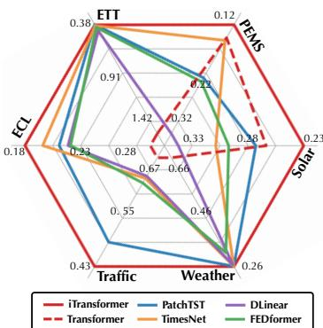  
Figure 1: iTransformer 的性能。按照 TimesNet (2023) 汇报了平均结果（MSE）。

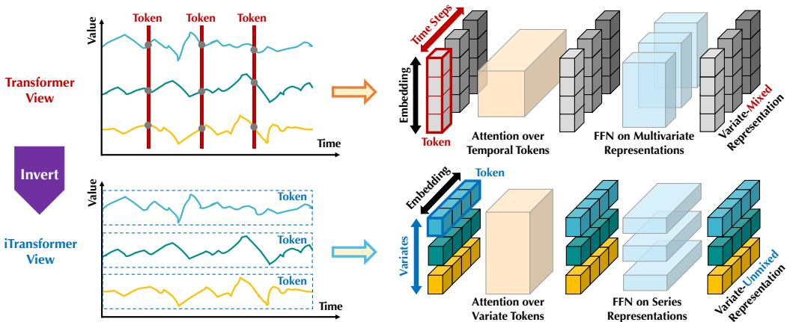  
Figure 2: 原生 Transformer（上）与所提出的 iTransformer（下）之间的对比。Transformer 嵌入时间 token，其中包含每个时间步的多变量表示。iTransformer 将每个序列独立嵌入为变量 token，从而使注意力模块刻画多变量相关性，前馈网络编码序列表示。

考虑到围绕基于 Transformer 的预测器的争议，我们反思了为什么 Transformer 在许多其他领域占据主导地位，却在时间序列预测中表现得甚至不如线性模型。我们注意到，现有的基于 Transformer 的预测器结构可能并不适用于多变量时间序列预测。如图 2 顶部所示，值得注意的是，由不一致测量记录、基本代表完全不同物理意义的同一时间步的数据点被嵌入到一个 token 中，从而抹除了多变量相关性。并且，由于感受野过于局部以及由同时发生的时间点所代表的时间非对齐事件，由单个时间步构成的 token 很难揭示有益的信息。此外，尽管序列的变化可能极大程度地受到序列顺序的影响，但在时间维度上却不恰当地采用了置换不变的注意力机制（Zeng et al., 2023）。因此，Transformer 在捕获基本序列表示和刻画多变量相关性方面的能力被削弱，限制了其在多样化时间序列数据上的容量和泛化能力。

考虑到将同一时间戳的多变量数据点嵌入为一个（时间）token 的潜在风险，我们对时间序列采用了倒置的视角，将每个变量的整条时间序列独立嵌入为一个（变量）token，这是扩大局部感受野的 Patching (Nie et al., 2023) 的极致情况。通过倒置，嵌入的 token 聚合了序列的全局表征，这些表征可以更加以变量为中心，并能更好地被蓬勃发展的注意力机制用于多变量关联建模。同时，前馈网络（feed-forward network）能够充分胜任从任意回看序列编码出的不同变量中学习可泛化的表征，并解码以预测未来的序列。

基于上述动机，我们认为并非 Transformer 在时间序列预测中无效，而是其使用方式不当。在本文中，我们重新审视了 Transformer 的结构，并提倡将 iTransformer 作为时间序列预测的基础骨干网络（backbone）。从技术上讲，我们将每条时间序列嵌入为变量 token，采用注意力机制进行多变量关联，并利用前馈网络进行序列特征表征。实验表明，所提出的 iTransformer 在 Figure 1 所示的真实世界预测基准测试中取得了最先进的（state-of-the-art）性能，并出人意料地解决了基于 Transformer 的预测模型的痛点。我们的贡献主要体现在三个方面：

• 我们反思了 Transformer 的架构，并指出原生 Transformer 组件在多变量时间序列上的强大能力尚未得到充分挖掘。

• 我们提出了 iTransformer，它将独立的时间序列视为 token，通过自注意力机制捕获多变量关联，并利用层归一化（layer normalization）和前馈网络模块学习更好的序列全局表征以用于时间序列预测。

• 在实验方面，iTransformer 在真实世界基准测试中取得了全面的最先进性能。我们广泛分析了倒置模块和架构选择，为未来基于 Transformer 的预测模型的改进指明了极具前景的方向。

## 2 相关工作

随着在自然语言处理和计算机视觉领域取得的突破性进展，精心设计的 Transformer 变体被相继提出以应对无处不在的时间序列预测应用。超越同期的 TCNs (Bai et al., 2018; Liu et al., 2022a) 和基于 RNN 的预测模型 (Zhao et al., 2017; Rangapuram et al., 2018; Salinas et al., 2020)，Transformer 展现出了强大的序列建模能力和可观的模型可扩展性，引发了针对时间序列预测进行积极改进的热潮。

通过对基于 Transformer 的预测模型进行系统性综述，我们总结出，根据是否修改组件和架构，现有的改进可以分为四类。如图 3 所示，第一类（Wu et al., 2021; Li et al., 2021; Zhou et al., 2022）是最常见的做法，主要关注组件适配，特别是用于时间依赖建模的注意力模块以及在长序列上的复杂度优化。然而，随着线性预测模型（Oreshkin et al., 2019; Zeng et al., 2023; Das et al., 2023; Liu et al., 2023）的迅速兴起，其出色的性能和效率不断向这一方向发起挑战。不久之后，第二类尝试充分利用 Transformer。它更关注时间序列的固有处理，例如平稳化（Stationarization，Liu et al., 2022b）、通道独立性（Channel Independence）和分块（Patching，Nie et al., 2023），这些方法带来了持续的性能提升。此外，面对多变量独立性与相互作用日益增长的重要性，第三类在组件和架构两个方面对 Transformer 进行了重构。代表性工作（Zhang & Yan, 2023）通过革新的注意力机制和架构显式捕获了跨时间与跨变量的依赖关系。

与以往的工作不同，iTransformer 没有修改 Transformer 的任何原生组件。相反，我们在改变后的架构中将这些组件应用于倒置的维度上，据我们所知，这是唯一属于第四类的模型。我们认为这些组件的能力已经经受了广泛的检验，真正的问题在于 Transformer 的架构被不当地采用了。

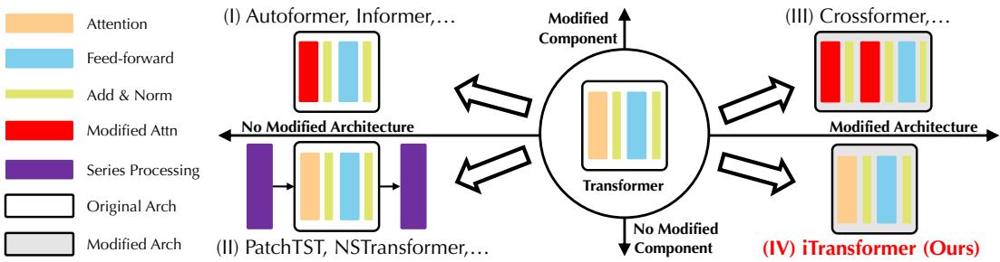  
Figure 3: 按组件和架构修改分类的基于 Transformer 的预测模型。

## 3 ITRANSFORMER

在多元时间序列预测中，给定包含 T 个时间步和 N 个变量的历史观测值 ${ \bf X } = \{ { \bf x } _ { 1 } , \ldots , { \bf x } _ { T } \} \in \mathbb { R } ^ { T \times N }$，我们预测未来 S 个时间步 $\mathbf { Y } = \{ \mathbf { x } _ { T + 1 } , \dotsc , \mathbf { x } _ { T + S } \} \in$ $\mathbb { R } ^ { S \times N }$。为方便起见，我们将 $\mathbf { X } _ { t , : }$ 表示为在时间步 t 同时记录的时间点，将 $\mathbf { X } _ { : , n }$ 表示为索引为 n 的每个变量的完整时间序列。值得注意的是，由于数据集中各变量之间存在系统性时间滞后，在实际场景中 $\mathbf { X } _ { t , : }$ 可能并不包含本质上反映同一事件的时间点。此外，$\mathbf { X } _ { t , : }$ 中的各元素在物理测量单位和统计分布上可能彼此不同，而单个变量 $\mathbf { X } _ { : , n }$ 通常共享相同的属性。

## 3.1 结构概览

我们提出的 iTransformer 如图 Figure 4 所示，采用了 Transformer (Vaswani et al., 2017) 的仅编码器（encoder-only）架构，包括嵌入（embedding）、投影（projection）以及 Transformer 块。

将整条序列嵌入为词元 大多数基于 Transformer 的预测模型通常将同一时间步的多个变量视为（时间）词元（token），并遵循预测任务的生成式公式表述。然而，我们发现在数值模态上，这种方法对于学习注意力图（attention maps）的指导性可能较弱，这得到了 Patching (Dosovitskiy et al., 2021; Nie et al., 2023) 越来越广泛应用的支持，该技术拓展了相应的感受野。与此同时，线性预测模型的成功也对采用繁重的编码器-解码器 Transformer 来生成词元的必要性提出了挑战。相反，我们提出的仅编码器 iTransformer 专注于多变量序列的表示学习和自适应关联。由底层复杂过程驱动的每条时间序列首先被词元化以描述该变量的特性，然后通过自注意力机制进行相互交互，并由前馈网络分别处理以获得序列表示。值得注意的是，生成预测序列的任务本质上交给了线性层，以往的研究 (Das et al., 2023) 已证明线性层足以胜任该任务，我们将在下一节中提供详细分析。

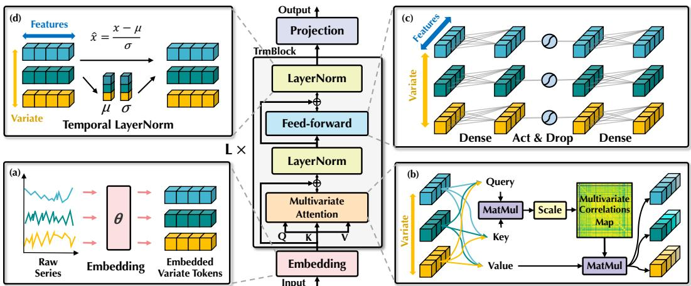  
Figure 4: iTransformer 的整体结构，它与 Transformer 的编码器共享相同的模块排列。(a) 不同变量的原始序列被独立嵌入为词元。(b) 自注意力机制应用于嵌入的变量词元，具有增强的可解释性，揭示了多变量间的相关性。(c) 每个词元的序列表示由共享的前馈网络提取。(d) 采用层归一化（Layer normalization）以减少变量之间的差异。

基于上述考量，在 iTransformer 中，基于回溯序列 $\mathbf { X } _ { : , n }$ 预测每个特定变量的未来序列 $\hat { \mathbf { Y } } _ { : , n }$ 的过程可简要表述如下：

$$
\begin{array}{c} \mathbf {h} _ {n} ^ {0} = \text {Embedding} (\mathbf {X} _ {:, n}), \\ \mathbf {H} ^ {l + 1} = \text {TrmBlock} (\mathbf {H} ^ {l}), l = 0, \ldots , L - 1, \\ \hat {\mathbf {Y}} _ {:, n} = \text {Projection} (\mathbf {h} _ {n} ^ {L}), \end{array}\tag{1}
$$

其中 $\mathbf { H } = \{ \mathbf { h } _ { 1 } , \dots , \mathbf { h } _ { N } \} \in \mathbb { R } ^ { N \times D }$ 包含 $N$ 个维度为 $D$ 的嵌入 token（词元），上标表示层索引。Embedding（嵌入）$: \mathbb { R } ^ { T } \mapsto \mathbb { R } ^ { D }$ 和 Projection（投影）: $\mathbb { R } ^ { D } \mapsto \mathbb { R } ^ { S }$ 均由多层感知机（multi-layer perceptron, MLP）实现。获取到的变量 token 通过自注意力机制相互交互，并在每个 TrmBlock 中由共享的前馈网络独立处理。具体而言，由于序列的顺序被隐式存储在前馈网络的神经元排列中，因此原始 Transformer 中的位置嵌入在这里不再需要。

iTransformers 该架构本质上对 Transformer 变体没有更多特定要求，只要注意力机制适用于多变量相关性即可。因此，一系列高效注意力机制（Li et al., 2021; Wu et al., 2022; Dao et al., 2022）可以作为插件，从而在变量数量变大时降低复杂度。此外，得益于注意力机制在输入上的灵活性，token 数量在训练到推理过程中可以变化，且模型允许在任意数量的变量上进行训练。倒置的 Transformer 被命名为 iTransformer，在第 4.2 节的实验中得到了广泛评估，并展示了在时间序列预测上的优势。

## 3.2 倒置 Transformer 组件

我们组织了一个由 $L$ 个块组成的堆叠结构，这些块由层归一化（layer normalization）、前馈网络（feed-forward network）和自注意力（self-attention）模块组成。但它们在倒置维度上的职责被仔细重新审视。

Layer normalization（层归一化） 层归一化（Ba et al., 2016）最初被提出是为了提高深度网络的收敛速度和训练稳定性。在典型的基于 Transformer 的预测器中，该模块对同一时间戳的多变量表示进行归一化，逐渐将各变量相互融合。一旦采集的时间点不代表同一事件，该操作还会引入非因果或延迟过程之间的交互噪声。在我们的倒置版本中，归一化应用于单个变量的序列表示，如公式 2 所示，这已被研究并证明在解决非平稳问题上是有效的（Kim et al., 2021; Liu et al., 2022b）。此外，由于所有作为（变量）token 的序列都被归一化为高斯分布，因此可以减少由不一致测量引起的差异。相比之下，在以往的架构中，时间步的不同 token 会被归一化，导致过度平滑的时间序列。

$$
\operatorname{LayerNorm} (\mathbf {H}) = \left\{\frac {\mathbf {h} _ {n} - \operatorname{Mean} (\mathbf {h} _ {n})}{\sqrt {\operatorname{Var} (\mathbf {h} _ {n})}} \Bigg | n = 1, \dots , N \right\}\tag{2}
$$

前馈网络 Transformer 采用前馈网络（FFN）作为编码 token 表征的基础构建块，并且它同等地应用于每个 token。如前所述，在原始（vanilla）Transformer 中，构成 token 的同一时间戳下的多个变量可能存在错位，并且过于局部化而无法揭示足够用于预测的信息。在倒置版本（inverted version）中，FFN 被应用于每个变量 token 的序列表征。根据通用近似定理（Hornik, 1991），它们能够提取复杂的表征来描述时间序列。通过倒置模块的堆叠，它们致力于利用密集的非线性连接对观测到的时间序列进行编码，并解码出未来序列的表征，其效果与近期完全基于 MLP 构建的工作（Tolstikhin et al., 2021; Das et al., 2023）同样有效。

更有趣的是，对独立时间序列执行相同的线性操作——这相当于近期线性预测器（Zeng et al., 2023）与通道独立性（Channel Independence）（Nie et al., 2023）的结合——有助于我们理解序列表示。近期对线性预测器的重新审视（Li et al., 2023）强调，MLP 提取的时间特征应当在不同时间序列之间共享。我们提出了一个合理的解释：MLP 的神经元被训练来刻画任意时间序列的内在属性，例如振幅、周期性甚至频谱（神经元充当滤波器），相比应用于时间点的自注意力机制，它是一种更具优势的预测性表征学习器。在实验中，我们在 Section 4.3 中验证了这种分工有助于发挥线性层的优势，例如在提供更长的回溯序列时能够提升性能，以及对未见变量具备泛化能力。

自注意力 虽然在以往的预测器中注意力机制通常被用来促进时间依赖性建模，但倒置模型将单个变量的整个序列视为一个独立的过程。具体而言，在全面提取了每个时间序列的表征 $\dot { \mathbf { H } } = \{ \mathbf { h } _ { 0 } , \dotsc , \mathbf { h } _ { N } \} \in \mathbb { R } ^ { N \times \check { D } }$ 之后，自注意力模块采用线性投影获取查询（queries）、键（keys）和值（values）$\mathbf { Q } , \mathbf { K } , \mathbf { V } \in \mathbb { R } ^ { N \times d _ { k } }$，其中 $d _ { k }$ 为投影维度。

将 $\mathbf { q } _ { i } , \mathbf { k } _ { j } \in \mathbb { R } ^ { d _ { k } }$ 表示为某个（变量）token 的具体 query 和 key，我们注意到 pre-Softmax 分数的每个条目被公式化为 $\mathbf { A } _ { i , j } = ( \mathbf { Q } \mathbf { K } ^ { \top } / \sqrt { d _ { k } } ) _ { i , j } \propto \mathbf { q } _ { i } ^ { \top } \mathbf { k } _ { j }$。由于每个 token 预先在其特征维度上进行了归一化，这些条目可以在一定程度上揭示变量间的相关性，并且整个分数图 $\mathbf { A } \in \mathbb { R } ^ { N \times N }$ 展示了成对变量 token 之间的多元相关性。因此，高度相关的变量在接下来与 values V 的表征交互中将被赋予更大的权重。基于这种直觉，所提出的机制被认为对于多元序列预测更加自然且具有可解释性。我们在 Section 4.3 和 Appendix E.1 中进一步提供了分数图的可视化分析。

## 4 实验 (EXPERIMENTS)

我们在各种时间序列预测应用中对提出的 iTransformer 进行了全面评估，验证了所提框架的通用性，并进一步深入探讨了将 Transformer 组件应用于时间序列倒置维度的有效性。

数据集（Datasets） 我们在实验中广泛包含了 7 个真实世界数据集，包括 Autoformer (Wu et al., 2021) 所使用的 ECL、ETT（4 个子集）、Exchange、Traffic、Weather，LSTNet (Lai et al., 2018) 中提出的 Solar-Energy 数据集，以及 SCINet (Liu et al., 2022a) 中评估的 PEMS（4 个子集）。我们还在 Appendix F.4 中提供了在 Market（6 个子集）上的实验。该数据集记录了具有数百个变量的 Alipay 在线交易应用程序的分钟级采样服务器负载，我们在该数据集上始终优于其他基线模型。详细的数据集描述见 Appendix A.1。

## 4.1 预测结果 (FORECASTING RESULTS)

在本节中，我们进行了广泛的实验，以评估我们提出的模型与先进深度预测模型的预测性能。

基线模型（Baselines） 我们精心选择了 10 个公认的预测模型作为基准，包括 (1) 基于 Transformer 的方法：Autoformer (Wu et al., 2021)、FEDformer (Zhou et al., 2022)、Stationary (Liu et al., 2022b)、Crossformer (Zhang & Yan, 2023)、PatchTST (Nie et al., 2023)；(2) 基于线性模型（Linear）的方法：DLinear (Zeng et al., 2023)、TiDE (Das et al., 2023)、RLinear (Li et al., 2023)；以及 (3) 基于 TCN 的方法：SCINet (Liu et al., 2022a)、TimesNet (Wu et al., 2023)。

主要结果 综合预测结果列于 Table 1 中，最优结果以红色标出，次优结果加下划线。更低的 MSE/MAE 表示更准确的预测结果。与其他预测模型相比，iTransformer 尤其擅长预测高维时间序列。此外，作为先前最先进（state-of-the-art）的模型，PatchTST 在 PEMS 的许多情况下表现不佳，这可能源于该数据集序列的极度波动，且 PatchTST 的分块（patching）机制可能失去对特定局部性的关注，从而难以处理快速波动。相比之下，本文提出的模型通过聚合整个序列的变化来获得序列表示，能够更好地应对这种情况。值得注意的是，作为显式捕获多变量相关性的代表模型，Crossformer 的性能仍逊于 iTransformer，这表明来自不同变量的时间未对齐分块之间的交互会给预测带来不必要的噪声。因此，原生 Transformer 组件完全胜任时间建模和多变量关联，且本文提出的倒置架构（inverted architecture）能够有效应对真实世界的时间序列预测场景。

Table 1: 多变量预测结果，其中 PEMS 的预测长度 $S \in \{ 1 2 , 2 4 , 3 6 , 4 8 \}$，其他数据集的预测长度 $S \in \{ 9 6 , 1 9 2 , 3 3 6 , 7 2 0 \}$，固定回溯长度 $T = 9 6$。结果为所有预测长度的平均值。Avg 表示在子集间进一步取平均。完整结果列于附录 F.4。

<table><tr><td>模型</td><td colspan="2">iTransformer (本文方法)</td><td colspan="2">RLinear (2023)</td><td colspan="2">PatchTST (2023)</td><td colspan="2">Crossformer (2023)</td><td colspan="2">TiDE (2023)</td><td colspan="2">TimesNet (2023)</td><td colspan="2">DLinear (2023)</td><td colspan="2">SCINet (2022a)</td><td colspan="2">FEDformer (2022)</td><td colspan="2">Stationary (2022b)</td><td colspan="2">Autoformer (2021)</td></tr><tr><td>指标</td><td>MSE</td><td>MAE</td><td>MSE</td><td>MAE</td><td>MSE</td><td>MAE</td><td>MSE</td><td>MAE</td><td>MSE</td><td>MAE</td><td>MSE</td><td>MAE</td><td>MSE</td><td>MAE</td><td>MSE</td><td>MAE</td><td>MSE</td><td>MAE</td><td>MSE</td><td>MAE</td><td>MSE</td><td>MAE</td></tr><tr><td>ECL</td><td>0.178</td><td>0.270</td><td>0.219</td><td>0.298</td><td>0.205</td><td>0.290</td><td>0.244</td><td>0.334</td><td>0.251</td><td>0.344</td><td>0.192</td><td>0.295</td><td>0.212</td><td>0.300</td><td>0.268</td><td>0.365</td><td>0.214</td><td>0.327</td><td>0.193</td><td>0.296</td><td>0.227</td><td>0.338</td></tr><tr><td>ETT (Avg)</td><td>0.383</td><td>0.399</td><td>0.380</td><td>0.392</td><td>0.381</td><td>0.397</td><td>0.685</td><td>0.578</td><td>0.482</td><td>0.470</td><td>0.391</td><td>0.404</td><td>0.442</td><td>0.444</td><td>0.689</td><td>0.597</td><td>0.408</td><td>0.428</td><td>0.471</td><td>0.464</td><td>0.465</td><td>0.459</td></tr><tr><td>Exchange</td><td>0.360</td><td>0.403</td><td>0.378</td><td>0.417</td><td>0.367</td><td>0.404</td><td>0.940</td><td>0.707</td><td>0.370</td><td>0.413</td><td>0.416</td><td>0.443</td><td>0.354</td><td>0.414</td><td>0.750</td><td>0.626</td><td>0.519</td><td>0.429</td><td>0.461</td><td>0.454</td><td>0.613</td><td>0.539</td></tr><tr><td>Traffic</td><td>0.428</td><td>0.282</td><td>0.626</td><td>0.378</td><td>0.481</td><td>0.304</td><td>0.550</td><td>0.304</td><td>0.760</td><td>0.473</td><td>0.620</td><td>0.336</td><td>0.625</td><td>0.383</td><td>0.804</td><td>0.509</td><td>0.610</td><td>0.376</td><td>0.624</td><td>0.340</td><td>0.628</td><td>0.379</td></tr><tr><td>Weather</td><td>0.258</td><td>0.278</td><td>0.272</td><td>0.291</td><td>0.259</td><td>0.281</td><td>0.259</td><td>0.315</td><td>0.271</td><td>0.320</td><td>0.259</td><td>0.287</td><td>0.265</td><td>0.317</td><td>0.292</td><td>0.363</td><td>0.309</td><td>0.360</td><td>0.288</td><td>0.314</td><td>0.338</td><td>0.382</td></tr><tr><td>Solar-Energy</td><td>0.233</td><td>0.262</td><td>0.369</td><td>0.356</td><td>0.270</td><td>0.307</td><td>0.641</td><td>0.639</td><td>0.347</td><td>0.417</td><td>0.301</td><td>0.319</td><td>0.330</td><td>0.401</td><td>0.282</td><td>0.375</td><td>0.291</td><td>0.381</td><td>0.261</td><td>0.381</td><td>0.885</td><td>0.711</td></tr><tr><td>PEMS (Avg)</td><td>0.119</td><td>0.218</td><td>0.514</td><td>0.482</td><td>0.217</td><td>0.305</td><td>0.220</td><td>0.304</td><td>0.375</td><td>0.440</td><td>0.148</td><td>0.246</td><td>0.320</td><td>0.394</td><td>0.121</td><td>0.222</td><td>0.224</td><td>0.327</td><td>0.151</td><td>0.249</td><td>0.614</td><td>0.575</td></tr></table>

## 4.2 iTransformer 通用性

在本节中，我们通过将所提出的框架应用于 Transformer 及其变体来评估 iTransformer。这些变体通常旨在解决自注意力机制的二次复杂度，包括 Reformer (Kitaev et al., 2020)、Informer (Li et al., 2021)、Flowformer (Wu et al., 2022) 和 FlashAttention (Dao et al., 2022)。实验展现了令人惊喜且富有前景的发现，表明这种简单的倒置视角能够增强基于 Transformer 的预测模型，兼顾性能与效率的提升、对未见变量（variates）的泛化能力，以及对历史观测值的更充分利用。

性能提升 我们评估了各 Transformer 及其对应的 iTransformer，并在 Table 2 中汇报了性能提升情况。值得注意的是，该框架持续提升了各种 Transformer 的表现。总体而言，它在 Transformer 上平均实现了 38.9% 的提升，在 Reformer 上提升 36.1%，在 Informer 上提升 28.5%，在 Flowformer 上提升 16.8%，在 Flashformer 上提升 32.2%，这揭示了以往在时间序列预测中对 Transformer 架构的不当使用。此外，由于在我们的倒置结构中注意力机制应用于变量维度，引入具有线性复杂度的高效注意力机制从根本上解决了多变量导致的计算难题——这种情况在实际应用中极为普遍，但对于通道独立（Channel Independence, Nie et al., 2023）方法而言却非常耗费资源。因此，iTransformer 的思想可以广泛应用于基于 Transformer 的预测模型，以充分利用蓬勃发展的高效注意力机制。

Table 2: 通过我们的倒置框架获得的性能提升。Flashformer 表示配备了硬件加速 FlashAttention (Dao et al., 2022) 的 Transformer。我们汇报了平均性能与 MSE 的相对降低幅度（提升）。完整结果见附录 F.2。

<table><tr><td colspan="2">模型</td><td colspan="2">Transformer (2017)</td><td colspan="2">Reformer (2020)</td><td colspan="2">Informer (2021)</td><td colspan="2">Flowformer (2022)</td><td colspan="2">Flashformer (2022)</td></tr><tr><td colspan="2">指标</td><td>MSE</td><td>MAE</td><td>MSE</td><td>MAE</td><td>MSE</td><td>MAE</td><td>MSE</td><td>MAE</td><td>MSE</td><td>MAE</td></tr><tr><td rowspan="3">ECL</td><td>原始</td><td>0.277</td><td>0.372</td><td>0.338</td><td>0.422</td><td>0.311</td><td>0.397</td><td>0.267</td><td>0.359</td><td>0.285</td><td>0.377</td></tr><tr><td>+倒置</td><td>0.178</td><td>0.270</td><td>0.208</td><td>0.301</td><td>0.216</td><td>0.311</td><td>0.210</td><td>0.293</td><td>0.206</td><td>0.291</td></tr><tr><td>提升</td><td>35.6%</td><td>27.4%</td><td>38.4%</td><td>28.7%</td><td>30.5%</td><td>21.6%</td><td>21.3%</td><td>18.6%</td><td>27.8%</td><td>22.9%</td></tr><tr><td rowspan="3">Traffic</td><td>原始</td><td>0.665</td><td>0.363</td><td>0.741</td><td>0.422</td><td>0.764</td><td>0.416</td><td>0.750</td><td>0.421</td><td>0.658</td><td>0.356</td></tr><tr><td>+倒置</td><td>0.428</td><td>0.282</td><td>0.647</td><td>0.370</td><td>0.662</td><td>0.380</td><td>0.524</td><td>0.355</td><td>0.492</td><td>0.333</td></tr><tr><td>提升</td><td>35.6%</td><td>22.3%</td><td>12.7%</td><td>12.3%</td><td>13.3%</td><td>8.6%</td><td>30.1%</td><td>15.6%</td><td>25.2%</td><td>6.4%</td></tr><tr><td rowspan="3">Weather</td><td>原始</td><td>0.657</td><td>0.572</td><td>0.803</td><td>0.656</td><td>0.634</td><td>0.548</td><td>0.286</td><td>0.308</td><td>0.659</td><td>0.574</td></tr><tr><td>+倒置</td><td>0.258</td><td>0.279</td><td>0.248</td><td>0.292</td><td>0.271</td><td>0.330</td><td>0.266</td><td>0.285</td><td>0.262</td><td>0.282</td></tr><tr><td>提升</td><td>60.2%</td><td>50.8%</td><td>69.2%</td><td>55.5%</td><td>57.3%</td><td>39.8%</td><td>7.2%</td><td>7.7%</td><td>60.2%</td><td>50.8%</td></tr></table>

变量泛化 通过倒置标准 Transformer，值得注意的是模型被赋予了在未见变量上的泛化能力。首先，得益于输入 token 数量的灵活性，变量通道的数量不再受限，因此在训练和推理阶段可以有所变化。此外，在 iTransformer 中，前馈网络以相同方式应用于独立的变量 token。正如前文所述，作为滤波器的神经元学习了任意时间序列的内在模式，这些模式倾向于在不同变量之间共享和迁移。

为了验证该假设，我们将反转与另一种泛化策略进行了比较：通道独立性（Channel Independence），即训练一个共享骨干网络来预测所有变量。我们将每个数据集的变量划分为五折，仅使用其中一折的 20% 变量来训练模型，并在不进行微调的情况下直接预测所有变量。我们在 Figure 5 中对比了性能，每个柱状图代表所有折的平均结果以避免划分的随机性。CI-Transformers 在推理过程中逐个预测每个变量需要耗费大量时间，而 iTransformer 可以直接预测所有变量，且通常呈现出更小的误差增幅，这表明 FFN 能够学习可迁移的时间序列表示。这为基于 iTransformer 构建基础模型（foundation model）提供了一个潜在方向，使得包含不同变量数量的多种多元时间序列可以切实可行地一同训练。

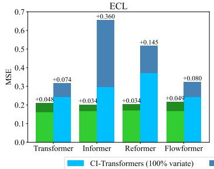

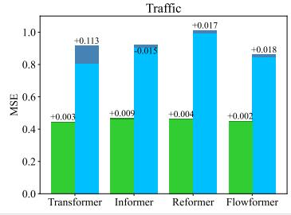

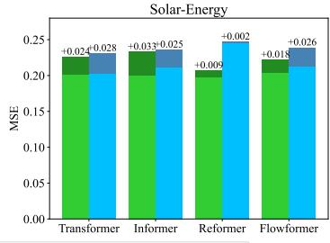  
Figure 5: 在未见变量上的泛化性能。我们将每个数据集的变量划分为五折，仅使用 20% 的变量训练模型，并使用部分训练的模型来预测所有变量。iTransformer 能够高效训练并具有良好的泛化预测能力。

增加回溯长度 以往的研究观察到，在 Transformers 上预测性能并不必然随着回溯长度的增加而提升（Nie et al., 2023; Zeng et al., 2023），这可归因于注意力在不断增长的输入上被分散。然而，对于线性预测模型，由于有统计学方法（Box & Jenkins, 1968）的理论支持，随着可利用历史信息的扩增，通常能够保持所期望的性能提升。由于注意力和前馈网络的作用维度被反转，我们在 Figure 6 中评估了随着回溯长度增加 Transformers 和 iTransformer 的性能。结果令人惊喜地验证了在时间维度上利用 MLP 的合理性，从而使 Transformers 能够从扩展的回溯窗口中获益，以实现更精准的预测。

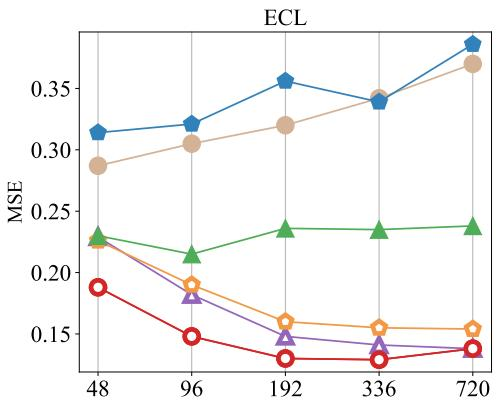

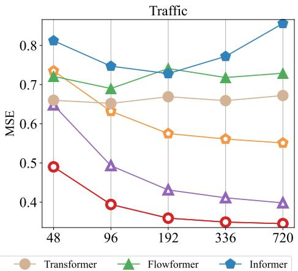  
Figure 6: 回溯长度 $T \in \{ 4 8 , 9 6 , 1 9 2 , 3 3 6 , 7 2 0 \}$ 且固定预测长度 $S ~ = ~ 9 6$ 时的预测性能。虽然基于 Transformer 的预测器性能不一定能从增加的回溯长度中获益，但反转框架赋予了原始 Transformer 及其变体在扩大的回溯窗口上获得性能提升的能力。

## 4.3 模型分析

消融实验 为了验证 Transformer 各组件的合理性，我们提供了详细的消融实验，涵盖替换组件（Replace）和移除组件（w/o）两类实验。结果如 Table 3 所示。在变量维度上利用注意力机制、在时间维度上利用前馈网络的 iTransformer 大体上取得了最佳性能。值得注意的是，原生 Transformer（vanilla Transformer，第三行）的性能在这些设计中表现最差，揭示了传统架构的潜在风险，我们在附录 E.3 中对此进行了详细描述。

Table 3: iTransformer 的消融实验。除移除组件外，我们还在相应维度上替换了不同的组件以学习多元相关性（Variate）和序列表示（Temporal）。此处列出了所有预测长度的平均结果。

<table><tr><td rowspan="2">设计</td><td rowspan="2">变量</td><td rowspan="2">时间</td><td colspan="2">ECL</td><td colspan="2">Traffic</td><td colspan="2">Weather</td><td colspan="2">Solar-Energy</td></tr><tr><td>MSE</td><td>MAE</td><td>MSE</td><td>MAE</td><td>MSE</td><td>MAE</td><td>MSE</td><td>MAE</td></tr><tr><td>iTransformer</td><td>Attention</td><td>FFN</td><td>0.178</td><td>0.270</td><td>0.428</td><td>0.282</td><td>0.258</td><td>0.278</td><td>0.233</td><td>0.262</td></tr><tr><td rowspan="3">Replace</td><td>Attention</td><td>Attention</td><td>0.193</td><td>0.293</td><td>0.913</td><td>0.500</td><td>0.255</td><td>0.280</td><td>0.261</td><td>0.291</td></tr><tr><td>FFN</td><td>Attention</td><td>0.202</td><td>0.300</td><td>0.863</td><td>0.499</td><td>0.258</td><td>0.283</td><td>0.285</td><td>0.317</td></tr><tr><td>FFN</td><td>FFN</td><td>0.182</td><td>0.287</td><td>0.599</td><td>0.348</td><td>0.248</td><td>0.274</td><td>0.269</td><td>0.287</td></tr><tr><td rowspan="2">w/o</td><td>Attention</td><td>w/o</td><td>0.189</td><td>0.278</td><td>0.456</td><td>0.306</td><td>0.261</td><td>0.281</td><td>0.258</td><td>0.289</td></tr><tr><td>w/o</td><td>FFN</td><td>0.193</td><td>0.276</td><td>0.461</td><td>0.294</td><td>0.265</td><td>0.283</td><td>0.261</td><td>0.283</td></tr></table>

系列表征分析 为了进一步验证前馈网络更适于提取系列表征这一论点，我们基于中心核对齐（Centered Kernel Alignment, CKA）相似度（Kornblith et al., 2019）进行了表征分析。更高的 CKA 表示表征更为相似。对于 Transformer 变体和 iTransformer，我们计算了第一个块与最后一个块的输出特征之间的 CKA。值得注意的是，先前的研究表明，时间序列预测作为一项低层次生成任务，更倾向于更高的 CKA 相似度（Wu et al., 2023; Dong et al., 2023）以获得更优的性能。如图 7 所示，图中展现出一条清晰的分界线，这表明 iTransformer 通过反转维度学习到了更合适的系列表征，从而实现了更准确的预测。这些结果也表明，反转 Transformer 值得作为预测骨干网络的一次基础性革新。

多变量相关性分析 通过将多变量相关性的职责赋予注意力机制，所学到的映射图具有更强的可解释性。我们在图 7 中展示了来自 Solar-Energy 序列的案例可视化，该序列在回顾窗口和未来窗口中具有截然不同的相关性。可以观察到，在较浅的注意力层中，学到的映射图与原始输入序列的相关性具有极高的相似度。随着层数的加深，学到的映射图逐渐变得与未来序列的相关性相似，这验证了反转操作赋予了注意力机制在关联建模方面具备可解释性，并且编码过去与解码未来的过程本质上是在前馈过程中于系列表征内部完成的。

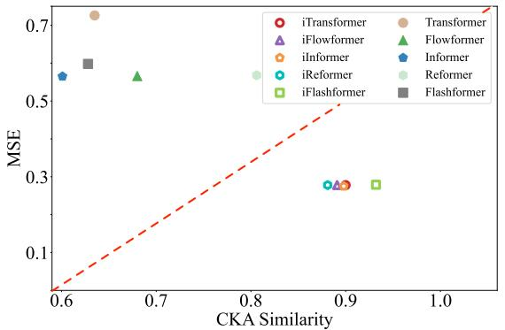

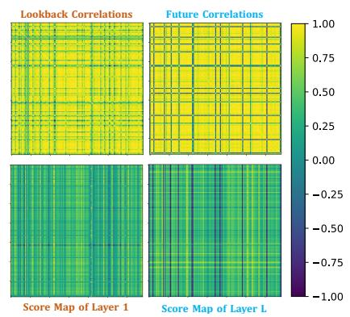  
Figure 7: 系列表征和多变量相关性分析。左图：Transformer 与 iTransformer 的 MSE 及表征 CKA 相似度对比。更高的 CKA 相似度表明其表征更有利于实现精准预测。右图：原始时间序列的多变量相关性与倒置自注意力学到的得分图的案例可视化。

高效训练策略 由于自注意力机制的二次复杂度，在海量变量上进行训练可能会带来极大的计算开销，而这在现实场景中非常普遍。除了高效注意力机制之外，我们利用先前展示的变量泛化能力，针对高维多元序列提出了一种新颖的训练策略。具体而言，我们在每个批次中随机选择部分变量，并仅使用选定的变量来训练模型。由于我们的倒置设计使得变量通道数量具有灵活性，模型在预测时仍可预测所有变量。如图 8 所示，我们提出的策略性能仍然与全变量训练相当，同时显存占用可显著降低。

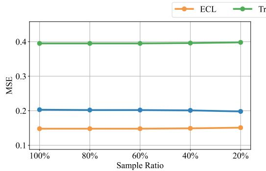

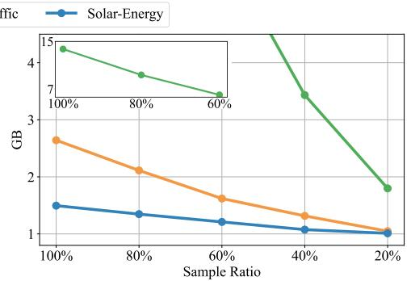  
Figure 8: 高效训练策略的分析。在每个批次针对不同采样比例的部分训练变量时，性能（左）保持稳定，同时显存占用（右）可大幅降低。我们在附录 D 中提供了全面的模型效率分析。

## 5 结论与未来工作

考虑到多元时间序列的特征，我们提出了 iTransformer，它在不修改任何原生模块的情况下倒置了 Transformer 的结构。iTransformer 将独立序列视为变量 token，以通过注意力机制捕获多元相关性，并利用层归一化（layer normalization）和前馈网络（feed-forward networks）来学习序列表示。实验表明，iTransformer 取得了最先进的性能，并在有力的分析支持下展现出卓越的框架通用性。未来，我们将探索大规模预训练和更多时间序列分析任务。

## 6 伦理声明

我们的工作仅聚焦于时间序列预测问题，因此不存在潜在的伦理风险。

## 7 可复现性声明

在正文中，我们已使用公式严格形式化了模型架构。所有实现细节均包含在附录中，包括数据集描述、评估指标、模型以及实验配置。代码将在论文被录用后公开发布。

## 致谢

本项工作得到了国家重点研发计划（2021YFB1715200）、国家自然科学基金（U2342217 和 62022050）、BNRist 创新基金（BNR2024RC01010）、CCF-蚂蚁科研基金以及大数据系统软件国家工程研究中心的支持。

## 参考文献

Jimmy Lei Ba, Jamie Ryan Kiros, and Geoffrey E. Hinton. Layer normalization. https://arxiv.org/pdf/1607.06450.pdf, 2016.

Shaojie Bai, J Zico Kolter, and Vladlen Koltun. 序列建模中通用卷积与循环网络的实证评估. arXiv preprint arXiv:1803.01271, 2, 2018.

George EP Box and Gwilym M Jenkins. 预测与控制的一些近期进展. Journal of the Royal Statistical Society. Series C (Applied Statistics), 17(2):91–109, 1968.

Tom Brown, Benjamin Mann, Nick Ryder, Melanie Subbiah, Jared D Kaplan, Prafulla Dhariwal, Arvind Neelakantan, Pranav Shyam, Girish Sastry, Amanda Askell, et al. 语言模型是少样本学习者. NeurIPS, 2020.

Tri Dao, Dan Fu, Stefano Ermon, Atri Rudra, and Christopher Re. FlashAttention：具有 IO 感知的高速且内存高效的精确注意力机制. NeurIPS, 2022.

Abhimanyu Das, Weihao Kong, Andrew Leach, Rajat Sen, and Rose Yu. 基于 TiDE 的长程预测：时间序列稠密编码器. arXiv preprint arXiv:2304.08424, 2023.

Jiaxiang Dong, Haixu Wu, Haoran Zhang, Li Zhang, Jianmin Wang, and Mingsheng Long. SimMTM：用于掩码时间序列建模的简单预训练框架. arXiv preprint arXiv:2302.00861, 2023.

Alexey Dosovitskiy, Lucas Beyer, Alexander Kolesnikov, Dirk Weissenborn, Xiaohua Zhai, Thomas Unterthiner, Mostafa Dehghani, Matthias Minderer, Georg Heigold, Sylvain Gelly, et al. 一张图片等价于 16x16 个单词：用于大规模图像识别的 Transformer. ICLR, 2021.

Vijay Ekambaram, Arindam Jati, Nam Nguyen, Phanwadee Sinthong, and Jayant Kalagnanam. TSMixer：用于多元时间序列预测的轻量级 MLP-Mixer 模型. KDD, 2023.

Lu Han, Han-Jia Ye, and De-Chuan Zhan. 容量与鲁棒性的权衡：重新审视多元时间序列预测中的通道独立策略. arXiv preprint arXiv:2304.05206, 2023.

Kurt Hornik. 多层前馈网络的逼近能力. Neural networks, 4(2): 251–257, 1991.

Jared Kaplan, Sam McCandlish, Tom Henighan, Tom B Brown, Benjamin Chess, Rewon Child, Scott Gray, Alec Radford, Jeffrey Wu, and Dario Amodei. 神经语言模型的尺度定律. arXiv preprint arXiv:2001.08361, 2020.

Taesung Kim, Jinhee Kim, Yunwon Tae, Cheonbok Park, Jang-Ho Choi, and Jaegul Choo. 可逆实例归一化：应对分布偏移的精确时间序列预测. ICLR, 2021.

Diederik P. Kingma and Jimmy Ba. Adam：一种随机优化方法. ICLR, 2015.

Nikita Kitaev, Łukasz Kaiser, and Anselm Levskaya. Reformer：高效的 Transformer. ICLR, 2020.

Simon Kornblith, Mohammad Norouzi, Honglak Lee, and Geoffrey E. Hinton. 重新审视神经网络表征的相似性. ICML, 2019.

Guokun Lai, Wei-Cheng Chang, Yiming Yang, and Hanxiao Liu. 利用深度神经网络建模长期和短期时间模式. SIGIR, 2018.

Jianxin Li, Xiong Hui, and Wancai Zhang. Informer：超越高效 Transformer 的长序列时间序列预测. arXiv: 2012.07436, 2021.

Zhe Li, Shiyi Qi, Yiduo Li, and Zenglin Xu. Revisiting long-term time series forecasting: An investigation on linear mapping. arXiv preprint arXiv:2305.10721, 2023.

Minhao Liu, Ailing Zeng, Muxi Chen, Zhijian Xu, Qiuxia Lai, Lingna Ma, and Qiang Xu. Scinet: time series modeling and forecasting with sample convolution and interaction. NeurIPS, 2022a.

Yong Liu, Haixu Wu, Jianmin Wang, and Mingsheng Long. Non-stationary transformers: Rethinking the stationarity in time series forecasting. NeurIPS, 2022b.

Yong Liu, Chenyu Li, Jianmin Wang, and Mingsheng Long. Koopa: Learning non-stationary time series dynamics with koopman predictors. arXiv preprint arXiv:2305.18803, 2023.

Yuqi Nie, Nam H Nguyen, Phanwadee Sinthong, and Jayant Kalagnanam. A time series is worth 64 words: Long-term forecasting with transformers. ICLR, 2023.

Boris N Oreshkin, Dmitri Carpov, Nicolas Chapados, and Yoshua Bengio. N-BEATS: Neural basis expansion analysis for interpretable time series forecasting. ICLR, 2019.

Adam Paszke, S. Gross, Francisco Massa, A. Lerer, James Bradbury, Gregory Chanan, Trevor Killeen, Z. Lin, N. Gimelshein, L. Antiga, Alban Desmaison, Andreas Kopf, Edward Yang, Zach DeVito,¨ Martin Raison, Alykhan Tejani, Sasank Chilamkurthy, Benoit Steiner, Lu Fang, Junjie Bai, and Soumith Chintala. Pytorch: An imperative style, high-performance deep learning library. NeurIPS, 2019.

Syama Sundar Rangapuram, Matthias W Seeger, Jan Gasthaus, Lorenzo Stella, Yuyang Wang, and Tim Januschowski. Deep state space models for time series forecasting. NeurIPS, 2018.

David Salinas, Valentin Flunkert, Jan Gasthaus, and Tim Januschowski. Deepar: Probabilistic forecasting with autoregressive recurrent networks. International Journal ofForecasting, 36(3): 1181–1191, 2020.

Ilya O Tolstikhin, Neil Houlsby, Alexander Kolesnikov, Lucas Beyer, Xiaohua Zhai, Thomas Unterthiner, Jessica Yung, Andreas Steiner, Daniel Keysers, Jakob Uszkoreit, et al. Mlp-mixer: An all-mlp architecture for vision. NeurIPS, 2021.

Ashish Vaswani, Noam Shazeer, Niki Parmar, Jakob Uszkoreit, Llion Jones, Aidan N Gomez, Lukasz Kaiser, and Illia Polosukhin. Attention is all you need. NeurIPS, 2017.

Haixu Wu, Jiehui Xu, Jianmin Wang, and Mingsheng Long. Autoformer: Decomposition transformers with Auto-Correlation for long-term series forecasting. NeurIPS, 2021.

Haixu Wu, Jialong Wu, Jiehui Xu, Jianmin Wang, and Mingsheng Long. Flowformer: Linearizing transformers with conservation flows. ICML, 2022.

Haixu Wu, Tengge Hu, Yong Liu, Hang Zhou, Jianmin Wang, and Mingsheng Long. Timesnet: Temporal 2d-variation modeling for general time series analysis. ICLR, 2023.

Ailing Zeng, Muxi Chen, Lei Zhang, and Qiang Xu. Are transformers effective for time series forecasting? AAAI, 2023.

Yunhao Zhang and Junchi Yan. Crossformer: Transformer utilizing cross-dimension dependency for multivariate time series forecasting. ICLR, 2023.

Zheng Zhao, Weihai Chen, Xingming Wu, Peter CY Chen, and Jingmeng Liu. Lstm network: a deep learning approach for short-term traffic forecast. IET Intelligent Transport Systems, 11(2):68–75, 2017.

Tian Zhou, Ziqing Ma, Qingsong Wen, Xue Wang, Liang Sun, and Rong Jin. FEDformer: Frequency enhanced decomposed transformer for long-term series forecasting. ICML, 2022.

## A 实现细节

## A.1 数据集描述

我们在 7 个真实世界数据集上进行了实验，以评估所提出的 iTransformer 的性能，包括：(1) ETT (Li et al., 2021)，包含 2016 年 7 月至 2018 年 7 月电力变压器的 7 个指标。共有四个子集，其中 ETTh1 和 ETTh2 按小时记录，ETTm1 和 ETTm2 每 15 分钟记录一次。(2) Exchange (Wu et al., 2021)，收集了 1990 年至 2016 年 8 个国家的每日汇率面板数据。(3) Weather (Wu et al., 2021)，包含 2020 年从马克斯·普朗克生物地球化学研究所（Max Planck Biogeochemistry Institute）气象站每 10 分钟采集一次的 21 个气象指标。(4) ECL (Wu et al., 2021)，记录了 321 个客户的每小时用电量数据。(5) Traffic (Wu et al., 2021)，收集了旧金山湾区高速公路 862 个传感器在 2015 年 1 月至 2016 年 12 月测量的每小时道路占用率。(6) Solar-Energy (Lai et al., 2018)，记录了 2006 年 137 个光伏（PV）电站的太阳能发电量，采样频率为每 10 分钟一次。(7) PEMS，包含以 5 分钟为窗口采集的加州公共交通网络数据。我们采用了与 SCINet (Liu et al., 2022a) 相同的四个公共子集（PEMS03、PEMS04、PEMS07、PEMS08）。

除了广泛用作预测基准的公开数据集外，我们还收集了一个真实应用场景的 Market 数据集，该数据集记录了 2023 年 1 月 30 日至 2023 年 4 月 9 日期间支付宝（Alipay）在线交易的按分钟采样的服务器负载，变量数量在 285 到 759 之间变化。它包含 6 个子数据集，根据不同的交易领域进行划分。

我们遵循了 TimesNet (Wu et al., 2023) 中使用的数据处理以及训练集-验证集-测试集划分协议，其中训练集、验证集和测试集严格按照时间顺序划分，以确保不存在数据泄漏问题。对于预测设置，我们将 ETT、Weather、ECL、Solar-Energy、PEMS 和 Traffic 中的回溯序列（lookback series）长度固定为 96，预测长度在 {96, 192, 336, 720} 中变化。对于 PEMS 数据集，预测长度在 {12, 24, 36, 48} 中变化，这与该数据集上先前的最优模型（SOTA）SCINet 相同。对于 Market 数据集，回溯序列包含过去一天具有 144 个时间点的观测值，预测长度在 {12, 24, 72, 144} 中变化。数据集的详细信息如 Table 4 所示。

## A.2 实现细节

Algorithm 1 iTransformer - 整体架构。

Require: 输入回顾时间序列 $X \in R^{T \times N}$；输入长度 T；预测长度 S；变量数量 N；token 维度 D；iTransformer 块数量 L。

1: X = X.transpose ▷  $X \in R^{N \times T}$ 

2: ▷ 多层感知机（MLP）作用于最后一个维度，将序列嵌入为变量 token。

3:  $H^{0} = \text{MLP}(X)$   ▷  $H^{0} \in R^{N \times D}$ 

4: for l in  $\{1, \ldots, L\}$ : ▷ 遍历各 iTransformer 块。

5: ▷ 自注意力（Self-attention）层应用于变量 token。

6:  $H^{l-1} = \text{LayerNorm}(H^{l-1} + \text{Self-Attn}(H^{l-1}))$   ▷  $H^{l-1} \in R^{N \times D}$ 

7: ▷ 前馈网络（Feed-forward network）用于序列表示，广播至每个 token。

8:  $H^{l} = \text{LayerNorm}(H^{l-1} + \text{Feed-Forward}(H^{l-1}))$   ▷  $H^{l} \in R^{N \times D}$ 

9: ▷ 在序列表示上采用 LayerNorm 以减少变量间差异。

10: End for

11:  $\hat{Y} = \text{MLP}(H^{L})$  ▷ 将 token 投影回预测序列， $\hat{Y} \in R^{N \times S}$ 

12:  $\hat{Y} = \hat{Y}.transpose$  ▷  $\hat{Y} \in R^{S \times N}$ 

13: Return  $\hat{Y}$  ▷ 返回预测结果  $\hat{Y}$

Table 4: 详细的数据集描述。Dim 表示每个数据集的变量数量。Dataset Size 分别表示（训练集、验证集、测试集）划分中的时间点总数。Prediction Length 表示待预测的未来时间点数量，每个数据集均包含四种预测设置。Frequency 表示时间点的采样间隔。

<table><tr><td>数据集</td><td>维度</td><td>预测长度</td><td>数据集大小</td><td>频率</td><td>信息</td></tr><tr><td>ETTh1, ETTh2</td><td>7</td><td>{96, 192, 336, 720}</td><td>(8545, 2881, 2881)</td><td>每小时</td><td>电力</td></tr><tr><td>ETTm1, ETTm2</td><td>7</td><td>{96, 192, 336, 720}</td><td>(34465, 11521, 11521)</td><td>15min</td><td>电力</td></tr><tr><td>Exchange</td><td>8</td><td>{96, 192, 336, 720}</td><td>(5120, 665, 1422)</td><td>每日</td><td>经济</td></tr><tr><td>Weather</td><td>21</td><td>{96, 192, 336, 720}</td><td>(36792, 5271, 10540)</td><td>10min</td><td>天气</td></tr><tr><td>ECL</td><td>321</td><td>{96, 192, 336, 720}</td><td>(18317, 2633, 5261)</td><td>每小时</td><td>电力</td></tr><tr><td>Traffic</td><td>862</td><td>{96, 192, 336, 720}</td><td>(12185, 1757, 3509)</td><td>每小时</td><td>交通</td></tr><tr><td>Solar-Energy</td><td>137</td><td>{96, 192, 336, 720}</td><td>(36601, 5161, 10417)</td><td>10min</td><td>能源</td></tr><tr><td>PEMS03</td><td>358</td><td>{12, 24, 48, 96}</td><td>(15617, 5135, 5135)</td><td>5min</td><td>交通</td></tr><tr><td>PEMS04</td><td>307</td><td>{12, 24, 48, 96}</td><td>(10172, 3375, 3375)</td><td>5min</td><td>交通</td></tr><tr><td>PEMS07</td><td>883</td><td>{12, 24, 48, 96}</td><td>(16911, 5622, 5622)</td><td>5min</td><td>交通</td></tr><tr><td>PEMS08</td><td>170</td><td>{12, 24, 48, 96}</td><td>(10690, 3548, 3548)</td><td>5min</td><td>交通</td></tr><tr><td>Market-Merchant</td><td>285</td><td>{12, 24, 72, 144}</td><td>(7045, 1429, 1429)</td><td>10min</td><td>交易</td></tr><tr><td>Market-Wealth</td><td>485</td><td>{12, 24, 72, 144}</td><td>(7045, 1429, 1429)</td><td>10min</td><td>交易</td></tr><tr><td>Market-Finance</td><td>405</td><td>{12, 24, 72, 144}</td><td>(7045, 1429, 1429)</td><td>10min</td><td>交易</td></tr><tr><td>Market-Terminal</td><td>307</td><td>{12, 24, 72, 144}</td><td>(7045, 1429, 1429)</td><td>10min</td><td>交易</td></tr><tr><td>Market-Payment</td><td>759</td><td>{12, 24, 72, 144}</td><td>(7045, 1429, 1429)</td><td>10min</td><td>交易</td></tr><tr><td>Market-Customer</td><td>395</td><td>{12, 24, 72, 144}</td><td>(7045, 1429, 1429)</td><td>10min</td><td>交易</td></tr></table>

所有实验均在 PyTorch (Paszke et al., 2019) 中实现，并在单个 NVIDIA P100 16GB GPU 上进行。我们使用初始学习率在 $\{ 1 0 ^ { - 3 } , 5 \times 1 0 ^ { - 4 } , 1 0 ^ { - 4 } \}$ 内的 ADAM (Kingma & Ba, 2015) 以及 L2 损失进行模型优化。批大小统一设置为 32，训练轮数固定为 10。我们将本文所提模型中倒置 Transformer 块的数量设置为 $L \in { \bar { \{ 2 , 3 , 4 \} } }$。序列表示的维度 D 设置自 {256, 512}。我们复现的所有对比基线模型均基于 TimesNet (Wu et al., 2023) 仓库的基准实现，该基准严格基于各模型原论文或官方代码所提供的配置构建。我们在 Algorithm 1 中提供了 iTransformer 的伪代码。我们还在 Table 5 中报告了 iTransformer 在五个不同随机种子运行下的性能标准差，结果表明 iTransformer 的性能非常稳定。

Table 5: iTransformer 性能的鲁棒性。结果由五个随机种子运行得出。

<table><tr><td rowspan="2">数据集 预测步长</td><td colspan="2">ECL</td><td colspan="2">ETTh2</td><td colspan="2">Exchange</td></tr><tr><td>MSE</td><td>MAE</td><td>MSE</td><td>MAE</td><td>MSE</td><td>MAE</td></tr><tr><td>96</td><td>0.148±0.000</td><td>0.240±0.000</td><td>0.297±0.002</td><td>0.349±0.001</td><td>0.088±0.001</td><td>0.209±0.001</td></tr><tr><td>192</td><td>0.162±0.002</td><td>0.253±0.002</td><td>0.380±0.001</td><td>0.400±0.001</td><td>0.181±0.001</td><td>0.304±0.001</td></tr><tr><td>336</td><td>0.178±0.000</td><td>0.269±0.001</td><td>0.428±0.002</td><td>0.432±0.001</td><td>0.334±0.001</td><td>0.419±0.001</td></tr><tr><td>720</td><td>0.225±0.006</td><td>0.317±0.007</td><td>0.427±0.004</td><td>0.445±0.002</td><td>0.829±0.012</td><td>0.691±0.005</td></tr><tr><td rowspan="2">数据集 预测步长</td><td colspan="2">Solar-Energy</td><td colspan="2">Traffic</td><td colspan="2">Weather</td></tr><tr><td>MSE</td><td>MAE</td><td>MSE</td><td>MAE</td><td>MSE</td><td>MAE</td></tr><tr><td>96</td><td>0.203±0.002</td><td>0.237±0.002</td><td>0.395±0.001</td><td>0.268±0.001</td><td>0.174±0.000</td><td>0.214±0.000</td></tr><tr><td>192</td><td>0.233±0.002</td><td>0.261±0.001</td><td>0.417±0.002</td><td>0.276±0.001</td><td>0.221±0.002</td><td>0.254±0.001</td></tr><tr><td>336</td><td>0.248±0.000</td><td>0.273±0.000</td><td>0.433±0.004</td><td>0.283±0.000</td><td>0.278±0.002</td><td>0.296±0.001</td></tr><tr><td>720</td><td>0.249±0.001</td><td>0.275±0.000</td><td>0.467±0.003</td><td>0.302±0.000</td><td>0.358±0.000</td><td>0.349±0.000</td></tr></table>

## B 消融实验

为了进一步阐述 Transformer 各组件的合理作用，我们进行了详细的消融实验，涵盖替换组件（Replace）和移除组件（w/o）。由于篇幅限制，平均结果已列于 Table 3 中，在此我们提供详细的结果与分析。

如 Table 6 所示，在各种架构设计中，iTransformer 总体上表现出更优越的性能，它通过自注意力（self-attention）学习多变量相关性，并通过 FFN 编码序列表示。然而，原始（vanilla）Transformer 的布局会导致性能退化，这表明了在时间序列模态上对 Transformer 组件的误用。根据第二种（双重注意力）和第三种（原始 Transformer）设计的相对较差的结果，其原因之一可能在于对滞后时间序列的时间标记（temporal tokens）所采用的注意力模块，我们将在 Section E.3 中结合数据集支持对其进行更详细的阐述。

还值得注意的是，在两个维度上均应用 FFN 在变量数较少的数据集（如具有 21 个变量的 Weather）上也能取得相当不错的表现。尽管如此，随着具有挑战性的多变量预测任务中变量数量的增加，捕获多变量相关性的重要性愈发凸显。我们注意到，原始 Transformer 几乎无法考虑变量的异质性。在嵌入过程中，变量被投影到无法区分的通道中，这忽略了不一致的物理度量，从而无法保持变量的独立性，更不用说捕获和利用多变量相关性了。因此，通过引入用于变量关联的高级注意力模块，第一种（iTransformer）和第五种（针对变量的注意力）设计在具有挑战性的多变量数据集上表现得更为有效。

简而言之，时间依赖性和多变量相关性对于多变量时间序列预测都至关重要。所提出的 iTransformer 采用自注意力模块来解耦变量标记（variate tokens）之间的相关性，被证明比前馈网络更强大且更具可解释性，从而进一步提升了在具有挑战性的多变量数据集上的性能，并增强了模型容量。

## C 超参数敏感性

我们评估了 iTransformer 针对以下因素的超参数敏感性：学习率 $l r ,$、Transformer 块数 $L ,$ 以及变量标记的隐藏维度 D。结果如 Figure 9 所示。我们发现，作为最常见的影响因素，当变量数量较大（ECL、Traffic）时，应当谨慎选择学习率。在 iTransformer 中，块数和隐藏维度本质上并非越大越好。

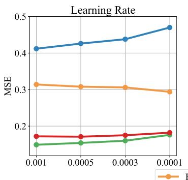

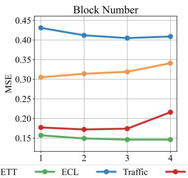

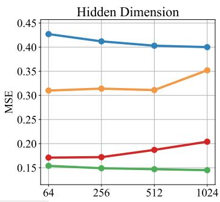  
Figure 9: 关于学习率、Transformer 块数量以及变量 token 隐藏维度的超参数敏感性。结果在回溯窗口长度 $T = 9 6$ 和预测窗口长度 $S = 9 6$ 下记录。

## D 模型效率

我们全面比较了以下模型的预测性能、训练速度和内存占用：iTransformer、采用我们高效训练策略的 iTransformer 以及采用高效 Flow Attention 模块的 iTransformer (Wu et al., 2022)；线性模型：DLinear (Zeng et al., 2023) 和 TiDE (Das et al., 2023)；Transformers：Transformer (Vaswani et al., 2017)、PatchTST (Nie et al., 2023) 和 Crossformer (Zhang & Yan, 2023)。结果均在官方模型配置和相同批大小（batch size）下记录。在 Figure 10 中，我们在两个代表性数据集（Weather 包含 21 个变量，Traffic 包含 862 个变量）上比较了回溯时间步为 96 时的效率。

Table 6: iTransformer 消融实验的完整结果。除了移除 Transformer 的特定组件外，我们还在相应维度上应用了不同的组件来学习多变量相关性（Variate）和序列表示（Temporal）。

<table><tr><td rowspan="2">设计</td><td rowspan="2">变量</td><td rowspan="2">时间</td><td>预测</td><td colspan="2">ECL</td><td colspan="2">Traffic</td><td colspan="2">Weather</td><td colspan="2">Solar-Energy</td></tr><tr><td>长度</td><td>MSE</td><td>MAE</td><td>MSE</td><td>MAE</td><td>MSE</td><td>MAE</td><td>MSE</td><td>MAE</td></tr><tr><td rowspan="5">iTransformer</td><td rowspan="5">Attention</td><td rowspan="5">FFN</td><td>96</td><td>0.148</td><td>0.240</td><td>0.395</td><td>0.268</td><td>0.174</td><td>0.214</td><td>0.203</td><td>0.237</td></tr><tr><td>192</td><td>0.162</td><td>0.253</td><td>0.417</td><td>0.276</td><td>0.221</td><td>0.254</td><td>0.233</td><td>0.261</td></tr><tr><td>336</td><td>0.178</td><td>0.269</td><td>0.433</td><td>0.283</td><td>0.278</td><td>0.296</td><td>0.248</td><td>0.273</td></tr><tr><td>720</td><td>0.225</td><td>0.317</td><td>0.467</td><td>0.302</td><td>0.358</td><td>0.349</td><td>0.249</td><td>0.275</td></tr><tr><td>均值</td><td>0.178</td><td>0.270</td><td>0.428</td><td>0.282</td><td>0.258</td><td>0.279</td><td>0.233</td><td>0.262</td></tr><tr><td rowspan="15">替换</td><td rowspan="5">Attention</td><td rowspan="5">Attention</td><td>96</td><td>0.161</td><td>0.263</td><td>1.021</td><td>0.581</td><td>0.168</td><td>0.213</td><td>0.227</td><td>0.270</td></tr><tr><td>192</td><td>0.180</td><td>0.280</td><td>0.834</td><td>0.447</td><td>0.217</td><td>0.256</td><td>0.255</td><td>0.292</td></tr><tr><td>336</td><td>0.194</td><td>0.296</td><td>0.906</td><td>0.493</td><td>0.277</td><td>0.299</td><td>0.279</td><td>0.301</td></tr><tr><td>720</td><td>0.238</td><td>0.331</td><td>0.892</td><td>0.477</td><td>0.356</td><td>0.351</td><td>0.283</td><td>0.300</td></tr><tr><td>均值</td><td>0.193</td><td>0.293</td><td>0.913</td><td>0.500</td><td>0.255</td><td>0.280</td><td>0.261</td><td>0.291</td></tr><tr><td rowspan="5">FFN</td><td rowspan="5">Attention</td><td>96</td><td>0.169</td><td>0.270</td><td>0.907</td><td>0.540</td><td>0.176</td><td>0.221</td><td>0.247</td><td>0.299</td></tr><tr><td>192</td><td>0.189</td><td>0.292</td><td>0.839</td><td>0.489</td><td>0.224</td><td>0.261</td><td>0.275</td><td>0.305</td></tr><tr><td>336</td><td>0.204</td><td>0.304</td><td>0.248</td><td>0.364</td><td>0.279</td><td>0.301</td><td>0.317</td><td>0.337</td></tr><tr><td>720</td><td>0.245</td><td>0.335</td><td>1.059</td><td>0.606</td><td>0.354</td><td>0.347</td><td>0.301</td><td>0.329</td></tr><tr><td>均值</td><td>0.202</td><td>0.300</td><td>0.863</td><td>0.499</td><td>0.258</td><td>0.283</td><td>0.285</td><td>0.317</td></tr><tr><td rowspan="5">FFN</td><td rowspan="5">FFN</td><td>96</td><td>0.159</td><td>0.261</td><td>0.606</td><td>0.342</td><td>0.162</td><td>0.207</td><td>0.237</td><td>0.277</td></tr><tr><td>192</td><td>0.171</td><td>0.271</td><td>0.559</td><td>0.342</td><td>0.211</td><td>0.252</td><td>0.273</td><td>0.293</td></tr><tr><td>336</td><td>0.187</td><td>0.287</td><td>0.569</td><td>0.348</td><td>0.270</td><td>0.293</td><td>0.284</td><td>0.287</td></tr><tr><td>720</td><td>0.211</td><td>0.307</td><td>0.664</td><td>0.359</td><td>0.349</td><td>0.345</td><td>0.284</td><td>0.289</td></tr><tr><td>均值</td><td>0.182</td><td>0.287</td><td>0.599</td><td>0.348</td><td>0.248</td><td>0.274</td><td>0.269</td><td>0.287</td></tr><tr><td rowspan="10">无</td><td rowspan="5">Attention</td><td rowspan="5">无</td><td>96</td><td>0.163</td><td>0.254</td><td>0.427</td><td>0.296</td><td>0.177</td><td>0.219</td><td>0.226</td><td>0.266</td></tr><tr><td>192</td><td>0.174</td><td>0.263</td><td>0.446</td><td>0.300</td><td>0.226</td><td>0.259</td><td>0.255</td><td>0.288</td></tr><tr><td>336</td><td>0.191</td><td>0.280</td><td>0.459</td><td>0.306</td><td>0.281</td><td>0.298</td><td>0.275</td><td>0.301</td></tr><tr><td>720</td><td>0.228</td><td>0.315</td><td>0.492</td><td>0.324</td><td>0.359</td><td>0.249</td><td>0.275</td><td>0.301</td></tr><tr><td>均值</td><td>0.189</td><td>0.278</td><td>0.456</td><td>0.306</td><td>0.261</td><td>0.281</td><td>0.258</td><td>0.289</td></tr><tr><td rowspan="5">无</td><td rowspan="5">FFN</td><td>96</td><td>0.169</td><td>0.253</td><td>0.437</td><td>0.283</td><td>0.183</td><td>0.220</td><td>0.228</td><td>0.263</td></tr><tr><td>192</td><td>0.177</td><td>0.261</td><td>0.449</td><td>0.287</td><td>0.231</td><td>0.262</td><td>0.261</td><td>0.283</td></tr><tr><td>336</td><td>0.194</td><td>0.278</td><td>0.464</td><td>0.294</td><td>0.285</td><td>0.300</td><td>0.279</td><td>0.294</td></tr><tr><td>720</td><td>0.233</td><td>0.311</td><td>0.496</td><td>0.313</td><td>0.362</td><td>0.350</td><td>0.276</td><td>0.291</td></tr><tr><td>均值</td><td>0.193</td><td>0.276</td><td>0.461</td><td>0.294</td><td>0.265</td><td>0.283</td><td>0.261</td><td>0.283</td></tr></table>

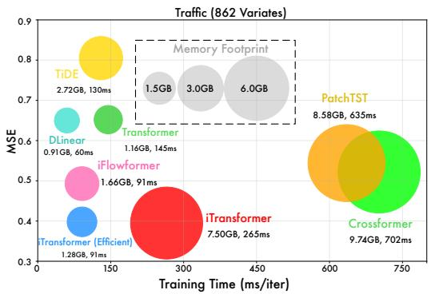

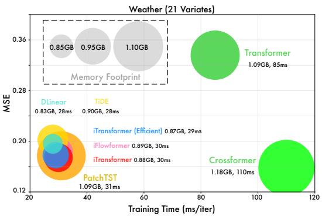  
Figure 10: Weather 和 Traffic 数据集在输入 96 步预测 96 步设置下的模型效率对比。

简而言之，在变量数量相对较少的数据集（Weather）中，iTransformer 的效率超过了其他 Transformer。在具有大量变量的数据集（Traffic）中，内存占用与 Transformer 变体基本相同，但 iTransformer 的训练速度更快。基于注意力模块 $\mathcal { O } ( N ^ { 2 } )$ 的复杂度（其中 N 为 token 的数量），在这种情况下，由于时间 token 的 $N = 9 6$ 而变量 token 的 $N = { 8 6 2 }$，Transformer 在效率上超过了 iTransformer。与此同时，由于可以显式利用多变量相关性，iTransformer 在大量变量上取得了更好的性能。通过采用线性复杂度注意力（Wu et al., 2022）或如图 8 中所提及的所提出的高效训练策略（在 20% 的变量上训练并预测所有变量），iTransformer 可以拥有与线性模型相当的速度和内存占用。此外，这两种策略还可以结合使用。

## E 案例展示

## E.1 多变量相关性的可视化

通过在变量 token 上使用注意力机制，所学习到的映射变得更具可解释性。为了直观地展现多变量相关性，我们在 Figure 11 中提供了从 Solar-Energy 中随机选取的三个时间序列案例可视化。我们通过以下公式提供了原始序列中各变量之间的皮尔逊相关系数（Pearson Correlation coefficients）：

$$
\rho_ {x y} = \frac {\sum_ {i} (x _ {i} - \bar {x}) (y _ {i} - \bar {y})}{\sqrt {\sum_ {i} (x _ {i} - \bar {x}) ^ {2}} \sqrt {\sum_ {i} (y _ {i} - \bar {y}) ^ {2}}},
$$

其中 $x _ { i } , y _ { i } \in \mathbb { R }$ 遍历待相关配对变量的所有时间点。由于该数据集在白天和夜晚表现出明显的季节性变化，所有案例在回顾窗口和预测窗口中均具有截然不同的多变量相关性。在每个案例的第二行，我们提供了第一层和最后一层自注意力模块中学习到的 pre-Softmax 映射。正如我们在浅层注意力层（左侧）观察到的那样，我们发现学习到的映射与原始回顾序列的相关性相似。随着层数的加深（右侧），学习到的映射逐渐变得更类似于待预测未来序列的相关性。这表明倒置操作在建立相关性方面实现了可解释的注意力，并且过去信息的编码和未来信息的解码是在层叠堆叠过程中通过序列表示来完成的。

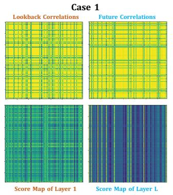

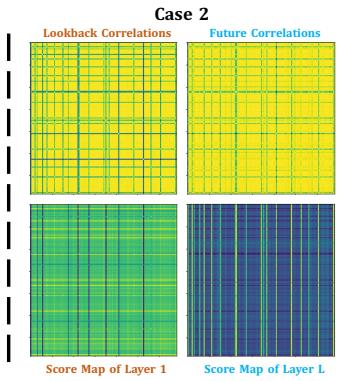

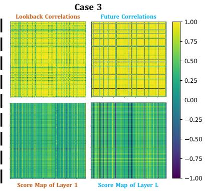  
Figure 11: 回溯序列与未来序列的多变量相关性，以及不同层倒置自注意力机制学习到的得分图。案例均来自 Solar-Energy 数据集。

我们在图 12 中展示了另一个有趣的观察结果，以表明 iTransformer 的注意力模块具有更强的可解释性。我们提供了从 Market 中随机选取的多元时间序列。在该数据集中，每个变量代表某类服务接口的监控值，且该服务可进一步归类为精细的应用类别。我们将这些变量划分为对应的应用（如顶部栏 App 所示），使得相邻变量属于同一应用，并通过顶部栏展示应用索引。

我们可视化了变量的时间序列，并绘制了学习到的多元相关性，标出了变量之间的具体相关程度。一方面，我们在多元相关性图中观察到了清晰的分区，这表明了变量的分组特性。另一方面，标记出的相关性数值能够反映原始序列的相关性，其中来自同一应用的变量相似度比来自不同组的变量对更为紧密。因此，高度相关的变量将被用于后续的交互，从而有利于多元预测。

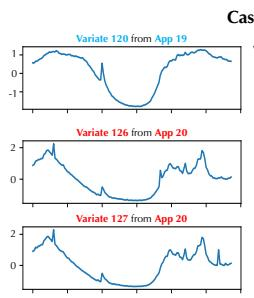

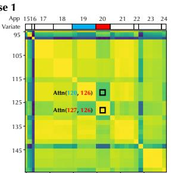

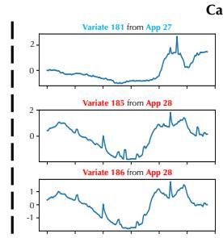

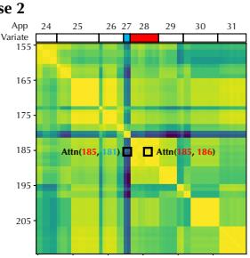  
Figure 12: 来自 Market 数据集的变量及学习到的多元相关性可视化。每个变量代表一个应用被监控的接口值，这些应用可以进一步划分为精细的类别。颜色条与图 11 共享。

## E.2 预测结果可视化

为了在不同模型之间提供清晰的比较，我们在图 13 至图 16 中列出了四个代表性数据集的补充预测展示，这些展示由以下模型给出：iTransformer、PatchTST (Nie et al., 2023)、DLinear (Zeng et al., 2023)、Crossformer (Zhang & Yan, 2023)、Autoformer (Wu et al., 2021)、Transformer (Vaswani et al., 2017)。在各模型中，iTransformer 预测出了最精确的未来序列变化，展现出卓越的性能。

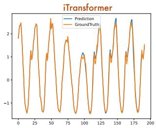

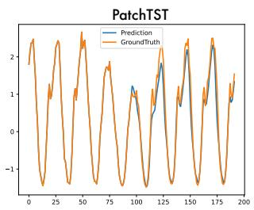

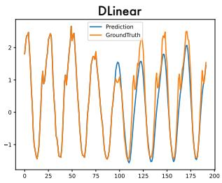

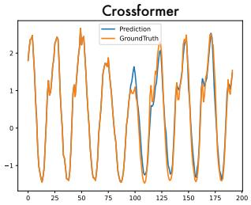

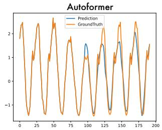  
Figure 13: Traffic 数据集上 input-96-predict-96 结果的可视化。

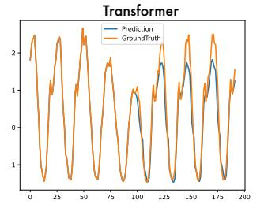

## E.3 嵌入同一时间戳多元数据点的风险

如前所述，以往 Transformer 的嵌入方法融合了代表潜在延迟事件和不同物理测量值的多个变量，这可能无法学习到以变量为中心的表示，并导致无意义的注意力图（attention maps）。我们提供了 Traffic 数据集（Liu et al., 2022a）的可视化案例，该数据集采集自洛杉矶（Los Angeles）不同区域城市道路上的传感器。如图 Figure 17 所示，我们可以观察到该数据集的多元时间序列之间存在很强的相关性，同时它们也表现出明显的相位偏移，这是由于每个序列所描述的道路占用率存在系统性的时间滞后所致。由于传感器安装在公路的不同区域，某个事件（例如交通拥堵）会对不同位置的道路占用率产生不同延迟的影响。

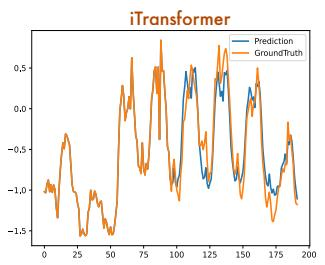

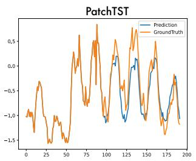

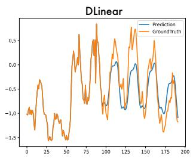

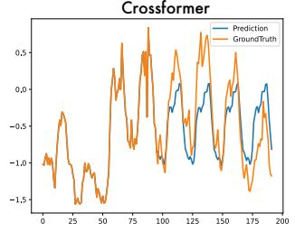

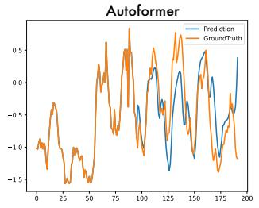  
Figure 14: ECL 数据集上 input-96-predict-96 结果的可视化。

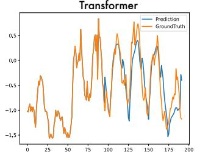

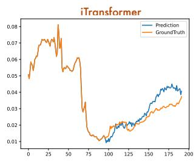

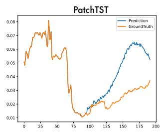

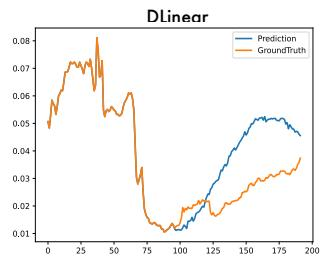

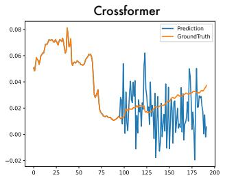

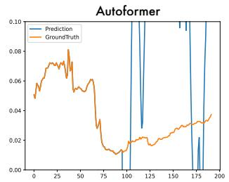

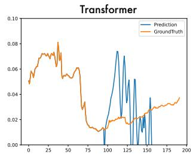  
Figure 15: Weather 数据集上 input-96-predict-96 结果的可视化。

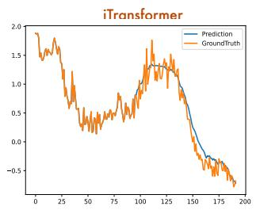

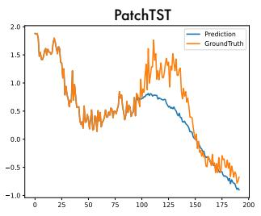

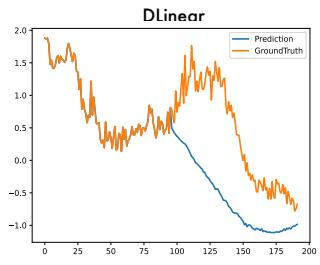

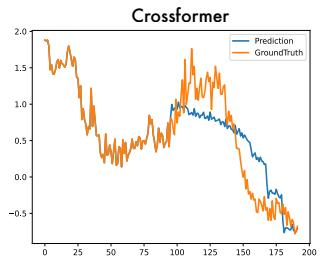

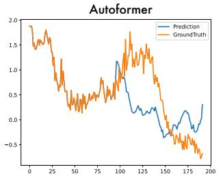

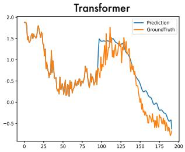  
Figure 16: PEMS 数据集上 input-96-predict-96 结果的可视化。

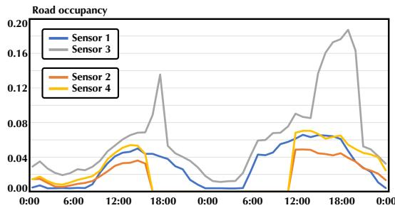

  
Figure 17: Traffic 部分变量的可视化。我们可以观察到若干序列展现出强烈的同步性（例如 Sensor 2 和 Sensor 4），并且序列之间也存在明显的滞后与超前（例如 Sensor 1 和 Sensor 2，Sensor 859 和 Sensor 861）。

此外，我们观察到在 Table 6 中 Traffic 的第二种和第三种设计上性能显著下降，这些设计将注意力机制应用于时间 token。在我们看来，通过注意力机制捕获时间依赖性本身并不是大问题。但这建立在每个时间戳的时间点本质上反映同一事件以囊括语义表征的前提之上。由于时间点之间存在固有的滞后，除非模型具有扩大的感受野以学习衰减或因果过程，否则无意义的注意力图可能会导致性能大幅下降。

其他风险可能源于不同的变量度量方式，例如在 Weather 数据集（Wu et al., 2021）中将不同的气象指标（温度和降雨量）组织在一起，以及在 ILI（Wu et al., 2023）中同一观测对象的数量和比例。鉴于这些潜在风险，iTransformer 提出了一种新范式，将整个序列嵌入为变量 token，这对于广泛的现实场景更具鲁棒性，例如延迟事件、不一致的度量指标、不规则（非均匀采样）的时间序列、监测器的系统性延迟，以及生成和记录不同时间序列的时间间隔。

## F 完整结果

## F.1 完整提升结果

我们在 Table 7 中对比了 Transformer 和 iTransformer 在所有数据集上的性能。可以实现持续且显著的提升，这表明倒置维度上的注意力机制和前馈网络极大地赋能了 Transformer 在多元时间序列预测中的表现，为构建大规模时间序列数据的基座模型提供了具有指导意义的方向。

Table 7: 原始 Transformer 与所提出的 iTransformer 之间的完整性能对比。结果基于所有四种预测长度取平均值。

<table><tr><td rowspan="2">数据集 指标</td><td colspan="2">ETT</td><td colspan="2">ECL</td><td colspan="2">PEMS</td><td colspan="2">Solar-Energy</td><td colspan="2">Traffic</td><td colspan="2">Weather</td></tr><tr><td>MSE</td><td>MAE</td><td>MSE</td><td>MAE</td><td>MSE</td><td>MAE</td><td>MSE</td><td>MAE</td><td>MSE</td><td>MAE</td><td>MSE</td><td>MAE</td></tr><tr><td>Transformer</td><td>2.750</td><td>1.375</td><td>0.277</td><td>0.372</td><td>0.157</td><td>0.263</td><td>0.256</td><td>0.276</td><td>0.665</td><td>0.363</td><td>0.657</td><td>0.572</td></tr><tr><td>iTransformer</td><td>0.383</td><td>0.407</td><td>0.178</td><td>0.270</td><td>0.113</td><td>0.221</td><td>0.233</td><td>0.262</td><td>0.428</td><td>0.282</td><td>0.258</td><td>0.279</td></tr><tr><td>提升幅度</td><td>86.1%</td><td>70.4%</td><td>35.6%</td><td>27.4%</td><td>28.0%</td><td>16.0%</td><td>9.0%</td><td>5.1%</td><td>35.6%</td><td>22.3%</td><td>60.2%</td><td>50.8%</td></tr></table>

## F.2 完整框架泛化性结果

我们将所提出的倒置框架应用于 Transformer 及其变体：Transformer (Vaswani et al., 2017)、Reformer (Kitaev et al., 2020)、Informer (Li et al., 2021)、Flowformer (Wu et al.,

2022)、Flashformer (Dao et al., 2022)。由于篇幅限制，平均结果已在 Table 2 中展示。我们在 Table 8 中提供了补充的预测结果。结果表明，我们的 iTransformer 框架能够持续提升这些 Transformer 变体的性能，并充分利用蓬勃发展的高效注意力机制。

Table 8: 应用我们倒置框架的 Transformers 完整结果。Flashformer 表示配备了硬件加速 FlashAttention (Dao et al., 2022) 的 Transformer。

<table><tr><td colspan="3">模型</td><td colspan="2">Transformer (2017)</td><td colspan="2">Reformer (2020)</td><td colspan="2">Informer (2021)</td><td colspan="2">Flowformer (2022)</td><td colspan="2">Flashformer (2022)</td></tr><tr><td colspan="3">指标</td><td>MSE</td><td>MAE</td><td>MSE</td><td>MAE</td><td>MSE</td><td>MAE</td><td>MSE</td><td>MAE</td><td>MSE</td><td>MAE</td></tr><tr><td rowspan="10">ECL</td><td rowspan="4">原始</td><td>96</td><td>0.260</td><td>0.358</td><td>0.312</td><td>0.402</td><td>0.274</td><td>0.368</td><td>0.215</td><td>0.320</td><td>0.259</td><td>0.357</td></tr><tr><td>192</td><td>0.266</td><td>0.367</td><td>0.348</td><td>0.433</td><td>0.296</td><td>0.386</td><td>0.259</td><td>0.355</td><td>0.274</td><td>0.374</td></tr><tr><td>336</td><td>0.280</td><td>0.375</td><td>0.350</td><td>0.433</td><td>0.300</td><td>0.394</td><td>0.296</td><td>0.383</td><td>0.310</td><td>0.396</td></tr><tr><td>720</td><td>0.302</td><td>0.386</td><td>0.340</td><td>0.420</td><td>0.373</td><td>0.439</td><td>0.296</td><td>0.380</td><td>0.298</td><td>0.383</td></tr><tr><td></td><td>均值</td><td>0.277</td><td>0.372</td><td>0.338</td><td>0.422</td><td>0.311</td><td>0.397</td><td>0.267</td><td>0.359</td><td>0.285</td><td>0.377</td></tr><tr><td rowspan="4">+Inverted</td><td>96</td><td>0.148</td><td>0.240</td><td>0.182</td><td>0.275</td><td>0.190</td><td>0.286</td><td>0.183</td><td>0.267</td><td>0.178</td><td>0.265</td></tr><tr><td>192</td><td>0.162</td><td>0.253</td><td>0.192</td><td>0.286</td><td>0.201</td><td>0.297</td><td>0.192</td><td>0.277</td><td>0.189</td><td>0.276</td></tr><tr><td>336</td><td>0.178</td><td>0.269</td><td>0.210</td><td>0.304</td><td>0.218</td><td>0.315</td><td>0.210</td><td>0.295</td><td>0.207</td><td>0.294</td></tr><tr><td>720</td><td>0.225</td><td>0.317</td><td>0.249</td><td>0.339</td><td>0.255</td><td>0.347</td><td>0.255</td><td>0.332</td><td>0.251</td><td>0.329</td></tr><tr><td></td><td>均值</td><td>0.178</td><td>0.270</td><td>0.208</td><td>0.301</td><td>0.216</td><td>0.311</td><td>0.210</td><td>0.293</td><td>0.206</td><td>0.291</td></tr><tr><td rowspan="10">Traffic</td><td rowspan="4">原始</td><td>96</td><td>0.647</td><td>0.357</td><td>0.732</td><td>0.423</td><td>0.719</td><td>0.391</td><td>0.691</td><td>0.393</td><td>0.641</td><td>0.348</td></tr><tr><td>192</td><td>0.649</td><td>0.356</td><td>0.733</td><td>0.420</td><td>0.696</td><td>0.379</td><td>0.729</td><td>0.419</td><td>0.648</td><td>0.358</td></tr><tr><td>336</td><td>0.667</td><td>0.364</td><td>0.742</td><td>0.420</td><td>0.777</td><td>0.420</td><td>0.756</td><td>0.423</td><td>0.670</td><td>0.364</td></tr><tr><td>720</td><td>0.697</td><td>0.376</td><td>0.755</td><td>0.432</td><td>0.864</td><td>0.472</td><td>0.825</td><td>0.449</td><td>0.673</td><td>0.354</td></tr><tr><td></td><td>均值</td><td>0.665</td><td>0.363</td><td>0.741</td><td>0.422</td><td>0.764</td><td>0.416</td><td>0.750</td><td>0.421</td><td>0.658</td><td>0.356</td></tr><tr><td rowspan="4">+Inverted</td><td>96</td><td>0.395</td><td>0.268</td><td>0.617</td><td>0.356</td><td>0.632</td><td>0.367</td><td>0.493</td><td>0.339</td><td>0.464</td><td>0.320</td></tr><tr><td>192</td><td>0.417</td><td>0.276</td><td>0.629</td><td>0.361</td><td>0.641</td><td>0.370</td><td>0.506</td><td>0.345</td><td>0.479</td><td>0.326</td></tr><tr><td>336</td><td>0.433</td><td>0.283</td><td>0.648</td><td>0.370</td><td>0.663</td><td>0.379</td><td>0.526</td><td>0.355</td><td>0.501</td><td>0.337</td></tr><tr><td>720</td><td>0.467</td><td>0.302</td><td>0.694</td><td>0.394</td><td>0.713</td><td>0.405</td><td>0.572</td><td>0.381</td><td>0.524</td><td>0.350</td></tr><tr><td></td><td>均值</td><td>0.428</td><td>0.282</td><td>0.647</td><td>0.370</td><td>0.662</td><td>0.380</td><td>0.524</td><td>0.355</td><td>0.492</td><td>0.333</td></tr><tr><td rowspan="10">Weather</td><td rowspan="4">原始</td><td>96</td><td>0.395</td><td>0.427</td><td>0.689</td><td>0.596</td><td>0.300</td><td>0.384</td><td>0.182</td><td>0.233</td><td>0.388</td><td>0.425</td></tr><tr><td>192</td><td>0.619</td><td>0.560</td><td>0.752</td><td>0.638</td><td>0.598</td><td>0.544</td><td>0.250</td><td>0.288</td><td>0.619</td><td>0.560</td></tr><tr><td>336</td><td>0.689</td><td>0.594</td><td>0.639</td><td>0.596</td><td>0.578</td><td>0.523</td><td>0.309</td><td>0.329</td><td>0.698</td><td>0.600</td></tr><tr><td>720</td><td>0.926</td><td>0.710</td><td>1.130</td><td>0.792</td><td>1.059</td><td>0.741</td><td>0.404</td><td>0.385</td><td>0.930</td><td>0.711</td></tr><tr><td></td><td>均值</td><td>0.657</td><td>0.572</td><td>0.803</td><td>0.656</td><td>0.634</td><td>0.548</td><td>0.286</td><td>0.308</td><td>0.659</td><td>0.574</td></tr><tr><td rowspan="4">+Inverted</td><td>96</td><td>0.174</td><td>0.214</td><td>0.169</td><td>0.225</td><td>0.180</td><td>0.251</td><td>0.183</td><td>0.223</td><td>0.177</td><td>0.218</td></tr><tr><td>192</td><td>0.221</td><td>0.254</td><td>0.213</td><td>0.265</td><td>0.244</td><td>0.318</td><td>0.231</td><td>0.262</td><td>0.229</td><td>0.261</td></tr><tr><td>336</td><td>0.278</td><td>0.296</td><td>0.268</td><td>0.317</td><td>0.282</td><td>0.343</td><td>0.286</td><td>0.301</td><td>0.283</td><td>0.300</td></tr><tr><td>720</td><td>0.358</td><td>0.349</td><td>0.340</td><td>0.361</td><td>0.377</td><td>0.409</td><td>0.363</td><td>0.352</td><td>0.359</td><td>0.251</td></tr><tr><td></td><td>均值</td><td>0.258</td><td>0.279</td><td>0.248</td><td>0.292</td><td>0.271</td><td>0.330</td><td>0.266</td><td>0.285</td><td>0.262</td><td>0.282</td></tr></table>

## F.3 变量泛化的完整结果

我们将每个数据集的变量划分为五个折（folder），仅使用其中一个折中 20% 的变量训练模型，并在不进行微调的情况下直接预测所有变量。我们为 Transformer 采用了两种策略来泛化到未见过的变量上：(1) CI-Transformers（Nie et al., 2023）：通道独立性（Channel Independence）将时间序列的每个变量视为独立通道，并使用共享的主干网络进行训练。在推理过程中，模型逐一预测各个变量，但该过程可能非常耗时。(2) iTransformers：借助注意力机制中输入 token 数量可动态变化的灵活性，作为 token 的变量数量不再受到限制，因此在训练和推理之间发生变化是可行的，甚至允许模型在任意变量上进行训练。

如 Table 18 所示，iTransformers 可以自然地使用 20% 的变量进行训练，并凭借学习可迁移表征的能力完成对所有变量的预测。

  
Figure 18: 在未见变量上泛化的完整性能，对比了 iTransformers 与 CI-Transformers。我们将每个数据集的变量划分为五个折，使用 20% 的变量进行训练，并使用训练好的模型预测所有变量。我们绘制了所有五个折的平均结果。

## F.4 完整的预测结果

由于正文篇幅限制，完整的多元预测结果在以下部分提供。我们在具有挑战性的预测任务上对具有竞争力的对照模型进行了广泛评估。Table 9 包含了来自 PEMS（Liu et al., 2022a）的四个公开子集上的预测结果。Table 10 包含了九个公认的预测基准数据集在所有预测长度下的详细结果。Table 11 记录了用于 Alipay 服务器负载预测的 Market 结果。所提出的模型在真实世界的预测应用中取得了全面的最先进水平（state-of-the-art）。

Table 9: PEMS 预测任务的完整结果。遵循 SCINet（2022a）的设置，我们在不同预测长度下比较了大量具有竞争力的模型。所有基线模型的输入长度均设置为 96。Avg 表示所有四个预测长度的平均结果。

<table><tr><td colspan="2">模型</td><td colspan="2">iTransformer(本文)</td><td colspan="2">RLinear(2023)</td><td colspan="2">PatchTST(2023)</td><td colspan="2">Crossformer(2023)</td><td colspan="2">TiDE(2023)</td><td colspan="2">TimesNet(2023)</td><td colspan="2">DLinear(2023)</td><td colspan="2">SCINet(2022a)</td><td colspan="2">FEDformer(2022)</td><td colspan="2">Stationary(2022b)</td><td colspan="2">Autoformer(2021)</td></tr><tr><td colspan="2">指标</td><td>MSE</td><td>MAE</td><td>MSE</td><td>MAE</td><td>MSE</td><td>MAE</td><td>MSE</td><td>MAE</td><td>MSE</td><td>MAE</td><td>MSE</td><td>MAE</td><td>MSE</td><td>MAE</td><td>MSE</td><td>MAE</td><td>MSE</td><td>MAE</td><td>MSE</td><td>MAE</td><td>MSE</td><td>MAE</td></tr><tr><td rowspan="5">PEMS03</td><td>12</td><td>0.071</td><td>0.174</td><td>0.126</td><td>0.236</td><td>0.099</td><td>0.216</td><td>0.090</td><td>0.203</td><td>0.178</td><td>0.305</td><td>0.085</td><td>0.192</td><td>0.122</td><td>0.243</td><td>0.066</td><td>0.172</td><td>0.126</td><td>0.251</td><td>0.081</td><td>0.188</td><td>0.272</td><td>0.385</td></tr><tr><td>24</td><td>0.093</td><td>0.201</td><td>0.246</td><td>0.334</td><td>0.142</td><td>0.259</td><td>0.121</td><td>0.240</td><td>0.257</td><td>0.371</td><td>0.118</td><td>0.223</td><td>0.201</td><td>0.317</td><td>0.085</td><td>0.198</td><td>0.149</td><td>0.275</td><td>0.105</td><td>0.214</td><td>0.334</td><td>0.440</td></tr><tr><td>48</td><td>0.125</td><td>0.236</td><td>0.551</td><td>0.529</td><td>0.211</td><td>0.319</td><td>0.202</td><td>0.317</td><td>0.379</td><td>0.463</td><td>0.155</td><td>0.260</td><td>0.333</td><td>0.425</td><td>0.127</td><td>0.238</td><td>0.227</td><td>0.348</td><td>0.154</td><td>0.257</td><td>1.032</td><td>0.782</td></tr><tr><td>96</td><td>0.164</td><td>0.275</td><td>1.057</td><td>0.787</td><td>0.269</td><td>0.370</td><td>0.262</td><td>0.367</td><td>0.490</td><td>0.539</td><td>0.228</td><td>0.317</td><td>0.457</td><td>0.515</td><td>0.178</td><td>0.287</td><td>0.348</td><td>0.434</td><td>0.247</td><td>0.336</td><td>1.031</td><td>0.796</td></tr><tr><td>平均</td><td>0.113</td><td>0.221</td><td>0.495</td><td>0.472</td><td>0.180</td><td>0.291</td><td>0.169</td><td>0.281</td><td>0.326</td><td>0.419</td><td>0.147</td><td>0.248</td><td>0.278</td><td>0.375</td><td>0.114</td><td>0.224</td><td>0.213</td><td>0.327</td><td>0.147</td><td>0.249</td><td>0.667</td><td>0.601</td></tr><tr><td rowspan="5">PEMS04</td><td>12</td><td>0.078</td><td>0.183</td><td>0.138</td><td>0.252</td><td>0.105</td><td>0.224</td><td>0.098</td><td>0.218</td><td>0.219</td><td>0.340</td><td>0.087</td><td>0.195</td><td>0.148</td><td>0.272</td><td>0.073</td><td>0.177</td><td>0.138</td><td>0.262</td><td>0.088</td><td>0.196</td><td>0.424</td><td>0.491</td></tr><tr><td>24</td><td>0.095</td><td>0.205</td><td>0.258</td><td>0.348</td><td>0.153</td><td>0.275</td><td>0.131</td><td>0.256</td><td>0.292</td><td>0.398</td><td>0.103</td><td>0.215</td><td>0.224</td><td>0.340</td><td>0.084</td><td>0.193</td><td>0.177</td><td>0.293</td><td>0.104</td><td>0.216</td><td>0.459</td><td>0.509</td></tr><tr><td>48</td><td>0.120</td><td>0.233</td><td>0.572</td><td>0.544</td><td>0.229</td><td>0.339</td><td>0.205</td><td>0.326</td><td>0.409</td><td>0.478</td><td>0.136</td><td>0.250</td><td>0.355</td><td>0.437</td><td>0.099</td><td>0.211</td><td>0.270</td><td>0.368</td><td>0.137</td><td>0.251</td><td>0.646</td><td>0.610</td></tr><tr><td>96</td><td>0.150</td><td>0.262</td><td>1.137</td><td>0.820</td><td>0.291</td><td>0.389</td><td>0.402</td><td>0.457</td><td>0.492</td><td>0.532</td><td>0.190</td><td>0.303</td><td>0.452</td><td>0.504</td><td>0.114</td><td>0.227</td><td>0.341</td><td>0.427</td><td>0.186</td><td>0.297</td><td>0.912</td><td>0.748</td></tr><tr><td>平均</td><td>0.111</td><td>0.221</td><td>0.526</td><td>0.491</td><td>0.195</td><td>0.307</td><td>0.209</td><td>0.314</td><td>0.353</td><td>0.437</td><td>0.129</td><td>0.241</td><td>0.295</td><td>0.388</td><td>0.092</td><td>0.202</td><td>0.231</td><td>0.337</td><td>0.127</td><td>0.240</td><td>0.610</td><td>0.590</td></tr><tr><td rowspan="5">PEMS07</td><td>12</td><td>0.067</td><td>0.165</td><td>0.118</td><td>0.235</td><td>0.095</td><td>0.207</td><td>0.094</td><td>0.200</td><td>0.173</td><td>0.304</td><td>0.082</td><td>0.181</td><td>0.115</td><td>0.242</td><td>0.068</td><td>0.171</td><td>0.109</td><td>0.225</td><td>0.083</td><td>0.185</td><td>0.199</td><td>0.336</td></tr><tr><td>24</td><td>0.088</td><td>0.190</td><td>0.242</td><td>0.341</td><td>0.150</td><td>0.262</td><td>0.139</td><td>0.247</td><td>0.271</td><td>0.383</td><td>0.101</td><td>0.204</td><td>0.210</td><td>0.329</td><td>0.119</td><td>0.225</td><td>0.125</td><td>0.244</td><td>0.102</td><td>0.207</td><td>0.323</td><td>0.420</td></tr><tr><td>48</td><td>0.110</td><td>0.215</td><td>0.562</td><td>0.541</td><td>0.253</td><td>0.340</td><td>0.311</td><td>0.369</td><td>0.446</td><td>0.495</td><td>0.134</td><td>0.238</td><td>0.398</td><td>0.458</td><td>0.149</td><td>0.237</td><td>0.165</td><td>0.288</td><td>0.136</td><td>0.240</td><td>0.390</td><td>0.470</td></tr><tr><td>96</td><td>0.139</td><td>0.245</td><td>1.096</td><td>0.795</td><td>0.346</td><td>0.404</td><td>0.396</td><td>0.442</td><td>0.628</td><td>0.577</td><td>0.181</td><td>0.279</td><td>0.594</td><td>0.553</td><td>0.141</td><td>0.234</td><td>0.262</td><td>0.376</td><td>0.187</td><td>0.287</td><td>0.554</td><td>0.578</td></tr><tr><td>平均</td><td>0.101</td><td>0.204</td><td>0.504</td><td>0.478</td><td>0.211</td><td>0.303</td><td>0.235</td><td>0.315</td><td>0.380</td><td>0.440</td><td>0.124</td><td>0.225</td><td>0.329</td><td>0.395</td><td>0.119</td><td>0.234</td><td>0.165</td><td>0.283</td><td>0.127</td><td>0.230</td><td>0.367</td><td>0.451</td></tr><tr><td rowspan="5">PEMS08</td><td>12</td><td>0.079</td><td>0.182</td><td>0.133</td><td>0.247</td><td>0.168</td><td>0.232</td><td>0.165</td><td>0.214</td><td>0.227</td><td>0.343</td><td>0.112</td><td>0.212</td><td>0.154</td><td>0.276</td><td>0.087</td><td>0.184</td><td>0.173</td><td>0.273</td><td>0.109</td><td>0.207</td><td>0.436</td><td>0.485</td></tr><tr><td>24</td><td>0.115</td><td>0.219</td><td>0.249</td><td>0.343</td><td>0.224</td><td>0.281</td><td>0.215</td><td>0.260</td><td>0.318</td><td>0.409</td><td>0.141</td><td>0.238</td><td>0.248</td><td>0.353</td><td>0.122</td><td>0.221</td><td>0.210</td><td>0.301</td><td>0.140</td><td>0.236</td><td>0.467</td><td>0.502</td></tr><tr><td>48</td><td>0.186</td><td>0.235</td><td>0.569</td><td>0.544</td><td>0.321</td><td>0.354</td><td>0.315</td><td>0.355</td><td>0.497</td><td>0.510</td><td>0.198</td><td>0.283</td><td>0.440</td><td>0.470</td><td>0.189</td><td>0.270</td><td>0.320</td><td>0.394</td><td>0.211</td><td>0.294</td><td>0.966</td><td>0.733</td></tr><tr><td>96</td><td>0.221</td><td>0.267</td><td>1.166</td><td>0.814</td><td>0.408</td><td>0.417</td><td>0.377</td><td>0.397</td><td>0.721</td><td>0.592</td><td>0.320</td><td>0.351</td><td>0.674</td><td>0.565</td><td>0.236</td><td>0.300</td><td>0.442</td><td>0.465</td><td>0.345</td><td>0.367</td><td>1.385</td><td>0.915</td></tr><tr><td>平均</td><td>0.150</td><td>0.226</td><td>0.529</td><td>0.487</td><td>0.280</td><td>0.321</td><td>0.268</td><td>0.307</td><td>0.441</td><td>0.464</td><td>0.193</td><td>0.271</td><td>0.379</td><td>0.416</td><td>0.158</td><td>0.244</td><td>0.286</td><td>0.358</td><td>0.201</td><td>0.276</td><td>0.814</td><td>0.659</td></tr><tr><td colspan="2"> $1^{st}$ 计数</td><td>13</td><td>13</td><td>0</td><td>0</td><td>0</td><td>0</td><td>0</td><td>0</td><td>0</td><td>0</td><td>0</td><td>0</td><td>0</td><td>0</td><td>7</td><td>7</td><td>0</td><td>0</td><td>0</td><td>0</td><td>0</td><td>0</td></tr></table>

Table 10: 长期预测任务的完整结果。我们遵循 TimesNet (2023) 的设置，在不同预测长度下比较了广泛的竞争模型。所有基线模型的输入序列长度均设为 96。Avg 表示所有四种预测长度的平均结果。

<table><tr><td colspan="2">模型</td><td colspan="2">iTransformer（本文方法）</td><td colspan="2">RLinear (2023)</td><td colspan="2">PatchTST (2023)</td><td colspan="2">Crossformer (2023)</td><td colspan="2">TiDE (2023)</td><td colspan="2">TimesNet (2023)</td><td colspan="2">DLinear (2023)</td><td colspan="2">SCINet (2022a)</td><td colspan="2">FEDformer (2022)</td><td colspan="2">Stationary (2022b)</td><td colspan="2">Autoformer (2021)</td></tr><tr><td colspan="2">指标</td><td>MSE</td><td>MAE</td><td>MSE</td><td>MAE</td><td>MSE</td><td>MAE</td><td>MSE</td><td>MAE</td><td>MSE</td><td>MAE</td><td>MSE</td><td>MAE</td><td>MSE</td><td>MAE</td><td>MSE</td><td>MAE</td><td>MSE</td><td>MAE</td><td>MSE</td><td>MAE</td><td>MSE</td><td>MAE</td></tr><tr><td rowspan="4">ETTm1</td><td>96</td><td>0.334</td><td>0.368</td><td>0.355</td><td>0.376</td><td>0.329</td><td>0.367</td><td>0.404</td><td>0.426</td><td>0.364</td><td>0.387</td><td>0.338</td><td>0.375</td><td>0.345</td><td>0.372</td><td>0.418</td><td>0.438</td><td>0.379</td><td>0.419</td><td>0.386</td><td>0.398</td><td>0.505</td><td>0.475</td></tr><tr><td>192</td><td>0.377</td><td>0.391</td><td>0.391</td><td>0.392</td><td>0.367</td><td>0.385</td><td>0.450</td><td>0.451</td><td>0.398</td><td>0.404</td><td>0.374</td><td>0.387</td><td>0.380</td><td>0.389</td><td>0.439</td><td>0.450</td><td>0.426</td><td>0.441</td><td>0.459</td><td>0.444</td><td>0.553</td><td>0.496</td></tr><tr><td>336</td><td>0.426</td><td>0.420</td><td>0.424</td><td>0.415</td><td>0.399</td><td>0.410</td><td>0.532</td><td>0.515</td><td>0.428</td><td>0.425</td><td>0.410</td><td>0.411</td><td>0.413</td><td>0.413</td><td>0.490</td><td>0.485</td><td>0.445</td><td>0.459</td><td>0.495</td><td>0.464</td><td>0.621</td><td>0.537</td></tr><tr><td>720</td><td>0.491</td><td>0.459</td><td>0.487</td><td>0.450</td><td>0.454</td><td>0.439</td><td>0.666</td><td>0.589</td><td>0.487</td><td>0.461</td><td>0.478</td><td>0.450</td><td>0.474</td><td>0.453</td><td>0.595</td><td>0.550</td><td>0.543</td><td>0.490</td><td>0.585</td><td>0.516</td><td>0.671</td><td>0.561</td></tr><tr><td></td><td>均值</td><td>0.407</td><td>0.410</td><td>0.414</td><td>0.407</td><td>0.387</td><td>0.400</td><td>0.513</td><td>0.496</td><td>0.419</td><td>0.419</td><td>0.400</td><td>0.406</td><td>0.403</td><td>0.407</td><td>0.485</td><td>0.481</td><td>0.448</td><td>0.452</td><td>0.481</td><td>0.456</td><td>0.588</td><td>0.517</td></tr><tr><td rowspan="4">ETTm2</td><td>96</td><td>0.180</td><td>0.264</td><td>0.182</td><td>0.265</td><td>0.175</td><td>0.259</td><td>0.287</td><td>0.366</td><td>0.207</td><td>0.305</td><td>0.187</td><td>0.267</td><td>0.193</td><td>0.292</td><td>0.286</td><td>0.377</td><td>0.203</td><td>0.287</td><td>0.192</td><td>0.274</td><td>0.255</td><td>0.339</td></tr><tr><td>192</td><td>0.250</td><td>0.309</td><td>0.246</td><td>0.304</td><td>0.241</td><td>0.302</td><td>0.414</td><td>0.492</td><td>0.290</td><td>0.364</td><td>0.249</td><td>0.309</td><td>0.284</td><td>0.362</td><td>0.399</td><td>0.445</td><td>0.269</td><td>0.328</td><td>0.280</td><td>0.339</td><td>0.281</td><td>0.340</td></tr><tr><td>336</td><td>0.311</td><td>0.348</td><td>0.307</td><td>0.342</td><td>0.305</td><td>0.343</td><td>0.597</td><td>0.542</td><td>0.377</td><td>0.422</td><td>0.321</td><td>0.351</td><td>0.369</td><td>0.427</td><td>0.637</td><td>0.591</td><td>0.325</td><td>0.366</td><td>0.334</td><td>0.361</td><td>0.339</td><td>0.372</td></tr><tr><td>720</td><td>0.412</td><td>0.407</td><td>0.407</td><td>0.398</td><td>0.402</td><td>0.400</td><td>1.730</td><td>1.042</td><td>0.558</td><td>0.524</td><td>0.408</td><td>0.403</td><td>0.554</td><td>0.522</td><td>0.960</td><td>0.735</td><td>0.421</td><td>0.415</td><td>0.417</td><td>0.413</td><td>0.433</td><td>0.432</td></tr><tr><td></td><td>均值</td><td>0.288</td><td>0.332</td><td>0.286</td><td>0.327</td><td>0.281</td><td>0.326</td><td>0.757</td><td>0.610</td><td>0.358</td><td>0.404</td><td>0.291</td><td>0.333</td><td>0.350</td><td>0.401</td><td>0.571</td><td>0.537</td><td>0.305</td><td>0.349</td><td>0.306</td><td>0.347</td><td>0.327</td><td>0.371</td></tr><tr><td rowspan="4">ETTh1</td><td>96</td><td>0.386</td><td>0.405</td><td>0.386</td><td>0.395</td><td>0.414</td><td>0.419</td><td>0.423</td><td>0.448</td><td>0.479</td><td>0.464</td><td>0.384</td><td>0.402</td><td>0.386</td><td>0.400</td><td>0.654</td><td>0.599</td><td>0.376</td><td>0.419</td><td>0.513</td><td>0.491</td><td>0.449</td><td>0.459</td></tr><tr><td>192</td><td>0.441</td><td>0.436</td><td>0.437</td><td>0.424</td><td>0.460</td><td>0.445</td><td>0.471</td><td>0.474</td><td>0.525</td><td>0.492</td><td>0.436</td><td>0.429</td><td>0.437</td><td>0.432</td><td>0.719</td><td>0.631</td><td>0.420</td><td>0.448</td><td>0.534</td><td>0.504</td><td>0.500</td><td>0.482</td></tr><tr><td>336</td><td>0.487</td><td>0.458</td><td>0.479</td><td>0.446</td><td>0.501</td><td>0.466</td><td>0.570</td><td>0.546</td><td>0.565</td><td>0.515</td><td>0.491</td><td>0.469</td><td>0.481</td><td>0.459</td><td>0.778</td><td>0.659</td><td>0.459</td><td>0.465</td><td>0.588</td><td>0.535</td><td>0.521</td><td>0.496</td></tr><tr><td>720</td><td>0.503</td><td>0.491</td><td>0.481</td><td>0.470</td><td>0.500</td><td>0.488</td><td>0.653</td><td>0.621</td><td>0.594</td><td>0.558</td><td>0.521</td><td>0.500</td><td>0.519</td><td>0.516</td><td>0.836</td><td>0.699</td><td>0.506</td><td>0.507</td><td>0.643</td><td>0.616</td><td>0.514</td><td>0.512</td></tr><tr><td></td><td>均值</td><td>0.454</td><td>0.447</td><td>0.446</td><td>0.434</td><td>0.469</td><td>0.454</td><td>0.529</td><td>0.522</td><td>0.541</td><td>0.507</td><td>0.458</td><td>0.450</td><td>0.456</td><td>0.452</td><td>0.747</td><td>0.647</td><td>0.440</td><td>0.460</td><td>0.570</td><td>0.537</td><td>0.496</td><td>0.487</td></tr><tr><td rowspan="4">ETTh2</td><td>96</td><td>0.297</td><td>0.349</td><td>0.288</td><td>0.338</td><td>0.302</td><td>0.348</td><td>0.745</td><td>0.584</td><td>0.400</td><td>0.440</td><td>0.340</td><td>0.374</td><td>0.333</td><td>0.387</td><td>0.707</td><td>0.621</td><td>0.358</td><td>0.397</td><td>0.476</td><td>0.458</td><td>0.346</td><td>0.388</td></tr><tr><td>192</td><td>0.380</td><td>0.400</td><td>0.374</td><td>0.390</td><td>0.388</td><td>0.400</td><td>0.877</td><td>0.656</td><td>0.528</td><td>0.509</td><td>0.402</td><td>0.414</td><td>0.477</td><td>0.476</td><td>0.860</td><td>0.689</td><td>0.429</td><td>0.439</td><td>0.512</td><td>0.493</td><td>0.456</td><td>0.452</td></tr><tr><td>336</td><td>0.428</td><td>0.432</td><td>0.415</td><td>0.426</td><td>0.426</td><td>0.433</td><td>1.043</td><td>0.731</td><td>0.643</td><td>0.571</td><td>0.452</td><td>0.452</td><td>0.594</td><td>0.541</td><td>1.000</td><td>0.744</td><td>0.496</td><td>0.487</td><td>0.552</td><td>0.551</td><td>0.482</td><td>0.486</td></tr><tr><td>720</td><td>0.427</td><td>0.445</td><td>0.420</td><td>0.440</td><td>0.431</td><td>0.446</td><td>1.104</td><td>0.763</td><td>0.874</td><td>0.679</td><td>0.462</td><td>0.468</td><td>0.831</td><td>0.657</td><td>1.249</td><td>0.838</td><td>0.463</td><td>0.474</td><td>0.562</td><td>0.560</td><td>0.515</td><td>0.511</td></tr><tr><td></td><td>均值</td><td>0.383</td><td>0.407</td><td>0.374</td><td>0.398</td><td>0.387</td><td>0.407</td><td>0.942</td><td>0.684</td><td>0.611</td><td>0.550</td><td>0.414</td><td>0.427</td><td>0.559</td><td>0.515</td><td>0.954</td><td>0.723</td><td>0.437</td><td>0.449</td><td>0.526</td><td>0.516</td><td>0.450</td><td>0.459</td></tr><tr><td rowspan="4">ECL</td><td>96</td><td>0.148</td><td>0.240</td><td>0.201</td><td>0.281</td><td>0.181</td><td>0.270</td><td>0.219</td><td>0.314</td><td>0.237</td><td>0.329</td><td>0.168</td><td>0.272</td><td>0.197</td><td>0.282</td><td>0.247</td><td>0.345</td><td>0.193</td><td>0.308</td><td>0.169</td><td>0.273</td><td>0.201</td><td>0.317</td></tr><tr><td>192</td><td>0.162</td><td>0.253</td><td>0.201</td><td>0.283</td><td>0.188</td><td>0.274</td><td>0.231</td><td>0.322</td><td>0.236</td><td>0.330</td><td>0.184</td><td>0.289</td><td>0.196</td><td>0.285</td><td>0.257</td><td>0.355</td><td>0.201</td><td>0.315</td><td>0.182</td><td>0.286</td><td>0.222</td><td>0.334</td></tr><tr><td>336</td><td>0.178</td><td>0.269</td><td>0.215</td><td>0.298</td><td>0.204</td><td>0.293</td><td>0.246</td><td>0.337</td><td>0.249</td><td>0.344</td><td>0.198</td><td>0.300</td><td>0.209</td><td>0.301</td><td>0.269</td><td>0.369</td><td>0.214</td><td>0.329</td><td>0.200</td><td>0.304</td><td>0.231</td><td>0.338</td></tr><tr><td>720</td><td>0.225</td><td>0.317</td><td>0.257</td><td>0.331</td><td>0.246</td><td>0.324</td><td>0.280</td><td>0.363</td><td>0.284</td><td>0.373</td><td>0.220</td><td>0.320</td><td>0.245</td><td>0.333</td><td>0.299</td><td>0.390</td><td>0.246</td><td>0.355</td><td>0.222</td><td>0.321</td><td>0.254</td><td>0.361</td></tr><tr><td></td><td>均值</td><td>0.178</td><td>0.270</td><td>0.219</td><td>0.298</td><td>0.205</td><td>0.290</td><td>0.244</td><td>0.334</td><td>0.251</td><td>0.344</td><td>0.192</td><td>0.295</td><td>0.212</td><td>0.300</td><td>0.268</td><td>0.365</td><td>0.214</td><td>0.327</td><td>0.193</td><td>0.296</td><td>0.227</td><td>0.338</td></tr><tr><td rowspan="4">Exchange</td><td>96</td><td>0.086</td><td>0.206</td><td>0.093</td><td>0.217</td><td>0.088</td><td>0.205</td><td>0.256</td><td>0.367</td><td>0.094</td><td>0.218</td><td>0.107</td><td>0.234</td><td>0.088</td><td>0.218</td><td>0.267</td><td>0.396</td><td>0.148</td><td>0.278</td><td>0.111</td><td>0.237</td><td>0.197</td><td>0.323</td></tr><tr><td>192</td><td>0.177</td><td>0.299</td><td>0.184</td><td>0.307</td><td>0.176</td><td>0.299</td><td>0.470</td><td>0.509</td><td>0.184</td><td>0.307</td><td>0.226</td><td>0.344</td><td>0.176</td><td>0.315</td><td>0.351</td><td>0.459</td><td>0.271</td><td>0.315</td><td>0.219</td><td>0.335</td><td>0.300</td><td>0.369</td></tr><tr><td>336</td><td>0.331</td><td>0.417</td><td>0.351</td><td>0.432</td><td>0.301</td><td>0.397</td><td>1.268</td><td>0.883</td><td>0.349</td><td>0.431</td><td>0.367</td><td>0.448</td><td>0.313</td><td>0.427</td><td>1.324</td><td>0.853</td><td>0.460</td><td>0.427</td><td>0.421</td><td>0.476</td><td>0.509</td><td>0.524</td></tr><tr><td>720</td><td>0.847</td><td>0.691</td><td>0.886</td><td>0.714</td><td>0.901</td><td>0.714</td><td>1.767</td><td>1.068</td><td>0.852</td><td>0.698</td><td>0.964</td><td>0.746</td><td>0.839</td><td>0.695</td><td>1.058</td><td>0.797</td><td>1.195</td><td>0.695</td><td>1.092</td><td>0.769</td><td>1.447</td><td>0.941</td></tr><tr><td></td><td>均值</td><td>0.360</td><td>0.403</td><td>0.378</td><td>0.417</td><td>0.367</td><td>0.404</td><td>0.940</td><td>0.707</td><td>0.370</td><td>0.413</td><td>0.416</td><td>0.443</td><td>0.354</td><td>0.414</td><td>0.750</td><td>0.626</td><td>0.519</td><td>0.429</td><td>0.461</td><td>0.454</td><td>0.613</td><td>0.539</td></tr><tr><td rowspan="4">Traffic</td><td>96</td><td>0.395</td><td>0.268</td><td>0.649</td><td>0.389</td><td>0.462</td><td>0.295</td><td>0.522</td><td>0.290</td><td>0.805</td><td>0.493</td><td>0.593</td><td>0.321</td><td>0.650</td><td>0.396</td><td>0.788</td><td>0.499</td><td>0.587</td><td>0.366</td><td>0.612</td><td>0.338</td><td>0.613</td><td>0.388</td></tr><tr><td>192</td><td>0.417</td><td>0.276</td><td>0.601</td><td>0.366</td><td>0.466</td><td>0.296</td><td>0.530</td><td>0.293</td><td>0.756</td><td>0.474</td><td>0.617</td><td>0.336</td><td>0.598</td><td>0.370</td><td>0.789</td><td>0.505</td><td>0.604</td><td>0.373</td><td>0.613</td><td>0.340</td><td>0.616</td><td>0.382</td></tr><tr><td>336</td><td>0.433</td><td>0.283</td><td>0.609</td><td>0.369</td><td>0.482</td><td>0.304</td><td>0.558</td><td>0.305</td><td>0.762</td><td>0.477</td><td>0.629</td><td>0.336</td><td>0.605</td><td>0.373</td><td>0.797</td><td>0.508</td><td>0.621</td><td>0.383</td><td>0.618</td><td>0.328</td><td>0.622</td><td>0.337</td></tr><tr><td>720</td><td>0.467</td><td>0.302</td><td>0.647</td><td>0.387</td><td>0.514</td><td>0.322</td><td>0.589</td><td>0.328</td><td>0.719</td><td>0.449</td><td>0.640</td><td>0.350</td><td>0.645</td><td>0.394</td><td>0.841</td><td>0.523</td><td>0.626</td><td>0.382</td><td>0.653</td><td>0.355</td><td>0.660</td><td>0.408</td></tr><tr><td></td><td>均值</td><td>0.428</td><td>0.282</td><td>0.626</td><td>0.378</td><td>0.481</td><td>0.304</td><td>0.550</td><td>0.304</td><td>0.760</td><td>0.473</td><td>0.620</td><td>0.336</td><td>0.625</td><td>0.383</td><td>0.804</td><td>0.509</td><td>0.610</td><td>0.376</td><td>0.624</td><td>0.340</td><td>0.628</td><td>0.379</td></tr><tr><td rowspan="4">Weather</td><td>96</td><td>0.174</td><td>0.214</td><td>0.192</td><td>0.232</td><td>0.177</td><td>0.218</td><td>0.158</td><td>0.230</td><td>0.202</td><td>0.261</td><td>0.172</td><td>0.220</td><td>0.196</td><td>0.255</td><td>0.221</td><td>0.306</td><td>0.217</td><td>0.296</td><td>0.173</td><td>0.223</td><td>0.266</td><td>0.336</td></tr><tr><td>192</td><td>0.221</td><td>0.254</td><td>0.240</td><td>0.271</td><td>0.225</td><td>0.259</td><td>0.206</td><td>0.277</td><td>0.242</td><td>0.298</td><td>0.219</td><td>0.261</td><td>0.237</td><td>0.296</td><td>0.261</td><td>0.340</td><td>0.276</td><td>0.336</td><td>0.245</td><td>0.285</td><td>0.307</td><td>0.367</td></tr><tr><td>336</td><td>0.278</td><td>0.296</td><td>0.292</td><td>0.307</td><td>0.278</td><td>0.297</td><td>0.272</td><td>0.335</td><td>0.287</td><td>0.335</td><td>0.280</td><td>0.306</td><td>0.283</td><td>0.335</td><td>0.309</td><td>0.378</td><td>0.339</td><td>0.380</td><td>0.321</td><td>0.338</td><td>0.359</td><td>0.395</td></tr><tr><td>720</td><td>0.358</td><td>0.347</td><td>0.364</td><td>0.353</td><td>0.354</td><td>0.348</td><td>0.398</td><td>0.418</td><td>0.351</td><td>0.386</td><td>0.365</td><td>0.359</td><td>0.345</td><td>0.381</td><td>0.377</td><td>0.427</td><td>0.403</td><td>0.428</td><td>0.414</td><td>0.410</td><td>0.419</td><td>0.428</td></tr><tr><td></td><td>均值</td><td>0.258</td><td>0.278</td><td>0.272</td><td>0.291</td><td>0.259</td><td>0.281</td><td>0.259</td><td>0.315</td><td>0.271</td><td>0.320</td><td>0.259</td><td>0.287</td><td>0.265</td><td>0.317</td><td>0.292</td><td>0.363</td><td>0.309</td><td>0.360</td><td>0.288</td><td>0.314</td><td>0.338</td><td>0.382</td></tr><tr><td rowspan="4">Solar-Energy</td><td>96</td><td>0.203</td><td>0.237</td><td>0.322</td><td>0.339</td><td>0.234</td><td>0.286</td><td>0.310</td><td>0.331</td><td>0.312</td><td>0.399</td><td>0.250</td><td>0.292</td><td>0.290</td><td>0.378</td><td>0.237</td><td>0.344</td><td>0.242</td><td>0.342</td><td>0.215</td><td>0.249</td><td>0.884</td><td>0.711</td></tr><tr><td>192</td><td>0.233</td><td>0.261</td><td>0.359</td><td>0.356</td><td>0.267</td><td>0.310</td><td>0.734</td><td>0.725</td><td>0.339</td><td>0.416</td><td>0.296</td><td>0.318</td><td>0.320</td><td>0.398</td><td>0.280</td><td>0.380</td><td>0.285</td><td>0.380</td><td>0.254</td><td>0.272</td><td>0.834</td><td>0.692</td></tr><tr><td>336</td><td>0.248</td><td>0.273</td><td>0.397</td><td>0.369</td><td>0.290</td><td>0.315</td><td>0.750</td><td>0.735</td><td>0.368</td><td>0.430</td><td>0.319</td><td>0.330</td><td>0.353</td><td>0.415</td><td>0.304</td><td>0.389</td><td>0.282</td><td>0.376</td><td>0.290</td><td>0.296</td><td>0.941</td><td>0.723</td></tr><tr><td>720</td><td>0.249</td><td>0.275</td><td>0.397</td><td>0.356</td><td>0.289</td><td>0.317</td><td>0.769</td><td>0.765</td><td>0.370</td><td>0.425</td><td>0.338</td><td>0.337</td><td>0.356</td><td>0.413</td><td>0.308</td><td>0.388</td><td>0.357</td><td>0.427</td><td>0.285</td><td>0.295</td><td>0.882</td><td>0.717</td></tr><tr><td></td><td>均值</td><td>0.233</td><td>0.262</td><td>0.369</td><td>0.356</td><td>0.27</td><td></td><td></td><td></td><td></td><td></td><td></td><td></td><td></td><td></td><td></td><td></td><td></td><td></td><td></td><td></td><td></td><td></td></tr></table>

Table 11: Market 数据集的完整结果。我们在真实世界的交易预测任务上对比了大量具有竞争力的模型。Avg 表示所有预测长度的平均结果。

<table><tr><td colspan="2">模型</td><td colspan="2">iTransformer(本文)</td><td colspan="2">RLinear(2023)</td><td colspan="2">PatchTST(2023)</td><td colspan="2">Crossformer(2023)</td><td colspan="2">TiDE(2023)</td><td colspan="2">TimesNet(2023)</td><td colspan="2">DLinear(2023)</td><td colspan="2">SCINet(2022a)</td><td colspan="2">FEDformer(2022)</td><td colspan="2">Stationary(2022b)</td><td colspan="2">Autoformer(2021)</td></tr><tr><td colspan="2">指标</td><td>MSE</td><td>MAE</td><td>MSE</td><td>MAE</td><td>MSE</td><td>MAE</td><td>MSE</td><td>MAE</td><td>MSE</td><td>MAE</td><td>MSE</td><td>MAE</td><td>MSE</td><td>MAE</td><td>MSE</td><td>MAE</td><td>MSE</td><td>MAE</td><td>MSE</td><td>MAE</td><td>MSE</td><td>MAE</td></tr><tr><td rowspan="4">Merchant</td><td>12</td><td>0.058</td><td>0.126</td><td>0.139</td><td>0.232</td><td>0.072</td><td>0.155</td><td>0.068</td><td>0.141</td><td>0.173</td><td>0.273</td><td>0.088</td><td>0.177</td><td>0.093</td><td>0.183</td><td>0.202</td><td>0.310</td><td>0.277</td><td>0.384</td><td>0.143</td><td>0.243</td><td>0.365</td><td>0.444</td></tr><tr><td>24</td><td>0.066</td><td>0.138</td><td>0.155</td><td>0.250</td><td>0.079</td><td>0.164</td><td>0.091</td><td>0.161</td><td>0.170</td><td>0.274</td><td>0.103</td><td>0.195</td><td>0.105</td><td>0.200</td><td>0.215</td><td>0.323</td><td>0.268</td><td>0.378</td><td>0.167</td><td>0.270</td><td>0.669</td><td>0.636</td></tr><tr><td>72</td><td>0.079</td><td>0.157</td><td>0.156</td><td>0.252</td><td>0.090</td><td>0.180</td><td>0.123</td><td>0.202</td><td>0.197</td><td>0.298</td><td>0.089</td><td>0.180</td><td>0.116</td><td>0.215</td><td>0.388</td><td>0.431</td><td>0.281</td><td>0.390</td><td>0.193</td><td>0.300</td><td>0.404</td><td>0.479</td></tr><tr><td>144</td><td>0.086</td><td>0.167</td><td>0.157</td><td>0.253</td><td>0.093</td><td>0.185</td><td>0.185</td><td>0.218</td><td>0.208</td><td>0.311</td><td>0.091</td><td>0.183</td><td>0.124</td><td>0.225</td><td>0.459</td><td>0.477</td><td>0.359</td><td>0.453</td><td>0.183</td><td>0.294</td><td>0.536</td><td>0.566</td></tr><tr><td></td><td>均值</td><td>0.072</td><td>0.147</td><td>0.152</td><td>0.247</td><td>0.084</td><td>0.171</td><td>0.117</td><td>0.181</td><td>0.187</td><td>0.289</td><td>0.093</td><td>0.184</td><td>0.110</td><td>0.206</td><td>0.316</td><td>0.385</td><td>0.296</td><td>0.401</td><td>0.172</td><td>0.277</td><td>0.494</td><td>0.531</td></tr><tr><td rowspan="4">Wealth</td><td>12</td><td>0.189</td><td>0.205</td><td>0.479</td><td>0.411</td><td>0.255</td><td>0.250</td><td>0.270</td><td>0.208</td><td>0.486</td><td>0.427</td><td>0.275</td><td>0.277</td><td>0.380</td><td>0.355</td><td>0.525</td><td>0.451</td><td>0.553</td><td>0.508</td><td>0.355</td><td>0.332</td><td>0.653</td><td>0.555</td></tr><tr><td>24</td><td>0.254</td><td>0.244</td><td>0.543</td><td>0.446</td><td>0.320</td><td>0.291</td><td>0.329</td><td>0.233</td><td>0.545</td><td>0.463</td><td>0.300</td><td>0.285</td><td>0.456</td><td>0.397</td><td>0.583</td><td>0.479</td><td>0.567</td><td>0.514</td><td>0.430</td><td>0.377</td><td>0.761</td><td>0.611</td></tr><tr><td>72</td><td>0.421</td><td>0.327</td><td>0.634</td><td>0.481</td><td>0.459</td><td>0.360</td><td>0.484</td><td>0.324</td><td>0.651</td><td>0.510</td><td>0.384</td><td>0.326</td><td>0.555</td><td>0.438</td><td>0.761</td><td>0.558</td><td>0.636</td><td>0.548</td><td>0.573</td><td>0.454</td><td>0.857</td><td>0.658</td></tr><tr><td>144</td><td>0.517</td><td>0.379</td><td>0.683</td><td>0.504</td><td>0.541</td><td>0.404</td><td>0.633</td><td>0.388</td><td>0.698</td><td>0.526</td><td>0.481</td><td>0.383</td><td>0.611</td><td>0.459</td><td>0.770</td><td>0.568</td><td>0.744</td><td>0.604</td><td>0.637</td><td>0.498</td><td>0.817</td><td>0.627</td></tr><tr><td></td><td>均值</td><td>0.345</td><td>0.289</td><td>0.585</td><td>0.461</td><td>0.394</td><td>0.326</td><td>0.429</td><td>0.288</td><td>0.595</td><td>0.481</td><td>0.360</td><td>0.318</td><td>0.501</td><td>0.412</td><td>0.660</td><td>0.514</td><td>0.625</td><td>0.543</td><td>0.499</td><td>0.415</td><td>0.772</td><td>0.612</td></tr><tr><td rowspan="4">Finance</td><td>12</td><td>0.123</td><td>0.170</td><td>0.329</td><td>0.304</td><td>0.164</td><td>0.206</td><td>4.630</td><td>0.520</td><td>0.512</td><td>0.350</td><td>0.465</td><td>0.291</td><td>0.321</td><td>0.271</td><td>1.865</td><td>0.602</td><td>1.537</td><td>0.538</td><td>0.537</td><td>0.384</td><td>1.651</td><td>0.593</td></tr><tr><td>24</td><td>0.158</td><td>0.197</td><td>0.386</td><td>0.332</td><td>0.198</td><td>0.228</td><td>4.987</td><td>0.568</td><td>0.635</td><td>0.388</td><td>0.503</td><td>0.297</td><td>0.464</td><td>0.318</td><td>2.228</td><td>0.664</td><td>1.553</td><td>0.547</td><td>0.551</td><td>0.386</td><td>1.671</td><td>0.594</td></tr><tr><td>72</td><td>0.212</td><td>0.240</td><td>0.436</td><td>0.353</td><td>0.268</td><td>0.273</td><td>5.631</td><td>0.675</td><td>1.239</td><td>0.490</td><td>0.534</td><td>0.310</td><td>0.986</td><td>0.423</td><td>3.084</td><td>0.793</td><td>1.612</td><td>0.554</td><td>2.004</td><td>0.853</td><td>2.054</td><td>0.758</td></tr><tr><td>144</td><td>0.245</td><td>0.257</td><td>0.429</td><td>0.355</td><td>0.293</td><td>0.286</td><td>6.083</td><td>0.708</td><td>1.562</td><td>0.538</td><td>0.564</td><td>0.333</td><td>1.287</td><td>0.473</td><td>4.089</td><td>0.875</td><td>1.784</td><td>0.636</td><td>2.379</td><td>0.947</td><td>2.114</td><td>0.778</td></tr><tr><td></td><td>均值</td><td>0.184</td><td>0.216</td><td>0.395</td><td>0.336</td><td>0.231</td><td>0.248</td><td>5.333</td><td>0.618</td><td>0.987</td><td>0.442</td><td>0.516</td><td>0.308</td><td>0.765</td><td>0.372</td><td>2.817</td><td>0.734</td><td>1.621</td><td>0.569</td><td>1.368</td><td>0.643</td><td>1.872</td><td>0.681</td></tr><tr><td rowspan="4">Terminal</td><td>12</td><td>0.051</td><td>0.127</td><td>0.168</td><td>0.272</td><td>0.068</td><td>0.164</td><td>0.055</td><td>0.140</td><td>0.212</td><td>0.304</td><td>0.074</td><td>0.169</td><td>0.096</td><td>0.198</td><td>0.199</td><td>0.301</td><td>0.268</td><td>0.379</td><td>0.140</td><td>0.252</td><td>0.386</td><td>0.461</td></tr><tr><td>24</td><td>0.059</td><td>0.139</td><td>0.185</td><td>0.290</td><td>0.074</td><td>0.173</td><td>0.065</td><td>0.155</td><td>0.201</td><td>0.301</td><td>0.081</td><td>0.178</td><td>0.105</td><td>0.209</td><td>0.225</td><td>0.325</td><td>0.256</td><td>0.370</td><td>0.174</td><td>0.289</td><td>0.708</td><td>0.644</td></tr><tr><td>72</td><td>0.071</td><td>0.160</td><td>0.183</td><td>0.291</td><td>0.081</td><td>0.187</td><td>0.077</td><td>0.170</td><td>0.222</td><td>0.316</td><td>0.077</td><td>0.178</td><td>0.109</td><td>0.215</td><td>0.317</td><td>0.338</td><td>0.285</td><td>0.396</td><td>0.202</td><td>0.321</td><td>0.510</td><td>0.552</td></tr><tr><td>144</td><td>0.079</td><td>0.171</td><td>0.184</td><td>0.292</td><td>0.085</td><td>0.193</td><td>0.085</td><td>0.181</td><td>0.229</td><td>0.322</td><td>0.088</td><td>0.192</td><td>0.113</td><td>0.220</td><td>0.378</td><td>0.425</td><td>0.372</td><td>0.468</td><td>0.204</td><td>0.322</td><td>0.468</td><td>0.528</td></tr><tr><td></td><td>均值</td><td>0.065</td><td>0.150</td><td>0.180</td><td>0.286</td><td>0.077</td><td>0.179</td><td>0.071</td><td>0.162</td><td>0.216</td><td>0.311</td><td>0.080</td><td>0.179</td><td>0.106</td><td>0.210</td><td>0.280</td><td>0.360</td><td>0.295</td><td>0.403</td><td>0.180</td><td>0.296</td><td>0.518</td><td>0.547</td></tr><tr><td rowspan="4">Payment</td><td>12</td><td>0.050</td><td>0.121</td><td>0.123</td><td>0.230</td><td>0.065</td><td>0.156</td><td>0.152</td><td>0.145</td><td>0.184</td><td>0.265</td><td>0.094</td><td>0.171</td><td>0.090</td><td>0.180</td><td>0.164</td><td>0.249</td><td>0.272</td><td>0.349</td><td>0.129</td><td>0.229</td><td>0.382</td><td>0.437</td></tr><tr><td>24</td><td>0.062</td><td>0.135</td><td>0.144</td><td>0.249</td><td>0.077</td><td>0.167</td><td>0.178</td><td>0.165</td><td>0.183</td><td>0.266</td><td>0.099</td><td>0.178</td><td>0.108</td><td>0.196</td><td>0.216</td><td>0.280</td><td>0.265</td><td>0.343</td><td>0.157</td><td>0.266</td><td>0.345</td><td>0.412</td></tr><tr><td>72</td><td>0.082</td><td>0.155</td><td>0.151</td><td>0.251</td><td>0.094</td><td>0.184</td><td>0.236</td><td>0.193</td><td>0.226</td><td>0.287</td><td>0.111</td><td>0.189</td><td>0.129</td><td>0.209</td><td>0.360</td><td>0.370</td><td>0.284</td><td>0.360</td><td>0.183</td><td>0.291</td><td>0.437</td><td>0.471</td></tr><tr><td>144</td><td>0.093</td><td>0.166</td><td>0.154</td><td>0.251</td><td>0.101</td><td>0.190</td><td>0.260</td><td>0.214</td><td>0.240</td><td>0.294</td><td>0.115</td><td>0.189</td><td>0.138</td><td>0.215</td><td>0.410</td><td>0.391</td><td>0.379</td><td>0.441</td><td>0.194</td><td>0.296</td><td>0.501</td><td>0.518</td></tr><tr><td></td><td>均值</td><td>0.072</td><td>0.144</td><td>0.143</td><td>0.245</td><td>0.084</td><td>0.174</td><td>0.207</td><td>0.179</td><td>0.208</td><td>0.278</td><td>0.105</td><td>0.182</td><td>0.116</td><td>0.200</td><td>0.288</td><td>0.322</td><td>0.300</td><td>0.373</td><td>0.166</td><td>0.271</td><td>0.417</td><td>0.460</td></tr><tr><td rowspan="4">Customer</td><td>12</td><td>0.065</td><td>0.129</td><td>0.191</td><td>0.247</td><td>0.091</td><td>0.160</td><td>0.243</td><td>0.156</td><td>0.267</td><td>0.289</td><td>0.123</td><td>0.180</td><td>0.143</td><td>0.195</td><td>0.310</td><td>0.326</td><td>0.309</td><td>0.366</td><td>0.175</td><td>0.243</td><td>0.640</td><td>0.580</td></tr><tr><td>24</td><td>0.078</td><td>0.141</td><td>0.214</td><td>0.264</td><td>0.107</td><td>0.173</td><td>0.293</td><td>0.177</td><td>0.267</td><td>0.291</td><td>0.130</td><td>0.183</td><td>0.170</td><td>0.212</td><td>0.338</td><td>0.344</td><td>0.313</td><td>0.369</td><td>0.188</td><td>0.264</td><td>0.763</td><td>0.642</td></tr><tr><td>72</td><td>0.108</td><td>0.161</td><td>0.222</td><td>0.266</td><td>0.131</td><td>0.190</td><td>0.331</td><td>0.215</td><td>0.334</td><td>0.317</td><td>0.149</td><td>0.196</td><td>0.202</td><td>0.228</td><td>0.511</td><td>0.408</td><td>0.330</td><td>0.374</td><td>0.267</td><td>0.324</td><td>0.616</td><td>0.564</td></tr><tr><td>144</td><td>0.126</td><td>0.172</td><td>0.227</td><td>0.268</td><td>0.141</td><td>0.195</td><td>0.368</td><td>0.226</td><td>0.363</td><td>0.332</td><td>0.166</td><td>0.206</td><td>0.222</td><td>0.239</td><td>0.687</td><td>0.461</td><td>0.450</td><td>0.456</td><td>0.336</td><td>0.373</td><td>0.658</td><td>0.586</td></tr><tr><td></td><td>均值</td><td>0.094</td><td>0.150</td><td>0.214</td><td>0.261</td><td>0.118</td><td>0.180</td><td>0.309</td><td>0.194</td><td>0.308</td><td>0.307</td><td>0.142</td><td>0.191</td><td>0.184</td><td>0.219</td><td>0.461</td><td>0.385</td><td>0.350</td><td>0.391</td><td>0.242</td><td>0.301</td><td>0.669</td><td>0.593</td></tr><tr><td colspan="2"> $1^{st}$ 统计</td><td>28</td><td>27</td><td>0</td><td>0</td><td>0</td><td>0</td><td colspan="16">3</td></tr></table>

## G 讨论与进一步改进

## G.1 关于无架构限制方法的讨论

通道独立（Channel Independence, CI）(Nie et al., 2023) 将时间序列的变量独立对待并采用共享的主干网络，作为一种无架构限制的方法，因其带来的性能提升而在预测领域越来越受欢迎。近期的研究 (Han et al., 2023; Li et al., 2023) 发现，尽管通道依赖（Channel Dependence, CD）在理想情况下能够从更高的模型容量中获益，但由于当前大多数预测基准数据集规模不够大，在样本稀缺的情况下 CI 能够大幅提升性能。我们认为使变量保持独立是至关重要的，特别是当存在附录 E.3 中提到的嵌入潜在风险时，这会导致 CD 的理想模型容量受到过于局部的感受野的限制。然而，CI 的本质是将多元时间序列以单变量方式处理，这可能导致耗时的训练和推理，并成为可扩展性的一大障碍。此外，多元相关性仍无法被显式利用。与这些工作正交，iTransformer 重新调整了原生 Transformer 模块的架构来解决这些问题。

RevIN (Kim et al., 2021) 和平稳化（Stationarization）(Liu et al., 2022b) 作为无架构限制的技术，已被广泛应用于应对分布偏移（非平稳性）。这些工作致力于更好地揭示时间依赖关系。在 iTransformer 中，这一目标通过层归一化（layer normalization）来实现，并且仍为我们应对分布偏移留下了进一步改进的空间。

## G.2 关于线性预测器的讨论

线性预测器在建模时间依赖关系方面具有天然优势。稠密加权（Zeng et al., 2023; Li et al., 2023）可以揭示同一变量各时间点之间与测量无关的关系。更先进的线性预测器则侧重于结构化的逐点建模 (Oreshkin et al., 2019; Liu et al., 2022a; 2023)。相比之下，iTransformer 尤其擅长预测高维时间序列（包含大量具有复杂相关性的变量，这在实际预测应用中对从业者来说非常普遍且契合实际）。对于变量关联，嵌入过程使变量保持独立，而注意力模块则可用于挖掘其中的相关性。在单变量场景下，iTransformer 实际上变成了一个可堆叠的线性预测器（注意力机制退化），这为进一步更好地利用时间依赖关系留下了提升空间。

## G.3 关于 Transformer 的讨论

我们强调，iTransformer 实际上提出了一种思考多元时间序列模态的新视角，具体而言，即如何考虑变量以及 Token 化（tokenization）。我们在 Figure 19 中列出了几种代表性方法。Transformer 将时间序列视为自然语言，但时间对齐的嵌入在多维序列中可能会带来风险。该问题可以通过扩大感受野来缓解。尽管人们认为分块（Patching）（Zhang & Yan, 2023; Nie et al., 2023）可以实现更细粒度的建模，但它也带来了更高的计算复杂度，以及时间非对齐分块之间潜在的交互噪声。如果当前的嵌入（由 MLP 实现）能通过引入更多归纳偏置（如 TCN）得到增强，它或许能在变量 Token 范式下处理更具鲁棒性的情况，并享受 Transformer 适应可变 Token 数量的灵活性。

我们相信 Transformer 的能力和可扩展性已经经受住了广泛领域的考验，但在倒置架构的基础上精心设计相关组件仍有改进空间，例如用于多元相关性的高效注意力机制、分布偏移下的结构化时间依赖建模、细粒度变量 Token 化以及精心设计的嵌入机制。

  
Figure 19: 代表性 Transformer 在多元时间序列模态下的 Token 化方法。