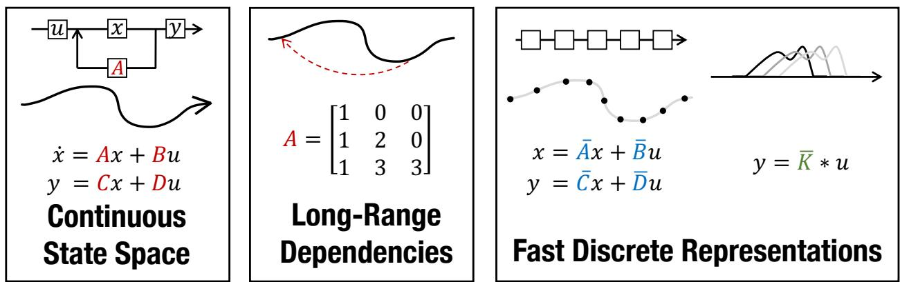
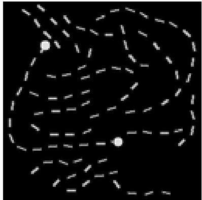
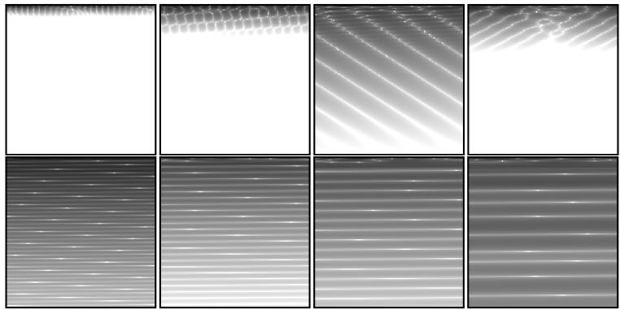
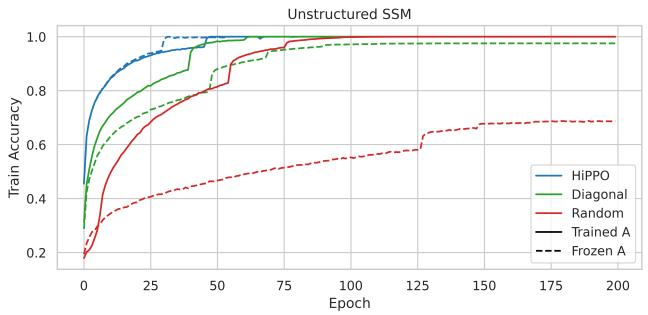
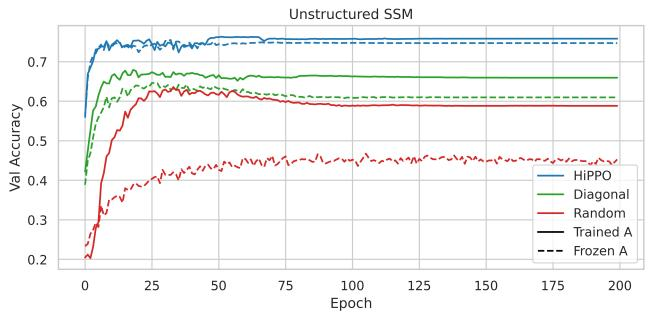
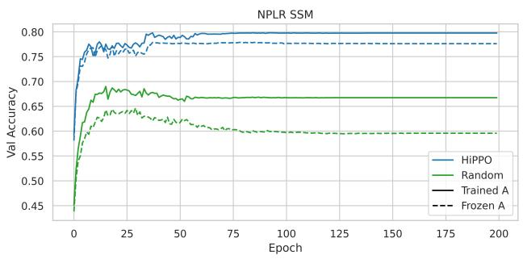
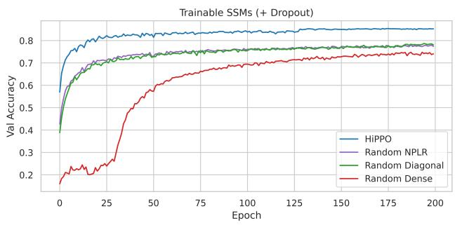
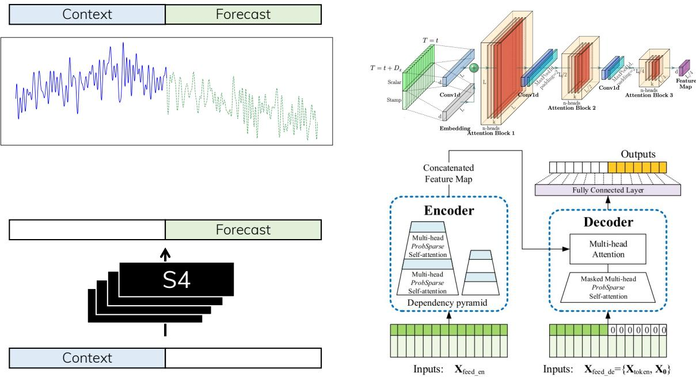
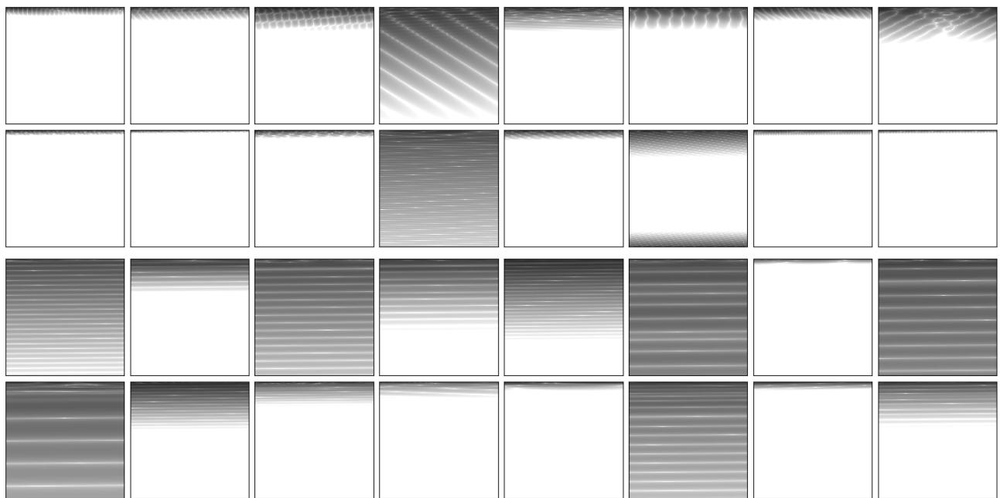

# 利用结构化状态空间高效建模长序列

Albert Gu, Karan Goel, and Christopher R´e

Department of Computer Science, Stanford University (斯坦福大学计算机科学系)

{albertgu,krng}@stanford.edu, chrismre@cs.stanford.edu

## 摘要

序列建模的一个核心目标是设计一个单一的原则性模型，能够跨各种模态和任务处理序列数据，特别是在长程依赖（long-range dependencies, LRDs）问题上。尽管包括 RNN、CNN 和 Transformer 在内的传统模型都具有用于捕获长依赖的专门变体，但它们仍然难以扩展到 10000 步或更长的极长序列。最近一种很有前景的方法提出通过模拟基础状态空间模型（State Space Model, SSM）$x ^ { \prime } ( t ) = A x ( t ) +$ $B u ( t ) , y ( t ) = C x ( t ) + D u ( t )$ 来建模序列，并表明在对状态矩阵 A 进行适当选择的情况下，该系统可以在数学上和实证上有效处理长程依赖。然而，该方法具有极高的计算和内存开销，使其无法作为通用的序列建模解决方案。我们基于 SSM 的全新参数化方法提出了结构化状态空间序列模型（Structured State Space sequence model, S4），并证明其在保留先前方法理论优势的同时，计算效率得到了显著提升。我们的技术涉及使用低秩校正对 A 进行条件化，使其能够稳定对角化，并将 SSM 简化为经过充分研究的 Cauchy 核（Cauchy kernel）计算。S4 在各种成熟的基准测试中取得了优异的实证结果，包括：(i) 在没有数据增强或辅助损失的情况下，在 sequential CIFAR-10 上达到 91% 的准确率，与更大的 2-D ResNet 相当；(ii) 在图像和语言建模任务上大幅缩小了与 Transformer 的差距，同时生成速度提升了 60 倍；(iii) 在 Long Range Arena 基准测试的每个任务上均达到 SoTA，包括解决了所有先前工作均告失败的长度为 16k 的挑战性 Path-X 任务，且效率不逊于所有竞争模型。1

## 1 引言

序列建模中的一个核心问题是高效处理包含长程依赖（LRDs）的数据。现实世界中的时间序列数据通常需要对数万个时间步进行推理，而很少有序列模型能够应对哪怕数千个时间步。例如，来自 Long-Range Arena (LRA) 基准测试 [40] 的结果突出表明，当今的序列模型在 LRD 任务上表现欠佳，其中甚至包含一个没有任何模型表现优于随机猜测的任务（Path-X）。

由于长程依赖（LRDs）可能是序列模型面临的最主要挑战，所有标准模型族，如连续时间模型（CTMs）、RNN、CNN 和 Transformer，都包含了许多专门设计用于解决该问题的变体。现代示例包括用于对抗梯度消失的正交与 Lipschitz RNN [1, 13]、用于增加上下文大小的空洞卷积 [3, 28]，以及用于减少对序列长度的二次方依赖且规模日益庞大的高效 Transformer 家族 [8, 22]。尽管这些解决方案是针对 LRDs 设计的，但在具有挑战性的基准测试（例如 LRA [40] 或原始音频分类 [18]）上表现仍然不佳。

最近有人提出了一种基于状态空间模型（SSM）来解决 LRDs 的替代方法（图 1）。SSM 是一种基础科学模型，广泛应用于控制论、计算神经科学等众多领域，但由于具体的理论原因，此前一直未能应用于深度学习。特别是，Gu 等人 [18] 指出，深度 SSM 甚至在简单任务上都表现挣扎，但当配备了最近为解决连续时间记忆问题而推导出的特殊状态矩阵 A 时，其性能会异常出色 [16, 45]。他们的线性状态空间层（LSSL）在概念上统一了 CTM、RNN 和 CNN 模型的优势，并在原理上证明了深度 SSM 能够解决 LRDs。

  
Figure 1: （左）由矩阵 A、B、C、D 参数化的状态空间模型（SSM）通过隐状态 x(t) 将输入信号 u(t) 映射到输出 y(t)。（中）近期关于连续时间记忆的理论推导出了特殊的 A 矩阵，使得 SSM 能够从数学和经验上捕捉 LRDs。（右）SSM 既可以作为循环计算（左），也可以作为卷积计算（右）。然而，将这些概念视角付诸实现需要使用其参数的不同表示形式（红、蓝、绿），这些表示形式的计算成本非常高昂。S4 引入了一种新颖的参数化方法，能够在这几种表示形式之间高效切换，使其不仅能够处理广泛的任务，在训练和推理阶段都具备高效率，而且在长序列处理中表现优异。

不幸的是，由于状态表示导致的过高计算和内存需求，LSSL 在实践中难以使用。对于状态维度 N 和序列长度 L，计算潜在状态需要 $O ( N ^ { 2 } L )$ 次操作和 O(NL) 空间——相比之下，两者的理论下界均为 Ω(L + N)。因此，对于合理规模的模型（例如 Gu et al. [18] 中的 N = 256），LSSL 使用的内存比同等规模的 RNN 或 CNN 高出几个数量级。尽管有人提出了针对 LSSL 的理论上高效的算法，但我们证明了这些算法在数值上是不稳定的。特别是，特殊的 A 矩阵在线性代数意义上高度非正规（non-normal），这阻碍了传统算法技术的应用。因此，尽管 LSSL 表明 SSM 具有强大的性能，但作为通用的序列建模解决方案，它们目前在计算上是不切实际的。

在这项工作中，我们介绍了基于 SSM 的结构化状态空间（Structured State Space, S4）序列模型，该模型解决了先前工作中的关键计算瓶颈。从技术上讲，S4 通过将 Gu et al. [16]、Voelker et al. [45] 中出现的结构化状态矩阵 A 分解为低秩项和正规项之和来进行重新参数化。此外，我们没有在系数空间中展开标准 SSM，而是在频域中计算其截断生成函数，这可以简化为类似多极子的求值（multipole-like evaluation）。结合这两个思想，我们证明了低秩项可以通过伍德伯里恒等式（Woodbury identity）进行校正，而正规项可以稳定地对角化，最终归结为经过充分研究且理论上稳定的柯西核（Cauchy kernel）[29, 30]。这带来了 O˜(N + L) 的计算量和 O(N + L) 的内存占用，这对于序列模型而言在本质上是紧凑的。与 LSSL 相比，S4 的速度提升高达 30 倍，内存占用减少 400 倍，同时在实证性能上超越了 LSSL。

在实证方面，S4 显著提升了长程依赖（LRD）的最先进水平。在针对高效序列模型的 LRA 基准测试中，S4 的运行速度与所有基线相当，同时平均表现超出它们 20 点以上。S4 是第一个解决高难度 LRA Path-X 任务（长度 16384）的模型，达到了 88% 的准确率，而所有先前的工作仅相当于 50% 的随机猜测水平。在长度为 16000 序列的语音分类任务中，S4 将专用语音 CNN 的测试误差减半（降至 1.7%）——相比之下，所有 RNN 和 Transformer 基线均未能成功学习（误差 ≥ 70%）。

迈向通用序列模型。除了 LRD 之外，机器学习的一个广泛目标是开发一种可用于解决广泛问题的单一模型。如今的模型通常专门用于解决特定领域（例如图像、音频、文本、时间序列）的问题，并具备有限的能力范围（例如高效训练、快速生成、处理不规则采样数据）。这种专门化通常通过特定领域的预处理、归纳偏置（inductive bias）和模型架构来体现。序列模型提供了一个通用框架，可以通过减少专门化来解决其中许多问题——例如，使用较少 2D 信息的 Vision Transformers 进行图像分类 [12]。然而，大多数模型（如 Transformers）通常仍需要针对每个任务进行大量专门化设计才能获得高性能。

特别是深度 SSMs（Deep SSMs），其概念上的优势表明它们有望成为一种通用的序列建模解决方案。这些优势包括一种处理 LRD 的通用原则方法，以及在连续时间、卷积和循环模型表示之间切换的能力，每种表示都具有独特的能力（Figure 1）。我们的技术贡献使 SSM 能够在经过极少修改的情况下成功应用于各种基准测试：

• 大规模生成建模。在 CIFAR-10 密度估计中，S4 与最佳自回归模型相比具有竞争力（2.85 bits per dim）。在 WikiText-103 语言建模中，S4 显著缩小了与 Transformers 的差距（困惑度差距在 0.8 以内），为无注意力机制（attention-free）模型刷新了 SoTA。

• 快速自回归生成。与 RNNs 类似，S4 可以利用其隐状态在 CIFAR-10 和 WikiText-103 上实现比标准自回归模型快 60 倍的像素/词元（token）生成速度。

• 采样分辨率变化。与专门的 CTMs 类似，S4 可以在不重新训练的情况下适应时间序列采样频率的变化，例如在语音分类任务中适应 0.5× 采样频率。

• 依靠更弱的归纳偏置进行学习。在不改变架构的情况下，S4 在语音分类上超越了 Speech CNNs，在时间序列预测问题上优于专门的 Informer 模型，并在序列化 CIFAR（sequential CIFAR）上达到了与 2-D ResNet 相当的 90% 以上的准确率。

## 2 背景：状态空间

第 2.1 节至第 2.4 节描述了 Figure 1 中 SSM 的四个特性：经典连续时间表示、使用 HiPPO 框架处理 LRD、离散时间循环表示以及可并行化的卷积表示。特别是第 2.4 节介绍了 SSM 卷积核 K，这是我们在第 3 节中理论贡献的核心。

## 2.1 状态空间模型：连续时间隐状态模型

状态空间模型由简单的方程 (1) 定义。它将一维输入信号 $u(t)$ 映射到 $N$ 维隐状态 $x(t)$，然后再投影到一维输出信号 $y(t)$。

$$
\begin{array}{r} x ^ {\prime} (t) = A x (t) + B u (t) \\ y (t) = C x (t) + D u (t) \end{array}\tag{1}
$$

SSM 广泛应用于许多科学学科中，并与隐马尔可夫模型（Hidden Markov Models, HMM）等潜在状态模型相关。我们的目标是直接将 SSM 用作深度序列模型中的黑盒表示，其中 A、B、C、D 是通过梯度下降学习的参数。在本文的其余部分中，为了便于阐述，我们将省略参数 D（或等价地，假设 D = 0），因为 Du 项可以被视为跳跃连接且易于计算。

## 2.2 利用 HiPPO 解决长程依赖问题

先前的研究发现，基础的 SSM (1) 在实践中实际上表现非常差。直观上的一种解释是，线性一阶常微分方程（ODE）的解是指数组合，因此可能会受到梯度随序列长度呈指数级缩放的影响（即梯度消失/爆炸问题 [32]）。为了解决这个问题，LSSL 利用了连续时间记忆的 HiPPO 理论 [16]。HiPPO 指定了一类特定的矩阵 $\overset { \sim } { A } \in \mathbb { R } ^ { N \times N }$，当将其代入 (1) 时，允许状态 x(t) 记住输入 u(t) 的历史。该类矩阵中最重要的一个由公式 (2) 定义，我们将其称为 HiPPO 矩阵。例如，LSSL 发现仅将 SSM 中的随机矩阵 A 修改为公式 (2)，就能将其在 sequential MNIST 基准上的性能从 60% 提升到 98%。

(HiPPO 矩阵)

$$
\boldsymbol {A} _ {n k} = - \left\{ \begin{array}{l l} (2 n + 1) ^ {1 / 2} (2 k + 1) ^ {1 / 2} & \text { if } n > k \\ n + 1 & \text { if } n = k \\ 0 & \text { if } n <   k \end{array} \right..\tag{2}
$$

## 2.3 离散时间 SSM：循环表示

为了应用于离散输入序列 $( u _ { 0 } , u _ { 1 } , \ldots )$ 而非连续函数 $u ( t ) , \ ( 1 )$ 必须通过代表输入分辨率的步长 $\Delta$ 进行离散化。从概念上讲，输入 $u _ { k }$ 可以被视为对隐式潜在连续信号 $u ( t )$ 的采样，其中 $u _ { k } = u ( k \Delta )$。

为了对连续时间 SSM 进行离散化，我们遵循先前的研究采用双线性法（bilinear method）[43]，将状态矩阵 A 转换为一个近似值 A。离散 SSM 如下：

$$
\begin{array}{l l l} x _ {k} = \overline {{A}} x _ {k - 1} + \overline {{B}} u _ {k} & \overline {{A}} = (I - \Delta / 2 \cdot A) ^ {- 1} (I + \Delta / 2 \cdot A) \\ y _ {k} = \overline {{C}} x _ {k} & \overline {{B}} = (I - \Delta / 2 \cdot A) ^ {- 1} \Delta B & \overline {{C}} = C. \end{array}\tag{3}
$$

公式 (3) 现在是一个序列到序列的映射 $u _ { k } \mapsto y _ { k }$，而不是函数到函数的映射。此外，状态方程现在是关于 $x _ { k }$ 的递推关系，使得离散 SSM 能够像 RNN 一样进行计算。具体来说，$\boldsymbol { x } _ { k } \in \mathbb { R } ^ { N }$ 可以被视为具有转移矩阵 A 的隐藏状态。

在记号方面，贯穿本文，我们使用 ${ \overline { { A } } } , { \overline { { B } } } , \ldots$ 表示由 (3) 定义的离散化 SSM 矩阵。需要注意的是，这些矩阵既是 A 的函数，也是步长 $\Delta$ 的函数；为了记号的简洁，在语意明确时我们省略了这种依赖关系。

## 2.4 训练 SSM：卷积表示

循环 SSM (3) 由于其顺序性（sequentiality），在现代硬件上进行训练并不实用。相反，诸如 (1) 的线性时不变（LTI）SSM 与连续卷积之间存在着众所周知的联系。相应地，(3) 实际上可以写成离散卷积的形式。

为简便起见，设初始状态为 $x _ { - 1 } = 0$。那么显式展开 (3) 可得

$$
\begin{array}{l l l} x _ {0} = \overline {{B}} u _ {0} & x _ {1} = \overline {{A B}} u _ {0} + \overline {{B}} u _ {1} & x _ {2} = \overline {{A}} ^ {2} \overline {{B}} u _ {0} + \overline {{A B}} u _ {1} + \overline {{B}} u _ {2} \\ y _ {0} = \overline {{C B}} u _ {0} & y _ {1} = \overline {{C A B}} u _ {0} + \overline {{C B}} u _ {1} & y _ {2} = \overline {{C A}} ^ {2} \overline {{B}} u _ {0} + \overline {{C A B}} u _ {1} + \overline {{C B}} u _ {2} \end{array}
$$

这可以向量化为一个卷积 (4)，并给出卷积核的显式公式 (5)。

$$
\begin{array}{l} y _ {k} = \overline {{C A}} ^ {k} \overline {{B}} u _ {0} + \overline {{C A}} ^ {k - 1} \overline {{B}} u _ {1} + \dots + \overline {{C A B}} u _ {k - 1} + \overline {{C B}} u _ {k} \\ y = \overline {{K}} * u. \end{array}\tag{4}
$$

$$
\overline {{\boldsymbol {K}}} \in \mathbb {R} ^ {L} := \mathcal {K} _ {L} (\overline {{\boldsymbol {A}}}, \overline {{\boldsymbol {B}}}, \overline {{\boldsymbol {C}}}) := \left(\overline {{\boldsymbol {C A}}} ^ {i} \overline {{\boldsymbol {B}}}\right) _ {i \in [ L ]} = (\overline {{\boldsymbol {C B}}}, \overline {{\boldsymbol {C A B}}}, \ldots , \overline {{\boldsymbol {C A}}} ^ {L - 1} \overline {{\boldsymbol {B}}}).\tag{5}
$$

换言之，公式 (4) 是一个单一的（非循环）卷积，只要 K 已知，就可以使用 FFT（快速傅里叶变换）非常高效地进行计算。然而，在 (5) 中计算 K 并非易事，这也是我们在第 3 节中技术贡献的核心。我们将 K 称为 SSM 卷积核或滤波器（filter）。

## 3 方法：结构化状态空间（S4）

我们的技术成果侧重于开发 S4 参数化，并展示如何高效地计算 SSM 的所有视角（第 2 节）：连续表示 (A, B, C) (1)、循环表示 $( \overline { { A } } , \overline { { B } } , \overline { { C } } )$ (3) 以及卷积表示 K (4)。

第 3.1 节阐述了我们方法的动机，该方法基于共轭（conjugation）和对角化（diagonalization）的线性代数概念，并讨论了为什么该方法的朴素应用行不通。第 3.2 节概述了我们方法的核心技术组件，并形式化定义了 S4 参数化。第 3.3 节概述了主要结果，表明 S4 对于序列模型在渐近意义上是高效的（在对数因子意义下）。证明见附录 B 和 C。

## 3.1 动机：对角化

计算离散时间 SSM (3) 的根本瓶颈在于它涉及与 A 的重复矩阵乘法。例如，像在 LSSL 中那样朴素地计算 (5) 涉及与 A 进行连续 L 次相乘，需要 $O ( N ^ { 2 } L )$ 次操作和 $O ( N L )$ 空间。

为了克服这一瓶颈，我们利用了一个能够简化 SSM 的结构性结果。

引理 3.1。共轭是 SSM 上的等价关系 $( A , B , C ) \sim ( V ^ { - 1 } A V , V ^ { - 1 } B , C V )$

证明。分别写出状态表示为 x 和 ˜x 的两个 SSM：

$$
\begin{array}{c} x ^ {\prime} = A x + B u \\ y = C x \end{array}
$$

$$
\begin{array}{c} \tilde {x} ^ {\prime} = \boldsymbol {V} ^ {- 1} \boldsymbol {A} \boldsymbol {V} \tilde {x} + \boldsymbol {V} ^ {- 1} \boldsymbol {B} u \\ y = \boldsymbol {C V} \tilde {x} \end{array}
$$

将右侧 SSM 乘以 V 后，令 $x = V \tilde { x }$，两个 SSM 变得完全相同。因此，它们计算的是完全相同的算子 $u \mapsto y$，但在状态 x 中进行了由 V 引起的基变换。□

引理 3.1 启发我们通过共轭2将 A 转换为一种正则形式（canonical form），这种形式在理想情况下具有更强的结构，并允许更快的计算。例如，如果 A 是对角的，所得的计算就会变得极其容易处理。特别地，所需的 K（式 (4)）将是一个范德蒙积（Vandermonde product），在理论上仅需要 $O ( ( N + L ) \log ^ { 2 } ( N + L ) )$ ) 次算术运算 [29]。

不幸的是，由于数值问题，对角化的朴素应用行不通。我们推导了 HiPPO 矩阵 (2) 的显式对角化，并证明其元素随状态大小 N 呈指数级增长，从而使对角化在数值上不可行（例如，引理 3.1 中的 CV 将无法计算）。我们注意到 Gu 等人 [18] 提出了一种不同（但未实现）的算法，以比朴素算法更快的速度计算 K。在附录 B 中，我们证明了该算法由于类似的原因在数值上也是不稳定的。

引理 3.2。式 (2) 中的 HiPPO 矩阵 A 可由矩阵 $\begin{array} { r } { V _ { i j } = \binom { i + j } { i - j } } \end{array}$ 对角化。特别是，$\begin{array} { r } { V _ { 3 i , i } = { \binom { 4 i } { 2 i } } \approx 2 ^ { 4 i } } \end{array}$。因此，V 的元素量级可高达 $2 ^ { 4 N / 3 }$。

## 3.2 S4 参数化：正规加低秩

前面的讨论表明，我们应该只通过良态矩阵 V 进行共轭。理想情况是矩阵 A 可以通过一个完全良态（即酉矩阵）的矩阵进行对角化。根据线性代数的谱定理（Spectral Theorem），这正是正规矩阵类。然而，这类矩阵受到严格限制；特别是，它不包含 HiPPO 矩阵 (2)。

我们观察到，虽然 HiPPO 矩阵不是正规的，但它可以分解为一个正规矩阵和一个低秩矩阵之和。然而，这本身仍然不够实用：与对角矩阵不同，对该和项进行幂运算（见 (5)）仍然很慢且不易优化。我们通过同时应用三项新技术来克服这一瓶颈。

Algorithm 1 S4 CONVOLUTION KERNEL (SKETCH)

输入: S4 参数 $\Lambda, P, Q, B, C \in \mathbb{C}^N$ 以及步长 $\Delta$

输出: 对应 $A = \Lambda - PQ^*$ 的 SSM 卷积核 $\overline{K} = \mathcal{K}_L(\overline{A}, \overline{B}, \overline{C})$（公式 (5)）

1: $\widetilde{C} \leftarrow \left(I - \overline{A}^L\right)^* \overline{C}$ ▷ 将 SSM 生成函数（SSMGF）截断至长度 $L$

2: $\begin{bmatrix} k_{00}(\omega) &amp; k_{01}(\omega) \\ k_{10}(\omega) &amp; k_{11}(\omega) \end{bmatrix} \leftarrow \begin{bmatrix} \widetilde{C} &amp; Q \end{bmatrix}^* \left( \frac{2}{\Delta} \frac{1-\omega}{1+\omega} - \Lambda \right)^{-1}[B P]$ ▷ 黑盒柯西核（Cauchy kernel）

3: $\hat{K}(\omega) \leftarrow \frac{2}{1+\omega} [k_{00}(\omega) - k_{01}(\omega)(1 + k_{11}(\omega))^{-1}k_{10}(\omega)]$ ▷ Woodbury 恒等式（Woodbury Identity）

4: $\hat{K} = \{\hat{K}(\omega) : \omega = \exp(2\pi i \frac{k}{L})\}$ ▷ 在所有单位根 $\omega \in \Omega_L$ 处评估 SSMGF

5: $\overline{K} \leftarrow \text{iFFT}(\hat{K})$ ▷ 逆傅里叶变换（Inverse Fourier Transform）

• 我们不直接计算 K，而是通过在单位根 ζ 处计算其截断生成函数 $\textstyle \sum _ { j = 0 } ^ { L - \bar { 1 } } \overline { { K } } _ { j } \zeta ^ { j }$ 来计算其频谱。然后可以通过应用逆快速傅里叶变换（inverse FFT）来求得 K。

• 该生成函数与矩阵预解式密切相关，并且现在涉及矩阵求逆而不是幂运算。低秩项现在可以通过应用 Woodbury 恒等式进行修正，该恒等式将 $( A + P Q ^ { * } ) ^ { - 1 }$ 简化为关于 $A ^ { - 1 }$ 的形式，从而真正归约到对角矩阵的情况。

• 最后，我们表明对角矩阵的情况等价于柯西核（Cauchy kernel）$\frac { 1 } { \omega _ { j } - \zeta _ { k } }$ 的计算，这是一个经过深入研究的问题，具有稳定的近似线性算法 [30, 31]。

我们的技术适用于任何可分解为正规加低秩（Normal Plus Low-Rank，NPLR）的矩阵。

Theorem 1. 来自 $[ 1 6 ]$ 的所有 HiPPO 矩阵都具有 NPLR 表示

$$
\boldsymbol {A} = \boldsymbol {V} \boldsymbol {\Lambda} \boldsymbol {V} ^ {*} - \boldsymbol {P} \boldsymbol {Q} ^ {\top} = \boldsymbol {V} (\boldsymbol {\Lambda} - (\boldsymbol {V} ^ {*} \boldsymbol {P}) (\boldsymbol {V} ^ {*} \boldsymbol {Q}) ^ {*}) \boldsymbol {V} ^ {*}\tag{6}
$$

其中 $V \in \mathbb { C } ^ { N \times N }$ 为酉矩阵（unitary），$\Lambda$ 为对角矩阵，$\pmb { P } , \pmb { Q } \in \mathbb { R } ^ { N \times r }$ 为低秩分解项。这些矩阵 HiPPO-LegS、LegT、LagT 均满足 $r = 1$ 或 $r = 2$。特别是，公式 (2) 是 $r = 1$ 的 NPLR 形式。

## 3.3 S4 算法与计算复杂度

根据公式 (6)，请注意 NPLR 矩阵可以通过共轭变换转化为对角加低秩（diagonal plus low-rank，简称 DPLR）形式（此时定义在 $\mathbb{C}$ 上而非 $\mathbb{R}$ 上）。定理 2 和定理 3 描述了当 $\boldsymbol{A}$ 为 DPLR 形式时 SSM 的复杂度。S4 在循环和卷积表示下均达到了最优或接近最优。

定理 2（S4 循环表示）。给定任意步长 $\Delta$，计算循环 (3) 的单步可以在 $O(N)$ 次操作内完成，其中 $N$ 为状态大小。

定理 2 的成立基于一个事实：DPLR 矩阵的逆矩阵也是 DPLR 形式（例如，同样可通过 Woodbury 恒等式得出）。这意味着离散化矩阵 $\boldsymbol{A}$ 是两个 DPLR 矩阵的乘积，因此具有 $O(N)$ 的矩阵-向量乘法复杂度。附录 C.2 给出了 $\boldsymbol{A}$ 的闭式 DPLR 形式计算。

定理 3（S4 卷积表示）。给定任意步长 $\Delta$，计算 SSM 卷积滤波器 $\overline { { \kappa } }$ 可以简化为 4 次柯西乘法（Cauchy multiplies），仅需 $\widetilde O ( N + L )$ 次操作和 $O(N + L)$ 的空间复杂度。

附录 C 中的定义 3 形式化定义了柯西矩阵（Cauchy matrices），它与有理插值问题密切相关。柯西矩阵的计算是数值分析中一个经过极其深入研究的问题，拥有基于著名的快速多极子方法（Fast Multipole Method，简称 FMM）[29, 30, 31] 的快速算术算法和数值算法。附录 C 中的命题 5 描述了这些算法在各种设定下的计算复杂度。

我们重申，定理 3 是我们的核心技术贡献，该算法正是 NPLR S4 参数化的初衷与动机。算法 1 形式化地概述了该算法。

Table 1：各种序列模型在序列长度（$L$）、批次大小（$B$）和隐藏层维度（$H$）方面的复杂度；波浪号表示对数因子。评估指标包括参数量、训练计算量、训练空间需求、训练可并行性以及推理计算量（针对 1 个样本和 1 个时间步）。为简便起见，S4 的状态大小 $N$ 与 $H$ 绑定。粗体表示该模型在理论上对应指标最优。卷积在训练上高效，而循环在推理上高效，SSM 则结合了两者的优势。

<table><tr><td></td><td> $Convolution^3$ </td><td>循环（Recurrence）</td><td>注意力（Attention）</td><td>S4</td></tr><tr><td>参数量</td><td> $LH$ </td><td> $H^2$ </td><td> $H^2$ </td><td> $H^2$ </td></tr><tr><td>训练</td><td> $\tilde{L}H(B + H)$ </td><td> $BLH^2$ </td><td> $B(L^2H + LH^2)$ </td><td> $BH(\tilde{H} + \tilde{L}) + B\tilde{L}H$ </td></tr><tr><td>空间</td><td> $BLH$ </td><td> $BLH$ </td><td> $B(L^2 + HL)$ </td><td> $BLH$ </td></tr><tr><td>可并行</td><td>是</td><td>否</td><td>是</td><td>是</td></tr><tr><td>推理</td><td> $LH^2$ </td><td> $H^2$ </td><td> $L^2H + H^2L$ </td><td> $H^2$ </td></tr></table>

## 3.4 深度 S4 层的架构细节

具体而言，S4 层的参数化方式如下。首先初始化一个 SSM，将 A 设为 HiPPO 矩阵 (2)。根据引理 3.1 和定理 1，该 SSM 酉等价于某个 $( \Lambda - P Q ^ { * } , B , C )$，其中 $\Lambda$ 为对角矩阵，向量 $P , Q , B , C \in \mathbb { C } ^ { N \times 1 }$。这些构成了 S4 的 5N 个可训练参数。

S4 的整体深度神经网络（DNN）架构与先前的研究工作类似。如上所述，S4 定义了一个从 $\mathbb { R } ^ { L } \to \mathbb { R } ^ { L }$ 的映射，即一维序列映射。通常，DNN 是在大小为 H 的特征图而非大小为 1 的特征图上运行。S4 通过简单定义其自身的 H 个独立副本来处理多个特征，然后使用逐位置的线性层（position-wise linear layer）混合这 H 个特征，每层总计有 $O ( H ^ { 2 } ) + O ( H N )$ 个参数。在这些层之间还插入了非线性激活函数。总体而言，S4 定义了一个形状为（批大小、序列长度、隐藏维度）的序列到序列映射，这与 Transformer、RNN 和 CNN 等相关序列模型完全相同。

注意，核心的 S4 模块是一个线性变换，但在网络深度方向上加入非线性变换后，整体的深度 SSM 就变成了非线性的。这类似于标准 CNN，因为卷积层也是线性的。本节中描述的跨 H 个隐藏特征的广播也类似于深度可分离卷积（depthwise-separable convolutions）。因此，整体的深度 S4 模型与深度可分离 CNN 密切相关，但具有全局卷积核。

最后，我们指出后续工作发现，当 A 矩阵在右半平面具有特征值时，该版本的 S4 有时可能会出现数值不稳定性 [14]。该工作对 S4 的 NPLR 参数化进行了细微修改，将其从 $\Lambda - P Q ^ { * }$ 更改为 $\Lambda - P P ^ { * }$，从而纠正了这一潜在问题。

表 1（Table 1）对比了最常见的深度序列建模机制的复杂度。

## 4 实验

第 4.1 节将 S4 与 LSSL 以及高效 Transformer 模型进行了基准测试。第 4.2 节在长距离依赖（LRD）任务上验证了 S4：包括 LRA 基准测试和原始语音分类。第 4.3 节探究了 S4 是否可用作通用序列模型，在包括图像分类、图像和文本生成以及时间序列预测在内的各种场景中高效且有效地运行。

## 4.1 S4 效率基准测试

我们对 S4 进行了基准测试，证明其能够快速高效地进行训练，无论与 LSSL 相比，还是与专为长程序列建模设计的高效 Transformer 变体相比均是如此。正如第 3 节所概述的，S4 在理论上比 LSSL 高效得多，而 Table 2 证实了在实际层大小下，S4 在速度和内存效率上均有数个数量级的提升。事实上，在参数匹配的设置下，S4 的速度和内存占用与 Tay 等人 [40] 基准测试中最高效的 Transformer 变体——Linear Transformer [22] 和 Performer [8]——相当（Table 3，遵循 Tay 等人 [40] 的实验方案）。

Table 2: 深度 SSM：采用 Algorithm 1 的 S4 参数化在渐近意义上比 LSSL 更高效。

<table><tr><td></td><td colspan="3">训练单步时间 (MS)</td><td colspan="3">内存分配 (MB)</td></tr><tr><td>Dim.</td><td>128</td><td>256</td><td>512</td><td>128</td><td>256</td><td>512</td></tr><tr><td>LSSL</td><td>9.32</td><td>20.6</td><td>140.7</td><td>222.1</td><td>1685</td><td>13140</td></tr><tr><td>S4</td><td>4.77</td><td>3.07</td><td>4.75</td><td>5.3</td><td>12.6</td><td>33.5</td></tr><tr><td>比率</td><td>1.9×</td><td>6.7×</td><td>29.6×</td><td>42.0×</td><td>133×</td><td>392×</td></tr></table>

Table 3: 与高效 Transformer 的基准对比

<table><tr><td rowspan="2"></td><td colspan="2">长度 1024</td><td colspan="2">长度 4096</td></tr><tr><td>速度</td><td>内存</td><td>速度</td><td>内存</td></tr><tr><td>Transformer</td><td>1×</td><td>1×</td><td>1×</td><td>1×</td></tr><tr><td>Performer</td><td>1.23×</td><td>0.43×</td><td>3.79×</td><td>0.086×</td></tr><tr><td>Linear Trans.</td><td>1.58×</td><td>0.37×</td><td>5.35×</td><td>0.067×</td></tr><tr><td>S4</td><td>1.58×</td><td>0.43×</td><td>5.19×</td><td>0.091×</td></tr></table>

  
Figure 2: 训练好的 S4 模型在 LRA Path-X 上的可视化。SSM 卷积核 $\overline { { K } } \in \mathbb { R } ^ { 1 6 3 8 4 }$ 被重塑为 128 × 128 的图像。（左）Path-X 任务示例，该任务涉及推断标记是否由路径相连（上）第一层的滤波器（下）最后一层的滤波器。

Table 4: (Long Range Arena)（上）LRA 中的原始 Transformer 变体。完整结果见 Appendix D.2。（下）文献中报道的其他模型。引用此表前请阅读 Appendix D.5。

<table><tr><td>MODEL</td><td>LISTOPS</td><td>TEXT</td><td>RETRIEVAL</td><td>IMAGE</td><td>PATHFINDER</td><td>PATH-X</td><td>AVG</td></tr><tr><td>Transformer</td><td>36.37</td><td>64.27</td><td>57.46</td><td>42.44</td><td>71.40</td><td>✕</td><td>53.66</td></tr><tr><td>Reformer</td><td>37.27</td><td>56.10</td><td>53.40</td><td>38.07</td><td>68.50</td><td>✕</td><td>50.56</td></tr><tr><td>BigBird</td><td>36.05</td><td>64.02</td><td>59.29</td><td>40.83</td><td>74.87</td><td>✕</td><td>54.17</td></tr><tr><td>Linear Trans.</td><td>16.13</td><td>65.90</td><td>53.09</td><td>42.34</td><td>75.30</td><td>✕</td><td>50.46</td></tr><tr><td>Performer</td><td>18.01</td><td>65.40</td><td>53.82</td><td>42.77</td><td>77.05</td><td>✕</td><td>51.18</td></tr><tr><td>FNet</td><td>35.33</td><td>65.11</td><td>59.61</td><td>38.67</td><td>77.80</td><td>✕</td><td>54.42</td></tr><tr><td>Nyströmformer</td><td>37.15</td><td>65.52</td><td>79.56</td><td>41.58</td><td>70.94</td><td>✕</td><td>57.46</td></tr><tr><td>Luna-256</td><td>37.25</td><td>64.57</td><td>79.29</td><td>47.38</td><td>77.72</td><td>✕</td><td>59.37</td></tr><tr><td>S4</td><td>59.60</td><td>86.82</td><td>90.90</td><td>88.65</td><td>94.20</td><td>96.35</td><td>86.09</td></tr></table>

## 4.2 学习长程依赖

如第 2.2 节和第 3.1 节所述，S4 采用了一种基于连续时间记忆 HiPPO 理论的原则性方法来解决长程依赖（LRDs）问题。我们在本节的目标是验证 S4 在需要长程推理的困难任务上能取得优异的性能。我们在此重点关注两个问题：(i) Long-Range Arena，一个旨在测试高效序列模型在 LRDs 上表现的知名基准；(ii) 一个语音分类问题，作为 LRDs 的真实世界测试。

Long Range Arena (LRA)。LRA [40] 包含 6 个长度为 1K–16K 步的任务，涵盖了需要相似度、结构和视觉空间推理的多种模态和目标。表 4 将 S4 与来自 Tay 等人 [40] 的 11 种 Transformer 变体以及后续工作进行了比较。S4 显著推进了当前最佳水平（SoTA），在所有任务上均优于所有基线模型，平均得分达 80.48%，而所有基线模型均低于 60%。值得注意的是，S4 成功解决了 Path-X 任务，这是一项极具挑战性的任务，涉及对长度为 128 × 128 = 16384 的序列进行长程依赖推理。以往的所有模型由于内存或计算瓶颈，或者根本无法学习如此长的依赖关系，均以失败告终（即随机猜测）。

我们通过对其学到的表征进行可视化，特别是第 3 节技术成果中重点关注的 1-D 卷积核 K，来分析 S4 在 Path-X 上的性能。Fig. 2 显示 S4 学习到了多种滤波器，这些滤波器表现出空间一致的结构，并展示了对数据 2-D 特性的感知能力。具体而言，较低层学习到简单的卷积核，这些核仅从几行局部上下文中提取特征，而忽略图像的其余部分。另一方面，较高层以不同的空间频率跨越图像的完整列进行全局信息聚合。这些较高层中的滤波器覆盖了整个上下文（16384 像素），证实了 S4 学习 LRDs 的能力。

原始语音分类。语音是一个典型的现实世界时间序列领域，涉及以高频从底层物理过程中采样的信号。我们使用 Speech Commands 数据集 [47] 的 SC10 子集进行语音分类（参见附录 D.5）。尽管大多数语音序列模型依赖大量的预处理（例如转换为 MFCC 特征），但我们遵循 Romero 等人 [35] 的方法对原始语音（长度为 16000）进行分类。S4 达到了 98.3% 的准确率，高于所有使用长度缩短了 100 倍的 MFCC 特征的基线模型，这验证了强大的 LRD 模型能够从原始数据中提取更多信息，并优于手工设计的预处理。此外，我们还引入了一个专为原始语音设计的基线 CNN——来自 WaveGAN 模型 [11] 的判别器，该模型在参数量多出 90 倍且结合了更多架构启发式设计的情况下，表现仍逊于 S4（附录 D.2）。

## 4.3 作为通用序列模型的 S4

序列建模研究的一个关键目标是开发单一模型，该模型可应用于众多领域（如图像、音频、文本、时间序列），并具备广泛的能力（如高效训练、快速生成、处理不规则采样数据）。作为一种基础的科学模型，SSM 是一个极具潜力的候选方案，具备多种能力，而 S4 在涵盖图像、文本和语音的 LRD 基准上的优异表现，证明了 S4 作为通用序列模型的潜力。在本节中，我们重点通过突显 S4 在通常需要专用模型的场景中的核心优势，来更深入地探讨这一问题。我们所关注的任务（生成建模、图像分类、时间序列预测）在文献中被视为 LRD 任务，并进一步验证了 S4 能够高效处理 LRD。

Table 5: （SC10 分类）Transformer、CTM、RNN、CNN 和 SSM 模型。（MFCC）标准预处理的 MFCC 特征（长度 161）。（Raw）未处理的原始信号（长度 16000）。（0 .5×）测试时的频率变化。✗ 表示不适用或在单张 GPU 上计算不可行。引用此表前请阅读附录 D.5。

<table><tr><td></td><td>MFCC</td><td>RAW</td><td>0.5×</td></tr><tr><td>Transformer</td><td>90.75</td><td>✕</td><td>✕</td></tr><tr><td>Performer</td><td>80.85</td><td>30.77</td><td>30.68</td></tr><tr><td>ODE-RNN</td><td>65.9</td><td>✕</td><td>✕</td></tr><tr><td>NRDE</td><td>89.8</td><td>16.49</td><td>15.12</td></tr><tr><td>ExpRNN</td><td>82.13</td><td>11.6</td><td>10.8</td></tr><tr><td>LipschitzRNN</td><td>88.38</td><td>✕</td><td>✕</td></tr><tr><td>CKConv</td><td>95.3</td><td>71.66</td><td>65.96</td></tr><tr><td>WaveGAN-D</td><td>✕</td><td>96.25</td><td>✕</td></tr><tr><td>LSSL</td><td>93.58</td><td>✕</td><td>✕</td></tr><tr><td>S4</td><td>93.96</td><td>98.32</td><td>96.30</td></tr></table>

Table 6：（像素级一维图像分类）与先前工作（Transformer、RNN、CNN 和 SSM 模型）报告的测试准确率的对比。扩展结果和引用见附录 D。

<table><tr><td></td><td>sMNIST</td><td>pMNIST</td><td>sCIFAR</td></tr><tr><td>Transformer</td><td>98.9</td><td>97.9</td><td>62.2</td></tr><tr><td>LSTM</td><td>98.9</td><td>95.11</td><td>63.01</td></tr><tr><td>r-LSTM</td><td>98.4</td><td>95.2</td><td>72.2</td></tr><tr><td>UR-LSTM</td><td>99.28</td><td>96.96</td><td>71.00</td></tr><tr><td>UR-GRU</td><td>99.27</td><td>96.51</td><td>74.4</td></tr><tr><td>HiPPO-RNN</td><td>98.9</td><td>98.3</td><td>61.1</td></tr><tr><td>LMU-FFT</td><td>-</td><td>98.49</td><td>-</td></tr><tr><td>LipschitzRNN</td><td>99.4</td><td>96.3</td><td>64.2</td></tr><tr><td>TCN</td><td>99.0</td><td>97.2</td><td>-</td></tr><tr><td>TrellisNet</td><td>99.20</td><td>98.13</td><td>73.42</td></tr><tr><td>CKConv</td><td>99.32</td><td>98.54</td><td>63.74</td></tr><tr><td>LSSL</td><td>99.53</td><td>98.76</td><td>84.65</td></tr><tr><td>S4</td><td>99.63</td><td>98.70</td><td>91.13</td></tr></table>

Table 7：（CIFAR-10 密度估计）作为一个通用序列模型，S4 在不引入 2D 归纳偏置的情况下，与先前的自回归模型（以每维比特数 bits/dim 计）相比极具竞争力，并通过其循环模式实现了快速生成。Table 8：（WikiText-103 语言建模）S4 接近了 Transformer 的性能，且生成速度快得多。（上）我们实现所基于的 Transformer 基线，其中注意力机制被替换为 S4。（下）无注意力机制的模型（RNN 和 CNN）。

<table><tr><td>模型</td><td>bpd</td><td>2D 偏置</td><td>图像/秒</td></tr><tr><td>Transformer</td><td>3.47</td><td>无</td><td>0.32 (1×)</td></tr><tr><td>Linear Transf.</td><td>3.40</td><td>无</td><td>17.85 (56×)</td></tr><tr><td>PixelCNN</td><td>3.14</td><td>2D 卷积</td><td>-</td></tr><tr><td>Row PixelRNN</td><td>3.00</td><td>2D BiLSTM</td><td>-</td></tr><tr><td>PixelCNN++</td><td>2.92</td><td>2D 卷积</td><td>19.19 (59.97×)</td></tr><tr><td>Image Transf.</td><td>2.90</td><td>2D 局部注意力</td><td>0.54 (1.7×)</td></tr><tr><td>PixelSNAIL</td><td>2.85</td><td>2D 卷积 + 注意力</td><td>0.13 (0.4×)</td></tr><tr><td>Sparse Transf.</td><td>2.80</td><td>2D 稀疏注意力</td><td>-</td></tr><tr><td>S4 (base)</td><td>2.92</td><td>无</td><td>20.84 (65.1×)</td></tr><tr><td>S4 (large)</td><td>2.85</td><td>无</td><td>3.36 (10.5×)</td></tr></table>

<table><tr><td>模型</td><td>参数量</td><td>测试 ppl.</td><td>词元/秒</td></tr><tr><td>Transformer</td><td>247M</td><td>20.51</td><td>0.8K (1×)</td></tr><tr><td>GLU CNN</td><td>229M</td><td>37.2</td><td>-</td></tr><tr><td>AWD-QRNN</td><td>151M</td><td>33.0</td><td>-</td></tr><tr><td>LSTM + Hebb.</td><td>-</td><td>29.2</td><td>-</td></tr><tr><td>TrellisNet</td><td>180M</td><td>29.19</td><td>-</td></tr><tr><td>Dynamic Conv.</td><td>255M</td><td>25.0</td><td>-</td></tr><tr><td>TaLK Conv.</td><td>240M</td><td>23.3</td><td>-</td></tr><tr><td>S4</td><td>249M</td><td>20.95</td><td>48K (60×)</td></tr></table>

大规模生成建模。我们研究了两个经过充分研究的图像和文本基准，以验证 S4 的可扩展性、灵活性和效率。这些任务需要的模型比我们之前的任务大得多——高达 250M 参数量。

首先，CIFAR 密度估计是自回归模型的一个常用基准，其中图像被展平为由 3072 个 RGB 子像素组成的序列，并被逐一预测。表 7 显示，在没有 2D 归纳偏置的情况下，S4 与专为此任务设计的最佳模型相比仍具有竞争力。

其次，WikiText-103 是语言建模的公认基准，这是大规模序列模型的重要任务，其中词元根据过去的上下文按顺序预测。尽管 RNN 多年来一直是首选模型，但 Transformer 目前在此类包含本质上是离散数据的应用中占据主导地位。我们证明，Transformer 的替代模型在这些设定下仍然具有竞争力。只需采用强大的 Transformer 基准 [2] 并替换自注意力层，S4 就能大幅缩小与 Transformer 的差距（差距在 0.8 ppl 以内），并在无注意力机制的模型中将 SoTA 提高了 2 ppl 以上。

快速自回归推理。自回归模型的一个显著局限性是推理速度（例如生成），因为它们对每个新样本都需要对完整上下文进行一次传递。已有几种方法专门设计用于克服这一限制，例如 Linear Transformer，这是一种混合 Transformer/RNN，在推理时切换到有状态的循环视角以提高速度。

作为一个有状态模型，SSM 自然具备这种能力（Fig. 1）。通过切换到其循环表示（Section 2.3），S4 在每个时间步只需要恒定的内存和计算量——与计算量随上下文长度扩展的标准自回归模型形成鲜明对比。在 CIFAR-10 和 WikiText-103 上，我们报告了各种模型在生成时的吞吐量，S4 在这两个任务上均比标准 Transformer 快约 60×（详见 Appendix D.3.3）。

采样分辨率变化。作为一个连续时间模型，S4 能自动适应以不同速率采样的数据，这是时间序列领域中一个极具挑战性的设定，并有专门的研究脉络 [10, 35, 37]。无需重新训练，S4 仅通过改变其内部步长 ∆（Section 2.3），就在 Speech Commands 10（Table 5）上以 0.5× 的频率达到了 96.3% 的准确率。

凭借更弱的归纳偏置进行学习。除了我们在语音上的结果（Section 4.2）之外，我们进一步验证了 S4 仅需极小的修改即可应用于通常需要专门领域预处理和特定架构的两个领域。首先，我们将 S4 与 Informer [50] 进行了对比，后者是一种采用复杂编码器-解码器的新型 Transformer 架构，专为时间序列预测问题设计。将 S4 简单地应用于将预测视为掩蔽序列到序列转换的任务（Fig. 5），在 5 个预测任务的 40/50 种设定下均优于 Informer 和其他基线。值得注意的是，S4 在每个任务的最长设定下表现更好，例如在预测 30 天天气数据时将 MSE 降低了 37%（Table 9）。最后，我们在像素级序列图像分类任务（Table 6）上评估了 S4，这些广泛使用的基准最初是用于测试 RNN 的 LRD 测试 [1]。除 LRD 外，这些基准还体现了机器学习界近期在减少领域知识的情况下解决视觉问题的努力，这与 Vision Transformers [12] 和 MLP-Mixer [41] 等不含二维归纳偏置且基于 patch 的模型的精神一致。Sequential CIFAR 是一个特别具有挑战性的数据集，在该数据集上除 SSM 之外，所有序列模型与简单的 2-D CNN 相比均有超过 25% 的差距。相比之下，S4 足以与更大的 ResNet18（7.9M 对 11.0M 参数）相竞争，无论是在使用数据增强（93.16% 对 95.62%）还是未使用数据增强（91.12% 对 89.46%）的情况下皆是如此。此外，它对其他架构选择表现出强得多的鲁棒性（例如，将 BatchNorm 替换为 LayerNorm 时为 90.46% 对 79.52%）。

## 4.4 SSM 消融实验：HiPPO 的重要性

S4 的一个关键动机是使用 HiPPO 矩阵来初始化 SSM。我们考虑了 S4 的几种简化形式，以消融这些组件中每一个的重要性，包括：(i) HiPPO 初始化有多重要？(ii) 在 HiPPO 基础上训练 SSM 有多重要？(iii) S4 的优势是否可以由不含 HiPPO 的 NPLR 参数化所捕获？

作为一个简单的测试平台，本节中的所有实验都是在序列 CIFAR-10（sequential CIFAR-10）任务上进行的，我们发现该任务能很好地迁移到其他设置。模型被限制在最多 100K 个可训练参数，并使用简单的平原学习率调度器（plateau learning rate scheduler）且不使用正则化进行训练。

无约束 SSM（Unconstrained SSMs）。我们首先研究具有各种初始化的通用 SSM。我们考虑了随机高斯初始化（方差缩小直到不出现 NaN）和 HiPPO 初始化。我们还将随机对角高斯矩阵作为一种潜在的结构化方法进行考量；将 A 参数化为对角矩阵将允许大幅提速，而无需引入 S4 的 NPLR 参数化的复杂性。我们同时考虑了冻结 A 矩阵和对其进行训练两种情况。

Fig. 3 展示了训练和验证曲线，从中我们可以得出几个观察结果。首先，训练 SSM 改善了所有方法，尤其是随机初始化的高斯方法。对于所有方法，训练 SSM 都会带来训练和验证曲线的提升。

其次，不同初始化之间存在巨大的泛化差距。特别需要注意的是，当 A 参与训练时，所有初始化都能够达到完美的训练准确率。然而，它们的验证准确率相差超过 15%。

NPLR SSM。先前的实验验证了 HiPPO 在 SSM 中的重要性。这是 S4 中 NPLR 算法的主要动机，该算法利用 HiPPO 矩阵 (2) 的结构使 SSM 在计算上可行。Fig. 4a 显示随机 NPLR 矩阵的表现仍然不佳，这验证了 S4 的有效性主要来自于 HiPPO 初始化，而不是 NPLR 参数化。

最后，Fig. 4b 考虑了本节中所探讨的主要消融实验（包含可训练的 SSM）并添加了轻微的正则化。在 Dropout 为 0.1 的情况下，相同的趋势依然成立，并且 HiPPO 初始化——换言之，完整的 S4 方法——仅用 100K 个参数就达到了 84.27% 的测试准确率。

Table 9: 单变量长序列时间序列预测结果。完整结果见附录 D.3.5。

<table><tr><td></td><td colspan="2">S4</td><td colspan="2">Informer</td><td colspan="2">LogTrans</td><td colspan="2">Reformer</td><td colspan="2">LSTMa</td><td colspan="2">DeepAR</td><td colspan="2">ARIMA</td><td colspan="2">Prophet</td></tr><tr><td></td><td>MSE</td><td>MAE</td><td>MSE</td><td>MAE</td><td>MSE</td><td>MAE</td><td>MSE</td><td>MAE</td><td>MSE</td><td>MAE</td><td>MSE</td><td>MAE</td><td>MSE</td><td>MAE</td><td>MSE</td><td>MAE</td></tr><tr><td> $ETTh_1$ </td><td>0.116</td><td>0.271</td><td>0.269</td><td>0.435</td><td>0.273</td><td>0.463</td><td>2.112</td><td>1.436</td><td>0.683</td><td>0.768</td><td>0.658</td><td>0.707</td><td>0.659</td><td>0.766</td><td>2.735</td><td>3.253</td></tr><tr><td> $ETTh_2$ </td><td>0.187</td><td>0.358</td><td>0.277</td><td>0.431</td><td>0.303</td><td>0.493</td><td>2.030</td><td>1.721</td><td>0.640</td><td>0.681</td><td>0.429</td><td>0.580</td><td>2.878</td><td>1.044</td><td>3.355</td><td>4.664</td></tr><tr><td> $ETTm_1$ </td><td>0.292</td><td>0.466</td><td>0.512</td><td>0.644</td><td>0.598</td><td>0.702</td><td>1.793</td><td>1.528</td><td>1.064</td><td>0.873</td><td>2.437</td><td>1.352</td><td>0.639</td><td>0.697</td><td>2.747</td><td>1.174</td></tr><tr><td>Weather</td><td>0.245</td><td>0.375</td><td>0.359</td><td>0.466</td><td>0.388</td><td>0.499</td><td>2.087</td><td>1.534</td><td>0.866</td><td>0.809</td><td>0.499</td><td>0.596</td><td>1.062</td><td>0.943</td><td>3.859</td><td>1.144</td></tr><tr><td>ECL</td><td>0.432</td><td>0.497</td><td>0.582</td><td>0.608</td><td>0.624</td><td>0.645</td><td>7.019</td><td>5.105</td><td>1.545</td><td>1.006</td><td>0.657</td><td>0.683</td><td>1.370</td><td>0.982</td><td>6.901</td><td>4.264</td></tr></table>

Figure 3: 采用各种初始化的无约束实值 SSM 进行 CIFAR-10 分类。（左）训练准确率。（右）验证准确率。  
  
(a)

  
(b)  
Figure 4: 不同初始化和参数化下的 SSM 的 CIFAR-10 验证准确率。（左）随机初始化与 HiPPO 初始化的 NPLR 参数化。（右）本节考虑的所有方法，包括轻微的 Dropout 正则化。S4 仅用 100K 参数就在序列化 CIFAR-10 上达到了 SotA（最先进）准确率。

## 5 结论

我们提出了 S4，这是一种序列模型，它对状态空间模型的连续时间、循环和卷积视角采用了一种新的参数化，从而以一种有原则的方式高效建模 LRD（长程依赖）。在评估各种数据模态和模型能力的标准基准上的结果表明，S4 有潜力成为一种有效的通用序列建模解决方案。

## 致谢

我们感谢 Aditya Grover 和 Chris Cundy 对该方法早期版本的有益讨论。我们感谢 Simran Arora、Sabri Eyuboglu、Bibek Paudel 和 Nimit Sohoni 对本工作早期草稿提出的宝贵反馈。本项工作得到了 HAI 提案 540994170283 和 578192719349 项下 Google Cloud 额度的支持。我们衷心感谢以下机构与项目的资助与支持：NIH 资助项目 No. U54EB020405（Mobilize）；NSF 资助项目 No. CCF1763315（Beyond Sparsity）、CCF1563078（Volume to Velocity）和 1937301（RTML）；ONR 资助项目 No. N000141712266（Unifying Weak Supervision）、ONR N00014-20-1-2480（机器学习中非欧几里得几何的理解与应用）、N000142012275（NEPTUNE）；Moore Foundation、NXP、Xilinx、LETI-CEA、Intel、IBM、Microsoft、NEC、Toshiba、TSMC、ARM、Hitachi、BASF、Accenture、Ericsson、Qualcomm、Analog Devices、Okawa Foundation、American Family Insurance、Google Cloud、Salesforce、Total、HAI-AWS 科研云额度计划、斯坦福数据科学计划（Stanford Data Science Initiative, SDSI），以及 Stanford DAWN 项目成员：Facebook、Google 和 VMWare。Mobilize Center 是一家生物医学技术资源中心，由 NIH 国家生物医学成像与生物工程研究所（National Institute of Biomedical Imaging and Bioengineering）通过 Grant P41EB027060 提供资助。尽管此处有版权声明，美国政府仍被授权出于政府目的复制和分发再版物。本材料中表达的任何观点、发现、结论或建议均为作者个人观点，并不一定反映 NIH、ONR 或美国政府的明示或暗示的观点、政策或背书。

## 参考文献

[1] Martin Arjovsky, Amar Shah, and Yoshua Bengio. Unitary evolution recurrent neural networks. In The International Conference on Machine Learning (ICML), pages 1120–1128, 2016.

[2] Alexei Baevski and Michael Auli. Adaptive input representations for neural language modeling. arXiv preprint arXiv:1809.10853, 2018.

[3] Shaojie Bai, J Zico Kolter, and Vladlen Koltun. An empirical evaluation of generic convolutional and recurrent networks for sequence modeling. arXiv preprint arXiv:1803.01271, 2018.

[4] Shaojie Bai, J Zico Kolter, and Vladlen Koltun. Trellis networks for sequence modeling. In The International Conference on Learning Representations (ICLR), 2019.

[5] Shiyu Chang, Yang Zhang, Wei Han, Mo Yu, Xiaoxiao Guo, Wei Tan, Xiaodong Cui, Michael Witbrock, Mark Hasegawa-Johnson, and Thomas S Huang. Dilated recurrent neural networks. In Advances in Neural Information Processing Systems (NeurIPS), 2017.

[6] Rewon Child, Scott Gray, Alec Radford, and Ilya Sutskever. Generating long sequences with sparse transformers. arXiv preprint arXiv:1904.10509, 2019.

[7] Narsimha Chilkuri and Chris Eliasmith. Parallelizing legendre memory unit training. The International Conference on Machine Learning (ICML), 2021.

[8] Krzysztof Choromanski, Valerii Likhosherstov, David Dohan, Xingyou Song, Andreea Gane, Tamas Sarlos, Peter Hawkins, Jared Davis, Afroz Mohiuddin, Lukasz Kaiser, et al. Rethinking attention with performers. In The International Conference on Learning Representations (ICLR), 2020.

[9] Yann N Dauphin, Angela Fan, Michael Auli, and David Grangier. Language modeling with gated convolutional networks. In International conference on machine learning, pages 933–941. PMLR, 2017.

[10] Edward De Brouwer, Jaak Simm, Adam Arany, and Yves Moreau. Gru-ode-bayes: Continuous modeling of sporadically-observed time series. In Advances in Neural Information Processing Systems (NeurIPS), 2019.

[11] Chris Donahue, Julian McAuley, and Miller Puckette. Adversarial audio synthesis. In ICLR, 2019.

[12] Alexey Dosovitskiy, Lucas Beyer, Alexander Kolesnikov, Dirk Weissenborn, Xiaohua Zhai, Thomas Unterthiner, Mostafa Dehghani, Matthias Minderer, Georg Heigold, Sylvain Gelly, et al. An image is worth 16x16 words: Transformers for image recognition at scale. arXiv preprint arXiv:2010.11929, 2020.

[13] N Benjamin Erichson, Omri Azencot, Alejandro Queiruga, Liam Hodgkinson, and Michael W Mahoney. Lipschitz recurrent neural networks. In International Conference on Learning Representations, 2021.

[14] Karan Goel, Albert Gu, Chris Donahue, and Christopher R´e. It’s raw! audio generation with state-space models. arXiv preprint arXiv:2202.09729, 2022.

[15] Gene H Golub and Charles F Van Loan. Matrix computations, volume 3. JHU press, 2013.

[16] Albert Gu, Tri Dao, Stefano Ermon, Atri Rudra, and Christopher R´e. Hippo: Recurrent memory with optimal polynomial projections. In Advances in Neural Information Processing Systems (NeurIPS), 2020.

[17] Albert Gu, Caglar Gulcehre, Tom Le Paine, Matt Hofman, and Razvan Pascanu. Improving the gating mechanism of recurrent neural networks. In The International Conference on Machine Learning (ICML), 2020.

[18] Albert Gu, Isys Johnson, Karan Goel, Khaled Saab, Tri Dao, Atri Rudra, and Christopher R´e. Combining recurrent, convolutional, and continuous-time models with the structured learnable linear state space layer. In Advances in Neural Information Processing Systems (NeurIPS), 2021.

[19] Albert Gu, Ankit Gupta, Karan Goel, and Christopher R´e. On the parameterization and initialization of diagonal state space models. arXiv preprint arXiv:2206.11893, 2022.

[20] Albert Gu, Isys Johnson, Aman Timalsina, Atri Rudra, and Christopher R´e. How to train your hippo: State space models with generalized basis projections. arXiv preprint arXiv:2206.12037, 2022.

[21] Sepp Hochreiter and J¨urgen Schmidhuber. Long short-term memory. Neural computation, 9(8):1735–1780, 1997.

[22] Angelos Katharopoulos, Apoorv Vyas, Nikolaos Pappas, and Fran¸cois Fleuret. Transformers are rnns: Fast autoregressive transformers with linear attention. In International Conference on Machine Learning, pages 5156–5165. PMLR, 2020.

[23] Patrick Kidger, James Morrill, James Foster, and Terry Lyons. Neural controlled diferential equations for irregular time series. arXiv preprint arXiv:2005.08926, 2020.

[24] Mario Lezcano-Casado and David Mart´ınez-Rubio. Cheap orthogonal constraints in neural networks: A simple parametrization of the orthogonal and unitary group. In The International Conference on Machine Learning (ICML), 2019.

[25] Shuai Li, Wanqing Li, Chris Cook, Ce Zhu, and Yanbo Gao. Independently recurrent neural network (IndRNN): Building a longer and deeper RNN. In Proceedings of the IEEE Conference on Computer Vision and Pattern Recognition, pages 5457–5466, 2018.

[26] Vasileios Lioutas and Yuhong Guo. Time-aware large kernel convolutions. In International Conference on Machine Learning, pages 6172–6183. PMLR, 2020.

[27] Stephen Merity, Nitish Shirish Keskar, James Bradbury, and Richard Socher. Scalable language modeling: Wikitext-103 on a single gpu in 12 hours. SysML, 2018.

[28] Aaron van den Oord, Sander Dieleman, Heiga Zen, Karen Simonyan, Oriol Vinyals, Alex Graves, Nal Kalchbrenner, Andrew Senior, and Koray Kavukcuoglu. Wavenet: A generative model for raw audio. arXiv preprint arXiv:1609.03499, 2016.

[29] Victor Pan. Structured matrices and polynomials: unified superfast algorithms. Springer Science & Business Media, 2001.

[30] Victor Pan. Fast approximate computations with cauchy matrices and polynomials. Mathematics of Computation, 86(308):2799–2826, 2017.

[31] Victor Y Pan. Transformations of matrix structures work again. Linear Algebra and Its Applications, 465:107–138, 2015.

[32] Razvan Pascanu, Tomas Mikolov, and Yoshua Bengio. On the dificulty of training recurrent neural networks. In International conference on machine learning, pages 1310–1318, 2013.

[33] Jack Rae, Chris Dyer, Peter Dayan, and Timothy Lillicrap. Fast parametric learning with activation memorization. The International Conference on Machine Learning (ICML), 2018.

[34] Prajit Ramachandran, Tom Le Paine, Pooya Khorrami, Mohammad Babaeizadeh, Shiyu Chang, Yang Zhang, Mark A Hasegawa-Johnson, Roy H Campbell, and Thomas S Huang. Fast generation for convolutional autoregressive models. arXiv preprint arXiv:1704.06001, 2017.

[35] David W Romero, Anna Kuzina, Erik J Bekkers, Jakub M Tomczak, and Mark Hoogendoorn. Ckconv: Continuous kernel convolution for sequential data. arXiv preprint arXiv:2102.02611, 2021.

[36] David W Romero, Robert-Jan Bruintjes, Jakub M Tomczak, Erik J Bekkers, Mark Hoogendoorn, and Jan C van Gemert. Flexconv: Continuous kernel convolutions with diferentiable kernel sizes. In The International Conference on Learning Representations (ICLR), 2022.

[37] Yulia Rubanova, Tian Qi Chen, and David K Duvenaud. Latent ordinary diferential equations for irregularly-sampled time series. In Advances in Neural Information Processing Systems, pages 5321–5331, 2019.

[38] T Konstantin Rusch and Siddhartha Mishra. Unicornn: A recurrent model for learning very long time dependencies. The International Conference on Machine Learning (ICML), 2021.

[39] Tim Salimans, Andrej Karpathy, Xi Chen, and Diederik P Kingma. Pixelcnn++: Improving the pixelcnn with discretized logistic mixture likelihood and other modifications. arXiv preprint arXiv:1701.05517, 2017.

[40] Yi Tay, Mostafa Dehghani, Samira Abnar, Yikang Shen, Dara Bahri, Philip Pham, Jinfeng Rao, Liu Yang, Sebastian Ruder, and Donald Metzler. Long range arena : A benchmark for eficient transformers. In International Conference on Learning Representations, 2021. URL https://openreview.net/forum? id=qVyeW-grC2k.

[41] Ilya Tolstikhin, Neil Houlsby, Alexander Kolesnikov, Lucas Beyer, Xiaohua Zhai, Thomas Unterthiner, Jessica Yung, Daniel Keysers, Jakob Uszkoreit, Mario Lucic, et al. Mlp-mixer: An all-mlp architecture for vision. arXiv preprint arXiv:2105.01601, 2021.

[42] Trieu H Trinh, Andrew M Dai, Minh-Thang Luong, and Quoc V Le. Learning longer-term dependencies in RNNs with auxiliary losses. In The International Conference on Machine Learning (ICML), 2018.

[43] Arnold Tustin. A method of analysing the behaviour of linear systems in terms of time series. Journal of the Institution of Electrical Engineers-Part IIA: Automatic Regulators and Servo Mechanisms, 94(1): 130–142, 1947.

[44] Ashish Vaswani, Noam Shazeer, Niki Parmar, Jakob Uszkoreit, Llion Jones, Aidan N. Gomez, Lukasz Kaiser, and Illia Polosukhin. Attention is all you need. In Advances in Neural Information Processing Systems (NeurIPS), 2017.

[45] Aaron Voelker, Ivana Kaji´c, and Chris Eliasmith. Legendre memory units: Continuous-time representation in recurrent neural networks. In Advances in Neural Information Processing Systems, pages 15544–15553, 2019.

[46] Aaron Russell Voelker. Dynamical systems in spiking neuromorphic hardware. PhD thesis, University of Waterloo, 2019.

[47] Pete Warden. Speech commands: A dataset for limited-vocabulary speech recognition. ArXiv, abs/1804.03209, 2018.

[48] Max A Woodbury. Inverting modified matrices. Memorandum report, 42:106, 1950.

[49] Felix Wu, Angela Fan, Alexei Baevski, Yann N Dauphin, and Michael Auli. Pay less attention with lightweight and dynamic convolutions. In The International Conference on Learning Representations (ICLR), 2019.

[50] Haoyi Zhou, Shanghang Zhang, Jieqi Peng, Shuai Zhang, Jianxin Li, Hui Xiong, and Wancai Zhang. Informer: Beyond eficient transformer for long sequence time-series forecasting. In The Thirty-Fifth AAAI Conference on Artificial Intelligence, AAAI 2021, Virtual Conference, volume 35, pages 11106– 11115. AAAI Press, 2021.

## A 讨论

相关工作。我们的工作与一系列最初由某种受生物学启发的 SSM 所驱动的研究最为密切相关，这些研究衍生出了用于解决长程依赖（LRDs）的数学模型。Voelker 等人 [45]、Voelker [46] 基于对神经形态脉冲模型的逼近，推导出了一个不可训练的 SSM，而 Chilkuri 和 Eliasmith [7] 则表明可以通过卷积视角在训练时对其进行加速。Gu 等人 [16] 将这一特例扩展到了一个通用的连续时间函数逼近框架，并为长程依赖设计了更多 A 矩阵的特例。然而，所有这些工作并未采用真正的 SSM，而是固定了 A 的选择并围绕其构建 RNN。最近，Gu 等人 [18] 明确地将完整的 (1) 用作深度 SSM 模型，探索了 SSM 的全新概念视角，并允许对 A 进行训练。正如第 1 节所提及的，他们的方法使用了 SSM 的朴素实例化，在内存上承受了额外的 N 倍因子，在计算上承受了额外的 $N ^ { 2 }$ 倍因子。

除本工作之外，我们在 S4 参数化与算法方面的技术贡献（第 3 节）适用于更广泛的 SSM 族，包括先前工作中研究的那些模型，并且我们处理这些模型的技术可能具有独立的参考价值。

实现细节。S4 训练算法的计算核心是第 3.2 节、第 3.3 节以及附录 C.3 中讨论的柯西核（Cauchy kernel）。正如附录 C.3 命题 5 中所述，该核存在许多具有不同计算复杂度和精细程度的算法。我们目前对 S4 的实现实际上采用了朴素的 O(NL) 算法，该算法易于在 GPU 上并行化，并且有更易获取的库来实现它；我们利用 pykeops 库来进行内存高效的核操作。然而，该库是一个通用性更强的库，可能并未针对此处使用的柯西核进行优化，我们相信专用的 CUDA 实现可以更加高效。此外，正如本工作中所讨论的，柯西核存在渐近更快且数值稳定的算法（命题 5）。然而，由于以往缺乏需要这些算法的应用场景，它们目前尚未针对 GPU 进行实现。我们相信对这些自包含计算核进行更高效的实现是可行的，并且 S4（乃至广义的 SSM）在效率上可能仍有显著的进一步提升空间。

局限性与未来方向。在这项工作中，我们展示了 S4 可以有效地处理各种各样的数据。然而，它对于所有类型的数据并不一定都是最合适的模型。例如，表 8 显示在语言建模方面与 Transformers 相比仍存在差距。一个有趣的未来方向是探索 S4 与其他序列模型的结合，以互补它们的优势。我们对其他方向也感到非常期待，包括继续探索 S4 在音频数据上的优势（例如预训练或生成设置），以及将 HiPPO 和 S4 推广到更高维的数据以用于图像和视频应用。

## B LSSL 的数值不稳定性

本节证明了第 3.1 节中关于先前工作的论断。我们首先推导了 HiPPO 矩阵的显式对角化，证实了由于指数级大的条目而导致的不稳定性。然后，我们讨论了文献 [18] 中提出的理论上快速的算法（定理 2），并证明它同样涉及指数级大的项，因此无法实现。

## B.1 HiPPO 对角化

引理 3.2 的证明。在符号和对角矩阵共轭的意义下，HiPPO 矩阵 (2) 等价于

$$
\boldsymbol {A} = \left[ \begin{array}{c c c c c c c c c} 1 & & & & & & & \\ - 1 & 2 & & & & & & \\ 1 & - 3 & 3 & & & & & \\ - 1 & 3 & - 5 & 4 & & & & \\ 1 & - 3 & 5 & - 7 & 5 & & & \\ - 1 & 3 & - 5 & 7 & - 9 & 6 & & \\ 1 & - 3 & 5 & - 7 & 9 & - 1 1 & 7 & \\ - 1 & 3 & - 5 & 7 & - 9 & 1 1 & - 1 3 & 8 \\ \vdots & & & & & & & \ddots \end{array} \right] \boldsymbol {A} _ {n k} = \left\{ \begin{array}{l l} (- 1) ^ {n - k} (2 k + 1) & n > k \\ k + 1 & n = k. \\ 0 & n <   k \end{array} \right.
$$

我们的目标是证明该 A 可以被如下矩阵对角化

$$
\boldsymbol {V} = \binom {i + j} {i - j} _ {i j} = \left[ \begin{array}{c c c c c c c} 1 & & & & & & \\ 1 & 1 & & & & & \\ 1 & 3 & 1 & & & & \\ 1 & 6 & 5 & 1 & & & \\ 1 & 1 0 & 1 5 & 7 & 1 & & \\ 1 & 1 5 & 3 5 & 2 8 & 9 & 1 & \\ \vdots & & & & & & \ddots \end{array} \right],
$$

或者换句话说，该矩阵的列是 A 的特征向量。

具体来说，我们将证明该矩阵的第 j 列 $\mathbf { \pmb { v } } ^ { ( j ) }$（其元素为

$$
\boldsymbol {v} _ {i} ^ {(j)} = \left\{ \begin{array}{l l} 0 & i <   j \\ \binom {i + j} {i - j} = \binom {i + j} {2 j} & i \geq j \end{array} \right.
$$

）是特征值为 $j + 1$ 的特征向量。换句话说，我们必须证明对于所有索引 $k \in [ N ]$

$$
(\boldsymbol {A} \boldsymbol {v} ^ {(j)}) _ {k} = \sum_ {i} \boldsymbol {A} _ {k i} \boldsymbol {v} _ {i} ^ {(j)} = (j + 1) \boldsymbol {v} _ {k} ^ {(j)}.\tag{7}
$$

如果 $k < j$，那么对于求和式内的所有 i，要么 $k < i \ \mathrm { o r } \ i < j$。在前一种情况下 $\boldsymbol { A } _ { k i } = 0$，在后一种情况下 $\pmb { v } _ { i } ^ { ( j ) } = 0$，因此等式 (7) 的两边都等于 0。

剩下需要证明 $k \geq j$ 的情况，这可以通过对 k 进行归纳来完成。利用 A 的公式展开式 (7) 得到

$$
(\boldsymbol {A} \boldsymbol {v}) _ {k} ^ {(j)} = \sum_ {i} \boldsymbol {A} _ {k i} \boldsymbol {v} _ {i} ^ {(j)} = \sum_ {i = j} ^ {k - 1} (- 1) ^ {k - i} (2 i + 1) \binom {i + j} {2 j} + (k + 1) \binom {k + j} {2 j}.
$$

在基准情况 $k = j .$ 下，求和项消失，剩下 $( A v ^ { ( j ) } ) _ { j } = ( j + 1 ) \binom { 2 j } { 2 j } = ( j + 1 ) v _ { j } ^ { ( j ) }$，符合预期。

否则，$( A v ) _ { k } ^ { ( j ) }$ 的求和项与 $( A v ) _ { k - 1 } ^ { ( j ) }$ 的求和项相同，但符号相反且包含少许边缘

项。应用归纳假设并进行代数化简即可得到结果：

$$
\begin{array}{r l} & (\boldsymbol {A} \boldsymbol {v}) _ {k} ^ {(j)} = - (\boldsymbol {A} \boldsymbol {v}) _ {k - 1} ^ {(j)} - (2 k - 1) \binom {k - 1 + j} {2 j} + k \binom {k - 1 + j} {2 j} + (k + 1) \binom {k + j} {2 j} \\ & \quad = - (j + 1) \binom {k - 1 + j} {2 j} - (k - 1) \binom {k - 1 + j} {2 j} + (k + 1) \binom {k + j} {2 j} \\ & \quad = - (j + k) \binom {k - 1 + j} {2 j} + (k + 1) \binom {k + j} {2 j} \\ & \quad = - (j + k) \frac {(k - 1 + j) !}{(k - 1 - j) ! (2 j) !} + (k + 1) \binom {k + j} {2 j} \\ & \quad = - \frac {(k + j) !}{(k - 1 - j) ! (2 j) !} + (k + 1) \binom {k + j} {2 j} \\ & \quad = - (k - j) \frac {(k + j) !}{(k - j) ! (2 j) !} + (k + 1) \binom {k + j} {2 j} \\ & \quad = (j - k) (k + 1) \binom {k + j} {2 j} + (k + 1) \binom {k + j} {2 j} \\ & \quad = (j + 1) \boldsymbol {v} _ {k} ^ {(j)}. \end{array}
$$

## B.2 快速但不稳定的 LSSL 算法

Gu 等人 [18, Theorem 2] 没有采用对角化，而是提出了一种复杂的快速算法来计算

$$
K _ {L} (\overline {{\boldsymbol {A}}}, \overline {{\boldsymbol {B}}}, \overline {{\boldsymbol {C}}}) = (\overline {{\boldsymbol {C B}}}, \overline {{\boldsymbol {C A B}}}, \dots , \overline {{\boldsymbol {C A}}} ^ {L - 1} \overline {{\boldsymbol {B}}}).
$$

该算法的计算复杂度为 $O ( N \log ^ { 2 } N + L \log L )$ 步操作，空间复杂度为 $O ( N + L )$。然而，我们现在将证明该算法在数值上也是不稳定的。

导致该算法不稳定的原因有几个，但最直接的是，我们可以指出他们所使用的一个特定的中间量。

定义 1。快速 LSSL 算法在中间计算中计算 $p ( x )$（即 $o f A _ { ; }$ 的特征多项式）的系数。此外，它还计算其逆 $p ( x ) ^ { - 1 }$ (mod $x ^ { L } )$ 的系数。

我们现在断言该量在数值上是不可行的。我们将讨论范围缩小到 ${ \overline { { A } } } = I$ 为单位矩阵的情况。请注意，在某种意义上，这种情况实际上是最典型的情况：当通过步长 $\Delta .$ 将连续时间 SSM 离散化为离散时间时，离散化转移矩阵 A 会更接近单位矩阵。例如，在欧拉离散化 ${ \overline { { A } } } = I + \Delta A$ 下，随着步长 $\Delta \to 0$，我们有 ${ \overline { { A } } } \to I$。

引理 B.1。当 ${ \overline { { A } } } = I$ 时，快速 LSSL 算法需要计算在 $N _ { \cdot }$ 上呈指数级增长的项。

证明。I 的特征多项式为

$$
p (x) = \det | \boldsymbol {I} - x \boldsymbol {I} | = (1 - x) ^ {N}.
$$

这些系数的大小最高可达 $\begin{array} { r } { \binom { N } { \frac { N } { 2 } } \approx \frac { 2 ^ { N } } { \sqrt { \pi N / 2 } } . } \end{array}$

$p ( x )$ 的逆具有更大的系数。它可以通过广义二项式公式以闭式计算：

$$
(1 - x) ^ {- N} = \sum_ {k = 0} ^ {\infty} \binom {N + k - 1} {k} x ^ {k}.
$$

取其（模 $x ^ { L }$），最大的系数为

$$
\binom {N + L - 2} {L - 1} = \binom {N + L - 2} {N - 1} = \frac {(L - 1) (L - 2) \ldots (L - N + 1)}{(N - 1) !}.
$$

当 $L = N - 1$ 时，这为

$$
\binom {2 (N - 1)} {N - 1} \approx \frac {2 ^ {2 N}}{\sqrt {\pi N}}
$$

已经大于 $( 1 - x ) ^ { N }$ 的系数，并且随着 $L$ 的增长而继续增大。

## C S4 算法细节

本节证明了第 3.3 节的结果，提供了我们用于 S4 的高效算法的完整细节。附录 C.1 至 C.3 分别证明了定理 1 至定理 3。

## C.1 HiPPO 矩阵的 NPLR 表示

我们首先证明定理 1，表明所有用于连续时间记忆的 HiPPO 矩阵都属于 S4 正规加低秩（NPLR）表示。

定理 1 的证明。我们分别考虑 HiPPO-LagT、HiPPO-LegT 和 HiPPO-LegS 这三种情况。注意，本工作定义的主要 HiPPO 矩阵（公式 (2)）是 HiPPO-LegT 矩阵。

HiPPO-LagT。HiPPO-LagT 矩阵形式简单，即为

$$
\boldsymbol {A} _ {n k} = \left\{ \begin{array}{l l} 0 & n <   k \\ - \frac {1}{2} & n = k \\ - 1 & n > k \end{array} \right.
$$

$$
\boldsymbol {A} = - \left[ \begin{array}{c c c c c} \frac {1}{2} & & & & \dots \\ 1 & \frac {1}{2} & & & \\ 1 & 1 & \frac {1}{2} & & \\ 1 & 1 & 1 & \frac {1}{2} & \\ \vdots & & & & \ddots \end{array} \right].
$$

加上所有元素均为 $\frac { 1 } { 2 }$ 的矩阵（其秩为 1），可得

$$
- \left[ \begin{array}{c c c c} & - \frac {1}{2} & - \frac {1}{2} & - \frac {1}{2} \\ \frac {1}{2} & & - \frac {1}{2} & - \frac {1}{2} \\ \frac {1}{2} & \frac {1}{2} & & - \frac {1}{2} \\ \frac {1}{2} & \frac {1}{2} & \frac {1}{2} \end{array} \right].
$$

该矩阵现在是反对称的。反对称矩阵是具有纯虚特征值的正规矩阵的一种特殊情况。

Gu 等人 [16] 还考虑了对应于广义拉盖尔多项式（generalized Laguerre polynomials）的 HiPPO 情况，该情况推广了上述 HiPPO-LagT 的情形。在这种情况下，矩阵 A（在对角矩阵共轭的意义下）最终与上述矩阵接近，但对角线上的元素不同。在加上秩为 1（rank-1）的修正后，它变成了上述反对称矩阵加上单位矩阵的倍数。因此，在使用与 LagT 情况相同的矩阵进行对角化之后，它仍可化简为对角加低秩（diagonal plus low-rank, DPLR）形式，其中对角线现在为纯虚数加上一个实常数。

HiPPO-LegS。为了方便起见，我们重述公式 (2) 中的表达式。

$$
\boldsymbol {A} _ {n k} = - \left\{ \begin{array}{l l} (2 n + 1) ^ {1 / 2} (2 k + 1) ^ {1 / 2} & \text { if } n > k \\ n + 1 & \text { if } n = k \\ 0 & \text { if } n <   k \end{array} \right..
$$

给整个矩阵加上 $\frac { 1 } { 2 } ( 2 n + 1 ) ^ { 1 / 2 } ( 2 k + 1 ) ^ { 1 / 2 }$，得到

$$
- \left\{ \begin{array}{l l} \frac {1}{2} (2 n + 1) ^ {1 / 2} (2 k + 1) ^ {1 / 2} & \text {if} n > k \\ \frac {1}{2} & \text {if} n = k \\ - \frac {1}{2} (2 n + 1) ^ {1 / 2} (2 k + 1) ^ {1 / 2} & \text {if} n <   k \end{array} \right.
$$

注意，该矩阵并不是反对称的，而是形如 ${ \frac { 1 } { 2 } } I + S$，其中 S 是一个反对称矩阵。它可以由对角化 S 的同一个酉矩阵（unitary matrix）进行对角化。

## HiPPO-LegT.

在对角缩放的意义下，LegT 矩阵为

$$
\boldsymbol {A} = - \left[ \begin{array}{c c c c c} 1 & - 1 & 1 & - 1 & \ldots \\ 1 & 1 & - 1 & 1 \\ 1 & 1 & 1 & - 1 \\ 1 & 1 & 1 & 1 \\ \vdots & & & & \ddots \end{array} \right].
$$

给该矩阵加上 −1，然后再叠加上矩阵

$$
\left[ \begin{array}{c c c} & & \\ 2 & 2 \\ 2 & 2 \end{array} \right]
$$

该矩阵变为

$$
\left[ \begin{array}{c c c c} & - 2 & & - 2 \\ 2 & & & \\ & & & - 2 \\ 2 & & 2 \end{array} \right]
$$

它是反对称的。实际上，该矩阵是切比雪夫雅可比（Chebyshev Jacobi）矩阵的逆。

另一种理解方式如下。LegT 矩阵是以下矩阵的逆：

$$
\left[ \begin{array}{c c c c} - 1 & 1 & & 0 \\ - 1 & & 1 \\ & - 1 & & 1 \\ & & - 1 & - 1 \end{array} \right]
$$

通过加上一个秩为 2（rank-2）的项，这显然可以转换为反对称矩阵。根据 Woodbury 恒等式（Woodbury identity），这些矩阵的逆之间的差异同样是一个秩为 2 的矩阵。

最终形式为

$$
\left[ \begin{array}{c c c c} - 1 & 1 & - 1 & 1 \\ - 1 & - 1 & 1 & - 1 \\ - 1 & - 1 & - 1 & 1 \\ - 1 & - 1 & - 1 & - 1 \end{array} \right] + \left[ \begin{array}{c c c c} 1 & 0 & 1 & 0 \\ 0 & 1 & 0 & 1 \\ 1 & 0 & 1 & 0 \\ 0 & 1 & 0 & 1 \end{array} \right] = \left[ \begin{array}{c c c c} 0 & 1 & 0 & 1 \\ - 1 & 0 & 1 & 0 \\ 0 & - 1 & 0 & 1 \\ - 1 & 0 & - 1 & 0 \end{array} \right]
$$

这样做的优势在于秩为 2 的修正项是对称的（与其他项类似），但正规反对称矩阵现在是 2-拟可分的（2-quasiseparable），而不是 1-拟可分的。

## C.2 计算 S4 循环视角

我们证明定理 2，展示用于计算循环表示单步的 S4 参数化的高效性（第 2.3 节）。

回想一下，不失一般性，我们可以假设状态矩阵 $\pmb { A } = \pmb { \Lambda } - \pmb { P } \pmb { Q } ^ { * }$ 是对角加低秩（DPLR）的，可能定义在 C 上。我们在本节的目标是显式地写出离散化矩阵 A 的闭式解。

回想式 (3)：

$$
\begin{array}{l} \overline {{\boldsymbol {A}}} = (\boldsymbol {I} - \Delta / 2 \cdot \boldsymbol {A}) ^ {- 1} (\boldsymbol {I} + \Delta / 2 \cdot \boldsymbol {A}) \\ \overline {{\boldsymbol {B}}} = (\boldsymbol {I} - \Delta / 2 \cdot \boldsymbol {A}) ^ {- 1} \Delta \boldsymbol {B}. \end{array}
$$

我们首先分别化简 A 定义中的两个项。

前向离散化。第一项本质上是第 2.3 节中引出的欧拉离散化。

$$
\begin{array}{r l} \boldsymbol {I} + \frac {\Delta}{2} \boldsymbol {A} & = \boldsymbol {I} + \frac {\Delta}{2} (\boldsymbol {\Lambda} - \boldsymbol {P Q ^ {*}}) \\ & = \frac {\Delta}{2} \left[ \frac {2}{\Delta} \boldsymbol {I} + (\boldsymbol {\Lambda} - \boldsymbol {P Q ^ {*}}) \right] \\ & = \frac {\Delta}{2} \boldsymbol {A _ {0}} \end{array}
$$

其中 $\mathbf { A _ { 0 } }$ 定义为最后方括号中的项。

后向离散化。第二项被称为后向欧拉法。尽管这个逆矩阵项通常难以处理，但在 DPLR 情况下，我们可以利用 Woodbury 恒等式（命题 4）对其进行化简。

$$
\begin{array}{r l} \left(\boldsymbol {I} - \frac {\Delta}{2} \boldsymbol {A}\right) ^ {- 1} & = \left(\boldsymbol {I} - \frac {\Delta}{2} (\boldsymbol {\Lambda} - \boldsymbol {P Q} ^ {*})\right) ^ {- 1} \\ & = \frac {2}{\Delta} \left[ \frac {2}{\Delta} - \boldsymbol {\Lambda} + \boldsymbol {P Q} ^ {*} \right] ^ {- 1} \\ & = \frac {2}{\Delta} \left[ \boldsymbol {D} - \boldsymbol {D P} (\boldsymbol {I} + \boldsymbol {Q} ^ {*} \boldsymbol {D P}) ^ {- 1} \boldsymbol {Q} ^ {*} \boldsymbol {D} \right] \\ & = \frac {2}{\Delta} \boldsymbol {A _ {1}} \end{array}
$$

其中 $\pmb { { \cal D } } = \left( \frac { 2 } { \Delta } - { \pmb { \Lambda } } \right) ^ { - 1 }$ 且 $\pmb { A _ { 1 } }$ 定义为最后方括号中的项。请注意，在低秩项的秩为 1 的情况下，$( 1 + Q ^ { * } D P )$ 实际上是一个标量。

S4 循环。最后，完整的双线性离散化可以用这些矩阵改写为

$$
\begin{array}{l} \overline {{A}} = A _ {1} A _ {0} \\ \overline {{B}} = \frac {2}{\Delta} A _ {1} \Delta B = 2 A _ {1} B. \end{array}
$$

离散时间 SSM (3) 变为

$$
\begin{array}{r l} & {x _ {k} = \overline {{A}} x _ {k - 1} + \overline {{B}} u _ {k}} \\ & {\qquad = A _ {1} A _ {0} x _ {k - 1} + 2 A _ {1} B u _ {k}} \\ & {y _ {k} = C x _ {k}.} \end{array}
$$

注意，$\mathbf { A _ { 0 } } , \mathbf { A _ { 1 } }$ 仅通过矩阵-向量乘法进行访问。由于它们都是 DPLR，因此它们具有 $O ( N )$ 的矩阵-向量乘法复杂度，从而证明了定理 2（Theorem 2）。

## C.3 计算卷积视角

高效使用 SSM 最复杂的部分是计算 K。该算法已在第 3.2 节中进行了简述，并且是 S4 参数化的主要动机。在本节中，我们定义了必要的中间量并证明了主要的技术结果。

定理 3（Theorem 3）的算法大致分为三个阶段，从而得出算法 1（Algorithm 1）。假设 A 已经通过共轭变换转化为对角加低秩（diagonal plus low-rank）形式，我们通过应用第 3.2 节中概述的技术，逐步简化计算 K 的问题。

注 C.1（Remark C.1）。我们注意到，在本节的剩余部分中，我们将 C 转置为形状为 $\mathbb { C } ^ { N } \ o r \ \mathbb { C } ^ { N \times 1 }$ 的列向量，而不是如 (1) 中那样的矩阵或行向量 $\mathbb { C } ^ { 1 \times N }$。换言之，该 SSM 为

$$
\begin{array}{c} x ^ {\prime} (t) = A x (t) + B u (t) \\ y (t) = C ^ {*} x (t) + D u (t). \end{array}\tag{8}
$$

采用这一约定的目的是使 C 具有与 $B , P , Q$ 相同的形状，从而简化 S4 的实现。

规约 0：对角化（Reduction 0: Diagonalization） 根据引理 3.1（Lemma 3.1），我们可以通过与任意酉矩阵进行共轭变换来切换表示形式。在本节的剩余部分中，我们可以假设 A 是（复数）对角加低秩（DPLR）的。

注意，与对角矩阵不同，DPLR 矩阵不利于高效计算 $\overline { { \kappa } }$。其原因在于 $\overline { { \kappa } }$ 计算包含矩阵 ${ \overline { { A } } }$ 的幂次的项 $\overline { { C } } ^ { * } \overline { { A } } ^ { i } \overline { { B } }$。当 A 为对角矩阵时，这些项非常容易计算，但即使对对角矩阵进行如 DPLR 这样简单的修改，这也变得不再可行。

规约 1：SSM 生成函数（Reduction 1: SSM Generating Function） 为了解决计算 A 的幂次的问题，我们引入了另一种技术。我们不再直接计算 SSM 卷积滤波器 K，而是在其系数上引入一个生成函数并计算其求值。

定义 2（SSM 生成函数，Definition 2 (SSM Generating Function)）。我们定义以下量：

• SSM 卷积函数为 ${ \mathcal { K } } ( { \overline { { A } } } , { \overline { { B } } } , { \overline { { C } } } ) = ( { \overline { { C } } } ^ { * } { \overline { { B } } } , { \overline { { C } } } ^ { * } { \overline { { A B } } } , \dots )$，且长度为 L 的（截断）SSM 滤波器为

$$
\mathcal {K} _ {L} (\overline {{\boldsymbol {A}}}, \overline {{\boldsymbol {B}}}, \overline {{\boldsymbol {C}}}) = (\overline {{\boldsymbol {C}}} ^ {*} \overline {{\boldsymbol {B}}}, \overline {{\boldsymbol {C}}} ^ {*} \overline {{\boldsymbol {A B}}}, \dots , \overline {{\boldsymbol {C}}} ^ {*} \overline {{\boldsymbol {A}}} ^ {L - 1} \overline {{\boldsymbol {B}}}) \in \mathbb {R} ^ {L}\tag{9}
$$

• 节点 z 处的 SSM 生成函数为

$$
\hat {\mathcal {K}} (z; \overline {{\boldsymbol {A}}}, \overline {{\boldsymbol {B}}}, \overline {{\boldsymbol {C}}}) \in \mathbb {C} := \sum_ {i = 0} ^ {\infty} \overline {{\boldsymbol {C}}} ^ {*} \overline {{\boldsymbol {A}}} ^ {i} \overline {{\boldsymbol {B}}} z ^ {i} = \overline {{\boldsymbol {C}}} ^ {*} (\boldsymbol {I} - \overline {{\boldsymbol {A}}} z) ^ {- 1} \overline {{\boldsymbol {B}}}\tag{10}
$$

且节点 $z$ 处的截断 SSM 生成函数为

$$
\hat {\mathcal {K}} _ {L} (z; \overline {{\boldsymbol {A}}}, \overline {{\boldsymbol {B}}}, \overline {{\boldsymbol {C}}}) ^ {*} \in \mathbb {C} := \sum_ {i = 0} ^ {L - 1} \overline {{\boldsymbol {C}}} ^ {*} \overline {{\boldsymbol {A}}} ^ {i} \overline {{\boldsymbol {B}}} z ^ {i} = \overline {{\boldsymbol {C}}} ^ {*} (\boldsymbol {I} - \overline {{\boldsymbol {A}}} ^ {L} z ^ {L}) (\boldsymbol {I} - \overline {{\boldsymbol {A}}} z) ^ {- 1} \overline {{\boldsymbol {B}}}\tag{11}
$$

• 节点 $\Omega \in \mathbb { C } ^ { M }$ 处的截断 SSM 生成函数为

$$
\hat {\mathcal {K}} _ {L} (\Omega ; \overline {{\boldsymbol {A}}}, \overline {{\boldsymbol {B}}}, \overline {{\boldsymbol {C}}}) \in \mathbb {C} ^ {M} := \left(\hat {\mathcal {K}} _ {L} (\omega_ {k}; \overline {{\boldsymbol {A}}}, \overline {{\boldsymbol {B}}}, \overline {{\boldsymbol {C}}})\right) _ {k \in [ M ]}\tag{12}
$$

直观上，生成函数本质上将 SSM 卷积滤波器从时域转换到了频域。重要的是，它保留了相同的信息，并且可以通过对其生成函数的求值来恢复所需的 SSM 卷积滤波器。

引理 C.2. SSM 函数 $\mathcal { K } _ { L } ( \overline { { A } } , \overline { { B } } , \overline { { C } } )$ 可以在单位根 $\Omega = \lbrace \exp ( - 2 \pi i \frac { k } { L } : k \in [ L ] \rbrace$ 处，通过 SSM 生成函数 $\hat { \mathcal { K } } _ { L } ( \Omega ; \overline { { A } } , \overline { { B } } , \overline { { C } } )$ 稳定地在 O(L log L) 次操作内计算得出。

证明. 为方便起见，定义

$$
\overline {{\boldsymbol {K}}} = \mathcal {K} _ {L} (\overline {{\boldsymbol {A}}}, \overline {{\boldsymbol {B}}}, \overline {{\boldsymbol {C}}})
$$

$$
\hat {\boldsymbol {K}} = \hat {\mathcal {K}} _ {L} (\Omega ; \overline {{\boldsymbol {A}}}, \overline {{\boldsymbol {B}}}, \overline {{\boldsymbol {C}}})
$$

$$
\hat {\pmb {K}} (z) = \hat {\mathcal {K}} _ {L} (z; \overline {{\pmb {A}}}, \overline {{\pmb {B}}}, \overline {{\pmb {C}}}).
$$

注意

$$
\hat {\boldsymbol {K}} _ {j} = \sum_ {k = 0} ^ {L - 1} \overline {{\boldsymbol {K}}} _ {k} \exp \left(- 2 \pi i \frac {j k}{L}\right).
$$

注意，这与离散傅里叶变换（Discrete Fourier Transform, DFT）完全一致：

$$
\hat {\boldsymbol {K}} = \mathcal {F} _ {L} \boldsymbol {K}.
$$

因此，可以通过一次逆 DFT 从 $\hat { K }$ 中恢复出 K，利用快速傅里叶变换（Fast Fourier Transform, FFT）算法仅需要 $O ( L \log L )$ 次操作。□

约简 2：Woodbury 校正 定义 2 的主要动机在于它将 A 的幂次转化为 A 的单次求逆（公式 (10)）。尽管 DPLR 矩阵由于低秩项的存在无法被高效地求幂，但通过著名的 Woodbury 恒等式可以对其进行高效求逆。

命题 4（二项式反演定理或 Woodbury 矩阵恒等式 [15, 48]）。在交换环 ${ \mathcal { R } }$ 上，设 $\pmb { A } \in \mathcal { R } ^ { N \times N }$ 且 $U , V \in \mathcal { R } ^ { N \times p }$。假设 A 与 $A + U V ^ { * }$ 是可逆的。则 $I _ { p } + V ^ { * } A ^ { - 1 } U \in \mathscr { R } ^ { p \times \bar { p } }$ 可逆，并且

$$
\left(\boldsymbol {A} + \boldsymbol {U} \boldsymbol {V} ^ {*}\right) ^ {- 1} = \boldsymbol {A} ^ {- 1} - \boldsymbol {A} ^ {- 1} \boldsymbol {U} \left(\boldsymbol {I} _ {p} + \boldsymbol {V} ^ {*} \boldsymbol {A} ^ {- 1} \boldsymbol {U}\right) ^ {- 1} \boldsymbol {V} ^ {*} \boldsymbol {A} ^ {- 1}
$$

利用该恒等式，我们可以将基于 DPLR 矩阵 A 的 SSM 生成函数转化为仅基于其对角分量的生成函数。

引理 C.3。设 $\pmb { A } = \pmb { \Lambda } - \pmb { P } \pmb { Q } ^ { * }$ 为对角加低秩表示。则对于任意单位根 $z \in \Omega$，截断生成函数满足

$$
\hat {\boldsymbol {K}} (z) = \frac {2}{1 + z} \left[ \tilde {\boldsymbol {C}} ^ {*} \boldsymbol {R} (z) \boldsymbol {B} - \tilde {\boldsymbol {C}} ^ {*} \boldsymbol {R} (z) \boldsymbol {P} \left(1 + \boldsymbol {Q} ^ {*} \boldsymbol {R} (z) \boldsymbol {P}\right) ^ {- 1} \boldsymbol {Q} ^ {*} \boldsymbol {R} (z) \boldsymbol {B} \right]
$$

$$
\tilde {\boldsymbol {C}} = (\boldsymbol {I} - \overline {{\boldsymbol {A}}} ^ {L}) ^ {*} \boldsymbol {C}
$$

$$
\boldsymbol {R} (z; \boldsymbol {\Lambda}) = \left(\frac {2}{\Delta} \frac {1 - z}{1 + z} - \boldsymbol {\Lambda}\right) ^ {- 1}.
$$

证明。直接展开定义 2 可得

$$
\begin{array}{c} \mathcal {K} _ {L} (z; \overline {{A}}, \overline {{B}}, \overline {{C}}) = \overline {{C}} ^ {*} \overline {{B}} + \overline {{C}} ^ {*} \overline {{A B}} z + \dots + \overline {{C}} ^ {*} \overline {{A}} ^ {L - 1} \overline {{B}} z ^ {L - 1} \\ = \overline {{C}} ^ {*} \left(I - \overline {{A}} ^ {L}\right) \left(I - \overline {{A}} z\right) ^ {- 1} \overline {{B}} \\ = \tilde {\boldsymbol {C}} ^ {*} \left(I - \overline {{A}} z\right) ^ {- 1} \overline {{B}} \end{array}
$$

其中 $\tilde { C } ^ { \ast } = C ^ { \ast } \left( I - \overline { { A } } ^ { L } \right)$

现在我们可以显式地将离散化的 SSM 矩阵 $\overline { { A } }$ 和 $\overline { B }$ 展开回原始 SSM 参数 A 和 B 的形式。引理 C.4 提供了一个显式公式，从而可以进一步简化为

$$
\begin{array}{l} \tilde {C} ^ {*} (I - \overline {{A}} z) ^ {- 1} \overline {{B}} = \frac {2}{1 + z} \tilde {C} ^ {*} \left(\frac {2}{\Delta} \frac {1 - z}{1 + z} - A\right) ^ {- 1} B \\ = \frac {2}{1 + z} \tilde {C} ^ {*} \left(\frac {2}{\Delta} \frac {1 - z}{1 + z} - \Lambda + P Q ^ {*}\right) ^ {- 1} B \\ = \frac {2}{1 + z} \left[ \tilde {C} ^ {*} R (z) B - \tilde {C} ^ {*} R (z) P (1 + Q ^ {*} R (z) P) ^ {- 1} Q ^ {*} R (z) B \right]. \end{array}
$$

最后一行应用了 Woodbury 恒等式（Woodbury Identity，命题 4），其中 $\begin{array} { r } { \pmb { R } ( z ) = \left( \frac { 2 } { \Delta } \frac { 1 - z } { 1 + z } - \pmb { \Lambda } \right) ^ { - 1 } } \end{array}$

前面的证明使用了以下自包含的结果，以从离散化中反推出原始 SSM 矩阵。

引理 C.4。设 ${ \overline { { A } } } , { \overline { { B } } }$ 为 SSM 矩阵 A、B 通过步长为 $\Delta$ 的双线性离散化（bilinear discretization）得到的矩阵。则

$$
\boldsymbol {C} ^ {*} \left(\boldsymbol {I} - \overline {{{\boldsymbol {A}}}} \boldsymbol {z}\right) ^ {- 1} \overline {{{\boldsymbol {B}}}} = \frac {2 \Delta}{1 + z} \boldsymbol {C} ^ {*} \left[ 2 \frac {1 - z}{1 + z} - \Delta \boldsymbol {A} \right] ^ {- 1} \boldsymbol {B}
$$

证明。回想一下，我们使用的双线性离散化（式 (3)）为

$$
\begin{array}{l} \overline {{{A}}} = \left(I - \frac {\Delta}{2} A\right) ^ {- 1} \left(I + \frac {\Delta}{2} A\right) \\ \overline {{{B}}} = \left(I - \frac {\Delta}{2} A\right) ^ {- 1} \Delta B \end{array}
$$

通过代数运算即可证明该结果。

$$
\begin{array}{l} C ^ {*} \left(I - \overline {{A}} z\right) ^ {- 1} \overline {{B}} = C ^ {*} \left[ \left(I - \frac {\Delta}{2} A\right) ^ {- 1} \left(I - \frac {\Delta}{2} A\right) - \left(I - \frac {\Delta}{2} A\right) ^ {- 1} \left(I + \frac {\Delta}{2} A\right) z \right] ^ {- 1} \overline {{B}} \\ = C ^ {*} \left[ \left(I - \frac {\Delta}{2} A\right) - \left(I + \frac {\Delta}{2} A\right) z \right] ^ {- 1} \left(I - \frac {\Delta}{2} A\right) \overline {{B}} \\ = C ^ {*} \left[ I (1 - z) - \frac {\Delta}{2} A (1 + z) \right] ^ {- 1} \Delta B \\ = \frac {\Delta}{1 - z} C ^ {*} \left[ I - \frac {\Delta A}{2 \frac {1 - z}{1 + z}} \right] ^ {- 1} B \\ = \frac {2 \Delta}{1 + z} C ^ {*} \left[ 2 \frac {1 - z}{1 + z} I - \Delta A \right] ^ {- 1} B \end{array}
$$

请注意，在 S4 参数化中，我们可以直接对参数进行重新参数化以直接学习 $\tilde { C }$，而不是持续计算 $\tilde { C } = \left( I - \overline { { { A } } } ^ { L } \right) ^ { * } C ,$，从而代替 $C$，这样可以节省少量的计算成本并简化算法。

化简 3：柯西核（Cauchy Kernel）我们将计算 $\overline { { \kappa } }$ 的原始问题化简为在 $\overline { { A } }$ 为对角矩阵的情况下计算 SSM 生成函数 $\hat { \mathcal { K } } _ { L } ( \Omega ; \overline { { A } } , \overline { { B } } , \overline { { C } } )$ 的问题。我们表明这与柯西核完全相同，柯西核是一个经过充分研究的问题，具有快速且稳定的数值算法。

定义 3。节点 $\Omega = ( \omega _ { i } ) \in \mathbb { C } ^ { M }$ 和 $\Lambda = ( \lambda _ { j } ) \in \mathbb { C } ^ { N }$ 上的柯西矩阵或柯西核为

$$
\boldsymbol {M} \in \mathbb {C} ^ {M \times N} = \boldsymbol {M} (\Omega , \Lambda) = (\boldsymbol {M} _ {i j}) _ {i \in [ M ], j \in [ N ]} \quad \boldsymbol {M} _ {i j} = \frac {1}{\omega_ {i} - \lambda_ {j}}.
$$

大小为 $M \times N$ 的柯西矩阵-向量乘积的计算时间记为 $\mathcal { C } ( M , N )$

柯西矩阵的计算是数值分析中一个经过极其深入研究的问题，既有快速算术算法，也有基于著名的快速多极子方法（Fast Multipole Method, FMM）[29, 30, 31] 的快速数值算法。

命题 5 (Cauchy)。柯西核需要 $O ( M + N )$ 的空间，运算次数为

$$
\mathcal {C} (M, N) = \left\{ \begin{array}{l l} O (M N) & \text {naively} \\ O ((M + N) \log^ {2} (M + N)) & \text {in exact arithmetic} \\ O ((M + N) \log (M + N) \log \frac {1}{\varepsilon}) & \text {numerically to precision} \varepsilon . \end{array} \right.
$$

推论 C.5。对于任意节点集 $\Omega \in \mathbb { C } ^ { L }$、对角矩阵 $\Lambda$ 以及向量 $P, Q$，计算 $Q ^ { * } R ( \Omega ; \Lambda ) P$（在引理 C.3 中定义）可以在 $\mathcal { C } ( L , N )$ 次运算和 $O ( L + N )$ 空间内完成，其中 $\begin{array} { r l } { \mathscr { C } ( L , N ) = } \end{array}$ ${ \tilde { O } } ( L + N )$ 是柯西矩阵-向量乘法的代价。

证明。对于任意固定的 $\omega \in \Omega$，我们要计算 $\begin{array} { r } { \sum _ { j } \frac { q _ { j } ^ { * } p _ { j } } { \omega - \lambda _ { j } } } \end{array}$。因此，对所有 $\omega _ { i }$ 计算该式恰好是一个柯西矩阵-向量乘法。□

至此完成了定理 3 的证明。在算法 1 中，请注意计算工作主要由步骤 2 主导，该步骤对黑盒柯西核进行了常数次调用，其复杂度由命题 5 给出。

## D 实验细节与完整结果

本节包含第 4 节中实验评估的完整实验流程、扩展结果及引用文献。附录 D.1 对应第 4.1 节的基准测试结果，附录 D.2 对应第 4.2 节的 LRD 实验（LRA 和 Speech Commands），附录 D.3 对应第 4.3 节的通用序列建模实验（生成、图像分类、预测）。

## D.1 基准测试

Table 2 和 Table 3 中的基准测试结果均在单张 A100 GPU 上测得。

与 LSSL 的基准对比：对于给定的维度 $H ,$，构建了具有 H 个隐藏特征的单个 LSSL 或 S4 层。对于 LSSL，状态大小 N 按照 [18] 中的做法设置为 H。对于 S4，为了与 LSSL 的参数量相匹配，由于参数化方式的差异，状态大小 N 被设置为 $\textstyle { \frac { N } { 4 } }$。Table 2 对单层的单次前向+反向传播进行了基准测试。

Table 10: 序列模型中长程依赖的 Long Range Arena (LRA) 基准测试的完整结果。（上）：LRA 中的原始 Transformer 变体。（下）：文献中报道的其他模型。

<table><tr><td>模型</td><td>LISTOPS</td><td>TEXT</td><td>RETRIEVAL</td><td>IMAGE</td><td>PATHFINDER</td><td>PATH-X</td><td>AVG</td></tr><tr><td>Random</td><td>10.00</td><td>50.00</td><td>50.00</td><td>10.00</td><td>50.00</td><td>50.00</td><td>36.67</td></tr><tr><td>Transformer</td><td>36.37</td><td>64.27</td><td>57.46</td><td>42.44</td><td>71.40</td><td>✕</td><td>53.66</td></tr><tr><td>Local Attention</td><td>15.82</td><td>52.98</td><td>53.39</td><td>41.46</td><td>66.63</td><td>✕</td><td>46.71</td></tr><tr><td>Sparse Trans.</td><td>17.07</td><td>63.58</td><td>59.59</td><td>44.24</td><td>71.71</td><td>✕</td><td>51.03</td></tr><tr><td>Longformer</td><td>35.63</td><td>62.85</td><td>56.89</td><td>42.22</td><td>69.71</td><td>✕</td><td>52.88</td></tr><tr><td>Linformer</td><td>35.70</td><td>53.94</td><td>52.27</td><td>38.56</td><td>76.34</td><td>✕</td><td>51.14</td></tr><tr><td>Reformer</td><td>37.27</td><td>56.10</td><td>53.40</td><td>38.07</td><td>68.50</td><td>✕</td><td>50.56</td></tr><tr><td>Sinkhorn Trans.</td><td>33.67</td><td>61.20</td><td>53.83</td><td>41.23</td><td>67.45</td><td>✕</td><td>51.23</td></tr><tr><td>Synthesizer</td><td>36.99</td><td>61.68</td><td>54.67</td><td>41.61</td><td>69.45</td><td>✕</td><td>52.40</td></tr><tr><td>BigBird</td><td>36.05</td><td>64.02</td><td>59.29</td><td>40.83</td><td>74.87</td><td>✕</td><td>54.17</td></tr><tr><td>Linear Trans.</td><td>16.13</td><td>65.90</td><td>53.09</td><td>42.34</td><td>75.30</td><td>✕</td><td>50.46</td></tr><tr><td>Performer</td><td>18.01</td><td>65.40</td><td>53.82</td><td>42.77</td><td>77.05</td><td>✕</td><td>51.18</td></tr><tr><td>FNet</td><td>35.33</td><td>65.11</td><td>59.61</td><td>38.67</td><td>77.80</td><td>✕</td><td>54.42</td></tr><tr><td>Nyströmformer</td><td>37.15</td><td>65.52</td><td>79.56</td><td>41.58</td><td>70.94</td><td>✕</td><td>57.46</td></tr><tr><td>Luna-256</td><td>37.25</td><td>64.57</td><td>79.29</td><td>47.38</td><td>77.72</td><td>✕</td><td>59.37</td></tr><tr><td>S4 (original)</td><td>58.35</td><td>76.02</td><td>87.09</td><td>87.26</td><td>86.05</td><td>88.10</td><td>80.48</td></tr><tr><td>S4 (updated)</td><td>59.60</td><td>86.82</td><td>90.90</td><td>88.65</td><td>94.20</td><td>96.35</td><td>86.09</td></tr></table>

与高效 Transformer 的基准对比 遵循 [40]，Transformer 模型包含 4 层，隐藏维度为 256 且具有 4 个头，查询/键/值（query/key/value）投影维度为 128，批大小（batch size）为 32，参数总量约为 600k。S4 模型在保持深度和隐藏维度不变的情况下进行了参数绑定（parameter tied）（从而使状态大小达到 $N = 256$）。

我们注意到，这些方法的相对排序可能会因具体的超参数设置而有所不同。

## D.2 长程依赖

本节包含用于复现我们在 Long-Range Arena 和 Speech Commands 长程依赖任务上实验的相关信息。

Long Range Arena 表 10 包含了涵盖 [40] 中所考虑的全部 11 种方法的扩展结果表。

对于 S4 模型，所有数据集的超参数如 Table 11 所示。对于所有数据集，我们均使用 AdamW 优化器，并采用在验证集停滞（plateau）时进行衰减的常数学习率调度策略。然而，HiPPO 参数（特别是 $\Lambda, P, Q, B, C, \Delta$）的学习率被降低至最高 0.001 的初始学习率，这提升了稳定性，因为 HiPPO 方程对性能至关重要。

S4 的状态大小始终固定为 $N = 64$。

由于 S4 是一个输出形状为 (batch, length, dimension) 的序列到序列（sequence-to-sequence）模型，而 LRA 任务是分类任务，因此在最后一层之后沿长度维度应用了平均池化（mean pooling）。

我们注意到，这些结果中的大多数训练时长都远超达到 SotA 结果所需的时间（例如，Image 任务在 1 个 epoch 内即可达到 SotA）。随着训练时间的延长，结果通常会持续提升。

更新后的结果（Updated results）。上述超参数描述了原始论文中报告的结果（如 Table 10 所示），这些结果此后已得到进一步改进。参见 Appendix D.5。

硬件（Hardware）。所有模型均在单张 GPU 上运行。部分任务使用了 A100 GPU（尤其是 Path-X 实验），其具有更大的 40Gb 最大显存。若要在显存较小的 GPU 上复现这些实验，可以减小批次大小（batch size）或对两个批次进行梯度累加。

Table 11: 分类数据集所找到的最佳超参数值；LRA（上）与图像/语音（下）。LR 代表学习率（learning rate），WD 代表权重衰减（weight decay）。BN 和 LN 分别指批归一化（Batch Normalization）和层归一化（Layer Normalization）。

<table><tr><td></td><td>深度</td><td>特征 H</td><td>归一化</td><td>前置归一化</td><td>Dropout</td><td>学习率</td><td>批次大小</td><td>轮数</td><td>权重衰减</td><td>耐心值</td></tr><tr><td>ListOps</td><td>6</td><td>128</td><td>BN</td><td>False</td><td>0</td><td>0.01</td><td>100</td><td>50</td><td>0.01</td><td>5</td></tr><tr><td>Text</td><td>4</td><td>64</td><td>BN</td><td>True</td><td>0</td><td>0.001</td><td>50</td><td>20</td><td>0</td><td>5</td></tr><tr><td>Retrieval</td><td>6</td><td>256</td><td>BN</td><td>True</td><td>0</td><td>0.002</td><td>64</td><td>20</td><td>0</td><td>20</td></tr><tr><td>Image</td><td>6</td><td>512</td><td>LN</td><td>False</td><td>0.2</td><td>0.004</td><td>50</td><td>200</td><td>0.01</td><td>20</td></tr><tr><td>Pathfinder</td><td>6</td><td>256</td><td>BN</td><td>True</td><td>0.1</td><td>0.004</td><td>100</td><td>200</td><td>0</td><td>10</td></tr><tr><td>Path-X</td><td>6</td><td>256</td><td>BN</td><td>True</td><td>0.0</td><td>0.0005</td><td>32</td><td>100</td><td>0</td><td>20</td></tr><tr><td>CIFAR-10</td><td>6</td><td>1024</td><td>LN</td><td>False</td><td>0.25</td><td>0.01</td><td>50</td><td>200</td><td>0.01</td><td>20</td></tr><tr><td>Speech Commands (MFCC)</td><td>4</td><td>256</td><td>LN</td><td>False</td><td>0.2</td><td>0.01</td><td>100</td><td>50</td><td>0</td><td>5</td></tr><tr><td>Speech Commands (Raw)</td><td>6</td><td>128</td><td>BN</td><td>True</td><td>0.1</td><td>0.01</td><td>20</td><td>150</td><td>0</td><td>10</td></tr></table>

Speech Commands 我们提供了由我们运行的基线方法的超参数搜索（sweeps）细节——所有其他方法的数据均取自 Gu 等人 [18]。S4 所使用的最优超参数已包含在 Table 11 中。

Transformer [44] 对于 MFCC，我们对模型层数 {2, 4}、dropout {0, 0.1} 和学习率 {0.001, 0.0005} 进行了参数搜索。我们使用了 8 个注意力头、128 的模型维度、前置归一化（prenorm）、位置编码，并在批次大小为 100 的情况下训练了 150 轮。对于 Raw，Transformer 模型的显存占用导致训练无法进行。

Performer [8] 对于 MFCC，我们对模型层数 {2, 4}、dropout {0, 0.1} 和学习率 {0.001, 0.0005} 进行了参数搜索。我们使用了 8 个注意力头、128 的模型维度、前置归一化（prenorm）、位置编码，并在批次大小为 100 的情况下训练了 150 轮。对于 Raw，我们使用了 128 的模型维度、4 个注意力头、前置归一化（prenorm），以及 16 的批次大小。我们将模型层数减少到 4 层，以便模型能放入单张 GPU 中。我们在学习率为 0.001 且无 dropout 的情况下训练了 100 轮。

ExpRNN [24] 对于 MFCC，我们对隐藏层大小 {256, 512} 和学习率 {0.001, 0.002, 0.0005} 进行了参数搜索。使用单层模型、批次大小为 100 进行了 200 轮训练。对于 Raw，我们对隐藏层大小 {32, 64} 和学习率 {0.001, 0.0005} 进行了参数搜索（然而，ExpRNN 未能成功学习）。

LipschitzRNN [13] 对于 MFCC，我们搜索了隐藏层大小 {256, 512} 和学习率 {0.001, 0.002, 0.0005}。使用单层模型、批量大小为 100 训练了 150 个 epoch。对于 Raw，我们发现 LipschitzRNN 在单张 GPU 上的训练速度过慢（仅训练 1 个 epoch 就需要整整一天）。

WaveGAN Discriminator [11] 表 5 中的 WaveGAN-D 实际上是我们对近期用于语音的 WaveGAN 模型 [11] 中的判别器网络进行改进后的版本。该 CNN 实际上在开箱即用时的表现并不理想，我们添加了几个特性以帮助其获得更好的性能。与我们的模型相比，最终的模型是高度特化的，包含：

• 由步长卷积（strided convolutions）引入的层间下采样或池化，以缩短层与层之间的序列长度。

• 一个全局全连接输出层；因此该模型仅适用于单一输入序列长度，不适用于 MFCC 特征或表 5 中的频移设置。

• Batch Normalization 必不可少，而 S4 无论使用 Batch Normalization 还是 Layer Normalization 都表现得同样出色。

• 参数量几乎是 S4 模型的 90 倍（26.3M 对比 0.3M）。

## D.3 通用序列建模

本小节对应于第 4.3 节中的实验。由于本节中的实验数量较多，我们针对不同任务使用了更低层级的划分以便于阅读：CIFAR-10 密度估计（附录 D.3.1）、WikiText-103 语言建模（附录 D.3.2）、自回归生成（附录 D.3.3）、序列图像分类（附录 D.3.4）以及时间序列预测（附录 D.3.5）。

## D.3.1 CIFAR 密度估计

该任务使用了与我们其他实验不同的骨干网络。我们使用了交替的 S4 层和位置前馈层组成的块（类似于 Transformer 块的风格）。每个前馈中间维度设置为输入 S4 层隐藏大小的 2 倍。类似于 Salimans 等人 [39]，我们使用了一个类 UNet 骨干网络，由 B 个相同块后接一个下采样层组成。下采样率分别为 3、4、4（选择 3 是因为序列由 RGB 像素组成）。基础模型的 B = 8，起始隐藏维度为 128；而大型模型的 B = 16，起始隐藏维度为 192。

我们对 [39] 中的 Logistic 混合分布（mixture of logistics）以及更简单的 256 类分类损失都进行了实验。我们发现它们的效果非常接近，最终采用了更简单的 softmax 损失并配合使用输入嵌入。

我们使用了学习率为 0.005 的 LAMB 优化器。基础模型没有使用 dropout，而大型模型在 S4 和 FF 块内部的线性层之前使用了 0.1 的 dropout。

## D.3.2 WikiText-103 语言建模

Table 8 中包含的 RNN 基线包括 AWD-QRNN [27]（一种高效的线性门控 RNN）以及 LSTM + Cache + Hebbian + MbPA [33]（文献中表现最好的纯 RNN）。CNN 基线包括带有 GLU 激活函数的 CNN [9]、TrellisNet [4]、Dynamic Convolutions [49] 和 TaLK Convolutions [26]。

Transformer 基线来自 [2]，它使用了带有绑定 Adaptive Softmax 的 Adaptive Inputs。该模型是此基准测试上标准的高性能 Transformer 基线，例如被 Lioutas 和 Guo [26] 等众多工作所采用。

我们的 S4 模型使用了与 [2] 中相同的 Transformer 骨干网络（backbone）。该模型由 16 个与逐位置前馈层（position-wise feedforward layers）交替堆叠的 S4 层块组成，特征维度为 1024。由于我们的 S4 层的参数量约为同等维度自注意力（self-attention）层的 1/4，因此我们进行了两项修改以更好地匹配参数量：(i) 我们在 S4 线性层之后使用了 GLU 激活函数（第 3.4 节）；(ii) 我们在每个块中使用两个 S4 层。各块在 pre-norm 位置使用层归一化（Layer Normalization）。嵌入层和 softmax 层采用了来自 [2] 的 Adaptive Embedding，具有标准的截断值（cutoffs）20000、40000、200000。

评估的执行方式与 [2] Table 5 中的基本设置类似，采用滑动非重叠窗口。文献 [2] 中还报告了在训练和评估时包含更多上下文的其他设置，这些设置可以提高分数。由于此类评估协议与基础模型正交，我们不考虑它们，并直接报告来自 [2] Table 5 的基础分数。

与采用具有多个余弦学习率退火周期的 SGD+Momentum 不同，我们的 S4 模型使用更简单的 AdamW 优化器进行训练，采用单周期余弦学习率退火，最大步数为 800000 步。初始学习率设置为 0.0005。我们使用了 8 张 A100 GPU，每张 GPU 的批大小（batch size）为 1，上下文大小（context size）为 8192。我们没有使用梯度裁剪（gradient clipping），权重衰减（weight decay）为 0.1。与 [2] 为不同参数指定不同 dropout 率不同，我们在整个网络中使用了恒定的 0.25 dropout 率，包括在每个线性层之前和残差分支上。

## D.3.3 自回归生成速度

协议（Protocol）。为了考虑每种方法不同的模型大小和显存需求，我们通过吞吐量（throughput）来评估生成速度，单位为每秒图像数（Table 7）或每秒 token 数（Table 8）。每个模型在单张 A100 GPU 上生成图像，最大化批大小以填满显存。（对于 CIFAR-10 生成，我们将显存限制为 16Gb，以便与 [22] 报告的 Transformer 和 Linear Transformer 结果更具可比性。）

Table 12：（像素级图像分类。）引用文献指的是原始模型；额外引用指报告该基线的工作。

<table><tr><td>模型</td><td>sMNIST</td><td>pMNIST</td><td>sCIFAR</td></tr><tr><td>Transformer [42, 44]</td><td>98.9</td><td>97.9</td><td>62.2</td></tr><tr><td>CKConv [35]</td><td>99.32</td><td> $\underline{98.54}$ </td><td>63.74</td></tr><tr><td>TrellisNet [4]</td><td>99.20</td><td>98.13</td><td>73.42</td></tr><tr><td>TCN [3]</td><td>99.0</td><td>97.2</td><td>-</td></tr><tr><td>LSTM [17, 21]</td><td>98.9</td><td>95.11</td><td>63.01</td></tr><tr><td>r-LSTM [42]</td><td>98.4</td><td>95.2</td><td>72.2</td></tr><tr><td>Dilated GRU [5]</td><td>99.0</td><td>94.6</td><td>-</td></tr><tr><td>Dilated RNN [5]</td><td>98.0</td><td>96.1</td><td>-</td></tr><tr><td>IndRNN [25]</td><td>99.0</td><td>96.0</td><td>-</td></tr><tr><td>expRNN [24]</td><td>98.7</td><td>96.6</td><td>-</td></tr><tr><td>UR-LSTM</td><td>99.28</td><td>96.96</td><td>71.00</td></tr><tr><td>UR-GRU [17]</td><td>99.27</td><td>96.51</td><td> $\underline{74.4}$ </td></tr><tr><td>LMU [45]</td><td>-</td><td>97.15</td><td>-</td></tr><tr><td>HiPPO-RNN [16]</td><td>98.9</td><td>98.3</td><td>61.1</td></tr><tr><td>UNIcoRNN [38]</td><td>-</td><td>98.4</td><td>-</td></tr><tr><td>LMUFFT [7]</td><td>-</td><td>98.49</td><td>-</td></tr><tr><td>LipschitzRNN [13]</td><td> $\underline{99.4}$ </td><td>96.3</td><td>64.2</td></tr><tr><td>S4</td><td>99.63</td><td>98.70</td><td>91.13</td></tr></table>

基线（Baselines）。表 7 中报告的 Transformer 和 Linear Transformer 基线直接取自 Katharopoulos 等人 [22] 报告的结果。请注意，Transformer 的数据来自其附录，该附录实现了自注意力机制的优化缓存版本。

对于所有其他基线模型，我们使用这些模型的开源实现来对生成速度进行基准测试。对于 PixelCNN++，我们使用了 Ramachandran 等人 [34] 的快速缓存版本，该版本相比朴素实现将生成速度提升了数个数量级。此代码仅支持 TensorFlow，与其余在 PyTorch 中实现的基线相比可能存在细微差异。

由于 Sparse Transformer [6] 模型的自定义 CUDA 稀疏注意力核函数实现存在我们未能解决的问题，我们无法运行该模型。

表 8 中的 Transformer 基线是使用来自 HuggingFace 仓库的修改版 GPT-2 主干网络运行的，其配置旨在复现 [2] 中报告的架构。这些数字实际上对基线略微有利，因为我们未计入嵌入层或 softmax 层的计时，而为 S4 报告的数字则是针对完整模型的。

## D.3.4 像素级序列图像分类

我们的模型使用 AdamW 优化器训练了多达 200 个 epoch。CIFAR-10 模型的超参数报告在表 11 中。

在与 ResNet-18 的对比中，基础模型之间的主要区别在于 S4 默认使用 LayerNorm，而 ResNet 使用 BatchNorm。第 4.3 节中的最后一个消融实验调换了归一化类型，对 S4 使用 BatchNorm，对 ResNet 使用 LayerNorm，以消融这种架构差异。带有数据增强的实验采用基础模型，并使用轻度数据增强进行训练：水平翻转和随机裁剪（带有对称填充）。

  
Figure 5: S4 与专用时间序列预测模型的比较。（左上）预测任务涉及在给定过去上下文的情况下预测时间序列的未来值。（左下）我们将诸如 S4 之类的序列模型作为黑盒进行简单的预测。（右）Informer 采用专门为涉及定制注意力模块的预测问题设计的编码器-解码器架构（图片引自 Zhou et al. [50]）。

## D.3.5 与 Informer 对比的时间序列预测

我们包含了一张简单的图（Fig. 5），对比了 S4 与 Informer [50] 的架构。

在 Fig. 5 中，目标是在给定一段过去上下文（蓝色，长度为 $C$）的情况下，预测连续范围的未来预测值（绿色，长度为 $F$）。我们只需将整个上下文与设置为预测窗口长度的掩码序列进行拼接。该输入是一个长度为 $C + F$ 的单一序列，通过贯穿本工作所使用的相同简单深度 S4 模型运行，该模型映射到长度为 $C + F$ 的输出。然后我们仅使用最后 $F$ 个输出作为预测结果。

表 13 和表 14 包含了 Zhou et al. [50] 所考虑的所有 50 种设置的完整结果。S4 在这 50 种设置中的 40 种上取得了最佳结果。

## D.4 可视化

我们在附录 D.4 中可视化了 S4 在 Pathfinder 和 CIFAR-10 任务中学习到的卷积滤波器 K¯。

## D.5 复现

自本论文的第一版发布以来，已有几项实验进行了更新。在引用 LRA 或 SC 结果之前，请阅读以下相应段落。

Long Range Arena 本论文的后续工作拓展了对 S4 的理论理解，同时提高了一些结果。表 4 中报告的结果已更新为论文 [19, 20] 中的结果。更具体地说，这些工作中的方法 S4-LegS 指的是本论文中提出的相同模型，其中 “-LegS” 后缀指的是公式 (2) 中定义的初始化。因此，原表 4 中的结果已直接更新。

<table><tr><td colspan="2">方法</td><td colspan="2">S4</td><td colspan="2">Informer</td><td colspan="2"> $Informer^†$ </td><td colspan="2">LogTrans</td><td colspan="2">Reformer</td><td colspan="2">LSTMa</td><td colspan="2">DeepAR</td><td colspan="2">ARIMA</td><td colspan="2">Prophet</td></tr><tr><td colspan="2">指标</td><td>MSE</td><td>MAE</td><td>MSE</td><td>MAE</td><td>MSE</td><td>MAE</td><td>MSE</td><td>MAE</td><td>MSE</td><td>MAE</td><td>MSE</td><td>MAE</td><td>MSE</td><td>MAE</td><td>MSE</td><td>MAE</td><td>MSE</td><td>MAE</td></tr><tr><td rowspan="5"> $ETTh_1$ </td><td>24</td><td>0.061</td><td>0.191</td><td>0.098</td><td>0.247</td><td>0.092</td><td>0.246</td><td>0.103</td><td>0.259</td><td>0.222</td><td>0.389</td><td>0.114</td><td>0.272</td><td>0.107</td><td>0.280</td><td>0.108</td><td>0.284</td><td>0.115</td><td>0.275</td></tr><tr><td>48</td><td>0.079</td><td>0.220</td><td>0.158</td><td>0.319</td><td>0.161</td><td>0.322</td><td>0.167</td><td>0.328</td><td>0.284</td><td>0.445</td><td>0.193</td><td>0.358</td><td>0.162</td><td>0.327</td><td>0.175</td><td>0.424</td><td>0.168</td><td>0.330</td></tr><tr><td>168</td><td>0.104</td><td>0.258</td><td>0.183</td><td>0.346</td><td>0.187</td><td>0.355</td><td>0.207</td><td>0.375</td><td>1.522</td><td>1.191</td><td>0.236</td><td>0.392</td><td>0.239</td><td>0.422</td><td>0.396</td><td>0.504</td><td>1.224</td><td>0.763</td></tr><tr><td>336</td><td>0.080</td><td>0.229</td><td>0.222</td><td>0.387</td><td>0.215</td><td>0.369</td><td>0.230</td><td>0.398</td><td>1.860</td><td>1.124</td><td>0.590</td><td>0.698</td><td>0.445</td><td>0.552</td><td>0.468</td><td>0.593</td><td>1.549</td><td>1.820</td></tr><tr><td>720</td><td>0.116</td><td>0.271</td><td>0.269</td><td>0.435</td><td>0.257</td><td>0.421</td><td>0.273</td><td>0.463</td><td>2.112</td><td>1.436</td><td>0.683</td><td>0.768</td><td>0.658</td><td>0.707</td><td>0.659</td><td>0.766</td><td>2.735</td><td>3.253</td></tr><tr><td rowspan="5"> $ETTh_2$ </td><td>24</td><td>0.095</td><td>0.234</td><td>0.093</td><td>0.240</td><td>0.099</td><td>0.241</td><td>0.102</td><td>0.255</td><td>0.263</td><td>0.437</td><td>0.155</td><td>0.307</td><td>0.098</td><td>0.263</td><td>3.554</td><td>0.445</td><td>0.199</td><td>0.381</td></tr><tr><td>48</td><td>0.191</td><td>0.346</td><td>0.155</td><td>0.314</td><td>0.159</td><td>0.317</td><td>0.169</td><td>0.348</td><td>0.458</td><td>0.545</td><td>0.190</td><td>0.348</td><td>0.163</td><td>0.341</td><td>3.190</td><td>0.474</td><td>0.304</td><td>0.462</td></tr><tr><td>168</td><td>0.167</td><td>0.333</td><td>0.232</td><td>0.389</td><td>0.235</td><td>0.390</td><td>0.246</td><td>0.422</td><td>1.029</td><td>0.879</td><td>0.385</td><td>0.514</td><td>0.255</td><td>0.414</td><td>2.800</td><td>0.595</td><td>2.145</td><td>1.068</td></tr><tr><td>336</td><td>0.189</td><td>0.361</td><td>0.263</td><td>0.417</td><td>0.258</td><td>0.423</td><td>0.267</td><td>0.437</td><td>1.668</td><td>1.228</td><td>0.558</td><td>0.606</td><td>0.604</td><td>0.607</td><td>2.753</td><td>0.738</td><td>2.096</td><td>2.543</td></tr><tr><td>720</td><td>0.187</td><td>0.358</td><td>0.277</td><td>0.431</td><td>0.285</td><td>0.442</td><td>0.303</td><td>0.493</td><td>2.030</td><td>1.721</td><td>0.640</td><td>0.681</td><td>0.429</td><td>0.580</td><td>2.878</td><td>1.044</td><td>3.355</td><td>4.664</td></tr><tr><td rowspan="5"> $ETTm_1$ </td><td>24</td><td>0.024</td><td>0.117</td><td>0.030</td><td>0.137</td><td>0.034</td><td>0.160</td><td>0.065</td><td>0.202</td><td>0.095</td><td>0.228</td><td>0.121</td><td>0.233</td><td>0.091</td><td>0.243</td><td>0.090</td><td>0.206</td><td>0.120</td><td>0.290</td></tr><tr><td>48</td><td>0.051</td><td>0.174</td><td>0.069</td><td>0.203</td><td>0.066</td><td>0.194</td><td>0.078</td><td>0.220</td><td>0.249</td><td>0.390</td><td>0.305</td><td>0.411</td><td>0.219</td><td>0.362</td><td>0.179</td><td>0.306</td><td>0.133</td><td>0.305</td></tr><tr><td>96</td><td>0.086</td><td>0.229</td><td>0.194</td><td>0.372</td><td>0.187</td><td>0.384</td><td>0.199</td><td>0.386</td><td>0.920</td><td>0.767</td><td>0.287</td><td>0.420</td><td>0.364</td><td>0.496</td><td>0.272</td><td>0.399</td><td>0.194</td><td>0.396</td></tr><tr><td>288</td><td>0.160</td><td>0.327</td><td>0.401</td><td>0.554</td><td>0.409</td><td>0.548</td><td>0.411</td><td>0.572</td><td>1.108</td><td>1.245</td><td>0.524</td><td>0.584</td><td>0.948</td><td>0.795</td><td>0.462</td><td>0.558</td><td>0.452</td><td>0.574</td></tr><tr><td>672</td><td>0.292</td><td>0.466</td><td>0.512</td><td>0.644</td><td>0.519</td><td>0.665</td><td>0.598</td><td>0.702</td><td>1.793</td><td>1.528</td><td>1.064</td><td>0.873</td><td>2.437</td><td>1.352</td><td>0.639</td><td>0.697</td><td>2.747</td><td>1.174</td></tr><tr><td rowspan="5">Weather</td><td>24</td><td>0.125</td><td>0.254</td><td>0.117</td><td>0.251</td><td>0.119</td><td>0.256</td><td>0.136</td><td>0.279</td><td>0.231</td><td>0.401</td><td>0.131</td><td>0.254</td><td>0.128</td><td>0.274</td><td>0.219</td><td>0.355</td><td>0.302</td><td>0.433</td></tr><tr><td>48</td><td>0.181</td><td>0.305</td><td>0.178</td><td>0.318</td><td>0.185</td><td>0.316</td><td>0.206</td><td>0.356</td><td>0.328</td><td>0.423</td><td>0.190</td><td>0.334</td><td>0.203</td><td>0.353</td><td>0.273</td><td>0.409</td><td>0.445</td><td>0.536</td></tr><tr><td>168</td><td>0.198</td><td>0.333</td><td>0.266</td><td>0.398</td><td>0.269</td><td>0.404</td><td>0.309</td><td>0.439</td><td>0.654</td><td>0.634</td><td>0.341</td><td>0.448</td><td>0.293</td><td>0.451</td><td>0.503</td><td>0.599</td><td>2.441</td><td>1.142</td></tr><tr><td>336</td><td>0.300</td><td>0.417</td><td>0.297</td><td>0.416</td><td>0.310</td><td>0.422</td><td>0.359</td><td>0.484</td><td>1.792</td><td>1.093</td><td>0.456</td><td>0.554</td><td>0.585</td><td>0.644</td><td>0.728</td><td>0.730</td><td>1.987</td><td>2.468</td></tr><tr><td>720</td><td>0.245</td><td>0.375</td><td>0.359</td><td>0.466</td><td>0.361</td><td>0.471</td><td>0.388</td><td>0.499</td><td>2.087</td><td>1.534</td><td>0.866</td><td>0.809</td><td>0.499</td><td>0.596</td><td>1.062</td><td>0.943</td><td>3.859</td><td>1.144</td></tr><tr><td rowspan="5">ECL</td><td>48</td><td>0.222</td><td>0.350</td><td>0.239</td><td>0.359</td><td>0.238</td><td>0.368</td><td>0.280</td><td>0.429</td><td>0.971</td><td>0.884</td><td>0.493</td><td>0.539</td><td>0.204</td><td>0.357</td><td>0.879</td><td>0.764</td><td>0.524</td><td>0.595</td></tr><tr><td>168</td><td>0.331</td><td>0.421</td><td>0.447</td><td>0.503</td><td>0.442</td><td>0.514</td><td>0.454</td><td>0.529</td><td>1.671</td><td>1.587</td><td>0.723</td><td>0.655</td><td>0.315</td><td>0.436</td><td>1.032</td><td>0.833</td><td>2.725</td><td>1.273</td></tr><tr><td>336</td><td>0.328</td><td>0.422</td><td>0.489</td><td>0.528</td><td>0.501</td><td>0.552</td><td>0.514</td><td>0.563</td><td>3.528</td><td>2.196</td><td>1.212</td><td>0.898</td><td>0.414</td><td>0.519</td><td>1.136</td><td>0.876</td><td>2.246</td><td>3.077</td></tr><tr><td>720</td><td>0.428</td><td>0.494</td><td>0.540</td><td>0.571</td><td>0.543</td><td>0.578</td><td>0.558</td><td>0.609</td><td>4.891</td><td>4.047</td><td>1.511</td><td>0.966</td><td>0.563</td><td>0.595</td><td>1.251</td><td>0.933</td><td>4.243</td><td>1.415</td></tr><tr><td>960</td><td>0.432</td><td>0.497</td><td>0.582</td><td>0.608</td><td>0.594</td><td>0.638</td><td>0.624</td><td>0.645</td><td>7.019</td><td>5.105</td><td>1.545</td><td>1.006</td><td>0.657</td><td>0.683</td><td>1.370</td><td>0.982</td><td>6.901</td><td>4.264</td></tr><tr><td colspan="2">计数</td><td colspan="2">22</td><td colspan="2">5</td><td colspan="2">0</td><td colspan="2">0</td><td colspan="2">0</td><td colspan="2">0</td><td colspan="2">2</td><td colspan="2">0</td><td colspan="2">0</td></tr></table>

Table 13: 四个数据集（五种情况）上的单变量长序列时间序列预测结果。

与原始结果相比，更新后的结果仅有微小的超参数变动。原始结果和超参数见 Table 10（附录 D.2）。[19] 的附录 B 描述了超参数的变动，这些变动也记录在公开代码（https://github.com/HazyResearch/state-spaces）的实验配置文件中。

Speech Commands Speech Commands (SC) 数据集 [47] 最初是一个包含 35 个类别的英语口语单词数据集。然而，本文属于自 Kidger et al. [23] 开始的一系列研究工作，该系列工作使用了 SC 的一个较小的 10 分类子集 [18, 23, 35, 36]。为了避免文献中数据集的碎片化，我们此后转向了原始数据集。我们现在将该 10 分类子集称为 SC10，以将其与完整的 35 分类 SC 数据集区分开来。若要引用 S4 作为 Speech Commands 的基线，请使用 [19] 中的 Table 11，而不是本文中的 Table 5。除了使用完整的 SC 数据集之外，它还提供了许多比本工作中所用基线强得多的基准模型。

WikiText-103 本文的原始版本使用了批大小（batch size）为 8、上下文长度（context size）为 1024 的 S4 模型，获得了 20.88 的验证集困惑度（perplexity）和 21.28 的测试集困惑度。随后，该模型在批大小为 1、上下文长度为 8192 的配置下重新进行了训练，获得了 19.69 的验证集困惑度和 20.95 的测试集困惑度，公开代码库中已提供该模型的检查点（checkpoint）。模型的其余部分基本相同，因此原始表格中的结果已进行了更新。

<table><tr><td colspan="2">方法</td><td colspan="2">S4</td><td colspan="2">Informer</td><td colspan="2"> $Informer^†$ </td><td colspan="2">LogTrans</td><td colspan="2">Reformer</td><td colspan="2">LSTMa</td><td colspan="2">LSTnet</td></tr><tr><td colspan="2">指标</td><td>MSE</td><td>MAE</td><td>MSE</td><td>MAE</td><td>MSE</td><td>MAE</td><td>MSE</td><td>MAE</td><td>MSE</td><td>MAE</td><td>MSE</td><td>MAE</td><td>MSE</td><td>MAE</td></tr><tr><td rowspan="5"> $ETTh_1$ </td><td>24</td><td>0.525</td><td>0.542</td><td>0.577</td><td>0.549</td><td>0.620</td><td>0.577</td><td>0.686</td><td>0.604</td><td>0.991</td><td>0.754</td><td>0.650</td><td>0.624</td><td>1.293</td><td>0.901</td></tr><tr><td>48</td><td>0.641</td><td>0.615</td><td>0.685</td><td>0.625</td><td>0.692</td><td>0.671</td><td>0.766</td><td>0.757</td><td>1.313</td><td>0.906</td><td>0.702</td><td>0.675</td><td>1.456</td><td>0.960</td></tr><tr><td>168</td><td>0.980</td><td>0.779</td><td>0.931</td><td>0.752</td><td>0.947</td><td>0.797</td><td>1.002</td><td>0.846</td><td>1.824</td><td>1.138</td><td>1.212</td><td>0.867</td><td>1.997</td><td>1.214</td></tr><tr><td>336</td><td>1.407</td><td>0.910</td><td>1.128</td><td>0.873</td><td>1.094</td><td>0.813</td><td>1.362</td><td>0.952</td><td>2.117</td><td>1.280</td><td>1.424</td><td>0.994</td><td>2.655</td><td>1.369</td></tr><tr><td>720</td><td>1.162</td><td>0.842</td><td>1.215</td><td>0.896</td><td>1.241</td><td>0.917</td><td>1.397</td><td>1.291</td><td>2.415</td><td>1.520</td><td>1.960</td><td>1.322</td><td>2.143</td><td>1.380</td></tr><tr><td rowspan="5"> $ETTh_2$ </td><td>24</td><td>0.871</td><td>0.736</td><td>0.720</td><td>0.665</td><td>0.753</td><td>0.727</td><td>0.828</td><td>0.750</td><td>1.531</td><td>1.613</td><td>1.143</td><td>0.813</td><td>2.742</td><td>1.457</td></tr><tr><td>48</td><td>1.240</td><td>0.867</td><td>1.457</td><td>1.001</td><td>1.461</td><td>1.077</td><td>1.806</td><td>1.034</td><td>1.871</td><td>1.735</td><td>1.671</td><td>1.221</td><td>3.567</td><td>1.687</td></tr><tr><td>168</td><td>2.580</td><td>1.255</td><td>3.489</td><td>1.515</td><td>3.485</td><td>1.612</td><td>4.070</td><td>1.681</td><td>4.660</td><td>1.846</td><td>4.117</td><td>1.674</td><td>3.242</td><td>2.513</td></tr><tr><td>336</td><td>1.980</td><td>1.128</td><td>2.723</td><td>1.340</td><td>2.626</td><td>1.285</td><td>3.875</td><td>1.763</td><td>4.028</td><td>1.688</td><td>3.434</td><td>1.549</td><td>2.544</td><td>2.591</td></tr><tr><td>720</td><td>2.650</td><td>1.340</td><td>3.467</td><td>1.473</td><td>3.548</td><td>1.495</td><td>3.913</td><td>1.552</td><td>5.381</td><td>2.015</td><td>3.963</td><td>1.788</td><td>4.625</td><td>3.709</td></tr><tr><td rowspan="5"> $ETTm_1$ </td><td>24</td><td>0.426</td><td>0.487</td><td>0.323</td><td>0.369</td><td>0.306</td><td>0.371</td><td>0.419</td><td>0.412</td><td>0.724</td><td>0.607</td><td>0.621</td><td>0.629</td><td>1.968</td><td>1.170</td></tr><tr><td>48</td><td>0.580</td><td>0.565</td><td>0.494</td><td>0.503</td><td>0.465</td><td>0.470</td><td>0.507</td><td>0.583</td><td>1.098</td><td>0.777</td><td>1.392</td><td>0.939</td><td>1.999</td><td>1.215</td></tr><tr><td>96</td><td>0.699</td><td>0.649</td><td>0.678</td><td>0.614</td><td>0.681</td><td>0.612</td><td>0.768</td><td>0.792</td><td>1.433</td><td>0.945</td><td>1.339</td><td>0.913</td><td>2.762</td><td>1.542</td></tr><tr><td>288</td><td>0.824</td><td>0.674</td><td>1.056</td><td>0.786</td><td>1.162</td><td>0.879</td><td>1.462</td><td>1.320</td><td>1.820</td><td>1.094</td><td>1.740</td><td>1.124</td><td>1.257</td><td>2.076</td></tr><tr><td>672</td><td>0.846</td><td>0.709</td><td>1.192</td><td>0.926</td><td>1.231</td><td>1.103</td><td>1.669</td><td>1.461</td><td>2.187</td><td>1.232</td><td>2.736</td><td>1.555</td><td>1.917</td><td>2.941</td></tr><tr><td rowspan="5">Weather</td><td>24</td><td>0.334</td><td>0.385</td><td>0.335</td><td>0.381</td><td>0.349</td><td>0.397</td><td>0.435</td><td>0.477</td><td>0.655</td><td>0.583</td><td>0.546</td><td>0.570</td><td>0.615</td><td>0.545</td></tr><tr><td>48</td><td>0.406</td><td>0.444</td><td>0.395</td><td>0.459</td><td>0.386</td><td>0.433</td><td>0.426</td><td>0.495</td><td>0.729</td><td>0.666</td><td>0.829</td><td>0.677</td><td>0.660</td><td>0.589</td></tr><tr><td>168</td><td>0.525</td><td>0.527</td><td>0.608</td><td>0.567</td><td>0.613</td><td>0.582</td><td>0.727</td><td>0.671</td><td>1.318</td><td>0.855</td><td>1.038</td><td>0.835</td><td>0.748</td><td>0.647</td></tr><tr><td>336</td><td>0.531</td><td>0.539</td><td>0.702</td><td>0.620</td><td>0.707</td><td>0.634</td><td>0.754</td><td>0.670</td><td>1.930</td><td>1.167</td><td>1.657</td><td>1.059</td><td>0.782</td><td>0.683</td></tr><tr><td>720</td><td>0.578</td><td>0.578</td><td>0.831</td><td>0.731</td><td>0.834</td><td>0.741</td><td>0.885</td><td>0.773</td><td>2.726</td><td>1.575</td><td>1.536</td><td>1.109</td><td>0.851</td><td>0.757</td></tr><tr><td rowspan="5">ECL</td><td>48</td><td>0.255</td><td>0.352</td><td>0.344</td><td>0.393</td><td>0.334</td><td>0.399</td><td>0.355</td><td>0.418</td><td>1.404</td><td>0.999</td><td>0.486</td><td>0.572</td><td>0.369</td><td>0.445</td></tr><tr><td>168</td><td>0.283</td><td>0.373</td><td>0.368</td><td>0.424</td><td>0.353</td><td>0.420</td><td>0.368</td><td>0.432</td><td>1.515</td><td>1.069</td><td>0.574</td><td>0.602</td><td>0.394</td><td>0.476</td></tr><tr><td>336</td><td>0.292</td><td>0.382</td><td>0.381</td><td>0.431</td><td>0.381</td><td>0.439</td><td>0.373</td><td>0.439</td><td>1.601</td><td>1.104</td><td>0.886</td><td>0.795</td><td>0.419</td><td>0.477</td></tr><tr><td>720</td><td>0.289</td><td>0.377</td><td>0.406</td><td>0.443</td><td>0.391</td><td>0.438</td><td>0.409</td><td>0.454</td><td>2.009</td><td>1.170</td><td>1.676</td><td>1.095</td><td>0.556</td><td>0.565</td></tr><tr><td>960</td><td>0.299</td><td>0.387</td><td>0.460</td><td>0.548</td><td>0.492</td><td>0.550</td><td>0.477</td><td>0.589</td><td>2.141</td><td>1.387</td><td>1.591</td><td>1.128</td><td>0.605</td><td>0.599</td></tr><tr><td colspan="2">计数</td><td colspan="2">18</td><td colspan="2">5</td><td colspan="2">6</td><td colspan="2">0</td><td colspan="2">0</td><td colspan="2">0</td><td colspan="2">0</td></tr></table>

Table 14: 在四个数据集（五种情况）上的多元长序列时间序列预测结果。

  
Figure 6: （Pathfinder 上的卷积滤波器）最佳模型的第一层（前 2 行）和最后一层（后 2 行）中 S4 学习到的随机选取的滤波器。