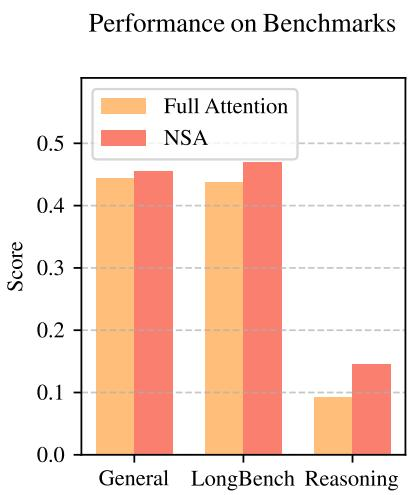
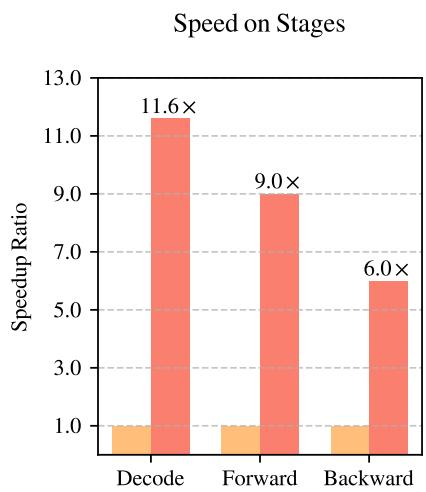
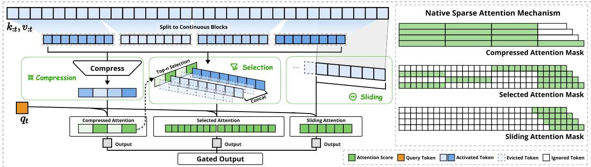
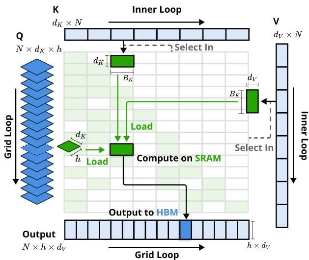
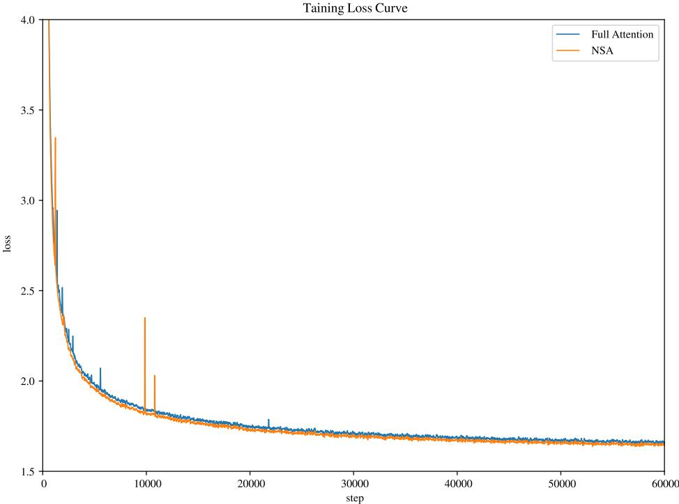
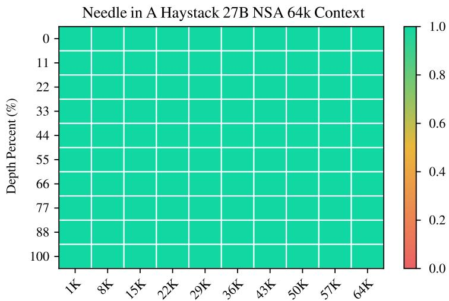
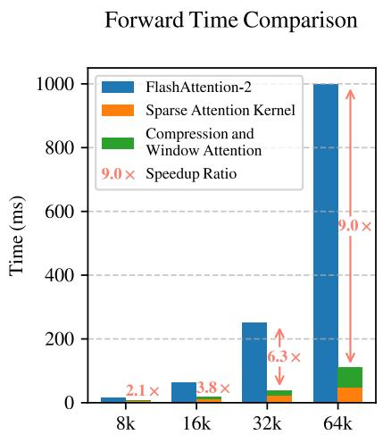
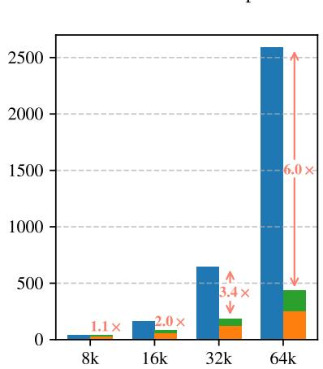
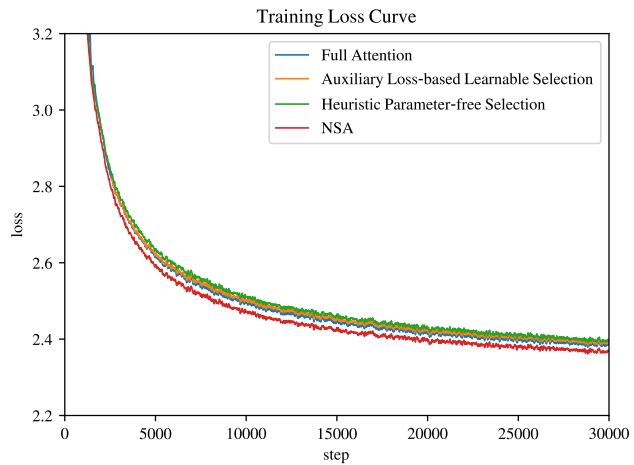
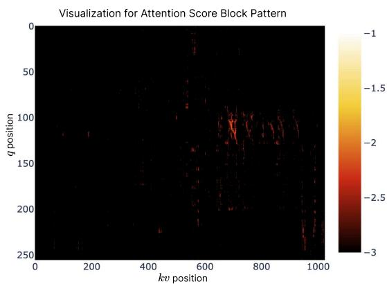

# 原生稀疏注意力（Native Sparse Attention）：硬件对齐且原生可训练的稀疏注意力

Jingyang Yuan∗1,2, Huazuo Gao1, Damai Dai1, Junyu Luo2, Liang Zhao1, Zhengyan Zhang1, Zhenda Xie1, Y. X. Wei1, Lean Wang1, Zhiping Xiao3, Yuqing Wang1, Chong Ruan1, Ming Zhang2, Wenfeng Liang1, Wangding Zeng1

1DeepSeek-AI

2Key Laboratory for Multimedia Information Processing, School of Computer Science, Peking University, PKU-Anker LLM Lab（北京大学计算机学院多媒体信息处理重点实验室，北大-安克大模型联合实验室）

3University of Washington（华盛顿大学）

{yuanjy, mzhang\_cs}@pku.edu.cn, {zengwangding, wenfeng.liang}@deepseek.com

## 摘要

长上下文建模对下一代语言模型至关重要，然而标准注意力机制的高昂计算成本带来了严峻的计算挑战。稀疏注意力在保持模型能力的同时提升效率，提供了一个极具前景的方向。我们提出了 NSA（Natively trainable Sparse Attention，原生可训练稀疏注意力），这是一种将算法创新与硬件对齐优化相结合的稀疏注意力机制，用于实现高效的长上下文建模。NSA 采用动态分层稀疏策略，将粗粒度标记（token）压缩与细粒度标记选择相结合，兼顾了全局上下文感知与局部精度。我们的方法通过两项关键创新推动了稀疏注意力的设计：(1) 我们通过平衡算术强度的算法设计，结合针对现代硬件的实现优化，实现了显著的加速。(2) 我们支持端到端训练，在不牺牲模型性能的前提下降低了预训练计算开销。如图 Figure 1 所示，实验表明，使用 NSA 预训练的模型在通用基准评测、长上下文任务以及基于指令的推理中，均达到或超过了全注意力（Full Attention）模型。同时，NSA 在 64k 长度的序列上的解码、前向传播和反向传播中相较于全注意力均取得了大幅加速，验证了其在模型全生命周期中的高效性。

## 1. 引言

在从深度推理（DeepSeek-AI, 2025; Zelikman et al., 2022）、代码库级代码生成（Zhang et al., 2023a; Zhang et al.）到多轮自主智能体系统（Park et al., 2023）等多样化现实应用的驱动下，研究界日益认识到长上下文建模是下一代大语言模型（large language models）的关键能力。近期的突破性进展，包括 OpenAI 的 o 系列模型、DeepSeek-R1（DeepSeek-AI, 2025）和 Gemini 1.5 Pro（Google et al., 2024），使模型能够处理整个代码库、长篇文档，在数千个 token 上维持连贯的多轮对话，并在长距离依赖关系中执行复杂推理。然而，随着序列长度的增加，原生注意力（vanilla Attention）（Vaswani et al., 2017）机制的高复杂度（Zaheer et al., 2020）成为了关键的延迟瓶颈。理论估计表明，在解码 64k 长度的上下文时，采用 softmax 架构的注意力计算占总延迟的 70–80%，这突显了对更高效注意力机制的迫切需求。

  
Figure 1 | 全注意力（Full Attention）模型与我们的 NSA 之间的性能与效率对比。左图：尽管具备稀疏性，NSA 在通用基准、长上下文任务和推理评测中的平均表现均超越了全注意力基线模型。右图：针对 64k 长度的序列处理，与全注意力相比，NSA 在所有阶段（解码、前向传播和反向传播）均实现了显著的计算加速。

高效长上下文建模的一种自然途径是利用 softmax 注意力固有的稀疏性（Ge et al., 2023; Jiang et al., 2023），其中选择性地计算关键的 query-key 对可以在保持性能的同时显著降低计算开销。近期的进展通过多种策略展示了这一潜力：KV-cache 驱逐方法（Li et al., 2024; Zhang et al., 2023b; Zhou et al., 2024）、分块 KV-cache 选择方法（Gao et al., 2024; Tang et al., 2024; Xiao et al., 2024a），以及基于采样、聚类或哈希的选择方法（Chen et al., 2024b; Desai et al., 2024; Liu et al., 2024）。尽管这些策略前景广阔，但现有的稀疏注意力方法在实际部署中往往不尽如人意。许多方法未能实现与其理论收益相当的加速；此外，大多数方法缺乏有效的训练期支持，无法充分利用注意力的稀疏模式。

为解决这些局限性，有效稀疏注意力的部署必须攻克两个关键挑战：(1) 与硬件对齐的推理加速：将理论上的计算量缩减转化为实际的速度提升，需要在预填充（prefilling）和解码（decoding）阶段均采用硬件友好的算法设计，以缓解访存与硬件调度瓶颈；(2) 面向训练的算法设计：利用可训练算子实现端到端计算，在降低训练成本的同时保持模型性能。这些要求对于实际应用中实现快速的长上下文推理或训练至关重要。若同时兼顾这两个方面，现有方法仍存在明显差距。

为了实现更有效且更高效的稀疏注意力，我们提出了 NSA（原生可训练稀疏注意力，Natively trainable Sparse Attention）架构，该架构融合了分层 token 建模。如图 2 所示，NSA 通过将 key 和 value 组织为时间块，并通过三条注意力路径进行处理来减少每个 query 的计算量：压缩的粗粒度 token、选择性保留的细粒度 token，以及用于局部上下文信息的滑动窗口。随后，我们实现了专用内核以最大化其实际运行效率。对应上述关键需求，NSA 引入了两项核心创新：(1) 与硬件对齐的系统：针对 Tensor Core 利用率和内存访问优化分块稀疏注意力，确保均衡的计算强度。(2) 面向训练的设计：通过高效算法和反向算子实现稳定的端到端训练。这种优化使 NSA 能够同时支持高效部署与端到端训练。

  
Figure 2 | NSA 架构概览。左图：该框架通过三个平行的注意力分支处理输入序列：对于给定的 query，前面的 key 和 value 分别被处理为用于粗粒度模式的压缩注意力、用于重要 token 块的选择注意力以及用于局部上下文的滑动注意力。右图：各分支生成的不同注意力模式的可视化。绿色区域表示需要计算注意力分数的区域，而白色区域表示可以跳过的区域。

我们在真实世界的语言语料库上通过全面的实验对 NSA 进行了评估。在包含 260B token 的 27B 参数 Transformer 骨干网络上进行预训练后，我们跨通用语言评估、长上下文评估以及思维链（chain-of-thought）推理评估对 NSA 的性能进行了评测。我们还在 A100 GPU 上将其与优化的 Triton (Tillet et al., 2019) 实现进行了算子（kernel）速度对比。实验结果表明，NSA 取得了与全注意力（Full Attention）基线相当或更优的性能，同时优于现有的稀疏注意力方法。此外，与 Full Attention 相比，NSA 在解码、前向和反向传播阶段均实现了显著加速，且加速比随序列长度的增加而进一步提高。这些结果证实了我们的分层稀疏注意力设计有效地平衡了模型能力与计算效率。

## 2. 重新思考稀疏注意力方法

现代稀疏注意力方法在降低 Transformer 模型的理论计算复杂度方面取得了显著进展。然而，大多数方法主要在推理阶段应用稀疏性，同时保留预训练的 Full Attention 骨干网络，这可能会引入架构偏差，从而限制其充分发挥稀疏注意力优势的能力。在介绍我们的原生稀疏架构之前，我们通过两个关键视角系统地分析了这些局限性。

## 2.1. 高效推理的假象

尽管在注意力计算中实现了稀疏性，但许多方法未能相应地降低推理延迟，这主要是由于两方面的挑战：

阶段受限的稀疏性（Phase-Restricted Sparsity）。诸如 H2O (Zhang et al., 2023b) 等方法在自回归解码期间应用稀疏性，但在预填充（prefilling）阶段需要进行计算密集型的预处理（例如注意力图计算、索引构建）。相反，像 MInference (Jiang et al., 2024) 这样的方法则仅专注于预填充稀疏性。这些方法未能在所有推理阶段都实现加速，因为至少有一个阶段的计算开销仍与 Full Attention 相当。这种阶段特异性削弱了这些方法在以预填充为主的工作负载（如书籍摘要和代码补全）或以解码为主的工作负载（如长思维链 (Wei et al., 2022) 推理）中的加速能力。

与先进注意力架构的不兼容性。某些稀疏注意力方法未能适应现代的高效解码架构，例如多查询注意力（Multiple-Query Attention, MQA）（Shazeer, 2019）和分组查询注意力（Grouped-Query Attention, GQA）（Ainslie et al., 2023），这些架构通过在多个查询头之间共享 KV，显著降低了由解码导致的访存瓶颈。例如，在 Quest（Tang et al., 2024）等方法中，每个注意力头独立选择其 KV-cache 子集。尽管在多头注意力（Multi-Head Attention, MHA）模型中它展现出了一致的计算稀疏性与访存稀疏性，但在基于 GQA 等架构的模型中情况则有所不同——此时 KV-cache 的访存量对应于同一 GQA 组内所有查询头所选内容的并集。这一架构特性意味着，虽然这些方法可以减少计算操作，但所需的 KV-cache 访存量仍然相对较高。这一局限性迫使人们做出权衡：尽管某些稀疏注意力方法减少了计算量，但其分散的访存模式与先进架构的高效访存设计产生了冲突。

这些局限性的根源在于，许多现有的稀疏注意力方法专注于 KV-cache 的削减或理论计算量的减少，却难以在先进的框架或后端中实现显著的延迟降低。这促使我们开发兼具先进架构与硬件高效实现的算法，以充分利用稀疏性来提高模型效率。

## 2.2. 可训练稀疏性的迷思

我们对原生可训练稀疏注意力的追求，源于对仅推理（inference-only）方法进行分析后得出的两个关键洞见：(1) 性能衰减：事后（post-hoc）应用稀疏性会迫使模型偏离其预训练的优化轨迹。正如 Chen et al. (2024b) 所证明的，前 20% 的注意力仅能覆盖 70% 的总注意力分数，导致预训练模型中的检索头（retrieval heads）等结构在推理剪枝时极易受损。(2) 训练效率需求：高效处理长序列训练对于现代 LLM 的发展至关重要。这既包括在更长文档上进行预训练以提升模型容量，也包括后续的适配阶段，如长上下文微调和强化学习。然而，现有的稀疏注意力方法主要面向推理，很大程度上未解决训练中的计算挑战。这一局限性阻碍了通过高效训练开发出能力更强的长上下文模型。此外，尝试将现有的稀疏注意力方法适配到训练中也暴露出了诸多挑战：

不可训练组件。像 ClusterKV (Liu et al., 2024)（包含 k-means 聚类）和 MagicPIG (Chen et al., 2024b)（包含基于 SimHash 的选择）等方法中的离散操作会在计算图中产生不连续性。这些不可训练的组件阻碍了梯度在词元（token）选择过程中的流动，限制了模型学习最优稀疏模式的能力。

低效的反向传播。一些理论上可训练的稀疏注意力方法在实际训练中效率低下。像 HashAttention (Desai et al., 2024) 等方法中使用的词元粒度选择策略，导致在注意力计算期间需要从 KV 缓存（KV cache）中加载大量单个词元。这种非连续的内存访问阻碍了对 FlashAttention 等快速注意力技术的高效适配，而后者依赖连续内存访问和分块计算来实现高吞吐量。因此，实现不得不退回到较低的硬件利用率，从而显著降低了训练效率。

## 2.3. 原生稀疏性的必要性

这些在推理效率和训练可行性方面的局限性，促使我们从根本上重新设计稀疏注意力机制。我们提出了 NSA，一个同时兼顾计算效率和训练需求的原生稀疏注意力（natively sparse attention）框架。在接下来的章节中，我们将详细介绍 NSA 的算法设计和算子实现。

## 3. 方法论

我们的技术方案涵盖算法设计和算子（kernel）优化。在接下来的小节中，我们首先介绍我们方法的背景。然后介绍 NSA 的整体框架，随后是其关键的算法组件。最后，我们详细阐述旨在最大化实际效率的硬件优化算子设计。

## 3.1. 背景

注意力机制（Attention Mechanism）广泛应用于语言建模中，其中每个查询词元 $\mathbf { q } _ { t }$ 计算与所有先前键 $\mathbf { k } _ { : t }$ 的相关性得分，以生成值 $\mathbf { v } _ { : t }$ 的加权和。形式上，对于长度为  的输入序列，注意力操作定义为：

$$
\mathbf {o} _ {t} = \operatorname{Attn} \left(\mathbf {q} _ {t}, \mathbf {k} _ {: t}, \mathbf {v} _ {: t}\right)\tag{1}
$$

其中 Attn 表示注意力函数：

$$
\mathrm{Attn} \left(\mathbf {q} _ {t}, \mathbf {k} _ {: t}, \mathbf {v} _ {: t}\right) = \sum_ {i = 1} ^ {t} \frac {\alpha_ {t , i} \mathbf {v} _ {i}}{\sum_ {j = 1} ^ {t} \alpha_ {t , j}}, \quad \alpha_ {t, i} = e ^ {\frac {\mathbf {q} _ {t} ^ {\top} \mathbf {k} _ {i}}{\sqrt {d _ {k}}}}.\tag{2}
$$

此处，$\alpha _ { t , i }$ 表示 $\mathbf { q } _ { t }$ 与 $\mathbf { k } _ { i } ,$ 之间的注意力权重，而 $d _ { k }$ 是键的特征维度。随着序列长度的增加，注意力计算在总计算成本中逐渐占据主导地位，给长上下文处理带来了严峻的挑战。

算术强度（Arithmetic Intensity）是计算操作与内存访问的比率。它从根本上决定了硬件上的算法优化方式。每个 GPU 都有一个由其峰值计算能力和内存带宽决定的临界算术强度，计算方法为这两个硬件极限值的比率。对于计算任务，高于该临界阈值的算术强度会变为计算受限（compute-bound，受限于 GPU FLOPS），而低于该阈值则变为内存受限（memory-bound，受限于内存带宽）。

具体对于因果自注意力（causal self-attention）机制，在训练和预填充（prefilling）阶段，批处理矩阵乘法和注意力计算表现出较高的算术强度，使得这些阶段在现代加速器上属于计算受限。相比之下，自回归解码（auto-regressive decoding）受到内存带宽的限制，因为它每次前向传播只生成一个 token，同时需要加载整个键值缓存（key-value cache），从而导致较低的算术强度。

这导致了不同的优化目标——在训练和预填充期间减少计算开销，而在解码期间减少内存访问。

## 3.2. 总体框架

为了充分利用具有自然稀疏模式的注意力的潜力，我们建议在给定每个查询 $\mathbf { q } _ { t }$ 的情况下，将公式 (1) 中的原始键值对 $\mathbf { k } _ { : t } , \mathbf { v } _ { : t }$ 替换为一组更紧凑且信息密集的表征键值对 $\tilde { K } _ { t } , \tilde { V } _ { t }$。具体而言，我们将优化后的注意力输出形式化定义如下：

$$
\tilde {K} _ {t} = f _ {K} (\mathbf {q} _ {t}, \mathbf {k} _ {: t}, \mathbf {v} _ {: t}), \quad \tilde {V} _ {t} = f _ {V} (\mathbf {q} _ {t}, \mathbf {k} _ {: t}, \mathbf {v} _ {: t})\tag{3}
$$

$$
\mathbf {o} _ {t} ^ {*} = \mathrm{Attn} \left(\mathbf {q} _ {t}, \tilde {K} _ {t}, \tilde {V} _ {t}\right)\tag{4}
$$

其中 $\tilde { K } _ { t } , \tilde { V } _ { t }$ 基于当前查询 $\mathbf { q } _ { t }$ 和上下文记忆 $\mathbf { k } _ { : t } , \mathbf { v } _ { : t }$ 动态构建。我们可以设计多种映射策略来获得不同类别的 $\tilde { K } _ { t } ^ { c } , \tilde { V } _ { t } ^ { c }$，并按如下方式将它们组合：

$$
\mathbf {o} _ {t} ^ {*} = \sum_ {c \in C} g _ {t} ^ {c} \cdot \operatorname{Attn} (\mathbf {q} _ {t}, \tilde {K} _ {t} ^ {c}, \tilde {V} _ {t} ^ {c}).\tag{5}
$$

如图 Figure 2 所示，NSA 具有三种映射策略 $C = \{ \mathrm { c m p } , \mathrm { s l c } , \mathrm { w i n } \} ,$，分别代表键和值的压缩（compression）、选择（selection）以及滑动窗口（sliding window）。$g _ { t } ^ { c } \in [ 0 , 1 ]$ 是对应策略 $c ,$ 的门控分数，由输入特征通过 MLP 和 sigmoid 激活函数计算得出。令 $N _ { t }$ 表示重映射后的键/值总数：

$$
N _ {t} = \sum_ {c \in \mathcal {C}} \mathrm{size} [ \tilde {K} _ {t} ^ {c} ].\tag{6}
$$

我们通过确保 $N _ { t } \ll t ,$ 来保持较高的稀疏率。

## 3.3. 算法设计

在本小节中，我们介绍重映射策略 $f _ { K }$ 和 $f _ { V } { : }$ 的设计：Token 压缩、Token 选择以及滑动窗口。

## 3.3.1. Token 压缩

通过将连续的键或值块聚合为块级表示，我们获得了捕获整个块信息的压缩键和压缩值。形式上，压缩键表示定义为：

$$
\tilde {K} _ {t} ^ {\mathrm{cmp}} = f _ {K} ^ {\mathrm{cmp}} (\mathbf {k}: t) = \left\{\varphi (\mathbf {k} _ {i d + 1: i d + l}) \Bigg | 0 \leqslant i \leqslant \left\lfloor \frac {t - l}{d} \right\rfloor \right\}\tag{7}
$$

其中  是块长度， 是相邻块之间的滑动步长，$\varphi$ 是带有块内位置编码的可学习 MLP，用于将一个块内的键映射为单个压缩键。$\tilde { K } _ { t } ^ { \mathrm { c m p } } \in \mathbb { R } ^ { d _ { k } \times \lfloor \frac { t - l } { d } \rfloor }$ 是由压缩键组成的张量。通常，我们采用  <  来缓解信息碎片化。压缩值表示 $\tilde { V } _ { t } ^ { \mathrm { c m } \tilde { \mathrm { p } } }$ 具有类似的公式表述。压缩表示能够捕获更粗粒度的高层语义信息，并减轻注意力机制的计算负担。

## 3.3.2. Token 选择

仅使用压缩键和压缩值可能会丢失重要的细粒度信息，这促使我们选择性地保留个别的键和值。下面我们介绍高效的 Token 选择机制，该机制能够以较低的计算开销识别并保留最相关的 Token。

分块选择（Blockwise Selection）。我们的选择策略在空间连续块中处理键和值序列，这受到两个关键因素的驱动：硬件效率考虑以及注意力分数的固有分布模式。分块选择对于在现代 GPU 上实现高效计算至关重要。这是因为与基于随机索引的读取相比，现代 GPU 架构在连续块访问时表现出显著更高的吞吐量。此外，分块计算能够充分利用 Tensor Core。这一架构特性使得分块内存访问和计算成为高性能注意力实现中的基本原则，正如 FlashAttention 的基于块的设计所体现的那样。分块选择遵循注意力分数的固有分布模式。先前的研究（Jiang et al., 2024）表明，注意力分数通常表现出空间连续性，表明相邻的键往往具有相似的重要性水平。我们在第 6.2 节中的可视化也展示了这种空间连续模式。

为了实现分块选择（blockwise selection），我们首先将键（key）、值（value）序列划分为选择块。为了识别出注意力计算中最重要的块，我们需要为每个块分配重要性分数。下面我们介绍计算这些块级重要性分数的方法。

重要性分数计算（Importance Score Computation）。计算块重要性分数可能会引入显著的开销。幸运的是，压缩 token 的注意力计算会产生中间注意力分数，我们可以利用这些中间分数来推导出选择块的重要性分数，公式如下：

$$
\mathbf {p} _ {t} ^ {\mathrm{cmp}} = \operatorname{Softmax} \left(\mathbf {q} _ {t} ^ {T} \tilde {K} _ {t} ^ {\mathrm{cmp}}\right),\tag{8}
$$

其中 $\mathfrak { p } _ { t } ^ { \mathrm { c m p } } \in \mathbb { R } ^ { \lfloor \frac { t - l } { d } \rfloor + 1 }$ 是 $q _ { t }$ 与压缩键 $\tilde { K } _ { t } ^ { \mathrm { c m p } }$ 之间的注意力分数。令 ′ 表示选择块的大小。当压缩块和选择块采用相同的分块方案时，即 $l ^ { \prime } = l = d$ ，我们可以直接通过 $\mathbf { p } _ { t } ^ { \mathrm { s l c } } = \mathbf { p } _ { t } ^ { \mathrm { c m p } }$ 获得选择块重要性分数 $\mathbf { p } _ { t } ^ { \mathrm { s l c } }$。对于分块方案不同的情况，我们根据它们之间的空间关系推导选择块的重要性分数。在给定 $l \leqslant l ^ { \prime } , d \mid l$ 以及  | ′ 的情况下，我们有：

$$
\mathbf {p} _ {t} ^ {\mathrm{slc}} [ j ] = \sum_ {m = 0} ^ {\frac {l ^ {\prime}}{d} - 1} \sum_ {n = 0} ^ {\frac {l}{d} - 1} \mathbf {p} _ {t} ^ {\mathrm{cmp}} \left[ \frac {l ^ {\prime}}{d} j - m - n \right],\tag{9}
$$

其中 [·] 表示用于访问向量元素的索引运算符。对于采用 GQA 或 MQA（键值缓存在查询头之间共享）的模型，必须确保这些头之间的块选择保持一致，以在解码期间最大程度减少 KV cache 加载。一个组内各头共享的重要性分数形式化定义为：

$$
\mathbf {p} _ {t} ^ {\mathrm{slc} ^ {\prime}} = \sum_ {h = 1} ^ {H} \mathbf {p} _ {t} ^ {\mathrm{slc}, (h)},\tag{10}
$$

其中上标中的 (ℎ) 表示头索引，而  是每个组中的查询头数量。这种聚合确保了同一组内各头之间的块选择保持一致。

Top- 块选择（Top- Block Selection）。在获得选择块重要性分数后，我们保留按块重要性分数排序在前  的稀疏块内的 token，形式化表示为：

$$
\mathcal {I} _ {t} = \{i \mid \operatorname{rank} (\mathbf {p} _ {t} ^ {\mathrm{slc} ^ {\prime}} [ i ]) \leqslant n \}\tag{11}
$$

$$
\tilde {K} _ {t} ^ {\mathrm{slc}} = \mathsf {C a t} \left[ \{\mathbf {k} _ {i l ^ {\prime} + 1: (i + 1) l ^ {\prime}} | i \in \mathcal {I} _ {t} \} \right],\tag{12}
$$

其中 $\text{rank}(\cdot)$ 表示降序排列的位置，$\text{rank} = 1$ 对应最高得分，I 是所选块的索引集合，$\text{Cat}$ 表示拼接操作。$\tilde { K } _ { t } ^ { \mathrm { s l c } } \in \mathbb { R } ^ { d _ { k } \times n l ^ { \prime } }$ 是由压缩键组成的张量。类似的公式也适用于细粒度值 $\tilde { V } _ { t } ^ { \mathrm { s l c } }$。随后，所选的键和值按照公式 (5) 与 $\mathbf { q } _ { t }$ 一起参与注意力计算。

## 3.3.3. 滑动窗口

在注意力机制中，局部模式通常适应得更快，并且可能主导学习过程，从而可能阻碍模型有效地从压缩和选择标记中进行学习。为了解决这个问题，我们引入了一个专用的滑动窗口分支来显式处理局部上下文，使其他分支（压缩和选择）能够专注于学习它们各自的特征，而不会被局部模式捷径化。具体而言，我们在窗口 $w$ 中保留最近的标记 $\tilde { K } _ { t } ^ { \mathrm { w i n } } = \mathbf { k } _ { t - w : t } , \tilde { V } _ { t } ^ { \mathrm { w i n } } = \bar { \mathbf { v } } _ { t - w : t }$，并将不同信息源（压缩标记、选定标记、滑动窗口）的注意力计算隔离到独立的分支中。然后，这些分支的输出通过一个可学习的门控机制进行聚合。为了进一步以极小的计算开销防止跨注意力分支的捷径学习，我们为三个分支提供了独立的键和值。这种架构设计通过防止局部和长程模式识别之间的梯度干扰，实现了稳定的学习，同时仅引入了极小的开销。

在获得所有三类键和值 $( \tilde { K } _ { t } ^ { \mathrm { c m p } } , \tilde { V } _ { t } ^ { \mathrm { c m p } } ; \tilde { K } _ { t } ^ { \mathrm { s l c } } , \tilde { V } _ { t } ^ { \mathrm { s l c } } ;$ 以及 $\tilde { K } _ { t } ^ { \mathrm { w i n } } , \tilde { V } _ { t } ^ { \mathrm { w i n } } )$ 后，我们按照公式 (5) 计算最终的注意力输出。结合上述的压缩、选择和滑动窗口机制，这就构成了 NSA 的完整算法框架。

## 3.4. 算子设计

为了在训练和预填充（prefilling）阶段实现 FlashAttention 级别的加速，我们基于 Triton 实现了硬件对齐的稀疏注意力算子。鉴于 MHA 具有较高的内存开销且在解码时效率低下，紧跟当前最先进的 LLMs，我们重点关注具有共享 KV 缓存的架构，例如 GQA 和 MQA。虽然压缩注意力和滑动窗口注意力计算可以直接兼容现有的 FlashAttention-2 算子，但我们针对稀疏选择注意力引入了专用的算子设计。如果我们遵循 FlashAttention 将时间上连续的 query 块加载到 SRAM 中的策略，这会导致低效的内存访问，因为一个块内的各 query 可能会需要不相交的 KV 块。为了解决这个问题，我们的关键优化在于一种不同的 query 分组策略：对于 query 序列上的每个位置，我们将一个 GQA 组内的所有 query 头（它们共享相同的稀疏 KV 块）加载到 SRAM 中。图 3 说明了我们的前向传播实现。所提出的算子架构具有以下主要特点：

1. 以组为中心的数据加载（Group-Centric Data Loading）。对于每个内层循环，加载位置  处该组内所有头的 query $Q \in \mathbb { R } ^ { [ h , d _ { k } ] }$ 及其共享的稀疏 key/value 块索引 $\mathcal { I } _ { t } .$

2. 共享 KV 获取（Shared KV Fetching）。在内层循环中，按顺序将由 $\textstyle { \mathcal { I } } _ { t }$ 索引的连续 key/value 块作为 $K \in \mathbb { R } ^ { [ B _ { k } , d _ { k } ^ { \bullet } ] } , V \in \mathbf { \widehat { R } } ^ { [ B _ { k } , d _ { \nu } ] }$ 加载到 SRAM 中以最小化内存加载开销，其中 $B _ { k }$ 为满足 $B _ { k } | l ^ { \prime }$ 的算子块大小。

3. Grid 上的外层循环（Outer Loop on Grid）。由于不同 query 块的内层循环长度（与选定的块数  成正比）几乎完全相同，我们将 query/output 循环置于 Triton 的 grid 调度器中，以简化并优化算子。

该设计通过以下两点实现了接近最优的算术强度：（1）通过组内共享消除冗余的 KV 传输；（2）平衡 GPU 流式多处理器（SM）之间的计算负载。

  
Figure 3 | NSA 的算子设计。该算子按 GQA 组加载 query（Grid 循环），获取对应的稀疏 KV 块（内层循环），并在 SRAM 上执行注意力计算。绿色块表示 SRAM 上的数据，蓝色块表示 HBM 上的数据。

## 4. 实验

我们从三个维度对 NSA 进行评估：（1）通用基准性能，（2）长上下文基准性能，以及（3）思维链（chain-of-thought）推理性能，并与 Full Attention 基线以及最先进的稀疏注意力方法进行对比。我们将稀疏计算范式的效率分析留至第 5 节，届时将详细讨论训练和推理速度。

## 4.1. 预训练设置

遵循最先进 LLM（大语言模型）的通用做法，我们的实验采用了结合分组查询注意力（Grouped-Query Attention, GQA）和专家混合（Mixture-of-Experts, MoE）的主干网络，总参数量为 27B，激活参数量为 3B。模型由 30 层组成，隐藏层维度为 2560。对于 GQA，我们将分组数设置为 4，共有 64 个注意力头。对于每个头，查询（query）、键（key）和值（value）的隐藏维度分别配置为 $d _ { q } = d _ { k } = 1 9 2$ 和 $d _ { \nu } = 1 2 8$。对于 MoE，我们采用 DeepSeekMoE（Dai et al., 2024; DeepSeek-AI, 2024）结构，包含 72 个路由专家和 2 个共享专家，并将 Top-k 专家数设置为 6。为确保训练稳定性，第一层的 MoE 被替换为 SwiGLU 形式的 MLP。

Figure 4 | 27B 参数模型上全注意力（Full Attention）与我们的 NSA 的预训练损失对比。两种模型均表现出稳定的收敛性，其中 NSA 取得了更低的损失值。

<table><tr><td>模型</td><td>MMLU Acc. 5-shot</td><td>MMLU-PRO Acc. 5-shot</td><td>CMMLU Acc. 5-shot</td><td>BBH Acc. 3-shot</td><td>GSM8K Acc. 8-shot</td><td>MATH Acc. 4-shot</td><td>DROP F1 1-shot</td><td>MBPP Pass@1 3-shot</td><td>HumanEval Pass@1 0-shot</td><td>平均</td></tr><tr><td>Full Attn</td><td>0.567</td><td>0.279</td><td>0.576</td><td>0.497</td><td>0.486</td><td>0.263</td><td>0.503</td><td>0.482</td><td>0.335</td><td>0.443</td></tr><tr><td>NSA</td><td>0.565</td><td>0.286</td><td>0.587</td><td>0.521</td><td>0.520</td><td>0.264</td><td>0.545</td><td>0.466</td><td>0.348</td><td>0.456</td></tr></table>

Table 1 | 全注意力基线与 NSA 在通用基准上的预训练性能对比，涵盖知识（MMLU、MMLU-PRO、CMMLU）、推理（BBH、GSM8K、MATH、DROP）和代码（MBPP、HumanEval）任务。尽管具有高稀疏性，NSA 在大多数基准测试中仍取得了更优的平均性能。

所提出的架构在计算成本与模型性能之间实现了有效的权衡。对于 NSA，我们将压缩块大小设置为  = 32，滑动步长 $d = 1 6 ,$ 选取块大小 $l ^ { \prime } = 6 4$，选取块数量  = 16（包括固定激活的 1 个初始块和 2 个局部块），以及滑动窗口大小 $w = 5 1 2$。全注意力模型和稀疏注意力模型均在 8k 长度文本的 270B token 上进行预训练，随后利用 YaRN（Peng et al., 2024）在 32k 长度文本上进行持续训练和监督微调，以实现长上下文适应。两种模型均训练至完全收敛，以确保公平对比。如 Figure 4 所示，我们的 NSA 和全注意力基线的预训练损失曲线均表现出稳定平滑的下降，且 NSA 始终优于全注意力模型。

## 4.2. 基线方法

除了与 Full Attention 进行比较外，我们还评估了几种处于最前沿（state-of-the-art）的推理阶段稀疏注意力方法：H2O (Zhang et al., 2023b)、infLLM (Xiao et al., 2024a)、Quest (Tang et al., 2024) 以及 Exact-Top，后者首先计算完整的注意力分数，并为每个 query 选择分数最高的 top- 个 key，然后在这些位置上计算注意力。这些方法涵盖了多种不同的稀疏注意力范式，包括 KV-cache 逐出（eviction）、查询感知选择（query-aware selection）以及精确 top- 稀疏选择。

<table><tr><td rowspan="2">Model</td><td colspan="3">SQA</td><td colspan="4">MQA</td><td colspan="2">Synthetic</td><td rowspan="2">Code LCC</td><td rowspan="2">Avg.</td></tr><tr><td>MFQA-en</td><td>MFQA-zh</td><td>Qasper</td><td>HPQ</td><td>2Wiki</td><td>GovRpt</td><td>Dur</td><td>PassR-en</td><td>PassR-zh</td></tr><tr><td>H2O</td><td>0.428</td><td>0.429</td><td>0.308</td><td>0.112</td><td>0.101</td><td>0.231</td><td>0.208</td><td>0.704</td><td>0.421</td><td>0.092</td><td>0.303</td></tr><tr><td>InfLLM</td><td>0.474</td><td>0.517</td><td>0.356</td><td>0.306</td><td>0.250</td><td>0.277</td><td>0.257</td><td>0.766</td><td>0.486</td><td>0.143</td><td>0.383</td></tr><tr><td>Quest</td><td>0.495</td><td>0.561</td><td>0.365</td><td>0.295</td><td>0.245</td><td>0.293</td><td>0.257</td><td>0.792</td><td>0.478</td><td>0.135</td><td>0.392</td></tr><tr><td>Exact-Top</td><td>0.502</td><td>0.605</td><td>0.397</td><td>0.321</td><td>0.288</td><td>0.316</td><td>0.291</td><td>0.810</td><td>0.548</td><td>0.156</td><td>0.423</td></tr><tr><td>Full Attn</td><td>0.512</td><td>0.623</td><td>0.409</td><td>0.350</td><td>0.305</td><td>0.324</td><td>0.294</td><td>0.830</td><td>0.560</td><td>0.163</td><td>0.437</td></tr><tr><td>NSA</td><td>0.503</td><td>0.624</td><td>0.432</td><td>0.437</td><td>0.356</td><td>0.307</td><td>0.341</td><td>0.905</td><td>0.550</td><td>0.232</td><td>0.469</td></tr></table>

Table 2 | 我们的 NSA 与各基线模型在 LongBench 上的性能比较，涵盖单文档 QA、多文档 QA、合成任务以及代码任务类别的子集。NSA 的表现优于包括 Full Attention 在内的大多数基线模型。

在通用能力评估中，由于大多数样本的长度都在稀疏注意力基线模型的局部上下文窗口之内，这些方法实际上等同于 Full Attention。因此，在此设置下我们仅展示 NSA 与 Full Attention 基线之间的比较结果。在长上下文评估中，我们在所有基线方法之间进行了比较，并将所有稀疏注意力方法的稀疏度设置为相同，以确保公平对比。对于需要长文本监督微调的思维链推理（chain-of-thought reasoning）评估，由于稀疏注意力基线不支持训练，我们将比较范围限制在 Full Attention。

## 4.3. 性能比较

通用评估。我们在涵盖知识、推理和编码能力的综合基准测试集上，对预训练的 NSA 和全注意力（Full Attention）基线进行了评估，涵盖的基准包括 MMLU (Hendrycks et al., 2020)、MMLU-PRO (Wang et al., 2024)、CMMLU (Li et al., 2023)、BBH (Suzgun et al., 2022)、GSM8K (Cobbe et al., 2021)、MATH (Hendrycks et al., 2020)、DROP (Dua et al., 2019)、MBPP (Austin et al., 2021) 以及 HumanEval (Chen et al., 2021)。结果如 Table 1 所示。尽管具有稀疏性，NSA 仍取得了更优越的综合性能，在 9 项指标中的 7 项上超越了包括 Full Attention 在内的所有基线模型。这表明，尽管 NSA 在较短序列上可能无法充分发挥其效率优势，但它依然展现出了强大的性能。值得注意的是，NSA 在与推理相关的基准测试中表现出显著提升（DROP: +0.042，GSM8K: +0.034），这表明我们的预训练有助于模型形成专门的注意力机制。这种稀疏注意力预训练机制迫使模型聚焦于最重要的信息，通过过滤来自无关注意力路径的噪声，从而潜在地提升了性能。在各类评估中表现出的一致性性能，也验证了 NSA 作为通用架构的鲁棒性。

长上下文评估。如 Figure 5 所示，在 64k 上下文的大海捞针（needle-in-a-haystack）(Kamradt, 2023) 测试中，NSA 在所有位置上均达到了完美的检索准确率。这种性能源于我们分层稀疏注意力的设计，该设计结合了用于高效全局上下文扫描的压缩词元（compression tokens），以及用于精确局部信息检索的选择词元（selection tokens）。粗粒度的压缩以较低的计算成本识别相关上下文块，而在所选词元上的词元级注意力则确保了关键细粒度信息的保留。该设计使 NSA 能够兼顾全局感知与局部精度。

我们还在 LongBench（Bai et al., 2023）上评估了 NSA 与最先进的稀疏注意力方法及全注意力（Full Attention）基线的表现。为了确保稀疏度的一致性，我们将所有稀疏注意力基线中每个 query 激活的 token 数量设置为 2560 个，这对应于 NSA 在处理 32k 序列长度时激活的平均 token 数量。遵循 Stream-LLM（Xiao et al., 2023）的做法，该 token 预算包括开头的 128 个 token 和 512 个局部 token。由于某些子集在所有模型上的得分均较低，可能无法提供有意义的比较，我们从 LongBench 中排除了这些子集。如 Table 2 所示，NSA 取得了最高的平均分 0.469，超越了所有基线（相较于 Full Attention 提升了 +0.032，相较于 Exact-Top 提升了 +0.046）。这一提升源于两项关键创新：(1) 我们的原生稀疏注意力设计使得在预训练期间能够对稀疏模式进行端到端优化，促进了稀疏注意力模块与其他模型组件之间的同步适应；(2) 分层稀疏注意力机制实现了局部与全局信息处理之间的平衡。

  
Figure 5 | 在 64k 上下文长度下跨不同上下文位置的“大海捞针”（Needle-in-a-Haystack）检索准确率。NSA 通过其分层稀疏注意力设计实现了完美的准确率。

值得注意的是，NSA 在需要对长上下文进行复杂推理的任务上表现出了卓越的性能，在多跳问答任务（HPQ 和 2Wiki）上相较于 Full Attention 分别取得了 +0.087 和 +0.051 的提升，在代码理解任务（LCC：+0.069）上超越了各基线的表现，并在段落检索任务（PassR-en：+0.075）上优于其他方法。这些结果验证了 NSA 应对多样化长上下文挑战的能力，其原生预训练的稀疏注意力在学习任务最优模式方面提供了额外的优势。

思维链推理评估（Chain-of-Thought Reasoning Evaluation）。为了评估 NSA 与先进下游训练范式的兼容性，我们研究了其通过后训练（post-training）获取思维链数学推理能力的能力。鉴于强化学习在较小规模模型上的有效性有限，我们采用来自 DeepSeek-R1 的知识蒸馏，使用包含 32k 长度数学推理轨迹的 10B token 进行监督微调（SFT）。这生成了两个具有可比性的模型：Full Attention-R（Full Attention 基线）和 NSA-R（我们的稀疏变体）。我们在极具挑战性的美国数学邀请赛（American Invitational Mathematics Examination，AIME 24）基准上对这两个模型进行了评估。我们使用 0.7 的采样温度和 0.95 的 top-$p$ 值，为每个问题生成 16 个回答并计算平均分。为了验证推理深度的影响，我们在两种生成上下文限制（8k 和 16k tokens）下进行了实验，以衡量扩展推理链是否能提高准确率。模型预测的示例对比见附录 A。

<table><tr><td>生成 Token 限制</td><td>8192</td><td>16384</td></tr><tr><td>Full Attention-R</td><td>0.046</td><td>0.092</td></tr><tr><td>NSA-R</td><td>0.121</td><td>0.146</td></tr></table>

Table 3 | 监督微调后基于指令的 AIME 评估。我们的 NSA-R 在 8k 和 16k 序列长度下均表现出优于 Full Attention-R 的性能

  
Figure 6 | 基于 Triton 的 NSA 核与基于 Triton 的 FlashAttention-2 核的对比。我们的实现显著降低了所有上下文长度下的延迟，且随着输入长度的增加，改进效果愈发显著。

如 Table 3 所示，NSA-R 在 8k 上下文设置下的准确率显著高于 Full Attention-R（+0.075），且这一优势在 16k 上下文中依然保持（+0.054）。这些结果验证了原生稀疏注意力的两个关键优势：(1) 预训练的稀疏注意力模式能够高效捕获对复杂数学推导至关重要的长程逻辑依赖；(2) 我们架构中与硬件对齐的设计保持了足够的上下文密度，以支持不断增长的推理深度，而不会发生灾难性遗忘。在不同上下文长度下的持续优异表现，证实了将稀疏注意力原生集成到训练流程中用于高级推理任务的可行性。

## 5. 效率分析

我们在一个 8-GPU A100 系统上评估了 NSA 相对于全注意力（Full Attention）的计算效率。在效率分析中，我们还将模型配置为 GQA 分组 $g = 4 ,$、每组头数 $h = 1 6 ,$、查询/键维度 $d _ { k } = 1 9 2$ 以及值维度 $d _ { \nu } = 1 2 8$。遵循第 4 节中的相同设置，我们将 NSA 压缩块大小设置为 $l = 3 2 ,$、滑动步长 $d = 1 6 ,$、选定块大小 $l ^ { \prime } = 6 4$、选定块数量 $n = 1 6 ,$ 以及滑动窗口大小 $w = 5 1 2$。

## 5.1. 训练速度

我们将基于 Triton 实现的 NSA 注意力和全注意力与基于 Triton 的 FlashAttention-2 进行了比较，以确保在相同后端下进行公平的速度对比。如图 Figure 6 所示，随着上下文长度的增加，我们的 NSA 实现了越来越显著的加速，在 64k 上下文长度下实现了高达 9.0× 的前向加速和 6.0× 的反向加速。值得注意的是，序列越长，速度优势越明显。这种加速源于我们与硬件对齐的算法设计，从而最大化了稀疏注意力架构的效率：(1) 分块（Blockwise）内存访问模式通过合并加载最大化了 Tensor Core 的利用率；(2) 内核中精细的循环调度消除了冗余的 KV 传输。

<table><tr><td>上下文长度</td><td>8192</td><td>16384</td><td>32768</td><td>65536</td></tr><tr><td>全注意力</td><td>8192</td><td>16384</td><td>32768</td><td>65536</td></tr><tr><td>NSA</td><td>2048</td><td>2560</td><td>3584</td><td>5632</td></tr><tr><td>预期加速比</td><td>4×</td><td>6.4×</td><td>9.1×</td><td>11.6×</td></tr></table>

Table 4 | 解码期间每次注意力操作的访存量（以等效 token 数量表示）。由于解码阶段计算强度低且受限于内存带宽，预期加速比与访存量近似呈线性关系。

## 5.2. 解码速度

注意力的解码速度主要由访存瓶颈决定，而这与 KV 缓存（KV cache）的加载量密切相关。在每个解码步骤中，我们的 NSA 仅需加载至多 $\textstyle \left\lfloor { \frac { s - l } { d } } \right\rfloor$ 个压缩 token、′ 个选定 token 以及  个邻近 token，其中  为缓存的序列长度。如 Table 4 所示，随着解码长度的增加，我们的方法显著降低了延迟，在 64k 上下文长度下实现了高达 11.6× 的加速。这种访存效率上的优势同样在更长序列中进一步放大。

## 6. 讨论

在本节中，我们对 NSA 的开发过程进行反思，并讨论在探索不同稀疏注意力策略中获得的关键见解。尽管我们的方法展示了很有前景的结果，但了解在其他备选策略中遇到的挑战并分析注意力模式，能为未来的研究方向提供有价值的参考背景。我们首先分析了促使我们做出设计选择的其他 Token 选择策略所面临的挑战，随后通过可视化展示为注意力分布模式提供深入见解。

## 6.1. 其他 Token 选择策略所面临的挑战

在设计 NSA 之前，我们探索了将现有的稀疏注意力方法调整并应用到训练阶段。然而，这些尝试遇到了各种挑战，促使我们设计了一种不同的稀疏注意力架构：

基于键聚类（Key-Clustering）的策略。我们研究了像 ClusterKV (Liu et al., 2024) 这样基于聚类的策略。这些方法将来自同一聚类的键（Keys）和值（Values）存储在连续的内存区域中。尽管这在理论上对训练和推理都是可行的，但它们面临三大严峻挑战：(1) 动态聚类机制带来的不可忽视的计算开销；(2) 算子优化难度因聚类间的不均衡而被放大，特别是在混合专家（Mixture-of-Experts, MoE）系统中，专家并行（Expert Parallelism, EP）组执行时间的倾斜会导致持续的负载不均衡；(3) 必须进行周期性重新聚类以及块顺序（chunk-sequential）训练协议所带来的实现约束。这些因素共同构成了巨大的瓶颈，显著限制了它们在实际部署中的有效性。

  
Figure 7 | 在 3B 参数模型上对比全注意力（Full Attention）与不同 Token 选择策略的训练损失。我们的 NSA 取得了更好的性能。  
Figure 8 | 全注意力 Transformer 上的注意力图（Attention Map）可视化。浅色区域表示更高的注意力值。如图所示，注意力分数呈现出分块聚类分布。

其他分块选择策略。我们还考虑了不同于 NSA 的分块键、值选择策略，例如 Quest (Tang et al., 2024) 和 InfLLM (Xiao et al., 2024a)。这些方法依赖于为每个 KV 块计算重要性分数，并根据它们与  的相似度选择 top- 个块。然而，现有方法面临两个关键问题：(1) 由于选择操作是不可微的，基于神经网络的重要性分数计算依赖于辅助损失，这增加了算子开销并常常导致模型性能下降；(2) 启发式无参数的重要性分数计算策略召回率较低，导致性能欠佳。我们在具有相似架构的 3B 参数模型上评估了这两种方法，并将它们的损失曲线与 NSA 和 Full Attention 进行了对比。对于基于辅助损失的选择方法，我们为每个 token 引入了额外的 query，并为每个块引入了代表性的 key，以估计块重要性分数。我们通过对每个 key 块内的注意力分数进行平均池化来计算块级监督信号，并使用 KL 散度来监督块重要性预测。我们保持了单独 query 的粒度，而不是采用块平均 query，以适应高效解码。这种基于辅助损失的重要性估计在概念上与 SeerAttention (Gao et al., 2024) 具有相似性。对于启发式无参数选择方法，遵循 Quest 的策略，我们使用 query 与 key 块按坐标维度的最大最小值（coordinate-wise min-max）之间的乘积进行直接选择，而不引入额外的参数。我们还探索了一种冷启动训练方法，在前 1000 步中使用 Full Attention，然后再过渡到启发式分块选择。如图 Figure 7 所示，这两种方法都表现出较差的损失。

## 6.2. 可视化

为了探索 Transformer 注意力分布中的潜在模式并为我们的设计寻求灵感，我们在 Figure 8 中对预训练 27B Full Attention 模型的注意力图进行了可视化。可视化结果揭示了有趣的模式：注意力分数往往表现出分块聚集的特征，相邻的 key 通常呈现出相似的注意力分数。这一观察启发了我们对 NSA 的设计，表明基于空间连续性选择 key 块可能是一种很有前景的方法。分块聚集现象表明，序列中相邻的 token 可能与 query token 共享某些语义关系，尽管这些关系的具体本质仍需进一步研究。这一观察促使我们探索一种作用于连续 token 块而非单个 token 的稀疏注意力机制，旨在提高计算效率并保留高注意力模式。

## 7. 相关工作

我们回顾了通过稀疏注意力提高注意力计算效率的现有方法。根据其核心策略，这些方法大致可分为三类：(1) 固定稀疏模式，(2) 动态 Token 剪枝，以及 (3) 查询感知选择。我们介绍了每种类别的几项代表性工作。

## 7.1. 固定稀疏模式

滑动窗口（SlidingWindow）是一种常用的方法，它允许查询仅在固定窗口内计算注意力。StreamingLLM (Xiao et al., 2023) 将注意力汇聚（attention sinks）与局部窗口相结合，以处理连续文本流。MoA (Fu et al., 2024a) 和 DuoAttention (Xiao et al., 2024b) 也采用类似的局部和汇聚信息来进行长序列建模。Longformer (Beltagy et al., 2020) 将局部窗口注意力与全局 token 交织在一起以处理长序列。与它们相比，我们的 NSA 不依赖预定义的稀疏模式，而是自动学习这些模式，从而释放了利用全上下文的潜力。

## 7.2. 动态 Token 剪枝

部分方法旨在通过动态 KV 缓存剪枝来降低推理期间的显存和计算开销。H2O (Zhang et al., 2023b)、BUZZ (Zhao et al., 2024) 和 SepLLM (Chen et al., 2024a) 实现了自适应方法，以减少解码期间的 KV 缓存显存占用。这些方法动态驱逐被认为对未来预测不太重要的 token。FastGen Ge et al. (2023) 和 HeadKV (Fu et al., 2024b) 通过为各个注意力头分配不同的策略来优化计算。SnapKV (Li et al., 2024) 引入了一种 token 剪枝策略，通过选择性地仅保留最关键的特征来减少 KV 缓存，从而实现高效的显存利用。与这些侧重于推理的方法不同，我们的 NSA 在训练阶段原生引入了稀疏性。

## 7.3. 查询感知选择

其他工作侧重于依赖于查询的标记选择（query-dependent token selection）方法，以在保持注意力质量的同时减少注意力计算。Quest（Tang et al., 2024）采用块级选择策略，其中每个块的重要性通过查询与键块的逐坐标极值（coordinatewise min-max）之间的乘积来估计。InfLLM（Xiao et al., 2024a）通过维护注意力汇点（attention sinks）、局部上下文和可检索块，将固定模式与检索相结合。该方法从每个块中选择代表性键来估计块的重要性。HashAttention（Desai et al., 2024）通过使用学习到的函数将查询和键映射到汉明空间（Hamming space），将关键标记识别形式化为一个推荐问题。ClusterKV（Liu et al., 2024）通过首先对键进行聚类，然后根据查询-聚类相似度选择最相关的聚类进行注意力计算来实现稀疏性。MInference（Jiang et al., 2024）和 TokenSelect（Wu et al., 2024）基于标记级重要性评分选择用于计算的 KV 对。SeerAttention（Gao et al., 2024）将查询和键划分为空间块，并执行块级选择以实现高效计算。与这些方法相比，我们的 NSA 在包括训练、预填充（prefilling）和解码（decoding）在内的完整模型生命周期中，均实现了硬件对齐的稀疏注意力计算。

## 8. 结论

我们提出了 NSA，一种用于高效长上下文建模的硬件对齐稀疏注意力架构。通过在可训练架构中将分层标记压缩与块级标记选择相结合，我们的架构在保持全注意力（Full Attention）性能的同时实现了训练和推理的加速。NSA 推进了现有技术的边界，证明了其在通用基准上的性能与全注意力基线相当，在长上下文评估中超越了现有建模能力，并增强了推理能力，同时显著降低了计算延迟并实现了大幅加速。

## 参考文献

J. Ainslie, J. Lee-Thorp, M. de Jong, Y. Zemlyanskiy, F. Lebrón, and S. Sanghai. Gqa: Training generalized multi-query transformer models from multi-head checkpoints. arXiv preprint arXiv:2305.13245, 2023.

J. Austin, A. Odena, M. Nye, M. Bosma, H. Michalewski, D. Dohan, E. Jiang, C. Cai, M. Terry, Q. Le, et al. Program synthesis with large language models. arXiv preprint arXiv:2108.07732, 2021.

Y. Bai, X. Lv, J. Zhang, H. Lyu, J. Tang, Z. Huang, Z. Du, X. Liu, A. Zeng, L. Hou, et al. Longbench: A bilingual, multitask benchmark for long context understanding. arXiv preprint arXiv:2308.14508, 2023.

I. Beltagy, M. E. Peters, and A. Cohan. Longformer: The long-document transformer. arXiv preprint arXiv:2004.05150, 2020.

G. Chen, H. Shi, J. Li, Y. Gao, X. Ren, Y. Chen, X. Jiang, Z. Li, W. Liu, and C. Huang. Sepllm: Accelerate large language models by compressing one segment into one separator. arXiv preprint arXiv:2412.12094, 2024a.

M. Chen, J. Tworek, H. Jun, Q. Yuan, H. P. D. O. Pinto, J. Kaplan, H. Edwards, Y. Burda, N. Joseph, G. Brockman, et al. Evaluating large language models trained on code. arXiv preprint arXiv:2107.03374, 2021.

Z. Chen, R. Sadhukhan, Z. Ye, Y. Zhou, J. Zhang, N. Nolte, Y. Tian, M. Douze, L. Bottou, Z. Jia, et al. Magicpig: Lsh sampling for efficient llm generation. arXiv preprint arXiv:2410.16179, 2024b.

K. Cobbe, V. Kosaraju, M. Bavarian, M. Chen, H. Jun, L. Kaiser, M. Plappert, J. Tworek, J. Hilton, R. Nakano, et al. Training verifiers to solve math word problems, 2021. URL https://arxiv. org/abs/2110.14168, 2021.

D. Dai, C. Deng, C. Zhao, R. Xu, H. Gao, D. Chen, J. Li, W. Zeng, X. Yu, Y. Wu, et al. Deepseekmoe: Towards ultimate expert specialization in mixture-of-experts language models. arXiv preprint arXiv:2401.06066, 2024.

DeepSeek-AI. Deepseek-v2: A strong, economical, and efficient mixture-of-experts language model. 2024. URL https://arxiv.org/abs/2405.04434.

DeepSeek-AI. Deepseek-r1: Incentivizing reasoning capability in llms via reinforcement learning, 2025. URL https://arxiv.org/abs/2501.12948.

A. Desai, S. Yang, A. Cuadron, A. Klimovic, M. Zaharia, J. E. Gonzalez, and I. Stoica. Hashattention: Semantic sparsity for faster inference. arXiv preprint arXiv:2412.14468, 2024.

D. Dua, Y. Wang, P. Dasigi, G. Stanovsky, S. Singh, and M. Gardner. Drop: A reading comprehension benchmark requiring discrete reasoning over paragraphs. arXiv preprint arXiv:1903.00161, 2019.

T. Fu, H. Huang, X. Ning, G. Zhang, B. Chen, T. Wu, H. Wang, Z. Huang, S. Li, S. Yan, et al. Moa: Mixture of sparse attention for automatic large language model compression. arXiv preprint arXiv:2406.14909, 2024a.

Y. Fu, Z. Cai, A. Asi, W. Xiong, Y. Dong, and W. Xiao. Not all heads matter: A head-level kv cache compression method with integrated retrieval and reasoning. arXiv preprint arXiv:2410.19258, 2024b.

Y. Gao, Z. Zeng, D. Du, S. Cao, H. K.-H. So, T. Cao, F. Yang, and M. Yang. Seerattention: Learning intrinsic sparse attention in your llms. arXiv preprint arXiv:2410.13276, 2024.

S. Ge, Y. Zhang, L. Liu, M. Zhang, J. Han, and J. Gao. Model tells you what to discard: Adaptive kv cache compression for llms. arXiv preprint arXiv:2310.01801, 2023.

G. T. Google, P. Georgiev, V. I. Lei, R. Burnell, L. Bai, A. Gulati, G. Tanzer, D. Vincent, Z. Pan, S. Wang, et al. Gemini 1.5: Unlocking multimodal understanding across millions of tokens of context. arXiv preprint arXiv:2403.05530, 2024.

D. Hendrycks, C. Burns, S. Basart, A. Zou, M. Mazeika, D. Song, and J. Steinhardt. Measuring massive multitask language understanding. arXiv preprint arXiv:2009.03300, 2020.

H. Jiang, Q. Wu, C.-Y. Lin, Y. Yang, and L. Qiu. Llmlingua: Compressing prompts for accelerated inference of large language models. arXiv preprint arXiv:2310.05736, 2023.

H. Jiang, Y. Li, C. Zhang, Q. Wu, X. Luo, S. Ahn, Z. Han, A. H. Abdi, D. Li, C.-Y. Lin, et al. Minference 1.0: Accelerating pre-filling for long-context llms via dynamic sparse attention. arXiv preprint arXiv:2407.02490, 2024.

G. Kamradt. LLMTest NeedleInAHaystack. GitHub 仓库, 2023. URL https://github.c om/gkamradt/LLMTest\_NeedleInAHaystack. 访问日期: [在此插入访问日期].

H. Li, Y. Zhang, F. Koto, Y. Yang, H. Zhao, Y. Gong, N. Duan, and T. Baldwin. Cmmlu: Measuring massive multitask language understanding in chinese. arXiv preprint arXiv:2306.09212, 2023.

Y. Li, Y. Huang, B. Yang, B. Venkitesh, A. Locatelli, H. Ye, T. Cai, P. Lewis, and D. Chen. Snapkv: Llm knows what you are looking for before generation. arXiv preprint arXiv:2404.14469, 2024.

G. Liu, C. Li, J. Zhao, C. Zhang, and M. Guo. Clusterkv: Manipulating llm kv cache in semantic space for recallable compression. arXiv preprint arXiv:2412.03213, 2024.

J. S. Park, J. C. O’Brien, C. J. Cai, M. R. Morris, P. Liang, and M. S. Bernstein. Generative agents: Interactive simulacra of human behavior. In S. Follmer, J. Han, J. Steimle, and N. H. Riche, editors, Proceedings of the 36th Annual ACM Symposium on User Interface Software and Technology, UIST 2023, San Francisco, CA, USA, 29 October 2023– 1 November 2023, pages 2:1–2:22. ACM, 2023.

B. Peng, J. Quesnelle, H. Fan, and E. Shippole. Yarn: Efficient context window extension of large language models. In ICLR. OpenReview.net, 2024.

N. Shazeer. Fast transformer decoding: One write-head is all you need. CoRR, abs/1911.02150, 2019.

M. Suzgun, N. Scales, N. Schärli, S. Gehrmann, Y. Tay, H. W. Chung, A. Chowdhery, Q. V. Le, E. H. Chi, D. Zhou, et al. Challenging big-bench tasks and whether chain-of-thought can solve them. arXiv preprint arXiv:2210.09261, 2022.

J. Tang, Y. Zhao, K. Zhu, G. Xiao, B. Kasikci, and S. Han. Quest: Query-aware sparsity for efficient long-context llm inference. arXiv preprint arXiv:2406.10774, 2024.

P. Tillet, H.-T. Kung, and D. Cox. Triton: an intermediate language and compiler for tiled neural network computations. In Proceedings of the 3rd ACM SIGPLAN International Workshop on Machine Learning and Programming Languages, pages 10–19, 2019.

A. Vaswani, N. Shazeer, N. Parmar, J. Uszkoreit, L. Jones, A. N. Gomez, L. u. Kaiser, and I. Polosukhin. Attention is all you need. Advances in Neural Information Processing Systems, 2017.

Y. Wang, X. Ma, G. Zhang, Y. Ni, A. Chandra, S. Guo, W. Ren, A. Arulraj, X. He, Z. Jiang, et al. Mmlu-pro: A more robust and challenging multi-task language understanding benchmark. arXiv preprint arXiv:2406.01574, 2024.

J. Wei, X. Wang, D. Schuurmans, M. Bosma, F. Xia, E. Chi, Q. V. Le, D. Zhou, et al. Chainof-thought prompting elicits reasoning in large language models. Advances in neural information processing systems, 35:24824–24837, 2022.

W. Wu, Z. Pan, C. Wang, L. Chen, Y. Bai, K. Fu, Z. Wang, and H. Xiong. Tokenselect: Efficient long-context inference and length extrapolation for llms via dynamic token-level kv cache selection. arXiv preprint arXiv:2411.02886, 2024.

C. Xiao, P. Zhang, X. Han, G. Xiao, Y. Lin, Z. Zhang, Z. Liu, and M. Sun. Infllm: Training-free long-context extrapolation for llms with an efficient context memory. In The Thirty-eighth Annual Conference on Neural Information Processing Systems, 2024a.

G. Xiao, Y. Tian, B. Chen, S. Han, and M. Lewis. Efficient streaming language models with attention sinks. arXiv preprint arXiv:2309.17453, 2023.

G. Xiao, J. Tang, J. Zuo, J. Guo, S. Yang, H. Tang, Y. Fu, and S. Han. Duoattention: Efficient longcontext llm inference with retrieval and streaming heads. arXiv preprint arXiv:2410.10819, 2024b.

M. Zaheer, G. Guruganesh, K. A. Dubey, J. Ainslie, C. Alberti, S. Ontanon, P. Pham, A. Ravula, Q. Wang, L. Yang, et al. Big bird: Transformers for longer sequences. Advances in neural information processing systems, 33:17283–17297, 2020.

E. Zelikman, Y. Wu, J. Mu, and N. D. Goodman. Star: Bootstrapping reasoning with reasoning. In S. Koyejo, S. Mohamed, A. Agarwal, D. Belgrave, K. Cho, and A. Oh, editors, Advances in Neural Information Processing Systems 35: Annual Conference on Neural Information Processing Systems 2022, NeurIPS 2022, New Orleans, LA, USA, November 28 – December 9, 2022, 2022.

F. Zhang, B. Chen, Y. Zhang, J. Keung, J. Liu, D. Zan, Y. Mao, J. Lou, and W. Chen. Repocoder: Repository-level code completion through iterative retrieval and generation. In H. Bouamor, J. Pino, and K. Bali, editors, Proceedings of the 2023 Conference on Empirical Methods in Natural Language Processing, EMNLP 2023, Singapore, December 6–10, 2023, pages 2471– 2484. Association for Computational Linguistics, 2023a.

K. Zhang, J. Li, G. Li, X. Shi, and Z. Jin. Codeagent: Enhancing code generation with toolintegrated agent systems for real-world repo-level coding challenges. In L. Ku, A. Martins, and V. Srikumar, editors, Proceedings of the 62nd Annual Meeting of the Association for Computational Linguistics (Volume 1: Long Papers), ACL 2024, Bangkok, Thailand, August 11–16, 2024, pages 13643–13658.

Z. Zhang, Y. Sheng, T. Zhou, T. Chen, L. Zheng, R. Cai, Z. Song, Y. Tian, C. Ré, C. Barrett, et al. H2o: Heavy-hitter oracle for efficient generative inference of large language models. Advances in Neural Information Processing Systems, 36:34661–34710, 2023b.

J. Zhao, Z. Fang, S. Li, S. Yang, and S. He. Buzz: Beehive-structured sparse kv cache with segmented heavy hitters for efficient llm inference. arXiv preprint arXiv:2410.23079, 2024.

Z. Zhou, C. Li, X. Chen, S. Wang, Y. Chao, Z. Li, H. Wang, R. An, Q. Shi, Z. Tan, et al. Llm × mapreduce: Simplified long-sequence processing using large language models. arXiv preprint arXiv:2410.09342, 2024.

## A. AIME 结果示例

## 提示词：

“|User|设 $x , y$ 和  为满足下列方程组的正实数：

$$
\log_ {2} \left(\frac {x}{y z}\right) = \frac {1}{2}
$$

$$
\log_ {2} \left(\frac {y}{x z}\right) = \frac {1}{3}
$$

$$
\log_ {2} \left(\frac {z}{x y}\right) = \frac {1}{4}
$$

则 $\left| \log _ { 2 } ( x ^ { 4 } y ^ { 3 } z ^ { 2 } ) \right|$ 的值为 $\frac { m } { n }$，其中  和  为互质的正整数。求 $m + n$。请逐步推理，并将你的最终答案填入 $\scriptstyle \square \cdot ^ { | \mathrm { A s s i s t a n t } | \prime \prime }$

## 我们的结果：

⟨think⟩...⟨/think⟩ (2275 tokens)

给定方程组：

$$
1. \log_ {2} \left(\frac {x}{y z}\right) = \frac {1}{2} 2. \log_ {2} \left(\frac {y}{x z}\right) = \frac {1}{3} 3. \log_ {2} \left(\frac {z}{x y}\right) = \frac {1}{4}
$$

我们将这些对数方程转换为指数形式：

$$
1. \frac {x}{y z} = \sqrt {2} 2. \frac {y}{x z} = 2 ^ {1 / 3} 3. \frac {z}{x y} = 2 ^ {1 / 4}
$$

用 $x , y ,$ 和  表示各变量：

$$
1. x = \sqrt {2} \cdot y z 2. y = 2 ^ {1 / 3} \cdot x z 3. z = 2 ^ {1 / 4} \cdot x y
$$

将这些表达式相互代入，我们得到：

\- 由 $x = \sqrt { 2 } \cdot y z$ 和 $y = 2 ^ { 1 / 3 } \cdot x z ,$ 可得 $x = { \sqrt { 2 } } \cdot ( 2 ^ { 1 / 3 } \cdot x z ) \cdot z ,$ 从而导出 $z = 2 ^ { - 5 / 1 2 } .$ . - 将  代入关于  的方程，得到 $y = 2 ^ { - 3 / 8 }$ . - 将  和  代入关于  的方程，得到 $x = 2 ^ { - 7 / 2 4 }$

接下来，我们计算 $x ^ { 4 } y ^ { 3 } z ^ { 2 } ;$

$$
- x ^ {4} = (2 ^ {- 7 / 2 4}) ^ {4} = 2 ^ {- 7 / 6} - y ^ {3} = (2 ^ {- 3 / 8}) ^ {3} = 2 ^ {- 9 / 8} - z ^ {2} = (2 ^ {- 5 / 1 2}) ^ {2} = 2 ^ {- 5 / 6}
$$

将它们相乘：

$$
x ^ {4} y ^ {3} z ^ {2} = 2 ^ {- 7 / 6} \cdot 2 ^ {- 9 / 8} \cdot 2 ^ {- 5 / 6} = 2 ^ {- 7 5 / 2 4} = 2 ^ {- 2 5 / 8}
$$

取以 2 为底的对数：

$$
\log_ {2} (x ^ {4} y ^ {3} z ^ {2}) = - 2 5 / 8
$$

其绝对值为：

$$
| \log_ {2} (x ^ {4} y ^ {3} z ^ {2}) | = 2 5 / 8
$$

因此，$m = 2 5$ 且 $n = 8 , \mathrm { g i v i n g } m + n = 3 3 .$

$$
\boxed {3 3}
$$

基线结果：

⟨think⟩...⟨/think⟩ (9392 tokens)

给定对数方程组：

$$
\log_ {2} \left(\frac {x}{y z}\right) = \frac {1}{2}
$$

$$
\log_ {2} \left(\frac {y}{x z}\right) = \frac {1}{3}
$$

$$
\log_ {2} \left(\frac {z}{x y}\right) = \frac {1}{4}
$$

我们将这些方程转换为指数形式：

$$
\sqrt {2} = \frac {x}{y z} \implies x = \sqrt {2} \cdot y z
$$

$$
2 ^ {\frac {1}{3}} = \frac {y}{x z} \implies y = 2 ^ {\frac {1}{3}} \cdot x z
$$

$$
2 ^ {\frac {1}{4}} = \frac {z}{x y} \implies z = 2 ^ {\frac {1}{4}} \cdot x y
$$

将这些式子相互代入，我们得到：

$$
1. x = \sqrt {2} \cdot y z 2. y = 2 ^ {\frac {1}{3}} \cdot x z 3. z = 2 ^ {\frac {1}{4}} \cdot x y
$$

通过逐步求解这些方程，我们得到：

$$
- z = 2 ^ {- 5 / 1 2} - x y = 2 ^ {- 2 / 3} - y = 2 ^ {- 1 / 2 4} - x = 2 ^ {1 / 2 4}
$$

然而，在验证第三个方程时，我们发现该方程组可能无解。因此，我们使用矩阵求逆来求解该方程组：

$$
\left\{ \begin{array}{l} \log_ {2} (x) - \log_ {2} (y) - \log_ {2} (z) = \frac {1}{2} \\ \log_ {2} (y) - \log_ {2} (x) - \log_ {2} (z) = \frac {1}{3} \\ \log_ {2} (z) - \log_ {2} (x) - \log_ {2} (y) = \frac {1}{4} \end{array} \right.
$$

令 $A = \log _ { 2 } ( x ) , B = \log _ { 2 } ( y ) , C = \log _ { 2 } ( z )$。该方程组变为：

$$
\left\{ \begin{array}{l} A - B - C = \frac {1}{2} \\ B - A - C = \frac {1}{3} \\ C - A - B = \frac {1}{4} \end{array} \right.
$$

我们使用克莱姆法则（Cramer's rule）和矩阵求逆来求解该方程组。矩阵的行列式为 -2，其解为：

$$
A = \frac {6 1}{4 8}, \quad B = \frac {1 3}{1 6}, \quad C = - \frac {1}{6}
$$

因此，我们有：

$$
x = 2 ^ {6 1 / 4 8}, y = 2 ^ {1 3 / 1 6}, z = 2 ^ {- 1 / 6}
$$

我们需要求解 $\left| \log _ { 2 } ( x ^ { 4 } y ^ { 3 } z ^ { 2 } ) \right|$

$$
4 \log_ {2} x + 3 \log_ {2} y + 2 \log_ {2} z = 4 \cdot \frac {6 1}{4 8} + 3 \cdot \frac {1 3}{1 6} + 2 \cdot \left(- \frac {1}{6}\right)
$$

通分为公分母 (48)：

$$
4 \cdot \frac {6 1}{4 8} = \frac {2 4 4}{4 8}, \quad 3 \cdot \frac {1 3}{1 6} = \frac {1 1 7}{4 8}, \quad 2 \cdot \left(- \frac {1}{6}\right) = - \frac {1 6}{4 8}
$$

将它们相加：

$$
\frac {2 4 4}{4 8} + \frac {1 1 7}{4 8} - \frac {1 6}{4 8} = \frac {3 4 5}{4 8} = \frac {1 1 5}{1 6}
$$

分数 $\textstyle { \frac { 1 1 5 } { 1 6 } }$ 已是最简形式，因此 $m = 1 1 5 { \mathrm { ~ a n d ~ } } n = 1 6 .$。所以，$m + n =$ $1 1 5 + 1 6 = 1 3 1$

131

## 提示词：

xy 的值是多少？

“|User |实数 x 和 y 满足 $x , y > 1$ 以及 $\log _ { x } ( y ^ { x } ) = \log _ { y } ( x ^ { 4 y } ) = 1 0 .$

请逐步推理，并将最终答案放入 中。 |Assistant|”

我们的结果：

⟨think⟩...⟨/think⟩ (15147 tokens)

已知方程：

1. $\log _ { x } ( y ^ { x } ) = 1 0$

2. $\log _ { y } ( x ^ { 4 y } ) = 1 0$

我们首先对两个方程应用对数的幂规则。

对于第一个方程：

$$
\log_ {x} (y ^ {x}) = x \cdot \log_ {x} (y) = 1 0
$$

令 $z = \log _ { y } ( x )$。那么，$\begin{array} { r } { \log _ { x } ( y ) = \frac { 1 } { z } } \end{array}$。将其代入方程中，得到：

$$
x \cdot \frac {1}{z} = 1 0 \implies x = 1 0 z
$$

对于第二个方程：

$$
\log_ {y} (x ^ {4 y}) = y \cdot \log_ {y} (x ^ {4}) = 1 0
$$

使用幂规则，得到：

$$
y \cdot 4 \log_ {y} (x) = 1 0 \implies 4 y \log_ {y} (x) = 1 0
$$

由于 log $( x ) = z ,$ 化简为：

$$
4 y z = 1 0 \implies y z = \frac {5}{2}
$$

现在我们有两个表达式：

$$
1. x = 1 0 z
$$

$$
2. y = \frac {5 / 2}{z}
$$

将 $x = 1 0 z$ 和 $\begin{array} { r } { y = \frac { 5 / 2 } { z } } \end{array}$ 代入乘积 $x y$ 中，得到：

$$
x y = (1 0 z) \cdot \left(\frac {5 / 2}{z}\right) = 1 0 z \cdot \frac {5}{2 z} = 1 0 \cdot \frac {5}{2} = 2 5
$$

因此， 的值为 $\boxed { 2 5 } .$

## 基线结果：

⟨think⟩...⟨/think⟩ (16223 tokens)

给定问题：满足 $x , y > 1$ 的实数  和  满足方程 log $( \bar { y } ^ { x } ) = 1 0$ 和 log $( x ^ { 4 } y ) = 1 0$，我们需要求出 $x y$ 的值。

首先，我们利用换底公式将对数方程转换为指数形式。

1. $\log _ { x } ( y ^ { x } ) = 1 0$

$$
x \log_ {x} (y) = 1 0
$$

利用换底公式，$\begin{array} { r } { \log _ { x } ( y ) = \frac { \ln y } { \ln x } } \end{array}$。由于 $\begin{array} { r } { \log _ { y } x = \frac { 9 } { 4 } , } \end{array}$，我们得到 lo $\begin{array} { r } { \mathtt { g } _ { x } y = \frac { 4 } { 9 } } \end{array}$。因此，

$$
x \cdot \frac {4}{9} = 1 0 \implies x = \frac {1 0 \cdot 9}{4} = \frac {9 0}{4} = \frac {4 5}{2}
$$

2. l $\mathrm { g } _ { y } ( x ^ { 4 } y ) = 1 0$

$$
4 \log_ {y} x + 1 = 1 0 \implies 4 \log_ {y} x = 9 \implies \log_ {y} x = \frac {9}{4}
$$

同样，利用换底公式，$\begin{array} { r } { \log _ { x } y = \frac { 4 } { 9 } . } \end{array}$

接下来，我们用彼此表示  和 ：

$$
x = \frac {4 5}{2} \quad \text { and } \quad y = \left(\frac {4 5}{2}\right) ^ {4 / 9}
$$

然后我们计算乘积  ：

$$
x y = \left(\frac {4 5}{2}\right) \cdot \left(\frac {4 5}{2}\right) ^ {4 / 9} = \left(\frac {4 5}{2}\right) ^ {1 + 4 / 9} = \left(\frac {4 5}{2}\right) ^ {1 3 / 9}
$$

然而，在重新评估并通过设 $x = 2 ^ { a }$ 与 $y = 2 ^ { b } .$ 采用另一种方法后，我们发现：

$$
\log_ {x} \left(y ^ {x}\right) = 1 0 \implies \frac {x \log_ {x} y}{\log_ {x} y} = 1 0 \implies x \cdot \frac {4}{9} = 1 0 \implies x = \frac {4 5}{2}
$$

$\log _ { y } ( x ^ { 4 } y ) = 1 0 \implies { \frac { 4 \log _ { y } x + 1 } { \log _ { y } x } } = 1 0 \implies 4 \cdot { \frac { 9 } { 4 } } + 1 = 1 0 \implies 9 + 1 = 1 0$ 一致

最终，我们得出乘积   简化为：

$$
x y = \left(\frac {4 5}{2}\right)
$$