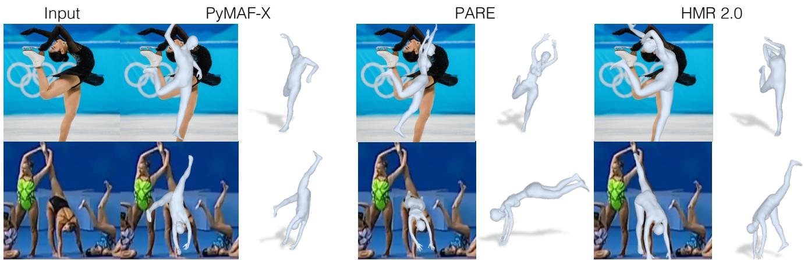
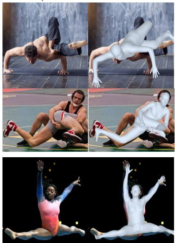

# 4D 人体（Humans in 4D）：用 Transformer 重建与追踪人体

Shubham Goel（舒巴姆·戈埃尔）　Georgios Pavlakos（乔治奥斯·帕夫拉科斯）　Jathushan Rajasegaran（贾图山·拉贾塞加兰）　Angjoo Kanazawa∗（安久·金泽）　Jitendra Malik∗（吉滕德拉·马利克）
shubham-goel, pavlakos, jathushan, kanazawa @berkeley.edu, malik@eecs.berkeley.edu
加州大学伯克利分校（University of California, Berkeley）

  

图 1：人体网格恢复（Human Mesh Recovery）的「Transformer 化」视角。我们将描述 HMR 2.0，一种完全基于 Transformer 的方法，用于从单张图像重建 3D 人体姿态与形状。除了在各种姿态和视角下都取得了令人瞩目的性能外，HMR 2.0 还是一个改进系统的骨干网络，可用于在 4D 空间中联合重建与追踪人体（4DHumans）。此处展示了 HMR 2.0 对左图中每个 2D 检测的输出重建结果。

## 摘要

我们提出一种重建人体并在时间维度上对其进行跟踪的方法。在方法的核心，我们提出了一个完全“Transformer 化”的人体网格恢复网络版本。该网络 HMR 2.0 推动了当前最优水平，并展现出能够分析那些在过去难以从单张图像重建的非常规姿态的能力。为了分析视频，我们使用来自 HMR 2.0 的三维重建结果作为输入，送入一个在三维空间中运行的跟踪系统。这使我们能够处理多人场景，并在遮挡事件中保持身份的一致性。我们完整的方法 4DHumans 在从单目视频跟踪人物这一任务上取得了当前最优结果。此外，我们还展示了 HMR 2.0 在动作识别下游任务上的有效性，相较于以往基于姿态的动作识别方法取得了显著提升。我们的代码和模型已在项目网站上公开：https://shubham-goel.github.io/4dhumans/。

## 1. 引言

在本文中，我们提出一种完全基于 Transformer 的方法，用于从单张图像恢复人体的三维网格，并在视频中随时间对其进行跟踪。即使在以往方法难以处理的非常规姿态下，我们仍能在单张图像的三维重建中获得前所未有的精度（见图 1）。在视频中，我们通过三维跟踪将这些重建结果在时间维度上关联起来，在此过程中弥补由于遮挡或检测失败所导致的缺漏。这些四维重建结果可在项目网页上查看。

我们的问题建模与方法思路可以被视作对先前人体网格恢复工作 HMR [30] 与三维跟踪工作 PHALP [65] 的“Transformer 化”。自开创性的 ViT 论文 [15] 以来，“Transformer 化”这一过程，即将模型从 CNN 或 LSTM 转换为 Transformer 主干网络，已在多个计算机视觉任务中快速发展，例如 [8, 16, 24, 40, 61, 77]。具体到二维姿态（人体二维关键点）领域，ViTPose [81] 已经完成了这一转换。我们以此为出发点，开发了 HMR 的新版本，并将其命名为 HMR 2.0，以致敬其前身。

我们使用 HMR 2.0 构建了一个能够同时从视频中重建并跟踪人体的系统。我们依赖最近提出的三维跟踪系统 PHALP [65]，并借助我们的姿态恢复模块对其进行了简化和改进。该系统能够在四维空间中重建人体，这也正是我们方法名称 4DHumans 的由来。4DHumans 可以部署在任何视频上，并能在视频中联合跟踪与重建人物。为每个人创建跟踪实体这一功能，是实现视频中人体分析与理解的基础。除了在 PoseTrack 数据集 [1] 上取得当前最优的跟踪结果外，我们还将 HMR 2.0 应用于动作识别这一下游任务。我们沿用近期工作 [63] 的系统设计，并证明使用 HMR 2.0 能够在 AVA v2.2 数据集的动作识别任务上，相较于当前最优方法取得显著的提升。

本文毫不掩饰地是一篇系统（systems）论文。我们所做的设计选择，旨在打造在野外场景下用于三维人体重建与跟踪的最佳系统。我们的模型已在项目主页公开。在计算机视觉领域，如同在自然语言处理领域一样，一个新兴趋势是：大规模预训练模型能够找到广泛的 downstream 应用，从而证明其规模化训练的努力是值得的。HMR 2.0 正是这样的大规模预训练模型，它不仅有望在计算机视觉中发挥作用，也有可能应用于机器人学 [54, 62, 73]、计算机图形学 [76]、生物力学 [60] 以及其他需要从图像或视频中分析人体及其运动的领域。

我们的贡献可总结如下：

1. 我们提出了一种用于人体网格恢复的端到端"Transformer 化"架构 HMR 2.0。在不依赖任何领域特定设计的前提下，我们在三维人体姿态重建任务上优于现有方法。

2. 在 HMR 2.0 的基础上，我们设计了 4DHumans，能够在视频中联合重建与跟踪人体，在跟踪任务上达到了当前最优（state-of-the-art）的结果。

3. 我们证明，由 HMR 2.0 得到的更准确的三维姿态能够提升 downstream 任务——行为识别——的性能，最终在 AVA 基准上贡献了当前最优的结果（42.3 mAP）。

## 2. 相关工作

从单张图像进行人体网格恢复。尽管已有诸多方法依赖于迭代优化来估计三维人体姿态与形状，例如 SMPLify [7] 及其变体 [22, 38, 56, 66, 72, 85]，但在本分析中我们将聚焦于直接从单张图像回归人体形状的方法。在此类方法中，最具代表性的工作是 HMR [30]，它使用 CNN 来回归 SMPL [45] 参数。自该方法提出以来，许多工作对其进行了改进。值得注意的是，大量工作提出了不同的伪真值（pseudo-ground truth）生成方法，包括利用时序信息 [3]、多视角信息 [39] 或迭代优化 [35, 29, 57]。SPIN [35] 提出了一种在环优化（in-the-loop optimization），将 SMPLify [7] 集成到 HMR 的训练过程中。本文同样依赖于伪真值拟合来进行训练，并采用 [37] 进行离线拟合。

近期的研究则提出了针对 HMR 架构的更具专门化的设计。PyMAF [89, 88] 引入了一个网格对齐模块用于回归 SMPL 参数。PARE [34] 提出了一种由身体部位引导的注意力机制，以更好地处理遮挡问题。HKMR [20] 利用 SMPL 已知的层次结构进行预测。Holo-Pose [23] 提出了一种遵循各身体关节点二维位置的池化策略。与此不同，本文遵循一种不包含任何领域特定决策的设计，并证明其优于所有先前的同类方法。

许多相关方法在进行非参数预测，即不估计 SMPL 模型的参数，而是显式地回归网格的顶点。GraphCMR [36] 使用图神经网络进行预测，METRO [42] 和 FastMETRO [10] 使用 Transformer，而 Mesh Graphormer [43] 则采用了二者的混合方式。由于我们回归的是 SMPL 模型的参数，而非网格顶点的位置，因此不能与这些方法直接比较。不过，我们展示了如何为 HMR 采用一种完全"全 Transformer 化（transformerized）"的设计。

**从视频中恢复人体网格与动作（Human Mesh & Motion Recovery from Video）。** 为了将人体网格恢复扩展到时间维度，大多数方法使用 HMR [30] 的基本骨干网络，并设计时间编码器以融合每帧的特征。HMMR [31] 在 HMR [30] 提取的特征上使用卷积编码器。VIBE [33]、MEVA [48] 和 TCMR [11] 使用循环式时间编码器。DSD [71] 结合了卷积层和自注意力层，而 MAED [75] 和 t-HMMR [57] 采用基于 Transformer 的时间编码器。Baradel 等人 [5, 4] 也使用 Transformer 进行时间姿态预测，直接在 SMPL 姿态上操作。这些方法的一个关键局限在于，它们通常在跟踪较为简单的场景下运行 [31, 90]，例如只包含单人的视频或遮挡极少的视频。与之不同，我们完整的 4DHumans 方法同时也在解决跟踪问题。

**视频中的人物跟踪（Tracking People in Video）。** 近年来出现了一些方法，通过依赖 HMR 模型的三维人体重建来展示最先进的跟踪性能，例如 T3DP [64] 和 PHALP [65]。在这些方法中，每个人物检测都借助 HMR 网络 [57] 提升到三维空间，然后通过提升 [64] 和预测 [65] 所得的三维表征在视频中跟踪人物。实证结果表明，PHALP 在多个跟踪基准上表现优异（其主要前提是图像需具备足够的空间分辨率，以便将人物提升到三维）。我们将这些跟踪流水线（尤其是 PHALP）作为评估人体网格恢复方法的任务。

  

图 2：我们方法的概览。左侧：HMR 2.0 是一个完全「Transformer 化」的人体网格恢复（Human Mesh Recovery）网络版本。右侧：我们将 HMR 2.0 作为 4DHumans 系统的骨干网络，该系统在 PHALP [65] 的基础上构建，以在 4D 中联合重建与跟踪人体。

TokenAction 动作识别。动作识别通常使用原始视频输入中的外观特征来执行。该类别中的典型例子包括 SlowFast [18] 和 MViT [16]。与此同时，也有一些方法使用从人体姿态信息中提取的特征，例如 Po-Tion [12] 和 JMRN [68]。最近的方法 LART [63] 通过融合基于视频的特征与来自 3D 人体姿态估计的特征，在动作识别上展示了最先进的水平。我们采用该方法的流水线，并将动作识别作为一个下游任务来评估人体网格恢复方法。

## 3. 重建人体

## 3.1. 预备知识

人体模型。SMPL 模型 [46] 是一个低维参数化的人体模型。给定姿态参数输入 $( \theta \in \mathbb { R } ^ { 2 4 \times 3 \times 3 } )$ 和形状参数输入 $( \beta \in \mathbb { R } ^ { 1 0 } )$，它输出一个具有 $N = 6 8 9 0$ 个顶点的网格 $\mathbf { \bar { \boldsymbol { M } } } \in \mathbb { R } ^ { 3 \times N }$。人体关节点 $X ~ \in ~ \mathbb { R } ^ { 3 \times k }$ 被定义为顶点的线性组合，可以通过 $X = M W$ 计算得到，其中 $W \in \mathbb { R } ^ { N \times k }$ 为固定权重。注意，姿态参数 θ 包括身体姿态参数 $\theta _ { b } \in \mathbb { R } ^ { \bar { 2 } 3 \times 3 \bar { \times } 3 }$ 和全局朝向 $\theta _ { g } \in \mathbb { R } ^ { 3 \times 3 }$

相机。我们使用一个具有固定焦距和内参 K 的透视相机模型。每个相机 $\pi ~ = ~ ( R , t )$ 由全局朝向 $R \in \mathbb { R } ^ { 3 \times 3 }$ 和平移 $t \in \mathbb { R } ^ { 3 }$ 组成。给定这些参数，SMPL 空间中的点（例如关节点 X）可以被投影到图像上，即 $x = \pi ( X ) = \Pi ( K ( R X + t ) )$，其中 Π 是一个具有相机内参 K 的透视投影。由于 θ 已经包含全局朝向，实际上我们假设 R 为单位矩阵，仅预测相机平移 t。

HMR。人体网格重建（HMR）任务的目标是学习一个预测器 f(I)，给定单张图像 I，通过 MLP 预测其 3D 姿态和形状参数来重建图像中的人。遵循典型的参数化方法 [30, 35]，我们将 f 建模为预测 $\Theta = [ \theta , \beta , \pi ] = f ( I )$ Pose 其中 θ 和 β 分别是 SMPL 姿态和形状参数，π 是相机平移。

## 3.2. 架构

我们将 HMR [30] 重新构想为一个端到端的 Transformer 架构，不使用任何领域特定的设计选择。然而，它的性能优于所有现有方法——那些方法使用了大量定制化的架构和精心设计的决策。如图 2 所示，我们使用 (i) 一个 ViT [15] 来提取图像 tokens，以及 (ii) 一个标准的 Transformer 解码器，通过交叉注意力关注图像 tokens 并输出 Θ。

ViT。视觉 Transformer（Vision Transformer，简称 ViT）[15] 是一种被改造用于处理图像的 Transformer [74]。输入图像首先被切分为若干 patch 作为输入 token，再传入 Transformer 以得到输出 token。这些输出 token 随后被送入 Transformer 解码器。我们使用的是 ViT-H/16，即输入 patch 尺寸为 $1 6 \times 1 6$ 的"Huge"（巨量）变体。更多细节请参见补充材料（SupMat）。

Transformer 解码器。我们使用标准的 Transformer 解码器 [74]，配合多头自注意力机制。该解码器以单个（零）输入 token 作为起点，通过交叉注意力机制关注输出图像 token，并以线性读出层输出 $\Theta$。我们遵循文献 [35] 的做法，并采用文献 [91] 的表示方式来回归 3D 旋转。

## 3.3. 损失函数

遵循人体网格恢复（Human Mesh Recovery，HMR）领域的最佳实践 [30, 35]，我们用 2D 损失、3D 损失与判别器的组合来训练预测器 $f$。由于我们使用多种数据集的混合进行训练，而各数据集的标注形式各异，因此我们对每个小批量中的每张图像使用这些损失的一个子集。即使在使用伪真值标注时，我们也使用同样的损失。给定输入图像 $I$，模型预测 $\Theta = [ \theta , \beta , \pi ] = f ( I )$。每当我们可以获得真值 SMPL 姿态参数 $\theta ^ { * }$ 与形状参数 $\beta ^ { * }$ 时，我们采用均方误差（MSE）损失对模型预测进行引导（bootstrap）：

$$
\mathcal { L } _ { \mathrm { s m p 1 } } = | | \theta - \theta ^ { * } | | _ { 2 } ^ { 2 } + | | \beta - \beta ^ { * } | | _ { 2 } ^ { 2 } .
$$

当图像具有精确的真值 3D 关键点标注 $X ^ { * }$ 时，我们额外使用 L1 损失来监督预测的 3D 关键点 X：

$$
{ \mathcal { L } } _ { \mathrm { k p 3 D } } = | | X - X ^ { * } | | _ { 1 } .
$$

当图像带有二维关键点标注 $x ^ { * }$ 时，我们使用 L1 损失对预测三维关键点的投影 $\pi ( X )$ 进行监督：

$$
\mathcal L _ { \mathrm { k p 2 D } } = | | \pi ( X ) - x ^ { * } | | _ { 1 } .
$$

此外，我们希望确保模型能够预测出有效的三维姿态，并采用 HMR [30] 中的对抗先验。该方法将模型参数分解为：（i）身体姿态参数 $\theta_b$，（ii）形状参数 $\beta$，以及（iii）每个部位的相对旋转 $\theta_i$，即 SMPL 模型 23 个关节中每个关节对应一个三维旋转。我们针对人体模型的每个因子训练一个判别器 $D_k$，生成器损失可表示为：

$$
\mathcal { L } _ { \mathrm { a d v } } = \sum _ { k } ( D _ { k } ( \theta _ { b } , \beta ) - 1 ) ^ { 2 } .
$$

## 3.4. 伪真值拟合（Pseudo-Ground Truth fitting）

我们通过计算伪真值标注，将模型扩展到无标注数据集（即 InstaVariety [31]、AVA [21]、AI Challenger [78]）。对于任意给定图像，我们首先使用现成的检测器 [40] 和人体关键点估计器 [81] 来获取边界框及对应的二维关键点。然后，我们使用 ProHMR [37] 将 SMPL 网格拟合到这些二维关键点上，从而获得伪真值的 SMPL 参数 $\theta ^ { * }$ 和 $\beta ^ { * }$，以及相机参数 $\pi ^ { * }$。

## 4. 人物追踪（Tracking People）

在多人视频中，我们需要具备跨时间关联不同人物的能力，即执行追踪。为此，我们基于 PHALP [65] 进行构建，PHALP 是一个基于 HMR 风格三维重建所衍生特征的先进追踪器。其基本思想是：在单帧中检测人物，并将其"提升"到三维空间，提取其三维姿态、三维空间位置（由估计的相机参数推导得出）以及三维外观（由纹理图推导得出）。针对每个独立人物，随着时间的推移逐步构建其追踪片段表示。递归步骤是：对每个追踪片段，预测该人物在下一帧的姿态、位置和外观，所有预测均在三维空间中进行；然后，在把该帧中自底向上检测到的人物提升到三维空间后，查找自顶向下预测与这些自底向上检测之间的最佳匹配。每个追踪片段所表示的状态随后由新到来的观测进行更新，并迭代执行该过程。之所以能够在遮挡情况下进行追踪，是因为追踪片段的三维表示会基于其过往历史持续更新。

  

图 3：姿态预测：我们在从 [63] 获得的超过 100 万条轨迹上训练了一个 BERT 风格（BERT-style）[13] 的 Transformer 模型。这使得我们能够使用同一个模型对未来进行预测，并对缺失检测进行非模态补全（amodal completion）。为了预测未来姿态（t+1, $t + 2 , . . .$），我们使用对应的位置嵌入（positional embeddings）通过掩码标记（mask-token）来查询模型。类似地，对于非模态补全，我们将缺失检测替换为掩码标记。

我们认为，一个稳健的姿态预测器在该下游任务（跟踪）的评估中也应当表现良好，因此我们使用跟踪指标作为评估三维重建质量的代理。但首先我们需要对 PHALP 框架进行修改，以允许对不同姿态预测模型进行公平比较。最初，PHALP 使用的姿态特征基于 HMR 网络的最后一层，即 $i . e . ,$ 一个 2048 维的嵌入空间。这限制了 PHALP 与不同姿态模型（例如 HMR 2.0、PARE、PyMAF 等）配合使用的能力。为了创建更具通用性的 PHALP 版本，我们进行了如下修改：用 SMPL 姿态参数来表示姿态，并相应地优化 PHALP 的代价函数以利用新的姿态距离。类似地，我们调整姿态预测器使其在 SMPL 参数空间中运行。更具体地，我们通过对随机姿态 token 进行掩码（如图 3 所示）来训练一个标准的 Transformer 模型 [74]。这使我们能够预测未来时刻的姿态，以及对缺失检测进行非模态补全。通过这些修改，我们可以接入任何网格恢复方法，并在任意视频上运行。我们将这个修改后的版本称为 PHALP′。

4DHumans。我们的最终跟踪系统 4DHumans 使用了基于采样的无参数外观头以及一个新的姿态预测器（图 3）。为了建模外观，我们将网格上的可见点投影到输入图像上，并从对应像素处采样颜色，从而对这些点进行纹理贴图。

为了在视频中跟踪人物，此前的方法依赖于现成的跟踪方法，并利用其输出来重建视频中的人物（例如从跟踪输出中获取边界框，然后重建人物）。例如，PHD [90]、HMMR [31] 只能在场景中只有单人时在视频上运行。在本工作中，我们将重建与跟踪融合为一个统一的系统，并证明更好的姿态重建会带来更好的跟踪效果，且该组合系统现在可以在任意野外视频上运行。

## 5. 实验

在本节中，我们定性和定量地评估我们的重建与跟踪系统。首先，我们证明 HMR 2.0 在标准的二维和三维姿态精度指标上优于以往方法（第 5.2 节）。其次，我们证明 4DHumans 是一个通用的跟踪器，取得了最先进的性能（第 5.3 节）。第三，我们进一步通过在动作识别下游任务上的优越性能来展示恢复姿态的稳健性和准确性（第 5.4 节）。最后，我们讨论设计 HMR 2.0 时的实验探究，并对一系列设计选择进行消融实验（第 5.5 节）。

## 5.1. 实验设置

数据集。遵循先前工作，我们使用典型的训练数据集，即 Human3.6M [27]、MPI-INF-3DHP [49]、COCO [44] 和 MPII [2]。此外，我们还使用 InstaVariety [31]、AVA [21] 和 AI Challenger [78] 作为额外数据，并在这些数据上生成伪真值拟合。

基线方法。我们在能与众多先前工作（Section 5.2）对比的基准上报告性能，同时也与近年来的最先进方法进行更详细的对比，即 PyMAF [89]、CLIFF [41]、HMAR [65]、PARE [34] 和 PyMAF-X [88]。为保证公平，我们仅评估 PyMAF-X 的人体本体（body-only）性能。

## 5.2. 姿态精度（Pose Accuracy）

三维指标。关于三维姿态精度，我们遵循先前工作的典型评估协议，例如 [35]，并在 3DPW 测试集划分与 Human3.6M 验证集划分上给出结果，于 Table 1 中报告 MPJPE（平均关节位置误差，Mean Per Joint Position Error）与 PA-MPJPE（基于 Procrustes 对齐的平均关节位置误差）。

请注意，我们仅与那些未使用 3DPW 训练集进行训练的方法进行对比，这与我们自身的设置一致。

我们观察到，仅在常规数据集上训练的 HMR 2.0a 模型便能在所有指标上超越所有先前的基线方法。然而，我们认为这些基准已高度饱和，姿态指标上这些细小的差异通常并不十分显著。事实上，我们观察到，以在 3DPW 上的性能做出小幅让步，在更多数据（AVA [21]、AI Challenger [78] 和 InstaVariety [31]）上训练更久的 HMR 2.0b 模型，能够在比 Human3.6M 和 3DPW 中所包含的姿态更不寻常的姿态上取得更好的结果。我们从定性观察以及二维姿态重投影所评估的性能（Table 2）中印证了这一点。此外，我们观察到 HMR 2.0b 是一个更为稳健的模型，并在本文余下部分的评估中采用它。

<table><tr><td rowspan="2">Method</td><td colspan="2">3DPW</td><td colspan="2">Human3.6M</td></tr><tr><td>MPJPE PA-MPJPE|MPJPE PA-MPJPE</td><td></td><td></td><td></td></tr><tr><td>Kanazawa et al. [31]</td><td>116.5</td><td>72.6</td><td>=</td><td>56.9</td></tr><tr><td>Doersch et al. [14]</td><td>=</td><td>74.7</td><td></td><td></td></tr><tr><td>Temmpooral Arnab et al. [3]</td><td></td><td>72.2</td><td>77.8</td><td>54.3</td></tr><tr><td>DSD [71]</td><td></td><td>69.5</td><td>59.1</td><td>42.4</td></tr><tr><td>VIBE [33]</td><td>93.5</td><td>56.5</td><td>65.9</td><td>41.5</td></tr><tr><td>Pavlakos et al. [59]</td><td></td><td></td><td></td><td>75.9</td></tr><tr><td>HMR [30]</td><td>130.0</td><td>76.7</td><td>88.0</td><td>56.8</td></tr><tr><td>NBF [53]</td><td></td><td></td><td></td><td>59.9</td></tr><tr><td>GraphCMR [36]</td><td></td><td>70.2</td><td></td><td>50.1</td></tr><tr><td>HoloPose [23]</td><td></td><td></td><td>60.3</td><td>46.5</td></tr><tr><td>DenseRaC [82]</td><td></td><td></td><td>76.8</td><td>48.0</td></tr><tr><td>SPIN [35]</td><td>96.9</td><td>59.2</td><td>62.5</td><td>41.1</td></tr><tr><td>DecoMR [86]</td><td></td><td>61.7†</td><td></td><td>39.3†</td></tr><tr><td>DaNet [87]</td><td></td><td>56.9</td><td>61.5</td><td>48.6</td></tr><tr><td>Fraq-sed Song et al. [69]</td><td></td><td>55.9</td><td></td><td>56.4</td></tr><tr><td>I2L-MeshNet [51]</td><td>100.0</td><td>60.0</td><td>55.7†</td><td>41.1†</td></tr><tr><td>HKMR [20]</td><td></td><td></td><td>59.6</td><td>43.2</td></tr><tr><td>PyMAF [89]</td><td>92.8</td><td>58.9</td><td>57.7</td><td>40.5</td></tr><tr><td>PARE [34]</td><td>82.0</td><td>50.9</td><td>76.8</td><td>50.6</td></tr><tr><td>PyMAF-X [88]</td><td>78.0</td><td>47.1</td><td>54.2</td><td>37.2</td></tr><tr><td>HMR 2.0a</td><td>70.0</td><td>44.5</td><td>44.8</td><td>33.6</td></tr><tr><td>HMR 2.0b</td><td>81.3</td><td>54.3</td><td>50.0</td><td>32.4</td></tr></table>

表 1：三维重建评估：在 3DPW 和 Human3.6M 数据集上的重建误差（单位：毫米）。† 表示在非参数化结果上评估的数值。数值越低越好。详见正文。

<table><tr><td rowspan=1 colspan=4>LSP-Extended  COCO   PoseTrackMethod@0.05@0.1 @0.05 @0.1@0.05 @0.1</td></tr><tr><td rowspan=1 colspan=2>PyMAF [89]     一      1</td><td rowspan=1 colspan=1>0.680.86</td><td rowspan=1 colspan=1>0.770.92</td></tr><tr><td rowspan=1 colspan=1>CLIFF [41]</td><td rowspan=1 colspan=1>0.32 0.66</td><td rowspan=1 colspan=1>0.640.88</td><td rowspan=1 colspan=1>0.750.92</td></tr><tr><td rowspan=1 colspan=1>PARE [34]</td><td rowspan=1 colspan=1>0.27 0.60</td><td rowspan=1 colspan=1>0.720.91</td><td rowspan=1 colspan=1>0.790.93</td></tr><tr><td rowspan=1 colspan=1>PyMAF-X [88]</td><td rowspan=1 colspan=1></td><td rowspan=1 colspan=1>0.790.93</td><td rowspan=1 colspan=1>0.850.95</td></tr><tr><td rowspan=1 colspan=1>HMR 2.0a</td><td rowspan=1 colspan=1>0.38 0.72</td><td rowspan=1 colspan=1>0.790.95</td><td rowspan=1 colspan=1>0.86 （0.97</td></tr><tr><td rowspan=1 colspan=1>HMR 2.0b</td><td rowspan=1 colspan=1>0.53 0.82</td><td rowspan=1 colspan=1>0.86 0.96</td><td rowspan=1 colspan=1>0.900.98</td></tr></table>

表 2：在 2D 维度上评估重建结果。在 LSP-Extended、COCO 和 PoseTrack 数据集上，不同阈值下投影关键点的 PCK 分数。数值越高越好。

2D 指标。我们通过报告在 LSP-Extended [28]、COCO 验证集 [44] 和 Posetrack 验证集 [1] 上不同阈值下重投影关键点的 PCK，来评估生成姿态的 2D 图像对齐情况。由于 PyMAF(-X) [89, 88] 使用 LSP-Extended 进行训练，我们不报告表格中该部分的数据。注意在表 2 中，HMR 2.0b 一致地优于所有先前方法。在包含非常规姿态的 LSP-Extended 上，HMR 2.0b 实现了 0.53 的 PCK@0.05，比第二名（CLIFF）的 0.32 高出 1.6 倍。在姿态不太极端、相对简单的 COCO 和 PoseTrack 数据集上，HMR 2.0b 在 PCK@0.05 上仍然优于第二名方法，但优势幅度较小，分别为 9% 和 6%。HMR 2.0a 也优于所有基线方法，但劣于 HMR 2.0b，尤其是在 LSP-Extended 中更困难的姿态上。

定性结果。我们在图 4 中展示了 HMR 2.0 的定性结果。我们对极端姿态和部分遮挡具有较强的鲁棒性。我们的重建结果与图像对齐良好，并且在新视角下仍然有效。此外，我们在图 5 中与最接近的竞争对手进行了比较。我们观察到 PyMAF-X，特别是 PARE，在处理更不寻常的姿态时常常表现不佳，而 HMR 2.0 则能给出更忠实的重建结果。

## 5.3. 跟踪

在跟踪任务上，我们首先展示 PHALP′ 所引入修改的通用性，这些修改使我们能够在跟踪的下游任务上评估 3D 姿态估计器。然后，我们评估我们的完整系统 4DHumans 相对于现有的正确技术的表现。

评估设置。遵循先前工作 [64, 65]，我们在 Posetrack 验证集上使用 [65] 的协议，报告基于 ID（ID 切换次数）、MOTA [32]、IDF1 [67] 和 HOTA [47] 的结果，检测来自 Mask R-CNN [25]。

PHALP′ 的多功能性。通过对 PHALP′ 的修改，我们摒弃了 [65] 中模型特定的隐空间，转而在 SMPL 空间中操作，该空间在大多数网格恢复系统中是共享的。这使得 PHALP′ 更加通用，并允许我们接入不同的 3D 姿态估计器，并基于它们在跟踪这一下游任务上的性能进行比较。我们在表 3 中进行了这一比较，其中使用了来自当前最先进 3D 姿态估计器的姿态和位置线索（外观信息仍使用 HMAR [65]）。我们观察到 HMR 2.0 表现最佳，PARE [34]、HMAR [65] 和 PyMAF-X [88] 在 PoseTrack 数据集上紧随其后，彼此之间仅有细微差异。需要注意的是，跟踪性能通常最容易受到预测 3D 位置误差的影响，而身体姿态对性能的影响较小 [65]。这意味着良好的跟踪性能可反映出对遮挡的鲁棒性，因此考虑这一指标是有帮助的，但对于区分姿态的细粒度差异则帮助不大。因此，PARE [34]、HMAR [65] 和 PyMAF-X [88] 的具有竞争力的结果表明它们能够妥善地处理遮挡，但它们的姿态估计精度可能仍然不足（如表 2 所示）。更多定性比较请参见图 5 和补充材料。

4DHumans。表 4 评估了我们完整系统 4DHumans 在 PoseTrack 数据集上的跟踪性能。使用与 [64, 65] 相同的边界框检测器，4DHumans 在所有指标上均优于现有方法，将身份切换（ID Switches）减少了 22%。使用改进的 ViT-Det 检测器 [40] 可进一步提升性能。作为我们时序预测模型（图 3）的副产物，我们能够执行完整补全（amodal completion），并为缺失的检测赋予姿态。我们在补充材料中展示了相关示例。

<table><tr><td rowspan="2">Tracker</td><td rowspan="2">Pose Engine</td><td colspan="3">Posetrack</td></tr><tr><td>HOTA↑</td><td>IDs↓ MOTA↑</td><td>IDF1↑</td></tr><tr><td rowspan="4">PHALP&#x27;</td><td>PARE [34]</td><td>53.6</td><td>510 59.4 472</td><td>76.8</td></tr><tr><td>PyMAF-X [88]</td><td>53.7 551</td><td>59.2 58.7</td><td>76.9 76.5</td></tr><tr><td>CLIFF [41] PyMAF [89]</td><td>53.5 53.0 623</td><td>58.6</td><td>76.1</td></tr><tr><td>HMAR [65]</td><td>53.6 482</td><td>59.3</td><td>77.1</td></tr><tr><td></td><td>HMR 2.0</td><td>54.1</td><td>456 59.4</td><td>77.4</td></tr></table>

表 3：使用不同 3D 姿态估计器进行跟踪。借助 PHALP′ 的改进，我们得到了一个通用的跟踪器，允许将不同的 3D 姿态估计器插入其中。在此设置下，HMR 2.0、PARE 和 PyMAF-X 表现最佳。

<table><tr><td>Method</td><td colspan="2">Posetrack HOTA↑ IDs↓ MOTA↑ IDF1↑</td></tr><tr><td>Trackformer [50]</td><td>46.7 1263</td><td>33.7 64.0</td></tr><tr><td>Tracktor [6]</td><td>38.5 702</td><td>42.4 65.2</td></tr><tr><td>AlphaPose [17]</td><td>37.6 2220</td><td>36.9 66.9</td></tr><tr><td>Pose Flow [79]</td><td>38.0 1047</td><td>15.4 64.2</td></tr><tr><td>T3DP [64]</td><td>50.6 655</td><td>55.8 73.4</td></tr><tr><td>PHALP [65]</td><td>52.9 541</td><td>58.9 76.4</td></tr><tr><td>4DHumans</td><td>54.3 421</td><td>59.8 77.9</td></tr><tr><td>4DHumans + ViTDet</td><td>57.8 382</td><td>61.4 79.1</td></tr></table>

表 4：4DHumans 与现有方法在 Posetrack 数据集上的对比。4DHumans 在所有指标上均达到了最先进的跟踪性能。整合更优的检测系统 [40] 可带来进一步的性能提升。

## 5.4. 动作识别

评估设置。文献 [63] 所提方法是当前视频动作识别领域的最新技术。给定一段视频作为输入，作者提出使用逐帧的 3D 姿态与位置估计（使用现成的 HMR（Human Mesh Recovery，人体网格恢复）模型 [65]）作为预测动作标签的附加特征。他们还展示了仅使用姿态（pose-only）的基线方法的结果，该方法用于预测动作标签

Input

Front view

Side view

Top view

Input

Front view

Side view

Top view

  

图 4：HMR 2.0 的定性评估。对于每个示例，我们展示：a) 输入图像，b) 重建叠加图，c) 侧视图，d) 顶视图。为了展示 HMR 2.0 的鲁棒性，我们针对多种场景可视化结果——包括非典型姿态（第 1–4 行）、非典型视角（第 5 行），以及可见性差、极端截断和严重遮挡的图像（第 6–8 行）。

仅使用 3D 姿态与位置估计。我们采用该设置，将我们的模型与基线方法在 AVA 数据集 [21] 上的动作识别下游任务中进行对比。在文献 [63] 中，作者训练了一个以 SMPL 姿态作为输入并预测动作标签的 Transformer。遵循他们的设置，我们为每个基线方法单独训练一个动作分类 Transformer。

对比。对比表 5 中的结果，我们观察到 HMR 2.0 在不同类别（OM、PI、PM）以及总体上均优于基线方法。它在 AVA 测试集上达到了 22.3 的 mAP，比第二佳的基线方法高出 14%。由于基于姿态的准确动作识别需要细粒度的姿态估计，这一结果有力地表明 HMR 2.0 比现有方法预测的姿态更为精确。事实上，当与外观特征结合时，[63] 表明 HMR 2.0 在 AVA 动作识别任务上达到了 42.3 mAP 的当前最优水平，比第二佳的 39.5 mAP 高出 7%。

  

图 5：当前最先进的网格恢复方法之间的定性比较。与最接近的竞争对手 PyMAF-X [88] 和 PARE [34] 相比，HMR 2.0 在面对异常姿态时能够给出更为忠实的重建结果。

  

图 6：4DHumans 的定性跟踪结果。我们使用了头部掩码（帧号位于左上角）。第一行：在一段长达一分钟的视频中，对在冰面上滑冰、姿势具有挑战性且存在严重遮挡的人物进行跟踪，期间未发生身份切换。第二行：目标人物在与多位其他选手的多次交互过程中被持续跟踪。第三行：目标人物在长时间遮挡下被持续跟踪。

<table><tr><td>Action Model</td><td>Pose Engine</td><td>OM</td><td>PI</td><td>PM</td><td>mAP</td></tr><tr><td rowspan="5">[63]</td><td>PyMAF [89]</td><td>7.3</td><td>16.9</td><td>34.7</td><td>15.4</td></tr><tr><td>CLIFF [41]</td><td>9.2</td><td>20.0</td><td>40.3</td><td>18.6</td></tr><tr><td>HMAR [65]</td><td>8.7</td><td>20.1</td><td>40.3</td><td>18.3</td></tr><tr><td>PARE [34]</td><td>9.2</td><td>20.7</td><td>41.5</td><td>19.1</td></tr><tr><td>PyMAF-X [88] HMR 2.0</td><td>10.2 11.9</td><td>21.4 24.6</td><td>40.8 45.8</td><td>19.6 22.3</td></tr></table>

表 5：AVA 数据集上的动作识别结果。我们在基于姿态的动作识别的下游任务上对不同的网格恢复方法进行了基准测试。其中，OM：物体操作（Object Manipulation），PI：人物交互（Person Interactions），PM：人物动作（Person Movement）。

## 5.5. HMR 2.0 模型设计

在开发 HMR 2.0 的过程中，我们考察了一系列设计决策。图 7 简要展示了这一探索过程。我们实验了超过 100 种设置，并将每次运行中 100 个检查点（checkpoint）的性能进行了可视化展示。在可视化中，我们使用每个检查点在 3DPW 和 LSP-Extended 数据集上的性能。

我们的研究聚焦于模型的若干具体方面，并在此以一系列"经验教训"的形式记录下来，供未来的研究参考。在接下来的段落中，我们将频繁引用表 $^ { 6 , }$，该表在 3D 和 2D 指标上，使用 3DPW、Human3.6M 和 LSP-Extended 数据集对这些方面进行了评估。

  

图 7：大规模模型搜索。每一个点表示在 3DPW 和 LSP-Extended 上评估的某个 checkpoint 的性能。颜色用于区分不同的运行（run）。我们探索了超过 100 种不同的设置，并可视化每个运行的 100 个 checkpoint。

**主干网络的影响。** 与大多数先前使用 ResNet 主干网络的人体网格恢复（Human Mesh Recovery）工作不同，我们的 HMR 2.0 方法依赖于 ViT 主干网络。为了直接比较主干网络的影响，模型 B1 使用 ResNet-50 主干网络实现 HMR，并采用基于 MLP 的预测头实现 IEF（Iterative Error Feedback，迭代误差反馈 [9, 30]）。相比之下，模型 B2 使用 transformer 主干网络（ViT-H），同时保持其他设计选择不变。通过更新主干网络，我们观察到在 3D 和 2D 指标上都取得了显著提升，这证明了「transformer 化」步骤的合理性。

**训练数据的影响。** 除了架构之外，我们还研究了训练数据的影响。模型 D1 在典型数据集（H3.6M、MPII、COCO、MPI-INF）上进行训练，这些是大多数先前工作所采用的数据集。相比之下，模型 D2 遵循文献 [21] 的做法，在训练集中加入了 AVA。最终，我们还使用 AI-Challenger 和 Insta-Variety（模型 B2）进行训练，以进一步扩充训练集。正如我们所见，增加更多训练数据可在所报告的各项指标上带来全面提升，但其收益相较于主干网络的更新而言较小。

**ViT 预训练。** 另一个对模型性能有显著影响的因素是 ViT 主干网络的预训练。从随机初始化的权重开始（模型 P1）会导致收敛缓慢且性能较差。如果主干网络在 Imagenet 上使用 MAE [24] 进行预训练（模型 P2），结果会有所改善。最终，我们所选定的模型（HMR 2.0b）首先在 ImageNet 上使用 MAE 进行预训练，然后在 2D 关键点预测任务 [81] 上进行预训练，取得了最佳性能。

**SMPL 预测头。** 我们还研究了用于预测 SMPL 参数的预测头架构的影响。与采用 IEF 步骤的传统基于 MLP 的预测头（B2）相比，我们所提出的 transformer 解码器（HMR 2.0b）在图像-模型对齐（即 2D 指标）方面提升了性能。

**数据集质量。** 与先前的工作类似，例如文献 [35]，保持训练数据的高质量至关重要；我们过滤掉低质量的伪真值拟合（高拟合误差）以及剔除具有低置信度 2D 检测结果的图像。

<table><tr><td rowspan="2">Models</td><td>3DPW</td><td>Human3.6M</td><td></td><td>LSP-Extended</td></tr><tr><td colspan="4">|MPJPE PA-MPJPE|MPJPE PA-MPJPE|PCK@0.05 PCK@0.1</td></tr><tr><td>HMR 2.0b|</td><td>81.3 54.3</td><td>50.0</td><td>32.4</td><td>0.53 0.82</td></tr><tr><td>B1</td><td>85.2 56.8</td><td>58.9</td><td>41.4</td><td>0.35 0.66</td></tr><tr><td>B2</td><td>79.7 53.4</td><td>51.4</td><td>34.4</td><td>0.48 0.81</td></tr><tr><td>D1</td><td>84.1 54.8</td><td>54.5</td><td>35.1</td><td>0.45 0.79</td></tr><tr><td>D2</td><td>80.2 53.3</td><td>52.4</td><td>34.9</td><td>0.46 0.79</td></tr><tr><td>P1</td><td>61.7</td><td>89.9</td><td></td><td>0.52</td></tr><tr><td></td><td>98.9 82.7</td><td></td><td>58.7</td><td>0.24</td></tr><tr><td>P2</td><td>55.6</td><td>49.3</td><td>32.4</td><td>0.52 0.81</td></tr></table>

表 6：消融实验：在 3DPW、Human3.6M 和 LSP-Extended 数据集上对不同模型设计的评估。

## 6. 结论（Conclusion）

我们研究了从图像和视频中重建并跟踪人体这一问题。首先，我们提出了 HMR 2.0，它是人体网格恢复（Human Mesh Recovery）[30] 网络的一个完全"Transformer 化"的版本。HMR 2.0 在通常的 2D/3D 姿态指标上取得了强劲的性能，同时也作为我们改进后的视频跟踪器的骨干网络。整个系统 4DHumans 联合重建并跟踪视频中的人物，在跟踪任务上达到了最先进的结果。为了进一步说明我们的三维姿态估计器 HMR 2.0 的优势，我们将其应用于动作识别任务，实验结果表明我们相对于以往基于姿态的方法有显著提升。

我们的工作推进了能够用三维人体重建技术进行分析的视频的边界。与此同时，改进后的结果也揭示了未来需要解决的一些局限性。例如，SMPL 模型 [45] 的使用带来了一定的限制，而采用改进后的模型将使我们能够建模手部姿态和面部表情 [56]，甚至捕捉更大的年龄差异，例如婴儿 [26] 和儿童 [55, 70]。此外，由于我们对每个人进行独立处理，我们的重建在捕捉近距离人物的细节特征方面表现较差，例如接触（contact）[19, 52]。除此之外，我们的重建结果"位于"相机坐标系中，因此为了正确理解视频中的动作，我们需要在一个共同的全局坐标系下考虑所有人，并对相机运动进行推理 [58, 83, 84]。最后，较低的输入分辨率会影响我们重建的质量，这可以通过分辨率增强（resolution augmentation）[80] 来解决。

致谢（Acknowledgements）我们感谢 BAIR 社区成员的深入讨论，以及 StabilityAI 慷慨提供的计算资源资助。本研究得到了 BAIR/BDD 赞助方、ONR MURI（N00014-21-1-2801）以及 DARPA MCS 项目的支持。

## 参考文献（References）

[1] Mykhaylo Andriluka, Umar Iqbal, Eldar Insafutdinov, Leonid Pishchulin, Anton Milan, Juergen Gall, and Bernt Schiele. PoseTrack：用于人体姿态估计与跟踪的基准数据集（PoseTrack: A benchmark for human pose estimation and tracking）。发表于 CVPR，2018 年。

[2] Mykhaylo Andriluka, Leonid Pishchulin, Peter Gehler, and Bernt Schiele. 二维人体姿态估计：新基准与最先进方法的分析（2D human pose estimation: New benchmark and state of the art analysis）。发表于 CVPR，2014 年。

[3] Anurag Arnab, Carl Doersch, and Andrew Zisserman. 利用时序上下文进行野外三维人体姿态估计（Exploiting temporal context for 3D human pose estimation in the wild）。发表于 CVPR，2019 年。

[4] Fabien Baradel, Romain Bregier, Thibault Groueix, Philippe Weinzaepfel, Yannis Kalantidis, and Gregory Rogez. Pose-BERT：用于时序三维人体建模的通用 Transformer 模块（Pose-BERT: A generic transformer module for temporal 3D human modeling）。发表于 PAMI，2022 年。

[5] Fabien Baradel, Thibault Groueix, Philippe Weinzaepfel, Romain Bregier, Yannis Kalantidis, and Grégory Rogez. 利用动作捕捉数据进行人体网格恢复（Leveraging MoCap data for human mesh recovery）。发表于 3DV，2021 年。

[6] Philipp Bergmann, Tim Meinhardt, and Laura Leal-Taixe. Tracking without bells and whistles. In ICCV, 2019.
→ Philipp Bergmann、Tim Meinhardt 和 Laura Leal-Taixe. 《Tracking without bells and whistles》（无花哨技巧的跟踪）. 发表于 ICCV, 2019.

[10] Junhyeong Cho, Kim Youwang, and Tae-Hyun Oh. Crossattention of disentangled modalities for 3D human mesh recovery with transformers. In ECCV, 2022.
→ Junhyeong Cho、Kim Youwang 和 Tae-Hyun Oh. 《Cross-attention of disentangled modalities for 3D human mesh recovery with transformers》（基于变换器的解耦模态交叉注意力用于三维人体网格恢复）. 发表于 ECCV, 2022.

[12] Vasileios Choutas, Philippe Weinzaepfel, Jérôme Revaud, and Cordelia Schmid. PoTion: Pose motion representation for action recognition. In CVPR, 2018.
→ Vasileios Choutas、Philippe Weinzaepfel、Jérôme Revaud 和 Cordelia Schmid. 《PoTion: Pose motion representation for action recognition》（PoTion：用于动作识别的姿态运动表示）. 发表于 CVPR, 2018.

[14] Carl Doersch and Andrew Zisserman. Sim2real transfer learning for 3D human pose estimation: Motion to the rescue. NeurIPS, 2019.
→ Carl Doersch 和 Andrew Zisserman. 《Sim2real transfer learning for 3D human pose estimation: Motion to the rescue》（三维人体姿态估计的仿真到真实迁移学习：运动前来救场）. NeurIPS, 2019.

[17] Hao-Shu Fang, Shuqin Xie, Yu-Wing Tai, and Cewu Lu. RMPE: Regional multi-person pose estimation. In ICCV, 2017.
→ Hao-Shu Fang、Shuqin Xie、Yu-Wing Tai 和 Cewu Lu. 《RMPE: Regional multi-person pose estimation》（RMPE：区域多人姿态估计）. 发表于 ICCV, 2017.

[20] Georgios Georgakis, Ren Li, Srikrishna Karanam, Terrence Chen, Jana Košecká, and Ziyan Wu. Hierarchical kinematic human mesh recovery. In ECCV, 2020.
→ Georgios Georgakis、Ren Li、Srikrishna Karanam、Terrence Chen、Jana Košecká 和 Ziyan Wu. 《Hierarchical kinematic human mesh recovery》（层次化运动学人体网格恢复）. 发表于 ECCV, 2020.

[22] Peng Guan, Alexander Weiss, Alexandru O. Bălan, and Michael J Black. Estimating human shape and pose from a single image. In ICCV, 2009.
→ Peng Guan、Alexander Weiss、Alexandru O. Bălan 和 Michael J Black. 《Estimating human shape and pose from a single image》（从单张图像估计人体形状与姿态）. 发表于 ICCV, 2009.

[23] Riza Alp Guler and Iasonas Kokkinos. HoloPose：野外场景下的整体三维人体重建。发表于 CVPR，2019。

[24] Kaiming He, Xinlei Chen, Saining Xie, Yanghao Li, Piotr Dollar, and Ross Girshick. 掩码自编码器是可扩展的视觉学习器（Masked autoencoders are scalable vision learners）。发表于 CVPR，2022。

[25] Kaiming He, Georgia Gkioxari, Piotr Dollar, and Ross Girshick. Mask R-CNN。发表于 ICCV，2017。

[26] Nikolas Hesse, Sergi Pujades, Michael J Black, Michael Arens, Ulrich G Hofmann, and A Sebastian Schroeder. 从 RGB-D 序列中学习与跟踪自由运动婴儿的三维体型（Learning and tracking the 3D body shape of freely moving infants from RGB-D sequences）。PAMI，2019。

[27] Catalin Ionescu, Dragos Papava, Vlad Olaru, and Cristian Sminchisescu. Human3.6M：面向自然环境中三维人体感知的大规模数据集与预测方法（Human3.6M: Large scale datasets and predictive methods for 3D human sensing in natural environments）。PAMI，2013。

[28] Sam Johnson and Mark Everingham. 从不精确标注中学习有效的人体姿态估计（Learning effective human pose estimation from inaccurate annotation）。发表于 CVPR，2011。

[29] Hanbyul Joo, Natalia Neverova, and Andrea Vedaldi. 面向野外三维人体姿态估计的示例微调（Exemplar fine-tuning for 3D human model fitting towards in-the-wild 3D human pose estimation）。发表于 3DV，2021。

[30] Angjoo Kanazawa, Michael J Black, David W Jacobs, and Jitendra Malik. 人体形状与姿态的端到端恢复（End-to-end recovery of human shape and pose）。发表于 CVPR，2018。

[31] Angjoo Kanazawa, Jason Y Zhang, Panna Felsen, and Jitendra Malik. 从视频中学习三维人体动态（Learning 3D human dynamics from video）。发表于 CVPR，2019。

[32] Rangachar Kasturi, Dmitry Goldgof, Padmanabhan Soundararajan, Vasant Manohar, John Garofolo, Rachel Bowers, Matthew Boonstra, Valentina Korzhova, and Jing Zhang. 视频中人脸、文本与车辆检测及跟踪的性能评估框架：数据、指标与协议（Framework for performance evaluation of face, text, and vehicle detection and tracking in video: Data, metrics, and protocol）。PAMI，2008。

[33] Muhammed Kocabas, Nikos Athanasiou, and Michael J Black. VIBE：用于人体姿态与形状估计的视频推理（VIBE: Video inference for human body pose and shape estimation）。发表于 CVPR，2020。

[34] Muhammed Kocabas, Chun-Hao P Huang, Otmar Hilliges, and Michael J Black. PARE：用于三维人体估计的部位注意力回归器（PARE: Part attention regressor for 3D human body estimation）。发表于 ICCV，2021。

[35] Nikos Kolotouros, Georgios Pavlakos, Michael J Black, and Kostas Daniilidis. 通过循环模型拟合学习重建三维人体姿态与形状（Learning to reconstruct 3D human pose and shape via model-fitting in the loop）。发表于 ICCV，2019。

[36] Nikos Kolotouros, Georgios Pavlakos, and Kostas Daniilidis. 用于单张图像人体形状重建的卷积网格回归（Convolutional mesh regression for single-image human shape reconstruction）。发表于 CVPR，2019。

[37] Nikos Kolotouros, Georgios Pavlakos, Dinesh Jayaraman, and Kostas Daniilidis. 人体网格恢复的概率建模（Probabilistic modeling for human mesh recovery）。发表于 ICCV，2021。

[38] Christoph Lassner, Javier Romero, Martin Kiefel, Federica Bogo, Michael J Black, and Peter V Gehler. Unite the people：闭合三维与二维人体表示之间的环路（Unite the people: Closing the loop between 3D and 2D human representations）。发表于 CVPR，2017。

[39] Vincent Leroy, Philippe Weinzaepfel, Romain Bregier, Hadrien Combaluzier, and Gregory Rogez. SMPLy：野外场景下三维人体姿态估计基准评测（SMPLy benchmarking 3D human pose estimation in the wild）。发表于 3DV，2020。

[40] Yanghao Li, Hanzi Mao, Ross Girshick, and Kaiming He. 探索用于目标检测的普通视觉 Transformer 主干网络（Exploring plain vision transformer backbones for object detection）。发表于 ECCV，2022。

[41] Zhihao Li, Jianzhuang Liu, Zhensong Zhang, Songcen Xu, and Youliang Yan. CLIFF: 将完整帧中的位置信息带入人体姿态与形状估计. 载于 ECCV, 2022.

[42] Kevin Lin, Lijuan Wang, and Zicheng Liu. 使用 Transformer 的端到端人体姿态与网格重建. 载于 CVPR, 2021.

[43] Kevin Lin, Lijuan Wang, and Zicheng Liu. 网格 Graphormer. 载于 ICCV, 2021.

[45] Matthew Loper, Naureen Mahmood, Javier Romero, Gerard Pons-Moll, and Michael J Black. SMPL: 一种蒙皮多人线性模型. ACM Transactions on Graphics (TOG), 34(6):1–16, 2015.

[46] Matthew Loper, Naureen Mahmood, Javier Romero, Gerard Pons-Moll, and Michael J. Black. SMPL: 一种蒙皮多人线性模型. ACM Trans. Graphics (Proc. SIGGRAPH Asia), 34(6):248:1–248:16, 2015 年 10 月.

[47] Jonathon Luiten, Aljosa Osep, Patrick Dendorfer, Philip Torr, Andreas Geiger, Laura Leal-Taixe, and Bastian Leibe. HOTA: 一种用于评估多目标跟踪的高阶度量指标. IJCV, 2021.

[48] Zhengyi Luo, S Alireza Golestaneh, and Kris M Kitani. 基于运动压缩与精化的 3D 人体运动估计. 载于 ACCV, 2020.

[49] Dushyant Mehta, Helge Rhodin, Dan Casas, Pascal Fua, Oleksandr Sotnychenko, Weipeng Xu, and Christian Theobalt. 使用改进 CNN 监督的野外单目 3D 人体姿态估计. 载于 3DV, 2017.

[50] Tim Meinhardt, Alexander Kirillov, Laura Leal-Taixe, and Christoph Feichtenhofer. TrackFormer: 基于 Transformer 的多目标跟踪. 载于 CVPR, 2022.

[51] Gyeongsik Moon and Kyoung Mu Lee. I2L-MeshNet: 用于从单张 RGB 图像精确估计 3D 人体姿态与网格的图像到 lixel 预测网络. 载于 ECCV, 2020.

[52] Lea Muller, Vickie Ye, Georgios Pavlakos, Michael Black, and Angjoo Kanazawa. 生成式空间关系学: 来自图像的 3D 社交交互先验. arXiv 预印本 arXiv:2306.09337, 2023.

[53] Mohamed Omran, Christoph Lassner, Gerard Pons-Moll, Peter Gehler, and Bernt Schiele. 神经人体拟合: 统一深度学习与基于模型的人体姿态与形状估计. 载于 3DV, 2018.

[54] Austin Patel, Andrew Wang, Ilija Radosavovic, and Jitendra Malik. 从互联网视频中学习模仿物体交互. arXiv 预印本 arXiv:2211.13225, 2022.

[55] Priyanka Patel, Chun-Hao P Huang, Joachim Tesch, David T Hoffmann, Shashank Tripathi, and Michael J Black. AGORA: 为回归分析优化的地理化身. 载于 CVPR, 2021.

[56] Georgios Pavlakos, Vasileios Choutas, Nima Ghorbani, Timo Bolkart, Ahmed AA Osman, Dimitrios Tzionas, and Michael J Black. 表现力人体捕获: 来自单张图像的 3D 手部、面部与身体. 载于 CVPR, 2019.

[57] Georgios Pavlakos, Jitendra Malik, and Angjoo Kanazawa. 从多次拍摄中恢复人体网格. 载于 CVPR, 2022.

[58] Georgios Pavlakos, Ethan Weber, Matthew Tancik, and Angjoo Kanazawa. 他们重建电视剧中三维人体与环境的那一集. 发表于 ECCV, 2022.

[59] Georgios Pavlakos, Luyang Zhu, Xiaowei Zhou, and Kostas Daniilidis. 从单张彩色图像学习估计三维人体姿态与形状. 发表于 CVPR, 2018.

[60] Owen Pearl, Soyong Shin, Ashwin Godura, Sarah Bergbreiter, and Eni Halilaj. 通过生物力学模型的动态优化融合视频与惯性传感数据. Journal of Biomechanics, 155:111617, 2023.

[61] William Peebles and Saining Xie. 基于 Transformer 的可扩展扩散模型. arXiv 预印本 arXiv:2212.09748, 2022.

[62] Xue Bin Peng, Angjoo Kanazawa, Jitendra Malik, Pieter Abbeel, and Sergey Levine. SFV：从视频中学习物理技能的强化学习. ACM Transactions On Graphics (TOG), 37(6):1–14, 2018.

[63] Jathushan Rajasegaran, Georgios Pavlakos, Angjoo Kanazawa, Christoph Feichtenhofer, and Jitendra Malik. 关于三维跟踪与姿态对人体动作识别的好处. 发表于 CVPR, 2023.

[64] Jathushan Rajasegaran, Georgios Pavlakos, Angjoo Kanazawa, and Jitendra Malik. 基于三维表示的人体跟踪. 发表于 NeurIPS, 2021.

[65] Jathushan Rajasegaran, Georgios Pavlakos, Angjoo Kanazawa, and Jitendra Malik. 通过预测三维外观、位置与姿态进行人体跟踪. 发表于 CVPR, 2022.

[66] Davis Rempe, Tolga Birdal, Aaron Hertzmann, Jimei Yang, Srinath Sridhar, and Leonidas J Guibas. HuMoR：用于鲁棒姿态估计的三维人体运动模型. 发表于 ICCV, 2021.

[67] Ergys Ristani, Francesco Solera, Roger Zou, Rita Cucchiara, and Carlo Tomasi. 多目标多摄像头跟踪的性能指标与数据集. 发表于 ECCV, 2016.

[68] Anshul Shah, Shlok Mishra, Ankan Bansal, Jun-Cheng Chen, Rama Chellappa, and Abhinav Shrivastava. 姿态与关节感知的动作识别. 发表于 WACV, 2022.

[69] Jie Song, Xu Chen, and Otmar Hilliges. 通过学习的梯度下降进行人体模型拟合. 发表于 ECCV, 2020.

[70] Yu Sun, Wu Liu, Qian Bao, Yili Fu, Tao Mei, and Michael J Black. 各归其位：单目深度回归下的三维人体定位. 发表于 CVPR, 2022.

[71] Yu Sun, Yun Ye, Wu Liu, Wenpeng Gao, Yili Fu, and Tao Mei. 通过骨架解耦表示从单目图像恢复人体网格. 发表于 ICCV, 2019.

[72] Garvita Tiwari, Dimitrije Antic, Jan Eric Lenssen, Nikolaos Sarafianos, Tony Tung, and Gerard Pons-Moll. Pose-NDF：使用神经距离场建模人体姿态流形. 发表于 ECCV, 2022.

[73] Vasileios Vasilopoulos, Georgios Pavlakos, Sean L Bowman, J Diego Caporale, Kostas Daniilidis, George J Pappas, and Daniel E Koditschek. 基于深度感知反馈的未知语义环境反应式语义规划. IEEE Robotics and Automation Letters, 5(3):4455–4462, 2020.

[75] Ziniu Wan, Zhengjia Li, Maoqing Tian, Jianbo Liu, Shuai Yi, and Hongsheng Li. 用于三维人体形状与姿态估计的多级注意力编解码器. 发表于 ICCV, 2021.

[76] Chung-Yi Weng, Brian Curless, Pratul P Srinivasan, Jonathan T Barron, and Ira Kemelmacher-Shlizerman. HumanNeRF：从单目视频进行运动人物的自由视点渲染. 发表于 CVPR, 2022.

[77] Chao-Yuan Wu, Justin Johnson, Jitendra Malik, Christoph Feichtenhofer, and Georgia Gkioxari. 用于三维重建的多视图压缩编码. 发表于 CVPR, 2023.

[78] Jiahong Wu, He Zheng, Bo Zhao, Yixin Li, Baoming Yan, Rui Liang, Wenjia Wang, Shipei Zhou, Guosen Lin, Yanwei Fu, Yizhou Wang, and Yonggang Wang. AI Challenger：面向深入图像理解的大规模数据集. arXiv 预印本 arXiv:1711.06475, 2017.

[79] Yuliang Xiu, Jiefeng Li, Haoyu Wang, Yinghong Fang, and Cewu Lu. Pose Flow：高效的在线姿态跟踪. 发表于 BMVC, 2018.

[80] Xiangyu Xu, Hao Chen, Francesc Moreno-Noguer, Laszlo A Jeni, and Fernando De la Torre. 基于低分辨率图像与视频的三维人体姿态、形状及纹理估计. PAMI, 2021.

[81] Yufei Xu, Jing Zhang, Qiming Zhang, and Dacheng Tao. ViTPose：用于人体姿态估计的简易视觉 Transformer 基线方法. 发表于 NeurIPS, 2022.

[82] Yuanlu Xu, Song-Chun Zhu, and Tony Tung. DenseRaC：通过稠密渲染与比较的联合三维姿态与形状估计. 发表于 ICCV, 2019.

[83] Vickie Ye, Georgios Pavlakos, Jitendra Malik, and Angjoo Kanazawa. 从野外视频中解耦人体与相机运动. 发表于 CVPR, 2023.

[84] Ye Yuan, Umar Iqbal, Pavlo Molchanov, Kris Kitani, and Jan Kautz. GLAMR：动态相机下全局遮挡感知的人体网格恢复. 发表于 CVPR, 2022.

[85] Andrei Zanfir, Elisabeta Marinoiu, and Cristian Sminchisescu. 自然场景中多人的单目三维姿态与形状估计——多重场景约束的重要性. 发表于 CVPR, 2018.

[86] Wang Zeng, Wanli Ouyang, Ping Luo, Wentao Liu, and Xiaogang Wang. 基于稠密对应关系的三维人体网格回归. 发表于 CVPR, 2020.

[87] Hongwen Zhang, Jie Cao, Guo Lu, Wanli Ouyang, and Zhenan Sun. DaNnet：用于三维人体形状与姿态估计的分解与聚合网络. 发表于第 27 届 ACM 国际多媒体会议论文集, 2019.

[88] Hongwen Zhang, Yating Tian, Yuxiang Zhang, Mengcheng Li, Liang An, Zhenan Sun, and Yebin Liu. PyMAF-X：从单目图像实现良好对齐的全身模型回归. PAMI, 2023.

[89] Hongwen Zhang, Yating Tian, Xinchi Zhou, Wanli Ouyang, Yebin Liu, Limin Wang, and Zhenan Sun. PyMAF：基于金字塔网格对齐反馈循环的三维人体姿态与形状回归. 发表于 ICCV, 2021.

[90] Jason Y Zhang, Panna Felsen, Angjoo Kanazawa, and Jitendra Malik. 从视频预测三维人体动态. 发表于 ICCV, 2019.

[91] Yi Zhou, Connelly Barnes, Jingwan Lu, Jimei Yang, and Hao Li. 论神经网络中旋转表示的连续性. 发表于 CVPR, 2019.

# 「Humans in 4D: Reconstructing and Tracking Humans with Transformers」补充材料

Shubham Goel　Georgios Pavlakos　Jathushan Rajasegaran　Angjoo Kanazawa∗　Jitendra Malik∗

shubham-goel, pavlakos, jathushan, kanazawa @berkeley.edu, malik@eecs.berkeley.edu　加利福尼亚大学伯克利分校（University of California, Berkeley）

我们提供了关于 HMR 2.0（即我们所使用的架构）的更多细节：架构部分（S.1 节）、数据部分（S.2 节）以及训练流程部分（S.3 节）。此外，我们还描述了姿态预测的相关内容（S.4 节），并讨论了用于评估的指标（S.5 节）。然后，我们讨论了用于追踪（tracking）的实验设置（S.6 节）以及动作识别（action recognition）的实验设置（S.7 节）。最后，我们给出了更多的定性实验结果（S.8 节）。

## S.1. HMR 2.0 架构细节

我们 HMR 2.0 模型的架构基于 ViT 图像编码器和一个 Transformer 解码器。我们使用一个在 2D 关键点定位任务上预训练的 ViT-H/16（"huge"）[25]。它具有 50 个 Transformer 层，以尺寸为 $256 \times 192$ 的图像作为输入，并输出 $16 \times 12$ 个图像 token（令牌），每个 token 的维度为 1280。我们的 Transformer 解码器采用标准的 Transformer 解码器架构 [23]，包含 6 层，每层包含多头自注意力（multi-head self-attention）、多头交叉注意力（multi-head cross-attention）和前馈（feed-forward）模块，并带有层归一化（layer normalization）[2]。它的隐藏维度为 2048，自注意力和交叉注意力各有 8 个（64 维的）头，前馈 MLP 模块的隐藏维度为 1024。它以单个可学习的 2048 维 SMPL 查询 token 作为输入，并与 $16 \times 12$ 个图像 token 进行交叉注意力计算。最后，对 Transformer 解码器输出的 token 进行一个线性读出（linear readout），得到姿态 $\theta$、形状 $\beta$，以及相机参数 $\pi$。

## S.2. 数据细节

在训练中，我们沿用先前文献 [10] 的训练数据约定，使用来自 Human3.6M [4]、COCO [13]、MPII [1] 和 MPI-INF-3DHP [18] 的图像。这构成了正文中我们所称 HMR 2.0a 版本的训练集。对于最终的 HMR 2.0b 版本，我们额外为来自 AVA [3]、InstaVariety [6] 和 AI Challenger [24] 的图像生成了 SMPL [14] 的伪真值拟合结果。由于 AVA 和 InstaVariety 包含视频，我们分别以 1fps 和 5fps 的采样率采集帧。在伪真值生成阶段，我们使用 ViTDet [11] 进行边界框检测，使用 ViTPose [25] 进行关键点检测，而拟合过程则使用 ProHMR [10]。我们丢弃 2D 关键点检测数量过少（少于五个）和检测置信度较低的检测结果（阈值 0.5）。我们同样丢弃身体形状不自然的拟合结果 $( i . e . ,$ 身体形状参数超出 $[ - 3 , 3 ] )$、身体姿态不自然（通过在 AMASS [17] 上对各关节的姿态直方图进行判定）以及拟合误差较大 $( i . e . ,$ 表明重建未能成功）的拟合结果。在训练 HMR 2.0b 模型时，我们以不同概率从各数据集中采样，即 Human3.6M：0.1，MPII：0.1，MPI-INF-3DHP：0.1，AVA：0.15，AI Challenger：0.15，InstaVariety：0.2，COCO：0.2。

## S.3. 训练细节

我们使用 8 张 A100 GPU 训练主模型，有效批量大小为 $8 \times 4 8 = 3 8 4 .$。我们使用 AdamW 优化器 [15]，学习率为 1e-5，$\beta _ { 1 } ~ = ~ 0 . 9$ $\beta _ { 2 } = 0 . 9 9 9$，权重衰减为 1e-4。训练持续 1M 次迭代，大约耗时六天。对于主模型 HMR 2.0b，我们以端到端方式训练整个网络。然而，对于 HMR 2.0a 变体，ViT 编码器保持冻结，从而可以使用更大的有效批量大小 $8 \times 5 1 2 =$ 4096、更大的学习率 1e-4，并减少训练迭代次数至 100K（即大致相当的 epoch 数）。

在训练时，我们对不同损失项赋予不同的权重。$\mathcal { L } _ { \mathrm { k p 3 D } } ,$ $\mathcal { L } _ { \mathrm { k p 2 D } }$ 和 $\mathcal { L } _ { \mathrm { a d v } }$ 的权重分别为 0.05、0.01 和 0.0005。$\mathcal { L } _ { \mathrm { { s m p 1 } } }$ 内部的项也被赋予不同的权重，其中 θ 和 β 项的权重分别为 0.001 和 0.0005。

## S.4. 姿态预测

对于姿态预测模型，我们使用由 [19] 得到的轨迹（tracklet）训练一个原始的 Transformer 模型 [23]。每个轨迹在每个时间步均包含 3D 姿态和 3D 位置信息，其中姿态由 SMPL 模型 [14] 进行参数化，位置以相机坐标系下的平移向量表示。该 Transformer 包含 6 层、8 个自注意力头，隐藏维度为 256。每个输出 token 回归出指定时间步下人物的 3D 姿态与 3D 位置。我们通过随机遮蔽输入的姿态 token，并在被遮蔽的 token 上施加损失来训练该模型。在推理阶段，为了预测未来的 3D 姿态，我们通过从未来时间步的输出读出来查询模型，并以学习得到的 mask token 作为该时间步的输入。类似地，对于非模态补全（amodal completion），我们将缺失的检测替换为学习得到的 mask token，并从对应时间步的输出处读出结果。该模型以批量大小 64 个序列、序列长度 128 个 token 进行训练。我们使用 AdamW 优化器 [15]，学习率为 0.001，$\beta _ { 1 } = 0 . 9 , \beta _ { 2 } = 0 . 9 5$。

## S.5. 指标

在我们的评估中，我们采用文献中常用的指标：

3D 姿态：我们遵循 [5]，使用 MPJPE 和 PA-MPJPE。MPJPE 即 Mean Per Joint Position Error（平均关节位置误差），是指在与根节点对齐后，所有关节 L2 误差的平均值。PA-MPJPE 类似，但其是在使用 Procrustes 对齐将预测姿态与真实姿态对齐之后计算的。

2D 姿态：我们使用 [26] 中定义的 PCK（Percentage of Correctly localized Keypoints，正确关键点定位百分比）。当一个关键点到真实关键点的 L2 距离小于阈值 t 时，认为该关键点被正确定位。我们使用不同的阈值（图像尺寸的 @0.05 与 @0.1）报告结果。

跟踪：遵循 [20, 21]，我们使用标准的跟踪指标，包括 ID 切换（IDs）、MOTA [7]、IDF1 [22] 和 HOTA [16]。

动作识别：我们使用 AVA 数据集 [3] 中定义的 mAP 指标报告结果。我们进一步提供了更细粒度的分析，按不同动作类别报告结果：涉及物体操作（Object Manipulation, OM）的动作、涉及人物交互（Person Interactions, PI）的动作，以及涉及人物移动（Person Movement, PM）的动作。这些类别的结果同样以 mAP 报告。

## S.6. 使用 PHALP′ 进行跟踪

在主文中，我们比较了不同的人体网格恢复系统在跟踪这一下游任务上的表现（主文表 3）。为此，我们修改了 PHALP 方法 [21]，使得姿态距离在所有模型共享的 SMPL 空间上计算。为了公平比较，我们保持其他变量与原始 PHALP 相似（例如，相同的外观嵌入）。请注意，这种比较对于那些自身不对外观进行建模的基线方法是有利的。最终，我们最终的 4DHumans 系统使用了基于采样的外观头和我们提出的新姿态预测，从而在 PoseTrack 上的跟踪任务中达到了最先进的性能（主文表 4）。为了建模外观，我们通过将网格上的可见点投影到输入图像上，并从对应像素处采样颜色来对其进行纹理化。

## S.7. 动作识别

作为评估 3D 人体重建质量的另一种方式，我们在 AVA 数据集上的动作识别这一下游任务上对多种人体网格恢复系统进行了评估（有关任务定义的更多细节，请参阅 [19]）。更具体地说，我们使用了 [19] 中的轨迹片段，这些轨迹片段是通过在 Kinetics [8] 和 AVA [3] 数据集上运行 PHALP [21] 生成的。然后，我们替换了来自各种人体网格恢复模型（即 PyMAF [28]、PyMAF-X [27]、PARE [9]、CLIFF [12]、HMAR [21]、HMR 2.0）的姿态，并评估它们在动作识别任务上的表现。在这种仅使用姿态的设置下，动作识别模型只能访问 3D 姿态（SMPL 格式）和 3D 位置，并被训练来预测每个人的动作。为了公平比较，并使每种 3D 姿态回归器都能达到最佳性能，我们针对每种 3D 姿态方法专门重新训练了动作识别模型。

## S.8. 额外的定性结果

我们已经在主文和项目网页上的视频中提供了大量 HMR 2.0 的定性结果。此处，我们提供额外的结果，包括与我们最接近的竞争对手的比较（图 S.1），以及在各种挑战性场景下的结果演示，包括成功案例（图 S.2）和失败案例（图 S.3）。

## 参考文献

[1] Mykhaylo Andriluka, Leonid Pishchulin, Peter Gehler, and Bernt Schiele. 2D 人体姿态估计：新基准与最先进的方法分析. 发表于 CVPR, 2014。

[2] Jimmy Lei Ba, Jamie Ryan Kiros, and Geoffrey E Hinton. 层归一化（Layer Normalization）. arXiv 预印本 arXiv:1607.06450, 2016。

[3] Chunhui Gu, Chen Sun, David A Ross, Carl Vondrick, Caroline Pantofaru, Yeqing Li, Sudheendra Vijayanarasimhan, George Toderici, Susanna Ricco, Rahul Sukthankar, Cordelia Schmid, and Jitendra Malik. AVA：一个时空局部化原子视觉动作的视频数据集. 发表于 CVPR, 2018。

[4] Catalin Ionescu, Dragos Papava, Vlad Olaru, and Cristian Sminchisescu. Human3.6M：自然环境中用于 3D 人体感知的大规模数据集与预测方法. PAMI, 2013。

[5] Angjoo Kanazawa, Michael J Black, David W Jacobs, and Jitendra Malik. 人体形状与姿态的端到端恢复（End-to-end recovery of human shape and pose）. 发表于：CVPR，2018.

输入

PyMAF-X

PARE

CLIFF

HMR 2.0

  

图 S.1：我们的方法与当前最先进方法的定性对比。我们将 HMR 2.0 与我们最接近的竞争方法 PyMAF-X [27]、PARE [9] 和 CLIFF [12] 进行比较。对于每个示例，我们展示了输入图像以及每种方法的结果（包括正面视图与侧面视图）。HMR 2.0 在多种场景下都显著更加鲁棒，包括包含异常姿态、异常视角以及严重的人-人重叠的图像。

前视图

侧视图

顶视图

输入

前视图

侧视图

顶视图

  

图 S.2：我们的方法在具有挑战性的样例上的定性结果。对于每个样例，我们展示了输入图像、重建结果叠加图、侧视图与顶视图。这些样例包括非常规姿态、非常规视角、紧密交互的人物、极端的截断与遮挡，以及模糊的图像。

正视图（Front view）

侧视图（Side view）

顶视图

输入

前视图

侧视图

俯视图

  

图 S.3：使用 HMR 2.0 进行单帧三维人体重建的失败案例。尽管我们的方法具有更强的鲁棒性，我们仍观察到 HMR 2.0 偶尔会在以下情形中恢复出错误的重建结果：出现非常罕见的姿态时（第一行）、存在剧烈的人-人交互时（第二行）、以及身体各部分之间的深度排序极具挑战性时（第三行）。

[6] Angjoo Kanazawa、Jason Y Zhang、Panna Felsen、Jitendra Malik。从视频中学习三维人体动力学。发表于 CVPR，2019。

[7] Rangachar Kasturi、Dmitry Goldgof、Padmanabhan Soundararajan、Vasant Manohar、John Garofolo、Rachel Bowers、Matthew Boonstra、Valentina Korzhova、Jing Zhang。视频中人脸、文本与车辆检测及跟踪性能评估框架：数据、指标与协议。PAMI，2008。

[8] Will Kay、Joao Carreira、Karen Simonyan、Brian Zhang、Chloe Hillier、Sudheendra Vijayanarasimhan、Fabio Viola、Tim Green、Trevor Back、Paul Natsev、Mustafa Suleyman、Andrew Zisserman。Kinetics 人体动作视频数据集。arXiv 预印本 arXiv:1705.06950，2017。

[9] Muhammed Kocabas、Chun-Hao P Huang、Otmar Hilliges、Michael J Black。PARE：用于三维人体估计的部位注意力回归器。发表于 ICCV，2021。

[10] Nikos Kolotouros、Georgios Pavlakos、Dinesh Jayaraman、Kostas Daniilidis。人体网格恢复的概率建模。发表于 ICCV，2021。

[11] Yanghao Li、Hanzi Mao、Ross Girshick、Kaiming He。探索用于目标检测的普通视觉 Transformer 主干网络。发表于 ECCV，2022。

[12] Zhihao Li、Jianzhuang Liu、Zhensong Zhang、Songcen Xu、Youliang Yan。CLIFF：将完整帧中的位置信息用于人体姿态与形状估计。发表于 ECCV，2022。

[13] Tsung-Yi Lin, Michael Maire, Serge Belongie, James Hays, Pietro Perona, Deva Ramanan, Piotr Dollar, and C Lawrence Zitnick. Microsoft COCO: Common objects in context. In ECCV, 2014.

[13] Tsung-Yi Lin、Michael Maire、Serge Belongie、James Hays、Pietro Perona、Deva Ramanan、Piotr Dollar、C Lawrence Zitnick。Microsoft COCO：上下文中的常见物体。发表于 ECCV，2014。

[14] Matthew Loper、Naureen Mahmood、Javier Romero、Gerard Pons-Moll、Michael J Black。SMPL：一种蒙皮多人线性模型。ACM Transactions on Graphics (TOG)，34(6)：1–16，2015。

[15] Ilya Loshchilov、Frank Hutter。解耦的权重衰减正则化。arXiv 预印本 arXiv:1711.05101，2017。

[16] Jonathon Luiten, Aljosa Osep, Patrick Dendorfer, Philip Torr, Andreas Geiger, Laura Leal-Taixe, and Bastian Leibe. HOTA: A higher order metric for evaluating multi-object tracking. IJCV, 2021.

[16] Jonathon Luiten、Aljosa Osep、Patrick Dendorfer、Philip Torr、Andreas Geiger、Laura Leal-Taixe、Bastian Leibe。HOTA：用于多目标跟踪评估的高阶指标。IJCV，2021。

[17] Naureen Mahmood、Nima Ghorbani、Nikolaus F Troje、Gerard Pons-Moll、Michael J Black。AMASS：以表面形状表示的运动捕捉归档。发表于 ICCV，2019。

[18] Dushyant Mehta、Helge Rhodin、Dan Casas、Pascal Fua、Oleksandr Sotnychenko、Weipeng Xu、Christian Theobalt。利用改进的 CNN 监督在野外进行单目三维人体姿态估计。发表于 3DV，2017。

[19] Jathushan Rajasegaran、Georgios Pavlakos、Angjoo Kanazawa、Christoph Feichtenhofer、Jitendra Malik。关于三维跟踪与姿态对人体动作识别的作用。发表于 CVPR，2023。

[20] Jathushan Rajasegaran、Georgios Pavlakos、Angjoo Kanazawa、Jitendra Malik。使用三维表示进行人员跟踪。发表于 NeurIPS，2021。

[21] Jathushan Rajasegaran、Georgios Pavlakos、Angjoo Kanazawa、Jitendra Malik。通过预测三维外观、位置与姿态进行人员跟踪。发表于 CVPR，2022。

[22] Ergys Ristani, Francesco Solera, Roger Zou, Rita Cucchiara, and Carlo Tomasi. 多目标多摄像头跟踪的性能度量与数据集. 见于：ECCV，2016.

[24] Jiahong Wu, He Zheng, Bo Zhao, Yixin Li, Baoming Yan, Rui Liang, Wenjia Wang, Shipei Zhou, Guosen Lin, Yanwei Fu, Yizhou Wang, and Yonggang Wang. AI Challenger：一个用于深入图像理解的大规模数据集. arXiv 预印本 arXiv:1711.06475，2017.

[25] Yufei Xu, Jing Zhang, Qiming Zhang, and Dacheng Tao. ViTPose：用于人体姿态估计的简单视觉 Transformer 基线. 见于：NeurIPS，2022.

[26] Yi Yang and Deva Ramanan. 基于灵活部件混合模型的关节式人体检测. PAMI，2012.

[27] Hongwen Zhang, Yating Tian, Yuxiang Zhang, Mengcheng Li, Liang An, Zhenan Sun, and Yebin Liu. PyMAF-X：迈向从单目图像实现良好对齐的全身模型回归. PAMI，2023.

[28] Hongwen Zhang, Yating Tian, Xinchi Zhou, Wanli Ouyang, Yebin Liu, Limin Wang, and Zhenan Sun. PyMAF：基于金字塔网格对齐反馈循环的 3D 人体姿态与形状回归. 见于：ICCV，2021.