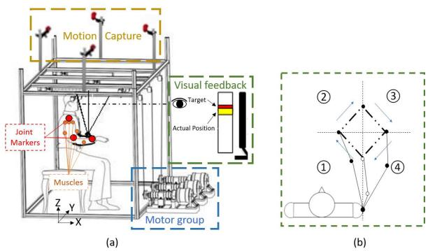
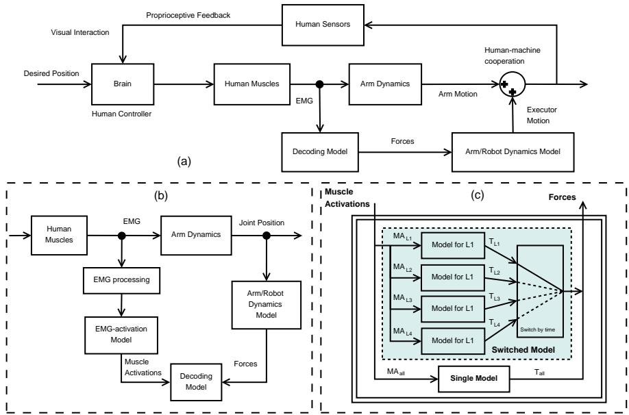
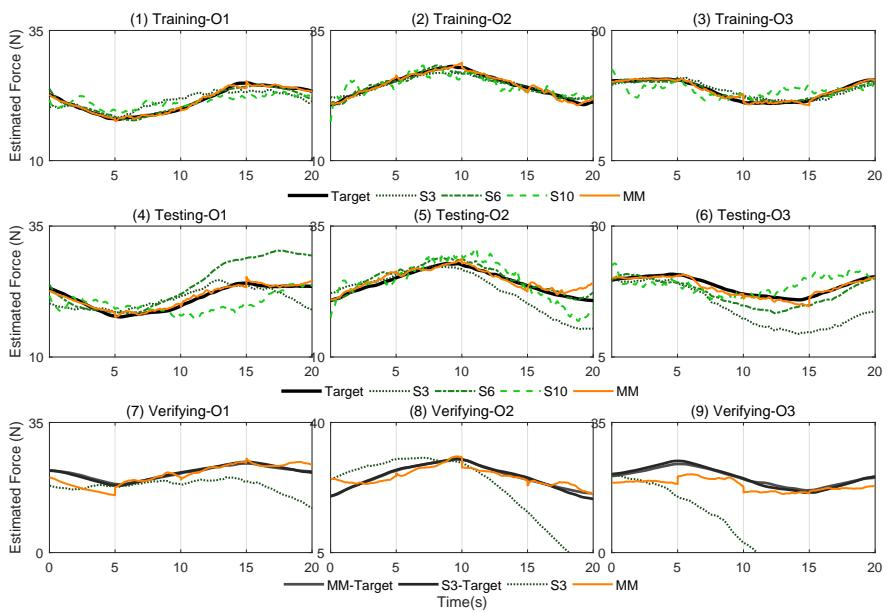
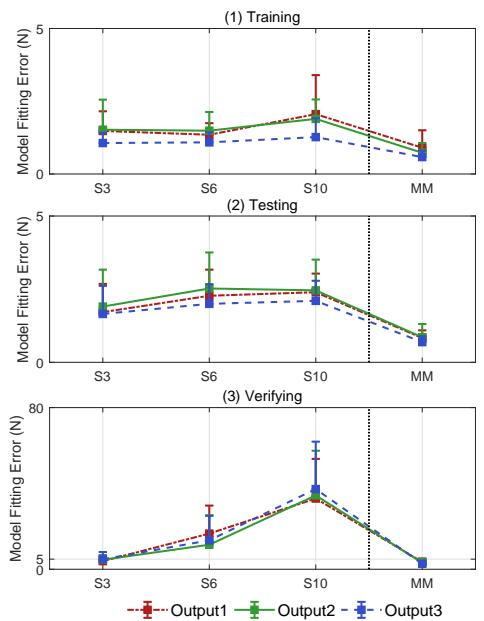
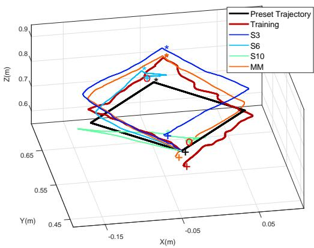
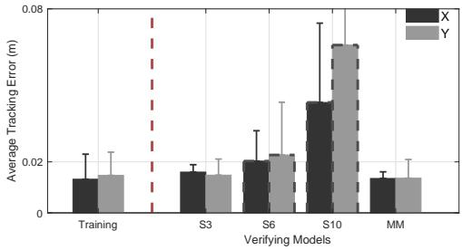
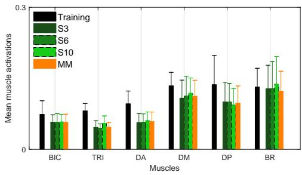

# 基于切换机制的人体三维运动意图连续描述

Yao Huang, Rong Song, Ahmadreza Argha, Andrey V. Savkin, Branko G. Celler, and Steven W. Su\*

摘要—脑卒中后的运动功能康复高度依赖于尽早主动参与主动康复训练，以促进患者大脑的重塑。本文提出了一种新方法，通过操控绳驱动康复机器人来辅助多关节身体运动。该方法利用肌电图（EMG）解码器连续估计自主运动意图，建立人机协作接口，以促进患者参与康复训练。特别是针对三维空间中的多关节复杂任务，开发了一种能够将任务分解为各个独立简单动作的切换机制。针对每个简单动作，分别建立了一个线性六输入三输出的时不变模型。输入为经过处理的六块手臂肌肉的肌肉激活度，输出为受试者在带有视觉反馈的多向跟踪任务中所产生的自主力。用于检验解码器模型和基于 EMG 控制器的实验包括模型训练、测试和控制器应用阶段，共有七名健康受试者参与。实验结果表明，带有切换机制的解码器模型能够有效识别手臂运动意图，并为受试者提供适当的辅助。本研究发现，切换机制不仅可以提高模型的估计精度，还能提高执行复杂任务的完整性。

Index Terms—Rehabilitation Robotics（康复机器人学）, Myoelectrical control（肌电控制）, EMG decoder（EMG解码器）, Multi-movement task（多动作任务）, Model switching mechanism（模型切换机制）.

## I. 引言

为了恢复失去的运动功能，具备足够强度且脑卒中患者主动参与的康复训练对于大脑重塑至关重要 [1]。由于机器人系统在效率、精度和可控性方面的优势，一系列机器人已被开发用于脑卒中后的运动能力恢复康复 [2], [3]。作为一种并联机器人，绳驱动机器人在连续康复训练过程中展现出高精度和低惯性的显著优势，能够在确保患者安全的同时，为上肢康复和日常生活活动训练提供适当的辅助 [4], [5]。

在神经康复（neuro-rehabilitation）的不同模式和阶段中，所使用机器人的关键特征在于配备控制策略的机器人能否为受试者提供适当的辅助和可靠的评估。辅助模式作为发展最为成熟的控制算法，旨在帮助受试者按照预期的治疗模式移动患肢 [6]。事实证明，受试者的主动参与对于激发运动可塑性 [1] 和诱发大脑可塑性 [7] 至关重要。对于处于脑卒中后康复早期的患者，通常采用提供被动辅助的控制策略。例如，先进的比例微分控制器 [8] 和滑模控制器 [9] 已被用于精确控制康复机器人，以被动辅助患者移动至期望的终点位置。为了增加并维持受试者的主动努力，通过提高被动控制器的顺应性，期望康复机器人仅提供部分辅助。为此，开发了阻抗控制（impedance control）和导纳控制（admittance control）等控制技术，这些技术能够实现一种在训练质量与机器人顺应性之间进行折衷的法则 [10]。

鉴于康复过程中对受试者主动参与度的高要求，与肌力和关节力矩高度相关的肌电（EMG）信号受到了重视 [11], [12]。此外，基于 EMG 的控制策略受到青睐的另一个原因在于，传统的基于机电力/力矩的控制往往存在机电延迟。对于基于 EMG 的控制，推导出了一种基于 Hill 的非线性肌肉模型（Hill-based muscle model），用于根据肌肉活动和关节运动学连续预测肢体力矩 [13]。然而，由于每块肌肉都需要大量参数，且模型方程具有非线性，基于 Hill 的模型很少应用于涉及多个关节和肌肉的控制中。另一种替代方法是将 EMG 信号与运动控制变量之间的关系单纯视为一个黑盒，以此训练两者之间的解码器。

通过应用二分类或多分类算法，机器人可以以离散模式进行控制。Dipietro et al. 将 EMG 信号映射为二值输出，用于确定运动的开始和结束 [14]。Ding et al. 利用人工神经网络（Artificial Neural Network）算法表征了 EMG 模式与预定义的静态姿势或运动之间的关系 [15]。为了连续控制单关节机器人以辅助受试者，除了基于 Hill 模型的方法 [13] 之外，还提出了一种线性比例 EMG 控制策略 [16]。基于肌肉协同（muscle synergy）理论 [17] 和运动原语（movement primitives）[18]，Artemiadis et al. [19] 提出了一种降维状态空间模型，用于将 EMG 信号连续映射到多关节运动。然而，这些模型的性能在很大程度上取决于任务和受试者，这使得在降低模型维度的同时保证建模精度面临着巨大的挑战。

一些研究团队已经开发了用于解码 EMG 信号以完成不同任务的切换方案。Nizamis et al. [20] 开发了一种基于 EMG 的控制接口，用于检测受试者的运动意图，该接口可在两个水平追踪任务和一个垂直追踪任务之间进行切换。针对这些任务的切换机制是基于简单的 EMG 比例（直接）控制和腕伸肌收缩计数实现的。Artemiadis et al. [21] 提出了一种切换解码方案，其中切换变量由受试者描述，以在 3D 手臂工作空间中的十个不同点处执行施力任务。这种切换机制可以辅助受试者完成不同的到达运动，但在每两个运动之间并不是连续执行的。Artemiadis et al. [22] 还提出了一种在多通道 EMG 信号与 3D 空间手臂运动关节角度之间的切换机制解码模型。他们建立了一个通过贝叶斯分类器（Bayesian classifier）控制的离散切换变量，用于为不同的运动选择不同的解码模型。

受基于切换模型的方法 [20]–[22] 的启发，本文利用切换线性系统模型开发了一种肌电（EMG）解码器，用于在多关节手臂运动过程中连续估计受试者的自主运动。与基于切换控制的方法 [20] 不同，所开发的 EMG 解码器用作人机接口而非控制器。尽管所开发的 EMG 解码器的功能与 Artemiadis 等人 [22] 开发的解码器相似，但本文采用的建模策略截然不同。在 [22] 中，对每个任务的模型都应用了模型降维，并将所有这些模型的输入和输出维度均降至二维。如前所述，由于降维可能会导致肢体动力学以及 EMG 信号中所包含的详细信息的丢失，因此其在用于三维空间中多关节运动的绳索康复机器人问题上的适用性需要进一步研究。此外，这些模型大多属于依赖于具体任务和受试者的方法，限制了它们的应用。

本文建立了一个切换系统模型，用于在多向手臂跟踪任务中连续解码 EMG 信号，以应用于主动辅助模式下绳索式康复机器人的控制。将六块肌肉的 EMG 信号处理为肌肉激活度作为模型输入，同时将受试者的自主力量处理为模型输出。通过将复杂任务划分为若干简单的子任务，我们为每个子任务单独辨识了一个具有合适维度的模型。为了进行对比，还针对整个复杂任务训练了三个具有不同阶数的单一模型。切换机制的效率和可行性已在模型拟合度、跟踪精度以及人机协作操作中的肌肉激活度等方面通过数值分析和实验验证得到了证明。

众所周知，人脑是一个复杂的非线性时变系统。在极为特定的条件下，对运动意图的描述虽然可行但非常困难。本文的研究工作展示了使用切换机制来描述大脑运动意图的有效性；正如样条插值可用于逼近静态非线性函数一样，动态切换系统模型可以有效逼近时变非线性动力学系统。

本文其余部分的结构安排如下：第二节分析并报告了所提出的系统架构和实验，第三节给出了结果，第四节对本文进行了讨论与总结。

## II. 方法

## A. 平台

如图 1(a) 所示，基于拉索的上肢康复机器人系统用于为受试者提供辅助。该机器人由一个立方体框架、一个电机组、一个作为末端执行器的手臂夹板、连接前述三个部件的拉索、一个动作捕捉系统、一台配备宽屏的计算机以及一个 EMG（肌电）采集系统组成。该机器人系统的详细信息见 [23]。屏幕放置在受试者正前方，通过虚拟光标实时显示受试者手腕的目标位置和实际位置。受试者将其手臂放置在夹板中并用绑带固定。动作捕捉系统的频率为 100 Hz。EMG 采集系统的频率为 1000 Hz，放大器的放大倍数为 5000。

  
Fig. 1. 基于拉索的上肢康复机器人系统及包含四个直线运动的多方向手臂追踪任务：(a) 平台。(b) 任务轨迹与方向。

## B. 基于 EMG 的人机协作控制器

基于 EMG 解码器（图 2(a)）的人机协作控制器用于控制机器人。EMG 解码器（图 2(b)）经过训练，可根据肌肉激活度估计沿拉索的 EMG 驱动力。肌肉激活度是通过基于先前研究 [16] 的基础 EMG 处理和 EMG-激活模型获得的。基于手臂和机器人的结构建立了手臂与机器人动力学模型，用于从手臂及夹板的动力学中推算由肌肉 EMG 驱动的主动发力。EMG 驱动力可进一步转换为用于驱动电机组的电机转矩。

  
Fig. 2. 所提出的基于 EMG 的人机协作控制器、EMG 解码器以及采用单模型和切换系统模型的实时解码机制的详细架构。(a) 训练好的 EMG 解码器接口。由解码器从 EMG 映射出的 EMG 驱动力用作接口，结合受试者的自主运动意图为其提供辅助。(b) 训练解码器模型。解码器经过训练，用于映射来自 EMG 信号的肌肉激活度与来自手臂动力学的肌肉驱动主动力之间的关系。训练完成后，解码器用于估计 EMG 驱动力，并由机器人实时执行。(c) 实时控制方案中的两种训练好的解码模型：切换系统模型和单模型。

1) EMG-激活模型：建立肌电（EMG）至肌肉激活模型，用于根据EMG采集系统测得的放大EMG信号计算肌肉激活水平。首先，放大的EMG信号经全波整流并通过4阶巴特沃斯（Butterworth）低通滤波器滤波，以获取放大EMG信号的包络线 [19]。然后，将每块肌肉的包络幅度归一化为其最大自主等长收缩 [24] 的值。

随后通过二阶离散时间线性模型 [25]，从EMG信号的归一化包络 $e ( t )$ 中实时获取神经激活度 $u ( t )$：

$$
u (t) = \alpha e (t - d) - \beta_ {1} u (t - 1) - \beta_ {2} u (t - 2),\tag{1}
$$

式中，$\alpha = 1 + \beta _ { 1 } + \beta _ { 2 }$ 为增益系数，$\beta _ { 1 } = c _ { 1 } + c _ { 2 }$ 和 $\beta _ { 2 } = c _ { 1 } c _ { 2 }$ 为递归系数，$c _ { 1 } , c _ { 2 }$ 为基于以往研究 [25] 针对每块肌肉的可调参数，d 为机电延迟，在本研究中设定为 80 ms。

随后，根据肌肉激活度与神经激活度之间的耦合关系计算肌肉激活度。该关系可通过一阶动力学 [26] 以及低受力水平下的非线性函数 [27] 来表示。Manal 和 Buchanan 提出了一个从神经激活度 u(t) 到肌肉激活度 a(t) 的单参数分段变换模型：

$$
a (t) = \left\{ \begin{array}{l} \alpha^ {m a} \ln (\beta^ {m a} u (t) + 1), \quad 0 \leq u (t) <   u _ {0} \\ m u (t) + c, \quad u _ {0} \leq u (t) \leq 1 \end{array} \right.\tag{2}
$$

式中，$u _ { 0 } , \alpha ^ { m a } , \beta ^ { m a }$、m 和 c 的值仅取决于每块肌肉的形状因子 [27]。

为了使肌肉激活度的频率与EMG驱动力相匹配，肌肉激活度被进一步降采样至 100 Hz。

2) 手臂与机器人动力学分析：动力学模型用于计算手臂和夹板在人机协作运动过程中作用在手腕上的EMG驱动力。手腕是机器人与手臂之间的接触点。在建模阶段，由于无法获得来自机器人的助力，因此手腕上由EMG驱动的力由运动驱动力以及用于抵抗手臂和夹板重力影响的力组成。在验证阶段，线缆将驱动手臂和夹板协同运动以执行任务。电机沿线缆提供的力是根据实时EMG由EMG解码器模型估计得出的。如 [23] 中所述，机器人的动力学方程用于计算沿线缆的力，并进一步计算电机组的驱动力矩。

3) EMG 解码器模型：此前已有许多算法被应用于从 EMG 中解码人体运动 [28]。然而，在这些研究中，大多数解码都是通过分类技术解决的，而非对运动学进行连续描述。正如引言部分所讨论的，在我们的研究中，目标是开发一个 EMG 解码器，利用测得的肌肉激活度来实时连续地表征自主运动力。

本文开发的 EMG 解码器基于状态空间模型的辨识。该过程需要一个模型训练阶段来辨识状态空间模型的参数。与使用离散时间模型的方法 [28] 相比，本文采用线性六输入三输出连续时不变模型 (3) 来映射肌肉激活度与自主运动力之间的关系。尽管数据采集是离散的，但由于实际系统是连续的，我们在此使用连续模型，这可能有助于捕捉系统的关键特性：

$$
T _ {i}: \left\{ \begin{array}{l} \dot {x} = A _ {i} x + B _ {i} u \\ y = C _ {i} x + D _ {i} u \end{array} \right.\tag{3}
$$

其中 $x \in \mathbb { R } ^ { k }$ 为状态向量，k 为可预先确定的模型阶数。在本研究中，根据不同场景，k 的取值在 3 到 10 之间。$u \in \mathbb { R } ^ { 6 }$ 为由六路肌肉激活度组成的输入向量，$y \in \mathbb { R } ^ { 3 }$ 为表示模型输出的力向量。矩阵 $A _ { i } \in \mathbb { R } ^ { k \times k } , B _ { i } \in \mathbb { R } ^ { k \times 6 }$ 和 $C _ { i } \in \mathbb { R } ^ { 3 \times k }$ 分别为系统矩阵、输入/控制矩阵和输出矩阵。矩阵 $D _ { i } \in \mathbb { R } ^ { 3 \times 6 }$ 是从输入 u 到输出 y 的直接传递矩阵，在本研究中为零矩阵。

针对给定任务 $T _ { i }$ 的状态空间模型可以通过使用模型训练数据集辨识矩阵 $\{ A _ { i } , B _ { i } , C _ { i } \}$ 和初始状态 $x _ { 0 _ { i } }$ 来建立。这些参数是在连续时间域中使用一种子空间模型辨识方法——典型变量分析（Canonical Variate Analysis, CVA）[29] 进行辨识的。由于底层系统是稳定的，在模型辨识过程中将模型的稳定性作为强制约束条件。在本研究中，为了减少因切换引起的瞬态行为，每个子系统 $T _ { i }$ 的初始值 $x _ { 0 _ { i } }$ 会在训练阶段辨识出的范围内进行调整。这种调整可以减少切换过程中输出的不连续性，从而改善瞬态切换动态特性。

4) 复杂任务的切换机制：为了探索复杂任务期间的最佳肌电（EMG）解码器模型，建立了一种将任务划分为若干简单子任务并分别为每个子任务辨识子系统模型的切换机制，如图 2 (c) 所示。切换机制的原理是为每个子任务建立具有适当维数的子系统模型，并为整个复杂任务构建一个切换线性系统模型，通过在各个子系统模型之间进行切换以实现高精度。

在本研究中，复杂任务是在水平面内跟踪方形预设轨迹（图 1(b)）。该任务包含在 3D 空间中不同方向的四种直线运动（即四个子任务）。每个直线运动的长度为 ${ \sqrt { 0 . 0 2 } } m$。通过在开发的轨迹设定模块中将 X 轴和 $Y$ 轴的变化量均设置为 0.1m，可以轻松实现每个直线运动。基于该任务，切换机制的实现可描述如下：1）将整个任务划分为四个子任务；2）为每个子任务训练一个解码器模型，并获得四个带有 $x _ { 0 _ { i } } ~ ( i \in { 1 , 2 , 3 , 4 } ) ;$ 的线性时不变多变量模型 $\{ A _ { i } , B _ { i } , C _ { i } \}$；3）根据预定义的子任务切换模型。

为了简化符号表示，在接下来的讨论中，我们使用前缀 $\mathbf { \partial } ^ { \bullet } \mathbf { S } ^ { \bullet }$ 表示单一模型的情况，并使用“MM”（Multiple Models，多模型）表示针对复杂任务在多个模型之间切换的系统情况。基于该切换机制，训练了一个切换线性系统模型。在本研究中，MM 是针对四个子任务的四个最佳子系统模型的集成。对于这些子任务，训练了阶数在三到六之间（共四种不同选择）的所有子系统模型。每个子任务的最佳子系统模型被定义为在所有四种不同阶数的模型中，三个模型输出的平均拟合误差最小的模型。每个受试者的每个最佳子系统模型的阶数可能不同。在为每个子任务选出最佳模型后，即可将 MM 进行组合并实现。

为了进行对比，在不考虑任务复杂度的情况下，针对整个方形任务还训练了三个具有不同阶数的单一模型。对于这些单一模型，其阶数分别选为三阶（S3）、六阶（S6）和十阶（S10）（详情请参见附录 A）。

## C. 受试者与实验方案

招募了七名健康受试者（年龄 $2 5 . 3 \ \pm \ 0 . 7 \ \mathrm { y r s } )$。所有受试者均签署了书面知情同意书。本研究已获得中山大学附属第一医院（the first affiliated Hospital of Sun Yat-Sen University）人类伦理委员会的批准（[2013]C-096）。

基于生物力学文献 [30]，主要负责分析上肢运动的六块肌肉（三角肌后束（DP）、三角肌中束（DM）、三角肌前束（DA）、肱三头肌（TRI）、肱二头肌（BIC）和肱桡肌（BR））的表面肌电（EMG）信号由肌电采集系统记录。两对表面肌电电极放置在受试者的指定皮肤表面。参考电极放置在肘部或腕骨区域的皮肤上。为了捕捉上肢的运动学特征，三个红外反射标记点被贴在肩部、肘部和腕部中心的皮肤表面。肌电信号和关节位置信号被同步记录。

所提出的切换方案的有效性通过数值分析以及包含七名受试者的实时实验进行了验证。数值分析（主要为建模）包括肌电解码器模型训练阶段和模型测试阶段。

训练阶段和测试阶段的数据集是根据如下所述的流程收集的。每位受试者被要求在没有机器人辅助的情况下，用他/她的手臂跟踪屏幕上显示的光标移动，总共持续 20 秒。由于力反馈回路是断开的，机器人对受试者提供零辅助。移动光标的轨迹是水平面上预设的正方形轨迹。光标在每次直线运动中移动 5 秒。每位受试者被要求跟踪沿正方形轨迹重复移动三次的光标，作为单次记录中的 3 次试验（trials）。所有受试者都需要完成三次记录，从而总共收集了 9 次试验的数据用于训练和测试阶段。随机选取两次记录（即 6 次试验）用于训练阶段，一次记录（即 3 次试验）用于测试阶段。用于模型训练的数据经过处理后，用于训练多模型（multi-model）以及三个单模型（single-models）。

在测试阶段，肌电信号同样作为输入进行处理，并使用训练好的模型来估计输出。将估计的输出与目标输出进行比较，以评估模型的准确性。如前所述，在测试阶段，肌肉活动并未通过人类视觉反馈对跟踪误差做出反应。

在实验验证阶段，受试者被要求将其前臂放置在夹板中。所有四种模型均被应用于基于肌电（EMG）的控制器中，以实现人机协作运动。因此，当力反馈回路闭合时，机器人根据 EMG 信号提供助力。在此阶段，每位受试者被要求在一次记录中跟踪一次光标，即一次记录代表一次试验（trial）。所有受试者均需在由每个模型估计的机器人助力及其肌肉贡献下完成三次记录（即 3 次试验）。不同模型的性能可以在实时反馈回路中进行评估。在该回路中，使用辨识模型估计的人体三维运动意图会实时反映在人体视觉反馈中，以减小计算机屏幕上显示的跟踪误差。

出于安全考虑，电机速度受到了约束。为此，力的范围被限制在 [−100N, 100N] 内。具体而言，如果力超出该范围，则力被设置为 −30N（若小于 −100N）或 30N（若大于 100N）。

## D. Evaluation parameters and statistical analysis

为了评估不同模型的性能，对模型拟合度、轨迹跟踪误差以及肌肉激活程度进行了计算、分析和比较。

1) 模型拟合度：基于 EMG 解码器模型，可以计算出来自关节位置的目标输出以及具有相同输入的模型估计输出。

模型拟合误差（MFE）被定义为目标输出与估计输出之间的差距。为了评估模型精度，MFE 的均方根（RMS）值计算如下：

$$
M F E _ {R M S} = \sqrt {\frac {1}{N} \sum_ {i = 1} ^ {N} (\Delta F (i)) ^ {2}}\tag{4}
$$

式中，$\Delta F ( i )$ 为第 i 个采样时刻各输出中 MFE 的绝对值，N 为样本数量。

此外，还根据 [31] 计算了目标输出与估计输出之间的皮尔逊相关系数（PCC）。

2) 轨迹跟踪精度：任务的预设期望轨迹与受试者完成的实际轨迹之间的差距被定义为跟踪误差（TE）。计算 TE 的 RMS 值以评估 X 轴上的轨迹跟踪精度，如下所示：

$$
T E _ {R M S} = \sqrt {\frac {1}{N} \sum_ {i = 1} ^ {N} (\Delta x (i)) ^ {2}}\tag{5}
$$

式中，$\Delta x ( i )$ 为第 i 个样本在 X 轴上的轨迹跟踪误差。其他轴的 $T E _ { R M S }$ 计算方式类似。为了进一步探讨切换机制的有效性，在提供人机助力的情况下，分别计算并比较了 X 轴和 Y 轴上的 $T E _ { R M S } s$。

3) 肌肉激活度：每次任务执行期间六块所选肌肉的肌肉激活度均值（MMA）用于评估 EMG 解码器模型对肌肉用力的影响。

4) 统计分析：为了分析模型阶数对模型拟合精度的影响，使用带有成对多重比较的 Kruskal-Wallis 非参数检验评估了 MFE 和 PCC 的差异。为了直观展示不同模型在三个阶段的性能差异，计算了所有七名受试者的这些评估参数的均值和标准差（SD）。

为了分析机器人的参与是否会影响人体运动意图，采用单因素方差分析统计方法评估了训练阶段和验证阶段之间 TE 的差异，并通过 Kruskal-Wallis 非参数检验评估了 MME。所有统计检验的显著性水平设为 0.05。在验证阶段，仅对能够支持所有参与者完成任务的模型进行了比较。统计分析工作使用 SPSS 19.0（SPSS Inc., USA）进行。

需要指出的是，当使用单一模型 S6 和 S10 时，部分参与者无法完成整个任务。因此，为了在实验验证期间分析切换机制的效果，仅通过配对检验在跟踪误差和肌肉激活度方面对单一模型 S3 和切换模型 MM 进行了评估。

## III. 结果

## A. 模型拟合度

首先，使用各种 EMG 解码器模型对 EMG 驱动力的估计结果展示于 Fig.3 中。该图所示数据是从一名受试者采集并估计的样本数据。

粗黑色实线和粗灰色线展示了由动力学模型计算出的目标输出，而绿色细线（单一模型：S3、S6 和 S10）和浅橙色实线（切换模型：MM）展示了由四种不同 EMG 解码器模型估计出的 EMG 驱动力。在训练和测试阶段，所有估计输出在 20 秒的试验中均与目标输出具有相似的趋势，且数值相近。在该样本的验证阶段中，由 S6 和 S10 估计出的输出严重偏离了目标，因此这些输出未包含在图中。在所有七名参与者中，七名参与者中有四名的 S6 和六名的 S10 由于输出超出电机限制范围而未能帮助参与者完成验证实验。因此，使用 S6 能够完成任务的受试者有三名，而使用 S10 能够完成任务的受试者仅有一名。

如 Fig. 4 和 Table. I 所示，针对不同模型的每个输出比较了 MFE 的 RMS 值和 PCC 的平均值。在训练阶段，除 S6 的一个输出外，所有三种单一模型的 MFE 和 PCC 均显著差于切换模型。此外，S6 在两个输出中的 MFE 和 PCC 均显著优于 S10。在测试阶段，发现所有三种单一模型的 MFE 和 PCC 均显著差于切换模型，而在各单一模型之间未发现显著差异。在验证阶段，MFE 值随着单一模型阶数的增加而显著增大。基于显著性检验，除一个输出外，MM 的性能显著优于 S3。同时，显而易见的是 S6/S10 的性能不及切换模型。需要指出的是，如 Table. I 所示，并非所有受试者都能使用 S6 和 S10 这两种单一模型完成任务。

  
Fig. 3. 多模型（MM）和三种单一模型（S3、S6、S10）在训练阶段（(1)-(3)）、测试阶段（(4)-(6)）和验证阶段（(7)-(9)）的三个输出。(1)-(6) 中的黑色粗线表示训练和测试阶段来自动力学模型的目标输出。(7)-(9) 中的黑色粗线和灰色粗线表示验证阶段两次实验的两个目标输出。(1)-(9) 中的浅橙色实线表示 MM 的输出。(1)-(9) 中的深绿色点线表示 S3 的输出。(1)-(6) 中的中绿色点划线表示 S6 的输出。(1)-(6) 中的浅绿色虚线表示 S10 的输出。

## B. 跟踪精度

任务的预设轨迹以及一名参与者在训练和验证阶段使用不同模型执行任务时的实际轨迹如 Fig. 5 所示。注意，如这些轨迹所示，该参与者无法使用 S6 模型和 S10 模型完成任务（其轨迹在 Fig. 5 中的红色圆圈标记处停止）。

Fig. 6 给出了参与者在跟踪整个任务过程中 X 轴和 Y 轴上 TE 的平均 RMS 值。S6 和 S10 的值（虚线边框）表现出较大的 SD，因为部分参与者无法完成任务。MM 在 X 轴上的 TE 值显著低于 S3 的值 $( p < 0 . 0 5 )$ 。

## C. 肌肉激活度

七块肌肉的 MMA 如 Fig. 7 所示。当参与者在机器人的辅助下跟踪任务时，所有肌肉激活度均有所下降。与训练阶段相比，验证阶段 TRI 和 DA 的激活度显著降低。在实时验证阶段，S3 与 MM 之间未发现显著差异。

  
Fig. 4. 所有受试者在训练、测试和验证阶段的平均 RMS 模型拟合误差值。

## IV. 讨论

在本研究中，利用无降维的状态空间模型 [19] 构建了 EMG 解码器，利用主要起作用且能体现自主意图的六块手臂肌肉的 EMG 信号来估计力。

TABLE I  
三种单一模型与切换系统模型在训练、测试和验证阶段的 RMS MFE 和 PCC 值的比较

<table><tr><td rowspan="2">阶段</td><td rowspan="2">输出</td><td colspan="4">MFE (均值±标准差) (N)</td><td rowspan="2">显著性</td></tr><tr><td>S3</td><td>S6</td><td>S10</td><td>MM</td></tr><tr><td rowspan="3">训练</td><td>O1</td><td>1.01±0.72</td><td>0.74±0.32</td><td>1.11±0.53</td><td>0.41±0.30</td><td>a,b,c</td></tr><tr><td>O2</td><td>1.19±0.85</td><td>0.70±0.41</td><td>1.30±0.60</td><td>0.43±0.28</td><td>a,c,d</td></tr><tr><td>O3</td><td>0.85±0.65</td><td>0.62±0.14</td><td>1.02±0.50</td><td>0.33±0.17</td><td>a,b,c,d</td></tr><tr><td rowspan="3">测试</td><td>O1</td><td>1.71±0.97</td><td>2.28±0.89</td><td>2.40±0.64</td><td>0.83±0.26</td><td>a,b,c</td></tr><tr><td>O2</td><td>1.91±1.26</td><td>2.52±1.23</td><td>2.46±1.05</td><td>0.96±0.45</td><td>a,b,c</td></tr><tr><td>O3</td><td>1.65±0.96</td><td>2.00±0.67</td><td>2.10±0.69</td><td>0.69±0.20</td><td>a,b,c</td></tr><tr><td rowspan="3">验证</td><td>O1</td><td>4.02±2.74</td><td>(NF) 4.88±3.26</td><td>(NF) 8.80±0.36</td><td>3.59±1.72</td><td></td></tr><tr><td>O2</td><td>4.71±2.25</td><td>(NF) 3.77±1.65</td><td>(NF) 4.43±0.28</td><td>3.23±1.90</td><td>a</td></tr><tr><td>O3</td><td>4.93±3.61</td><td>(NF) 3.94±1.60</td><td>(NF) 9.01±0.13</td><td>2.71±1.32</td><td>a</td></tr><tr><td rowspan="2">阶段</td><td rowspan="2">输出</td><td colspan="4">PCC (均值±标准差)</td><td rowspan="2">显著性</td></tr><tr><td>S3</td><td>S6</td><td>S10</td><td>MM</td></tr><tr><td rowspan="3">训练</td><td>O1</td><td>0.81±0.33</td><td>0.95±0.06</td><td>0.86±0.12</td><td>0.98±0.02</td><td>a,b,c</td></tr><tr><td>O2</td><td>0.80±0.32</td><td>0.94±0.09</td><td>0.83±0.16</td><td>0.98±0.02</td><td>a,c,d</td></tr><tr><td>O3</td><td>0.82±0.27</td><td>0.96±0.02</td><td>0.79±0.21</td><td>0.98±0.02</td><td>a,b,c,d</td></tr><tr><td rowspan="3">测试</td><td>O1</td><td>0.76±0.26</td><td>0.78±0.28</td><td>0.56±0.41</td><td>0.96±0.02</td><td>a,b,c</td></tr><tr><td>O2</td><td>0.68±0.48</td><td>0.75±0.18</td><td>0.56±0.43</td><td>0.93±0.08</td><td>a,b,c</td></tr><tr><td>O3</td><td>0.76±0.27</td><td>0.77±0.21</td><td>0.73±0.15</td><td>0.96±0.03</td><td>a,b,c</td></tr><tr><td rowspan="3">验证</td><td>O1</td><td>0.17±0.59</td><td>(NF) 0.03±0.62</td><td>(NF) 0.01±0.02</td><td>0.49±0.51</td><td>a</td></tr><tr><td>O2</td><td>0.23±0.48</td><td>(NF) 0.19±0.46</td><td>(NF) -0.17±0.05</td><td>0.62±0.20</td><td>a</td></tr><tr><td>O3</td><td>0.17±0.43</td><td>(NF) 0.02±0.65</td><td>(NF) 0.13±0.04</td><td>0.70±0.12</td><td>a</td></tr></table>

注：这些模型之间的显著性差异由以下字母表示。a: ‘S3-MM’，b: ‘S6-MM’，c: ‘S10-MM’，d: ‘S6-S10’。NF：并非所有参与者都完成了任务。对于那些无法支持所有受试者完成任务的模型，MFE 和 PCC 的均值及标准差仅根据成功完成任务的受试者进行计算。

  
Fig. 5. 训练和验证阶段的轨迹。两个红色圆圈“O”表示未完成轨迹的终点位置。加号标记“+”表示已完成轨迹的终点位置。星号标记 $\cdot _ { * } \cdot$ 表示轨迹的中间位置。

  
Fig. 6. 不同模型在训练和验证阶段中 X 轴和 Y 轴上的平均 RMS 跟踪误差值。虚线边框表示并非所有参与者都完全完成了该任务。

  
Fig. 7. 不同模型在训练和验证阶段中六块肌肉的平均肌肉激活度。虚线边框表示并非所有参与者都完全完成了该任务。

此外，通过整合简单运动模型，切换机制已被应用于复杂运动跟踪。结果表明，所提出的切换机制在执行复杂任务时能够很好地估计力。这证明了所提出的方法可以应用于绳驱动康复机器人。

## A. 肌电控制中无降维 EMG 解码器模型的新颖性

大多数用于人机协作期间肌电控制策略的 EMG 解码器要么以离散模式表示，要么受限于一维空间/单关节。尽管基于 Hill 的模型 [24] 已被建立并常用于从 EMG 信号中连续解码手臂运动 [32]，但解码器模型的非线性以及每块肌肉需要测量的海量参数，使得多肌肉和多关节协同运动的分析变得相当困难。Artemiadis et al. [19] 报道了线性状态空间模型能够从 EMG 信号中连续解码上肢运动，以在 3D 空间中控制拟人机器人，但在建模之前需要额外的降维技术。降维虽然可以降低建模难度，但可能会导致肢体动力学特征和 EMG 信号中所包含的详细信息的丢失。此外，通过调整状态空间模型的参数，无需降维即可清晰地辨识出特定参与者的输入与输出之间的关系。建模方案的一个关键部分是状态 x 的初始值，它极大地影响了模型的精度。然而，以往的研究均未充分考虑 x 的维度或取值。

在本研究中，开发了无需降维的线性状态空间模型用于解码肌电（EMG）信号，并进一步应用于实时控制绳驱康复机器人。通过训练无降维的多输入（六个肌肉激活度）多输出（三维力）模型，可以估算出上肢在三维空间康复任务中的肌电驱动力，并基于受试者的自主努力提供辅助。训练阶段的 MFE 和 PCC 分析结果表明，在三个单一模型中，单一模型 S6 的跟踪误差最小。然而，测试阶段的结果显示，阶数最低的模型 S3 在所有三个单一模型中表现最佳，且接近训练阶段的性能。这表明低阶模型比高阶模型更具鲁棒性，且与先前的研究 [19] 一致。

然而，非单一模型能够在实时验证中保持其性能。测试阶段与验证阶段的区别在于，人类视觉反馈系统是否参与到人脑协同运动的控制回路中。换言之，与测试阶段不同，验证阶段是以闭环方式对模型性能进行评估。得益于闭环控制系统的鲁棒性，当建模误差较小（如 MM）或不大（如 S3）时，系统可以维持稳定性，性能退化也在可接受范围内。然而，如果建模误差过大，超出受试者的承受范围，闭环系统就会变得不稳定，S6 和 S10 便属于这种情况，即对于 S6 和 S10，部分受试者无法完成整个跟踪任务。这表明不同模型的闭环表现还与受试者的运动适应能力相关。由于中风患者的运动适应能力通常远低于健康受试者，因此即使在测试阶段，EMG 解码模型也需要更加精确。因此，所提出的切换模型是中风后患者主动康复中最合适的候选方案。

## B. 人体相关系统建模中切换机制的优越性

所提出的切换机制旨在解决当前主动康复中的问题，并在模型精度、所需训练数据量以及模型个性化方面取得了良好的性能。

通过考虑每个子系统模型的初始状态，为每个子任务训练出最优模型，且切换系统模型在测试阶段和验证阶段均表现出优异的性能。因此，该切换机制具有较高的鲁棒性，并能解码肌电（EMG）信号以在人机协作运动中辅助受试者。该机制能够提高模型精度，并在不损失信息的情况下替代额外的降维技术。

将复杂任务划分为简单子任务并针对每个子任务进行训练的切换机制，类似于大脑的肌肉控制策略，即通过整合不同的肌肉协同作用（muscle synergies）来完成复杂的运动。在基于生理信号的实时机器人辅助控制策略中，由于人类受试者的参与，实验时间和数据量通常都受到限制。在单一模型（即无切换）的训练阶段，复杂任务需要由受试者完美完成；否则刺激将不足以辨识模型参数。这些要求无疑增加了完成任务的难度，并进一步降低了模型的通用性。

另一方面，为了训练模型，在每个单独的子任务中，利用有限的数据即可快速训练出最优模型。即使受试者未能完成整个任务，而仅完成了两到三个子任务，数据仍可用于训练这些特定子任务的模型。因此，切换机制更适用于有人类参与的过程建模，在这些过程中出于安全考虑，数据量通常是有限的。

在实验过程中，当使用高阶单一模型时，观察到一种异常情况：那些容易感到疲劳的受试者（根据口头报告）往往只能完成前两到三个子任务。其原因在于高阶单一模型（S6 和 S10）具有较大的建模误差（见 Table I）。这要求受试者消耗更多精力来抵消误差；因而在后期阶段，受试者往往会感到疲倦，且肌肉疲劳会污染正常的 EMG 信号 [33]。由此可见，切换机制能够提高建模精度，并在不引起肌肉疲劳的情况下支持受试者完成复杂任务。

## C. 基于 EMG 的人机协作运动表现及其临床意义

总体而言，尽管 S3 和 MM 都存在训练和测试误差，但健康受试者在验证阶段均能以相近的跟踪精度完成任务，这展示了健康人群的运动适应能力。切换机制带来的跟踪精度提升，尤其是在 X 轴上的显著性，表明了切换模型在运动控制精度方面的优越性。这也表明在实验验证中，当使用合适的 EMG 解码器模型时，手臂运动表现受到的影响较小。然而，由于两个子系统之间的切换存在扰动过渡（bump transfers），有待进一步验证的猜想是：可以通过调整模型的初始状态来减小扰动突变，从而提高受试者的运动表现和控制效率。

在人脑运动控制的组织下，健康受试者天生具有在无辅助 [34] 或有适当辅助的情况下自适应跟踪直觉任务的能力。然而，考虑到使用 S6 和 S10 两种模型时未完成的运动，来自机器人的“辅助”偏离了运动意图，从而阻碍了人体肢体完成复杂任务。

六块肌肉激活程度的降低与先前的研究 [35]–[37] 高度吻合。这可以解释为，当提供外部辅助时，健康受试者能够主动调整其肌肉激活度和肌力 [38]。因此，与训练阶段的运动相比，当受试者在绳索牵引机器人的辅助下执行相同运动时，六块肌肉的体力消耗有所减少。

肌电控制康复机器人提供连续辅助的有效性已在中风后患者的肘关节和腕关节康复中得到证实 [16], [39]。新提出的带切换机制的 EMG 解码器模型可推广应用于针对神经系统疾病（如中风、脑瘫等）患者的其他多关节康复机器人。作为下一步工作，我们旨在将所提出的方法应用于前一年发生中风且在被动康复后基础运动能力评估中得分较高的年轻患者（20-30 岁）。此外，这些患者应能够坐在椅子上至少 30 分钟，并能够支撑其患肢至少 1 分钟。

## D. 贡献总结

本研究的主要贡献在于提出了一种新的基于切换的方法，用于从多路 EMG 信号中连续解码运动意图，并通过将人的参与纳入考量来进一步主动支持受试者的运动。通过引入切换机制，针对单一但复杂的任务，利用多路 EMG 信号和多个机器人控制信号构建了 EMG 解码器模型。

其背后的理念是将复杂的运动任务分解为多个简单的子任务，从而使每个子任务都足够简单，能够用简单的线性状态空间模型进行建模。然后，借助切换机制，即可实现复杂的康复运动。尽管我们将复杂任务分解为了多个简单子任务，但我们仍然将总体任务视为一个完整任务，并力求最小化切换过程中的瞬态响应（即最小化切换期间的急动度/jerk）。

从理论上讲，由于人类中枢神经系统的参与，仅使用单一模型对复杂任务进行解码是相当复杂的。此外，由于本研究所记录的多输入多输出关系的复杂性，解码器模型需要是高维非线性动态模型，并且可能是时变的。一种替代解决方案是将整个复杂的跟踪任务分解为若干子任务，并为这些子任务构建简单模型。这类似于样条插值，即复杂的输入输出关系由一组分段多项式函数来近似。

此外，受样条插值节点处连续性/平滑性要求的启发，我们考虑了减少切换期间不连续性的问题。据作者所知，现有文献中尚无在人体运动意图解码中考虑切换过程输出连续性的报道。

## V. 结论

本研究利用多通道肌电（EMG）信号对主动机器人康复进行了探讨。提出了基于线性时不变状态空间模型的 EMG 解码器，该模型不一定需要进行降维。通过引入切换机制，该方法将复杂的跟踪任务划分为简单的子任务。随后，训练了由四个子系统组成的切换系统模型。本文发现，基于切换机制的 EMG 解码器低阶简单模型能够在降低模型复杂度的同时应对底层系统的变化，并提高模型测试与实时实验验证过程中的精度。总体而言，带有切换机制的解码器能够从多通道 EMG 信号中高精度预测自主运动意图，并帮助参与者以更低的肌肉负荷和更高的任务完成率完成人机协作运动。

## 附录 A

## 模型阶数选择准则

模型阶次的选择基于三名受试者在训练和测试阶段的预备实验，并遵循以下四项准则：1）模型所能复现的输出变异百分比，该数值越高代表模型性能越好；2）由观测数据构建的特定协方差矩阵的奇异值（singular values，SVs）随模型阶次的变化函数，它衡量了状态向量的第 n 个分量对模型输入输出特性的贡献程度；3）考虑到系统有三个输出，若整体传递函数是严格真的（strictly proper），则阶次不能低于 3；4）模型阶次不能过高，因为在刺激时间相对较短的情况下（每条子轨迹约为 5 秒），高阶次会导致过拟合。

我们从预备实验中发现：1）随着阶次从 2 增加到 10，输出变异的百分比随之增加；2）阶次为 1/2/3 的模型的 SVs 较为接近，且均高于阶次为 4/5/6 的模型的 SVs，而阶次为 7/8/9/10 的模型的 SVs 也表现出类似的情况，即 $S V _ { 1 - 3 } > S V _ { 4 - 6 } > S V _ { 7 - 1 0 }$。阶次超过 10 的模型的 SVs 均低于 0.1。这一结果表明，更高阶次的分量对模型特性的贡献较小。因此，我们选择的低阶、中阶和高阶代表性阶次分别为 3、6 和 10。

## 致谢

本研究得到了由 Sun Yat-sen University（中山大学）与 University of Technology Sydney（悉尼科技大学）联合建立的 Australia-China Joint Institute for Health Technology and Innovation（中澳健康科技创新联合研究院）的资助。我们还要感谢匿名审稿人，他们的宝贵意见/建议帮助我们完善并清晰地阐明了本手稿。

## 参考文献

[1] M. Lotze, C. Braun, N. Birbaumer, S. Anders, and L. G. Cohen, “Motor learning elicited by voluntary drive,” Brain, vol. 126, no. 4, pp. 866–872, 2003.

[2] R. Riener, M. Guidali, U. Keller, A. Duschau-Wicke, V. Klamroth, and T. Nef, “Transferring armin to the clinics and industry,” Topics in spinal cord injury rehabilitation, vol. 17, no. 1, pp. 54–59, 2011.

[3] S. J. Ball, I. E. Brown, and S. H. Scott, “Medarm: a rehabilitation robot with 5dof at the shoulder complex,” in Advanced intelligent mechatronics, 2007 IEEE/ASME international conference on. IEEE, 2007, pp. 1–6.

[4] S. Masiero, A. Celia, G. Rosati, and M. Armani, “Robotic-assisted rehabilitation of the upper limb after acute stroke,” Archives ofphysical medicine and rehabilitation, vol. 88, no. 2, pp. 142–149, 2007.

[5] D. Zanotto, G. Rosati, S. Minto, and A. Rossi, “Sophia-3: A semiadaptive cable-driven rehabilitation device with a tilting working plane,” IEEE Transactions on Robotics, vol. 30, no. 4, pp. 974–979, 2014.

[6] L. Marchal-Crespo and D. J. Reinkensmeyer, “Review of control strategies for robotic movement training after neurologic injury,” Journal of neuroengineering and rehabilitation, vol. 6, no. 1, p. 20, 2009.

[7] P. M. Rossini and G. Dal Forno, “Integrated technology for evaluation of brain function and neural plasticity,” Physical Medicine and Rehabilitation Clinics, vol. 15, no. 1, pp. 263–306, 2004.

[8] G. Xu, A. Song, and H. Li, “Control system design for an upper-limb rehabilitation robot,” Advanced Robotics, vol. 25, no. 1-2, pp. 229–251, 2011.

[9] M.-K. Chang, “An adaptive self-organizing fuzzy sliding mode controller for a 2-dof rehabilitation robot actuated by pneumatic muscle actuators,” Control Engineering Practice, vol. 18, no. 1, pp. 13–22, 2010.

[10] T. Proietti, V. Crocher, A. Roby-Brami, and N. Jarrasse, “Upper-´ limb robotic exoskeletons for neurorehabilitation: a review on control strategies,” IEEE reviews in biomedical engineering, vol. 9, pp. 4–14, 2016.

[11] C. Loconsole, S. Dettori, A. Frisoli, C. A. Avizzano, and M. Bergamasco, “An EMG-based approach for on-line predicted torque control in robotic-assisted rehabilitation,” in Haptics Symposium (HAPTICS), 2014 IEEE. IEEE, 2014, pp. 181–186.

[12] M. H. Rahman, C. Ochoa-Luna, M. Saad, and P. Archambault, “EMG based control of a robotic exoskeleton for shoulder and elbow motion assist,” J Aut Con Eng, vol. 3, no. 4, 2015.

[13] J. Potvin, R. Norman, and S. McGill, “Mechanically corrected EMG for the continuous estimation of erector spinae muscle loading during repetitive lifting,” European journal of applied physiology and occupational physiology, vol. 74, no. 1-2, pp. 119–132, 1996.

[14] L. Dipietro, M. Ferraro, J. J. Palazzolo, H. I. Krebs, B. T. Volpe, and N. Hogan, “Customized interactive robotic treatment for stroke: EMG-triggered therapy,” IEEE transactions on neural systems and rehabilitation engineering, vol. 13, no. 3, pp. 325–334, 2005.

[15] Y. M. Aung and A. Al-Jumaily, “sEMG based ann for shoulder angle prediction,” Procedia Engineering, vol. 41, pp. 1009–1015, 2012.

[16] R. Song, K.-y. Tong, X. Hu, L. Li et al., “Assistive control system using continuous myoelectric signal in robot-aided arm training for patients after stroke,” IEEE transactions on neural systems and rehabilitation engineering, vol. 16, no. 4, pp. 371–379, 2008.

[17] A. d’Avella, A. Portone, L. Fernandez, and F. Lacquaniti, “Control of fast-reaching movements by muscle synergy combinations,” Journal of Neuroscience, vol. 26, no. 30, pp. 7791–7810, 2006.

[18] B. Lim, S. Ra, and F. C. Park, “Movement primitives, principal component analysis, and the efficient generation of natural motions,” in Robotics and Automation, 2005. ICRA 2005. Proceedings of the 2005 IEEE International Conference on. IEEE, 2005, pp. 4630–4635.

[19] P. Artemiadis and K. Kyriakopoulos, “EMG-based control of a robot arm using low-dimensional embeddings,” IEEE Transactions on Robotics, vol. 2, no. 26, pp. 393–398, 2010.

[20] K. Nizamis, J. Lobo-Prat, A. Q. Keemink, R. Carloni, A. H. Stienen, and B. F. Koopman, “Switching proportional EMG control of a 3d endpoint arm support for people with duchenne muscular dystrophy,” in Rehabilitation Robotics (ICORR), 2015 IEEE International Conference on. IEEE, 2015, pp. 235–240.

[21] P. K. Artemiadis, P. T. Katsiaris, M. V. Liarokapis, and K. J. Kyriakopoulos, “On the effect of human arm manipulability in 3d force tasks: Towards force-controlled exoskeletons,” in Robotics and Automation (ICRA), 2011 IEEE International Conference on. IEEE, 2011, pp. 3784–3789.

[22] P. K. Artemiadis and K. J. Kyriakopoulos, “A switching regime model for the EMG-based control of a robot arm,” IEEE Transactions on Systems, Man, and Cybernetics, Part B (Cybernetics), vol. 41, no. 1, pp. 53–63, 2011.

[23] J. Yang, H. Su, Z. Li, D. Ao, and R. Song, “Adaptive control with a fuzzy tuner for cable-based rehabilitation robot,” International Journal of Control, Automation and Systems, vol. 14, no. 3, pp. 865–875, 2016.

[24] F. E. Zajac, “Muscle and tendon properties models scaling and application to biomechanics and motor,” Critical reviews in biomedical engineering, vol. 17, no. 4, pp. 359–411, 1989.

[25] D. G. Lloyd and T. F. Besier, “An EMG-driven musculoskeletal model to estimate muscle forces and knee joint moments in vivo,” Journal of biomechanics, vol. 36, no. 6, pp. 765–776, 2003.

[26] A. Huxley, “Muscular contraction.” The Journal ofphysiology, vol. 243, no. 1, pp. 1–43, 1974.

[27] K. Manal and T. S. Buchanan, “A one-parameter neural activation to muscle activation model: estimating isometric joint moments from electromyograms,” Journal of biomechanics, vol. 36, no. 8, pp. 1197– 1202, 2003.

[28] P. K. Artemiadis and K. J. Kyriakopoulos, “EMG-based teleoperation of a robot arm using low-dimensional representation,” in Intelligent Robots and Systems, 2007. IROS 2007. IEEE/RSJ International Conference on. IEEE, 2007, pp. 489–495.

[29] W. E. Larimore, “Canonical variate analysis in identification, filtering, and adaptive control,” in 29th IEEE Conference on Decision and control. IEEE, 1990, pp. 596–604.

[30] J. R. Cram, Cram’s introduction to surface electromyography. Jones & Bartlett Learning, 2011.

[31] M. M. Mukaka, “A guide to appropriate use of correlation coefficient in medical research,” Malawi Medical Journal, vol. 24, no. 3, pp. 69–71, 2012.

[32] E. Cavallaro, J. Rosen, J. C. Perry, S. Burns, and B. Hannaford, “Hill-based model as a myoprocessor for a neural controlled powered exoskeleton arm-parameters optimization,” in Robotics and Automation, 2005. ICRA 2005. Proceedings of the 2005 IEEE International Conference on. IEEE, 2005, pp. 4514–4519.

[33] T. Oberg, “Muscle fatigue and calibration of EMG measurements,”¨ Journal of Electromyography and Kinesiology, vol. 5, no. 4, pp. 239– 243, 1995.

[34] K. Nazarpour, A. Barnard, and A. Jackson, “Flexible cortical control of task-specific muscle synergies,” Journal ofNeuroscience, vol. 32, no. 36, pp. 12 349–12 360, 2012.

[35] T. Lenzi, S. M. M. De Rossi, N. Vitiello, and M. C. Carrozza, “Intentionbased EMG control for powered exoskeletons,” IEEE transactions on biomedical engineering, vol. 59, no. 8, pp. 2180–2190, 2012.

[36] S. Kwon, Y. Kim, and J. Kim, “Movement stability analysis of surface electromyography-based elbow power assistance,” IEEE Transactions on Biomedical Engineering, vol. 61, no. 4, pp. 1134–1142, 2014.

[37] E. Mastinu, P. Doguet, Y. Botquin, B. Hakansson, and M. Ortiz-Catalan,˚ “Embedded system for prosthetic control using implanted neuromuscular interfaces accessed via an osseointegrated implant,” IEEE transactions on biomedical circuits and systems, vol. 11, no. 4, pp. 867–877, 2017.

[38] K. Suzuki, G. Mito, H. Kawamoto, Y. Hasegawa, and Y. Sankai, “Intention-based walking support for paraplegia patients with robot suit hal,” Advanced Robotics, vol. 21, no. 12, pp. 1441–1469, 2007.

[39] R. Song, K.-y. Tong, X. Hu, and W. Zhou, “Myoelectrically controlled wrist robot for stroke rehabilitation,” Journal of neuroengineering and rehabilitation, vol. 10, no. 1, p. 52, 2013.