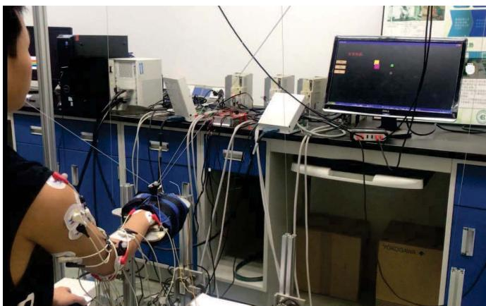
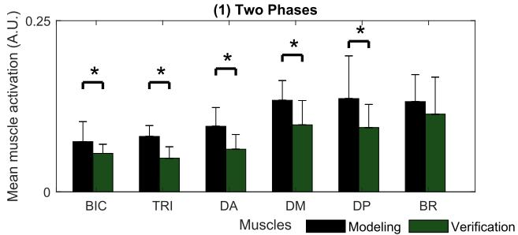
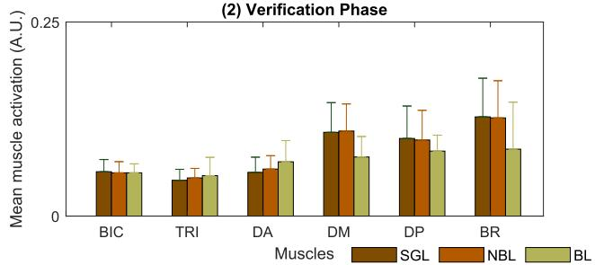
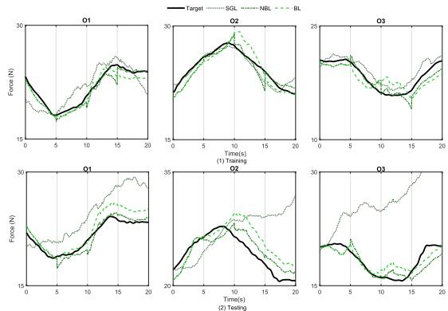
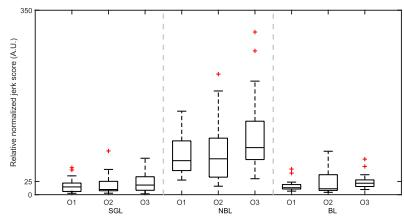
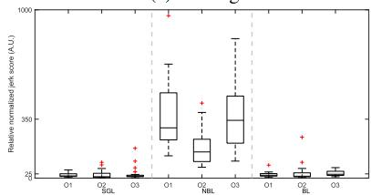

<!-- 本文件是 MinerU 自动抽取的**英文结构化正文**，不是中文翻译。 -->
<!-- 中文翻译若需要，须另走 06_附录/pdf2zh调用脚本/translate_all.py，不得把本文件当译文引用。 -->
<!-- 抽取来源：01_参考论文/运动理解/宋嵘_意图解码与力矩模型/Huang2021-TNSRE：基于无扰切换机制的康复机器人人体运动意图描述/Huang2021-TNSRE：基于无扰切换机制的康复机器人人体运动意图描述.pdf -->
<!-- DOI：10.1109/TNSRE.2021.3066592 -->
<!-- 图片：8 张，位于同级 images/，已按正文引用相对路径改写。 -->

# Human Motion Intent Description Based on Bumpless Switching Mechanism for Rehabilitation Robot

Yao Huang , Graduate Student Member IEEE, Rong Song , Ahmadreza Argha , Member IEEE, Branko G. Celler , Andrey V. Savkin , Senior Member IEEE, and Steven W. Su , Senior Member IEEE

— This paper aims to improve the performance of an electromyography (EMG) decoder based on a switching mechanism in controlling a rehabilitation robot for assisting human-robot cooperation arm movements. For a complex arm movement, the major difficulty of the EMG decoder modeling is to decode EMG signals with high accuracy in real-time. Our recent study presented a switching mechanism for carving up a complex task into simple subtasks and trained different submodels with low nonlinearity. However, it was observed that a “bump” behavior of decoder output (i.e., the discontinuity)occurred during the switching between two submodels. The bumps might cause unexpected impacts on the affected limb and thus potentially injure patients.To improve this undesiredtransient behavior on decoder outputs, we attempt to maintain the continuity of the outputs during the switching between multiple submodels. A bumpless switching mechanism is proposed by parameterizing submodels with all shared states and applied in the construction of the EMG decoder. Numerical simulation and real-time experiments demonstrated that the bumpless decoder shows high estimation accuracy in both offline and online EMG decoding. Furthermore, the outputs achieved by the proposed bumpless decoder in both testing and verification phases are significantly smoother than the ones obtained by a multimodel decoder without a bumpless switching mechanism. Therefore, the bumpless switching approach can be used to provide a smooth and accurate motion intent prediction from multi-channel EMG signals. Indeed, the method can actually prevent participants from being exposed to the risk of unpredictable loads.

— Bumpless switching mechanism, MIMO EMG decoder, myoelectrical control, rehabilitation robotics, multi-movement task.

## I. INTRODUCTION

N THE advanced rehabilitation theory, it is generally accepted that users’ involvement is essential in both the therapy procedures and the development of rehabilitation technics [1], especially in rehabilitation robotics [2]. Comparing with physical sensor-based robot control strategies, strategies using bio-sensors, such as Electroencephalography, Electromyography (EMG) and Electroneurography, for rehabilitation, allow robotic movements to be triggered more naturally and simultaneously based on human motion. Among different bio-signals, the surface EMG signal has attracted much attention, because it is closely related to patients’ muscle activities, and can be collected easily with noninvasive sensors.

On the other hand, for rehabilitation, upper limb motor relearning and recovery levels are required to be improved with proper intensive physiotherapy. For patients with partial motor capacity, it is essential to estimate patients’ motion intention for further assistance. Therefore, some studies have proposed methods to detect the motion intention by estimating limb motion in both static [3] and dynamic manners [4].

Although a few studies were able to consecutively map the human’s intention from EMG to limb motion in a natural neuromuscular control strategy, it is broadly speaking difficult to identify a consistent pattern regarding motor control strategies among different subjects. This is due to the susceptible nature of EMG signal during dynamic motion. Zhang et al. have proposed an adaptive estimation method to train a model for accurately mapping two-paired muscle activations and elbow motion for covering subject-specific problems [5]. However, the performance of this method is mostly limited to one or two joints’ motion and thus modeling accuracy and keeping signal integrity remained as big challenges.

A state-space model together with principal component analysis for reducing dimensionality has been proposed by Panagiotis et al. for mapping the relationship between EMG signals and multi-joint movements [6]. The method together with a switching law is further used as a switching regime to control a robot arm in random patterns [7]. Both methods work well in a robot arm’s trajectory control. However, the dimensionreduction comes at the expense of discarding some useful information included in EMG signals. Hence a thorough dynamics describing the relationship between EMG signals and multi-joint movements may not be well captured when applying these methods in robot-human cooperation movements.

To further develop a method for consecutively estimating multi-joint motion intention for the control of cable rehabilitation robot, a modeling method without dimension reduction has been proposed for mapping the relationship of six muscle activities and whole arm motion [8]. The method showed good estimation accuracy and was able to support subjects naturally and actively for simple linear tracking tasks. To further improve the performance when applying the method in complex tasks, a switching mechanism [9] has recently been proposed based on the method in [8]. This switching mechanism could improve accuracy, but a problem was identified when it was applied in real-time experiments. That is, when switching between submodels for subtasks, the estimated outputs abruptly change due to large variations in model parameters. Although the overall estimation accuracy of the proposed switching mechanism in [9] is high, and the output bumps only show a marginal influence over the majority of healthy subjects’ experiments, the impact of the bump is nonnegligible for some healthy subjects and is unacceptable for dyskinesia patients.

More specifically, the bump in model outputs in realtime might cause unexpected forces in the affected limb and might be a cause of injury for patients. Furthermore, with an unexpected disturbance, the short term response of participants functionally destabilizes posture, and the further compensation of body displacement is generally achieved as a long term response [10]. The affected stability after disturbance cannot recover easily for dyskinesia patients. Although there are some studies about switching methods for different tasks, most of them focus on judging the switching logic for different tasks [11], [12]. The continuity of estimated outputs when switching between different tasks is rarely discussed. Concerning a switching mechanism for the research of rehabilitation robot control in an active-assistive rehabilitation program, most works use different types of control signals. Bernhardt et al. [13] applied an algorithm [14] by adaptively adjusting the reference trajectory to ensure the stability of the switching between a position and force control scheme for a lower limb rehabilitation robot. A hierarchical control structure [15] is developed to translate a sequential rehabilitation exercise into a sequence of consecutive movement patterns, but the switching transient is not explicitly considered. Hardly any works investigate the parameterized bumpless switching algorithm and use the same type of control signals in the rehabilitation robot control. As it is essential to continuously estimate multi-joint motion intention from EMG signals during task switching, we explore a state-shared bumpless transfer for model switching to improve transient performance during switching.

The devised state-shared bumpless transfer is motivated by Multiple Models Adaptive Control (MMAC) [16]. For the MMAC application, only one controller is applied to generate a control signal at any time instant. The idea of this transfer method is to implement a group of different controllers by a single controller with adjustable parameters rather than implementing each controller as an individual system. With the state of the single controller shared by a group of controllers, this implementation is termed as a “state-shared” multirealization. This multirealization technique is first introduced by Morse [17], who employed an adaptive control algorithm that consists of a group of linear Single-Input Single-Output (SISO) controller models and a highlevel switching logic for supervising. The approach contributes to improving transient performance and realizing bumpless transfer between different controllers.

Besides, the bumpless transfer is also proposed for an anti-windup design of a SISO PID controller within an integrated closed-loop system between manual and automatic controllers [18]. With this technique, the switching in a saturated multi-controller scheme is able to avoid a large transient caused by incompatible initial conditions of the controller. Zaccarian and Teel [19] developed a bumpless transfer approach for anti-windup for Multiple-Input Multiple-Output (MIMO) systems. This approach requires the knowledge of the models of the whole closed-loop system, i.e., including both the controller and the under controlled process. Only a few approaches do not need a fully dynamic model of the closed-loop system. For example, Yame et al. [20] proposed a parameterization method to realize bumpless transfer between controllers in a MIMO system without implicitly knowing the dynamical model of the closed-loop system. However this method requires restrictive conditions including a unique equilibrium state trajectory associated with the reference trajectory for each controller, and the switching must occur when the system is in a steady state with zero tracking error.

For active rehabilitation, the human nervous system will be involved in the closed-loop system. Modeling the human nervous system, which can be highly nonlinear and timevariant, is either too complicated or even impossible. A unique equilibrium state trajectory for all controllers is also unavailable needless to say ensuring the switching happens in the steady state with zero tracking error. Furthermore, the minimal realization of the system is not explicitly considered within these approaches [20]. A bumpless transfer with a minimal realization that can be applied in a human-involved closedloop system is anticipated to ensure the smoothness of decoder outputs.

For the multirealization of a family of linear MIMO systems, the authors of [21], [22] developed a stably based multirealization approach to implement the bumpless switching with the dimension of the switching model minimized. As this method does not require the model of the under controlled process, it is suitable for application in a human-involved close-loop system.

Based on the state shared multirealization approach, we proposed a new decoder model (a MIMO system) with a bumpless switching mechanism to depict human motion intent from EMG signals. The decoder is implemented in a humanrobot cooperation strategy for a visual tracking task. The decoder outputs are used to control the robot to support subjects in compliance with their motion intention. As both the states and the outputs of the switching model are continuous even during switching, which is consistent with the continuity of human physiological and psychological variables, the safety of the robot rehabilitation patients could be improved. Both numerical analysis and real-time experimental verification have demonstrated the effectiveness of the proposed bumpless switching mechanism.

  
Fig. 1. The three kinds of EMG decoder models (a) Single model, (b) Bump switching mechanism with the realizations $\{ A _ { j } , B _ { j } , \breve { C } _ { j } \}$ for four subsystem models and (c) Bumpless switching mechanism with the multirealization $\{ A _ { 0 } + F _ { i } C _ { 0 } , B _ { i } , C _ { 0 } \}$ for su bsystem models. The realizations $\{ A _ { j } , B _ { j } , C _ { j } \} , j \in ( 2 , 3 , \dot { 4 } )$ in (b) are all realized the same as $\{ A _ { 1 } , B _ { 1 } , C _ { 1 } \}$

## II. MODELS FOR THE CONSTRUCTION OF EMG DECODER

The goal of this paper is to develop an EMG decoder, which uses muscle activations to continuously represent the motion required forces in real-time while retaining all muscle activity information.

In our previous work [9], a switching mechanism with a group of models for a complex arm motion was developed and evaluated, as shown in Fig. 1(b). A total of four linear state-space models as subsystem models with six-input and three-output were built up for a square shape tracking task. By directly switching among the four subsystem models, the EMG decoder with the switching mechanism can accurately estimate the motion required forces. When comparing to a single model decoder (shown in Fig. 1(a)), no matter how complex the single Linear Time-Invariant (LTI) model ${ \mathrm { i s } } ,$ i.e. the order of the model is high enough, the EMG decoder with the switching mechanism shows better performance in both simulation and experiment phases [9]. However, a “bump” behavior of the outputs which might affect the consecutiveness of the outputs and system state was observed.

As mentioned earlier, the “bump” in output appears because the subsystem models switch. An effective way for improving the transient response of SISO systems proposed by Morse [17] comes from constructing a stably based stateshared multirealization. In this study, as the system is a multivariable system, motivated by the elimination of “bump” outputs, we attempt to solve a general realization (presented as the “multirealization” [21], [22]) for any MIMO subsystems (see Fig. 1(c)).

Consider the state-space model for one subsystem (denoted as a submodel):

$$
H _ { i } : \left\{ { \begin{array} { l } { { \dot { x } } _ { i } = A _ { i } x _ { i } + B _ { i } u } \\ { y = C _ { i } x _ { i } } \end{array} } \right.\tag{1}
$$

where $i \in \{ 1 , 2 , 3 , 4 \} , x _ { i } \in \mathbb { R } ^ { k _ { i } }$ is the state vector and $k _ { i }$ is the order of the i-th submodel, $u \in \mathbb { R } ^ { 6 }$ is the input vector composed by six muscle activations, $\boldsymbol { y } ~ \in ~ \mathbb { R } ^ { 3 }$ is the output vector composed by the needed forces along cables. The matrices $A _ { i } \in \mathbb { R } ^ { k _ { i } \times k _ { i } } , B _ { i } \in \mathbb { R } ^ { k _ { i } \times 6 }$ , and $C _ { i } ~ \in ~ \mathbb { R } ^ { 3 \times k _ { i } }$ are the system matrix, input matrix, and output matrix, respectively.

The state-space submodels for a given task are built up by identifying the original realization $\{ A _ { i } , B _ { i } , C _ { i } \}$ and the initial values of state vector $x _ { 0 _ { i } }$ . Both $\{ A _ { i } , B _ { i } , C _ { i } \}$ and $x _ { 0 _ { i } }$ are identified by the canonical variate analysis in the continuoustime domain [23]. As the whole underlying system should be stable, the stability of each submodel is a necessary condition during the model identification.

For a multirealization, in general, the order of submodel $k _ { i }$ can be different based on each model’s performance. However, in this paper, we assume that all the submodels are of the third order, i.e. $k _ { i } ~ = ~ 3$ for all $i = 1 , \ldots , 4$ . The reason for this assumption is as follows.

In our earlier study [9], the performance of a single thirdorder linear system model is better than those of single high order models. As the switching mechanism with multiple models is more complex and has more capacity to capture system dynamics than a single model, to select each subsystem model order as third should be higher enough to accommodate the complexity of this rehabilitation task.

## III. MULTIREALIZATION

In this study, we establish four submodels to describe four simple linear tracking subtasks, and each subtask model is trained using the input and output data from each subject. The transfer function matrix $H _ { i } ( s )$ of each subsystem can be calculated by its realization $\{ A _ { i } , B _ { i } , C _ { i } \}$ as follows:

$$
H _ { i } ( s ) = C _ { i } ( s I - A _ { i } ) ^ { - 1 } B _ { i } .\tag{2}
$$

The transfer function matrix $H _ { i } ( s ) \ ( i \ \in \ \{ 1 , 2 , 3 , 4 \} )$ can be expressed by matrix fraction description (MFD) [24]. The specific steps of using MFD to find a multirealization of the four submodels $H _ { i } ( s )$ will be described later.

As explained earlier, for the multirealization, instead of implementing the subsystems by the individual realization $\{ A _ { i } , B _ { i } , C _ { i } \}$ , we find a generic realization form $\{ A _ { 0 } ~ +$ $F _ { i } C _ { 0 } , B _ { i } , C _ { 0 } \}$ . As shown in Fig. 1(c), by merely adjusting $F _ { i }$ and $B _ { i } .$ , the “bumpless” switching among subsystems can be realized. The serially switching between these multiple controllers can keep both the outputs and states being continuous. Furthermore, a stable LTI system is shared by the four subsystems.

In the following steps, we will show how to find the generic multirealization form $\{ A _ { 0 } + F _ { i } C _ { 0 } , B _ { i } , C _ { 0 } \}$ to implement the bumpless switching mechanism.

## A. Irreducible Right Matrix Fraction Description

In the first step for finding the multirealization, we recall the properties of the right matrix fraction description (RMFD). The multirealization procedure listed in [21] did not provide an algorithm to calculate RMFD numerically. In this study, we introduce a practical algorithm step by step.

According to Kailath’s [24], the RMFD of transfer function which is not unique can be written as

$$
H _ { i } ( s ) = N _ { i } ( s ) D _ { i } ^ { - 1 } ( s ) ,\tag{3}
$$

and it is possible to construct a controllable state-space realization for each subsystem $\{ A _ { i } , B _ { i } , C _ { i } \}$ whose dimension $k _ { i }$ is the degree of RMFD (i.e., the order of the determinant of $D _ { i } ( s ) )$ . To minimize the dimension of the controllable statespace realization for each system, it is essential to pursue the irreducible RMFD (i.e., the minimal RMFD, minRMFD), for which $N _ { i } ( s )$ and $D _ { i } ( s )$ are right coprime.

The minimum realization of a single linear transfer function matrix $H _ { i } ( s )$ based on MFD description has been well investigated in [24], [25]. The key procedure is to find the minRMFD for $H _ { i } ( s )$

A practical numerical method for finding the minRMFD is the Sylvester matrix based approach as follows [26]:

1) Find a left MFD $H ( s ) _ { p \times q } = D _ { L } ^ { - 1 } ( s ) N _ { L } ( s )$ for the given transfer function matrix, where p and q are the numbers of input and output variables. It should be noted that as we do not require $D _ { L } ( s )$ and $N _ { L } ( s )$ are left coprime, thus finding such a left MFD is an easy task.

2) Find two polynomial coprime matrices $D ( s ) _ { q \times q }$ and $N ( s ) _ { p \times q }$ such that

$$
\begin{array} { r l } { [ N _ { L } ( s ) } & { { } - D _ { L } ( s ) ] \left[ D ( s ) \right] = 0 . } \end{array}\tag{4}
$$

An efficient solution for Step 2) is based on the Sylvester matrices approach [26] for computing a minimal polynomial basis for the right null space of $\left[ N _ { L } ( s ) \right. \ - \ D _ { L } ( s ) ]$ ] [27] as follows:

(a) An appropriate Sylvester resultant matrix S is constructed by finding the coefficient matrices of $N _ { L } ( s ) D ( s )$ and $D _ { L } ( s ) N ( s )$ of corresponding power;

(b) A search algorithm for exploring the properties of S is used for finding the first q primary dependent columns of $S _ { \mathrm { ~ } } ( S _ { q } ) ;$

(c) The linear combinations of the preceding linearly independent columns are found with the $S _ { q } \mathrm { ; }$

(d) The coefficients of linear dependence are used to form $D ( s )$ and $N ( s )$ .

By using an orthogonalization process on S [28] in (b), it is possible to determine whether the innovation introduced by a particular column is zero. Hence, it can be determined whether this particular column is linearly dependent on the preceding columns.

During the orthogonalization process, if S is a high dimension matrix with huge or tiny elements that may happen in a real system, it is necessary to pre-adjust those elements to a proper numerical level before the orthogonalization process. Also, a robust procedure is introduced in [26] based on the singular value decomposition. There are also other methods for calculating the minRMFD. For the Sylvester matrix based approach, a Matlab code for low dimension systems has been provided by Ahmadreza Saadatkhah [29].

## B. Multirealization of Linear Systems

A polynomial matrix D(s) [21], [22], [24] can be written as $D ( s ) ~ = ~ D ^ { h c } S ( s ) + D _ { l c } ( s )$ , where $\begin{array} { r l } { S ( s ) } & { { } { \triangleq } } \end{array}$ $d i a g \{ s ^ { k _ { 1 } } , s ^ { k _ { 2 } } , \ldots , s ^ { k _ { m } } \}$ is the highest (column) degree matrix with $k _ { i }$ being the highest degree of the i-th column of $D ( s )$ and $D ^ { h c }$ is the highest degree-coefficient matrix of $D ( s )$ which is constructed from the coefficients of the highest degree polynomials in the columns of $D ( s )$ , and $D _ { l c } ( s )$ is the remaining part of the $D ( s )$

The operator $( \mathcal { D } _ { h c } \{ \cdot \} )$ is defined as ${ \mathcal { D } } _ { h c } ( D ( s ) ) = D ^ { h c } S ( s )$

Assume the minRMFD of a transfer function $H _ { i } ( s ) \ =$ $N _ { i } ( s ) D _ { i } ^ { - 1 } ( s ) \ = \ \bar { N } _ { i } ( s ) \bar { D } _ { i } ^ { - 1 } ( s )$ can be found with $\bar { D } _ { i } ( s )$ in column reduced form. To simplify the discussion, we can assume that the matrix $\bar { D } _ { i } ( s )$ is a Popov form matrix [24].

With the minRMFDs $( \bar { D } _ { i } ( s )$ and $\bar { N } _ { i } ( s ) )$ of all subsystems found, a generic minimal multirealization of the set of subsystems $H _ { i } ( s )$ can be achieved by the following procedure [21].

To derive conditions for the multirealization of multivariable systems, we first reform the $\bar { D } _ { i } ( s )$ into $\tilde { D } _ { i } ( s )$ with requirements that the elements of $S ( s )$ exist on the diagonal in degree reducing, and the $D _ { i } ^ { h c }$ of the $\tilde { D } _ { i } ( s )$ are normalized to I, which can be implemented by elementary transformation with consideration of every element of each $\bar { D } _ { i } ( s )$ . The transfer function, therefore, is transformed into:

$$
H _ { i } ( s ) = \bar { N } _ { i } ( s ) { X } _ { i } [ \bar { D } _ { i } ( s ) { X } _ { i } ] ^ { - 1 } = \tilde { N } _ { i } ( s ) \tilde { D } _ { i } ^ { - 1 } ( s )\tag{5}
$$

where $X _ { i }$ is a real matrix for i -th subsystem to reform the minRMFD.

2) Uniform the Common Highest-Degree-Coefficient Matrix: As described by the previous research [21], a stably based generic minimal multirealization can be found with a generic minimal common denominator $D _ { m s } ( s )$ , for which $\mathcal { D } _ { h c } \{ D _ { m s } ( s ) \} = D _ { m } ( s )$ has the following form:

$$
D _ { m } ( s ) = [ d _ { p q } ( s ) ]\tag{6}
$$

and

$$
d _ { i j } ( s ) = \left\{ { \begin{array} { l l } { 0 , } & { i f \ p \neq q } \\ { s ^ { k _ { m a x } } p , } & { i f \ p = q } \end{array} } \right.\tag{7}
$$

where $k _ { m a x p } = m a x \{ k _ { p } ^ { 1 } , k _ { p } ^ { 2 } , k _ { p } ^ { 3 } , k _ { p } ^ { 4 } \}$ is the highest degree of the p-th column among all $\tilde { D } _ { i } ( s ) ~ ( i \in \{ 1 , 2 , 3 , 4 \} )$

In this step, we try to find out the common $D _ { m } ^ { h c }$ for four subsystems.

After finding the generic minimal common denominator $\mathcal { D } _ { h c } \{ D _ { m s } ( s ) \} ~ = ~ D _ { m } ( s )$ , for each submodel, it is always possible to transfer $\tilde { D } _ { i } ( s )$ by right multiply a matrix $\tilde { X } _ { i } ( s )$ such that

$$
{ \mathcal D } _ { h c } \{ D m _ { i } ( s ) \} = { \mathcal D } _ { h c } \{ \tilde { D } _ { i } ( s ) \tilde { X } _ { i } ( s ) \} = D _ { m } ( s ) .
$$

Thus, the $D m _ { i } ( s )$ and $N m _ { i } ( s )$ of i -th system can be constructed by right multiplying the matrix as follow:

$$
H _ { i } ( s ) = \tilde { N } _ { i } ( s ) \tilde { X } _ { i } ( s ) [ \tilde { D } _ { i } ( s ) \tilde { X } _ { i } ( s ) ] ^ { - 1 } = N m _ { i } ( s ) D m _ { i } ^ { - 1 } ( s ) .\tag{8}
$$

  
Fig. 2. An experimental scenario.

After we constructed the new RMFDs for subsystems, it is ready to multirealize all the submodels.

Based on the previous research [21], to implement the multirealization form as depicted in Fig. 1.(c), we need to construct $N m _ { i } ( s )$ and $D m _ { i } ( s )$ for the transpose form of $H _ { i } ( s )$ , i.e.,

$$
H _ { i } ^ { T } ( s ) = N m _ { i } ( s ) \cdot D m _ { i } ^ { - 1 } ( s ) .
$$

Then, construct a stable polynomial matrix $D _ { m s } ( s )$ such that $\mathcal { D } _ { h c } \{ D _ { m s } ( s ) \} ~ = ~ D _ { m } ( s )$ . By using the method in [24] (pp. 403-407), a controller form realization $\{ A _ { c 0 } , B _ { c 0 } , C _ { c i } \}$ of $N m _ { i } \left( s \right) D _ { m s } ^ { - 1 } \left( s \right)$ can be found with the pair $\{ A _ { c 0 } , B _ { c 0 } \}$ controllable and $A _ { c 0 }$ stable and $C _ { c i } ~ = ~ N m _ { i l c }$ . Let $K _ { i } \ =$ $D _ { m l c } - D m _ { i l c }$ . Then, a generic minimal multirealization for the set of subsystems $H _ { i } ^ { T } ( s ) \ ( i \in \{ 1 , 2 , 3 , 4 \} )$ is $\{ A _ { c 0 } +$ $B _ { c o } K _ { i } , B _ { c o } , C _ { c i } \}$

Then, the multirealization form depicted in Fig. 1.(c) for the original submodels $H _ { i } ( s ) = ( H _ { i } ^ { \bar { T } } ( s ) ) ^ { T }$ can be obtained as $\{ A _ { 0 } + F _ { i } C _ { 0 } , B _ { i } , C _ { 0 } \}$ by letting ${ \bf \dot { A } } _ { 0 } ~ = ~ A _ { c 0 } ^ { T } , ~ B _ { i } ~ = ~ C _ { c i } ^ { T } ,$ $C _ { 0 } = B _ { c 0 } ^ { T } , F _ { i } = K _ { i } ^ { T }$ where only the $F _ { i }$ and $B _ { i }$ are needed to be adjusted during switching. As $A _ { 0 }$ and $C _ { 0 }$ are constant during switching, the stable LTI system with the switching mechanism can ensure bumpless outputs in real-time $( \mathrm { i . e . } ,$ , the outputs keep continuous under the switching of $F _ { i }$ and $B _ { i } )$ .

## IV. EXPERIMENTAL DESIGN

## A. Experimental Platform and Data Collection

A cable-based upper limb rehabilitation robotic system (described in [30]) was used to provide assistance to participants. A scenario of the experiment is shown in Fig. 2.

Specifically, the arm motion in 3D space and EMG signals of six arm muscles were captured. The EMG signals were processed into six muscle activations as inputs of the EMG decoder. The arm motion were analyzed and the required forces of arm motion were used as the decoder outputs.

The joints motion information was captured by a motion capture system with a sampling frequency of 100 Hz. The required forces of arm motion along the cables were computed from the human-robot dynamics model [30] to reflect real-time human motion intention. The required forces of arm motion were further processed to calculate the driven torques of the three motors.

The muscle activities information were captured (with a sampling frequency of 1000 Hz) and amplified (to a magnitude of 5000) by an EMG acquisition system. The EMG envelopes were full-wave rectified from EMG signals and normalized by the maximum voluntary isometric contraction values [31] to the range of [0, 1]. The muscle activations were further calculated from the EMG envelopes [6] by a neural-muscle activation model [32]–[34].

For synchronization between the muscle activations and the motion required forces, the muscle activations were decimated into a new serial with the frequency of 100 Hz.

## B. EMG-Based Human-Machine Cooperation Controller

To control the robotic system, a human-machine cooperation controller based on the EMG decoder was applied. In this controller, the human brain first reacted to the position gap between the human-robot executor and the target position and stimulated the related muscles. By capturing the muscle EMG signals, the built-in EMG decoder estimated the required forces of arm motion.

The forces were then processed according to the humanmachine dynamics model and the motor dynamics model of the robot system, and were transmitted along the cable. The force applied along the cable was used to support the human-machine actuator to aid cooperative human-machine movement.

To train the EMG decoder, the six muscle activations were selected as its inputs, and the required forces of arm motion were selected as its outputs. For a complex tracking task designed for robot-aided rehabilitation, a switching mechanism for carving up the task into a group of subtasks was proposed earlier [9]. A group of submodels were trained for these subtasks. Each submodel was treated as an individual subsystem. The switch mechanism was realized by the introduced multirealization technique (i.e., the bumpless switching mechanism). The identified submodels with the bumpless switching mechanism could be applied to estimate the motion required forces from muscle activations in both simulation and real-time.

## C. Participants

This study included seven healthy women and men aged $2 5 . 3 \pm 0 . 7$ yrs who signed informed consent forms. This study was approved by the Human Ethics Committee of the first affiliated Hospital of Sun Yat-Sen University ([2013]C-096).

The muscle activities of the anterior, medial and posterior part of deltoid (DA, DM, DP), triceps brachii (TRI), biceps brachii (BIC) and brachioradialis (BR) were recorded. These muscles were mainly responsible for analyzing the upper limb motion based on biomechanics [35]. Pairs of two surface EMG electrodes were placed at the skin surface corresponding to the six muscles of each participant. The reference electrodes were placed at the skin surface corresponding to the carpal, elbow and acromion bones. Three infrared-reflection markers of the motion system were placed at the skin surface corresponding to the centre of wrist, elbow and shoulder.

## D. Experimental Protocol

The effectiveness of the EMG decoder with bumpless switching mechanism was verified through the numerical analysis of the participants and the real-time experiments of the participants and the robot system.

The numerical analysis included training and testing phases. The experiments as the verification phase were for validating the performance of the EMG-based controller in real-time human-machine cooperation tasks.

During the tracking task of participants, the EMG signals and joints positions in 3D space were collected. The details of the tracking task for the model training and the testing phases are as follows:

1) A target cursor moves on the screen according to a preset square shape trajectory in the horizontal plane for 20 seconds once triggered;

2) A wrist cursor representing the actual position of the participant’s wrist locates on the screen and is controlled by participants;

3) As one trial, participants control the wrist cursor to track the target cursor for 20s until the target stops;

4) Each participant needs to finish nine trials where six of them are randomly chosen for the training phase, and the other three are for the testing phase.

It should be noted that both the target cursor and the wrist cursor were shown on the screen with three dimensions.

The data of model tr ai ni ng phase was used to train a decoder by a single state-space model denoted as SG L (see Fig.1 (a)), four submodels without the “bumpless” switching mechanism (denoted as the nonbumpless decoder, NB L) (see Fig.1 (b)) and four submodels with the “bumpless” switching mechanism (denoted as the bumpless decoder, B L) (see Fig.1 (c)). The orders of all models were selected as third (as discussed in Section II.B).

In the model testing phase, the three trained decoders (i.e. SGL, NBL, and BL) and the processed inputs of this phase were applied to estimate outputs. The related target outputs were also processed based on joints motion. The difference between the estimated outputs from different decoders and the target outputs were explored to evaluate the performance. As noted earlier, the testing in this phase was under the open loop condition, because the muscle activities as inputs did not respond to the tracking error through human visual feedback.

In the experimental verification phase, each participant would cooperate with the robotic system to finish three trials of the same tracking task. The muscle activities and joints positions in 3D space were also recorded. The real-time EMG signals were processed and applied together with the three decoders respectively. During the cooperation movements, the participant’s brain would respond to the visual feedback and control muscles to produce arm movements together with the assistance from the robotic system. Participants were able to mobilize their arms and proactively track the target with fewer errors in real-time. Therefore, the performance of the three decoders was evaluated under closed loop configuration with real-time feedback. In this loop, the estimated forces of the required arm motion not only supported participant’s movements, but also their impact on movements could be perceived by the brain and the visual system through the visual interactions.

To ensure the safety of participants, the motors’ rotation speeds are pre-regulated by limiting the range of the actual output forces to [−100N, 100N]. Specifically, if the estimated forces from the models were over 100N or below −100N, the motor was constrained at −30N or 30N.

## E. Evaluation of Parameters

The performances of three decoders (SGL, NBL, and BL) were evaluated by the following indicators: six muscle activations during the task, model fitness difference between target outputs and estimated outputs, and smoothness of three outputs.

The mean value of muscle activations (MMA) during a trial, which reflects the average muscular efforts, were calculated in all six muscles (i.e., BIC, TRI, DA, DM, DP, and BR). Since the muscle activations of the training and testing phases are all collected in open-loop, the MMA values of these two phases were analyzed together as a group (modeli ng in Figure 3).

The difference between the target outputs and the estimated outputs from different decoders were used to evaluate the performance in decoding EMG signals.

The model fitting error (MFE), which is the absolute difference between the target force output (Ft) and estimated force output (Fe), was calculated to evaluate the accuracy. To assess the overall accuracy, the root mean square (RMS) value of the whole trial MFE was calculated as:

$$
M F E _ { R M S _ { j } } = \sqrt { \frac { 1 } { N } \sum _ { i = 1 } ^ { N } ( \Delta F _ { j } ( i ) ) ^ { 2 } }\tag{9}
$$

where $\begin{array} { r l r l r l r l } { i } & { { } \in } & { \{ 1 , . . , N \} , } & { j } & { { } \in } & { \{ 1 , 2 , 3 \} , } & { \Delta F _ { j } ( i ) } & { { } = } \end{array}$ $\left| F t _ { j } ( i ) - F e _ { j } ( i ) \right|$ is the model fitting error of j -th output at i-th sampling point and $N = 2 0 0 0$ is the number of the total sampling.

The Pearson Correlation Coefficient (PCC), which shows the relationship between the targeted and estimated outputs, was calculated to evaluate whether the trend of the estimated motion intention was consistent with the actual intention [36].

Model fitness is used to describe the overall accuracy of the model estimation, which considers a balance between absolute and relative differences. A good model fitness performance relates to a low MFE and a high PCC.

To quantify the smoothness of the outputs, Normalized Jerk Score (NJS) of the outputs during the testing and real-time experimental verification, was calculated [37] as follows:

$$
N J S = \sqrt { \frac { 1 } { 2 } \frac { T ^ { 5 } } { D ^ { 2 } } \int j e r k ^ { 2 } d t }\tag{10}
$$

where t refers to the actual time, jerk is the third-order derivative of outputs with respect to time t, T and D refer to the duration time and amplitude respectively, which were applied to normalize the jerk and to eliminate the influence of time and amplitude. The relative NJS (RNJS) of the outputs estimated by different EMG decoders were calculated for comparing with target outputs as follows:

  
Fig. 3. (1) The mean muscle activations of six muscles (BIC, TRI, DA, DM, DP, and BR) during the training and testing phases (modeling) and verification phases. (2) The mean muscle activation performance of different decoders (SGL, NBL, and BL) in the verification phase. The significant difference $\dot { ( p } < 0 . 0 5 )$ between the modeling and verification phases is denoted $\mathsf { b } \mathsf { y } ^ { \mathrm { i } \star }$

$$
R N J S = \frac { N J S _ { e s t } } { N J S _ { t a r } }\tag{11}
$$

where the $N J S _ { e s t }$ is from the decoder estimated output and $N J S _ { t a r }$ is from the target outputs.

All significance tests of the above indicators among decoders and phases were analyzed by the Kruskal-Wallis nonparametric test with pairwise multiple comparisons at a conventional significance level of 0.05. All tests were performed by SPSS 19.0 (SPSS Inc., USA).

## V. RESULTS AND DISCUSSION

## A. Difference and Consistency in Muscle Activation Levels

The results of the MMA in different phases and with different decoders were shown in Figure 3. When comparing the MMA values of the modeling group with that of the verification phase, there exist significant differences in most muscles (BIC, TRI, DA, DM, and DP). The decreased overall muscle activation performance is acceptable and predictable. As reported in a previous study [38], the support of the robotic platform would reduce the muscle burden from the arm gravity. The activation reduction is also in line with other robot-aided limb movements [39] and suggests that the control algorithm is effective in assisting arm limb motion [39]. When comparing MMA in the verification phase, the performances of each muscle in different decoders were quite similar to each other. No significant difference was found among different decoders. This agrees with the fact that the healthy subjects could naturally control their arm and finish the task no matter which model was applied.

  
Fig. 4. The model outputs of three different decoders (SGL, NBL, BL) during the training and testing phases.

Over the whole task, the arm movements of all participants were slow stretching and retracting movements. The activities of all six muscles illustrated low amplitudes but producing multiple neural bursts [40] with the response after each switching operation. This may be related to the task design, in which the trajectory varies sharply at the vertex of the quadrilateral, and the task direction in one of the dimensions changes reversely. As described in [41], when the subject controls the arm to follow the target’s rapid changes, the muscle contraction amplitude and the degree of co-contraction may change.

## B. Comparision of the Estimation From Different Decoders

The MFE, PCC, and RNJS results are shown in Table I. The target outputs and the estimated outputs of the three models in the training and testing phases are shown in Figure 4. Furthermore, the target outputs and the estimated outputs of the three decoders in the verification phase are shown in Figure 5. The results of the RNJS during both testing and verifying phases were shown in Figure 6.

In the testing phase, both NBL and BL had significantly lower MFE and higher PCC than SGL. In the verification phase, NBL showed the best model fitness performance, while BL showed great but slightly worse model fitness performance. Moreover, no significant difference between NBL and BL was found. The model fitness performances of SGL in both phases was the worst. In terms of RNJS of both phases, it is evident that the differences between SGL and NBL and those between BL and NBL are both significant, with RNJS of NBL being the highest among three decoders.

In terms of MFE and PCC, NBL could estimate the outputs more accurately than BL. However, there are significant differences between NBL and BL, in terms of output smoothness, for both testing and verification phases. It was also observed that in the testing phase the ‘bump’ behavior in outputs of NBL is not always sharp (i.e., the amplitude changes within a small range), but in the experimental verification phase, more sharp changes occurred.

  
Fig. 5. The model outputs of three different decoders (SGL, NBL, BL) during the verification phase.

(a) Testing  
  
(b) verification  
Fig. 6. The RNJS of the estimated outputs of the three EMG decoders (SGL, NBL, BL) during testing and verifying phases.

The ‘bump’ in NBL model was mainly caused by the ‘direct’ changes in submodel parameters (i.e., Ci and x0 , see Fig.1(b)) during the switching between different motion phases. Although the ‘bump’ was not so sharp in some cases, its overall impacts on output smoothness were significant. Since movement smoothness is regarded as an important indicator of post-stroke motor impairment [42] and the decoder performance for patients may decrease with decreasing movement smoothness [43], the application of NBL would have high limitation in stroke recovery assessment. In contrast, although SGL can estimate outputs smoothly, its model fitness in both phases is not as good as other published decoders [43]–[45]. In clinical rehabilitation, patients with dyskinesia naturally expect assistance that is more in line with their motion intention. The more accurate a decoder model is, the more potential it may show good performance in practical applications.

Although there is no significant difference between NBL and BL, the S.D. values of BL in both phases are higher than those of NBL. This might be caused by the submodels parameters’ difference. The submodels of the BL decoder are reorganized and approximated from the submodels of the NBL decoder. This can be seen as a trade-off between a small range of decoder accuracy instability and bump behavior.

TABLE I  
THE RMS VALUES OF MFE, PCC AND RNJS VALUES OF THE OUTPUTS ESTIMATED BY DIFFERENT DECODERS (SGL, NBL AND BL), AND THEIR DIFFERENCES AMONG DECODERS IN BOTH THE TESTING AND VERIFICATION PHASES
<table><tr><td rowspan=2 colspan=2>Phase</td><td rowspan=2 colspan=2>ase</td><td rowspan=2 colspan=1>Output</td><td rowspan=1 colspan=3>MFErms (Mean±S.D., N)</td><td rowspan=2 colspan=2>Significance</td></tr><tr><td rowspan=1 colspan=1>SGL</td><td rowspan=1 colspan=1>NBL</td><td rowspan=1 colspan=1>BL</td></tr><tr><td rowspan=3 colspan=3>Testing</td><td rowspan=1 colspan=2>O1</td><td rowspan=1 colspan=1>1.71±0.97</td><td rowspan=1 colspan=1>1.01±0.42</td><td rowspan=1 colspan=1>0.97±0.74</td><td rowspan=1 colspan=2>b,c</td></tr><tr><td rowspan=1 colspan=2>O2</td><td rowspan=1 colspan=1>1.91±1.26</td><td rowspan=1 colspan=1>1.09±0.55</td><td rowspan=1 colspan=1>1.20±0.90</td><td rowspan=1 colspan=2>b,c</td></tr><tr><td rowspan=1 colspan=2>O3</td><td rowspan=1 colspan=1>1.65±0.96</td><td rowspan=1 colspan=1>1.03±0.43</td><td rowspan=1 colspan=1>0.97±0.60</td><td rowspan=1 colspan=2>b,c</td></tr><tr><td rowspan=3 colspan=3>Verification</td><td rowspan=1 colspan=2>01</td><td rowspan=1 colspan=1>4.02±2.74</td><td rowspan=1 colspan=1>3.66±2.55</td><td rowspan=1 colspan=1>4.60±2.77</td><td rowspan=1 colspan=2></td></tr><tr><td rowspan=1 colspan=2>O2</td><td rowspan=1 colspan=1>4.71±2.25</td><td rowspan=1 colspan=1>2.64±1.25</td><td rowspan=1 colspan=1>5.75±5.32</td><td rowspan=1 colspan=2>b</td></tr><tr><td rowspan=1 colspan=2>O3</td><td rowspan=1 colspan=1>4.93±3.61</td><td rowspan=1 colspan=1>2.09±0.58</td><td rowspan=1 colspan=1>3.23±2.63</td><td rowspan=1 colspan=2>b,c</td></tr><tr><td rowspan=2 colspan=3>Phase</td><td rowspan=2 colspan=2>Output</td><td rowspan=1 colspan=1>PCC</td><td rowspan=1 colspan=1>(Mean±S.D., A.U</td><td rowspan=1 colspan=1>.)</td><td rowspan=2 colspan=2>Significance</td></tr><tr><td rowspan=1 colspan=1>SGL</td><td rowspan=1 colspan=1>NBL</td><td rowspan=1 colspan=1>BL</td></tr><tr><td rowspan=3 colspan=3>Testing</td><td rowspan=1 colspan=2>O1</td><td rowspan=1 colspan=1>0.76±0.26</td><td rowspan=1 colspan=1>0.91±0.10</td><td rowspan=1 colspan=1>0.92±0.17</td><td rowspan=1 colspan=2>b,c</td></tr><tr><td rowspan=1 colspan=2>O2</td><td rowspan=1 colspan=1>0.68±0.48</td><td rowspan=1 colspan=1>0.92±0.08</td><td rowspan=1 colspan=1>0.93±0.12</td><td rowspan=1 colspan=2>b,c</td></tr><tr><td rowspan=1 colspan=2>O3</td><td rowspan=1 colspan=1>0.76±0.27</td><td rowspan=1 colspan=1>0.89±0.10</td><td rowspan=1 colspan=1>0.89±0.14</td><td rowspan=1 colspan=2>b,c</td></tr><tr><td rowspan=3 colspan=3>Verification</td><td rowspan=1 colspan=2>01</td><td rowspan=1 colspan=1>0.17±0.59</td><td rowspan=1 colspan=1>0.68±0.24</td><td rowspan=1 colspan=1>0.72±0.35</td><td rowspan=1 colspan=2>b,c</td></tr><tr><td rowspan=1 colspan=2>O2</td><td rowspan=1 colspan=1>0.23±0.48</td><td rowspan=1 colspan=1>0.73±0.23</td><td rowspan=1 colspan=1>0.60±0.38</td><td rowspan=1 colspan=2>b,c</td></tr><tr><td rowspan=1 colspan=2>O3</td><td rowspan=1 colspan=1>0.17±0.43</td><td rowspan=1 colspan=1>0.82±0.11</td><td rowspan=1 colspan=1>0.61±0.57</td><td rowspan=1 colspan=2>b,c</td></tr><tr><td rowspan=2 colspan=3>Phase</td><td rowspan=2 colspan=2>Output</td><td rowspan=1 colspan=1></td><td rowspan=1 colspan=1>RNJ</td><td rowspan=1 colspan=2>S (Mean±S.D., A.</td><td rowspan=1 colspan=1>U.)</td></tr><tr><td rowspan=1 colspan=1>SGL</td><td rowspan=1 colspan=1>NBL</td><td rowspan=1 colspan=1>BL</td><td></td><td></td></tr><tr><td rowspan=3 colspan=3>Testing</td><td rowspan=1 colspan=2>01</td><td rowspan=1 colspan=1>17.14±13.13</td><td rowspan=1 colspan=1>75.20±38.71</td><td rowspan=1 colspan=1>16.58±9.60</td><td rowspan=1 colspan=2>a,b</td></tr><tr><td rowspan=1 colspan=2>O2</td><td rowspan=1 colspan=1>17.94±18.16</td><td rowspan=1 colspan=1>85.15±60.88</td><td rowspan=1 colspan=1>24.51±23.71</td><td rowspan=1 colspan=2>a,b</td></tr><tr><td rowspan=1 colspan=2>O3</td><td rowspan=1 colspan=1>21.35±17.02</td><td rowspan=1 colspan=1>113.08±69.77</td><td rowspan=1 colspan=1>24.58±12.93</td><td rowspan=1 colspan=2>a,b</td></tr><tr><td rowspan=3 colspan=3>Verification</td><td rowspan=1 colspan=2>01</td><td rowspan=1 colspan=1>17.81±11.83</td><td rowspan=1 colspan=1>370.00±209.69</td><td rowspan=1 colspan=1>20.36±15.68</td><td rowspan=1 colspan=2>a,b</td></tr><tr><td rowspan=1 colspan=2>O2</td><td rowspan=1 colspan=1>20.02±24.72</td><td rowspan=1 colspan=1>188.37±110.80</td><td rowspan=1 colspan=1>31.13±52.03</td><td rowspan=1 colspan=2>a,b</td></tr><tr><td rowspan=1 colspan=2>O3</td><td rowspan=1 colspan=1>27.15±40.00</td><td rowspan=1 colspan=1>368.00±185.72</td><td rowspan=1 colspan=1>27.25±15.23</td><td rowspan=1 colspan=2>a,b</td></tr></table>

Note: Significant differences (p<0.05) between these decoders are represented by the following alphabets: a: NBL-BL, b: SGL-NBL, c: SGL-BL. MFE: Model fitting error, PCC: Pearson correlation coefficient, RNJS: Relative normalized jerk score, SGL: Single model decoder, NBL: Nonbumpless decoder, BL: Bumpless decoder.

For complex upper limb movements, muscle activities are mostly nonlinearly involved in human motion intent; they are so complex that it often cannot be correlated to force magnitude or direction even for pre-processed EMG signals. A conclusion in line with this is that EMG decoder models for specific objects/tasks on a specific hand of specific subjects may offer better accuracy than a generic model [46]. The EMG decoder modeling approaches proposed in this paper are targeted to investigate the probable relationship between the arm movement and muscle activations during different parts of a complex tracking task.

Based on the obtained results, the inaccurate estimation of SGL and discontinuity outputs of NBL are significant in comparison with BL. Both SGL and NBL would not be appropriate to be applied to control robots for rehabilitation. BL shows the potential in accurately decoding EMG signals into smooth assistance even in an experimental scenario with limited participants, duration, and data. This switching mechanism based on a multirealization of submodels can be an appropriate and practical approach to control robots in clinical rehabilitation.

Furthermore, this paper attempted to learn the patterns of how the muscles produce motion. The patterns are what our bodies naturally have and are apparently continuous. The motion that participants performed in a tracking task is generally regarded to be continuous and it should match the continuous force outputs estimated from the decoder model.

During system validation experiments, the brain stands at the highest level in the closed control loop. When a participant receives a visual stimulus, the brain reacts and sends information to the muscles, and controls the arm to follow the reference target. The decision-making model of the brain has been recognized as an example of a choice model, which is realized by a continuous perception-action loop [47].

The proposed bumpless switching system has similarities with the operation of perception-action loops. In particular, the submodel’s state is similar to the forward information flow, while the output is associated with the body motion. The compatibility between the proposed bumpless switching model and the human perception-action process also indicates the proposed approach is a viable method for revealing human motion intention.

## C. Analysis of the Impact of Outputs Continuity

Considering that the application of our method is clinical rehabilitation, we believe it is necessary to investigate bumpless approaches when applying an EMG decoder to promote active participation of control over the rehabilitation robots.

The above-mentioned results demonstrated the practicality and effectiveness of the proposed bumpless transfer method in decoding EMG signals. Due to the complexity of biosignal based control systems, it is reasonable and practical to describe such a system by a switching model, i.e., describe the system by several low complexity submodels under a properly designed high-level switching law.

For a switching system, like the EMG decoder we proposed, many researchers in system control place great emphasis on properties of the continuous state and outputs [48], and most of the existing stability criteria for switching systems are under the assumption that both the system states and outputs are continuous. Under the continuity condition, the stability of the switching system is also affected by other factors, such as the subsystem’s stability and switching law. It is possible to stabilize the whole system by a well-designed switching law, even if all subsystems are unstable [49]. It is also well known that, if its switching law is not well designed, a switching system may still be unstable when switching between two stable subsystems. In practice, for a switching system, if its subsystems are all stable, under the continuity requirements, the stability can always be met if the switching frequency is low enough, i.e., the switching period is long enough.

In this study, the identified subsystems are all stable. In addition, for a human involved biosignal-based system, the switching frequency is often low. To ensure the continuity of states and outputs, we applied the multirealization theory and proposed a practical bumpless transfer approach for the cable rehabilitation robot. The method we proposed here is to construct a multirealization form for all subsystems based on their minimal common denominator in order to reduce the complexity of the overall switching system (i.e., reduce the dimension of the switching system). In the multirealization form, two parameters $A _ { 0 }$ and $C _ { 0 }$ are fixed for ensuring the continuity of states and outputs during switching. The other two parameters $B _ { i }$ and $F _ { i }$ are changing when switching to different submodels.

## VI. CONCLUSION

Compared with the physical sensor-based robot control strategy, the biosensor-based robot control strategy for rehabilitation can more naturally trigger movements by human intention motion.

In this study, we presented a bumpless switching based modeling approach to consecutively estimate required forces of arm motion from EMG signals by switching among simple submodels during complex rehabilitation tasks. The main procedure of the bumpless switching mechanism is first to carve up a complex task into several simple subtasks which are treated by individual subsystem. Then, a simple state-space model for each subtask was individually built. Based on the similar characteristics of the submodels, a generic realization (multirealization) for bumpless switching between every two submodels was purposed based on the RMFD.

The proposed bumpless switching mechanism was validated by both offline testing and online experimental verification on seven subjects. The testing results suggest that the method can be applied in a natural manner without any kinematic or dynamic constraints. Moreover, the estimated outputs of the proposed method during verifications are equally accurate and smoother than our previous study, making it suitable for patient rehabilitation applications.

## REFERENCES

[1] R. Loureiro, C. Collin, and W. Harwin, “Robot aided therapy: Challenges ahead for upper limb stroke rehabilitation,” in Proc. Int. Conf. Disab., Virtual Reality Assoc. Tech., 2004, pp. 33–39.

[2] R. Holt et al., “User involvement in developing rehabilitation robotic devices: An essential requirement,” in Proc. IEEE 10th Int. Conf. Rehabil. Robot., Jun. 2007, pp. 196–204.

[3] H.-J. Yu, A. Lee, and Y. Choi, “Human elbow joint angle estimation using electromyogram signal processing,” IET Signal Process., vol. 5, no. 8, pp. 767–775, 2011.

[4] A. Ajoudani, N. Tsagarakis, and A. Bicchi, “Tele-impedance: Teleoperation with impedance regulation using a body–machine interface,” Int. J. Robot. Res., vol. 31, no. 13, pp. 1642–1656, Nov. 2012.

[5] Q. Zhang, R. Hosoda, and G. Venture, “Human joint motion estimation for electromyography (EMG)-based dynamic motion control,” in Proc. 35th Annu. Int. Conf. IEEE Eng. Med. Biol. Soc. (EMBC), Jul. 2013, pp. 21–24.

[6] P. K. Artemiadis and K. J. Kyriakopoulos, “EMG-based control of a robot arm using low-dimensional embeddings,” IEEE Trans. Robot., vol. 26, no. 2, pp. 393–398, Apr. 2010.

[7] P. K. Artemiadis and K. J. Kyriakopoulos, “A switching regime model for the EMG-based control of a robot arm,” IEEE Trans. Syst. Man, Cybern. B, Cybern., vol. 41, no. 1, pp. 53–63, Feb. 2011.

[8] Y. Huang, Y. Chen, J. Niu, and R. Song, “EMG-based control for threedimensional upper limb movement assistance using a cable-based upper limb rehabilitation robot,” in Proc. Int. Conf. Intell. Robot. Appl. Cham, Switzerland: Springer, 2017, pp. 273–279.

[9] Y. Huang, R. Song, A. Argha, A. V. Savkin, B. G. Celler, and S. W. Su, “Continuous description of human 3D motion intent through switching mechanism,” IEEE Trans. Neural Syst. Rehabil. Eng., vol. 28, no. 1, pp. 277–286, Jan. 2020.

[10] H. C. Diener, J. Dichgans, F. Bootz, and M. Bacher, “Early stabilization of human posture after a sudden disturbance: Influence of rate and amplitude of displacement,” Exp. Brain Res., vol. 56, no. 1, pp. 126–134, Aug. 1984.

[11] L. Dipietro, M. Ferraro, J. J. Palazzolo, H. I. Krebs, B. T. Volpe, and N. Hogan, “Customized interactive robotic treatment for stroke: EMGtriggered therapy,” IEEE Trans. Neural Syst. Rehabil. Eng., vol. 13, no. 3, pp. 325–334, Sep. 2005.

[12] Y. M. Aung and A. Al-Jumaily, “SEMG based ANN for shoulder angle prediction,” Procedia Eng., vol. 41, pp. 1009–1015, Jan. 2012.

[13] M. Bernhardt, M. Frey, G. Colombo, and R. Riener, “Hybrid forceposition control yields cooperative behaviour of the rehabilitation robot lokomat,” in Proc. 9th Int. Conf. Rehabil. Robot. (ICORR), 2005, pp. 536–539.

[14] S. Jezernik, G. Colombo, and M. Morari, “Automatic gait-pattern adaptation algorithms for rehabilitation with a 4-DOF robotic orthosis,” IEEE Trans. Robot. Autom., vol. 20, no. 3, pp. 574–582, Jun. 2004.

[15] A. Denève, S. Moughamir, L. Afilal, and J. Zaytoon, “Control system design of a 3-DOF upper limbs rehabilitation robot,” Comput. Methods Programs Biomed., vol. 89, no. 2, pp. 202–214, Feb. 2008.

[16] J. Hespanha, D. Liberzon, A. S. Morse, B. D. Anderson, T. S. Brinsmead, and F. De Bruyne, “Multiple model adaptive control. Part 2: Switching,” Int. J. Robust Nonlinear Control, IFAC-Affiliated J., vol. 11, no. 5, pp. 479–496, 2001.

[17] A. S. Morse, “Control using logic-based switching,” in Trends in Control. London, U.K.: Springer, 1995, pp. 69–113.

[18] K. J. Åström, “Control system design,” Dept. Mech. Environ. Eng., Univ. California Santa Barbara, Santa Barbara, CA, USA, Lect. Notes ME 155A, 2002, vol. 333.

[19] L. Zaccarian and A. R. Teel, “A common framework for anti-windup, bumpless transfer and reliable designs,” Automatica, vol. 38, no. 10, pp. 1735–1744, Oct. 2002.

[20] J. Yamé, M. Kinnaert, and T. Delwiche, “Parametrization of MIMO multi-controller schemes for bumpless switching,” in Proc. Eur. Control Conf. (ECC), Jul. 2007, pp. 4130–4137.

[21] B. D. O. Anderson, S. W. Su, and T. S. Brinsmead, “Multirealization of linear systems,” IEEE Trans. Circuits Syst. II, Exp. Briefs, vol. 52, no. 8, pp. 442–446, Aug. 2005.

[22] S. W. Su, B. D. O. Anderson, and T. S. Brinsmead, “Minimal multirealization of MIMO linear systems,” IEEE Trans. Autom. Control, vol. 51, no. 4, pp. 690–695, Apr. 2006.

[23] L. Ljung and R. Singh, “Version 8 of the MATLAB system identification toolbox,” IFAC Proc. Volumes, vol. 45, no. 16, pp. 1826–1831, 2012.

[24] T. Kailath, Linear Systems, vol. 156. Englewood Cliffs, NJ, USA: Prentice-Hall, 1980.

[25] S. Wang and E. Davison, “A minimization algorithm for the design of linear multivariable systems,” IEEE Trans. Autom. Control, vol. AC-18, no. 3, pp. 220–225, Jun. 1973.

[26] J. C. Basilio and B. Kouvaritakis, “An algorithm for coprime matrix fraction description using Sylvester matrices,” Linear Algebra Appl., vol. 266, pp. 107–125, Nov. 1997.

[27] G. D. Forney, Jr., “Minimal bases of rational vector spaces, with applications to multivariable linear systems,” SIAM J. Control, vol. 13, no. 3, pp. 493–520, May 1975.

[28] S. Kung and T. Kailath, “Fast projection methods for minimal design problems in linear system theory,” Automatica, vol. 16, no. 4, pp. 399–403, Jul. 1980.

[29] A. Saadatkhah. (2012). Minimal Right Matrix Fraction Description. [Online]. Available: https://www.mathworks.com/matlabcentral/ fileexchange/35771-minimal-right-matrix-fraction-description

[30] J. Yang, H. Su, Z. Li, D. Ao, and R. Song, “Adaptive control with a fuzzy tuner for cable-based rehabilitation robot,” Int. J. Control, Autom. Syst., vol. 14, no. 3, pp. 865–875, Jun. 2016.

[31] F. E. Zajac, “Muscle and tendon Properties models scaling and application to biomechanics and motor,” Crit. Rev. Biomed. Eng., vol. 17, no. 4, pp. 359–411, 1989.

[32] D. G. Lloyd and T. F. Besier, “An EMG-driven musculoskeletal model to estimate muscle forces and knee joint moments in vivo,” J. Biomech., vol. 36, no. 6, pp. 765–776, Jun. 2003.

[33] A. Huxley, “Muscular contraction,” J. Physiol., vol. 243, no. 1, pp. 1–43, 1974.

[34] K. Manal and T. S. Buchanan, “A one-parameter neural activation to muscle activation model: Estimating isometric joint moments from electromyograms,” J. Biomech., vol. 36, no. 8, pp. 1197–1202, Aug. 2003.

[35] J. R. Cram, Cram’s Introduction to Surface Electromyography. Boston, MA, USA: Jones & Bartlett, 2011.

[36] M. M. Mukaka, “A guide to appropriate use of correlation coefficient in medical research,” Malawi Med. J., vol. 24, no. 3, pp. 69–71, 2012.

[37] N. Hogan and D. Sternad, “Sensitivity of smoothness measures to movement duration, amplitude, and arrests,” J. Motor Behav., vol. 41, no. 6, pp. 529–534, Nov. 2009.

[38] Y. Huang, Q. Yang, Y. Chen, and R. Song, “Assessment of motor control during three-dimensional movements tracking with positionvarying gravity compensation,” Frontiers Neurosci., vol. 11, p. 253, May 2017.

[39] G. Aguirre-Ollinger, “Exoskeleton control for lower-extremity assistance based on adaptive frequency oscillators: Adaptation of muscle activation and movement frequency,” Proc. Inst. Mech. Eng., H, J. Eng. Med., vol. 229, no. 1, pp. 52–68, Jan. 2015.

[40] K.-E. Hagbarth, J. V. Hägglund, E. U. Wallin, and R. R. Young, “Grouped spindle and electromyographic responses to abrupt wrist extension movements in man,” J. Physiol., vol. 312, no. 1, pp. 81–96, Mar. 1981.

[41] D. E. Sherwood, R. A. Schmidt, and C. B. Walter, “Rapid movements with reversals in direction,” Exp. Brain Res., vol. 69, no. 2, pp. 355–367, Jan. 1988.

[42] S. Balasubramanian, A. Melendez-Calderon, and E. Burdet, “A robust and sensitive metric for quantifying movement smoothness,” IEEE Trans. Biomed. Eng., vol. 59, no. 8, pp. 2126–2136, Aug. 2012.

[43] J. Liu, Y. Ren, D. Xu, S. H. Kang, and L.-Q. Zhang, “EMG-based realtime linear-nonlinear cascade regression decoding of shoulder, elbow, and wrist movements in able-bodied persons and stroke survivors,” IEEE Trans. Biomed. Eng., vol. 67, no. 5, pp. 1272–1281, May 2020.

[44] Y. Kim, S. Stapornchaisit, H. Kambara, N. Yoshimura, and Y. Koike, “Muscle synergy and musculoskeletal model-based continuous multidimensional estimation of wrist and hand motions,” J. Healthcare Eng., vol. 2020, pp. 1–13, Jan. 2020.

[45] A. Sarasola-Sanz et al., “EMG-based multi-joint kinematics decoding for robot-aided rehabilitation therapies,” in Proc. IEEE Int. Conf. Rehabil. Robot. (ICORR), Aug. 2015, pp. 229–234.

[46] A. Dwivedi, Y. Kwon, A. J. McDaid, and M. Liarokapis, “A learning scheme for EMG based decoding of dexterous, in-hand manipulation motions,” IEEE Trans. Neural Syst. Rehabil. Eng., vol. 27, no. 10, pp. 2205–2215, Oct. 2019.

[47] N. F. Lepora and G. Pezzulo, “Embodied choice: How action influences perceptual decision making,” PLOS Comput. Biol., vol. 11, no. 4, Apr. 2015, Art. no. e1004110.

[48] S. Pettersson and B. Lennartson, “Stability and robustness for hybrid systems,” in Proc. 35th IEEE Conf. Decis. Control, vol. 2, Dec. 1996, pp. 1202–1207.

[49] D. Liberzon, Switching in Systems and Control. Berlin, Germany: Springer, 2003.