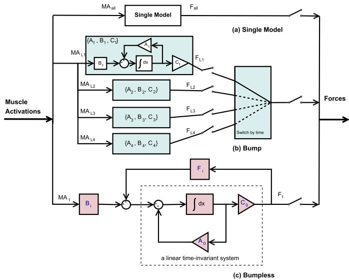
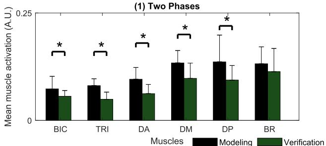
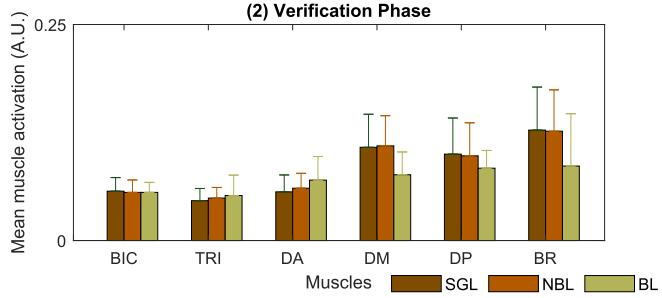
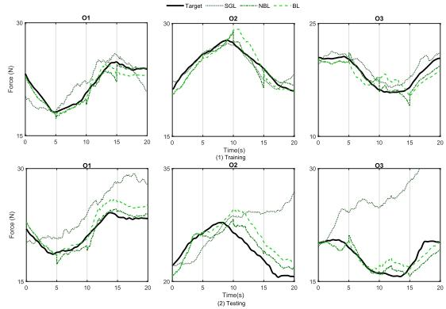
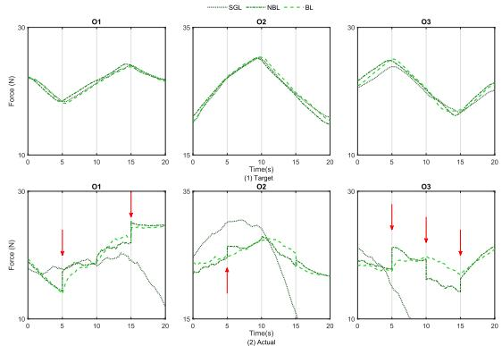
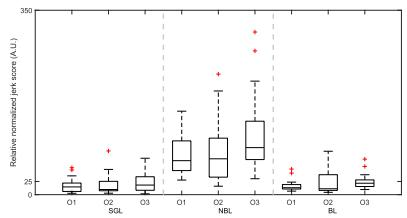
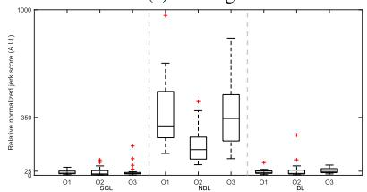

# 基于无扰切换机制的康复机器人人体运动意图描述

Yao Huang , Graduate Student Member IEEE, Rong Song , Ahmadreza Argha , Member IEEE, Branko G. Celler , Andrey V. Savkin , Senior Member IEEE, and Steven W. Su , Senior Member IEEE

— 本文旨在提高基于切换机制的肌电（EMG）解码器在控制康复机器人以辅助人机协作手臂运动时的性能。对于复杂的手臂运动，EMG解码器建模的主要难点在于实时高精度地解码EMG信号。我们最近的研究提出了一种切换机制，将复杂任务划分为简单的子任务，并训练具有低非线性的不同子模型。然而，研究观察到，在两个子模型切换期间，解码器输出会出现“扰动”（bump）行为（即不连续性）。这种扰动可能会对患肢造成意外冲击，从而对患者造成潜在伤害。为了改善解码器输出上这种不理想的暂态行为，我们尝试在多个子模型切换期间保持输出的连续性。通过对具有所有共享状态的子模型进行参数化，本文提出了一种无扰切换机制（bumpless switching mechanism），并将其应用于EMG解码器的构建。数值仿真和实时实验表明，无扰解码器在离线和在线EMG解码中均展现出较高的估计精度。此外，所提出的无扰解码器在测试和验证阶段所获得的输出，均显著平滑于未采用无扰切换机制的多模型解码器所获得的输出。因此，无扰切换方法可用于基于多通道EMG信号提供平滑且准确的运动意图预测。实际上，该方法能够切实防止参与者承受不可预测负荷的风险。

— 无扰切换机制（Bumpless switching mechanism），MIMO EMG解码器，肌电控制，康复机器人，多运动任务。

## I. 引言

在先进康复理论中，普遍认为用户的参与在治疗过程和康复技术的发展中都至关重要 [1]，尤其是在康复机器人领域 [2]。与基于物理传感器的机器人控制策略相比，使用生物传感器（例如脑电图（Electroencephalography）、肌电图（EMG）和神经电图（Electroneurography））进行康复的策略允许机器人根据人体运动更自然、更同步地触发运动。在不同的生物信号中，表面EMG信号因其与患者的肌肉活动密切相关，且能够通过无创传感器轻松采集而备受关注。

另一方面，对于康复治疗而言，需要通过适当的强化物理治疗来提高上肢运动再学习和康复水平。对于具有部分运动能力的患者，估计患者的运动意图以进行进一步辅助是至关重要的。因此，一些研究提出了通过以静态 [3] 和动态方式 [4] 估计肢体运动来检测运动意图的方法。

尽管少数研究能够以自然的神经肌肉控制策略连续地将人类意图从 EMG（肌电信号）映射到肢体运动，但概括而言，很难在不同受试者之间识别出关于运动控制策略的一致模式。这是由于 EMG 信号在动态运动过程中易受干扰的特性所致。Zhang 等人提出了一种自适应估计方法，通过训练模型精确映射两对肌肉激活度与肘关节运动，以解决受试者个体差异问题 [5]。然而，该方法的性能大多局限于一至两个关节的运动，因此建模精度以及保持信号完整性仍然是巨大的挑战。

Panagiotis 等人提出了一种结合用于降维的主成分分析（Principal Component Analysis, PCA）的状态空间模型，用于映射 EMG 信号与多关节运动之间的关系 [6]。该方法与切换律相结合，进一步作为一种切换机制用于控制机械臂进行随机模式运动 [7]。这两种方法在机械臂的轨迹控制中均表现良好。然而，降维是以舍弃 EMG 信号中包含的部分有用信息为代价的。因此，在将这些方法应用于人机协作运动时，可能无法很好地捕捉到描述 EMG 信号与多关节运动之间关系的完整动力学特性。

为了进一步开发一种用于绳索康复机器人控制的连续估计多关节运动意图的方法，文献 [8] 提出了一种无需降维的建模方法，用于映射六块肌肉活动与整臂运动之间的关系。该方法表现出良好的估计精度，并能够在简单的线性跟踪任务中自然且主动地辅助受试者。为了进一步提高该方法在复杂任务中应用的性能，最近在 [8] 的基础上提出了一种切换机制 [9]。该切换机制可以提高精度，但在应用于实时实验时发现了一个问题。即，在针对子任务在子模型之间进行切换时，由于模型参数的巨大变化，估计输出会发生突变。尽管文献 [9] 中提出的切换机制整体估计精度很高，且输出跳变对大多数健康受试者的实验仅显示出微弱的影响，但跳变的影响对部分健康受试者而言是不容忽视的，对运动障碍（dyskinesia）患者而言更是不可接受的。

更具体地说，实时模型输出中的突变可能会在患肢中产生非预期的力，并可能成为导致患者受伤的原因。此外，在受到意外扰动时，受试者的短期反应在功能上会使姿态失稳，而身体位移的进一步补偿通常是作为长期反应来实现的 [10]。对于运动障碍（dyskinesia）患者而言，扰动后受影响的稳定性并不容易恢复。尽管有一些关于不同任务切换方法的研究，但其中大多数都侧重于判断不同任务的切换逻辑 [11], [12]。在不同任务之间切换时估计输出的连续性却鲜有探讨。关于主动辅助康复方案中康复机器人控制研究的切换机制，大多数工作使用不同类型的控制信号。Bernhardt et al. [13] 应用了一种算法 [14]，通过自适应调整参考轨迹来确保下肢康复机器人在位置和力控制方案之间切换的稳定性。有人开发了一种分层控制结构 [15]，将顺序康复训练转化为一系列连续的运动模式，但并未明确考虑切换瞬态过程。几乎没有研究探讨参数化无扰切换算法并在康复机器人控制中使用同类型的控制信号。由于在任务切换期间从 EMG 信号中连续估计多关节运动意图至关重要，我们探索了一种用于模型切换的状态共享无扰切换方法，以改善切换期间的瞬态性能。

所设计的状态共享无扰切换受到多模型自适应控制（Multiple Models Adaptive Control, MMAC）[16] 的启发。对于 MMAC 应用，在任何时刻仅应用一个控制器来生成控制信号。这种切换方法的思想是通过一个参数可调的单一控制器来实现一组不同的控制器，而不是将每个控制器实现为一个独立的系统。由于该单一控制器的状态由一组控制器共享，这种实现方式被称为“状态共享”多重实现（“state-shared” multirealization）。这种多重实现技术最初由 Morse [17] 提出，他采用了一种自适应控制算法，该算法由一组线性单输入单输出（Single-Input Single-Output, SISO）控制器模型和用于监督的高层切换逻辑组成。该方法有助于改善瞬态性能并实现不同控制器之间的无扰切换。

此外，在手动与自动控制器之间的集成闭环系统中，无扰切换（bumpless transfer）也被提出用于 SISO（单输入单输出）PID 控制器的抗积分饱和设计 [18]。利用该技术，饱和多控制器方案中的切换能够避免由控制器初始条件不兼容所引起的剧烈瞬态响应。Zaccarian 和 Teel [19] 针对多输入多输出（MIMO）系统提出了一种用于抗积分饱和的无扰切换方法。该方法需要已知整个闭环系统的模型，即同时包含控制器和被控过程。仅有少数方法不需要闭环系统的完整动态模型。例如，Yame 等人 [20] 提出了一种参数化方法，在无需隐式获知闭环系统动力学模型的情况下实现 MIMO 系统中控制器之间的无扰切换。然而，该方法需要严苛的限制条件，包括每个控制器都必须具有与参考轨迹相关联的唯一平衡态轨迹，且切换必须在系统处于零跟踪误差的稳态时发生。

在主动康复中，人类神经系统将参与到闭环系统中。对具有高度非线性和时变性的人类神经系统进行建模，要么过于复杂，要么甚至无法实现。所有控制器共有的唯一平衡态轨迹同样无法获取，更不用说确保切换发生在零跟踪误差的稳态下了。此外，这些方法 [20] 并未明确考虑系统的最小实现（minimal realization）。因此，期望有一种具备最小实现且可应用于有人参与的闭环系统的无扰切换方法，以确保解码器输出的平滑性。

针对一族线性 MIMO 系统的多重实现（multirealization），[21]、[22] 的作者开发了一种基于稳定的多重实现方法，在使切换模型维度最小化的同时实现无扰切换。由于该方法不需要被控过程的模型，因此非常适合应用于有人参与的闭环系统中。

基于状态共享多实现（state shared multirealization）方法，我们提出了一种具有无扰切换机制的新型解码器模型（MIMO 系统），用于从肌电（EMG）信号中刻画人类运动意图。该解码器被应用于视觉跟踪任务的人机协作策略中。解码器输出用于控制机器人，以顺应受试者的运动意图来为其提供支持。由于切换模型的系统状态和输出即使在切换过程中也是连续的，这与人类生理和心理变量的连续性相一致，因此可以提高机器人康复患者的安全性。数值分析和实时实验验证均证明了所提出的无扰切换机制的有效性。

  
Fig. 1. 三种 EMG 解码器模型：(a) 单一模型，(b) 包含四个子系统模型实现 $\{ A _ { j } , B _ { j } , \breve { C } _ { j } \}$ 的有扰切换机制，以及 (c) 包含子系统模型多实现 $\{ A _ { 0 } + F _ { i } C _ { 0 } , B _ { i } , C _ { 0 } \}$ 的无扰切换机制。(b) 中的实现 $\{ A _ { j } , B _ { j } , C _ { j } \} , j \in ( 2 , 3 , \dot { 4 } )$ 均与 $\{ A _ { 1 } , B _ { 1 } , C _ { 1 } \}$ 实现相同

## II. EMG 解码器构建模型

本文的目标是开发一种 EMG 解码器，该解码器利用肌肉激活度实时、连续地表征运动所需的力，同时保留所有肌肉活动信息。

在我们之前的研究 [9] 中，针对复杂手臂运动开发并评估了一种基于一组模型的切换机制，如图 Fig. 1(b) 所示。针对方形轨迹跟踪任务，共建立了四个六输入三输出的线性状态空间模型作为子系统模型。通过在这四个子系统模型之间直接切换，带有切换机制的 EMG 解码器能够准确估计运动所需的力。与单一模型解码器（如图 Fig. 1(a) 所示）相比，无论单一线性时不变（LTI）模型有多复杂（即无论模型的阶数有多高），带有切换机制的 EMG 解码器在仿真和实验阶段均表现出更优的性能 [9]。然而，此前观察到了输出的“突跳（bump）”现象，这可能会影响输出和系统状态的连续性。

如前所述，输出中的“突变（bump）”是由于子系统模型切换造成的。Morse [17] 提出的一种改善 SISO（单输入单输出）系统瞬态响应的有效方法是通过构建稳定基础的状态共享多实现（stateshared multirealization）。在本研究中，由于该系统是一个多变量系统，为了消除“突变”输出，我们尝试针对任意 MIMO（多输入多输出）子系统求解一种通用实现（记为“多实现（multirealization）”[21], [22]）（见 Fig. 1(c)）。

考虑一个子系统（记为子模型）的状态空间模型：

$$
H _ {i}: \left\{ \begin{array}{l} \dot {x} _ {i} = A _ {i} x _ {i} + B _ {i} u \\ y = C _ {i} x _ {i} \end{array} \right.\tag{1}
$$

其中 $i \in \{ 1 , 2 , 3 , 4 \} , x _ { i } \in \mathbb { R } ^ { k _ { i } }$ 为状态向量，$k _ { i }$ 为第 $i$ 个子模型的阶数，$u \in \mathbb { R } ^ { 6 }$ 为由六种肌肉激活度组成的输入向量，$\boldsymbol { y } ~ \in ~ \mathbb { R } ^ { 3 }$ 为由沿线缆所需力组成的输出向量。矩阵 $A _ { i } \in \mathbb { R } ^ { k _ { i } \times k _ { i } } , B _ { i } \in \mathbb { R } ^ { k _ { i } \times 6 }$ 和 $C _ { i } ~ \in ~ \mathbb { R } ^ { 3 \times k _ { i } }$ 分别为系统矩阵、输入矩阵和输出矩阵。

给定任务的状态空间子模型是通过辨识原始实现 $\{ A _ { i } , B _ { i } , C _ { i } \}$ 和状态向量的初始值 $x _ { 0 _ { i } }$ 来构建的。$\{ A _ { i } , B _ { i } , C _ { i } \}$ 和 $x _ { 0 _ { i } }$ 均通过连续时间域中的典型变量分析（canonical variate analysis）[23] 进行辨识。由于整个基础系统应该是稳定的，因此在模型辨识过程中，每个子模型的稳定性是一个必要条件。

对于多实现，一般而言，子模型的阶数 $k _ { i }$ 可以根据每个模型的性能而有所不同。然而，在本文中，我们假设所有子模型均为三阶，即对于所有 $i = 1 , \ldots , 4$ 均有 $k _ { i } ~ = ~ 3$。作出这一假设的原因如下。

在我们早期的研究 [9] 中，单个三阶线性系统模型的性能优于单个高阶模型。由于具有多个模型的切换机制比单个模型更复杂，且具有更强的捕捉系统动态特性的能力，因此选择每个子系统模型的阶数为三阶，应该足以应对该康复任务的复杂性。

## III. 多实现

在本研究中，我们建立了四个子模型来描述四个简单的线性跟踪子任务，并且每个子任务模型均使用来自各个受试者的输入和输出数据进行训练。每个子系统的传递函数矩阵 $H _ { i } ( s )$ 可通过其实现 $\{ A _ { i } , B _ { i } , C _ { i } \}$ 计算如下：

$$
H _ {i} (s) = C _ {i} (s I - A _ {i}) ^ {- 1} B _ {i}.\tag{2}
$$

传递函数矩阵 $H _ { i } ( s ) \ ( i \ \in \ \{ 1 , 2 , 3 , 4 \} )$ 可以通过矩阵分式描述（MFD）[24] 来表示。使用 MFD 求解四个子模型 $H _ { i } ( s )$ 的多重实现的具体步骤将在后文中描述。

如前所述，对于多重实现，我们并不通过各个独立的实现 $\{ A _ { i } , B _ { i } , C _ { i } \}$ 来实现这些子系统，而是寻找一种通用的实现形式 $\{ A _ { 0 } ~ +$ $F _ { i } C _ { 0 } , B _ { i } , C _ { 0 } \}$。如图 1(c) 所示，仅通过调整 $F _ { i }$ 和 $B _ { i } .$，就可以实现子系统之间的“无扰”切换。在这些多控制器之间进行串行切换可以保持输出和状态均为连续的。此外，一个稳定的 LTI 系统由这四个子系统所共享。

在接下来的步骤中，我们将展示如何找到通用的多重实现形式 $\{ A _ { 0 } + F _ { i } C _ { 0 } , B _ { i } , C _ { 0 } \}$ 以实现无扰切换机制。

## A. 不可约右矩阵分式描述

在寻找多重实现的第一步中，我们回顾右矩阵分式描述（RMFD）的性质。[21] 中列出的多重实现过程并未提供在数值上计算 RMFD 的算法。在本研究中，我们将逐步介绍一种实用的算法。

根据 Kailath 的文献 [24]，传递函数的 RMFD（非唯一）可以写为

$$
H _ {i} (s) = N _ {i} (s) D _ {i} ^ {- 1} (s),\tag{3}
$$

并且有可能为每个子系统构建一个可控状态空间实现 $\{ A _ { i } , B _ { i } , C _ { i } \}$，其维度 $k _ { i }$ 为 RMFD 的次数（即 $D _ { i } ( s )$ 的行列式的阶数）。为了使每个系统的可控状态空间实现的维度最小化，必须寻求不可约 RMFD（即极小 RMFD，minRMFD），对于该描述，$N _ { i } ( s )$ 和 $D _ { i } ( s )$ 是右互质的。

基于 MFD 描述的单个线性传递函数矩阵 $H _ { i } ( s )$ 的极小实现已在文献 [24]、[25] 中得到了深入研究。关键步骤是找到 $H _ { i } ( s )$ 的 minRMFD。

一种用于寻找 minRMFD 的实用数值方法是基于 Sylvester 矩阵的方法，如下所示 [26]：

1) 对于给定的传递函数矩阵，找到一个左 MFD $H ( s ) _ { p \times q } = D _ { L } ^ { - 1 } ( s ) N _ { L } ( s )$，其中 p 和 q 分别是输入和输出变量的数量。需要注意的是，由于我们不要求 $D _ { L } ( s )$ 和 $N _ { L } ( s )$ 左互质，因此找到这样一个左 MFD 是一项容易的任务。

2) 找到两个互质的多项式矩阵 $D ( s ) _ { q \times q }$ 和 $N ( s ) _ { p \times q }$，使得

$$
\left[ \begin{array}{c c} N _ {L} (s) & - D _ {L} (s) \end{array} \right] \left[ \begin{array}{c} D (s) \\ N (s) \end{array} \right] = 0.\tag{4}
$$

步骤 2) 的一种有效解法基于 Sylvester 矩阵方法 [26]，用于计算 $\left[ N _ { L } ( s ) \right. \ - \ D _ { L } ( s ) ]$ ] 右零空间的极小多项式基 [27]，步骤如下：

(a) 通过求出相应阶数的 $N _ { L } ( s ) D ( s )$ 和 $D _ { L } ( s ) N ( s )$ 的系数矩阵，构造一个合适的 Sylvester 结式矩阵 S；

(b) 使用一种探索 S 性质的搜索算法来寻找 $S _ { \mathrm { ~ } } ( S _ { q } ) ;$ 的前 q 个主要线性相关列；

(c) 利用 $S _ { q } \mathrm { ; }$ 找出前面线性无关列的线性组合；

(d) 利用线性相关系数构成 $D ( s )$ 和 $N ( s )$。

在 (b) 中通过对 S 采用正交化过程 [28]，可以确定由特定列引入的新息（innovation）是否为零。因此，可以判断该特定列是否线性相关于前面的列。

在正交化过程中，如果 S 是一个具有极大或极小元素的高维矩阵（这在实际系统中可能会发生），则有必要在正交化过程之前将这些元素预先调整到合适的数值水平。此外，[26] 中基于奇异值分解介绍了一种鲁棒过程。计算 minRMFD（最小右矩阵分式分解）也有其他方法。对于基于 Sylvester 矩阵的方法，Ahmadreza Saadatkhah [29] 提供了适用于低维系统的 Matlab 代码。

## B. 线性系统的多实现

多项式矩阵 D(s) [21], [22], [24] 可以表示为 $D ( s ) ~ = ~ D ^ { h c } S ( s ) + D _ { l c } ( s )$，其中 $\begin{array} { r l } { S ( s ) } & { { } { \triangleq } } \end{array}$ $d i a g \{ s ^ { k _ { 1 } } , s ^ { k _ { 2 } } , \ldots , s ^ { k _ { m } } \}$ 为最高（列）次数矩阵，$k _ { i }$ 为 $D ( s )$ 第 i 列的最高次数，$D ^ { h c }$ 是 $D ( s )$ 的最高次系数矩阵，由 $D ( s )$ 各列中最高次多项式的系数构成，而 $D _ { l c } ( s )$ 是 $D ( s )$ 的剩余部分。

算子 $( \mathcal { D } _ { h c } \{ \cdot \} )$ 定义为 ${ \mathcal { D } } _ { h c } ( D ( s ) ) = D ^ { h c } S ( s )$。

假设可以求得传递函数 $H _ { i } ( s ) \ =$ $N _ { i } ( s ) D _ { i } ^ { - 1 } ( s ) \ = \ \bar { N } _ { i } ( s ) \bar { D } _ { i } ^ { - 1 } ( s )$ 的 minRMFD，且 $\bar { D } _ { i } ( s )$ 为列既约形式。为了简化讨论，我们可以假设矩阵 $\bar { D } _ { i } ( s )$ 为 Popov 形式矩阵 [24]。

在求出所有子系统的 minRMFD $( \bar { D } _ { i } ( s )$ 与 $\bar { N } _ { i } ( s ) )$ 之后，可以通过以下步骤获得子系统集 $H _ { i } ( s )$ 的通用极小多实现 [21]。

为了推导多变量系统多重实现（multirealization）的条件，我们首先将 $\bar { D } _ { i } ( s )$ 改写为 $\tilde { D } _ { i } ( s )$，并要求 $S ( s )$ 的元素按次数递减存在于对角线上，且 $\tilde { D } _ { i } ( s )$ 的 $D _ { i } ^ { h c }$ 被归一化为 I，这可以通过考虑每个 $\bar { D } _ { i } ( s )$ 的每个元素进行初等变换来实现。因此，传递函数转换为：

$$
H _ {i} (s) = \bar {N} _ {i} (s) X _ {i} [ \bar {D} _ {i} (s) X _ {i} ] ^ {- 1} = \tilde {N} _ {i} (s) \tilde {D} _ {i} ^ {- 1} (s)\tag{5}
$$

其中 $X _ { i }$ 是第 i 个子系统用于重构 minRMFD 的实矩阵。

2) 统一公共最高次项系数矩阵：如先前的研究 [21] 所述，可以通过一个泛型最小公分母（generic minimal common denominator）$D _ { m s } ( s )$ 找到基于稳定的泛型最小多重实现，其中 $\mathcal { D } _ { h c } \{ D _ { m s } ( s ) \} = D _ { m } ( s )$ 具有如下形式：

$$
D _ {m} (s) = [ d _ {p q} (s) ]\tag{6}
$$

且

$$
d _ {i j} (s) = \left\{ \begin{array}{l l} 0, & i f p \neq q \\ s ^ {k _ {\max p}}, & i f p = q \end{array} \right.\tag{7}
$$

其中 $k _ { m a x p } = m a x \{ k _ { p } ^ { 1 } , k _ { p } ^ { 2 } , k _ { p } ^ { 3 } , k _ { p } ^ { 4 } \}$ 是所有 $\tilde { D } _ { i } ( s ) ~ ( i \in \{ 1 , 2 , 3 , 4 \} )$ 中第 p 列的最高次数。

在这一步中，我们尝试为四个子系统找出公共的 $D _ { m } ^ { h c }$。

在求得泛型最小公分母 $\mathcal { D } _ { h c } \{ D _ { m s } ( s ) \} ~ = ~ D _ { m } ( s )$ 后，对于每个子模型，总可以通过右乘一个矩阵 $\tilde { X } _ { i } ( s )$ 来转换 $\tilde { D } _ { i } ( s )$，使得

$$
\mathcal {D} _ {h c} \{D m _ {i} (s) \} = \mathcal {D} _ {h c} \{\tilde {D} _ {i} (s) \tilde {X} _ {i} (s) \} = D _ {m} (s).
$$

因此，第 i 个系统的 $D m _ { i } ( s )$ 和 $N m _ { i } ( s )$ 可以通过如下右乘矩阵来构建：

$$
H _ {i} (s) = \tilde {N} _ {i} (s) \tilde {X} _ {i} (s) [ \tilde {D} _ {i} (s) \tilde {X} _ {i} (s) ] ^ {- 1} = N m _ {i} (s) D m _ {i} ^ {- 1} (s).\tag{8}
$$

  
Fig. 2. 实验场景。

在我们为子系统构建了新的 RMFD 之后，就可以对所有子模型进行多重实现了。

基于先前的研究 [21]，为了实现如图 Fig. 1.(c) 所示的多重实现形式，我们需要为 $H _ { i } ( s )$ 的转置形式构建 $N m _ { i } ( s )$ 和 $D m _ { i } ( s )$，即：

$$
H _ {i} ^ {T} (s) = N m _ {i} (s) \cdot D m _ {i} ^ {- 1} (s).
$$

然后，构造一个稳定的多项式矩阵 $D _ { m s } ( s )$，使得 $\mathcal { D } _ { h c } \{ D _ { m s } ( s ) \} ~ = ~ D _ { m } ( s )$。利用 [24]（第 403-407 页）中的方法，可以求得 $N m _ { i } \left( s \right) D _ { m s } ^ { - 1 } \left( s \right)$ 的控制器型实现 $\{ A _ { c 0 } , B _ { c 0 } , C _ { c i } \}$，其中矩阵对 $\{ A _ { c 0 } , B _ { c 0 } \}$ 可控，$A _ { c 0 }$ 稳定，且 $C _ { c i } ~ = ~ N m _ { i l c }$。令 $K _ { i } \ =$ $D _ { m l c } - D m _ { i l c }$。那么，对于子系统集合 $H _ { i } ^ { T } ( s ) \ ( i \in \{ 1 , 2 , 3 , 4 \} )$，一个通用的最小多重实现为 $\{ A _ { c 0 } +$ $B _ { c o } K _ { i } , B _ { c o } , C _ { c i } \}$。

然后，通过令 ${ \bf \dot { A } } _ { 0 } ~ = ~ A _ { c 0 } ^ { T } , ~ B _ { i } ~ = ~ C _ { c i } ^ { T } ,$ $C _ { 0 } = B _ { c 0 } ^ { T } , F _ { i } = K _ { i } ^ { T }$，可以得到如图 1.(c) 所示的原始子模型 $H _ { i } ( s ) = ( H _ { i } ^ { \bar { T } } ( s ) ) ^ { T }$ 的多重实现形式 $\{ A _ { 0 } + F _ { i } C _ { 0 } , B _ { i } , C _ { 0 } \}$，其中在切换过程中仅需要调整 $F _ { i }$ 和 $B _ { i }$。由于 $A _ { 0 }$ 和 $C _ { 0 }$ 在切换过程中保持恒定，带有切换机制的稳定 LTI（线性时不变）系统能够确保实时的无扰动输出（即在 $F _ { i }$ 和 $B _ { i }$ 切换时输出保持连续）。

## IV. 实验设计

## A. 实验平台与数据采集

采用一套基于绳索驱动的上肢康复机器人系统（详见 [30]）为受试者提供助力。实验场景如图 2 所示。

具体而言，采集了三维空间中的手臂运动以及六块手臂肌肉的 EMG（肌电）信号。EMG 信号被处理为六个肌肉激活度，作为 EMG 解码器的输入。对手臂运动进行了分析，并将手臂运动所需的作用力作为解码器的输出。

关节运动信息由采样频率为 100 Hz 的动作捕捉系统采集。手臂沿绳索运动所需的作用力通过人机动力学模型 [30] 计算得出，以反映实时的机体运动意图。对手臂运动所需的作用力进行进一步处理，以计算三台电机的驱动力矩。

肌肉活动信息由 EMG 采集系统进行采集（采样频率为 1000 Hz）并放大（放大倍数为 5000 倍）。EMG 包络由 EMG 信号经全波整流获得，并通过最大自主等长收缩（maximum voluntary isometric contraction, MVIC）值 [31] 归一化至 [0, 1] 范围内。肌肉激活度进一步通过神经-肌肉激活模型 [32]–[34] 由 EMG 包络计算得出 [6]。

为了实现肌肉激活度与运动所需力之间的同步，肌肉激活度被降采样为一个频率为 100 Hz 的新序列。

## B. 基于 EMG 的人机协作控制器

为了控制该机器人系统，应用了一种基于 EMG 解码器的人机协作控制器。在该控制器中，人脑首先对人机执行端与目标位置之间的位置偏差做出反应，并刺激相关肌肉。通过采集肌肉 EMG 信号，内置的 EMG 解码器对手臂运动所需的力进行估计。

随后，这些力根据人机动力学模型和机器人系统的电机动力学模型进行处理，并沿线缆传输。沿线缆施加的力用于支撑人机执行器，以辅助人机协同运动。

为了训练 EMG 解码器，选取了六块肌肉的激活度作为其输入，并选取手臂运动所需的力作为其输出。针对为机器人辅助康复设计的复杂跟踪任务，此前曾提出一种将任务划分为一组子任务的切换机制 [9]。针对这些子任务训练了一组子模型。每个子模型都被视为一个独立的子系统。切换机制通过引入的多重实现技术（即无扰切换机制）来实现。带有无扰切换机制的已辨识子模型可用于在仿真和实时环境下根据肌肉激活度估计运动所需的力。

## C. 受试者

本研究包括七名签署了知情同意书的健康女性和男性，年龄为 $2 5 . 3 \pm 0 . 7$ 岁。本研究已获得中山大学第一附属医院人类伦理委员会的批准（[2013]C-096）。

记录了三角肌前部、中部和后部（DA、DM、DP）、肱三头肌（TRI）、肱二头肌（BIC）以及肱桡肌（BR）的肌肉活动。根据生物力学，这些肌肉主要负责上肢运动的分析 [35]。成对的两个表面 EMG 电极放置在每位受试者对应六块肌肉的皮肤表面。参考电极放置在对应腕骨、肘骨和肩峰骨的皮肤表面。运动系统的三个红外反射标记点放置在对应腕部、肘部和肩部中心的皮肤表面。

## D. 实验方案

带有无扰切换机制的 EMG 解码器的有效性通过受试者的数值分析以及受试者与机器人系统的实时实验得到了验证。

数值分析包括训练和测试阶段。作为验证阶段的实验旨在验证基于 EMG 的控制器在实时人机协作任务中的性能。

在受试者的跟踪任务期间，采集了三维空间中的 EMG 信号和关节位置。模型训练和测试阶段跟踪任务的详细信息如下：

1) 目标光标一经触发，即在屏幕上按照水平面内预设的正方形轨迹移动 20 秒；

2) 代表受试者手腕实际位置的手腕光标显示在屏幕上，并由受试者进行控制；

3) 作为单次试验，受试者控制手腕光标跟踪目标光标 20 秒，直至目标停止；

4) 每位受试者需完成九次试验，其中随机选取六次用于训练阶段，其余三次用于测试阶段。

需要说明的是，目标光标和手腕光标均以三维形式显示在屏幕上。

模型训练阶段的数据用于通过单个状态空间模型（记为 SGL，见 Fig.1 (a)）、四个不带“无扰动（bumpless）”切换机制的子模型（记为非无扰动解码器，NBL，见 Fig.1 (b)）以及四个带有“无扰动”切换机制的子模型（记为无扰动解码器，BL，见 Fig.1 (c)）来训练解码器。所有模型的阶数均选为三阶（如 Section II.B 中所述）。

在模型测试阶段，利用训练好的三种解码器（即 SGL、NBL 和 BL）以及该阶段处理后的输入来估计输出。相关的目标输出也基于关节运动进行了处理。通过分析来自不同解码器的估计输出与目标输出之间的差异来评估性能。如前所述，该阶段的测试是在开环条件下进行的，因为作为输入的肌肉活动并未通过人类视觉反馈对跟踪误差做出响应。

在实验验证阶段，每位受试者与机器人系统协作完成相同跟踪任务的三次试验。三维空间中的肌肉活动和关节位置也被记录下来。实时 EMG 信号经过处理后，分别应用于三种解码器。在协作运动过程中，受试者的大脑会对视觉反馈做出反应，并控制肌肉产生手臂运动，同时获得机器人系统的辅助。受试者能够调动手臂，以更小的误差实时主动跟踪目标。因此，三种解码器的性能是在具有实时反馈的闭环构型下进行评估的。在该回路中，所需手臂运动的估计力不仅支持了受试者的运动，而且其对运动的影响也可以通过视觉交互被大脑和视觉系统感知。

为确保参与者的安全，通过将实际输出力限制在 [−100N, 100N] 的范围内对电机的旋转速度进行预调节。具体而言，如果模型估计的力超过 100N 或低于 −100N，电机将被限制在 −30N 或 30N。

## E. 参数评估

通过以下指标评估三种解码器（SGL、NBL 和 BL）的性能：任务期间的六种肌肉激活度、目标输出与估计输出之间的模型拟合度差异，以及三种输出的平滑度。

计算了单次试验期间所有六块肌肉（即 BIC、TRI、DA、DM、DP 和 BR）的肌肉激活均值（MMA），该指标反映了平均肌肉用力程度。由于训练和测试阶段的肌肉激活度均在开环下采集，因此这两个阶段的 MMA 值作为一个组（图 3 中的 modeling）一起进行分析。

目标输出与不同解码器的估计输出之间的差异用于评估解码 EMG 信号的性能。

模型拟合误差（MFE）即目标力输出（Ft）与估计力输出（Fe）之间的绝对差值，用于评估准确性。为了评估整体准确性，整个试验 MFE 的均方根（RMS）值计算如下：

$$
M F E _ {R M S _ {j}} = \sqrt {\frac {1}{N} \sum_ {i = 1} ^ {N} (\Delta F _ {j} (i)) ^ {2}}\tag{9}
$$

其中 $\begin{array} { r l r l r l r l } { i } & { { } \in } & { \{ 1 , . . , N \} , } & { j } & { { } \in } & { \{ 1 , 2 , 3 \} , } & { \Delta F _ { j } ( i ) } & { { } = } \end{array}$ $\left| F t _ { j } ( i ) - F e _ { j } ( i ) \right|$ 是第 $i$ 个采样点处第 $j$ 个输出的模型拟合误差，$N = 2 0 0 0$ 为总采样数。

皮尔逊相关系数（PCC）反映了目标输出与估计输出之间的关系，通过计算该系数来评估估计的运动意图趋势是否与实际意图一致 [36]。

模型拟合度用于描述模型估计的整体准确性，综合考虑了绝对差异和相对差异之间的平衡。良好的模型拟合性能对应于较低的 MFE 和较高的 PCC。

为了量化输出的平滑度，测试和实时实验验证期间输出的归一化加加速度得分（NJS）计算如下 [37]：

$$
N J S = \sqrt {\frac {1}{2} \frac {T ^ {5}}{D ^ {2}} \int j e r k ^ {2} d t}\tag{10}
$$

其中 $t$ 表示实际时间，$jerk$ 是输出对时间 $t$ 的三阶导数，$T$ 和 $D$ 分别表示持续时间和幅值，用于对 jerk 进行归一化并消除时间和幅值的影响。计算了不同 EMG 解码器估计输出的相对 NJS（RNJS），用于与目标输出进行比较，公式如下：

  
Fig. 3. (1) 训练和测试阶段（建模）以及验证阶段中六块肌肉（BIC、TRI、DA、DM、DP 和 BR）的平均肌肉激活度。(2) 验证阶段中不同解码器（SGL、NBL 和 BL）的平均肌肉激活表现。建模阶段与验证阶段之间的显著性差异 $\dot { ( p } < 0 . 0 5 )$ 用 $\mathsf { b } \mathsf { y } ^ { \mathrm { i } \star }$ 表示。

$$
R N J S = \frac {N J S _ {e s t}}{N J S _ {t a r}}\tag{11}
$$

其中 $N J S _ { e s t }$ 来自解码器估计输出，$N J S _ { t a r }$ 来自目标输出。

上述各指标在不同解码器和不同阶段之间的所有显著性检验均采用 Kruskal-Wallis 非参数检验及成对多重比较进行分析，常规显著性水平设定为 0.05。所有检验均使用 SPSS 19.0（SPSS Inc., USA）完成。

## V. 结果与讨论

## A. 肌肉激活水平的差异性与一致性

不同阶段和不同解码器下的 MMA 结果如图 3 所示。将建模组与验证阶段的 MMA 值进行对比时，大多数肌肉（BIC、TRI、DA、DM 和 DP）均存在显著性差异。整体肌肉激活表现的下降是可接受且可预期的。正如先前研究所报道的 [38]，机器人平台的支撑可以减轻手臂重力带来的肌肉负担。激活度的降低也与其他机器人辅助肢体运动的研究一致 [39]，这表明该控制算法在辅助手臂肢体运动方面是有效的 [39]。在对比验证阶段的 MMA 时，每块肌肉在不同解码器下的表现彼此非常相似。不同解码器之间未发现显著性差异。这与无论应用哪种模型，健康受试者都能自然控制手臂并完成任务的事实相符。

  
Fig. 4. 训练与测试阶段三种不同解码器（SGL、NBL、BL）的模型输出。

在整个任务过程中，所有参与者的手臂运动均为缓慢的伸展和收缩运动。所有六块肌肉的活动均表现出较低的幅度，但在每次切换操作后都产生了伴随响应的多次神经突发（neural bursts）[40]。这可能与任务设计有关，即轨迹在四边形的顶点处发生急剧变化，且任务在一个维度上的方向发生了反向改变。如 [41] 中所述，当受试者控制手臂跟随目标的快速变化时，肌肉收缩幅度以及共同收缩的程度可能会发生改变。

## B. 不同解码器估计结果的比较

MFE、PCC 和 RNJS 的结果如 Table I 所示。三种模型在训练和测试阶段的目标输出与估计输出如 Figure 4 所示。此外，三种解码器在验证阶段的目标输出和估计输出如 Figure 5 所示。测试和验证阶段的 RNJS 结果如 Figure 6 所示。

在测试阶段，NBL 和 BL 的 MFE 均显著低于 SGL，且 PCC 显著高于 SGL。在验证阶段，NBL 表现出最佳的模型拟合性能，而 BL 表现良好但拟合性能略逊一筹。此外，未发现 NBL 和 BL 之间存在显著差异。SGL 在两个阶段的模型拟合性能均最差。就两个阶段的 RNJS 而言，显而易见，SGL 与 NBL 之间以及 BL 与 NBL 之间的差异均具有显著性，且 NBL 的 RNJS 在三种解码器中最高。

在 MFE 和 PCC 方面，NBL 比 BL 能够更准确地估计输出。然而，在测试和验证阶段，NBL 和 BL 在输出平滑度方面均存在显著差异。研究还观察到，在测试阶段，NBL 输出中的“突跃”（bump）现象并不总是剧烈的（即幅值在较小范围内变化），但在实验验证阶段，出现了更多急剧的变化。

  
Fig. 5. 验证阶段三种不同解码器（SGL、NBL、BL）的模型输出。

  
(a) 测试

  
(b) 验证  
Fig. 6. 三种 EMG 解码器（SGL、NBL、BL）在测试和验证阶段估计输出的 RNJS。

NBL 模型中的“突跃”主要是由不同运动阶段切换期间子模型参数（即 Ci 和 x0i，参见 Fig.1(b)）的“直接”改变引起的。尽管在某些情况下这种“突跃”并不剧烈，但其对输出平滑度的整体影响是显著的。由于运动平滑度被视为卒中后运动障碍的重要指标 [42]，且患者的解码器性能可能会随着运动平滑度的降低而下降 [43]，因此 NBL 在卒中康复评估中的应用将受到较大限制。相比之下，尽管 SGL 能够平滑地估计输出，但其在两个阶段的模型拟合性能均不及其他已发表的解码器 [43]–[45]。在临床康复中，患有运动障碍（dyskinesia）的患者自然期望获得更符合其运动意图的助力。解码器模型越精确，在实际应用中展现出良好性能的潜力就越大。

尽管 NBL 与 BL 之间没有显著性差异，但 BL 在两个阶段的 S.D. 值均高于 NBL。这可能是由子模型参数的差异引起的。BL 解码器的子模型是由 NBL 解码器的子模型重组和近似而来的。这可以被视为在解码器精度的小范围不稳定与凸起行为（bump behavior）之间的一种权衡。

TABLE I  
不同解码器（SGL、NBL 和 BL）估计输出的 MFE 均方根（RMS）值、PCC 和 RNJS 值，以及在测试和验证阶段各解码器之间的差异

<table><tr><td rowspan="2">阶段</td><td rowspan="2">输出</td><td colspan="3"> $MFE_{rms}$  (Mean±S.D., N)</td><td rowspan="2">显著性</td></tr><tr><td>SGL</td><td>NBL</td><td>BL</td></tr><tr><td rowspan="3">测试</td><td>O1</td><td>1.71±0.97</td><td>1.01±0.42</td><td>0.97±0.74</td><td>b,c</td></tr><tr><td>O2</td><td>1.91±1.26</td><td>1.09±0.55</td><td>1.20±0.90</td><td>b,c</td></tr><tr><td>O3</td><td>1.65±0.96</td><td>1.03±0.43</td><td>0.97±0.60</td><td>b,c</td></tr><tr><td rowspan="3">验证</td><td>O1</td><td>4.02±2.74</td><td>3.66±2.55</td><td>4.60±2.77</td><td></td></tr><tr><td>O2</td><td>4.71±2.25</td><td>2.64±1.25</td><td>5.75±5.32</td><td>b</td></tr><tr><td>O3</td><td>4.93±3.61</td><td>2.09±0.58</td><td>3.23±2.63</td><td>b,c</td></tr><tr><td rowspan="2">阶段</td><td rowspan="2">输出</td><td colspan="3">PCC (Mean±S.D., A.U.)</td><td rowspan="2">显著性</td></tr><tr><td>SGL</td><td>NBL</td><td>BL</td></tr><tr><td rowspan="3">测试</td><td>O1</td><td>0.76±0.26</td><td>0.91±0.10</td><td>0.92±0.17</td><td>b,c</td></tr><tr><td>O2</td><td>0.68±0.48</td><td>0.92±0.08</td><td>0.93±0.12</td><td>b,c</td></tr><tr><td>O3</td><td>0.76±0.27</td><td>0.89±0.10</td><td>0.89±0.14</td><td>b,c</td></tr><tr><td rowspan="3">验证</td><td>O1</td><td>0.17±0.59</td><td>0.68±0.24</td><td>0.72±0.35</td><td>b,c</td></tr><tr><td>O2</td><td>0.23±0.48</td><td>0.73±0.23</td><td>0.60±0.38</td><td>b,c</td></tr><tr><td>O3</td><td>0.17±0.43</td><td>0.82±0.11</td><td>0.61±0.57</td><td>b,c</td></tr><tr><td rowspan="2">阶段</td><td rowspan="2">输出</td><td colspan="3">RNJS (Mean±S.D., A.U.)</td><td rowspan="2">显著性</td></tr><tr><td>SGL</td><td>NBL</td><td>BL</td></tr><tr><td rowspan="3">测试</td><td>O1</td><td>17.14±13.13</td><td>75.20±38.71</td><td>16.58±9.60</td><td>a,b</td></tr><tr><td>O2</td><td>17.94±18.16</td><td>85.15±60.88</td><td>24.51±23.71</td><td>a,b</td></tr><tr><td>O3</td><td>21.35±17.02</td><td>113.08±69.77</td><td>24.58±12.93</td><td>a,b</td></tr><tr><td rowspan="3">验证</td><td>O1</td><td>17.81±11.83</td><td>370.00±209.69</td><td>20.36±15.68</td><td>a,b</td></tr><tr><td>O2</td><td>20.02±24.72</td><td>188.37±110.80</td><td>31.13±52.03</td><td>a,b</td></tr><tr><td>O3</td><td>27.15±40.00</td><td>368.00±185.72</td><td>27.25±15.23</td><td>a,b</td></tr></table>

注：这些解码器之间的显著性差异（p<0.05）由以下字母表示：a: NBL-BL，b: SGL-NBL，c: SGL-BL。MFE：模型拟合误差（Model fitting error），PCC：皮尔逊相关系数（Pearson correlation coefficient），RNJS：相对归一化加加速度得分（Relative normalized jerk score），SGL：单一模型解码器（Single model decoder），NBL：非无扰解码器（Nonbumpless decoder），BL：无扰解码器（Bumpless decoder）

对于复杂的上肢运动，肌肉活动大多非线性地参与到人体运动意图中；它们极其复杂，以至于即使对于预处理后的 EMG 信号，通常也无法将其与力的大小或方向相关联。与此一致的结论是，针对特定受试者特定肢体的特定目标/任务的 EMG 解码器模型可能会比通用模型提供更好的精度 [46]。本文提出的 EMG 解码器建模方法旨在探究复杂追踪任务不同部分中手臂运动与肌肉激活之间的可能关系。

根据所得结果，与 BL 相比，SGL 的不准确估计以及 NBL 的不连续输出是显著的。SGL 和 NBL 均不适合应用于控制康复机器人。即使在参与者、实验时长和数据有限的实验场景下，BL 也展现出了将 EMG 信号精确解码为平滑助力的潜力。这种基于子模型多元实现的切换机制可以成为临床康复中控制机器人的一种适用且实用的方法。

此外，本文尝试学习肌肉如何产生运动的模式。这些模式是我们的身体天然具有的，并且显然是连续的。参与者在追踪任务中执行的运动通常被认为是连续的，它应该与解码器模型估计出的连续力输出相匹配。

在系统验证实验中，大脑处于闭环控制的最顶层。当参与者接收到视觉刺激时，大脑做出反应并将信息发送给肌肉，并控制手臂跟随参考目标。大脑的决策模型已被公认为选择模型的一个范例，它是通过连续的感知-动作回路（perception-action loop）实现的 [47]。

所提出的无扰切换系统与感知-动作回路的运作具有相似之处。具体而言，子模型的状态类似于前向信息流，而输出则与身体运动相关联。所提出的无扰切换模型与人类感知-动作过程之间的兼容性也表明，该方法是揭示人类运动意图的一种可行途径。

## C. Analysis of the Impact of Outputs Continuity

考虑到我们方法的应用场景是临床康复，我们认为在应用 EMG 解码器以促进对康复机器人控制的主动参与时，有必要研究无扰方法。

上述结果证明了所提出的无扰切换（bumpless transfer）方法在解码 EMG 信号中的实用性和有效性。由于基于生物信号的控制系统具有复杂性，利用切换模型来描述此类系统是合理且实用的，即在合理设计的高层切换律下，通过若干低复杂度的子模型来描述该系统。

对于切换系统（如我们提出的 EMG 解码器），系统控制领域的许多研究人员非常重视连续状态和输出的特性 [48]，且现有的切换系统稳定性判据大多基于系统状态和输出均连续的假设。在连续性条件下，切换系统的稳定性还受到其他因素的影响，例如子系统的稳定性以及切换律。即使所有子系统都是不稳定的，通过精心设计的切换律也有可能使整个系统保持稳定 [49]。众所周知，如果切换律设计不当，切换系统在两个稳定子系统之间切换时仍可能不稳定。在实际应用中，对于一个切换系统，如果其所有子系统均稳定，在满足连续性要求的情况下，只要切换频率足够低（即切换周期足够长），就总能满足稳定性要求。

在本研究中，辨识出的子系统均是稳定的。此外，对于有人类参与的基于生物信号的系统，切换频率通常较低。为确保状态和输出的连续性，我们应用了多重实现（multirealization）理论，并为绳驱康复机器人提出了一种实用的无扰切换方法。我们在此提出的方法是基于所有子系统的最小公分母为其构建多重实现形式，以降低整个切换系统的复杂度（即降低切换系统的维度）。在该多重实现形式中，两个参数 $A _ { 0 }$ 和 $C _ { 0 }$ 是固定的，用于确保切换过程中状态和输出的连续性。另外两个参数 $B _ { i }$ 和 $F _ { i }$ 则在切换到不同子模型时发生改变。

## VI. 结论

与基于物理传感器的机器人控制策略相比，用于康复的基于生物传感器的机器人控制策略能够更自然地根据人类意图动作触发运动。

在本研究中，我们提出了一种基于无扰切换（bumpless switching）的建模方法，通过在复杂康复任务期间在简单子模型之间进行切换，连续地从 EMG 信号中估计手臂运动所需的力。无扰切换机制的主要步骤是首先将复杂任务分割为若干个由独立子系统处理的简单子任务。随后，分别为每个子任务建立简单的状态空间模型。基于这些子模型的相似特性，基于 RMFD 提出了一种用于任意两个子模型之间无扰切换的通用实现（多重实现，multirealization）。

所提出的无扰切换机制通过在七名受试者上进行的离线测试和在线实验验证得到了验证。测试结果表明，该方法可以在没有任何运动学或动力学约束的情况下以自然的方式应用。此外，在验证过程中，所提方法的估计输出与我们之前的研究同样准确，且更加平滑，使其非常适用于患者康复应用。

## 参考文献

[1] R. Loureiro, C. Collin, and W. Harwin, “Robot aided therapy: Challenges ahead for upper limb stroke rehabilitation,” in Proc. Int. Conf. Disab., Virtual Reality Assoc. Tech., 2004, pp. 33–39.

[2] R. Holt et al., “User involvement in developing rehabilitation robotic devices: An essential requirement,” in Proc. IEEE 10th Int. Conf. Rehabil. Robot., Jun. 2007, pp. 196–204.

[3] H.-J. Yu, A. Lee, and Y. Choi, “Human elbow joint angle estimation using electromyogram signal processing,” IET Signal Process., vol. 5, no. 8, pp. 767–775, 2011.

[4] A. Ajoudani, N. Tsagarakis, and A. Bicchi, “Tele-impedance: Teleoperation with impedance regulation using a body–machine interface,” Int. J. Robot. Res., vol. 31, no. 13, pp. 1642–1656, Nov. 2012.

[5] Q. Zhang, R. Hosoda, and G. Venture, “Human joint motion estimation for electromyography (EMG)-based dynamic motion control,” in Proc. 35th Annu. Int. Conf. IEEE Eng. Med. Biol. Soc. (EMBC), Jul. 2013, pp. 21–24.

[6] P. K. Artemiadis and K. J. Kyriakopoulos, “EMG-based control of a robot arm using low-dimensional embeddings,” IEEE Trans. Robot., vol. 26, no. 2, pp. 393–398, Apr. 2010.

[7] P. K. Artemiadis and K. J. Kyriakopoulos, “A switching regime model for the EMG-based control of a robot arm,” IEEE Trans. Syst. Man, Cybern. B, Cybern., vol. 41, no. 1, pp. 53–63, Feb. 2011.

[8] Y. Huang, Y. Chen, J. Niu, and R. Song, “EMG-based control for threedimensional upper limb movement assistance using a cable-based upper limb rehabilitation robot,” in Proc. Int. Conf. Intell. Robot. Appl. Cham, Switzerland: Springer, 2017, pp. 273–279.

[9] Y. Huang, R. Song, A. Argha, A. V. Savkin, B. G. Celler, and S. W. Su, “Continuous description of human 3D motion intent through switching mechanism,” IEEE Trans. Neural Syst. Rehabil. Eng., vol. 28, no. 1, pp. 277–286, Jan. 2020.

[10] H. C. Diener, J. Dichgans, F. Bootz, and M. Bacher, “Early stabilization of human posture after a sudden disturbance: Influence of rate and amplitude of displacement,” Exp. Brain Res., vol. 56, no. 1, pp. 126–134, Aug. 1984.

[11] L. Dipietro, M. Ferraro, J. J. Palazzolo, H. I. Krebs, B. T. Volpe, and N. Hogan, “Customized interactive robotic treatment for stroke: EMGtriggered therapy,” IEEE Trans. Neural Syst. Rehabil. Eng., vol. 13, no. 3, pp. 325–334, Sep. 2005.

[12] Y. M. Aung and A. Al-Jumaily, “SEMG based ANN for shoulder angle prediction,” Procedia Eng., vol. 41, pp. 1009–1015, Jan. 2012.

[13] M. Bernhardt, M. Frey, G. Colombo, and R. Riener, “Hybrid forceposition control yields cooperative behaviour of the rehabilitation robot lokomat,” in Proc. 9th Int. Conf. Rehabil. Robot. (ICORR), 2005, pp. 536–539.

[14] S. Jezernik, G. Colombo, and M. Morari, “Automatic gait-pattern adaptation algorithms for rehabilitation with a 4-DOF robotic orthosis,” IEEE Trans. Robot. Autom., vol. 20, no. 3, pp. 574–582, Jun. 2004.

[15] A. Denève, S. Moughamir, L. Afilal, and J. Zaytoon, “Control system design of a 3-DOF upper limbs rehabilitation robot,” Comput. Methods Programs Biomed., vol. 89, no. 2, pp. 202–214, Feb. 2008.

[16] J. Hespanha, D. Liberzon, A. S. Morse, B. D. Anderson, T. S. Brinsmead, and F. De Bruyne, “Multiple model adaptive control. Part 2: Switching,” Int. J. Robust Nonlinear Control, IFAC-Affiliated J., vol. 11, no. 5, pp. 479–496, 2001.

[17] A. S. Morse, “Control using logic-based switching,” in Trends in Control. London, U.K.: Springer, 1995, pp. 69–113.

[18] K. J. Åström, “Control system design,” Dept. Mech. Environ. Eng., Univ. California Santa Barbara, Santa Barbara, CA, USA, Lect. Notes ME 155A, 2002, vol. 333.

[19] L. Zaccarian and A. R. Teel, “A common framework for anti-windup, bumpless transfer and reliable designs,” Automatica, vol. 38, no. 10, pp. 1735–1744, Oct. 2002.

[20] J. Yamé, M. Kinnaert, and T. Delwiche, “Parametrization of MIMO multi-controller schemes for bumpless switching,” in Proc. Eur. Control Conf. (ECC), Jul. 2007, pp. 4130–4137.

[21] B. D. O. Anderson, S. W. Su, and T. S. Brinsmead, “Multirealization of linear systems,” IEEE Trans. Circuits Syst. II, Exp. Briefs, vol. 52, no. 8, pp. 442–446, Aug. 2005.

[22] S. W. Su, B. D. O. Anderson, and T. S. Brinsmead, “Minimal multirealization of MIMO linear systems,” IEEE Trans. Autom. Control, vol. 51, no. 4, pp. 690–695, Apr. 2006.

[23] L. Ljung and R. Singh, “Version 8 of the MATLAB system identification toolbox,” IFAC Proc. Volumes, vol. 45, no. 16, pp. 1826–1831, 2012.

[24] T. Kailath, Linear Systems, vol. 156. Englewood Cliffs, NJ, USA: Prentice-Hall, 1980.

[25] S. Wang and E. Davison, “A minimization algorithm for the design of linear multivariable systems,” IEEE Trans. Autom. Control, vol. AC-18, no. 3, pp. 220–225, Jun. 1973.

[26] J. C. Basilio and B. Kouvaritakis, “An algorithm for coprime matrix fraction description using Sylvester matrices,” Linear Algebra Appl., vol. 266, pp. 107–125, Nov. 1997.

[27] G. D. Forney, Jr., “Minimal bases of rational vector spaces, with applications to multivariable linear systems,” SIAM J. Control, vol. 13, no. 3, pp. 493–520, May 1975.

[28] S. Kung and T. Kailath, “Fast projection methods for minimal design problems in linear system theory,” Automatica, vol. 16, no. 4, pp. 399–403, Jul. 1980.

[29] A. Saadatkhah. (2012). Minimal Right Matrix Fraction Description. [Online]. Available: https://www.mathworks.com/matlabcentral/ fileexchange/35771-minimal-right-matrix-fraction-description

[30] J. Yang, H. Su, Z. Li, D. Ao, and R. Song, “Adaptive control with a fuzzy tuner for cable-based rehabilitation robot,” Int. J. Control, Autom. Syst., vol. 14, no. 3, pp. 865–875, Jun. 2016.

[31] F. E. Zajac, “Muscle and tendon Properties models scaling and application to biomechanics and motor,” Crit. Rev. Biomed. Eng., vol. 17, no. 4, pp. 359–411, 1989.

[32] D. G. Lloyd and T. F. Besier, “An EMG-driven musculoskeletal model to estimate muscle forces and knee joint moments in vivo,” J. Biomech., vol. 36, no. 6, pp. 765–776, Jun. 2003.

[33] A. Huxley, “Muscular contraction,” J. Physiol., vol. 243, no. 1, pp. 1–43, 1974.

[34] K. Manal and T. S. Buchanan, “A one-parameter neural activation to muscle activation model: Estimating isometric joint moments from electromyograms,” J. Biomech., vol. 36, no. 8, pp. 1197–1202, Aug. 2003.

[35] J. R. Cram, Cram’s Introduction to Surface Electromyography. Boston, MA, USA: Jones & Bartlett, 2011.

[36] M. M. Mukaka, “A guide to appropriate use of correlation coefficient in medical research,” Malawi Med. J., vol. 24, no. 3, pp. 69–71, 2012.

[37] N. Hogan and D. Sternad, “Sensitivity of smoothness measures to movement duration, amplitude, and arrests,” J. Motor Behav., vol. 41, no. 6, pp. 529–534, Nov. 2009.

[38] Y. Huang, Q. Yang, Y. Chen, and R. Song, “Assessment of motor control during three-dimensional movements tracking with positionvarying gravity compensation,” Frontiers Neurosci., vol. 11, p. 253, May 2017.

[39] G. Aguirre-Ollinger, “Exoskeleton control for lower-extremity assistance based on adaptive frequency oscillators: Adaptation of muscle activation and movement frequency,” Proc. Inst. Mech. Eng., H, J. Eng. Med., vol. 229, no. 1, pp. 52–68, Jan. 2015.

[40] K.-E. Hagbarth, J. V. Hägglund, E. U. Wallin, and R. R. Young, “Grouped spindle and electromyographic responses to abrupt wrist extension movements in man,” J. Physiol., vol. 312, no. 1, pp. 81–96, Mar. 1981.

[41] D. E. Sherwood, R. A. Schmidt, and C. B. Walter, “Rapid movements with reversals in direction,” Exp. Brain Res., vol. 69, no. 2, pp. 355–367, Jan. 1988.

[42] S. Balasubramanian, A. Melendez-Calderon, and E. Burdet, “一种用于量化运动平滑度的鲁棒且灵敏的指标，” IEEE Trans. Biomed. Eng., vol. 59, no. 8, pp. 2126–2136, Aug. 2012.

[43] J. Liu, Y. Ren, D. Xu, S. H. Kang, and L.-Q. Zhang, “基于肌电（EMG）的健全人与中风患者肩、肘、腕部运动实时线性和非线性级联回归解码，” IEEE Trans. Biomed. Eng., vol. 67, no. 5, pp. 1272–1281, May 2020.

[44] Y. Kim, S. Stapornchaisit, H. Kambara, N. Yoshimura, and Y. Koike, “基于肌肉协同与肌肉骨骼模型的腕部及手部运动连续多维估计，” J. Healthcare Eng., vol. 2020, pp. 1–13, Jan. 2020.

[45] A. Sarasola-Sanz et al., “用于机器人辅助康复治疗的基于肌电（EMG）的多关节运动学解码，” in Proc. IEEE Int. Conf. Rehabil. Robot. (ICORR), Aug. 2015, pp. 229–234.

[46] A. Dwivedi, Y. Kwon, A. J. McDaid, and M. Liarokapis, “一种用于基于肌电（EMG）的灵巧手内操作动作解码的学习方案，” IEEE Trans. Neural Syst. Rehabil. Eng., vol. 27, no. 10, pp. 2205–2215, Oct. 2019.

[47] N. F. Lepora and G. Pezzulo, “具身选择：动作如何影响知觉决策，” PLOS Comput. Biol., vol. 11, no. 4, Apr. 2015, Art. no. e1004110.

[48] S. Pettersson and B. Lennartson, “混合系统的稳定性与鲁棒性，” in Proc. 35th IEEE Conf. Decis. Control, vol. 2, Dec. 1996, pp. 1202–1207.

[49] D. Liberzon, 《系统与控制中的切换》（Switching in Systems and Control）. Berlin, Germany: Springer, 2003.