<!-- 本文件是 MinerU 自动抽取的**英文结构化正文**，不是中文翻译。 -->
<!-- 中文翻译若需要，须另走 06_附录/pdf2zh调用脚本/translate_all.py，不得把本文件当译文引用。 -->
<!-- 抽取来源：01_参考论文/运动理解/宋嵘_意图解码与力矩模型/Huang2026-TMRB：用于康复机器人控制的实用多模型无扰切换 sEMG 解码器/Huang2026-TMRB：用于康复机器人控制的实用多模型无扰切换 sEMG 解码器.pdf -->
<!-- DOI：10.1109/TMRB.2026.3682646 -->
<!-- 图片：15 张，位于同级 images/，已按正文引用相对路径改写。 -->

# Practical Multiple Model Switching sEMG Decoders for Motion Intention Description in Rehabilitation Robot Control

Yao Huang , Huifang Liu, Ahmadreza Argha , Branko G. Celler , Andrey V. Savkin , Gongchang Yu, Rong Song , Senior Member, IEEE, Bin Shi, and Steven Weidong Su , Senior Member, IEEE

Abstract—Accurate decoding of human motion intention from surface electromyography (sEMG) is crucial for smooth and responsive rehabilitation robot control. This study develops a multiple-model sEMG decoder incorporating a practical bumpless switching strategy that enables seamless transitions among submodels for complex multi-joint movements. The method identifies a minimal common state representation across submodels with diferent dimensions, ensuring stable and continuous output without abrupt changes during task transitions. Several state-resetting schemes are proposed and experimentally compared in both numerical simulations and real-time human–robot cooperative arm motion tasks. Results demonstrate that the proposed decoder maintains smooth force estimation and robust performance across diverse movement conditions, supporting its applicability to real-time rehabilitation control. Due to safety constraints regarding potential abrupt switching in human-inthe-loop trials, a limited cohort was used; consequently, these findings should be interpreted as exploratory.

Index Terms—Bumpless switching mechanism, MIMO (multiple-input multiple-output) sEMG decoder, myoelectrical control, rehabilitation robotics, multi-movement task.

Received 15 July 2025; revised 14 November 2025 and 12 February 2026; accepted 1 April 2026. Date of publication 9 April 2026; date of current version 5 May 2026. This article was recommended for publication by Associate Editor P. Falco and Editor F. Ficuciello upon evaluation of the reviewers’ comments. This work was supported in part by the Major Science and Technology Innovation Project of Shandong Province under Grant 2022CXGC020510, in part by the Academic Promotion Project of Shandong First Medical University, in part by the Joint Traditional Chinese Medicine (TCM) Science and Technology Projects of National Demonstration Zones for Comprehensive TCM Reform under Grant GZY-KJS-SD-2023-083, in part by Jinan High-Level Innovation Teams from Universities and Research Institutes under Grant 202534016, in part by the Integration Development Strategy Project of Jinan City and College under Grant JNSX2024046, and in part by HaiYou Industrial Experts Program under Grant CYLJ20241901446. (Corresponding authors: Gongchang Yu; Rong Song; Bin Shi; Steven Weidong Su.)

## I. INTRODUCTION

U SER’S proactive involvement is vital in both the therapy procedures and the development of rehabilitation techniques [1], [2], especially for rehabilitation robotics [3], [4]. Based on rehabilitation practice, biosensor-based robot control strategies imply the user’s motion intention, allowing for more natural triggering of movements. These strategies primarily focus on the selection and decoding of signals, with surface Electromyography (sEMG) signals being a prominent option. sEMG signals are easily collected using noninvasive sensors and reliably correlate with muscle activities, making them highly efective for rehabilitation purposes [5].

Intensive physiotherapy is essential for motor re-learning and recovery after stroke. Recognizing each patient’s motion abilities is crucial for tailoring therapy. For those with partial motion, evoking their intention and encouraging active participation with robotic assistance is key [6].

A few researchers have tried revealing human motion intention in both static [7], [8], [9] and dynamic manners [10], [11]. However, studies rarely can continuously map human motion intention from sEMG to limb motion in a natural neuromuscular control strategy. The dificulty may be caused by the existence of inconsistent motor control patterns among subjects and highly dynamic sEMG characteristics. Artemiadis and Kyriakopoulos [12] proposed a state-space model with reduced dimensionality of both inputs and outputs, which is devoted to continuously mapping the relationship between sEMG signals and multi-joint movements. However, the information included in sEMG signals may be reduced and the dynamics of the system will be ignored with the dimension-reduction. Zhang et al. proposed an adaptive estimation method to train a model for accurately mapping two-paired muscle activations and elbow motion for solving subject-specific problems [13]. However, the application of this method is limited to single or two joints and a major challenge remains in maintaining signal integrity.

Recent advancements in rehabilitation robotics aim to enhance active-assistive interventions by adapting robotic assistance according to a user’s muscle activity. Caulcrick et al. [14] developed a model predictive control system for lower limb exoskeletons that integrates sEMG-based human torque estimation, allowing seamless transitions between passive- and active-assist modes. Yang et al. [15] introduced a Voluntary Assist-as-Needed control strategy that adjusts support level in real time based on the user’s voluntary efort, promoting motor learning. Ren et al. [16] presented a six-degree-of-freedom upper limb exoskeleton that incorporates sEMG signals and elbow joint angles to dynamically adjust assistance across diferent control strategies. Cai et al. [17] employed support vector machine classifiers to interpret sEMG signals for upper limb motion pattern recognition to efectively enable mode switching during rehabilitation exercises. Recent reviews have also summarized advances in myoelectric control and assistance-as-needed strategies for upper-limb exoskeletons, emphasizing adaptive support and intention-driven control frameworks for wearable rehabilitation systems [18].

Existing assistance-as-needed control studies have predominantly focused on single-joint applications, such as elbow or wrist rehabilitation [7], [15], where motion control and muscle activation patterns are relatively simple. By contrast, multi-joint coordination [12], [19] remains challenging due to higher biomechanical coupling and signal variability. Current robotic platforms include rigid-link exoskeletons, compliant cable-driven devices [20], and soft exosuits [18], each ofering distinct trade-ofs between accuracy, comfort, and back-drivability. Exoskeletons typically employ electric or series-elastic actuators to deliver precise torque control, while cable-driven systems and exosuits often rely on motor-tendon transmissions or pneumatic actuators to achieve lightweight and compliant assistance. Despite these advances, smooth multi-joint transitions and consistent force estimation across varied actuator designs remain open challenges—further motivating the development of the proposed bumpless switching mechanism for complex upper-limb motion decoding.

The design of assistance-as-needed controllers directly influences decoder architecture. Rigid exoskeletons that provide joint-torque control generally require high-precision, low-latency decoders capable of estimating continuous forces, whereas cable-driven and soft exosuit systems emphasize compliance and safety, benefiting from decoders that can adapt to signal noise and nonlinear muscle dynamics. Consequently, a practical sEMG decoder must maintain accuracy while ensuring smooth transitions between control modes across diferent hardware configurations. Recent systematic reviews have underscored this need, showing that myoelectric AAN strategies increasingly rely on adaptive or multi-model frameworks to balance user efort and robotic assistance [18]. Building upon this context, our proposed bumpless switching decoder extends the AAN paradigm by enabling seamless transitions among multiple submodels representing complex multi-joint movements, thereby improving continuity and user comfort during real-time rehabilitation tasks.

While these approaches demonstrate the potential of sEMGbased control, many focus solely on switching between passive and active rehabilitation mode without addressing the smoothness of mode transitions and the complexity of multi-joint tasks. Some are limited to assisting simpler joint movements with restricted ranges. A switching mechanism capable of handling complex multi-joint tasks based on realtime muscle activity is expected to bring more personalized, dynamic, and efective robotic assistance, ensuring smooth transitions and continuous support to enhance rehabilitation outcomes.

A method was developed without dimension reduction to continuously estimate multi-joint motion intention in real-time from sEMG signals during a linear tracking task [20]. This method demonstrated good accuracy and potential for natural user support. However, a challenge arises when the decoder model has a low order, as it fails to capture all important system dynamics. Conversely, a high-order model may lead to overfitting [21].

To address this, a switching mechanism was proposed to extend the method’s applicability in complex rehabilitation tasks and improve its overall utility [19]. This improved method outperformed the previous one, showing better overall performance and greater potential in supporting users, especially considering the efects of task complexity.

However, another issue was identified during real-time experiments: between the switching of two submodels, the estimated outputs exhibited sudden changes, referred to as bump outputs, due to variations in the models’ parameters.

The overall performance reported in [19] is high, and the sudden changes in outputs during real-time experiments have only a slight impact. However, for some patients, these “bump outputs” can be intolerable, as they may cause short-term destabilization of posture or long-term compensatory body displacement [22]. For instance, this could afect movement stability, which is crucial for dyskinesia patients during rehabilitation, potentially leading to injury.

The continuity of estimated outputs during task switching is rarely addressed, despite some studies on switching methods for diferent tasks [23], [24].

Huang et al. [25] proposed a minimal-order bumpless switching approach that ensures the continuity of both states and outputs. Although efective, the requirement for state continuity may increase the dimensionality of the multirealization, making the implementation less practical. Furthermore, in [25], all four submodels in the bumpless switching decoder have the same dimensionality. However, to achieve optimal performance for each subtask, models with diferent dimensions should be pre-evaluated based on training data and robustness testing. In such cases, the optimal dimension of each submodel may difer, motivating the exploration of more practical bumpless switching approaches that accommodate varying submodel dimensions.

For optimizing the sEMG decoder during multi-joint arm motion, an advanced switching mechanism combined with a set of submodels is explored. Variations in parameters, orders, and hidden states among these submodels can lead to bumps in the decoder outputs, afecting system continuity and stability. Morse proposed a method for achieving ‘bumpless’ transfer between linear systems [26], and Hespanha et al. employed an adaptive control algorithm with linear controller models and switching logic [27]. The multirealization problem for a family of linear [28] and feedback linearizable controller models [29] has been addressed and applied in multiple models of adaptive control (MMAC) algorithms. Similar to MMAC applications, the switching mechanism discussed here utilizes only one submodel (i.e., a controller) to generate estimated outputs at any given time, making it feasible to develop a multirealization approach for smooth transitions between multivariable linear submodels.

As discussed earlier, diferent submodels may require different orders to achieve optimal performance, retain the most sEMG information, and capture maximum system dynamics. This paper aims to eliminate the appearance of bumps in the sEMG decoder outputs by developing a general realization method for a group of multiple-input multiple-output subsystems with varying orders, ensuring a “bumpless” transition in outputs.

The major contributions of this paper can be summarized as follows. First, several new practical switching approaches based on the state-sharing multirealization strategy are proposed, ensuring output continuity by resetting or maintaining submodel initial values during switching. Second, the proposed control strategies have been specifically applied to enhance human-robot interaction, focusing on smooth and accurate transitions in rehabilitation contexts. Finally, extensive numerical analyses and experimental tests involving five participants (aged $2 5 . 0 \pm 0 . 6 \mathrm { y e a r s } )$ have demonstrated the efectiveness of the bumpless switching approaches for human intent motion prediction in rehabilitation robots.

## II. SEMG DECODER AND SUBMODELS

CVA(Canonical Variate Analysis) is a statistical system identification approach that extracts state variables by maximizing the correlation between past and future observation subspaces, thereby providing a compact and noise-robust representation of system dynamics. Compared with subspace identification and prediction error methods, CVA ofers superior robustness in handling stochastic disturbances and small-sample data, which are typical characteristics of sEMG signals. In this study, CVA was selected to ensure the identified submodels capture the essential muscle coordination dynamics while reducing redundancy and computational cost. This approach has been successfully applied in linear stochastic system identification and biological signal modeling [30], [31].

The goal of this paper is to enhance the performance of an sEMG decoder through an advanced switching mechanism. The sEMG decoder should be capable of mapping the relationship between sEMG signals and motion-driven forces during any movement, and it should be integrable into a humanrobot cooperation control strategy. When applied to control a rehabilitation robot, the sEMG decoder must estimate motion intention in terms of forces derived from real-time sEMG signals.

The switching mechanism proposed in [19] is inspired by spline interpolation. It divides a task into several simpler subtasks, each treated as a subsystem. During each subtask, the relationship between sEMG signals and the required motion forces is mapped into a submodel using a state modeling method. Simply combining these submodels in a time series forms the basic switching logic for an sEMG decoder, which can be implemented in real-time robot control.

This paper aims to improve the sEMG decoding method for complex arm motions by minimizing discrepancies between adjacent submodels (i.e., the bump appearance in output estimations) and thereby enhancing the user’s motion controllability.

In this paper, four submodels are established to decode sEMG signals during a square-shaped multi-joint arm tracking task. The task is divided into four single-direction tracking subtasks, with each submodel trained individually for each subject using their sEMG signals and the motion-related forces calculated from kinematics during the corresponding subtask. The structure of each submodel is constructed as a linear proper state-space model, defined as follows:

$$
H _ { i } : \left\{ \begin{array} { l l } { \dot { x } _ { i } } & { = A _ { i } x _ { i } + B _ { i } u } \\ { y } & { = C _ { i } x _ { i } } \end{array} \right.\tag{1}
$$

where, $i \in \{ 1 , 2 , 3 , 4 \}$ identifies the specific submodel. The input vector u $\in \mathbb { R } ^ { 6 }$ comprises the normalized sEMG envelopes obtained from six muscles, whereas the output vector $y \in \mathbb { R } ^ { 3 }$ consists of the three voluntary forces calculated via kinematics. The hidden state $x _ { i } \ \in \ { \bar { \mathbb { R } } } ^ { k _ { i } }$ encodes the internal muscle coordination dynamics, where $k _ { i }$ denotes the submodel order.

Accordingly, the system, input, and output matrices are defined as $A _ { i } \in \mathbb { R } ^ { k _ { i } \times k _ { i } } , B _ { i } \stackrel { \bullet } { \in } \mathbb { R } ^ { k _ { i } \times 6 }$ , and $C _ { i } \in \dot { \mathbb { R } } ^ { 3 \times k _ { i } }$ , respectively. The initial condition $x _ { i 0 }$ reflects the arm’s dynamic state at the onset of each subtask.

A submodel is established by identifying the matrices $\{ A _ { i } , B _ { i } , C _ { i } \}$ and the initial hidden state $x _ { i 0 }$ in the continuoustime domain using canonical variate analysis (CVA). CVA is employed to determine the most relevant features and model order for each submodel. CVA helps to reduce redundancy and capture the essential dynamics of muscle activity specific to each movement phase, thereby ensuring more accurate and eficient decoding of motion intent. Ensuring the stability of the submodel is a necessary condition during parameter identification. The selection of the order $k _ { i }$ of a submodel is based on the minimum description length criterion, balancing the tradeof between the submodel’s simplicity and its applicability to the modeling data [32].

While sEMG-based muscle activation is inherently nonlinear (often characterized by complex Hill-type models), this study adopts a piecewise-LTI approximation. We assume that within specific sub-phases of a multi-joint rehabilitation task, the relationship between muscle excitation and joint kinematics can be suficiently linearized over a limited operating range. By utilizing multiple locally identified linear submodels and a switching mechanism, the decoder captures the global nonlinearity of the movement while maintaining the computational eficiency. The bumpless switching here ensures that the transitions between these local linear approximations do not result in physical discontinuities for the user.

Specifically, the orders of all four submodels are determined with consideration of the performance of the singular values during the submodel’s parameter identification. The order of each submodel can difer, and the order for the same subtask can vary across diferent subjects. The order of each submodel in diferent segments of the tracking trajectory movement may vary due to diferences in the underlying muscle coordination patterns. For instance, an elbow extension movement primarily involves the activation of the triceps brachii, whereas an elbow adduction movement may require the coordinated activity of both shoulder and elbow muscles. These variations can be represented by submodels of diferent orders, reflecting the complexity and number of factors influencing each movement segment. The logic of uniformly realizing diferent submodels with the same structure is described as multirealization, which serves as a solution to the switching mechanism of the sEMG decoder.

## III. MULTIREALIZATION

Realization refers to the process of representing a system’s input-output behavior in a mathematical form, typically using state-space models. In the context of this research, realization involves mapping muscle activation signals to voluntary motion-related forces within a state-space domain. Multi ple realizations are proposed for the submodels in order to achieve more accurate representations of the system’s dynamics across diferent movement phases. A key requirement for the multirealization approach is to ensure smooth transitions between submodels, both in terms of state variables and output responses, when switching occurs.

For the multirealization, we develop a generic realization form $\{ A _ { 0 } + F _ { i } C _ { 0 } , B _ { i } , C _ { 0 } \}$ for submodels with diferent orders, rather than individually applying each subsystem $\{ A _ { i } , B _ { i } , C _ { i } \}$ The multirealization is illustrated in Figure 1, where a stable

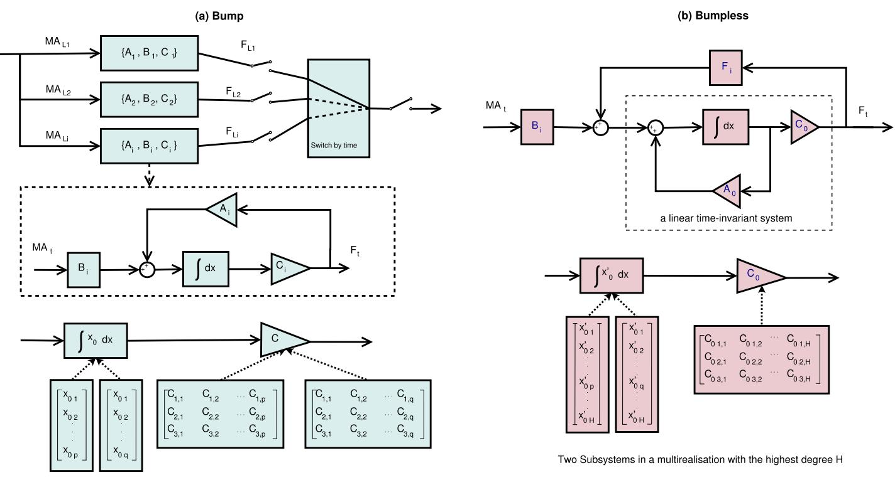  
Fig. 1. Switching mechanisms for subsystems with diferent degree. (a) Bump switching and (b) bumpless switching mechanism for subsystems in a multi realization.

Linear Time-Invariant (LTI) system is shared by the four subsystems. To implement submodel switching while guaranteeing bumpless transfer $( \mathrm { i } . \mathrm { e } . , \ C ^ { 0 }$ output continuity), we introduce a state-resetting matrix $F _ { i }$ and an adjusted input gain matrix $B _ { i } .$ . Specifically, $F _ { i }$ aligns the internal state energy by projecting the shared trajectory into the i-th submodel’s local frame, while $B _ { i }$ compensates for instantaneous input discontinuities arising during the transition.

The structural foundation relies on a base coordinate system $( A _ { 0 } , C _ { 0 } )$ , defined as the minimal common realization derived from the union of the controllable and observable subspaces of all N submodels. Through this state-shared feedback realization, each local pair $( \bar { A _ { i } } , \bar { C _ { i } } )$ is projected onto a unified manifold, thereby preserving the “memory” of the motion intent across distinct task segments.

The transfer function matrix $H _ { i } ( s )$ of each subsystem is described by the realization $\{ A _ { i } , B _ { i } , C _ { i } \}$ as follows:

$$
H _ { i } ( s ) = C _ { i } ( s I - A _ { i } ) ^ { - 1 } B _ { i } ,\tag{2}
$$

where $\{ A _ { i } , B _ { i } , C _ { i } \}$ are described in Section II, and the variable $\cdot _ { s } ,$ represents the complex frequency in the Laplace domain, which is commonly used for analyzing system dynamics in the frequency domain, and I denotes the identity matrix of appropriate dimensions.

The transfer function matrix $H _ { i } ( s ) ( i \in \{ 1 , 2 , 3 , 4 \} )$ can also be described using its right matrix fraction description (RMFD) [33]. We recall the properties of the RMFD here according to Kailath [33] as follows:

$$
H _ { i } ( s ) = N _ { i } ( s ) D _ { i } ^ { - 1 } ( s ) ,\tag{3}
$$

where $N _ { i } ( s )$ represents the numerator polynomial matrix of the i-th submodel, which information about the system’s zeros and directly afects its response characteristics, and $D _ { i } ^ { - 1 } ( s )$ represents the inverse of the denominator polynomial matrix of the i-th submodel, which influences the system’s poles and overall gain structure. Together, these polynomials describe the transfer function of the i-th submodel in the frequency domain. This RMFD is not unique.

## A. Irreducible Right Matrix Fraction Description

It is always possible to obtain a controllable state-space realization for a subsystem where its order k is the degree of the RMFD (i.e., the order of the determinant of $D _ { i } ( s ) )$ . In this step, the irreducible RMFD, known as the minimal RMFD (minRMFD), is pursued to minimize the dimension of the controllable realization. The $N _ { i } ( s )$ and $D _ { i } ( s )$ of the minRMFD are right coprime. The minimum realization of a subsystem $H _ { i } ( s )$ is numerically calculated based on the Sylvester matrix approach and an orthogonalization process on the matrix [34], [35].

We first randomly find a left matrix fraction description (LMFD) $D _ { L } ^ { - 1 } ( s ) N _ { L } ( s )$ for a transfer function $H ( s ) _ { p \times q } ,$ where p and q are the dimensions of the input and output, respectively. A related minRMFD can be obtained using the Sylvester matrix approach, such that

$$
\begin{array} { r } { \left[ N _ { L } ( s ) - D _ { L } ( s ) \right] \left[ \begin{array} { l } { D ( s ) } \\ { N ( s ) } \end{array} \right] = 0 , } \end{array}
$$

where $D ( s )$ and N(s) are coprime.

The main procedures of the Sylvester matrix approach are summarized as follows:

1) Form a Sylvester resultant matrix S .

2) Find $S _ { q } .$ , which consists of the first q primary dependent columns of S using the orthogonalization process.

3) Form $D ( s )$ and $N ( s )$ using the coeficients of the linear combination of $S _ { q } .$

For this approach, a MATLAB code for low-dimensional systems has been provided by Ahmadreza Saadatkhah [36]. However, when applying this method to a real system, the matrix S may have a high dimensionality with elements that are either extremely large or small. To address this issue, we pre-adjust the elements to a uniform numerical scale before the orthogonalization process. After this adjustment, the minRMFD $( D _ { i } ( s )$ and $N _ { i } ( s ) )$ of the i-th subsystem can be determined individually.

## B. Multirealization of Linear Systems

A generic multirealization of the subsystems $H _ { i }$ with different dimensions can be achieved by the following method based on [37].

A polynomial matrix $D ( s )$ can be expressed as $D ( s ) \ = \quad$ $D ^ { h c } S ( s ) + D _ { l c } ( s )$ , where $S ( s ) \ \triangleq \ \mathrm { d i a g } \{ s ^ { k _ { 1 } } , s ^ { k _ { 2 } } , . . . , s ^ { k _ { m } } \}$ is the highest column degree matrix, with $k _ { i }$ being the highest degree of the i-th column of $D ( s )$ . The matrix $\bar { D } ^ { h c }$ represents the highest degree-coeficient matrix of $D ( s )$ , constructed from the coeficients of the highest degree polynomials in the columns of D(s), while $D _ { l c } ( s )$ is the remaining part of $D ( s )$

The operator $\mathcal { D } _ { h c } \{ \cdot \}$ is defined as ${ \mathcal { D } } _ { h c } \{ D ( s ) \} = D ^ { h c } S \left( s \right) .$

The minRMFD of the transfer function $H _ { i } ( s )$ can always be converted to a unique Popov form, such that $H _ { i } ( s ) \ =$ $\bar { N } _ { i } ( s ) \bar { D } _ { i } ( s )$ , with $\bar { D } _ { i } ( s )$ in the column-reduced form [33]. After obtaining the minRMFD (with $\bar { D } _ { i } ( s )$ and $\bar { N } _ { i } ( s ) )$ for all subsystems, the steps for achieving a generic multirealization of these subsystems with diferent dimensions are described as follows.

1) Reform the minRMFD: We first reform $\bar { D } _ { i } ( s )$ into $\tilde { D } _ { i } ( s )$ where the elements of $S _ { i } ( s )$ only appear on the diagonal in a degree-reducing order. The $D _ { i } ^ { h { \bar { c } } }$ of $\tilde { D } _ { i } ( s )$ are normalized to the identity matrix I. This reformation is carried out using elementary column operations. The minRMFD of the transfer function is then converted to a new form $\tilde { N } _ { i } ( s ) \tilde { D } _ { i } ^ { - 1 } ( s )$ as follows:

$$
H _ { i } ( s ) = \bar { N } _ { i } ( s ) X _ { i } \left[ \bar { D } _ { i } ( s ) X _ { i } \right] ^ { - 1 } = \tilde { N } _ { i } ( s ) \tilde { D } _ { i } ^ { - 1 } ( s ) ,\tag{4}
$$

where $X _ { i }$ is a real matrix associated with the i-th subsystem.

2) Find the Common Highest Column Degree Matrix: As established in the study [28], a stable generic multirealization can be achieved by finding a generic minimal common denominator for all subsystems. This study focuses on realizing a stable generic multirealization. The highest degree of each column among all denominators is identified and used to form the common highest degree matrix $D _ { m } ( s )$ , where the highest degree-coeficient matrix is a unit matrix. This yields a stable generic denominator $D _ { m s } ( s )$ as follows:

$$
\mathcal { D } _ { h c } \{ D _ { m s } ( s ) \} = D _ { m } ( s ) = [ d _ { p q } ( s ) ] ,\tag{5}
$$

where

$$
d _ { p q } ( s ) = \left\{ \begin{array} { l l } { 0 , } & { \mathrm { i f ~ } p \neq q , } \\ { s ^ { k _ { m a x _ { p } } } , } & { \mathrm { i f ~ } p = q , } \end{array} \right.\tag{6}
$$

and $k _ { m a x _ { p } } = \operatorname* { m a x } \{ k _ { p } ^ { i } \} , ( i \in \{ 1 , 2 , 3 , 4 \} , p \in \{ 1 , 2 , 3 \} )$ is the highest degree of the $p { \cdot } \mathrm { t h }$ column among the four denominators $\tilde { D } _ { i } ( s )$ of the subsystems.

3) Construct the Common RMFDs: With the common highest degree matrix $D _ { m } ( s )$ , it is always possible to convert $\bar { \mathcal { D } _ { h c } } \{ \tilde { D } _ { i } ( s ) \}$ by right multiplying it with a polynomial matrix $\mathcal { D } _ { h c } \{ M _ { i } ( s ) \}$ to adjust the column degrees to the highest degree, such that

$$
D _ { m } ( s ) = { \mathcal { D } } _ { h c } \{ \tilde { D } _ { i } ( s ) \} { \mathcal { D } } _ { h c } \{ M _ { i } ( s ) \} .\tag{7}
$$

The matrix $\mathcal { D } _ { h c } \{ M _ { i } ( s ) \}$ is formed as:

$$
\mathcal { D } _ { h c } \{ M _ { i } ( s ) \} = \mathrm { d i a g } \{ [ s ^ { \Delta k _ { 1 } ^ { i } } , \cdot \cdot \cdot , s ^ { \Delta k _ { p } ^ { i } } , \cdot \cdot \cdot , s ^ { \Delta k _ { n } ^ { i } } ] \} ,\tag{8}
$$

where $\Delta k _ { p } ^ { i } = k _ { m a x _ { p } } - k _ { p } ^ { i }$ represents the diference in the p-th column degree between $D _ { m } ( s )$ and $\mathcal { D } _ { h c } \{ \tilde { D } _ { i } ( s ) \}$ .

To form $M _ { i } ( s )$ , a random positive real number g has been given and is used as ${ \tilde { \cal M } } _ { i } \bar { ( s ) } ~ = ~ d i a g \{ ( s I - g ) ^ { \Delta k _ { p } ^ { i } } \}$ . The common RMFD for all subsystems $( D m _ { i } ( s )$ and $N m _ { i } ( s ) )$ can be constructed by right multiplying the $M _ { i } ( s )$ as follows:

$$
H _ { i } ( s ) = \tilde { N } _ { i } ( s ) M _ { i } ( s ) [ \tilde { D } _ { i } ( s ) M _ { i } ( s ) ] ^ { - 1 } = N m _ { i } ( s ) D m _ { i } ^ { - 1 } ( s ) ,\tag{9}
$$

where ${ \mathcal D } _ { h c } \{ D m _ { i } ( s ) \} = { \mathcal D } _ { h c } \{ \tilde { D } _ { i } ( s ) M _ { i } ( s ) \} = D _ { m } ( s ) .$

4) Construct a Generic Multirealization: According to the multirealization approach in [28], to implement the multirealization for a real system, we need to find the common RMFD $( N _ { m _ { i } } ( s )$ and $D _ { m _ { i } } ( s ) )$ of the transposed subsystem $H _ { i } ^ { T } ( s ) , \mathrm { i . e . }$ .,

$$
H _ { i } ^ { T } ( s ) = N _ { m _ { i } } ( s ) \cdot D _ { m _ { i } } ^ { - 1 } ( s ) .
$$

Next, we construct the stable generic denominator $D _ { m s } ( s )$ such that ${ \mathcal { D } } _ { h c } \{ D _ { m s } ( s ) \} = D _ { m } ( s )$ . Using the method outlined in [33] (pp. 403-407), a controller form realization $\{ A _ { c 0 } , B _ { c 0 } , C _ { c i } \}$ of $\bar { N _ { m _ { i } } ( s ) } D _ { m s } ^ { - 1 } ( s )$ can be obtained, where $\{ A _ { c 0 } , B _ { c 0 } \}$ is a controllable pair, $A _ { c 0 }$ is stable, and $C _ { c i } ~ = ~ N _ { m _ { i l c } } .$ After setting $K _ { i } = D _ { m l c } - D _ { m _ { i l c } } ,$ , a generic multirealization for these transposed subsystems $H _ { i } ^ { T } ( s )$ is given as $\{ A _ { c 0 } + B _ { c 0 } K _ { i } , B _ { c 0 } , C _ { c i } \}$

The multirealization form $\{ A _ { 0 } + F _ { i } C _ { 0 } , B _ { i } , C _ { 0 } \}$ for the subsystems $H _ { i } ( s ) = \left( H _ { i } ^ { T } ( s ) \right) ^ { T }$ can be obtained by setting $A _ { 0 } = A _ { c 0 } ^ { T } ,$ $B _ { i } = C _ { c i } ^ { T } , \ C _ { 0 } = B _ { c 0 } ^ { T } ,$ and $F _ { i } ~ = ~ K _ { i } ^ { T }$ . With this multirealization, only $F _ { i }$ and $B _ { i }$ need to be adjusted when switching subsystems, while $A _ { 0 }$ and $C _ { 0 }$ remain constant. The resulting generic multirealization of the four subsystems is simplified as $\{ A _ { E i } , B _ { E i } , C _ { E } \}$

5) Find an Expanded Initial Hidden State $x _ { E i } .$ Although it is always possible to find the adequate generic multirealization, the dimension of the initial state $x _ { E i }$ of each subsystem in the multirealization may be diferent from the identified $x _ { i }$ of the initial submodel. Therefore, the following steps are proposed to construct $x _ { E i }$ based on the multirealization and $x _ { i } .$

Firstly, when the order of a submodel needs to be increased to match the order of the generic multirealization, the new realization must include $\Delta k _ { p } ^ { i }$ uncontrollable state variables. These variables are the extended components of $x _ { E i } .$ . To identify these components, the generic multirealization for a subsystem is transformed into the controllability staircase form $\{ \bar { A } _ { E i } , \bar { B } _ { E i } , \bar { C } _ { E i } \}$ as follows:

$$
\{ \begin{array} { l l } { \bar { A } _ { E i } = \mathrm { T } _ { i } A _ { E i } \mathrm { T } _ { i } ^ { - 1 } = [ \begin{array} { l l } { \bar { A } _ { u c i } } & { 0 } \\ { \bar { A } _ { 2 1 } } & { \bar { A } _ { c i } } \end{array} ] } \\ { \bar { B } _ { E i } = \mathrm { T } _ { i } B _ { E i } = [ \begin{array} { l } { 0 } \\ { \bar { B } _ { c i } } \end{array} ] } \\ { \bar { C } _ { E i } = C _ { E } \mathrm { T } _ { i } ^ { - 1 } = [ \begin{array} { l } { \bar { C } _ { n c i } } \\ { \bar { C } _ { t i } = \bar { C } _ { c i } ( s I - \bar { A } _ { c i } ) ^ { - 1 } \bar { B } _ { c i } } \end{array}  } \end{array}\tag{10}
$$

where $\bar { A } _ { c i } , \bar { B } _ { c i } ,$ , and $\bar { C } _ { c i }$ are associated with controllable states, and $\bar { A } _ { u c i }$ and $\bar { C } _ { n c i }$ are associated with uncontrollable states.

Based on Eq. 10, the transformation matrix $\mathrm { T } _ { i }$ can be applied to calculate the extended initial state $x _ { E i }$ of the generic multirealization, reforming it as a controllable form $\bar { x } _ { E i }$ as follows:

$$
\bar { x } _ { E i } = \mathrm { T } _ { i } ^ { - 1 } x _ { E i } = \left[ \begin{array} { c } { \bar { x } _ { u c i } } \\ { \bar { x } _ { c i } } \end{array} \right] ,\tag{11}
$$

where $\bar { x } _ { c i }$ is the controllable element, and $\bar { x } _ { u c i }$ are the uncontrollable elements.

Theoretically, the controllable form $\{ \bar { A } _ { c i } , \bar { B } _ { c i } , \bar { C } _ { c i } \}$ should equal the identified realization $\{ A _ { i } , B _ { i } , C _ { i } \}$ . However, due to the complexity of a real system and the simplification of min-RMFD, $\{ \bar { A } _ { c i } , \bar { \bar { B } } _ { c i } , \bar { C } _ { c i } \}$ has the same dimension as $\{ A _ { i } , B _ { i } , C _ { i } \}$ and their values are related as follows:

$$
\begin{array} { r } { \left\{ \begin{array} { l l } { \bar { \boldsymbol { \mathrm { T } } } _ { i } \bar { \boldsymbol { A } } _ { c i } - \boldsymbol { A } _ { i } \bar { \boldsymbol { \mathrm { T } } } _ { i } \leq \alpha , } \\ { \bar { \boldsymbol { \mathrm { T } } } _ { i } \bar { \boldsymbol { B } } _ { c i } - \boldsymbol { B } _ { i } \leq \beta , } \\ { \bar { \boldsymbol { C } } _ { c i } - \boldsymbol { C } _ { i } \bar { \boldsymbol { \mathrm { T } } } _ { i } \leq \gamma . } \end{array} \right. } \end{array}\tag{12}
$$

With the restrictions that $\alpha , \beta , \gamma \ge 0$ and $\alpha + \beta + \gamma \leq e ^ { - 1 0 }$ it is always possible to find the matrix $\bar { \mathrm { T } } _ { i }$ that best fits the relationship between the two forms.

After that, the controllable state $\bar { x } _ { c i }$ of $\bar { x } _ { E i }$ is also related to the identified initial state $x _ { i }$ by $\bar { \mathrm { T } } _ { i }$ as:

$$
\bar { x } _ { c i } = \bar { \mathrm { T } } _ { i } ^ { - 1 } x _ { i } .\tag{13}
$$

Combining Eq. 11 and 13, the extended initial state $x _ { E i }$ for each subsystem can be calculated and applied with the generic multirealization $\{ A _ { E i } , B _ { E i } , C _ { E } \}$

With the generic multirealization and the extended initial state as shown in Figure 1, the stable LTI system can ensure bumpless outputs in real-time (i.e., continuously decoding sEMG signals even during submodel switching). This bumpless switching method is denoted as $\because _ { \mathrm { B L } } ,$ in the following sections.

## C. Other Switching Mechanisms Among Four Submodels

1) A Simplified Bumpless Switching Mechanism: In terms of the whole system, the dimensions of the inputs and outputs remain the same across all submodels, while the dimensions of the hidden state $x _ { i }$ may difer from one submodel to another. To achieve bumpless outputs, adjustments to $C _ { i }$ can compensate for the diference between the final state of the previous submodel and the initial state of the current submodel. This method is applied separately in two scenarios.

When the order of the submodel $( k _ { i } )$ equals the dimension of the output (which is 3), construct a matrix $\tilde { \mathrm { T } } _ { i } \in \mathbb { R } ^ { 3 \times 3 }$ that is equal to the special square matrix $C _ { i } \mathrm { : }$

$$
{ \tilde { \mathrm { T } } } _ { i } = C _ { i } .
$$

When $k _ { i }$ is larger than the dimension of the output, construct $\bar { Q } _ { i }$ by concatenating a zero matrix $O _ { i } ~ \in ~ \mathbb { R } ^ { ( k _ { i } ^ { \bullet } - 3 ) \times 3 }$ and an identity matrix $I _ { i } \ \in \ \mathbb { R } ^ { ( k _ { i } - 3 ) \times ( k _ { i } - 3 ) }$ . Then, construct a square matrix $\tilde { \mathrm { T } } _ { i }$ by combining $C _ { i }$ and $\bar { Q } _ { i }$ as follows:

$$
\left\{ \begin{array} { l } { \bar { Q } _ { i } = \left[ O _ { i } I _ { i } \right] , } \\ { \tilde { \Pi } _ { i } = \left[ { C } _ { i } \right] } \\ { \bar { Q } _ { i } } \end{array} \right.
$$

Use $\tilde { \mathrm { T } } _ { i }$ to reform all parameters as follows:

$$
\left\{ \begin{array} { l } { \bar { x } _ { i } = \tilde { \mathrm { T } } _ { i } x _ { i } , } \\ { \bar { A } _ { i } = \tilde { \mathrm { T } } _ { i } A _ { i } \tilde { \mathrm { T } } _ { i } ^ { - 1 } , } \\ { \bar { B } _ { i } = \tilde { \mathrm { T } } _ { i } B _ { i } , } \\ { \bar { C } _ { i } = C _ { i } \tilde { \mathrm { T } } _ { i } ^ { - 1 } . } \end{array} \right.\tag{14}
$$

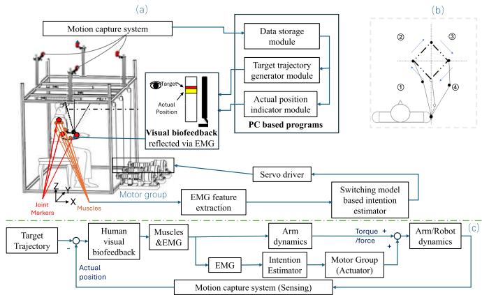  
Fig. 2. Overview of the proposed sEMG-based human-robot control framework: (a) experimental setup (left panel): the participant performs the tracking task within the cable-based robot [38] using real-time visual biofeedback. (b) Multi-joint tracking trajectory (top right): the square path is decomposed into four single-direction subtasks (segments 1–4) to facilitate piecewise-linear modeling. (c) Control block diagram (bottom): a schematic of the human-inthe-loop architecture where the sEMG-based intention estimator augments biological torque to implement an assist-as-needed strategy.

When applying this simplified switching method, the initial hidden state of the first submodel is given as the reformed $\bar { x } _ { 0 }$ from the modeling phase. With the new realization $\{ \bar { A _ { i } } , \bar { B } _ { i } , \bar { C } _ { i } \}$ and hidden state ${ \bar { x } } _ { i } ,$ when time reaches the switch point between any two models, denote the order of the first model as m and the order of the second model as n:

1) if $m = n ,$ , the hidden state continues to evolve without additional processing;

2) if $m \ < \ n ,$ keep the first m states the same, and add the extra $( n - m )$ states from the reformed $\bar { x } _ { i }$ of the corresponding submodel;

3) if $m > n ,$ keep the first n states the same, and discard the remaining states.

With this method, bumpless outputs can also be realized, even though the hidden state is not continuous. This simplified bumpless switching mechanism is denoted as $\mathbf { \omega } ^ { \ast } \mathbf { S } \mathbf { M } ^ { \ast }$ in the following sections.

2) A Zero Initial State Switching Mechanism: Another method to ensure bumpless switching is to set x0 as a zero matrix, while the initial state of the first model is taken from the modeling phase. This method is used to investigate the impact of the initial states on overall model performance and is denoted as $ { \mathbf { \hat { \Sigma } } } ^ { \prime }$ in the following sections.

3) A Bump Switching Mechanism: A switching mechanism that directly switches the four submodels by time without any additional processing of parameters. As a result, the outputs are not continuous, but the overall accuracy has been shown to be relatively good [19]. This bump switching mechanism is denoted as ‘NBL’ in the following sections.

4) A Single State Space Model Without Switching Mechanism: For comparison, a single state-space model is also trained for the entire task. Since the orders of all submodels do not exceed $^ { 6 , }$ the order of the single state-space model is set to six. This six-order single model is denoted as ‘SGL’ in the following sections.

## IV. EXPERIMENTS

The proposed architecture starts with a Target Trajectory Generator defining the desired spatial path in Figure 2. In this human-in-the-loop scheme, the user acts as the primary controller, exerting muscle force based on visual feedback. To implement an “assist-as-needed” strategy, an EMG-based predictor decodes neural signals to supplement insuficient biological torque. The inherent lead time of EMG signals relative to movement introduces a predictive component that enhances loop stability. Finally, a motion capture system tracks markers to update the software and biofeedback interface.

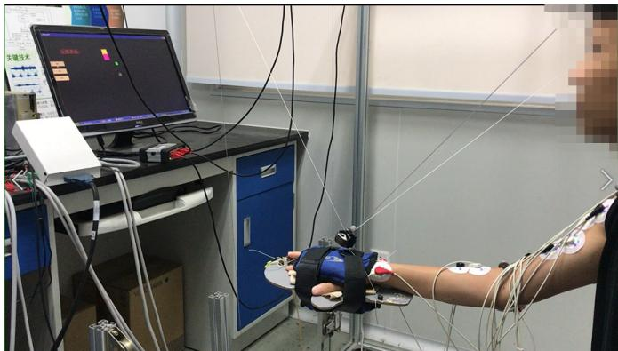  
Fig. 3. An experimental scenario during robot-assisted arm motion.

## A. Platform and Data Basis

The experimental setup utilizes a cable-based upper limb rehabilitation robot [38] equipped with a motion capture system and a sEMG unit recording from six key arm muscles. Collected signals undergo standard preprocessing, including amplification, rectification, filtering, and normalization [39], to implement the human-robot cooperative control strategy illustrated in Figure 3.

The selection of these muscles for sEMG signal acquisition is based on their essential contributions to upper limb movements, specifically during coordinated shoulder and elbow joint activities that are central to the tasks investigated in this study. The deltoid muscles (DP, DM, DA) play critical roles in shoulder flexion, extension, and abduction, making them highly efective for detecting upper arm motion intentions [40]. The BIC and BR are key elbow flexors activated during forearm lifting motions and reaching tasks [41]. The TRI serves as the primary extensor, contributing to both push and reach motions [42]. By spanning both the shoulder and elbow joints, these muscle groups provide comprehensive coverage of the primary degrees of freedom involved in upper limb movements. Their activation patterns vary significantly with changes in motion directions, load and efort level [43], enabling accurate discrimination of motion intent. This selection ensures robust and precise detection of user intent, which is essential for the adaptive control and seamless human-robot interaction required in the proposed system.

## B. SEMG-Based Human-Robot Cooperative Controller

The sEMG decoder is designed to estimate the sEMG-driven forces transmitted through the cables using muscle activations as inputs. During operation, the positions of the wrist, elbow, and shoulder are tracked by a built-in motion capture system at 100 Hz. Simultaneously, sEMG signals are recorded at 1000 Hz via bipolar surface electrodes from six muscles: posterior deltoid (DP), medial deltoid (DM), anterior deltoid (DA), triceps (TRI), biceps brachii (BIC), and brachioradialis (BR). The raw signals are amplified by a gain of 5000, fullwave rectified, and smoothed using a 4th-order Butterworth low-pass filter with a 4 Hz cutof [12]. Following normalization to maximum voluntary isometric contraction values [39], the signals are processed into muscle activations [44], [45], [46], which drive the decoder during both training and testing. A detailed mathematical description of this pipeline and the relationship between activations and motion-required forces is provided in [19].

Five healthy participants 3 males and 2 females; age: 24 2± 1 8 years; height: 170 2±8 0 cm; weight: 63 8±10 4 kg) were recruited for this study. All participants were right-handed and had no history of neuromuscular or musculoskeletal disorders. Prior to the experiments, all subjects provided written informed consent, and the study was approved by the Human Ethics Committee of the First Afiliated Hospital of Sun Yat-Sen University ([2013]C-096).

In the preliminary safety-focused evaluation of the bumpless switching mechanism, data from three human participants were used to provide a detailed structural analysis of the state-mapping transitions. Although the full study involved five participants, some specific subset was prioritized for the initial human-in-the-loop switching trials to minimize potential risk during the iterative refinement of the stateresetting matrices. As specified in the Abstract, this limited number of participants is an inherent limitation of the current experimental setup, necessitated by the safety considerations described above.

Joint position data is processed into motion-required forces using a human-robot dynamic model, as detailed in [19]. Specifically, the dynamic model of the upper limb is employed to estimate the resultant force from the joint positions and torques of the shoulder, elbow and wrist. Kinematic and dynamic parameters of the upper limb are derived from an established anthropometric database. In addition, the kinetics of the robotic system are utilized to calculate the forces along the cables, and subsequently, the driven torques of the motor group as described in [35]. The motion-required forces, estimated by this dynamic model, act as the target output for training the sEMG Decoder.

To match the frequency of the input and output, the muscle activations are decimated to 100 Hz.

A square-shaped tracking task in the horizontal plane is designed to evaluate the performance of the sEMG decoder. The task involves four end-to-end rectilinear movements, each with a length of 0 02 m, in diferent directions within 3D space. When applying the proposed switching mechanism, the task is divided into four subtasks. Four diferent ordered linear state-space models, each with six inputs and three outputs, are trained as submodels for these subtasks. Each submodel is treated as a subsystem. For real-time robot control, the proposed bumpless switching mechanism is used to switch between these subsystems.

As a comparison, the direct switching mechanism without bumpless transfer, the simplified bumpless switching mechanism, and the zero initial state switching mechanism are also applied using the same submodels. Additionally, a single state-space model without a switching mechanism is built and applied to the entire task.

## C. Experimental Protocol

To investigate the performance of the proposed bumpless switching mechanism for diferent-ordered submodels, both ofline numerical analysis and online real-time robot-assisted motion experiments were conducted with all participants. The impact of the initial state was also examined by applying diferent bumpless switching mechanisms to three participants.

The ofline numerical analysis consists of the sEMG decoder training phase and testing phase through simulation. The online real-time robot-assisted motion serves as the performance verification of the sEMG decoders during real-time sEMG-based human-robot cooperative movements.

The data collection process for the training and testing phases follows these procedures. A participant moves their arm to track a moving cursor, displayed on a monitor, which follows a square-shaped trajectory for 20 seconds. Nine trials are performed in total: six random trials are used for the training phase, and the remaining three are for the testing phase. The six trials of training data are used to train four state-space submodels, which may have diferent orders. The three trials of testing data are used to test the trained sEMG decoders by decoding sEMG signals into motion-required forces, without involving the robot or actual participant motion.

In the online verification phase, participants place their forearms in the robot’s end-efector and perform the tracking motion together with the robot. The platform features a backdrivable design with a compliant interface, ensuring safety and allowing manual override. The control strategy uses the sEMG-decoded trajectory as a reference rather than matching output wrench. The robot provides the assistive torque required to complete the trajectory while remaining responsive and compliant to the user’s intended motion. During this phase, participants actively control the robot through sEMG signals. The system estimates the motion-required forces in real time based on their muscle activations and converts these estimations into control signals for the robot. The robot then provides active assistance in accordance with these control signals, supporting the participant’s movement without impeding voluntary control. Participants remain actively engaged throughout the process by performing a visual tracking task that requires continuous upper limb activation. This interaction paradigm ensures that both active control and adaptive assistance are integrated, allowing for seamless human-robot cooperation. All decoders are applied in the sEMG-based human-robot cooperation controller to estimate the motionrequired forces. These estimated forces are provided by the robot to assist the participant in performing the arm tracking motion in conjunction with the participant’s own initiative. In this phase, each participant completes the tracking movements three times across three trials.

The joint position-to-force conversion relies on a dynamic model derived from anthropometric parameters and upperlimb kinematics. While this model provides a practical means to estimate motion-related forces, its accuracy depends on the precision of anthropometric data, joint torque estimation, and the assumption of quasi-static or simplified dynamic conditions. In clinical or patient-specific applications, such assumptions may not fully capture interindividual variability in limb geometry, soft-tissue deformation, or co-contraction efects. Moreover, constructing a detailed musculoskeletal model can be computationally demanding and may require calibration to patient-specific morphology. Nevertheless, the present framework allows these model-based estimations to be used primarily for decoder training, which can later be refined or replaced by direct force measurements when appropriate sensors are available.

To avoid safety risks caused by excessive motor speed, the estimated force is constrained within the range of [−100N 100N] before being applied to control the robot via the robot dynamic model. If the force exceeds this range, it is clamped to −30N (if below −100N) or 30N (if above 100N).

## D. Evaluation Parameters

For the purpose of investigating and evaluating the performance of diferent decoders with various mechanisms, the model fitness and output smoothness are calculated, analyzed, and compared.

1) Model Fitness: Model fitness of the decoders can be evaluated by comparing the estimated outputs from the decoders to the target outputs from the human-robot dynamic model.

The root mean squared logarithmic error (RMS LE) is calculated to evaluate the decoders. RMS LE measures the ratio between the target and estimated forces according to the following equation:

$$
R M S L E = \sqrt { \frac { 1 } { N } \sum _ { i = 1 } ^ { N } \left( \left| \log ( y _ { i } + 1 ) - \log ( \hat { y } _ { i } + 1 ) \right| ^ { 2 } \right) }\tag{15}
$$

where $y _ { i }$ is the estimated force, $\hat { y } _ { i }$ is the target force at the i-th sampling instant, and N is the number of samples.

The concordance correlation coeficient $( \rho _ { c } )$ between the target and estimated forces is calculated to measure how well the estimation aligns with the targets, as follows [47]:

$$
\rho _ { c } = \frac { 2 s _ { x y } } { s _ { x } ^ { 2 } + s _ { y } ^ { 2 } + ( \bar { x } - \bar { y } ) ^ { 2 } }\tag{16}
$$

where ¯x and ¯y are the mean values of the target and estimated outputs, $s _ { x } ^ { 2 }$ and $s _ { \mathrm { v } } ^ { 2 }$ are their variances, and $\begin{array} { r l } { s _ { x y } } & { { } = } \end{array}$ $\begin{array} { r } { { \frac { 1 } { N } } \sum _ { n = 1 } ^ { N } { ( x _ { n } - { \bar { x } } ) } ( y _ { n } - { \bar { y } } ) } \end{array}$ is the covariance.

Furthermore, to assess how efectively the decoder explains the variation in the data, the adjusted coeficient of determination, denoted as the adjusted R-squared $( R _ { a d j } ^ { 2 } )$ [48], is calculated as follows:

$$
R _ { a d j } ^ { 2 } = 1 - \frac { ( N - 1 ) ( 1 - R ^ { 2 } ) } { N - p }\tag{17}
$$

and

$$
R ^ { 2 } = \frac { S S _ { r e g r e s s i o n } } { S S _ { t o t a l } } = \frac { \sum _ { i = 1 } ^ { N } { ( f _ { i } - \bar { y } ) ^ { 2 } } } { \sum _ { i = 1 } ^ { N } { ( y _ { i } - \bar { y } ) ^ { 2 } } }\tag{18}
$$

where $y _ { i }$ is the observed value, $f _ { i }$ is the estimated value for each output at the i-th sampling instant, $\bar { y }$ is the mean value of $y _ { i } ,$ $N$ is the number of samples, and $p$ is the number of model parameters. The $R _ { a d j } ^ { 2 }$ adjusts $R ^ { 2 }$ by the degrees of freedom, allowing it to evaluate models while considering diferences in the number of parameters.

2) Output Smoothness: To quantify the smoothness of the outputs for controlling the motor groups, the normalized jerk score (NJS) of the outputs during simulation and real-time experiments was adopted to represent movement smoothness in 3D space [49].

$$
N J S = \sqrt { \frac { 1 } { 2 } \frac { T ^ { 5 } } { D ^ { 2 } } \int { ( j e r k ) ^ { 2 } d t } }\tag{19}
$$

where t refers to the actual time, jerk is the third-order derivative of the outputs with respect to time $t ,$ and T and D

TABLE I  
THE COMPARISON BETWEEN THE RMSLE $, \rho _ { c } , R _ { a d j } ^ { 2 } \mathrm { ~ A N D }$ NJS VALUES OF THREE DECODERS (NBL, BL AND SGL) DURING TRAINING, TESTING AND VERIFYING PHASES
<table><tr><td rowspan=1 colspan=1>Phase</td><td rowspan=1 colspan=1>Output</td><td rowspan=1 colspan=3>RMSLE (Median(IQR))</td><td rowspan=1 colspan=1>Significance</td></tr><tr><td rowspan=3 colspan=1>Training</td><td rowspan=1 colspan=1>01</td><td rowspan=1 colspan=1>0.01(0.01)</td><td rowspan=1 colspan=1>0.02(0.01)</td><td rowspan=1 colspan=1>0.05(0.05)</td><td rowspan=1 colspan=1>a,b,c</td></tr><tr><td rowspan=1 colspan=1>O2</td><td rowspan=1 colspan=1>0.01(0.01)</td><td rowspan=1 colspan=1>0.02(0.01)</td><td rowspan=1 colspan=1>0.03(0.01)</td><td rowspan=1 colspan=1>b,c</td></tr><tr><td rowspan=1 colspan=1>O3</td><td rowspan=1 colspan=1>0.01(0.01)</td><td rowspan=1 colspan=1>0.02(0.03)</td><td rowspan=1 colspan=1>0.05(0.04)</td><td rowspan=1 colspan=1>b</td></tr><tr><td rowspan=2 colspan=1>Testing</td><td rowspan=1 colspan=1>01</td><td rowspan=1 colspan=1>0.03(0.01)</td><td rowspan=1 colspan=1>0.03(0.01)</td><td rowspan=1 colspan=1>0.08(0.05)</td><td rowspan=1 colspan=1>b,c</td></tr><tr><td rowspan=1 colspan=1>O2</td><td rowspan=1 colspan=1>0.03(0.02)</td><td rowspan=1 colspan=1>0.03(0.03)</td><td rowspan=1 colspan=1>0.06(0.03)</td><td rowspan=1 colspan=1>b,c</td></tr><tr><td rowspan=3 colspan=1>Verifying</td><td rowspan=1 colspan=1>O1</td><td rowspan=1 colspan=1>0.23(0.26)</td><td rowspan=1 colspan=1>0.15(0.14)</td><td rowspan=1 colspan=1>0.78(2.03)</td><td rowspan=1 colspan=1>b,c</td></tr><tr><td rowspan=1 colspan=1>O2</td><td rowspan=1 colspan=1>0.13(0.22)</td><td rowspan=1 colspan=1>0.11(0.05)</td><td rowspan=1 colspan=1>0.25(0.55)</td><td rowspan=1 colspan=1></td></tr><tr><td rowspan=1 colspan=1>O3</td><td rowspan=1 colspan=1>0.15(0.09)</td><td rowspan=1 colspan=1>0.12(0.07)</td><td rowspan=1 colspan=1>0.67(0.55)</td><td rowspan=1 colspan=1>b,c</td></tr><tr><td rowspan=2 colspan=1>Phase</td><td rowspan=2 colspan=1>Output</td><td rowspan=1 colspan=1>ρc</td><td rowspan=1 colspan=1>(Median(IQR)</td><td rowspan=1 colspan=1>)</td><td rowspan=2 colspan=1>Significance</td></tr><tr><td rowspan=1 colspan=1>NBL</td><td rowspan=1 colspan=1>BL</td><td rowspan=1 colspan=1>SGL</td></tr><tr><td rowspan=2 colspan=1>Training</td><td rowspan=1 colspan=1>01</td><td rowspan=1 colspan=1>0.99(0.01)</td><td rowspan=1 colspan=1>0.97(0.03)</td><td rowspan=1 colspan=1>0.90(0.12)</td><td rowspan=1 colspan=1>a,b</td></tr><tr><td rowspan=1 colspan=1>O3</td><td rowspan=1 colspan=1>0.99(0.03)</td><td rowspan=1 colspan=1>0.97(0.09)</td><td rowspan=1 colspan=1>0.89(0.13)</td><td rowspan=1 colspan=1>b</td></tr><tr><td rowspan=2 colspan=1>Testing</td><td rowspan=1 colspan=1>01</td><td rowspan=1 colspan=1>0.94(0.05)</td><td rowspan=1 colspan=1>0.95(0.04)</td><td rowspan=1 colspan=1>0.65(0.36)</td><td rowspan=1 colspan=1>b,c</td></tr><tr><td rowspan=1 colspan=1>O3</td><td rowspan=1 colspan=1>0.94(0.06)</td><td rowspan=1 colspan=1>0.92(0.08)</td><td rowspan=1 colspan=1>0.74(0.27)</td><td rowspan=1 colspan=1>b,c</td></tr><tr><td rowspan=2 colspan=1>Verifying</td><td rowspan=1 colspan=1>01</td><td rowspan=1 colspan=1>0.34(0.50)</td><td rowspan=1 colspan=1>0.35(0.18)</td><td rowspan=1 colspan=1>-0.03(0.02)</td><td rowspan=1 colspan=1>b,c</td></tr><tr><td rowspan=1 colspan=1>O3</td><td rowspan=1 colspan=1>0.41(0.27)</td><td rowspan=1 colspan=1>0.67(0.18)</td><td rowspan=1 colspan=1>0.01(0.23)</td><td rowspan=1 colspan=1>b,c</td></tr><tr><td rowspan=2 colspan=1>Phase</td><td rowspan=2 colspan=1>Output</td><td rowspan=1 colspan=1> $\overline { { R _ { a d</td><td rowspan=1 colspan=1>j } ^ { 2 } } }$ (Median(IQR</td><td rowspan=1 colspan=1>))</td><td rowspan=2 colspan=1>Significance</td></tr><tr><td rowspan=1 colspan=1>NBL</td><td rowspan=1 colspan=1>BL</td><td rowspan=1 colspan=1>SGL</td></tr><tr><td rowspan=3 colspan=1>Training</td><td rowspan=1 colspan=1>01</td><td rowspan=1 colspan=1>0.98(0.02)</td><td rowspan=1 colspan=1>0.95(0.07)</td><td rowspan=1 colspan=1>0.76(0.32)</td><td rowspan=1 colspan=1>a,b</td></tr><tr><td rowspan=1 colspan=1>O2</td><td rowspan=1 colspan=1>0.99(0.03)</td><td rowspan=1 colspan=1>0.95(0.06)</td><td rowspan=1 colspan=1>0.88(0.11)</td><td rowspan=1 colspan=1>b,c</td></tr><tr><td rowspan=1 colspan=1>O3</td><td rowspan=1 colspan=1>0.98(0.07)</td><td rowspan=1 colspan=1>0.94(0.17)</td><td rowspan=1 colspan=1>0.69(0.32)</td><td rowspan=1 colspan=1>b</td></tr><tr><td rowspan=3 colspan=1>Testing</td><td rowspan=1 colspan=1>01</td><td rowspan=1 colspan=1>0.86(0.12)</td><td rowspan=1 colspan=1>0.88(0.09)</td><td rowspan=1 colspan=1>0.56(0.83)</td><td rowspan=1 colspan=1>b,c</td></tr><tr><td rowspan=1 colspan=1>O2</td><td rowspan=1 colspan=1>0.91(0.16)</td><td rowspan=1 colspan=1>0.89(0.17)</td><td rowspan=1 colspan=1>0.68(0.44)</td><td rowspan=1 colspan=1>b,c</td></tr><tr><td rowspan=1 colspan=1>O3</td><td rowspan=1 colspan=1>0.87(0.15)</td><td rowspan=1 colspan=1>0.80(0.25)</td><td rowspan=1 colspan=1>0.42(0.26)</td><td rowspan=1 colspan=1>b,c</td></tr><tr><td rowspan=3 colspan=1>Verifying</td><td rowspan=1 colspan=1>01</td><td rowspan=1 colspan=1>-4.61(9.44)</td><td rowspan=1 colspan=1>-2.72(4.28)</td><td rowspan=1 colspan=1>-88.92(121.96)</td><td rowspan=1 colspan=1>b,c</td></tr><tr><td rowspan=1 colspan=1>O2</td><td rowspan=1 colspan=1>-0.35(3.51)</td><td rowspan=1 colspan=1>0.02(0.62)</td><td rowspan=1 colspan=1>-3.35 (58.98)</td><td rowspan=1 colspan=1>C</td></tr><tr><td rowspan=1 colspan=1>O3</td><td rowspan=1 colspan=1>-0.92(1.89)</td><td rowspan=1 colspan=1>-0.18(0.98)</td><td rowspan=1 colspan=1>-36.31(72.28)</td><td rowspan=1 colspan=1>b,c</td></tr><tr><td rowspan=1 colspan=1>Phase</td><td rowspan=1 colspan=1>Output</td><td rowspan=1 colspan=1>RNJ</td><td rowspan=1 colspan=1>S (Median(IQ</td><td rowspan=1 colspan=1>R)</td><td rowspan=1 colspan=1>Significance</td></tr><tr><td rowspan=2 colspan=1>Training</td><td rowspan=1 colspan=1>01</td><td rowspan=1 colspan=1>34.81(22.36)</td><td rowspan=1 colspan=1>15.92(5.44)</td><td rowspan=1 colspan=1>26.76(40.77)</td><td rowspan=1 colspan=1>a</td></tr><tr><td rowspan=1 colspan=1>O3</td><td rowspan=1 colspan=1>39.15(24.11)</td><td rowspan=1 colspan=1>21.11(10.00)</td><td rowspan=1 colspan=1>22.91(21.66)</td><td rowspan=1 colspan=1>a</td></tr><tr><td rowspan=2 colspan=1>Testing</td><td rowspan=1 colspan=1>01</td><td rowspan=1 colspan=1>41.37(27.16)</td><td rowspan=1 colspan=1>14.82(6.82)</td><td rowspan=1 colspan=1>28.66(30.39)</td><td rowspan=1 colspan=1>a,b</td></tr><tr><td rowspan=1 colspan=1>O3</td><td rowspan=1 colspan=1>45.69(66.07)</td><td rowspan=1 colspan=1>19.44(8.63)</td><td rowspan=1 colspan=1>29.06(25.66)</td><td rowspan=1 colspan=1>a</td></tr><tr><td rowspan=2 colspan=1>Verifying</td><td rowspan=1 colspan=1>01</td><td rowspan=1 colspan=1>265.80(242.68)</td><td rowspan=1 colspan=1>32.71(23.07)</td><td rowspan=1 colspan=1>7.65(21.13)</td><td rowspan=1 colspan=1>a,b</td></tr><tr><td rowspan=1 colspan=1>O3</td><td rowspan=1 colspan=1>316.34(174.73)</td><td rowspan=1 colspan=1>22.33(15.11)</td><td rowspan=1 colspan=1>13.81(13.16)</td><td rowspan=1 colspan=1>a,b</td></tr></table>

Note: 1) IQR: Interquartile Range; 2) Significant differences between these models are represented by the following alphabets: a: NBL-BL, b: NBL-SGL, c: BL-SGL, $p < 0 . 0 5$

refer to the duration time and amplitude, respectively, which are used to normalize the jerk and eliminate the influence of time and amplitude.

The relative NJS (RNJS) of the outputs estimated by diferent sEMG decoder models is calculated to compare with the desired outputs from the dynamic models as follows:

$$
R N J S = \frac { N J S _ { e s t } } { N J S _ { d y n } }\tag{20}
$$

where $N J S _ { e s t }$ is from the decoder-estimated output, and $N J S _ { d y n }$ is from the desired outputs.

3) Statistical Analysis: The best performance results are characterized by: a small value of RMS LE, a small value of NJS , a value of $\rho _ { c }$ close to 1, and a value of $R _ { a d j } ^ { 2 }$ close to 1. To analyze the influence of diferent decoder models, the diferences in these parameters (non-normal distribution) are evaluated using the Kruskal-Wallis nonparametric test with pairwise multiple comparisons at a significance level of 0.05. Statistical analysis is performed using SPSS 19.0 (SPSS Inc., USA).

## V. RESULTS AND DISCUSSION

## A. Performance of Diferent Decoders

To quantitatively evaluate the decoder’s performance, we analyze outputs O1–O3, which correspond to the predicted forces in the actuating cables. This analysis provides a comprehensive view of the decoder’s ability to map sEMG signals to the physical control channels. The results of $R M S L E , \rho _ { c } ,$ $R _ { a d j } ^ { 2 } ,$ and RNJS during the training, testing, and verification phases are shown in Table I. In the testing phase, both the decoders with the bumpless switching mechanism (BL) and the direct switching mechanism Non-Bumpless mechanism(NBL) efectively estimated the motion-required forces, with small RMS LE and large $\rho _ { c }$ and $R _ { a d j } ^ { 2 }$ . The model fitness of the sEMG decoder based on the six-order single state-space model (SGL) was significantly worse than that of the decoders with a switching mechanism.

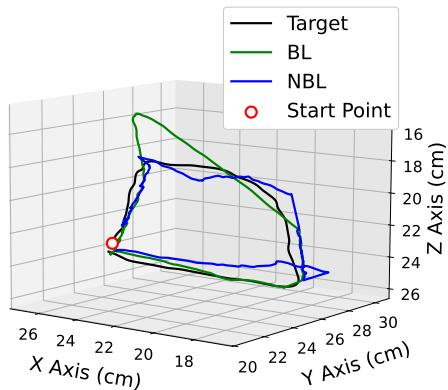  
Fig. 4. Three-dimensional trajectories from two switching mechanisms (NBL & BL) from a representative subject while tracking a square-shaped reference path. The Start Point marks the initial position of the trajectory, providing a reference for comparing transient behavior and trajectory continuity between the two switching mechanisms.

During the verification phase, the performance of BL and NBL showed relatively worse results than in the testing phase but remained acceptable in real-time human-robot cooperative movements. However, the worst performance was observed in SGL, which had unacceptably low values of $\rho _ { c }$ and $R _ { a d j } ^ { 2 } .$ This indicates that the decoder failed to accurately capture the relationship between muscle activations and the motionrequired forces, likely due to a loss of model generality in the real-time application.

When comparing RNJS performance, BL demonstrated a similar level of smoothness to SGL, indicating that BL can ensure ideal estimation continuity even when switching among multiple subsystems. On the other hand, the RNJS performance of NBL suggests the presence of discontinuous estimations caused by directly switching submodels without a bumpless mechanism.

It should be noted that, although the RNJS values for NBL in the training and testing phases were acceptable, the values in the online verification phase were significantly higher than those for the other two decoders. This result may also reflect the loss of generality in each submodel’s initial hidden state, as they were trained individually with limited data.

According to the results of $R M S L E , \rho _ { c } , R _ { a d j } ^ { 2 } ,$ and RNJS across the three decoders, it is evident that the decoder with the bumpless switching mechanism and diferent-ordered submodels is capable of accurately and smoothly decoding muscle activations.

Figure 4 illustrates an example of trajectories from a subject performing the task using two switching mechanisms: NBL and BL. This visualization aligns with the findings presented in Table I, highlighting that the primary diference between the two mechanisms lies in the continuity of the outputs at submodel switching points, as shown in Figure 5. Without the proposed bumpless switching mechanism, abrupt changes in submodel status and outputs may occur, resulting in unintended trajectory deviations. These sudden transitions could be perceived by the participant as unexpected variations in robotic support, potentially afecting task performance and user experience.

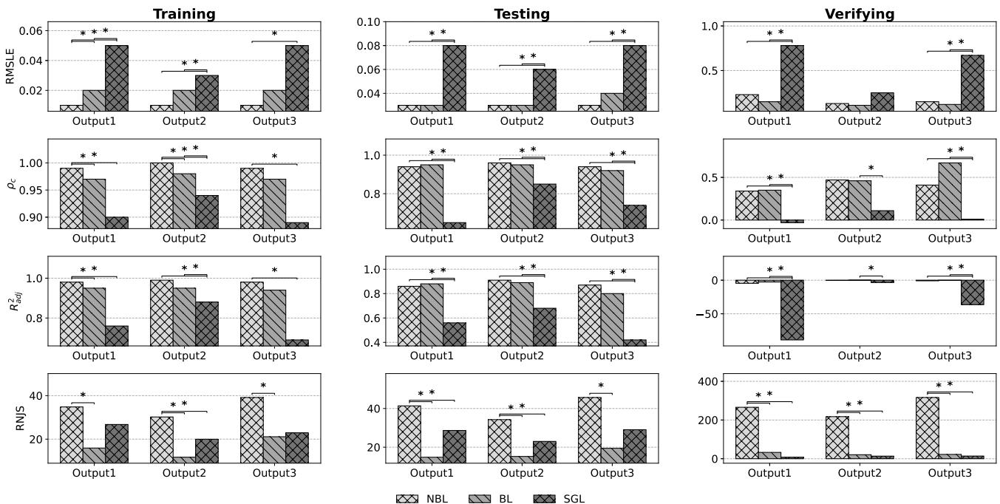  
Fig. 5. Performance comparison of three decoders (NBL, BL and SGL) across four evaluation metrics: RMSLE, $\rho _ { c } , R _ { a d j } ^ { 2 }$ and RNJS. Median values are reported for the three outputs during the training, testing, and verification phases. Results are aggregated from five subjects. Statistical significance was assessed between each pair of decoders, with significance defined as p < 0 05.

The cursor-tracking task used for training and testing was designed primarily to validate the decoder’s performance under controlled and repeatable conditions. While such training paradigms may not be directly feasible for all patients in clinical settings, the bumpless switching framework itself does not rely on a specific trajectory or visual feedback task. Once trained, the decoder can be applied to other rehabilitation activities that share similar muscle activation patterns, such as reaching, grasping, or assisted daily movements. In addition, the modular submodel structure provides a foundation for adaptive extensions, where new submodels can be incrementally updated or merged based on ongoing muscle activity without the need for extensive retraining. Future work will focus on integrating unsupervised adaptation and transfer learning techniques to further improve generalization across users and unstructured activities.

## B. Efects of Diferent Initial Hidden States of Submodels

The results of RMS LE, RNJS , ρ , and $R _ { a d j } ^ { 2 }$ among the four decoders with diferent switching mechanisms but the same submodels (NBL, BL, SM - Simplified Mechanism, ZI - Zero-Initial) within three subjects are shown in Figure 6. The model outputs of the four diferent models during the training and testing phases are shown in Figure 7, while the model outputs during the verification phase are shown in Figure 8. The efects of diferent initial states are thoroughly demonstrated in these results.

As shown in Figure 6(a), the highest RNJS values are found in NBL, which stand out significantly compared to the other three mechanisms. This result can be explained by the fact that BL, SM, and ZI can all continuously estimate forces when switching among submodels.

Figure 6(b) shows that both BL and SM have relatively low errors when decoding sEMG signals, while ZI exhibits the highest RMS LE across all three phases. This result indicates that, although setting the initial hidden state to zero during a bumpless switching mechanism can simplify multirealization (without the complex process of state extension), the decoder’s accuracy is compromised. The results of $\rho _ { c }$ and $R _ { a d j } ^ { 2 }$ in Figures 6(c-d) further reveal that the force trends are not well estimated by ZI. This demonstrates that the selection of the initial state is closely related to model fitness. The state extension process newly proposed in Section III-B5 is a crucial part of constructing an accurate multi-realization for multiple systems with diferent orders.

According to the estimated decoder outputs in the testing and verification phases shown in Figures 7 and 8, both BL and SM ensure bumpless output estimation during both ofline and online decoder applications. Their performance on RMS LE, RNJS , and $R _ { a d j } ^ { 2 }$ also shows no significant diference. The only significant diference $( p < 0 . 0 5 )$ is observed in the $\rho _ { c }$ results during the training and testing phases in Figure 6(c). A possible explanation for the worse performance of SM may be the lack of adequate initial hidden state adjustment when applying the switching mechanism. The simplified bumpless switching mechanism focuses only on adjusting the parameter C into a partially general form without considering dimensional changes when switching between submodels with diferent orders. This simplification may inadvertently alter the submodel’s parameters, leading to a loss of information contained in the sEMG signals. Consequently, the relationship between muscle activations and motion-required forces is not accurately mapped by the decoder, even though the same submodels are used in the bumpless switching mechanism.

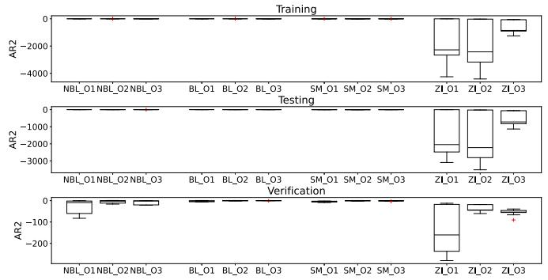

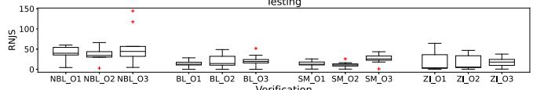

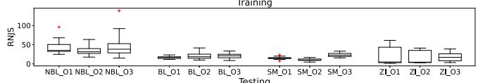

  
(a) RNJS

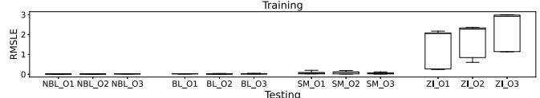

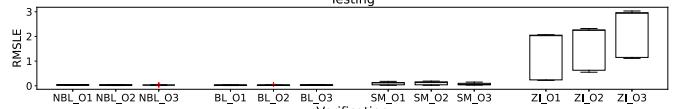

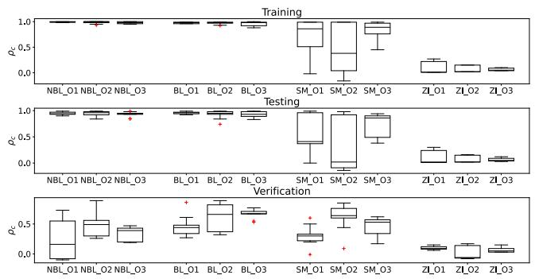

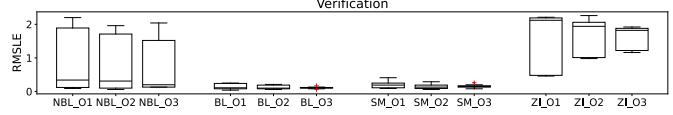  
(b) RMSLE

(c) ρc  
(d) Radj  
Fig. 6. Median performance metrics (RMS LE, RNJS , ρc, and $R _ { a d j } ^ { 2 } )$ for four switching mechanisms NBL, BL and SM, and ZI across three outputs during training, testing and verifying phases. Results are obtained from three subjects and highlight diferences in accuracy and smoothness associated with each switching strategy.  
  
Fig. 7. The three outputs of four switching mechanisms (NBL, BL and SM, and ZI) for a representative subject during the training and testing phases. The three outputs are shown to illustrate diferences in continuity, smoothness, and transient behavior among the switching mechanisms.

Given the small sample size (three subjects), only descriptive and trial-level statistical checks were performed, and no formal inferential statistical tests were applied to the results in Figure 6.

Overall, it is clear that the best selection of the initial state is achieved in BL through an extension approach, realized by the proposed advanced bumpless switching mechanism.

## C. The Dificulties of Switching Submodels With Diferent Orders

In this paper, the major challenge lies in finding a generic multirealization solution for real systems with diferent orders.

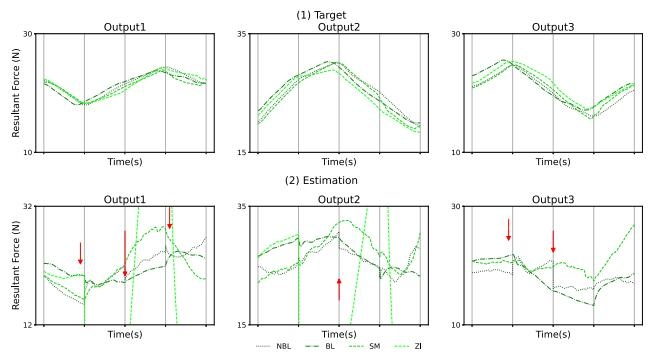  
Fig. 8. The three outputs of four switching mechanisms (NBL, BL and SM, and ZI) for a representative subject during the verification phase. Red arrows indicate abrupt changes in the outputs caused by switching-induced bumps, highlighting the impact of non-bumpless switching behavior on output continuity.

Compared to theoretical applications in simulation, a real system may not be able to achieve its true minimum realization with minimal degrees (minRMFD). Therefore, an approximate process is introduced to find the most accurate minRMFD possible. However, this approximation leads to slight diferences between the original system and the approximated system, resulting in bias when adjusting the dimension of the initial hidden state. The extension approach, which ofsets this bias and adjusts the dimension, is proposed and applied for the first time.

It is important to note that if the submodels have the same order, no extension is required for the switching mechanism due to the identical dimensions of their hidden states. In this case, it is possible to implement a switching mechanism that ensures both output smoothness and hidden state smoothness. However, in real-world applications, it is rarely possible to obtain the best submodel for each subtask with the same order. Thus, developing a bumpless switching mechanism for submodels with diferent orders is both vital and practical.

Ensuring hidden state continuity is not feasible in this context because the initial hidden state must be partially recalculated at each submodel switch point. Fortunately, only the controllable part of the initial hidden state changes during switching, making the efects of these changes manageable and visible. Compared to the ZI approach, where all hidden states are unmanageable, the performance of BL demonstrates that the discontinuity of hidden states can be a reasonable trade-of for better estimation accuracy.

The only risk posed by hidden state discontinuity is the stability of the entire decoder. In the context of a humaninvolved robotic controller, estimation accuracy is far more critical than state continuity. This can be explained by two factors: 1) The decoder’s estimation is used to control motors that directly support participants. Inaccurate estimations could pose safety risks to participants; 2) Involving humans means the controller relies heavily on the neural system, mediated through visual interaction and brain feedback in real time. The impacts of an unstable decoder on such a human-involved system cannot be fully investigated with current technology; 3) Each subsystem operates for 5 seconds before switching to the next, with the entire decoder functioning for a total of 20 seconds. In a short-duration system like this, stability is less critical as long as the outputs can be continuously estimated.

## D. Limitations and Future Work

The small sample size of five participants in this study limits the generalizability of the findings. However, this limitation is structural and unavoidable at the current stage, as participant safety was prioritized during human-in-the-loop experiments. Certain switching mechanisms may induce abrupt output changes, leading to undesirable interaction forces. Accordingly, a small pilot cohort was required to evaluate the stability and continuity of the proposed bumpless switching mechanism. Therefore, these results serve as a transparent and necessary exploratory step in validating the proposed decoder’s stability and continuity.

The primary aim of this research was to develop and validate the feasibility of applying a bumpless mechanism to an sEMG decoder during complex tasks, focusing on improving estimation accuracy and stability rather than achieving broad population representation. While initial results demonstrate the efectiveness of the proposed model, and normalization techniques were applied to accommodate individual sEMG signals diferences, variations in muscle physiology across individuals may still afect model performance.

Exclusive focus on healthy individuals limits generalizability to clinical populations with distinct musculoskeletal dynamics. These results therefore constitute a proof-ofconcept, with future work targeting validation in neurologically impaired patients.

Furthermore, the absence of a passive baseline limits direct quantification of assistance efects. Future work will incorporate standardized passive-mode trials to isolate the switching mechanism’s specific contribution to motor performance.

Future work will involve a larger and more diverse participant cohort to enhance the robustness of the model across users. Expanding the sample size will allow for a more comprehensive evaluation of the decoder’s adaptability and ensure its applicability in practical rehabilitation scenarios. In addition, longitudinal studies will be conducted to assess the consistency of the model’s predictions over time, further refining its utility in real-world applications. Developing generalized models or adaptive strategies that accommodate user variability while maintaining high accuracy will be a key area of focus for improving the practical applicability of the system across diverse user populations.

Future work will also focus on transitioning to clinical evaluations to assess the efectiveness, usability, and safety of the proposed model in real-world rehabilitation settings. Evaluating the system in clinical environments will provide further insights into its practical application in delivering personalized, adaptive assistance and improving rehabilitation outcomes.

Overall, the primary aim of the bumpless switching mechanism—ensuring estimation smoothness and accuracy—has been fully achieved.

## VI. CONCLUSION

In this study, a new method was proposed to realize a bumpless switching mechanism among diferent-ordered submodels of an sEMG decoder. An order transformation, aimed at reforming submodels based on their generic order, was applied to construct a multirealization for these subsystems. With multirealization, selecting and adjusting the appropriate initial hidden states of each submodel is crucial to ensure a smooth transition between submodels.

The efects of diferent initial states were investigated using four decoders with diferent switching mechanisms and initial hidden states for the same submodels. The results indicated that the initial states, based on the proposed extension approach, provided the best performance. Overall, the sEMG decoder, utilizing the advanced bumpless switching mechanism together with diferent-ordered state-space submodels, efectively decodes motion-required forces from sEMG signals with high accuracy and smoothness. Future work will expand validation to broader clinical populations and introduce a rigorous passive-mode baseline. This will quantify energetic and kinematic benefits, confirming that the robotic assistance is stable and demonstrably superior to unassisted rehabilitation.

## REFERENCES

[1] R. Loureiro, C. Colin, and W. Harwin, “Robot aided therapy: Challenges ahead for upper limb stroke rehabilitation,” in Proc. Int. Conf. Disability, 2004, pp. 33–39.

[2] G. Dagnino, D. Kundrat, P. Moreira, H. A. Wurdemann, and M. Abayazid, “Editorial: Translational research in medical robotics—Challenges and opportunities,” Frontiers Robot. AI, vol. 10, Oct. 2023, Art. no. 1270823.

[3] R. Holt et al., “User involvement in developing rehabilitation robotic devices: An essential requirement,” in Proc. IEEE 10th Int. Conf. Rehabil. Robot., Jun. 2007, pp. 196–204.

[4] J. Su et al., “An adaptive hybrid brain–computer interface for hand function rehabilitation of stroke patients,” IEEE Trans. Neural Syst. Rehabil. Eng., vol. 32, pp. 2950–2960, 2024.

[5] S. Kyeong, J. Feng, J. K. Ryu, J. J. Park, K. H. Lee, and J. Kim, “Surface electromyography characteristics for motion intention recognition and implementation issues in lower-limb exoskeletons,” Int. J. Control, Autom. Syst., vol. 20, no. 3, pp. 1018–1028, Mar. 2022.

[6] D. S. Mar’ın-Medina, P. A. Arenas-Vargas, J. C. Arias-Botero, M. Gomez-V´ asquez, M. F. Jaramillo-L´ opez, and J. Toro, “New´ approaches to recovery after stroke,” Neurological Sci., vol. 45, no. 1, pp. 55–63, 2023.

[7] H.-J. Yu, A. Y. Lee, and Y. Choi, “Human elbow joint angle estimation using electromyogram signal processing,” IET Signal Process., vol. 5, no. 8, pp. 767–775, Dec. 2011.

[8] L. Bi, A. G. Feleke, and C. Guan, “A review on EMG-based motor intention prediction of continuous human upper limb motion for human–robot collaboration,” Biomed. Signal Process. Control, vol. 51, pp. 113–127, May 2019.

[9] T. Zhang, H. Chu, and Y. Zou, “An online human dynamic arm strength perception method based on surface electromyography signals for human–robot collaboration,” IEEE Trans. Instrum. Meas., vol. 72, pp. 1–14, 2023.

[10] A. Ajoudani, N. Tsagarakis, and A. Bicchi, “Tele-impedance: Teleoperation with impedance regulation using a body–machine interface,” Int. J. Robot. Res., vol. 31, no. 13, pp. 1642–1656, Nov. 2012.

[11] S. Buscaglione, A. Noccaro, N. Tagliamonte, G. Ticchiarelli, G. Di Pino, and D. Formica, “Tele-impedance control of a virtual avatar based on EMG and M-IMU sensors: A proof-of-concept,” Sci. Rep., vol. 14, no. 1, p. 18543, Aug. 2024.

[12] P. K. Artemiadis and K. J. Kyriakopoulos, “EMG-based control of a robot arm using low-dimensional embeddings,” IEEE Trans. Robot., vol. 26, no. 2, pp. 393–398, Apr. 2010.

[13] Q. Zhang, R. Hosoda, and G. Venture, “Human joint motion estimation for electromyography (EMG)-based dynamic motion control,” in Proc. 35th Annu. Int. Conf. IEEE Eng. Med. Biol. Soc. (EMBC), Jul. 2013, pp. 21–24.

[14] C. Caulcrick, W. Huo, E. Franco, S. Mohammed, W. Hoult, and R. Vaidyanathan, “Model predictive control for human-centred lower limb robotic assistance,” IEEE Trans. Med. Robot. Bionics, vol. 3, no. 4, pp. 980–991, Nov. 2021.

[15] R. Yang, Z. Shen, Y. Lyu, Y. Zhuang, L. Li, and R. Song, “Voluntary assist-as-needed controller for an ankle power-assist rehabilitation robot,” IEEE Trans. Biomed. Eng., vol. 70, no. 6, pp. 1795–1803, Jun. 2022.

[16] H. Ren, T. Liu, and J. Wang, “Design and analysis of an upper limb rehabilitation robot based on multimodal control,” Sensors, vol. 23, no. 21, p. 8801, Oct. 2023.

[17] S. Cai et al., “SVM-based classification of sEMG signals for upper-limb self-rehabilitation training,” Frontiers Neurorobotics, vol. 13, p. 31, Jun. 2019.

[18] J. Fu, R. Choudhury, S. M. Hosseini, R. Simpson, and J.-H. Park, “Myoelectric control systems for upper limb wearable robotic exoskeletons and exosuits—A systematic review,” Sensors, vol. 22, no. 21, p. 8134, Oct. 2022.

[19] Y. Huang, R. Song, A. Argha, A. V. Savkin, B. G. Celler, and S. W. Su, “Continuous description of human 3D motion intent through switching mechanism,” IEEE Trans. Neural Syst. Rehabil. Eng., vol. 28, no. 1, pp. 277–286, Jan. 2020.

[20] Y. Huang, Y. Chen, J. Niu, and R. Song, “EMG-based control for threedimensional upper limb movement assistance using a cable-based upper limb rehabilitation robot,” in Proc. Int. Conf. Intell. Robot. Appl., 2017, pp. 273–279.

[21] S. D. Jesus-Mota, M. N. Beaulieu, and R. M. Botez, “Identification of a MIMO state space model of an F/A-18 aircraft using a subspace method,” Aeronaut. J., vol. 113, no. 1141, pp. 183–190, Mar. 2009.

[22] H. C. Diener, J. Dichgans, F. Bootz, and M. Bacher, “Early stabilization of human posture after a sudden disturbance: Influence of rate and amplitude of displacement,” Exp. Brain Res., vol. 56, no. 1, pp. 126–134, Aug. 1984.

[23] L. Dipietro, M. Ferraro, J. J. Palazzolo, H. I. Krebs, B. T. Volpe, and N. Hogan, “Customized interactive robotic treatment for stroke: EMGtriggered therapy,” IEEE Trans. Neural Syst. Rehabil. Eng., vol. 13, no. 3, pp. 325–334, Sep. 2005.

[24] Y. M. Aung and A. Al-Jumaily, “SEMG based ANN for shoulder angle prediction,” Proc. Eng., vol. 41, pp. 1009–1015, Jul. 2012.

[25] Y. Huang, R. Song, A. Argha, B. G. Celler, A. V. Savkin, and S. W. Su, “Human motion intent description based on bumpless switching mechanism for rehabilitation robot,” IEEE Trans. Neural Syst. Rehabil. Eng., vol. 29, pp. 673–682, Mar. 2021.

[26] A. S. Morse, “Control using logic-based switching,” in Trends Control. Cham, Switzerland: Springer, 1995, pp. 69–113.

[27] J. Hespanha, D. Liberzon, A. Stephen Morse, B. D. O. Anderson, T. S. Brinsmead, and F. De Bruyne, “Multiple model adaptive control. Part 2: Switching,” Int. J. Robust Nonlinear Control, vol. 11, no. 5, pp. 479–496, Apr. 2001.

[28] B. D. O. Anderson, S. W. Su, and T. S. Brinsmead, “Multirealization of linear systems,” IEEE Trans. Circuits Syst. II, Exp. Briefs, vol. 52, no. 8, pp. 442–446, Aug. 2005.

[29] S. W. Su, B. D. O. Anderson, W. Chen, and H. T. Nguyen, “Multi-realization of nonlinear systems,” Automatica, vol. 48, no. 7, pp. 1455–1461, Jul. 2012. [Online]. Available: https:// www.sciencedirect.com/science/article/pii/S0005109812001860

[30] L. Ljung, System Identification: Theory for the User. Upper Saddle River, NJ, USA: Prentice-Hall, 1986.

[31] M. Verhaegen and V. Verdult, Filtering and System Identification: A Least Squares Approach. Cambridge, U.K.:, Cambridge Univ. Press, 2007.

[32] Q. Zhang, M. Hayashibe, P. Fraisse, and D. Guiraud, “FESinduced torque prediction with evoked EMG sensing for muscle fatigue tracking,” IEEE/ASME Trans. Mechatronics, vol. 16, no. 5, pp. 816–826, Oct. 2011.

[33] T. Kailath, Linear Systems. Upper Saddle River, NJ, USA: Prentice-Hall, 1980.

[34] J. C. Basilio and B. Kouvaritakis, “An algorithm for coprime matrix fraction description using Sylvester matrices,” Linear Algebra its Appl., vol. 266, pp. 107–125, Nov. 1997.

[35] S. Kung and T. Kailath, “Fast projection methods for minimal design problems in linear system theory,” Automatica, vol. 16, no. 4, pp. 399–403, Jul. 1980.

[36] A. Saadatkhah, “Minimal right matrix fraction description,” MATLAB Central File Exchange, MathWorks, Natick, MA, USA, File ID 35771, Oct. 2019.

[37] S. W. Su, B. D. O. Anderson, and T. S. Brinsmead, “Minimal multirealization of MIMO linear systems,” IEEE Trans. Autom. Control, vol. 51, no. 4, pp. 690–695, Apr. 2006.

[38] J. Yang, H. Su, Z. Li, D. Ao, and R. Song, “Adaptive control with a fuzzy tuner for cable-based rehabilitation robot,” Int. J. Control, Autom. Syst., vol. 14, no. 3, pp. 865–875, Jun. 2016.

[39] F. E. Zajac, “Muscle and tendon: Properties, models, scaling, and application to biomechanics and motor control,” Crit. Rev. Biomed. Eng., vol. 17, no. 4, pp. 359–411, 1989.

[40] C. P. Chaytor, D. Forman, J. Byrne, A. Loucks-Atkinson, and K. E. Power, “Changes in muscle activity during the flexion and extension phases of arm cycling as an efect of power output are musclespecific,” PeerJ, vol. 8, p. e9759, Sep. 2020.

[41] G. Coratella et al., “Biceps brachii and brachioradialis excitation in biceps curl exercise: Diferent handgrips, diferent synergy,” Sports, vol. 11, no. 3, p. 64, Mar. 2023.

[42] D. Buongiorno, M. Barsotti, F. Barone, V. Bevilacqua, and A. Frisoli, “A linear approach to optimize an EMG-driven neuromusculoskeletal model for movement intention detection in myo-control: A case study on shoulder and elbow joints,” Frontiers Neurorobotics, vol. 12, p. 74, Nov. 2018.

[43] H. Zambrano et al., “Myoelectric activity during electromagnetic resistance alone and in combination with variable resistance or eccentric overload,” Sci. Rep., vol. 13, no. 1, p. 8212, May 2023.

[44] D. G. Lloyd and T. F. Besier, “An EMG-driven musculoskeletal model to estimate muscle forces and knee joint moments in vivo,” J. Biomechanics, vol. 36, no. 6, pp. 765–776, Jun. 2003.

[45] A. F. Huxley, “Muscular contraction,” J. Physiol., vol. 243, no. 1, pp. 1–43, 1974.

[46] K. Manal and T. S. Buchanan, “A one-parameter neural activation to muscle activation model: Estimating isometric joint moments from electromyograms,” J. Biomechanics, vol. 36, no. 8, pp. 1197–1202, Aug. 2003.

[47] L. I.-K. Lin, “A concordance correlation coeficient to evaluate reproducibility,” Biometrics, vol. 45, no. 1, pp. 255–268, Mar. 1989.

[48] J. O. Rawlings, S. G. Pantula, and D. A. Dickey, Applied Regression Analysis: A Research Tool. New York, NY, USA: Springer, 2001.

[49] N. Hogan and D. Sternad, “Sensitivity of smoothness measures to movement duration, amplitude, and arrests,” J. Motor Behav., vol. 41, no. 6, pp. 529–534, Jan. 2009.