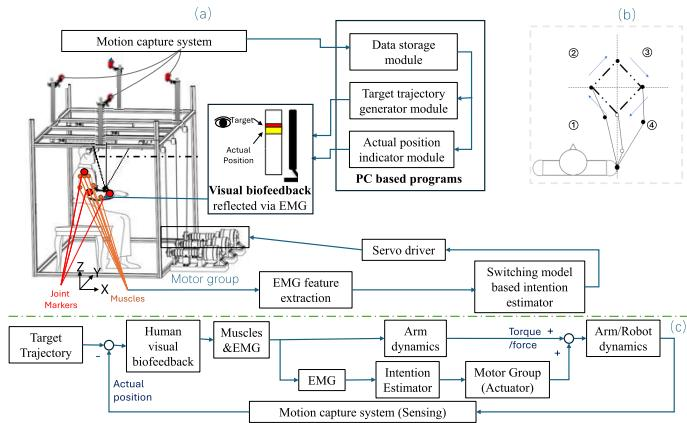
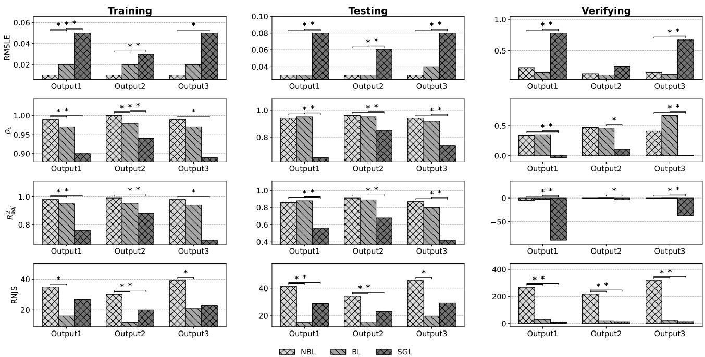
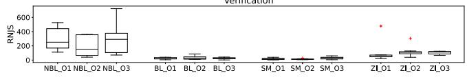
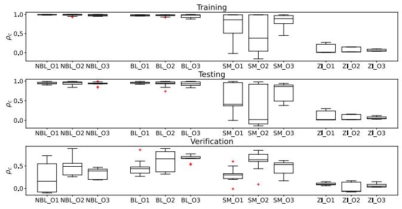
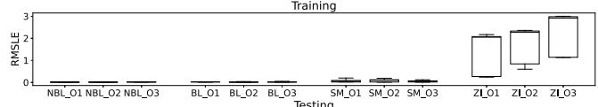
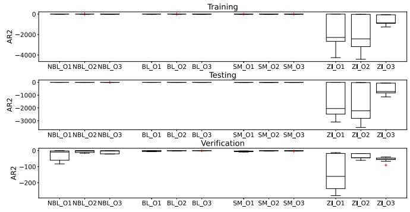
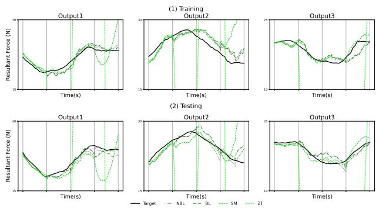

# 用于康复机器人控制中运动意图描述的实用多模型切换 sEMG 解码器

Yao Huang , Huifang Liu, Ahmadreza Argha , Branko G. Celler , Andrey V. Savkin , Gongchang Yu, Rong Song , Senior Member, IEEE, Bin Shi, 以及 Steven Weidong Su , Senior Member, IEEE

摘要—从表面肌电（surface electromyography, sEMG）信号中准确解码人体运动意图对于平滑且灵敏的康复机器人控制至关重要。本研究开发了一种结合实用无扰切换（bumpless switching）策略的多模型 sEMG 解码器，可实现复杂多关节运动中各子模型之间的无缝过渡。该方法在具有不同维度的子模型间识别出最小公共状态表示，确保在任务转换期间输出稳定连续且无突变。本文提出了几种状态重置方案，并在数值仿真以及实时人机协作手臂运动任务中进行了实验对比。结果表明，所提出的解码器在多种运动条件下均能保持平滑的力估计和稳健的性能，支持其在实时康复控制中的适用性。出于对人在回路（human-in-the-loop）试验中潜在突变切换的安全限制，本研究仅采用了有限的受试者队列；因此，这些研究结果应被视为探索性成果。

索引词—无扰切换机制，MIMO（多输入多输出）sEMG 解码器，肌电控制，康复机器人，多运动任务。

## I. 引言

在康复治疗过程以及康复技术的发展中，用户的积极参与至关重要 [1], [2]，尤其是对于康复机器人而言 [3], [4]。基于康复实践，基于生物传感器的机器人控制策略能够隐含用户的运动意图，从而实现更自然的运动触发。这些策略主要聚焦于信号的选择与解码，其中表面肌电（sEMG）信号是一种重要的选择。sEMG 信号可以使用无创传感器轻松采集，并与肌肉活动可靠相关，使其在康复应用中非常有效 [5]。

强化物理治疗对于中风后的运动再学习和康复必不可少。识别每位患者的运动能力对于制定个性化治疗至关重要。对于具有部分运动能力的患者，激发其运动意图并在机器人辅助下鼓励其主动参与是关键所在 [6]。

一些研究人员尝试以静态 [7], [8], [9] 和动态 [10], [11] 的方式揭示人体运动意图。然而，以自然的神经肌肉控制策略将人体运动意图从表面肌电（sEMG）连续映射到肢体运动的研究却极为罕见。这一难点可能是由于受试者之间存在不一致的运动控制模式以及 sEMG 的高动态特性所导致的。Artemiadis 和 Kyriakopoulos [12] 提出了一种降低了输入和输出维度的状态空间模型，致力于连续映射 sEMG 信号与多关节运动之间的关系。然而，随着维度的降低，sEMG 信号中包含的信息可能会减少，且系统的动力学特性也会被忽略。Zhang 等人提出了一种自适应估计方法来训练模型，以精确映射两对肌肉激活度与肘关节运动，从而解决受试者特异性问题 [13]。然而，该方法的应用局限于单关节或双关节，并且在保持信号完整性方面仍面临重大挑战。

康复机器人领域的最新进展旨在通过根据用户的肌肉活动调节机器人助力，来增强主动辅助干预。Caulcrick 等人 [14] 为下肢外骨骼开发了一种集成了基于 sEMG 的人体力矩估计的模型预测控制系统，实现了被动辅助与主动辅助模式之间的无缝切换。Yang 等人 [15] 引入了一种自主按需辅助（Voluntary Assist-as-Needed）控制策略，该策略根据用户的自主发力实时调整支持水平，以促进运动学习。Ren 等人 [16] 介绍了一种六自由度上肢外骨骼，该外骨骼结合了 sEMG 信号和肘关节角度，可在不同控制策略下动态调整辅助。Cai 等人 [17] 采用支持向量机（SVM）分类器解析 sEMG 信号以进行上肢运动模式识别，从而在康复训练期间有效实现模式切换。近期的综述还总结了上肢外骨骼在肌电控制和按需辅助策略方面的进展，强调了面向可穿戴康复系统的自适应支持和意图驱动控制框架 [18]。

现有的按需辅助（assistance-as-needed, AAN）控制研究主要集中在单关节应用上，例如肘部或腕部康复 [7], [15]，这些场景下的运动控制和肌肉激活模式相对简单。相比之下，由于更高的生物力学耦合性和信号变异性，多关节协调 [12], [19] 仍然具有挑战性。当前的机器人平台包括刚性连杆外骨骼、柔顺线驱动设备 [20] 以及软体外骨骼（soft exosuits）[18]，它们各自在精度、舒适度和反向驱动能力之间提供了不同的权衡。外骨骼通常采用电动或串联弹性执行器来实现精确的关节力矩控制，而线驱动系统和软体外骨骼通常依赖电机-肌腱传动或气动执行器来实现轻量化和柔顺的辅助。尽管取得了这些进展，但在不同执行器设计下实现平滑的多关节过渡和一致的力估计仍是待解决的挑战——这也进一步推动了本文提出的用于复杂上肢运动解码的无扰切换机制的开发。

按需辅助控制器的设计直接影响解码器架构。提供关节力矩控制的刚性外骨骼通常需要能够估计连续力的高精度、低延迟解码器，而线驱动和软体外骨骼系统则强调柔顺性与安全性，因而受益于能够适应信号噪声和非线性肌肉动力学的解码器。因此，实用的 sEMG 解码器必须在不同硬件配置下保持精度的同时，确保控制模式之间的平滑过渡。最近的系统综述强调了这一需求，表明肌电 AAN 策略越来越依赖自适应或多模型框架来平衡用户发力与机器人辅助 [18]。在此背景下，我们提出的无扰切换解码器通过实现代表复杂多关节运动的多个子模型之间的无缝切换，扩展了 AAN 范式，从而提高了实时康复任务中的连续性和用户舒适度。

尽管这些方法展示了基于 sEMG 控制的潜力，但许多方法仅侧重于被动与主动康复模式之间的切换，而未解决模式过渡的平滑性以及多关节任务的复杂性问题。一些方法局限于辅助活动范围受限的较简单关节运动。一种能够基于实时肌肉活动处理复杂多关节任务的切换机制，有望带来更加个性化、动态和有效的机器人辅助，确保平滑过渡和持续支持，从而提高康复效果。

有研究开发了一种无需降维的方法，用于在线性跟踪任务中从 sEMG（表面肌电）信号实时连续估计多关节运动意图 [20]。该方法展现出良好的准确性以及实现自然用户支持的潜力。然而，当解码器模型阶数较低时会出现挑战，因为它无法捕捉所有重要的系统动力学特性。相反，高阶模型则可能导致过拟合 [21]。

为解决这一问题，有学者提出了一种切换机制，以扩展该方法在复杂康复任务中的适用性并提高其整体效用 [19]。这种改进的方法优于先前的方法，表现出更好的综合性能，并在支持用户方面展现出更大的潜力，特别是在考虑任务复杂性的影响时。

然而，在实时实验中发现了另一个问题：在两个子模型切换期间，由于模型参数的变化，估计输出出现了突然的变化，这种现象被称为突变输出（bump outputs）。

虽然 [19] 中报道的整体性能很高，且实时实验中输出的突然变化仅产生轻微影响，但对于某些患者而言，这些“突变输出”可能是无法耐受的，因为它们可能导致短期的姿态失稳或长期的代偿性身体位移 [22]。例如，这可能会影响运动稳定性，而稳定性对于运动障碍患者在康复期间至关重要，失稳可能会导致损伤。

尽管针对不同任务的切换方法已有部分研究 [23], [24]，但任务切换期间估计输出的连续性却鲜有探讨。

Huang 等人 [25] 提出了一种最小阶无扰切换（bumpless switching）方法，该方法可确保状态和输出两者的连续性。尽管该方法有效，但对状态连续性的要求可能会增加多重实现（multirealization）的维度，从而降低其实际应用的可行性。此外，在 [25] 中，无扰切换解码器中的所有四个子模型都具有相同的维度。然而，为了使每个子任务都达到最优性能，应基于训练数据和鲁棒性测试对具有不同维度的模型进行预评估。在这种情况下，各个子模型的最优维度可能各不相同，这促使人们去探索能够适应不同子模型维度的、更实用的无扰切换方法。

为了在多关节手臂运动过程中优化 sEMG（表面肌电信号）解码器，本文探索了一种结合一组子模型的高级切换机制。这些子模型之间在参数、阶数和隐藏状态上的差异可能会导致解码器输出出现突变（bumps），从而影响系统的连续性和稳定性。Morse 提出了一种在线性系统之间实现“无扰（bumpless）”切换的方法 [26]，Hespanha 等人则采用了一种结合线性控制器模型和切换逻辑的自适应控制算法 [27]。针对一族线性控制器模型 [28] 和反馈线性化控制器模型 [29] 的多重实现（multirealization）问题已被解决，并应用于多模型自适应控制（MMAC）算法中。与 MMAC 的应用类似，本文讨论的切换机制在任何给定时刻仅利用一个子模型（即控制器）来生成估计输出，这使得开发一种用于多变量线性子模型间平滑过渡的多重实现方法变得可行。

正如前文所述，不同的子模型可能需要不同的阶数才能实现最佳性能、保留最多的 sEMG 信息并捕获最大的系统动力学特性。本文旨在通过为一组具有不同阶数的多输入多输出子系统开发一种通用实现方法，消除 sEMG 解码器输出中出现的突变，从而确保输出的“无扰”过渡。

本文的主要贡献可总结如下。首先，基于状态共享多重实现策略，提出了几种新型实用的切换方法，通过在切换过程中重置或保持子模型初始值来确保输出的连续性。其次，所提出的控制策略已被专门应用于增强人机交互，重点关注康复背景下的平滑且精确的过渡。最后，涉及五名参与者（年龄 $2 5 . 0 \pm 0 . 6 \mathrm { y e a r s } )$ 的广泛数值分析和实验测试证明了无扰切换方法在康复机器人人体意图运动预测中的有效性。

## II. SEMG 解码器与子模型

CVA（Canonical Variate Analysis，典型变量分析）是一种统计系统辨识方法，它通过最大化过去和未来观测子空间之间的相关性来提取状态变量，从而提供系统动力学的紧凑且抗噪的表示。与子空间辨识和预测误差方法相比，CVA 在处理随机扰动和小样本数据方面具有更出色的鲁棒性，而这些正是 sEMG 信号的典型特征。在本研究中，选择 CVA 是为了确保所辨识的子模型能够捕获核心的肌肉协同动力学，同时减少冗余和计算开销。该方法已成功应用于线性随机系统辨识和生物信号建模 [30], [31]。

本文的目标是通过先进的切换机制来提升 sEMG 解码器的性能。该 sEMG 解码器应能够映射任何运动过程中 sEMG 信号与运动驱动力之间的关系，并且应当能够集成到人机协作控制策略中。当应用于康复机器人控制时，sEMG 解码器必须根据实时 sEMG 信号以力的形式估计运动意图。

[19] 中提出的切换机制受样条插值的启发。它将一项任务划分为若干更简单的子任务，每个子任务都被视为一个子系统。在每个子任务期间，利用状态建模方法将 sEMG 信号与所需运动力之间的关系映射到一个子模型中。仅在时间序列上组合这些子模型就构成了 sEMG 解码器的基本切换逻辑，该逻辑可在实时机器人控制中实现。

本文旨在通过最小化相邻子模型之间的差异（即输出估计中的突变/颠簸现象），从而提高用户的运动可控性，以改进复杂手臂运动的 sEMG 解码方法。

在本文中，建立了四个子模型来解码方形多关节手臂跟踪任务中的 sEMG 信号。该任务被划分为四个单向跟踪子任务，每个子模型均使用每个受试者在相应子任务期间的 sEMG 信号以及从运动学计算出的运动相关力进行单独训练。每个子模型的结构都被构建为一个线性真状态空间模型，定义如下：

$$
H _ {i}: \left\{ \begin{array}{l l} \dot {x} _ {i} & = A _ {i} x _ {i} + B _ {i} u \\ y & = C _ {i} x _ {i} \end{array} \right.\tag{1}
$$

其中，$i \in \{ 1 , 2 , 3 , 4 \}$ 用于标识特定的子模型。输入向量 u $\in \mathbb { R } ^ { 6 }$ 包含从六块肌肉获取的归一化 sEMG 包络，而输出向量 $y \in \mathbb { R } ^ { 3 }$ 由通过运动学计算出的三个自主力组成。隐藏状态 $x _ { i } \ \in \ { \bar { \mathbb { R } } } ^ { k _ { i } }$ 对内部肌肉协调动力学进行编码，其中 $k _ { i }$ 表示子模型阶数。

相应地，系统矩阵、输入矩阵和输出矩阵分别定义为 $A _ { i } \in \mathbb { R } ^ { k _ { i } \times k _ { i } } , B _ { i } \stackrel { \bullet } { \in } \mathbb { R } ^ { k _ { i } \times 6 }$ 和 $C _ { i } \in \dot { \mathbb { R } } ^ { 3 \times k _ { i } }$ i。初始条件 $x _ { i 0 }$ 反映了每个子任务开始时手臂的动力学状态。

通过使用典型变量分析（canonical variate analysis, CVA）在连续时间域中辨识矩阵 $\{ A _ { i } , B _ { i } , C _ { i } \}$ 以及初始隐状态 $x _ { i 0 }$，从而建立子模型。CVA 用于确定每个子模型最相关的特征和模型阶数。CVA 有助于减少冗余并捕捉特定于各个运动阶段的肌肉活动本质动态，从而确保对运动意图进行更准确且高效的解码。在参数辨识过程中，确保子模型的稳定性是一项必要条件。子模型阶数 $k _ { i }$ 的选择基于最小描述长度准则（minimum description length criterion），以权衡子模型的简洁性与其对建模数据的适用性 [32]。

虽然基于 sEMG 的肌肉激活本质上是非线性的（通常由复杂的 Hill 型模型表征），但本研究采用了分段 LTI（piecewise-LTI）近似。我们假设在多关节康复任务的特定子阶段内，肌肉兴奋与关节运动学之间的关系在有限的工作范围内可以被充分线性化。通过利用多个局部辨识的线性子模型和切换机制，解码器在保持计算效率的同时捕捉到了运动的全局非线性。此处的无扰切换（bumpless switching）确保了这些局部线性近似之间的过渡不会对用户造成物理上的不连续感。

具体而言，所有四个子模型的阶数是在子模型参数辨识过程中综合考虑奇异值的表现来确定的。各个子模型的阶数可以不同，且对于同一子任务，不同受试者之间的阶数也可能存在差异。在跟踪轨迹运动的不同片段中，由于潜在的肌肉协调模式存在差异，各子模型的阶数可能会有所不同。例如，肘部伸展运动主要涉及肱三头肌的激活，而肘部内收运动可能需要肩部和肘部肌肉的协调活动。这些差异可以通过不同阶数的子模型来表示，反映了影响每个运动片段的复杂程度和因素数量。以相同结构统一实现不同子模型的逻辑被称为多重实现（multirealization），它作为 sEMG 解码器切换机制的解决方案。

## III. 多重实现（MULTIREALIZATION）

实现（Realization）是指以数学形式（通常使用状态空间模型）表示系统输入输出特性的过程。在本研究中，实现涉及在状态空间域内将肌肉激活信号映射到与自主运动相关的力。为子模型提出了多种实现，以便在不同运动阶段更准确地表示系统的动力学特性。多实现方法的一个关键要求是在发生切换时，确保子模型之间在状态变量和输出响应两方面都能实现平滑过渡。

针对多实现，我们为具有不同阶数的子模型开发了一种通用的实现形式 $\{ A _ { 0 } + F _ { i } C _ { 0 } , B _ { i } , C _ { 0 } \}$，而不是单独应用每个子系统 $\{ A _ { i } , B _ { i } , C _ { i } \}$。该多实现如图 1 所示，其中一个稳定的

  
Fig. 1. 不同阶数子系统的切换机制。(a) 有扰切换机制与 (b) 多实现中子系统的无扰切换机制。

线性定常（Linear Time-Invariant, LTI）系统由四个子系统共享。为了在保证无扰切换（即 $C^0$ 输出连续性）的同时实现子模型切换，我们引入了状态重置矩阵 $F_i$ 和调整后的输入增益矩阵 $B_i$。具体而言，$F_i$ 通过将共享轨迹投影到第 $i$ 个子模型的局部坐标系中来对齐内部状态能量，而 $B_i$ 则补偿过渡过程中产生的瞬时输入不连续性。

结构基础依赖于基坐标系 $( A _ { 0 } , C _ { 0 } )$，它被定义为从所有 $N$ 个子模型的可控和可观子空间的并集中导出的最小公共实现。通过这种状态共享的反馈实现，每个局部对 $( \bar { A _ { i } } , \bar { C _ { i } } )$ 都被投影到一个统一的流形上，从而在不同的任务阶段之间保留运动意图的“记忆”。

每个子系统的传递函数矩阵 $H _ { i } ( s )$ 由实现 $\{ A _ { i } , B _ { i } , C _ { i } \}$ 描述如下：

$$
H _ {i} (s) = C _ {i} (s I - A _ {i}) ^ {- 1} B _ {i},\tag{2}
$$

其中 $\{ A _ { i } , B _ { i } , C _ { i } \}$ 在第 II 节中进行了描述，变量 $\cdot _ { s }$ 表示拉普拉斯域中的复频率，通常用于在频域中分析系统动力学，$I$ 表示适当维度的单位矩阵。

传递函数矩阵 $H _ { i } ( s ) ( i \in \{ 1 , 2 , 3 , 4 \} )$ 也可以使用其右矩阵分式描述（Right Matrix Fraction Description, RMFD）[33] 来表示。我们根据 Kailath [33] 在此回顾 RMFD 的性质如下：

$$
H _ {i} (s) = N _ {i} (s) D _ {i} ^ {- 1} (s),\tag{3}
$$

其中 $N _ { i } ( s )$ 表示第 $i$ 个子模型的分子多项式矩阵，它包含关于系统零点的信息并直接影响其响应特性；$D _ { i } ^ { - 1 } ( s )$ 表示第 $i$ 个子模型的分母多项式矩阵的逆，它影响系统的极点和整体增益结构。这些多项式共同在频域中描述了第 $i$ 个子模型的传递函数。这种右矩阵分式描述（RMFD）并不是唯一的。

## A. 不可约右矩阵分式描述

总能为子系统获得一个可控状态空间实现，其阶数 $k$ 为 RMFD 的次数（即 $D _ { i } ( s )$ 行列式的阶数）。在这一步中，寻求不可约 RMFD（称为最小 RMFD，即 minRMFD），以最小化可控实现的维度。minRMFD 的 $N _ { i } ( s )$ 和 $D _ { i } ( s )$ 是右互质的。子系统 $H _ { i } ( s )$ 的最小实现是通过 Sylvester 矩阵法以及矩阵上的正交化过程进行数值计算的 [34], [35]。

我们首先随机找到传递函数 $H ( s ) _ { p \times q }$ 的一个左矩阵分式描述（LMFD）$D _ { L } ^ { - 1 } ( s ) N _ { L } ( s )$，其中 $p$ 和 $q$ 分别为输入和输出的维度。利用 Sylvester 矩阵法可以获得一个相关的 minRMFD，使得

$$
[ N _ {L} (s) - D _ {L} (s) ] \left[ \begin{array}{c} D (s) \\ N (s) \end{array} \right] = 0,
$$

其中 $D ( s )$ 和 $N(s)$ 互质。

Sylvester 矩阵法的主要步骤总结如下：

1) 构造 Sylvester 结式矩阵 $S$。

2) 利用正交化过程求得由 $S$ 的前 $q$ 个主相关列组成的 $S _ { q } .$。

3) 利用 $S _ { q } .$ 的线性组合系数构造 $D ( s )$ 和 $N ( s )$。

针对该方法，Ahmadreza Saadatkhah [36] 提供了适用于低维系统的 MATLAB 代码。然而，将该方法应用于实际系统时，矩阵 $S$ 可能具有较高的维度，且其元素可能极大或极小。为了解决这一问题，我们在正交化过程之前将元素预先调整为统一的数值尺度。经过此调整后，可以分别确定第 $i$ 个子系统的 minRMFD（$D _ { i } ( s )$ 和 $N _ { i } ( s )$）。

## B. 线性系统的多重实现

基于 [37]，可以通过以下方法实现具有不同维度的子系统 $H _ { i }$ 的通用多重实现。

多项式矩阵 $D ( s )$ 可表示为 $D ( s ) \ = \quad$ $D ^ { h c } S ( s ) + D _ { l c } ( s )$，其中 $S ( s ) \ \triangleq \ \mathrm { d i a g } \{ s ^ { k _ { 1 } } , s ^ { k _ { 2 } } , . . . , s ^ { k _ { m } } \}$ 为最高列次数矩阵，$k _ { i }$ 为 $D ( s )$ 第 $i$ 列的最高次数。矩阵 $\bar { D } ^ { h c }$ 表示 $D ( s )$ 的最高次数系数矩阵，由 $D(s)$ 各列中最高次多项式的系数构成，而 $D _ { l c } ( s )$ 则是 $D ( s )$ 的剩余部分。

算子 $\mathcal { D } _ { h c } \{ \cdot \}$ 定义为 ${ \mathcal { D } } _ { h c } \{ D ( s ) \} = D ^ { h c } S \left( s \right) .$

传递函数 $H _ { i } ( s )$ 的 minRMFD（极小右矩阵分式分解）总能转化为唯一的 Popov 形式，使得 $H _ { i } ( s ) \ =$ $\bar { N } _ { i } ( s ) \bar { D } _ { i } ( s )$，其中 $\bar { D } _ { i } ( s )$ 呈列约化形式 [33]。在获得所有子系统的 minRMFD（包含 $\bar { D } _ { i } ( s )$ 和 $\bar { N } _ { i } ( s ) )$ 之后，实现这些不同维数子系统的通用多重实现的步骤描述如下。

1) 重构 minRMFD：我们首先将 $\bar { D } _ { i } ( s )$ 重构为 $\tilde { D } _ { i } ( s )$，其中 $S _ { i } ( s )$ 的元素仅按次数递减的顺序出现在对角线上。$\tilde { D } _ { i } ( s )$ 的 $D _ { i } ^ { h { \bar { c } } }$ 被归一化为单位矩阵 $I$。该重构通过初等列变换进行。传递函数的 minRMFD 随后被转换为如下的新形式 $\tilde { N } _ { i } ( s ) \tilde { D } _ { i } ^ { - 1 } ( s )$：

$$
H _ {i} (s) = \bar {N} _ {i} (s) X _ {i} [ \bar {D} _ {i} (s) X _ {i} ] ^ {- 1} = \tilde {N} _ {i} (s) \tilde {D} _ {i} ^ {- 1} (s),\tag{4}
$$

其中 $X _ { i }$ 是与第 $i$ 个子系统相关的实矩阵。

2) 求解公共最高列次数矩阵：正如研究 [28] 中所指出的，通过为所有子系统寻找一个通用的极小公分母，可以实现稳定的通用多重实现。本研究侧重于实现稳定的通用多重实现。确定所有分母中每一列的最高次数，并用于构成公共最高次数矩阵 $D _ { m } ( s )$，其中最高次数系数矩阵为单位矩阵。由此得到如下的稳定通用分母 $D _ { m s } ( s )$：

$$
\mathcal {D} _ {h c} \{D _ {m s} (s) \} = D _ {m} (s) = [ d _ {p q} (s) ],\tag{5}
$$

其中

$$
d _ {p q} (s) = \left\{ \begin{array}{l l} 0, & \text {if} p \neq q, \\ s ^ {k _ {m a x _ {p}}}, & \text {if} p = q, \end{array} \right.\tag{6}
$$

且 $k _ { m a x _ { p } } = \operatorname* { m a x } \{ k _ { p } ^ { i } \} , ( i \in \{ 1 , 2 , 3 , 4 \} , p \in \{ 1 , 2 , 3 \} )$ 为四个子系统分母 $\tilde { D } _ { i } ( s )$ 中第 $p$ 列的最高次数。

3) 构造公共 RMFD：利用公共最高次数矩阵 $D _ { m } ( s )$，总可以通过右乘一个多项式矩阵 $\mathcal { D } _ { h c } \{ M _ { i } ( s ) \}$ 来转换 $\bar { \mathcal { D } _ { h c } } \{ \tilde { D } _ { i } ( s ) \}$，以将列次数调整为最高次数，从而满足

$$
D _ {m} (s) = \mathcal {D} _ {h c} \{\tilde {D} _ {i} (s) \} \mathcal {D} _ {h c} \{M _ {i} (s) \}.\tag{7}
$$

矩阵 $\mathcal { D } _ { h c } \{ M _ { i } ( s ) \}$ 形式如下：

$$
\mathcal {D} _ {h c} \{M _ {i} (s) \} = \operatorname{diag} \left\{\left[ s ^ {\Delta k _ {1} ^ {i}}, \dots , s ^ {\Delta k _ {p} ^ {i}}, \dots , s ^ {\Delta k _ {n} ^ {i}} \right] \right\},\tag{8}
$$

其中 $\Delta k _ { p } ^ { i } = k _ { m a x _ { p } } - k _ { p } ^ { i }$ 表示 $D _ { m } ( s )$ 与 $\mathcal { D } _ { h c } \{ \tilde { D } _ { i } ( s ) \}$ 之间第 p 列次数的差值。

为了构造 $M _ { i } ( s )$，给定一个任意正实数 g 并用作 ${ \tilde { \cal M } } _ { i } \bar { ( s ) } ~ = ~ d i a g \{ ( s I - g ) ^ { \Delta k _ { p } ^ { i } } \}$。所有子系统的公共 RMFD（$D m _ { i } ( s )$ 和 $N m _ { i } ( s )$）可以通过右乘 $M _ { i } ( s )$ 构造如下：

$$
H _ {i} (s) = \tilde {N} _ {i} (s) M _ {i} (s) [ \tilde {D} _ {i} (s) M _ {i} (s) ] ^ {- 1} = N m _ {i} (s) D m _ {i} ^ {- 1} (s),\tag{9}
$$

其中 ${ \mathcal D } _ { h c } \{ D m _ { i } ( s ) \} = { \mathcal D } _ { h c } \{ \tilde { D } _ { i } ( s ) M _ { i } ( s ) \} = D _ { m } ( s ) 。$

4) 构造通用多重实现：根据文献 [28] 中的多重实现方法，为了实现实际系统的多重实现，我们需要找到转置子系统 $H _ { i } ^ { T } ( s )$ 的公共 RMFD（$N _ { m _ { i } } ( s )$ 和 $D _ { m _ { i } } ( s )$），即

$$
H _ {i} ^ {T} (s) = N _ {m _ {i}} (s) \cdot D _ {m _ {i}} ^ {- 1} (s).
$$

接下来，我们构造稳定的通用分母 $D _ { m s } ( s )$，使得 ${ \mathcal { D } } _ { h c } \{ D _ { m s } ( s ) \} = D _ { m } ( s )$。利用 [33]（第 403-407 页）中概述的方法，可以获得 $\bar { N _ { m _ { i } } ( s ) } D _ { m s } ^ { - 1 } ( s )$ 的控制器型实现 $\{ A _ { c 0 } , B _ { c 0 } , C _ { c i } \}$，其中 $\{ A _ { c 0 } , B _ { c 0 } \}$ 是可控对，$A _ { c 0 }$ 是稳定的，且 $C _ { c i } ~ = ~ N _ { m _ { i l c } } .$。在令 $K _ { i } = D _ { m l c } - D _ { m _ { i l c } } ,$ 之后，这些转置子系统 $H _ { i } ^ { T } ( s )$ 的通用多重实现给出为 $\{ A _ { c 0 } + B _ { c 0 } K _ { i } , B _ { c 0 } , C _ { c i } \}$。

通过令 $A _ { 0 } = A _ { c 0 } ^ { T } ,$ $B _ { i } = C _ { c i } ^ { T } , \ C _ { 0 } = B _ { c 0 } ^ { T } ,$ 以及 $F _ { i } ~ = ~ K _ { i } ^ { T }$，可以获得子系统 $H _ { i } ( s ) = \left( H _ { i } ^ { T } ( s ) \right) ^ { T }$ 的多重实现形式 $\{ A _ { 0 } + F _ { i } C _ { 0 } , B _ { i } , C _ { 0 } \}$。采用这种多重实现，在切换子系统时只需调整 $F _ { i }$ 和 $B _ { i }$，而 $A _ { 0 }$ 和 $C _ { 0 }$ 保持不变。这四个子系统最终得到的通用多重实现简化为 $\{ A _ { E i } , B _ { E i } , C _ { E } \}$。

5) 寻找扩展的初始隐藏状态 $x _ { E i } .$。尽管总是能够找到充分的通用多重实现，但多重实现中每个子系统的初始状态 $x _ { E i }$ 的维数可能与初始子模型辨识出的 $x _ { i }$ 不同。因此，提出了以下步骤来基于多重实现和 $x _ { i }$ 构造 $x _ { E i } .$。

首先，当需要增加子模型的阶数以匹配通用多重实现的阶数时，新的实现必须包含 $\Delta k _ { p } ^ { i }$ 个不可控状态变量。这些变量是 $x _ { E i } .$ 的扩展分量。为了确定这些分量，子系统的通用多重实现被转换为如下的可控性阶梯形 $\{ \bar { A } _ { E i } , \bar { B } _ { E i } , \bar { C } _ { E i } \}$：

$$
\left\{ \begin{array}{l} \bar {A} _ {E i} = \mathrm{T} _ {i} A _ {E i} \mathrm{T} _ {i} ^ {- 1} = \left[ \begin{array}{c c} \bar {A} _ {u c i} & 0 \\ \bar {A} _ {2 1} & \bar {A} _ {c i} \end{array} \right] \\ \bar {B} _ {E i} = \mathrm{T} _ {i} B _ {E i} = \left[ \begin{array}{c} 0 \\ \bar {B} _ {c i} \end{array} \right] \\ \bar {C} _ {E i} = C _ {E} \mathrm{T} _ {i} ^ {- 1} = \left[ \begin{array}{c c} \bar {C} _ {n c i} & \bar {C} _ {c i} \end{array} \right] \\ \bar {C} _ {E i} (s I - \bar {A} _ {E i}) ^ {- 1} \bar {B} _ {E i} = \bar {C} _ {c i} (s I - \bar {A} _ {c i}) ^ {- 1} \bar {B} _ {c i} \end{array} \right.\tag{10}
$$

其中 $\bar { A } _ { c i } , \bar { B } _ { c i } ,$ 以及 $\bar { C } _ { c i }$ 与可控状态相关，而 $\bar { A } _ { u c i }$ 和 $\bar { C } _ { n c i }$ 与不可控状态相关。

基于公式 10，可以应用变换矩阵 $\mathrm { T } _ { i }$ 来计算通用多重实现（generic multirealization）的扩展初始状态 $x _ { E i }$，将其重构为如下的可控形式 $\bar { x } _ { E i }$：

$$
\bar {x} _ {E i} = \mathrm{T} _ {i} ^ {- 1} x _ {E i} = \left[ \begin{array}{c} \bar {x} _ {u c i} \\ \bar {x} _ {c i} \end{array} \right],\tag{11}
$$

其中 $\bar { x } _ { c i }$ 是可控元素，$\bar { x } _ { u c i }$ 是不可控元素。

理论上，可控形式 $\{ \bar { A } _ { c i } , \bar { B } _ { c i } , \bar { C } _ { c i } \}$ 应当等于辨识出的实现 $\{ A _ { i } , B _ { i } , C _ { i } \}$。然而，由于实际系统的复杂性以及 min-RMFD 的简化，$\{ \bar { A } _ { c i } , \bar { \bar { B } } _ { c i } , \bar { C } _ { c i } \}$ 与 $\{ A _ { i } , B _ { i } , C _ { i } \}$ 具有相同的维度，且它们的值满足如下关系：

$$
\left\{ \begin{array}{l} \bar {\mathrm{T}} _ {i} \bar {A} _ {c i} - A _ {i} \bar {\mathrm{T}} _ {i} \leq \alpha , \\ \bar {\mathrm{T}} _ {i} \bar {B} _ {c i} - B _ {i} \leq \beta , \\ \bar {C} _ {c i} - C _ {i} \bar {\mathrm{T}} _ {i} \leq \gamma . \end{array} \right.\tag{12}
$$

在约束条件 $\alpha , \beta , \gamma \ge 0$ 且 $\alpha + \beta + \gamma \leq e ^ { - 1 0 }$ 下，总能找到最符合这两种形式之间关系的矩阵 $\bar { \mathrm { T } } _ { i }$。

随后，$\bar { x } _ { E i }$ 的可控状态 $\bar { x } _ { c i }$ 也通过 $\bar { \mathrm { T } } _ { i }$ 与辨识出的初始状态 $x _ { i }$ 相关联，如下所示：

$$
\bar {x} _ {c i} = \bar {\mathbf {T}} _ {i} ^ {- 1} x _ {i}.\tag{13}
$$

结合公式 11 和公式 13，可以计算出每个子系统的扩展初始状态 $x _ { E i }$，并将其应用于通用多重实现 $\{ A _ { E i } , B _ { E i } , C _ { E } \}$。

借助图 1（Figure 1）所示的通用多重实现和扩展初始状态，稳定的 LTI 系统能够确保实时的无扰输出（即即使在子模型切换期间也能连续解码 sEMG 信号）。这种无扰切换方法在以下各节中表示为 $\because _ { \mathrm { B L } } ,$。

## C. 四个子模型之间的其他切换机制

1) 简化的无扰切换机制：就整个系统而言，所有子模型的输入和输出维度保持一致，而隐状态 $x _ { i }$ 的维度在不同子模型之间可能不同。为了实现无扰输出，对 $C _ { i }$ 进行调整可以补偿前一个子模型的最终状态与当前子模型的初始状态之间的差异。该方法分别应用于两种场景。

当子模型的阶数 $( k _ { i } )$ 等于输出维度（即 3）时，构造一个等于特殊方阵 $C _ { i }$ 的矩阵 $\tilde { \mathrm { T } } _ { i } \in \mathbb { R } ^ { 3 \times 3 }\mathrm { ：}$

$$
\tilde {\mathbf {T}} _ {i} = C _ {i}.
$$

当 $k _ { i }$ 大于输出维度时，通过拼接零矩阵 $O _ { i } ~ \in ~ \mathbb { R } ^ { ( k _ { i } ^ { \bullet } - 3 ) \times 3 }$ 和单位矩阵 $I _ { i } \ \in \ \mathbb { R } ^ { ( k _ { i } - 3 ) \times ( k _ { i } - 3 ) }$ 来构造 $\bar { Q } _ { i }$。然后，通过组合 $C _ { i }$ 和 $\bar { Q } _ { i }$ 构造方阵 $\tilde { \mathrm { T } } _ { i }$，如下所示：

$$
\left\{ \begin{array}{l} \bar {Q} _ {i} = \left[ \begin{array}{c c} O _ {i} & I _ {i} \end{array} \right], \\ \tilde {\mathrm{T}} _ {i} = \left[ \begin{array}{c} C _ {i} \\ \bar {Q} _ {i} \end{array} \right]. \end{array} \right.
$$

利用 $\tilde { \mathrm { T } } _ { i }$ 对所有参数进行重构，如下所示：

$$
\left\{ \begin{array}{l} \bar {x} _ {i} = \tilde {\mathrm{T}} _ {i} x _ {i}, \\ \bar {A} _ {i} = \tilde {\mathrm{T}} _ {i} A _ {i} \tilde {\mathrm{T}} _ {i} ^ {- 1}, \\ \bar {B} _ {i} = \tilde {\mathrm{T}} _ {i} B _ {i}, \\ \bar {C} _ {i} = C _ {i} \tilde {\mathrm{T}} _ {i} ^ {- 1}. \end{array} \right.\tag{14}
$$

  
Fig. 2. 所提出的基于 sEMG 的人机控制框架概述：(a) 实验设置（左图）：参与者在索驱动机器人 [38] 内借助实时视觉生物反馈执行跟踪任务。(b) 多关节跟踪轨迹（右上）：方形路径被分解为四个单向子任务（线段 1–4），以便于分段线性建模。(c) 控制框图（底部）：人在回路架构的原理图，其中基于 sEMG 的意图估计器增强生物力矩以实现按需辅助策略。

应用这种简化切换方法时，第一个子模型的初始隐状态设定为建模阶段重构后的 $\bar { x } _ { 0 }$。借助新的实现方式 $\{ \bar { A _ { i } } , \bar { B } _ { i } , \bar { C } _ { i } \}$ 和隐状态 ${ \bar { x } } _ { i } ,$ 当时间到达任意两个模型之间的切换点时，将第一个模型的阶数记为 m，第二个模型的阶数记为 n：

1) 若 $m = n ,$，隐藏状态继续演化，无需额外处理；

2) 若 $m \ < \ n ,$，保持前 m 个状态不变，并从对应子模型重构的 $\bar { x } _ { i }$ 中添加额外的 $( n - m )$ 个状态；

3) 若 $m > n ,$，保持前 n 个状态不变，并舍弃剩余状态。

采用该方法，即使隐藏状态不连续，也可以实现无颠簸输出。这种简化的无颠簸切换机制在以下各节中表示为 $\mathbf { \omega } ^ { \ast } \mathbf { S } \mathbf { M } ^ { \ast }$。

2) 零初始状态切换机制（A Zero Initial State Switching Mechanism）：确保无颠簸切换的另一种方法是将 x0 设为零矩阵，而第一个模型的初始状态取自建模阶段。该方法用于研究初始状态对整体模型性能的影响，在以下各节中表示为 $ { \mathbf { \hat { \Sigma } } } ^ { \prime }$。

3) 有颠簸切换机制（A Bump Switching Mechanism）：一种按时间直接切换四个子模型而无需对参数进行任何额外处理的切换机制。结果，输出是不连续的，但整体精度已被证明相对较好 [19]。这种有颠簸切换机制在以下各节中表示为‘NBL’。

4) 无切换机制的单一状态空间模型（A Single State Space Model Without Switching Mechanism）：为了进行对比，还针对整个任务训练了一个单一状态空间模型。由于所有子模型的阶数均不超过 $^ { 6 , }$，因此单一状态空间模型的阶数设定为六阶。该六阶单一模型在以下各节中表示为‘SGL’。

## IV. EXPERIMENTS

所提出的架构始于目标轨迹生成器（Target Trajectory Generator），在图 2 中定义期望的空间路径。在该人在回路方案中，用户充当主控制器，根据视觉反馈施加肌肉力量。为了实施“按需辅助”策略，基于肌电图（EMG）的预测器解码神经信号以补充不足的生物力矩。EMG 信号相对于运动的固有超前时间引入了预测成分，从而增强了闭环稳定性。最后，动作捕捉系统跟踪标记点以更新软件和生物反馈界面。

  
Fig. 3. 机器人辅助手臂运动期间的实验场景。

## A. Platform and Data Basis

实验装置采用了一台绳驱动上肢康复机器人 [38]，该机器人配备了动作捕捉系统和一个记录六块关键手臂肌肉的表面肌电（sEMG）单元。采集到的信号经过标准预处理，包括放大、整流、滤波和归一化 [39]，以实现图 3 所示的人机协作控制策略。

选择这些肌肉进行 sEMG 信号采集是基于它们对上肢运动的重要贡献，特别是在本研究调查的核心任务——肩关节和肘关节的协调活动中。三角肌（DP、DM、DA）在肩部屈曲、伸展和外展中起着关键作用，使其在检测上臂运动意图方面非常有效 [40]。BIC 和 BR 是关键的屈肘肌，在前臂抬起动作和伸展任务中被激活 [41]。TRI 作为主要的伸肌，对推和伸展动作均有贡献 [42]。通过跨越肩关节和肘关节，这些肌群全面覆盖了上肢运动所涉及的主要自由度。它们的激活模式随着运动方向、负载和用力程度的变化而显著变化 [43]，从而能够准确辨别运动意图。这种选择确保了对用户意图的鲁棒且精确的检测，这对于所提出系统所需的自适应控制和无缝人机协作至关重要。

## B. 基于 SEMG 的人机协作控制器

sEMG 解码器旨在以肌肉激活度为输入，估计通过线缆传输的 sEMG 驱动力。在运行过程中，手腕、手肘和肩部的位置由内置动作捕捉系统以 100 Hz 的频率进行追踪。同时，通过双极表面电极以 1000 Hz 的频率记录来自六块肌肉的 sEMG 信号：三角肌后束（DP）、三角肌中束（DM）、三角肌前束（DA）、肱三头肌（TRI）、肱二头肌（BIC）和肱桡肌（BR）。原始信号经过 5000 倍增益放大、全波整流，并使用截止频率为 4 Hz 的 4 阶 Butterworth（巴特沃斯）低通滤波器进行平滑处理 [12]。在归一化为最大自主等长收缩值 [39] 后，信号被处理为肌肉激活度 [44], [45], [46]，在训练和测试期间驱动解码器。关于该流程的详细数学描述以及激活度与运动所需力之间的关系见 [19]。

本研究招募了五名健康受试者（3 名男性和 2 名女性；年龄：24 2± 1 8 岁；身高：170 2±8 0 cm；体重：63 8±10 4 kg）。所有受试者均为右利手，且无神经肌肉或肌肉骨骼疾病史。实验前，所有受试者均签署了书面知情同意书，本研究已获得 Sun Yat-Sen University（中山大学）第一附属医院人体伦理委员会的批准（[2013]C-096）。

在对无扰切换机制（bumpless switching mechanism）的初步安全性评估中，使用了三名人类受试者的数据对状态映射转换进行了详细的结构分析。尽管完整的实验包含五名受试者，但在状态重置矩阵的迭代优化过程中，为了最大程度降低潜在风险，优先选取了特定的子集进行初始的人在回路（human-in-the-loop）切换试验。正如摘要中所述，受上述安全考量的限制，受试者数量有限是当前实验设置的固有局限性。

关节位置数据通过人机动力学模型处理为运动所需力，详见文献 [19]。具体而言，利用上肢动力学模型根据肩部、肘部和腕部的关节位置与力矩来估计合力。上肢的运动学和动力学参数源自已建立的人体测量学数据库。此外，如文献 [35] 所述，利用机器人系统的动力学计算沿线缆的拉力，并进而计算电机组的驱动力矩。由该动力学模型估计出的运动所需力作为训练 sEMG 解码器（sEMG Decoder）的目标输出。

为匹配输入与输出的频率，肌肉激活度被抽取降频至 100 Hz。

设计了一个水平面内的正方形跟踪任务来评估 sEMG 解码器的性能。该任务包含在 3D 空间不同方向上的四段首尾相连的直线运动，每段长度为 0 02 m。当应用所提出的切换机制时，该任务被划分为四个子任务。针对这些子任务，训练了四个不同阶数的线性状态空间模型作为子模型，每个子模型具有六个输入和三个输出。每个子模型被视为一个子系统。在实时机器人控制中，所提出的无扰切换机制用于在这些子系统之间进行切换。

作为对比，采用相同子模型的无扰传递直接切换机制、简化无扰切换机制以及零初始状态切换机制也得到了应用。此外，还构建了一个不包含切换机制的单一状态空间模型并应用于整个任务。

## C. 实验方案

为了探究所提出的无扰切换机制对不同阶数子模型的性能表现，对所有受试者均进行了离线数值分析以及在线实时机器人辅助运动实验。通过对三名受试者应用不同的无扰切换机制，还考察了初始状态带来的影响。

离线数值分析由 sEMG 解码器训练阶段和通过仿真的测试阶段组成。在线实时机器人辅助运动用于在基于 sEMG 的实时人机协作运动中对 sEMG 解码器的性能进行验证。

训练和测试阶段的数据采集过程遵循以下步骤。受试者移动手臂以跟踪显示器上移动的光标，该光标沿方形轨迹移动 20 秒。总共进行九次试验：随机选取六次试验用于训练阶段，其余三次用于测试阶段。六次试验的训练数据用于训练四个可能具有不同阶数的状态空间子模型。三次试验的测试数据用于通过将 sEMG 信号解码为运动所需力来测试训练好的 sEMG 解码器，该过程不涉及机器人或受试者的实际运动。

在在线验证阶段，受试者将其前臂放置在机器人的末端执行器中，并与机器人共同执行跟踪运动。该平台采用具有柔顺接口的可反向驱动设计，确保了安全性并允许手动干预。控制策略将 sEMG 解码的轨迹作为参考，而不是匹配输出力旋量。机器人在对用户的预期运动保持响应和柔顺的同时，提供完成轨迹所需的辅助力矩。在此阶段，受试者通过 sEMG 信号主动控制机器人。系统根据其肌肉激活情况实时估计运动所需力，并将这些估计值转换为机器人的控制信号。随后，机器人根据这些控制信号提供主动辅助，在不妨碍自主控制的前提下支持受试者的运动。受试者通过执行需要持续上肢激活的视觉跟踪任务，在整个过程中保持主动参与。这种交互范式确保了主动控制与自适应辅助的结合，从而实现无缝的人机协作。所有解码器均应用于基于 sEMG 的人机协作控制器中，以估计运动所需力。这些估计力由机器人提供，以配合受试者自身的主动意图辅助其执行手臂跟踪运动。在此阶段，每位受试者在三次试验中各完成三次跟踪运动。

关节位置到力的转换依赖于基于人体测量学参数和上肢运动学推导出的动力学模型。虽然该模型为估计与运动相关的力提供了一种实用的方法，但其准确性取决于人体测量数据的精度、关节力矩估计以及准静态或简化动力学条件的假设。在临床或针对特定患者的应用中，此类假设可能无法完全捕捉到肢体几何形态、软组织变形或共收缩效应的个体间差异。此外，构建精细的肌肉骨骼模型计算量大，且可能需要针对患者的具体形态进行校准。尽管如此，本框架允许将这些基于模型的估计值主要用于解码器训练，在具备合适的传感器时，后续可通过直接测量的力数据对其进行微调或替换。

为了避免电机转速过高带来的安全隐患，在通过机器人动力学模型应用估计力来控制机器人之前，将其限制在 [−100N 100N] 的范围内。若该力超出此范围，则会被截断至 −30N（若低于 −100N）或 30N（若高于 100N）。

## D. 评估参数

为了研究和评估具有不同机制的各种解码器的性能，对模型拟合度和输出平滑度进行了计算、分析与对比。

1) 模型拟合度：解码器的模型拟合度可通过比较解码器的估计输出与来自人机动力学模型的目标输出来进行评估。

计算均方根对数误差（RMSLE）以评估解码器。RMSLE 根据以下公式测量目标力与估计力之间的比率：

$$
R M S L E = \sqrt {\frac {1}{N} \sum_ {i = 1} ^ {N} \left(\left| \log \left(y _ {i} + 1\right) - \log \left(\hat {y} _ {i} + 1\right) \right| ^ {2}\right)}\tag{15}
$$

式中，$y _ { i }$ 为估计力，$\hat { y } _ { i }$ 为第 i 个采样时刻的目标力，N 为样本数量。

计算目标力与估计力之间的一致性相关系数（concordance correlation coefficient，$\rho _ { c }$），以衡量估计值与目标值的一致程度，如下所示 [47]：

$$
\rho_ {c} = \frac {2 s _ {x y}}{s _ {x} ^ {2} + s _ {y} ^ {2} + (\bar {x} - \bar {y}) ^ {2}}\tag{16}
$$

式中，¯x 和 ¯y 为目标输出和估计输出的均值，$s _ { x } ^ { 2 }$ 和 $s _ { \mathrm { v } } ^ { 2 }$ 为其方差，而 $\begin{array} { r l } { s _ { x y } } & { { } = } \end{array}$ $\begin{array} { r } { { \frac { 1 } { N } } \sum _ { n = 1 } ^ { N } { ( x _ { n } - { \bar { x } } ) } ( y _ { n } - { \bar { y } } ) } \end{array}$ 为协方差。

此外，为了评估解码器解释数据变异的有效程度，调整后决定系数（记作调整后 R 方 $( R _ { a d j } ^ { 2 } )$ [48]）的计算公式如下：

$$
R _ {a d j} ^ {2} = 1 - \frac {(N - 1) (1 - R ^ {2})}{N - p}\tag{17}
$$

以及

$$
R ^ {2} = \frac {S S _ {\text { regression }}}{S S _ {\text { total }}} = \frac {\sum_ {i = 1} ^ {N} (f _ {i} - \bar {y}) ^ {2}}{\sum_ {i = 1} ^ {N} (y _ {i} - \bar {y}) ^ {2}}\tag{18}
$$

其中 $y _ { i }$ 为观测值，$f _ { i }$ 为第 i 个采样时刻各输出的估计值，$\bar { y }$ 为 $y _ { i }$ 的均值，$N$ 为样本数，$p$ 为模型参数数量。$R _ { a d j } ^ { 2 }$ 通过自由度对 $R ^ { 2 }$ 进行调整，从而能够在考虑参数数量差异的同时对模型进行评估。

2) 输出平滑度：为了量化控制电机组输出的平滑度，本研究采用仿真和实时实验中输出的归一化加加速度得分（normalized jerk score, NJS）来表示 3D 空间中的运动平滑度 [49]。

$$
N J S = \sqrt {\frac {1}{2} \frac {T ^ {5}}{D ^ {2}} \int (j e r k) ^ {2} d t}\tag{19}
$$

其中 t 表示实际时间，jerk 是输出关于时间 $t$ 的三阶导数，T 和 D 分别表示持续时间和幅度，用于对加加速度进行归一化并消除时间和幅度的影响。

TABLE I  
三种解码器（NBL、BL 和 SGL）在训练、测试与验证阶段的 RMSLE $, \rho _ { c } , R _ { a d j } ^ { 2 } \mathrm { ~ A N D }$ NJS 值的比较

<table><tr><td rowspan="2">阶段</td><td rowspan="2">输出</td><td colspan="3">RMSLE (中位数(IQR))</td><td rowspan="2">显著性</td></tr><tr><td>NBL</td><td>BL</td><td>SGL</td></tr><tr><td rowspan="3">训练</td><td>O1</td><td>0.01(0.01)</td><td>0.02(0.01)</td><td>0.05(0.05)</td><td>a,b,c</td></tr><tr><td>O2</td><td>0.01(0.01)</td><td>0.02(0.01)</td><td>0.03(0.01)</td><td>b,c</td></tr><tr><td>O3</td><td>0.01(0.01)</td><td>0.02(0.03)</td><td>0.05(0.04)</td><td>b</td></tr><tr><td rowspan="3">测试</td><td>O1</td><td>0.03(0.01)</td><td>0.03(0.01)</td><td>0.08(0.05)</td><td>b,c</td></tr><tr><td>O2</td><td>0.03(0.02)</td><td>0.03(0.03)</td><td>0.06(0.03)</td><td>b,c</td></tr><tr><td>O3</td><td>0.03(0.02)</td><td>0.04(0.03)</td><td>0.08(0.01)</td><td>b,c</td></tr><tr><td rowspan="3">验证</td><td>O1</td><td>0.23(0.26)</td><td>0.15(0.14)</td><td>0.78(2.03)</td><td>b,c</td></tr><tr><td>O2</td><td>0.13(0.22)</td><td>0.11(0.05)</td><td>0.25(0.55)</td><td></td></tr><tr><td>O3</td><td>0.15(0.09)</td><td>0.12(0.07)</td><td>0.67(0.55)</td><td>b,c</td></tr><tr><td rowspan="2">阶段</td><td rowspan="2">输出</td><td colspan="3"> $\rho_c$ (中位数(IQR))</td><td rowspan="2">显著性</td></tr><tr><td>NBL</td><td>BL</td><td>SGL</td></tr><tr><td rowspan="3">训练</td><td>O1</td><td>0.99(0.01)</td><td>0.97(0.03)</td><td>0.90(0.12)</td><td>a,b</td></tr><tr><td>O2</td><td>1.00(0.01)</td><td>0.98(0.02)</td><td>0.94(0.05)</td><td>a,b,c</td></tr><tr><td>O3</td><td>0.99(0.03)</td><td>0.97(0.09)</td><td>0.89(0.13)</td><td>b</td></tr><tr><td rowspan="3">测试</td><td>O1</td><td>0.94(0.05)</td><td>0.95(0.04)</td><td>0.65(0.36)</td><td>b,c</td></tr><tr><td>O2</td><td>0.96(0.06)</td><td>0.95(0.11)</td><td>0.85(0.11)</td><td>b,c</td></tr><tr><td>O3</td><td>0.94(0.06)</td><td>0.92(0.08)</td><td>0.74(0.27)</td><td>b,c</td></tr><tr><td rowspan="3">验证</td><td>O1</td><td>0.34(0.50)</td><td>0.35(0.18)</td><td>-0.03(0.02)</td><td>b,c</td></tr><tr><td>O2</td><td>0.47(0.26)</td><td>0.46(0.37)</td><td>0.11(0.33)</td><td>c</td></tr><tr><td>O3</td><td>0.41(0.27)</td><td>0.67(0.18)</td><td>0.01(0.23)</td><td>b,c</td></tr><tr><td rowspan="2">阶段</td><td rowspan="2">输出</td><td colspan="3"> $R_{adj}^2$ (中位数(IQR))</td><td rowspan="2">显著性</td></tr><tr><td>NBL</td><td>BL</td><td>SGL</td></tr><tr><td rowspan="3">训练</td><td>O1</td><td>0.98(0.02)</td><td>0.95(0.07)</td><td>0.76(0.32)</td><td>a,b</td></tr><tr><td>O2</td><td>0.99(0.03)</td><td>0.95(0.06)</td><td>0.88(0.11)</td><td>b,c</td></tr><tr><td>O3</td><td>0.98(0.07)</td><td>0.94(0.17)</td><td>0.69(0.32)</td><td>b</td></tr><tr><td rowspan="3">测试</td><td>O1</td><td>0.86(0.12)</td><td>0.88(0.09)</td><td>0.56(0.83)</td><td>b,c</td></tr><tr><td>O2</td><td>0.91(0.16)</td><td>0.89(0.17)</td><td>0.68(0.44)</td><td>b,c</td></tr><tr><td>O3</td><td>0.87(0.15)</td><td>0.80(0.25)</td><td>0.42(0.26)</td><td>b,c</td></tr><tr><td rowspan="3">验证</td><td>O1</td><td>-4.61(9.44)</td><td>-2.72(4.28)</td><td>-88.92(121.96)</td><td>b,c</td></tr><tr><td>O2</td><td>-0.35(3.51)</td><td>0.02(0.62)</td><td>-3.35(58.98)</td><td>c</td></tr><tr><td>O3</td><td>-0.92(1.89)</td><td>-0.18(0.98)</td><td>-36.31(72.28)</td><td>b,c</td></tr><tr><td rowspan="2">阶段</td><td rowspan="2">输出</td><td colspan="3">RNJS (中位数(IQR))</td><td rowspan="2">显著性</td></tr><tr><td>NBL</td><td>BL</td><td>SGL</td></tr><tr><td rowspan="3">训练</td><td>O1</td><td>34.81(22.36)</td><td>15.92(5.44)</td><td>26.76(40.77)</td><td>a</td></tr><tr><td>O2</td><td>30.20(13.92)</td><td>11.69(9.69)</td><td>19.97(10.04)</td><td>a,b</td></tr><tr><td>O3</td><td>39.15(24.11)</td><td>21.11(10.00)</td><td>22.91(21.66)</td><td>a</td></tr><tr><td rowspan="3">测试</td><td>O1</td><td>41.37(27.16)</td><td>14.82(6.82)</td><td>28.66(30.39)</td><td>a,b</td></tr><tr><td>O2</td><td>34.25(16.51)</td><td>15.23(18.88)</td><td>23.01(11.81)</td><td>a,b</td></tr><tr><td>O3</td><td>45.69(66.07)</td><td>19.44(8.63)</td><td>29.06(25.66)</td><td>a</td></tr><tr><td rowspan="3">验证</td><td>O1</td><td>265.80(242.68)</td><td>32.71(23.07)</td><td>7.65(21.13)</td><td>a,b</td></tr><tr><td>O2</td><td>217.30(244.84)</td><td>20.76(18.19)</td><td>13.43(22.80)</td><td>a,b</td></tr><tr><td>O3</td><td>316.34(174.73)</td><td>22.33(15.11)</td><td>13.81(13.16)</td><td>a,b</td></tr></table>

注：1) IQR：四分位距（Interquartile Range）；2) 这些模型之间的显著性差异由以下字母表示：a: NBL-BL，b: NBL-SGL，c: BL-SGL，$p < 0 . 0 5$

计算由不同 sEMG 解码器模型估计的输出的相对 NJS（RNJS），以便与来自动力学模型的期望输出进行比较，公式如下：

$$
R N J S = \frac {N J S _ {e s t}}{N J S _ {d y n}}\tag{20}
$$

其中 $N J S _ { e s t }$ 来自解码器估计的输出，$N J S _ { d y n }$ 来自期望输出。

3) 统计分析：最佳性能结果的特征为：较小的 RMS LE 值、较小的 NJS 值、接近 1 的 $\rho _ { c }$ 值以及接近 1 的 $R _ { a d j } ^ { 2 }$ 值。为了分析不同解码器模型的影响，在 0.05 的显著性水平下，使用带有两两多重比较的 Kruskal-Wallis 非参数检验来评估这些参数（非正态分布）的差异。统计分析使用 SPSS 19.0（SPSS Inc., USA）进行。

## V. 结果与讨论

## A. 不同解码器的性能

为了定量评估解码器的性能，我们分析了输出 O1–O3，它们对应于驱动线缆中的预测力。该分析全面展示了解码器将 sEMG 信号映射到物理控制通道的能力。训练、测试和验证阶段的 $R M S L E , \rho _ { c } ,$ $R _ { a d j } ^ { 2 },$ 以及 RNJS 结果如 Table I 所示。在测试阶段，具有无扰切换机制（bumpless switching mechanism, BL）和直接切换机制（即非无扰机制，Non-Bumpless mechanism, NBL）的解码器均能有效估计运动所需的力，具有较小的 RMS LE 以及较大的 $\rho _ { c }$ 和 $R _ { a d j } ^ { 2 }$。基于六阶单一状态空间模型（single state-space model, SGL）的 sEMG 解码器的模型拟合度显著差于具有切换机制的解码器。

  
Fig. 4. 来自一名代表性受试者在跟踪方形参考路径时两种切换机制（NBL 与 BL）的三维轨迹。起点（Start Point）标记了轨迹的初始位置，为比较两种切换机制之间的瞬态行为和轨迹连续性提供了参考。

在验证阶段，BL 和 NBL 的性能表现相比测试阶段略有下降，但在实时人机协作运动中仍处于可接受范围内。然而，SGL 的性能最差，其 $\rho _ { c }$ 和 $R _ { a d j } ^ { 2 }$ 的值低至不可接受。这表明该解码器未能准确捕捉肌肉激活与运动所需力之间的关系，这可能是由于在实时应用中丧失了模型泛化能力。

在比较 RNJS 性能时，BL 表现出与 SGL 相似的平滑度水平，这表明 BL 即使在多个子系统之间切换时也能确保理想的估计连续性。另一方面，NBL 的 RNJS 性能表明，在没有无扰（bumpless）机制的情况下直接切换子模型会导致不连续的估计。

需要注意的是，尽管 NBL 在训练和测试阶段的 RNJS 值是可以接受的，但在在线验证阶段的数值显著高于其他两个解码器。这一结果可能也反映了每个子模型初始隐藏状态泛化性的缺失，因为它们是用有限的数据单独训练的。

根据三种解码器在 $R M S L E , \rho _ { c } , R _ { a d j } ^ { 2 } ,$ 以及 RNJS 上的结果，很明显，具有无扰切换机制和不同阶子模型的解码器能够准确且平滑地解码肌肉激活。

Figure 4 展示了一名受试者使用两种切换机制（NBL 和 BL）执行任务时的轨迹示例。该可视化与 Table I 中呈现的研究结果一致，强调了两种机制之间的主要区别在于子模型切换点处输出的连续性，如图 Figure 5 所示。若没有所提出的无扰切换机制，子模型状态和输出可能会发生突变，从而导致意料之外的轨迹偏差。参与者可能会将这些突兀的过渡感知为机器人助力支持的意外变化，从而潜在地影响任务表现和用户体验。

  
Fig. 5. 三种解码器（NBL、BL 和 SGL）在四项评估指标（RMSLE、$\rho _ { c } , R _ { a d j } ^ { 2 }$ 和 RNJS）下的性能比较。报告了训练、测试和验证阶段三种输出的中位数。结果汇总自五名受试者。评估了每对解码器之间的统计学显著性，显著性定义为 p < 0 05。

用于训练和测试的光标跟踪任务，其设计初衷主要是在受控且可重复的条件下验证解码器的性能。尽管此类训练范式在临床环境中可能无法直接适用于所有患者，但无扰切换（bumpless switching）框架本身并不依赖于特定的运动轨迹或视觉反馈任务。一旦完成训练，该解码器即可应用于具有相似肌肉激活模式的其他康复活动，例如伸展、抓握或辅助日常活动。此外，模块化的子模型结构为自适应扩展提供了基础，基于持续的肌肉活动可以对新子模型进行增量更新或合并，而无需进行大量的重新训练。未来的工作将侧重于集成无监督自适应和迁移学习技术，以进一步提高跨用户和非结构化活动的泛化能力。

## B. 子模型不同初始隐藏状态的影响

在三名受试者中，具有不同切换机制但采用相同子模型的四种解码器（NBL、BL、SM - 简化机制 [SM - Simplified Mechanism]、ZI - 零初始 [ZI - Zero-Initial]）的 RMS LE、RNJS、$\rho$ 和 $R _ { a d j } ^ { 2 }$ 结果如图 Figure 6 所示。四种不同模型在训练和测试阶段的模型输出如图 Figure 7 所示，而在验证阶段的模型输出如图 Figure 8 所示。不同初始状态的影响在这些结果中得到了充分展示。

如图 Figure 6(a) 所示，NBL 的 RNJS 值最高，与其他三种机制相比显著突出。这一结果可以通过以下事实来解释：BL、SM 和 ZI 在子模型之间切换时均能连续估计力。

图 Figure 6(b) 显示，BL 和 SM 在解码 sEMG 信号时均具有相对较低的误差，而 ZI 在所有三个阶段中均表现出最高的 RMS LE。该结果表明，尽管在无扰切换机制中将初始隐藏状态设置为零可以简化多重实现（无需复杂的状态扩展过程），但解码器的精度受到了损害。图 Figure 6(c-d) 中的 $\rho _ { c }$ 和 $R _ { a d j } ^ { 2 }$ 结果进一步揭示了 ZI 无法很好地估计力变化趋势。这表明初始状态的选择与模型拟合度密切相关。在第 III-B5 节中新提出的状态扩展过程，是为具有不同阶数的多个系统构建精确多重实现的关键部分。

根据图 7 和图 8 中所示的测试和验证阶段的估计解码器输出，BL 和 SM 在离线和在线解码器应用中均能确保无扰动的输出估计。它们在 RMSLE、RNJS 以及 $R _ { a d j } ^ { 2 }$ 上的表现也均未表现出显著差异。唯一观察到的显著差异 $( p < 0 . 0 5 )$ 出现在图 6(c) 中训练和测试阶段的 $\rho _ { c }$ 结果上。SM 表现较差的一个可能解释是，在应用切换机制时缺乏充分的初始隐藏状态调整。简化的无扰动切换机制仅侧重于将参数 C 调整为部分通用形式，而未考虑在不同阶数的子模型之间切换时的维度变化。这种简化可能会在无意中改变子模型的参数，导致表面肌电信号（sEMG）中包含的信息发生丢失。因此，尽管在无扰动切换机制中使用了相同的子模型，解码器仍无法准确映射肌肉激活与运动所需力之间的关系。

  
(a) RNJS

  
(c) ρc

  
(b) RMSLE

  
(d) Radj

Fig. 6. 四种切换机制（NBL、BL 与 SM 以及 ZI）在训练、测试和验证阶段三个输出上的中位数性能指标（RMSLE、RNJS、ρc 和 $R _ { a d j } ^ { 2 } )$。结果取自三名受试者，突出了与各切换策略相关的准确性和平滑度差异。  
  
Fig. 7. 一名代表性受试者在训练和测试阶段四种切换机制（NBL、BL 与 SM 以及 ZI）的三个输出。展示这三个输出旨在说明不同切换机制在连续性、平滑度和瞬态行为方面的差异。

鉴于样本量较小（三名受试者），仅进行了描述性和试验水平的统计检验，未对图 6 中的结果进行正式的推断性统计检验。

总体而言，显然 BL 通过扩展方法实现了初始状态的最佳选择，这得益于所提出的先进无扰动切换机制。

## C. 不同阶数子模型切换的难点

在本文中，主要挑战在于为具有不同阶数的真实系统寻找通用的多重实现方案。

  
Fig. 8. 验证阶段中某代表性受试者在四种切换机制（NBL、BL 与 SM 以及 ZI）下的三个输出。红色箭头指示了由切换引起的颠簸所导致的输出突变，突出了非无扰切换行为对输出连续性的影响。

与仿真中的理论应用相比，真实系统可能无法实现其具有最小次数的真正最小实现（minRMFD）。因此，引入了一种近似过程来寻找尽可能精确的 minRMFD。然而，这种近似会导致原始系统与近似系统之间存在微小差异，从而在调整初始隐状态的维度时产生偏差。本文首次提出并应用了能够抵消这种偏差并调整维度的扩展方法。

需要注意的是，如果子模型具有相同的阶数，由于其隐状态维度相同，切换机制则不需要进行扩展。在这种情况下，可以实现同时确保输出平滑性和隐状态平滑性的切换机制。然而，在实际应用中，很难为每个子任务都获得具有相同阶数的最佳子模型。因此，为具有不同阶数的子模型开发无扰切换机制既至关重要又具有实际应用价值。

在此背景下，确保隐状态的连续性是不可行的，因为在每个子模型切换点都必须对初始隐状态进行部分重新计算。幸运的是，在切换过程中仅初始隐状态的可控部分发生改变，从而使这些变化的影响可控且直观可见。与所有隐状态均不可控的 ZI 方法相比，BL 的性能表明，隐状态的不连续性可以作为获得更好估计精度的合理权衡。

隐藏状态不连续性带来的唯一风险是整个解码器的稳定性。在有人参与的机器人控制器背景下，估计精度远比状态连续性更为关键。这可以通过两个因素来解释：1）解码器的估计值用于控制直接支撑参与者的电机。不准确的估计可能会给参与者带来安全风险；2）人类的参与意味着控制器高度依赖神经系统，通过实时视觉交互和大脑反馈进行调节。利用当前的技术尚无法完全研究不稳定解码器对此类有人参与系统的影响；3）每个子系统运行 5 秒后切换到下一个，整个解码器总共运行 20 秒。在像这样短持续时间的系统中，只要输出能够被连续估计，稳定性就相对不那么关键。

## D. 局限性与未来工作

本研究中五名参与者的小样本量限制了研究结果的普遍适用性。然而，这一局限性是结构性的，且在当前阶段不可避免，因为在人在回路（human-in-the-loop）实验中参与者的安全被置于首位。某些切换机制可能会引起输出突变，从而导致不良的交互力。因此，需要一个小型先导队列来评估所提出的无扰切换（bumpless switching）机制的稳定性和连续性。因此，这些结果可作为验证所提解码器稳定性和连续性中透明且必要的探索性步骤。

本研究的主要目的是开发并验证在复杂任务期间将无扰机制应用于 sEMG 解码器的可行性，重点是提高估计精度和稳定性，而不是实现广泛的人群代表性。虽然初步结果证明了所提模型的有效性，并且采用了归一化技术以适应个体间的 sEMG 信号差异，但个体间肌肉生理学的差异仍可能影响模型性能。

仅针对健康个体的研究限制了向具有不同肌肉骨骼动力学的临床人群的推广。因此，这些结果构成了概念验证（proof-of-concept），未来的工作将侧重于在神经受损患者中进行验证。

此外，缺乏被动基线限制了对助力效果的直接量化。未来的工作将纳入标准化的被动模式试验，以单独剥离出切换机制对运动表现的具体贡献。

未来的工作将纳入规模更大且更多样化的参与者群体，以增强模型在不同用户间的鲁棒性。扩大样本量将有助于更全面地评估解码器的自适应能力，并确保其在实际康复场景中的适用性。此外，还将开展纵向研究以评估模型预测随时间的一致性，从而进一步提升其在实际应用中的实用价值。开发能够在保持高精度的同时适应用户个体差异的通用模型或自适应策略，将是提高该系统在不同用户群体中实际适用性的关键重点领域。

未来的工作还将侧重于转向临床评估，以评估所提出模型在真实康复环境中的有效性、可用性和安全性。在临床环境中评估该系统将为其实际应用于提供个性化、自适应辅助以及改善康复效果提供更深入的见解。

总体而言，无扰切换机制（bumpless switching mechanism）的主要目标——确保估计的平滑性与准确性——已完全实现。

## VI. 结论

在本研究中，提出了一种新方法来实现 sEMG 解码器不同阶数子模型之间的无扰切换机制。采用旨在根据子模型的通用阶数对其进行重构的阶数变换，构建了这些子系统的多重实现（multirealization）。在多重实现下，选择和调整每个子模型合适的初始隐状态对于确保子模型之间的平滑过渡至关重要。

针对相同子模型，利用具有不同切换机制和初始隐状态的四种解码器，研究了不同初始状态的影响。结果表明，基于所提出的扩展方法的初始状态表现出最佳性能。总体而言，结合先进的无扰切换机制与不同阶状态空间子模型的 sEMG 解码器，能够以高精度和平滑度有效地从 sEMG 信号中解码运动所需力。未来的工作将把验证拓展至更广泛的临床人群，并引入严格的被动模式基线。这将量化能量和运动学效益，证实机器人辅助具有稳定性且明显优于无辅助康复。

## REFERENCES

[1] R. Loureiro, C. Colin, and W. Harwin, “Robot aided therapy: Challenges ahead for upper limb stroke rehabilitation,” in Proc. Int. Conf. Disability, 2004, pp. 33–39.

[2] G. Dagnino, D. Kundrat, P. Moreira, H. A. Wurdemann, and M. Abayazid, “Editorial: Translational research in medical robotics—Challenges and opportunities,” Frontiers Robot. AI, vol. 10, Oct. 2023, Art. no. 1270823.

[3] R. Holt et al., “User involvement in developing rehabilitation robotic devices: An essential requirement,” in Proc. IEEE 10th Int. Conf. Rehabil. Robot., Jun. 2007, pp. 196–204.

[4] J. Su et al., “An adaptive hybrid brain–computer interface for hand function rehabilitation of stroke patients,” IEEE Trans. Neural Syst. Rehabil. Eng., vol. 32, pp. 2950–2960, 2024.

[5] S. Kyeong, J. Feng, J. K. Ryu, J. J. Park, K. H. Lee, and J. Kim, “Surface electromyography characteristics for motion intention recognition and implementation issues in lower-limb exoskeletons,” Int. J. Control, Autom. Syst., vol. 20, no. 3, pp. 1018–1028, Mar. 2022.

[6] D. S. Mar’ın-Medina, P. A. Arenas-Vargas, J. C. Arias-Botero, M. Gomez-V´ asquez, M. F. Jaramillo-L´ opez, and J. Toro, “New´ approaches to recovery after stroke,” Neurological Sci., vol. 45, no. 1, pp. 55–63, 2023.

[7] H.-J. Yu, A. Y. Lee, and Y. Choi, “Human elbow joint angle estimation using electromyogram signal processing,” IET Signal Process., vol. 5, no. 8, pp. 767–775, Dec. 2011.

[8] L. Bi, A. G. Feleke, and C. Guan, “A review on EMG-based motor intention prediction of continuous human upper limb motion for human–robot collaboration,” Biomed. Signal Process. Control, vol. 51, pp. 113–127, May 2019.

[9] T. Zhang, H. Chu, and Y. Zou, “An online human dynamic arm strength perception method based on surface electromyography signals for human–robot collaboration,” IEEE Trans. Instrum. Meas., vol. 72, pp. 1–14, 2023.

[10] A. Ajoudani, N. Tsagarakis, and A. Bicchi, “Tele-impedance: Teleoperation with impedance regulation using a body–machine interface,” Int. J. Robot. Res., vol. 31, no. 13, pp. 1642–1656, Nov. 2012.

[11] S. Buscaglione, A. Noccaro, N. Tagliamonte, G. Ticchiarelli, G. Di Pino, and D. Formica, “Tele-impedance control of a virtual avatar based on EMG and M-IMU sensors: A proof-of-concept,” Sci. Rep., vol. 14, no. 1, p. 18543, Aug. 2024.

[12] P. K. Artemiadis and K. J. Kyriakopoulos, “EMG-based control of a robot arm using low-dimensional embeddings,” IEEE Trans. Robot., vol. 26, no. 2, pp. 393–398, Apr. 2010.

[13] Q. Zhang, R. Hosoda, and G. Venture, “Human joint motion estimation for electromyography (EMG)-based dynamic motion control,” in Proc. 35th Annu. Int. Conf. IEEE Eng. Med. Biol. Soc. (EMBC), Jul. 2013, pp. 21–24.

[14] C. Caulcrick, W. Huo, E. Franco, S. Mohammed, W. Hoult, and R. Vaidyanathan, “Model predictive control for human-centred lower limb robotic assistance,” IEEE Trans. Med. Robot. Bionics, vol. 3, no. 4, pp. 980–991, Nov. 2021.

[15] R. Yang, Z. Shen, Y. Lyu, Y. Zhuang, L. Li, and R. Song, “Voluntary assist-as-needed controller for an ankle power-assist rehabilitation robot,” IEEE Trans. Biomed. Eng., vol. 70, no. 6, pp. 1795–1803, Jun. 2022.

[16] H. Ren, T. Liu, and J. Wang, “Design and analysis of an upper limb rehabilitation robot based on multimodal control,” Sensors, vol. 23, no. 21, p. 8801, Oct. 2023.

[17] S. Cai et al., “SVM-based classification of sEMG signals for upper-limb self-rehabilitation training,” Frontiers Neurorobotics, vol. 13, p. 31, Jun. 2019.

[18] J. Fu, R. Choudhury, S. M. Hosseini, R. Simpson, and J.-H. Park, “Myoelectric control systems for upper limb wearable robotic exoskeletons and exosuits—A systematic review,” Sensors, vol. 22, no. 21, p. 8134, Oct. 2022.

[19] Y. Huang, R. Song, A. Argha, A. V. Savkin, B. G. Celler, and S. W. Su, “Continuous description of human 3D motion intent through switching mechanism,” IEEE Trans. Neural Syst. Rehabil. Eng., vol. 28, no. 1, pp. 277–286, Jan. 2020.

[20] Y. Huang, Y. Chen, J. Niu, and R. Song, “EMG-based control for threedimensional upper limb movement assistance using a cable-based upper limb rehabilitation robot,” in Proc. Int. Conf. Intell. Robot. Appl., 2017, pp. 273–279.

[21] S. D. Jesus-Mota, M. N. Beaulieu, and R. M. Botez, “Identification of a MIMO state space model of an F/A-18 aircraft using a subspace method,” Aeronaut. J., vol. 113, no. 1141, pp. 183–190, Mar. 2009.

[22] H. C. Diener, J. Dichgans, F. Bootz, and M. Bacher, “Early stabilization of human posture after a sudden disturbance: Influence of rate and amplitude of displacement,” Exp. Brain Res., vol. 56, no. 1, pp. 126–134, Aug. 1984.

[23] L. Dipietro, M. Ferraro, J. J. Palazzolo, H. I. Krebs, B. T. Volpe, and N. Hogan, “Customized interactive robotic treatment for stroke: EMGtriggered therapy,” IEEE Trans. Neural Syst. Rehabil. Eng., vol. 13, no. 3, pp. 325–334, Sep. 2005.

[24] Y. M. Aung and A. Al-Jumaily, “SEMG based ANN for shoulder angle prediction,” Proc. Eng., vol. 41, pp. 1009–1015, Jul. 2012.

[25] Y. Huang, R. Song, A. Argha, B. G. Celler, A. V. Savkin, and S. W. Su, “Human motion intent description based on bumpless switching mechanism for rehabilitation robot,” IEEE Trans. Neural Syst. Rehabil. Eng., vol. 29, pp. 673–682, Mar. 2021.

[26] A. S. Morse, “Control using logic-based switching,” in Trends Control. Cham, Switzerland: Springer, 1995, pp. 69–113.

[27] J. Hespanha, D. Liberzon, A. Stephen Morse, B. D. O. Anderson, T. S. Brinsmead, and F. De Bruyne, “Multiple model adaptive control. Part 2: Switching,” Int. J. Robust Nonlinear Control, vol. 11, no. 5, pp. 479–496, Apr. 2001.

[28] B. D. O. Anderson, S. W. Su, and T. S. Brinsmead, “Multirealization of linear systems,” IEEE Trans. Circuits Syst. II, Exp. Briefs, vol. 52, no. 8, pp. 442–446, Aug. 2005.

[29] S. W. Su, B. D. O. Anderson, W. Chen, and H. T. Nguyen, “Multi-realization of nonlinear systems,” Automatica, vol. 48, no. 7, pp. 1455–1461, Jul. 2012. [Online]. Available: https:// www.sciencedirect.com/science/article/pii/S0005109812001860

[30] L. Ljung, System Identification: Theory for the User. Upper Saddle River, NJ, USA: Prentice-Hall, 1986.

[31] M. Verhaegen and V. Verdult, Filtering and System Identification: A Least Squares Approach. Cambridge, U.K.:, Cambridge Univ. Press, 2007.

[32] Q. Zhang, M. Hayashibe, P. Fraisse, and D. Guiraud, “FESinduced torque prediction with evoked EMG sensing for muscle fatigue tracking,” IEEE/ASME Trans. Mechatronics, vol. 16, no. 5, pp. 816–826, Oct. 2011.

[33] T. Kailath, Linear Systems. Upper Saddle River, NJ, USA: Prentice-Hall, 1980.

[34] J. C. Basilio and B. Kouvaritakis, “An algorithm for coprime matrix fraction description using Sylvester matrices,” Linear Algebra its Appl., vol. 266, pp. 107–125, Nov. 1997.

[35] S. Kung and T. Kailath, “Fast projection methods for minimal design problems in linear system theory,” Automatica, vol. 16, no. 4, pp. 399–403, Jul. 1980.

[36] A. Saadatkhah, “Minimal right matrix fraction description,” MATLAB Central File Exchange, MathWorks, Natick, MA, USA, File ID 35771, Oct. 2019.

[37] S. W. Su, B. D. O. Anderson, and T. S. Brinsmead, “Minimal multirealization of MIMO linear systems,” IEEE Trans. Autom. Control, vol. 51, no. 4, pp. 690–695, Apr. 2006.

[38] J. Yang, H. Su, Z. Li, D. Ao, and R. Song, “Adaptive control with a fuzzy tuner for cable-based rehabilitation robot,” Int. J. Control, Autom. Syst., vol. 14, no. 3, pp. 865–875, Jun. 2016.

[39] F. E. Zajac, “Muscle and tendon: Properties, models, scaling, and application to biomechanics and motor control,” Crit. Rev. Biomed. Eng., vol. 17, no. 4, pp. 359–411, 1989.

[40] C. P. Chaytor, D. Forman, J. Byrne, A. Loucks-Atkinson, and K. E. Power, “Changes in muscle activity during the flexion and extension phases of arm cycling as an efect of power output are musclespecific,” PeerJ, vol. 8, p. e9759, Sep. 2020.

[41] G. Coratella et al., “Biceps brachii and brachioradialis excitation in biceps curl exercise: Diferent handgrips, diferent synergy,” Sports, vol. 11, no. 3, p. 64, Mar. 2023.

[42] D. Buongiorno, M. Barsotti, F. Barone, V. Bevilacqua, and A. Frisoli, “A linear approach to optimize an EMG-driven neuromusculoskeletal model for movement intention detection in myo-control: A case study on shoulder and elbow joints,” Frontiers Neurorobotics, vol. 12, p. 74, Nov. 2018.

[43] H. Zambrano et al., “Myoelectric activity during electromagnetic resistance alone and in combination with variable resistance or eccentric overload,” Sci. Rep., vol. 13, no. 1, p. 8212, May 2023.

[44] D. G. Lloyd and T. F. Besier, “An EMG-driven musculoskeletal model to estimate muscle forces and knee joint moments in vivo,” J. Biomechanics, vol. 36, no. 6, pp. 765–776, Jun. 2003.

[45] A. F. Huxley, “Muscular contraction,” J. Physiol., vol. 243, no. 1, pp. 1–43, 1974.

[46] K. Manal and T. S. Buchanan, “A one-parameter neural activation to muscle activation model: Estimating isometric joint moments from electromyograms,” J. Biomechanics, vol. 36, no. 8, pp. 1197–1202, Aug. 2003.

[47] L. I.-K. Lin, “A concordance correlation coeficient to evaluate reproducibility,” Biometrics, vol. 45, no. 1, pp. 255–268, Mar. 1989.

[48] J. O. Rawlings, S. G. Pantula, and D. A. Dickey, Applied Regression Analysis: A Research Tool. New York, NY, USA: Springer, 2001.

[49] N. Hogan and D. Sternad, “Sensitivity of smoothness measures to movement duration, amplitude, and arrests,” J. Motor Behav., vol. 41, no. 6, pp. 529–534, Jan. 2009.