# Modeling Ankle Torque and Stiffness Induced by Functional Electrical Stimulation

Yingqi Li, Chao Jiang, Manxu Zheng , Xiaoyun Wang, and Rong Song , Senior Member IEEE

— Functionalelectrical stimulation (FES) is commonly used for individuals with neuromuscularimpairments to generate muscle contractions. Both joint torque and stiffness play important roles in maintaining stable posture and resisting external disturbance. However, most previous studies only focused on the modulation of joint torque using FES while ignoring the joint stiffness. A model that can simultaneously modulate both ankle torque and stiffness induced by FES was investigated in this study. This model was composed of four subparts including an FESto-activation model, a musculoskeletal geometry model, a Hill-based muscle-tendon model, and a joint stiffness model. The model was calibrated by the maximum voluntary contraction test of the tibialis anterior (TA) and gastrocnemius medial (GAS) muscles. To validate the model, the estimated torque and stiffness by the model were compared with the measured torque and stiffness induced by FES, respectively. The results showed that the proposed model can estimate torque and stiffness with electrically stimulated TA or/and GAS, which was significantly correlated to the measured torque and stiffness. The proposed model can modulate both joint torque and stiffness induced by FES in the isometric condition, which can be potentially extended to modulate the joint torque and stiffness during FES-assisted walking.

— Functional electrical stimulation (FES), muscle model, stiffness.

## NOMENCLATURE

$\tau _ { e s t \_ e m g }$ estimated torque of the subject’s ankle joint according to the EMG signals $J , B , K$ inertia, viscous, and stiffness parameters of ankle joint $P , D$ PD controller parameters $\tau _ { i n t }$ torque provided by motor $\tau _ { m }$ measured torque of ankle joint $e ( t )$ processed EMG signals

Manuscript received May 18, 2020; revised September 15, 2020 and October 19, 2020; accepted November 11, 2020. Date of publication December 3, 2020; date of current version January 29, 2021. This work was supported in part by the Guangdong Science and Technology Planning Project under Grant 2017B020210011 and in part by the National Key Research and Development Program of China under Grant 2018YFC2001600. (Corresponding author: Rong Song )

Yingqi Li, Chao Jiang, Manxu Zheng, and Rong Song are with the Key Laboratory of Sensing Technology and Biomedical Instrument of Guangdong Province, School of Biomedical Engineering, Sun Yat-sen University, Guangzhou 510006, China (e-mail: liyq228@mail2.sysu.edu.cn; songrong@mail.sysu.edu.cn).

Xiaoyun Wang is with the Guangdong Work Injury Rehabilitation Center, Guangzhou 510900, China (e-mail: xiaoyunwang77@hotmail.com). Digital Object Identifier 10.1109/TNSRE.2020.3042221

$u ( t )$ $a ( t )$ $l _ { m t }$ $r _ { m t }$ $q , \dot { q } , \ddot { q }$ $F _ { c e } , F _ { p e } , F _ { t }$

$f ( l )$ $f ( \upsilon )$ $f _ { p } ( l )$ $F _ { m x }$ l $l _ { t } , l _ { s t }$ $F _ { m t }$ $K _ { t } , K _ { m } , K _ { m t }$

$K _ { e s t \_ G A S }$ $K _ { e s t \_ T A }$ $K _ { e s t }$ $I _ { m a x }$

neural activation muscle activation length of a muscle-tendon unit torque arm of a muscle-tendon unit ankle joint angle, velocity and acceleration force generated by active contractile element; passive element and tendons active force-length relationship active force-velocity relationship passive elastic force-length relationship maximum isometric muscle force normalized muscle fiber length normalized muscle fiber velocity current length and slack length of a tendon muscle-tendon force tendon, muscle, and muscle-tendon unit stiffness active stiffness supplies by GAS active stiffness supplies by TA total active stiffness maximum electrical stimulation amplitude

## I. INTRODUCTION

technology to treat paralyzed or impaired muscles and replace lost or impaired function, which delivers electrical current through electrodes placed on the innervating nerve fibers and produces muscle contractions [1]. This technology has proven to restore the neurological function therapeutically by assisting patients to perform rehabilitation training [1], [2]. Previous studied demonstrated that FES could not only improve reaching and grasping functions in patients with arm paralysis [3], but also correct foot drop in patients after stroke [4]. According to the individuals with spinal cord injury who received a long-term FES treatment, it reduced medical complications and enhanced their life satisfaction [5]. Moreover, it was proved that applying neuroprosthesis with FES had better effects on gait stability and symmetry than using the standard ankle-foot orthosis in patients with chronic hemiparesis [6].

Due to the individual differences of patients and environmental complexity, there is a demanding for designing control systems. The control systems adaptively adjust stimulus parameters, e.g., stimulation amplitude and pulse width, to regulate the electrically stimulated muscle in real-time [7]. There are two types of control systems. One type employs sensors to obtain torque feedback, instead of establishing models for the response of electrically stimulated muscle [7]. Another type aims to establish a mapping relationship between FES and output torque/force with nonphysiological methods and physiological methods. As for nonphysiological models, Hunt et al. used a linear second-order model in a robust control system with FES to help subjects keep stable stance [8]. Freeman et al. established the Hammerstein model in an FES controlled system to assist impaired subjects to accomplish elliptical trajectory tracking tasks [9]. Though these nonphysiological models can reproduce the muscle response to FES, their parameters do not reflect the practical physiology of muscle. The physiological models referring to the anatomical and physiological structure of muscle could well describe the response of the muscle to FES with physiological parameters. Law et al. demonstrated that the Hill Huxley physiological model could predict both trained and untrained paralyzed muscle force more accurately than linear models [10]. Riener proposed a physiological model considering muscle fatigue, which has been accepted in the FES community and applied to aid paraplegic patients to stand up and sit down [11], [12].

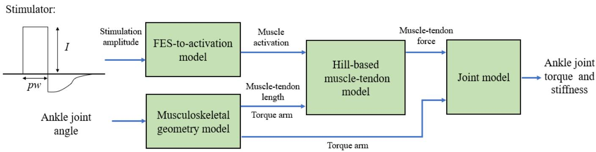  
Fig. 1. Schematic blocs diagram of the ankle joint torque and stiffness model. The pw is stimulation pulse width and I is stimulation amplitude.

Though the modulation of joint torque is important during locomotion, according to biomechanical studies, the joint stiffness taking up the main component of the torque is also significant [13], [14]. Joint stiffness, which varies substantially during motion, is modulated by the simultaneously activating antagonist muscle pairs [15]. For healthy individuals, the central nervous system stimulates motor units, so that the whole muscle changes joint torque and stiffness. Trevino et al. compared the ankle stiffness with different muscle activation levels and found that the ankle stiffness increased with the increased activation of TA and soleus muscles [16]. And Weiss et al. demonstrated that ankle stiffness had a positive linear correlation with the voluntary muscle torque under isometric contraction [17]. Many previous studies have investigated the effect of FES on joint stiffness. For instance, Zhou et al. electrically stimulated a pair of agonist-antagonist muscles in cats with various coactivation strategies and found that the increase of antagonist activity increased the joint stiffness but decreased the maximal joint torque [18]. Moreover,

Bó et al. indicated that the coactivation of antagonist muscles by FES during tracking tasks could improve stability and resist disturbance [19]. Copur et al. suppressed wrist tremor via applying FES to flexor carpi radialis and extensor carpi radialis muscles causing coactivation as it could increase the wrist stiffness [20].

Although joint stiffness can be qualitatively modulated by FES in previous studies [18]–[20], few of them established model to generate FES-induced joint stiffness quantitatively. Most previous studies only established models to modulate FES-induced torque/force. Therefore, this study aimed to establish a model to predict FES-induced ankle torque and stiffness simultaneously under isometric contraction since the ankle joint plays an essential role in supporting lower extremity function [14], [21]. The model was calibrated by the electromyography (EMG) and joint torque of the tibialis anterior (TA) and gastrocnemius medial (GAS) muscles. To validate the model, the estimated torque was compared with the measured torque induced by the FES model, and the estimated stiffness was compared with the measured stiffness measured by perturbation tests.

## II. METHOD

## A. Model

In the purpose of estimating the ankle joint torque and stiffness produced by electrical stimulation, we used a physiological model shown in Fig. 1 involving four subparts: a FES-to-activation model, a musculoskeletal geometry model, a Hill-based muscle-tendon model, and a joint stiffness model. The FES-to-activation model attempted to estimate electrical stimulation amplitude induced muscle activation a. The musculoskeletal geometry model was used to obtain the torque arm $r _ { m t }$ and length $l _ { m t }$ of a muscle-tendon unit. Then the Hill-based muscle-tendon model was used to calculate the muscle-tendon force $F _ { m t }$ with the muscle activation a and length of muscle-tendon unit $l _ { m t }$ . And the ankle joint model can be estimated by the joint torque $\tau _ { e s t }$ and active stiffness $K _ { e s t }$

In the FES-to-activation model, a sigmoid function which describes the spatial summation of activated fibers [22] was applied to calculate muscle activation $a \in [ 0 , 1 ]$ with electrical stimulation amplitude, shown as Eq. (1).

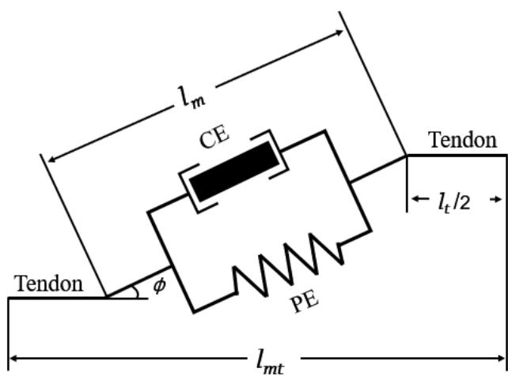  
Fig. 2. Schematic of Hill-based muscle-tendon model.

$$
a = \frac {g _ {1}}{1 + e ^ {\left\{g _ {2} \left(g _ {3} - \frac {I}{I _ {m a x}}\right) \right\}}}\tag{1}
$$

where $g _ { 1 }$ denotes the plateau level under the maximum electrical stimulation amplitude, $g _ { 2 }$ denotes the slope of fiber recruitment and $g _ { 3 }$ denotes inflexion point when active recruitment occurred. I is the electrical stimulation amplitude, $I _ { m i n }$ is the minimum electrical stimulation amplitude causing muscle contractions and, and $I _ { m a x }$ is the maximum electrical stimulation amplitude that the subjects could tolerate or generate joint torque 2 at least Nm. The value of $I _ { m a x }$ was subject-dependent, which should be tested before experiments.

In the musculoskeletal geometry model, the $r _ { m t }$ and $l _ { m t }$ can be calculated with the ankle joint angle q, the center of the joint O, the origin point A and insertion point B of a muscletendon unit, as formulated in Eq. (2) and Eq. (3)

$$
\begin{array}{r l} & {l _ {m t} = \sqrt {O A ^ {2} + O B ^ {2} - 2 O A \cdot O B \cdot \cos q}} \\ & {\quad = l _ {t} + l _ {m} \cos \phi} \\ & {r _ {m t} = \frac {\partial l _ {m t}}{\partial q}} \end{array}\tag{2}
$$

(3)

where $l _ { t }$ represents the length of tendon, $l _ { m }$ represents the length of muscle fiber, and $\phi$ is the pennation angle [23].

In the Hill-based muscle-tendon model, shown in Fig. 2, there are mainly three elements: an active contractile element (CE); a passive element (PE), describing muscle passive elasticity; and the tendons, representing tendon elasticity [24]. The force generated by CE [25] can be calculated with the maximum isometric muscle force $F _ { m x }$ by Eq. (4)

$$
F _ {c e} = f (l) f (v) F _ {m x} a\tag{4}
$$

where $f \left( l \right)$ and f (v) are the active force-length and force-velocity respectively; l is the normalized muscle fiber length and vis the normalized muscle fiber velocity. The $f \left( l \right)$

and f (v) can be defined as Eq. (5) and Eq. (6):

$$
\begin{array}{l} F (l) = \sin (- 1. 3 1 7 l ^ {2} - 0. 4 0 3 l + 2. 5 4 5) \\ F (v) = \left\{ \begin{array}{l l} \frac {0 . 3 (v + 1)}{- v + 0 . 3} & (v <   0) \\ \frac {2 . 3 4 v + 0 . 0 3 9}{1 . 3 v + 0 . 0 3 9} & (v > 0) \end{array} \right. \end{array}\tag{5}
$$

(6)

Moreover, the force $F _ { p e }$ caused by PE [26] is related to the passive elastic force-length $f _ { p } \left( l \right)$ and $F _ { m x }$ , as defined by

$$
\begin{array}{c} {F _ {p e} = f _ {p} (l) F _ {m x}.} \\ {f _ {p} (l) = 0. 1 2 9 e ^ {4. 5 4 5 (l - 1)} - 1} \end{array}\tag{7}
$$

(8)

And the tendon force F can be expressed as

$$
\begin{array}{l} F _ {t} = \left\{ \begin{array}{l l} 0 & \varepsilon \leq 0 \\ 1 4 8 0. 3 F _ {m x} \varepsilon^ {2} & 0 <   \varepsilon \leq 0. 0 1 2 7 \\ (3 7. 5 \varepsilon - 0. 2 3 7 5) F _ {m x} & \varepsilon \geq 0. 0 1 2 7 \end{array} \right. \\ \varepsilon = \frac {l _ {t} - l _ {s t}}{l _ {s t}} \end{array}\tag{9}
$$

(10)

where $l _ { t }$ is the current length of tendon and $l _ { s t }$ is the slack length of tendon. The muscle-tendon force $F _ { m t }$ and the tendon force $F _ { t }$ can be described by Eq. (11). Then, the corresponding joint torque $\tau _ { e s t }$ can be estimated by the torque arm $r _ { m t }$ of the muscle-tendon unit and the force $F _ { m t }$ [26].

$$
F _ {m t} = F _ {t} = F _ {m} \cos \phi = (F _ {c e} + F _ {p e}) \cos \phi\tag{11}
$$

$$
\tau_ {e s t} = r _ {m t} F _ {m t}\tag{12}
$$

In the joint model, the muscle-tendon unit stiffness $K _ { m t }$ can be considered as the muscle stiffness $K _ { m }$ in series with the tendon stiffness $K _ { t }$ [27].

$$
K _ {m t} = \frac {K _ {m} K _ {t}}{K _ {m} + K _ {t}}\tag{13}
$$

According to Cui’s study, $K _ { m }$ is relevant to the muscle force $F _ { m }$ , the muscle-fiber length at maximum activation $l _ { m 0 }$ and a scaling constant γ set to 23.4 [28]. For the tendon stiffness $K _ { t } ,$ it can be described as the slope of a dimensionless force-strain curve scaled for each individual tendon.

$$
K _ {m} = \frac {\gamma F _ {m}}{l _ {m 0}}\tag{14}
$$

$$
K _ {t} = \frac {\mathrm{d} F _ {t}}{\mathrm{d} l _ {t}}\tag{15}
$$

Thus, considering the dynamic changes in muscle-tendon unit length and joint angles, the active stiffness $K _ { e s t }$ [29] supplied by each muscle can be estimated by using the muscle-tendon force $F _ { m t }$ and muscle-tendon unit stiffness $K _ { m t }$ as

$$
K _ {e s t} = K _ {m t} r _ {m t} ^ {2} + \frac {\partial r _ {m t}}{\partial q} F _ {m t}.\tag{16}
$$

When the electrical stimulation current was delivered to the GAS and TA simultaneously, the total active stiffness $K _ { e s t }$ of ankle joint can be estimated as the sum of the active stiffness [30] induced by TA and GAS shown as

$$
K _ {e s t} = K _ {e s t \_ T A} + K _ {e s t \_ G A S}\tag{17}
$$

where $K _ { e s t \_ T A }$ and $K _ { e s t \_ G A S }$ are the active stiffness supplied by TA and GAS, respectively.

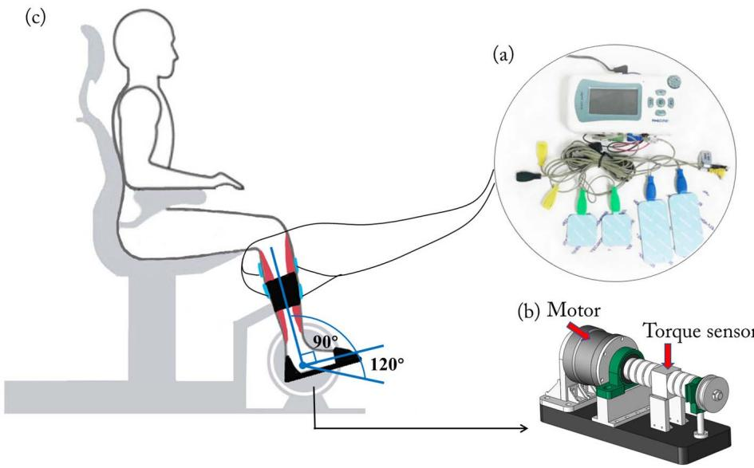  
Fig. 3. Experimental apparatus and setup. (a) Photo of the electrical stimulation containing surface electrodes; (b) The CAD graph of the experimental apparatus; (c) Schematic diagram of experimental posture. The ankle positions during experiments were shown in Fig. 3(c) with coordinate axis.

## B. Apparatus

As shown in Fig. 3, the experimental apparatus mainly consisted of a direct drive brushless AC servo motor (DM1B-045G, Yokogawa, Japan) with a servo driver (UB1DG3, Yokogawa, Japan), a motion controller (GTS-400-PV(G)- PCI, Googoltech, Hong Kong), a torque sensor (AKC-205, 701st Research Institute of China Aerospace, Science and Technology Corporation, China), a mechanical footplate and supporter, a multi-channel functional electrical stimulator (P2- 9632, Faisco, China), surface electrical stimulation electrodes (M2223, 3M, USA), a personal computer (PC), and a data acquisition card (USB-6341 DAQ card, National Instruments, USA) [25], [27]. The servo motor is fixed on the ground and can control the footplate placed at the end of it to an accurate angle of rotation. The torque sensor was fixed between the servo motor and the footplate, which can measure the interaction between humans and footplate. In addition, a supporter was placed behind the calf to counteract the effects of external forces and fix the lower limb. The DAQ card can not only collect the EMG, torque, and angle signals to the PC, but also provide the modulate the stimulation amplitude of the functional electrical stimulator based on the Labviewbased program (National Instruments, USA). The functional electrical stimulator was a custom-designed electrical stimulator and the stimulation amplitude can be modulated by the DAQ card which can generate pulse-width modulation signal to the stimulator.

## C. Experiments and Data Processing

Fifteen healthy adults (aged: $2 3 . 2 0 ~ \pm ~ 1 . 2 8$ years; eight females, seven males) were recruited for this study. All subjects received and signed the informed consent form before participating in the experiment. This study was approved by the Medical Ethics Committee of the Guangdong Work Injury Rehabilitation Center. There were three tasks in this experiment. For all the tasks, the subjects were instructed to sit on the chair, put their right foot on the footplate, and fasten the calf to the supporter.

The first task was the maximum voluntary contraction (MVC) tests, which aims to calibrate the Hill-based model and obtain its paraments. To acquire the EMG signals, circular silver-silver chloride (Ag-AgCl) electrodes with a diameter of 5 mm and an interelectrode distance of 20 mm were attached to the bellies of the TA and GAS. At first, the subjects were asked to maintain their lower limb muscles relax while the ankle joint flexion angle was fixed at 90◦. The subjects were informed to activate TA muscle to get dorsiflexion torque or GAS muscle to get plantarflexion torque respectively as much as possible during the indicator light appearing on the PC screen for 5s. Then, the ankle joint flexion angle of subjects was modulated at $1 2 0 ^ { \circ }$ which means rotating $3 0 ^ { \circ }$ toward the plantar flexion direction based on the ankle joint of 90◦, and the subjects were asked to repeat the above operation to obtain ankle torque in two different directions. Each trial was conducted three times, and the maximal EMG amplitude of the TA or GAS muscle at each angle was recorded and stored to calibrate the model.

The ankle joint torque and EMG signals were acquired to calibrate the parameters of musculoskeletal model, such as the tendon slack length $l _ { s t }$ and the maximum isometric muscle force $F _ { m x }$ . Firstly, the raw EMG signals were amplified using the EMG amplifiers with a gain of 5000, collected at a sample rate of 1000 Hz and then filtered by a fourth-order Butterworth band-pass filter between 10 and 450 Hz. Secondly, the filtered EMG signals were normalized based on the MVC level of the muscle, and full-wave rectification was applied to the normalized EMG signals. Finally, the full-wave rectified EMG signals were passed into a low-pass second-order Butterworth filter at 8 Hz for obtaining the envelopes to the EMG signals e(t). The $e ( t )$ can be used to calculate the muscle activation a(t) with the neural activation $u \left( t \right)$ by the following equations

$$
u (t) = \alpha e (t - d) - \beta_ {1} u (t - 1) - \beta_ {2} u (t - 2)
$$

$$
(\alpha = 0. 9 4 8 6, \beta_ {1} = - 0. 0 5 2, \beta_ {2} = 0. 0 0 0 6 2 7)
$$

$$
\left\{ \begin{array}{l l} a (t) = b \ln (c u (t) + 1), & 0 \leq u (t) <   u _ {0} \\ a (t) = m u (t) + n, & u _ {0} \leq u (t) <   1 \end{array} \right.\tag{18}
$$

(19)

where d represents the electromechanical delay set to 80 ms [25] and the b, c, m, and n are coefficients. Thirdly, the estimated joint torque $\tau _ { e s t \_ e m g }$ were obtained based on the muscle activation $a ( t )$ from EMG signals. Thus, to optimize the subject-specific model parameters, the model calibration can be conducted by minimizing Eq. (20) with the measured torque $\tau _ { m }$ and the estimated joint torque τest\_emg

$$
E r = \frac {1}{N} \sum_ {i = 0} ^ {N} (\tau_ {e s t \_ e m g} (i) - \tau_ {m} (i)) ^ {2}\tag{20}
$$

where N is the length of the data.

In the second task, in order to prove the effectiveness of established mapping relationship between stimulation amplitude and joint torque, we conducted the FES-induced torque tests. Before starting the test, the surface electrical stimulation electrodes were attached to the TA and GAS muscles. In addition, the maximum electrical stimulation amplitude values of both TA and GAS muscles were found independently at a constant pulse width (390 $\mu \mathrm { s } )$ and constant frequency (40 Hz). The subjects were instructed to relax their lower limb muscles and avoid voluntary effort with the ankle joint angle fixed at $9 0 ^ { \circ }$ . During this test, a triangular ramp stimulation amplitude profile which raised linearly from 0 mA to the maximum stimulation amplitude and then declined to 0 mA was applied [9]. The dorsiflexor torque was measured by a torque sensor when the stimulation current of triangular ramp profile was delivered to TA muscle while the plantarflexor torque was measured when the stimulation current of triangular ramp profile was delivered to GAS muscle. The FES-induced ankle joint torque and the stimulation amplitude value were stored synchronously.

As the values of model parameters were obtained through MVC test, the joint torque could be calculated successfully with stimulation amplitude. The measured joint torque and stimulation amplitude were stored to evaluate the estimation accuracy of the physiological model. To quantitively evaluate the estimation quality, we employ the goodness-of-fit (gof) as the evaluation metric [31] formulated by

$$
\mathrm{gof} = 1 - \frac {\sum_ {k = 1} ^ {N} \left(\tau_ {m} (k) - \tau_ {e s t} (k)\right) ^ {2}}{\sum_ {k = 1} ^ {N} \left(\tau_ {m} (k) - \bar {\tau} _ {m} (k)\right) ^ {2}}\tag{21}
$$

where $\bar { \tau } _ { m }$ is the mean of measured torque $\tau _ { m }$

To verify the accuracy of the ankle joint stiffness and steadystate torque estimated by the model, the perturbation tests were designed [29]. The desired perturbed trajectory generated by the motor was sinusoidal with an amplitude of $0 . 7 5 ^ { \circ }$ and a frequency of 3 Hz. The PD controller was applied here with P 3.5 and $\mathrm { D } = 0 . 5$ . In these tests, the ankle joint angle of the subject was set at $9 0 ^ { \circ }$ under relaxed state. The perturbation tests were performed under four different conditions. For the first condition, the perturbation tests were conducted without FES (noFES) for obtaining the passive ankle joint stiffness. For the second condition, the perturbation tests did not start until the TA muscle reached a steady-state under electrical stimulation with maximum amplitude. Analogously, the perturbation tests were performed during the GAS muscle was electrically stimulated with its maximum stimulation amplitude. For the last condition, the TA muscle and GAS muscle were electrically stimulated simultaneously with their maximum stimulation amplitude and the perturbation tests were performed. In addition, the perturbation tests were conducted without subjects in order to measure the default stiffness of mechanical device. The measured stiffness under four conditions excluded the default stiffness of mechanical device by subtracting it. The measured active stiffness was calculated by subtracting the passive stiffness from measured stiffness. Each group included three trials which lasted 10 seconds with a 10 minutes break between each trial. All the trails were conducted randomly.

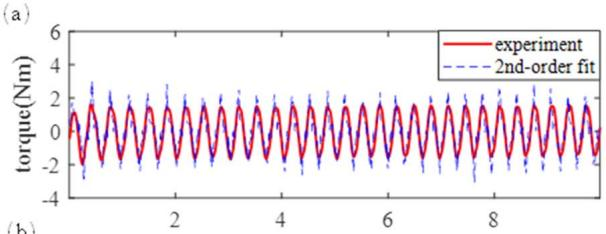

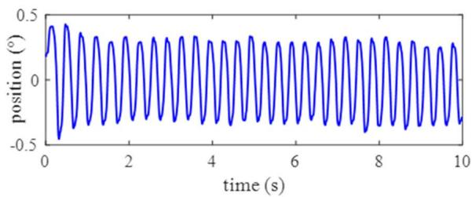  
Fig. 4. Data from a typical perturbation test. (a) The red line means the torque provided by motor to produce perturbation. and the blue line represents the fitting torque by the second-order mass-spring-damper model. The gof of this trail is 85.76%.

In the perturbation tests, the ankle joint position and torque were acquired to calculate the stiffness and one trail of them was shown in Fig. 4. Typically, a second-order massspring-damper model was proposed to describe ankle joint dynamics [32], which could be expressed as

$$
\tau_ {i n t} = J \ddot {q} + B \dot {q} + K q\tag{22}
$$

where $\tau _ { i n t }$ is the torque provided by the motor to produce perturbation. The parameters q, q˙ and q¨ were the ankle joint angle, velocity and acceleration, respectively. And J, B and K donated inertia, viscous, and stiffness parameters, respectively. The stiffness was obtained by multiple linear regression. Furthermore, to evaluate how well the parameters described the mass-spring-damper model, the gof between $\tau _ { i n t }$ and fitting torque was calculated. At the same time, the steady-state ankle torques during the perturbation tests were recorded to validate the model.

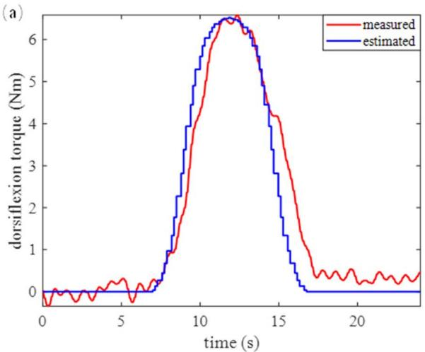

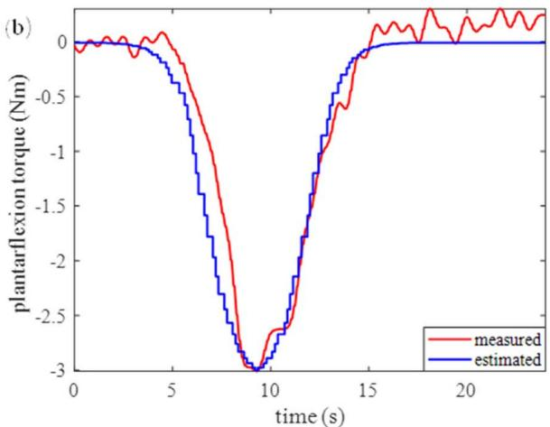  
Fig. 5. The measured and estimated ankle torque of a representative subject in the FES-induced torque tests. (a) The result of TA muscle. (b) The result of GAS muscle. The red line shows the measured torque result from electrically stimulated muscles and the blue line shows the estimated torque by model.

## D. Statistical Analysis

For the statistical analysis, Pearson’s product-moment correlation coefficient analysis was conducted between the measured and estimated steady-state torque. The relationship between the measure and estimated active stiffness was also examined by the Pearson’s correlation coefficient analysis. And the Bland-Altman plot was conducted to analyze the agreement between measured and estimated active stiffness. Besides, the measured stiffness for all subjects under four conditions was analyzed by the one-way repeated-measure analysis of variance and the level of statistical significance was set to p<0.05. The statistical analysis was performed with the SPSS 23.0 software (SPSS Inc., Chicago, IL, USA).

## III. RESULTS

The comparison of measured ankle torque induced by FES and the estimated torque with the electrical stimulation amplitude of a representative subject, is shown in Fig.5. The estimated torque was proximate to the measured torque, which validated the effectiveness of established mapping relationship of the FES-to-torque. The average and standard deviation (SD) of gof of dorsiflexion and plantarflexion torque of all subjects was 86.23±9.54% and 84.53±6.87%, respectively. Fig.6 shows the measured and estimated ankle steady-state torque induced by FES during perturbation tests. Their Pearson correlation coefficient was $\mathsf { R } ^ { 2 } = 0 . 9 3 9 7 ~ ( \mathsf { p } < 0 . 0 1 )$ ). The average SD of measured steady-state torque was 0.26 Nm for the trails of TA, 0.27 Nm for the trails of GAS, and 0.15 Nm for the trails of TA and GAS.

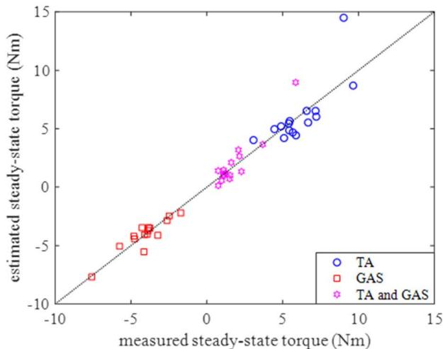  
Fig. 6. The plot represents the relationship between the measured and estimated steady-state torque. The TA is electrically stimulated TA muscle at its maximum amplitude; the GAS is electrically stimulated GAS muscle its maximum amplitude; the TA and GAS is electrically stimulated both TA and GAS muscles at their maximum amplitude.

The scatter plot of the measured active stiffness from the perturbation tests and estimated active stiffness is shown in Fig. 7(a). The result of Pearson’s correlation coefficient between the measure and estimated active stiffness was $\mathbf { R } ^ { 2 } = \mathbf { \Phi }$ 0.7335 (p<0.01). Fig. 7(b) shows the Bland-Altman plot, a scatterplot of the difference between measured and estimated active stiffness against their average. The bias was 4.12, which indicated that the model underestimated the measured active stiffness overall. The difference scores between measured and estimated active stiffness were mostly within the range of limits of agreement, which means the estimated active stiffness matched with measured active stiffness well and had a good agreement. The average SD of measured stiffness was 9.49 Nm/rad for the trails of TA, 8.48 Nm/rad for the trails of GAS, and 11.48 Nm/rad for the trails of TA and GAS. In addition, the mass-spring-damper model fits had a gof of 82.05 2.74% for the trails of TA, 82.41 3.88% for the trails of GAS, and 85.45 1.77% for the trails of TA and GAS, which verified the effectiveness of the stiffness measurement method.

In Fig. 8, the measured ankle stiffness was compared between four conditions: without FES, electrically stimulated TA muscle, electrically stimulated GAS muscle, and electrically stimulated both TA and GAS muscles. The ankle stiffness under noFES condition represented passive ankle stiffness and its average value was 35.01 Nm/rad. There were significant differences in the ankle stiffness between the noFES condition and the other three conditions. The largest average stiffness was 137.12 Nm/rad under electrically stimulated TA and GAS muscles condition, which was significantly larger than the rest three conditions (p<0.05). Electrically stimulating TA muscle induced slightly larger stiffness than stimulating GAS muscle, with an average stiffness value of 85.62 Nm/rad and 80.94 Nm/rad, respectively. Either electrically stimulated TA muscle or electrically stimulated GAS muscle significantly increased the ankle stiffness significantly.

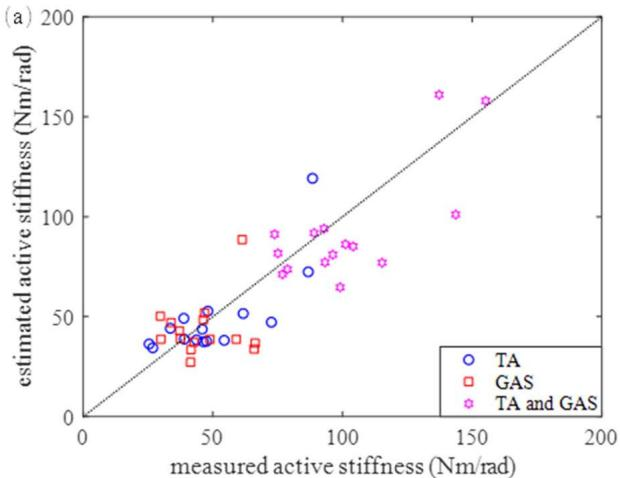

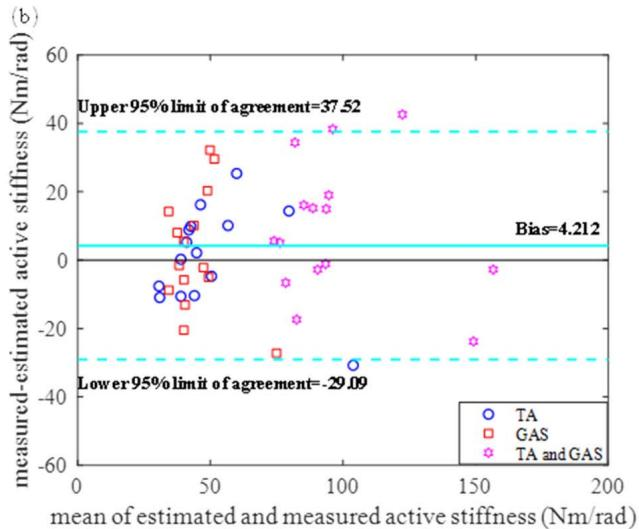  
Fig. 7. (a) The plot represents the relationship between the estimated active stiffness and measured active stiffness. (b) The bias was the mean of the difference scores between measured and estimated active stiffness. The limits of agreement were obtained by bias 1.96SD.

## IV. DISCUSSIONS

The modulation of ankle torque and stiffness is essential in lower extremity motor function. Healthy individuals would simultaneously activate both agonist and antagonist muscles to generate ankle torque and stiffness to confront external disturbances during motion. Our object was to establish a model to simultaneously estimate both ankle joint torque and stiffness induced by FES, which might be applied in control systems to complete some functional tasks in neurologic patients.

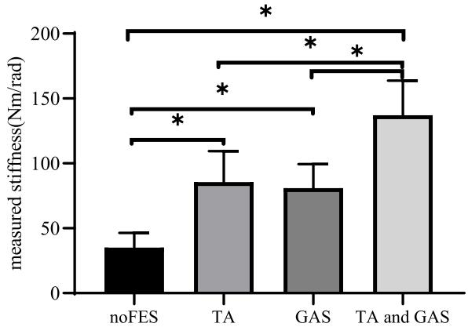  
Fig. 8. The joint stiffness under four different conditions. The noFES means without FES.

Nonphysiological models are simple and can provide an accurate estimation of the joint torque induced by FES [33], [34], but they only focused on the input-output mapping relationship of muscle, of which parameters lack physiological meaning, and were hard to extend to estimate joint stiffness. Thus, the physiological models are commonly selected to estimate joint torque and stiffness simultaneously. In physiological models, the Hill-based model including static and dynamic properties was used widely, which tends to be accurate and subject-specific. Pfeifer et al. and Yao et al. used Hill-based models simultaneously to estimate joint torque and stiffness based on EMG signals [27], [29]. Despite that they provided a feasible way to conveniently quantify joint torque and stiffness, they failed to generate joint torque and stiffness required for the control systems. Their work inspired us to develop a model to regulated joint torque and stiffness with FES, which can activate muscles artificially. Based on the approach that estimating joint torque and stiffness using EMG signals with the Hill-based model, the key of our work was establishing a mapping relationship between electrical stimulation amplitude and muscle activation to replace the mapping relationship between EMG signals and muscle activation.

The passive ankle stiffness refers to ankle stiffness during relaxation, and the active stiffness means ankle stiffness under an active muscle condition, both of which contribute to daily locomotion. In our results, the passive ankle stiffness approximately matched the results of Roy’s study [35], and was slightly higher than Zinder’s results [36]. From the perspective of the active ankle stiffness, the average active ankle stiffness in our study is consistent with the active ankle stiffness during voluntary contractions in Kearney’s study [37], and many other previous studies [38]. However, based on the Bland-Altman analysis, the estimated stiffness was smaller than the measured stiffness, which could be caused by the following factors. Firstly, our model only considered the muscle contractions induced by FES, while neglected potential voluntary or reflex activation which may contribute to active stiffness [39]. Secondly, Hu et al. indicated that the Hill-type model underestimates actual stiffness as it cannot fully describe the intrinsic impedance components, which may also be a reasonable explanation [40]. Thirdly, Perreault et al.

also found that the perturbation amplitude could affect the measurement of joint stiffness [29].

There are some limitations that will need to be overcome in the future. The differences in the time courses between estimated and measured torques could be observed in Fig. 5, which might be caused by the electromechanical delay. The electromechanical delay represents the time delay between muscle activation and force generation, ranging from 0.05 s to 0.35 s in previous studies [41], [42]. Furthermore, both the electromechanical delay and muscle force are uncertainly time-varying with the FES-induced fatigue [41], motivating future works to optimize the model. We simplified and grouped the dorsiflexor muscles to TA and plantarflexor muscles to GAS [43]. Future work should consider more contributed muscles in dorsiflexion/plantarflexion direction. Though the model only predicts ankle torque and stiffness induced by FES under isometric condition, it is an important step towards the modulation of ankle torque and stiffness induced by FES during walking. This model helps FES control systems adaptively to modulate joint torque and stiffness, which assists dorsiflexion during the swing phase, as well as coactivation to provide propulsive force and joint stiffness during the stance phase [44].

## V. CONCLUSION

This study developed a model, which helps the modulation of ankle torque and stiffness with FES. It might be considered in a control system to help patients with neurological diseases complete daily activities. The future work includes extending this model to dynamic conditions, particularly FES-assisted walking, to generate appropriate joint torque for propulsion, and stiffness for adapting the external environment by FES.

## REFERENCES

[1] P. H. Peckham and J. S. Knutson, “Functional electrical stimulation for neuromuscular applications,” Annu. Rev. Biomed. Eng., vol. 7, pp. 327–360, Aug. 2005.

[2] C. Salchow-Hömmen et al., “User-centered practicability analysis of two identification strategies in electrode arrays for FES induced hand motion in early stroke rehabilitation,” J. NeuroEng. Rehabil., vol. 15, no. 1, p. 123, Dec. 2018.

[3] M. R. Popovic, T. A. Thrasher, V. Zivanovic, J. Takaki, and V. Hajek, “Neuroprosthesis for retraining reaching and grasping functions in severe hemiplegic patients,” Neuromodulation, Technol. Neural Interface, vol. 8, no. 1, pp. 58–72, Jan. 2005.

[4] G. Chen, L. Ma, R. Song, L. Li, X. Wang, and K. Tong, “Speedadaptive control of functional electrical stimulation for dropfoot correction,” J. NeuroEng. Rehabil., vol. 15, no. 1, Nov. 2018, Art. no. 98.

[5] S. Agarwal et al., “Long-term user perceptions of an implanted neuroprosthesis for exercise, standing, and transfers after spinal cord injury,” J. Rehabil. Res. Develop., vol. 40, no. 3, pp. 241–252, May/Jun. 2003.

[6] H. Ring, I. Treger, L. Gruendlinger, and J. M. Hausdorff, “Neuroprosthesis for footdrop compared with an ankle-foot orthosis: Effects on postural control during walking,” J. Stroke Cerebrovascular Diseases, vol. 18, no. 1, pp. 41–47, Jan. 2009.

[7] C. L. Lynch and M. R. Popovic, “Functional electrical stimulation: Closed-loop control of induced muscle contractions,” IEEE Control Syst. Mag., vol. 28, no. 2, pp. 40–50, Apr. 2008.

[8] K. J. Hunt, R.-P. Jaime, and H. Gollee, “Robust control of electricallystimulated muscle using polynomial H design,” Control Eng. Pract., vol. 9, no. 3, pp. 313–328, Mar. 2001.

[9] F. Le, I. Markovsky, C. T. Freeman, and E. Rogers, “Identification of electrically stimulated muscle models of stroke patients,” Control Eng. Pract., vol. 18, no. 4, pp. 396–407, Apr. 2010.

[10] L. A. F. Law and R. K. Shields, “Mathematical models of human paralyzed muscle after long-term training,” J. Biomech., vol. 40, no. 12, pp. 2587–2595, Jan. 2007.

[11] R. Riener, J. Quintern, and G. Schmidt, “Biomechanical model of the human knee evaluated by neuromuscular stimulation,” J. Biomech., vol. 29, no. 9, pp. 1157–1167, Sep. 1996.

[12] R. Riener, M. Ferrarin, E. E. Pavan, and C. A. Frigo, “Patient-driven control of FES-supported standing up and sitting down: Experimental results,” IEEE Trans. Rehabil. Eng., vol. 8, no. 4, pp. 523–529, Dec. 2000.

[13] H. Lee and N. Hogan, “Time-varying ankle mechanical impedance during human locomotion,” IEEE Trans. Neural Syst. Rehabil. Eng., vol. 23, no. 5, pp. 755–764, Sep. 2015.

[14] E. J. Rouse, L. J. Hargrove, E. J. Perreault, and T. A. Kuiken, “Estimation of human ankle impedance during the stance phase of walking,” IEEE Trans. Neural Syst. Rehabil. Eng., vol. 22, no. 4, pp. 870–878, Jul. 2014.

[15] Y. Sekiguchi, T. Muraki, D. Owaki, K. Honda, and S.-I. Izumi, “Regulation of quasi-joint stiffness by combination of activation of ankle muscles in midstances during gait in patients with hemiparesis,” Gait Posture, vol. 62, pp. 378–383, May 2018.

[16] J. Trevino and H. Lee, “Sex differences in 2-DOF human ankle stiffness in relaxed and contracted muscles,” Ann. Biomed. Eng., vol. 46, no. 12, pp. 2048–2056, Dec. 2018.

[17] P. L. Weiss, R. E. Kearney, and I. W. Hunter, “Position dependence of ankle joint dynamics—II. Active mechanics,” J. Biomech., vol. 19, no. 9, pp. 737–751, 1986.

[18] B. H. Zhou, R. V. Baratta, M. Solomonow, L. J. Olivier, G. T. Nguyen, and R. D. D’Ambrosia, “Evaluation of isometric antagonist coactivation strategies of electrically stimulated muscles,” IEEE Trans. Biomed. Eng., vol. 43, no. 2, pp. 150–160, Feb. 1996.

[19] A. P. L. Bó, L. O. da Fonseca, and A. C. C. de Sousa, “FESinduced co-activation of antagonist muscles for upper limb control and disturbance rejection,” Med. Eng. Phys., vol. 38, no. 11, pp. 1176–1184, Nov. 2016.

[20] E. H. Copur, C. T. Freeman, B. Chu, and D. S. Laila, “Repetitive control of electrical stimulation for tremor suppression,” IEEE Trans. Control Syst. Technol., vol. 27, no. 2, pp. 540–552, Mar. 2019.

[21] H. Dallali, L. Knop, L. Castelino, E. Ficanha, and M. Rastgaar, “Estimating the multivariable human ankle impedance in dorsi-plantarflexion and inversion-eversion directions using EMG signals and artificial neural networks,” Int. J. Intell. Robot. Appl., vol. 1, no. 1, pp. 19–31, Feb. 2017.

[22] Y. Fan and Y. Yin, “Active and progressive exoskeleton rehabilitation using multisource information fusion from EMG and force-position EPP,” IEEE Trans. Biomed. Eng., vol. 60, no. 12, pp. 3314–3321, Dec. 2013.

[23] C. J. Feng, A. F. T. Mak, and T. K. K. Koo, “A surface EMG driven musculoskeletal model of the elbow flexion-extension movement in normal subjects and in subjects with spasticity,” J. Musculoskeletal Res., vol. 3, no. 2, pp. 109–123, Jun. 1999.

[24] J. M. Winters, “An improved muscle-reflex actuator for use in largescale neuromusculoskeletal models,” Ann. Biomed. Eng., vol. 23, no. 4, pp. 359–374, Jul. 1995.

[25] D. Ao, R. Song, and J. Gao, “Movement performance of human–robot cooperation control based on EMG-driven hill-type and proportional models for an ankle power-assist exoskeleton robot,” IEEE Trans. Neural Syst. Rehabil. Eng., vol. 25, no. 8, pp. 1125–1134, Aug. 2017.

[26] Y. Zhuang, S. Yao, C. Ma, and R. Song, “Admittance control based on EMG-driven musculoskeletal model improves the human–robot synchronization,” IEEE Trans. Ind. Informat., vol. 15, no. 2, pp. 1211–1218, Feb. 2019.

[27] S. Yao, Y. Zhuang, Z. Li, and R. Song, “Adaptive admittance control for an ankle exoskeleton using an EMG-driven musculoskeletal model,” Frontiers Neurorobotics, vol. 12, p. 16, Apr. 2018.

[28] L. Cui, E. J. Perreault, H. Maas, and T. G. Sandercock, “Modeling shortrange stiffness of feline lower hindlimb muscles,” J. Biomech., vol. 41, no. 9, pp. 1945–1952, Jan. 2008.

[29] S. Pfeifer, H. Vallery, M. Hardegger, R. Riener, and E. J. Perreault, “Model-based estimation of knee stiffness,” IEEE Trans. Biomed. Eng., vol. 59, no. 9, pp. 2604–2612, Sep. 2012.

[30] B. Misgeld, T. Zhang, M. Lüken, and S. Leonhardt, “Model-based estimation of ankle joint stiffness,” Sensors, vol. 17, no. 4, p. 713, Mar. 2017.

[31] E.-W. Bai, Z. Cai, S. Dudley-Javorosk, and R. K. Shields, “Identification of a modified Wiener–Hammerstein system and its application in electrically stimulated paralyzed skeletal muscle modeling,” Automatica, vol. 45, no. 3, pp. 736–743, Mar. 2009.

[32] E. S. Tehrani, K. Jalaleddini, and R. E. Kearney, “Ankle joint intrinsic dynamics is more complex than a mass-spring-damper model,” IEEE Trans. Neural Syst. Rehabil. Eng., vol. 25, no. 9, pp. 1568–1580, Sep. 2017.

[33] H. Rouhani, M. R. Popovic, M. Same, Y. Q. Li, and K. Masani, “Identification of ankle plantar-flexors dynamics in response to electrical stimulation,” Med. Eng. Phys., vol. 38, no. 11, pp. 1166–1171, Nov. 2016.

[34] J. Bobet, E. R. Gossen, and R. B. Stein, “A comparison of models of force production during stimulated isometric ankle dorsiflexion in humans,” IEEE Trans. Neural Syst. Rehabil. Eng., vol. 13, no. 4, pp. 444–451, Dec. 2005.

[35] A. Roy, L. W. Forrester, R. F. Macko, and H. I. Krebs, “Changes in passive ankle stiffness and its effects on gait function in people with chronic stroke,” J. Rehabil. Res. Develop., vol. 50, no. 4, p. 555, 2013.

[36] S. M. Zinder, K. P. Granata, S. J. Shultz, and B. M. Gansneder, “Ankle bracing and the neuromuscular factors influencing joint stiffness,” J. Athletic Training, vol. 44, no. 4, pp. 363–369, Jul. 2009.

[37] M. A. Golkar, E. S. Tehrani, and R. E. Kearney, “Linear parameter varying identification of dynamic joint stiffness during time-varying voluntary contractions,” Frontiers Comput. Neurosci., vol. 11, p. 35, May 2017.

[38] M. W. Whitmore, L. J. Hargrove, and E. J. Perreault, “Altered neural control reduces shear forces and ankle impedance on a slippery surface,” IEEE Trans. Biomed. Eng., vol. 66, no. 8, pp. 2381–2389, Aug. 2019.

[39] G. C. Agarwal and G. L. Gottlieb, “Oscillation of the human ankle joint in response to applied sinusoidal torque on the foot,” J. Physiol., vol. 268, no. 1, pp. 151–176, Jun. 1977.

[40] X. Hu, W. M. Murray, and E. J. Perreault, “Muscle short-range stiffness can be used to estimate the endpoint stiffness of the human arm,” J. Neurophysiol, vol. 105, no. 4, pp. 1633–1641, Apr. 2011.

[41] R. J. Downey, M. Merad, E. J. Gonzalez, and W. E. Dixon, “The time-varying nature of electromechanical delay and muscle control effectiveness in response to stimulation-induced fatigue,” IEEE Trans. Neural Syst. Rehabil. Eng., vol. 25, no. 9, pp. 1397–1408, Sep. 2017.

[42] A. H. Vette, K. Masani, and M. R. Popovic, “Time delay from muscle activation to torque generation during quiet stance: Implications for closed-loop control via FES,” J. Biomedizinische Technik, vol. 53, no. Suppl. 1, pp. 423–425, 2008.

[43] B. J. E. Misgeld, M. Luken, R. Riener, and S. Leonhardt, “Observerbased human knee stiffness estimation,” IEEE Trans. Biomed. Eng., vol. 64, no. 5, pp. 1033–1044, May 2017.

[44] D. G. Embrey, S. L. Holtz, G. Alon, B. A. Brandsma, and S. W. McCoy, “Functional electrical stimulation to dorsiflexors and plantar flexors during gait to improve walking in adults with chronic hemiplegia,” Arch. Phys. Med. Rehabil., vol. 91, no. 5, pp. 687–696, May 2010.