# 基于可变遗忘因子递推最小二乘算法的 FES 诱发力矩预测自适应 Hammerstein 模型

Qinlian Yang , Yingqi Li, You Li, Manxu Zheng , and Rong Song , Senior Member, IEEE

摘要— 对功能性电刺激（Functional Electrical Stimulation, FES）引起的肌肉反应进行建模是基于模型的 FES 控制系统设计中的重要环节。Hammerstein 结构被广泛用于模拟这种非线性生物力学响应。然而，固定的对应关系无法很好地应对肌肉的时变特性和肌肉疲劳。在本文中，我们提出了一种自适应 Hammerstein 模型来预测电刺激诱发的踝关节力矩，该模型采用可变遗忘因子递推最小二乘（Variable Forgetting Factor Recursive Least Squares, VFFRLS）方法来更新模型参数。为了验证所提出的模型，招募了 10 名健康受试者进行短时 FES 实验，10 名健康受试者进行长时 FES 实验，以及 3 名中风（脑卒中）患者同时进行两项实验。测量了由 FES 诱发的等长踝关节背屈力矩，随后对比了固定参数 Hammerstein 模型、基于固定遗忘因子递推最小二乘（Fixed Forgetting Factor Recursive Least Squares, FFFRLS）的自适应 Hammerstein 模型以及基于 VFFRLS 的自适应 Hammerstein 模型的测试性能。采用拟合优度、均方根误差、峰值误差和成功率来评估模型的准确性与稳定性。结果表明，与固定参数模型和基于 FFFRLS 的自适应模型相比，所提出的自适应模型在准确性和稳定性方面均有显著提高。所提出的自适应模型增强了模型应对肌肉变化的能力。

索引词— 功能性电刺激（Functional electrical stimulation），肌肉模型，系统辨识，Hammerstein 模型。

## I. 引言

技术，用于神经损伤患者代偿或恢复丧失的运动功能 [1], [2]。在 FES 干预中，电流被传递到瘫痪肌肉的可兴奋运动神经元，以替代中枢神经系统诱发肌肉收缩，从而产生力和力矩 [3]。由于 FES 能够人工诱发肌肉收缩，它已被广泛应用于康复领域的各种用途，包括足下垂的治疗 [4] 和震颤抑制 [5]，以及辅助骑行 [6] 和由坐到站 [7] 等活动。

由于适当且可调节的 FES 在康复中的益处，大量研究致力于改进基于闭环原理的电刺激器控制策略。一些研究侧重于根据患者的运动表现来调制电刺激，这些研究利用传感器采集力矩/角度信号作为反馈，并采用诸如迭代学习控制（iterative learning control, ILC）等无模型方法来调节刺激输入 [4], [8]。基于模型的 FES 控制也得到了深入研究，该方法旨在建立 FES 与力矩/角度之间的映射关系，以便能够基于预测输出进行调制 [9], [10]。在基于模型的 FES 系统中，一个能够精确模拟 FES 下骨骼肌动力学的实用模型是重要的组成部分。一种常见类型是生理模型，如 Hill 模型和 Riener 模型，它们使用不同的元件来模拟肌肉收缩 [11], [12]。尽管这些模型在准确描述实际肌肉响应方面做出了诸多努力，但由于难以获取生理参数的真实值，它们在 FES 控制系统中极少得到应用 [13]。另一类模型是经验模型。这些模型忽略了肌肉的生理结构，而是专注于预测输出时的准确性与可行性。一种简单的线性模型曾被用于表征 FES 系统中电刺激肌肉的响应 [14]。还有研究提出了带有外部输入的非线性自回归-循环神经网络（NARX-RNN）模型 [15]。此外，由静态非线性函数后接线性动态函数组成的 Hammerstein 模型，也被建议用于预测 FES 诱发的肌肉动力学 [16]。根据 Hunt 的研究，Hammerstein 模型在等长收缩条件下能够理想地模拟肌肉在不同电刺激强度下对 FES 的响应 [17]。

由于 Hammerstein 模型的两个模块分别对应于神经纤维的招募以及随后的肌肉收缩动力学 [17]，该模型已被广泛用于生物力学系统的建模。过去，大多数研究采用固定参数的 Hammerstein 模型来预测 FES（功能性电刺激）下的力与力矩 [18], [19]，一旦辨识完成，模型参数便不再改变。然而，肌肉的时变特性和肌肉疲劳的产生可能会导致固定参数模型的精度下降。因此，自适应方法应运而生。在 Cai 等人的研究 [20] 中，利用自适应 Wiener-Hammerstein 模型建立了 FES 输入与肌肉力之间的关系，实现了模型参数自适应的迭代关系。在 Zhang 等人的研究 [21] 中，为了描述 FES 诱发肌电（eEMG）与踝关节力矩之间的关系，采用具有固定遗忘因子的卡尔曼滤波器辨识 Hammerstein 模型并在线自适应调整参数。然而，前者缺乏遗忘因子，可能导致历史数据的权重过大，从而引起模型跟踪性能的下降。同时，后者在选择合适的遗忘因子方面面临挑战，因为不恰当的取值可能会对模型的精度产生不利影响，甚至导致建模失败 [15], [22]。因此，这促使我们探索具有可变遗忘因子的自适应 Hammerstein 模型，因为它可能会增强模型应对肌肉时变特性的自适应能力。然而，据我们所知，这一方面的研究尚未见报道。在本文中，我们旨在开发一种基于电刺激幅度模拟踝关节力矩的改进方法。为此，提出了一种自适应 Hammerstein 模型，该模型在神经网络辨识结果的基础上，利用可变遗忘因子递推最小二乘法（VFFRLS）来更新模型参数。为了验证该模型的有效性，我们招募了 10 名健康受试者进行短时间 FES 实验，10 名进行长时间 FES 实验，以及 3 名脑卒中患者同时进行短时间和长时间实验。

## II. 模型

## A. 基于神经网络的 Hammerstein 模型

由静态非线性模块与线性动态模块串联组成的离散时间 Hammerstein 模型可用于模拟 FES 作用下的肌肉。在本研究中，刺激到力矩的模型描述为

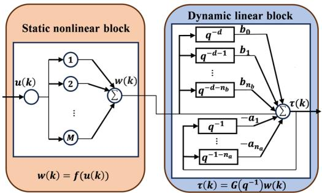  
Fig. 1. 基于神经网络的 Hammerstein 模型结构。

$$
\tau (k) = G \left(q ^ {- 1}\right) w (k) = \frac {B (q ^ {- 1})}{A (q ^ {- 1})} f (u (k))\tag{1}
$$

其中模型输入 $u(k)$ 是电刺激幅度，输出 $\tau(k)$ 是踝关节力矩。静态非线性函数 $f ( u ( k ) )$ 将 $u ( k )$ 映射到内部不可测变量 $w ( k )$，该变量表示电刺激幅度与肌肉激活水平之间的关系。随后，$w ( k )$ 被传递给由传递函数 $G ( q ^ { - 1 } )$ 描述的线性动态模块。该线性动态模块代表肌肉收缩动力学。$B \left( q ^ { - 1 } \right)$ 和 $A \left( q ^ { - 1 } \right)$ 的表达式可表示为

$$
B \left(q ^ {- 1}\right) = b _ {0} q ^ {- d} + b _ {1} q ^ {- (d + 1)} + \dots + b _ {n _ {b}} q ^ {- (n _ {b} + d)}\tag{2}
$$

以及

$$
A \left(q ^ {- 1}\right) = 1 + a _ {1} q ^ {- 1} + \dots + a _ {n _ {a}} q ^ {- n _ {a}}\tag{3}
$$

其中 $q ^ { - 1 }$ 为延迟算子，$d$、$n _ { a }$ 和 $n _ { b }$ 分别为该动态传递函数中的时滞阶数、极点数和零点数。本文中 $( n _ { a } , n _ { b } , d )$ 的取值基于文献 [17] 中的工作，设置为 (2,1,1)。线性函数的系数由向量 $[ a _ { 1 } , a _ { 2 } \ldots , a _ { n _ { a } } , b _ { 0 } , b _ { 1 } , \ldots , b _ { n _ { b } } ] ^ { T }$ 描述。

与多项式相比，基于神经网络结构的 Hammerstein 模型具有更好的非线性表达能力，因此本研究采用了该模型 [23], [24]。该模型的使用将模型参数的优化转化为了神经网络的训练。此处采用的神经网络类型为多层感知机（Multi-Layer Perceptron），由两部分组成。Fig. 1 展示了该模型结构。第一部分为静态非线性模块，主要由单隐藏层前馈神经网络构成。静态非线性部分的神经网络神经元为 S 型神经元，激活函数为 $g \left( k \right) = 2 / ( 1 + e ^ { - 2 k } ) - 1$，该函数克服了 Sigmoid 激活函数输出非零均值的缺点。$M$ 代表静态非线性隐藏层神经元的数量，在预实验测试的 5、10 和 15 等数值中，由于选择 10 取得了最高的精度，因此将其设为 10。带有反馈滞后的单层神经网络构成了 Hammerstein 模型的第二部分，即动态线性模块。根据神经网络的连接关系，可以得到内部不可测变量 $w(k)$ 的表达式，如下所示：

$$
w (k) = \sum_ {m = 1} ^ {M} \beta_ {m} g (\omega_ {m} \cdot u (k) + \mu_ {m}).\tag{4}
$$

将式 (4) 代入式 (1)，进而得到式 (5)：

$$
\begin{array}{l} \tau (k) = - \sum_ {i = 1} ^ {n} _ {a} a _ {i} \tau (k - i) \\ \qquad + \sum_ {j = 0} ^ {n} _ {b} \sum_ {m = 1} ^ {M} b _ {j} \beta_ {m} g (\omega_ {m} \cdot u (k - d - j) + \mu_ {m}) \end{array}\tag{5}
$$

模型中所有需要确定的参数包括以下各项：$\omega _ { m } , \ b _ { m } , \ a _ { i }$ 以及 $b _ { j }$ 表示各层的连接权重。$\mu _ { m }$ 表示各层的阈值。上述模型参数是通过使用 Levenberg-Marquardt 算法结合实验数据训练神经网络获得的。

## B. 基于 VFFRLS 的动态线性块参数更新

考虑到肌肉的时变特性是事先未知的且因受试者而异，并且在 FES 干预过程中可能会出现肌肉疲劳，因此有必要使模型具备自适应性。因此，需要舍弃早期的数据，以追踪肌肉对 FES 响应的变化。在这一过程中，通常采用带有遗忘因子的辨识方法 [15], [21]。然而，选择一个最优的固定遗忘因子是困难的 [15], [22]。为了避免这一问题，本研究允许系统在神经网络辨识结果的基础上，利用 VFFRLS（可变遗忘因子递推最小二乘法）方法来更新动态线性块参数。VFFRLS 算法在保持递推最小二乘法（RLS）简易性的同时，引入自适应遗忘因子调整以实现动态数据加权。在 RLS 中，定义 $\Phi _ { k } ~ = { }$ $\left[ \begin{array} { l } { \Phi _ { k - 1 } } \\ { \varphi ( k ) ^ { T } } \end{array} \right] , \mathbf { Y _ { k } } = \left[ \begin{array} { l } { \mathbf { Y } _ { k - 1 } } \\ { \boldsymbol { \tau } ( k ) } \end{array} \right]$，(5) 可以写成如下形式：

$$
\tau (k) = \varphi^ {T} (k) \hat {\theta} (k) + e (k)\tag{6}
$$

其中 $\begin{array} { r } { \varphi ( k ) \qquad = \qquad [ - \tau ( k \quad - \quad 1 ) , \ldots , - \tau ( k \quad - \quad n _ { a } ) } \end{array}$ $w ( k \textrm { -- } d ) , \ldots , \quad w ( k \textrm { -- } d \textrm { -- } n _ { b } ) ] ^ { T } \in R ^ { ( n _ { a } + n _ { b } + 1 ) \times 1 } , \theta \quad = \quad$ $[ a _ { 1 } , \dots , a _ { n _ { a } } , b _ { 0 } , \dots , b _ { n _ { b } } ] ^ { T } \in R ^ { ( n _ { a } + n _ { b } + 1 ) \times 1 }$，且 $\boldsymbol { \mathscr { e } } \left( \boldsymbol { k } \right)$ 表示误差。$\hat { \theta } \left( k \right)$ 的递推形式可推导如下 [25]：

$$
\hat {\theta} (k) = \hat {\theta} (k - 1) + K (k) e (k)\tag{7}
$$

其中 $K(k)$ 被定义为增益矩阵，$K \left( k \right) = P \left( k \right) \varphi \left( k \right)$，其中 $P(k)$ 被定义为预测误差协方差矩阵，$P \left( k \right) = \mathbf { \bar { \Phi } } { \left( \Phi _ { k } ^ { T } \Phi _ { k } \right) } ^ { - 1 }$

为了考虑系统参数的连续和平缓变化，降低早期数据对辨识结果的影响并增强对近期估计误差的敏感性至关重要。因此，通过引入遗忘因子对 $\boldsymbol { \mathscr { e } } \left( \boldsymbol { k } \right)$ 进行修正，平方误差可描述为

$$
J = \sum_ {k = 1} ^ {L} \lambda^ {L - k} \left[ \tau (k) - \varphi^ {T} (k) \hat {\theta} (k) \right] ^ {2}\tag{8}
$$

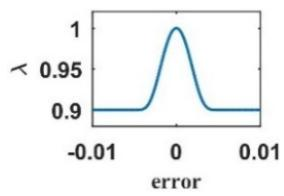  
Fig. 2. 遗忘因子 λ k 随误差 e(k) 变化的曲线。

其中 L 为观测次数，λ 为遗忘因子。递推公式推导如下 [25]

$$
\hat {\theta} (k) = \hat {\theta} (k - 1) + K (k) (\tau (k) - \varphi^ {T} (k) \hat {\theta} (k - 1))\tag{9}
$$

$$
K (k) = \frac {P (k - 1) \varphi (k)}{\lambda + \varphi^ {T} (k) P (k - 1) \varphi (k)}
$$

$$
P (k) = \frac {(I - K (k) \varphi^ {T} (k)) P (k - 1)}{\lambda}\tag{10}
$$

(11)

可变遗忘因子可设计为如下平滑曲线 [26]：

$$
\lambda (k) = \lambda_ {m i n} + (1 - \lambda_ {m i n}) ^ {\alpha (k)}
$$

$$
\alpha (k) = 2 ^ {\rho e ^ {2} (k)}\tag{12}
$$

(13)

其中 $\lambda _ { m i n }$ 和 $\rho$ 为固定参数，能够灵活控制 $\lambda \left( k \right)$ 的形状和变化程度，且对参数设置的要求相对较低。设置 $\lambda _ { m i n } =$ $0 . 9$ 以及 $\rho = 1 0 ^ { 5 }$。这是因为遗忘因子的典型取值范围为 [0.9, 1] [21]，将下限设置为 0.9 可确保系统保持对历史数据的相对关注，以保证系统稳定性并降低对噪声的敏感性。Fig.2 展示了 $\lambda \left( k \right)$ 随误差 $\boldsymbol { \mathscr { e } } \left( \boldsymbol { k } \right)$ 变化的曲线。该图表明，当 e (k) 趋近于 $0 ,$ 时，$\lambda \left( k \right)$ 趋近于 1，随着 $| e ( k ) |$ 逐渐增大，λ (k) 趋近于其最小值。

## III. 实验

## A. 实验设置

实验装置如图 Fig. 3 所示。该装置主要包括一台伺服电机（DM1 B-045G，Yokogawa，日本）、一个扭矩传感器（AKC-205，701st Research Institute of China Aerospace, Science and Technology Corporation，中国）、一个脚踏板、一台数据采集设备（DAQ Multifunction NI USB-6341，National Instruments，美国）、一台定制的功能性电刺激仪（P2-9632，Faisco，中国）以及一台计算机。脚踏板可通过锁定伺服电机固定在特定位置。与脚踏板相连的扭矩传感器用于测量人体与脚踏板之间的相互作用扭矩。对于该功能性电刺激仪，电脉冲的频率和脉宽只能通过手动调节，而范围在 0 mA 至 100 mA 的电刺激幅度则由脉宽调制（PWM）信号控制。DAQ 卡生成标准 PWM 信号并将其传输至电刺激仪，以调节电脉冲的幅度。此外，采用基于 LabVIEW 的程序（National Instruments，美国）向 DAQ 发送指令以生成 PWM 信号并记录踝关节扭矩信号。

长时间 FES 实验阶段

(b)

(a)  
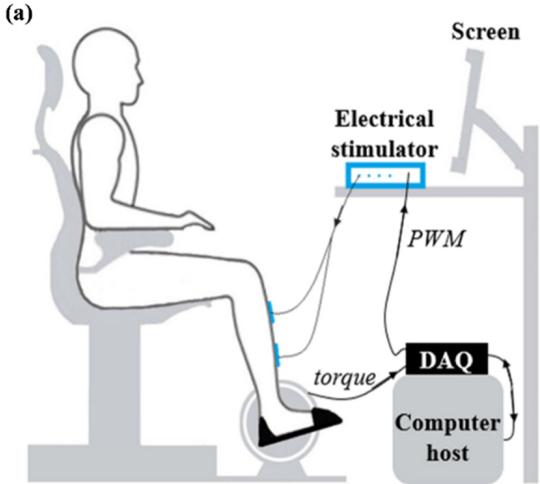

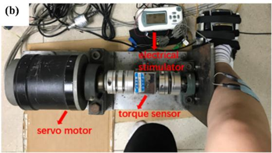  
Fig. 3. 实验装置。(a) 实验装置示意图。(b) 实验装置照片。

## B. 实验方案

本研究共招募了 20 名健康受试者（年龄：$2 4 \pm 1 . 2 3$ 岁；10 名女性，10 名男性），并平均分为两组分别进行长时间和短时间 FES 实验。所有受试者均为无神经系统或肌肉骨骼疾患的健全青年。本研究还在中国南方医科大学珠江医院（Zhujiang Hospital of Southern Medical University）康复医学科招募了 3 名中风患者，同时参与短时间和长时间 FES 实验。患者相关信息如 Table I 所示。中风患者的纳入标准为：1) 单侧脑损伤导致的偏瘫患者；2) 能够产生足够的肌力以维持在带有靠背和扶手的椅子上的坐姿；3) 踝关节被动活动度无显著受限；3) 无影响理解并执行指令的视觉空间、认知或注意力功能障碍。本研究已获得南方医科大学珠江医院伦理委员会的批准。每位受试者在参与本实验前均签署了知情同意书。

实验前，每位受试者坐在椅子上，其踝关节（健康受试者：右侧；脑卒中患者：患侧）同步固定在 $9 0 ^ { \circ }$ 的踏板上，并预先在上述侧别的胫骨前肌（tibialis anterior, TA）上放置表面电刺激电极（5 cm× 5 cm, M2223, 3M, USA）。TA 肌的主要功能是使踝关节背屈并产生背屈力矩。随后，以恒定的脉宽（390 µs）和频率（40 Hz）向表面电极施加电脉冲。电脉冲的幅度逐渐增加，直至受试者达到其最大耐受程度或产生大于 3 Nm 的踝关节力矩。该过程也使受试者熟悉了电刺激。实验过程中要求受试者始终保持放松，不进行任何自主发力。

TABLE I  
脑卒中受试者信息

<table><tr><td>受试者</td><td>性别</td><td>年龄</td><td>脑卒中后月数</td><td>患侧</td><td>FMA-LE</td></tr><tr><td>S1</td><td>F</td><td>34</td><td>6</td><td>左侧</td><td>12/34</td></tr><tr><td>S2</td><td>M</td><td>40</td><td>6</td><td>右侧</td><td>17/34</td></tr><tr><td>S3</td><td>F</td><td>65</td><td>2</td><td>左侧</td><td>10/34</td></tr></table>

缩写：F = 女性；M = 男性；FMA-LE = 下肢 Fugl-Meyer 评定量表（Fugl-Meyer Assessment for Lower Extremity）。

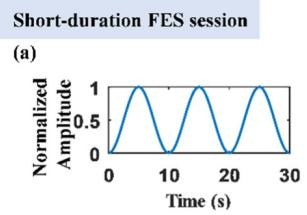

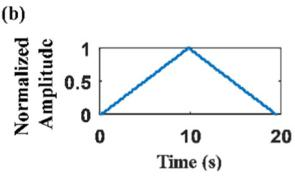

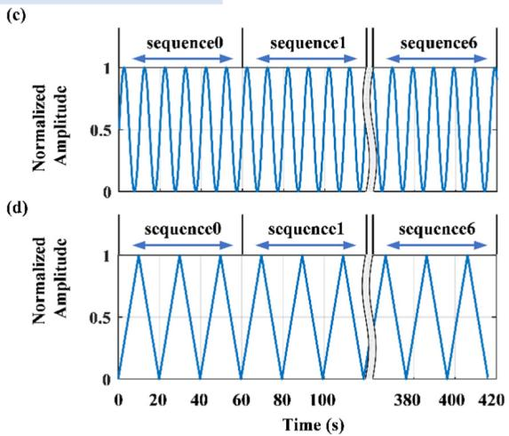  
Fig. 4. (a) 短时 SP 测试；(b) 短时 TP 测试；(c) 长时 SP 测试；(d) 长时 TP 测试中的输入电刺激幅度变化曲线。

正式实验包括两个测试阶段：短时 FES（功能性电刺激）阶段和长时 FES 阶段。每个阶段包含两种测试，即正弦波形（sinusoidal profile, SP）测试和三角波形（triangular profile, TP）测试 [27], [28]。以往的肌肉动态响应建模主要侧重于分析肌肉对简短输入序列的瞬态响应，而这可能会受到肌肉自主激活的影响。缓慢变化的刺激信号较不易触发自主神经反射，例如本研究所采用的 SP 或 TP 刺激 [29], [30]。在短时阶段中，电刺激的持续时间较短以避免肌肉疲劳。这两种测试信号如图 Fig. 4(a) 和 (b) 所示。在每项测试中，对每位受试者重复进行 6 次试验。在长时 FES 阶段中，采用上述两种电刺激波形进行了两项测试。电刺激信号如图 Fig. 4(c) 和 (d) 所示。每个信号持续长达 7 分钟，由包含 7 个电刺激序列的序列组成，分别记为 sequence0 至 sequence6。每位受试者对每种波形进行一次试验。在两次试验之间，受试者至少有 48 小时的休息时间，并对电极放置位置进行标记，以避免电极位置出现显著偏差。综上，共有四种类型的电刺激测试，即短时 SP 测试、短时 TP 测试、长时 SP 测试和长时 TP 测试。测得的踝关节力矩通过 DAQ 卡以 100Hz 的采样率进行采集，最终保存在计算机中进行分析。

在本研究中，针对每项测试均开展了针对特定受试者（subject-specific）的建模与评估。

在短时 SP 测试中，来自每位受试者的 3 次试验的力矩数据用作训练集，以辨识基于神经网络的特定受试者 Hammerstein 模型。对于其余 3 次试验，每位受试者每次试验中第一个正弦波的数据用于对动态线性模块进行参数更新，其余两个正弦波的数据则用作测试集。

在短时 TP 测试中，基于短时 SP 神经网络的辨识结果进行参数更新。每位受试者在短时 TP 测试中单次试验的力矩数据用于参数更新，其余试验的数据则用作测试集。

在长时 SP 测试中，每位受试者 sequence0 的数据用于训练特定受试者的 Hammerstein 模型。在随后的序列中，每个序列前 10 秒的数据用于更新模型参数，接下来的 50 秒数据则用于测试模型的性能。

在长时间 TP 测试中，来自 sequence0 的数据也被用于训练针对特定受试者的 Hammerstein 模型。其余每个序列的前 20 秒数据用于更新模型参数，接下来的 40 秒数据用于模型测试。

此外，还建立了固定参数 Hammerstein 模型以及基于固定遗忘因子递推最小二乘法（FFFRLS）的自适应模型，并将建模结果与基于 VFFRLS 的自适应 Hammerstein 模型进行了对比。由于固定遗忘因子的典型取值范围为 [0.9, 1]，本研究中将其分别设置为 0.999（高）、0.95（中）和 0.9（低）。在短时间会话中，为了使固定参数模型和自适应模型接触到相同范围的数据，用于参数更新的数据也被添加到了固定参数模型的训练集中。

## C. 数据分析

测得的力矩信号通过截止频率为 5 Hz 的 4 阶巴特沃斯（Butterworth）低通滤波器。数据分析过程中使用了 MATLAB 软件（MATLAB R2018b, MathWorks Inc., Natick, MA, USA）。

为了评估模型的性能，此处采用拟合优度（GOF）、均方根误差（RMSE）和峰值误差（PE），其计算公式如下：

$$
G O F = 1 - \frac {\sum_ {k = 1} ^ {N} [ \tau_ {m} (k) - \tau_ {e s t} (k) ] ^ {2}}{\sum_ {k = 1} ^ {N} [ \tau_ {m} (k) - \bar {\tau} _ {m} (k) ] ^ {2}}\tag{14}
$$

$$
R M S E = \sqrt {\frac {\sum_ {k = 1} ^ {N} [ \tau_ {m} (k) - \tau_ {e s t} (k) ] ^ {2}}{N}}\tag{15}
$$

$$
P E = \max \left(\left| \tau_ {m} (k) - \tau_ {e s t} (k) \right|\right)\tag{16}
$$

其中 $\tau _ { m }$ 为实际测量输出，$\bar { \tau } _ { m }$ 为 $\tau _ { m }$ 的平均值，$\tau _ { e s t }$ 表示仿真模型的输出。对结果进行检验以确定每种方法取得成功模型的比例，当 GOF 高于 0.7 时定义为建模成功。此外，进行了 Wilcoxon 符号秩检验，以检验基于 VFFRLS 的自适应 Hammerstein 模型、基于 FFFRLS 的自适应 Hammerstein 模型以及仅基于神经网络的固定参数 Hammerstein 模型之间是否存在显著性差异。由于中风患者受试者数量有限，显著性分析仅在健康受试者的结果上进行。统计分析使用 SPSS 26.0 软件（SPSS Inc., Chicago, IL, USA）进行。p 值小于 0.05 被认为具有统计学显著性。

## IV. 结果

## A. 短时间 FES 会话

尽管在短时测试中每次试验之间都给予了受试者充分的休息，但更新模型参数仍然是必要的。这是由于肌肉的时变特性，以及即使在重复的电刺激实验条件下，由 FES 诱发的力矩也可能不完全相同。

为了评估所提出的方法，对固定参数模型、基于 FFFRLS 的自适应模型以及基于 VFFRLS 的自适应模型的结果进行了比较。十名健康受试者和三名脑卒中患者的建模成功率如 Table II 所示。由于基于中等 FFFRLS 和低 FFFRLS 的自适应模型的成功率极低，因此这两种方法的建模结果未包含在后续内容中。Fig. 5 展示了模型在不同情况下对一名健康受试者和一名脑卒中患者（S3）的拟合性能。从图中可以看出，参数更新后模型的预测力矩比固定参数模型更接近实际测量的力矩。此外，在 TP 测试中，所提模型估计的力矩比高 VFFRLS 自适应模型更接近测量力矩。

Fig. 6 显示了各模型的统计结果。可以发现，无论是在健康个体还是脑卒中患者中，基于 VFFRLS 的自适应模型在 SP 和 TP 测试中的表现均优于固定参数模型。从健康个体模型的显著性分析中可以看出

(a)  
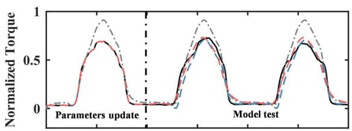  
(b)

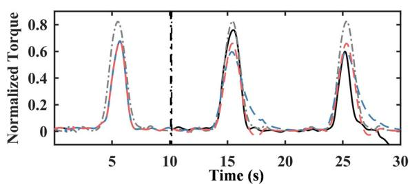

(c)  
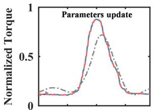  
(d)

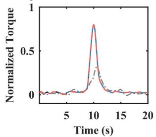

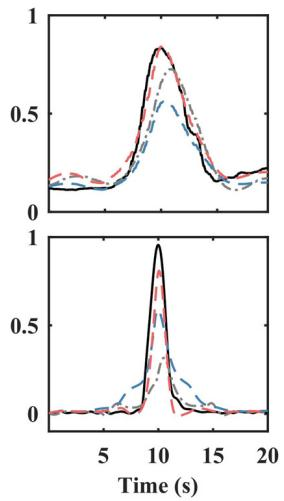  
固定参数模型估计的力矩 高 FFFRLS 模型估计的力矩 VFFRLS 模型估计的力矩

Fig. 5. 一名健康受试者和一名脑卒中患者（S3）在固定参数模型以及基于高 FFFRLS 和 VFFRLS 的自适应模型下的拟合性能。健康受试者在短时 (a) SP 测试；(c) TP 测试下的拟合曲线。S3 在短时 (b) SP 测试；(d) TP 测试下的拟合曲线。  
TABLE II  
短时 FES 实验下的建模成功率百分比

<table><tr><td>受试者</td><td>测试</td><td>Fixed</td><td>High</td><td>Middle</td><td>Low</td><td>VFFRLS</td></tr><tr><td rowspan="2">健康受试者</td><td>SP</td><td>93.3</td><td>93.3</td><td>13.3</td><td>10.0</td><td>93.3</td></tr><tr><td>TP</td><td>94.0</td><td>56.0</td><td>10.0</td><td>8.0</td><td>98.0</td></tr><tr><td rowspan="2">脑卒中患者</td><td>SP</td><td>88.9</td><td>88.9</td><td>0.1</td><td>0.0</td><td>100.0</td></tr><tr><td>TP</td><td>46.7</td><td>60.0</td><td>0.0</td><td>0.0</td><td>86.7</td></tr></table>

缩写：Fixed = 固定参数模型（Fixed-parameter model）；High = 高 FFFRLS 模型（High FFFRLS model）；Middle = 中 FFFRLS 模型（Middle FFFRLS model）；Low = 低 FFFRLS 模型（Low FFFRLS model）

结果显示，在 TP 测试中，所提出的自适应模型与固定模型之间存在高度显著性差异（p<0.01）。此外，所提出的自适应模型与固定模型在 SP 测试中的 GOF 和 RMSE 结果也具有显著性差异（p<0.05）。此外，所提出的自适应模型与基于高 FFFRLS 的自适应模型的 GOF 和 RMSE 结果在 SP 测试中具有显著性差异，且在 TP 测试中具有高度显著性差异。然而，与固定参数模型相比，基于高 FFFRLS 的自适应模型的结果并没有表现出显著改善。值得注意的是，由于样本量有限，患者的模型结果未进行显著性分析。然而，箱线图在模型精度对比中显示出明显的趋势：VFFRLS 模型的精度始终高于高 FFFRLS 模型，而高 FFFRLS 模型的精度又优于固定参数模型，尤其是在 TP 测试中。

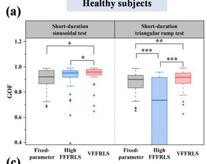

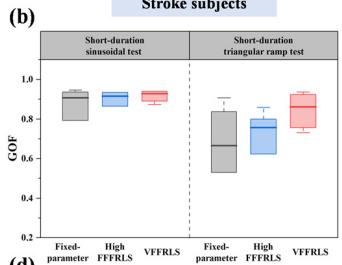  
(d)

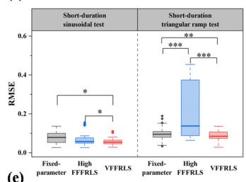  
(e)

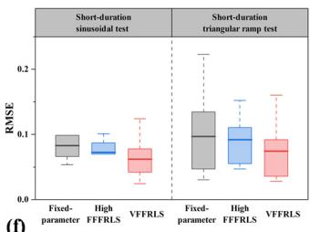  
(f)

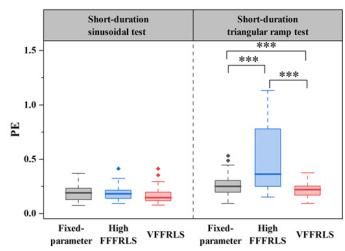

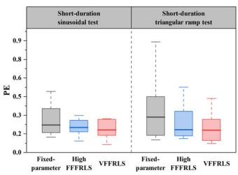  
Fig. 6. 健康受试者和脑卒中受试者的统计结果。∗ 表示显著性差异水平为 p<0.05，∗∗ 表示显著性差异水平为 p<0.01，∗∗∗ 表示显著性差异水平为 p<0.001。

## B. 长时程 FES 实验

为了验证所提出的自适应 Hammerstein 模型在长时间 FES 中的有效性，对受试者进行了两次 7 分钟的测试。然而，由于耐受度有限，S1 仅接受了两组各约 6 分钟的电刺激，且由于时间安排限制，S3 仅接受了 SP 电刺激。对所有受试者的结果进行了分析。在长时间 SP 测试中，除两名健康受试者外，其余受试者的力矩随着实验的进行均呈现下降趋势，其中健康受试者的力矩平均下降至其初始值的 87.4%，脑卒中受试者则平均下降至 78.1%。在长时间 TP 阶段中，除三名健康受试者外，其余健康受试者的平均力矩下降至其初始值的 90.3%，脑卒中患者的平均力矩下降至其初始值的 69.3%。踝关节背屈力矩逐渐下降，这与文献 [21] 中的疲劳诱发实验结果一致。因此可以推断，在本实验诱发的电刺激下，大多数受试者都经历了肌肉疲劳。

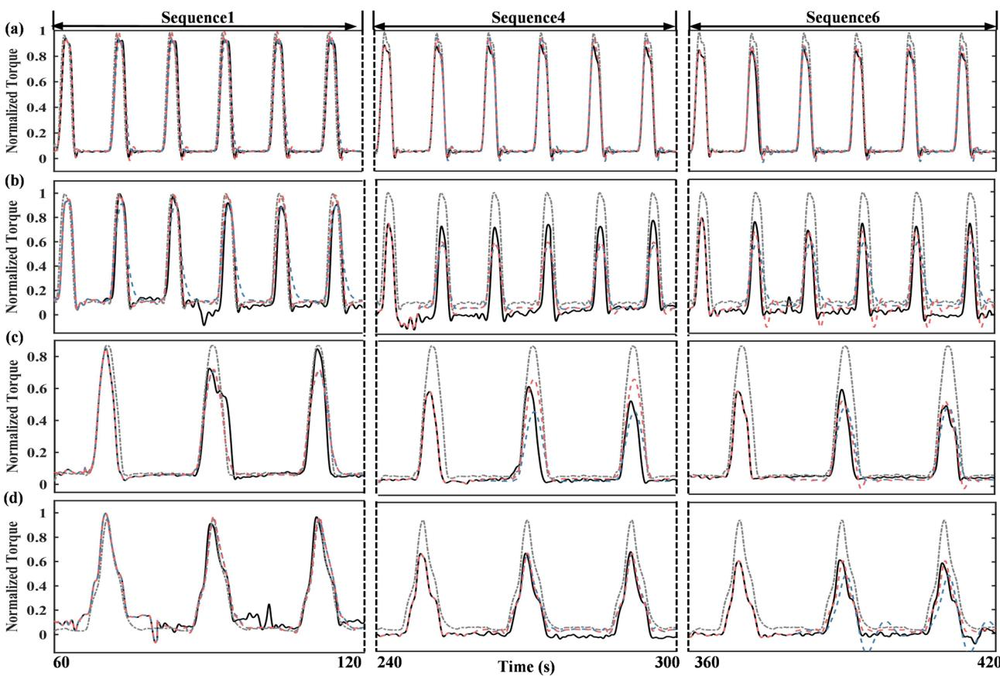  
实测力矩 — · – 固定参数模型估计的力矩 – - – 高 FFFRLS 模型估计的力矩 – - - VFFRLS 模型估计的力矩  
Fig. 7. 健康受试者与患者（S2）的模型拟合性能。健康受试者在长时间 (a) $\mathtt { S P }$ 测试；(c) TP 测试下的拟合曲线。S2 在长时间 (b) SP 测试；(d) TP 测试下的拟合曲线。

健康受试者和脑卒中受试者的模型成功率如 Table III 所示。可以看出，VFFRLS 模型的成功率超过了其他模型。由于基于中等 FFFRLS 和低 FFFRLS 的自适应模型成功率极低，因此在后续分析中忽略了这两个模型。Fig. 7 展示了在涉及 TA 肌肉 SP 和 TP FES 的实验条件下，各模型在预测健康受试者和脑卒中患者（S2）踝关节力矩时的拟合性能。为了提高视觉清晰度，图中仅包含了三个特定时间段的数据：sequence1、sequence4 和 sequence6，其他序列已在图中省略。从图中可以明显看出，即使在相同的电刺激下，肌肉产生的力矩也表现出变异性，并且通常随着电刺激时间的增加而减小。然而，所提出的模型展示了良好的力矩预测能力，而随着电刺激时间的延长，其他两个模型的预测误差可能会增加。

十位健康受试者和两位中风患者的模型测试统计结果如图 8 所示。在实验期间，基于 VFFRLS 的自适应模型始终保持了高水平的精度，而另外两个模型的精度则明显下降，尤其是在患者实验中。根据健康个体的统计结果，随着电刺激的持续，VFFRLS 模型的预测结果优于固定参数模型和高 FFFRLS 模型。在 SP 测试中，从序列 4 到 6，VFFRLS 自适应模型的结果与固定参数模型及高 FFFRLS 模型的结果相比表现出显著差异 $_ { ( \mathrm { p < 0 . 0 5 } ) }$。在 TP 测试中，在序列 4 到 6 中，VFFRLS 自适应模型的 GOF 和 RMSE 结果相比于固定参数模型和高 FFFRLS 模型的结果显示出显著改善 (p<0.05)。然而，与固定参数模型相比，高 FFFRLS 模型并未表现出显著改善。

TABLE III  
长时间 FES 疗程下的建模成功率百分比

<table><tr><td>受试者</td><td>测试</td><td>Fixed</td><td>High</td><td>Middle</td><td>Low</td><td>VFFRLS</td></tr><tr><td rowspan="4">健康/中风</td><td>SP</td><td>86.7</td><td>85.0</td><td>28.3</td><td>16.7</td><td>95.0</td></tr><tr><td>TP</td><td>81.7</td><td>80.0</td><td>16.7</td><td>16.7</td><td>96.7</td></tr><tr><td>SP</td><td>64.7</td><td>94.1</td><td>0.0</td><td>0.0</td><td>100.0</td></tr><tr><td>TP</td><td>72.8</td><td>100.0</td><td>0.0</td><td>0.0</td><td>100.0</td></tr></table>

缩写：Fixed = 固定参数模型；High = 高 FFFRLS 模型；Middle = 中 FFFRLS 模型；Low = 低 FFFRLS 模型。

(a)  
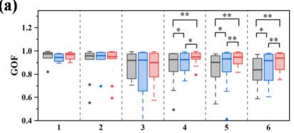

(b)  
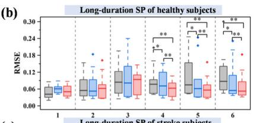

(d)  
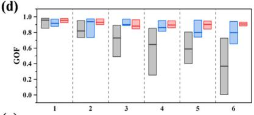

(c)  
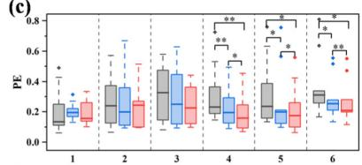

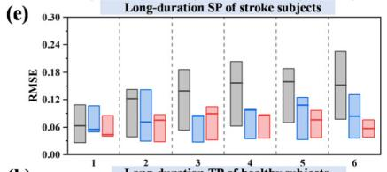

(f)  
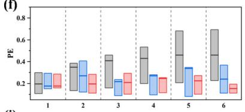

(g)  
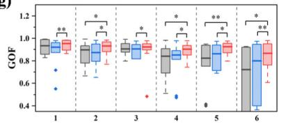

(h)  
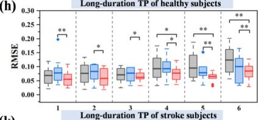

(i)  
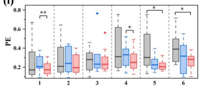

(i)  
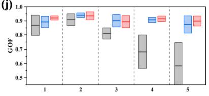

(k)  
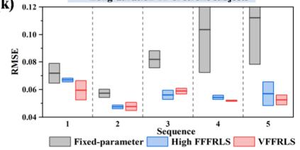

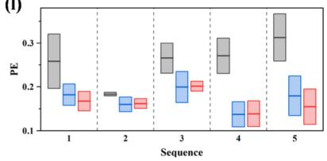  
Fig. 8. 统计检验结果。(a)、(b) 和 (c) 为健康受试者在长时 SP 测试下的结果。(d)、(e) 和 (f) 为中风患者在长时 SP 测试下的结果。(g)、(h) 和 (i) 为健康受试者在长时 TP 测试下的结果。(j)、(k) 和 (l) 为中风患者在长时 TP 测试下的结果。∗ 表示显著性差异水平为 $\mathsf { \overline { { p } } } { < } 0 . 0 5 , \ { * } { * }$ 表示显著性差异水平为 p<0.01，∗∗∗ 表示显著性差异水平为 p<0.001。

## V. 讨论

辨识由 FES（功能性电刺激）诱发的肌肉力矩或力，是设计基于模型的 FES 控制系统以辅助患者恢复丧失的运动功能的重要环节。在本研究中，提出了一种利用 VFFRLS 更新基于神经网络的模型参数的自适应 Hammerstein 模型，以增强 Hammerstein 模型的自适应能力，使该模型能够应对肌肉的时变特性与疲劳。

在先前的建模研究中，模型通常采用固定参数，精度较低 [19], [29], [31]。由于肌肉的动态特性及其容易疲劳的倾向，FES（功能性电刺激）诱发的力矩表现出多变性和波动性 [21], [32]，这与 Fig. 5 和 Fig.7 的结果一致。因此，更新参数变得十分必要。先前的研究通常采用固定的遗忘因子来增强 Hammerstein 模型的自适应能力 [21], [33]。然而，选择合适的遗忘因子值并非易事。当遗忘因子过小时，系统稳定性不足，会导致建模失败。相反，当遗忘因子过大时，由于历史数据持续保持高权重，算法的跟踪性能会受到影响，从而导致累积误差 [26], [34], [35], [36]。当应用 VFFRLS（可变遗忘因子递推最小二乘）方法更新 Hammerstein 模型的线性块参数时，可以避免遗忘因子的选择问题，因为它是根据不同时刻的误差变化进行动态调整的。当误差较大时，表明参数变化显著。因此，减小遗忘因子可以提高模型的跟踪能力。相反，当误差较小时，表明参数辨识结果更接近真实值，算法趋于稳定。在这种情况下，建议适当增大遗忘因子以增强算法的稳定性。此外，根据 [26]，对误差平方和曲面的分析表明，在理想的 $( \lambda _ { m i n } , \rho )$ 参数周围存在一个显著平坦的区域。这一观察表明，当 $( \lambda _ { m i n } , \rho )$ 在一定范围内变化时，代价函数保持相对稳定，且 VFFRLS 算法能够取得良好的效果。因此，在应用所提出的模型预测其他关节的力矩时，不需要对参数进行大幅修改。不仅如此，本文采用神经网络来表征非线性块，相比线性多项式具有更好的非线性表达能力 [24], [28], [29]。尽管用作训练集的数据量有限，该模型仍达到了很高的精度。

所提出的模型不仅显著提高了预测 FES 诱发力矩的准确性和鲁棒性，而且在不同场景下表现出了良好的泛化潜力，有望应用于基于模型的 FES 跟踪任务。该模型的准确性与基于 eEMG 的力矩模型 [21], [33] 相当，同时避免了 eEMG 测量不便的问题，例如电极移位、出汗以及容易污染目标肌肉记录的 eEMG 信号的刺激伪迹所导致的误差。同时，所提出的自适应模型还行之有效地减小了预测的最大误差，从而可以避免在 FES 控制系统中由于模型预测的较大瞬态误差而导致输出强度不足或过大。此外，还初步探索了该模型在不同 FES 模式下的通用潜力。基于短时间 SP 测试获得的神经网络辨识结果，可以利用 TP 测试的实验结果更新参数，从而实现 TP 测试下的力矩预测。通过利用从这两种测试中获取的信息，该模型可以适应并在各种场景下准确预测力矩。然而，SP 刺激比 TP 刺激具有更好的预测结果，特别是在长时间测试中。在自主肌肉收缩中，据推测，与阶梯力模式相比，正弦模式更类似于动态自主任务，因此它可能包含更多自主收缩力的模式 [37]。由此我们推测，具有正弦激励的 FES 也可以提供更多有效的激活信息，并与肌肉活动的动态特性紧密契合。在 FES 控制系统方面，尽管已有研究将 ILC 控制应用于步态调节 [38], [39]，以及将基于模型的重复控制应用于手部震颤抑制 [5]，但这些方法都属于非精确控制。为了解决电刺激引起的不确定性和肌肉疲劳，目前已经开发了结合 FES 与机器人的混合系统 [40], [41]。这些控制器主要依赖机器人进行误差补偿和疲劳调节，这增加了技术复杂性和硬件要求。然而，由于 FES 是一种能够促进肌肉主动收缩的康复方法，提高模型精度以实现 FES 的精确控制至关重要，这有利于运动的综合调节，而不仅仅局限于单一问题（例如步态中的最大踝关节角度）。我们相信，更精确的模型有助于开发模型预测控制的 FES 跟踪任务。

为了提高 Hammerstein 模型的鲁棒性及其处理时变特性和疲劳的能力，提出了 VFFRLS。然而，尽管向受试者下达了避免自主运动的指令，但没有直接证据可以证实这一点，且姿势的轻微改变都会影响测得的力矩。此外，目前的实验仅在有限的瘫痪患者身上开展，未来将招募更多患者。另外，在所提出的模型中引入力矩-关节角函数，为其在 FES（功能性电刺激）康复中的应用带来了广阔前景，包括基于模型的控制以及与机器人结合构建混合系统，这不仅可以充分发挥机器人控制的优势，同时还能带来 FES 的生理益处。

## VI. 结论

本研究引入了一种自适应 Hammerstein 模型，该模型利用 VFFRLS 更新基于神经网络的模型参数，以预测电刺激诱发的踝关节力矩。对比了所提出的自适应模型、固定参数模型以及 FFFRLS 模型的性能。结果表明，无论是在短时 FES 会话还是长时 FES 会话中，建模结果相比固定模型和 FFFRLS 自适应模型均有显著提升。因此，推荐使用 VFFRLS 自适应模型来模拟电刺激肌肉所产生的踝关节力矩。

## 参考文献

[1] P. H. Peckham and J. S. Knutson, “Functional electrical stimulation for neuromuscular applications,” Annu. Rev. Biomed. Eng., vol. 7, no. 1, pp. 327–360, Aug. 2005, doi: 10.1146/annurev.bioeng.6.040803.140103.

[2] T. Schauer and C. Freeman, “Advances in functional electrical stimulation modelling and control,” Med. Eng. Phys., vol. 38, no. 11, pp. 1157–1158, Nov. 2016, doi: 10.1016/j.medengphy.2016.09.004.

[3] C. L. Lynch and M. R. Popovic, “Functional electrical stimulation,” IEEE Control Syst. Mag., vol. 28, no. 2, pp. 40–50, Apr. 2008, doi: 10.1109/MCS.2007.914689.

[4] C. Jiang, M. Zheng, Y. Li, X. Wang, L. Li, and R. Song, “Iterative adjustment of stimulation timing and intensity during FES-assisted treadmill walking for patients after stroke,” IEEE Trans. Neural Syst. Rehabil. Eng., vol. 28, no. 6, pp. 1292–1298, Jun. 2020, doi: 10.1109/TNSRE.2020.2986295.

[5] Z. Zhang, B. Chu, Y. Liu, Z. Li, and D. H. Owens, “Multimuscle functional-electrical-stimulation-based wrist tremor suppression using repetitive control,” IEEE/ASME Trans. Mechatronics, vol. 27, no. 5, pp. 3988–3998, Oct. 2022, doi: 10.1109/TMECH.2022.3150301.

[6] B. C. Allen, C. A. Cousin, C. A. Rouse, and W. E. Dixon, “Robust cadence tracking for switched FES-cycling with an unknown timevarying input delay,” IEEE Trans. Control Syst. Technol., vol. 30, no. 2, pp. 827–834, Mar. 2022, doi: 10.1109/TCST.2021.3070189.

[7] T. Afzal, L. Khan, and M. O. Tokhi, “Simulation of a patient driven strategy for FES supported sit-to-stand movement,” in Proc. Int. Conf. Inf. Emerg. Technol., Jun. 2010, pp. 1–5, doi: 10.1109/ICIET.2010.5625680.

[8] X. Tu et al., “Iterative learning control applied to a hybrid rehabilitation exoskeleton system powered by PAM and FES,” Cluster Comput., vol. 20, no. 4, pp. 2855–2868, Dec. 2017, doi: 10.1007/s10586-017- 0880-x.

[9] N. Kirsch, N. Alibeji, and N. Sharma, “Nonlinear model predictive control of functional electrical stimulation,” Control Eng. Pract., vol. 58, pp. 319–331, Jan. 2017, doi: 10.1016/j.conengprac.2016.03.005.

[10] N. A. Kirsch, X. Bao, N. A. Alibeji, B. E. Dicianno, and N. Sharma, “Model-based dynamic control allocation in a hybrid neuroprosthesis,” IEEE Trans. Neural Syst. Rehabil. Eng., vol. 26, no. 1, pp. 224–232, Jan. 2018, doi: 10.1109/TNSRE.2017.2756023.

[11] A. V. Hill, “The heat of shortening and the dynamic constants of muscle,” Proc. Roy. Soc. London B, Biol. Sci., vol. 126, no. 843, pp. 136–195, Oct. 1938, doi: 10.1098/rspb.1938.0050.

[12] R. Riener, J. Quintern, and G. Schmidt, “Biomechanical model of the human knee evaluated by neuromuscular stimulation,” J. Biomechanics, vol. 29, no. 9, pp. 1157–1167, Sep. 1996, doi: 10.1016/0021- 9290(96)00012-7.

[13] H. Gollee, D. J. Murray-Smith, and J. C. Jarvis, “A nonlinear approach to modeling of electrically stimulated skeletal muscle,” IEEE Trans. Biomed. Eng., vol. 48, no. 4, pp. 406–415, Apr. 2001, doi: 10.1109/10.915705.

[14] A. H. Vette, K. Masani, J.-Y. Kim, and M. R. Popovic, “Closed-loop control of functional electrical stimulation-assisted arm-free standing in individuals with spinal cord injury: A feasibility study,” Neuromodulation, Technol. Neural Interface, vol. 12, no. 1, pp. 22–32, Jan. 2009, doi: 10.1111/j.1525-1403.2009.00184.x.

[15] Z. Li, M. Hayashibe, C. Fattal, and D. Guiraud, “Muscle fatigue tracking with evoked EMG via recurrent neural network: Toward personalized neuroprosthetics,” IEEE Comput. Intell. Mag., vol. 9, no. 2, pp. 38–46, May 2014, doi: 10.1109/MCI.2014.2307224.

[16] J. Bobet and R. B. Stein, “A simple model of force generation by skeletal muscle during dynamic isometric contractions,” IEEE Trans. Biomed. Eng., vol. 45, no. 8, pp. 1010–1016, 1998, doi: 10.1109/10.704869.

[17] K. J. Hunt, M. Munih, N. D. N. Donaldson, and F. M. D. Barr, “Investigation of the Hammerstein hypothesis in the modeling of electrically stimulated muscle,” IEEE Trans. Biomed. Eng., vol. 45, no. 8, pp. 998–1009, Aug. 1998, doi: 10.1109/10.704868.

[18] Y. Li, M. Zheng, Q. Yang, and R. Song, “Comparison of two models used to describe the ankle torque in response to functional electrical stimulation,” in Proc. IEEE 4th Int. Conf. Adv. Robot. Mechatronics (ICARM), Jul. 2019, pp. 894–898, doi: 10.1109/ICARM.2019. 8834236.

[19] H. Y. Zhou, L. K. Huang, Y. M. Gao, Ž. L. Vasic, M. Cifrek, and M. Du, “基于神经网络 Hammerstein 模型估计 FES（功能性电刺激）诱发的踝关节角度,” IEEE Access, vol. 7, pp. 141277–141286, 2019, doi: 10.1109/ACCESS.2019.2943453.

[20] Z. Cai, E.-W. Bai, and R. K. Shields, “瘫痪肌肉功能性电刺激过程中的疲劳与非疲劳数学肌肉模型,” Biomed. Signal Process. Control, vol. 5, no. 2, pp. 87–93, Apr. 2010, doi: 10.1016/j.bspc.2009.12.001.

[21] Q. Zhang, M. Hayashibe, P. Fraisse, and D. Guiraud, “利用诱发肌电传感进行 FES 诱发力矩预测以实现肌肉疲劳追踪,” IEEE/ASME Trans. Mechatronics, vol. 16, no. 5, pp. 816–826, Oct. 2011, doi: 10.1109/TMECH.2011.2160809.

[22] Y. Cao, X. Chen, M. Zhang, and J. Huang, “康复机器人自适应位置约束按需辅助控制,” IEEE Trans. Ind. Electron., vol. 71, no. 4, pp. 4059–4068, Apr. 2024, doi: 10.1109/TIE.2023.3273270.

[23] H. Al-Duwaish, M. N. Karim, and V. Chandrasekar, “基于多层前馈神经网络的 Hammerstein 模型辨识,” Int. J. Syst. Sci., vol. 28, no. 1, pp. 49–54, Jan. 1997, doi: 10.1080/00207729708929362.

[24] A. Janczak, “Hammerstein 系统辨识的神经网络方法,” Int. J. Control, vol. 76, no. 17, pp. 1749–1766, Nov. 2003, doi: 10.1080/00207170310001633259.

[25] T. Wang, Q. Li, Y. Qiu, L. Yin, L. Liu, and W. Chen, “基于 FFRLS 在线辨识的 PEMFC 系统效率极值点跟踪策略,” IEEE Trans. Energy Convers., vol. 34, no. 2, pp. 952–963, Jun. 2019, doi: 10.1109/TEC.2018.2872861.

[26] Z. Lao, B. Xia, W. Wang, W. Sun, Y. Lai, and M. Wang, “基于变遗忘因子递推最小二乘法的锂离子电池在线参数辨识新方法,” Energies, vol. 11, no. 6, p. 1358, May 2018, doi: 10.3390/en11061358.

[27] H. Rouhani, M. R. Popovic, M. Same, Y. Q. Li, and K. Masani, “电刺激响应下踝关节跖屈肌群动力学辨识,” Med. Eng. Phys., vol. 38, no. 11, pp. 1166–1171, Nov. 2016, doi: 10.1016/j.medengphy.2016.07.011.

[28] Y. Liu, Y. Qin, B. Huo, and Z. Wu, “基于自抗扰控制的功能性电刺激二头肌肌力控制,” in Proc. 5th Int. Conf. Adv. Robot. Mechatronics (ICARM), Dec. 2020, pp. 306–311, doi: 10.1109/ICARM49381.2020.9195304.

[29] F. Le, I. Markovsky, C. T. Freeman, and E. Rogers, “脑卒中患者电刺激肌肉模型辨识,” Control Eng. Pract., vol. 18, no. 4, pp. 396–407, Apr. 2010, doi: 10.1016/j.conengprac.2009.12.007.

[30] J. Bobet, E. R. Gossen, and R. B. Stein, “人体电刺激等长踝关节背屈过程中力量产生模型的比较,” IEEE Trans. Neural Syst. Rehabil. Eng., vol. 13, no. 4, pp. 444–451, Dec. 2005, doi: 10.1109/TNSRE.2005.858461.

[31] Y. Li, W. Chen, J. Chen, X. Chen, J. Liang, and M. Du, “功能性电刺激下基于神经网络的肘关节运动建模与控制,” Neurocomputing, vol. 340, pp. 171–179, May 2019, doi: 10.1016/j.neucom.2019.03.003.

[32] Z. Z. Karu, W. K. Durfee, and A. M. Barzilai, “通过 N-let 脉冲串刺激减少 FES 应用中的肌肉疲劳,” IEEE Trans. Biomed. Eng., vol. 42, no. 8, pp. 809–817, Aug. 1995, doi: 10.1109/10.398642.

[33] Z. Li, D. Guiraud, D. Andreu, A. Gelis, C. Fattal, and M. Hayashibe, “基于诱发肌电反馈的脊髓损伤患者肌肉激活实时闭环功能性电刺激控制,” Int. J. Neural Syst., vol. 28, no. 6, Aug. 2018, Art. no. 1750063, doi: 10.1142/s0129065717500630.

[34] Y. Cai, R. C. de Lamare, M. Zhao, and J. Zhong, “盲自适应约束恒模算法的低复杂度可变遗忘因子机制,” IEEE Trans. Signal Process., vol. 60, no. 8, pp. 3988–4002, Aug. 2012, doi: 10.1109/TSP.2012.2199317.

[35] S. Song, J.-S. Lim, S. Joon Baek, and K.-M. Sung, “用于频率选择性衰落信道估计的可变遗忘因子线性最小二乘算法,” IEEE Trans. Veh. Technol., vol. 51, no. 3, pp. 613–616, May 2002, doi: 10.1109/TVT.2002.1002509.

[36] H. Wang, Y. Zheng, and Y. Yu, “基于自适应遗忘因子最小二乘在线辨识与无迹卡尔曼滤波的锂离子电池 SOC 估计,” Mathematics, vol. 9, no. 15, p. 1733, Jul. 2021, doi: 10.3390/math9151733.

[37] R. Hu, X. Chen, C. Huang, S. Cao, X. Zhang, and X. Chen, “旋前与旋后手臂姿态动态变化过程中的屈肘力估计,” J. Neural Eng., vol. 16, no. 6, Oct. 2019, Art. no. 066005, doi: 10.1088/1741-2552/ab2e18.

[38] P. Müller, A. J. del Ama, J. C. Moreno, and T. Schauer, “具有学习控制和自动步态评估功能的自适应多通道 FES 神经假体,” J. NeuroEng. Rehabil., vol. 17, no. 1, p. 36, Dec. 2020, doi: 10.1186/s12984-020-0640-7.

[39] Y. Dong et al., “用于纠正脑卒中后患者偏瘫步态的功能性电刺激混合与自适应控制,” Frontiers Bioeng. Biotechnol., vol. 11, Aug. 2023, Art. no. 1246014, doi: 10.3389/fbioe.2023.1246014.

[40] C. A. Rouse, C. A. Cousin, B. C. Allen, and W. E. Dixon, “考虑肌肉控制输入饱和的分离曲柄自行车切换式电动 FES 骑行共享控制,” Automatica, vol. 123, Jan. 2021, Art. no. 109294, doi: 10.1016/j.automatica.2020.109294.

[41] A. J. Del-Ama, Á. Gil-Agudo, J. L. Pons, and J. C. Moreno, “助行步态康复外骨骼的 FES-机器人混合协同控制,” J. NeuroEng. Rehabil., vol. 11, no. 1, p. 27, 2014, doi: 10.1186/1743-0003-11-27.