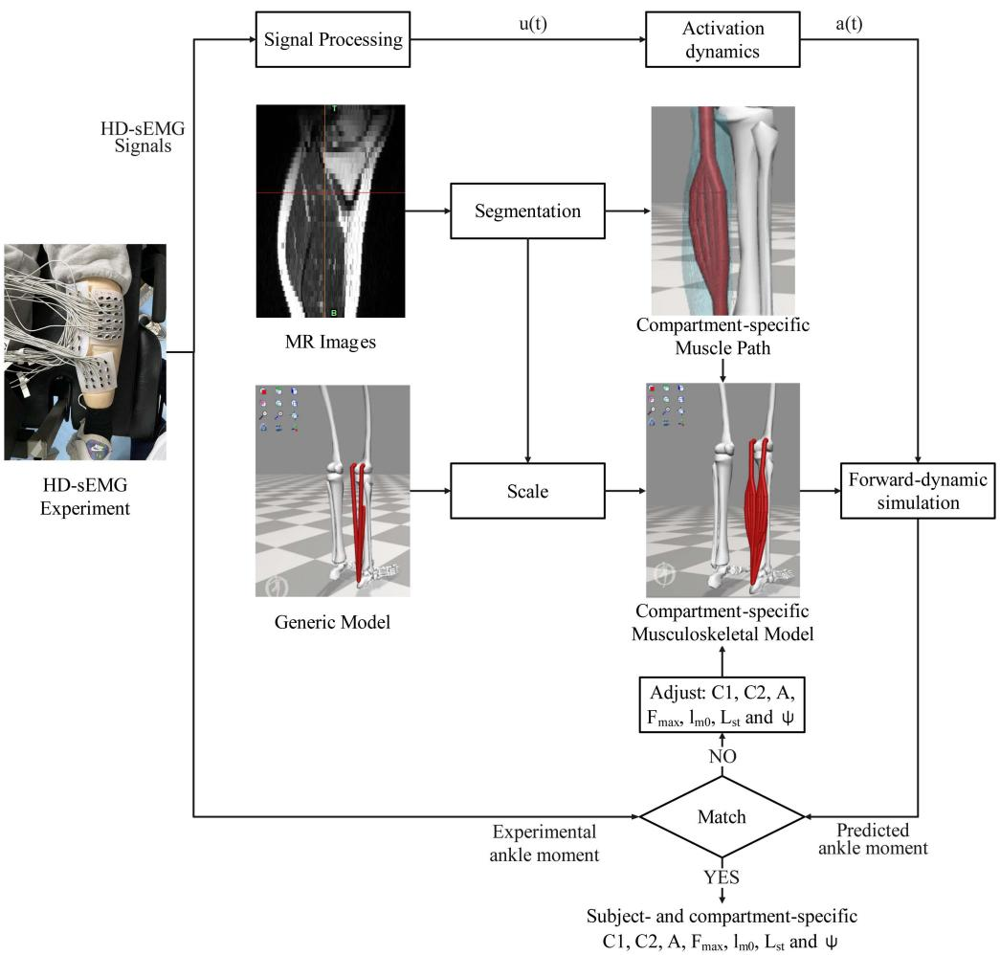
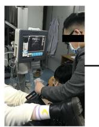
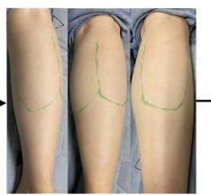
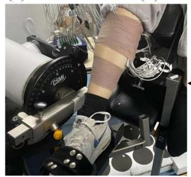
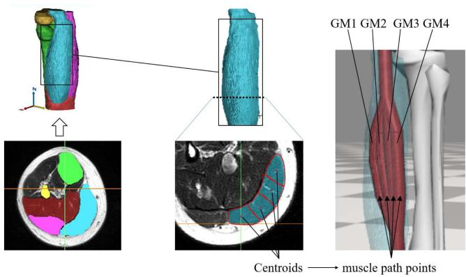
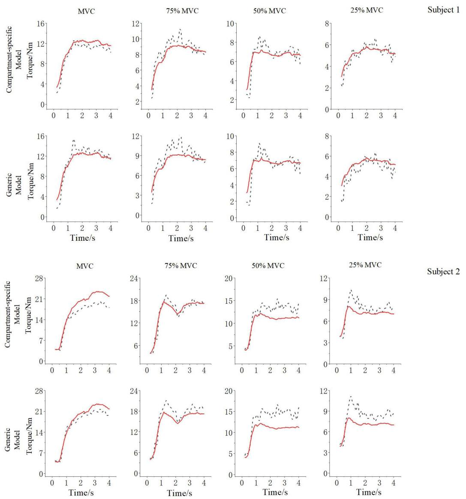

<!-- 本文件是 MinerU 自动抽取的**英文结构化正文**，不是中文翻译。 -->
<!-- 中文翻译若需要，须另走 06_附录/pdf2zh调用脚本/translate_all.py，不得把本文件当译文引用。 -->
<!-- 抽取来源：01_参考论文/运动理解/宋嵘_意图解码与力矩模型/Zheng2024-TBME：基于分舱 HD-sEMG 肌骨模型的等长跖屈力矩预测/Zheng2024-TBME：基于分舱 HD-sEMG 肌骨模型的等长跖屈力矩预测.pdf -->
<!-- DOI：10.1109/TBME.2024.3368021 -->
<!-- 图片：11 张，位于同级 images/，已按正文引用相对路径改写。 -->

# Isometric Plantarflexion Moment Prediction Based on a Compartment-Specific HD-sEMG-Driven Musculoskeletal Model

Manxu Zheng , Pengcheng Lu , Wen Wu , and Rong Song , Senior Member, IEEE

Abstract—Objective: electromyogram (EMG)-driven musculoskeletal models have been widely used to investigate human movements while existing EMG-driven models commonly neglect regional heterogeneity in anatomy and activation within a skeletal muscle. To consider neuromuscular compartment anatomy and activation, a subject- and compartment-specific EMG-driven model was developed for isometric plantarflexion moment prediction. Methods: the model was hill-type consisting of gastrocnemius medialis, gastrocnemius lateralis, and soleus around the ankle joint, and each muscle was discretised into four compartments. The moment arms of each compartment were determined using magnetic resonance imaging and the compartment activation was calculated based on high-density surface EMG signals. And the hill-type compartment parameters were tuned in a calibration process. The developed compartment-specific model and a generic EMG-driven model were examined by comparing their predicted net ankle moments with measurements obtained while subjects performed isometric plantarflexion tasks at different contraction levels. Results: compared to the generic EMG-driven model, the isometric plantarflexion moment prediction using the compartment-specific model was more accurate at all contraction levels, with the average prediction error decreasing from average 13.81% to 10.11%. The contraction of each compartment was found to be generally non-uniform at all contraction levels. Conclusion: the developed compartment-specific model enabled accurate prediction of isometric plantarflexion moment and the simulation of non-uniform muscular contraction, which is more

physiologically appropriate than the existing EMG-driven models. Significance: the proposed compartment-specific formulation opens new perspectives for subject-specific musculoskeletal modelling, which has great potential in understanding regional characteristics of the neuromuscular activities.

Index Terms—EMG-driven model, High-density surface EMG, musculoskeletal model, plantarflexion.

## I. INTRODUCTION

H UMAN movements are the result of the coordinated func-tion of the central nervous system, the sensory system, tion of the central nervous system, the sensory system, and the musculoskeletal system [1]. Multibody dynamics-based musculoskeletal models have allowed deep insights into how the human nervous system controls movement during different activities [2], which enabled numerous applications in engineering, clinics, rehabilitation, and sports, such as motor performance optimisation and help impaired people to regain motor function [3], [4], [5]. Compared with traditional inverse- or forward-dynamic-based modelling approach [6], [7], [8], [9], [10], [11], the electromyography (EMG)-driven musculoskeletal modelling approach accounts for individual muscle activation patterns which may be activated differently based on motor tasks and pathologies, as well as among individuals [12], [13], [14], [15].

In the EMG-driven modelling approach, muscle activations were directly determined by the experimentally recorded EMG data, which further resulted in the muscle force andjoint moment [16], [17]. Early EMG-driven musculoskeletal models for the knee [18], the lower back [19], and the wrist [20] could not well predict the measured joint moments and had to involve a non-physiological error term or “gain” to ensure the match of the prediction with those externally measured. A breakthrough was accomplished by Lloyd et al., [17] when the muscle twitch response was included to account for the timing and duration differences between the EMG and muscle force production. In Lloyd’s study, a set of physiologically based parameters was calibrated to represent individualised features and was proven effective in a range of dynamic tasks [17]. Subsequently, Sartori et al. [1] expanded Lloyd’s approach from single joint to multi-joint in the lower limb during gait simulation and Pizzolato et al. [21] integrated these methods in a toolbox as an OpenSim plug-in. The above EMG-driven musculoskeletal modelling approach had enabled numerous applications, such as the study of the muscular co-contractions [22], metabolic costs [23], and upper body joint modelling [24].

There were studies incorporated subject-specific features in the EMG-driven modelling, such as by using magnetic resonance (MR) imaging to determine physiological cross-sectional areas and moment arms [25], ultrasound to determine maximum isometric muscle forces [26], different scaling methods [27] and varying sets of motions and parameter-tuning methods [28]. Furthermore, two EMG-driven models adopted recent advances in high-density surface EMG (HD-sEMG) techniques to better represent the collective neural drive from the motoneuron pool to a muscle [29], [30]. A common practice in current EMG-driven modelling is to use one muscle element to represent the whole muscle anatomy and the uniform muscle activation deducted from one pair of EMG electrodes to represent the collective neural drive. While in the neuromuscular compartment level, the skeletal muscle was highly heterogeneous in anatomy and activation. It was widely acknowledged that different compartments could have localised moment arms [31], [32]. And inhomogeneous electrical muscle activities among different compartments within a skeletal muscle have been reported in numerous physiological and biomedical studies [33], [34], [35], [36]. In addition, the non-uniform muscle architectures, such as fibre length, pennation angle, and passive elastic properties of a single muscle have been documented and examined [37], [38], [39], [40]. The above-mentioned neuromuscular heterogeneity was believed to be the reason for non-uniform muscular contractions [41], [42].

Although well documented, to our knowledge, neuromuscular compartment anatomy and activation have not been accounted for in previous EMG-driven models, which hinders the investigation of sophisticated regional differences across compartments. Therefore, to consider neuromuscular compartment anatomy and activation, a subject- and compartment-specific EMG-driven model was developed for isometric plantarflexion moment prediction. We hypothesised that compared with the generic model, the proposed compartment-specific model is more physiologically appropriate and can be used to investigate localised muscle activities.

The rest of this article is organized as follows. In Section I, a thorough review in the field of EMG-driven musculoskeletal studies were conducted. In Section II, detailed experiment, model construction, and validation procedures were presented. In Section III, experimental and calculation results were presented. In Section IV, the above results were discussed and compared with previous studies. Finally, the contributions of this study were summarized.

1) The first compartment-specific EMG-driven model was developed by considering neuromuscular compartment anatomy and activation.

2) Simulation of nonuniform triceps surae contraction was performed.

3) The accuracy of isometric plantarflexion moment prediction was increased.

## II. METHOD

## A. Overview

Fig. 1 shows the schematics of the subject- and compartmentspecific HD-sEMG-driven musculoskeletal modelling of the ankle joint. In the experiment, the HD-sEMG was measured while the subject performed isometric plantarflexion in the ankle neutral position. The same subject performed MR scanning, which informed the scaling of a generic lower limb model and provided individualised compartment-specific muscle paths. Finally, a calibration process was conducted to obtain the compartment-specific physiological parameters. Validation of the compartment-specific model was conducted by using the above model to predict the ankle torques in MVC, 75% MVC, 50% MVC, and 25% MVC conditions and compare them with those measured.

## B. Experimental Procedures

A healthy 28-year-old female (height: 1.65 m, weight: 51 kg) and A healthy 23-year-old male (height: 1.85 m, weight: 75 kg) participated in this study. The female subject would be referred as subject 1 and the male subject would be referred as subject 2 in the following sections. The dominant side of the subject was the right side. No previous injury occurred to the right leg. This study was approved by the Ethics Committee of the First Affiliated Hospital of Sun Yat-sen University and registered at the Chinese Clinical Trial Registry (ChiCTR2000032245). The subject signed the informed consent before the experiments. MR images were collected at Jiangmen Central Hospital using a 3.0 T MRI scanner (Philips Medical System, The Netherlands). The scanning parameters were selected to enhance the brightness of fatty tissue to make the boundaries around the muscles more visible. Voxel sizes of $0 . 7 \times 0 . 7 \times 5 . 0 ( 4 . 0 )$ mm were used for the axial images, similar to the voxel sizes used by Hainisch et al. [43]. The subject was placed in the supine position in the MR scanner with the hips and knees fully extended and the ankle in the neutral position. The data were recorded from the dominant leg using 3 mm slices along the shaft of the femur and tibia from the lesser trochanter down to the calcaneus.

An isokinetic dynamometer system (CSMi, HUMACNORM, United States) was used to perform the isometric ankle plantar flexion and record the torque at a sampling frequency of 100 Hz. The monopolar HD-sEMG signals of the triceps surae, i.e., gastrocnemius medialis (GM), gastrocnemius lateralis (GL), and soleus (SOL) of the dominant side of the subject, were acquired simultaneously by the REFA system (TMSi, REFA, Netherlands) at a sampling frequency of 2000 Hz. According to the configuration of a previous HD-sEMG study of the triceps surae [44], a 6 4 electrode array was designed for GM and GL; while a 4 x 4 electrode array was designed for SOL (in a total of 64 separate channels). The diameter of the electrodes was 2 mm. The arrangement of the electrode array placement is shown in Fig. 2(a)–(d). To ensure the electrode array covers the optimal muscle surface (the maximal muscle surface coverage while not exceeding the muscle boundaries), muscle boundaries were measured using ultrasound and marked before the experiment. Electrode patches were specially made for this subject as shown in Fig. 2(a). The inter-electrode distances for GM, GL, and SOL were 17.5 mm, 15 mm, and 14 mm, respectively, based on the actual ultrasound measurements.

(b)  
  
Fig. 1. Schematics of the development of a subject- and compartment-specific HD-sEMG-Driven musculoskeletal model of the ankle joint and the triceps surae. u(t) and a(t) are muscle excitation and activation at time t, respectively. $C _ { 1 } , C _ { 2 }$ , and A are activation parameters of the EMG-toactivation model; Fmax, lm0, lst, and ψ are the physiological parameters of the hill-type muscle model.

  
(a)

  
(d)

  
(c)

  
(e)

  
(f)  
Fig. 2. Electrode array placement and experimental apparatus. (a) muscle boundaries identification using ultrasound scanning; (b) the marked boundaries of GM and GL; (c) the electrode array placement; (d) the experiment apparatus; (e) electrode channels numbering for each muscle and (f) musculoskeletal model configuration.

  
Fig. 3. Subject- and compartment-specific muscle path definition.

The subject lay in the supine position comfortably on the chair of the isokinetic dynamometer system with the dominant leg fixed on the custom-built equipment. Two straps were crossed in front of the chest and one strap was tied at the waist to stabilize the trunk. The subject was familiarised with the experimental process before the formal test. The maximal isometric voluntary contraction (MVC) of ankle plantar flexion was performed at the neutral ankle angle. The subject was asked to push the machine with the maximal force for four seconds and was encouraged verbally to ensure maximal contraction. Three trials were performed with a 1 min break between each trial. Then the subject performed 75%, 50%, and 25% of the MVC, respectively. For each level, five trials were performed with a 1 min break between each trial. Only triceps surae was included in this study following previous EMG-driven studies in plantarflexion torque prediction[45], [46]. Dorsiflexion muscles such as tibialis anterior muscle was not modelled in this study.

## C. Musculoskeletal Model Development

1) Anatomical Model: The anatomical model was modified based on a generic lower limb model in OpenSim (Gait 2392) [47]. The model includes geometric representations of the bones, kinematic descriptions of the joints, and Hill-type models of 88 muscle elements (only the triceps surae muscles were used in this study). The model was first scaled based on the MRI-measured dimensions of the subject. For the compartment-specific model, three compartments were added for each of the GM, GL, and SOL. In each compartment, three fixed path points were added. The positions of these path points were determined from MRI data as follows. The definition of the muscle path points of the GM muscle was used as an example in Fig. 3. The scanned MR images were imported into Mimics software (Materialise NV, Leuven, Belgium), where most portions of the femur, tibia, and triceps surae were reconstructed geometrically. Subsequently, three cross-sections of each muscle were selected in the axial direction, which evenly divided the muscle belly into four parts. Then, each muscle cross-section was evenly divided into four areas. And the location of each muscle path point was defined by the location of the centroid in each area. The subject- and compartment-specific moment arms and muscle lengths in the compartment-specific model were exported from OpenSim to calculate muscle forces in the following sections. The compartments were named GM1 to GM4, GL1 to GL4, and SOL1 to SOL4 for GM, GL, and SOL, respectively, in which GM 1, GL1, and SOL1 are the most medial compartments and GM 4, GL4, and SOL4 are the most lateral ones (see Fig. 3).

2) EMG-to-Activation Model: The raw EMG data was band-pass filtered (30–450 Hz), full-wave rectified, and low-pass filtered (6 Hz) using a zero-phase second-order Butterworth filter. All EMG channels of the same muscle were averaged to obtain the EMG input for the scaled generic model. For the compartment-specific model, EMG signals were averaged in each column of the electrode array to estimate the localised muscle activation for its regionally respective compartment as shown in Fig. 2(e) and (f), based on a previous physiological study, which stated that the human gastrocnemius muscle fibres of one motor unit were localised distributed [42]. For each compartment, the resulting EMG linear envelopes were normalized to the maximum processed values obtained from all recorded trials [48]. Further, the normalized EMG was processed using a recursive filter to model the twitch response of the muscle fibres and subsequently used to obtain the resulting muscle activation based on a nonlinear transfer function below according to a previous study [17].

$$
\textit { u } ( t ) = \alpha e ( t - d ) - \beta _ { 1 } u ( t - 1 ) - \beta _ { 2 } u ( t - 2 )\tag{1}
$$

where u(t) was the muscle excitation, d was the electromechanical delay, and a set of constraints was employed:

$$
\left\{ \begin{array} { l l } { \beta _ { 1 } = C _ { 1 } + C _ { 2 } } \\ { \beta _ { 2 } = C _ { 1 } \cdot C _ { 2 } } \\ { \alpha - \beta _ { 1 } - \beta _ { 2 } = 1 . 0 } \end{array} \right.\tag{2}
$$

Where $C _ { 1 }$ and $C _ { 2 }$ are both constrained between 1 and 1, respectively. Then a nonlinear transfer function was used to account for the nonlinearity in the excitation-to-force relationship and obtain the resulting muscle activation:

$$
a \ ( t ) = { \frac { e ^ { { \cal A } u ( t ) } - 1 } { e ^ { { \cal A } } - 1 } }\tag{3}
$$

where a(t) is the muscle activation, and A is the nonlinear shape factor, constrained $\mathrm { t o } - 3 { < } \mathrm { A } { < } 0$

3) Hill-Type Muscle Model: A hill-type muscle model was constructed to estimate the muscle forces as follows [17].

$$
F _ { m } = F _ { \mathrm { m a x } } \left[ f \left( \tilde { l } _ { m } \right) f \left( \tilde { v } _ { m } \right) a + f _ { P } \left( \tilde { l } _ { m } \right) \right]\tag{4}
$$

$$
F _ { t } = \left\{ \begin{array} { l l } { 0 , } & { \varepsilon \le 0 } \\ { 1 4 8 0 . 3 F _ { \operatorname* { m a x } } \varepsilon ^ { 2 } , } & { 0 < \varepsilon \le 0 . 0 1 2 7 } \\ { \left( 3 7 . 5 \varepsilon - 0 . 2 3 7 5 \right) F _ { \operatorname* { m a x } } , } & { \varepsilon \ge 0 . 0 1 2 7 } \end{array} \right.\tag{5}
$$

$$
\varepsilon = \frac { l _ { t } - l _ { s t } } { l _ { s t } }\tag{6}
$$

$$
F _ { m t } = F _ { t } = F _ { m } \mathrm { c o s } \psi\tag{7}
$$

TABLE I  
ISOMETRIC PLANTARFLEXION TORQUE PREDICTION ERROR WITH RESPECT TO THE MEASUREMENTS BY USING THE COMPARTMENT-SPECIFIC MODEL AND THE GENERIC MODEL
<table><tr><td rowspan="2">Contraction level</td><td colspan="2">Compartment-specific model</td><td colspan="2">Generic model</td></tr><tr><td>RMSE (Nm)</td><td>Error to measurements (%)</td><td>RMSE (Nm)</td><td>Error to measurements (%)</td></tr><tr><td>Subject 1</td><td></td><td></td><td></td><td></td></tr><tr><td>MVC</td><td>0.90</td><td>6.89%</td><td>1.39</td><td>10.58%</td></tr><tr><td>75% MVC</td><td>0.83</td><td>9.03%</td><td>1.24</td><td>13.55%</td></tr><tr><td>50%MVC</td><td>0.77</td><td>10.75%</td><td>0.96</td><td>13.36%</td></tr><tr><td>25% MVC</td><td>0.46</td><td>7.94%</td><td>0.76</td><td>13.10%</td></tr><tr><td>Subject 2</td><td></td><td></td><td></td><td></td></tr><tr><td>MVC</td><td>2.68</td><td>11.29%</td><td>1.47</td><td>6.28%</td></tr><tr><td>75% MVC</td><td>0.99</td><td>5.61%</td><td>1.77</td><td>9.97%</td></tr><tr><td>50%MVC</td><td>2.03</td><td>16.69%</td><td>2.97</td><td>24.40%</td></tr><tr><td>25% MVC</td><td>1.02</td><td>12.69%</td><td>1.54</td><td>19.27%</td></tr><tr><td>Average</td><td></td><td>10.11%</td><td></td><td>13.81%</td></tr></table>

Where $F _ { m }$ is the fiber force; $F _ { t }$ is the tendon force; $F _ { m t }$ is the muscle force; $F _ { \mathrm { m a x } }$ is the maximum isometric muscle force; $f ( \tilde { l } _ { m } )$ and $f ( \tilde { v } _ { m } )$ are the active force-length relationship [49] and force-velocity relationship [50], respectively; $\tilde { l } _ { m }$ is the fiber length normalized to the optimal fiber length $l _ { m 0 } ; \tilde { v } _ { m }$ is the ratio of current fiber velocity to the maximum contraction velocity; a is the muscle activation; $f _ { P } ( \tilde { l } _ { m } )$ is the passive elastic force-length relationship [51]; $l _ { t }$ is the current tendon length and $l _ { s t }$ is its slack length; ψ is the pennation angle.

4) Calibration Process: The EMG and joint torque measurements of one MVC trial were used for calibration. The above-obtained collective and localised muscle activation of an MVC trial were input into the generic model and the compartment-specific model, respectively. The moment arms and muscle lengths of each compartment were integrated with the respective hill-type muscle model to compute muscle force and ankle joint torques. In each model, the calibration was conducted by adjusting muscle parameters to minimise the difference between the predicted ankle torque and the measured one in each time instant, as shown in the equation below.

$$
\mathrm { ~ J ~ } = \frac { 1 } { N } \sum _ { i = 1 } ^ { N } \left( \tau _ { p r e d i c t } \left( i \right) - \tau _ { e x p e r i m e n t } \left( i \right) \right) ^ { 2 }\tag{8}
$$

where N represents the length of the data used for the calibration. The genetic algorithm was used to minimize the objective function J in MATLAB (MathWorks, R2018a, U.S.). The adjusted parameters are listed as follows: Activation parameters $C _ { 1 } , C _ { 2 }$ and A; hill-type muscle parameters, $F _ { \mathrm { m a x } } , l _ { m 0 } , l _ { s t }$ and $\psi .$ . The initial values of the muscle parameters were adapted from the generic model (OpenSim). For the generic model, 15 parameters were calibrated and for the compartment model, 24 parameters were calibrated.

3 muscle activation parameters (i.e., A; $C _ { 1 }$ and $C _ { 2 } )$ were defined the same in both models. The pennation angle $\psi$ of each compartment within a muscle was assumed the same. Similarly, maximum isometric muscle force $F _ { \mathrm { m a x } }$ were defined the same, since all compartments were divided equally in volume (see Fig 3). Specifically, initial values of compartments, i.e., GM0-3, GL0-3 and SOL0-3 were 389.5N, 170.8N and 887.3N, respectively, which were one quarter of those from OpenSim. Variation of the $F _ { \mathrm { m a x } }$ were constrained to 50% of the initial value during the calibration.

TABLE II  
SUMMARY OF ACTIVATION AND HILL-TYPE MUSCLE PARAMETERS FOLLOWING CALIBRATION FOR SUBJECT 2
<table><tr><td>Muscle/ Compartment</td><td>Activation parameters</td><td>Maximum isometric muscle force  $\underline { { ( F _ { m a x } ) } }$ </td><td>Pennation angle (ψ)</td><td>Optimal fiber length  $( l _ { m 0 } )$ </td><td>Slack tendon length  $( l _ { s t } )$ </td></tr><tr><td>Med</td><td> $\mathrm { A } = - 0 . 0 1$ </td><td>829</td><td>0.30</td><td>0.08</td><td>0.45</td></tr><tr><td>Lat</td><td> $C _ { 1 } { = } _ { - } 0 . 5 2$ </td><td>318</td><td>0.14</td><td>0.08</td><td>0.42</td></tr><tr><td>Sol</td><td> $C _ { 2 } { = } { - } 2 . 7 2$ </td><td>2473</td><td>0.44</td><td>0.06</td><td>0.29</td></tr><tr><td>Med0</td><td></td><td></td><td></td><td>0.07</td><td>0.45</td></tr><tr><td>Med1 Med2</td><td></td><td>223</td><td>0.29</td><td>0.06 0.06</td><td>0.44</td></tr><tr><td>Med3</td><td></td><td></td><td></td><td></td><td>0.45</td></tr><tr><td></td><td></td><td></td><td></td><td>0.06</td><td>0.45</td></tr><tr><td>Lat0</td><td> $\mathrm { A } = - 1 . 1 9$ </td><td></td><td></td><td>0.06</td><td>0.42</td></tr><tr><td>Lat1</td><td> $C _ { 1 } = 0 . 3 1$ </td><td>92</td><td>0.13</td><td>0.06</td><td>0.42</td></tr><tr><td>Lat2</td><td> $C _ { 2 } = - 0 . 4 3$ </td><td></td><td></td><td>0.07</td><td>0.43</td></tr><tr><td>Lat3</td><td></td><td></td><td></td><td>0.07</td><td>0.43</td></tr><tr><td>Sol0</td><td></td><td></td><td></td><td>0.05</td><td>0.29</td></tr><tr><td>Soll</td><td></td><td>1075</td><td>0.43</td><td>0.05</td><td>0.29</td></tr><tr><td>Sol2</td><td></td><td></td><td></td><td>0.05</td><td>0.29</td></tr><tr><td>Sol3</td><td></td><td></td><td></td><td>0.05</td><td>0.29</td></tr></table>

According to a previous physiology study, the fibre length within a muscle can be quite different [52], which indicates that optimal fibre length $l _ { m 0 }$ and slack tendon lengths $l _ { s t }$ were different among compartment within a muscle. Therefore, for each compartment, $l _ { m 0 }$ and $l _ { s t }$ were defined differently. Variation of the $l _ { m 0 }$ and $l _ { s t }$ were constrained to 50% of the initial value during the calibration

## III. RESULTS

## A. Experiment Measurements

As illustrated in Fig. 4, the results of the measured muscle activation map of consisted of EMG signals from each channel of Subject 1. Non-uniform distributed EMG signals can be found both in different muscles and in different control levels.

## B. Simulation and Validation

Fig. 5 demonstrates the predictions of the isometric plantarflexion moment using the compartment-specific model and the generic model in MVC, 75% MVC, 50% MVC, and 25% MVC, respectively. The prediction errors to measurements using the compartment-specific model and the generic model in all contraction levels are summarised in Table I. It was found that the predictions using the compartment-specific model are better than those using the generic model in all contraction levels, and the average error to measurements are 10.11% and 13.81%, respectively. Table II shows the activation parameters and hill-type muscle parameters for each subject following calibration for subject

The joint torque contributions of GM, GL, and SOL, respectively, as well as those of each compartment at the four contraction levels, are shown in Fig. 6. For both subjects, SOL contributes the most to the plantarflexion; GM and GL played a minor role in each contraction level. For subject 1, it was found that the compartmental contributions to joint torque are non-uniform in all contraction levels. The GM1 GL1 and SOL4 contribute the most to joint torque comparing to other compartments within GM, GL, and SOL, respectively. Whereas, for subject 2, compartmental contributions to joint torque are non-uniform in GL and slightly non-uniform in GM and SOL. GL1 were found contribute the most to joint torque comparing to other compartments within GL. GM3 and SOL1 contributed slightly more to joint torque comparing to other compartments within GM and SOL, respectively. In general, for both subjects, the medial compartments were more effective in plantarflexion than lateral compartments.

  
Fig. 4. HD-sEMG results of isometric ankle plantar flexion in MVC, 75% MVC, 50% MVC, and 25% MVC, respectively.

## IV. DISCUSSION

We developed a subject- and compartment-specific HD-sEMG-driven musculoskeletal model for isometric plantarflexion moment prediction, considering neuromuscular compartment anatomy and activation of the triceps surae. Major contributions to the field are accurate prediction of isometric plantarflexion moment and the simulation of neuromuscular compartment contractions.

Most existing studies represented each triceps surae muscle with only one element and simple line segments [1], [17], [21], while in this study, depending on the channels of the HD-sEMG array, the number of compartments chosen for each of GM, GL, and SOL was four and the muscle path of each compartment were determined by the MR images, which has proven to be beneficial for joint torque prediction [25]. Moreover, the measured high-density electrical muscle activities from HD-sEMG were consistent with those reported in literature [33], [34], [35]. Based on these measured high-density muscle electrical activities, the compartment-specific activations were computed and used to drive different compartments to contract and form localised force vectors, which coheres with those reported in the physiological study [41]. Finally, the compartment-specific hill-type muscle parameters, such as the $l _ { m 0 }$ and $l _ { s t } .$ , were determined in a calibration process similar to previous EMGdriven studies [1], [17], [21]. These inhomogeneous hill-type muscle parameters indicates different force generation capacity across different compartments, which is in agreement with the reported non-uniform muscle architectures and heterogeneous passive elastic properties [37], [38], [39], [40]. As a results, this study predicted 3.7% more accurate plantarflexion moment, which is better than the previous study (2.8% in average) [26]. In general, these results confirmed that more physiological and detailed representation of the musculoskeletal system in EMGdriven models can predict more accurate joint moments [25], [26], [27], [28].

EMG-driven musculoskeletal models had not only been used for joint moment predictions, but also been used to simulate individual muscle contributions to movement and the muscle synergy [22], [53], [54], [55]. In the muscle level, our results confirmed that the SOL was the major plantar flexor compared to GM and GL, which is consistent with the previous study investigating isometric plantarflexion moment generation [45]. In the compartment level, benefit from the above delicate representation of anatomical and myoelectric muscle heterogeneity, the compartment-specific model can further predict regional differences and simulate non-uniform muscle contractions. The neural drive for the compartment-specific model was calculated based on the HD-EMG measurements, which were in good agreement with those measured in previous HD-sEMG studies performing similar tasks [41], [56], [57]. This inhomogeneous neural drive is believed to be due to the independent recruitment of subpopulations of motor units [36], [58], or even possibly, of each motor unit innervating a muscle fibre [59]. Following the non-uniform motor unit recruitment, the innervated muscle fibres within a muscle will contract and result in inhomogeneous fibre force vectors, hence further leading to non-uniform muscular contractions [41], [42]. These non-uniform muscular contractions were simulated in this study and demonstrated that certain regional compartments, such as the GM1 and SOL4, contributed substantially more to joint torque than other compartments in subject 1. The non-uniform contraction results in this study are in general agreement with previous MR imaging and FDG-PET studies [60], [61]. In particular, the FDG-PET study reported experimental evidence that high muscular glucose uptake was distributed heterogeneously and clustered in all lower limb muscles during walking [61]. Since glucose uptake reflects the energy consumption of muscle fibres, this clustered glucose uptake can be considered as the causal phenomenon of our clustered compartmental contractions. In addition, nonuniform and clustered muscular contractions were also reported in the study of the gluteus medius and biceps brachii [62], [63]. The above results indicated that the compartment-specific model could reveal the regional characteristics of the muscular contraction, which is more detailed and physiologically appropriate than those of the generic models.

  
Fig. 5. Predictions of the plantarflexion moments using the compartment-specific model and the generic model in MVC, 75% MVC, 50% MVC, and 25% MVC, respectively.

The present work reveals the non-uniform contraction process of the triceps surae using mathematical models describing the neural drive from subpopulations of the motoneuron pool and the causal regional mechanical forces it provokes. The myoelectric and anatomical heterogeneity modelling approach could be useful to examine pathological mechanisms among neuromuscular compartments. Furthermore, the increased accuracy in muscle force prediction may be integrated into the clinical decision-making process pre-surgery and improve rehabilitation device performance. Limited to the density of the electrode array, this study examined four compartments of each triceps surae muscle. It can be beneficial to directly measure the EMG of each motor unit and discretise the muscle with matching compartments accordingly. Also, advanced EMG processing techniques, such as principle component analysis, may further improve the EMG input accuracy for each compartment. In addition, although the subject was in supine position in both MR scan and experiment, the Y-shape support can also cause muscle morphological changes due to gravity, which may slightly vary the moment arms of the triceps surae. The neglected deep plantarflexor muscles, such as the flexor digitorum longus muscle, and dorsiflexor muscles, such as the tibialis anterior might also effect the plantarflexion results. In the future, the proposed framework will be used to examine abnormal conditions such as muscular spasticity and fatigue.

  
Fig. 6. Contribution to joint torque of each compartment within GM, GL, and SOL in MVC, 75% MVC, 50% MVC, and 25% MVC, respectively.

## V. CONCLUSION

In this study, a subject- and compartment-specific HD-sEMGdriven musculoskeletal model was developed, where compartmental moment arms and activations were determined using

MR imaging and HD-sEMG signals, respectively. The results in isometric plantarflexion simulation reveals that the developed model could predict accurate joint moment and non-uniform neuromuscular compartment contractions. The developed model is more detailed and physiologically appropriate than the generic EMG-driven models and has great potential in the study of the regional characteristics of the neuromuscular activities.

## REFERENCES

[1] M. Sartori et al., “EMG-driven forward-dynamic estimation of muscle force and joint moment about multiple degrees of freedom in the Human lower extremity,” Plos One, vol. 7, no. 12, 2012, Art. no. e52618.

[2] I. Roupa et al., “On the modeling of biomechanical systems for Human movement analysis: A narrative review,” Arch. Comput. Methods Eng., vol. 29, pp. 4915–4958, 2022.

[3] F. De Groote and A. Falisse, “Perspective on musculoskeletal modelling and predictive simulations of Human movement to assess the neuromechanics of gait,” Proc. Roy. Soc. B, vol. 288, no. 1946, 2021, Art. no. 20202432.

[4] S. Heintz and E. M. Gutierrez-Farewik, “Static optimization of muscle forces during gait in comparison to EMG-to-force processing approach,” Gait Posture, vol. 26, no. 2, pp. 279–288, 2007.

[5] D. L. Damiano et al., “Muscle force production and functional performance in spastic cerebral palsy: Relationship of cocontraction,” Arch. Phys. Med. Rehabil., vol. 81, no. 7, pp. 895–900, 2000.

[6] K. B. Shelburne et al., “Pattern ofanterior cruciate ligament force in normal walking,” J. Biomech., vol. 37, no. 6, pp. 797–805, 2004.

[7] D. J. Cleather and A. Bull, “An optimization-based simultaneous approach to the determination of muscular, ligamentous, and joint contact forces provides insight into musculoligamentous interaction,”Ann. Biomed. Eng., vol. 39, no. 7, pp. 1925–1934, 2011.

[8] Y. P. Lim, Y. C. Lin, and M. G. Pandy, “Effects of step length and step frequency on lower-limb muscle function in Human gait,” J. Biomech., vol. 57, pp. 1–7, May 2017.

[9] F. C. Anderson and M. G. Pandy, “Dynamic optimization of Human walking,” J. Biomech. Eng., vol. 123, no. 5, pp. 381–390, 2001.

[10] M. Ackermann and A. Bogert, “Optimality principles for model-based prediction of Human gait,” J. Biomech., vol. 43, no. 6, pp. 1055–1060, 2010.

[11] Y. C. Lin, J. P. Walter, and M. G. Pandy, “Predictive simulations of neuromuscular coordination and joint-contact loading in Human gait,” Ann. Biomed. Eng., vol. 46, pp. 1216–1227, 2018.

[12] T. S. Buchanan and D. G. Lloyd, “Muscle activity is different for humans performing static tasks which require force control and position control,” Neurosci. Lett., vol. 194, no. 1/2, pp. 61–64, 1995.

[13] D. Kumar, K. T. Manal, and K. S. Rudolph, “Kneejoint loading during gait in healthy controls and individuals with knee osteoarthritis,” Osteoarthritis Cartilage, vol. 21, no. 2, pp. 298–305, 2013.

[14] T. F. Besier et al., “Knee muscle forces during walking and running in patellofemoral pain patients and pain-free controls,” J. Biomech., vol. 42, no. 7, pp. 898–905, Jan. 2009.

[15] D. G. Lloyd and T. S. Buchanan, “Strategies of muscular support of varus and valgus isometric loads at the human knee,” J. Biomech., vol. 34, no. 10, pp. 1257–1267, 2001.

[16] D. G. Lloyd and T. S. Buchanan, “A model ofload sharing between muscles and soft tissues at the Human knee during static tasks,” J. Biomech. Eng., vol. 118, no. 3, pp. 367–376, Aug. 1996.

[17] D. G. Lloyd and T. F. Besier, “An EMG-driven musculoskeletal model to estimate muscle forces and knee joint moments in vivo,” J. Biomech., vol. 36, no. 6, pp. 765–776, Jun. 2003.

[18] S. J. Olney and D. A. Winter, “Predictions of knee and ankle moments of force in walking from EMG and kinematic data,” J. Biomech., vol. 18, no. 1, pp. 9–20, 1985.

[19] S. M. Mcgill and R. W. Norman, “Partitioning of the L4-L5 dynamic moment into disc, ligamentous, and muscular components during lifting,” Spine, vol. 11, no. 7, pp. 666–678, 1986.

[20] T. S. Buchanan et al., “Estimation of muscle forces about the wrist joint during isometric tasks using an EMG coefficient method,” J. Biomech., vol. 26, no. 4/5, pp. 547–560, 1993.

[21] C. Pizzolato et al., “CEINMS: A toolbox to investigate the influence of different neural control solutions on the prediction of muscle excitation and joint moments during dynamic motor tasks,” J. Biomech., vol. 48, no. 14, pp. 3929–3936, Sep. 2015.

[22] J. Cannon, E. D. J. Cambridge, and S. M. McGill, “Increased core stability is associated with reduced knee valgus during single-leg landing tasks: Investigating lumbar spine and hip joint rotational stiffness,” J. Biomech., vol. 116, Feb. 2021, Art. no. 110240.

[23] M. C. Bisi et al., “An EMG-driven model applied for predicting metabolic energy consumption during movement,” J. Electromyogr. Kinesiol., vol. 21, no. 6, pp. 1074–1080, Dec. 2011.

[24] Y. H. Zhao et al., “An EMG-driven musculoskeletal model for estimating continuous wrist motion,” IEEE Trans. Neural Syst. Rehabil. Eng., vol. 28, no. 12, pp. 3113–3120, Dec. 2020.

[25] L. C. Tsai, P. M. Colletti, and C. M. Powers, “Magnetic resonance imaging-measured muscle parameters improved knee moment prediction of an EMG-driven model,” Med. Sci. Sports Exercise, vol. 44, no. 2, pp. 305–312, Feb. 2012.

[26] L. L. Menegaldo and L. F. Oliveira, “The influence of modeling hypothesis and experimental methodologies in the accuracy of muscle force estimation using EMG-driven models,” Multibody Syst. Dyn., vol. 28, no. 1/2, pp. 21–36, Aug. 2012.

[27] Y. R. Ma et al., “The effect of musculoskeletal model scaling methods on ankle joint kinematics and muscle force prediction during gait for children with cerebral palsy and equinus gait,” Comput. Biol. Med., vol. 134, Jul. 2021, Art. no. 104436.

[28] A. Falisse et al., “EMG-driven optimal estimation of subject-SPECIFIC hill model muscle-tendon parameters of the knee joint actuators,” IEEE Trans. Biomed. Eng., vol. 64, no. 9, pp. 2253–2262, Sep. 2017.

[29] M. Sartori, U. Yavuz, and D. Farina, “In vivo neuromechanics: Decoding causal motor neuron behavior with resulting musculoskeletal function,” Sci. Rep., vol. 7, no. 1, 2017, Art. no. 13465.

[30] L. G. Wiedemann et al.., “Neuromuscular characterisation in Cerebral Palsy using hybrid Hill-type models on isometric contractions,” Comput. Biol. Med., vol. 103, pp. 269–276, Dec. 2018.

[31] L. Modenese and J. Kohout, “Automated generation of three-dimensional complex muscle geometries for use in personalised musculoskeletal models,” Ann. Biomed. Eng., vol. 48, no. 6, pp. 1793–1804, Jun. 2020.

[32] G. Valente et al., “Muscle discretization affects the loading transferred to bones in lower-limb musculoskeletal models,” Proc. Inst. Mech. Engineers Part H-J. Eng. Med., vol. 226, no. 2, pp. 161–169, 2012.

[33] D. Staudenmann et al., “Improving EMG-based muscle force estimation by using a high-density EMG grid and principal component analysis,” IEEE Trans. Biomed. Eng., vol. 53, no. 4, pp. 712–719, Apr. 2006.

[34] L. F. Xu et al., “A fatigue involved modification framework for force estimation in fatiguing contraction,” IEEE Trans. Neural Syst. Rehabil. Eng., vol. 26, no. 11, pp. 2153–2164, Nov. 2018.

[35] B. R. Schlink, A. D. Nordin, and D. P. Ferris, “Human myoelectric spatial patterns differ among lower limb muscles and locomotion speeds,” Physiol. Rep., vol. 8, no. 23, Dec. 2020, Art. no. e14652.

[36] T. M. M. Vieira et al., “Recruitment of motor units in the medial gastrocnemius muscle during human quiet standing: Is recruitment intermittent? What triggers recruitment?,” J. Neurophysiol., vol. 107, no. 2, pp. 666–676, Jan. 2012.

[37] E. Azizi and A. R. Deslauriers, “Regional heterogeneity in muscle fiber strain: The role of fiber architecture,” Front. Physiol., vol. 5, Aug. 2014, Art. no. 303.

[38] A. M. Agur et al., “Documentation and three-dimensional modelling of human soleus muscle architecture,” Clin. Anatomy, vol. 16, no. 4, pp. 285–293, 2003.

[39] N. Miyamoto, N. Kimura, and K. Hirata, “Non-uniform distribution of passive muscle stiffness within hamstring,” Scand. J. Med. Sci. Sports, vol. 30, no. 9, pp. 1729–1738, Sep. 2020.

[40] B. K. Coombes et al.., “Heterogeneity of passive elastic properties within the quadriceps femoris muscle-tendon unit,” Eur. J. Appl. Physiol., vol. 118, no. 1, pp. 213–221, Jan. 2018.

[41] A. Gallina and T. Vieira, “Territory and fiber orientation of vastus medialis motor units: A surface electromyography investigation,” Muscle Nerve, vol. 52, no. 6, pp. 1057–1065, Dec. 2015.

[42] T. M. M. Vieira et al., “Postural activation of the human medial gastrocnemius muscle: Are the muscle units spatially localised?,” J. Physiol., vol. 589, no. 2, pp. 431–443, Jan. 2011.

[43] R. Hainisch et al., “Method for determining musculotendon parameters in subject-specific musculoskeletal models of children developed from MRI data,” Multibody System Dyn., vol. 28, no. 1/2, pp. 143–156, Aug. 2012.

[44] D. Staudenmann et al., “Heterogeneity of muscle activation in relation to force direction: A multi-channel surface electromyography study on the triceps surae muscle,” J. Electromyogr. Kinesiol., vol. 19, no. 5, pp. 882–895, Oct. 2009.

[45] L. L. Menegaldo and L. F. de Oliveira, “Effect of muscle model parameter scaling for isometric plantar flexion torque prediction,” J. Biomech., vol. 42, no. 15, pp. 2597–2601, Nov. 2009.

[46] J. F. Grosset et al., “Voluntary activation of the triceps surae in prepubertal children,” J. Electromyogr. Kinesiol., vol. 18, no. 3, pp. 455–465, 2008.

[47] S. L. Delp et al., “OpenSim: Open-source software to create and analyze dynamic simulations of movement,” IEEE Trans. Biomed. Eng., vol. 54, no. 11, pp. 1940–1950, Nov. 2007.

[48] M. Sartori, D. Farina, and D. G. Lloyd, “Hybrid neuromusculoskeletal modeling to best track joint moments using a balance between muscle excitations derived from electromyograms and optimization,” J. Biomech., vol. 47, no. 15, pp. 3613–3621, Nov. 2014.

[49] Y. Giat et al., “Simulation of distal tendon transfer of the biceps brachii and the brachialis muscles,” J. Biomech., vol. 27, no. 8, pp. 1005–1014, 1994.

[50] L. M. Schutte et al., “Improving the efficacy of electrical stimulationinduced leg cycle ergometry: An analysis based on a dynamic musculoskeletal model,” IEEE Trans. Rehabil. Eng., vol. 1, no. 2, pp. 109–125, Jun. 1993.

[51] T. S. Buchanan et al., “Neuromusculoskeletal modeling: Estimation of muscle forces and joint moments and movements from measurements of neural command,” J. Appl. Biomech., vol. 20, no. 4, pp. 367–395, Nov. 2004.

[52] S. R. Ward et al., “Are current measurements of lower extremity muscle architecture accurate?,” Clin. Orthop. Related Res., vol. 467, no. 4, pp. 1074–1082, 2009.

[53] M. Sartori et al., “Modeling and simulating the neuromuscular mechanisms regulating ankle and knee joint stiffness during human locomotion,” J. Neurophysiol., vol. 114, no. 4, pp. 2509–2527, Oct. 2015.

[54] A. Kian et al.., “Static optimization underestimates antagonist muscle activity at the glenohumeral joint: A musculoskeletal modeling study,” J. Biomech., vol. 3, no. 97, Dec. 2019, Art. no. 109348.

[55] G. Li et al., “How well do commonly used Co-contraction indices approximate lower limb joint stiffness trends during gait for individuals poststroke?,” Front. Bioeng. Biotechnol., vol. 8, Jan. 2021, Art. no. 588908.

[56] D. Borzelli et al., “Contraction level, but not force direction or wrist position, affects the spatial distribution of motor unit recruitment in the biceps brachii muscle,” Eur. J. Appl. Physiol., vol. 120, no. 4, pp. 853–860, Apr. 2020.

[57] D. Falla and A. Gallina, “New insights into pain-related changes in muscle activation revealed by high-density surface electromyography,” J. Electromyogr. Kinesiol., vol. 52, Jun. 2020, Art. no. 102422.

[58] E. J. van Zuylen, C. C. Gielen, and J. J. D. van der Gon, “ “coordination and inhomogeneous activation of human arm muscles during isometric torques,” J. Neurophysiol., vol. 60, no. 5, pp. 1523–1548, Nov. 1988.

[59] D. Kernell, “Principles of force gradation in skeletal muscles,” Neural Plast., vol. 10, no. 1/2, pp. 69–76, 2003.

[60] R. Kinugasa et al., “Unique spatial distribution of in vivo human muscle activation,” Exp. Physiol., vol. 96, no. 9, pp. 938–948, Sep. 2011.

[61] S. Kolk et al.., “Symmetry and spatial distribution of muscle glucose uptake in the lower limbs during walking measured using FDG-PET,” Plos One, vol. 14, no. 4, Apr. 2019, Art. no. e0215276.

[62] J. Y. Li et al., “A three-dimensional finite-element model of gluteus medius muscle incorporating inverse-dynamics-based optimization for simulation of non-uniform muscle contraction,” Med. Eng. Phys., vol. 87, pp. 38–44, Jan. 2021.

[63] S. S. Blemker, P. M. Pinsky, and S. L. Delp, “A 3D model of muscle reveals the causes ofnonuniform strains in the biceps brachii,” J. Biomech., vol. 38, no. 4, pp. 657–665, Apr. 2005.