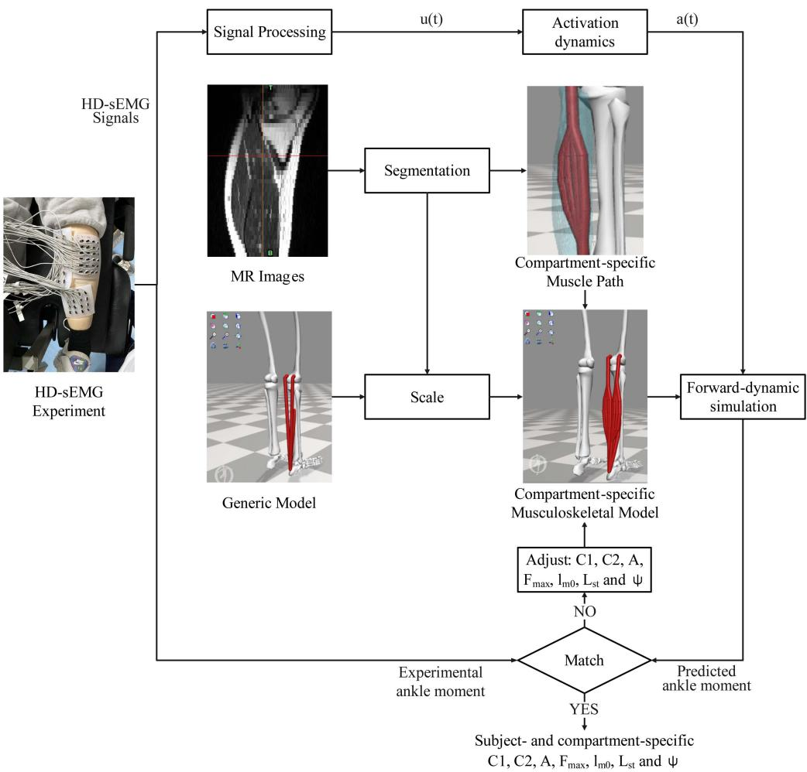
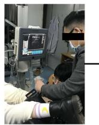
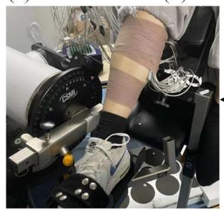
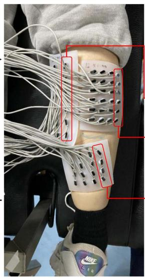
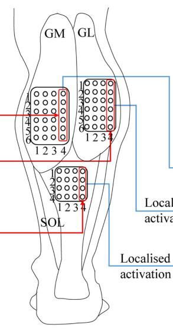
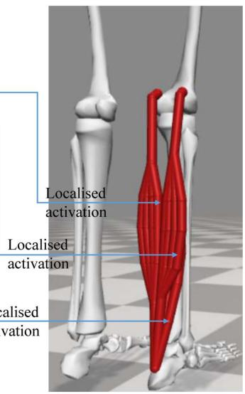
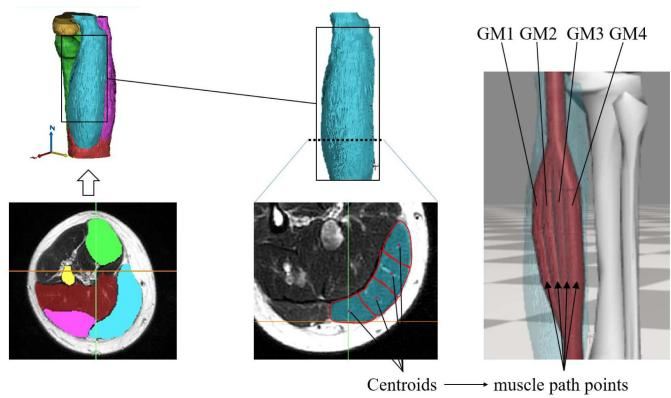
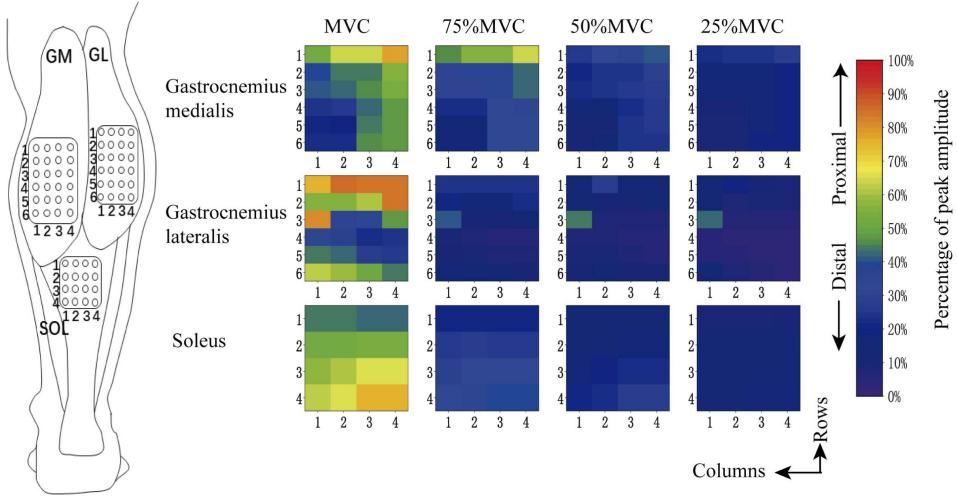
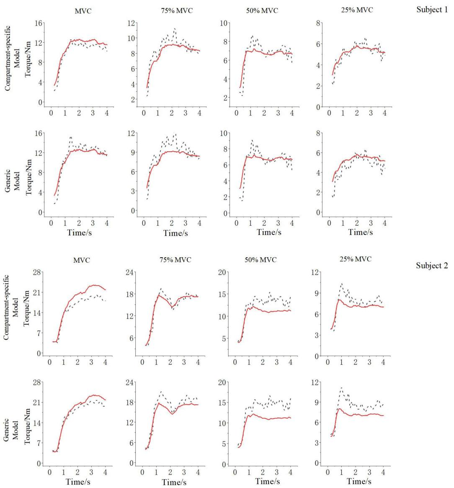
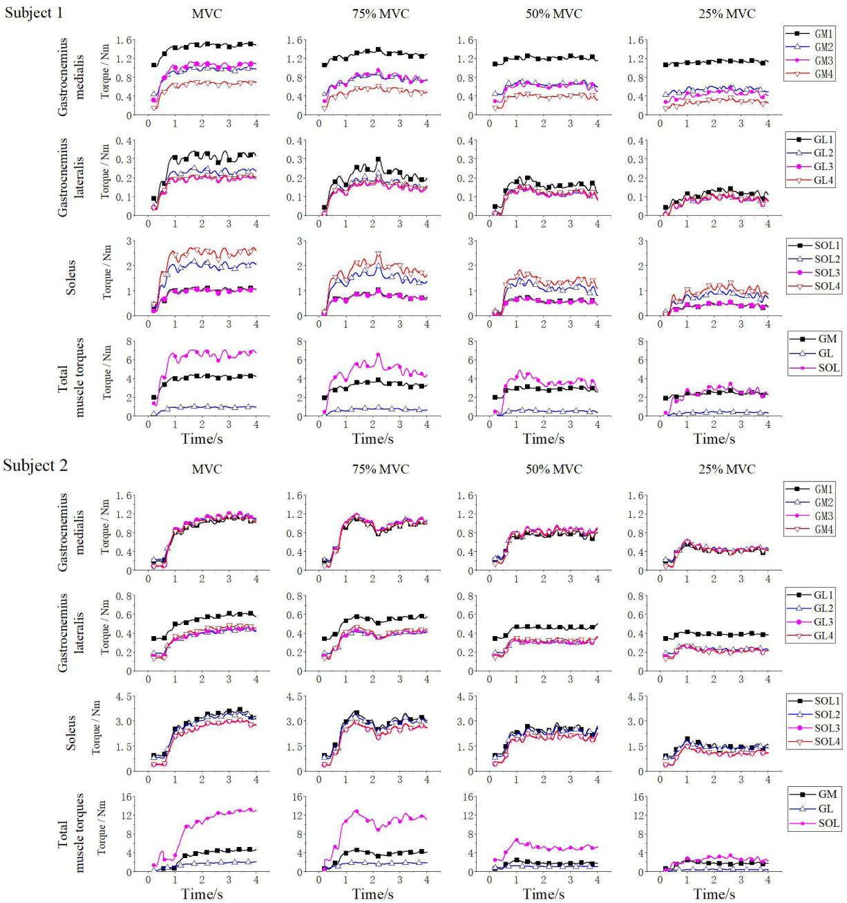

# 基于分区特异性 HD-sEMG 驱动肌肉骨骼模型的等长跖屈力矩预测

Manxu Zheng , Pengcheng Lu , Wen Wu , and Rong Song , Senior Member, IEEE

摘要—目的：肌电图（EMG）驱动的肌肉骨骼模型已被广泛应用于人体运动研究，然而现有的 EMG 驱动模型通常忽略了骨骼肌内部在解剖结构和激活上的区域异质性。为了兼顾神经肌肉分区的解剖结构与激活特性，本研究开发了一种受试者特异且分区特异的 EMG 驱动模型，用于等长跖屈力矩的预测。方法：该模型为包含踝关节周围腓肠肌内侧头、腓肠肌外侧头和比目鱼肌的 Hill 型模型，且每块肌肉被离散化为四个分区。利用磁共振成像（MRI）测定每个分区的力臂，并基于高密度表面肌电（HD-sEMG）信号计算分区激活程度。同时，在校准过程中对 Hill 型分区参数进行了优化调整。通过将所开发的分区特异性模型与通用 EMG 驱动模型预测的踝关节净力矩与受试者在不同收缩水平下执行等长跖屈任务时测得的实际数据进行对比，对模型进行了验证。结果：与通用 EMG 驱动模型相比，分区特异性模型在所有收缩水平下的等长跖屈力矩预测均更为精确，平均预测误差从平均 13.81% 降低至 10.11%。同时发现在所有收缩水平下，各分区的收缩普遍呈现非均匀性。结论：所开发的分区特异性模型能够准确预测等长跖屈力矩并模拟肌肉的非均匀收缩，相比现有的 EMG 驱动模型更具生理学合理性。意义：本研究提出的分区特异性建模方法为受试者特异性肌肉骨骼建模开辟了新视角，在理解神经肌肉活动的区域特性方面具有巨大潜力。

关键词—EMG 驱动模型，高密度表面肌电（High-density surface EMG），肌肉骨骼模型，跖屈。

## I. 引言

人类运动是中枢神经系统、感觉系统以及肌肉骨骼系统协同作用的结果 [1]。基于多体动力学的肌肉骨骼模型使人们能够深入了解人类神经系统在不同活动中如何控制运动 [2]，这在工程、临床、康复和体育领域促成了众多应用，例如运动表现优化以及帮助功能障碍人群恢复运动功能 [3], [4], [5]。与传统的基于逆向或前向动力学的建模方法 [6], [7], [8], [9], [10], [11] 相比，肌电图（EMG）驱动的肌肉骨骼建模方法考虑了个体肌肉激活模式，这些模式可能会因运动任务和病理状态的不同而在不同个体之间存在差异 [12], [13], [14], [15]。

在 EMG 驱动的建模方法中，肌肉激活直接由实验记录的 EMG 数据确定，进而计算出肌肉力和关节力矩 [16], [17]。早期针对膝关节 [18]、下背部 [19] 和腕关节 [20] 的 EMG 驱动肌肉骨骼模型无法很好地预测测得的关节力矩，不得不引入非生理性的误差项或“增益”来确保预测值与外部测量值相匹配。Lloyd 等人 [17] 取得了突破性进展，他们引入了肌肉单收缩响应（muscle twitch response），以解释 EMG 信号与肌肉力产生之间的时间和持续时间差异。在 Lloyd 的研究中，校准了一组基于生理学的参数以表征个体化特征，并被证明在一系列动态任务中是有效的 [17]。随后，Sartori 等人 [1] 将 Lloyd 的方法在步态模拟中从单关节扩展到下肢多关节，Pizzolato 等人 [21] 将这些方法整合为一个作为 OpenSim 插件的工具箱。上述 EMG 驱动的肌肉骨骼建模方法已催生了大量应用，例如肌肉共收缩 [22]、代谢消耗 [23] 以及上肢/上半身关节建模 [24] 的研究。

已有研究在肌电驱动建模（EMG-driven modelling）中纳入了个体特异性（subject-specific）特征，例如利用磁共振（MR）成像来确定生理横截面积和力臂 [25]，利用超声确定最大等长肌力 [26]，采用不同的缩放方法 [27] 以及不同的动作集和参数调整方法 [28]。此外，有两个肌电驱动模型采用了高密度表面肌电（HD-sEMG）技术的最新进展，以更好地表征从运动神经元池到肌肉的集体神经驱动 [29], [30]。当前肌电驱动建模的常见做法是使用单个肌肉单元来代表整块肌肉的解剖结构，并使用从一对肌电电极推导出的均匀肌肉激活来代表集体神经驱动。然而在神经肌肉分区（compartment）层面上，骨骼肌在解剖结构和激活方面表现出高度的异质性。人们普遍认为，不同的分区可能具有局部的力臂 [31], [32]。并且许多生理学和生物医学研究均报道了骨骼肌内不同分区之间不均匀的肌肉电活动 [33], [34], [35], [36]。此外，单一肌肉内不均匀的肌肉构筑（如肌纤维长度、羽状角以及被动弹性特性）也已被记录和研究 [37], [38], [39], [40]。上述神经肌肉异质性被认为是非均匀肌肉收缩的原因 [41], [42]。

尽管已有充分记录，但据我们所知，先前的肌电驱动模型尚未考虑神经肌肉分区的解剖结构和激活，这阻碍了对跨分区复杂区域差异的研究。因此，为了兼顾神经肌肉分区的解剖结构与激活，本研究开发了一种针对个体和分区特异性的肌电驱动模型，用于等长跖屈力矩的预测。我们假设，与通用模型相比，所提出的分区特异性模型在生理上更为合理，并且可用于研究局部肌肉活动。

本文其余部分的结构安排如下：在第 I 节中，对肌电驱动肌肉骨骼研究领域进行了全面综述；在第 II 节中，详细介绍了实验、模型构建和验证流程；在第 III 节中，展示了实验和计算结果；在第 IV 节中，讨论了上述结果并与以往的研究进行了对比；最后，总结了本研究的贡献。

1) 通过考虑神经肌肉分区的解剖结构和激活，开发了首个分区特异性肌电驱动模型。

2) 对小腿三头肌（triceps surae）的非均匀收缩进行了仿真。

3) 提高了等长跖屈力矩预测的准确性。

## II. 方法

## A. 概述

Fig. 1 展示了个体与肌肉分区特异性 HD-sEMG 驱动的踝关节肌骨建模示意图。在实验中，受试者在踝关节中立位进行等长跖屈运动的同时测量了 HD-sEMG。同一受试者进行了 MR 扫描，该扫描用于指导通用下肢模型的缩放，并提供了个体化的分区特异性肌肉路径。最后，执行了校准过程以获取分区特异性的生理参数。分区特异性模型的验证是通过利用上述模型预测 MVC、75% MVC、50% MVC 和 25% MVC 条件下的踝关节力矩，并将其与测量值进行比较来进行的。

## B. 实验流程

一名健康的 28 岁女性（身高：1.65 m，体重：51 kg）和一名健康的 23 岁男性（身高：1.85 m，体重：75 kg）参与了本研究。在以下各节中，女性受试者被称为受试者 1（subject 1），男性受试者被称为受试者 2（subject 2）。受试者的优势侧均为右侧。右腿既往无损伤。本研究获得了中山大学附属第一医院（First Affiliated Hospital of Sun Yat-sen University）伦理委员会的批准，并在中国临床试验注册中心（Chinese Clinical Trial Registry，ChiCTR2000032245）注册。受试者在实验前签署了知情同意书。MR 图像在江门市中心医院（Jiangmen Central Hospital）使用 3.0 T MRI 扫描仪（Philips Medical System，The Netherlands）采集。扫描参数的选择增强了脂肪组织的亮度，以使肌肉周围的边界更加清晰可见。轴向图像使用的体素大小为 $0 . 7 \times 0 . 7 \times 5 . 0 ( 4 . 0 )$ mm，与 Hainisch et al. [43] 使用的体素大小相似。受试者仰卧置于 MR 扫描仪中，髋关节和膝关节完全伸展，踝关节处于中立位。沿股骨和胫骨骨干，从转子下部向下直至跟骨，以 3 mm 的切片采集优势腿的数据。

使用等速肌力测定系统（CSMi, HUMACNORM, United States）进行踝关节等长跖屈测试，并以 100 Hz 的采样频率记录力矩。受试者优势侧小腿三头肌（即腓肠肌内侧头（GM）、腓肠肌外侧头（GL）和比目鱼肌（SOL））的单极 HD-sEMG 信号通过 REFA 系统（TMSi, REFA, Netherlands）以 2000 Hz 的采样频率同步采集。根据以往小腿三头肌 HD-sEMG 研究的配置 [44]，为 GM 和 GL 设计了 6 × 4 的电极阵列；而为 SOL 设计了 4 × 4 的电极阵列（共计 64 个独立通道）。电极直径为 2 mm。电极阵列的放置排列如图 2(a)–(d) 所示。为确保电极阵列覆盖最佳肌肉表面（在不超过肌肉边界的前提下实现最大肌肉表面覆盖率），在实验前使用超声测量并标记了肌肉边界。如图 2(a) 所示，电极贴片为该受试者专门定制。根据实际超声测量结果，GM、GL 和 SOL 的电极间距分别为 17.5 mm、15 mm 和 14 mm。

(b)  
  
Fig. 1. 针对受试者和肌肉分区特异性的踝关节及小腿三头肌 HD-sEMG 驱动肌骨模型构建示意图。u(t) 和 a(t) 分别为时间 t 时的肌肉兴奋和激活度。$C _ { 1 } , C _ { 2 }$ 和 A 为肌电到激活模型的激活参数；Fmax、lm0、lst 和 ψ 为 Hill 型肌肉模型的生理参数。

  
(a)

  
(d)

  
(c)

  
(e)

  
(f)  
Fig. 2. 电极阵列放置与实验装置。(a) 使用超声扫描识别肌肉边界；(b) 标记出的 GM 和 GL 边界；(c) 电极阵列放置；(d) 实验装置；(e) 各肌肉的电极通道编号以及 (f) 肌骨模型配置。

  
Fig. 3. 受试者与肌肉分区特异性的肌肉路径定义。

受试者舒适地仰卧在等速测力仪系统的座椅上，优势腿固定在定制设备上。两条绑带在胸前交叉，一条绑带系在腰部以稳定躯干。在正式测试前，受试者熟悉了实验流程。在踝关节中立位下进行了踝关节跖屈的最大等长自主收缩（MVC）。受试者被要求用最大力量推压机器持续 4 秒，并通过口头鼓励以确保达到最大收缩。共进行三次测试，每次测试之间休息 1 分钟。随后，受试者分别完成 75%、50% 和 25% MVC 的测试。每个收缩水平进行五次测试，每次测试之间休息 1 分钟。根据以往关于跖屈力矩预测的肌电驱动（EMG-driven）研究 [45], [46]，本研究仅纳入了小腿三头肌。胫骨前肌等背屈肌群在本研究中未进行建模。

## C. Musculoskeletal Model Development

1) Anatomical Model: 解剖模型基于 OpenSim 中的通用下肢模型（Gait 2392）进行修改 [47]。该模型包括骨骼的几何表示、关节的运动学描述以及 88 个肌肉单元的 Hill 型模型（本研究仅使用了小腿三头肌）。模型首先根据受试者的 MRI 测量尺寸进行了缩放。对于肌室特异性模型，GM、GL 和 SOL 各自增加了三个肌室（划分出四个肌室区域）。在每个肌室中添加了三个固定路径点。这些路径点的位置根据 MRI 数据确定，步骤如下。图 3 以 GM 肌肉路径点的定义为例。将扫描的 MR 图像导入 Mimics 软件（Materialise NV, Leuven, Belgium），在其中几何重建了股骨、胫骨和小腿三头肌的大部分区域。随后，在轴向上选取每块肌肉的三个横截面，将肌腹均匀分为四部分。然后，将每个肌肉横截面均匀分为四个区域。每个肌肉路径点的位置由对应区域的质心位置确定。肌室特异性模型中受试者及肌室特异性的力臂和肌肉长度从 OpenSim 中导出，用于在后续部分计算肌力。GM、GL 和 SOL 的肌室分别命名为 GM1 至 GM4、GL1 至 GL4 以及 SOL1 至 SOL4，其中 GM1、GL1 和 SOL1 为最内侧肌室，GM4、GL4 和 SOL4 为最外侧肌室（见图 3）。

2) 肌电到激活度模型（EMG-to-Activation Model）：使用零相位二阶 Butterworth 滤波器对原始 EMG 数据进行带通滤波（30–450 Hz）、全波整流和低通滤波（6 Hz）。将同一肌肉的所有 EMG 通道取平均，以获得缩放通用模型的 EMG 输入。对于隔室特异性模型（compartment-specific model），根据先前一项指出人体腓肠肌单个运动单元的肌纤维呈局部分布的生理学研究 [42]，将电极阵列每列中的 EMG 信号取平均，以估计其区域对应隔室的局部肌肉激活度，如图 2(e) 和 (f) 所示。对于每个隔室，将得到的 EMG 线性包络归一化为从所有记录试验中获得的最大处理值 [48]。此外，根据先前的一项研究 [17]，使用递归滤波器对归一化 EMG 进行处理以模拟肌纤维的单收缩响应，随后基于以下非线性传递函数获得最终的肌肉激活度：

$$
u (t) = \alpha e (t - d) - \beta_ {1} u (t - 1) - \beta_ {2} u (t - 2)\tag{1}
$$

其中 u(t) 为肌肉兴奋度，d 为机电延迟，并采用了一组约束条件：

$$
\left\{ \begin{array}{l} \beta_ {1} = C _ {1} + C _ {2} \\ \beta_ {2} = C _ {1} \cdot C _ {2} \\ \alpha - \beta_ {1} - \beta_ {2} = 1. 0 \end{array} \right.\tag{2}
$$

其中 $C _ { 1 }$ 和 $C _ { 2 }$ 均分别约束在 1 和 1 之间。然后使用非线性传递函数来解释兴奋-力关系中的非线性，并获得最终的肌肉激活度：

$$
a (t) = \frac {e ^ {A u (t)} - 1}{e ^ {A} - 1}\tag{3}
$$

其中 a(t) 为肌肉激活度，A 为非线性形状因子，约束为 $\mathrm { t o } - 3 { < } \mathrm { A } { < } 0$

3) Hill型肌肉模型（Hill-Type Muscle Model）：构建 Hill 型肌肉模型以估算肌肉力，如下所示 [17]。

$$
F _ {m} = F _ {\max} \left[ f (\tilde {l} _ {m}) f (\tilde {v} _ {m}) a + f _ {P} (\tilde {l} _ {m}) \right]\tag{4}
$$

$$
F _ {t} = \left\{ \begin{array}{l l} 0, & \varepsilon \leq 0 \\ 1 4 8 0. 3 F _ {\max} \varepsilon^ {2}, & 0 <   \varepsilon \leq 0. 0 1 2 7 \\ (3 7. 5 \varepsilon - 0. 2 3 7 5)   F _ {\max}, & \varepsilon \geq 0. 0 1 2 7 \end{array} \right.\tag{5}
$$

$$
\varepsilon = \frac {l _ {t} - l _ {s t}}{l _ {s t}}\tag{6}
$$

$$
F _ {m t} = F _ {t} = F _ {m} \cos \psi\tag{7}
$$

TABLE I  
使用隔室特异性模型和通用模型预测等长跖屈力矩相对于测量值的误差

<table><tr><td rowspan="2">收缩水平</td><td colspan="2">分区特异性模型</td><td colspan="2">通用模型</td></tr><tr><td>RMSE (Nm)</td><td>测量误差 (%)</td><td>RMSE (Nm)</td><td>测量误差 (%)</td></tr><tr><td colspan="5">受试者 1</td></tr><tr><td>MVC</td><td>0.90</td><td>6.89%</td><td>1.39</td><td>10.58%</td></tr><tr><td>75% MVC</td><td>0.83</td><td>9.03%</td><td>1.24</td><td>13.55%</td></tr><tr><td>50% MVC</td><td>0.77</td><td>10.75%</td><td>0.96</td><td>13.36%</td></tr><tr><td>25% MVC</td><td>0.46</td><td>7.94%</td><td>0.76</td><td>13.10%</td></tr><tr><td colspan="5">受试者 2</td></tr><tr><td>MVC</td><td>2.68</td><td>11.29%</td><td>1.47</td><td>6.28%</td></tr><tr><td>75% MVC</td><td>0.99</td><td>5.61%</td><td>1.77</td><td>9.97%</td></tr><tr><td>50% MVC</td><td>2.03</td><td>16.69%</td><td>2.97</td><td>24.40%</td></tr><tr><td>25% MVC</td><td>1.02</td><td>12.69%</td><td>1.54</td><td>19.27%</td></tr><tr><td>平均</td><td></td><td>10.11%</td><td></td><td>13.81%</td></tr></table>

其中 $F _ { m }$ 为肌纤维力；$F _ { t }$ 为肌腱力；$F _ { m t }$ 为肌肉力；$F _ { \mathrm { m a x } }$ 为最大等长肌力；$f ( \tilde { l } _ { m } )$ 和 $f ( \tilde { v } _ { m } )$ 分别为主动力-长度关系 [49] 和力-速度关系 [50]；$\tilde { l } _ { m }$ 为归一化至最佳肌纤维长度 $l _ { m 0 }$ 的肌纤维长度；$\tilde { v } _ { m }$ 为当前肌纤维速度与最大收缩速度的比值；a 为肌肉激活度；$f _ { P } ( \tilde { l } _ { m } )$ 为被动弹性力-长度关系 [51]；$l _ { t }$ 为当前肌腱长度，$l _ { s t }$ 为其松弛长度；ψ 为羽状角。

4) 校准过程：使用一次 MVC 试验的 EMG 和关节力矩测量值进行校准。将上述获得的一次 MVC 试验的整体和局部肌肉激活度分别输入通用模型和分区特异性模型中。将各分区的力臂和肌肉长度与相应的 Hill 型肌肉模型相结合，以计算肌肉力和踝关节力矩。在每个模型中，通过调整肌肉参数来最小化每个时间步预测踝关节力矩与测量踝关节力矩之间的差异来进行校准，如下式所示。

$$
J = \frac {1}{N} \sum_ {i = 1} ^ {N} \left(\tau_ {\text { predict }} (i) - \tau_ {\text { experiment }} (i)\right) ^ {2}\tag{8}
$$

其中 N 表示用于校准的数据长度。在 MATLAB (MathWorks, R2018a, U.S.) 中使用遗传算法来最小化目标函数 J。调整后的参数列出如下：激活参数 $C _ { 1 } , C _ { 2 }$ 和 A；Hill型肌肉参数 $F _ { \mathrm { m a x } } , l _ { m 0 } , l _ { s t }$ 和 $\psi .$。肌肉参数的初始值改编自通用模型（OpenSim）。对于通用模型，校准了 15 个参数；对于分区模型，校准了 24 个参数。

3 个肌肉激活参数（即 A、$C _ { 1 }$ 和 $C _ { 2 } )$ 在两个模型中的定义相同。同一肌肉内各分区的羽状角 $\psi$ 假设相同。类似地，由于所有分区的体积均等划分（见 Fig 3），最大等长肌力 $F _ { \mathrm { m a x } }$ 也定义为相同。具体而言，各分区（即 GM0-3、GL0-3 和 SOL0-3）的初始值分别为 389.5N、170.8N 和 887.3N，为 OpenSim 中相应数值的四分之一。在校准过程中，$F _ { \mathrm { m a x } }$ 的变化范围被限制在初始值的 50% 以内。

TABLE II  
受试者 2 校准后的激活参数和 HILL 型肌肉参数汇总

<table><tr><td>肌肉/分区</td><td>激活参数</td><td>最大等长肌力 $(F_{max})$ </td><td>羽状角 $(\psi)$ </td><td>最佳肌纤维长度 $(l_{m0})$ </td><td>肌腱松弛长度 $(l_{st})$ </td></tr><tr><td>Med</td><td>A = -0.01</td><td>829</td><td>0.30</td><td>0.08</td><td>0.45</td></tr><tr><td>Lat</td><td> $C_1$  = -0.52</td><td>318</td><td>0.14</td><td>0.08</td><td>0.42</td></tr><tr><td>Sol</td><td> $C_2$  = -2.72</td><td>2473</td><td>0.44</td><td>0.06</td><td>0.29</td></tr><tr><td>Med0</td><td></td><td></td><td></td><td>0.07</td><td>0.45</td></tr><tr><td>Med1</td><td></td><td>223</td><td>0.29</td><td>0.06</td><td>0.44</td></tr><tr><td>Med2</td><td></td><td></td><td></td><td>0.06</td><td>0.45</td></tr><tr><td>Med3</td><td></td><td></td><td></td><td>0.06</td><td>0.45</td></tr><tr><td>Lat0</td><td>A = -1.19</td><td></td><td></td><td>0.06</td><td>0.42</td></tr><tr><td>Lat1</td><td> $C_1$  = 0.31</td><td>92</td><td>0.13</td><td>0.06</td><td>0.42</td></tr><tr><td>Lat2</td><td> $C_2$  = -0.43</td><td></td><td></td><td>0.07</td><td>0.43</td></tr><tr><td>Lat3</td><td></td><td></td><td></td><td>0.07</td><td>0.43</td></tr><tr><td>Sol0</td><td></td><td></td><td></td><td>0.05</td><td>0.29</td></tr><tr><td>Sol1</td><td></td><td>1075</td><td>0.43</td><td>0.05</td><td>0.29</td></tr><tr><td>Sol2</td><td></td><td></td><td></td><td>0.05</td><td>0.29</td></tr><tr><td>Sol3</td><td></td><td></td><td></td><td>0.05</td><td>0.29</td></tr></table>

根据先前的一项生理学研究，同一肌肉内的肌纤维长度可能存在很大差异 [52]，这表明同一肌肉内不同分室之间的最优肌纤维长度 $l _ { m 0 }$ 和肌腱松弛长度 $l _ { s t }$ 是不同的。因此，对每个分室分别定义了不同的 $l _ { m 0 }$ 和 $l _ { s t }$。在校准过程中，$l _ { m 0 }$ 和 $l _ { s t }$ 的变化范围被限制在初始值的 50% 以内。

## III. 结果

## A. 实验测量

如图 4 所示，测得的肌肉激活图结果由受试者 1（Subject 1）各通道的肌电（EMG）信号组成。在不同的肌肉以及不同的控制水平下均可观察到非均匀分布的 EMG 信号。

## B. 仿真与验证

图 5 展示了在 MVC（最大自主收缩）、75% MVC、50% MVC 和 25% MVC 下，分别使用分室特异性模型（compartment-specific model）和通用模型（generic model）对等长跖屈力矩的预测结果。表 I 总结了在所有收缩水平下，分室特异性模型和通用模型相对于测量值的预测误差。结果表明，在所有收缩水平下，使用分室特异性模型的预测效果均优于通用模型，其相对于测量值的平均误差分别为 10.11% 和 13.81%。表 II 显示了受试者在校准后的激活参数和 Hill 型肌肉参数。

图 6 展示了在四种收缩水平下，GM（腓肠肌内侧头）、GL（腓肠肌外侧头）和 SOL（比目鱼肌）各自的关节力矩贡献，以及各个分室的关节力矩贡献。对于两位受试者，SOL 对跖屈的贡献最大；GM 和 GL 在各个收缩水平中均起次要作用。对于受试者 1，在所有收缩水平下，各分室对关节力矩的贡献均呈现非均匀性。与 GM、GL 和 SOL 内的其他分室相比，GM1、GL1 和 SOL4 对关节力矩的贡献分别最大。然而，对于受试者 2，分室对关节力矩的贡献在 GL 中呈非均匀分布，在 GM 和 SOL 中略呈非均匀分布。结果发现，与 GL 内的其他分室相比，GL1 对关节力矩的贡献最大。与 GM 和 SOL 内的其他分室相比，GM3 和 SOL1 对关节力矩的贡献分别略高。总体而言，对于两位受试者，内侧分室在跖屈运动中比外侧分室更有效。

  
Fig. 4. 分别在 MVC、75% MVC、50% MVC 和 25% MVC 下踝关节等长跖屈的高密度表面肌电（HD-sEMG）结果。

## IV. 讨论

我们开发了一种个体特异性且分区特异性的 HD-sEMG 驱动肌骨模型，用于等长跖屈力矩预测，该模型考虑了小腿三头肌（triceps surae）的神经肌肉分区解剖结构与激活情况。对该领域的主要贡献在于实现了等长跖屈力矩的准确预测以及神经肌肉分区收缩的模拟。

大多数现有研究仅使用单一单元和简单线段来表征每块小腿三头肌 [1], [17], [21]，而在本研究中，根据 HD-sEMG 阵列的通道数，GM、GL 和 SOL 各自选取的划分区域数量均为 4 个，且每个分区的肌肉路径均由 MR 图像确定，这已被证明有利于关节力矩的预测 [25]。此外，通过 HD-sEMG 测得的高密度肌肉电活动与文献报道的一致 [33], [34], [35]。基于这些测得的高密度肌肉电活动，计算出了分区特异性激活度，并用于驱动不同分区收缩以形成局部力向量，这与生理学研究中报道的结果相吻合 [41]。最后，类似于先前的 EMG 驱动研究 [1], [17], [21]，分区特异性的 Hill 型肌肉参数（如 $l _ { m 0 }$ 和 $l _ { s t } .$）在校准过程中得以确定。这些不均一的 Hill 型肌肉参数表明不同分区之间具有不同的肌力产生能力，这与文献报道的非均匀肌肉构型和异质性被动弹性特性相符 [37], [38], [39], [40]。结果表明，本研究预测的跖屈力矩准确度提高了 3.7%，优于先前的研究（平均提高 2.8%）[26]。总体而言，这些结果证实了在 EMG 驱动模型中对肌骨系统进行更符合生理学且更细致的表征能够预测出更准确的关节力矩 [25], [26], [27], [28]。

EMG 驱动的肌肉骨骼模型不仅用于关节力矩预测，还用于模拟单个肌肉对运动的贡献以及肌肉协同作用 [22], [53], [54], [55]。在肌肉水平上，我们的结果证实了与 GM 和 GL 相比，SOL 是主要的跖屈肌，这与先前研究等长跖屈力矩生成的结果一致 [45]。在肌室水平上，得益于上述对解剖学和肌电肌肉异质性的精细表征，肌室特异性模型可以进一步预测区域差异并模拟非均匀肌肉收缩。肌室特异性模型的神经驱动是基于 HD-EMG 测量计算的，这与先前执行类似任务的 HD-sEMG 研究中的测量结果高度一致 [41], [56], [57]。这种不均匀的神经驱动被认为归因于运动单位亚群的独立募集 [36], [58]，甚至可能是由于支配肌纤维的每个运动单位的独立募集 [59]。随着非均匀的运动单位募集，肌肉内受支配的肌纤维将发生收缩并导致不均匀的纤维力矢量，从而进一步导致非均匀的肌肉收缩 [41], [42]。本研究对这些非均匀肌肉收缩进行了模拟，结果表明在受试者 1 中，某些区域肌室（如 GM1 和 SOL4）对关节力矩的贡献显著大于其他肌室。本研究中的非均匀收缩结果与先前的 MR 成像和 FDG-PET 研究大体一致 [60], [61]。特别是 FDG-PET 研究提供了实验证据，表明在行走过程中，所有下肢肌肉中高肌肉葡萄糖摄取呈异质性分布且聚集成簇 [61]。由于葡萄糖摄取反映了肌纤维的能量消耗，这种聚集的葡萄糖摄取可被视为我们聚集性肌室收缩的因果现象。此外，在臀中肌和肱二头肌的研究中也报道了非均匀和聚集性的肌肉收缩 [62], [63]。上述结果表明，肌室特异性模型能够揭示肌肉收缩的区域特征，比通用模型更详细且在生理上更合理。

  
Fig. 5. 分别在 MVC、75% MVC、50% MVC 和 25% MVC 下，使用肌室特异性模型和通用模型对跖屈力矩的预测。

本研究通过描述运动神经元池（motoneuron pool）亚群的神经驱动及其引起的相应区域机械力的数学模型，揭示了小腿三头肌（triceps surae）的非均匀收缩过程。这种肌电和解剖异质性建模方法有助于研究神经肌肉各亚区（compartments）之间的病理机制。此外，肌肉力预测精度的提高可整合到术前的临床决策过程中，并提升康复设备的性能。受限于电极阵列的密度，本研究仅考察了每块小腿三头肌肌肉的四个亚区。直接测量每个运动单位的肌电（EMG）并据此将肌肉离散化为匹配的亚区将是有益的。此外，主成分分析（principle component analysis, PCA）等先进的 EMG 处理技术可能会进一步提高每个亚区的 EMG 输入精度。此外，尽管受试者在 MR 扫描和实验中均处于仰卧位，但 Y 形支架在重力作用下也可能导致肌肉形态变化，从而可能使小腿三头肌的力臂略有改变。被忽略的深层跖屈肌（如趾长屈肌）和背屈肌（如胫骨前肌）也可能会影响跖屈结果。未来，所提出的框架将用于研究肌肉痉挛和疲劳等异常情况。

  
Fig. 6. 在 MVC、75% MVC、50% MVC 和 25% MVC 下，GM、GL 和 SOL 内各亚区对关节力矩的贡献。

## V. 结论

在本研究中，开发了一种受试者特异性且亚区特异性的 HD-sEMG 驱动的肌肉骨骼模型，其中各亚区的力臂和激活度分别使用 MR 成像和 HD-sEMG 信号确定。

等长跖屈模拟的结果表明，所开发的模型能够准确预测关节力矩和非均匀神经肌肉亚区收缩。与通用的 EMG 驱动模型相比，所建立的模型更加细致且更具生理合理性，在神经肌肉活动区域特征的研究中具有巨大潜力。

## 参考文献

[1] M. Sartori et al., “EMG-driven forward-dynamic estimation of muscle force and joint moment about multiple degrees of freedom in the Human lower extremity,” Plos One, vol. 7, no. 12, 2012, Art. no. e52618.

[2] I. Roupa et al., “On the modeling of biomechanical systems for Human movement analysis: A narrative review,” Arch. Comput. Methods Eng., vol. 29, pp. 4915–4958, 2022.

[3] F. De Groote and A. Falisse, “Perspective on musculoskeletal modelling and predictive simulations of Human movement to assess the neuromechanics of gait,” Proc. Roy. Soc. B, vol. 288, no. 1946, 2021, Art. no. 20202432.

[4] S. Heintz and E. M. Gutierrez-Farewik, “Static optimization of muscle forces during gait in comparison to EMG-to-force processing approach,” Gait Posture, vol. 26, no. 2, pp. 279–288, 2007.

[5] D. L. Damiano et al., “Muscle force production and functional performance in spastic cerebral palsy: Relationship of cocontraction,” Arch. Phys. Med. Rehabil., vol. 81, no. 7, pp. 895–900, 2000.

[6] K. B. Shelburne et al., “Pattern ofanterior cruciate ligament force in normal walking,” J. Biomech., vol. 37, no. 6, pp. 797–805, 2004.

[7] D. J. Cleather and A. Bull, “An optimization-based simultaneous approach to the determination of muscular, ligamentous, and joint contact forces provides insight into musculoligamentous interaction,” Ann. Biomed. Eng., vol. 39, no. 7, pp. 1925–1934, 2011.

[8] Y. P. Lim, Y. C. Lin, and M. G. Pandy, “Effects of step length and step frequency on lower-limb muscle function in Human gait,” J. Biomech., vol. 57, pp. 1–7, May 2017.

[9] F. C. Anderson and M. G. Pandy, “Dynamic optimization of Human walking,” J. Biomech. Eng., vol. 123, no. 5, pp. 381–390, 2001.

[10] M. Ackermann and A. Bogert, “Optimality principles for model-based prediction of Human gait,” J. Biomech., vol. 43, no. 6, pp. 1055–1060, 2010.

[11] Y. C. Lin, J. P. Walter, and M. G. Pandy, “Predictive simulations of neuromuscular coordination and joint-contact loading in Human gait,” Ann. Biomed. Eng., vol. 46, pp. 1216–1227, 2018.

[12] T. S. Buchanan and D. G. Lloyd, “Muscle activity is different for humans performing static tasks which require force control and position control,” Neurosci. Lett., vol. 194, no. 1/2, pp. 61–64, 1995.

[13] D. Kumar, K. T. Manal, and K. S. Rudolph, “Knee joint loading during gait in healthy controls and individuals with knee osteoarthritis,” Osteoarthritis Cartilage, vol. 21, no. 2, pp. 298–305, 2013.

[14] T. F. Besier et al., “Knee muscle forces during walking and running in patellofemoral pain patients and pain-free controls,” J. Biomech., vol. 42, no. 7, pp. 898–905, Jan. 2009.

[15] D. G. Lloyd and T. S. Buchanan, “Strategies of muscular support of varus and valgus isometric loads at the human knee,” J. Biomech., vol. 34, no. 10, pp. 1257–1267, 2001.

[16] D. G. Lloyd and T. S. Buchanan, “A model of load sharing between muscles and soft tissues at the Human knee during static tasks,” J. Biomech. Eng., vol. 118, no. 3, pp. 367–376, Aug. 1996.

[17] D. G. Lloyd and T. F. Besier, “An EMG-driven musculoskeletal model to estimate muscle forces and knee joint moments in vivo,” J. Biomech., vol. 36, no. 6, pp. 765–776, Jun. 2003.

[18] S. J. Olney and D. A. Winter, “Predictions of knee and ankle moments of force in walking from EMG and kinematic data,” J. Biomech., vol. 18, no. 1, pp. 9–20, 1985.

[19] S. M. Mcgill and R. W. Norman, “Partitioning of the L4-L5 dynamic moment into disc, ligamentous, and muscular components during lifting,” Spine, vol. 11, no. 7, pp. 666–678, 1986.

[20] T. S. Buchanan et al., “Estimation of muscle forces about the wrist joint during isometric tasks using an EMG coefficient method,” J. Biomech., vol. 26, no. 4/5, pp. 547–560, 1993.

[21] C. Pizzolato et al., “CEINMS: A toolbox to investigate the influence of different neural control solutions on the prediction of muscle excitation and joint moments during dynamic motor tasks,” J. Biomech., vol. 48, no. 14, pp. 3929–3936, Sep. 2015.

[22] J. Cannon, E. D. J. Cambridge, and S. M. McGill, “Increased core stability is associated with reduced knee valgus during single-leg landing tasks: Investigating lumbar spine and hip joint rotational stiffness,” J. Biomech., vol. 116, Feb. 2021, Art. no. 110240.

[23] M. C. Bisi et al., “An EMG-driven model applied for predicting metabolic energy consumption during movement,” J. Electromyogr. Kinesiol., vol. 21, no. 6, pp. 1074–1080, Dec. 2011.

[24] Y. H. Zhao et al., “An EMG-driven musculoskeletal model for estimating continuous wrist motion,” IEEE Trans. Neural Syst. Rehabil. Eng., vol. 28, no. 12, pp. 3113–3120, Dec. 2020.

[25] L. C. Tsai, P. M. Colletti, and C. M. Powers, “Magnetic resonance imaging-measured muscle parameters improved knee moment prediction of an EMG-driven model,” Med. Sci. Sports Exercise, vol. 44, no. 2, pp. 305–312, Feb. 2012.

[26] L. L. Menegaldo and L. F. Oliveira, “The influence of modeling hypothesis and experimental methodologies in the accuracy of muscle force estimation using EMG-driven models,” Multibody Syst. Dyn., vol. 28, no. 1/2, pp. 21–36, Aug. 2012.

[27] Y. R. Ma et al., “The effect of musculoskeletal model scaling methods on ankle joint kinematics and muscle force prediction during gait for children with cerebral palsy and equinus gait,” Comput. Biol. Med., vol. 134, Jul. 2021, Art. no. 104436.

[28] A. Falisse et al., “EMG-driven optimal estimation of subject-SPECIFIC hill model muscle-tendon parameters of the knee joint actuators,” IEEE Trans. Biomed. Eng., vol. 64, no. 9, pp. 2253–2262, Sep. 2017.

[29] M. Sartori, U. Yavuz, and D. Farina, “In vivo neuromechanics: Decoding causal motor neuron behavior with resulting musculoskeletal function,” Sci. Rep., vol. 7, no. 1, 2017, Art. no. 13465.

[30] L. G. Wiedemann et al.., “Neuromuscular characterisation in Cerebral Palsy using hybrid Hill-type models on isometric contractions,” Comput. Biol. Med., vol. 103, pp. 269–276, Dec. 2018.

[31] L. Modenese and J. Kohout, “Automated generation of three-dimensional complex muscle geometries for use in personalised musculoskeletal models,” Ann. Biomed. Eng., vol. 48, no. 6, pp. 1793–1804, Jun. 2020.

[32] G. Valente et al., “Muscle discretization affects the loading transferred to bones in lower-limb musculoskeletal models,” Proc. Inst. Mech. Engineers Part H-J. Eng. Med., vol. 226, no. 2, pp. 161–169, 2012.

[33] D. Staudenmann et al., “Improving EMG-based muscle force estimation by using a high-density EMG grid and principal component analysis,” IEEE Trans. Biomed. Eng., vol. 53, no. 4, pp. 712–719, Apr. 2006.

[34] L. F. Xu et al., “A fatigue involved modification framework for force estimation in fatiguing contraction,” IEEE Trans. Neural Syst. Rehabil. Eng., vol. 26, no. 11, pp. 2153–2164, Nov. 2018.

[35] B. R. Schlink, A. D. Nordin, and D. P. Ferris, “Human myoelectric spatial patterns differ among lower limb muscles and locomotion speeds,” Physiol. Rep., vol. 8, no. 23, Dec. 2020, Art. no. e14652.

[36] T. M. M. Vieira et al., “Recruitment of motor units in the medial gastrocnemius muscle during human quiet standing: Is recruitment intermittent? What triggers recruitment?,” J. Neurophysiol., vol. 107, no. 2, pp. 666–676, Jan. 2012.

[37] E. Azizi and A. R. Deslauriers, “Regional heterogeneity in muscle fiber strain: The role of fiber architecture,” Front. Physiol., vol. 5, Aug. 2014, Art. no. 303.

[38] A. M. Agur et al., “Documentation and three-dimensional modelling of human soleus muscle architecture,” Clin. Anatomy, vol. 16, no. 4, pp. 285–293, 2003.

[39] N. Miyamoto, N. Kimura, and K. Hirata, “Non-uniform distribution of passive muscle stiffness within hamstring,” Scand. J. Med. Sci. Sports, vol. 30, no. 9, pp. 1729–1738, Sep. 2020.

[40] B. K. Coombes et al.., “Heterogeneity of passive elastic properties within the quadriceps femoris muscle-tendon unit,” Eur. J. Appl. Physiol., vol. 118, no. 1, pp. 213–221, Jan. 2018.

[41] A. Gallina and T. Vieira, “Territory and fiber orientation of vastus medialis motor units: A surface electromyography investigation,” Muscle Nerve, vol. 52, no. 6, pp. 1057–1065, Dec. 2015.

[42] T. M. M. Vieira et al., “Postural activation of the human medial gastrocnemius muscle: Are the muscle units spatially localised?,” J. Physiol., vol. 589, no. 2, pp. 431–443, Jan. 2011.

[43] R. Hainisch et al., “Method for determining musculotendon parameters in subject-specific musculoskeletal models of children developed from MRI data,” Multibody System Dyn., vol. 28, no. 1/2, pp. 143–156, Aug. 2012.

[44] D. Staudenmann et al., “Heterogeneity of muscle activation in relation to force direction: A multi-channel surface electromyography study on the triceps surae muscle,” J. Electromyogr. Kinesiol., vol. 19, no. 5, pp. 882–895, Oct. 2009.

[45] L. L. Menegaldo and L. F. de Oliveira, “Effect of muscle model parameter scaling for isometric plantar flexion torque prediction,” J. Biomech., vol. 42, no. 15, pp. 2597–2601, Nov. 2009.

[46] J. F. Grosset et al., “Voluntary activation of the triceps surae in prepubertal children,” J. Electromyogr. Kinesiol., vol. 18, no. 3, pp. 455–465, 2008.

[47] S. L. Delp et al., “OpenSim: Open-source software to create and analyze dynamic simulations of movement,” IEEE Trans. Biomed. Eng., vol. 54, no. 11, pp. 1940–1950, Nov. 2007.

[48] M. Sartori, D. Farina, and D. G. Lloyd, “Hybrid neuromusculoskeletal modeling to best track joint moments using a balance between muscle excitations derived from electromyograms and optimization,” J. Biomech., vol. 47, no. 15, pp. 3613–3621, Nov. 2014.

[49] Y. Giat et al., “Simulation of distal tendon transfer of the biceps brachii and the brachialis muscles,” J. Biomech., vol. 27, no. 8, pp. 1005–1014, 1994.

[50] L. M. Schutte et al., “Improving the efficacy of electrical stimulationinduced leg cycle ergometry: An analysis based on a dynamic musculoskeletal model,” IEEE Trans. Rehabil. Eng., vol. 1, no. 2, pp. 109–125, Jun. 1993.

[51] T. S. Buchanan et al., “Neuromusculoskeletal modeling: Estimation of muscle forces and joint moments and movements from measurements of neural command,” J. Appl. Biomech., vol. 20, no. 4, pp. 367–395, Nov. 2004.

[52] S. R. Ward et al., “Are current measurements of lower extremity muscle architecture accurate?,” Clin. Orthop. Related Res., vol. 467, no. 4, pp. 1074–1082, 2009.

[53] M. Sartori et al., “Modeling and simulating the neuromuscular mechanisms regulating ankle and knee joint stiffness during human locomotion,” J. Neurophysiol., vol. 114, no. 4, pp. 2509–2527, Oct. 2015.

[54] A. Kian et al.., “Static optimization underestimates antagonist muscle activity at the glenohumeral joint: A musculoskeletal modeling study,” J. Biomech., vol. 3, no. 97, Dec. 2019, Art. no. 109348.

[55] G. Li et al., “How well do commonly used Co-contraction indices approximate lower limb joint stiffness trends during gait for individuals poststroke?,” Front. Bioeng. Biotechnol., vol. 8, Jan. 2021, Art. no. 588908.

[56] D. Borzelli et al., “Contraction level, but not force direction or wrist position, affects the spatial distribution of motor unit recruitment in the biceps brachii muscle,” Eur. J. Appl. Physiol., vol. 120, no. 4, pp. 853–860, Apr. 2020.

[57] D. Falla and A. Gallina, “New insights into pain-related changes in muscle activation revealed by high-density surface electromyography,” J. Electromyogr. Kinesiol., vol. 52, Jun. 2020, Art. no. 102422.

[58] E. J. van Zuylen, C. C. Gielen, and J. J. D. van der Gon, “ “coordination and inhomogeneous activation of human arm muscles during isometric torques,” J. Neurophysiol., vol. 60, no. 5, pp. 1523–1548, Nov. 1988.

[59] D. Kernell, “Principles of force gradation in skeletal muscles,” Neura Plast., vol. 10, no. 1/2, pp. 69–76, 2003.

[60] R. Kinugasa et al., “Unique spatial distribution of in vivo human muscle activation,” Exp. Physiol., vol. 96, no. 9, pp. 938–948, Sep. 2011.

[61] S. Kolk et al.., “Symmetry and spatial distribution of muscle glucose uptake in the lower limbs during walking measured using FDG-PET,” Plos One, vol. 14, no. 4, Apr. 2019, Art. no. e0215276.

[62] J. Y. Li et al., “结合基于逆动力学优化的臀中肌三维有限元模型以模拟非均匀肌肉收缩,” Med. Eng. Phys., vol. 87, pp. 38–44, Jan. 2021.

[63] S. S. Blemker, P. M. Pinsky, and S. L. Delp, “肌肉三维模型揭示肱二头肌非均匀应变的原因,” J. Biomech., vol. 38, no. 4, pp. 657–665, Apr. 2005.