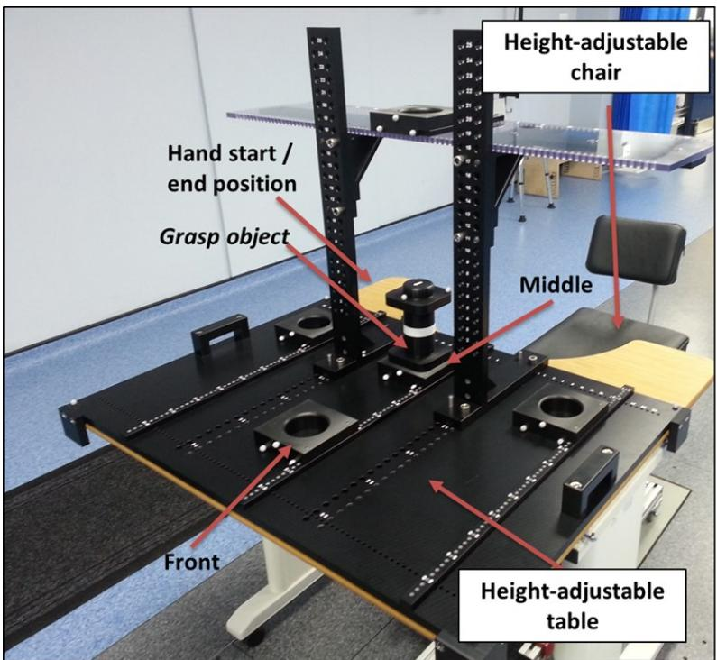
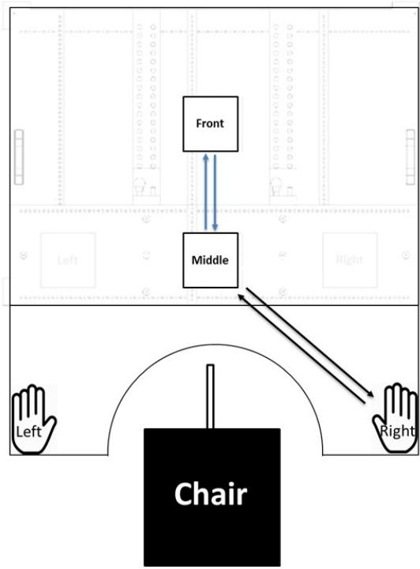
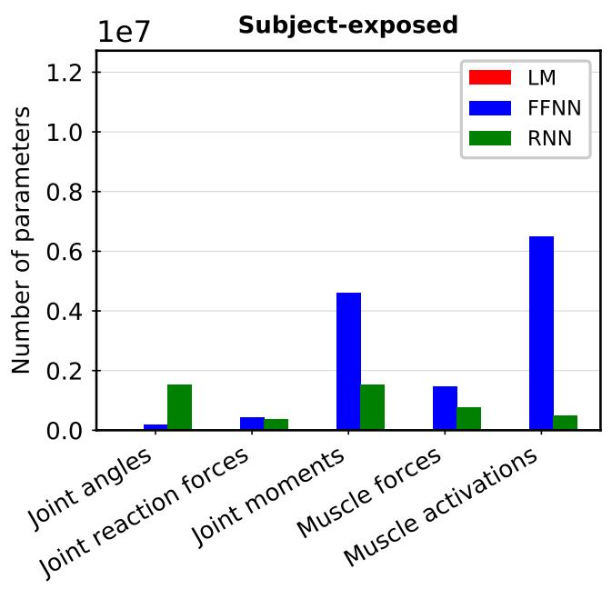
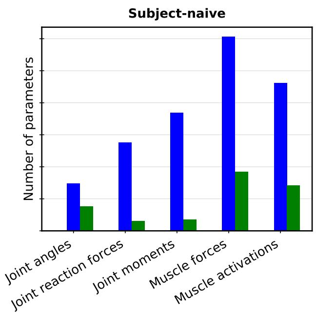
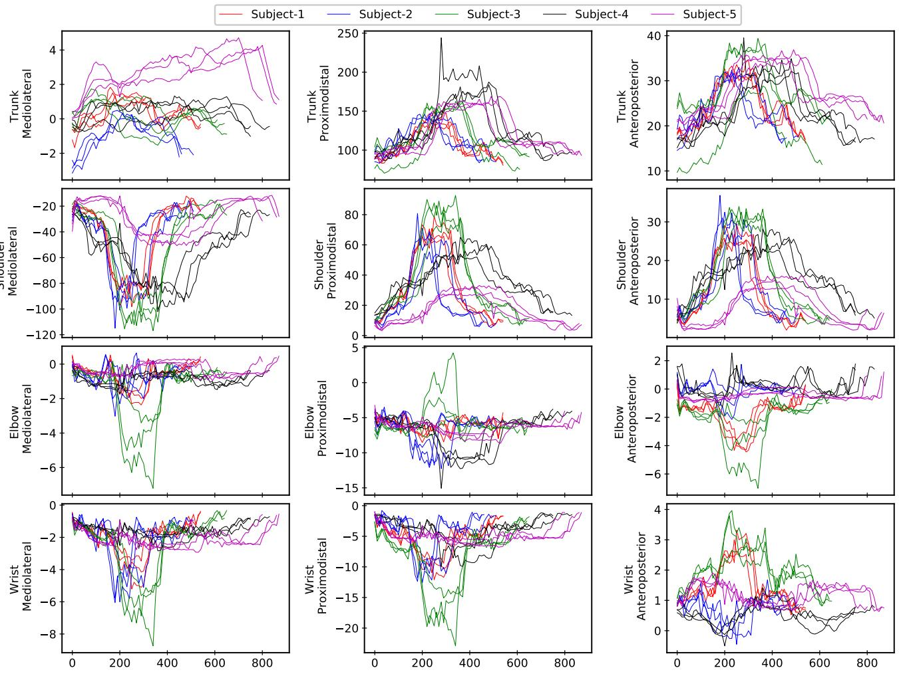
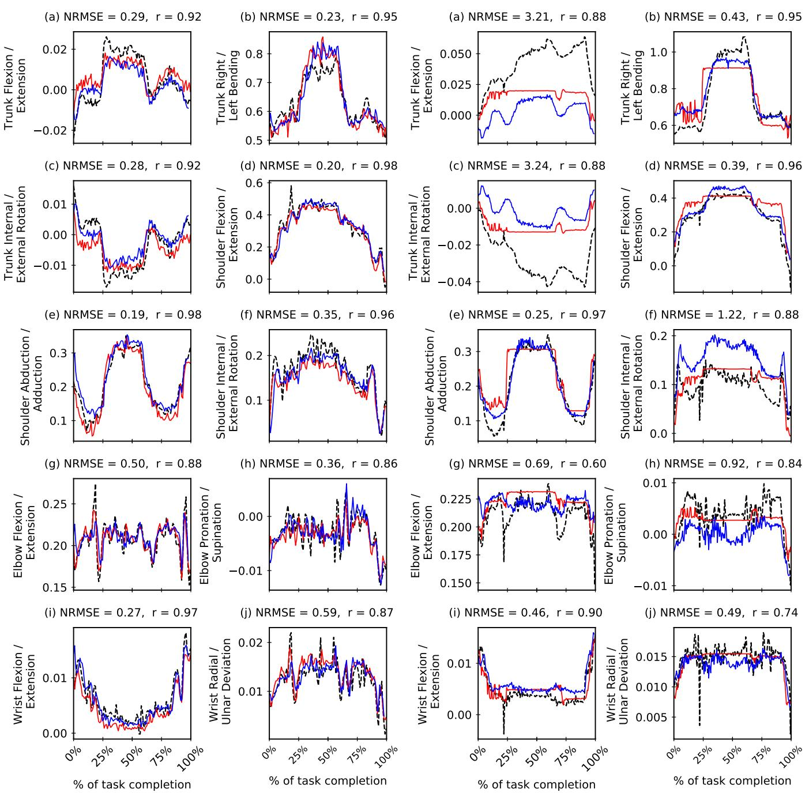
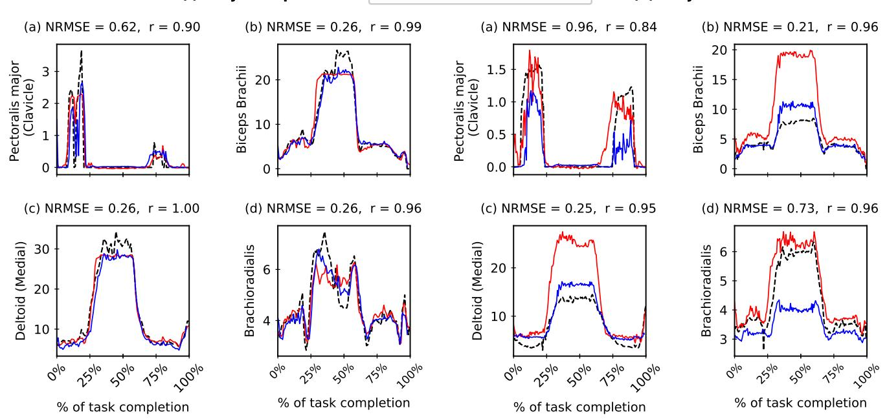
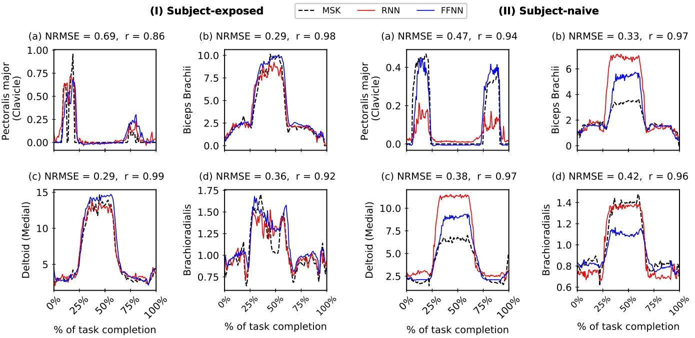

# 补充材料：利用惯性动作捕捉数据进行光学动作捕捉驱动肌骨建模的机器学习

Abhishek Dasgupta0000-0003-4420-0656, Rahul Sharma0000-0003-0700-3098, Challenger Mishra\*0000-0001-以及 Vikranth H. Nagaraja\*0000-0001-7491-8242

2023年4月24日

## 2. 材料与方法

## 2.1 数据

  
Figure S1: 左侧：用于在前向执行伸展抓握（Reach-to-Grasp）任务的定制装置；右侧：伸展抓握任务实验设置。

## 3. 结果

  
Figure S2: 线性模型（LM）、前馈神经网络（FFNN）和循环神经网络（RNN）中的参数数量。注：线性模型的参数数量与其他两种模型相比可忽略不计；因此在此处难以分辨。

  
Figure S3: 肌骨（MSK）模型估计的所有五名受试者的关节反作用力。注：单个受试者的三次试验用相同颜色显示。

  
Figure S4: 在受试者已知（Subject-exposed，左）和受试者未知（Subject-naive，右）设置下，前馈神经网络（FFNN）和循环神经网络（RNN）预测的关节力矩（% 体重 × 身高）与相应肌骨（MSK）模型输出在测试试验中的对比。注：FFNN 和 RNN 的性能相当（见正文 Figure 4）；在此图中，我们仅报告 FFNN 的 r 和 NRMSE 值。

(II) 受试者未知（Subject-naive）

  
Figure S5: 在受试者已知（Subject-exposed，左）和受试者未知（Subject-naive，右）设置下，前馈神经网络（FFNN）和循环神经网络（RNN）预测的肌肉力（% 体重）与相应肌骨（MSK）模型输出在测试试验中的对比。注：FFNN 和 RNN 的性能相当（见正文 Figure 4）；在此图中，我们仅报告 FFNN 的 r 和 NRMSE 值。  
(I) 受试者已知（Subject-exposed）

Figure S6: 在受试者已知（Subject-exposed，左）和受试者未知（Subject-naive，右）设置下，前馈神经网络（FFNN）和循环神经网络（RNN）预测的肌肉激活度（%）与相应肌骨（MSK）模型输出在测试试验中的对比。注：FFNN 和 RNN 的性能相当（见正文 Figure 4）；在此图中，我们仅报告 FFNN 的 r 和 NRMSE 值。

<table><tr><td></td><td colspan="2">线性模型</td><td colspan="2">前馈神经网络</td><td colspan="2">循环神经网络</td></tr><tr><td>输出</td><td> $r_{avg}$ 均值 (SD)</td><td> $NRMSE_{avg}$ 均值 (SD)</td><td> $r_{avg}$ 均值 (SD)</td><td> $NRMSE_{avg}$ 均值 (SD)</td><td> $r_{avg}$ 均值 (SD)</td><td> $NRMSE_{avg}$ 均值 (SD)</td></tr><tr><td></td><td colspan="6">受试者已知（Subject-exposed）</td></tr><tr><td>关节角度</td><td>0.85 (0.15)</td><td>0.64 (0.62)</td><td>0.92 (0.23)</td><td>0.25 (0.2)</td><td>0.93 (0.13)</td><td>0.32 (0.24)</td></tr><tr><td>关节反作用力</td><td>0.77 (0.21)</td><td>0.70 (0.31)</td><td>0.91 (0.12)</td><td>0.34 (0.11)</td><td>0.91 (0.11)</td><td>0.33 (0.09)</td></tr><tr><td>关节力矩</td><td>0.81 (0.11)</td><td>0.58 (0.25)</td><td>0.88 (0.08)</td><td>0.41 (0.2)</td><td>0.87 (0.09)</td><td>0.46 (0.2)</td></tr><tr><td>肌力</td><td>0.73 (0.31)</td><td>0.64 (0.27)</td><td>0.85 (0.29)</td><td>0.37 (0.17)</td><td>0.83 (0.3)</td><td>0.33 (0.17)</td></tr><tr><td>肌肉激活度</td><td>0.75 (0.28)</td><td>0.74 (0.28)</td><td>0.88 (0.25)</td><td>0.29 (0.15)</td><td>0.84 (0.28)</td><td>0.37 (0.17)</td></tr><tr><td></td><td colspan="6">受试者未见（Subject-naive）</td></tr><tr><td>关节角度</td><td>0.85 (0.11)</td><td>2.54 (2.22)</td><td>0.86 (0.17)</td><td>0.82 (0.65)</td><td>0.86 (0.13)</td><td>1.10 (1.02)</td></tr><tr><td>关节反作用力</td><td>0.5 (0.59)</td><td>1.34 (0.98)</td><td>0.75 (0.35)</td><td>0.90 (0.74)</td><td>0.64 (0.34)</td><td>0.84 (0.77)</td></tr><tr><td>关节力矩</td><td>0.84 (0.11)</td><td>1.57 (0.68)</td><td>0.85 (0.12)</td><td>1.12 (1.02)</td><td>0.75 (0.13)</td><td>0.89 (0.68)</td></tr><tr><td>肌力</td><td>0.71 (0.2)</td><td>1.70 (1.20)</td><td>0.95 (0.03)</td><td>0.49 (0.53)</td><td>0.93 (0.04)</td><td>0.58 (0.27)</td></tr><tr><td>肌肉激活度</td><td>0.70 (0.17)</td><td>1.78 (1.16)</td><td>0.93 (0.04)</td><td>0.42 (0.28)</td><td>0.92 (0.06)</td><td>0.61 (0.21)</td></tr></table>

Table S1: 线性模型（LM）、前馈神经网络（FFNN）和循环神经网络（RNN）预测与肌肉骨骼（MSK）模型输出相比的平均皮尔逊相关系数和平均 NRMSE 值。FFNN 和 RNN 模型的表现始终优于线性模型。对于给定的输出类别，平均值是在所有输出特征和测试试验上计算得到的。

<table><tr><td></td><td></td><td colspan="10">r NRMSE</td></tr><tr><td>输出</td><td>机器学习模型</td><td>均值</td><td>标准差</td><td>最大值</td><td>最小值</td><td>四分位距</td><td>均值</td><td>标准差</td><td>最大值</td><td>最小值</td><td>四分位距</td></tr><tr><td></td><td></td><td colspan="10">受试者已知（Subject-exposed）</td></tr><tr><td rowspan="2">关节角度</td><td>FFNN</td><td>0.92</td><td>0.23</td><td>1.0</td><td>-0.07</td><td>0.04</td><td>0.25</td><td>0.2</td><td>0.79</td><td>0.04</td><td>0.28</td></tr><tr><td>B-LSTM</td><td>0.93</td><td>0.13</td><td>0.99</td><td>0.38</td><td>0.07</td><td>0.32</td><td>0.24</td><td>0.76</td><td>0.03</td><td>0.45</td></tr><tr><td rowspan="2">关节反作用力</td><td>FFNN</td><td>0.91</td><td>0.12</td><td>0.99</td><td>0.46</td><td>0.07</td><td>0.34</td><td>0.11</td><td>0.55</td><td>0.17</td><td>0.13</td></tr><tr><td>LSTM</td><td>0.91</td><td>0.11</td><td>0.99</td><td>0.51</td><td>0.09</td><td>0.33</td><td>0.09</td><td>0.49</td><td>0.18</td><td>0.16</td></tr><tr><td rowspan="2">关节力矩</td><td>FFNN</td><td>0.88</td><td>0.08</td><td>0.98</td><td>0.7</td><td>0.1</td><td>0.41</td><td>0.2</td><td>0.97</td><td>0.19</td><td>0.16</td></tr><tr><td>B-LSTM</td><td>0.87</td><td>0.09</td><td>0.98</td><td>0.66</td><td>0.14</td><td>0.46</td><td>0.20</td><td>1.06</td><td>0.22</td><td>0.15</td></tr><tr><td rowspan="2">肌力</td><td>FFNN</td><td>0.85</td><td>0.29</td><td>0.99</td><td>0.07</td><td>0.08</td><td>0.37</td><td>0.17</td><td>0.69</td><td>0.10</td><td>0.18</td></tr><tr><td>LSTM</td><td>0.83</td><td>0.30</td><td>0.99</td><td>0.05</td><td>0.09</td><td>0.33</td><td>0.17</td><td>0.74</td><td>0.18</td><td>0.09</td></tr><tr><td rowspan="2">肌肉激活度</td><td>FFNN</td><td>0.88</td><td>0.25</td><td>1.0</td><td>0.21</td><td>0.05</td><td>0.29</td><td>0.15</td><td>0.62</td><td>0.08</td><td>0.07</td></tr><tr><td>LSTM</td><td>0.84</td><td>0.28</td><td>0.99</td><td>0.11</td><td>0.09</td><td>0.37</td><td>0.17</td><td>0.71</td><td>0.08</td><td>0.08</td></tr><tr><td></td><td></td><td colspan="10">受试者未知（Subject-naive）</td></tr><tr><td rowspan="2">关节角度</td><td>FFNN</td><td>0.86</td><td>0.17</td><td>0.98</td><td>0.32</td><td>0.07</td><td>0.82</td><td>0.65</td><td>2.42</td><td>0.20</td><td>0.60</td></tr><tr><td>B-LSTM</td><td>0.86</td><td>0.13</td><td>0.98</td><td>0.56</td><td>0.09</td><td>1.10</td><td>1.02</td><td>3.56</td><td>0.20</td><td>0.73</td></tr><tr><td rowspan="2">关节反作用力</td><td>FFNN</td><td>0.75</td><td>0.35</td><td>0.98</td><td>-0.61</td><td>0.24</td><td>0.9</td><td>0.74</td><td>3.24</td><td>0.2</td><td>0.51</td></tr><tr><td>LSTM</td><td>0.64</td><td>0.34</td><td>0.92</td><td>-0.24</td><td>0.31</td><td>0.84</td><td>0.77</td><td>3.19</td><td>0.15</td><td>0.51</td></tr><tr><td rowspan="2">关节力矩</td><td>FFNN</td><td>0.85</td><td>0.12</td><td>0.99</td><td>0.56</td><td>0.18</td><td>1.12</td><td>1.02</td><td>3.24</td><td>0.25</td><td>0.72</td></tr><tr><td>GRU</td><td>0.75</td><td>0.13</td><td>0.94</td><td>0.5</td><td>0.20</td><td>0.89</td><td>0.68</td><td>2.50</td><td>0.35</td><td>0.22</td></tr><tr><td rowspan="2">肌力</td><td>FFNN</td><td>0.95</td><td>0.03</td><td>0.97</td><td>0.88</td><td>0.02</td><td>0.49</td><td>0.53</td><td>1.86</td><td>0.09</td><td>0.23</td></tr><tr><td>GRU</td><td>0.93</td><td>0.04</td><td>0.97</td><td>0.85</td><td>0.07</td><td>0.58</td><td>0.27</td><td>1.12</td><td>0.24</td><td>0.31</td></tr><tr><td rowspan="2">肌肉激活度</td><td>FFNN</td><td>0.93</td><td>0.04</td><td>0.96</td><td>0.84</td><td>0.04</td><td>0.42</td><td>0.28</td><td>0.96</td><td>0.10</td><td>0.30</td></tr><tr><td>LSTM</td><td>0.92</td><td>0.06</td><td>0.97</td><td>0.78</td><td>0.07</td><td>0.61</td><td>0.21</td><td>0.87</td><td>0.31</td><td>0.33</td></tr></table>

Table S2：前馈神经网络（FFNN）与循环神经网络（RNN）预测值对比肌肉骨骼（MSK）模型输出的平均皮尔逊相关系数（Pearson's correlation coefficient）与平均 NRMSE 值。注：平均值是在所有输出特征以及所有测试试验（针对给定的输出类别）上计算得出的。在 RNN 单元类别中，“B”代表双向（Bidirectional）单元（沿前向和后向两个方向处理输入时间序列）。

<table><tr><td></td><td></td><td colspan="5">RMSE</td></tr><tr><td>输出</td><td>ML 模型</td><td>均值</td><td>标准差</td><td>最大值</td><td>最小值</td><td>四分位距</td></tr><tr><td></td><td></td><td colspan="5">受试者已知（Subject-exposed）</td></tr><tr><td rowspan="2">关节角度（度）</td><td>FFNN</td><td>2.91</td><td>1.86</td><td>8.24</td><td>1.07</td><td>1.49</td></tr><tr><td>B-LSTM</td><td>3.42</td><td>1.73</td><td>7.91</td><td>1.04</td><td>2.32</td></tr><tr><td rowspan="2">关节反作用力（% 体重）</td><td>FFNN</td><td>2.15</td><td>2.55</td><td>9.75</td><td>0.21</td><td>2.37</td></tr><tr><td>LSTM</td><td>2.08</td><td>2.37</td><td>7.84</td><td>0.24</td><td>2.38</td></tr><tr><td rowspan="2">关节力矩（% 体重 × 身高）</td><td>FFNN</td><td>0.02</td><td>0.02</td><td>0.06</td><td>0.00</td><td>0.02</td></tr><tr><td>B-LSTM</td><td>0.02</td><td>0.02</td><td>0.07</td><td>0.00</td><td>0.03</td></tr><tr><td rowspan="2">肌肉力（% 体重）</td><td>FFNN</td><td>0.64</td><td>0.6</td><td>1.53</td><td>0.01</td><td>1.01</td></tr><tr><td>LSTM</td><td>0.45</td><td>0.37</td><td>0.97</td><td>0.03</td><td>0.64</td></tr><tr><td rowspan="2">肌肉激活度（%）</td><td>FFNN</td><td>0.97</td><td>0.68</td><td>1.92</td><td>0.04</td><td>1.19</td></tr><tr><td>LSTM</td><td>1.38</td><td>1.05</td><td>2.78</td><td>0.04</td><td>1.85</td></tr><tr><td></td><td></td><td colspan="5">受试者未知（Subject-naive）</td></tr><tr><td rowspan="2">关节角度（度）</td><td>FFNN</td><td>9.07</td><td>3.54</td><td>16.49</td><td>4.31</td><td>5.21</td></tr><tr><td>B-LSTM</td><td>11.09</td><td>4.62</td><td>20.37</td><td>3.40</td><td>6.07</td></tr><tr><td rowspan="2">关节反作用力（% 体重）</td><td>FFNN</td><td>5.52</td><td>6.74</td><td>26.57</td><td>0.28</td><td>6.00</td></tr><tr><td>LSTM</td><td>6.44</td><td>10.81</td><td>41.45</td><td>0.35</td><td>6.34</td></tr><tr><td rowspan="2">关节力矩（% 体重 × 身高）</td><td>FFNN</td><td>0.03</td><td>0.03</td><td>0.09</td><td>0.00</td><td>0.05</td></tr><tr><td>GRU</td><td>0.03</td><td>0.03</td><td>0.11</td><td>0.00</td><td>0.03</td></tr><tr><td rowspan="2">肌肉力（% 体重）</td><td>FFNN</td><td>0.48</td><td>0.46</td><td>1.38</td><td>0.06</td><td>0.54</td></tr><tr><td>GRU</td><td>1.13</td><td>1.09</td><td>2.90</td><td>0.08</td><td>2.06</td></tr><tr><td rowspan="2">肌肉激活度（%）</td><td>FFNN</td><td>1.09</td><td>0.65</td><td>2.03</td><td>0.17</td><td>1.02</td></tr><tr><td>LSTM</td><td>3.03</td><td>2.82</td><td>7.26</td><td>0.28</td><td>5.17</td></tr></table>

Table S3: 前馈神经网络（FFNN）和循环神经网络（RNN）预测值与肌肉骨骼（MSK）模型输出对比的平均 RMSE 值。注：平均值是在所有输出特征以及所有测试试验（针对给定的输出类别）上计算得出的。在 RNN 单元类别中，“B” 代表双向单元（Bidirectional cell，即沿正向和反向两个方向处理输入时间序列）。