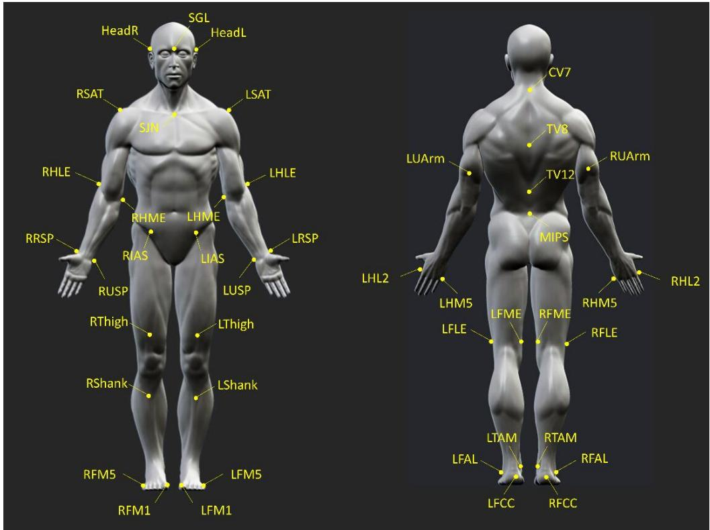

# Supplementary Material

## 1 Supplementary Figures and Tables

## 1.1 Supplementary Figures

  
Supplementary Figure 1. Scheme depicting locations of 44 markers on the body (description provided in the supplementary Table 1)

## Supplementary Table 2. Marker-set description

<table><tr><td>Body Region</td><td>Acronym</td><td>Landmark</td></tr><tr><td rowspan="2">Head</td><td>SGL</td><td>Glabella</td></tr><tr><td>HeadR, HeadL</td><td>(R, L) Head</td></tr><tr><td rowspan="3">Spine</td><td>CV7</td><td> $7^{th}$  Cervical vertebra</td></tr><tr><td>TV8</td><td> $8^{th}$  Thoracic vertebra</td></tr><tr><td>TV12</td><td> $12^{th}$  Thoracic vertebra</td></tr><tr><td>Sternum</td><td>SJN</td><td>Jugular Notch</td></tr><tr><td rowspan="2">Pelvis</td><td>RIAS, LIAS</td><td>(R, L) Anterior Superior Iliac Spine</td></tr><tr><td>MIPS</td><td>Mid of Posterior Superior Iliac Spines</td></tr><tr><td rowspan="4">Upper-arm</td><td>RSAT, LSAT</td><td>(R, L) Scapula-Acromial Tip</td></tr><tr><td>RHLE, LHLE</td><td>(R, L) Humerus Lateral Epicondyle</td></tr><tr><td>RHME, LMLE</td><td>(R, L) Humerus Medial Epicondyle</td></tr><tr><td>RUArm, LUArm</td><td>(R, L) Upper Arm</td></tr><tr><td rowspan="2">Forearm</td><td>RRSP, LRSP</td><td>(R, L) Radius Styloid Process</td></tr><tr><td>RUSP, LUSP</td><td>(R, L) Ulna Styloid Process</td></tr><tr><td rowspan="2">Hand</td><td>RHL2, LHL2</td><td>(R, L)  $2^{nd}$  Metacarpal Head Lateral</td></tr><tr><td>RHM5, LHM5</td><td>(R, L)  $5^{th}$  Metacarpal Head Medial</td></tr><tr><td rowspan="3">Thigh</td><td>RFLE, LFLE</td><td>(R, L) Femoral Lateral Epicondyle</td></tr><tr><td>RFME, LFME</td><td>(R, L) Femoral Medial Epicondyle</td></tr><tr><td>RThigh, LThigh</td><td>(R, L) Thigh</td></tr><tr><td rowspan="3">Shank</td><td>RFAL, LFAL</td><td>(R, L) Apex of Lateral Malleolus</td></tr><tr><td>RTAM, LTAM</td><td>(R, L) Apex of Medial Malleolus</td></tr><tr><td>RShank, LShank</td><td>(R, L) Shank</td></tr><tr><td rowspan="3">Foot</td><td>RFCC, LFCC</td><td>(R, L) Foot Calcaneus Center</td></tr><tr><td>RFM1, LFM1</td><td>(R, L)  $1^{st}$  Foot Metatarsus</td></tr><tr><td>RFM5, LFM5</td><td>(R, L)  $5^{th}$  Foot Metatarsus</td></tr></table>