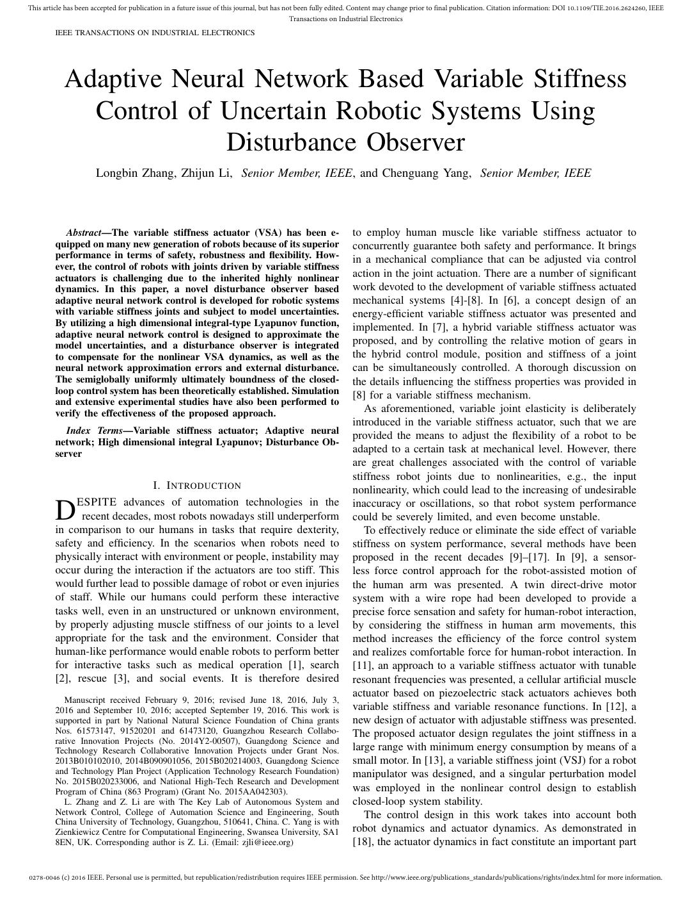
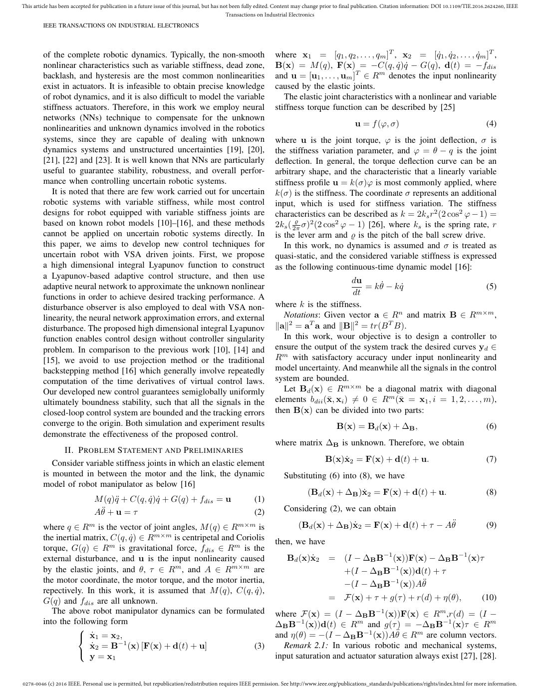
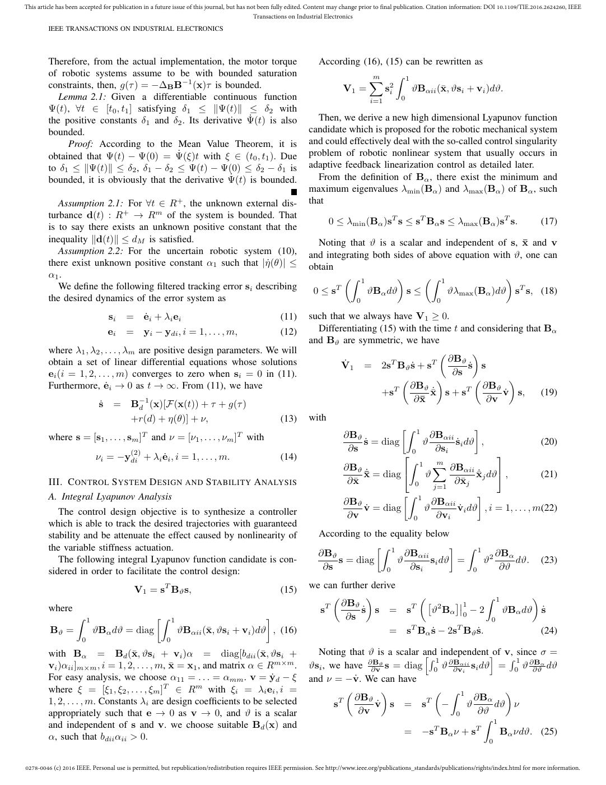
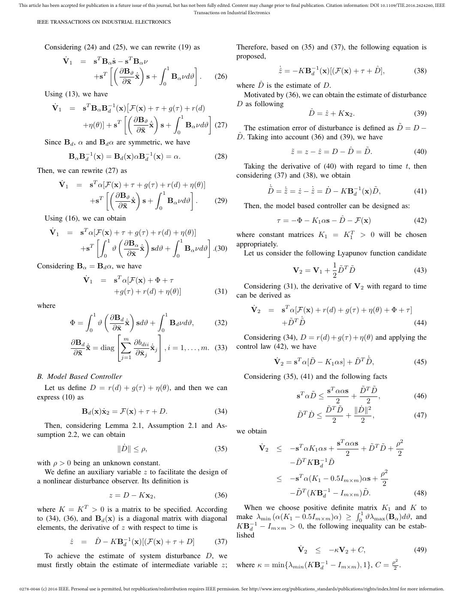
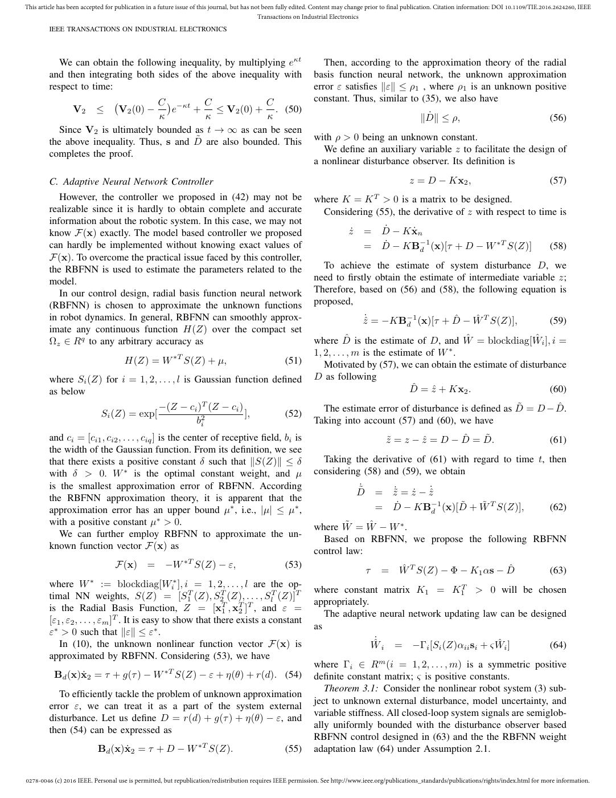
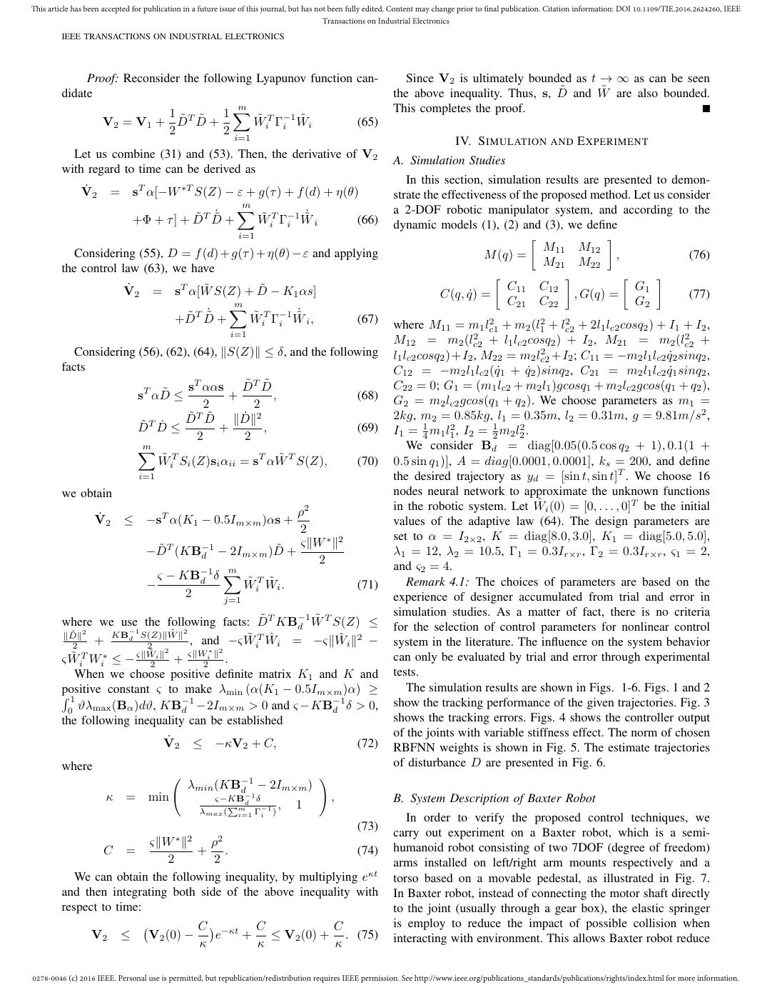
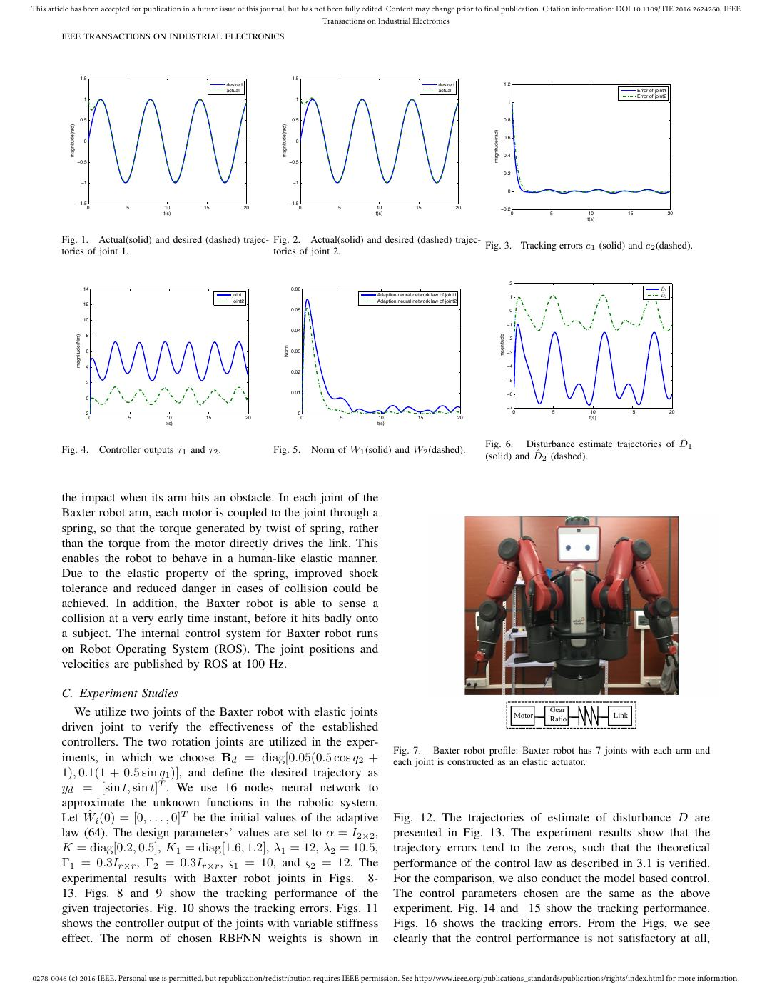
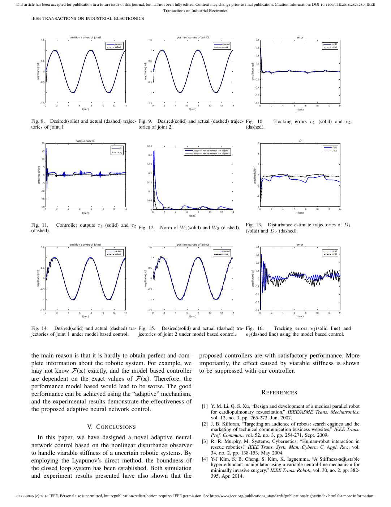

# Zhang2017-TIE：扰动观测器与自适应神经网络变刚度控制

> English text extracted from the source PDF; not translated or editorially corrected. Each original PDF page is embedded below as a rendered image so figures, tables, and vector artwork remain visible.

- Source PDF: `Zhang2017-TIE：扰动观测器与自适应神经网络变刚度控制.pdf`
- SHA-256: `a8e92e48782fe8a1d86582ffa9a280d3d1788055518a1fb1393cded9dbeaf6c0`
- Pages: 9
- Extraction: Poppler `pdftotext -layout`; page images rendered with `pdftoppm` (max dimension 1400 px, JPEG quality 76).

## Page 1

English text extracted from page 1

<pre>
This article has been accepted for publication in a future issue of this journal, but has not been fully edited. Content may change prior to final publication. Citation information: DOI 10.1109/TIE.2016.2624260, IEEE
                                                                                            Transactions on Industrial Electronics
         IEEE TRANSACTIONS ON INDUSTRIAL ELECTRONICS

            Adaptive Neural Network Based Variable Stiffness
              Control of Uncertain Robotic Systems Using
                         Disturbance Observer
                       Longbin Zhang, Zhijun Li, Senior Member, IEEE, and Chenguang Yang, Senior Member, IEEE

            Abstract—The variable stiffness actuator (VSA) has been e-                                        to employ human muscle like variable stiffness actuator to
         quipped on many new generation of robots because of its superior                                     concurrently guarantee both safety and performance. It brings
         performance in terms of safety, robustness and flexibility. How-                                     in a mechanical compliance that can be adjusted via control
         ever, the control of robots with joints driven by variable stiffness
         actuators is challenging due to the inherited highly nonlinear                                       action in the joint actuation. There are a number of significant
         dynamics. In this paper, a novel disturbance observer based                                          work devoted to the development of variable stiffness actuated
         adaptive neural network control is developed for robotic systems                                     mechanical systems [4]-[8]. In [6], a concept design of an
         with variable stiffness joints and subject to model uncertainties.                                   energy-efficient variable stiffness actuator was presented and
         By utilizing a high dimensional integral-type Lyapunov function,                                     implemented. In [7], a hybrid variable stiffness actuator was
         adaptive neural network control is designed to approximate the
         model uncertainties, and a disturbance observer is integrated                                        proposed, and by controlling the relative motion of gears in
         to compensate for the nonlinear VSA dynamics, as well as the                                         the hybrid control module, position and stiffness of a joint
         neural network approximation errors and external disturbance.                                        can be simultaneously controlled. A thorough discussion on
         The semiglobally uniformly ultimately boundness of the closed-                                       the details influencing the stiffness properties was provided in
         loop control system has been theoretically established. Simulation                                   [8] for a variable stiffness mechanism.
         and extensive experimental studies have also been performed to
         verify the effectiveness of the proposed approach.                                                      As aforementioned, variable joint elasticity is deliberately
                                                                                                              introduced in the variable stiffness actuator, such that we are
            Index Terms—Variable stiffness actuator; Adaptive neural                                          provided the means to adjust the flexibility of a robot to be
         network; High dimensional integral Lyapunov; Disturbance Ob-
         server                                                                                               adapted to a certain task at mechanical level. However, there
                                                                                                              are great challenges associated with the control of variable
                                                                                                              stiffness robot joints due to nonlinearities, e.g., the input
                                          I. I NTRODUCTION                                                    nonlinearity, which could lead to the increasing of undesirable
              ESPITE advances of automation technologies in the                                               inaccuracy or oscillations, so that robot system performance
         D     recent decades, most robots nowadays still underperform
         in comparison to our humans in tasks that require dexterity,
                                                                                                              could be severely limited, and even become unstable.
                                                                                                                 To effectively reduce or eliminate the side effect of variable
         safety and efficiency. In the scenarios when robots need to                                          stiffness on system performance, several methods have been
         physically interact with environment or people, instability may                                      proposed in the recent decades [9]–[17]. In [9], a sensor-
         occur during the interaction if the actuators are too stiff. This                                    less force control approach for the robot-assisted motion of
         would further lead to possible damage of robot or even injuries                                      the human arm was presented. A twin direct-drive motor
         of staff. While our humans could perform these interactive                                           system with a wire rope had been developed to provide a
         tasks well, even in an unstructured or unknown environment,                                          precise force sensation and safety for human-robot interaction,
         by properly adjusting muscle stiffness of our joints to a level                                      by considering the stiffness in human arm movements, this
         appropriate for the task and the environment. Consider that                                          method increases the efficiency of the force control system
         human-like performance would enable robots to perform better                                         and realizes comfortable force for human-robot interaction. In
         for interactive tasks such as medical operation [1], search                                          [11], an approach to a variable stiffness actuator with tunable
         [2], rescue [3], and social events. It is therefore desired                                          resonant frequencies was presented, a cellular artificial muscle
                                                                                                              actuator based on piezoelectric stack actuators achieves both
            Manuscript received February 9, 2016; revised June 18, 2016, July 3,
         2016 and September 10, 2016; accepted September 19, 2016. This work is                               variable stiffness and variable resonance functions. In [12], a
         supported in part by National Natural Science Foundation of China grants                             new design of actuator with adjustable stiffness was presented.
         Nos. 61573147, 91520201 and 61473120, Guangzhou Research Collabo-                                    The proposed actuator design regulates the joint stiffness in a
         rative Innovation Projects (No. 2014Y2-00507), Guangdong Science and
         Technology Research Collaborative Innovation Projects under Grant Nos.                               large range with minimum energy consumption by means of a
         2013B010102010, 2014B090901056, 2015B020214003, Guangdong Science                                    small motor. In [13], a variable stiffness joint (VSJ) for a robot
         and Technology Plan Project (Application Technology Research Foundation)                             manipulator was designed, and a singular perturbation model
         No. 2015B020233006, and National High-Tech Research and Development
         Program of China (863 Program) (Grant No. 2015AA042303).                                             was employed in the nonlinear control design to establish
            L. Zhang and Z. Li are with The Key Lab of Autonomous System and                                  closed-loop system stability.
         Network Control, College of Automation Science and Engineering, South                                   The control design in this work takes into account both
         China University of Technology, Guangzhou, 510641, China. C. Yang is with
         Zienkiewicz Centre for Computational Engineering, Swansea University, SA1                            robot dynamics and actuator dynamics. As demonstrated in
         8EN, UK. Corresponding author is Z. Li. (Email: zjli@ieee.org)                                       [18], the actuator dynamics in fact constitute an important part

0278-0046 (c) 2016 IEEE. Personal use is permitted, but republication/redistribution requires IEEE permission. See http://www.ieee.org/publications_standards/publications/rights/index.html for more information.
</pre>

## Page 2

English text extracted from page 2

<pre>
This article has been accepted for publication in a future issue of this journal, but has not been fully edited. Content may change prior to final publication. Citation information: DOI 10.1109/TIE.2016.2624260, IEEE
                                                                                            Transactions on Industrial Electronics
         IEEE TRANSACTIONS ON INDUSTRIAL ELECTRONICS

         of the complete robotic dynamics. Typically, the non-smooth                                          where x1 = [q1 , q2 , . . . , qm ]T , x2 = [q̇1 , q̇2 , . . . , q̇m ]T ,
         nonlinear characteristics such as variable stiffness, dead zone,                                     B(x) = M (q), F(x) = −C(q, q̇)q̇ − G(q), d(t) = −fdis
         backlash, and hysteresis are the most common nonlinearities                                          and u = [u1 , . . . , um ]T ∈ Rm denotes the input nonlinearity
         exist in actuators. It is infeasible to obtain precise knowledge                                     caused by the elastic joints.
         of robot dynamics, and it is also difficult to model the variable                                       The elastic joint characteristics with a nonlinear and variable
         stiffness actuators. Therefore, in this work we employ neural                                        stiffness torque function can be described by [25]
         networks (NNs) technique to compensate for the unknown
                                                                                                                                                 u = f (φ, σ)                                             (4)
         nonlinearities and unknown dynamics involved in the robotics
         systems, since they are capable of dealing with unknown                                              where u is the joint torque, φ is the joint deflection, σ is
         dynamics systems and unstructured uncertainties [19], [20],                                          the stiffness variation parameter, and φ = θ − q is the joint
         [21], [22] and [23]. It is well known that NNs are particularly                                      deflection. In general, the torque deflection curve can be an
         useful to guarantee stability, robustness, and overall perfor-                                       arbitrary shape, and the characteristic that a linearly variable
         mance when controlling uncertain robotic systems.                                                    stiffness profile u = k(σ)φ is most commonly applied, where
            It is noted that there are few work carried out for uncertain                                     k(σ) is the stiffness. The coordinate σ represents an additional
         robotic systems with variable stiffness, while most control                                          input, which is used for stiffness variation. The stiffness
         designs for robot equipped with variable stiffness joints are                                        characteristics can be described as k = 2ks r2 (2 cos2 φ − 1) =
         based on known robot models [10]–[16], and these methods                                                    ϱ
                                                                                                              2ks ( 2π σ)2 (2 cos2 φ − 1) [26], where ks is the spring rate, r
         cannot be applied on uncertain robotic systems directly. In                                          is the lever arm and ϱ is the pitch of the ball screw drive.
         this paper, we aims to develop new control techniques for                                               In this work, no dynamics is assumed and σ is treated as
         uncertain robot with VSA driven joints. First, we propose                                            quasi-static, and the considered variable stiffness is expressed
         a high dimensional integral Lyapunov function to construct                                           as the following continuous-time dynamic model [16]:
         a Lyapunov-based adaptive control structure, and then use
                                                                                                                                      du
         adaptive neural network to approximate the unknown nonlinear                                                                     = k θ̇ − k q̇                      (5)
         functions in order to achieve desired tracking performance. A                                                                 dt
         disturbance observer is also employed to deal with VSA non-                                          where k is the stiffness.
         linearity, the neural network approximation errors, and external                                        Notations: Given vector a ∈ Rn and matrix B ∈ Rm×m ,
         disturbance. The proposed high dimensional integral Lyapunov                                         ∥a∥2 = aT a and ∥B∥2 = tr(B T B).
         function enables control design without controller singularity                                          In this work, wour objective is to design a controller to
         problem. In comparison to the previous work [10], [14] and                                           ensure the output of the system track the desired curves yd ∈
         [15], we avoid to use projection method or the traditional                                           Rm with satisfactory accuracy under input nonlinearity and
         backstepping method [16] which generally involve repeatedly                                          model uncertainty. And meanwhile all the signals in the control
         computation of the time derivatives of virtual control laws.                                         system are bounded.
         Our developed new control guarantees semiglobally uniformly                                             Let Bd (x) ∈ Rm×m be a diagonal matrix with diagonal
         ultimately boundness stability, such that all the signals in the                                     elements bdii (x̄, xi ) ̸= 0 ∈ Rm (x̄ = x1 , i = 1, 2, . . . , m),
         closed-loop control system are bounded and the tracking errors                                       then B(x) can be divided into two parts:
         converge to the origin. Both simulation and experiment results                                                                  B(x) = Bd (x) + ∆B ,                                             (6)
         demonstrate the effectiveness of the proposed control.
                                                                                                              where matrix ∆B is unknown. Therefore, we obtain
               II. P ROBLEM S TATEMENT AND P RELIMINARIES
            Consider variable stiffness joints in which an elastic element                                                          B(x)ẋ2 = F(x) + d(t) + u.                                            (7)
         is mounted in between the motor and the link, the dynamic                                                Substituting (6) into (8), we have
         model of robot manipulator as below [16]
                                                                                                                            (Bd (x) + ∆B )ẋ2 = F(x) + d(t) + u.                                          (8)
                               M (q)q̈ + C(q, q̇)q̇ + G(q) + fdis = u                                (1)
                               Aθ̈ + u = τ                                                           (2)          Considering (2), we can obtain

         where q ∈ Rm is the vector of joint angles, M (q) ∈ Rm×m is                                                    (Bd (x) + ∆B )ẋ2 = F(x) + d(t) + τ − Aθ̈                                         (9)
         the inertial matrix, C(q, q̇) ∈ Rm×m is centripetal and Coriolis                                     then, we have
         torque, G(q) ∈ Rm is gravitational force, fdis ∈ Rm is the
         external disturbance, and u is the input nonlinearity caused                                              Bd (x)ẋ2         =      (I − ∆B B−1 (x))F(x) − ∆B B−1 (x)τ
         by the elastic joints, and θ, τ ∈ Rm , and A ∈ Rm×m are                                                                            +(I − ∆B B−1 (x))d(t) + τ
         the motor coordinate, the motor torque, and the motor inertia,                                                                     −(I − ∆B B−1 (x))Aθ̈
         repectively. In this work, it is assumed that M (q), C(q, q̇),
         G(q) and fdis are all unknown.                                                                                              = F(x) + τ + g(τ ) + r(d) + η(θ),                                  (10)
            The above robot manipulator dynamics can be formulated                                                                                       −1
                                                                                                              where F(x) = (I − ∆B B (x))F(x) ∈ R ,r(d) = (I −                       m
         into the following form
                                                                                                             ∆B B−1 (x))d(t) ∈ Rm and g(τ ) = −∆B B−1 (x)τ ∈ Rm
                     ẋ1 = x2 ,                                                                              and η(θ) = −(I − ∆B B−1 (x))Aθ̈ ∈ Rm are column vectors.
                       ẋ2 = B−1 (x) [F(x) + d(t) + u]                (3)                                       Remark 2.1: In various robotic and mechanical systems,
                                                                                                             input saturation and actuator saturation always exist [27], [28].
                       y = x1

0278-0046 (c) 2016 IEEE. Personal use is permitted, but republication/redistribution requires IEEE permission. See http://www.ieee.org/publications_standards/publications/rights/index.html for more information.
</pre>

## Page 3

English text extracted from page 3

<pre>
This article has been accepted for publication in a future issue of this journal, but has not been fully edited. Content may change prior to final publication. Citation information: DOI 10.1109/TIE.2016.2624260, IEEE
                                                                                            Transactions on Industrial Electronics
         IEEE TRANSACTIONS ON INDUSTRIAL ELECTRONICS

         Therefore, from the actual implementation, the motor torque                                              According (16), (15) can be rewritten as
                                                                                                                             ∑ ∫ 1
         of robotic systems assume to be with bounded saturation                                                              m
         constraints, then, g(τ ) = −∆B B−1 (x)τ is bounded.                                                           V1 =       s2i   ϑBαii (x̄, ϑsi + vi )dϑ.
            Lemma 2.1: Given a differentiable continuous function                                                                     i=1         0
         Ψ(t), ∀t ∈ [t0 , t1 ] satisfying δ1 ≤ ∥Ψ(t)∥ ≤ δ2 with
         the positive constants δ1 and δ2 . Its derivative Ψ̇(t) is also                                         Then, we derive a new high dimensional Lyapunov function
         bounded.                                                                                             candidate which is proposed for the robotic mechanical system
              Proof: According to the Mean Value Theorem, it is                                               and could effectively deal with the so-called control singularity
         obtained that Ψ(t) − Ψ(0) = Ψ̇(ξ)t with ξ ∈ (t0 , t1 ). Due                                          problem of robotic nonlinear system that usually occurs in
         to δ1 ≤ ∥Ψ(t)∥ ≤ δ2 , δ1 − δ2 ≤ Ψ(t) − Ψ(0) ≤ δ2 − δ1 is                                             adaptive feedback linearization control as detailed later.
         bounded, it is obviously that the derivative Ψ̇(t) is bounded.                                          From the definition of Bα , there exist the minimum and
                                                                                                              maximum eigenvalues λmin (Bα ) and λmax (Bα ) of Bα , such
            Assumption 2.1: For ∀t ∈ R+ , the unknown external dis-                                           that
         turbance d(t) : R+ → Rm of the system is bounded. That
                                                                                                                     0 ≤ λmin (Bα )sT s ≤ sT Bα s ≤ λmax (Bα )sT s.                                     (17)
         is to say there exists an unknown positive constant that the
         inequality ∥d(t)∥ ≤ dM is satisfied.                                                                   Noting that ϑ is a scalar and independent of s, x̄ and v
            Assumption 2.2: For the uncertain robotic system (10),                                            and integrating both sides of above equation with ϑ, one can
         there exist unknown positive constant α1 such that |η̇(θ)| ≤                                         obtain
         α1 .                                                                                                          (∫ 1         )      (∫ 1               )
            We define the following filtered tracking error si describing                                      0≤s   T
                                                                                                                             ϑBα dϑ s ≤         ϑλmax (Bα )dϑ sT s, (18)
         the desired dynamics of the error system as                                                                            0                              0

                                 si    = ėi + λi ei                                               (11)       such that we always have V1 ≥ 0.
                                 ei    = yi − ydi , i = 1, . . . , m,                              (12)         Differentiating (15) with the time t and considering that Bα
                                                                                                              and Bϑ are symmetric, we have
         where λ1 , λ2 , . . . , λm are positive design parameters. We will                                                                     (        )
         obtain a set of linear differential equations whose solutions                                                             T         T    ∂Bϑ
                                                                                                                      V̇1 = 2s Bϑ ṡ + s               ṡ s
         ei (i = 1, 2, . . . , m) converges to zero when si = 0 in (11).                                                                           ∂s
                                                                                                                                     (          )        (       )
         Furthermore, ėi → 0 as t → ∞. From (11), we have                                                                             ∂Bϑ                 ∂Bϑ
                                                                                                                                 +sT         x̄˙ s + sT        v̇ s,     (19)
                                                                                                                                        ∂x̄                 ∂v
                            ṡ    = B−1
                                     d (x)[F (x(t)) + τ + g(τ )
                                         +r(d) + η(θ)] + ν,                                        (13)       with
                                                                                                                                                  [∫ 1           ]
         where s = [s1 , . . . , sm ]T and ν = [ν1 , . . . , νm ]T with                                                    ∂Bϑ                     ∂Bαii
                                                                                                                               ṡ = diag         ϑ        ṡi dϑ ,                   (20)
                                                                                                                            ∂s                       ∂si
                                         (2)
                           νi = −ydi + λi ėi , i = 1, . . . , m.                                  (14)                                     0                          
                                                                                                                                             ∫ 1 ∑   m
                                                                                                                           ∂Bϑ                           ∂Bαii
                                                                                                                                 ˙x̄ = diag     ϑ               ˙x̄j dϑ ,          (21)
         III. C ONTROL S YSTEM D ESIGN AND S TABILITY A NALYSIS                                                             ∂ x̄              0     j=1
                                                                                                                                                          ∂ x̄ j

         A. Integral Lyapunov Analysis                                                                                                      [∫ 1                  ]
                                                                                                                           ∂Bϑ                     ∂Bαii
            The control design objective is to synthesize a controller                                                           v̇ = diag       ϑ         v̇i dϑ , i = 1, . . . , m.(22)
                                                                                                                            ∂v                0      ∂vi
         which is able to track the desired trajectories with guaranteed
         stability and be attenuate the effect caused by nonlinearity of                                         According to the equality below
         the variable stiffness actuation.                                                                                    [∫ 1               ] ∫ 1
                                                                                                                 ∂Bϑ                  ∂Bαii               ∂Bα
            The following integral Lyapunov function candidate is con-                                               s = diag       ϑ       si dϑ =    ϑ2     dϑ.                                       (23)
         sidered in order to facilitate the control design:                                                       ∂s             0     ∂s i         0      ∂ϑ

                                          V1 = sT Bϑ s,                                            (15)       we can further derive
                                                                                                                   (        )          (                  ∫ 1       )
                                                                                                                     ∂Bϑ                 [ 2 ]1
         where                                                                                                  sT        ṡ s = sT       ϑ Bα 0 − 2          ϑBα dϑ ṡ
                    ∫ 1                           [∫ 1                            ]                                   ∂s                                   0
         Bϑ =             ϑBα dϑ = diag                    ϑBαii (x̄, ϑsi + vi )dϑ , (16)                                         = sT Bα ṡ − 2sT Bϑ ṡ.             (24)
                      0                                0

         with Bα = Bd (x̄, ϑsi + vi )α = diag[bdii (x̄, ϑsi +                                                   Noting that ϑ is a scalar [and independent ]of v, since σ =
                                                                                                                                             ∫ 1 ∂Bαii          ∫1
         vi )αii ]m×m , i = 1, 2, . . . , m, x̄ = x1 , and matrix α ∈ Rm×m .                                  ϑsi , we have ∂B∂v
                                                                                                                                ϑ
                                                                                                                                  s = diag    0
                                                                                                                                                ϑ ∂vi si dϑ = 0 ϑ ∂B  ∂ϑ dϑ
                                                                                                                                                                        α

         For easy analysis, we choose α11 = . . . = αmm . v = ẏd − ξ                                         and ν = −v̇. We can have
         where ξ = [ξ1 , ξ2 , . . . , ξm ]T ∈ Rm with ξi = λi ei , i =                                                  (        )            ( ∫ 1            )
         1, 2, . . . , m. Constants λi are design coefficients to be selected                                             ∂Bϑ                          ∂Bα
                                                                                                                     sT
                                                                                                                               v̇ s = s     T
                                                                                                                                                −    ϑ      dϑ ν
         appropriately such that e → 0 as v → 0, and ϑ is a scalar                                                         ∂v                      0    ∂ϑ
                                                                                                                                                          ∫ 1
         and independent of s and v. we choose suitable Bd (x) and
                                                                                                                                      = −sT Bα ν + sT         Bα νdϑ. (25)
         α, such that bdii αii &gt; 0.                                                                                                                                                 0

0278-0046 (c) 2016 IEEE. Personal use is permitted, but republication/redistribution requires IEEE permission. See http://www.ieee.org/publications_standards/publications/rights/index.html for more information.
</pre>

## Page 4

English text extracted from page 4

<pre>
This article has been accepted for publication in a future issue of this journal, but has not been fully edited. Content may change prior to final publication. Citation information: DOI 10.1109/TIE.2016.2624260, IEEE
                                                                                            Transactions on Industrial Electronics
         IEEE TRANSACTIONS ON INDUSTRIAL ELECTRONICS

             Considering (24) and (25), we can rewrite (19) as                                                Therefore, based on (35) and (37), the following equation is
                                                                                                              proposed,
                      V̇1       = s Bα ṡ − s Bα ν
                                       T               T
                                      [(          )    ∫ 1       ]
                                          ∂Bϑ                                                                                      ẑ˙ = −KB−1
                                                                                                                                            d (x)[(F(x) + τ + D̂],                                      (38)
                                  +sT          x̄˙ s +     Bα νdϑ .                                (26)
                                           ∂x̄          0                                                     where D̂ is the estimate of D.
             Using (13), we have                                                                                Motivated by (36), we can obtain the estimate of disturbance
                                         [                                                                    D as following
                V̇1       = sT Bα B−1
                                   d (x) F(x) + τ + g(τ ) + r(d)
                                        [(         )    ∫ 1       ]                                                                  D̂ = ẑ + Kx2 .                    (39)
                                           ∂Bϑ
                            +η(θ)] + sT         x̄˙ s +     Bα νdϑ (27)                                          The estimation error of disturbance is defined as D̃ = D −
                                            ∂x̄          0
                                                                                                              D̂. Taking into account (36) and (39), we have
             Since Bd , α and Bd α are symmetric, we have
                                                                                                                                         z̃ = z − ẑ = D − D̂ = D̃.                                     (40)
                          Bα B−1              −1
                              d (x) = Bd (x)αBd (x) = α.                                           (28)
                                                                                                                Taking the derivative of (40) with regard to time t, then
         Then, we can rewrite (27) as
                                                                                                              considering (37) and (38), we obtain
                    V̇1        = sT α[F(x) + τ + g(τ ) + r(d) + η(θ)]                                                         ˙ = z̃˙ = ż − ẑ˙ = Ḋ − KB−1 (x)D̃,
                                      [(         )    ∫ 1       ]                                                            D̃                           d                                             (41)
                                         ∂Bϑ
                                 +sT          x̄˙ s +     Bα νdϑ .                                 (29)
                                          ∂x̄          0                                                          Then, the model based controller can be designed as:
             Using (16), we can obtain                                                                                            τ = −Φ − K1 αs − D̂ − F (x)                                           (42)
                                 T
               V̇1      = s α[F(x) + τ + g(τ ) + r(d) + η(θ)]                                                 where constant matrices K1 = K1T &gt; 0 will be chosen
                              [∫ 1 (           )      ∫ 1       ]
                                      ∂Bα                                                                     appropriately.
                          +sT     ϑ         x̄˙ sdϑ +     Bα νdϑ .(30)
                                0      ∂ x̄            0                                                        Let us consider the following Lyapunov function candidate
         Considering Bα = Bd α, we have                                                                                                      1
                                                                                                                                V2 = V1 + D̃T D̃                      (43)
                                                 T                                                                                           2
                                V̇1      = s α[F(x) + Φ + τ
                                                                                                                Considering (31), the derivative of V2 with regard to time
                                                +g(τ ) + r(d) + η(θ)]                              (31)       can be derived as
         where
                               ∫ 1 (             )            ∫ 1                                                    V̇2      =      sT α[F(x) + r(d) + g(τ ) + η(θ) + Φ + τ ]
                                        ∂Bd                                                                                                ˙
                          Φ=        ϑ         x̄˙ sdϑ +             Bd νdϑ,          (32)                                            +D̃T D̃                                   (44)
                                         ∂ x̄
                                  0
                                                              0

                                             ∑ ∂bdii
                                              m                                                                 Considering (34), D = r(d) + g(τ ) + η(θ) and applying the
                          ∂Bd
                               x̄˙ = diag               x̄˙ j  , i = 1, . . . , m. (33)                     control law (42), we have
                           ∂x̄               j=1
                                                   ∂ x̄j
                                                                                                                                                               ˙
                                                                                                                                 V̇2 = sT α[D̃ − K1 αs] + D̃T D̃,                                       (45)
         B. Model Based Controller                                                                                Considering (35), (41) and the following facts
           Let us define D = r(d) + g(τ ) + η(θ), and then we can                                                                                     sT ααs D̃T D̃
         express (10) as                                                                                                                    sT αD̃ ≤        +       ,                                   (46)
                                                                                                                                                         2      2
                                Bd (x)ẋ2 = F(x) + τ + D.                                          (34)                                              D̃ D̃ ∥Ḋ∥
                                                                                                                                                       T        2
                                                                                                                                            D̃T Ḋ ≤       +      ,                                     (47)
                                                                                                                                                       2      2
           Then, considering Lemma 2.1, Assumption 2.1 and As-
         sumption 2.2, we can obtain                                                                          we obtain
                                                                                                                                                                 sT ααs            ρ2
                                                 ∥Ḋ∥ ≤ ρ,                                         (35)                  V̇2      ≤ −sT αK1 αs +                        + D̃T D̃ +
                                                                                                                                                                    2              2
         with ρ &gt; 0 being an unknown constant.                                                                                           −D̃T KB−1
                                                                                                                                                d D̃
           We define an auxiliary variable z to facilitate the design of                                                                                                               ρ2
         a nonlinear disturbance observer. Its definition is                                                                      ≤ −sT α(K1 − 0.5Im×m )αs +
                                                                                                                                                                                       2
                                             z = D − Kx2 ,                                         (36)                                  −D̃T (KB−1
                                                                                                                                                 d − Im×m )D̃.                                          (48)

         where K = K T &gt; 0 is a matrix to be specified. According                                                When we choose positive definite ∫matrix K1 and K to
                                                                                                                                                   1
         to (34), (36), and Bd (x) is a diagonal matrix with diagonal                                         make λmin (α(K1 − 0.5Im×m )α) ≥ 0 ϑλmax (Bα )dϑ, and
                                                                                                                   −1
         elements, the derivative of z with respect to time is                                                KBd − Im×m &gt; 0, the following inequality can be estab-
                                                                                                              lished
                          ż    =     Ḋ − KB−1
                                             d (x)[(F(x) + τ + D]                                  (37)
                                                                                                                                             V̇2      ≤     −κV2 + C,                                   (49)
          To achieve the estimate of system disturbance D, we                                                                                                                                 2
         must firstly obtain the estimate of intermediate variable z;                                         where κ = min{λmin (KB−1
                                                                                                                                    d − Im×m ), 1}, C = 2 .
                                                                                                                                                        ρ

0278-0046 (c) 2016 IEEE. Personal use is permitted, but republication/redistribution requires IEEE permission. See http://www.ieee.org/publications_standards/publications/rights/index.html for more information.
</pre>

## Page 5

English text extracted from page 5

<pre>
This article has been accepted for publication in a future issue of this journal, but has not been fully edited. Content may change prior to final publication. Citation information: DOI 10.1109/TIE.2016.2624260, IEEE
                                                                                            Transactions on Industrial Electronics
         IEEE TRANSACTIONS ON INDUSTRIAL ELECTRONICS

            We can obtain the following inequality, by multiplying eκt                                           Then, according to the approximation theory of the radial
         and then integrating both sides of the above inequality with                                         basis function neural network, the unknown approximation
         respect to time:                                                                                     error ε satisfies ∥ε∥ ≤ ρ1 , where ρ1 is an unknown positive
                          (        C ) −κt C                  C                                               constant. Thus, similar to (35), we also have
               V2 ≤ V2 (0) −          e    +     ≤ V2 (0) + . (50)
                                   κ          κ               κ                                                                                       ∥Ḋ∥ ≤ ρ,                                         (56)
            Since V2 is ultimately bounded as t → ∞ as can be seen
         the above inequality. Thus, s and D̃ are also bounded. This                                          with ρ &gt; 0 being an unknown constant.
         completes the proof.                                                                                   We define an auxiliary variable z to facilitate the design of
                                                                                                              a nonlinear disturbance observer. Its definition is

         C. Adaptive Neural Network Controller                                                                                                    z = D − Kx2 ,                                         (57)
            However, the controller we proposed in (42) may not be                                            where K = K T &gt; 0 is a matrix to be designed.
         realizable since it is hardly to obtain complete and accurate                                          Considering (55), the derivative of z with respect to time is
         information about the robotic system. In this case, we may not
         know F(x) exactly. The model based controller we proposed                                                         ż    = Ḋ − K ẋn
         can hardly be implemented without knowing exact values of                                                               = Ḋ − KB−1d (x)[τ + D − W
                                                                                                                                                            ∗T
                                                                                                                                                               S(Z)]                                    (58)
         F(x). To overcome the practical issue faced by this controller,
         the RBFNN is used to estimate the parameters related to the                                            To achieve the estimate of system disturbance D, we
         model.                                                                                               need to firstly obtain the estimate of intermediate variable z;
            In our control design, radial basis function neural network                                       Therefore, based on (56) and (58), the following equation is
         (RBFNN) is chosen to approximate the unknown functions                                               proposed,
         in robot dynamics. In general, RBFNN can smoothly approx-                                                               ẑ˙ = −KB−1
                                                                                                                                          d (x)[τ + D̂ − Ŵ S(Z)],
                                                                                                                                                           T
                                                                                                                                                                                                        (59)
         imate any continuous function H(Z) over the compact set
         Ωz ∈ Rq to any arbitrary accuracy as                                                                 where D̂ is the estimate of D, and Ŵ = blockdiag[Ŵi ], i =
                                                                                                              1, 2, . . . , m is the estimate of W ∗ .
                                     H(Z) = W ∗T S(Z) + µ,                                         (51)          Motivated by (57), we can obtain the estimate of disturbance
         where Si (Z) for i = 1, 2, . . . , l is Gaussian function defined                                    D as following
         as below                                                                                                                         D̂ = ẑ + Kx2 .                (60)
                                                   −(Z − ci )T (Z − ci )                                        The estimate error of disturbance is defined as D̃ = D − D̂.
                             Si (Z) = exp[                               ],                        (52)
                                                           b2i                                                Taking into account (57) and (60), we have
         and ci = [ci1 , ci2 , . . . , ciq ] is the center of receptive field, bi is                                                       z̃ = z − ẑ = D − D̂ = D̃.                                   (61)
         the width of the Gaussian function. From its definition, we see
         that there exists a positive constant δ such that ∥S(Z)∥ ≤ δ                                           Taking the derivative of (61) with regard to time t, then
         with δ &gt; 0. W ∗ is the optimal constant weight, and µ                                                considering (58) and (59), we obtain
         is the smallest approximation error of RBFNN. According                                                                 ˙
                                                                                                                                D̃       = z̃˙ = ż − ẑ˙
         the RBFNN approximation theory, it is apparent that the
         approximation error has an upper bound µ∗ , i.e., |µ| ≤ µ∗ ,                                                                    = Ḋ − KB−1                 T
                                                                                                                                                        d (x)[D̃ + W̃ S(Z)],                            (62)
         with a positive constant µ∗ &gt; 0.
                                                                                                              where W̃ = Ŵ − W ∗ .
            We can further employ RBFNN to approximate the un-
                                                                                                                Based on RBFNN, we propose the following RBFNN
         known function vector F(x) as
                                                                                                              control law:
                                  F(x)        =      −W ∗T S(Z) − ε,                               (53)
                                                                                                                                     τ    = Ŵ T S(Z) − Φ − K1 αs − D̂                                  (63)
         where W := blockdiag[Wi∗ ], i = 1, 2, . . . , l are the op-
                        ∗
                                                                                                              where constant matrix K1 = K1T &gt; 0 will be chosen
         timal NN weights, S(Z) = [S1T (Z), S2T (Z), . . . , SlT (Z)]T
                                                                                                              appropriately.
         is the Radial Basis Function, Z = [xT1 , xT2 ]T , and ε =
                                                                                                                 The adaptive neural network updating law can be designed
         [ε1 , ε2 , . . . , εm ]T . It is easy to show that there exists a constant
           ∗                                 ∗                                                                as
         ε &gt; 0 such that ∥ε∥ ≤ ε .
           In (10), the unknown nonlinear function vector F(x) is                                                             ˙
                                                                                                                             Ŵ i = −Γi [Si (Z)αii si + ς Ŵi ]       (64)
         approximated by RBFNN. Considering (53), we have
                                                                                                              where Γi ∈ Rm (i = 1, 2, . . . , m) is a symmetric positive
                                                     ∗T
           Bd (x)ẋ2 = τ + g(τ ) − W                      S(Z) − ε + η(θ) + r(d). (54)                        definite constant matrix; ς is positive constants.
                                                                                                                 Theorem 3.1: Consider the nonlinear robot system (3) sub-
            To efficiently tackle the problem of unknown approximation
                                                                                                              ject to unknown external disturbance, model uncertainty, and
         error ε, we can treat it as a part of the system external
                                                                                                              variable stiffness. All closed-loop system signals are semiglob-
         disturbance. Let us define D = r(d) + g(τ ) + η(θ) − ε, and
                                                                                                              ally uniformly bounded with the disturbance observer based
         then (54) can be expressed as
                                                                                                              RBFNN control designed in (63) and the the RBFNN weight
                            Bd (x)ẋ2 = τ + D − W ∗T S(Z).                                         (55)       adaptation law (64) under Assumption 2.1.

0278-0046 (c) 2016 IEEE. Personal use is permitted, but republication/redistribution requires IEEE permission. See http://www.ieee.org/publications_standards/publications/rights/index.html for more information.
</pre>

## Page 6

English text extracted from page 6

<pre>
This article has been accepted for publication in a future issue of this journal, but has not been fully edited. Content may change prior to final publication. Citation information: DOI 10.1109/TIE.2016.2624260, IEEE
                                                                                            Transactions on Industrial Electronics
         IEEE TRANSACTIONS ON INDUSTRIAL ELECTRONICS

              Proof: Reconsider the following Lyapunov function can-                                             Since V2 is ultimately bounded as t → ∞ as can be seen
         didate                                                                                               the above inequality. Thus, s, D̃ and W̃ are also bounded.
                                        1 ∑ T −1                                                              This completes the proof.
                                           m
                             1
                 V2 = V1 + D̃T D̃ +          W̃ Γ W̃i           (65)
                             2          2 i=1 i i
                                                                                                                                 IV. S IMULATION AND E XPERIMENT
           Let us combine (31) and (53). Then, the derivative of V2                                           A. Simulation Studies
         with regard to time can be derived as
                                                                                                                 In this section, simulation results are presented to demon-
               V̇2      = sT α[−W ∗T S(Z) − ε + g(τ ) + f (d) + η(θ)                                          strate the effectiveness of the proposed method. Let us consider
                                          ˙ + ∑ W̃ T Γ−1 W̃
                                              m
                                                          ˙                                                   a 2-DOF robotic manipulator system, and according to the
                          +Φ + τ ] + D̃T D̃       i   i     i       (66)                                      dynamic models (1), (2) and (3), we define
                                                               i=1                                                                          [              ]
           Considering (55), D = f (d) + g(τ ) + η(θ) − ε and applying                                                                        M11 M12
                                                                                                                                  M (q) =                    ,            (76)
         the control law (63), we have                                                                                                        M21 M22
                                                                                                                                    [             ]            [    ]
                            V̇2     = sT α[W̃ S(Z) + D̃ − K1 αs]                                                                      C11 C12                    G1
                                                                                                                        C(q, q̇) =                  , G(q) =              (77)
                                                                                                                                      C21 C22                    G2
                                            ˙ + ∑ W̃ T Γ−1 W̃
                                                 m
                                      +D̃T D̃               ˙ ,                                    (67)                            2
                                                      i  i    i                                               where M11 = m1 lc1       + m2 (l12 + lc2
                                                                                                                                                    2
                                                                                                                                                       + 2l1 lc2 cosq2 ) + I1 + I2 ,
                                                            i=1                                                                  2                                            2
                                                                                                              M12 = m2 (lc2 + l1 lc2 cosq2 ) + I2 , M21 = m2 (lc2                +
            Considering (56), (62), (64), ∥S(Z)∥ ≤ δ, and the following                                       l1 lc2 cosq2 )+I2 , M22 = m2 lc2 +I2 ; C11 = −m2 l1 lc2 q̇2 sinq2 ,
                                                                                                                                                2
         facts                                                                                                C12 = −m2 l1 lc2 (q̇1 + q̇2 )sinq2 , C21 = m2 l1 lc2 q̇1 sinq2 ,
                                           sT ααs D̃T D̃                                                      C22 = 0; G1 = (m1 lc2 + m2 l1 )gcosq1 + m2 lc2 gcos(q1 + q2 ),
                                sT αD̃ ≤           +         ,                                     (68)       G2 = m2 lc2 gcos(q1 + q2 ). We choose parameters as m1 =
                                               2        2
                                          D̃ D̃ ∥Ḋ∥
                                             T           2                                                    2kg, m2 = 0.85kg, l1 = 0.35m, l2 = 0.31m, g = 9.81m/s2 ,
                                D̃T Ḋ ≤         +         ,                                       (69)       I1 = 41 m1 l12 , I2 = 21 m2 l22 .
                                             2        2
                                ∑m                                                                                We consider Bd = diag[0.05(0.5 cos q2 + 1), 0.1(1 +
                                    W̃iT Si (Z)si αii = sT αW̃ T S(Z),                             (70)       0.5 sin q1 )], A = diag[0.0001, 0.0001], ks = 200, and define
                                i=1                                                                           the desired trajectory as yd = [sin t, sin t]T . We choose 16
         we obtain                                                                                            nodes neural network to approximate the unknown functions
                                                              ρ2                                              in the robotic system. Let Ŵi (0) = [0, . . . , 0]T be the initial
                   V̇2      ≤ −sT α(K1 − 0.5Im×m )αs +                                                        values of the adaptive law (64). The design parameters are
                                                              2
                                                                                                              set to α = I2×2 , K = diag[8.0, 3.0], K1 = diag[5.0, 5.0],
                                           −1                 ς∥W ∗ ∥2
                                  −D̃ (KBd − 2Im×m )D̃ +
                                      T
                                                                                                              λ1 = 12, λ2 = 10.5, Γ1 = 0.3Ir×r , Γ2 = 0.3Ir×r , ς1 = 2,
                                                                 2
                                               ∑                                                              and ς2 = 4.
                                    ς − KB−1
                                                m
                                             δ
                                  −        d
                                                   W̃iT W̃i .                                      (71)           Remark 4.1: The choices of parameters are based on the
                                         2     j=1                                                            experience of designer accumulated from trial and error in
                                                                                                              simulation studies. As a matter of fact, there is no criteria
         where we use the following facts: D̃T KB−1
                                                 d W̃ S(Z) ≤
                                                     T
                                                                                                              for the selection of control parameters for nonlinear control
         ∥D̃∥2      KB−1
                      d S(Z)∥W̃ ∥
                                  2

            2   +         2 2       , and −ς W̃iT Ŵi                          = −ς∥W̃i ∥2 −                  system in the literature. The influence on the system behavior
                                    ς∥Wi∗ ∥2
         ς W̃iT Wi∗ ≤ − ς∥W̃2i ∥ +     2     .                                                                can only be evaluated by trial and error through experimental
            When we choose positive definite matrix K1 and K and                                              tests.
         positive
         ∫1       constant ς to make λmin (α(K1 − 0.5Im×m )α) ≥                                                   The simulation results are shown in Figs. 1-6. Figs. 1 and 2
          0
            ϑλ  max (Bα )dϑ, KB−1                        −1
                                d −2Im×m &gt; 0 and ς −KBd δ &gt; 0,
                                                                                                              show the tracking performance of the given trajectories. Fig. 3
         the following inequality can be established                                                          shows the tracking errors. Figs. 4 shows the controller output
                                                                                                              of the joints with variable stiffness effect. The norm of chosen
                                        V̇2      ≤ −κV2 + C,                                       (72)       RBFNN weights is shown in Fig. 5. The estimate trajectories
         where                                                                                                of disturbance D are presented in Fig. 6.
                                          (                                            )
                                               λmin (KB−1
                                                       d − 2Im×m )
                      κ = min                        ς−KB−1   δ                            ,                  B. System Description of Baxter Robot
                                                         ∑ d −1 ,               1
                                                   λmax ( m
                                                          i=1 Γi )
                                                                                                                 In order to verify the proposed control techniques, we
                                                                                                   (73)
                                                                                                              carry out experiment on a Baxter robot, which is a semi-
                            ς∥W ∗ ∥2   ρ2                                                                     humanoid robot consisting of two 7DOF (degree of freedom)
                     C      =        + .                          (74)
                               2        2                                                                     arms installed on left/right arm mounts respectively and a
            We can obtain the following inequality, by multiplying eκt                                        torso based on a movable pedestal, as illustrated in Fig. 7.
         and then integrating both side of the above inequality with                                          In Baxter robot, instead of connecting the motor shaft directly
         respect to time:                                                                                     to the joint (usually through a gear box), the elastic springer
                          (          C ) −κt C                C                                               is employ to reduce the impact of possible collision when
               V2 ≤ V2 (0) −            e   +    ≤ V2 (0) + . (75)                                            interacting with environment. This allows Baxter robot reduce
                                     κ        κ               κ

0278-0046 (c) 2016 IEEE. Personal use is permitted, but republication/redistribution requires IEEE permission. See http://www.ieee.org/publications_standards/publications/rights/index.html for more information.
</pre>

## Page 7

English text extracted from page 7

<pre>
This article has been accepted for publication in a future issue of this journal, but has not been fully edited. Content may change prior to final publication. Citation information: DOI 10.1109/TIE.2016.2624260, IEEE
                                                                                            Transactions on Industrial Electronics
         IEEE TRANSACTIONS ON INDUSTRIAL ELECTRONICS

                                      1.5                                                                                 1.5
                                                                                      desired                                                                                 desired                                    1.2
                                                                                      actual                                                                                  actual                                                                                      Error of joint1
                                                                                                                                                                                                                                                                          Error of joint2
                                             1                                                                             1
                                                                                                                                                                                                                              1

                                      0.5                                                                                 0.5                                                                                            0.8

           magnitude(rad)                                                                               magnitude(rad)
                                                                                                                                                                                                 magnitude(rad)
                                                                                                                                                                                                                         0.6
                                             0                                                                             0

                                                                                                                                                                                                                         0.4
                              −0.5                                                                                       −0.5

                                                                                                                                                                                                                         0.2
                                            −1                                                                            −1
                                                                                                                                                                                                                              0

                              −1.5                                                                                       −1.5
                                                 0         5         10       15                20                              0         5        10               15                  20                         −0.2
                                                                    t(s)                                                                          t(s)                                                                            0           5        10        15                         20
                                                                                                                                                                                                                                                      t(s)

         Fig. 1. Actual(solid) and desired (dashed) trajec- Fig. 2. Actual(solid) and desired (dashed) trajec-
                                                                                                               Fig. 3. Tracking errors e1 (solid) and e2 (dashed).
         tories of joint 1.                                 tories of joint 2.

                                                                                                                                                                                                                               2
                                            14                                                                           0.06                                                                                                                                                         D̂1
                                                                                        joint1                                                    Adaption neural network law of joint1                                        1                                                      D̂2
                                                                                        joint2                                                    Adaption neural network law of joint2
                                            12
                                                                                                                         0.05                                                                                                  0
                                            10
                                                                                                                                                                                                                              −1
                                                                                                                         0.04
                                             8

                                                                                                                                                                                                                  magnitude
                            magnitude(Nm)
                                                                                                                                                                                                                              −2

                                             6                                                                Norm       0.03                                                                                                 −3

                                             4                                                                                                                                                                                −4
                                                                                                                         0.02

                                             2                                                                                                                                                                                −5

                                                                                                                         0.01                                                                                                 −6
                                             0

                                                                                                                                                                                                                              −7
                                            −2                                                                              0                                                                                                      0          5         10           15                     20
                                                 0          5         10       15                20                             0         5         10              15                    20                                                           t(s)
                                                                     t(s)                                                                          t(s)

                                                                                                                                                                                               Fig. 6. Disturbance estimate trajectories of D̂1
         Fig. 4.                                     Controller outputs τ1 and τ2 .                   Fig. 5.                       Norm of W1 (solid) and W2 (dashed).
                                                                                                                                                                                               (solid) and D̂2 (dashed).

         the impact when its arm hits an obstacle. In each joint of the
         Baxter robot arm, each motor is coupled to the joint through a
         spring, so that the torque generated by twist of spring, rather
         than the torque from the motor directly drives the link. This
         enables the robot to behave in a human-like elastic manner.
         Due to the elastic property of the spring, improved shock
         tolerance and reduced danger in cases of collision could be
         achieved. In addition, the Baxter robot is able to sense a
         collision at a very early time instant, before it hits badly onto
         a subject. The internal control system for Baxter robot runs
         on Robot Operating System (ROS). The joint positions and
         velocities are published by ROS at 100 Hz.

         C. Experiment Studies
            We utilize two joints of the Baxter robot with elastic joints                                                                                                                                                                     Gear
                                                                                                                                                                                                                                      Motor   Ratio           Link
         driven joint to verify the effectiveness of the established
         controllers. The two rotation joints are utilized in the exper-
                                                                                                                                                          Fig. 7. Baxter robot profile: Baxter robot has 7 joints with each arm and
         iments, in which we choose Bd = diag[0.05(0.5 cos q2 +                                                                                           each joint is constructed as an elastic actuator.
         1), 0.1(1 + 0.5 sin q1 )], and define the desired trajectory as
         yd = [sin t, sin t]T . We use 16 nodes neural network to
         approximate the unknown functions in the robotic system.
         Let Ŵi (0) = [0, . . . , 0]T be the initial values of the adaptive                                                                              Fig. 12. The trajectories of estimate of disturbance D are
         law (64). The design parameters’ values are set to α = I2×2 ,                                                                                    presented in Fig. 13. The experiment results show that the
         K = diag[0.2, 0.5], K1 = diag[1.6, 1.2], λ1 = 12, λ2 = 10.5,                                                                                     trajectory errors tend to the zeros, such that the theoretical
         Γ1 = 0.3Ir×r , Γ2 = 0.3Ir×r , ς1 = 10, and ς2 = 12. The                                                                                          performance of the control law as described in 3.1 is verified.
         experimental results with Baxter robot joints in Figs. 8-                                                                                        For the comparison, we also conduct the model based control.
         13. Figs. 8 and 9 show the tracking performance of the                                                                                           The control parameters chosen are the same as the above
         given trajectories. Fig. 10 shows the tracking errors. Figs. 11                                                                                  experiment. Fig. 14 and 15 show the tracking performance.
         shows the controller output of the joints with variable stiffness                                                                                Figs. 16 shows the tracking errors. From the Figs, we see
         effect. The norm of chosen RBFNN weights is shown in                                                                                             clearly that the control performance is not satisfactory at all,

0278-0046 (c) 2016 IEEE. Personal use is permitted, but republication/redistribution requires IEEE permission. See http://www.ieee.org/publications_standards/publications/rights/index.html for more information.
</pre>

## Page 8

English text extracted from page 8

<pre>
This article has been accepted for publication in a future issue of this journal, but has not been fully edited. Content may change prior to final publication. Citation information: DOI 10.1109/TIE.2016.2624260, IEEE
                                                                                            Transactions on Industrial Electronics
         IEEE TRANSACTIONS ON INDUSTRIAL ELECTRONICS

                                                    position curves of joint1                                                              position curves of joint2                                                                                          error
                                1.5                                                                                    1.5                                                                                                    0.8
                                                                                  desired                                                                                             desired                                                                                        joint1
                                                                                  actual                                                                                              actual                                  0.6                                                    joint2
                                  1                                                                                     1

                                                                                                                                                                                                                              0.4

                                0.5                                                                                    0.5

            amplitude(rad)                                                                           amplitude(rad)                                                                                     amplitude(rad)
                                                                                                                                                                                                                              0.2

                                  0                                                                                     0                                                                                                          0

                                                                                                                                                                                                                          -0.2
                                -0.5                                                                                  -0.5

                                                                                                                                                                                                                          -0.4

                                 -1                                                                                     -1
                                                                                                                                                                                                                          -0.6

                                -1.5                                                                                  -1.5                                                                                                -0.8
                                       0   2    4          6            8   10   12           14                             0    2    4          6            8        10          12           14                                     0     2      4    6            8   10   12            14
                                                               t(sec)                                                                                 t(sec)                                                                                                  t(sec)

         Fig. 8. Desired(solid) and actual (dashed) trajec- Fig. 9. Desired(solid) and actual (dashed) trajec- Fig. 10.                                                                                                                           Tracking errors e1 (solid) and e2
         tories of joint 1                                  tories of joint 2.                                 (dashed).

                                                         torque curves                                                                                                                                                                                          D̂
                                 20                                                                                                                                                                                                6
                                                                                                                      0.35                                                                                                                                                           D̂(1)
                                                                                      u1
                                 15                                                                                                                      Adaption neural network law of joint1                                                                                       D̂(2)
                                                                                      u
                                                                                          2                                                              Adaption neural network law of joint2                                     4
                                                                                                                       0.3
                                 10

                                                                                                                      0.25                                                                                                         2

                amplitude(Nm)                                                                                                                                                                                      amplitude(Nm)
                                  5

                                                                                                                       0.2
                                  0                                                                                                                                                                                                0

                                 -5                                                                                   0.15
                                                                                                                                                                                                                                   -2

                                -10                                                                                    0.1
                                                                                                                                                                                                                                   -4
                                -15
                                                                                                                      0.05

                                -20                                                                                                                                                                                                -6
                                       0   2    4          6            8   10   12           14                        0                                                                                                               0     2      4    6            8   10   12            14
                                                               t(sec)                                                        0    2    4          6            8        10          12           14                                                           t(sec)
                                                                                                                                                      t(sec)

         Fig. 11.                          Controller outputs τ1 (solid) and τ2                                                                                                                       Fig. 13. Disturbance estimate trajectories of D̂1
                                                                                                   Fig. 12.                      Norm of W1 (solid) and W2 (dashed).
         (dashed).                                                                                                                                                                                    (solid) and D̂2 (dashed).

                                                    position curves of joint1                                                              position curves of joint2                                                                                          error
                                1.5                                                                                    1.5                                                                                                    0.4
                                                                                  desired                                                                                             desired                                                                                        joint1
                                                                                  actual                                                                                              actual                                  0.3                                                    joint2
                                  1                                                                                     1

                                                                                                                                                                                                                              0.2

                                0.5                                                                                    0.5

            amplitude(rad)                                                                           amplitude(rad)                                                                                     amplitude(rad)
                                                                                                                                                                                                                              0.1

                                  0                                                                                     0                                                                                                          0

                                                                                                                                                                                                                          -0.1
                                -0.5                                                                                  -0.5

                                                                                                                                                                                                                          -0.2

                                 -1                                                                                     -1
                                                                                                                                                                                                                          -0.3

                                -1.5                                                                                  -1.5                                                                                                -0.4
                                       0   2    4          6            8   10   12           14                             0    2    4          6            8        10          12           14                                     0     2      4    6            8   10   12            14
                                                               t(sec)                                                                                 t(sec)                                                                                                  t(sec)

         Fig. 14. Desired(solid) and actual (dashed) tra- Fig. 15. Desired(solid) and actual (dashed) tra- Fig. 16.      Tracking errors e1 (solid line) and
         jectories of joint 1 under model based control.  jectories of joint 2 under model based control.  e2 (dashed line) using the model based control.

         the main reason is that it is hardly to obtain perfect and com-                                                                                           proposed controllers are with satisfactory performance. More
         plete information about the robotic system. For example, we                                                                                               importantly, the effect caused by viarable stiffness is shown
         may not know F(x) exactly, and the model based controller                                                                                                 to be suppressed with our controller.
         are dependent on the exact values of F(x). Therefore, the
         performance model based would lead to be worse. The good
         performance can be achieved using the “adaptive” mechanism,                                                                                                                                                                        R EFERENCES
         and the experimental results demonstrate the effectiveness of
                                                                                                                                                                   [1] Y. M. Li, Q. S. Xu, “Design and development of a medical parallel robot
         the proposed adaptive neural network control.                                                                                                                 for cardiopulmonary resuscitation,” IEEE/ASME Trans. Mechatronics,
                                                                                                                                                                       vol. 12, no. 3, pp. 265-273, Jun. 2007.
                                                                                                                                                                   [2] J. B. Killoran, “Targeting an audience of robots: search engines and the
                                                                   V. C ONCLUSIONS                                                                                     marketing of technical communication business websites,” IEEE Trans.
                                                                                                                                                                       Prof. Commun., vol. 52, no. 3, pp. 254-271, Sept. 2009.
            In this paper, we have designed a novel adaptive neural
                                                                                                                                                                   [3] R. R. Murphy, M. Systems, Cybernetics, “Human-robot interaction in
         network control based on the nonlinear disturbance observer                                                                                                   rescue robotics,” IEEE Trans. Syst., Man, Cybern. C, Appl. Rev., vol.
         to handle viarable stiffness of a uncertain robotic systems. By                                                                                               34, no. 2, pp. 138-153, May 2004.
         employing the Lyapunov’s direct method, the boundness of                                                                                                  [4] Y-J Kim, S. B. Cheng, S. Kim, K. Iagnemma, “A Stiffness-adjustable
                                                                                                                                                                       hyperredundant manipulator using a variable neutral-line mechanism for
         the closed loop system has been established. Both simulation                                                                                                  minimally invasive surgery,” IEEE Trans. Robot., vol. 30, no. 2, pp. 382-
         and experiment results presented have also shown that the                                                                                                     395, Apr. 2014.

0278-0046 (c) 2016 IEEE. Personal use is permitted, but republication/redistribution requires IEEE permission. See http://www.ieee.org/publications_standards/publications/rights/index.html for more information.
</pre>

## Page 9

English text extracted from page 9

<pre>
This article has been accepted for publication in a future issue of this journal, but has not been fully edited. Content may change prior to final publication. Citation information: DOI 10.1109/TIE.2016.2624260, IEEE
                                                                                            Transactions on Industrial Electronics
         IEEE TRANSACTIONS ON INDUSTRIAL ELECTRONICS

          [5] O. M. Anubi, C. Crane, “A new semiactive variable stiffness suspension                          [28] W. Sun, Z. Zhao, and H. Gao, “Saturated adaptive robust control for
              system using combined skyhook and nonlinear energy sink-based con-                                   active suspension systems,” IEEE Trans. Ind. Electron., vol. 60, no. 9,
              trollers,” IEEE Trans. Control Syst. Technol., vol. 23, no. 3, pp. 937-947,                          pp. 3889C3896, Sept. 2013.
              May 2015.
          [6] L. C. Visser, R. Carloni, S. Stramigioli, “Energy-efficient variable
              stiffness actuators,” IEEE Trans. Robot., vol. 27, no. 5, pp. 865-875,
              Oct. 2011.
          [7] B-S Kim, J-B Song, “Design and control of a variable stiffness actuator
              based on adjustable moment arm,” IEEE Trans. Robot., vol. 28, no. 5,
              pp. 1145-1151, Oct. 2012.
          [8] F. Petit, W. Friedl, H. Hoppner, M. Grebenstein, “Analysis and syn-
              thesis of the bidirectional antagonistic variable stiffness mechanism,”
                                                                                                                                             Longbin Zhang received the B.S. degree in au-
              IEEE/ASME Trans. Mechatronics, vol. 29, no. 1, pp. 169-186, Apr. 2015.
                                                                                                                                             tomation from Southwest University of Science and
          [9] C. Mitsantisuk, S. Katsura, K. Ohishi, “Kalman-filter-based sensor
                                                                                                                                             Technology, Sichuan, China, in 2014. She is current-
              integration of variable power assist control based on human stiffness
                                                                                                                                             ly pursuing the master’s degree with the College of
              estimation” IEEE Trans. Ind. Electron., vol. 56, no. 10, pp. 3897-3905,
                                                                                                                                             Automation Science and Engineering, South China
              Oct. 2009.
                                                                                                                                             University of Technology, Guangzhou, China. Her
         [10] E. Psomopoulou, A. Theodorakopoulos, Z. Doulgeri, G. A. Rovithakis,                                                            current research interests include exoskeleton robots
              “Prescribed performance tracking of a variable stiffness actuated robot,”                                                      and adaptive control.
              IEEE Trans. Control Syst. Technol., vol. 23, no. 5, pp. 1914-1926, Sept.
              2015.
         [11] T. W. Secord, H. H. Asada, “A Variable stiffness PZT actuator having
              tunable resonant frequencies,” IEEE Trans. Robot., vol. 26, no. 6, pp.
              993-1005, Dec. 2010.
         [12] A. Jafari, N.G. Tsagarakis, D.G. Caldwell, “A novel intrinsically energy
              efficient actuator with adjustable stiffness,” IEEE/ASME Trans. Mecha-
              tronics, vol. 18, no. 1, pp. 355-365, Feb. 2013.
         [13] C. Junho, H. Seonghun, L. Woosub, K. Sungchul, K. Munsang, “A robot
              joint with variable stiffness using leaf springs,” IEEE Trans. Robot., vol.
              27, no. 2, pp. 229-238, Apr. 2011.
         [14] A. Zhakatayev, M. Rubagotti, H. A. Varol, “Closed-loop control of                                                        Zhijun Li (M’07-SM’09) received the Ph.D. degree
              variable stiffness actuated robots via nonlinear model predictive control,”                                              in mechatronics, Shanghai Jiao Tong University, P.
              IEEE Access, vol. 3, no. 1, pp. 235-248, Mar. 2015.                                                                      R. China, in 2002. From 2003 to 2005, he was a
         [15] I. Sardellitti, G. A. Medrano-Cerda, N. Tsagarakis, A. Jafari, D. G.                                                     postdoctoral fellow in Department of Mechanical
              Caldwell, “Gain scheduling control for a class of variable stiffness                                                     Engineering and Intelligent systems, The Universi-
              actuators based on lever mechanisms,” IEEE Trans. Robot., vol. 29, no.                                                   ty of Electro-Communications, Tokyo, Japan. From
              3, pp. 791-798, Jun. 2013.                                                                                               2005 to 2006, he was a research fellow in the
         [16] F. Petit, A. Daasch, A. Albu-Schaffer, “Backstepping control of variable                                                 Department of Electrical and Computer Engineer-
              stiffness robots,” IEEE Trans. Control Syst. Technol., vol. 23, no. 6, pp.                                               ing, National University of Singapore, and Nanyang
              2195 - 2202, Nov. 2015.                                                                                                  Technological University, Singapore. From 2007-
                                                                                                                                       2011, he was an Associate Professor in the Depart-
         [17] R. Cui, J. Guo, Z. Mao. “Adaptive backstepping control of wheeled
                                                                                                              ment of Automation, Shanghai Jiao Tong University, P. R. China. Since 2012,
              inverted pendulums models,” Nonlinear Dynamics, vol. 79, no. 1, pp.
                                                                                                              he is a Professor in College of Automation Science and Engineering, South
              501-511, 2014.
                                                                                                              China university of Technology, Guangzhou, China.
         [18] X. S. Wang, H. Hong, and C. Y. Su, “Model reference adaptive control                               From 2016, he has been the Chair of Technical Committee on Biomecha-
              of continuous time systems with an unknown dead-zone,” IEE Proc-                                tronics and Biorobotics Systems (B 2 S), IEEE Systems, Man and Cybernetics
              Control Theory Applications, vol. 150, no. 3, pp. 261-266, 2003.                                Society. He is serving as an Editor-at-large of Journal of Intelligent &amp;
         [19] Y. Cui, Y.-J. Liu, D.-J. Li, “Robust adaptive NN control for a class of                         Robotic Systems, and Associate Editors of several IEEE Transactions. He
              uncertain discrete-time nonlinear MIMO systems,” Neural Computing                               has been the General Chair of 2016 IEEE Conference on Advanced Robotics
              and Applications, vol. 22, nos.3-4, pp. 747-754, 2013.                                          and Mechatronics, Macau, China. Dr. Li’s current research interests include
         [20] C. Yang, Y. Jiang, Z. Li, W. He and C.-Y Su, “Neural Control of Bi-                             service robotics, tele-operation systems, nonlinear control, neural network
              manual Robots with Guaranteed Global Stability and Motion Precision,”                           optimization, etc.
              IEEE Trans Ind. Informat., 2016, in press.
         [21] J. Q. Huang, F. L. Lewis, “Neural-network predictive control for
              nonlinear dynamic systems with time-delay,” IEEE Trans. Neural Netw.,
              vol. 14, no. 2, pp. 377-389, Mar. 2003.
         [22] Y. T. Wen, X. M. Ren, “Neural networks-based adaptive control for
              nonlinear time-varying delays systems with unknown control direction,”
              IEEE Trans. Neural Netw., vol. 22, no. 10, pp. 1599-1612, Oct. 2011.
         [23] W. He, A. David, Z. Yin, C. Sun, “Neural Network Control of a Robotic
              Manipulator With Input Deadzone and Output Constraint,” IEEE Trans.
              Syst., Man, Cybern. A, Syst., Humans, 2016, in press.                                                                          Chenguang Yang (M’10-SM’16) received the
                                                                                                                                             B.Eng. degree in measurement and control from
         [24] A. Jafari, N. G. Tsagarakis, I. Sardellitti, D. G. Caldwell, “A new actua-
                                                                                                                                             Northwestern Polytechnical University, Xian, China,
              tor with adjustable stiffness based on a variable ratio lever mechanism,”
                                                                                                                                             in 2005, and the Ph.D. degree in control engi-
              IEEE/ASME Trans. Mechatronics, vol. 19, no. 1, pp. 55-63, Feb. 2014.
                                                                                                                                             neering from the National University of Singapore,
         [25] F. Petit, A. Dietrich, A. Albu-Schaffer, “Generalizing torque control                                                          Singapore, in 2010. He received postdoctoral train-
              concepts: using well-established torque control methods on variable                                                            ing at Imperial College London, UK. He is with
              stiffness Robots,” IEEE Robot. Autom. Mag., vol. 22, no. 4, pp. 37-51,                                                         Zienkiewicz Centre for Computational Engineering,
              Dec. 2015.                                                                                                                     Swansea University, UK as a senior lecturer. His
         [26] A. Jafari, N. G. Tsagarakis, D. G. Caldwell, “A Novel Intrinsically Ener-                                                      research interests lie in robotics, automation and
              gy Efficient Actuator With Adjustable Stiffness (AwAS),” IEEE/ASME                                                             computational intelligence.
              Trans. Mechatronics, vol. 18, no. 1, pp. 355-365, Feb. 2013.
         [27] Z. Li, C. Su, L. Wang, Z. Chen, T. Chai, “Nonlinear disturbance
              observer-based control design for a robotic exoskeleton incorporating
              fuzzy approximation,” IEEE Trans. Ind. Electron., vol. 62, no. 9, pp.
              5763-5775, Sept. 2015.

0278-0046 (c) 2016 IEEE. Personal use is permitted, but republication/redistribution requires IEEE permission. See http://www.ieee.org/publications_standards/publications/rights/index.html for more information.
</pre>

