IEEE TRANSACTIONS ON INDUSTRIAL ELECTRONICS

# Adaptive Neural Network Based Variable Stiffness Control of Uncertain Robotic Systems Using Disturbance Observer

Longbin Zhang, Zhijun Li, Senior Member, IEEE, and Chenguang Yang, Senior Member, IEEE

Abstract—The variable stiffness actuator (VSA) has been equipped on many new generation of robots because of its superior performance in terms of safety, robustness and flexibility. However, the control of robots with joints driven by variable stiffness actuators is challenging due to the inherited highly nonlinear dynamics. In this paper, a novel disturbance observer based adaptive neural network control is developed for robotic systems with variable stiffness joints and subject to model uncertainties. By utilizing a high dimensional integral-type Lyapunov function, adaptive neural network control is designed to approximate the model uncertainties, and a disturbance observer is integrated to compensate for the nonlinear VSA dynamics, as well as the neural network approximation errors and external disturbance. The semiglobally uniformly ultimately boundness of the closedloop control system has been theoretically established. Simulation and extensive experimental studies have also been performed to verify the effectiveness of the proposed approach.

Index Terms—Variable stiffness actuator; Adaptive neural network; High dimensional integral Lyapunov; Disturbance Observer

## I. INTRODUCTION

DESPITE advances of automation technologies in the in comparison to our humans in tasks that require dexterity, safety and efficiency. In the scenarios when robots need to physically interact with environment or people, instability may occur during the interaction if the actuators are too stiff. This would further lead to possible damage of robot or even injuries of staff. While our humans could perform these interactive tasks well, even in an unstructured or unknown environment, by properly adjusting muscle stiffness of our joints to a level appropriate for the task and the environment. Consider that human-like performance would enable robots to perform better for interactive tasks such as medical operation [1], search [2], rescue [3], and social events. It is therefore desired to employ human muscle like variable stiffness actuator to concurrently guarantee both safety and performance. It brings in a mechanical compliance that can be adjusted via control action in the joint actuation. There are a number of significant work devoted to the development of variable stiffness actuated mechanical systems [4]-[8]. In [6], a concept design of an energy-efficient variable stiffness actuator was presented and implemented. In [7], a hybrid variable stiffness actuator was proposed, and by controlling the relative motion of gears in the hybrid control module, position and stiffness of a joint can be simultaneously controlled. A thorough discussion on the details influencing the stiffness properties was provided in [8] for a variable stiffness mechanism.

As aforementioned, variable joint elasticity is deliberately introduced in the variable stiffness actuator, such that we are provided the means to adjust the flexibility of a robot to be adapted to a certain task at mechanical level. However, there are great challenges associated with the control of variable stiffness robot joints due to nonlinearities, e.g., the input nonlinearity, which could lead to the increasing of undesirable inaccuracy or oscillations, so that robot system performance could be severely limited, and even become unstable.

To effectively reduce or eliminate the side effect of variable stiffness on system performance, several methods have been proposed in the recent decades [9]–[17]. In [9], a sensorless force control approach for the robot-assisted motion of the human arm was presented. A twin direct-drive motor system with a wire rope had been developed to provide a precise force sensation and safety for human-robot interaction, by considering the stiffness in human arm movements, this method increases the efficiency of the force control system and realizes comfortable force for human-robot interaction. In [11], an approach to a variable stiffness actuator with tunable resonant frequencies was presented, a cellular artificial muscle actuator based on piezoelectric stack actuators achieves both variable stiffness and variable resonance functions. In [12], a new design of actuator with adjustable stiffness was presented. The proposed actuator design regulates the joint stiffness in a large range with minimum energy consumption by means of a small motor. In [13], a variable stiffness joint (VSJ) for a robot manipulator was designed, and a singular perturbation model was employed in the nonlinear control design to establish closed-loop system stability.

The control design in this work takes into account both robot dynamics and actuator dynamics. As demonstrated in [18], the actuator dynamics in fact constitute an important part

IEEE TRANSACTIONS ON INDUSTRIAL ELECTRONICS

of the complete robotic dynamics. Typically, the non-smooth nonlinear characteristics such as variable stiffness, dead zone, backlash, and hysteresis are the most common nonlinearities exist in actuators. It is infeasible to obtain precise knowledge of robot dynamics, and it is also difficult to model the variable stiffness actuators. Therefore, in this work we employ neural networks (NNs) technique to compensate for the unknown nonlinearities and unknown dynamics involved in the robotics systems, since they are capable of dealing with unknown dynamics systems and unstructured uncertainties [19], [20], [21], [22] and [23]. It is well known that NNs are particularly useful to guarantee stability, robustness, and overall performance when controlling uncertain robotic systems.

It is noted that there are few work carried out for uncertain robotic systems with variable stiffness, while most control designs for robot equipped with variable stiffness joints are based on known robot models [10]–[16], and these methods cannot be applied on uncertain robotic systems directly. In this paper, we aims to develop new control techniques for uncertain robot with VSA driven joints. First, we propose a high dimensional integral Lyapunov function to construct a Lyapunov-based adaptive control structure, and then use adaptive neural network to approximate the unknown nonlinear functions in order to achieve desired tracking performance. A disturbance observer is also employed to deal with VSA nonlinearity, the neural network approximation errors, and external disturbance. The proposed high dimensional integral Lyapunov function enables control design without controller singularity problem. In comparison to the previous work [10], [14] and [15], we avoid to use projection method or the traditional backstepping method [16] which generally involve repeatedly computation of the time derivatives of virtual control laws. Our developed new control guarantees semiglobally uniformly ultimately boundness stability, such that all the signals in the closed-loop control system are bounded and the tracking errors converge to the origin. Both simulation and experiment results demonstrate the effectiveness of the proposed control.

## II. PROBLEM STATEMENT AND PRELIMINARIES

Consider variable stiffness joints in which an elastic element is mounted in between the motor and the link, the dynamic model of robot manipulator as below [16]

$$
M (q) \ddot {q} + C (q, \dot {q}) \dot {q} + G (q) + f _ {d i s} = \mathbf {u}\tag{1}
$$

$$
A \ddot {\theta} + \mathbf {u} = \tau\tag{2}
$$

where $q \in R ^ { m }$ is the vector of joint angles, $\boldsymbol { M } ( \boldsymbol { q } ) \in R ^ { m \times m }$ is the inertial matrix, $C ( q , \dot { q } ) \in R ^ { m \times m }$ is centripetal and Coriolis torque, $G ( q ) \in R ^ { m }$ is gravitational force, $f _ { d i s } \in R ^ { m }$ is the external disturbance, and u is the input nonlinearity caused by the elastic joints, and $\theta , \tau \in R ^ { m }$ , and $A \in R ^ { m \times m }$ are the motor coordinate, the motor torque, and the motor inertia, repectively. In this work, it is assumed that $M ( q ) , \thinspace C ( q , \dot { q } )$ $G ( q )$ and $f _ { d i s }$ are all unknown.

The above robot manipulator dynamics can be formulated into the following form

$$
\left\{ \begin{array}{l} \dot {\mathbf {x}} _ {1} = \mathbf {x} _ {2}, \\ \dot {\mathbf {x}} _ {2} = \mathbf {B} ^ {- 1} (\mathbf {x}) [ \mathbf {F} (\mathbf {x}) + \mathbf {d} (t) + \mathbf {u} ] \\ \mathbf {y} = \mathbf {x} _ {1} \end{array} \right.\tag{3}
$$

where $\begin{array} { l l l l l } { \mathbf { x } _ { 1 } } & { = } & { [ q _ { 1 } , q _ { 2 } , \ldots , q _ { m } ] ^ { T } , } & { \mathbf { x } _ { 2 } } & { = } & { [ \dot { q } _ { 1 } , \dot { q } _ { 2 } , \ldots , \dot { q } _ { m } ] ^ { T } } \end{array}$ ${ \bf B } ( { \bf x } ) = M ( q ) , ~ { \bf F } ( { \bf x } ) = - C ( q , \dot { q } ) \dot { q } - G ( q ) , ~ { \bf d } ( t ) = - f _ { d i s }$ and $\mathbf { u } = [ \mathbf { u } _ { 1 } , \hdots , \mathbf { u } _ { m } ] ^ { T } \in R ^ { m }$ denotes the input nonlinearity caused by the elastic joints.

The elastic joint characteristics with a nonlinear and variable stiffness torque function can be described by [25]

$$
\mathbf {u} = f (\varphi , \sigma)\tag{4}
$$

where u is the joint torque, $\varphi$ is the joint deflection, $\sigma$ is the stiffness variation parameter, and $\varphi = \theta - q$ is the joint deflection. In general, the torque deflection curve can be an arbitrary shape, and the characteristic that a linearly variable stiffness profile $\mathbf { u } = k ( \sigma ) \varphi$ is most commonly applied, where $k ( \sigma )$ is the stiffness. The coordinate σ represents an additional input, which is used for stiffness variation. The stiffness characteristics can be described as $k = 2 k _ { s } r ^ { 2 } ( 2 \cos ^ { 2 } \varphi - 1 ) =$ $\begin{array} { r l r } {  { 2 k _ { s } \big ( \frac { \varrho } { 2 \pi } \sigma \big ) ^ { 2 } \big ( 2 \cos ^ { 2 } \varphi - 1 \big ) } } \end{array}$ [26], where $k _ { s }$ is the spring rate, r is the lever arm and ϱ is the pitch of the ball screw drive.

In this work, no dynamics is assumed and $\sigma$ is treated as quasi-static, and the considered variable stiffness is expressed as the following continuous-time dynamic model [16]:

$$
\frac {d \mathbf {u}}{d t} = k \dot {\theta} - k \dot {q}\tag{5}
$$

where k is the stiffness.

Notations: Given vector $\mathbf { a } \in R ^ { n }$ and matrix $\mathbf { B } \in R ^ { m \times m }$ $\| \mathbf { a } \| ^ { 2 } = \mathbf { a } ^ { T } \mathbf { a }$ and $\| { \bf B } \| ^ { 2 } = t r ( B ^ { T } B )$

In this work, wour objective is to design a controller to ensure the output of the system track the desired curves $\mathbf { y } _ { d } \in$ $R ^ { m }$ with satisfactory accuracy under input nonlinearity and model uncertainty. And meanwhile all the signals in the control system are bounded.

Let $\mathbf { B } _ { d } ( \mathbf { x } ) \in \ R ^ { m \times m }$ be a diagonal matrix with diagonal elements $b _ { d i i } ( \bar { \mathbf { x } } , \mathbf { x } _ { i } ) \neq 0 \in R ^ { m } ( \bar { \mathbf { x } } = \mathbf { x } _ { 1 } , i = 1 , 2 , \ldots , m )$ then $\mathbf { B } ( \mathbf { x } )$ can be divided into two parts:

$$
\mathbf {B} (\mathbf {x}) = \mathbf {B} _ {d} (\mathbf {x}) + \Delta_ {\mathbf {B}},\tag{6}
$$

where matrix $\Delta _ { \mathbf { B } }$ is unknown. Therefore, we obtain

$$
\mathbf {B} (\mathbf {x}) \dot {\mathbf {x}} _ {2} = \mathbf {F} (\mathbf {x}) + \mathbf {d} (t) + \mathbf {u}.\tag{7}
$$

Substituting (6) into (8), we have

$$
(\mathbf {B} _ {d} (\mathbf {x}) + \Delta_ {\mathbf {B}}) \dot {\mathbf {x}} _ {2} = \mathbf {F} (\mathbf {x}) + \mathbf {d} (t) + \mathbf {u}.\tag{8}
$$

Considering (2), we can obtain

$$
(\mathbf {B} _ {d} (\mathbf {x}) + \Delta_ {\mathbf {B}}) \dot {\mathbf {x}} _ {2} = \mathbf {F} (\mathbf {x}) + \mathbf {d} (t) + \tau - A \ddot {\theta}\tag{9}
$$

then, we have

$$
\begin{array}{r c l} \mathbf {B} _ {d} (\mathbf {x}) \dot {\mathbf {x}} _ {2} & = & (I - \Delta_ {\mathbf {B}} \mathbf {B} ^ {- 1} (\mathbf {x})) \mathbf {F} (\mathbf {x}) - \Delta_ {\mathbf {B}} \mathbf {B} ^ {- 1} (\mathbf {x}) \tau \\ & & + (I - \Delta_ {\mathbf {B}} \mathbf {B} ^ {- 1} (\mathbf {x})) \mathbf {d} (t) + \tau \\ & & - (I - \Delta_ {\mathbf {B}} \mathbf {B} ^ {- 1} (\mathbf {x})) A \ddot {\theta} \\ & = & \mathcal {F} (\mathbf {x}) + \tau + g (\tau) + r (d) + \eta (\theta), \end{array}\tag{10}
$$

where ${ \mathcal { F } } ( \mathbf { x } ) = ( I - \Delta _ { \mathbf { B } } \mathbf { B } ^ { - 1 } ( \mathbf { x } ) ) \mathbf { F } ( \mathbf { x } ) \in R ^ { m } , r ( d ) = ( I -$ $\Delta _ { \mathbf { B } } \mathbf { B } ^ { - 1 } ( \mathbf { x } ) ) \mathbf { d } ( t ) \in \ R ^ { m }$ and $g ( \tau ) ~ = ~ - \Delta _ { \mathbf { B } } \mathbf { B } ^ { - 1 } ( \mathbf { x } ) \tau ~ \in ~ R ^ { m }$ and $\eta ( \theta ) = - ( I - \Delta _ { \mathbf { B } } \mathbf { B } ^ { - 1 } ( \mathbf { x } ) ) A \ddot { \theta } \in R ^ { m }$ are column vectors. Remark 2.1: In various robotic and mechanical systems, input saturation and actuator saturation always exist [27], [28].

IEEE TRANSACTIONS ON INDUSTRIAL ELECTRONICS

Therefore, from the actual implementation, the motor torque of robotic systems assume to be with bounded saturation constraints, then, $g ( \tau ) = - \Delta _ { \mathbf { B } } \mathbf { B } ^ { - 1 } ( \mathbf { x } ) \tau$ is bounded.

Lemma 2.1: Given a differentiable continuous function $\Psi ( t ) , \ \forall t \ \in \ [ t _ { 0 } , t _ { 1 } ]$ satisfying $\delta _ { 1 } ~ \leq ~ \| \Psi ( t ) \| ~ \leq ~ \delta _ { 2 }$ with the positive constants $\delta _ { 1 }$ and $\delta _ { 2 }$ . Its derivative $\dot { \Psi } ( t )$ is also bounded.

Proof: According to the Mean Value Theorem, it is obtained that $\Psi ( t ) - \Psi ( 0 ) = \dot { \Psi } ( \xi ) t$ with $\xi \in \left( t _ { 0 } , t _ { 1 } \right)$ . Due to $\delta _ { 1 } \leq \| \Psi ( t ) \| \leq \delta _ { 2 } , \delta _ { 1 } - \delta _ { 2 } \leq \Psi ( t ) - \Psi ( 0 ) \leq \delta _ { 2 } - \delta _ { 1 }$ is bounded, it is obviously that the derivative Ψ(˙ t) is bounded.

Assumption 2.1: For $\forall t \in R ^ { + }$ , the unknown external disturbance ${ \bf d } ( t ) : R ^ { + }  R ^ { m }$ of the system is bounded. That is to say there exists an unknown positive constant that the inequality $\| \mathbf { d } ( t ) \| \leq d _ { M }$ is satisfied.

Assumption 2.2: For the uncertain robotic system (10), there exist unknown positive constant $\alpha _ { 1 }$ such that $| \dot { \eta } ( \theta ) | \le$ $\alpha _ { 1 }$

We define the following filtered tracking error $\mathbf { s } _ { i }$ describing the desired dynamics of the error system as

$$
{\bf s} _ {i} = {\bf \dot {e}} _ {i} + \lambda_ {i} {\bf e} _ {i}\tag{11}
$$

$$
\mathbf {e} _ {i} = \mathbf {y} _ {i} - \mathbf {y} _ {d i}, i = 1, \dots , m,\tag{12}
$$

where $\lambda _ { 1 } , \lambda _ { 2 } , \ldots , \lambda _ { m }$ are positive design parameters. We will obtain a set of linear differential equations whose solutions $\mathbf { e } _ { i } ( i = 1 , 2 , \dots , m )$ converges to zero when $\mathbf { s } _ { i } = 0$ in (11). Furthermore, $\dot { \mathbf { e } } _ { i } \to 0$ as $t \to \infty$ . From (11), we have

$$
\begin{array}{r c l} \dot {\mathbf {s}} & = & \mathbf {B} _ {d} ^ {- 1} (\mathbf {x}) [ \mathcal {F} (\mathbf {x} (t)) + \tau + g (\tau) \\ & & + r (d) + \eta (\theta) ] + \nu , \end{array}\tag{13}
$$

where $\mathbf { s } = [ \mathbf { s } _ { 1 } , \ldots , \mathbf { s } _ { m } ] ^ { T }$ and $\boldsymbol { \nu } = [ \nu _ { 1 } , \dots , \nu _ { m } ] ^ { T }$ with

$$
\nu_ {i} = - \mathbf {y} _ {d i} ^ {(2)} + \lambda_ {i} \dot {\mathbf {e}} _ {i}, i = 1, \ldots , m.\tag{14}
$$

## III. CONTROL SYSTEM DESIGN AND STABILITY ANALYSIS A. Integral Lyapunov Analysis

The control design objective is to synthesize a controller which is able to track the desired trajectories with guaranteed stability and be attenuate the effect caused by nonlinearity of the variable stiffness actuation.

The following integral Lyapunov function candidate is considered in order to facilitate the control design:

$$
\mathbf {V} _ {1} = \mathbf {s} ^ {T} \mathbf {B} _ {\vartheta} \mathbf {s},\tag{15}
$$

where

$$
\mathbf {B} _ {\vartheta} = \int_ {0} ^ {1} \vartheta \mathbf {B} _ {\alpha} d \vartheta = \operatorname{diag} \left[ \int_ {0} ^ {1} \vartheta \mathbf {B} _ {\alpha i i} (\bar {\mathbf {x}}, \vartheta \mathbf {s} _ {i} + \mathbf {v} _ {i}) d \vartheta \right],\tag{16}
$$

with $\begin{array} { r c l } { { \bf B } _ { \alpha } } & { = } & { { \bf B } _ { d } ( \bar { \bf x } , \vartheta { \bf s } _ { i } ~ + ~ { \bf v } _ { i } ) \alpha ~ = ~ \mathrm { d i a g } [ b _ { d i i } ( \bar { \bf x } , \vartheta { \bf s } _ { i } ~ + } \end{array}$ $\mathbf v _ { i } ) \alpha _ { i i } \big ] _ { m \times m } , i = 1 , 2 , \dots , m , \bar { \mathbf { x } } = \mathbf { x } _ { 1 }$ , and matrix $\alpha \in R ^ { m \times m }$ For easy analysis, we choose $\alpha _ { 1 1 } = \ldots = \alpha _ { m m \cdot } { \bf v } = { \dot { \bf y } } _ { d } - \xi$ where $\xi ~ = ~ [ \xi _ { 1 } , \xi _ { 2 } , \ldots , \xi _ { m } ] ^ { T } ~ \in ~ R ^ { m }$ with $\xi _ { i } ~ = ~ \lambda _ { i } \mathbf { e } _ { i } , i ~ =$ $1 , 2 , \ldots , m . { \mathrm { C o n s t a n t s ~ } } \lambda _ { i }$ are design coefficients to be selected appropriately such that $\mathbf e  0$ as $\textbf { v } \to 0$ , and ϑ is a scalar and independent of s and v. we choose suitable $\mathbf { B } _ { d } ( \mathbf { x } )$ and $\alpha ,$ such that $b _ { d i i } \alpha _ { i i } > 0$

According (16), (15) can be rewritten as

$$
\mathbf {V} _ {1} = \sum_ {i = 1} ^ {m} \mathbf {s} _ {i} ^ {2} \int_ {0} ^ {1} \vartheta \mathbf {B} _ {\alpha i i} (\bar {\mathbf {x}}, \vartheta \mathbf {s} _ {i} + \mathbf {v} _ {i}) d \vartheta .
$$

Then, we derive a new high dimensional Lyapunov function candidate which is proposed for the robotic mechanical system and could effectively deal with the so-called control singularity problem of robotic nonlinear system that usually occurs in adaptive feedback linearization control as detailed later.

From the definition of $\mathbf { B } _ { \alpha }$ , there exist the minimum and maximum eigenvalues $\lambda _ { \operatorname* { m i n } } ( \mathbf { B } _ { \alpha } )$ and $\lambda _ { \operatorname* { m a x } } ( \mathbf { B } _ { \alpha } )$ of $\mathbf { B } _ { \alpha }$ , such that

$$
0 \leq \lambda_ {\mathrm{min}} (\mathbf {B} _ {\alpha}) \mathbf {s} ^ {T} \mathbf {s} \leq \mathbf {s} ^ {T} \mathbf {B} _ {\alpha} \mathbf {s} \leq \lambda_ {\mathrm{max}} (\mathbf {B} _ {\alpha}) \mathbf {s} ^ {T} \mathbf {s}.\tag{17}
$$

Noting that ϑ is a scalar and independent of s, ¯x and v and integrating both sides of above equation with ϑ, one can obtain

$$
0 \leq \mathbf {s} ^ {T} \left(\int_ {0} ^ {1} \vartheta \mathbf {B} _ {\alpha} d \vartheta\right) \mathbf {s} \leq \left(\int_ {0} ^ {1} \vartheta \lambda_ {\max} (\mathbf {B} _ {\alpha}) d \vartheta\right) \mathbf {s} ^ {T} \mathbf {s},\tag{18}
$$

such that we always have $\mathbf { V } _ { 1 } \geq 0 .$

Differentiating (15) with the time t and considering that $\mathbf { B } _ { \alpha }$ and $\mathbf { B } _ { \vartheta }$ are symmetric, we have

$$
\begin{array}{r c l} \dot {\mathbf {V}} _ {1} & = & 2 \mathbf {s} ^ {T} \mathbf {B} _ {\vartheta} \dot {\mathbf {s}} + \mathbf {s} ^ {T} \left(\frac {\partial \mathbf {B} _ {\vartheta}}{\partial \mathbf {s}} \dot {\mathbf {s}}\right) \mathbf {s} \\ & & + \mathbf {s} ^ {T} \left(\frac {\partial \mathbf {B} _ {\vartheta}}{\partial \bar {\mathbf {x}}} \dot {\bar {\mathbf {x}}}\right) \mathbf {s} + \mathbf {s} ^ {T} \left(\frac {\partial \mathbf {B} _ {\vartheta}}{\partial \mathbf {v}} \dot {\mathbf {v}}\right) \mathbf {s}, \end{array}\tag{19}
$$

with

$$
\frac {\partial \mathbf {B} _ {\vartheta}}{\partial \mathbf {s}} \dot {\mathbf {s}} = \mathrm{diag} \left[ \int_ {0} ^ {1} \vartheta \frac {\partial \mathbf {B} _ {\alpha i i}}{\partial \mathbf {s} _ {i}} \dot {\mathbf {s}} _ {i} d \vartheta \right],\tag{20}
$$

$$
\frac {\partial \mathbf {B} _ {\vartheta}}{\partial \bar {\mathbf {x}}} \dot {\bar {\mathbf {x}}} = \mathrm{diag} \left[ \int_ {0} ^ {1} \vartheta \sum_ {j = 1} ^ {m} \frac {\partial \mathbf {B} _ {\alpha i i}}{\partial \bar {\mathbf {x}} _ {j}} \dot {\bar {\mathbf {x}}} _ {j} d \vartheta \right],\tag{21}
$$

$$
\frac {\partial \mathbf {B} _ {\vartheta}}{\partial \mathbf {v}} \dot {\mathbf {v}} = \operatorname{diag} \left[ \int_ {0} ^ {1} \vartheta \frac {\partial \mathbf {B} _ {\alpha i i}}{\partial \mathbf {v} _ {i}} \dot {\mathbf {v}} _ {i} d \vartheta \right], i = 1, \dots , m (2 2)
$$

According to the equality below

$$
\frac {\partial \mathbf {B} _ {\vartheta}}{\partial \mathbf {s}} \mathbf {s} = \operatorname{diag} \left[ \int_ {0} ^ {1} \vartheta \frac {\partial \mathbf {B} _ {\alpha i i}}{\partial \mathbf {s} _ {i}} \mathbf {s} _ {i} d \vartheta \right] = \int_ {0} ^ {1} \vartheta^ {2} \frac {\partial \mathbf {B} _ {\alpha}}{\partial \vartheta} d \vartheta .\tag{23}
$$

we can further derive

$$
\begin{array}{r c l} \mathbf {s} ^ {T} \left(\frac {\partial \mathbf {B} _ {\vartheta}}{\partial \mathbf {s}} \dot {\mathbf {s}}\right) \mathbf {s} & = & \mathbf {s} ^ {T} \left(\left[ \vartheta^ {2} \mathbf {B} _ {\alpha} \right] \big | _ {0} ^ {1} - 2 \int_ {0} ^ {1} \vartheta \mathbf {B} _ {\alpha} d \vartheta\right) \dot {\mathbf {s}} \\ & = & \mathbf {s} ^ {T} \mathbf {B} _ {\alpha} \dot {\mathbf {s}} - 2 \mathbf {s} ^ {T} \mathbf {B} _ {\vartheta} \dot {\mathbf {s}}. \end{array} \tag {2}\tag{24}
$$

Noting that ϑ is a scalar and independent of v, since $\sigma =$ $\vartheta \mathbf { s } _ { i } .$ we have $\begin{array} { r } { \frac { \partial \mathbf { B } _ { \vartheta } } { \partial \mathbf { v } } \mathbf { s } = } \end{array}$ diag $\begin{array} { r } { \left\lceil \int _ { 0 } ^ { 1 } \vartheta \frac { \partial \dot { \mathbf { B } _ { \alpha i i } } } { \partial \mathbf { v } _ { i } } \mathbf { s } _ { i } d \vartheta \right\rceil = \int _ { 0 } ^ { 1 } \vartheta \frac { \partial \mathbf { B } _ { \alpha } } { \partial \vartheta } d \vartheta } \end{array}$ and ${ \boldsymbol { \nu } } = - { \dot { \mathbf { v } } }$ . We can have

$$
\begin{array}{r c l} \mathbf {s} ^ {T} \left(\frac {\partial \mathbf {B} _ {\vartheta}}{\partial \mathbf {v}} \dot {\mathbf {v}}\right) \mathbf {s} & = & \mathbf {s} ^ {T} \left(- \int_ {0} ^ {1} \vartheta \frac {\partial \mathbf {B} _ {\alpha}}{\partial \vartheta} d \vartheta\right) \nu \\ & = & - \mathbf {s} ^ {T} \mathbf {B} _ {\alpha} \nu + \mathbf {s} ^ {T} \int_ {0} ^ {1} \mathbf {B} _ {\alpha} \nu d \vartheta . \end{array}\tag{25}
$$

Considering (24) and (25), we can rewrite (19) as

$$
\begin{array}{r c l} \dot {\mathbf {V}} _ {1} & = & \mathbf {s} ^ {T} \mathbf {B} _ {\alpha} \dot {\mathbf {s}} - \mathbf {s} ^ {T} \mathbf {B} _ {\alpha} \nu \\ & & + \mathbf {s} ^ {T} \left[ \left(\frac {\partial \mathbf {B} _ {\vartheta}}{\partial \bar {\mathbf {x}}} \dot {\bar {\mathbf {x}}}\right) \mathbf {s} + \int_ {0} ^ {1} \mathbf {B} _ {\alpha} \nu d \vartheta \right]. \end{array}\tag{26}
$$

Using (13), we have

$$
\begin{array}{r c l} \dot {\mathbf {V}} _ {1} & = & \mathbf {s} ^ {T} \mathbf {B} _ {\alpha} \mathbf {B} _ {d} ^ {- 1} (\mathbf {x}) \big [ \mathcal {F} (\mathbf {x}) + \tau + g (\tau) + r (d) \\ & & + \eta (\theta) ] + \mathbf {s} ^ {T} \left[ \left(\frac {\partial \mathbf {B} _ {\vartheta}}{\partial \bar {\mathbf {x}}} \dot {\bar {\mathbf {x}}}\right) \mathbf {s} + \int_ {0} ^ {1} \mathbf {B} _ {\alpha} \nu d \vartheta \right] \end{array}\tag{27}
$$

Since $\mathbf { B } _ { d } , \alpha$ and $\mathbf { B } _ { d } \alpha$ are symmetric, we have

$$
\mathbf {B} _ {\alpha} \mathbf {B} _ {d} ^ {- 1} (\mathbf {x}) = \mathbf {B} _ {d} (\mathbf {x}) \alpha \mathbf {B} _ {d} ^ {- 1} (\mathbf {x}) = \alpha .\tag{28}
$$

Then, we can rewrite (27) as

$$
\begin{array}{r c l} \dot {\mathbf {V}} _ {1} & = & \mathbf {s} ^ {T} \alpha [ \mathcal {F} (\mathbf {x}) + \tau + g (\tau) + r (d) + \eta (\theta) ] \\ & & + \mathbf {s} ^ {T} \left[ \left(\frac {\partial \mathbf {B} _ {\vartheta}}{\partial \overline {{\mathbf {x}}}} \dot {\overline {{\mathbf {x}}}}\right) \mathbf {s} + \int_ {0} ^ {1} \mathbf {B} _ {\alpha} \nu d \vartheta \right]. \end{array}\tag{29}
$$

Using (16), we can obtain

$$
\begin{array}{r c l} \dot {\mathbf {V}} _ {1} & = & \mathbf {s} ^ {T} \alpha [ \mathcal {F} (\mathbf {x}) + \tau + g (\tau) + r (d) + \eta (\theta) ] \\ & & + \mathbf {s} ^ {T} \left[ \int_ {0} ^ {1} \vartheta \left(\frac {\partial \mathbf {B} _ {\alpha}}{\partial \bar {\mathbf {x}}} \dot {\bar {\mathbf {x}}}\right) \mathbf {s} d \vartheta + \int_ {0} ^ {1} \mathbf {B} _ {\alpha} \nu d \vartheta \right] \end{array}\tag{.(30}
$$

Considering $\mathbf { B } _ { \alpha } = \mathbf { B } _ { d } \alpha$ , we have

$$
\begin{array}{r l r} \dot {\mathbf {V}} _ {1} & = & \mathbf {s} ^ {T} \alpha [ \mathcal {F} (\mathbf {x}) + \Phi + \tau \\ & & + g (\tau) + r (d) + \eta (\theta) ] \end{array}\tag{31}
$$

where

$$
\Phi = \int_ {0} ^ {1} \vartheta \left(\frac {\partial \mathbf {B} _ {d}}{\partial \bar {\mathbf {x}}} \dot {\bar {\mathbf {x}}}\right) \mathbf {s} d \vartheta + \int_ {0} ^ {1} \mathbf {B} _ {d} \nu d \vartheta ,\tag{32}
$$

$$
\frac {\partial \mathbf {B} _ {d}}{\partial \bar {\mathbf {x}}} \dot {\bar {\mathbf {x}}} = \mathrm{diag} \left[ \sum_ {j = 1} ^ {m} \frac {\partial b _ {d i i}}{\partial \bar {\mathbf {x}} _ {j}} \dot {\bar {\mathbf {x}}} _ {j} \right], i = 1, \ldots , m.\tag{33}
$$

## B. Model Based Controller

Let us define $D = r ( d ) + g ( \tau ) + \eta ( \theta )$ , and then we can express (10) as

$$
\mathbf {B} _ {d} (\mathbf {x}) \dot {\mathbf {x}} _ {2} = \mathcal {F} (\mathbf {x}) + \tau + D.\tag{34}
$$

Then, considering Lemma 2.1, Assumption 2.1 and Assumption 2.2, we can obtain

$$
\| \dot {D} \| \leq \rho ,\tag{35}
$$

with $\rho > 0$ being an unknown constant.

We define an auxiliary variable z to facilitate the design of a nonlinear disturbance observer. Its definition is

$$
z = D - K \mathbf {x} _ {2},\tag{36}
$$

where $K = K ^ { T } > 0$ is a matrix to be specified. According to (34), (36), and $\mathbf { B } _ { d } ( \mathbf { x } )$ is a diagonal matrix with diagonal elements, the derivative of z with respect to time is

$$
\dot {z} = \dot {D} - K \mathbf {B} _ {d} ^ {- 1} (\mathbf {x}) [ (\mathcal {F} (\mathbf {x}) + \tau + D ]\tag{37}
$$

To achieve the estimate of system disturbance D, we must firstly obtain the estimate of intermediate variable z;

Therefore, based on (35) and (37), the following equation is proposed,

$$
\dot {\hat {z}} = - K \mathbf {B} _ {d} ^ {- 1} (\mathbf {x}) [ (\mathcal {F} (\mathbf {x}) + \tau + \hat {D} ],\tag{38}
$$

where $\hat { D }$ is the estimate of D.

Motivated by (36), we can obtain the estimate of disturbance D as following

$$
\hat {D} = \hat {z} + K \mathbf {x} _ {2}.\tag{39}
$$

The estimation error of disturbance is defined as ${ \tilde { D } } = D -$ $\hat { D } .$ . Taking into account (36) and (39), we have

$$
\tilde {z} = z - \hat {z} = D - \hat {D} = \tilde {D}.\tag{40}
$$

Taking the derivative of (40) with regard to time t, then considering (37) and (38), we obtain

$$
\dot {\tilde {D}} = \dot {\tilde {z}} = \dot {z} - \dot {\hat {z}} = \dot {D} - K \mathbf {B} _ {d} ^ {- 1} (\mathbf {x}) \tilde {D},\tag{41}
$$

Then, the model based controller can be designed as:

$$
\boldsymbol {\tau} = - \Phi - K _ {1} \alpha \mathbf {s} - \hat {D} - \mathcal {F} (\mathbf {x})\tag{42}
$$

where constant matrices $K _ { 1 } ~ = ~ K _ { 1 } ^ { T } ~ > ~ 0$ will be chosen appropriately.

Let us consider the following Lyapunov function candidate

$$
\mathbf {V} _ {2} = \mathbf {V} _ {1} + \frac {1}{2} \tilde {D} ^ {T} \tilde {D}\tag{43}
$$

Considering (31), the derivative of $\mathbf { V } _ { 2 }$ with regard to time can be derived as

$$
\begin{array}{r c l} \dot {\mathbf {V}} _ {2} & = & \mathbf {s} ^ {T} \alpha [ \mathcal {F} (\mathbf {x}) + r (d) + g (\tau) + \eta (\theta) + \Phi + \tau ] \\ & & + \tilde {D} ^ {T} \dot {\tilde {D}} \end{array}\tag{44}
$$

Considering (34), $D = r ( d ) + g ( \tau ) + \eta ( \theta )$ and applying the control law (42), we have

$$
\dot {\mathbf {V}} _ {2} = \mathbf {s} ^ {T} \alpha [ \tilde {D} - K _ {1} \alpha s ] + \tilde {D} ^ {T} \dot {\tilde {D}},\tag{45}
$$

Considering (35), (41) and the following facts

$$
\mathbf {s} ^ {T} \alpha \tilde {D} \leq \frac {\mathbf {s} ^ {T} \alpha \alpha \mathbf {s}}{2} + \frac {\tilde {D} ^ {T} \tilde {D}}{2},\tag{46}
$$

$$
\tilde {D} ^ {T} \dot {D} \leq \frac {\tilde {D} ^ {T} \tilde {D}}{2} + \frac {\| \dot {D} \| ^ {2}}{2},\tag{47}
$$

we obtain

$$
\begin{array}{r c l} \dot {\mathbf {V}} _ {2} & \leq & - \mathbf {s} ^ {T} \alpha K _ {1} \alpha s + \frac {\mathbf {s} ^ {T} \alpha \alpha \mathbf {s}}{2} + \tilde {D} ^ {T} \tilde {D} + \frac {\rho^ {2}}{2} \\ & & - \tilde {D} ^ {T} K \mathbf {B} _ {d} ^ {- 1} \tilde {D} \\ & \leq & - \mathbf {s} ^ {T} \alpha (K _ {1} - 0. 5 I _ {m \times m}) \alpha \mathbf {s} + \frac {\rho^ {2}}{2} \\ & & - \tilde {D} ^ {T} (K \mathbf {B} _ {d} ^ {- 1} - I _ {m \times m}) \tilde {D}. \end{array}\tag{48}
$$

When we choose positive definite matrix $K _ { 1 }$ and K to make $\begin{array} { r } { \lambda _ { \operatorname* { m i n } } \left( \alpha ( K _ { 1 } - 0 . 5 I _ { m \times m } ) \alpha \right) \ge \int _ { 0 } ^ { 1 } \vartheta \lambda _ { \operatorname* { m a x } } ( \mathbf { B } _ { \alpha } ) d \vartheta } \end{array}$ , and $K \mathbf { B } _ { d } ^ { - 1 } - I _ { m \times m } > 0 .$ the following inequality can be established

$$
{\dot {\mathbf {V}} _ {2}} \leq {- \kappa \mathbf {V} _ {2} + C,}\tag{49}
$$

where $\begin{array} { r } { \kappa = \operatorname* { m i n } \{ \lambda _ { m i n } ( K \mathbf { B } _ { d } ^ { - 1 } - I _ { m \times m } ) , 1 \} , C = \frac { \rho ^ { 2 } } { 2 } . } \end{array}$

We can obtain the following inequality, by multiplying $e ^ { \kappa t }$ and then integrating both sides of the above inequality with respect to time:

$$
\mathbf {V} _ {2} \leq \big (\mathbf {V} _ {2} (0) - \frac {C}{\kappa} \big) e ^ {- \kappa t} + \frac {C}{\kappa} \leq \mathbf {V} _ {2} (0) + \frac {C}{\kappa}.\tag{50}
$$

Since $\mathbf { V } _ { 2 }$ is ultimately bounded as $t \to \infty$ as can be seen the above inequality. Thus, s and $\tilde { D }$ are also bounded. This completes the proof.

## C. Adaptive Neural Network Controller

However, the controller we proposed in (42) may not be realizable since it is hardly to obtain complete and accurate information about the robotic system. In this case, we may not know $\mathcal { F } ( \mathbf { x } )$ exactly. The model based controller we proposed can hardly be implemented without knowing exact values of $\mathcal F ( \mathbf x )$ . To overcome the practical issue faced by this controller, the RBFNN is used to estimate the parameters related to the model.

In our control design, radial basis function neural network (RBFNN) is chosen to approximate the unknown functions in robot dynamics. In general, RBFNN can smoothly approximate any continuous function $H ( Z )$ over the compact set $\Omega _ { z } \in R ^ { q }$ to any arbitrary accuracy as

$$
H (Z) = W ^ {* T} S (Z) + \mu ,\tag{51}
$$

where $S _ { i } ( Z )$ for $i = 1 , 2 , \ldots , l$ is Gaussian function defined as below

$$
S _ {i} (Z) = \exp [ \frac {- (Z - c _ {i}) ^ {T} (Z - c _ {i})}{b _ {i} ^ {2}} ],\tag{52}
$$

and $c _ { i } = [ c _ { i 1 } , c _ { i 2 } , . . . , c _ { i q } ]$ is the center of receptive field, $b _ { i }$ is the width of the Gaussian function. From its definition, we see that there exists a positive constant δ such that $\| S ( Z ) \| \le \delta$ with $\delta \ > \ 0 . \ W ^ { * }$ is the optimal constant weight, and µ is the smallest approximation error of RBFNN. According the RBFNN approximation theory, it is apparent that the approximation error has an upper bound $\mu ^ { * } , \mathrm { ~ i . e . , ~ } | \mu | \ \leq \ \mu ^ { * }$ with a positive constant $\mu ^ { * } > 0$

We can further employ RBFNN to approximate the unknown function vector $\mathcal { F } ( \mathbf { x } )$ as

$$
\mathcal {F} (\mathbf {x}) = - W ^ {* T} S (Z) - \varepsilon ,\tag{53}
$$

where $W ^ { * } : = \mathrm { \ b l o c k d i a g } [ W _ { i } ^ { * } ] , i = 1 , 2 , . . . , l$ are the optimal NN weights, $S ( Z ) \stackrel {  } { = } [ S _ { 1 } ^ { T } ( Z ) , S _ { 2 } ^ { T } ( Z ) , \ldots , S _ { l } ^ { T } ( Z ) ] ^ { T }$ is the Radial Basis Function, $\bar { Z } = [ \mathbf { x } _ { 1 } ^ { T } , \mathbf { x } _ { 2 } ^ { T } ] ^ { T }$ , and $\varepsilon \quad =$ $[ \varepsilon _ { 1 } , \varepsilon _ { 2 } , \ldots , \varepsilon _ { m } ] ^ { T }$ . It is easy to show that there exists a constant $\varepsilon ^ { * } > 0$ such that $\| \varepsilon \| \leq \varepsilon ^ { * }$

In (10), the unknown nonlinear function vector $\mathcal { F } ( \mathbf { x } )$ is approximated by RBFNN. Considering (53), we have

$$
\mathbf {B} _ {d} (\mathbf {x}) \dot {\mathbf {x}} _ {2} = \tau + g (\tau) - W ^ {* T} S (Z) - \varepsilon + \eta (\theta) + r (d).\tag{54}
$$

To efficiently tackle the problem of unknown approximation error ε, we can treat it as a part of the system external disturbance. Let us define $D = r ( d ) + g ( \tau ) + \eta ( \theta ) - \varepsilon$ , and then (54) can be expressed as

$$
\mathbf {B} _ {d} (\mathbf {x}) \dot {\mathbf {x}} _ {2} = \tau + D - W ^ {* T} S (Z).\tag{55}
$$

Then, according to the approximation theory of the radial basis function neural network, the unknown approximation error ε satisfies $\| \varepsilon \| \leq \rho _ { 1 }$ , where $\rho _ { 1 }$ is an unknown positive constant. Thus, similar to (35), we also have

$$
\| \dot {D} \| \leq \rho ,\tag{56}
$$

with $\rho > 0$ being an unknown constant.

We define an auxiliary variable z to facilitate the design of a nonlinear disturbance observer. Its definition is

$$
z = D - K \mathbf {x} _ {2},\tag{57}
$$

where $K = K ^ { T } > 0$ is a matrix to be designed.

Considering (55), the derivative of z with respect to time is

$$
\begin{array}{r c l} \dot {z} & = & \dot {D} - K \dot {\mathbf {x}} _ {n} \\ & = & \dot {D} - K \mathbf {B} _ {d} ^ {- 1} (\mathbf {x}) [ \tau + D - W ^ {* T} S (Z) ] \end{array}\tag{58}
$$

To achieve the estimate of system disturbance D, we need to firstly obtain the estimate of intermediate variable $z ;$ Therefore, based on (56) and (58), the following equation is proposed,

$$
\dot {\hat {z}} = - K \mathbf {B} _ {d} ^ {- 1} (\mathbf {x}) [ \tau + \hat {D} - \hat {W} ^ {T} S (Z) ],\tag{59}
$$

where $\hat { D }$ is the estimate of $D ,$ and $\hat { W } = \mathrm { b l o c k d i a g } [ \hat { W } _ { i } ] , i =$ $1 , 2 , \ldots , m$ is the estimate of $W ^ { * }$

Motivated by (57), we can obtain the estimate of disturbance D as following

$$
\hat {D} = \hat {z} + K \mathbf {x} _ {2}.\tag{60}
$$

The estimate error of disturbance is defined as $\tilde { D } = D - \hat { D }$ Taking into account (57) and (60), we have

$$
\tilde {z} = z - \hat {z} = D - \hat {D} = \tilde {D}.\tag{61}
$$

Taking the derivative of (61) with regard to time t, then considering (58) and (59), we obtain

$$
\begin{array}{r c l} \dot {\tilde {D}} & = & \dot {\tilde {z}} = \dot {z} - \dot {\hat {z}} \\ & = & \dot {D} - K \mathbf {B} _ {d} ^ {- 1} (\mathbf {x}) [ \tilde {D} + \tilde {W} ^ {T} S (Z) ], \end{array}\tag{62}
$$

where $\tilde { W } = \hat { W } - W ^ { * }$

Based on RBFNN, we propose the following RBFNN control law:

$$
\tau = \hat {W} ^ {T} S (Z) - \Phi - K _ {1} \alpha \mathbf {s} - \hat {D}\tag{63}
$$

where constant matrix $K _ { 1 } ~ = ~ K _ { 1 } ^ { T } ~ > ~ 0$ will be chosen appropriately.

The adaptive neural network updating law can be designed as

$$
\dot {\hat {W}} _ {i} = - \Gamma_ {i} [ S _ {i} (Z) \alpha_ {i i} \mathbf {s} _ {i} + \varsigma \hat {W} _ {i} ]\tag{64}
$$

where $\Gamma _ { i } \ \in \ R ^ { m } ( i \ = \ 1 , 2 , . . . , m )$ is a symmetric positive definite constant matrix; ς is positive constants.

Theorem 3.1: Consider the nonlinear robot system (3) subject to unknown external disturbance, model uncertainty, and variable stiffness. All closed-loop system signals are semiglobally uniformly bounded with the disturbance observer based RBFNN control designed in (63) and the the RBFNN weight adaptation law (64) under Assumption 2.1.

Proof: Reconsider the following Lyapunov function candidate

$$
\mathbf {V} _ {2} = \mathbf {V} _ {1} + \frac {1}{2} \tilde {D} ^ {T} \tilde {D} + \frac {1}{2} \sum_ {i = 1} ^ {m} \tilde {W} _ {i} ^ {T} \Gamma_ {i} ^ {- 1} \tilde {W} _ {i}\tag{65}
$$

Let us combine (31) and (53). Then, the derivative of $\mathbf { V } _ { 2 }$ with regard to time can be derived as

$$
\begin{array}{r c l} \dot {\mathbf {V}} _ {2} & = & \mathbf {s} ^ {T} \alpha [ - W ^ {* T} S (Z) - \varepsilon + g (\tau) + f (d) + \eta (\theta) \\ & & + \Phi + \tau ] + \tilde {D} ^ {T} \dot {\tilde {D}} + \sum_ {i = 1} ^ {m} \tilde {W} _ {i} ^ {T} \Gamma_ {i} ^ {- 1} \dot {\tilde {W}} _ {i} \end{array}\tag{66}
$$

Considering (55), $D = f ( d ) + g ( \tau ) + \eta ( \theta ) - \varepsilon$ and applying the control law (63), we have

$$
\begin{array}{r c l} \dot {\mathbf {V}} _ {2} & = & \mathbf {s} ^ {T} \alpha [ \tilde {W} S (Z) + \tilde {D} - K _ {1} \alpha s ] \\ & & + \tilde {D} ^ {T} \dot {\tilde {D}} + \sum_ {i = 1} ^ {m} \tilde {W} _ {i} ^ {T} \Gamma_ {i} ^ {- 1} \dot {\tilde {W}} _ {i}, \end{array}\tag{67}
$$

Considering (56), (62), (64), $\| S ( Z ) \| \le \delta .$ , and the following facts

$$
\mathbf {s} ^ {T} \alpha \tilde {D} \leq \frac {\mathbf {s} ^ {T} \alpha \alpha \mathbf {s}}{2} + \frac {\tilde {D} ^ {T} \tilde {D}}{2},\tag{68}
$$

$$
\tilde {D} ^ {T} \dot {D} \leq \frac {\tilde {D} ^ {T} \tilde {D}}{2} + \frac {\| \dot {D} \| ^ {2}}{2},\tag{69}
$$

$$
\sum_ {i = 1} ^ {m} \tilde {W} _ {i} ^ {T} S _ {i} (Z) \mathbf {s} _ {i} \alpha_ {i i} = \mathbf {s} ^ {T} \alpha \tilde {W} ^ {T} S (Z),\tag{70}
$$

we obtain

$$
\begin{array}{r c l} \dot {\mathbf {V}} _ {2} & \leq & - \mathbf {s} ^ {T} \alpha (K _ {1} - 0. 5 I _ {m \times m}) \alpha \mathbf {s} + \frac {\rho^ {2}}{2} \\ & & - \tilde {D} ^ {T} (K \mathbf {B} _ {d} ^ {- 1} - 2 I _ {m \times m}) \tilde {D} + \frac {\varsigma \| W ^ {*} \| ^ {2}}{2} \\ & & - \frac {\varsigma - K \mathbf {B} _ {d} ^ {- 1} \delta}{2} \sum_ {j = 1} ^ {m} \tilde {W} _ {i} ^ {T} \tilde {W} _ {i}. \end{array}\tag{71}
$$

where we use the following facts: $\tilde { D } ^ { T } K { \bf B } _ { d } ^ { - 1 } \tilde { W } ^ { T } S ( Z ) \ \le$ $\begin{array} { r } { \frac { \| \tilde { D } \| ^ { 2 } } { 2 } ~ + ~ \frac { K \mathbf { B } _ { d } ^ { - 1 } S ( Z ) \| \tilde { W } \| ^ { 2 } } { 2 } } \end{array}$ , and $- \varsigma \tilde { W } _ { i } ^ { T } \hat { W } _ { i } = - \varsigma \| \tilde { W } _ { i } \| ^ { 2 } \ - \quad$ $\begin{array} { r } { \varsigma \tilde { \tilde { W } } _ { i } ^ { T } W _ { i } ^ { * } \leq - \frac { \varsigma \| \tilde { \tilde { W } } _ { i } \| ^ { 2 } } { 2 } + \frac { \varsigma \| W _ { i } ^ { * } \| ^ { 2 } } { 2 } } \end{array}$

When we choose positive definite matrix $K _ { 1 }$ and K and positive constant $\zeta \ 1 0$ make $\lambda _ { \operatorname* { m i n } } \left( \alpha ( K _ { 1 } - 0 . 5 I _ { m \times m } ) \alpha \right) ~ \geq$ $\begin{array} { r } { \int _ { 0 } ^ { 1 } \vartheta \lambda _ { \mathrm { m a x } } ( \mathbf { B } _ { \alpha } ) d \vartheta , K \mathbf { B } _ { d } ^ { - 1 } - 2 I _ { m \times m } > 0 \mathrm { a n d } \varsigma - K \mathbf { B } _ { d } ^ { - 1 } \delta > 0 } \end{array}$ the following inequality can be established

$$
{\dot {\mathbf {V}} _ {2}} \leq {- \kappa \mathbf {V} _ {2} + C,}\tag{72}
$$

where

$$
\kappa = \min \binom{\lambda_ {m i n} (K \mathbf {B} _ {d} ^ {- 1} - 2 I _ {m \times m})}{\frac {\varsigma - K \mathbf {B} _ {d} ^ {- 1} \delta}{\lambda_ {m a x} (\sum_ {i = 1} ^ {m} \Gamma_ {i} ^ {- 1})}, 1},\tag{73}
$$

$$
C = \frac {\varsigma \| W ^ {*} \| ^ {2}}{2} + \frac {\rho^ {2}}{2}.\tag{74}
$$

We can obtain the following inequality, by multiplying $e ^ { \kappa t }$ and then integrating both side of the above inequality with respect to time:

$$
\mathbf {V} _ {2} \leq \big (\mathbf {V} _ {2} (0) - \frac {C}{\kappa} \big) e ^ {- \kappa t} + \frac {C}{\kappa} \leq \mathbf {V} _ {2} (0) + \frac {C}{\kappa}.\tag{75}
$$

Since $\mathbf { V } _ { 2 }$ is ultimately bounded as $t \to \infty$ as can be seen the above inequality. Thus, s, $\tilde { D }$ and W˜ are also bounded. This completes the proof. ■

## IV. SIMULATION AND EXPERIMENT

## A. Simulation Studies

In this section, simulation results are presented to demonstrate the effectiveness of the proposed method. Let us consider a 2-DOF robotic manipulator system, and according to the dynamic models (1), (2) and (3), we define

$$
M (q) = \left[ \begin{array}{c c} M _ {1 1} & M _ {1 2} \\ M _ {2 1} & M _ {2 2} \end{array} \right],\tag{76}
$$

$$
C (q, \dot {q}) = \left[ \begin{array}{c c} C _ {1 1} & C _ {1 2} \\ C _ {2 1} & C _ {2 2} \end{array} \right], G (q) = \left[ \begin{array}{c} G _ {1} \\ G _ {2} \end{array} \right]\tag{77}
$$

where $M _ { 1 1 } = m _ { 1 } l _ { c 1 } ^ { 2 } + m _ { 2 } ( l _ { 1 } ^ { 2 } + l _ { c 2 } ^ { 2 } + 2 l _ { 1 } l _ { c 2 } c o s q _ { 2 } ) + I _ { 1 } + I _ { 2 }$ $M _ { 1 2 } ~ = ~ m _ { 2 } ( l _ { c 2 } ^ { 2 } + l _ { 1 } l _ { c 2 } c o s q _ { 2 } ) + I _ { 2 } , ~ M _ { 2 1 } ~ = ~ m _ { 2 } ( l _ { c 2 } ^ { 2 } +$ $l _ { 1 } l _ { c 2 } c o s q _ { 2 } ) + I _ { 2 } , M _ { 2 2 } = m _ { 2 } l _ { c 2 } ^ { 2 } + I _ { 2 } ; C _ { 1 1 } = - m _ { 2 } l _ { 1 } l _ { c 2 } \dot { q } _ { 2 } s i n q _ { 2 }$ $C _ { 1 2 } \ = \ - m _ { 2 } l _ { 1 } l _ { c 2 } ( \dot { q } _ { 1 } + \dot { q } _ { 2 } ) s i n q _ { 2 } , \ C _ { 2 1 } \ = \ m _ { 2 } l _ { 1 } l _ { c 2 } \dot { q } _ { 1 } s i n q _ { 2 }$ $C _ { 2 2 } = 0 ; G _ { 1 } = ( m _ { 1 } l _ { c 2 } + m _ { 2 } l _ { 1 } ) g c o s q _ { 1 } + m _ { 2 } l _ { c 2 } g c o s ( q _ { 1 } + q _ { 2 } ) g c o s ( r ^ { , } + m _ { 3 } )$ $G _ { 2 } = m _ { 2 } l _ { c 2 } g c o s ( q _ { 1 } + q _ { 2 } )$ . We choose parameters as $m _ { 1 } =$ $2 k g , m _ { 2 } = 0 . 8 5 k g , l _ { 1 } = 0 . 3 5 m , l _ { 2 } = 0 . 3 1 m , g = 9 . 8 1 m / s ^ { 2 }$ $\begin{array} { r } { I _ { 1 } = \frac { 1 } { 4 } m _ { 1 } l _ { 1 } ^ { 2 } , I _ { 2 } = \frac { 1 } { 2 } m _ { 2 } l _ { 2 } ^ { 2 } . } \end{array}$

We consider $\mathbf { B } _ { d } ^ { - } ~ = ~ \mathrm { d i a g } [ 0 . 0 5 ( 0 . 5 \cos q _ { 2 } ~ + ~ 1 ) , 0 . 1 ( 1 ~ +$ $0 . 5 \sin q _ { 1 } ) ] , A = d i a g [ 0 . 0 0 0 1 , 0 . 0 0 0 1 ] , k _ { s } = 2 0 0$ , and define the desired trajectory as $y _ { d } = [ \sin t , \quad$ , sin $t ] ^ { T }$ . We choose 16 nodes neural network to approximate the unknown functions in the robotic system. Let $\hat { W } _ { i } ( 0 ) = [ 0 , \ldots , 0 ] ^ { T }$ be the initial values of the adaptive law (64). The design parameters are set to $\alpha = I _ { 2 \times 2 } , K = \mathrm { d i a g } [ 8 . 0 , 3 . 0 ] , K _ { 1 } = \mathrm { d i a g } [ 5 . 0 , 5 . 0 ]$ $\lambda _ { 1 } = 1 2 , \lambda _ { 2 } = 1 0 . 5 , \Gamma _ { 1 } = 0 . 3 I _ { r \times r } , \Gamma _ { 2 } = 0 . 3 I _ { r \times r } , \varsigma _ { 1 } = 2 .$ and $\varsigma _ { 2 } = 4$

Remark 4.1: The choices of parameters are based on the experience of designer accumulated from trial and error in simulation studies. As a matter of fact, there is no criteria for the selection of control parameters for nonlinear control system in the literature. The influence on the system behavior can only be evaluated by trial and error through experimental tests.

The simulation results are shown in Figs. 1-6. Figs. 1 and 2 show the tracking performance of the given trajectories. Fig. 3 shows the tracking errors. Figs. 4 shows the controller output of the joints with variable stiffness effect. The norm of chosen RBFNN weights is shown in Fig. 5. The estimate trajectories of disturbance D are presented in Fig. 6.

## B. System Description of Baxter Robot

In order to verify the proposed control techniques, we carry out experiment on a Baxter robot, which is a semihumanoid robot consisting of two 7DOF (degree of freedom) arms installed on left/right arm mounts respectively and a torso based on a movable pedestal, as illustrated in Fig. 7. In Baxter robot, instead of connecting the motor shaft directly to the joint (usually through a gear box), the elastic springer is employ to reduce the impact of possible collision when interacting with environment. This allows Baxter robot reduce the impact when its arm hits an obstacle. In each joint of the Baxter robot arm, each motor is coupled to the joint through a spring, so that the torque generated by twist of spring, rather than the torque from the motor directly drives the link. This enables the robot to behave in a human-like elastic manner. Due to the elastic property of the spring, improved shock tolerance and reduced danger in cases of collision could be achieved. In addition, the Baxter robot is able to sense a collision at a very early time instant, before it hits badly onto a subject. The internal control system for Baxter robot runs on Robot Operating System (ROS). The joint positions and velocities are published by ROS at 100 Hz.

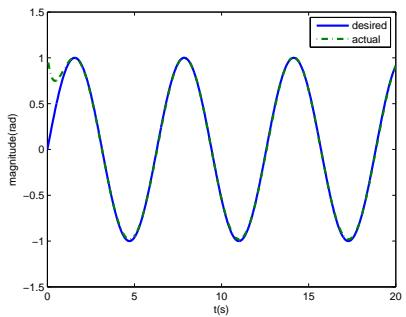

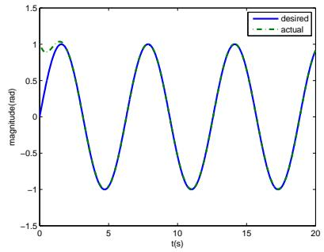

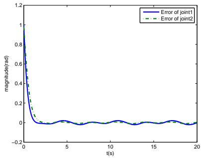  
Fig. 1. Actual(solid) and desired (dashed) trajec- Fig. 2. Actual(solid) and desired (dashed) trajec- Fig. 3. Tracking errors e (solid) and e (dashed). $e _ { 1 }$ tories of joint 1. tories of joint 2.

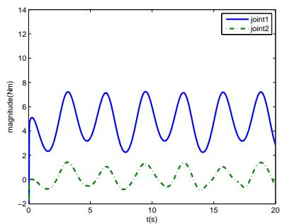  
Fig. 4. Controller outputs $\tau _ { 1 }$ and $\tau _ { 2 } .$

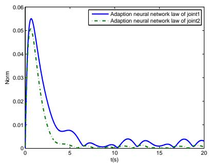  
Fig. 5. Norm of $W _ { 1 }$ (solid) and $W _ { 2 } ( \mathrm { d a s h e d } )$

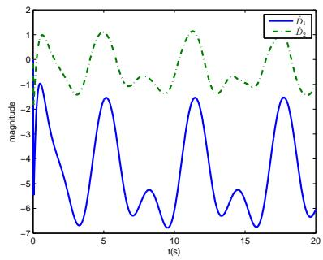  
Fig. 6. Disturbance estimate trajectories of $\hat { D } _ { 1 }$ (solid) and $\hat { D } _ { 2 }$ (dashed).

## C. Experiment Studies

We utilize two joints of the Baxter robot with elastic joints driven joint to verify the effectiveness of the established controllers. The two rotation joints are utilized in the experiments, in which we choose $\mathbf { B } _ { d } \ = \ \mathrm { d i a g } [ 0 . 0 5 ( 0 . 5 \cos q _ { 2 } \ +$ $1 ) , 0 . 1 ( 1 + 0 . 5 \sin q _ { 1 } ) ]$ , and define the desired trajectory as $y _ { d } ~ = ~ [ \sin t , \sin t ] ^ { T }$ . We use 16 nodes neural network to approximate the unknown functions in the robotic system. Let $\hat { W } _ { i } ( 0 ) = [ 0 , \ldots , 0 ] ^ { T }$ be the initial values of the adaptive law (64). The design parameters’ values are set to $\alpha = I _ { 2 \times 2 } ,$ ${ \cal K } = \mathrm { d i a g } [ 0 . 2 , 0 . 5 ] , { \cal K } _ { 1 } = \mathrm { d i a g } [ 1 . 6 , 1 . 2 ] , \lambda _ { 1 } = 1 2 , \lambda _ { 2 } = 1 0 . 5 ,$ $\Gamma _ { 1 } = 0 . 3 I _ { r \times r } , \Gamma _ { 2 } = 0 . 3 I _ { r \times r } , \varsigma _ { 1 } = 1 0$ , and $\varsigma _ { 2 } = 1 2$ . The experimental results with Baxter robot joints in Figs. 8- 13. Figs. 8 and 9 show the tracking performance of the given trajectories. Fig. 10 shows the tracking errors. Figs. 11 shows the controller output of the joints with variable stiffness effect. The norm of chosen RBFNN weights is shown in

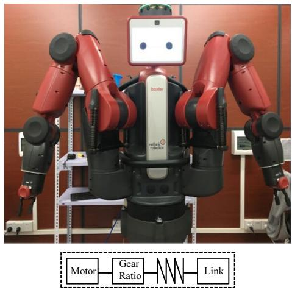  
Fig. 7. Baxter robot profile: Baxter robot has 7 joints with each arm and each joint is constructed as an elastic actuator.

Fig. 12. The trajectories of estimate of disturbance D are presented in Fig. 13. The experiment results show that the trajectory errors tend to the zeros, such that the theoretical performance of the control law as described in 3.1 is verified. For the comparison, we also conduct the model based control. The control parameters chosen are the same as the above experiment. Fig. 14 and 15 show the tracking performance. Figs. 16 shows the tracking errors. From the Figs, we see clearly that the control performance is not satisfactory at all, the main reason is that it is hardly to obtain perfect and complete information about the robotic system. For example, we may not know $\mathcal { F } ( \mathbf { x } )$ exactly, and the model based controller are dependent on the exact values of $\mathcal F ( \mathbf x )$ . Therefore, the performance model based would lead to be worse. The good performance can be achieved using the “adaptive” mechanism, and the experimental results demonstrate the effectiveness of the proposed adaptive neural network control.

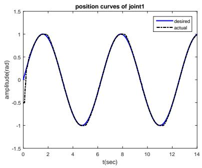

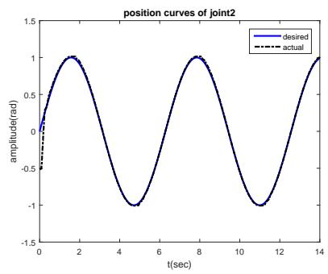

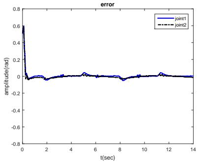  
Fig. 8. Desired(solid) and actual (dashed) trajec- Fig. 9. Desired(solid) and actual (dashed) trajec- Fig. 10. Tracking errors $e _ { 1 }$ (solid) and $e _ { 2 }$ tories of joint 1 tories of joint $2 .$ (dashed).

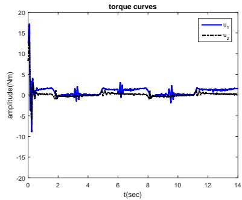

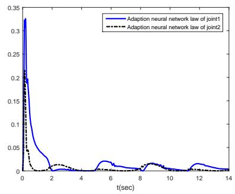

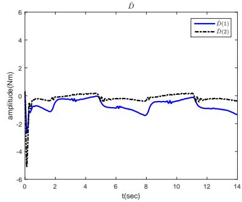  
Fig. 13. Disturbance estimate trajectories of $\hat { D } _ { 1 }$ (solid) and $\hat { D } _ { 2 }$ (dashed).

Fig. 11. Controller outputs $\tau _ { 1 }$ (solid) and τ2 ${ \mathrm { F i g } } .$ . 12. Norm of W1(solid) and W2 (dashed). (dashed).  
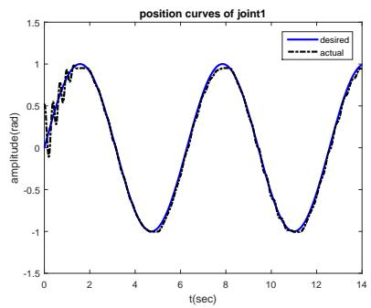

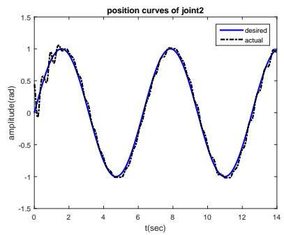

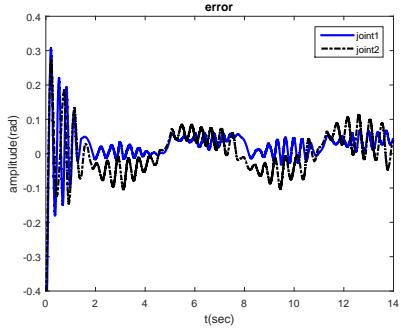  
Fig. 14. Desired(solid) and actual (dashed) tra- Fig. 15. Desired(solid) and actual (dashed) tra- Fig. 16. Tracking errors e1(solid line) and jectories of joint 1 under model based control. jectories of joint 2 under model based control. e2(dashed line) using the model based control.

## V. CONCLUSIONS

In this paper, we have designed a novel adaptive neural network control based on the nonlinear disturbance observer to handle viarable stiffness of a uncertain robotic systems. By employing the Lyapunov’s direct method, the boundness of the closed loop system has been established. Both simulation and experiment results presented have also shown that the proposed controllers are with satisfactory performance. More importantly, the effect caused by viarable stiffness is shown to be suppressed with our controller.

## REFERENCES

[1] Y. M. Li, Q. S. Xu, “Design and development of a medical parallel robot for cardiopulmonary resuscitation,” IEEE/ASME Trans. Mechatronics, vol. 12, no. 3, pp. 265-273, Jun. 2007.

[2] J. B. Killoran, “Targeting an audience of robots: search engines and the marketing of technical communication business websites,” IEEE Trans. Prof. Commun., vol. 52, no. 3, pp. 254-271, Sept. 2009.

[3] R. R. Murphy, M. Systems, Cybernetics, “Human-robot interaction in rescue robotics,” IEEE Trans. Syst., Man, Cybern. C, Appl. Rev., vol. 34, no. 2, pp. 138-153, May 2004.

[4] Y-J Kim, S. B. Cheng, S. Kim, K. Iagnemma, “A Stiffness-adjustable hyperredundant manipulator using a variable neutral-line mechanism for minimally invasive surgery,” IEEE Trans. Robot., vol. 30, no. 2, pp. 382- 395, Apr. 2014.

[5] O. M. Anubi, C. Crane, “A new semiactive variable stiffness suspension system using combined skyhook and nonlinear energy sink-based controllers,” IEEE Trans. Control Syst. Technol., vol. 23, no. 3, pp. 937-947, May 2015.

[6] L. C. Visser, R. Carloni, S. Stramigioli, “Energy-efficient variable stiffness actuators,” IEEE Trans. Robot., vol. 27, no. 5, pp. 865-875, Oct. 2011.

[7] B-S Kim, J-B Song, “Design and control of a variable stiffness actuator based on adjustable moment arm,” IEEE Trans. Robot., vol. 28, no. 5, pp. 1145-1151, Oct. 2012.

[8] F. Petit, W. Friedl, H. Hoppner, M. Grebenstein, “Analysis and synthesis of the bidirectional antagonistic variable stiffness mechanism,” IEEE/ASME Trans. Mechatronics, vol. 29, no. 1, pp. 169-186, Apr. 2015.

[9] C. Mitsantisuk, S. Katsura, K. Ohishi, “Kalman-filter-based sensor integration of variable power assist control based on human stiffness estimation” IEEE Trans. Ind. Electron., vol. 56, no. 10, pp. 3897-3905, Oct. 2009.

[10] E. Psomopoulou, A. Theodorakopoulos, Z. Doulgeri, G. A. Rovithakis, “Prescribed performance tracking of a variable stiffness actuated robot,” IEEE Trans. Control Syst. Technol., vol. 23, no. 5, pp. 1914-1926, Sept. 2015.

[11] T. W. Secord, H. H. Asada, “A Variable stiffness PZT actuator having tunable resonant frequencies,” IEEE Trans. Robot., vol. 26, no. 6, pp. 993-1005, Dec. 2010.

[12] A. Jafari, N.G. Tsagarakis, D.G. Caldwell, “A novel intrinsically energy efficient actuator with adjustable stiffness,” IEEE/ASME Trans. Mechatronics, vol. 18, no. 1, pp. 355-365, Feb. 2013.

[13] C. Junho, H. Seonghun, L. Woosub, K. Sungchul, K. Munsang, “A robot joint with variable stiffness using leaf springs,” IEEE Trans. Robot., vol. 27, no. 2, pp. 229-238, Apr. 2011.

[14] A. Zhakatayev, M. Rubagotti, H. A. Varol, “Closed-loop control of variable stiffness actuated robots via nonlinear model predictive control,” IEEE Access, vol. 3, no. 1, pp. 235-248, Mar. 2015.

[15] I. Sardellitti, G. A. Medrano-Cerda, N. Tsagarakis, A. Jafari, D. G. Caldwell, “Gain scheduling control for a class of variable stiffness actuators based on lever mechanisms,” IEEE Trans. Robot., vol. 29, no. 3, pp. 791-798, Jun. 2013.

[16] F. Petit, A. Daasch, A. Albu-Schaffer, “Backstepping control of variable stiffness robots,” IEEE Trans. Control Syst. Technol., vol. 23, no. 6, pp. 2195 - 2202, Nov. 2015.

[17] R. Cui, J. Guo, Z. Mao. “Adaptive backstepping control of wheeled inverted pendulums models,” Nonlinear Dynamics, vol. 79, no. 1, pp. 501-511, 2014.

[18] X. S. Wang, H. Hong, and C. Y. Su, “Model reference adaptive control of continuous time systems with an unknown dead-zone,” IEE Proc-Control Theory Applications, vol. 150, no. 3, pp. 261-266, 2003.

[19] Y. Cui, Y.-J. Liu, D.-J. Li, “Robust adaptive NN control for a class of uncertain discrete-time nonlinear MIMO systems,” Neural Computing and Applications, vol. 22, nos.3-4, pp. 747-754, 2013.

[20] C. Yang, Y. Jiang, Z. Li, W. He and C.-Y Su, “Neural Control of Bimanual Robots with Guaranteed Global Stability and Motion Precision,” IEEE Trans Ind. Informat., 2016, in press.

[21] J. Q. Huang, F. L. Lewis, “Neural-network predictive control for nonlinear dynamic systems with time-delay,” IEEE Trans. Neural Netw., vol. 14, no. 2, pp. 377-389, Mar. 2003.

[22] Y. T. Wen, X. M. Ren, “Neural networks-based adaptive control for nonlinear time-varying delays systems with unknown control direction,” IEEE Trans. Neural Netw., vol. 22, no. 10, pp. 1599-1612, Oct. 2011.

[23] W. He, A. David, Z. Yin, C. Sun, “Neural Network Control of a Robotic Manipulator With Input Deadzone and Output Constraint,” IEEE Trans. Syst., Man, Cybern. A, Syst., Humans, 2016, in press.

[24] A. Jafari, N. G. Tsagarakis, I. Sardellitti, D. G. Caldwell, “A new actuator with adjustable stiffness based on a variable ratio lever mechanism,” IEEE/ASME Trans. Mechatronics, vol. 19, no. 1, pp. 55-63, Feb. 2014.

[25] F. Petit, A. Dietrich, A. Albu-Schaffer, “Generalizing torque control concepts: using well-established torque control methods on variable stiffness Robots,” IEEE Robot. Autom. Mag., vol. 22, no. 4, pp. 37-51, Dec. 2015.

[26] A. Jafari, N. G. Tsagarakis, D. G. Caldwell, “A Novel Intrinsically Energy Efficient Actuator With Adjustable Stiffness (AwAS),” IEEE/ASME Trans. Mechatronics, vol. 18, no. 1, pp. 355-365, Feb. 2013.

[27] Z. Li, C. Su, L. Wang, Z. Chen, T. Chai, “Nonlinear disturbance observer-based control design for a robotic exoskeleton incorporating fuzzy approximation,” IEEE Trans. Ind. Electron., vol. 62, no. 9, pp. 5763-5775, Sept. 2015.

[28] W. Sun, Z. Zhao, and H. Gao, “Saturated adaptive robust control for active suspension systems,” IEEE Trans. Ind. Electron., vol. 60, no. 9, pp. 3889C3896, Sept. 2013.

Longbin Zhang received the B.S. degree in automation from Southwest University of Science and Technology, Sichuan, China, in 2014. She is currently pursuing the master’s degree with the College of Automation Science and Engineering, South China University of Technology, Guangzhou, China. Her current research interests include exoskeleton robots and adaptive control.

Zhijun Li (M’07-SM’09) received the Ph.D. degree in mechatronics, Shanghai Jiao Tong University, P. R. China, in 2002. From 2003 to 2005, he was a postdoctoral fellow in Department of Mechanical Engineering and Intelligent systems, The University of Electro-Communications, Tokyo, Japan. From 2005 to 2006, he was a research fellow in the Department of Electrical and Computer Engineering, National University of Singapore, and Nanyang Technological University, Singapore. From 2007- 2011, he was an Associate Professor in the Department of Automation, Shanghai Jiao Tong University, P. R. China. Since 2012, he is a Professor in College of Automation Science and Engineering, South China university of Technology, Guangzhou, China.

From 2016, he has been the Chair of Technical Committee on Biomechatronics and Biorobotics Systems $( B ^ { 2 } S ) .$ IEEE Systems, Man and Cybernetics Society. He is serving as an Editor-at-large of Journal of Intelligent & Robotic Systems, and Associate Editors of several IEEE Transactions. He has been the General Chair of 2016 IEEE Conference on Advanced Robotics and Mechatronics, Macau, China. Dr. Li’s current research interests include service robotics, tele-operation systems, nonlinear control, neural network optimization, etc.

Chenguang Yang (M’10-SM’16) received the B.Eng. degree in measurement and control from Northwestern Polytechnical University, Xian, China, in 2005, and the Ph.D. degree in control engineering from the National University of Singapore, Singapore, in 2010. He received postdoctoral training at Imperial College London, UK. He is with Zienkiewicz Centre for Computational Engineering, Swansea University, UK as a senior lecturer. His research interests lie in robotics, automation and computational intelligence.