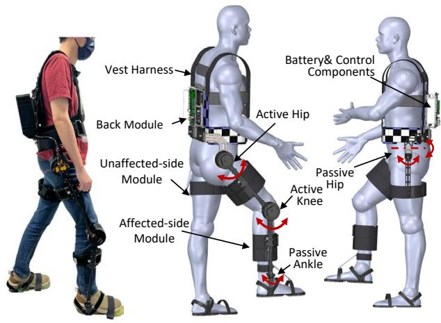
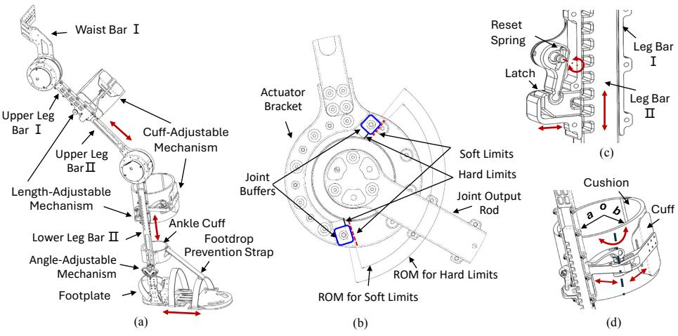
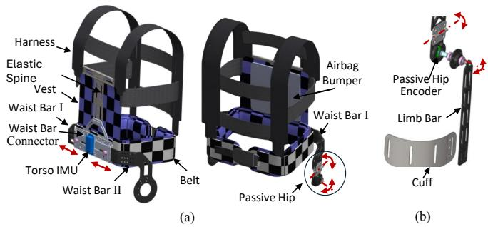
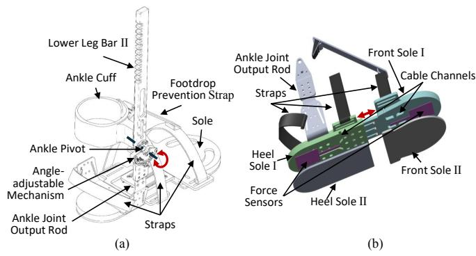
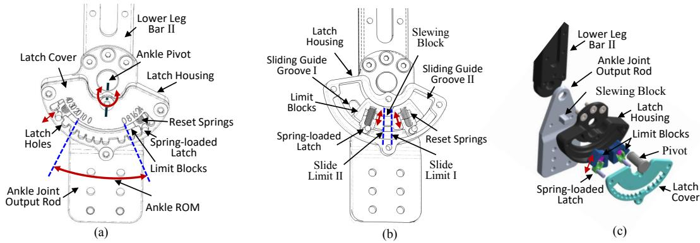
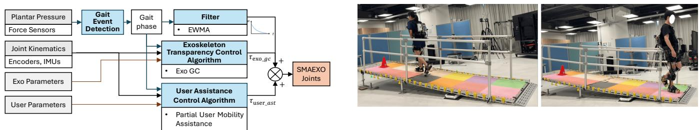
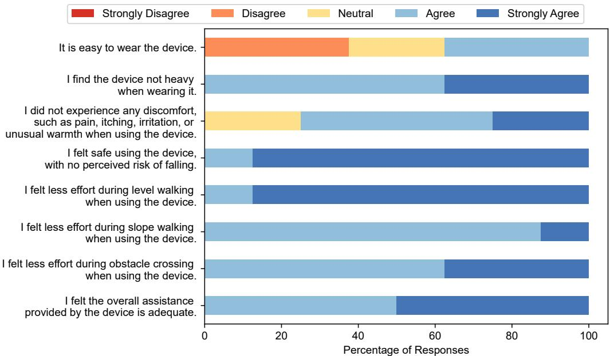

# Design and Evaluation of a Single-Sided Mobility Assistive Exoskeleton (SMAEXO) for Hemiplegia

Xiaoyue Yan1, 2, Wei Yun Yau3, Isaac Okumura Tan2, Longbin Zhang2, 4, Youlong Wang1, 2, Oliver Roberts2, Seng Kwee Wee5, Wei Tech Ang1, 2

Abstract— This study presents the Single-Sided Mobility Assistive Exoskeleton (SMAEXO), a novel, single-sided, multijoint device designed to enhance mobility and rehabilitation for individuals with hemiplegia. SMAEXO provides active assistance at the hip and knee, combined with a passive, flexible ankle joint to prevent foot drop, ensuring comprehensive support throughout the gait cycle. Its innovative design optimizes reaction force support and weight distribution, promoting balance and reducing strain on the affected side. Additionally, its modular, customizable design accommodates diverse body dimensions and biomechanical needs, while safety features such as self-locking mechanisms, cushions, bumpers, and elastic components enhance user safety and comfort. The SMAEXO’s usability, comfort, safety, and assistance were assessed through trials with eight able-bodied participants, including physiotherapists simulating stroke gait patterns. Participants reported the device as comfortable, safe, and effective, highlighting its benefits during level and slope walking and obstacle negotiation. Notable feedback included the need for enhanced ventilation, reduced device weight, and improved ease of donning and doffing. The results demonstrate SMAEXO’s potential to deliver comprehensive multi-joint assistance for individuals with hemiplegia. This work contributes to advancing rehabilitation and assistive technologies for post-stroke individuals, enabling more effective and personalized mobility support.

## I. INTRODUCTION

Stroke, a leading cause of disability, often results in hemiparesis, affecting 65% of survivors with impairing gait [1]. Common issues include asymmetry, poor balance, and foot drop [2], requiring intensive rehabilitation to restore mobility. Traditional therapy is labor-intensive, requiring two physiotherapists per session, limiting scalability [3]. Exoskeletons offer a more efficient solution, providing consistent, automated support to enhance rehabilitation while reducing therapist workload [4].

Most lower-limb exoskeletons are bilateral, providing full mobility support by targeting the hip, knee, and ankle. Devices like Ekso Indego [5], ReWalk [6], and Rex [7] assist users with severe motor loss, such as spinal cord injury patients. However, their bulky design, high cost, and reliance on position control make them unsuitable for stroke survivors, who need responsive, tailored support [8].

For hemiplegic patients, unilateral exoskeletons offer a simpler, lighter alternative. Unlike bilateral devices, which restrict natural movement and disrupt gait symmetry [9], unilateral exoskeletons assist only the affected limb, enhancing mobility with less burden on the wearer.

However, the unilateral approach introduces its own challenges. The asymmetric structure of these devices can make it difficult to maintain balance, and the limited reaction force support hampers the generation of sufficient torque to adequately stabilize and propel the affected limb.

Furthermore, many unilateral exoskeletons assist only one joint, limiting their effectiveness for stroke-related multi-joint impairments. Knee devices like the University of Michigan’s passive exoskeleton [10], the University of New York’s active exoskeleton [11], and the REFLEX system [12] aid the knee for stance support and swing clearance. Similarly, ankle exoskeletons such as the ReStore Exo-Suit [13] and Northern Arizona University’s device [14] improve plantarflexion and dorsiflexion but provide only partial support, neglecting impairments in other joints. Multi-joint unilateral devices such as HAL [15], AGoRA [16] and LitteStepper [17] attempt to assist multiple joints simultaneously but tend to be heavier, less user-friendly, and more challenging to integrate seamlessly with the user’s intent.

In practice, existing unilateral exoskeletons still fall short of delivering seamless, multi-joint assistance while maintaining usability, comfort, and safety. These limitations underscore the need for a new generation of unilateral exoskeletons that can provide comprehensive, user-centered support for hemiparetic individuals.

To address these gaps, this work introduces the Single-Sided Mobility Assistive Exoskeleton (SMAEXO), a novel multi-joint device specifically engineered for individuals with hemiparesis. SMAEXO incorporates innovative features designed to optimize reaction force management and weight distribution, while ensuring that assistance at the hip, knee, and ankle joints is both effective and intuitive. The key contributions of this work include:

1) Development of the SMAEXO enables integrated assistance across the hip, knee, and ankle joints, providing comprehensive support to the affected limb. Optimized weight distribution and reaction force management strategies ensure that the device can effectively stabilize and support the user without compromising comfort, safety or ease of movement.

2) The performance of SMAEXO is validated through a user study involving eight participants. This evaluation focuses on usability, comfort, safety, and effectiveness, offering valuable insights into SMAEXO’s practicality and its potential to enhance the rehabilitation process for stroke survivors.

  
Fig. 1. Architecture of the single-sided mobility assistive exoskeleton (SMAEXO). The red arrows indicate joint movements.

By offering a thoughtfully engineered solution that meets the unique needs of hemiparetic individuals, the SMAEXO has the potential to transform stroke rehabilitation.

## II. SYSTEM OVERVIEW

## A. Architecture of SMAEXO

SMAEXO was developed through close collaboration with physiotherapists specializing in stroke rehabilitation and lower-limb exoskeletons. This consultative process ensured that the system aligns with the unique needs of individuals with hemiplegia, emphasizing usability, safety, comfort and comprehensive assistance. The device features a modular design comprising four primary components (Fig. 1):

• Affected-side module: Incorporates active hip and knee joints powered by quasi-direct drive (QDD) motors, which combine high-torque motors with a low gear ratio transmission (1:6) to deliver high bandwidth and backdrivability. Additionally, a passive ankle joint paired with a footplate is involved to prevent foot drop.

• Unaffected-side module: Features a passive hip joint that facilitates hip flexion/extension and abduction/adduction, ensuring natural movement on the unaffected side.

• Back module: Connects all modules and houses the control components and battery, strategically placing the battery on the unaffected side to optimize weight distribution and balance.

• Vest harness: Distributes device weight and reaction force evenly across the user’s core, enhancing comfort and stability.

For safety and comfort, all joints incorporate both hard and soft limiters to restrict the range of motion (ROM) within the user’s biomechanical capabilities. The soft limiters, implemented as joint buffers, absorb impacts when the joint approaches the hard limiters (Fig. 2 (b)). The joint buffers can be easily replaced to accommodate users with limited ROM. Additionally, all the leg bars are equipped with cuffs and cushions, as shown in Fig. 2 (d), these cuffs can be easily opened for quick donning and doffing and the major semiaxis, minor semi-axis of the cuffs can be easily adjusted to accommodate users with varying leg circumferences.

To further enhance adaptability and alignment, the SMAEXO features the corresponding adjustable mechanisms to allow tool-free adjustments for waist width, upper and lower leg bar lengths, and foot size, accommodating users of various body dimensions (Fig. 2 and Fig. 3 (a)). All adjustable mechanisms are equipped with reset springs to ensure the locked status for safety.

The main specifications of the SMAEXO system are summarized in Table I.

TABLE I  
SPECIFICATIONS OF THE SMAEXO.

<table><tr><td>Items</td><td>Specifications</td></tr><tr><td>Motion Range (°)</td><td>Hip: (-20, 125); Knee: (0, 135); Ankle: (-40, 24)</td></tr><tr><td>Length Range (mm)</td><td>Upper Limb: 400–500 (Long), 300–400 (Short); Lower Limb: 380–480 (Long), 280–380 (Short); Hip Width: 335–435; Feet: 250–305</td></tr><tr><td>Hip and Knee Motors</td><td>Rated Torque: 12Nm; Max Torque: 37Nm; Ratio: 1:6; Weight: 0.759kg</td></tr><tr><td>Battery</td><td>Lithium Battery Pack, 24V 6Ah, Weight: 0.82kg</td></tr><tr><td>Weight (kg)</td><td>Total: 7.5; Affected-side Module: 3.3; Unaffected-side Module: 0.3 Back Module: 2.1 Vest Harness: 1.8</td></tr></table>

B. Efficient Reaction Force Management and Weight Distribution

Effective reaction force management is key to minimizing discomfort and enhancing usability. Double-sided exoskeletons like Ekso Indego [5], ReWalk [6], and Rex [7] achieve this through heavier self-weight and extensive user contact, enabling higher assistive torque but increasing bulk and reducing mobility. In contrast, lightweight exoskeletons face torque limitations due to weaker reaction force support. For example, Honda’s SMA device provides 4 Nm of hip torque [18], while Samsung’s GEMS, with a hip brace for additional support, reaches 12 Nm [19]. Unilateral devices like AGoRA improve torque and balance with bilateral configurations but increase mass to 17 kg [16].

The SMAEXO addresses these challenges by integrating innovative features for efficient reaction force management and weight distribution. Through a combination of an ergonomic vest harness and a flexible ankle joint coupled with a footplate, SMAEXO ensures effective stabilization and comprehensive assistance while maintaining a lightweight and user-friendly profile.

## • Ergonomic Vest Harness

As depicted in Fig. 3 (a), the SMAEXO vest harness is designed to conform closely to the wearer’s body. It consists of a vest integrated with a harness and belt, featuring an elastic spine made from flexible materials such as spring steel, which naturally adapts to the wearer’s spinal curvature. To enhance fit and contact, an adjustable airbag bump is included, allowing compatibility with diverse body shapes and improving overall user comfort. This configuration efficiently utilizes the wearer’s waist, chest, abdominal, and back muscles to stabilize reaction forces, reducing discomfort and enhancing mobility.

  
Fig. 2. The affected-side module of the SMAEXO. (a) Module with length adjustments (red arrows). (b) Joint with limited ROM, featuring replaceable buffers to absorb impact. (c) Length-adjustable mechanism with a reset spring for secure locking. (d) Cuff-adjustable mechanism with linear (a, b) and rotational adjustments for leg circumference and easy donning (red arrows).

  
Fig. 3. The SMAEXO vest harness, back, and unaffected-side modules. (a) The back module, paired with the vest harness, includes an IMU for torso angle monitoring. (b) The unaffected-side module features a passive hip with an encoder to measure sagittal hip angles. Red arrows indicate linear adjustments for waist width and hip movement.

  
Fig. 4. The ankle joint and footplate of the SMAEXO. (a) The ankle joint connects to the footplate via an output rod and an elastic foot-drop prevention strap, which acts like a spring with adjustable tension for user adaptability. (b) The footplate features adjustable length via a sliding front sole I over heel sole I, accommodating various foot sizes. Embedded force sensors in front sole I and heel sole I are protected by an additional layer (front sole II and heel sole II). Integrated cable channels facilitate wiring.

## • Flexible Ankle Joint

Unlike most exoskeletons, such as Knee-Ankle-Foot Orthoses, ReWalk™ [6], and HAL [15], which use fixed ankle joints and rigid footplates to prevent foot drop and transfer weight to the ground, SMAEXO features a versatile ankle joint design that prioritizes both comfort and a natural gait. This innovative design adapts to individual user needs, facilitating improved mobility.

As depicted in Fig. 4 and Fig. 5, the SMAEXO ankle joint incorporates the following features: (1) An angle-adjustable mechanism, which can either be allowed to rotate within a controlled range or fixed at a specific angle. (2) A flexible footplate with force sensors at the heel and forefoot to detect gait events. (3) Effective weight transfer to the ground during stance without impeding force sensor functionality. (4) Integration with an elastic strap and ankle cuff to prevent foot drop during swing. (5) Adjustable footplate length to accommodate various foot sizes. (6) Construction using elastic and durable materials such as polyurethane (PU), rubber, and ethylene-vinyl acetate (EVA) for natural ground contact and durability. This configuration facilitates a natural gait while offering personalized adjustments to align with individual walking patterns and assistance needs, enhancing both comfort and mobility.

With its advancements in reaction force management and weight support, the SMAEXO achieves a maximum assistive torque of 25 Nm. This capability addresses the high torque demands of hemiplegia rehabilitation while ensuring user comfort, providing an effective and user-friendly solution for mobility assistance.

  
Fig. 5. The angle-adjustable mechanism of ankle joint. (a) Locked with limited movement. (b) Fixed at a specific angle. (c) Exploded view. The mechanism enables controlled ankle rotation or fixed positioning using a latch housing, sliding guide grooves, a slewing block, spring-loaded limit blocks, a pivot, and a latch cover. The limit blocks rotate along guide groove II and lock when the spring-loaded latch engages a latch hole. Unlocking releases the latch, restoring movement. The slewing block rotates within guide groove I and locks the ankle at a set angle when contacting both limit blocks.

  
Fig. 6. Control block diagram of the SMAEXO.  
Fig. 7. Experiment setup.

## C. Control Scheme

The SMAEXO utilizes a multi-level control strategy with a reliable and cost-effective sensor system to enhance its functionality. This system incorporates a torso IMU and encoders embedded in the hip and knee joints to provide accurate joint kinematic measurements. Foot pressure measurements from force sensors, combined with kinematic data, are employed to identify gait phases during various daily activities, including sit-to-stand transitions and walking on flat surfaces, ramps, or stairs. The control system leverages this gait phase information to implement exoskeleton transparency(e.g., Gravity Compensation) and partial user mobility assistance for optimized support and a better user experience. Additionally, exoskeleton and user parameters are tailored to meet individual assistance needs, while filters like the Exponentially Weighted Moving Average (EWMA) ensure a smooth torque profile throughout the entire gait cycle (Fig. 6).

## III. EXPERIMENTS

To evaluate the usability, comfort, safety, and assistance provided by the SMAEXO, eight able-bodied participants were recruited, including two physiotherapists specializing in lower-limb rehabilitation. During testing, physiotherapists simulated stroke gait patterns—including foot drop, stiff knee, circumduction, and weak knee—based on their experience to evaluate the exoskeleton’s effectiveness from a patient’s perspective. Demographic and anthropometric details of the participants are provided in Table II. All participants gave written informed consent after being briefed on the study’s objectives and potential risks. The study protocol received approval and oversight from the Nanyang Technological University Institutional Review Board.

During the experiment, participants could take rest breaks, stop, or withdraw from testing at any time. The assessment consisted of two sessions (with and without the exoskeleton), each comprising three tasks. Participants repeated each task at least three times:

• 10-meter level walking;

• 4-meter slope with 8 degrees inclination up and down;

• Stepping over a 10 cm high, 12.5 cm wide obstacle.

In the second session, participants were familiarized with the exoskeleton for 30 minutes before testing. Investigators guided them on exoskeleton use and ensured acclimatization. Participants were instructed to report any discomfort or pain, which was documented and addressed.

At the study’s conclusion, participants completed a questionnaire assessing the exoskeleton’s usability, comfort, safety and assistance. All questions are rated 1 to 5, with 1 as “strongly disagree” and 5 as “strongly agree”.

  
Fig. 8. User questionnaire responses to the SMAEXO during level and slope walking, as well as obstacle crossing tasks.

TABLE II  
DEMOGRAPHIC AND ANTHROPOMETRIC DETAILS OF PARTICIPANTS.

<table><tr><td>Participants</td><td>Age</td><td>Sex</td><td>Height (cm)</td><td>Mass (kg)</td></tr><tr><td>P1</td><td>31-40</td><td>F</td><td>155</td><td>54.5</td></tr><tr><td>P2</td><td>21-30</td><td>M</td><td>171</td><td>70</td></tr><tr><td>P3</td><td>31-40</td><td>F</td><td>163</td><td>55</td></tr><tr><td>P4</td><td>31-40</td><td>M</td><td>183</td><td>76</td></tr><tr><td>P5</td><td>21-30</td><td>M</td><td>183</td><td>73</td></tr><tr><td>P6</td><td>21-30</td><td>M</td><td>181</td><td>85</td></tr><tr><td>P7</td><td>21-30</td><td>M</td><td>176</td><td>85</td></tr><tr><td>P8</td><td>41-50</td><td>M</td><td>169</td><td>71</td></tr></table>

TABLE III

SPECIFICATIONS OF THE SMAEXO.

<table><tr><td>Devices</td><td>HAL (Cyberdyne)</td><td>LiteStepper (Angelexo)</td><td>SMAEXO</td></tr><tr><td>Control Strategy</td><td>Model-based control (amplify muscle activities) or Predefined gait trajectory</td><td>Replicate gait trajectory of intact limb &amp; Crutch handle to initiate walk</td><td>Hybrid Model-based control</td></tr><tr><td>Actuators</td><td>2 Brushless DC motors</td><td>2 Brushless DC motors</td><td>2 QDD motors</td></tr><tr><td>Sensors Used</td><td>Kinematic Sensors Sole Pressure Sensors EMGs</td><td>Kinematic Sensors Sole Pressure Sensors Cane Pressure Sensor</td><td>Kinematic Sensors (4) Sole Pressure Sensors</td></tr><tr><td>Footplates Type</td><td>Customized shoes with rigid shoes insole</td><td>Mechanical footplates</td><td>Flexible footplates</td></tr><tr><td>Weight Support</td><td>Rigid insole(ground)</td><td>Vest (core) Footplates (ground)</td><td>Vest Harness (core) Footplates (ground)</td></tr><tr><td>Weight</td><td>9 kg</td><td>16.9 kg</td><td>7.5 kg</td></tr></table>

## IV. RESULTS AND DISCUSSION

As shown in Fig. 8, participants appreciated SMAEXO’s modular design and tool-free adjustments for easy donning and doffing. However, its unbalanced structure made maintaining a neutral position challenging, especially when seated. Physiotherapists noted that post-stroke users often require two assistants for stabilization. Incorporating a support frame could address this issue by providing stability during the donning process.

Participants considered the device’s weight acceptable. During the stance phase, the SMAEXO effectively transferred weight to the ground, reducing the burden on the knee joint. However, physiotherapists raised concerns regarding hemiplegic users, as the unaffected leg bears the device’s weight during the swing phase. This could potentially increase stress on the unaffected knee, particularly concerning for elderly post-stroke individuals who are more susceptible to knee issues, such as osteoarthritis. Further reducing the exoskeleton’s weight is recommended to alleviate this strain.

The device was reported to be comfortable, with no instances of pain, itching, or irritation. The adjustable mechanisms enabled proper adaptation to various body dimensions, ensuring a snug fit that effectively engaged the user’s core muscles for optimal reaction force management and weight distribution. However, two participants experienced slight perspiration on their backs after wearing the device for more than an hour, likely due to the vest and airbag bump. Incorporating breathable materials into these components could enhance comfort during prolonged use.

Regarding safety, participants indicated no concerns about falling or other safety issues during the trials, indicating that the SMAEXO’s design effectively solved the weight distribution and balance challenges. However, one participant highlighted the potential risk of the footplate contacting obstacles or stairs if the straps were not tightly secured. This emphasizes the importance of ensuring that all straps are properly adjusted and secured to maintain safety during use.

Participants reported the SMAEXO provided adequate assistance during level and slope walking, as well as obstacle negotiation, reducing their effort. This shows the SMAEXO offered comprehensive joint support throughout the gait cycle by combining active hip and knee assistance with a passive, flexible ankle joint.

Compared to double-sided exoskeletons, the SMAEXO demonstrated advantages in weight reduction and freedom of movement, while offering more comprehensive support than single-joint devices. Table III compares the main features of our device with commercial unilateral exoskeletons, HAL and LiteStepper. SMAEXO offers advantages in compact design, lighter weight, an intuitive and cost-effective sensor system, improved force management, and more flexible footplates for natural gait. However, challenges remain in minimizing the overall weight and improving the ease of donning and doffing, particularly due to the lack of a stable sitting pose without external support. Future iterations should focus on incorporating a dedicated support mechanism to address this limitation and further enhance usability.

Compared to double-sided exoskeletons, SMAEXO offers reduced weight and greater freedom of movement while providing more comprehensive support than single-joint devices. Table III compares its key features with commercial unilateral exoskeletons, HAL [20] and LiteStepper [17]. SMAEXO excels in compact design, lighter weight, an intuitive and cost-effective sensor system, improved force management, and flexible footplates for natural gait. However, challenges remain in further reducing weight and improving donning and doffing, particularly due to the lack of stable sitting posture without external support. Future iterations should integrate a dedicated support mechanism to enhance usability.

## V. CONCLUSION

In this study, we developed the Single-Sided Mobility Assistive Exoskeleton (SMAEXO), a single-sided, multijoint lower limb exoskeleton designed to enhance mobility in individuals with hemiplegia. SMAEXO actively supports the hip and knee while incorporating a passive, flexible ankle joint to prevent foot drop, ensuring dynamic assistance throughout the gait cycle. Its tool-free adjustments, optimized weight distribution, and reaction force management enhance usability, balance, comfort, and safety while minimizing strain on the affected side.

We evaluated usability, safety, comfort, and assistance with eight able-bodied participants during level walking, slope walking, and obstacle crossing. Participants reported the device as safe, comfortable, and effective, with no adverse effects such as itching or irritation, and found the assistance beneficial. However, areas for improvement were noted, including better cooling, reduced weight, and simplified donning.

This study is limited by a small and unbalanced participant sample, which may impact the generalizability of the findings. Future work will address this by conducting extensive testing with a larger, more diverse participant pool for robust validation.

Building on the these findings, we will advance to clinical trials to evaluate SMAEXO’s effectiveness in post-stroke individuals. Comprehensive data analysis will inform design refinements to enhance functionality, comfort, and user experience. With continued development, SMAEXO holds the potential to significantly improve mobility and quality of life for individuals with hemiplegia.

[1] V. L. Feigin, M. Brainin, B. Norrving, S. Martins, R. L. Sacco, W. Hacke, M. Fisher, J. Pandian, and P. Lindsay, “World stroke organization (wso): global stroke fact sheet 2022,” International Journal of Stroke, vol. 17, no. 1, pp. 18–29, 2022.

[2] Y. Li, T. Fan, Q. Qi, J. Wang, H. Qiu, L. Zhang, X. Wu, J. Ye, G. Chen, J. Long et al., “Efficacy of a novel exoskeletal robot for locomotor rehabilitation in stroke patients: A multi-center, non-inferiority, randomized controlled trial,” Frontiers in aging neuroscience, vol. 13, p. 706569, 2021.

[3] G. Chen, C. K. Chan, Z. Guo, and H. Yu, “A review of lower extremity assistive robotic exoskeletons in rehabilitation therapy,” Critical Reviews™ in Biomedical Engineering, vol. 41, no. 4-5, 2013.

[4] E. Read, C. Woolsey, C. A. McGibbon, and C. O’Connell, “Physiotherapists’ experiences using the ekso bionic exoskeleton with patients in a neurological rehabilitation hospital: A qualitative study,” Rehabilitation research and practice, vol. 2020, no. 1, p. 2939573, 2020.

[5] “Ekso indego,” Ekso Bionics. [Online]. Available: https://eksobionics. com/ekso-indego-therapy/

[6] “Rewalk personal exoskeleton,” Lifeward. [Online]. Available: https://golifeward.com/products/rewalkpersonal-exoskeleton/

[7] “Rex,” Rex Bionics. [Online]. Available: https://www.rexbionics.com/ product-information/

[8] J. S. Lora-Millan, J. C. Moreno, and E. Rocon, “Coordination between partial robotic exoskeletons and human gait: A comprehensive review on control strategies,” Frontiers in Bioengineering and Biotechnology, vol. 10, p. 842294, 2022.

[9] J. M. Hidler and A. E. Wall, “Alterations in muscle activation patterns during robotic-assisted walking,” Clinical Biomechanics, vol. 20, no. 2, pp. 184–193, 2005.

[10] E. P. Washabaugh, T. E. Augenstein, A. M. Ebenhoeh, J. Qiu, K. A. Ford, and C. Krishnan, “Design and preliminary assessment of a passive elastic leg exoskeleton for resistive gait rehabilitation,” IEEE Transactions on Biomedical Engineering, vol. 68, no. 6, pp. 1941– 1950, 2020.

[11] J. Wang, X. Li, T.-H. Huang, S. Yu, Y. Li, T. Chen, A. Carriero, M. Oh-Park, and H. Su, “Comfort-centered design of a lightweight and backdrivable knee exoskeleton,” IEEE Robotics and Automation Letters, vol. 3, no. 4, pp. 4265–4272, 2018.

[12] J. S. Lora-Millan, F. J. Sanchez-Cuesta, J. P. Romero, J. C. Moreno, and E. Rocon, “A unilateral robotic knee exoskeleton to assess the role of natural gait assistance in hemiparetic patients,” Journal of NeuroEngineering and Rehabilitation, vol. 19, no. 1, p. 109, 2022.

[13] “Restore exo-suit,” Lifeward. [Online]. Available: https://golifeward. com/products/restore-exo-suit/

[14] G. Orekhov, Y. Fang, C. F. Cuddeback, and Z. F. Lerner, “Usability and performance validation of an ultra-lightweight and versatile untethered robotic ankle exoskeleton,” Journal of neuroengineering and rehabilitation, vol. 18, pp. 1–16, 2021.

[15] H. Kawamoto, T. Hayashi, T. Sakurai, K. Eguchi, and Y. Sankai, “Development of single leg version of hal for hemiplegia,” in 2009 Annual international conference of the IEEE engineering in medicine and biology society. IEEE, 2009, pp. 5038–5043.

[16] L. J. A. Mayag, M. Munera, and C. A. Cifuentes, “Human-in-the-´ loop control for agora unilateral lower-limb exoskeleton,” Journal of Intelligent & Robotic Systems, vol. 104, no. 1, p. 3, 2022.

[17] Y. Jin, B. Xiong, L. Chen, W. Zhao, Z. Li, C. Zhang, and X. Xu, “Efficacy and safety of using a unilateral lower limb exoskeleton combined with conventional treatment in post-stroke rehabilitation: a randomized controlled trial,” Frontiers in Bioengineering and Biotechnology, vol. 12, p. 1441986, 2024.

[18] R. Kitatani, K. Ohata, H. Takahashi, S. Shibuta, Y. Hashiguchi, and N. Yamakami, “Reduction in energy expenditure during walking using an automated stride assistance device in healthy young adults,” Archives of physical medicine and rehabilitation, vol. 95, no. 11, pp. 2128–2133, 2014.

[19] K. Seo, J. Lee, Y. Lee, T. Ha, and Y. Shim, “Fully autonomous hip exoskeleton saves metabolic cost of walking,” in 2016 IEEE International Conference on Robotics and Automation (ICRA). IEEE, 2016, pp. 4628–4635.

[20] “Hal for well-being (lower limb type),” Cyborg. [Online]. Available: https://www.cyberdyne.jp/english/products/fl05.html