# Li2021-TMECH：稳定动态行走的下肢外骨骼人在环控制

> English text extracted from the source PDF; not translated or editorially corrected. Each original PDF page is embedded below as a rendered image so figures, tables, and vector artwork remain visible.

- Source PDF: `Li2021-TMECH：稳定动态行走的下肢外骨骼人在环控制.pdf`
- SHA-256: `1321b246cd462498a0315984b63526d3ffa4a9fbd7517e50c45cb09bc95c6921`
- Pages: 12
- Extraction: Poppler `pdftotext -layout`; page images rendered with `pdftoppm` (max dimension 1400 px, JPEG quality 76).

## Page 1

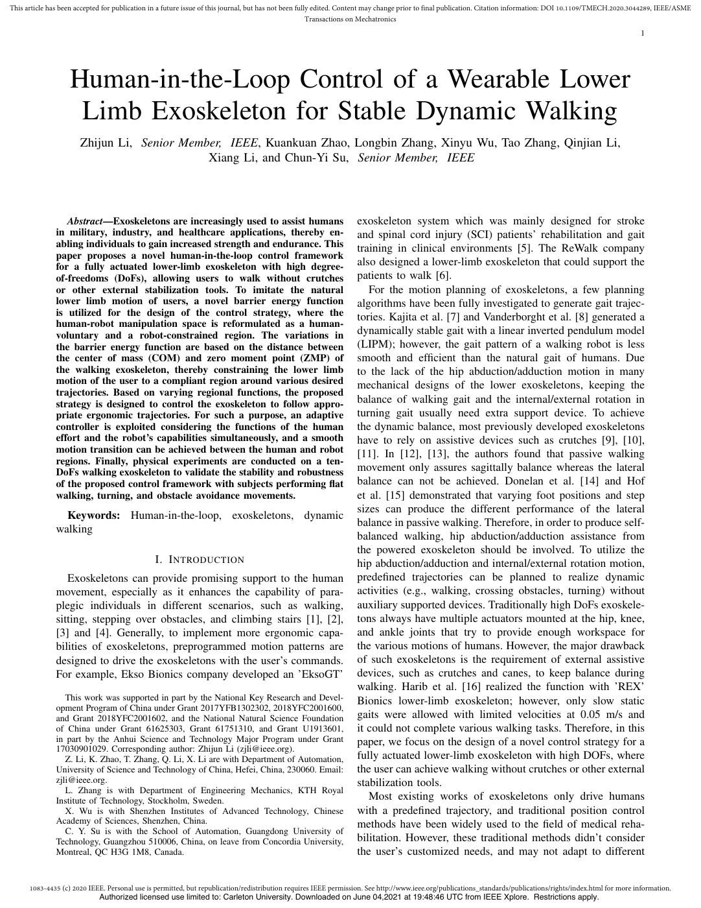

English text extracted from page 1

<pre>
This article has been accepted for publication in a future issue of this journal, but has not been fully edited. Content may change prior to final publication. Citation information: DOI 10.1109/TMECH.2020.3044289, IEEE/ASME
                                                                                                       Transactions on Mechatronics
                                                                                                                                                                                                              1

                   Human-in-the-Loop Control of a Wearable Lower
                    Limb Exoskeleton for Stable Dynamic Walking
                       Zhijun Li, Senior Member, IEEE, Kuankuan Zhao, Longbin Zhang, Xinyu Wu, Tao Zhang, Qinjian Li,
                                             Xiang Li, and Chun-Yi Su, Senior Member, IEEE

                  Abstract—Exoskeletons are increasingly used to assist humans                                   exoskeleton system which was mainly designed for stroke
               in military, industry, and healthcare applications, thereby en-                                   and spinal cord injury (SCI) patients’ rehabilitation and gait
               abling individuals to gain increased strength and endurance. This                                 training in clinical environments [5]. The ReWalk company
               paper proposes a novel human-in-the-loop control framework
               for a fully actuated lower-limb exoskeleton with high degree-                                     also designed a lower-limb exoskeleton that could support the
               of-freedoms (DoFs), allowing users to walk without crutches                                       patients to walk [6].
               or other external stabilization tools. To imitate the natural                                        For the motion planning of exoskeletons, a few planning
               lower limb motion of users, a novel barrier energy function                                       algorithms have been fully investigated to generate gait trajec-
               is utilized for the design of the control strategy, where the                                     tories. Kajita et al. [7] and Vanderborght et al. [8] generated a
               human-robot manipulation space is reformulated as a human-
               voluntary and a robot-constrained region. The variations in                                       dynamically stable gait with a linear inverted pendulum model
               the barrier energy function are based on the distance between                                     (LIPM); however, the gait pattern of a walking robot is less
               the center of mass (COM) and zero moment point (ZMP) of                                           smooth and efficient than the natural gait of humans. Due
               the walking exoskeleton, thereby constraining the lower limb                                      to the lack of the hip abduction/adduction motion in many
               motion of the user to a compliant region around various desired                                   mechanical designs of the lower exoskeletons, keeping the
               trajectories. Based on varying regional functions, the proposed
               strategy is designed to control the exoskeleton to follow appro-                                  balance of walking gait and the internal/external rotation in
               priate ergonomic trajectories. For such a purpose, an adaptive                                    turning gait usually need extra support device. To achieve
               controller is exploited considering the functions of the human                                    the dynamic balance, most previously developed exoskeletons
               effort and the robot’s capabilities simultaneously, and a smooth                                  have to rely on assistive devices such as crutches [9], [10],
               motion transition can be achieved between the human and robot                                     [11]. In [12], [13], the authors found that passive walking
               regions. Finally, physical experiments are conducted on a ten-
               DoFs walking exoskeleton to validate the stability and robustness                                 movement only assures sagittally balance whereas the lateral
               of the proposed control framework with subjects performing flat                                   balance can not be achieved. Donelan et al. [14] and Hof
               walking, turning, and obstacle avoidance movements.                                               et al. [15] demonstrated that varying foot positions and step
                                                                                                                 sizes can produce the different performance of the lateral
                 Keywords: Human-in-the-loop, exoskeletons, dynamic
                                                                                                                 balance in passive walking. Therefore, in order to produce self-
               walking
                                                                                                                 balanced walking, hip abduction/adduction assistance from
                                                                                                                 the powered exoskeleton should be involved. To utilize the
                                               I. I NTRODUCTION                                                  hip abduction/adduction and internal/external rotation motion,
                  Exoskeletons can provide promising support to the human                                        predefined trajectories can be planned to realize dynamic
               movement, especially as it enhances the capability of para-                                       activities (e.g., walking, crossing obstacles, turning) without
               plegic individuals in different scenarios, such as walking,                                       auxiliary supported devices. Traditionally high DoFs exoskele-
               sitting, stepping over obstacles, and climbing stairs [1], [2],                                   tons always have multiple actuators mounted at the hip, knee,
               [3] and [4]. Generally, to implement more ergonomic capa-                                         and ankle joints that try to provide enough workspace for
               bilities of exoskeletons, preprogrammed motion patterns are                                       the various motions of humans. However, the major drawback
               designed to drive the exoskeletons with the user’s commands.                                      of such exoskeletons is the requirement of external assistive
               For example, Ekso Bionics company developed an ’EksoGT’                                           devices, such as crutches and canes, to keep balance during
                                                                                                                 walking. Harib et al. [16] realized the function with ’REX’
                  This work was supported in part by the National Key Research and Devel-                        Bionics lower-limb exoskeleton; however, only slow static
               opment Program of China under Grant 2017YFB1302302, 2018YFC2001600,
               and Grant 2018YFC2001602, and the National Natural Science Foundation                             gaits were allowed with limited velocities at 0.05 m/s and
               of China under Grant 61625303, Grant 61751310, and Grant U1913601,                                it could not complete various walking tasks. Therefore, in this
               in part by the Anhui Science and Technology Major Program under Grant                             paper, we focus on the design of a novel control strategy for a
               17030901029. Corresponding author: Zhijun Li (zjli@ieee.org).
                  Z. Li, K. Zhao, T. Zhang, Q. Li, X. Li are with Department of Automation,                      fully actuated lower-limb exoskeleton with high DOFs, where
               University of Science and Technology of China, Hefei, China, 230060. Email:                       the user can achieve walking without crutches or other external
               zjli@ieee.org.                                                                                    stabilization tools.
                  L. Zhang is with Department of Engineering Mechanics, KTH Royal
               Institute of Technology, Stockholm, Sweden.                                                          Most existing works of exoskeletons only drive humans
                  X. Wu is with Shenzhen Institutes of Advanced Technology, Chinese                              with a predefined trajectory, and traditional position control
               Academy of Sciences, Shenzhen, China.                                                             methods have been widely used to the field of medical reha-
                  C. Y. Su is with the School of Automation, Guangdong University of
               Technology, Guangzhou 510006, China, on leave from Concordia University,                          bilitation. However, these traditional methods didn’t consider
               Montreal, QC H3G 1M8, Canada.                                                                     the user’s customized needs, and may not adapt to different

      1083-4435 (c) 2020 IEEE. Personal use is permitted, but republication/redistribution requires IEEE permission. See http://www.ieee.org/publications_standards/publications/rights/index.html for more information.
                             Authorized licensed use limited to: Carleton University. Downloaded on June 04,2021 at 19:48:46 UTC from IEEE Xplore. Restrictions apply.
</pre>

## Page 2

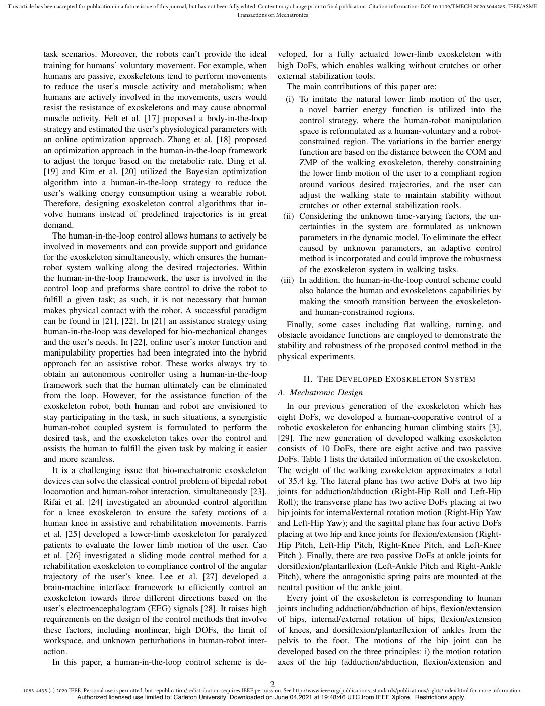

English text extracted from page 2

<pre>
This article has been accepted for publication in a future issue of this journal, but has not been fully edited. Content may change prior to final publication. Citation information: DOI 10.1109/TMECH.2020.3044289, IEEE/ASME
                                                                                                       Transactions on Mechatronics

               task scenarios. Moreover, the robots can’t provide the ideal                                       veloped, for a fully actuated lower-limb exoskeleton with
               training for humans’ voluntary movement. For example, when                                         high DoFs, which enables walking without crutches or other
               humans are passive, exoskeletons tend to perform movements                                         external stabilization tools.
               to reduce the user’s muscle activity and metabolism; when                                             The main contributions of this paper are:
               humans are actively involved in the movements, users would                                            (i) To imitate the natural lower limb motion of the user,
               resist the resistance of exoskeletons and may cause abnormal                                              a novel barrier energy function is utilized into the
               muscle activity. Felt et al. [17] proposed a body-in-the-loop                                             control strategy, where the human-robot manipulation
               strategy and estimated the user’s physiological parameters with                                           space is reformulated as a human-voluntary and a robot-
               an online optimization approach. Zhang et al. [18] proposed                                               constrained region. The variations in the barrier energy
               an optimization approach in the human-in-the-loop framework                                               function are based on the distance between the COM and
               to adjust the torque based on the metabolic rate. Ding et al.                                             ZMP of the walking exoskeleton, thereby constraining
               [19] and Kim et al. [20] utilized the Bayesian optimization                                               the lower limb motion of the user to a compliant region
               algorithm into a human-in-the-loop strategy to reduce the                                                 around various desired trajectories, and the user can
               user’s walking energy consumption using a wearable robot.                                                 adjust the walking state to maintain stability without
               Therefore, designing exoskeleton control algorithms that in-                                              crutches or other external stabilization tools.
               volve humans instead of predefined trajectories is in great                                          (ii) Considering the unknown time-varying factors, the un-
               demand.                                                                                                   certainties in the system are formulated as unknown
                  The human-in-the-loop control allows humans to actively be                                             parameters in the dynamic model. To eliminate the effect
               involved in movements and can provide support and guidance                                                caused by unknown parameters, an adaptive control
               for the exoskeleton simultaneously, which ensures the human-                                              method is incorporated and could improve the robustness
               robot system walking along the desired trajectories. Within                                               of the exoskeleton system in walking tasks.
               the human-in-the-loop framework, the user is involved in the                                        (iii) In addition, the human-in-the-loop control scheme could
               control loop and preforms share control to drive the robot to                                             also balance the human and exoskeletons capabilities by
               fulfill a given task; as such, it is not necessary that human                                             making the smooth transition between the exoskeleton-
               makes physical contact with the robot. A successful paradigm                                              and human-constrained regions.
               can be found in [21], [22]. In [21] an assistance strategy using                                      Finally, some cases including flat walking, turning, and
               human-in-the-loop was developed for bio-mechanical changes                                         obstacle avoidance functions are employed to demonstrate the
               and the user’s needs. In [22], online user’s motor function and                                    stability and robustness of the proposed control method in the
               manipulability properties had been integrated into the hybrid                                      physical experiments.
               approach for an assistive robot. These works always try to
               obtain an autonomous controller using a human-in-the-loop
                                                                                                                            II. T HE D EVELOPED E XOSKELETON S YSTEM
               framework such that the human ultimately can be eliminated
               from the loop. However, for the assistance function of the                                         A. Mechatronic Design
               exoskeleton robot, both human and robot are envisioned to                                             In our previous generation of the exoskeleton which has
               stay participating in the task, in such situations, a synergistic                                  eight DoFs, we developed a human-cooperative control of a
               human-robot coupled system is formulated to perform the                                            robotic exoskeleton for enhancing human climbing stairs [3],
               desired task, and the exoskeleton takes over the control and                                       [29]. The new generation of developed walking exoskeleton
               assists the human to fulfill the given task by making it easier                                    consists of 10 DoFs, there are eight active and two passive
               and more seamless.                                                                                 DoFs. Table 1 lists the detailed information of the exoskeleton.
                  It is a challenging issue that bio-mechatronic exoskeleton                                      The weight of the walking exoskeleton approximates a total
               devices can solve the classical control problem of bipedal robot                                   of 35.4 kg. The lateral plane has two active DoFs at two hip
               locomotion and human-robot interaction, simultaneously [23].                                       joints for adduction/abduction (Right-Hip Roll and Left-Hip
               Rifai et al. [24] investigated an abounded control algorithm                                       Roll); the transverse plane has two active DoFs placing at two
               for a knee exoskeleton to ensure the safety motions of a                                           hip joints for internal/external rotation motion (Right-Hip Yaw
               human knee in assistive and rehabilitation movements. Farris                                       and Left-Hip Yaw); and the sagittal plane has four active DoFs
               et al. [25] developed a lower-limb exoskeleton for paralyzed                                       placing at two hip and knee joints for flexion/extension (Right-
               patients to evaluate the lower limb motion of the user. Cao                                        Hip Pitch, Left-Hip Pitch, Right-Knee Pitch, and Left-Knee
               et al. [26] investigated a sliding mode control method for a                                       Pitch ). Finally, there are two passive DoFs at ankle joints for
               rehabilitation exoskeleton to compliance control of the angular                                    dorsiflexion/plantarflexion (Left-Ankle Pitch and Right-Ankle
               trajectory of the user’s knee. Lee et al. [27] developed a                                         Pitch), where the antagonistic spring pairs are mounted at the
               brain-machine interface framework to efficiently control an                                        neutral position of the ankle joint.
               exoskeleton towards three different directions based on the                                           Every joint of the exoskeleton is corresponding to human
               user’s electroencephalogram (EEG) signals [28]. It raises high                                     joints including adduction/abduction of hips, flexion/extension
               requirements on the design of the control methods that involve                                     of hips, internal/external rotation of hips, flexion/extension
               these factors, including nonlinear, high DOFs, the limit of                                        of knees, and dorsiflexion/plantarflexion of ankles from the
               workspace, and unknown perturbations in human-robot inter-                                         pelvis to the foot. The motions of the hip joint can be
               action.                                                                                            developed based on the three principles: i) the motion rotation
                  In this paper, a human-in-the-loop control scheme is de-                                        axes of the hip (adduction/abduction, flexion/extension and

                                                                                                              2
      1083-4435 (c) 2020 IEEE. Personal use is permitted, but republication/redistribution requires IEEE permission. See http://www.ieee.org/publications_standards/publications/rights/index.html for more information.
                             Authorized licensed use limited to: Carleton University. Downloaded on June 04,2021 at 19:48:46 UTC from IEEE Xplore. Restrictions apply.
</pre>

## Page 3

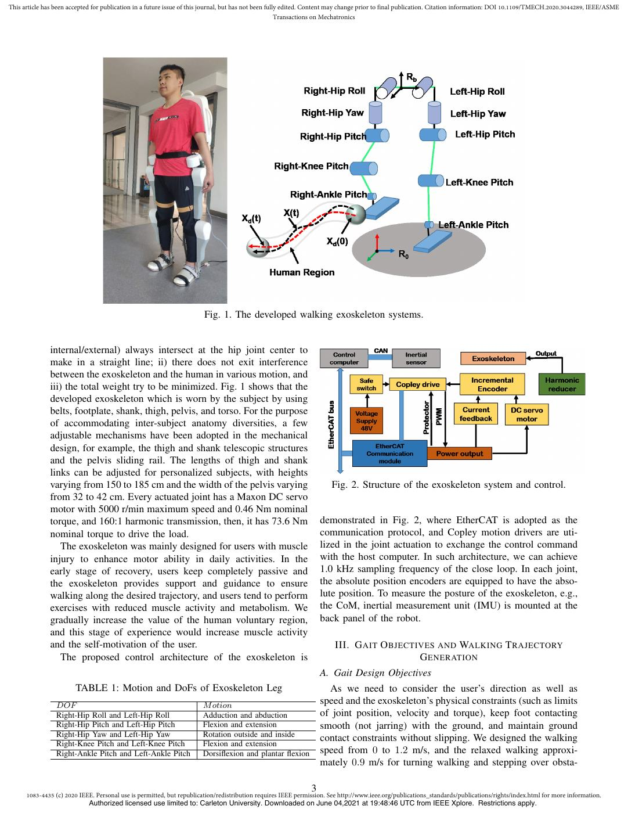

English text extracted from page 3

<pre>
This article has been accepted for publication in a future issue of this journal, but has not been fully edited. Content may change prior to final publication. Citation information: DOI 10.1109/TMECH.2020.3044289, IEEE/ASME
                                                                                                       Transactions on Mechatronics

                                                                       Fig. 1. The developed walking exoskeleton systems.

               internal/external) always intersect at the hip joint center to
               make in a straight line; ii) there does not exit interference
               between the exoskeleton and the human in various motion, and
               iii) the total weight try to be minimized. Fig. 1 shows that the
               developed exoskeleton which is worn by the subject by using
               belts, footplate, shank, thigh, pelvis, and torso. For the purpose
               of accommodating inter-subject anatomy diversities, a few
               adjustable mechanisms have been adopted in the mechanical
               design, for example, the thigh and shank telescopic structures
               and the pelvis sliding rail. The lengths of thigh and shank
               links can be adjusted for personalized subjects, with heights
               varying from 150 to 185 cm and the width of the pelvis varying                                         Fig. 2. Structure of the exoskeleton system and control.
               from 32 to 42 cm. Every actuated joint has a Maxon DC servo
               motor with 5000 r/min maximum speed and 0.46 Nm nominal
               torque, and 160:1 harmonic transmission, then, it has 73.6 Nm                                      demonstrated in Fig. 2, where EtherCAT is adopted as the
               nominal torque to drive the load.                                                                  communication protocol, and Copley motion drivers are uti-
                  The exoskeleton was mainly designed for users with muscle                                       lized in the joint actuation to exchange the control command
               injury to enhance motor ability in daily activities. In the                                        with the host computer. In such architecture, we can achieve
               early stage of recovery, users keep completely passive and                                         1.0 kHz sampling frequency of the close loop. In each joint,
               the exoskeleton provides support and guidance to ensure                                            the absolute position encoders are equipped to have the abso-
               walking along the desired trajectory, and users tend to perform                                    lute position. To measure the posture of the exoskeleton, e.g.,
               exercises with reduced muscle activity and metabolism. We                                          the CoM, inertial measurement unit (IMU) is mounted at the
               gradually increase the value of the human voluntary region,                                        back panel of the robot.
               and this stage of experience would increase muscle activity
               and the self-motivation of the user.                                                                    III. G AIT O BJECTIVES AND WALKING T RAJECTORY
                  The proposed control architecture of the exoskeleton is                                                                 G ENERATION
                                                                                                                  A. Gait Design Objectives
                        TABLE 1: Motion and DoFs of Exoskeleton Leg                                                 As we need to consider the user’s direction as well as
                 DOF                                                   M otion                                    speed and the exoskeleton’s physical constraints (such as limits
                 Right-Hip Roll and Left-Hip Roll                      Adduction and abduction                    of joint position, velocity and torque), keep foot contacting
                 Right-Hip Pitch and Left-Hip Pitch                    Flexion and extension                      smooth (not jarring) with the ground, and maintain ground
                 Right-Hip Yaw and Left-Hip Yaw                        Rotation outside and inside                contact constraints without slipping. We designed the walking
                 Right-Knee Pitch and Left-Knee Pitch                  Flexion and extension
                 Right-Ankle Pitch and Left-Ankle Pitch                Dorsiflexion and plantar flexion           speed from 0 to 1.2 m/s, and the relaxed walking approxi-
                                                                                                                  mately 0.9 m/s for turning walking and stepping over obsta-

                                                                                                              3
      1083-4435 (c) 2020 IEEE. Personal use is permitted, but republication/redistribution requires IEEE permission. See http://www.ieee.org/publications_standards/publications/rights/index.html for more information.
                             Authorized licensed use limited to: Carleton University. Downloaded on June 04,2021 at 19:48:46 UTC from IEEE Xplore. Restrictions apply.
</pre>

## Page 4

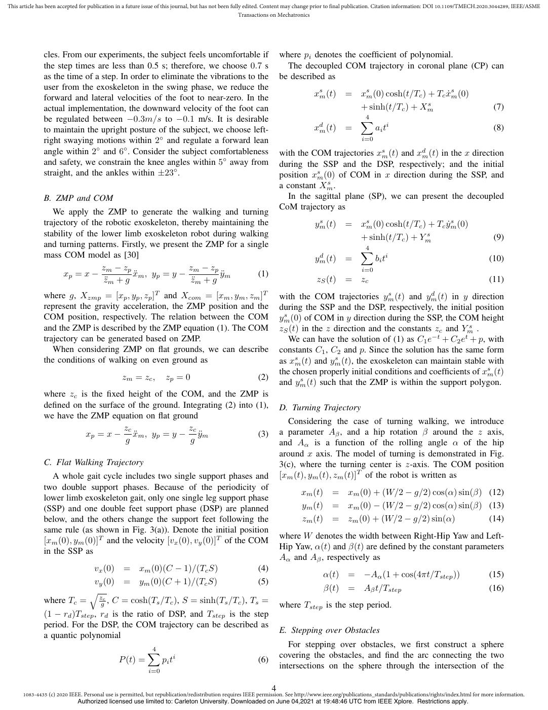

English text extracted from page 4

<pre>
This article has been accepted for publication in a future issue of this journal, but has not been fully edited. Content may change prior to final publication. Citation information: DOI 10.1109/TMECH.2020.3044289, IEEE/ASME
                                                                                                       Transactions on Mechatronics

               cles. From our experiments, the subject feels uncomfortable if                                     where pi denotes the coefficient of polynomial.
               the step times are less than 0.5 s; therefore, we choose 0.7 s                                       The decoupled COM trajectory in coronal plane (CP) can
               as the time of a step. In order to eliminate the vibrations to the                                 be described as
               user from the exoskeleton in the swing phase, we reduce the
               forward and lateral velocities of the foot to near-zero. In the                                                  xsm (t) = xsm (0) cosh(t/Tc ) + Tc ẋsm (0)
                                                                                                                                                              s
               actual implementation, the downward velocity of the foot can                                                               + sinh(t/Tc ) + Xm                                               (7)
               be regulated between −0.3m/s to −0.1 m/s. It is desirable                                                                  ∑4

               to maintain the upright posture of the subject, we choose left-                                                  xdm (t) =      a i ti                                                      (8)
               right swaying motions within 2◦ and regulate a forward lean                                                                          i=0

               angle within 2◦ and 6◦ . Consider the subject comfortableness                                      with the COM trajectories xsm (t) and xdm (t) in the x direction
               and safety, we constrain the knee angles within 5◦ away from                                       during the SSP and the DSP, respectively; and the initial
               straight, and the ankles within ±23◦ .                                                             position xsm (0) of COM in x direction during the SSP, and
                                                                                                                                s
                                                                                                                  a constant Xm   .
               B. ZMP and COM                                                                                       In the sagittal plane (SP), we can present the decoupled
                                                                                                                  CoM trajectory as
                  We apply the ZMP to generate the walking and turning
                                                                                                                                 s
               trajectory of the robotic exoskeleton, thereby maintaining the                                                   ym (t) = xsm (0) cosh(t/Tc ) + Tc ẏm
                                                                                                                                                                    s
                                                                                                                                                                      (0)
               stability of the lower limb exoskeleton robot during walking                                                              + sinh(t/Tc ) + Ym s
                                                                                                                                                                                                           (9)
               and turning patterns. Firstly, we present the ZMP for a single
                                                                                                                                         ∑4
               mass COM model as [30]                                                                                            d
                                                                                                                                ym (t) =      bi ti                                                      (10)
                                zm − zp                 zm − zp                                                                                     i=0
                     xp = x −            ẍm , yp = y −          ÿm      (1)
                                 z̈m + g                 z̈m + g                                                                 zS (t) = zc                                                             (11)
               where g, Xzmp = [xp , yp , zp ]T and Xcom = [xm , ym , zm ]T                                       with the COM trajectories ym   s
                                                                                                                                                   (t) and ymd
                                                                                                                                                               (t) in y direction
               represent the gravity acceleration, the ZMP position and the                                       during the SSP and the DSP, respectively, the initial position
               COM position, respectively. The relation between the COM                                            s
                                                                                                                  ym  (0) of COM in y direction during the SSP, the COM height
               and the ZMP is described by the ZMP equation (1). The COM                                          zS (t) in the z direction and the constants zc and Yms .
               trajectory can be generated based on ZMP.                                                             We can have the solution of (1) as C1 e−t + C2 et + p, with
                  When considering ZMP on flat grounds, we can describe                                           constants C1 , C2 and p. Since the solution has the same form
               the conditions of walking on even ground as                                                        as xsm (t) and ym
                                                                                                                                  s
                                                                                                                                    (t), the exoskeleton can maintain stable with
                                                                                                                  the chosen properly initial conditions and coefficients of xsm (t)
                                               zm = zc ,          zp = 0                                (2)             s
                                                                                                                  and ym  (t) such that the ZMP is within the support polygon.
               where zc is the fixed height of the COM, and the ZMP is
               defined on the surface of the ground. Integrating (2) into (1),                                    D. Turning Trajectory
               we have the ZMP equation on flat ground
                                                                                                                    Considering the case of turning walking, we introduce
                                     zc                zc
                          xp = x − ẍm , yp = y − ÿm                      (3)                                    a parameter Aβ , and a hip rotation β around the z axis,
                                     g                 g                                                          and Aα is a function of the rolling angle α of the hip
                                                                                                                  around x axis. The model of turning is demonstrated in Fig.
               C. Flat Walking Trajectory                                                                         3(c), where the turning center is z-axis. The COM position
                  A whole gait cycle includes two single support phases and                                       [xm (t), ym (t), zm (t)]T of the robot is written as
               two double support phases. Because of the periodicity of
                                                                                                                          xm (t) =            xm (0) + (W/2 − g/2) cos(α) sin(β) (12)
               lower limb exoskeleton gait, only one single leg support phase
               (SSP) and one double feet support phase (DSP) are planned                                                  ym (t) =            xm (0) − (W/2 − g/2) cos(α) sin(β) (13)
               below, and the others change the support feet following the                                                zm (t) =            zm (0) + (W/2 − g/2) sin(α)        (14)
               same rule (as shown in Fig. 3(a)). Denote the initial position
                                                                                                                  where W denotes the width between Right-Hip Yaw and Left-
               [xm (0), ym (0)]T and the velocity [vx (0), vy (0)]T of the COM
                                                                                                                  Hip Yaw, α(t) and β(t) are defined by the constant parameters
               in the SSP as
                                                                                                                  Aα and Aβ , respectively as
                              vx (0) = xm (0)(C − 1)/(Tc S)               (4)
                                                                                                                                    α(t) =           −Aα (1 + cos(4πt/Tstep ))                           (15)
                              vy (0) = ym (0)(C + 1)/(Tc S)               (5)
                            √                                                                                                       β(t) =           Aβ t/Tstep                                          (16)
               where Tc = zgc , C = cosh(Ts /Tc ), S = sinh(Ts /Tc ), Ts =
                                                                                                                  where Tstep is the step period.
               (1 − rd )Tstep , rd is the ratio of DSP, and Tstep is the step
               period. For the DSP, the COM trajectory can be described as
                                                                                                                  E. Stepping over Obstacles
               a quantic polynomial
                                                                                                                     For stepping over obstacles, we first construct a sphere
                                                          ∑
                                                          4
                                                                                                                  covering the obstacles, and find the arc connecting the two
                                                                       i
                                              P (t) =           pi t                                    (6)
                                                          i=0
                                                                                                                  intersections on the sphere through the intersection of the

                                                                                                              4
      1083-4435 (c) 2020 IEEE. Personal use is permitted, but republication/redistribution requires IEEE permission. See http://www.ieee.org/publications_standards/publications/rights/index.html for more information.
                             Authorized licensed use limited to: Carleton University. Downloaded on June 04,2021 at 19:48:46 UTC from IEEE Xplore. Restrictions apply.
</pre>

## Page 5

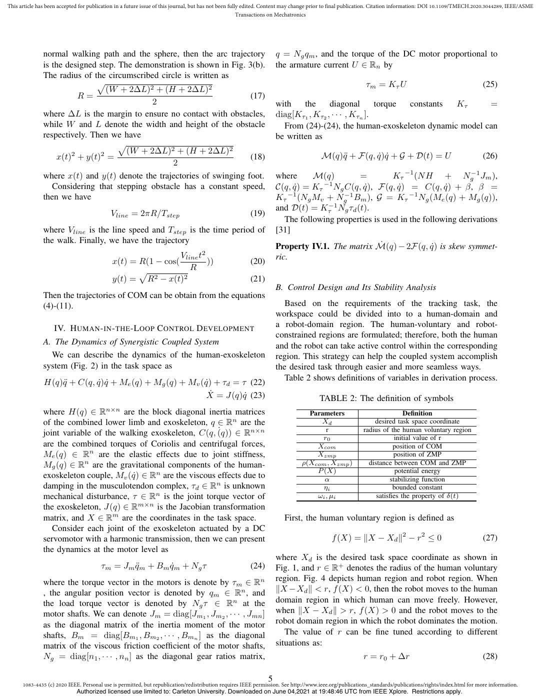

English text extracted from page 5

<pre>
This article has been accepted for publication in a future issue of this journal, but has not been fully edited. Content may change prior to final publication. Citation information: DOI 10.1109/TMECH.2020.3044289, IEEE/ASME
                                                                                                       Transactions on Mechatronics

               normal walking path and the sphere, then the arc trajectory                                        q = Ng qm , and the torque of the DC motor proportional to
               is the designed step. The demonstration is shown in Fig. 3(b).                                     the armature current U ∈ Rn by
               The radius of the circumscribed circle is written as
                              √                                                                                                                         τm = Kτ U                                        (25)
                                 (W + 2∆L)2 + (H + 2∆L)2
                         R=                                             (17)
                                             2                                                                    with    the     diagonal        torque constants Kτ    =
               where ∆L is the margin to ensure no contact with obstacles,                                        diag[Kτ1 , Kτ2 , · · · , Kτn ].
               while W and L denote the width and height of the obstacle                                            From (24)-(24), the human-exoskeleton dynamic model can
               respectively. Then we have                                                                         be written as
                                     √
                                       (W + 2∆L)2 + (H + 2∆L)2
                       2       2
                   x(t) + y(t) =                                        (18)                                                         M(q)q̈ + F(q, q̇)q̇ + G + D(t) = U                                  (26)
                                                   2
               where x(t) and y(t) denote the trajectories of swinging foot.                                      where      M(q)        =         Kτ −1 (N H + Ng−1 Jm ),
                                                                                                                               −1
                  Considering that stepping obstacle has a constant speed,                                        C(q, q̇) = Kτ Ng C(q, q̇), F(q, q̇) = C(q, q̇) + β, β =
               then we have                                                                                       Kτ −1 (Ng Mv + Ng−1 Bm ), G = Kτ −1 Ng (Me (q) + Mg (q)),
                                                                                                                  and D(t) = Kτ−1 Ng τd (t).
                                           Vline = 2πR/Tstep                                           (19)
                                                                                                                    The following properties is used in the following derivations
               where Vline is the line speed and Tstep is the time period of                                      [31]
               the walk. Finally, we have the trajectory
                                                                                                                  Property IV.1. The matrix Ṁ(q) − 2F(q, q̇) is skew symmet-
                                                              Vline t2                                            ric.
                                            x(t) = R(1 − cos(          ))                              (20)
                                                   √             R
                                            y(t) = R2 − x(t)2                                          (21)
                                                                                                                  B. Control Design and Its Stability Analysis
               Then the trajectories of COM can be obtain from the equations
               (4)-(11).                                                                                            Based on the requirements of the tracking task, the
                                                                                                                  workspace could be divided into to a human-domain and
                   IV. H UMAN - IN - THE -L OOP C ONTROL D EVELOPMENT                                             a robot-domain region. The human-voluntary and robot-
                                                                                                                  constrained regions are formulated; therefore, both the human
               A. The Dynamics of Synergistic Coupled System                                                      and the robot can take active control within the corresponding
                 We can describe the dynamics of the human-exoskeleton                                            region. This strategy can help the coupled system accomplish
               system (Fig. 2) in the task space as                                                               the desired task through easier and more seamless ways.
               H(q)q̈ + C(q, q̇)q̇ + Me (q) + Mg (q) + Mv (q̇) + τd = τ (22)                                        Table 2 shows definitions of variables in derivation process.
                                                                                    Ẋ = J(q)q̇ (23)                                TABLE 2: The definition of symbols
               where H(q) ∈ R            n×n
                                      are the block diagonal inertia matrices                                                 Parameters                               Definition
               of the combined lower limb and exoskeleton, q ∈ Rn are the                                                        Xd                       desired task space coordinate
                                                                ˙
               joint variable of the walking exoskeleton, C(q, (q))  ∈ Rn×n                                                        r                  radius of the human voluntary region
                                                                                                                                  r0                               initial value of r
               are the combined torques of Coriolis and centrifugal forces,                                                     Xcom                              position of COM
               Me (q) ∈ Rn are the elastic effects due to joint stiffness,                                                      Xzmp                              position of ZMP
               Mg (q) ∈ Rn are the gravitational components of the human-                                                   ρ(Xcom , Xzmp )             distance between COM and ZMP
                                                                                                                                P (X)                              potential energy
               exoskeleton couple, Mv (q̇) ∈ Rn are the viscous effects due to                                                    α                              stabilizing function
               damping in the musculotendon complex, τd ∈ Rn is unknown                                                           ηi                              bounded constant
               mechanical disturbance, τ ∈ Rn is the joint torque vector of                                                     ωi , µi                    satisfies the property of δ(t)
               the exoskeleton, J(q) ∈ Rm×n is the Jacobian transformation
               matrix, and X ∈ Rm are the coordinates in the task space.                                             First, the human voluntary region is defined as
                  Consider each joint of the exoskeleton actuated by a DC
               servomotor with a harmonic transmission, then we can present                                                              f (X) = ∥X − Xd ∥2 − r2 ≤ 0                                     (27)
               the dynamics at the motor level as
                                                                                                                  where Xd is the desired task space coordinate as shown in
                                       τm = Jm q̈m + Bm q̇m + Ng τ                                     (24)       Fig. 1, and r ∈ R+ denotes the radius of the human voluntary
               where the torque vector in the motors is denote by τm ∈ Rn                                         region. Fig. 4 depicts human region and robot region. When
               , the angular position vector is denoted by qm ∈ Rn , and                                          ∥X −Xd ∥ &lt; r, f (X) &lt; 0, then the robot moves to the human
               the load torque vector is denoted by Ng τ ∈ Rn at the                                              domain region in which human can move freely. However,
               motor shafts. We can denote Jm = diag[Jm1 , Jm2 , · · · , Jmn ]                                    when ∥X − Xd ∥ &gt; r, f (X) &gt; 0 and the robot moves to the
               as the diagonal matrix of the inertia moment of the motor                                          robot domain region in which the robot dominates the motion.
               shafts, Bm = diag[Bm1 , Bm2 , · · · , Bmn ] as the diagonal                                           The value of r can be fine tuned according to different
               matrix of the viscous friction coefficient of the motor shafts,                                    situations as:
               Ng = diag[n1 , · · · , nn ] as the diagonal gear ratios matrix,                                                                        r = r0 + ∆r                                        (28)

                                                                                                              5
      1083-4435 (c) 2020 IEEE. Personal use is permitted, but republication/redistribution requires IEEE permission. See http://www.ieee.org/publications_standards/publications/rights/index.html for more information.
                             Authorized licensed use limited to: Carleton University. Downloaded on June 04,2021 at 19:48:46 UTC from IEEE Xplore. Restrictions apply.
</pre>

## Page 6

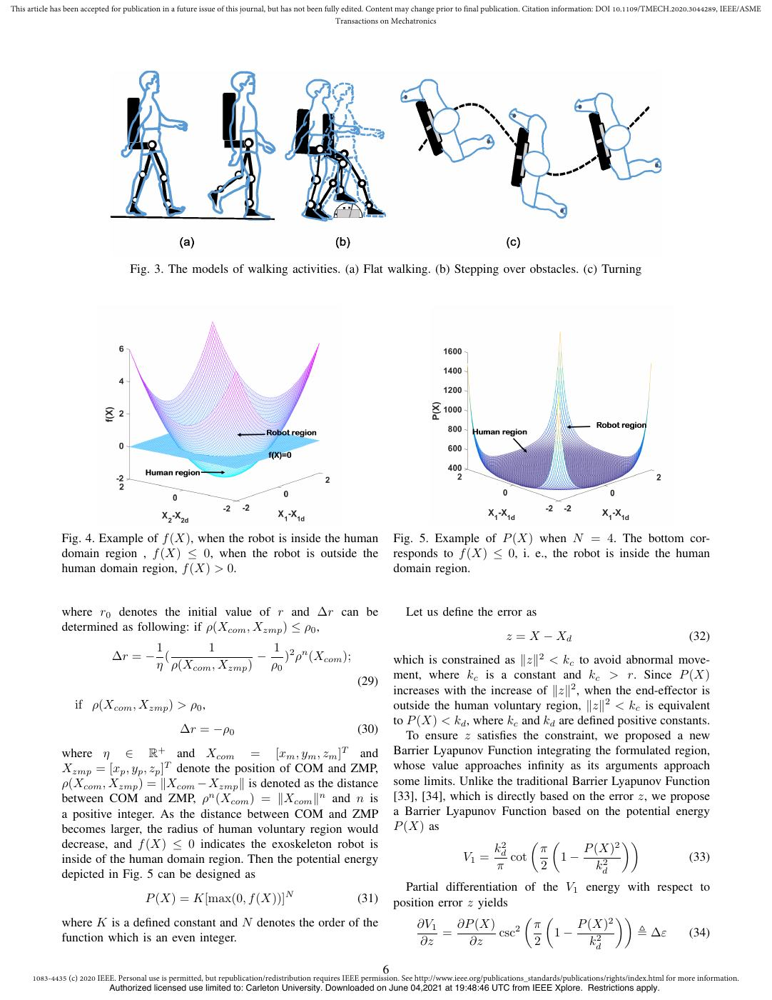

English text extracted from page 6

<pre>
This article has been accepted for publication in a future issue of this journal, but has not been fully edited. Content may change prior to final publication. Citation information: DOI 10.1109/TMECH.2020.3044289, IEEE/ASME
                                                                                                       Transactions on Mechatronics

                                   Fig. 3. The models of walking activities. (a) Flat walking. (b) Stepping over obstacles. (c) Turning

               Fig. 4. Example of f (X), when the robot is inside the human                                       Fig. 5. Example of P (X) when N = 4. The bottom cor-
               domain region , f (X) ≤ 0, when the robot is outside the                                           responds to f (X) ≤ 0, i. e., the robot is inside the human
               human domain region, f (X) &gt; 0.                                                                    domain region.

               where r0 denotes the initial value of r and ∆r can be                                                 Let us define the error as
               determined as following: if ρ(Xcom , Xzmp ) ≤ ρ0 ,
                                                                                                                                                   z = X − Xd                                            (32)
                                    1       1         1
                              ∆r = − (               − )2 ρn (Xcom );                                             which is constrained as ∥z∥2 &lt; kc to avoid abnormal move-
                                    η ρ(Xcom , Xzmp ) ρ0
                                                                                                       (29)       ment, where kc is a constant and kc &gt; r. Since P (X)
                                                                                                                  increases with the increase of ∥z∥2 , when the end-effector is
                   if ρ(Xcom , Xzmp ) &gt; ρ0 ,                                                                      outside the human voluntary region, ∥z∥2 &lt; kc is equivalent
                                                                                                                  to P (X) &lt; kd , where kc and kd are defined positive constants.
                                                  ∆r = −ρ0                                             (30)
                                                                                                                     To ensure z satisfies the constraint, we proposed a new
               where η ∈ R+ and Xcom = [xm , ym , zm ]T and                                                       Barrier Lyapunov Function integrating the formulated region,
               Xzmp = [xp , yp , zp ]T denote the position of COM and ZMP,                                        whose value approaches infinity as its arguments approach
               ρ(Xcom , Xzmp ) = ∥Xcom − Xzmp ∥ is denoted as the distance                                        some limits. Unlike the traditional Barrier Lyapunov Function
               between COM and ZMP, ρn (Xcom ) = ∥Xcom ∥n and n is                                                [33], [34], which is directly based on the error z, we propose
               a positive integer. As the distance between COM and ZMP                                            a Barrier Lyapunov Function based on the potential energy
               becomes larger, the radius of human voluntary region would                                         P (X) as
               decrease, and f (X) ≤ 0 indicates the exoskeleton robot is                                                                     ( (               ))
                                                                                                                                      k2        π       P (X)2
               inside of the human domain region. Then the potential energy                                                     V1 = d cot          1−                      (33)
                                                                                                                                       π        2         kd2
               depicted in Fig. 5 can be designed as
                                                                                                                    Partial differentiation of the V1 energy with respect to
                                       P (X) = K[max(0, f (X))]N                                       (31)       position error z yields
                                                                                                                                             ( (            ))
               where K is a defined constant and N denotes the order of the                                            ∂V1     ∂P (X)         π      P (X)2
               function which is an even integer.                                                                           =          csc 2
                                                                                                                                                 1−            , ∆ε     (34)
                                                                                                                        ∂z       ∂z           2        kd2

                                                                                                              6
      1083-4435 (c) 2020 IEEE. Personal use is permitted, but republication/redistribution requires IEEE permission. See http://www.ieee.org/publications_standards/publications/rights/index.html for more information.
                             Authorized licensed use limited to: Carleton University. Downloaded on June 04,2021 at 19:48:46 UTC from IEEE Xplore. Restrictions apply.
</pre>

## Page 7

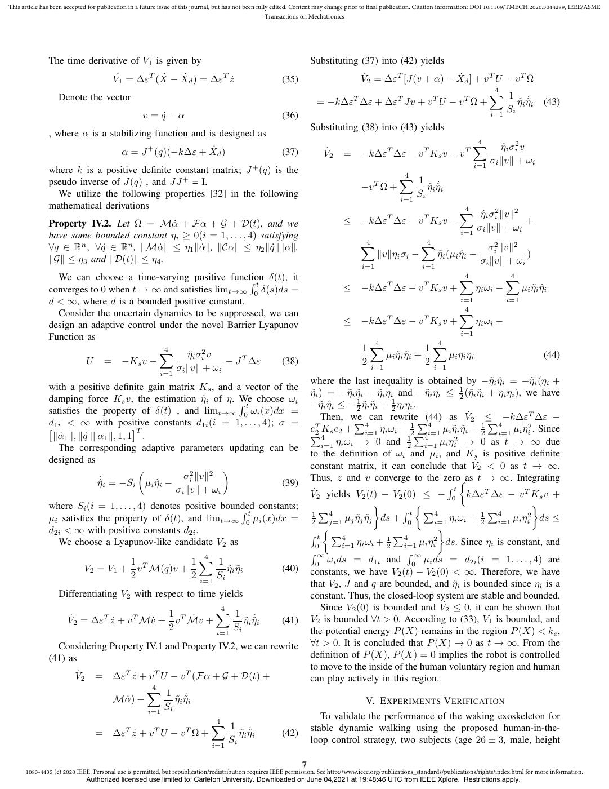

English text extracted from page 7

<pre>
This article has been accepted for publication in a future issue of this journal, but has not been fully edited. Content may change prior to final publication. Citation information: DOI 10.1109/TMECH.2020.3044289, IEEE/ASME
                                                                                                       Transactions on Mechatronics

               The time derivative of V1 is given by                                                              Substituting (37) into (42) yields
                                       V˙1 = ∆ε (Ẋ − Ẋd ) = ∆ε ż
                                                    T                           T
                                                                                                       (35)                 V̇2 = ∆εT [J(v + α) − Ẋd ] + v T U − v T Ω
                  Denote the vector                                                                                                                         ∑ 4
                                                                                                                                                                1 ˙
                                                                                                                    = −k∆εT ∆ε + ∆εT Jv + v T U − v T Ω +         η̃i η̃i (43)
                                                                                                                                                                S
                                                                                                                                                            i=1 i
                                                  v = q̇ − α                                           (36)
                                                                                                                  Substituting (38) into (43) yields
               , where α is a stabilizing function and is designed as
                                                                                                                                                                              ∑
                                                                                                                                                                              4
                                                                                                                                                                                      η̂i σi2 v
                                          α = J + (q)(−k∆ε + Ẋd )                                     (37)           V̇2     = −k∆εT ∆ε − v T Ks v − v T
                                                                                                                                                                                   σ ∥v∥ + ωi
                                                                                                                                                                                i=1 i
               where k is a positive definite constant matrix; J + (q) is the
               pseudo inverse of J(q) , and JJ + = I.                                                                                              ∑
                                                                                                                                                   4
                                                                                                                                                     1
                                                                                                                                    −v T Ω +                  η̃i η̃˙ i
                 We utilize the following properties [32] in the following                                                                         i=1
                                                                                                                                                         Si
               mathematical derivations
                                                                                                                                                                          ∑
                                                                                                                                                                          4
                                                                                                                                                                            η̂i σ 2 ∥v∥2
               Property IV.2. Let Ω = Mα̇ + Fα + G + D(t), and we                                                             ≤ −k∆εT ∆ε − v T Ks v −                                  i
                                                                                                                                                                                                  +
                                                                                                                                                                             σ ∥v∥ + ωi
                                                                                                                                                                          i=1 i
               have some bounded constant ηi ≥ 0(i = 1, . . . , 4) satisfying
               ∀q ∈ Rn , ∀q̇ ∈ Rn , ∥Mα̇∥ ≤ η1 ∥α̇∥, ∥Cα∥ ≤ η2 ∥q̇∥∥α∥,                                                             ∑
                                                                                                                                    4                      ∑
                                                                                                                                                           4
                                                                                                                                                                                     σi2 ∥v∥2
                                                                                                                                           ∥v∥ηi σi −              η̃i (µi η̂i −               )
               ∥G∥ ≤ η3 and ∥D(t)∥ ≤ η4 .                                                                                                                                          σi ∥v∥ + ωi
                                                                                                                                     i=1                   i=1
                 We can choose a time-varying positive function      ∫ t δ(t), it                                                                                         ∑
                                                                                                                                                                          4                ∑
                                                                                                                                                                                           4

               converges to 0 when t → ∞ and satisfies limt→∞ 0 δ(s)ds =                                                      ≤ −k∆ε ∆ε − v Ks v +
                                                                                                                                              T             T
                                                                                                                                                                                ηi ωi −          µi η̃i η̂i
               d &lt; ∞, where d is a bounded positive constant.                                                                                                             i=1              i=1
                 Consider the uncertain dynamics to be suppressed, we can                                                                                                 ∑4

               design an adaptive control under the novel Barrier Lyapunov                                                    ≤ −k∆εT ∆ε − v T Ks v +                           ηi ωi −
                                                                                                                                                                          i=1
               Function as
                                                                                                                                     1∑                 1∑
                                                                                                                                        4                  4
                                          ∑4
                                                  η̂i σi2 v                                                                                µi η̃i η̃i +       µi ηi ηi                                   (44)
                        U = −Ks v −                            − J T ∆ε     (38)                                                     2 i=1              2 i=1
                                          i=1
                                              σ i ∥v∥   +   ωi
                                                                                                                  where the last inequality is obtained by −η̃i η̂i = −η̃i (ηi +
               with a positive definite gain matrix Ks , and a vector of the
                                                                                                                  η̃i ) = −η̃i η̃i − η̃i ηi and −η̃i ηi ≤ 21 (η̃i η̃i + ηi ηi ), we have
               damping force Ks v, the estimation η̂i of η. ∫We choose ωi
                                                                t                                                 −η̃i η̂i ≤ − 12 η̃i η̃i + 12 ηi ηi .
               satisfies the property of δ(t) , and limt→∞ 0 ωi (x)dx =
                                                                                                                      Then, we  ∑4 can rewrite         ∑(44)   as V̇2 ≤∑ −k∆εT ∆ε −
               d1i &lt; ∞ with positive constants d1i (i = 1, . . . , 4); σ =
               [                       ]T                                                                                                                4               4
                                                                                                                  e2 Ks e2 + i=1 ηi ωi − 2 i=1 µi η̃i η̃i + 21 i=1 µi ηi2 . Since
                                                                                                                    T                               1
                ∥α̇1 ∥, ∥q̇∥∥α1 ∥, 1, 1 .                                                                         ∑4                                 ∑4
                                                                                                                       i=1 ηi ωi → 0 and 2              i=1 µi ηi → 0 as t → ∞ due
                                                                                                                                                  1             2
                  The corresponding adaptive parameters updating can be
                                                                                                                  to the definition of ωi and µi , and Ks is positive definite
               designed as
                                        (                     )                                                   constant matrix, it can conclude that V̇2 &lt; 0 as t → ∞.
                                                    σi2 ∥v∥2                                                      Thus, z and v converge to the zero{as t → ∞. Integrating
                             η̂˙ i = −Si µi η̂i −                       (39)                                                                                   ∫t
                                                  σi ∥v∥ + ωi                                                     V̇2 yields V2 (t) − V2 (0) ≤ − 0 k∆εT ∆ε − v T Ks v +
               where Si (i = 1, . . . , 4) denotes positive bounded                                                                    }              {                             }
                                                                ∫ t constants;                                        ∑4                        ∫ t ∑4                  ∑4
                                                                                                                                                                         i=1 i i ds ≤
                                                                                                                  1                                                   1           2
               µi satisfies the property of δ(t), and limt→∞ 0 µi (x)dx =                                         2           µ η̃
                                                                                                                         j=1 j j j η̃     ds +     0
                                                                                                                                                               η
                                                                                                                                                           i=1 i iω + 2     µ   η
               d2i &lt; ∞ with positive constants d2i .                                                                   {                                     }
                                                                                                                  ∫ t ∑4                   1
                                                                                                                                             ∑4            2
                 We choose a Lyapunov-like candidate V2 as                                                          0        i=1 ηi ωi + 2       i=1 µi ηi ds. Since ηi is constant, and
                                                                                                                  ∫∞                              ∫∞
                                                  1∑ 1
                                                     4
                                     1                                                                              0
                                                                                                                         ωi ds = d1i and 0 µi ds = d2i (i = 1, . . . , 4) are
                            V2 = V1 + v T M(q)v +          η̃i η̃i                                     (40)       constants, we have V2 (t) − V2 (0) &lt; ∞. Therefore, we have
                                     2            2 i=1 Si
                                                                                                                  that V2 , J and q are bounded, and η̂i is bounded since ηi is a
                  Differentiating V2 with respect to time yields                                                  constant. Thus, the closed-loop system are stable and bounded.
                                                         ∑4                                                           Since V2 (0) is bounded and V˙2 ≤ 0, it can be shown that
                                              1              1 ˙
                      V̇2 = ∆εT ż + v T Mv̇ + v T Ṁv +       η̃i η̃i                                 (41)       V2 is bounded ∀t &gt; 0. According to (33), V1 is bounded, and
                                              2             S
                                                         i=1 i                                                    the potential energy P (X) remains in the region P (X) &lt; ke ,
                 Considering Property IV.1 and Property IV.2, we can rewrite                                      ∀t &gt; 0. It is concluded that P (X) → 0 as t → ∞. From the
               (41) as                                                                                            definition of P (X), P (X) = 0 implies the robot is controlled
                                                                                                                  to move to the inside of the human voluntary region and human
                         V̇2     = ∆εT ż + v T U − v T (Fα + G + D(t) +                                          can play actively in this region.
                                           ∑ 4
                                                 1 ˙
                                   Mα̇) +          η̃i η̃i                                                                      V. E XPERIMENTS V ERIFICATION
                                           i=1 i
                                                 S
                                                                                                                     To validate the performance of the waking exoskeleton for
                                                                            ∑
                                                                            4
                                                                              1                                   stable dynamic walking using the proposed human-in-the-
                                 = ∆εT ż + v T U − v T Ω +                              η̃i η̃˙ i     (42)
                                                                            i=1
                                                                                    Si                            loop control strategy, two subjects (age 26 ± 3, male, height

                                                                                                              7
      1083-4435 (c) 2020 IEEE. Personal use is permitted, but republication/redistribution requires IEEE permission. See http://www.ieee.org/publications_standards/publications/rights/index.html for more information.
                               Authorized licensed use limited to: Carleton University. Downloaded on June 04,2021 at 19:48:46 UTC from IEEE Xplore. Restrictions apply.
</pre>

## Page 8

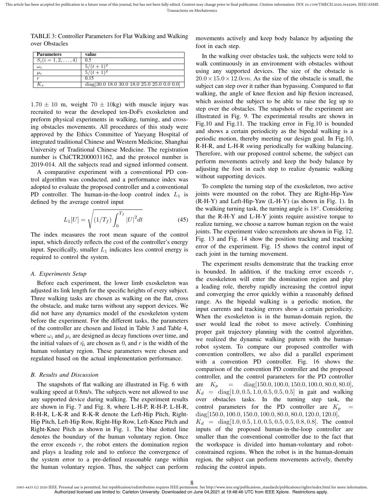

English text extracted from page 8

<pre>
This article has been accepted for publication in a future issue of this journal, but has not been fully edited. Content may change prior to final publication. Citation information: DOI 10.1109/TMECH.2020.3044289, IEEE/ASME
                                                                                                       Transactions on Mechatronics

               TABLE 3: Controller Parameters for Flat Walking and Walking                                        movements actively and keep body balance by adjusting the
               over Obstacles                                                                                     foot in each step.
                  Parameters                   value                                                                 In the walking over obstacles task, the subjects were told to
                  Si (i = 1, 2, . . . , 4)     0.5
                  ωi                           5/(t + 1)2                                                         walk continuously in an environment with obstacles without
                  µi                           5/(t + 1)2                                                         using any supported devices. The size of the obstacle is
                  r                            0.15                                                               20.0 × 15.0 × 12.0cm. As the size of the obstacle is small, the
                  Ks                           diag[30.0 18.0 30.0 18.0 25.0 25.0 0.0 0.0]                        subject can step over it rather than bypassing. Compared to flat
                                                                                                                  walking, the angle of knee flexion and hip flexion increased,
                                                                                                                  which assisted the subject to be able to raise the leg up to
               1.70 ± 10 m, weight 70 ± 10kg) with muscle injury was
                                                                                                                  step over the obstacles. The snapshots of the experiment are
               recruited to wear the developed ten-DoFs exoskeleton and
                                                                                                                  illustrated in Fig. 9. The experimental results are shown in
               preform physical experiments in walking, turning, and cross-
                                                                                                                  Fig.10 and Fig.11. The tracking error in Fig.10 is bounded
               ing obstacles movements. All procedures of this study were
                                                                                                                  and shows a certain periodicity as the bipedal walking is a
               approved by the Ethics Committee of Yueyang Hospital of
                                                                                                                  periodic motion, thereby meeting our design goal. In Fig.10,
               integrated traditional Chinese and Western Medicine, Shanghai
                                                                                                                  R-H-R, and L-H-R swing periodically for walking balancing.
               University of Traditional Chinese Medicine. The registration
                                                                                                                  Therefore, with our proposed control scheme, the subject can
               number is ChiCTR2000031162, and the protocol number is
                                                                                                                  perform movements actively and keep the body balance by
               2019-014. All the subjects read and signed informed consent.
                                                                                                                  adjusting the foot in each step to realize dynamic walking
                  A comparative experiment with a conventional PD con-
                                                                                                                  without supporting devices.
               trol algorithm was conducted, and a performance index was
               adopted to evaluate the proposed controller and a conventional                                        To complete the turning step of the exoskeleton, two active
               PD controller. The human-in-the-loop control index L1 is                                           joints were mounted on the robot. They are Right-Hip-Yaw
               defined by the average control input                                                               (R-H-Y) and Left-Hip-Yaw (L-H-Y) (as shown in Fig. 1). In
                                       √                                                                          the walking turning task, the turning angle is 18◦ . Considering
                                                ∫ Tf
                                                         2                                                        that the R-H-Y and L-H-Y joints require assistive torque to
                             L1 [U ] = (1/Tf )       |U | dt             (45)
                                                                  0                                               realize turning, we choose a narrow human region on the waist
                                                                                                                  joints. The experiment video screenshots are shown in Fig. 12.
               The index measures the root mean square of the control
                                                                                                                  Fig. 13 and Fig. 14 show the position tracking and tracking
               input, which directly reflects the cost of the controller’s energy
                                                                                                                  error of the experiment. Fig. 15 shows the control input of
               input. Specifically, smaller L1 indicates less control energy is
                                                                                                                  each joint in the turning movement.
               required to control the system.
                                                                                                                     The experiment results demonstrate that the tracking error
               A. Experiments Setup                                                                               is bounded. In addition, if the tracking error exceeds r,
                                                                                                                  the exoskeleton will enter the domination region and play
                  Before each experiment, the lower limb exoskeleton was
                                                                                                                  a leading role, thereby rapidly increasing the control input
               adjusted its link length for the specific heights of every subject.
                                                                                                                  and converging the error quickly within a reasonably defined
               Three walking tasks are chosen as walking on the flat, cross
                                                                                                                  range. As the bipedal walking is a periodic motion, the
               the obstacle, and make turns without any support devices. We
                                                                                                                  input currents and tracking errors show a certain periodicity.
               did not have any dynamics model of the exoskeleton system
                                                                                                                  When the exoskeleton is in the human-domain region, the
               before the experiment. For the different tasks, the parameters
                                                                                                                  user would lead the robot to move actively. Combining
               of the controller are chosen and listed in Table 3 and Table 4,
                                                                                                                  proper gait trajectory planning with the control algorithm,
               where ωi and µi are designed as decay functions over time, and
                                                                                                                  we realized the dynamic walking pattern with the human-
               the initial values of ηˆi are chosen as 0, and r is the width of the
                                                                                                                  robot system. To compare our proposed controller with
               human voluntary region. These parameters were chosen and
                                                                                                                  convention controllers, we also did a parallel experiment
               regulated based on the actual implementation performance.
                                                                                                                  with a convention PD controller. Fig. 16 shows the
                                                                                                                  comparison of the convention PD controller and the proposed
               B. Results and Discussion                                                                          controller, and the control parameters for the PD controller
                  The snapshots of flat walking are illustrated in Fig. 6 with                                    are Kp       =     diag[150.0, 100.0, 150.0, 100.0, 80.0, 80.0],
               walking speed at 0.8m/s. The subjects were not allowed to use                                      Kd = diag[1.0, 0.5, 1.0, 0.5, 0.5, 0.5] in gait and walking
               any supported device during walking. The experiment results                                        over obstacles tasks. In the turning step task, the
               are shown in Fig. 7 and Fig. 8, where L-H-P, R-H-P, L-H-R,                                         control parameters for the PD controller are Kp =
               R-H-R, L-K-R and R-K-R denote the Left-Hip Pitch, Right-                                           diag[150.0, 100.0, 150.0, 100.0, 80.0, 80.0, 120.0, 120.0],
               Hip Pitch, Left-Hip Row, Right-Hip Row, Left-Knee Pitch and                                        Kd = diag[1.0, 0.5, 1.0, 0.5, 0.5, 0.5, 0.8, 0.8]. The control
               Right-Knee Pitch as shown in Fig. 1. The blue dotted line                                          inputs of the proposed human-in-the-loop controller are
               denotes the boundary of the human voluntary region. Once                                           smaller than the conventional controller due to the fact that
               the error exceeds r, the robot enters the domination region                                        the workspace is divided into human-voluntary and robot-
               and plays a leading role and to enforce the convergence of                                         constrained regions. When the robot is in the human-domain
               the system error to a pre-defined reasonable range within                                          region, the subject can perform movements actively, thereby
               the human voluntary region. Thus, the subject can perform                                          reducing the control inputs.

                                                                                                              8
      1083-4435 (c) 2020 IEEE. Personal use is permitted, but republication/redistribution requires IEEE permission. See http://www.ieee.org/publications_standards/publications/rights/index.html for more information.
                             Authorized licensed use limited to: Carleton University. Downloaded on June 04,2021 at 19:48:46 UTC from IEEE Xplore. Restrictions apply.
</pre>

## Page 9

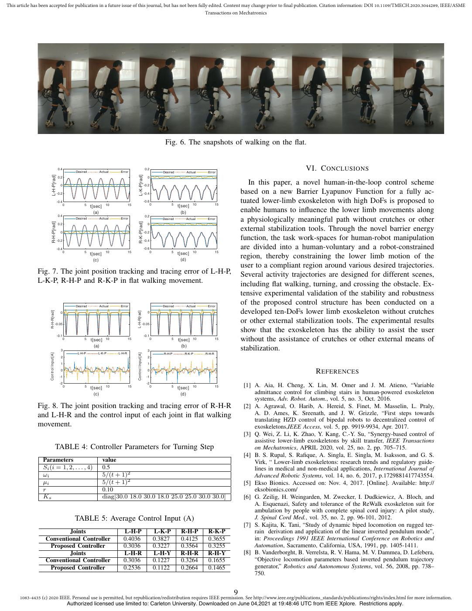

English text extracted from page 9

<pre>
This article has been accepted for publication in a future issue of this journal, but has not been fully edited. Content may change prior to final publication. Citation information: DOI 10.1109/TMECH.2020.3044289, IEEE/ASME
                                                                                                       Transactions on Mechatronics

                                                                                                                                 Fig. 6. The snapshots of walking on the flat.

                                         0.4
                                                       Desired       Actual      Error
                                                                                                                  0.2
                                                                                                                                Desired       Actual     Error
                                                                                                                                                                                                  VI. C ONCLUSIONS

                          L-H-P[rad]                                                            L-K-P[rad]
                                         0.2                                                                        0

                                           0                                                                      -0.2
                                                                                                                                                                            In this paper, a novel human-in-the-loop control scheme
                                         -0.2                                                                     -0.4                                                   based on a new Barrier Lyapunov Function for a fully ac-
                                         -0.4
                                                0           5              10           15
                                                                                                                  -0.6
                                                                                                                         0            5            10           15
                                                                                                                                                                         tuated lower-limb exoskeleton with high DoFs is proposed to
                                                                 t[sec]                                                                   t[sec]
                                                                   (a)                                                                      (b)                          enable humans to influence the lower limb movements along
                                         0.4                                                                      0.2
                                                       Desired       Actual      Error                                          Desired       Actual     Error
                                                                                                                                                                         a physiologically meaningful path without crutches or other

                          R-H-P[rad]                                                            R-K-P[rad]
                                         0.2                                                                        0

                                           0                                                                      -0.2
                                                                                                                                                                         external stabilization tools. Through the novel barrier energy
                                         -0.2                                                                     -0.4
                                                                                                                                                                         function, the task work-spaces for human-robot manipulation
                                         -0.4                                                                     -0.6
                                                                                                                         0            5            10           15
                                                                                                                                                                         are divided into a human-voluntary and a robot-constrained
                                                0           5              10           15
                                                                 t[sec]                                                                   t[sec]
                                                                   (c)                                                                      (d)
                                                                                                                                                                         region, thereby constraining the lower limb motion of the
                                                                                                                                                                         user to a compliant region around various desired trajectories.
               Fig. 7. The joint position tracking and tracing error of L-H-P,                                                                                           Several activity trajectories are designed for different scenes,
               L-K-P, R-H-P and R-K-P in flat walking movement.                                                                                                          including flat walking, turning, and crossing the obstacle. Ex-
                                                                                                                                                                         tensive experimental validation of the stability and robustness
                                                       Desired       Actual      Error                                          Desired       Actual     Error
                                                                                                                                                                         of the proposed control structure has been conducted on a
                                                                                                                                                                         developed ten-DoFs lower limb exoskeleton without crutches
                     R-H-R[rad]                                                              L-H-R[rad]
                                           0                                                                        0

                                        -0.05                                                                    -0.05
                                                                                                                                                                         or other external stabilization tools. The experimental results
                                                                                                                                                                         show that the exoskeleton has the ability to assist the user
                                         -0.1                                                                     -0.1
                                                0           5    t[sec]    10           15                               0            5   t[sec] 10             15       without the assistance of crutches or other external means of
                                                                   (a)                                                                      (b)
                                           3                                                                        3                                                    stabilization.

                     Control Input[A]
                                                        L-H-P        L-K-P      L-H-R

                                                                                              Control Input[A]
                                                                                                                                R-H-P        R-K-P      R-H-R
                                           2                                                                        2
                                           1                                                                        1
                                           0                                                                        0
                                                                                                                                                                                                      R EFERENCES
                                           -1                                                                       -1
                                           -2                                                                       -2
                                                0           5    t[sec]    10           15                               0            5   t[sec]   10           15        [1] A. Aia, H. Cheng, X. Lin, M. Omer and J. M. Atieno, “Variable
                                                                   (c)                                                                      (d)                               admittance control for climbing stairs in human-powered exoskeleton
                                                                                                                                                                              systems, Adv. Robot. Autom., vol. 5, no. 3, Oct. 2016.
               Fig. 8. The joint position tracking and tracing error of R-H-R                                                                                             [2] A. Agrawal, O. Harib, A. Hereid, S. Finet, M. Masselin, L. Praly,
               and L-H-R and the control input of each joint in flat walking                                                                                                  A. D. Ames, K. Sreenath, and J. W. Grizzle, “First steps towards
                                                                                                                                                                              translating HZD control of bipedal robots to decentralized control of
               movement.                                                                                                                                                      exoskeletons,IEEE Access, vol. 5, pp. 9919-9934, Apr. 2017.
                                                                                                                                                                          [3] Q. Wei, Z. Li, K. Zhao, Y. Kang, C.-Y. Su, “Synergy-based control of
                                                                                                                                                                              assistive lower-limb exoskeletons by skill transfer, IEEE Transactions
                                        TABLE 4: Controller Parameters for Turning Step                                                                                       on Mechatronics, APRIL 2020, vol. 25, no. 2, pp. 705–715.
                                                                                                                                                                          [4] B. S. Rupal, S. Rafique, A. Singla, E. Singla, M. Isaksson, and G. S.
                 Parameters                                               value                                                                                               Virk, “ Lower-limb exoskeletons: research trends and regulatory guide-
                 Si (i = 1, 2, . . . , 4)                                 0.5                                                                                                 lines in medical and non-medical applications, International Journal of
                 ωi                                                       5/(t + 1)2                                                                                          Advanced Robotic Systems, vol. 14, no. 6, 2017, p.1729881417743554.
                 µi                                                       5/(t + 1)2                                                                                      [5] Ekso Bionics. Accessed on: Nov. 4, 2017. [Online]. Available: http://
                 r                                                        0.10                                                                                                eksobionics.com/
                 Ks                                                       diag[30.0 18.0 30.0 18.0 25.0 25.0 30.0 30.0]                                                   [6] G. Zeilig, H. Weingarden, M. Zwecker, I. Dudkiewicz, A. Bloch, and
                                                                                                                                                                              A. Esquenazi, Safety and tolerance of the ReWalk exoskeleton suit for
                                                                                                                                                                              ambulation by people with complete spinal cord injury: A pilot study,
                                                       TABLE 5: Average Control Input (A)                                                                                     J. Spinal Cord Med., vol. 35, no. 2, pp. 96-101, 2012.
                                                                                                                                                                          [7] S. Kajita, K. Tani, “Study of dynamic biped locomotion on rugged ter-
                           Joints                                                 L-H-P                                      L-K-P         R-H-P         R-K-P                rain derivation and application of the linear inverted pendulum mode”,
                   Conventional Controller                                        0.4036                                     0.3827        0.4125        0.3655               in: Proceedings 1991 IEEE International Conference on Robotics and
                    Proposed Controller                                           0.3036                                     0.3227        0.3564        0.3255               Automation, Sacramento, California, USA, 1991, pp. 1405-1411.
                           Joints                                                 L-H-R                                      L-H-Y         R-H-R         R-H-Y            [8] B. Vanderborght, B. Verrelsta, R. V. Hama, M. V. Dammea, D. Lefebera,
                   Conventional Controller                                        0.3036                                     0.1227        0.3264        0.1655               “Objective locomotion parameters based inverted pendulum trajectory
                    Proposed Controller                                           0.2536                                     0.1122        0.2664        0.1465               generator,” Robotics and Autonomous Systems, vol. 56, 2008, pp. 738–
                                                                                                                                                                              750.

                                                                                                                                                                     9
      1083-4435 (c) 2020 IEEE. Personal use is permitted, but republication/redistribution requires IEEE permission. See http://www.ieee.org/publications_standards/publications/rights/index.html for more information.
                                                    Authorized licensed use limited to: Carleton University. Downloaded on June 04,2021 at 19:48:46 UTC from IEEE Xplore. Restrictions apply.
</pre>

## Page 10

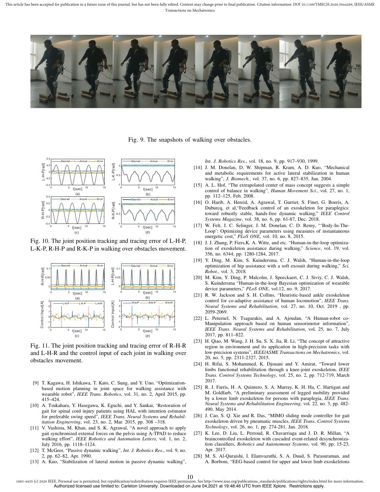

English text extracted from page 10

<pre>
This article has been accepted for publication in a future issue of this journal, but has not been fully edited. Content may change prior to final publication. Citation information: DOI 10.1109/TMECH.2020.3044289, IEEE/ASME
                                                                                                       Transactions on Mechatronics

                                                                                                                         Fig. 9. The snapshots of walking over obstacles.

                                         0.4
                                                      Desired        Actual    Error                                      Desired       Actual     Error                 Int. J. Robotics Res., vol. 18, no. 9, pp. 917–930, 1999.

                           L-H-P[rad]                                                        L-K-P[rad]
                                         0.2                                                                    0
                                                                                                                                                                    [14] J. M. Donelan, D. W. Shipman, R. Kram, A. D. Kuo, “Mechanical
                                          0
                                                                                                              -0.5
                                                                                                                                                                         and metabolic requirements for active lateral stabilization in human
                                        -0.2                                                                                                                             walking”, J. Biomech., vol. 37, no. 6, pp. 827–835, Jun. 2004.
                                        -0.4
                                               0           5             10           15
                                                                                                                -1
                                                                                                                     0         5             10           15
                                                                                                                                                                    [15] A. L. Hof, “The extrapolated center of mass concept suggests a simple
                                                                t[sec]                                                              t[sec]                               control of balance in walking”, Human Movement Sci., vol. 27, no. 1,
                                                                  (a)                                                                 (b)
                                        0.4
                                                      Desired       Actual     Error
                                                                                                                                                                         pp. 112–125, Feb. 2008.
                                                                                                                          Desired       Actual     Error
                                                                                                                                                                    [16] O. Harib, A. Hereid, A. Agrawal, T. Gurriet, S. Finet, G. Boeris, A.

                         R-H-P[rad]                                                          R-K-P[rad]
                                        0.2                                                                     0

                                          0
                                                                                                                                                                         Duburcq, et al,“Feedback control of an exoskeleton for paraplegics:
                                                                                                              -0.5                                                       toward robustly stable, hands-free dynamic walking,” IEEE Control
                                        -0.2
                                                                                                                                                                         Systems Magazine, vol. 38, no. 6, pp. 61-87, Dec. 2018.
                                        -0.4                                                                    -1
                                               0           5
                                                                t[sec]
                                                                         10           15                             0         5    t[sec]   10           15        [17] W. Felt, J. C. Selinger, J. M. Donelan, C. D. Remy, “‘Body-In-The-
                                                                  (c)                                                                 (d)                                Loop’: Optimizing device parameters using measures of instantaneous
                                                                                                                                                                         energetic cost,” PLoS ONE, vol. 10, no. 8, 2015.
               Fig. 10. The joint position tracking and tracing error of L-H-P,                                                                                     [18] J. J. Zhang, P. Fiers,K. A. Witte, and etc. “Human-in-the-loop optimiza-
               L-K-P, R-H-P and R-K-P in walking over obstacles movement.                                                                                                tion of exoskeleton assistance during walking,” Science, vol. 19, vol.
                                                                                                                                                                         356, no. 6344, pp. 1280-1284, 2017.
                                                                                                                                                                    [19] Y. Ding, M. Kim, S. Kuindersma, C. J. Walsh, “Human-in-the-loop
                                                      Desired        Actual    Error                                      Desired       Actual     Error                 optimization of hip assistance with a soft exosuit during walking,” Sci.

                        R-H-R[rad]                                                         L-H-R[rad]
                                         0.1                                                                   0.1
                                                                                                                                                                         Robot., vol. 3, 2018.
                                        0.05                                                                  0.05                                                  [20] M. Kim, Y. Ding, P. Malcolm, J. Speeckaert, C. J. Siviy, C. J. Walsh,
                                                                                                                0
                                                                                                                                                                         S. Kuindersma “Human-in-the-loop Bayesian optimization of wearable
                                          0
                                                                                                                     0         5             10           15
                                                                                                                                                                         device parameters,” PLoS ONE, vol.12, no. 9, 2017.
                                               0           5             10           15                                            t[sec]
                                                                t[sec]
                                                                                                                                      (b)
                                                                                                                                                                    [21] R. W. Jackson and S. H. Collins, “Heuristic-based ankle exoskeleton
                                                                  (a)
                                          3                                                                     3                                                        control for co-adaptive assistance of human locomotion”, IEEE Trans.

                     Control Input[A]                                                      Control Input[A]
                                                       L-H-P        L-K-P     L-H-R                                       R-H-P        R-K-P      R-H-R
                                          2                                                                     2                                                        Neural Systems and Rehabilitation, vol. 27, no. 10, Oct. 2019 , pp.
                                          1                                                                     1
                                                                                                                                                                         2059-2069.
                                          0                                                                     0
                                                                                                                                                                    [22] L. Peternel, N. Tsagarakis, and A. Ajoudan, “A Human-robot co-
                                         -1                                                                     -1
                                                                                                                                                                         Manipulation approach based on human sensorimotor information”,
                                         -2                                                                     -2
                                              0            5
                                                                t[sec]   10           15                             0         5
                                                                                                                                    t[sec]
                                                                                                                                             10           15             IEEE Trans. Neural Systems and Rehabilitation, vol. 25, no. 7, July
                                                                  (c)                                                                 (d)                                2017, pp. 811–822.
                                                                                                                                                                    [23] H. Qiao, M. Wang, J. H. Su, S. X. Jia, R. Li, “The concept of attractive
               Fig. 11. The joint position tracking and tracing error of R-H-R                                                                                           region in environment and its application in high-precision tasks with
               and L-H-R and the control input of each joint in walking over                                                                                             low-precision systems”, IEEE/ASME Transactions on Mechatronics, vol.
                                                                                                                                                                         20, no. 5, pp. 2311-2327, 2015.
               obstacles movement.
                                                                                                                                                                    [24] H. Rifai, S. Mohammed, K. Djouani and Y. Amirat, “Toward lower
                                                                                                                                                                         limbs functional rehabilitation through a knee-joint exoskeleton, IEEE
                                                                                                                                                                         Trans. Control Systems Technology, vol. 25, no. 2, pp. 712-719, March
                [9] T. Kagawa, H. Ishikawa, T. Kato, C. Sung, and Y. Uno, “Optimization-                                                                                 2017.
                    based motion planning in joint space for walking assistance with                                                                                [25] R. J. Farris, H. A. Quintero, S. A. Murray, K. H. Ha, C. Hartigan and
                    wearable robot”, IEEE Trans. Robotics, vol. 31, no. 2, April 2015, pp.                                                                               M. Goldfarb, “A preliminary assessment of legged mobility provided
                    415–424.                                                                                                                                             by a lower limb exoskeleton for persons with paraplegia, IEEE Trans.
               [10] A. Tsukahara, Y. Hasegawa, K. Eguchi, and Y. Sankai, ‘Restoration of                                                                                 Neural Systems and Rehabilitation Engineering, vol. 22, no. 3, pp. 482-
                    gait for spinal cord injury patients using HAL with intention estimator                                                                              490, May 2014.
                    for preferable swing speed”, IEEE Trans. Neural Systems and Rehabil-                                                                            [26] J. Cao, S. Q. Xie and R. Das, “MIMO sliding mode controller for gait
                    itation Enginerring, vol. 23, no. 2, Mar. 2015, pp. 308 –318.                                                                                        exoskeleton driven by pneumatic muscles, IEEE Trans. Control Systems
               [11] V. Vashista, M. Khan, and S. K. Agrawal, “A novel approach to apply                                                                                  Technology, vol. 26, no. 1, pp. 274-281, Jan. 2018.
                    gait synchronized external forces on the pelvis using A-TPAD to reduce                                                                          [27] K. Lee, D. Liu, L. Perroud, R. Chavarriaga and J. D. R. Millan, “A
                    walking effort”, IEEE Robotics and Automation Letters, vol. 1, no. 2,                                                                                braincontrolled exoskeleton with cascaded event-related desynchroniza-
                    July 2016, pp. 1118–1124.                                                                                                                            tion classifiers, Robotics and Autonomous Systems, vol. 90, pp. 15-23,
               [12] T. McGeer, “Passive dynamic walking”, Int. J. Robotics Res., vol. 9, no.                                                                             Apr. 2017.
                    2, pp. 62–82, Apr. 1990.                                                                                                                        [28] M. S. Al-Quraishi, I. Elamvazuthi, S. A. Daud, S. Parasuraman, and
               [13] A. Kuo, “Stabilization of lateral motion in passive dynamic walking”,                                                                                A. Borboni, “EEG-based control for upper and lower limb exoskeletons

                                                                                                                                                               10
      1083-4435 (c) 2020 IEEE. Personal use is permitted, but republication/redistribution requires IEEE permission. See http://www.ieee.org/publications_standards/publications/rights/index.html for more information.
                                                   Authorized licensed use limited to: Carleton University. Downloaded on June 04,2021 at 19:48:46 UTC from IEEE Xplore. Restrictions apply.
</pre>

## Page 11

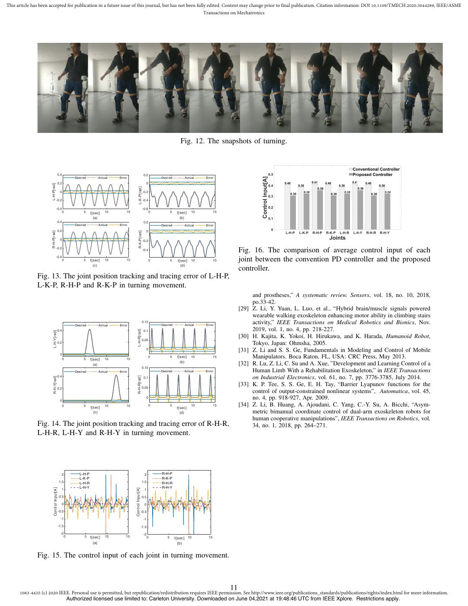

English text extracted from page 11

<pre>
This article has been accepted for publication in a future issue of this journal, but has not been fully edited. Content may change prior to final publication. Citation information: DOI 10.1109/TMECH.2020.3044289, IEEE/ASME
                                                                                                       Transactions on Mechatronics

                                                                                                                                         Fig. 12. The snapshots of turning.

                                         0.4                                                                   0.2
                                                         Desired       Actual    Error                                    Desired          Actual    Error
                                         0.2                                                                     0

                      L-H-P[rad]
                                                                                                  L-K-P[rad]
                                              0                                                                -0.2

                                    -0.2                                                                       -0.4

                                    -0.4                                                                       -0.6
                                                  0           5    t[sec]   10       15                               0           5    t[sec]   10         15
                                                                     (a)                                                                 (b)
                                         0.4                                                                   0.2
                                                         Desired        Actual   Error                                    Desired          Actual    Error
                                         0.2                                                                     0

                      R-H-P[rad]                                                                  R-K-P[rad]
                                              0                                                                -0.2

                                    -0.2                                                                       -0.4                                                  Fig. 16. The comparison of average control input of each
                                    -0.4
                                                  0           5    t[sec]   10       15                               0           5    t[sec] 10           15        joint between the convention PD controller and the proposed
                                                                     (c)                                                                 (d)
                                                                                                                                                                     controller.
               Fig. 13. The joint position tracking and tracing error of L-H-P,
               L-K-P, R-H-P and R-K-P in turning movement.
                                                                                                                                                                          and prostheses,” A systematic review. Sensors, vol. 18, no. 10, 2018,
                                                                                                                                                                          po.33-42.
                                                                                                                                                                     [29] Z. Li, Y. Yuan, L. Luo, et al., “Hybrid brain/muscle signals powered
                                                                                                                                                                          wearable walking exoskeleton enhancing motor ability in climbing stairs
                                                         Desired        Actual   Error
                                                                                                             0.15
                                                                                                                          Desired          Actual    Error
                                                                                                                                                                          activity,” IEEE Transactions on Medical Robotics and Bionics, Nov.
                                                                                                                                                                          2019, vol. 1, no. 4, pp. 218-227.
                                                                                               L-H-R[rad]
                                         0.4                                                                   0.1

                         L-H-Y[rad]
                                                                                                                                                                     [30] H. Kajita, K. Yokoi, H. Hirukawa, and K. Harada, Humanoid Robot,
                                                                                                             0.05
                                         0.2                                                                                                                              Tokyo, Japan: Ohmsha, 2005.
                                                                                                                 0                                                   [31] Z. Li and S. S. Ge, Fundamentals in Modeling and Control of Mobile
                                              0
                                                  0           5    t[sec]   10       15
                                                                                                                      0           5    t[sec]   10         15             Manipulators. Boca Raton, FL, USA: CRC Press, May 2013.
                                                                                                                                         (b)
                                                                     (a)                                                                                             [32] R. Lu, Z. Li, C. Su and A. Xue, ”Development and Learning Control of a
                                                                                                             0.15
                                                         Desired        Actual   Error                                    Desired          Actual    Error                Human Limb With a Rehabilitation Exoskeleton,” in IEEE Transactions
                                         0.4
                                                                                                                                                                          on Industrial Electronics, vol. 61, no. 7, pp. 3776-3785, July 2014.
                         R-H-Y[rad]                                                            R-H-R[rad]
                                                                                                               0.1

                                                                                                             0.05
                                                                                                                                                                     [33] K. P. Tee, S. S. Ge, E. H. Tay, “Barrier Lyapunov functions for the
                                         0.2
                                                                                                                                                                          control of output-constrained nonlinear systems”, Automatica, vol. 45,
                                              0
                                                                                                                 0                                                        no. 4, pp. 918-927, Apr. 2009.
                                                  0           5
                                                                   t[sec]   10       15                               0           5
                                                                                                                                       t[sec]
                                                                                                                                                10         15        [34] Z. Li, B. Huang, A. Ajoudani, C. Yang, C.-Y. Su, A. Bicchi, “Asym-
                                                                     (c)                                                                 (d)                              metric bimanual coordinate control of dual-arm exoskeleton robots for
                                                                                                                                                                          human cooperative manipulations”, IEEE Transactions on Robotics, vol.
               Fig. 14. The joint position tracking and tracing error of R-H-R,                                                                                           34, no. 1, 2018, pp. 264–271.
               L-H-R, L-H-Y and R-H-Y in turning movement.

                                               2           L-H-P                                                2         R-H-P
                                                           L-K-P                                                          R-K-P
                                             1.5           L-H-R                                             1.5          R-H-R
                                                           L-H-Y                                                          R-H-Y

                          Control Input[A]                                                Control Input[A]
                                               1                                                                1

                                             0.5                                                             0.5

                                               0                                                                0

                                             -0.5                                                            -0.5

                                              -1                                                               -1

                                             -1.5                                                            -1.5
                                              -2                                                               -2
                                                0              5   t[sec]   10       15                          0            5       t[sec] 10       15
                                                                     (a)                                                                (b)

               Fig. 15. The control input of each joint in turning movement.

                                                                                                                                                                11
      1083-4435 (c) 2020 IEEE. Personal use is permitted, but republication/redistribution requires IEEE permission. See http://www.ieee.org/publications_standards/publications/rights/index.html for more information.
                                                      Authorized licensed use limited to: Carleton University. Downloaded on June 04,2021 at 19:48:46 UTC from IEEE Xplore. Restrictions apply.
</pre>

## Page 12

English text extracted from page 12

<pre>
This article has been accepted for publication in a future issue of this journal, but has not been fully edited. Content may change prior to final publication. Citation information: DOI 10.1109/TMECH.2020.3044289, IEEE/ASME
                                                                                                       Transactions on Mechatronics

                                        Zhijun Li (M’07-SM’09) received the Ph.D. degree                                                        Tao Zhang received the B.S. degree in Automa-
                                        in mechatronics, Shanghai Jiao Tong University, P.                                                      tion from Xidian Univ., Xian, China, in 2019. He
                                        R. China, in 2002. From 2003 to 2005, he was a                                                          is currently working toward the Master degree in
                                        postdoctoral fellow in Department of Mechanical                                                         automation with the University of Science and Tech-
                                        Engineering and Intelligent systems, The Univer-                                                        nology of China, Hefei, Anhui, China. His current
                                        sity of Electro-Communications, Tokyo, Japan. From                                                      research interests include the design and control of
                                        2005 to 2006, he was a research fellow in the                                                           exoskeleton, robotic leg prostheses, and soft exo-
                                        Department of Electrical and Computer Engineer-                                                         suits.
                                        ing, National University of Singapore, and Nanyang
                                        Technological University, Singapore. From 2017,
                                        he is a Professor in Department of Automation,
               University of Science and Technology, Hefei, China. From 2019, he is the Vice
               Dean of School of Information Science and Technology, University of Science
               and Technology of China, China. From 2016, he has been the Co-Chairs
               of IEEE SMC Technical Committee on Bio-mechatronics and Bio-robotics
               Systems (B 2 S), and IEEE RAS Technical Committee on Neuro-Robotics
               Systems. Dr. Li’s current research interests include wearable robotics, tele-
               operation systems, nonlinear control, neural network optimization, etc.

                                                                                                                                                Qinjian Li received the B.S. degree in Automa-
                                                                                                                                                tion from Nanjing Institute of Technology, Nanjing,
                                                                                                                                                Jiangsu, China, in 2015. He is currently working
                                                                                                                                                toward the Ph.D. degree in automation with the Uni-
                                                                                                                                                versity of Science and Technology of China, Hefei,
                                                                                                                                                Anhui, China. His current research interests include
                                             Kuankuan Zhao received the B.S. degree in au-                                                      the design and control of exoskeleton, robotic leg
                                             tomation from the Anhui University of Technology,                                                  prostheses, and soft exo-suits.
                                             Maanshan, China, in 2017. He received the M.S.
                                             degree in control engineering with the University
                                             of Science and Technology of China, in 2020. His
                                             current research interests include adaptive control
                                             and nonlinear control.

                                                                                                                                                Xiang Li received the B.S. degree in automation
                                                                                                                                                from the Anhui University of Technology, Maan-
                                                                                                                                                shan, China, in 2019. He is currently pursuing the
                                        Longbin Zhang received the M.Sc. degree in                                                              M.S. degree in control engineering with the Univer-
                                        Control Engineering in South China University of                                                        sity of Science and Technology of China, Hefei. His
                                        Technology, Guangzhou, China, in 2017. She is                                                           current research interests include adaptive control
                                        currently pursuing a Ph.D. degree in Department                                                         and nonlinear control of exoskeleton and soft exo-
                                        of Engineering Mechanics, KTH Royal Institute of                                                        suits.
                                        Technology, Stockholm, Sweden, working on robotic
                                        exoskeletons for patients with motor disorder. She
                                        participated in some research projects in Sweden
                                        sponsored by Promobilia Foundation (ref nr 18200)
                                        as well as Swedish Scientific Council (2018-00750),
                                        and worked on bio-signal processing and exoskele-
               ton control. She has published several papers in international conference
               and journals. Her main research interests include simulation of human
               movement, robotic exoskeleton assistive strategies, EMG control, optimizing
               and reinforcement learning control.
                                                                                                                                          Chun-Yi Su (SM’99) received his Ph.D. degrees
                                                                                                                                          in control engineering from South China University
                                                                                                                                          of Technology in 1990. After a seven-year stint at
                                                                                                                                          the University of Victoria, he joined the Concordia
                                                                                                                                          University in 1998. Dr. Su conducts research in the
                                                                                                                                          application of automatic control theory to mechani-
                                             Xinyu Wu received the B.S. and M.S. degrees in                                               cal systems. He is particularly interested in control
                                             automation from the Department of Automation,                                                of systems involving hysteresis nonlinearities. Dr. Su
                                             University of Science and Technology of China,                                               is the author or co-author of over 300 publications,
                                             Hefei, China, in 2001 and 2004, respectively, and                                            which have appeared in journals, as book chapters
                                             the Ph.D. degree in robotics from the Chinese Uni-                                           and in conference proceedings. Dr. Su has served
                                             versity of Hong Kong, Hong Kong, in 2008. He is                      as Associate Editor of IEEE Transactions on Automatic Control and IEEE
                                             currently a Professor with the Center for Intelligent                Transactions on Control Systems Technology, and Journal of Control Theory
                                             and Biomimetic systems, Shenzhen Institutes of Ad-                   &amp; Applications. He is on the Editorial Board of 14 journals, including IFAC
                                             vanced Technology, Shenzhen, China. His research                     journals of Control Engineering Practice and Mechatronics.
                                             interests include intelligent robots and computer
                                             vision.

                                                                                                             12
      1083-4435 (c) 2020 IEEE. Personal use is permitted, but republication/redistribution requires IEEE permission. See http://www.ieee.org/publications_standards/publications/rights/index.html for more information.
                             Authorized licensed use limited to: Carleton University. Downloaded on June 04,2021 at 19:48:46 UTC from IEEE Xplore. Restrictions apply.
</pre>

