# Human-in-the-Loop Control of a Wearable Lower Limb Exoskeleton for Stable Dynamic Walking

Zhijun Li, Senior Member, IEEE, Kuankuan Zhao, Longbin Zhang, Xinyu Wu, Tao Zhang, Qinjian Li, Xiang Li, and Chun-Yi Su, Senior Member, IEEE

Abstract—Exoskeletons are increasingly used to assist humans in military, industry, and healthcare applications, thereby enabling individuals to gain increased strength and endurance. This paper proposes a novel human-in-the-loop control framework for a fully actuated lower-limb exoskeleton with high degreeof-freedoms (DoFs), allowing users to walk without crutches or other external stabilization tools. To imitate the natural lower limb motion of users, a novel barrier energy function is utilized for the design of the control strategy, where the human-robot manipulation space is reformulated as a humanvoluntary and a robot-constrained region. The variations in the barrier energy function are based on the distance between the center of mass (COM) and zero moment point (ZMP) of the walking exoskeleton, thereby constraining the lower limb motion of the user to a compliant region around various desired trajectories. Based on varying regional functions, the proposed strategy is designed to control the exoskeleton to follow appropriate ergonomic trajectories. For such a purpose, an adaptive controller is exploited considering the functions of the human effort and the robot’s capabilities simultaneously, and a smooth motion transition can be achieved between the human and robot regions. Finally, physical experiments are conducted on a ten-DoFs walking exoskeleton to validate the stability and robustness of the proposed control framework with subjects performing flat walking, turning, and obstacle avoidance movements.

Keywords: Human-in-the-loop, exoskeletons, dynamic walking

## I. INTRODUCTION

Exoskeletons can provide promising support to the human movement, especially as it enhances the capability of paraplegic individuals in different scenarios, such as walking, sitting, stepping over obstacles, and climbing stairs [1], [2], [3] and [4]. Generally, to implement more ergonomic capabilities of exoskeletons, preprogrammed motion patterns are designed to drive the exoskeletons with the user’s commands. For example, Ekso Bionics company developed an ’EksoGT exoskeleton system which was mainly designed for stroke and spinal cord injury (SCI) patients’ rehabilitation and gait training in clinical environments [5]. The ReWalk company also designed a lower-limb exoskeleton that could support the patients to walk [6].

For the motion planning of exoskeletons, a few planning algorithms have been fully investigated to generate gait trajec tories. Kajita et al. [7] and Vanderborght et al. [8] generated a dynamically stable gait with a linear inverted pendulum model (LIPM); however, the gait pattern of a walking robot is less smooth and efficient than the natural gait of humans. Due to the lack of the hip abduction/adduction motion in many mechanical designs of the lower exoskeletons, keeping the balance of walking gait and the internal/external rotation in turning gait usually need extra support device. To achieve the dynamic balance, most previously developed exoskeletons have to rely on assistive devices such as crutches [9], [10], [11]. In [12], [13], the authors found that passive walking movement only assures sagittally balance whereas the lateral balance can not be achieved. Donelan et al. [14] and Hof et al. [15] demonstrated that varying foot positions and step sizes can produce the different performance of the lateral balance in passive walking. Therefore, in order to produce self balanced walking, hip abduction/adduction assistance from the powered exoskeleton should be involved. To utilize the hip abduction/adduction and internal/external rotation motion, predefined trajectories can be planned to realize dynamic activities (e.g., walking, crossing obstacles, turning) without auxiliary supported devices. Traditionally high DoFs exoskele tons always have multiple actuators mounted at the hip, knee, and ankle joints that try to provide enough workspace for the various motions of humans. However, the major drawback of such exoskeletons is the requirement of external assistive devices, such as crutches and canes, to keep balance during walking. Harib et al. [16] realized the function with ’REX Bionics lower-limb exoskeleton; however, only slow static gaits were allowed with limited velocities at 0.05 m/s and it could not complete various walking tasks. Therefore, in this paper, we focus on the design of a novel control strategy for a fully actuated lower-limb exoskeleton with high DOFs, where the user can achieve walking without crutches or other externa stabilization tools.

Most existing works of exoskeletons only drive humans with a predefined trajectory, and traditional position control methods have been widely used to the field of medical rehabilitation. However, these traditional methods didn’t consider the user’s customized needs, and may not adapt to different task scenarios. Moreover, the robots can’t provide the ideal training for humans’ voluntary movement. For example, when humans are passive, exoskeletons tend to perform movements to reduce the user’s muscle activity and metabolism; when humans are actively involved in the movements, users would resist the resistance of exoskeletons and may cause abnormal muscle activity. Felt et al. [17] proposed a body-in-the-loop strategy and estimated the user’s physiological parameters with an online optimization approach. Zhang et al. [18] proposed an optimization approach in the human-in-the-loop framework to adjust the torque based on the metabolic rate. Ding et al. [19] and Kim et al. [20] utilized the Bayesian optimization algorithm into a human-in-the-loop strategy to reduce the user’s walking energy consumption using a wearable robot. Therefore, designing exoskeleton control algorithms that involve humans instead of predefined trajectories is in great demand.

The human-in-the-loop control allows humans to actively be involved in movements and can provide support and guidance for the exoskeleton simultaneously, which ensures the humanrobot system walking along the desired trajectories. Within the human-in-the-loop framework, the user is involved in the control loop and preforms share control to drive the robot to fulfill a given task; as such, it is not necessary that human makes physical contact with the robot. A successful paradigm can be found in [21], [22]. In [21] an assistance strategy using human-in-the-loop was developed for bio-mechanical changes and the user’s needs. In [22], online user’s motor function and manipulability properties had been integrated into the hybrid approach for an assistive robot. These works always try to obtain an autonomous controller using a human-in-the-loop framework such that the human ultimately can be eliminated from the loop. However, for the assistance function of the exoskeleton robot, both human and robot are envisioned to stay participating in the task, in such situations, a synergistic human-robot coupled system is formulated to perform the desired task, and the exoskeleton takes over the control and assists the human to fulfill the given task by making it easier and more seamless.

It is a challenging issue that bio-mechatronic exoskeleton devices can solve the classical control problem of bipedal robot locomotion and human-robot interaction, simultaneously [23]. Rifai et al. [24] investigated an abounded control algorithm for a knee exoskeleton to ensure the safety motions of a human knee in assistive and rehabilitation movements. Farris et al. [25] developed a lower-limb exoskeleton for paralyzed patients to evaluate the lower limb motion of the user. Cao et al. [26] investigated a sliding mode control method for a rehabilitation exoskeleton to compliance control of the angular trajectory of the user’s knee. Lee et al. [27] developed a brain-machine interface framework to efficiently control an exoskeleton towards three different directions based on the user’s electroencephalogram (EEG) signals [28]. It raises high requirements on the design of the control methods that involve these factors, including nonlinear, high DOFs, the limit of workspace, and unknown perturbations in human-robot interaction.

In this paper, a human-in-the-loop control scheme is developed, for a fully actuated lower-limb exoskeleton with high DoFs, which enables walking without crutches or other external stabilization tools.

The main contributions of this paper are:

(i) To imitate the natural lower limb motion of the user, a novel barrier energy function is utilized into the control strategy, where the human-robot manipulation space is reformulated as a human-voluntary and a robotconstrained region. The variations in the barrier energy function are based on the distance between the COM and ZMP of the walking exoskeleton, thereby constraining the lower limb motion of the user to a compliant region around various desired trajectories, and the user can adjust the walking state to maintain stability without crutches or other external stabilization tools.

(ii) Considering the unknown time-varying factors, the uncertainties in the system are formulated as unknown parameters in the dynamic model. To eliminate the effect caused by unknown parameters, an adaptive control method is incorporated and could improve the robustness of the exoskeleton system in walking tasks.

(iii) In addition, the human-in-the-loop control scheme could also balance the human and exoskeletons capabilities by making the smooth transition between the exoskeletonand human-constrained regions.

Finally, some cases including flat walking, turning, and obstacle avoidance functions are employed to demonstrate the stability and robustness of the proposed control method in the physical experiments.

## II. THE DEVELOPED EXOSKELETON SYSTEM

## A. Mechatronic Design

In our previous generation of the exoskeleton which has eight DoFs, we developed a human-cooperative control of a robotic exoskeleton for enhancing human climbing stairs [3], [29]. The new generation of developed walking exoskeleton consists of 10 DoFs, there are eight active and two passive DoFs. Table 1 lists the detailed information of the exoskeleton. The weight of the walking exoskeleton approximates a total of 35.4 kg. The lateral plane has two active DoFs at two hip joints for adduction/abduction (Right-Hip Roll and Left-Hip Roll); the transverse plane has two active DoFs placing at two hip joints for internal/external rotation motion (Right-Hip Yaw and Left-Hip Yaw); and the sagittal plane has four active DoFs placing at two hip and knee joints for flexion/extension (Right-Hip Pitch, Left-Hip Pitch, Right-Knee Pitch, and Left-Knee Pitch ). Finally, there are two passive DoFs at ankle joints for dorsiflexion/plantarflexion (Left-Ankle Pitch and Right-Ankle Pitch), where the antagonistic spring pairs are mounted at the neutral position of the ankle joint.

Every joint of the exoskeleton is corresponding to human joints including adduction/abduction of hips, flexion/extension of hips, internal/external rotation of hips, flexion/extension of knees, and dorsiflexion/plantarflexion of ankles from the pelvis to the foot. The motions of the hip joint can be developed based on the three principles: i) the motion rotation axes of the hip (adduction/abduction, flexion/extension and internal/external) always intersect at the hip joint center to make in a straight line; ii) there does not exit interference between the exoskeleton and the human in various motion, and iii) the total weight try to be minimized. Fig. 1 shows that the developed exoskeleton which is worn by the subject by using belts, footplate, shank, thigh, pelvis, and torso. For the purpose of accommodating inter-subject anatomy diversities, a few adjustable mechanisms have been adopted in the mechanical design, for example, the thigh and shank telescopic structures and the pelvis sliding rail. The lengths of thigh and shank links can be adjusted for personalized subjects, with heights varying from 150 to 185 cm and the width of the pelvis varying from 32 to 42 cm. Every actuated joint has a Maxon DC servo motor with 5000 r/min maximum speed and 0.46 Nm nominal torque, and 160:1 harmonic transmission, then, it has 73.6 Nm nominal torque to drive the load.

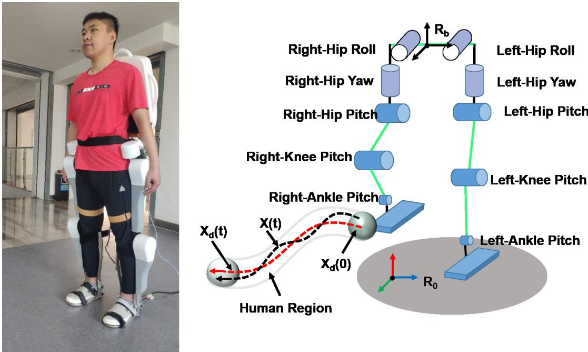  
Fig. 1. The developed walking exoskeleton systems.

The exoskeleton was mainly designed for users with muscle injury to enhance motor ability in daily activities. In the early stage of recovery, users keep completely passive and the exoskeleton provides support and guidance to ensure walking along the desired trajectory, and users tend to perform exercises with reduced muscle activity and metabolism. We gradually increase the value of the human voluntary region, and this stage of experience would increase muscle activity and the self-motivation of the user.

The proposed control architecture of the exoskeleton is demonstrated in Fig. 2, where EtherCAT is adopted as the communication protocol, and Copley motion drivers are utilized in the joint actuation to exchange the control command with the host computer. In such architecture, we can achieve 1.0 kHz sampling frequency of the close loop. In each joint, the absolute position encoders are equipped to have the absolute position. To measure the posture of the exoskeleton, e.g., the CoM, inertial measurement unit (IMU) is mounted at the back panel of the robot.

TABLE 1: Motion and DoFs of Exoskeleton Leg

<table><tr><td>DOF</td><td>Motion</td></tr><tr><td>Right-Hip Roll and Left-Hip Roll</td><td>Adduction and abduction</td></tr><tr><td>Right-Hip Pitch and Left-Hip Pitch</td><td>Flexion and extension</td></tr><tr><td>Right-Hip Yaw and Left-Hip Yaw</td><td>Rotation outside and inside</td></tr><tr><td>Right-Knee Pitch and Left-Knee Pitch</td><td>Flexion and extension</td></tr><tr><td>Right-Ankle Pitch and Left-Ankle Pitch</td><td>Dorsiflexion and plantar flexion</td></tr></table>

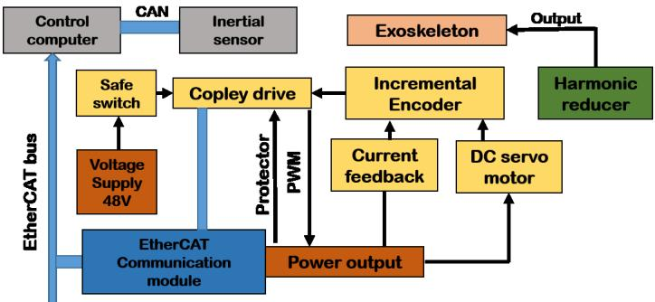  
Fig. 2. Structure of the exoskeleton system and control.

## III. GAIT OBJECTIVES AND WALKING TRAJECTORY GENERATION

## A. Gait Design Objectives

As we need to consider the user’s direction as well as speed and the exoskeleton’s physical constraints (such as limits of joint position, velocity and torque), keep foot contacting smooth (not jarring) with the ground, and maintain ground contact constraints without slipping. We designed the walking speed from 0 to 1.2 m/s, and the relaxed walking approximately 0.9 m/s for turning walking and stepping over obstacles. From our experiments, the subject feels uncomfortable if the step times are less than 0.5 s; therefore, we choose 0.7 s as the time of a step. In order to eliminate the vibrations to the user from the exoskeleton in the swing phase, we reduce the forward and lateral velocities of the foot to near-zero. In the actual implementation, the downward velocity of the foot can be regulated between 0.3m/s to 0.1 m/s. It is desirable to maintain the upright posture of the subject, we choose leftright swaying motions within $2 ^ { \circ }$ and regulate a forward lean angle within $2 ^ { \circ }$ and $6 ^ { \circ }$ . Consider the subject comfortableness and safety, we constrain the knee angles within $5 ^ { \circ }$ away from straight, and the ankles within $\pm 2 3 ^ { \circ }$

## B. ZMP and COM

We apply the ZMP to generate the walking and turning trajectory of the robotic exoskeleton, thereby maintaining the stability of the lower limb exoskeleton robot during walking and turning patterns. Firstly, we present the ZMP for a single mass COM model as [30]

$$
x _ {p} = x - \frac {z _ {m} - z _ {p}}{\ddot {z} _ {m} + g} \ddot {x} _ {m}, y _ {p} = y - \frac {z _ {m} - z _ {p}}{\ddot {z} _ {m} + g} \ddot {y} _ {m}\tag{1}
$$

where ${ \boldsymbol { g } } , X _ { z m p } = [ x _ { p } , y _ { p } , z _ { p } ] ^ { T }$ and $X _ { c o m } = [ x _ { m } , y _ { m } , z _ { m } ] ^ { T }$ represent the gravity acceleration, the ZMP position and the COM position, respectively. The relation between the COM and the ZMP is described by the ZMP equation (1). The COM trajectory can be generated based on ZMP.

When considering ZMP on flat grounds, we can describe the conditions of walking on even ground as

$$
z _ {m} = z _ {c}, \quad z _ {p} = 0\tag{2}
$$

where $z _ { c }$ is the fixed height of the COM, and the ZMP is defined on the surface of the ground. Integrating (2) into (1), we have the ZMP equation on flat ground

$$
x _ {p} = x - \frac {z _ {c}}{g} \ddot {x} _ {m}, y _ {p} = y - \frac {z _ {c}}{g} \ddot {y} _ {m}\tag{3}
$$

## C. Flat Walking Trajectory

A whole gait cycle includes two single support phases and two double support phases. Because of the periodicity of lower limb exoskeleton gait, only one single leg support phase (SSP) and one double feet support phase (DSP) are planned below, and the others change the support feet following the same rule (as shown in Fig. 3(a)). Denote the initial position $[ x _ { m } ( 0 ) , y _ { m } ( 0 ) ] ^ { T }$ and the velocity $[ v _ { x } ( 0 ) , v _ { y } ( 0 ) ] ^ { T }$ of the COM in the SSP as

$$
{v _ {x} (0)} = {x _ {m} (0) (C - 1) / (T _ {c} S)}\tag{4}
$$

$$
{v _ {y} (0)} = {y _ {m} (0) (C + 1) / (T _ {c} S)}\tag{5}
$$

where $\begin{array} { r } { T _ { c } = \sqrt { \frac { z _ { c } } { g } } , C = \cosh ( T _ { s } / T _ { c } ) , S = \sinh ( T _ { s } / T _ { c } ) , T _ { s } = } \end{array}$ $( 1 - r _ { d } ) T _ { s t e p } .$ , rd is the ratio of DSP, and $T _ { s t e p }$ is the step period. For the DSP, the COM trajectory can be described as a quantic polynomial

$$
P (t) = \sum_ {i = 0} ^ {4} p _ {i} t ^ {i}\tag{6}
$$

where $p _ { i }$ denotes the coefficient of polynomial.

The decoupled COM trajectory in coronal plane (CP) can be described as

$$
\begin{array}{r c l} x _ {m} ^ {s} (t) & = & x _ {m} ^ {s} (0) \cosh (t / T _ {c}) + T _ {c} \dot {x} _ {m} ^ {s} (0) \\ & & + \sinh (t / T _ {c}) + X _ {m} ^ {s} \end{array}\tag{7}
$$

$$
{x _ {m} ^ {d} (t)} = {\sum_ {i = 0} ^ {4} a _ {i} t ^ {i}}\tag{8}
$$

with the COM trajectories $x _ { m } ^ { s } ( t )$ and $x _ { m } ^ { d } ( t )$ in the x direction during the SSP and the DSP, respectively; and the initial position $x _ { m } ^ { s } ( 0 )$ of COM in x direction during the SSP, and a constant $X _ { m } ^ { s }$

In the sagittal plane (SP), we can present the decoupled CoM trajectory as

$$
\begin{array}{r c l} {y _ {m} ^ {s} (t)} & = & {x _ {m} ^ {s} (0) \cosh (t / T _ {c}) + T _ {c} \dot {y} _ {m} ^ {s} (0)} \\ & & {+ \sinh (t / T _ {c}) + Y _ {m} ^ {s}} \end{array}\tag{9}
$$

$$
{y _ {m} ^ {d} (t)} = {\sum_ {i = 0} ^ {4} b _ {i} t ^ {i}}\tag{10}
$$

$$
z _ {S} (t) = z _ {c}\tag{11}
$$

with the COM trajectories $y _ { m } ^ { s } ( t )$ and $y _ { m } ^ { d } ( t )$ in y direction during the SSP and the DSP, respectively, the initial position $y _ { m } ^ { s } ( 0 )$ of COM in y direction during the SSP, the COM height zS(t) in the z direction and the constants $z _ { c }$ and $Y _ { m } ^ { s }$

We can have the solution of (1) as $C _ { 1 } e ^ { - t } + C _ { 2 } e ^ { t } + p \mathrm { . }$ with constants $C _ { 1 } , C _ { 2 }$ and $p .$ Since the solution has the same form as $x _ { m } ^ { s } ( t )$ and $y _ { m } ^ { s } ( t )$ , the exoskeleton can maintain stable with the chosen properly initial conditions and coefficients of $x _ { m } ^ { s } ( t )$ and $y _ { m } ^ { s } ( t )$ such that the ZMP is within the support polygon.

## D. Turning Trajectory

Considering the case of turning walking, we introduce a parameter $A _ { \beta } ,$ , and a hip rotation $\beta$ around the z axis, and $A _ { \alpha }$ is a function of the rolling angle α of the hip around x axis. The model of turning is demonstrated in Fig. 3(c), where the turning center is z-axis. The COM position $[ x _ { m } ( t ) , y _ { m } ( t ) , z _ { m } ( t ) ] ^ { T }$ of the robot is written as

$$
x _ {m} (t) = x _ {m} (0) + (W / 2 - g / 2) \cos (\alpha) \sin (\beta)\tag{12}
$$

$$
{y _ {m} (t)} = {x _ {m} (0) - (W / 2 - g / 2) \cos (\alpha) \sin (\beta)}\tag{13}
$$

$$
{z _ {m} (t)} = {z _ {m} (0) + (W / 2 - g / 2) \sin (\alpha)}\tag{14}
$$

where W denotes the width between Right-Hip Yaw and Left-Hip Yaw, $\alpha ( t )$ and $\beta ( t )$ are defined by the constant parameters $A _ { \alpha }$ and $A _ { \beta }$ , respectively as

$$
\alpha (t) = - A _ {\alpha} (1 + \cos (4 \pi t / T _ {s t e p}))\tag{15}
$$

$$
{\beta (t)} = {A _ {\beta} t / T _ {s t e p}}\tag{16}
$$

where $T _ { s t e p }$ is the step period.

## E. Stepping over Obstacles

For stepping over obstacles, we first construct a sphere covering the obstacles, and find the arc connecting the two intersections on the sphere through the intersection of the normal walking path and the sphere, then the arc trajectory is the designed step. The demonstration is shown in Fig. 3(b). The radius of the circumscribed circle is written as

$$
R = \frac {\sqrt {(W + 2 \Delta L) ^ {2} + (H + 2 \Delta L) ^ {2}}}{2}\tag{17}
$$

where $\Delta L$ is the margin to ensure no contact with obstacles, while W and L denote the width and height of the obstacle respectively. Then we have

$$
x (t) ^ {2} + y (t) ^ {2} = \frac {\sqrt {(W + 2 \Delta L) ^ {2} + (H + 2 \Delta L) ^ {2}}}{2}\tag{18}
$$

where $x ( t )$ and $y ( t )$ denote the trajectories of swinging foot. Considering that stepping obstacle has a constant speed, then we have

$$
V _ {l i n e} = 2 \pi R / T _ {s t e p}\tag{19}
$$

where $V _ { l i n e }$ is the line speed and $T _ { s t e p }$ is the time period of the walk. Finally, we have the trajectory

$$
x (t) = R (1 - \cos (\frac {V _ {l i n e} t ^ {2}}{R}))\tag{20}
$$

$$
y (t) = \sqrt {R ^ {2} - x (t) ^ {2}}\tag{21}
$$

Then the trajectories of COM can be obtain from the equations (4)-(11).

## IV. HUMAN-IN-THE-LOOP CONTROL DEVELOPMENT

## A. The Dynamics of Synergistic Coupled System

We can describe the dynamics of the human-exoskeleton system (Fig. 2) in the task space as

$$
\begin{array}{c} H (q) \ddot {q} + C (q, \dot {q}) \dot {q} + M _ {e} (q) + M _ {g} (q) + M _ {v} (\dot {q}) + \tau_ {d} = \tau \\ \dot {X} = J (q) \dot {q} \end{array}\tag{22}
$$

(23)

where $H ( q ) \in \mathbb { R } ^ { n \times n }$ are the block diagonal inertia matrices of the combined lower limb and exoskeleton, $q \in \mathbb { R } ^ { n }$ are the joint variable of the walking exoskeleton, $C ( q , \dot { ( } q ) ) \in \mathbb { R } ^ { n \times n }$ are the combined torques of Coriolis and centrifugal forces, $M _ { e } ( q ) \in \mathbb { R } ^ { n }$ are the elastic effects due to joint stiffness, $M _ { g } ( q ) \in \mathbb { R } ^ { n }$ are the gravitational components of the humanexoskeleton couple, $M _ { v } ( \dot { q } ) \in \mathbb { R } ^ { n }$ are the viscous effects due to damping in the musculotendon complex, $\tau _ { d } \in \mathbb { R } ^ { n }$ is unknown mechanical disturbance, $\tau \in \mathbb { R } ^ { n }$ is the joint torque vector of the exoskeleton, $J ( q ) \in \mathbb { R } ^ { m \times n }$ is the Jacobian transformation matrix, and $X \in \mathbb { R } ^ { m }$ are the coordinates in the task space.

Consider each joint of the exoskeleton actuated by a DC servomotor with a harmonic transmission, then we can present the dynamics at the motor level as

$$
\tau_ {m} = J _ {m} \ddot {q} _ {m} + B _ {m} \dot {q} _ {m} + N _ {g} \tau\tag{24}
$$

where the torque vector in the motors is denote by $\tau _ { m } \in \mathbb { R } ^ { n }$ , the angular position vector is denoted by $q _ { m } \in \mathbb { R } ^ { n }$ , and the load torque vector is denoted by $N _ { g } \tau \ \in \ \mathbb { R } ^ { n }$ at the motor shafts. We can denote $J _ { m } = \mathrm { d i a g } [ J _ { m _ { 1 } } , J _ { m _ { 2 } } , \cdot \cdot \cdot , J _ { m n } ]$ as the diagonal matrix of the inertia moment of the motor shafts, $B _ { m } \ = \ \mathrm { d i a g } [ B _ { m _ { 1 } } , B _ { m _ { 2 } } , \cdot \cdot \cdot , B _ { m _ { n } } ]$ as the diagonal matrix of the viscous friction coefficient of the motor shafts, $N _ { g } = \mathrm { d i a g } [ n _ { 1 } , \cdot \cdot \cdot , n _ { n } ] $ as the diagonal gear ratios matrix, $q = N _ { g } q _ { m }$ , and the torque of the DC motor proportional to the armature current $U \in \mathbb { R } _ { n }$ by

$$
\tau_ {m} = K _ {\tau} U\tag{25}
$$

with the diagonal torque constants $\begin{array} { r l } { K _ { \tau } } & { { } = } \end{array}$ diag $[ K _ { \tau _ { 1 } } , K _ { \tau _ { 2 } } , \cdot \cdot \cdot , K _ { \tau _ { n } } ]$

From (24)-(24), the human-exoskeleton dynamic model can be written as

$$
\mathcal {M} (q) \ddot {q} + \mathcal {F} (q, \dot {q}) \dot {q} + \mathcal {G} + \mathcal {D} (t) = U\tag{26}
$$

where $\begin{array} { r l r } { \mathcal { M } ( q ) } & { { } \quad } & { = \quad } & { { } K _ { \tau } ^ { \ - 1 } ( N H \quad + \quad N _ { q } ^ { - 1 } J _ { m } ) , } \end{array}$ $\mathcal { C } ( q , \dot { q } ) = { K _ { \tau } } ^ { - 1 } N _ { g } C ( q , \dot { q } ) , \mathcal { F } ( q , \dot { q } ) \ = \ C ( q , \dot { q } ) + \tilde { \beta , } \beta =$ ${ K _ { \tau } } ^ { - 1 } ( N _ { g } M _ { v } + \bar { N } _ { q } ^ { - 1 } B _ { m } ) , \mathcal { G } = { K _ { \tau } } ^ { - 1 } N _ { g } ( M _ { e } ( q ) + M _ { g } ( q ) )$ and $\bar { \mathcal { D } } ( t ) \bar { = } K _ { \tau } ^ { - 1 } \bar { N _ { g } } \tau _ { d } ( t )$

The following properties is used in the following derivations [31]

Property IV.1. The matrix $\dot { \mathcal { M } } ( q ) - 2 \mathcal { F } ( q , \dot { q } )$ is skew symmetric.

## B. Control Design and Its Stability Analysis

Based on the requirements of the tracking task, the workspace could be divided into to a human-domain and a robot-domain region. The human-voluntary and robotconstrained regions are formulated; therefore, both the human and the robot can take active control within the corresponding region. This strategy can help the coupled system accomplish the desired task through easier and more seamless ways.

Table 2 shows definitions of variables in derivation process.

TABLE 2: The definition of symbols

<table><tr><td>Parameters</td><td>Definition</td></tr><tr><td> $X_{d}$ </td><td>desired task space coordinate</td></tr><tr><td>r</td><td>radius of the human voluntary region</td></tr><tr><td> $r_{0}$ </td><td>initial value of r</td></tr><tr><td> $X_{com}$ </td><td>position of COM</td></tr><tr><td> $X_{zmp}$ </td><td>position of ZMP</td></tr><tr><td> $\rho(X_{com}, X_{zmp})$ </td><td>distance between COM and ZMP</td></tr><tr><td> $P(X)$ </td><td>potential energy</td></tr><tr><td> $\alpha$ </td><td>stabilizing function</td></tr><tr><td> $\eta_{i}$ </td><td>bounded constant</td></tr><tr><td> $\omega_{i}, \mu_{i}$ </td><td>satisfies the property of  $\delta(t)$ </td></tr></table>

First, the human voluntary region is defined as

$$
f (X) = \| X - X _ {d} \| ^ {2} - r ^ {2} \leq 0\tag{27}
$$

where $X _ { d }$ is the desired task space coordinate as shown in Fig. 1, and $r \in \mathbb { R } ^ { + }$ denotes the radius of the human voluntary region. Fig. 4 depicts human region and robot region. When $\| \bar { X } - X _ { d } \| < r , \bar { f ( X ) } < 0 .$ , then the robot moves to the human domain region in which human can move freely. However, when $\| X - X _ { d } \| > r , f ( X ) > 0$ and the robot moves to the robot domain region in which the robot dominates the motion.

The value of r can be fine tuned according to different situations as:

$$
r = r _ {0} + \Delta r\tag{28}
$$

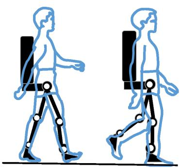  
(a)

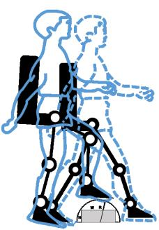  
(b)

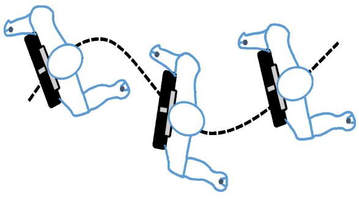  
(c)  
Fig. 3. The models of walking activities. (a) Flat walking. (b) Stepping over obstacles. (c) Turning

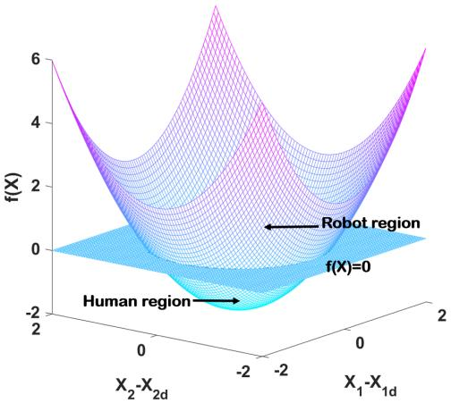  
Fig. 4. Example of $f ( X )$ , when the robot is inside the human domain region , $f ( X ) ~ \leq ~ 0 .$ , when the robot is outside the human domain region, $f ( X ) > 0$

where $r _ { 0 }$ denotes the initial value of r and $\Delta r$ can be determined as following: if $\rho ( X _ { c o m } , X _ { z m p } ) \leq \rho _ { 0 }$

$$
\Delta r = - \frac {1}{\eta} (\frac {1}{\rho (X _ {c o m} , X _ {z m p})} - \frac {1}{\rho_ {0}}) ^ {2} \rho^ {n} (X _ {c o m});\tag{29}
$$

$$
\mathrm{if} \rho (X _ {c o m}, X _ {z m p}) > \rho_ {0},
$$

$$
\Delta r = - \rho_ {0}\tag{30}
$$

where $ { \eta } \in  { \mathbb { R } } ^ { + }$ and $\begin{array} { r l r } { X _ { c o m } } & { { } = } & { [ x _ { m } , y _ { m } , z _ { m } ] ^ { T } } \end{array}$ and $X _ { z m p } = [ x _ { p } , y _ { p } , z _ { p } ] ^ { T }$ denote the position of COM and ZMP, $\rho ( \bar { X _ { c o m } } , \bar { X _ { z m p } } ) \stackrel { \cdot } { = } \| X _ { c o m } - X _ { z m p } \|$ is denoted as the distance between COM and ZMP, $\rho ^ { n } ( X _ { c o m } ) \ : = \ : \| X _ { c o m } \| ^ { n }$ and n is a positive integer. As the distance between COM and ZMP becomes larger, the radius of human voluntary region would decrease, and $f ( X ) ~ \leq ~ 0$ indicates the exoskeleton robot is inside of the human domain region. Then the potential energy depicted in Fig. 5 can be designed as

$$
P (X) = K [ \max (0, f (X)) ] ^ {N}\tag{31}
$$

where K is a defined constant and $N$ denotes the order of the function which is an even integer.

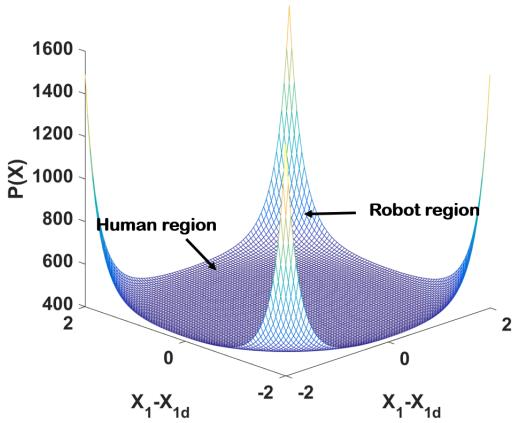  
Fig. 5. Example of $P ( X )$ when $N \ = \ 4 .$ . The bottom corresponds to $f ( X ) \leq 0 , { \mathrm { ~ i . ~ e . ~ } }$ ., the robot is inside the human domain region.

Let us define the error as

$$
z = X - X _ {d}\tag{32}
$$

which is constrained as $\| z \| ^ { 2 } < k _ { c }$ to avoid abnormal movement, where $k _ { c }$ is a constant and $k _ { c } \mathrm { ~ \scriptsize ~ > ~ } r$ . Since $P ( X )$ increases with the increase of $\| z \| ^ { 2 }$ , when the end-effector is outside the human voluntary region, $\| z \| ^ { 2 } < k _ { c }$ is equivalent to $P ( X ) < k _ { d } .$ , where $k _ { c }$ and $k _ { d }$ are defined positive constants.

To ensure z satisfies the constraint, we proposed a new Barrier Lyapunov Function integrating the formulated region, whose value approaches infinity as its arguments approach some limits. Unlike the traditional Barrier Lyapunov Function [33], [34], which is directly based on the error z, we propose a Barrier Lyapunov Function based on the potential energy $P ( X )$ as

$$
V _ {1} = \frac {k _ {d} ^ {2}}{\pi} \cot \left(\frac {\pi}{2} \left(1 - \frac {P (X) ^ {2}}{k _ {d} ^ {2}}\right)\right)\tag{33}
$$

Partial differentiation of the $V _ { 1 }$ energy with respect to position error z yields

$$
\frac {\partial V _ {1}}{\partial z} = \frac {\partial P (X)}{\partial z} \csc^ {2} \left(\frac {\pi}{2} \left(1 - \frac {P (X) ^ {2}}{k _ {d} ^ {2}}\right)\right) \triangleq \Delta \varepsilon\tag{34}
$$

The time derivative of $V _ { 1 }$ is given by

$$
\dot {V} _ {1} = \Delta \varepsilon^ {T} (\dot {X} - \dot {X} _ {d}) = \Delta \varepsilon^ {T} \dot {z}\tag{35}
$$

Denote the vector

$$
v = \dot {q} - \alpha\tag{36}
$$

, where α is a stabilizing function and is designed as

$$
\alpha = J ^ {+} (q) (- k \Delta \varepsilon + \dot {X} _ {d})\tag{37}
$$

where $k$ is a positive definite constant matrix; $J ^ { + } ( \boldsymbol q )$ is the pseudo inverse of $J ( q )$ , and $J J ^ { + } = \mathrm { I }$

We utilize the following properties [32] in the following mathematical derivations

Property IV.2. Let $\Omega = \mathcal { M } \dot { \alpha } + \mathcal { F } \alpha + \mathcal { G } + \mathcal { D } ( t )$ , and we have some bounded constant $\eta _ { i } \ge 0 ( i = 1 , . . . , 4 )$ satisfying $\forall q \in \mathbb { R } ^ { n } , \ \forall { \dot { q } } \in \mathbb { R } ^ { n } , \ \| { \mathcal { M } } { \dot { \alpha } } \| \leq \eta _ { 1 } \| { \dot { \alpha } } \| , \ \| { \mathcal { C } } \alpha \| \leq \eta _ { 2 } \| { \dot { q } } \| \| \alpha \| ,$ $\| \mathcal { G } \| \le \eta _ { 3 }$ and $\| \mathcal { D } ( t ) \| \leq \eta _ { 4 }$

We can choose a time-varying positive function $\delta ( t )$ , it converges to 0 when $t \to \infty$ and satisfies lim $\begin{array} { r } { \mathbf { \Sigma } _ { t  \infty } \int _ { 0 } ^ { t } \delta ( s ) \dot { d } s = \mathbf { \Sigma } } \end{array}$ $d < \infty$ , where d is a bounded positive constant.

Consider the uncertain dynamics to be suppressed, we can design an adaptive control under the novel Barrier Lyapunov Function as

$$
{ U } { = } { - K _ { s } v - \sum _ { i = 1 } ^ { 4 } \frac { \hat { \eta } _ { i } \sigma _ { i } ^ { 2 } v } { \sigma _ { i } \| v \| + \omega _ { i } } - J ^ { T } \Delta \varepsilon }\tag{38}
$$

with a positive definite gain matrix $K _ { s }$ , and a vector of the damping force $K _ { s } v$ , the estimation $\hat { \eta } _ { i }$ of $\eta .$ . We choose $\omega _ { i }$ satisfies the property of $\delta ( t )$ , and lim $\begin{array} { r } { \mathsf { i } _ { t \to \infty } \int _ { 0 } ^ { t } \omega _ { i } ( x ) d x \ = } \end{array}$ $d _ { 1 i } ~ < ~ \infty$ with positive constants $d _ { 1 i } ( i \ = \ 1 , \ldots , 4 ) ; \ \sigma \ =$ $\left\lceil \| \dot { \alpha } _ { 1 } \| , \| \dot { q } \| \| \alpha _ { 1 } \| , \dot { 1 } , 1 \right\rceil ^ { T }$

The corresponding adaptive parameters updating can be designed as

$$
\dot {\hat {\eta}} _ {i} = - S _ {i} \left(\mu_ {i} \hat {\eta} _ {i} - \frac {\sigma_ {i} ^ {2} \| v \| ^ {2}}{\sigma_ {i} \| v \| + \omega_ {i}}\right)\tag{39}
$$

where $S _ { i } ( i = 1 , \dots , 4 )$ denotes positive bounded constants; $\mu _ { i }$ satisfies the property of $\delta ( t )$ , and lim $\begin{array} { r } { \mathfrak { i } _ { t  \infty } \int _ { 0 } ^ { t } \mu _ { i } ( x ) d x = } \end{array}$ $d _ { 2 i } < \infty$ with positive constants $d _ { 2 i }$

We choose a Lyapunov-like candidate $V _ { 2 }$ as

$$
V _ {2} = V _ {1} + \frac {1}{2} v ^ {T} \mathcal {M} (q) v + \frac {1}{2} \sum_ {i = 1} ^ {4} \frac {1}{S _ {i}} \tilde {\eta} _ {i} \tilde {\eta} _ {i}\tag{40}
$$

Differentiating $V _ { 2 }$ with respect to time yields

$$
\dot {V} _ {2} = \Delta \varepsilon^ {T} \dot {z} + v ^ {T} \mathcal {M} \dot {v} + \frac {1}{2} v ^ {T} \dot {\mathcal {M}} v + \sum_ {i = 1} ^ {4} \frac {1}{S _ {i}} \tilde {\eta} _ {i} \dot {\tilde {\eta}} _ {i}\tag{41}
$$

Considering Property IV.1 and Property IV.2, we can rewrite (41) as

$$
\begin{array}{r c l} \dot {V} _ {2} & = & \Delta \varepsilon^ {T} \dot {z} + v ^ {T} U - v ^ {T} (\mathcal {F} \alpha + \mathcal {G} + \mathcal {D} (t) + \\ & & \mathcal {M} \dot {\alpha}) + \sum_ {i = 1} ^ {4} \frac {1}{S _ {i}} \tilde {\eta} _ {i} \dot {\tilde {\eta}} _ {i} \\ & = & \Delta \varepsilon^ {T} \dot {z} + v ^ {T} U - v ^ {T} \Omega + \sum_ {i = 1} ^ {4} \frac {1}{S _ {i}} \tilde {\eta} _ {i} \dot {\tilde {\eta}} _ {i} \end{array}\tag{42}
$$

Substituting (37) into (42) yields

$$
\begin{array}{c} \dot {V} _ {2} = \Delta \varepsilon^ {T} [ J (v + \alpha) - \dot {X} _ {d} ] + v ^ {T} U - v ^ {T} \Omega \\ = - k \Delta \varepsilon^ {T} \Delta \varepsilon + \Delta \varepsilon^ {T} J v + v ^ {T} U - v ^ {T} \Omega + \sum_ {i = 1} ^ {4} \frac {1}{S _ {i}} \tilde {\eta} _ {i} \dot {\tilde {\eta}} _ {i} \end{array}\tag{43}
$$

Substituting (38) into (43) yields

$$
\begin{array}{r c l} \dot {V} _ {2} & = & - k \Delta \varepsilon^ {T} \Delta \varepsilon - v ^ {T} K _ {s} v - v ^ {T} \sum_ {i = 1} ^ {4} \frac {\hat {\eta} _ {i} \sigma_ {i} ^ {2} v}{\sigma_ {i} \| v \| + \omega_ {i}} \\ & & - v ^ {T} \Omega + \sum_ {i = 1} ^ {4} \frac {1}{S _ {i}} \tilde {\eta} _ {i} \dot {\tilde {\eta}} _ {i} \\ & \leq & - k \Delta \varepsilon^ {T} \Delta \varepsilon - v ^ {T} K _ {s} v - \sum_ {i = 1} ^ {4} \frac {\hat {\eta} _ {i} \sigma_ {i} ^ {2} \| v \| ^ {2}}{\sigma_ {i} \| v \| + \omega_ {i}} + \\ & & \sum_ {i = 1} ^ {4} \| v \| \eta_ {i} \sigma_ {i} - \sum_ {i = 1} ^ {4} \tilde {\eta} _ {i} (\mu_ {i} \hat {\eta} _ {i} - \frac {\sigma_ {i} ^ {2} \| v \| ^ {2}}{\sigma_ {i} \| v \| + \omega_ {i}}) \\ & \leq & - k \Delta \varepsilon^ {T} \Delta \varepsilon - v ^ {T} K _ {s} v + \sum_ {i = 1} ^ {4} \eta_ {i} \omega_ {i} - \sum_ {i = 1} ^ {4} \mu_ {i} \tilde {\eta} _ {i} \hat {\eta} _ {i} \\ & \leq & - k \Delta \varepsilon^ {T} \Delta \varepsilon - v ^ {T} K _ {s} v + \sum_ {i = 1} ^ {4} \eta_ {i} \omega_ {i} - \\ & & \frac {1}{2} \sum_ {i = 1} ^ {4} \mu_ {i} \tilde {\eta} _ {i} \tilde {\eta} _ {i} + \frac {1}{2} \sum_ {i = 1} ^ {4} \mu_ {i} \eta_ {i} \eta_ {i} \end{array}\tag{44}
$$

where the last inequality is obtained by $- \tilde { \eta } _ { i } \hat { \eta } _ { i } = - \tilde { \eta } _ { i } ( \eta _ { i } +$ $\begin{array} { r } { \widetilde { \eta } _ { i } ) ~ = ~ - \widetilde { \eta } _ { i } \widetilde { \eta } _ { i } - \widetilde { \eta } _ { i } \eta _ { i } \mathrm { ~ a n d ~ } - \widetilde { \eta } _ { i } \eta _ { i } \le \frac { 1 } { 2 } \big ( \widetilde { \eta } _ { i } \widetilde { \eta } _ { i } + \eta _ { i } \eta _ { i } \big ) } \end{array}$ , we have $\begin{array} { r } { - \tilde { \eta } _ { i } \hat { \eta } _ { i } \leq - \frac { 1 } { 2 } \tilde { \eta } _ { i } \tilde { \eta } _ { i } + \frac { 1 } { 2 } \eta _ { i } \eta _ { i } } \end{array}$

Then, we can rewrite (44) as $\begin{array} { r l r } { \dot { V } _ { 2 } } & { { } \le } & { - k \Delta \varepsilon ^ { T } \Delta \varepsilon - } \end{array}$ $\begin{array} { r } { e _ { 2 } ^ { T } K _ { s } e _ { 2 } + \sum _ { i = 1 } ^ { 4 } \eta _ { i } \omega _ { i } - \frac { 1 } { 2 } \sum _ { i = 1 } ^ { 4 } \mu _ { i } \tilde { \eta } _ { i } \tilde { \eta } _ { i } + \frac { 1 } { 2 } \sum _ { i = 1 } ^ { 4 } \mu _ { i } \eta _ { i } ^ { 2 } } \end{array}$ . Since $\textstyle \sum _ { i = 1 } ^ { 4 } \eta _ { i } \omega _ { i } \ \to \ 0$ and $\textstyle { \mathrm { \frac { 1 } { 2 } } } \sum _ { i = 1 } ^ { 4 } \mu _ { i } \eta _ { i } ^ { 2 } \ \to \ { \bar { 0 } }$ as $t ~  ~ \infty$ due to the definition of $\omega _ { i }$ and $\mu _ { i } ,$ and $K _ { s }$ is positive definite constant matrix, it can conclude that $\dot { V } _ { 2 } ~ < ~ 0$ as $t  \infty$ Thus, $z$ and $v$ converge to the zero as $t  \infty$ . Integrating $\dot { V } _ { 2 }$ yields $\begin{array} { r l r } { V _ { 2 } ( t ) - V _ { 2 } ( 0 ) } & { { } \le } & { - \int _ { 0 } ^ { t } \Big \{ k \Delta \varepsilon ^ { T } \Delta \varepsilon - v ^ { T } K _ { s } v \ + } \end{array}$ $\begin{array} { r } { \frac { 1 } { 2 } \sum _ { j = 1 } ^ { 4 } \mu _ { j } \tilde { \eta } _ { j } \tilde { \eta } _ { j } \biggr \} d s + \int _ { 0 } ^ { t } \bigg \{ \sum _ { i = 1 } ^ { 4 } \eta _ { i } \omega _ { i } + \frac { 1 } { 2 } \sum _ { i = 1 } ^ { 4 } \mu _ { i } \eta _ { i } ^ { 2 } \bigg \} d s \leq } \end{array}$ $\begin{array} { r } { \int _ { 0 } ^ { t } \bigg \{ \sum _ { i = 1 } ^ { 4 } \eta _ { i } \omega _ { i } + \frac { 1 } { 2 } \sum _ { i = 1 } ^ { 4 } \mu _ { i } \eta _ { i } ^ { 2 } \bigg \} d s } \end{array}$ . Since $\eta _ { i }$ is constant, and $\begin{array} { r } { \int _ { 0 } ^ { \infty } \dot { \omega } _ { i } d s = d _ { 1 i } } \end{array}$ and $\begin{array} { r } { \int _ { 0 } ^ { \infty } \mu _ { i } d s \ = \ d _ { 2 i } ( i \ = \ 1 , \ldots , 4 ) } \end{array}$ are constants, we have $V _ { 2 } ( t ) { \bar { \ } } - V _ { 2 } ( 0 ) < \infty$ . Therefore, we have that $V _ { 2 } , J$ and $q$ are bounded, and $\hat { \eta } _ { i }$ is bounded since $\eta _ { i }$ is a constant. Thus, the closed-loop system are stable and bounded.

Since $V _ { 2 } ( 0 )$ is bounded and $\dot { V } _ { 2 } \leq 0 .$ it can be shown that $V _ { 2 }$ is bounded $\forall t > 0$ . According to (33), $V _ { 1 }$ is bounded, and the potential energy $P ( X )$ remains in the region $P ( X ) < k _ { e }$ $\forall t > 0$ . It is concluded that $P ( X ) \to 0 { \mathrm { ~ a s ~ } } t \to \infty$ . From the definition of $P ( X ) , P ( X ) = 0$ implies the robot is controlled to move to the inside of the human voluntary region and human can play actively in this region.

## V. EXPERIMENTS VERIFICATION

To validate the performance of the waking exoskeleton for stable dynamic walking using the proposed human-in-theloop control strategy, two subjects (age $2 6 \pm 3 .$ , male, height

TABLE 3: Controller Parameters for Flat Walking and Walking over Obstacles

<table><tr><td>Parameters</td><td>value</td></tr><tr><td> $S_i (i=1,2,\dots,4)$ </td><td>0.5</td></tr><tr><td> $\omega_i$ </td><td> $5/(t+1)^2$ </td></tr><tr><td> $\mu_i$ </td><td> $5/(t+1)^2$ </td></tr><tr><td>r</td><td>0.15</td></tr><tr><td> $K_s$ </td><td>diag[30.0 18.0 30.0 18.0 25.0 25.0 0.0 0.0]</td></tr></table>

$1 . 7 0 \pm 1 0 \mathrm { ~ m ~ }$ , weight $7 0 \pm 1 0 \mathrm { k g } )$ with muscle injury was recruited to wear the developed ten-DoFs exoskeleton and preform physical experiments in walking, turning, and crossing obstacles movements. All procedures of this study were approved by the Ethics Committee of Yueyang Hospital of integrated traditional Chinese and Western Medicine, Shanghai University of Traditional Chinese Medicine. The registration number is ChiCTR2000031162, and the protocol number is 2019-014. All the subjects read and signed informed consent.

A comparative experiment with a conventional PD control algorithm was conducted, and a performance index was adopted to evaluate the proposed controller and a conventional PD controller. The human-in-the-loop control index $L _ { 1 }$ is defined by the average control input

$$
L _ {1} [ U ] = \sqrt {\left(1 / T _ {f}\right) \int_ {0} ^ {T _ {f}} | U | ^ {2} d t}\tag{45}
$$

The index measures the root mean square of the control input, which directly reflects the cost of the controller’s energy input. Specifically, smaller $L _ { 1 }$ indicates less control energy is required to control the system.

## A. Experiments Setup

Before each experiment, the lower limb exoskeleton was adjusted its link length for the specific heights of every subject. Three walking tasks are chosen as walking on the flat, cross the obstacle, and make turns without any support devices. We did not have any dynamics model of the exoskeleton system before the experiment. For the different tasks, the parameters of the controller are chosen and listed in Table 3 and Table 4, where $\omega _ { i }$ and $\mu _ { i }$ are designed as decay functions over time, and the initial values of $\hat { \eta _ { i } }$ are chosen as 0, and r is the width of the human voluntary region. These parameters were chosen and regulated based on the actual implementation performance.

## B. Results and Discussion

The snapshots of flat walking are illustrated in Fig. 6 with walking speed at 0.8m/s. The subjects were not allowed to use any supported device during walking. The experiment results are shown in Fig. 7 and Fig. 8, where L-H-P, R-H-P, L-H-R, R-H-R, L-K-R and R-K-R denote the Left-Hip Pitch, Right-Hip Pitch, Left-Hip Row, Right-Hip Row, Left-Knee Pitch and Right-Knee Pitch as shown in Fig. 1. The blue dotted line denotes the boundary of the human voluntary region. Once the error exceeds $r ,$ the robot enters the domination region and plays a leading role and to enforce the convergence of the system error to a pre-defined reasonable range within the human voluntary region. Thus, the subject can perform movements actively and keep body balance by adjusting the foot in each step.

In the walking over obstacles task, the subjects were told to walk continuously in an environment with obstacles without using any supported devices. The size of the obstacle is $2 0 . 0 \times 1 5 . 0 \times 1 2 . 0 c m$ . As the size of the obstacle is small, the subject can step over it rather than bypassing. Compared to flat walking, the angle of knee flexion and hip flexion increased, which assisted the subject to be able to raise the leg up to step over the obstacles. The snapshots of the experiment are illustrated in Fig. 9. The experimental results are shown in Fig.10 and Fig.11. The tracking error in Fig.10 is bounded and shows a certain periodicity as the bipedal walking is a periodic motion, thereby meeting our design goal. In Fig.10, R-H-R, and L-H-R swing periodically for walking balancing. Therefore, with our proposed control scheme, the subject can perform movements actively and keep the body balance by adjusting the foot in each step to realize dynamic walking without supporting devices.

To complete the turning step of the exoskeleton, two active joints were mounted on the robot. They are Right-Hip-Yaw (R-H-Y) and Left-Hip-Yaw (L-H-Y) (as shown in Fig. 1). In the walking turning task, the turning angle is $1 8 ^ { \circ }$ . Considering that the R-H-Y and L-H-Y joints require assistive torque to realize turning, we choose a narrow human region on the waist joints. The experiment video screenshots are shown in Fig. 12. Fig. 13 and Fig. 14 show the position tracking and tracking error of the experiment. Fig. 15 shows the control input of each joint in the turning movement.

The experiment results demonstrate that the tracking error is bounded. In addition, if the tracking error exceeds $r ,$ the exoskeleton will enter the domination region and play a leading role, thereby rapidly increasing the control input and converging the error quickly within a reasonably defined range. As the bipedal walking is a periodic motion, the input currents and tracking errors show a certain periodicity. When the exoskeleton is in the human-domain region, the user would lead the robot to move actively. Combining proper gait trajectory planning with the control algorithm, we realized the dynamic walking pattern with the humanrobot system. To compare our proposed controller with convention controllers, we also did a parallel experiment with a convention PD controller. Fig. 16 shows the comparison of the convention PD controller and the proposed controller, and the control parameters for the PD controller are $\begin{array} { r l r } { K _ { p } } & { { } = } & { \mathrm { d i a g } [ 1 5 0 . 0 , 1 0 0 . 0 , 1 5 0 . 0 , 1 0 0 . 0 , 8 0 . 0 , 8 0 . 0 ] } \end{array}$ $K _ { d } ~ = ~ \mathrm { d i a g } [ 1 . 0 , 0 . 5 , 1 . 0 , 0 . 5 , 0 . 5 , 0 . 5 ]$ in gait and walking over obstacles tasks. In the turning step task, the control parameters for the PD controller are $\begin{array} { r l } { K _ { p } } & { { } = } \end{array}$ $\mathrm { d i a g } [ 1 5 0 . 0 , 1 0 0 . 0 , 1 5 0 . 0 , 1 0 0 . 0 , 8 0 . 0 , 8 0 . 0 , 1 2 0 . 0 , 1 2 0 . 0 ]$ ${ K _ { d } } ~ = ~ \mathrm { d i a g } [ 1 . 0 , 0 . 5 , 1 . 0 , 0 . 5 , 0 . 5 , 0 . 5 , 0 . 8 , 0 . 8 ] .$ . The control inputs of the proposed human-in-the-loop controller are smaller than the conventional controller due to the fact that the workspace is divided into human-voluntary and robotconstrained regions. When the robot is in the human-domain region, the subject can perform movements actively, thereby reducing the control inputs.

This article has been accepted for publication in a future issue of this journal, but has not been fully edited. Content may change prior to final publication. Citation information: DOI 10.1109/TMECH.2020.3044289, IEEE/ASME Transactions on Mechatronics

(b)  
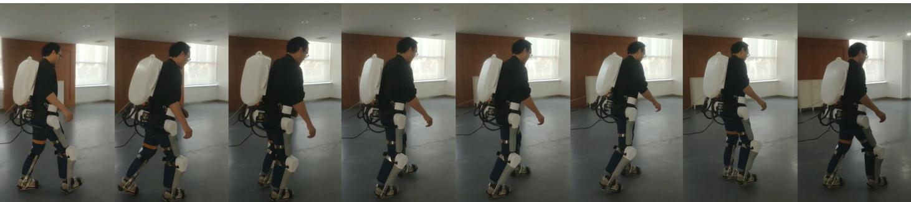  
Fig. 6. The snapshots of walking on the flat.

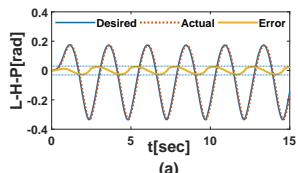  
(a)

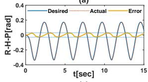

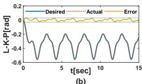

(c)  
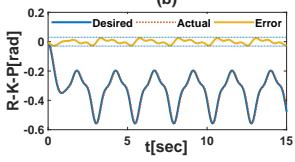  
(d)  
Fig. 7. The joint position tracking and tracing error of L-H-P, L-K-P, R-H-P and R-K-P in flat walking movement.

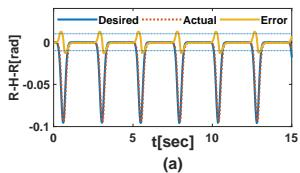

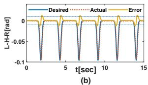

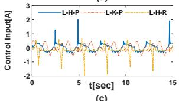  
(c)

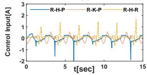  
(d)  
Fig. 8. The joint position tracking and tracing error of R-H-R and L-H-R and the control input of each joint in flat walking movement.

TABLE 4: Controller Parameters for Turning Step

<table><tr><td>Parameters</td><td>value</td></tr><tr><td> $S_i (i=1,2,\dots,4)$ </td><td>0.5</td></tr><tr><td> $\omega_i$ </td><td> $5/(t+1)^2$ </td></tr><tr><td> $\mu_i$ </td><td> $5/(t+1)^2$ </td></tr><tr><td>r</td><td>0.10</td></tr><tr><td> $K_s$ </td><td>diag[30.0 18.0 30.0 18.0 25.0 25.0 30.0 30.0]</td></tr></table>

TABLE 5: Average Control Input (A)

<table><tr><td>Joints</td><td>L-H-P</td><td>L-K-P</td><td>R-H-P</td><td>R-K-P</td></tr><tr><td>Conventional Controller</td><td>0.4036</td><td>0.3827</td><td>0.4125</td><td>0.3655</td></tr><tr><td>Proposed Controller</td><td>0.3036</td><td>0.3227</td><td>0.3564</td><td>0.3255</td></tr><tr><td>Joints</td><td>L-H-R</td><td>L-H-Y</td><td>R-H-R</td><td>R-H-Y</td></tr><tr><td>Conventional Controller</td><td>0.3036</td><td>0.1227</td><td>0.3264</td><td>0.1655</td></tr><tr><td>Proposed Controller</td><td>0.2536</td><td>0.1122</td><td>0.2664</td><td>0.1465</td></tr></table>

## VI. CONCLUSIONS

In this paper, a novel human-in-the-loop control scheme based on a new Barrier Lyapunov Function for a fully actuated lower-limb exoskeleton with high DoFs is proposed to enable humans to influence the lower limb movements along a physiologically meaningful path without crutches or other external stabilization tools. Through the novel barrier energy function, the task work-spaces for human-robot manipulation are divided into a human-voluntary and a robot-constrained region, thereby constraining the lower limb motion of the user to a compliant region around various desired trajectories. Several activity trajectories are designed for different scenes, including flat walking, turning, and crossing the obstacle. Extensive experimental validation of the stability and robustness of the proposed control structure has been conducted on a developed ten-DoFs lower limb exoskeleton without crutches or other external stabilization tools. The experimental results show that the exoskeleton has the ability to assist the user without the assistance of crutches or other external means of stabilization.

## REFERENCES

[1] A. Aia, H. Cheng, X. Lin, M. Omer and J. M. Atieno, “Variable admittance control for climbing stairs in human-powered exoskeleton systems, Adv. Robot. Autom., vol. 5, no. 3, Oct. 2016.

[2] A. Agrawal, O. Harib, A. Hereid, S. Finet, M. Masselin, L. Praly, A. D. Ames, K. Sreenath, and J. W. Grizzle, “First steps towards translating HZD control of bipedal robots to decentralized control of exoskeletons,IEEE Access, vol. 5, pp. 9919-9934, Apr. 2017.

[3] Q. Wei, Z. Li, K. Zhao, Y. Kang, C.-Y. Su, “Synergy-based control of assistive lower-limb exoskeletons by skill transfer, IEEE Transactions on Mechatronics, APRIL 2020, vol. 25, no. 2, pp. 705–715.

[4] B. S. Rupal, S. Rafique, A. Singla, E. Singla, M. Isaksson, and G. S. Virk, “ Lower-limb exoskeletons: research trends and regulatory guidelines in medical and non-medical applications, International Journal of Advanced Robotic Systems, vol. 14, no. 6, 2017, p.1729881417743554.

[5] Ekso Bionics. Accessed on: Nov. 4, 2017. [Online]. Available: http:// eksobionics.com/

[6] G. Zeilig, H. Weingarden, M. Zwecker, I. Dudkiewicz, A. Bloch, and A. Esquenazi, Safety and tolerance of the ReWalk exoskeleton suit for ambulation by people with complete spinal cord injury: A pilot study, J. Spinal Cord Med., vol. 35, no. 2, pp. 96-101, 2012.

[7] S. Kajita, K. Tani, “Study of dynamic biped locomotion on rugged terrain derivation and application of the linear inverted pendulum mode”, in: Proceedings 1991 IEEE International Conference on Robotics and Automation, Sacramento, California, USA, 1991, pp. 1405-1411.

[8] B. Vanderborght, B. Verrelsta, R. V. Hama, M. V. Dammea, D. Lefebera, “Objective locomotion parameters based inverted pendulum trajectory generator,” Robotics and Autonomous Systems, vol. 56, 2008, pp. 738– 750.

This article has been accepted for publication in a future issue of this journal, but has not been fully edited. Content may change prior to final publication. Citation information: DOI 10.1109/TMECH.2020.3044289, IEEE/ASME Transactions on Mechatronics

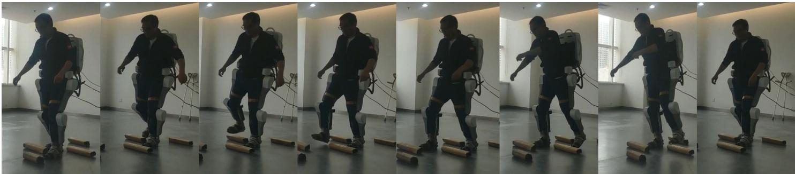

Fig. 9. The snapshots of walking over obstacles.  
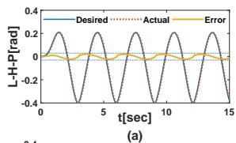

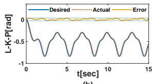

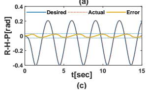

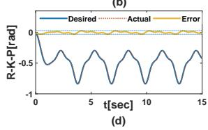  
Fig. 10. The joint position tracking and tracing error of L-H-P, L-K-P, R-H-P and R-K-P in walking over obstacles movement.

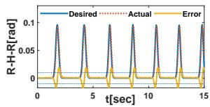

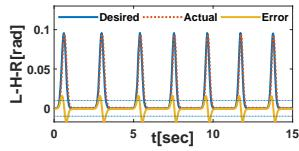

(c)  
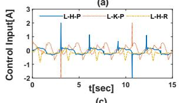

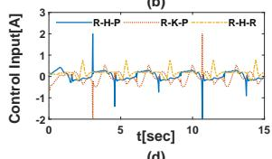  
(d)  
Fig. 11. The joint position tracking and tracing error of R-H-R and L-H-R and the control input of each joint in walking over obstacles movement.

[9] T. Kagawa, H. Ishikawa, T. Kato, C. Sung, and Y. Uno, “Optimizationbased motion planning in joint space for walking assistance with wearable robot”, IEEE Trans. Robotics, vol. 31, no. 2, April 2015, pp. 415–424.

[10] A. Tsukahara, Y. Hasegawa, K. Eguchi, and Y. Sankai, ‘Restoration of gait for spinal cord injury patients using HAL with intention estimator for preferable swing speed”, IEEE Trans. Neural Systems and Rehabilitation Enginerring, vol. 23, no. 2, Mar. 2015, pp. 308 –318.

[11] V. Vashista, M. Khan, and S. K. Agrawal, “A novel approach to apply gait synchronized external forces on the pelvis using A-TPAD to reduce walking effort”, IEEE Robotics and Automation Letters, vol. 1, no. 2, July 2016, pp. 1118–1124.

[12] T. McGeer, “Passive dynamic walking”, Int. J. Robotics Res., vol. 9, no. 2, pp. 62–82, Apr. 1990.

[13] A. Kuo, “Stabilization of lateral motion in passive dynamic walking”,

Int. J. Robotics Res., vol. 18, no. 9, pp. 917–930, 1999.

[14] J. M. Donelan, D. W. Shipman, R. Kram, A. D. Kuo, “Mechanical and metabolic requirements for active lateral stabilization in human walking”, J. Biomech., vol. 37, no. 6, pp. 827–835, Jun. 2004.

[15] A. L. Hof, “The extrapolated center of mass concept suggests a simple control of balance in walking”, Human Movement Sci., vol. 27, no. 1, pp. 112–125, Feb. 2008.

[16] O. Harib, A. Hereid, A. Agrawal, T. Gurriet, S. Finet, G. Boeris, A. Duburcq, et al,“Feedback control of an exoskeleton for paraplegics: toward robustly stable, hands-free dynamic walking,” IEEE Control Systems Magazine, vol. 38, no. 6, pp. 61-87, Dec. 2018.

[17] W. Felt, J. C. Selinger, J. M. Donelan, C. D. Remy, “‘Body-In-The-Loop’: Optimizing device parameters using measures of instantaneous energetic cost,” PLoS ONE, vol. 10, no. 8, 2015.

[18] J. J. Zhang, P. Fiers,K. A. Witte, and etc. “Human-in-the-loop optimization of exoskeleton assistance during walking,” Science, vol. 19, vol. 356, no. 6344, pp. 1280-1284, 2017.

[19] Y. Ding, M. Kim, S. Kuindersma, C. J. Walsh, “Human-in-the-loop optimization of hip assistance with a soft exosuit during walking,” Sci. Robot., vol. 3, 2018.

[20] M. Kim, Y. Ding, P. Malcolm, J. Speeckaert, C. J. Siviy, C. J. Walsh, S. Kuindersma “Human-in-the-loop Bayesian optimization of wearable device parameters,” PLoS ONE, vol.12, no. 9, 2017.

[21] R. W. Jackson and S. H. Collins, “Heuristic-based ankle exoskeleton control for co-adaptive assistance of human locomotion”, IEEE Trans. Neural Systems and Rehabilitation, vol. 27, no. 10, Oct. 2019 , pp. 2059-2069.

[22] L. Peternel, N. Tsagarakis, and A. Ajoudan, “A Human-robot co-Manipulation approach based on human sensorimotor information”, IEEE Trans. Neural Systems and Rehabilitation, vol. 25, no. 7, July 2017, pp. 811–822.

[23] H. Qiao, M. Wang, J. H. Su, S. X. Jia, R. Li, “The concept of attractive region in environment and its application in high-precision tasks with low-precision systems”, IEEE/ASME Transactions on Mechatronics, vol. 20, no. 5, pp. 2311-2327, 2015.

[24] H. Rifai, S. Mohammed, K. Djouani and Y. Amirat, “Toward lower limbs functional rehabilitation through a knee-joint exoskeleton, IEEE Trans. Control Systems Technology, vol. 25, no. 2, pp. 712-719, March 2017.

[25] R. J. Farris, H. A. Quintero, S. A. Murray, K. H. Ha, C. Hartigan and M. Goldfarb, “A preliminary assessment of legged mobility provided by a lower limb exoskeleton for persons with paraplegia, IEEE Trans. Neural Systems and Rehabilitation Engineering, vol. 22, no. 3, pp. 482- 490, May 2014.

[26] J. Cao, S. Q. Xie and R. Das, “MIMO sliding mode controller for gait exoskeleton driven by pneumatic muscles, IEEE Trans. Control Systems Technology, vol. 26, no. 1, pp. 274-281, Jan. 2018.

[27] K. Lee, D. Liu, L. Perroud, R. Chavarriaga and J. D. R. Millan, “A braincontrolled exoskeleton with cascaded event-related desynchronization classifiers, Robotics and Autonomous Systems, vol. 90, pp. 15-23, Apr. 2017.

[28] M. S. Al-Quraishi, I. Elamvazuthi, S. A. Daud, S. Parasuraman, and A. Borboni, “EEG-based control for upper and lower limb exoskeletons

This article has been accepted for publication in a future issue of this journal, but has not been fully edited. Content may change prior to final publication. Citation information: DOI 10.1109/TMECH.2020.3044289, IEEE/ASME Transactions on Mechatronics

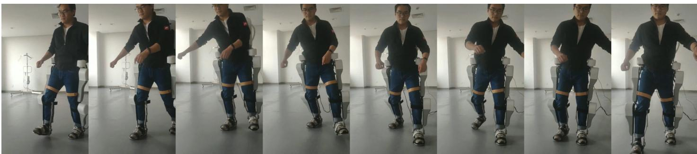  
Fig. 12. The snapshots of turning.

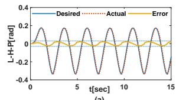

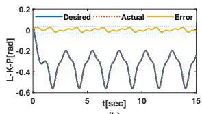

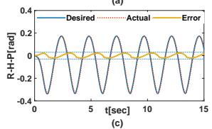

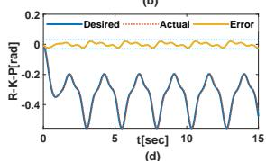  
Fig. 13. The joint position tracking and tracing error of L-H-P, L-K-P, R-H-P and R-K-P in turning movement.

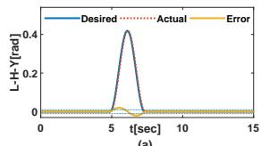

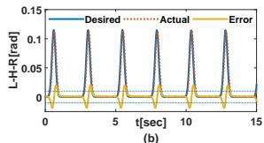

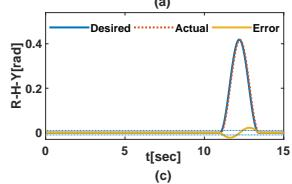

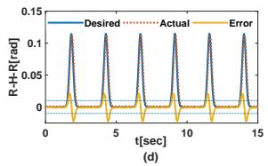  
Fig. 14. The joint position tracking and tracing error of R-H-R, L-H-R, L-H-Y and R-H-Y in turning movement.

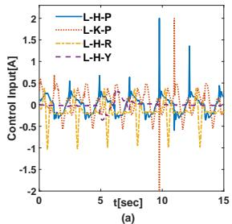

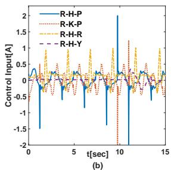  
Fig. 15. The control input of each joint in turning movement.

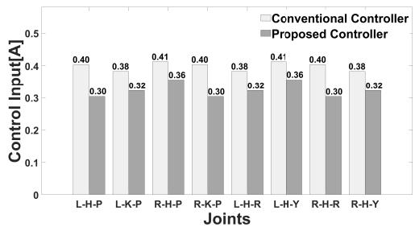  
Fig. 16. The comparison of average control input of each joint between the convention PD controller and the proposed controller.

and prostheses,” A systematic review. Sensors, vol. 18, no. 10, 2018, po.33-42.

[29] Z. Li, Y. Yuan, L. Luo, et al., “Hybrid brain/muscle signals powered wearable walking exoskeleton enhancing motor ability in climbing stairs activity,” IEEE Transactions on Medical Robotics and Bionics, Nov. 2019, vol. 1, no. 4, pp. 218-227.

[30] H. Kajita, K. Yokoi, H. Hirukawa, and K. Harada, Humanoid Robot, Tokyo, Japan: Ohmsha, 2005.

[31] Z. Li and S. S. Ge, Fundamentals in Modeling and Control of Mobile Manipulators. Boca Raton, FL, USA: CRC Press, May 2013.

[32] R. Lu, Z. Li, C. Su and A. Xue, ”Development and Learning Control of a Human Limb With a Rehabilitation Exoskeleton,” in IEEE Transactions on Industrial Electronics, vol. 61, no. 7, pp. 3776-3785, July 2014.

[33] K. P. Tee, S. S. Ge, E. H. Tay, “Barrier Lyapunov functions for the control of output-constrained nonlinear systems”, Automatica, vol. 45, no. 4, pp. 918-927, Apr. 2009.

[34] Z. Li, B. Huang, A. Ajoudani, C. Yang, C.-Y. Su, A. Bicchi, “Asymmetric bimanual coordinate control of dual-arm exoskeleton robots for human cooperative manipulations”, IEEE Transactions on Robotics, vol. 34, no. 1, 2018, pp. 264–271.

Zhijun Li (M’07-SM’09) received the Ph.D. degree in mechatronics, Shanghai Jiao Tong University, P. R. China, in 2002. From 2003 to 2005, he was a postdoctoral fellow in Department of Mechanical Engineering and Intelligent systems, The University of Electro-Communications, Tokyo, Japan. From 2005 to 2006, he was a research fellow in the Department of Electrical and Computer Engineering, National University of Singapore, and Nanyang Technological University, Singapore. From 2017, he is a Professor in Department of Automation,

University of Science and Technology, Hefei, China. From 2019, he is the Vice Dean of School of Information Science and Technology, University of Science and Technology of China, China. From 2016, he has been the Co-Chairs of IEEE SMC Technical Committee on Bio-mechatronics and Bio-robotics Systems (B2S), and IEEE RAS Technical Committee on Neuro-Robotics Systems. Dr. Li’s current research interests include wearable robotics, teleoperation systems, nonlinear control, neural network optimization, etc.

Kuankuan Zhao received the B.S. degree in automation from the Anhui University of Technology, Maanshan, China, in 2017. He received the M.S. degree in control engineering with the University of Science and Technology of China, in 2020. His current research interests include adaptive control and nonlinear control.

Longbin Zhang received the M.Sc. degree in Control Engineering in South China University of Technology, Guangzhou, China, in 2017. She is currently pursuing a Ph.D. degree in Department of Engineering Mechanics, KTH Royal Institute of Technology, Stockholm, Sweden, working on robotic exoskeletons for patients with motor disorder. She participated in some research projects in Sweden sponsored by Promobilia Foundation (ref nr 18200) as well as Swedish Scientific Council (2018-00750), and worked on bio-signal processing and exoskele-

Xinyu Wu received the B.S. and M.S. degrees in automation from the Department of Automation, University of Science and Technology of China, Hefei, China, in 2001 and 2004, respectively, and the Ph.D. degree in robotics from the Chinese University of Hong Kong, Hong Kong, in 2008. He is currently a Professor with the Center for Intelligent and Biomimetic systems, Shenzhen Institutes of Advanced Technology, Shenzhen, China. His research interests include intelligent robots and computer vision.

Qinjian Li received the B.S. degree in Automation from Nanjing Institute of Technology, Nanjing, Jiangsu, China, in 2015. He is currently working toward the Ph.D. degree in automation with the University of Science and Technology of China, Hefei, Anhui, China. His current research interests include the design and control of exoskeleton, robotic leg prostheses, and soft exo-suits.

ton control. She has published several papers in international conference and journals. Her main research interests include simulation of human movement, robotic exoskeleton assistive strategies, EMG control, optimizing and reinforcement learning control.

Tao Zhang received the B.S. degree in Automation from Xidian Univ., Xian, China, in 2019. He is currently working toward the Master degree in automation with the University of Science and Technology of China, Hefei, Anhui, China. His current research interests include the design and control of exoskeleton, robotic leg prostheses, and soft exosuits.

Xiang Li received the B.S. degree in automation from the Anhui University of Technology, Maanshan, China, in 2019. He is currently pursuing the M.S. degree in control engineering with the University of Science and Technology of China, Hefei. His current research interests include adaptive control and nonlinear control of exoskeleton and soft exosuits.

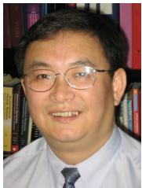

Chun-Yi Su (SM’99) received his Ph.D. degrees in control engineering from South China University of Technology in 1990. After a seven-year stint at the University of Victoria, he joined the Concordia University in 1998. Dr. Su conducts research in the application of automatic control theory to mechanical systems. He is particularly interested in control of systems involving hysteresis nonlinearities. Dr. Su is the author or co-author of over 300 publications, which have appeared in journals, as book chapters and in conference proceedings. Dr. Su has served as Associate Editor of IEEE Transactions on Automatic Control and IEEE Transactions on Control Systems Technology, and Journal of Control Theory & Applications. He is on the Editorial Board of 14 journals, including IFAC journals of Control Engineering Practice and Mechatronics.