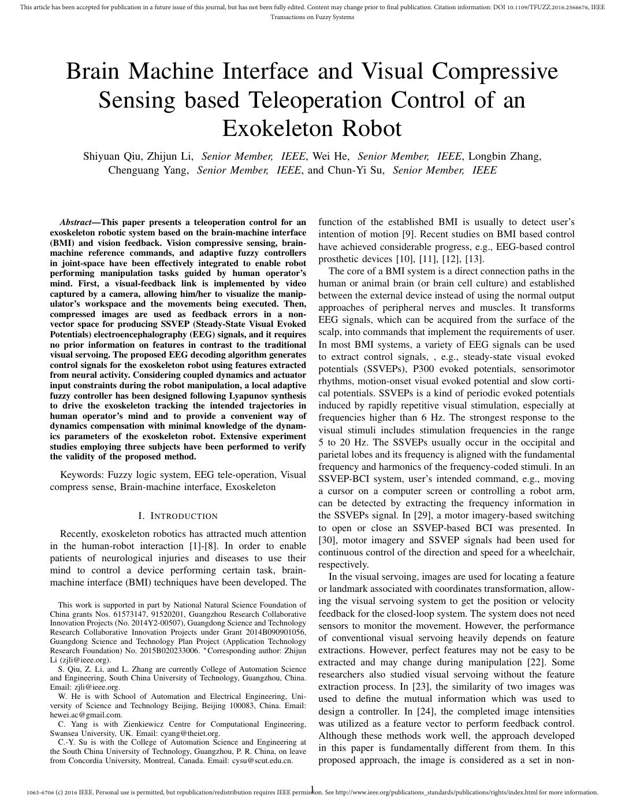
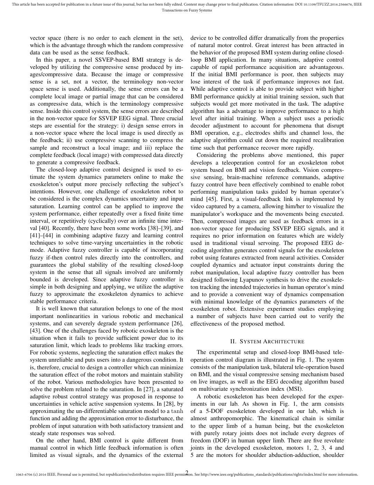
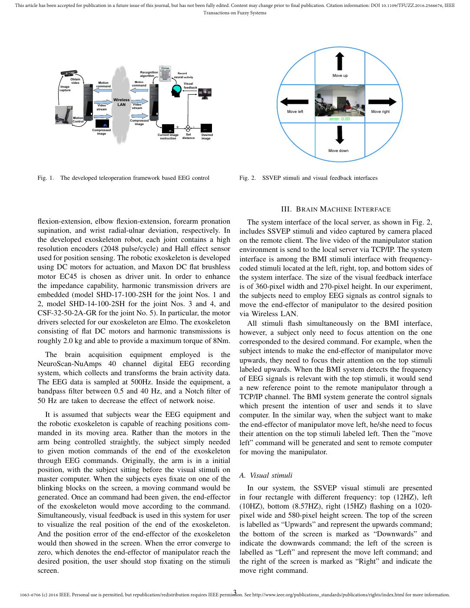
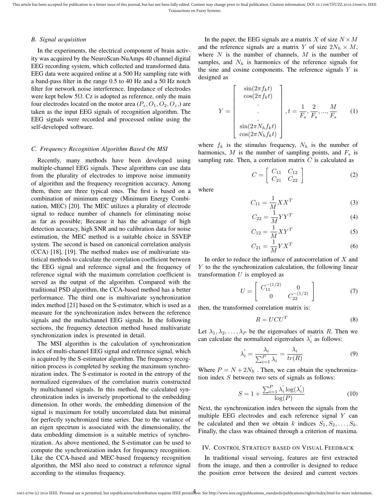
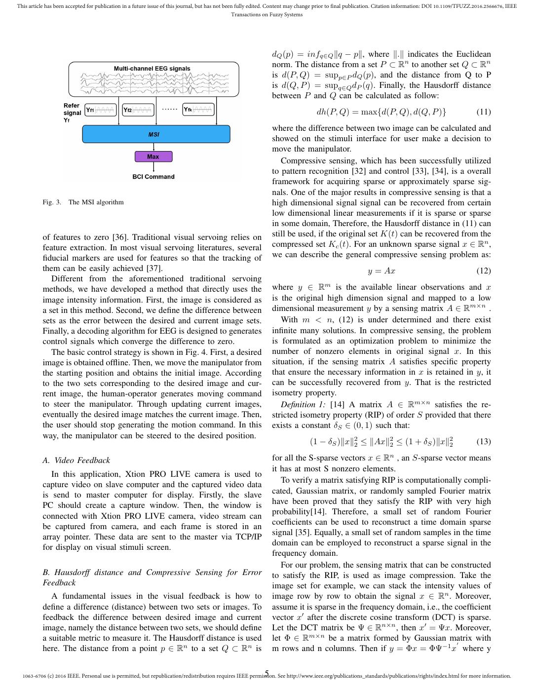
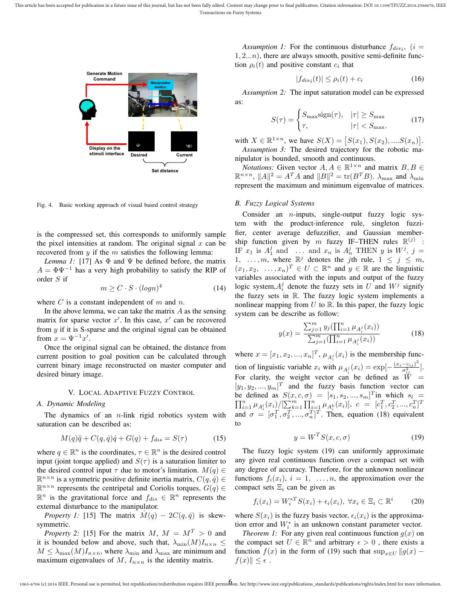
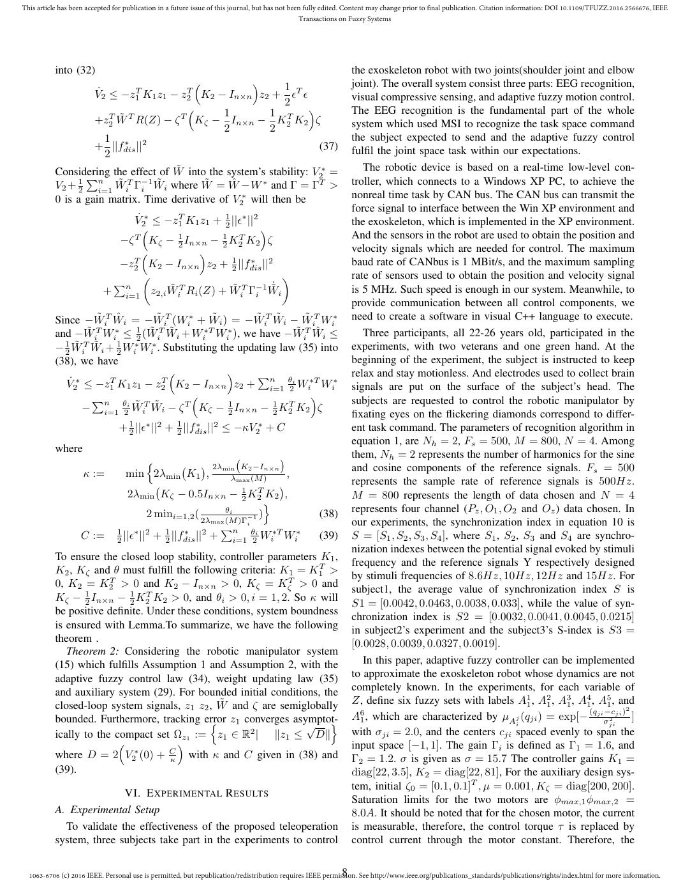
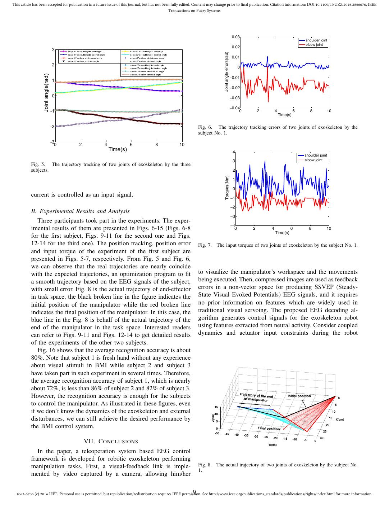
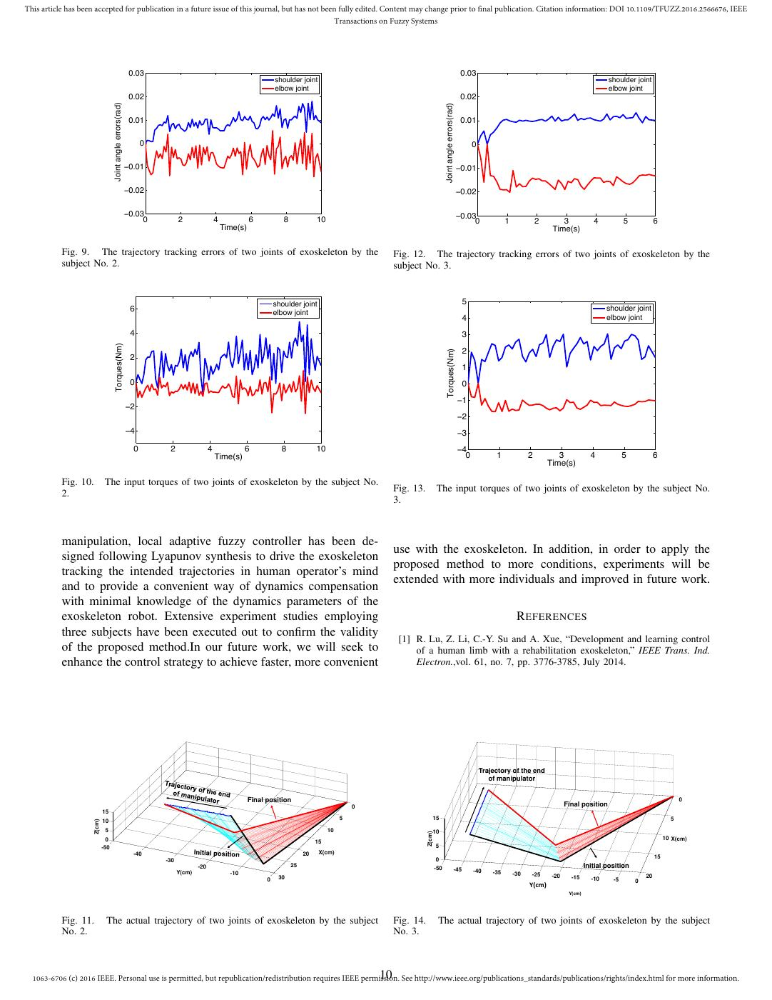
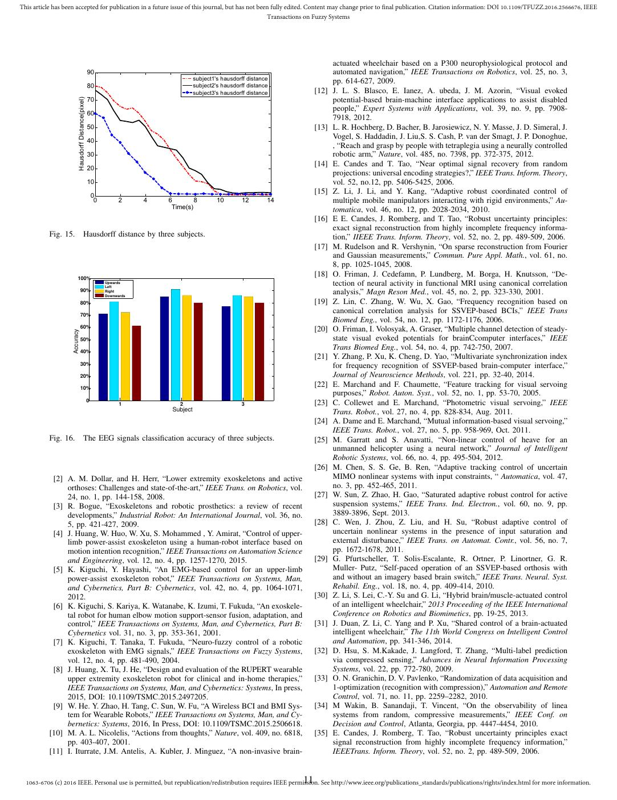

# Qiu2017-TFS：脑机接口与视觉压缩感知外骨骼遥操作

> English text extracted from the source PDF; not translated or editorially corrected. Each original PDF page is embedded below as a rendered image so figures, tables, and vector artwork remain visible.

- Source PDF: `Qiu2017-TFS：脑机接口与视觉压缩感知外骨骼遥操作.pdf`
- SHA-256: `f17559c2573f374f3644a3fd92104159168965b49cb4b7aac4b25c99ec158bd4`
- Pages: 12
- Extraction: Poppler `pdftotext -layout`; page images rendered with `pdftoppm` (max dimension 1400 px, JPEG quality 76).

## Page 1

English text extracted from page 1

<pre>
This article has been accepted for publication in a future issue of this journal, but has not been fully edited. Content may change prior to final publication. Citation information: DOI 10.1109/TFUZZ.2016.2566676, IEEE
                                                                                                 Transactions on Fuzzy Systems

                 Brain Machine Interface and Visual Compressive
                    Sensing based Teleoperation Control of an
                                Exokeleton Robot
                       Shiyuan Qiu, Zhijun Li, Senior Member, IEEE, Wei He, Senior Member, IEEE, Longbin Zhang,
                            Chenguang Yang, Senior Member, IEEE, and Chun-Yi Su, Senior Member, IEEE

              Abstract—This paper presents a teleoperation control for an                                      function of the established BMI is usually to detect user’s
           exoskeleton robotic system based on the brain-machine interface                                     intention of motion [9]. Recent studies on BMI based control
           (BMI) and vision feedback. Vision compressive sensing, brain-                                       have achieved considerable progress, e.g., EEG-based control
           machine reference commands, and adaptive fuzzy controllers
           in joint-space have been effectively integrated to enable robot                                     prosthetic devices [10], [11], [12], [13].
           performing manipulation tasks guided by human operator’s                                               The core of a BMI system is a direct connection paths in the
           mind. First, a visual-feedback link is implemented by video                                         human or animal brain (or brain cell culture) and established
           captured by a camera, allowing him/her to visualize the manip-                                      between the external device instead of using the normal output
           ulator’s workspace and the movements being executed. Then,                                          approaches of peripheral nerves and muscles. It transforms
           compressed images are used as feedback errors in a non-
           vector space for producing SSVEP (Steady-State Visual Evoked                                        EEG signals, which can be acquired from the surface of the
           Potentials) electroencephalography (EEG) signals, and it requires                                   scalp, into commands that implement the requirements of user.
           no prior information on features in contrast to the traditional                                     In most BMI systems, a variety of EEG signals can be used
           visual servoing. The proposed EEG decoding algorithm generates                                      to extract control signals, , e.g., steady-state visual evoked
           control signals for the exoskeleton robot using features extracted                                  potentials (SSVEPs), P300 evoked potentials, sensorimotor
           from neural activity. Considering coupled dynamics and actuator
           input constraints during the robot manipulation, a local adaptive                                   rhythms, motion-onset visual evoked potential and slow corti-
           fuzzy controller has been designed following Lyapunov synthesis                                     cal potentials. SSVEPs is a kind of periodic evoked potentials
           to drive the exoskeleton tracking the intended trajectories in                                      induced by rapidly repetitive visual stimulation, especially at
           human operator’s mind and to provide a convenient way of                                            frequencies higher than 6 Hz. The strongest response to the
           dynamics compensation with minimal knowledge of the dynam-                                          visual stimuli includes stimulation frequencies in the range
           ics parameters of the exoskeleton robot. Extensive experiment
           studies employing three subjects have been performed to verify                                      5 to 20 Hz. The SSVEPs usually occur in the occipital and
           the validity of the proposed method.                                                                parietal lobes and its frequency is aligned with the fundamental
                                                                                                               frequency and harmonics of the frequency-coded stimuli. In an
             Keywords: Fuzzy logic system, EEG tele-operation, Visual                                          SSVEP-BCI system, user’s intended command, e.g., moving
           compress sense, Brain-machine interface, Exoskeleton                                                a cursor on a computer screen or controlling a robot arm,
                                                                                                               can be detected by extracting the frequency information in
                                            I. I NTRODUCTION                                                   the SSVEPs signal. In [29], a motor imagery-based switching
                                                                                                               to open or close an SSVEP-based BCI was presented. In
             Recently, exoskeleton robotics has attracted much attention
                                                                                                               [30], motor imagery and SSVEP signals had been used for
           in the human-robot interaction [1]-[8]. In order to enable
                                                                                                               continuous control of the direction and speed for a wheelchair,
           patients of neurological injuries and diseases to use their
                                                                                                               respectively.
           mind to control a device performing certain task, brain-
                                                                                                                  In the visual servoing, images are used for locating a feature
           machine interface (BMI) techniques have been developed. The
                                                                                                               or landmark associated with coordinates transformation, allow-
              This work is supported in part by National Natural Science Foundation of                         ing the visual servoing system to get the position or velocity
           China grants Nos. 61573147, 91520201, Guangzhou Research Collaborative                              feedback for the closed-loop system. The system does not need
           Innovation Projects (No. 2014Y2-00507), Guangdong Science and Technology                            sensors to monitor the movement. However, the performance
           Research Collaborative Innovation Projects under Grant 2014B090901056,
           Guangdong Science and Technology Plan Project (Application Technology                               of conventional visual servoing heavily depends on feature
           Research Foundation) No. 2015B020233006. ∗ Corresponding author: Zhijun                             extractions. However, perfect features may not be easy to be
           Li (zjli@ieee.org).                                                                                 extracted and may change during manipulation [22]. Some
              S. Qiu, Z. Li, and L. Zhang are currently College of Automation Science
           and Engineering, South China University of Technology, Guangzhou, China.                            researchers also studied visual servoing without the feature
           Email: zjli@ieee.org.                                                                               extraction process. In [23], the similarity of two images was
              W. He is with School of Automation and Electrical Engineering, Uni-                              used to define the mutual information which was used to
           versity of Science and Technology Beijing, Beijing 100083, China. Email:
           hewei.ac@gmail.com.                                                                                 design a controller. In [24], the completed image intensities
              C. Yang is with Zienkiewicz Centre for Computational Engineering,                                was utilized as a feature vector to perform feedback control.
           Swansea University, UK. Email: cyang@theiet.org.                                                    Although these methods work well, the approach developed
              C.-Y. Su is with the College of Automation Science and Engineering at
           the South China University of Technology, Guangzhou, P. R. China, on leave                          in this paper is fundamentally different from them. In this
           from Concordia University, Montreal, Canada. Email: cysu@scut.edu.cn.                               proposed approach, the image is considered as a set in non-

                                                                                                           1 See http://www.ieee.org/publications_standards/publications/rights/index.html for more information.
  1063-6706 (c) 2016 IEEE. Personal use is permitted, but republication/redistribution requires IEEE permission.
</pre>

## Page 2

English text extracted from page 2

<pre>
This article has been accepted for publication in a future issue of this journal, but has not been fully edited. Content may change prior to final publication. Citation information: DOI 10.1109/TFUZZ.2016.2566676, IEEE
                                                                                                 Transactions on Fuzzy Systems

           vector space (there is no order to each element in the set),                                        device to be controlled differ dramatically from the properties
           which is the advantage through which the random compressive                                         of natural motor control. Great interest has been attracted in
           data can be used as the sense feedback.                                                             the behavior of the proposed BMI system during online closed-
              In this paper, a novel SSVEP-based BMI strategy is de-                                           loop BMI application. In many situations, adaptive control
           veloped by utilizing the compressive sense produced by im-                                          capable of rapid performance acquisition are advantageous.
           ages/compressive data. Because the image or compressive                                             If the initial BMI performance is poor, then subjects may
           sense is a set, not a vector, the terminology non-vector                                            lose interest of the task if performance improves not fast.
           space sense is used. Additionally, the sense errors can be a                                        While adaptive control is able to provide subject with higher
           complete local image or partial image that can be considered                                        BMI performance quickly at initial training session, such that
           as compressive data, which is the terminology compressive                                           subjects would get more motivated in the task. The adaptive
           sense. Inside this control system, the sense errors are described                                   algorithm has a advantage to improve performance to a high
           in the non-vector space for SSVEP EEG signal. Three crucial                                         level after initial training. When a subject uses a periodic
           steps are essential for the strategy: i) design sense errors in                                     decoder adjustment to account for phenomena that disrupt
           a non-vector space where the local image is used directly as                                        BMI operation, e.g., electrodes shifts and channel loss, the
           the feedback; ii) use compressive scanning to compress the                                          adaptive algorithm could cut down the required recalibration
           sample and reconstruct a local image; and iii) replace the                                          time such that performance recover more rapidly.
           complete feedback (local image) with compressed data directly                                          Considering the problems above mentioned, this paper
           to generate a compressive feedback.                                                                 develops a teleoperation control for an exoskeleton robot
              The closed-loop adaptive control designed is used to es-                                         system based on BMI and vision feedback. Vision compres-
           timate the system dynamics parameters online to make the                                            sive sensing, brain-machine reference commands, adaptive
           exoskeleton’s output more precisely reflecting the subject’s                                        fuzzy control have been effectively combined to enable robot
           intentions. However, one challenge of exoskeleton robot to                                          performing manipulation tasks guided by human operator’s
           be considered is the complex dynamics uncertainty and input                                         mind [45]. First, a visual-feedback link is implemented by
           saturation. Learning control can be applied to improve the                                          video captured by a camera, allowing him/her to visualize the
           system performance, either repeatedly over a fixed finite time                                      manipulator’s workspace and the movements being executed.
           interval, or repetitively (cyclically) over an infinite time inter-                                 Then, compressed images are used as feedback errors in a
           val [40]. Recently, there have been some works [38]–[39], and                                       non-vector space for producing SSVEP EEG signals, and it
           [41]–[44] in combining adaptive fuzzy and learning control                                          requires no prior information on features which are widely
           techniques to solve time-varying uncertainties in the robotic                                       used in traditional visual servoing. The proposed EEG de-
           mode. Adaptive fuzzy controller is capable of incorporating                                         coding algorithm generates control signals for the exoskeleton
           fuzzy if-then control rules directly into the controllers, and                                      robot using features extracted from neural activities. Consider
           guarantees the global stability of the resulting closed-loop                                        coupled dynamics and actuator input constraints during the
           system in the sense that all signals involved are uniformly                                         robot manipulation, local adaptive fuzzy controller has been
           bounded is developed. Since adaptive fuzzy controller is                                            designed following Lyapunov synthesis to drive the exoskele-
           simple in both designing and applying, we utilize the adaptive                                      ton tracking the intended trajectories in human operator’s mind
           fuzzy to approximate the exoskeleton dynamics to achieve                                            and to provide a convenient way of dynamics compensation
           stable performance criteria.                                                                        with minimal knowledge of the dynamics parameters of the
              It is well known that saturation belongs to one of the most                                      exoskeleton robot. Extensive experiment studies employing
           important nonlinearities in various robotic and mechanical                                          a number of subjects have been carried out to verify the
           systems, and can severely degrade system performance [26],                                          effectiveness of the proposed method.
           [43]. One of the challenges faced by robotic exoskeleton is the
           situation when it fails to provide sufficient power due to its
                                                                                                                                        II. S YSTEM A RCHITECTURE
           saturation limit, which leads to problems like tracking errors.
           For robotic systems, neglecting the saturation effect makes the                                        The experimental setup and closed-loop BMI-based tele-
           system unreliable and puts users into a dangerous condition. It                                     operation control diagram is illustrated in Fig. 1. The system
           is, therefore, crucial to design a controller which can minimize                                    consists of the manipulation task, bilateral tele-operation based
           the saturation effect of the robot motors and maintain stability                                    on BMI, and the visual compressive sensing mechanism based
           of the robot. Various methodologies have been presented to                                          on live images, as well as the EEG decoding algorithm based
           solve the problem related to the saturation. In [27], a saturated                                   on multivariate synchronization index (MSI).
           adaptive robust control strategy was proposed in response to                                           A robotic exoskeleton has been developed for the exper-
           uncertainties in vehicle active suspension systems. In [28], by                                     iments in our lab. As shown in Fig. 1, the arm consists
           approximating the un-differentiable saturation model to a tanh                                      of a 5-DOF exoskeleton developed in our lab, which is
           function and adding the approximation error to disturbance, the                                     almost anthropomorphic. The kinematical chain is similar
           problem of input saturation with both satisfactory transient and                                    to the upper limb of a human being, but the exoskeleton
           steady state responses was solved.                                                                  with purely rotary joints does not include every degrees of
              On the other hand, BMI control is quite different from                                           freedom (DOF) in human upper limb. There are five revolute
           manual control in which little feedback information is often                                        joints in the developed exoskeleton, motors 1, 2, 3, 4 and
           limited as visual signals, and the dynamics of the external                                         5 are the motors for shoulder abduction-adduction, shoulder

                                                                                                           2 See http://www.ieee.org/publications_standards/publications/rights/index.html for more information.
  1063-6706 (c) 2016 IEEE. Personal use is permitted, but republication/redistribution requires IEEE permission.
</pre>

## Page 3

English text extracted from page 3

<pre>
This article has been accepted for publication in a future issue of this journal, but has not been fully edited. Content may change prior to final publication. Citation information: DOI 10.1109/TFUZZ.2016.2566676, IEEE
                                                                                                 Transactions on Fuzzy Systems

                                                                       Recognition           Record
                                                                       algorithm           neural activity                                                     Move up
                            Obtain
                            video            Motion                 Motion
                                                                                                  Visual
                       Image                command               command
                                                                                                  feedback
                      capture

                                                       Wireless
                                             Video      LAN         Video
                                            stream                 stream
                                                                                                                                              Move left                         Move right
                                Motion                                                                                                                        error: 0.00
                                Control                           Compressed
                                                                    image
                                                                                            +                -
                                          Compressed
                                            image                                Current image      Set          Desired
                                                                                  restruction    distance        image

                                                                                                                                                              Move down

           Fig. 1.    The developed teleoperation framework based EEG control                                              Fig. 2.   SSVEP stimuli and visual feedback interfaces

                                                                                                                                            III. B RAIN M ACHINE I NTERFACE
           flexion-extension, elbow flexion-extension, forearm pronation                                                      The system interface of the local server, as shown in Fig. 2,
           supination, and wrist radial-ulnar deviation, respectively. In                                                  includes SSVEP stimuli and video captured by camera placed
           the developed exoskeleton robot, each joint contains a high                                                     on the remote client. The live video of the manipulator station
           resolution encoders (2048 pulse/cycle) and Hall effect sensor                                                   environment is send to the local server via TCP/IP. The system
           used for position sensing. The robotic exoskeleton is developed                                                 interface is among the BMI stimuli interface with frequency-
           using DC motors for actuation, and Maxon DC flat brushless                                                      coded stimuli located at the left, right, top, and bottom sides of
           motor EC45 is chosen as driver unit. In order to enhance                                                        the system interface. The size of the visual feedback interface
           the impedance capability, harmonic transmission drivers are                                                     is of 360-pixel width and 270-pixel height. In our experiment,
           embedded (model SHD-17-100-2SH for the joint Nos. 1 and                                                         the subjects need to employ EEG signals as control signals to
           2, model SHD-14-100-2SH for the joint Nos. 3 and 4, and                                                         move the end-effector of manipulator to the desired position
           CSF-32-50-2A-GR for the joint No. 5). In particular, the motor                                                  via Wireless LAN.
           drivers selected for our exoskeleton are Elmo. The exoskeleton                                                     All stimuli flash simultaneously on the BMI interface,
           consisting of flat DC motors and harmonic transmissions is                                                      however, a subject only need to focus attention on the one
           roughly 2.0 kg and able to provide a maximum torque of 8Nm.                                                     corresponded to the desired command. For example, when the
             The brain acquisition equipment employed is the                                                               subject intends to make the end-effector of manipulator move
           NeuroScan-NuAmps 40 channel digital EEG recording                                                               upwards, they need to focus their attention on the top stimuli
           system, which collects and transforms the brain activity data.                                                  labeled upwards. When the BMI system detects the frequency
           The EEG data is sampled at 500Hz. Inside the equipment, a                                                       of EEG signals is relevant with the top stimuli, it would send
           bandpass filter between 0.5 and 40 Hz, and a Notch filter of                                                    a new reference point to the remote manipulator through a
           50 Hz are taken to decrease the effect of network noise.                                                        TCP/IP channel. The BMI system generate the control signals
                                                                                                                           which present the intention of user and sends it to slave
              It is assumed that subjects wear the EEG equipment and                                                       computer. In the similar way, when the subject want to make
           the robotic exoskeleton is capable of reaching positions com-                                                   the end-effector of manipulator move left, he/she need to focus
           manded in its moving area. Rather than the motors in the                                                        their attention on the top stimuli labeled left. Then the ”move
           arm being controlled straightly, the subject simply needed                                                      left” command will be generated and sent to remote computer
           to given motion commands of the end of the exoskeleton                                                          for moving the manipulator.
           through EEG commands. Originally, the arm is in a initial
           position, with the subject sitting before the visual stimuli on
           master computer. When the subjects eyes fixate on one of the                                                    A. Visual stimuli
           blinking blocks on the screen, a moving command would be                                                           In our system, the SSVEP visual stimuli are presented
           generated. Once an command had been given, the end-effector                                                     in four rectangle with different frequency: top (12HZ), left
           of the exoskeleton would move according to the command.                                                         (10HZ), bottom (8.57HZ), right (15HZ) flashing on a 1020-
           Simultaneously, visual feedback is used in this system for user                                                 pixel wide and 580-pixel height screen. The top of the screen
           to visualize the real position of the end of the exoskeleton.                                                   is labelled as “Upwards” and represent the upwards command;
           And the position error of the end-effector of the exoskeleton                                                   the bottom of the screen is marked as “Downwards” and
           would then showed in the screen. When the error converge to                                                     indicate the downwards command; the left of the screen is
           zero, which denotes the end-effector of manipulator reach the                                                   labelled as “Left” and represent the move left command; and
           desired position, the user should stop fixating on the stimuli                                                  the right of the screen is marked as “Right” and indicate the
           screen.                                                                                                         move right command.

                                                                                                           3 See http://www.ieee.org/publications_standards/publications/rights/index.html for more information.
  1063-6706 (c) 2016 IEEE. Personal use is permitted, but republication/redistribution requires IEEE permission.
</pre>

## Page 4

English text extracted from page 4

<pre>
This article has been accepted for publication in a future issue of this journal, but has not been fully edited. Content may change prior to final publication. Citation information: DOI 10.1109/TFUZZ.2016.2566676, IEEE
                                                                                                 Transactions on Fuzzy Systems

           B. Signal acquisition                                                                                  In the paper, the EEG signals are a matrix X of size N ×M
                                                                                                               and the reference signals are a matrix Y of size 2Nh × M ,
               In the experiments, the electrical component of brain activ-
                                                                                                               where N is the number of channels, M is the number of
           ity was acquired by the NeuroScan-NuAmps 40 channel digital
                                                                                                               samples, and Nh is harmonics of the reference signals for
           EEG recording system, which collected and transformed data.
                                                                                                               the sine and cosine components. The reference signals Y is
           EEG data were acquired online at a 500 Hz sampling rate with
                                                                                                               designed as
           a band-pass filter in the range 0.5 to 40 Hz and a 50 Hz notch                                                                      
           filter for network noise interference. Impedance of electrodes                                                          sin(2πfk t)
           were kept below 5Ω. Cz is adopted as reference, only the main                                                      cos(2πfk t) 
                                                                                                                                               
           four electrodes located on the motor area (Pz , O1 , O2 , Oz ,) are                                                         .       
                                                                                                                                               
           taken as the input EEG signals of recognition algorithm. The                                                 Y =           .        , t = 1 , 2 , ..., M    (1)
                                                                                                                                                       Fs Fs        Fs
           EEG signals were recorded and processed online using the                                                                    .       
                                                                                                                                               
           self-developed software.                                                                                           sin(2πNh fk t) 
                                                                                                                                 cos(2πNh fk t)
                                                                                                               where fk is the stimulus frequency, Nh is the number of
           C. Frequency Recognition Algorithm Based On MSI
                                                                                                               harmonics, M is the number of sampling points, and Fs is
              Recently, many methods have been developed using                                                 sampling rate. Then, a correlation matrix C is calculated as
           multiple-channel EEG signals. These algorithms can use data                                                                  [              ]
                                                                                                                                           C11 C12
           from the plurality of electrodes to improve noise immunity                                                              C=                                     (2)
                                                                                                                                           C21 C22
           of algorithm and the frequency recognition accuracy. Among
           them, there are three typical ones. The first is based on a                                         where
           combination of minimum energy (Minimum Energy Combi-                                                                               1
                                                                                                                                                 XX T
                                                                                                                                              C11 =                         (3)
           nation, MEC) [20]. The MEC utilizes a plurality of electrode                                                                      M
           signal to reduce number of channels for eliminating noise                                                                           1
                                                                                                                                     C22 =       YYT                        (4)
           as far as possible; Because it has the advantage of high                                                                          M
           detection accuracy, high SNR and no calibration data for noise                                                                     1
                                                                                                                                    C12 =        XY T                       (5)
           estimation, the MEC method is a suitable choice in SSVEP                                                                          M
           system. The second is based on canonical correlation analysis                                                                      1
                                                                                                                                    C21 =        Y XT                       (6)
           (CCA) [18], [19]. The method makes use of multivariate sta-                                                                       M
           tistical methods to calculate the correlation coefficient between                                      In order to reduce the influence of autocorrelation of X and
           the EEG signal and reference signal and the frequency of                                            Y to the the synchronization calculation, the following linear
           reference signal with the maximum correlation coefficient is                                        transformation U is employed as
           served as the output of the algorithm. Compared with the                                                                   [                      ]
                                                                                                                                           −(1/2)
           traditional PSD algorithm, the CCA-based method has a better                                                                 C11            0
                                                                                                                                 U=                   −(1/2)                (7)
           performance. The third one is multivariate synchronization                                                                        0      C22
           index method [21] based on the S-estimator, which is used as a                                      then, the transformed correlation matrix is:
           measure for the synchronization index between the reference
           signals and the multichannel EEG signals. In the following                                                                            R = U CU T                                               (8)
           sections, the frequency detection method based multivariate
                                                                                                               Let λ1 , λ2 , . . . , λP be the eigenvalues of matrix R. Then we
           synchronization index is presented in detail.                                                                                                       ′
                                                                                                               can calculate the normalized eigenvalues λi as follows:
              The MSI algorithm is the calculation of synchronization
           index of multi-channel EEG signal and reference signal, which                                                                 ′    λi                      λi
                                                                                                                                        λi = ∑P                 =                                         (9)
           is acquired by the S-estimator algorithm. The frequency recog-                                                                            i=1 λi
                                                                                                                                                                    tr(R)
           nition process is completed by seeking the maximum synchro-
                                                                                                               Where P = N + 2Nh . Then, we can obtain the synchroniza-
           nization index. The S-estimator is rooted in the entropy of the
                                                                                                               tion index S between two sets of signals as follows:
           normalized eigenvalues of the correlation matrix constructed                                                               ∑P      ′      ′
           by multichannel signals. In this method, the calculated syn-                                                                      λ log(λi )
                                                                                                                              S = 1 + i=1 i                         (10)
           chronization index is inversely proportional to the embedding                                                                   log(P )
           dimension. In other words, the embedding dimension of the
                                                                                                               Next, the synchronization index between the signals from the
           signal is maximum for totally uncorrelated data but minimal
                                                                                                               multiple EEG electrodes and each reference signal Y can
           for perfectly synchronized time series. Due to the variance of
                                                                                                               be calculated and then we obtain k indices S1 , S2 , . . . , Sk .
           an eigen spectrum is associated with the dimensionality, the
                                                                                                               Finally, the class was obtained through a criterion of maxima.
           data embedding dimension is a suitable metrics of synchro-
           nization. As above mentioned, the S-estimator can be used to
           compute the synchronization index for frequency recognition.                                          IV. C ONTROL S TRATEGY BASED ON V ISUAL F EEDBACK
           Like the CCA-based and MEC-based frequency recognition                                                 In traditional visual servoing, features are first extracted
           algorithm, the MSI also need to construct a reference signal                                        from the image, and then a controller is designed to reduce
           according to the stimulus frequency.                                                                the position error between the desired and current vectors

                                                                                                           4 See http://www.ieee.org/publications_standards/publications/rights/index.html for more information.
  1063-6706 (c) 2016 IEEE. Personal use is permitted, but republication/redistribution requires IEEE permission.
</pre>

## Page 5

English text extracted from page 5

<pre>
This article has been accepted for publication in a future issue of this journal, but has not been fully edited. Content may change prior to final publication. Citation information: DOI 10.1109/TFUZZ.2016.2566676, IEEE
                                                                                                 Transactions on Fuzzy Systems

                                                                                                               dQ (p) = infq∈Q ∥q − p∥, where ∥.∥ indicates the Euclidean
                                                                                                               norm. The distance from a set P ⊂ Rn to another set Q ⊂ Rn
                                                                                                               is d(P, Q) = supp∈P dQ (p), and the distance from Q to P
                                                                                                               is d(Q, P ) = supq∈Q dP (q). Finally, the Hausdorff distance
                                                                                                               between P and Q can be calculated as follow:
                                                                                                                                  dh(P, Q) = max{d(P, Q), d(Q, P )}                                     (11)
                                                                                                               where the difference between two image can be calculated and
                                                                                                               showed on the stimuli interface for user make a decision to
                                                                                                               move the manipulator.
                                                                                                                  Compressive sensing, which has been successfully utilized
                                                                                                               to pattern recognition [32] and control [33], [34], is a overall
                                                                                                               framework for acquiring sparse or approximately sparse sig-
                                                                                                               nals. One of the major results in compressive sensing is that a
           Fig. 3.    The MSI algorithm                                                                        high dimensional signal signal can be recovered from certain
                                                                                                               low dimensional linear measurements if it is sparse or sparse
                                                                                                               in some domain, Therefore, the Hausdorff distance in (11) can
           of features to zero [36]. Traditional visual servoing relies on                                     still be used, if the original set K(t) can be recovered from the
           feature extraction. In most visual servoing literatures, several                                    compressed set Kc (t). For an unknown sparse signal x ∈ Rn ,
           fiducial markers are used for features so that the tracking of                                      we can describe the general compressive sensing problem as:
           them can be easily achieved [37].                                                                                                             y = Ax                                         (12)
              Different from the aforementioned traditional servoing
           methods, we have developed a method that directly uses the                                          where y ∈ Rm is the available linear observations and x
           image intensity information. First, the image is considered as                                      is the original high dimension signal and mapped to a low
           a set in this method. Second, we define the difference between                                      dimensional measurement y by a sensing matrix A ∈ Rm×n .
           sets as the error between the desired and current image sets.                                          With m &lt; n, (12) is under determined and there exist
           Finally, a decoding algorithm for EEG is designed to generates                                      infinite many solutions. In compressive sensing, the problem
           control signals which converge the difference to zero.                                              is formulated as an optimization problem to minimize the
              The basic control strategy is shown in Fig. 4. First, a desired                                  number of nonzero elements in original signal x. In this
           image is obtained offline. Then, we move the manipulator from                                       situation, if the sensing matrix A satisfies specific property
           the starting position and obtains the initial image. According                                      that ensure the necessary information in x is retained in y, it
           to the two sets corresponding to the desired image and cur-                                         can be successfully recovered from y. That is the restricted
           rent image, the human-operator generates moving command                                             isometry property.
           to steer the manipulator. Through updating current images,                                             Definition 1: [14] A matrix A ∈ Rm×n satisfies the re-
           eventually the desired image matches the current image. Then,                                       stricted isometry property (RIP) of order S provided that there
           the user should stop generating the motion command. In this                                         exists a constant δS ∈ (0, 1) such that:
           way, the manipulator can be steered to the desired position.
                                                                                                                               (1 − δS )∥x∥22 ≤ ∥Ax∥22 ≤ (1 + δS )∥x∥22                                 (13)

           A. Video Feedback                                                                                   for all the S-sparse vectors x ∈ Rn , an S-sparse vector means
                                                                                                               it has at most S nonzero elements.
              In this application, Xtion PRO LIVE camera is used to
           capture video on slave computer and the captured video data                                            To verify a matrix satisfying RIP is computationally compli-
           is send to master computer for display. Firstly, the slave                                          cated, Gaussian matrix, or randomly sampled Fourier matrix
           PC should create a capture window. Then, the window is                                              have been proved that they satisfy the RIP with very high
           connected with Xtion PRO LIVE camera, video stream can                                              probability[14]. Therefore, a small set of random Fourier
           be captured from camera, and each frame is stored in an                                             coefficients can be used to reconstruct a time domain sparse
           array pointer. These data are sent to the master via TCP/IP                                         signal [35]. Equally, a small set of random samples in the time
           for display on visual stimuli screen.                                                               domain can be employed to reconstruct a sparse signal in the
                                                                                                               frequency domain.
                                                                                                                  For our problem, the sensing matrix that can be constructed
           B. Hausdorff distance and Compressive Sensing for Error                                             to satisfy the RIP, is used as image compression. Take the
           Feedback                                                                                            image set for example, we can stack the intensity values of
              A fundamental issues in the visual feedback is how to                                            image row by row to obtain the signal x ∈ Rn . Moreover,
           define a difference (distance) between two sets or images. To                                       assume it is sparse in the frequency domain, i.e., the coefficient
           feedback the difference between desired image and current                                           vector x′ after the discrete cosine transform (DCT) is sparse.
           image, namely the distance between two sets, we should define                                       Let the DCT matrix be Ψ ∈ Rn×n , then x′ = Ψx. Moreover,
           a suitable metric to measure it. The Hausdorff distance is used                                     let Φ ∈ Rm×n be a matrix formed by Gaussian matrix with
                                                                                                                                                                      ′
           here. The distance from a point p ∈ Rn to a set Q ⊂ Rn is                                           m rows and n columns. Then if y = Φx = ΦΨ−1 x where y

                                                                                                           5 See http://www.ieee.org/publications_standards/publications/rights/index.html for more information.
  1063-6706 (c) 2016 IEEE. Personal use is permitted, but republication/redistribution requires IEEE permission.
</pre>

## Page 6

English text extracted from page 6

<pre>
This article has been accepted for publication in a future issue of this journal, but has not been fully edited. Content may change prior to final publication. Citation information: DOI 10.1109/TFUZZ.2016.2566676, IEEE
                                                                                                 Transactions on Fuzzy Systems

                                                                                                                  Assumption 1: For the continuous disturbance fdis i , (i =
                                                                                                               1, 2...n), there are always smooth, positive semi-definite func-
                                                                                                               tion ρi (t) and positive constant ci that
                                    Generate Motion
                                      Command
                                                                    Manipulator
                                                                                                                                              |fdis i (t)| ≤ ρi (t) + ci                                (16)
                                                                      motion
                                                                                                                  Assumption 2: The input saturation model can be expressed
                                                                                                               as:
                                                                                                                                    {
                                                                                                                                      Smax sign(τ ), |τ | ≥ Smax
                                                                                                                            S(τ ) =                                    (17)
                                                                                                                                      τ,              |τ | &lt; Smax .
                                                                                                                                                    [                    ]
                                                                                                               with X ∈ R1×n , we have S(X) = S(x1 ), S(x2 ), ....S(xn ) .
                                     Display on the                                                               Assumption 3: The desired trajectory for the robotic ma-
                                     stimuli interface    Desired                 Current
                                                                                                               nipulator is bounded, smooth and continuous.
                                                                     Set distance
                                                                                                                  Notations: Given vector A, A ∈ R1×n and matrix B, B ∈
                                                                                                               R n×n
                                                                                                                     , ∥A∥2 = AT A and ∥B∥2 = tr(B T B). λmax and λmin
                                                                                                               represent the maximum and minimum eigenvalue of matrices.

           Fig. 4.    Basic working approach of visual based control strategy                                  B. Fuzzy Logical Systems
                                                                                                                  Consider an n-inputs, single-output fuzzy logic sys-
                                                                                                               tem with the product-inference rule, singleton fuzzi-
           is the compressed set, this corresponds to uniformly sample                                         fier, center average defuzzifier, and Gaussian member-
           the pixel intensities at random. The original signal x can be                                       ship function given by m fuzzy IF–THEN rules R(j) :
           recovered from y if the m satisfies the following lemma:                                            IF x1 is Aj1 and . . . and xn is Ajn THEN y is W j , j =
              Lemma 1: [17] As Φ and Ψ be defined before, the matrix                                           1, . . . , m, where Rj denotes the jth rule, 1 ≤ j ≤ m,
           A = ΦΨ−1 has a very high probability to satisfy the RIP of                                          (x1 , x2 , . . . , xn )T ∈ U ⊂ Rn and y ∈ R are the linguistic
           order S if                                                                                          variables associated with the inputs and output of the fuzzy
                                 m ≥ C · S · (logn)4                (14)                                       logic system,Aji denote the fuzzy sets in U and W j signify
                                                                                                               the fuzzy sets in R. The fuzzy logic system implements a
           where C is a constant independent of m and n.                                                       nonlinear mapping from U to R. In this paper, the fuzzy logic
              In the above lemma, we can take the matrix A as the sensing                                      system can be describe as follow:
           matrix for sparse vector x′ . In this case, x′ can be recovered                                                                ∑m        ∏n
           from y if it is S-sparse and the original signal can be obtained                                                                 j=1 yj ( i=1 µAji (xi ))
                                                                                                                                  y(x) = ∑m ∏n                          (18)
           from x = Ψ−1 x′ .                                                                                                                 j=1 ( i=1 µAj (xi ))           i
              Once the original signal can be obtained, the distance from
                                                                                                                                                       T
           current position to goal position can be calculated through                                         where x = [x1 , x2 , ..., xn ] , µAj (xi ) is the membership func-
                                                                                                                                                                i
           current binary image reconstructed on master computer and                                                                                                                           (x −c )2
                                                                                                               tion of linguistic variable xi with µAj (xi ) = exp[− i σ2 ij ].
                                                                                                                                                           i                      ij
           desired binary image.                                                                               For clarity, the weight vector can be defined as W =
                                                                                                               [y1 , y2 , ..., ym ]T and the fuzzy basis function vector can
                           V. L OCAL A DAPTIVE F UZZY C ONTROL                                                                              σ) = [s1 , s2 , ..., sm ]T in which sl =
                                                                                                               ∏n defined as S(x,
                                                                                                               be                    ∑m c, ∏  n
           A. Dynamic Modeling                                                                                         µ
                                                                                                                  i=1 Ai    l (xi )/[   k=1   i=1 µAk
                                                                                                                                                    i
                                                                                                                                                      (xi )], c = [cT1 , cT2 , ..., cTn ]T
                                                                                                                                  T   T      T T
              The dynamics of an n-link rigid robotics system with                                             and σ = [σ1 , σ2 , ..., σn ] . Then, equation (18) equivalent
           saturation can be described as:                                                                     to
                       M (q)q̈ + C(q, q̇)q̇ + G(q) + fdis = S(τ )                                   (15)                                    y = W T S(x, c, σ)                                          (19)
           where q ∈ Rn is the coordinates, τ ∈ Rn is the desired control                                        The fuzzy logic system (19) can uniformly approximate
           input (joint torque applied) and S(τ ) is a saturation limiter to                                   any given real continuous function over a compact set with
           the desired control input τ due to motor’s limitation. M (q) ∈                                      any degree of accuracy. Therefore, for the unknown nonlinear
           Rn×n is a symmetric positive definite inertia matrix, C(q, q̇) ∈                                    functions fi (xi ), i = 1, . . . , n, the approximation over the
           Rn×n represents the centripetal and Coriolis torques, G(q) ∈                                        compact sets Ξi can be given as
           Rn is the gravitational force and fdis ∈ Rn represents the
                                                                                                                        fi (xi ) = Wi∗T S(xi ) + ϵi (xi ), ∀xi ∈ Ξi ⊂ Ri                                (20)
           external disturbance to the manipulator.
              Property 1: [15] The matrix Ṁ (q) − 2C(q, q̇) is skew-                                          where S(xi ) is the fuzzy basis vector, ϵi (xi ) is the approxima-
           symmetric.                                                                                          tion error and Wi∗ is an unknown constant parameter vector.
              Property 2: [15] For the matrix M , M = M T &gt; 0 and                                                 Theorem 1: For any given real continuous function g(x) on
           it is bounded below and above, such that, λmin (M )In×n ≤                                           the compact set U ∈ Rn and arbitrary ϵ &gt; 0 , there exists a
           M ≤ λmax (M )In×n , where λmin and λmax are minimum and                                             function f (x) in the form of (19) such that supx∈U ∥g(x) −
           maximum eigenvalues of M , In×n is the identity matrix.                                             f (x)∥ ≤ ϵ .

                                                                                                           6 See http://www.ieee.org/publications_standards/publications/rights/index.html for more information.
  1063-6706 (c) 2016 IEEE. Personal use is permitted, but republication/redistribution requires IEEE permission.
</pre>

## Page 7

English text extracted from page 7

<pre>
This article has been accepted for publication in a future issue of this journal, but has not been fully edited. Content may change prior to final publication. Citation information: DOI 10.1109/TFUZZ.2016.2566676, IEEE
                                                                                                 Transactions on Fuzzy Systems

               Remark 1: The optimal weight vector Wi∗ in (20) is an                                           0.5∆τ T ∆τ + ζ T ∆τ ≤ −ζ T Kζ ζ − |z2T ∆τ | + 12 ζ T ζ. Time
           artificial quantity for analytical purposes only. Typically, Wi∗                                    derivative of V̇2 will then be
           is chosen as the value of Wi that minimizes ϵi (xi ) for all
           xi ∈ Ξi where Ξi ⊂ Ri is a compact set, i.e., Wi∗ :=                                                V̇2 ≤      −z1T K1 z1 + z1T z2 − ζ T (Kζ − 0.5In×n )ζ − |z2T ∆τ |
                                                                                                                                  [
           arg minc∈Rn {supx∈Ξi |fi (xi ) − WiT S(xi )|}                                                                     +z2T S(τ ) − fdis − C(x1 , x2 )α1 (t) − G(x1 )
               Assumption 4: : On a compact region Ξi ∈ Ri , |ϵi (xi )| ≤                                                                                   ]
           ϵi , where ϵ∗i &gt; 0 is unknown bound.
            ∗                                                                                                                                −M (x1 )α̇1 (t)                 (31)
               According to the above analysis, the uncertainties of the
           system are transformed into the estimation of unknown pa-
                                                                                                                  Since τ = S(τ ) − ∆τ , it is clear that z2T S(τ ) − z2T ∆τ ≥
           rameters Wi∗ and unknown bounds ϵ∗i .
                                                                                                               z2 S(τ ) − |z2T ∆τ |. Substituting it into inequality (31)
                                                                                                                T

                                                                                                                          V̇2 ≤ −z1T K1 z1 + z1T z2 − ζ T (Kζ − 0.5In×n )ζ
           C. Local Adaptive Fuzzy Control                                                                                       [
                                                                                                                             +z2T τ − fdis − C(x1 , x2 )α1 (t) − G(x1 )
               If we let x1                  =    [q1 , q2 , q3 , . . . , qn ]T , x2 =                                                                     ]
                                       T
           [q̇1 , q̇2 , q̇3 ...., q̇n ] , the robotics dynamics can therefore                                                             −M (x1 )α̇1 (t)                                               (32)
           be expressed as:
                                                                  ẋ1 = x2 ,                        (21)           Substituting (30) into (32), we have
                                 −1
             ẋ2 = M (x1 )            [S(τ ) − fdis − G(x1 ) − C(x1 , x2 )x2 ]                      (22)
           where xr denotes to the desired trajectory and the error                                                                             (        1      )
           variables z1 and z2 are defined as follow:                                                                    V̇2 ≤ −z1T K1 z1 − z2T K2 − In×n z2
                                                                                                                                                         2
                                                                                                                                      (     1          1 T )
                                               z1 = x1 − xr ,                                       (23)                        −ζ Kζ − In×n − K2 K2 ζ
                                                                                                                                    T
                                                                                                                                                                          (33)
                                                                                                                                            2          2
                                               z2 = x2 − α1 .                                       (24)
                                                                                                               To ensure the closed loop stability, controller parameters K1 ,
           where α1 is the virtual control to z1 . And for the case of n-                                      K2 and Kζ must fulfill the following criteria: K1 = K1T &gt; 0,
           DOF robot manipulator, α1 ∈ Rn , z1 ∈ Rn and z2 ∈ Rn .                                              K2 = K2T &gt; 0 and K2 − 12 In×n &gt; 0, Kζ = KζT &gt; 0 and
           From definition of z1 , we have                                                                     Kζ − 12 In×n − 12 K2T K2 &gt; 0. So V̇2 will be negative definite.
                                           ż1 = z2 + α1 − ẋr ,                                    (25)
                                                                                                                  However, the controller proposed in (30) may not be real-
           Consider Lyapunov function candidate V1 = 12 z1T z1 . Time                                          izable since it is difficult to obtain perfect and complete infor-
           derivative of V1 is                                                                                 mation of the robotic system. In this case, we may not know
                                                                                                               M (x1 ), C(x1 , x2 ), G(x1 ) and fdis exactly. The model based
                                       V̇1 = z1T (z2 + α1 − ẋr ).                                  (26)
                                                                                                               controller we proposed can hardly be implemented without
             If we let α1 = ẋr − K1 z1 , the above Lyapunov function                                          knowing exact values of M (x1 ), C(x1 , x2 ) and G(x1 ). To
           candidate will then become                                                                          overcome the practical issue faced by this controller, the FLSs
                                                                                                               are used to estimate the parameters related to the model, e.g.
                                       V̇1 = −z1T K1 z1 + z1T z2                                    (27)       M (x1 ), C(x1 , x2 ), G(x1 ) and fdis . We propose
           Differentiating z2 , we have                                                                                        τ = −z1 − K2 (z2 + ζ) + Ŵ T R(Z)                                        (34)
                                 −1
           ż2    = M (x1 )           [S(τ ) − fdis − G(x1 ) − C(x1 , x2 )x2 ] − α̇1                           where Ŵ = blockdiag[ŴiT ], i = 1, 2, . . . , n, contains the
           where                                                                                               approximation parameters; R(Z) = [R1 (Z), . . . , RnT (Z)]T are
                                            α̇1 = −K1 ż1 + ẍr                                     (28)       the fuzzy membership functions. The FLS updating law is
                                                                                                               defined as              (                    )
                                                                                                                              ˙
              The following auxiliary design system is used to examine                                                       Ŵi = −Γi Ri (Z)z2,i + θi Ŵi                (35)
           the saturation effects
                  {                                                                                            where z2,i ∈ R, for i = 1, 2, . . . , n, are the elements of z2 .
                              |z T ∆τ |+0.5∆τ T ∆τ
                    −Kζ ζ − 2          ∥ζ∥2        ζ + ∆τ, ∥ζ∥ ≥ µ                                             The fuzzy system Ŵ T R(Z) approximates W ∗T R(Z) defined
             ζ̇ =                                                   (29)
                    0,                                     ∥ζ∥ &lt; µ.                                            by
           where ∆τ = S(τ ) − τ , Kζ = KζT &gt; 0, µ is a small positive                                            W ∗T R(Z) = C(x1 , x2 )α1 + G(x1 ) + M (x1 )α̇1 − ϵ(Z) (36)
           value and ζ ∈ Rn is the state of auxiliary design system.
                                                                                                               where ϵ(Z) ∈ Rn is the approximation error, which is defined
             The proposed model based controller can be presented as
                                                                                                               in (20), satisfying |ϵ(Z)| ≤ ε̄. For simplification, in the paper,
            τ = −z1 − K2 (z2 + ζ) + fdis + C(x1 , x2 )α1 + G(x1 )                                              we assume that ε̄ is known by estimation beforehand. We
                                  +M (x1 )α̇1                    (30)                                          choose K3 ≥ ε̄ and Z = [q T , q̇ T , α1T ]T are the input variables
                                                                                                               to the feed-forward approximators.
           where the gain matrix satisfies K2 = K2T &gt; 0. Since ζ T ∆τ ≤
           2 ζ ζ + 2 ∆τ ∆τ , we then have ζ ζ̇ = −ζ Kζ ζ − |z2 ∆τ | −
           1 T     1    T                     T      T          T
                                                                                                                   With the new controller as stated in (34) and substitute it

                                                                                                           7 See http://www.ieee.org/publications_standards/publications/rights/index.html for more information.
  1063-6706 (c) 2016 IEEE. Personal use is permitted, but republication/redistribution requires IEEE permission.
</pre>

## Page 8

English text extracted from page 8

<pre>
This article has been accepted for publication in a future issue of this journal, but has not been fully edited. Content may change prior to final publication. Citation information: DOI 10.1109/TFUZZ.2016.2566676, IEEE
                                                                                                 Transactions on Fuzzy Systems

           into (32)                                                                                           the exoskeleton robot with two joints(shoulder joint and elbow
                                                          (  1               )                                 joint). The overall system consist three parts: EEG recognition,
                        V̇2 ≤ −z1T K1 z1 − z2T K2 − In×n z2 + ϵT ϵ                                             visual compressive sensing, and adaptive fuzzy motion control.
                                                             2
                                             (     1       1 T )                                               The EEG recognition is the fundamental part of the whole
                        +z2 W̃ R(Z) − ζ Kζ − In×n − K2 K2 ζ
                            T  T           T
                                                                                                               system which used MSI to recognize the task space command
                                                   2       2
                           1 ∗ 2                                                                               the subject expected to send and the adaptive fuzzy control
                        + ||fdis ||                                (37)                                        fulfil the joint space task within our expectations.
                           2
           Considering            of W̃ into the system’s stability: V2∗ =                                        The robotic device is based on a real-time low-level con-
                  ∑n theTeffect
                              −1                                                                               troller, which connects to a Windows XP PC, to achieve the
           V2 + 2 i=1 W̃i Γi W̃i where W̃ = Ŵ −W ∗ and Γ = ΓT &gt;
                1

           0 is a gain matrix. Time derivative of V2∗ will then be                                             nonreal time task by CAN bus. The CAN bus can transmit the
                                                                                                               force signal to interface between the Win XP environment and
                                V̇2∗ ≤ −z1T K1 z1 + 12 ||ϵ∗ ||2                                                the exoskeleton, which is implemented in the XP environment.
                                  (                             )
                             −ζ T Kζ − 12 In×n − 12 K2T K2 ζ                                                   And the sensors in the robot are used to obtain the position and
                                  (            )                                                               velocity signals which are needed for control. The maximum
                                                             ∗
                             −z2T K2 − In×n z2 + 12 ||fdis      ||2                                            baud rate of CANbus is 1 MBit/s, and the maximum sampling
                                  (                                 )                                          rate of sensors used to obtain the position and velocity signal
                            ∑n            T               T −1 ˙
                           + i=1 z2,i W̃i Ri (Z) + W̃i Γi W̃i                                                  is 5 MHz. Such speed is enough in our system. Meanwhile, to
                                                                                                               provide communication between all control components, we
           Since −W̃iT Ŵi = −W̃iT (Wi∗ + W̃i ) = −W̃iT W̃i − W̃iT Wi∗                                         need to create a software in visual C++ language to execute.
           and −W̃iT Wi∗ ≤ 21 (W̃iT W̃i + Wi∗T Wi∗ ), we have −W̃iT Ŵi ≤                                         Three participants, all 22-26 years old, participated in the
           − 12 W̃iT W̃i + 21 Wi∗ Wi∗ . Substituting the updating law (35) into                                experiments, with two veterans and one green hand. At the
           (38), we have                                                                                       beginning of the experiment, the subject is instructed to keep
                                         (             )     ∑n                                                relax and stay motionless. And electrodes used to collect brain
              V̇2∗ ≤ −z1T K1 z1 − z2T K2 − In×n z2 + i=1 θ2i Wi∗T Wi∗                                          signals are put on the surface of the subject’s head. The
                     ∑n                       (                         )                                      subjects are requested to control the robotic manipulator by
                  − i=1 θ2i W̃iT W̃i − ζ T Kζ − 12 In×n − 12 K2T K2 ζ
                                                                                                               fixating eyes on the flickering diamonds correspond to differ-
                                + 12 ||ϵ∗ ||2 + 21 ||fdis
                                                      ∗
                                                          ||2 ≤ −κV2∗ + C                                      ent task command. The parameters of recognition algorithm in
                                                                                                               equation 1, are Nh = 2, Fs = 500, M = 800, N = 4. Among
           where
                                        {                       (         )                                    them, Nh = 2 represents the number of harmonics for the sine
                                                ( ) 2λmin K2 −In×n                                             and cosine components of the reference signals. Fs = 500
                    κ :=           min 2λmin K1 ,            λmax (M )      ,
                                          (                               )                                    represents the sample rate of reference signals is 500Hz.
                                   2λmin Kζ − 0.5In×n − 21 K2T K2 ,                                            M = 800 represents the length of data chosen and N = 4
                                                                        }
                                        2 mini=1,2 ( 2λ (M  θi                                                 represents four channel (Pz , O1 , O2 and Oz ) data chosen. In
                                                                   −1 )                             (38)
                                                                )Γ                                             our experiments, the synchronization index in equation 10 is
                                                          ∑n i θi ∗T ∗
                                                        max
                                     ∗ 2         ∗
                                2 ||ϵ || + 2 ||fdis || +
                                1           1         2
                   C :=                                        i=1 2
                                                                      Wi Wi                         (39)       S = [S1 , S2 , S3 , S4 ], where S1 , S2 , S3 and S4 are synchro-
                                                                                                               nization indexes between the potential signal evoked by stimuli
           To ensure the closed loop stability, controller parameters K1 ,
                                                                                                               frequency and the reference signals Y respectively designed
           K2 , Kζ and θ must fulfill the following criteria: K1 = K1T &gt;
                                                                                                               by stimuli frequencies of 8.6Hz, 10Hz, 12Hz and 15Hz. For
           0, K2 = K2T &gt; 0 and K2 − In×n &gt; 0, Kζ = KζT &gt; 0 and
                                                                                                               subject1, the average value of synchronization index S is
           Kζ − 21 In×n − 12 K2T K2 &gt; 0, and θi &gt; 0, i = 1, 2. So κ will                                       S1 = [0.0042, 0.0463, 0.0038, 0.033], while the value of syn-
           be positive definite. Under these conditions, system boundness                                      chronization index is S2 = [0.0032, 0.0041, 0.0045, 0.0215]
           is ensured with Lemma.To summarize, we have the following                                           in subject2’s experiment and the subject3’s S-index is S3 =
           theorem .                                                                                           [0.0028, 0.0039, 0.0327, 0.0019].
              Theorem 2: Considering the robotic manipulator system
           (15) which fulfills Assumption 1 and Assumption 2, with the                                            In this paper, adaptive fuzzy controller can be implemented
           adaptive fuzzy control law (34), weight updating law (35)                                           to approximate the exoskeleton robot whose dynamics are not
           and auxiliary system (29). For bounded initial conditions, the                                      completely known. In the experiments, for each variable of
           closed-loop system signals, z1 z2 , W̃ and ζ are semiglobally                                       Z, define six fuzzy sets with labels A11 , A21 , A31 , A41 , A51 , and
                                                                                                                                                                         (q −c )2
                                                                                                               A61 , which are characterized by µAj (qji ) = exp[− jiσ2 ji ]
                                                                   √ }
                                              { z1 converges asymptot-
           bounded. Furthermore, tracking error                                                                                                        i                      ji

           ically to the compact set Ωz1 := z1 ∈ R2 | ∥z1 ≤ D∥                                                 with σji = 2.0, and the centers cji spaced evenly to span the
                          (            )                                                                       input space [−1, 1]. The gain Γi is defined as Γ1 = 1.6, and
           where D = 2 V2∗ (0) + Cκ with κ and C given in (38) and                                             Γ2 = 1.2. σ is given as σ = 15.7 The controller gains K1 =
           (39).                                                                                               diag[22, 3.5], K2 = diag[22, 81], For the auxiliary design sys-
                                                                                                               tem, initial ζ0 = [0.1, 0.1]T , µ = 0.001, Kζ = diag[200, 200].
                          VI. E XPERIMENTAL R ESULTS
                                                                                                               Saturation limits for the two motors are ϕmax,1 ϕmax,2 =
           A. Experimental Setup                                                                               8.0A. It should be noted that for the chosen motor, the current
             To validate the effectiveness of the proposed teleoperation                                       is measurable, therefore, the control torque τ is replaced by
           system, three subjects take part in the experiments to control                                      control current through the motor constant. Therefore, the

                                                                                                           8 See http://www.ieee.org/publications_standards/publications/rights/index.html for more information.
  1063-6706 (c) 2016 IEEE. Personal use is permitted, but republication/redistribution requires IEEE permission.
</pre>

## Page 9

English text extracted from page 9

<pre>
This article has been accepted for publication in a future issue of this journal, but has not been fully edited. Content may change prior to final publication. Citation information: DOI 10.1109/TFUZZ.2016.2566676, IEEE
                                                                                                 Transactions on Fuzzy Systems

                                                                                                                                                                                             0.03
                                                                                                                                                                                                                                                        shoulder joint
                                                                                                                                                                                                                                                        elbow joint
                                                                                                                                                                                             0.02
                                     3     subject1's shoulder joint real angle                subject2's shoulder joint real angle

                                                                                                                                                                  Joint angle errors(rad)
                                           subject1's shoulder joint desired angle             subject2's shoulder joint desired angle
                                           subject1's elbow joint desired angle                subject2's elbow joint desired angle                                                          0.01
                                           subject1's elbow joint real angle                   subject2's elbow joint real angle

                                     2                                                         subject3's shoulder joint real angle
                                                                                                                                                                                                  0
                                                                                               subject3's shoulder joint desired angle
                                                                                               subject3's elbow joint desired angle
                                                                                               subject3's elbow joint real angle

                  Joint angle(rad)
                                                                                                                                                                                            −0.01
                                     1
                                                                                                                                                                                            −0.02

                                     0                                                                                                                                                      −0.03

                                                                                                                                                                                            −0.04
                                     -1                                                                                                                                                          0              2               4              6            8             10
                                                                                                                                                                                                                                    Time(s)

                                     -2                                                                                                       Fig. 6. The trajectory tracking errors of two joints of exoskeleton by the
                                                                                                                                              subject No. 1.
                                     -3
                                       0              2                          4             6                         8               10
                                                                                     Time(s)                                                                                                 4
                                                                                                                                                                                                                                                       shoulder joint
                                                                                                                                                                                             3                                                         elbow joint
           Fig. 5. The trajectory tracking of two joints of exoskeleton by the three
           subjects.                                                                                                                                                                         2

                                                                                                                                                                     Torques(Nm)
                                                                                                                                                                                             1

                                                                                                                                                                                             0
           current is controlled as an input signal.                                                                                                                                        −1

                                                                                                                                                                                            −2
           B. Experimental Results and Analysis
                                                                                                                                                                                            −3
              Three participants took part in the experiments. The exper-
                                                                                                                                                                                            −4
           imental results of them are presented in Figs. 6-15 (Figs. 6-8                                                                                                                     0             2               4                6              8             10
                                                                                                                                                                                                                                Time(s)
           for the first subject, Figs. 9-11 for the second one and Figs.
           12-14 for the third one). The position tracking, position error                                                                    Fig. 7. The input torques of two joints of exoskeleton by the subject No. 1.
           and input torque of the experiment of the first subject are
           presented in Figs. 5-7, respectively. From Fig. 5 and Fig. 6,
           we can observe that the real trajectories are nearly coincide
           with the expected trajectories, an optimization program to fit                                                                     to visualize the manipulator’s workspace and the movements
           a smooth trajectory based on the EEG signals of the subject,                                                                       being executed. Then, compressed images are used as feedback
           with small error. Fig. 8 is the actual trajectory of end-effector                                                                  errors in a non-vector space for producing SSVEP (Steady-
           in task space, the black broken line in the figure indicates the                                                                   State Visual Evoked Potentials) EEG signals, and it requires
           initial position of the manipulator while the red broken line                                                                      no prior information on features which are widely used in
           indicates the final position of the manipulator. In this case, the                                                                 traditional visual servoing. The proposed EEG decoding al-
           blue line in the Fig. 8 is behalf of the actual trajectory of the                                                                  gorithm generates control signals for the exoskeleton robot
           end of the manipulator in the task space. Interested readers                                                                       using features extracted from neural activity. Consider coupled
           can refer to Figs. 9-11 and Figs. 12-14 to get detailed results                                                                    dynamics and actuator input constraints during the robot
           of the experiments of the other two subjects.
              Fig. 16 shows that the average recognition accuracy is about
           80%. Note that subject 1 is fresh hand without any experience
           about visual stimuli in BMI while subject 2 and subject 3
           have taken part in such experiment in several times. Therefore,
           the average recognition accuracy of subject 1, which is nearly
           about 72%, is less than 86% of subject 2 and 82% of subject 3.
           However, the recognition accuracy is enough for the subjects                                                                                                                                                                     Initial position
                                                                                                                                                                                                                                                                                     0

           to control the manipulator. As illustrated in these figures, even                                                                            15
                                                                                                                                                                                                                                                                                5

           if we don’t know the dynamics of the exoskeleton and external                                                                                10
                                                                                                                                                                                                                                                                               10

           disturbances, we can still achieve the desired performance by                                                                            Z(cm)                                                                                                                  15
                                                                                                                                                                                                                                                                                    X(cm)
                                                                                                                                                            5
                                                                                                                                                                                                                                                                         20
           the BMI control system.                                                                                                                          0
                                                                                                                                                                                                                                                                     25
                                                                                                                                                            -50   -45                         -40     -35   -30     -25     -20       -15      -10                  30
                                                                                                                                                                                                                                                       -5
                                                           VII. C ONCLUSIONS                                                                                                                                              Y(cm)
                                                                                                                                                                                                                                                                0

              In the paper, a teleoperation system based EEG control
           framework is developed for robotic exoskeleton performing
           manipulation tasks. First, a visual-feedback link is imple-                                                                        Fig. 8. The actual trajectory of two joints of exoskeleton by the subject No.
                                                                                                                                              1.
           mented by video captured by a camera, allowing him/her

                                                                                                           9 See http://www.ieee.org/publications_standards/publications/rights/index.html for more information.
  1063-6706 (c) 2016 IEEE. Personal use is permitted, but republication/redistribution requires IEEE permission.
</pre>

## Page 10

English text extracted from page 10

<pre>
This article has been accepted for publication in a future issue of this journal, but has not been fully edited. Content may change prior to final publication. Citation information: DOI 10.1109/TFUZZ.2016.2566676, IEEE
                                                                                                 Transactions on Fuzzy Systems

                                                               0.03                                                                                                                                            0.03
                                                                                                                        shoulder joint                                                                                                                                      shoulder joint
                                                                                                                        elbow joint                                                                                                                                         elbow joint
                                                               0.02                                                                                                                                            0.02

                                    Joint angle errors(rad)                                                                                                                         Joint angle errors(rad)
                                                               0.01                                                                                                                                            0.01

                                                                    0                                                                                                                                               0

                                                              −0.01                                                                                                                                           −0.01

                                                              −0.02                                                                                                                                           −0.02

                                                              −0.03                                                                                                                                           −0.03
                                                                   0          2                 4             6            8             10                                                                        0              1             2       3              4           5            6
                                                                                                    Time(s)                                                                                                                                          Time(s)

           Fig. 9. The trajectory tracking errors of two joints of exoskeleton by the                                                                      Fig. 12. The trajectory tracking errors of two joints of exoskeleton by the
           subject No. 2.                                                                                                                                  subject No. 3.

                                                                                                                        shoulder joint                                                                          5
                                                               6                                                                                                                                                                                                            shoulder joint
                                                                                                                        elbow joint
                                                                                                                                                                                                                4                                                           elbow joint

                                                               4                                                                                                                                                3

                                       Torques(Nm)
                                                                                                                                                                                                                2

                                                                                                                                                                                       Torques(Nm)
                                                               2
                                                                                                                                                                                                                1
                                                               0                                                                                                                                                0
                                                                                                                                                                                                              −1
                                                              −2
                                                                                                                                                                                                              −2
                                                              −4                                                                                                                                              −3
                                                                0        2                  4               6             8              10                                                                   −4
                                                                                                Time(s)                                                                                                         0            1              2          3              4            5            6
                                                                                                                                                                                                                                                    Time(s)

           Fig. 10.            The input torques of two joints of exoskeleton by the subject No.
           2.                                                                                                                                              Fig. 13.           The input torques of two joints of exoskeleton by the subject No.
                                                                                                                                                           3.

           manipulation, local adaptive fuzzy controller has been de-
                                                                                                                                                           use with the exoskeleton. In addition, in order to apply the
           signed following Lyapunov synthesis to drive the exoskeleton
                                                                                                                                                           proposed method to more conditions, experiments will be
           tracking the intended trajectories in human operator’s mind
                                                                                                                                                           extended with more individuals and improved in future work.
           and to provide a convenient way of dynamics compensation
           with minimal knowledge of the dynamics parameters of the
           exoskeleton robot. Extensive experiment studies employing                                                                                                                                                                   R EFERENCES
           three subjects have been executed out to confirm the validity
                                                                                                                                                            [1] R. Lu, Z. Li, C.-Y. Su and A. Xue, “Development and learning control
           of the proposed method.In our future work, we will seek to                                                                                           of a human limb with a rehabilitation exoskeleton,” IEEE Trans. Ind.
           enhance the control strategy to achieve faster, more convenient                                                                                      Electron.,vol. 61, no. 7, pp. 3776-3785, July 2014.

                                                                                                                                                                                                                        Trajectory of the end
                                                                                                                                                                                                                           of manipulator

                                                                                                              Final position                                                                                                                                                                               0
                                                                                                                                                       0                                                                                                   Final position
                              15
                                                                                                                                                   5                      15                                                                                                                           5
                              10
                      Z(cm)    5                                                                                                              10                          10
                                                                                                                                                                      Z(cm)
                                0                                                                                                                                                                                                                                                                    10 X(cm)
                                                                                                                                         15
                              -50                                                                                                                                             5
                                                                -40                                                                 20    X(cm)
                                                                                                                                                                              0                                                                                                                 15
                                                                        -30
                                                                                      -20                                      25
                                                                                                                                                                              -50                                                                                   Initial position
                                                                                                                                                                                                          -45       -40     -35
                                                                              Y(cm)                   -10                                                                                                                             -30   -25
                                                                                                                         30                                                                                                                          -20     -15      -10                  20
                                                                                                                    0                                                                                                                                                         -5       0
                                                                                                                                                                                                                                            Y(cm)
                                                                                                                                                                                                                                                            Y(cm)

           Fig. 11.            The actual trajectory of two joints of exoskeleton by the subject                                                           Fig. 14.            The actual trajectory of two joints of exoskeleton by the subject
           No. 2.                                                                                                                                          No. 3.

                                                                                                         10 See http://www.ieee.org/publications_standards/publications/rights/index.html for more information.
  1063-6706 (c) 2016 IEEE. Personal use is permitted, but republication/redistribution requires IEEE permission.
</pre>

## Page 11

English text extracted from page 11

<pre>
This article has been accepted for publication in a future issue of this journal, but has not been fully edited. Content may change prior to final publication. Citation information: DOI 10.1109/TFUZZ.2016.2566676, IEEE
                                                                                                 Transactions on Fuzzy Systems

                                                                                                                                 actuated wheelchair based on a P300 neurophysiological protocol and
                                                       90                                                                        automated navigation,” IEEE Transactions on Robotics, vol. 25, no. 3,
                                                                                           subject1's hausdorff distance
                                                                                           subject2's hausdorff distance
                                                                                                                                 pp. 614-627, 2009.
                                                       80
                                                                                           subject3's hausdorff distance    [12] J. L. S. Blasco, E. Ianez, A. ubeda, J. M. Azorin, “Visual evoked
                                                                                                                                 potential-based brain-machine interface applications to assist disabled

                           Hausdorff Distance(pixel)
                                                       70
                                                                                                                                 people,” Expert Systems with Applications, vol. 39, no. 9, pp. 7908-
                                                       60
                                                                                                                                 7918, 2012.
                                                       50                                                                   [13] L. R. Hochberg, D. Bacher, B. Jarosiewicz, N. Y. Masse, J. D. Simeral, J.
                                                                                                                                 Vogel, S. Haddadin, J. Liu,S. S. Cash, P. van der Smagt, J. P. Donoghue,
                                                       40
                                                                                                                                 , “Reach and grasp by people with tetraplegia using a neurally controlled
                                                       30                                                                        robotic arm,” Nature, vol. 485, no. 7398, pp. 372-375, 2012.
                                                                                                                            [14] E. Candes and T. Tao, “Near optimal signal recovery from random
                                                       20
                                                                                                                                 projections: universal encoding strategies?,” IEEE Trans. Inform. Theory,
                                                       10                                                                        vol. 52, no.12, pp. 5406-5425, 2006.
                                                           0
                                                                                                                            [15] Z. Li, J. Li, and Y. Kang, “Adaptive robust coordinated control of
                                                            0        2      4   6        8          10       12        14        multiple mobile manipulators interacting with rigid environments,” Au-
                                                                                 Time(s)                                         tomatica, vol. 46, no. 12, pp. 2028-2034, 2010.
                                                                                                                            [16] E E. Candes, J. Romberg, and T. Tao, “Robust uncertainty principles:
                                                                                                                                 exact signal reconstruction from highly incomplete frequency informa-
           Fig. 15.                          Hausdorff distance by three subjects.                                               tion,” IIEEE Trans. Inform. Theory, vol. 52, no. 2, pp. 489-509, 2006.
                                                                                                                            [17] M. Rudelson and R. Vershynin, “On sparse reconstruction from Fourier
                                                                                                                                 and Gaussian measurements,” Commun. Pure Appl. Math., vol. 61, no.
                                                                                                                                 8, pp. 1025-1045, 2008.
                          100%
                                                                                                                            [18] O. Friman, J. Cedefamn, P. Lundberg, M. Borga, H. Knutsson, “De-
                                                                Upwards
                                                                Left
                                                                                                                                 tection of neural activity in functional MRI using canonical correlation
                                90%                             Right
                                                                                                                                 analysis,” Magn Reson Med., vol. 45, no. 2, pp. 323-330, 2001.
                                                                Downwards

                                80%                                                                                         [19] Z. Lin, C. Zhang, W. Wu, X. Gao, “Frequency recognition based on
                                70%
                                                                                                                                 canonical correlation analysis for SSVEP-based BCIs,” IEEE Trans
                                                                                                                                 Biomed Eng., vol. 54, no. 12, pp. 1172-1176, 2006.
                                60%
                                                                                                                            [20] O. Friman, I. Volosyak, A. Graser, “Multiple channel detection of steady-

                    Accuracy
                                50%                                                                                              state visual evoked potentials for brainCcomputer interfaces,” IEEE
                                40%
                                                                                                                                 Trans Biomed Eng., vol. 54, no. 4, pp. 742-750, 2007.
                                                                                                                            [21] Y. Zhang, P. Xu, K. Cheng, D. Yao, “Multivariate synchronization index
                                30%
                                                                                                                                 for frequency recognition of SSVEP-based brain-computer interface,”
                                20%                                                                                              Journal of Neuroscience Methods, vol. 221, pp. 32-40, 2014.
                                10%
                                                                                                                            [22] E. Marchand and F. Chaumette, “Feature tracking for visual servoing
                                                                                                                                 purposes,” Robot. Auton. Syst., vol. 52, no. 1, pp. 53-70, 2005.
                                                       0
                                                                      1             2                        3              [23] C. Collewet and E. Marchand, “Photometric visual servoing,” IEEE
                                                                                 Subject                                         Trans. Robot., vol. 27, no. 4, pp. 828-834, Aug. 2011.
                                                                                                                            [24] A. Dame and E. Marchand, “Mutual information-based visual servoing,”
                                                                                                                                 IEEE Trans. Robot., vol. 27, no. 5, pp. 958-969, Oct. 2011.
           Fig. 16.                          The EEG signals classification accuracy of three subjects.                     [25] M. Garratt and S. Anavatti, “Non-linear control of heave for an
                                                                                                                                 unmanned helicopter using a neural network,” Journal of Intelligent
                                                                                                                                 Robotic Systems, vol. 66, no. 4, pp. 495-504, 2012.
                                                                                                                            [26] M. Chen, S. S. Ge, B. Ren, “Adaptive tracking control of uncertain
            [2] A. M. Dollar, and H. Herr, “Lower extremity exoskeletons and active                                              MIMO nonlinear systems with input constraints, “ Automatica, vol. 47,
                orthoses: Challenges and state-of-the-art,” IEEE Trans. on Robotics, vol.                                        no. 3, pp. 452-465, 2011.
                24, no. 1, pp. 144-158, 2008.                                                                               [27] W. Sun, Z. Zhao, H. Gao, “Saturated adaptive robust control for active
            [3] R. Bogue, “Exoskeletons and robotic prosthetics: a review of recent                                              suspension systems,” IEEE Trans. Ind. Electron., vol. 60, no. 9, pp.
                developments,” Industrial Robot: An International Journal, vol. 36, no.                                          3889-3896, Sept. 2013.
                5, pp. 421-427, 2009.                                                                                       [28] C. Wen, J. Zhou, Z. Liu, and H. Su, “Robust adaptive control of
            [4] J. Huang, W. Huo, W. Xu, S. Mohammed , Y. Amirat, “Control of upper-                                             uncertain nonlinear systems in the presence of input saturation and
                limb power-assist exoskeleton using a human-robot interface based on                                             external disturbance,” IEEE Trans. on Automat. Contr., vol. 56, no. 7,
                motion intention recognition,” IEEE Transactions on Automation Science                                           pp. 1672-1678, 2011.
                and Engineering, vol. 12, no. 4, pp. 1257-1270, 2015.                                                       [29] G. Pfurtscheller, T. Solis-Escalante, R. Ortner, P. Linortner, G. R.
            [5] K. Kiguchi, Y. Hayashi, “An EMG-based control for an upper-limb                                                  Muller- Putz, “Self-paced operation of an SSVEP-based orthosis with
                power-assist exoskeleton robot,” IEEE Transactions on Systems, Man,                                              and without an imagery based brain switch,” IEEE Trans. Neural. Syst.
                and Cybernetics, Part B: Cybernetics, vol. 42, no. 4, pp. 1064-1071,                                             Rehabil. Eng., vol. 18, no. 4, pp. 409-414, 2010.
                2012.                                                                                                       [30] Z. Li, S. Lei, C.-Y. Su and G. Li, “Hybrid brain/muscle-actuated control
            [6] K. Kiguchi, S. Kariya, K. Watanabe, K. Izumi, T. Fukuda, “An exoskele-                                           of an intelligent wheelchair,” 2013 Proceeding of the IEEE International
                tal robot for human elbow motion support-sensor fusion, adaptation, and                                          Conference on Robotics and Biomimetics, pp. 19-25, 2013.
                control,” IEEE Transactions on Systems, Man, and Cybernetics, Part B:                                       [31] J. Duan, Z. Li, C. Yang and P. Xu, “Shared control of a brain-actuated
                Cybernetics vol. 31, no. 3, pp. 353-361, 2001.                                                                   intelligent wheelchair,” The 11th World Congress on Intelligent Control
            [7] K. Kiguchi, T. Tanaka, T. Fukuda, “Neuro-fuzzy control of a robotic                                              and Automation, pp. 341-346, 2014.
                exoskeleton with EMG signals,” IEEE Transactions on Fuzzy Systems,                                          [32] D. Hsu, S. M.Kakade, J. Langford, T. Zhang, “Multi-label prediction
                vol. 12, no. 4, pp. 481-490, 2004.                                                                               via compressed sensing,” Advances in Neural Information Processing
            [8] J. Huang, X. Tu, J. He, “Design and evaluation of the RUPERT wearable                                            Systems, vol. 22, pp. 772-780, 2009.
                upper extremity exoskeleton robot for clinical and in-home therapies,”                                      [33] O. N. Granichin, D. V. Pavlenko, “Randomization of data acquisition and
                IEEE Transactions on Systems, Man, and Cybernetics: Systems, In press,                                           1-optimization (recognition with compression),” Automation and Remote
                2015, DOI: 10.1109/TSMC.2015.2497205.                                                                            Control, vol. 71, no. 11, pp. 2259–2282, 2010.
            [9] W. He. Y. Zhao, H. Tang, C. Sun, W. Fu, “A Wireless BCI and BMI Sys-                                        [34] M Wakin, B. Sanandaji, T. Vincent, “On the observability of linea
                tem for Wearable Robots,” IEEE Transactions on Systems, Man, and Cy-                                             systems from random, compressive measurements,” IEEE Conf. on
                bernetics: Systems, 2016, In Press, DOI: 10.1109/TSMC.2015.2506618.                                              Decision and Control, Atlanta, Georgia, pp. 4447-4454, 2010.
           [10] M. A. L. Nicolelis, “Actions from thoughts,” Nature, vol. 409, no. 6818,                                    [35] E. Candes, J. Romberg, T. Tao, “Robust uncertainty principles exact
                pp. 403-407, 2001.                                                                                               signal reconstruction from highly incomplete frequency information,”
           [11] I. Iturrate, J.M. Antelis, A. Kubler, J. Minguez, “A non-invasive brain-                                         IEEETrans. Inform. Theory, vol. 52, no. 2, pp. 489-509, 2006.

                                                                                                         11 See http://www.ieee.org/publications_standards/publications/rights/index.html for more information.
  1063-6706 (c) 2016 IEEE. Personal use is permitted, but republication/redistribution requires IEEE permission.
</pre>

## Page 12

English text extracted from page 12

<pre>
This article has been accepted for publication in a future issue of this journal, but has not been fully edited. Content may change prior to final publication. Citation information: DOI 10.1109/TFUZZ.2016.2566676, IEEE
                                                                                                 Transactions on Fuzzy Systems

           [36] H. Xiao, Z. Li, C. Yang, W. Yuan, L. Wang, “RGB-D sensor based                                                           Wei He (S’09-M’12)(S’09-M’12-SM’16) received
                visual-target detection and tracking for an intelligent wheelchair robot                                                 his B.Eng. degree from College of Automation Sci-
                in indoors environments,” International Journal of Control, Automation                                                   ence and Engineering, South China University of
                and Systems, vol. 13, no. 3, pp.521–529, June 2015.                                                                      Technology (SCUT), China, in 2006, and his PhD
           [37] Y. M. Zhao, Y. Lin, F. Xi, S. Guo, “Calibration-based iterative learning                                                 degree from Department of Electrical &amp; Computer
                control for path tracking of industrial robots,” IEEE Transactions on                                                    Engineering, the National University of Singapore
                Industrial Electronics, vol. 62, no. 5, pp. 2921–2929, 2015.                                                             (NUS), Singapore, in 2011. He worked as a Re-
           [38] S. Huang and K. K. Tan, “Intelligent friction modeling and compensation                                                  search Fellow in the Department of Electrical and
                using neural network approximations”, IEEE Transactions on Industrial                                                    Computer Engineering, NUS, Singapore, from 2011
                Electronics, vol. 59 , no. 8, pp. 3342– 3349, 2012 .                                                                     to 2012. He is currently working as a full professor
           [39] R. Lian, “Intelligent controller for robotic motion control”, IEEE Trans-                                                in School of Automation and Electrical Engineering,
                actions on Industrial Electronics, vol. 58 , no. 11, pp. 5220–5230, 2011.                      University of Science and Technology Beijing, Beijing 100083, China. He has
           [40] K. Abidi, J.-X. Xu, “Iterative learning control for sampled-data systems:                      co-authored 1 book published in Springer and published over 100 international
                from theory to practice”, IEEE Transactions on Industrial Electronics,                         journal and conference papers. He is a Senior Member of IEEE. He serves as
                vol. 58, no. 7, pp. 3002–3015, 2011.                                                           an Editor of Journal of Intelligent &amp; Robotic Systems and IEEE/CAA Journal
           [41] C.-L. Hwang, C.-C. Chiang, Y.-W. Yeh, “Adaptive fuzzy hierarchical                             of Automatica Sinica Special Issue. His current research interests include
                sliding-mode control for the trajectory tracking of uncertain underactu-                       robotics, distributed parameter systems and intelligent control systems.
                ated nonlinear dynamic systems”, IEEE Transactions on Fuzzy Systems,
                vol. 22, no. 2, pp. 286-299, 2014.
           [42] Z. Li, Q. Ge, W. Ye, P. Yuan, “Dynamic balance optimization and control
                of quadruped robot systems with flexible joints”, IEEE Transactions
                on Systems, Man, and Cybernetics: Systems, In press 2015, DOI:
                10.1109/TSMC.2015.2504552.                                                                                                    Longbin Zhang received the B.S. degree in automa-
           [43] W. He, Y. Dong, C. Sun, “Adaptive neural impedance control of a robotic                                                       tion from Southwest University of Science and Tech-
                manipulator with input saturation”, IEEE Transactions on Systems, Man,                                                        nology, Sichuan, China, in 2014. She is currently
                and Cybernetics: Systems, vol. 46, no. 3, pp. 334-344, 2016.                                                                  pursuing the master’s degree with the College of
           [44] T. Li, S. Duan, J. Liu, L. Wang, T. Huang, “A spintronic memristor-based                                                      Automation Science and Engineering, South China
                neural network with radial basis function for robotic manipulator control                                                     University of Technology, Guangzhou, China. Her
                implementation”, IEEE Transactions on Systems, Man, and Cybernetics:                                                          current research interests include exoskeleton robots
                Systems, vol. 46, no. 4, pp. 582-588, 2016.                                                                                   and adaptive control.
           [45] Z. Li, W. He, C. Yang, S. Qiu, L. Zhang and C.-Y. Su, “Teleoperation
                control of an exoskeleton robot using brain machine interface and visual
                compressive sensing”, The 12th World Congress on Intelligent Control
                and Automation, Guilin, China, June 12 -17, 2016, in press.

                                                                                                                                        Chenguang Yang (S’07-M’10-SM’16) received
                                                                                                                                        the BEng degree from the College of Automa-
                                          Shiyuan Qiu received the B.S. degree in the college                                           tion, Northwestern Polytechnical University, Xi’an,
                                          of Information Engineering from Guangdong Uni-                                                China, in July 2005 and the PhD degree from the
                                          versity of Technology, Guangzhou, China, in 2014.                                             Department of Electrical and Computer Engineer-
                                          He is currently pursuing the master’s degree with                                             ing, National University of Singapore, Singapore, in
                                          the College of Automation Science and Engineering,                                            March 2010. He also received postdoctoral training
                                          South China University of Technology, Guangzhou,                                              in the Department of Bioengineering, Imperial Col-
                                          China. His current research interests include ex-                                             lege London, UK from 2009 to 2010. He is a Senior
                                          oskeleton robot and electroencephalograph (EEG)                                               Lecturer with the Zienkiewicz Centre for Compu-
                                          signals processing.                                                                           tational Engineering, Swansea University, UK. His
                                                                                                               current research interests include robotics, automation and computational
                                                                                                               intelligence.

                                      Zhijun Li (M’07-SM’09) received the Dr. Eng.
                                      degree in mechatronics, Shanghai Jiao Tong Uni-
                                      versity, P. R. China, in 2002. From 2003 to 2005,                                                 Chun-Yi Su (SM’99) is with the College of Au-
                                      he was a postdoctoral fellow in Department of                                                     tomation Science and Engineering at the South
                                      Mechanical Engineering and Intelligent systems,                                                   China University of Technology, Guangzhou, P. R.
                                      The University of Electro-Communications, Tokyo,                                                  China, on leave from Concordia University, Mon-
                                      Japan. From 2005 to 2006, he was a research fel-                                                  treal, Canada. He received his Ph.D. degrees in
                                      low in the Department of Electrical and Computer                                                  control engineering from South China University
                                      Engineering, National University of Singapore, and                                                of Technology in 1990. After a seven-year stint at
                                      Nanyang Technological University, Singapore. From                                                 the University of Victoria, he joined the Concordia
                                      2007-2011, he was an Associate Professor in the                                                   University in 1998. Dr. Su conducts research in the
           Department of Automation, Shanghai Jiao Tong University, P. R. China. In                                                     application of automatic control theory to mechani-
           2008 and 2015, he was a visiting scholar in Microsoft Research Asia, Beijing                                                 cal systems. He is particularly interested in control
           and Department of Advanced Robotics, Italian Institute of Technology, Genoa,                        of systems involving hysteresis nonlinearities. Dr. Su is the author or co-
           Italy. From 2015-2016, He is a visiting professor in Faculty Science and                            author of over 300 publications, which have appeared in journals, as book
           Technology, the University of Macau, Macau, China. Since 2012, he is a                              chapters and in conference proceedings. Dr. Su has served as Associate Editor
           Professor in College of Automation Science and Engineering, South China                             of IEEE Transactions on Automatic Control and IEEE Transactions on Control
           university of Technology, Guangzhou, China. He is serving as an Editor-at-                          Systems Technology, and Journal of Control Theory &amp; Applications. He has
           large of Journal of Intelligent &amp; Robotic Systems, and Associate Editors of                         been on the Editorial Board of 18 journals, including IFAC journals of Control
           several IEEE Transactions. Dr. Li has been the General Chair of the 2016                            Engineering Practice and Mechatronics. Dr. Su has also severed for many
           IEEE International Conference on Advanced Robotics and Mechatronics. Dr.                            conferences as an organizing committee member, including General Co-Chair
           Li’s current research interests include service robotics, tele-operation systems,                   of the 2012 IEEE International Conference on Mechatronics and Automation,
           nonlinear adaptive control, neural network control and optimization, etc.                           and Program Chair of the 2007 IEEE Conference on Control Applications.

                                                                                                         12 See http://www.ieee.org/publications_standards/publications/rights/index.html for more information.
  1063-6706 (c) 2016 IEEE. Personal use is permitted, but republication/redistribution requires IEEE permission.
</pre>

