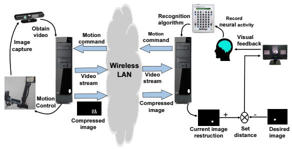
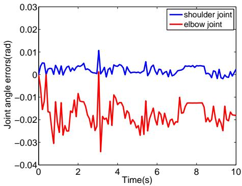
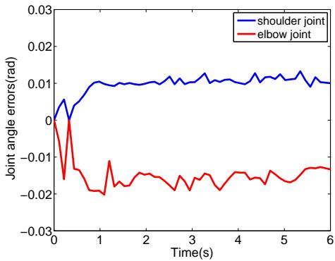
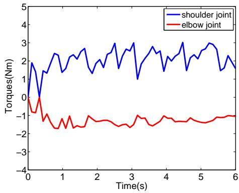
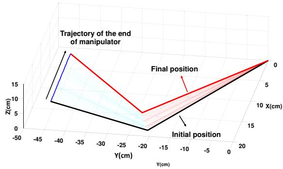
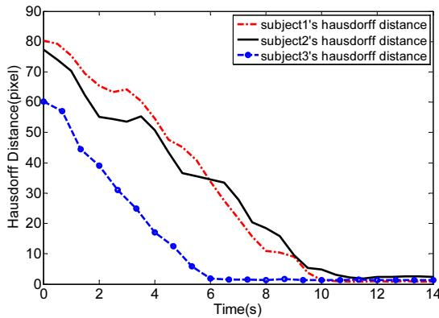

# 基于脑机接口与视觉压缩感知的原骨骼机器人遥操作控制

Shiyuan Qiu, Zhijun Li, Senior Member, IEEE, Wei He, Senior Member, IEEE, Longbin Zhang, Chenguang Yang, Senior Member, IEEE, and Chun-Yi Su, Senior Member, IEEE

摘要—本文提出了一种基于脑机接口（BMI）和视觉反馈的外骨骼机器人系统遥操作控制方法。通过有效整合视觉压缩感知、脑机参考指令以及关节空间的自适应模糊控制器，使机器人能够在人类操作员意念的引导下执行操作任务。首先，利用摄像机捕获的视频构建视觉反馈链路，使操作员能够直观观察机械臂的工作空间及正在执行的动作。然后，将压缩图像作为非向量空间中的反馈误差，用于产生稳态视觉诱发电位（SSVEP）脑电（EEG）信号；与传统的视觉伺服相比，该方法无需预先获取特征信息。所提出的脑电解码算法利用从神经活动中提取的特征生成外骨骼机器人的控制信号。考虑到机器人操作过程中的耦合动力学和执行器输入约束，基于李雅普诺夫（Lyapunov）综合方法设计了局部自适应模糊控制器，以驱动外骨骼跟踪人类操作员意念中的预定轨迹，并在对外骨骼机器人动力学参数了解极少的情况下提供了一种便捷的动力学补偿方法。最后，对三名受试者进行了广泛的实验研究，验证了所提方法的有效性。

关键词：模糊逻辑系统，脑电遥操作，视觉压缩感知，脑机接口，外骨骼

## I. 引言

近年来，外骨骼机器人在人机交互领域引起了广泛关注 [1]-[8]。为了使神经损伤和疾病患者能够利用意念控制设备执行特定任务，脑机接口（BMI）技术应运而生。所建立的 BMI 的功能通常是检测用户的运动意图 [9]。近年来基于 BMI 的控制研究取得了显著进展，例如基于 EEG 控制的假肢设备 [10], [11], [12], [13]。

BMI（脑机接口）系统的核心是在人类或动物大脑（或脑细胞培养物）与外部设备之间建立直接连接通路，而非利用周围神经和肌肉的常规输出途径。它将可从头皮表面采集到的EEG（脑电）信号转化为实现用户需求的指令。在大多数BMI系统中，多种EEG信号可用于提取控制信号，例如稳态视觉诱发电位（SSVEP）、P300诱发电位、感觉运动节律、运动起始视觉诱发电位以及慢皮层电位。SSVEP是一种由快速重复的视觉刺激（特别是高于6 Hz的频率）诱发的周期性诱发电位。对视觉刺激的最强响应对应的刺激频率范围在5到20 Hz之间。SSVEP通常出现在枕叶和顶叶，其频率与频率编码刺激的基频及谐波一致。在SSVEP-BCI系统中，通过提取SSVEP信号中的频率信息，可以检测到用户的意图指令，例如在计算机屏幕上移动光标或控制机械臂。在文献[29]中，提出了一种基于运动想象的开关，用于开启或关闭基于SSVEP的BCI。在文献[30]中，运动想象和SSVEP信号分别被用于连续控制轮椅的方向和速度。

在视觉伺服中，图像用于定位与坐标变换相关的特征或地标，从而使视觉伺服系统能够获取闭环系统的位置或速度反馈。该系统不需要传感器来监测运动。然而，传统视觉伺服的性能严重依赖于特征提取。但是，完美的特征可能不易提取，并且在操作过程中可能会发生改变[22]。一些研究人员也研究了无需特征提取过程的视觉伺服。在文献[23]中，两幅图像的相似度被用来定义互信息，进而用于设计控制器。在文献[24]中，完整的图像强度被用作特征向量以实现反馈控制。尽管这些方法效果良好，但本文提出的方法与它们有着本质的不同。在本方法中，图像被视为非向量空间中的一个集合（集合中的每个元素没有顺序），其优势在于随机压缩数据可被用作传感反馈。

在本文中，利用图像/压缩数据所产生的压缩感知，提出了一种新型的基于SSVEP（稳态视觉诱发电位）的BMI（脑机接口）策略。由于图像或压缩感知是一个集合而非向量，因此使用了“非向量空间感知”这一术语。此外，感知误差可以是完整的局部图像，也可以是被视为压缩数据的部分图像，即术语“压缩感知”。在该控制系统中，针对SSVEP脑电（EEG）信号，感知误差在非向量空间中进行描述。该策略包含三个关键步骤：i) 在非向量空间中设计感知误差，其中局部图像直接用作反馈；ii) 使用压缩扫描来压缩采样并重构局部图像；以及 iii) 直接用压缩数据替换完整反馈（局部图像）以生成压缩反馈。

所设计的闭环自适应控制用于在线估计系统动力学参数，从而使外骨骼的输出能够更精确地反映受试者的意图。然而，外骨骼机器人需要考虑的一个挑战是复杂的动力学不确定性和输入饱和。学习控制可用于提高系统性能，既可以在固定的有限时间区间内重复进行，也可以在无限时间区间内重复（周期性）进行 [40]。近期，已有部分研究工作 [38]–[39] 及 [41]–[44] 将自适应模糊与学习控制技术相结合，以解决机器人模态中的时变不确定性。自适应模糊控制器能够将模糊“如果-那么”（if-then）控制规则直接融入控制器中，并能保证所得闭环系统在所有涉及信号均一致有界的意义下的全局稳定性。由于自适应模糊控制器在设计和应用上均较为简便，我们利用自适应模糊来逼近外骨骼动力学，以实现稳定的性能指标。

众所周知，饱和是各种机器人和机械系统中最重要的一种非线性特性，且会严重降低系统性能 [26], [43]。机器人外骨骼面临的挑战之一在于，由于其饱和限制，系统有时无法提供足够的动力，从而导致诸如跟踪误差等问题。对于机器人系统而言，忽视饱和效应会使系统变得不可靠，并使使用者处于危险境地。因此，设计一种能够最大程度减小机器人电机饱和效应并维持机器人稳定性的控制器至关重要。针对饱和相关问题，已有多种方法被提出。在文献 [27] 中，针对车辆主动悬架系统中的不确定性，提出了一种饱和自适应鲁棒控制策略。在文献 [28] 中，通过将不可微饱和模型近似为 tanh 函数并将近似误差归入扰动，解决了兼具令人满意的瞬态和稳态响应的输入饱和问题。

另一方面，脑机接口（BMI）控制与手动控制截然不同，在手动控制中，有限的反馈信息通常局限于视觉信号，且待控外部设备的动力学特性与自然运动控制的特性存在显著差异。在线闭环 BMI 应用过程中，所提出的 BMI 系统的行为引起了广泛的研究兴趣。在许多情况下，能够快速获得性能的自适应控制具有明显优势。如果初始 BMI 性能较差，且性能提升不够快，受试者可能会对任务失去兴趣。而自适应控制能够在初始训练阶段迅速为受试者提供更高的 BMI 性能，从而使受试者在任务中更有积极性。自适应算法具有在初始训练后将性能提升至较高水平的优势。当受试者使用周期性解码器调整来应对破坏 BMI 运行的现象（例如电极移位和通道丢失）时，自适应算法可以缩短所需的重新标定时间，从而使性能恢复得更快。

考虑到上述问题，本文开发了一种基于脑机接口（BMI）和视觉反馈的外骨骼机器人系统遥操作控制方法。视觉压缩感知、脑机参考指令与自适应模糊控制被有效结合，使机器人能够在人类操作员意念的引导下执行操作任务 [45]。首先，通过摄像机捕获的视频实现视觉反馈链路，使操作员能够直观观察机械臂的工作空间及正在执行的运动。然后，压缩图像作为非向量空间中的反馈误差用于诱发稳态视觉诱发电位（SSVEP）脑电（EEG）信号，且无需传统视觉伺服中广泛使用的特征先验信息。所提出的脑电解码算法利用从神经活动中提取的特征为外骨骼机器人生成控制信号。考虑到机器人操作过程中的耦合动力学和执行器输入约束，基于李雅普诺夫（Lyapunov）综合设计了局部自适应模糊控制器，以驱动外骨骼跟踪人类操作员意念中的目标轨迹，并在对外骨骼机器人动力学参数了解极少的情况下提供了一种便捷的动力学补偿方法。本文招募了多名受试者开展了大量的实验研究，以验证所提方法的有效性。

## II. 系统架构

实验装置及基于脑机接口（BMI）的闭环遥操作控制框图如图 Fig. 1 所示。该系统由操作任务、基于脑机接口（BMI）的双向遥操作、基于实时图像的视觉压缩感知机制，以及基于多变量同步指数（MSI）的脑电（EEG）解码算法组成。

我们实验室开发了一套用于实验的机器人外骨骼。如图 1 所示，该机械臂由我们实验室自主研发的 5 自由度（5-DOF）外骨骼组成，其具有近乎拟人化的结构。其运动链与人体上肢相似，但采用纯旋转关节的外骨骼并未包含人体上肢的所有自由度（DOF）。该外骨骼共有五个旋转关节，电机 1、2、3、4 和 5 分别对应肩部外展-内收、肩部屈曲-伸展、肘部屈曲-伸展、前臂旋前-旋后以及腕部桡偏-尺偏的运动。在该外骨骼机器人中，每个关节均包含高分辨率编码器（2048 脉冲/转）和用于位置感知的霍尔效应传感器。该机器人外骨骼采用直流电机进行驱动，选用 Maxon DC 扁平无刷电机 EC45 作为驱动单元。为了提高阻抗性能，系统嵌入了谐波减速驱动器（1 号和 2 号关节采用 SHD-17-100-2SH 型，3 号和 4 号关节采用 SHD-14-100-2SH 型，5 号关节采用 CSF-32-50-2A-GR 型）。特别地，外骨骼选用的电机驱动器为 Elmo。该由扁平直流电机与谐波传动装置组成的外骨骼重约 2.0 kg，能够提供 8Nm 的最大扭矩。

  
Fig. 1. 所开发的基于 EEG 控制的遥操作系统框架

采用的脑电采集设备为 NeuroScan-NuAmps 40 通道数字 EEG 记录系统，用于采集和转换大脑活动数据。EEG 数据采样率为 500Hz。设备内部采用 0.5 至 40 Hz 的带通滤波器以及 50 Hz 的陷波滤波器，以减小电网噪声的影响。

实验假设受试者佩戴 EEG 设备，且机器人外骨骼能够在自身运动区域内到达指令位置。受试者无需直接控制机械臂中的电机，只需通过 EEG 指令发出外骨骼末端的运动命令即可。初始状态下，机械臂处于初始位置，受试者坐在主控计算机的视觉刺激前。当受试者的视线注视屏幕上闪烁的某个方块时，系统便会生成一个运动指令。一旦发出指令，外骨骼的末端执行器就会根据指令进行运动。同时，系统中采用了视觉反馈，以便用户直观地观察外骨骼末端的实际位置。随后，屏幕上会显示外骨骼末端执行器的位置误差。当误差收敛至零时（即表示机械臂末端执行器已到达期望位置），用户应停止注视刺激屏幕。

  
Fig. 2. SSVEP 刺激和视觉反馈界面

## III. 脑机接口

本地服务器的系统界面如图 Fig. 2 所示，包括 SSVEP 刺激和放置在远程客户端上的摄像头所采集的视频。机械手工作站环境的实时视频通过 TCP/IP 发送到本地服务器。该系统界面位于 BMI 刺激界面之中，采用频率编码的刺激分别位于系统界面的左侧、右侧、上方和下方。视觉反馈界面的尺寸为 360 像素宽和 270 像素高。在我们的实验中，受试者需要使用脑电（EEG）信号作为控制信号，通过无线局域网（Wireless LAN）将机械手的末端执行器移动到期望位置。

所有刺激在 BMI 界面上同时闪烁，然而，受试者只需将注意力集中在与期望指令相对应的刺激上。例如，当受试者打算使机械手的末端执行器向上移动时，他们需要将注意力集中在标记为向上的顶部刺激上。当 BMI 系统检测到 EEG 信号的频率与顶部刺激相关时，它将通过 TCP/IP 通道向远程机械手发送一个新的参考点。BMI 系统生成代表用户意图的控制信号，并将其发送给从机。同样地，当受试者想要使机械手的末端执行器向左移动时，他/她需要将注意力集中在标记为向左的刺激上。随后将生成“向左移动”指令并发送到远程计算机以移动机械手。

## A. 视觉刺激

在我们的系统中，SSVEP 视觉刺激呈现在四个具有不同频率的矩形中：顶部（12HZ）、左侧（10HZ）、底部（8.57HZ）、右侧（15HZ），在 1020 像素宽和 580 像素高的屏幕上闪烁。屏幕顶部标记为“Upwards”，代表向上指令；屏幕底部标记为“Downwards”，表示向下指令；屏幕左侧标记为“Left”，代表向左移动指令；屏幕右侧标记为“Right”，表示向右移动指令。

## B. 信号采集

在实验中，大脑活动的电信号成分由 NeuroScan-NuAmps 40 通道数字 EEG 记录系统采集，该系统负责收集和转换数据。EEG 数据以 500 Hz 的采样率在线采集，并采用 0.5 至 40 Hz 的带通滤波器以及用于滤除工频噪声干扰的 50 Hz 陷波滤波器。电极阻抗保持在 5Ω 以下。采用 Cz 作为参考电极，仅将位于运动区域的四个主要电极 $( P _ { z } , O _ { 1 } , O _ { 2 } , O _ { z } , )$ 作为识别算法的输入 EEG 信号。EEG 信号使用自主开发的软件进行在线记录和处理。

## C. 基于 MSI 的频率识别算法

最近，许多利用多通道 EEG 信号的方法被开发出来。这些算法可以利用来自多个电极的数据来提高算法的抗噪能力和频率识别准确率。其中有三种典型的方法。第一种基于最小能量组合（Minimum Energy Combination, MEC）[20]。MEC 利用多个电极信号来减少通道数量，以尽可能消除噪声；由于其具有检测准确率高、信噪比高以及无需校准数据进行噪声估计的优点，MEC 方法是 SSVEP 系统中的合适选择。第二种基于典型相关分析（Canonical Correlation Analysis, CCA）[18], [19]。该方法利用多元统计方法计算 EEG 信号与参考信号之间的相关系数，并将具有最大相关系数的参考信号频率作为算法的输出。与传统的 PSD 算法相比，基于 CCA 的方法具有更好的性能。第三种是基于 S-estimator 的多元同步指数（Multivariate Synchronization Index, MSI）方法 [21]，用于度量参考信号与多通道 EEG 信号之间的同步指数。在以下各节中，将详细介绍基于多元同步指数的频率检测方法。

MSI 算法计算多通道 EEG 信号与参考信号的同步指数，该指数通过 S-estimator 算法获得。频率识别过程通过寻找最大同步指数来完成。S-estimator 植根于由多通道信号构建的相关矩阵的归一化特征值的熵。在该方法中，计算出的同步指数与嵌入维数成反比。换言之，对于完全不相关的数据，信号的嵌入维数最大；而对于完全同步的时间序列，嵌入维数最小。由于特征谱的方差与维数相关，因此数据嵌入维数是衡量同步性的合适指标。如上所述，S-estimator 可用于计算同步指数以进行频率识别。与基于 CCA 和基于 MEC 的频率识别算法类似，MSI 也需要根据刺激频率构建参考信号。

在本文中，EEG 信号是大小为 $N \times M$ 的矩阵 X，参考信号是大小为 $2 N _ { h } \times M$ 的矩阵 Y，其中 N 是通道数，M 是采样点数，$N _ { h }$ 是正弦和余弦分量参考信号的谐波数。参考信号 Y 设计为

$$
Y = \left[ \begin{array}{c} \sin (2 \pi f _ {k} t) \\ \cos (2 \pi f _ {k} t) \\ \cdot \\ \cdot \\ \cdot \\ \sin (2 \pi N _ {h} f _ {k} t) \\ \cos (2 \pi N _ {h} f _ {k} t) \end{array} \right], t = \frac {1}{F _ {s}}, \frac {2}{F _ {s}},..., \frac {M}{F _ {s}}\tag{1}
$$

其中 $f _ { k }$ 为刺激频率，$N _ { h }$ 为谐波次数，$M$ 为采样点数，$F _ { s }$ 为采样率。然后，相关矩阵 $C$ 计算如下

$$
C = \left[ \begin{array}{l l} C _ {1 1} & C _ {1 2} \\ C _ {2 1} & C _ {2 2} \end{array} \right]\tag{2}
$$

其中

$$
C _ {1 1} = \frac {1}{M} X X ^ {T}\tag{3}
$$

$$
C _ {2 2} = \frac {1}{M} Y Y ^ {T}\tag{4}
$$

$$
C _ {1 2} = \frac {1}{M} X Y ^ {T}\tag{5}
$$

$$
C _ {2 1} = \frac {1}{M} Y X ^ {T}\tag{6}
$$

为了减少 $X$ 和 $Y$ 的自相关对同步计算的影响，采用如下线性变换 $U$：

$$
U = \left[ \begin{array}{c c} C _ {1 1} ^ {- (1 / 2)} & 0 \\ 0 & C _ {2 2} ^ {- (1 / 2)} \end{array} \right]\tag{7}
$$

变换后的相关矩阵为：

$$
R = U C U ^ {T}\tag{8}
$$

设 $\lambda _ { 1 } , \lambda _ { 2 } , \ldots , \lambda _ { P }$ 为矩阵 $R$ 的特征值。然后我们可以按如下方式计算归一化特征值 $\lambda _ { i } ^ { ' }$：

$$
\lambda_ {i} ^ {\prime} = \frac {\lambda_ {i}}{\sum_ {i = 1} ^ {P} \lambda_ {i}} = \frac {\lambda_ {i}}{t r (R)}\tag{9}
$$

其中 $P = N + 2 N _ { h }$。接着，我们可以得到两组信号之间的同步指数 $S$ 如下：

$$
S = 1 + \frac {\sum_ {i = 1} ^ {P} \lambda_ {i} ^ {\prime} \log (\lambda_ {i} ^ {\prime})}{\log (P)}\tag{10}
$$

接下来，可以计算来自多个脑电（EEG）电极的信号与每个参考信号 $Y$ 之间的同步指数，从而得到 $k$ 个指数 $S _ { 1 } , S _ { 2 } , \ldots , S _ { k }$。最后，通过最大值准则获得类别。

## IV. 基于视觉反馈的控制策略

在传统的视觉伺服中，首先从图像中提取特征，然后设计控制器以将期望特征向量与当前特征向量之间的位置误差减小到零 [36]。传统视觉伺服依赖于特征提取。在大多数视觉伺服文献中，使用若干基准标记作为特征，以便于实现对它们的跟踪 [37]。

  
Fig. 3. MSI 算法

与上述传统的伺服方法不同，我们开发了一种直接使用图像强度信息的方法。首先，在该方法中图像被视为一个集合。其次，我们将集合之间的差异定义为期望图像集与当前图像集之间的误差。最后，设计了一种用于脑电（EEG）的解码算法，以生成使该差异收敛到零的控制信号。

基本控制策略如图 Fig. 4 所示。首先，离线获取期望图像。然后，我们将机械臂从起始位置移动并获取初始图像。根据期望图像和当前图像对应的两个集合，操作人员生成运动指令来控制机械臂。通过更新当前图像，最终期望图像与当前图像相匹配。此时，用户应停止生成运动指令。通过这种方式，机械臂可以被引导至期望位置。

## A. 视频反馈

在本应用中，从机使用 Xtion PRO LIVE 相机采集视频，采集到的视频数据发送至主机进行显示。首先，从机 PC 需创建一个采集窗口。然后，该窗口与 Xtion PRO LIVE 相机连接，从相机采集视频流，并将每一帧存储在数组指针中。这些数据通过 TCP/IP 发送至主机，以便在视觉刺激屏幕上显示。

## B. 用于误差反馈的 Hausdorff 距离与压缩感知

视觉反馈中的一个基本问题是如何定义两个集合或图像之间的差异（距离）。为了反馈期望图像与当前图像之间的差异，即两个集合之间的距离，我们应当定义一个合适的度量来进行衡量。在此采用 Hausdorff 距离。点 $p \in \mathbb R ^ { n }$ 到集合 $Q \subset \mathbb { R } ^ { n }$ 的距离为 $d _ { Q } ( p ) = i n f _ { q \in Q } \lVert q - p \rVert$ ，其中 ∥.∥ 表示欧氏范数。集合 $P \subset \mathbb { R } ^ { n }$ 到另一个集合 $Q \subset \mathbb { R } ^ { n }$ 的距离为 $d ( P , Q ) = \operatorname* { s u p } _ { p \in P } d _ { Q } ( p )$ ，而 $Q$ 到 $P$ 的距离为 $d ( Q , P ) = \mathrm { s u p } _ { q \in Q } d _ { P } ( q )$ 。最终，$P$ 与 $Q$ 之间的 Hausdorff 距离可计算如下：

$$
d h (P, Q) = \max \{d (P, Q), d (Q, P) \}\tag{11}
$$

其中两幅图像之间的差异可以被计算出来并显示在刺激界面上，供用户做出移动机械臂的决策。

压缩感知（Compressive Sensing）已成功应用于模式识别 [32] 和控制 [33], [34]，它是一种用于采集稀疏或近似稀疏信号的通用框架。压缩感知的主要成果之一是：如果高维信号本身稀疏或在某些域中稀疏，则可以从特定的低维线性测量中将其恢复出来。因此，如果可以从压缩集合 $K _ { c } ( t )$ 中恢复出原始集合 $K ( t )$，则 (11) 中的 Hausdorff 距离仍然适用。对于未知稀疏信号 $x \in \mathbb { R } ^ { n }$，我们可以将一般压缩感知问题描述为：

$$
y = A x\tag{12}
$$

其中 $\boldsymbol { y } ~ \in ~ \mathbb { R } ^ { m }$ 为可获得的线性观测值，$x$ 为原始高维信号，并通过感知矩阵 $A \in \mathbb { R } ^ { m \times n }$ 映射为低维测量值 $y$。

当 $m \ < \ n ,$ 时，(12) 式为欠定方程，存在无穷多个解。在压缩感知中，该问题被表述为一个优化问题，旨在最小化原始信号 $x$ 中非零元素的数量。在这种情况下，如果感知矩阵 $A$ 满足确保 $x$ 中的必要信息保留在 $y$ 中的特定性质，则可以从 $y$ 成功恢复出原始信号。该性质即为有限等距性质（Restricted Isometry Property, RIP）。

定义 1：[14] 若存在常数 $\delta _ { S } \in ( 0 , 1 )$ 使得：

$$
(1 - \delta_ {S}) \| x \| _ {2} ^ {2} \leq \| A x \| _ {2} ^ {2} \leq (1 + \delta_ {S}) \| x \| _ {2} ^ {2}\tag{13}
$$

对所有 $S$-稀疏向量 $x \in \mathbb { R } ^ { n }$ 均成立，则称矩阵 $A \in \mathbb { R } ^ { m \times n }$ 满足 $S$ 阶有限等距性质（RIP），其中 $S$-稀疏向量表示其最多包含 $S$ 个非零元素。

直接验证一个矩阵是否满足 RIP 在计算上是非常复杂的，而已证明高斯矩阵或随机采样的傅里叶矩阵以极高的概率满足 RIP[14]。因此，一小部分随机傅里叶系数可用于重构时域稀疏信号 [35]。同理，时域中的一小部分随机采样也可用于重构频域中的稀疏信号。

针对我们的问题，可构造满足 RIP 的感知矩阵并将其用于图像压缩。以图像集为例，我们可以逐行堆叠图像的灰度值以获得信号 $x \in \mathbb { R } ^ { n }$。此外，假设其在频域中是稀疏的，即经过离散余弦变换（DCT）后的系数向量 $x ^ { \prime }$ 是稀疏的。设 DCT 矩阵为 $\Psi \in \mathbb { R } ^ { n \times n }$，则 $x ^ { \prime } = \Psi x$。此外，设 $\Phi \in \mathbb { R } ^ { m \times n }$ 为由 $m$ 行 $n$ 列构成的高斯矩阵。若 $y = \overset { \cdot } { \Phi } x = \Phi \Psi ^ { - 1 } x ^ { ' }$（其中 $y$ 为压缩集），这相当于对像素灰度进行随机均匀采样。如果 $m$ 满足以下引理，则可以从 $y$ 恢复原始信号 $x$：

本文已被本刊未来期卷录用发表，但尚未完全编辑。内容在最终发表前可能会有变动。引用信息：DOI 10.1109/TFUZZ.2016.2566676, IEEE Transactions on Fuzzy Systems  
  
Fig. 4. 基于视觉控制策略的基本工作方法

引理 1: [17] 如前所定义的 $\Phi$ 和 $\Psi$，若满足下式，矩阵 $A = \Phi \Psi ^ { - 1 }$ 具有极大概率满足阶数为 $S$ 的 RIP：

$$
m \geq C \cdot S \cdot (\log n) ^ {4}\tag{14}
$$

其中 $C$ 是与 $m$ 和 $n$ 无关的常数。

在上述引理中，我们可以将矩阵 $A$ 视为稀疏向量 $x ^ { \prime }$ 的感知矩阵。在此情况下，若 $x ^ { \prime }$ 是 $S$-稀疏的，则可以从 $y$ 中恢复出 $x ^ { \prime }$，并且原始信号可以通过 $x = \Psi ^ { - 1 } x ^ { \prime }$ 获得。

一旦获得原始信号，即可通过上位机重建的当前二值图像与期望二值图像计算出当前位置到目标位置的距离。

## V. 局部自适应模糊控制

## A. 动力学建模

带有饱和特性的 $n$ 连杆刚性机器人系统的动力学可描述为：

$$
M (q) \ddot {q} + C (q, \dot {q}) \dot {q} + G (q) + f _ {d i s} = S (\tau)\tag{15}
$$

其中 $q \in \mathbb { R } ^ { n }$ 为坐标，$\tau \in \mathbb { R } ^ { n }$ 为期望控制输入（施加的关节力矩），$S ( \tau )$ 是由于电机限制对期望控制输入 $\tau$ 的饱和限制器。$M ( q ) \in \mathbb { R } ^ { n \times n }$ 为对称正定惯性矩阵，$C ( q , \dot { q } ) \in$ Rn×n 表示向心力和科里奥利力矩，$G ( q ) \in \mathbb { R } ^ { n }$ 为重力项，$f _ { d i s } \in \mathbb { R } ^ { n }$ 表示对机械臂的外部扰动。

性质 1: [15] 矩阵 $\dot { M } ( q ) - 2 C ( q , \dot { q } )$ 是斜对称的。

性质 2: [15] 对于矩阵 $M$，$M = M ^ { T } > 0$ 且具有上下界，即 $\lambda _ { \operatorname* { m i n } } ( M ) I _ { n \times n } \ \leq M \leq \lambda _ { \operatorname* { m a x } } ( M ) I _ { n \times n } .$，其中 $\lambda _ { \mathrm { m i n } }$ 和 $\lambda _ { \mathrm { m a x } }$ 分别为 $M$ 的最小和最大特征值，$I _ { n \times n }$ 为单位矩阵。

假设 1: 对于连续扰动 $f _ { d i s i } , ~ ( i = 1 , 2 . . . n )$，始终存在光滑半正定函数 $\rho _ { i } ( t )$ 和正常数 $c _ { i }$，使得

$$
\left| f _ {d i s i} (t) \right| \leq \rho_ {i} (t) + c _ {i}\tag{16}
$$

假设 2: 输入饱和模型可表示为：

$$
S (\tau) = \left\{ \begin{array}{l l} S _ {\max} \text {sign} (\tau), & | \tau | \geq S _ {\max} \\ \tau , & | \tau | <   S _ {\max}. \end{array} \right.\tag{17}
$$

对于 $X \in \mathbb { R } ^ { 1 \times n }$，有 $S ( X ) = \left\lceil S ( x _ { 1 } ) , S ( x _ { 2 } ) , . . . . S ( x _ { n } ) \right\rceil$

假设 3: 机械臂的期望轨迹是有界的、光滑且连续的。

符号说明：给定向量 $A , A \in \mathbb { R } ^ { 1 \times n }$ 和矩阵 $B , B \in$ $\mathbb { R } ^ { n \times n } , \| A \| ^ { 2 } = A ^ { T } A$ 以及 $\| B \| ^ { 2 } = \mathrm { t r } ( B ^ { T } B ) . \lambda _ { \operatorname* { m a x } }$ 和 $\lambda _ { \mathrm { m i n } }$ 分别表示矩阵的最大和最小特征值。

## B. 模糊逻辑系统

考虑一个具有乘积推理规则、单值模糊器、中心平均解模糊器以及高斯隶属度函数的 $n$ 输入单输出模糊逻辑系统，该系统由 $m$ 条模糊 IF–THEN 规则给出：$\mathbb { R } ^ { ( j ) } :$ IF $x _ { 1 }$ is $A _ { 1 } ^ { j }$ and . . . and $x _ { n }$ is $A _ { n } ^ { j }$ THEN $y { \mathrm { ~ i s ~ } } W ^ { j } , j =$ $1 , \ldots , m$ ，其中 $\mathbb { R } ^ { j }$ 表示第 $j$ 条规则，$1 \ \leq \ j \ \leq \ m$ ，$( x _ { 1 } , x _ { 2 } , \ . . . , x _ { n } ) ^ { T } \in U \subset \mathbb { R } ^ { n }$ 和 $y \in \mathbb { R }$ 是与模糊逻辑系统的输入和输出相关联的语言变量，$A _ { i } ^ { j }$ 表示 $U$ 中的模糊集，$W ^ { j }$ 表示 R 中的模糊集。该模糊逻辑系统实现了从 U 到 R 的非线性映射。在本文中，该模糊逻辑系统可描述如下：

$$
y (x) = \frac {\sum_ {j = 1} ^ {m} y _ {j} (\prod_ {i = 1} ^ {n} \mu_ {A _ {i} ^ {j}} (x _ {i}))}{\sum_ {j = 1} ^ {m} (\prod_ {i = 1} ^ {n} \mu_ {A _ {i} ^ {j}} (x _ {i}))}\tag{18}
$$

其中 $\boldsymbol { x } = [ x _ { 1 } , x _ { 2 } , . . . , x _ { n } ] ^ { T } , \mu _ { A _ { i } ^ { j } } ( x _ { i } )$ 为语言变量 $x _ { i }$ 的隶属度函数，满足 $\begin{array} { r } { \mu _ { A _ { i } ^ { j } } ( x _ { i } ) = \exp [ - \frac { ( x _ { i } - c _ { i j } ) ^ { 2 } } { \sigma _ { \cdot i } ^ { 2 } } ] } \end{array}$ 。为明确起见，权重向量可定义为 $\begin{array} { r l } { \dot { W } } & { { } = } \end{array}$ $[ y _ { 1 } , y _ { 2 } , . . . , y _ { m } ] ^ { T }$ ，模糊基函数向量可定义为 $S ( x , c , \sigma ) ~ = ~ [ s _ { 1 } , s _ { 2 } , . . . , s _ { m } ] ^ { T } .$ 其中 $s _ { l } =$ $\begin{array} { r } { \prod _ { i = 1 } ^ { n } \mu _ { A _ { i } ^ { l } } ( x _ { i } ) / [ \sum _ { k = 1 } ^ { m } \prod _ { i = 1 } ^ { n } \mu _ { A _ { i } ^ { k } } ( x _ { i } ) ] , \ c \ = \ [ c _ { 1 } ^ { T } , c _ { 2 } ^ { T } , . . . , c _ { n } ^ { T } ] ^ { T } } \end{array}$ 且 $\boldsymbol { \sigma } \stackrel { < } { = } [ \sigma _ { 1 } ^ { T } , \sigma _ { 2 } ^ { T } , . . . , \sigma _ { n } ^ { T } ] ^ { T }$ 。则式 (18) 等价于

$$
y = W ^ {T} S (x, c, \sigma)\tag{19}
$$

模糊逻辑系统 (19) 能够在紧集上以任意精度一致逼近任何给定的实连续函数。因此，对于未知非线性函数 $f _ { i } ( x _ { i } ) , \ i = 1 , \ . . . , n $ ，在紧集 $\Xi _ { i }$ 上的逼近可表示为

$$
f _ {i} (x _ {i}) = W _ {i} ^ {* T} S (x _ {i}) + \epsilon_ {i} (x _ {i}), \forall x _ {i} \in \Xi_ {i} \subset \mathbb {R} ^ {i}\tag{20}
$$

其中 $S ( x _ { i } )$ 为模糊基向量，$\epsilon _ { i } ( x _ { i } )$ 为逼近误差，$W _ { i } ^ { * }$ 为未知常数参数向量。

定理 1：对于紧集 $U \in \mathbb { R } ^ { n }$ 上的任意给定实连续函数 $g ( x )$ 以及任意 $\epsilon > 0$ ，存在形式为 (19) 的函数 $f ( x )$ 使得 $\operatorname* { s u p } _ { x \in U } \| g ( x ) -$ $f ( x ) \parallel \leq \epsilon$

注 1：(20) 中的最优权重向量 $W _ { i } ^ { * }$ 是仅用于分析目的的人为设定量。通常，$W _ { i } ^ { * }$ 被选为对于所有 $x _ { i } ~ \in ~ \Xi _ { i }$ 使 $\epsilon _ { i } ( x _ { i } )$ 最小化的 $W _ { i }$ 值，其中 $\Xi _ { i } ~ \subset ~ \mathbb { R } ^ { i }$ 为紧集，即 $W _ { i } ^ { * } : =$ arg mi $\begin{array} { r } { \mathrm { n } _ { c \in \mathbb { R } ^ { n } } \left\{ \operatorname* { s u p } _ { x \in \Xi _ { i } } | f _ { i } ( x _ { i } ) - W _ { i } ^ { T } S ( x _ { i } ) | \right\} } \end{array}$ 假设 4：在紧区域 $\Xi _ { i } \in R ^ { i }$ 上，$| \epsilon _ { i } ( x _ { i } ) | \leq$ $\boldsymbol { \epsilon } _ { i } ^ { * }$ ，其中 $\epsilon _ { i } ^ { * } > 0$ 为未知界。

根据上述分析，系统的不确定性被转化为对未知参数 $W _ { i } ^ { * }$ 和未知界 $\boldsymbol { \epsilon } _ { i } ^ { * }$ 的估计。

## C. 局部自适应模糊控制

若令 $\begin{array} { r l r l r l } { x _ { 1 } } & { { } \stackrel { } { } = } & { } & { { } [ q _ { 1 } , q _ { 2 } , q _ { 3 } , \dotsc , q _ { n } ] ^ { T } , } & { x _ { 2 } } & { { } \dotsc } \end{array}$ $[ { \dot { q } } _ { 1 } , { \dot { q } } _ { 2 } , { \dot { q } } _ { 3 } . . . . , { \dot { q } } _ { n } ] ^ { T }$ ，机器人动力学因此可表示为：

$$
\begin{array}{c} \dot {x} _ {1} = x _ {2}, \\ \dot {x} _ {2} = M (x _ {1}) ^ {- 1} [ S (\tau) - f _ {d i s} - G (x _ {1}) - C (x _ {1}, x _ {2}) x _ {2} ] \end{array}\tag{21}
$$

(22)

其中 $x _ { r }$ 表示期望轨迹，误差变量 $z _ { 1 }$ 和 $z _ { 2 }$ 定义如下：

$$
z _ {1} = x _ {1} - x _ {r},\tag{23}
$$

$$
z _ {2} = x _ {2} - \alpha_ {1}.\tag{24}
$$

其中 $\alpha _ { 1 }$ 是 $z _ { 1 }$ 的虚拟控制量。对于 n 自由度（n-DOF）机器人操作臂的情况，$\alpha _ { 1 } \in \mathbb { R } ^ { n } , z _ { 1 } \in \mathbb { R } ^ { n }$ 且 $z _ { 2 } \in \mathbb { R } ^ { n }$。根据 $z _ { 1 }$ 的定义，可得

$$
\dot {z} _ {1} = z _ {2} + \alpha_ {1} - \dot {x} _ {r},\tag{25}
$$

考虑李雅普诺夫候选函数 $V _ { 1 } ~ = ~ { \textstyle \frac { 1 } { 2 } } z _ { 1 } ^ { T } z _ { 1 }$。$V _ { 1 }$ 对时间的导数为

$$
\dot {V} _ {1} = z _ {1} ^ {T} (z _ {2} + \alpha_ {1} - \dot {x} _ {r}).\tag{26}
$$

若令 $\alpha _ { 1 } = \dot { x } _ { r } - K _ { 1 } z _ { 1 }$，则上述李雅普诺夫候选函数的导数变为

$$
\dot {V} _ {1} = - z _ {1} ^ {T} K _ {1} z _ {1} + z _ {1} ^ {T} z _ {2}\tag{27}
$$

对 z2 求导，可得

$$
\dot {z} _ {2} = M (x _ {1}) ^ {- 1} [ S (\tau) - f _ {d i s} - G (x _ {1}) - C (x _ {1}, x _ {2}) x _ {2} ] - \dot {\alpha} _ {1}
$$

其中

$$
\dot {\alpha} _ {1} = - K _ {1} \dot {z} _ {1} + \ddot {x} _ {r}\tag{28}
$$

采用以下辅助设计系统来考查饱和效应

$$
\dot {\zeta} = \left\{ \begin{array}{l l} - K _ {\zeta} \zeta - \frac {| z _ {2} ^ {T} \Delta \tau | + 0 . 5 \Delta \tau^ {T} \Delta \tau}{\| \zeta \| ^ {2}} \zeta + \Delta \tau , & \| \zeta \| \geq \mu \\ 0, & \| \zeta \| <   \mu . \end{array} \right.\tag{29}
$$

其中 $\Delta \tau = S ( \tau ) - \tau , K _ { \zeta } = K _ { \zeta } ^ { T } > 0 ,$ µ 为较小的正数，$\zeta \in \mathbb { R } ^ { n }$ 为辅助设计系统的状态。

所提出的基于模型的控制器可表示为

$$
\begin{array}{r l} \tau = & - z _ {1} - K _ {2} (z _ {2} + \zeta) + f _ {d i s} + C (x _ {1}, x _ {2}) \alpha_ {1} + G (x _ {1}) \\ & + M (x _ {1}) \dot {\alpha} _ {1} \end{array}\tag{30}
$$

其中增益矩阵满足 $K _ { 2 } = K _ { 2 } ^ { T } > 0 .$。由于 $\zeta ^ { T } \Delta \tau \leq$ $\begin{array} { r } { \frac { 1 } { 2 } \zeta ^ { T } \zeta + \frac { 1 } { 2 } \bar { \Delta } \tau ^ { T } \Delta \tau } \end{array}$，则有 $\zeta ^ { T } \dot { \zeta } = - \zeta ^ { T } K _ { \zeta } \zeta - | z _ { 2 } ^ { T } \Delta \tau | -$ $\begin{array} { r } { 0 . 5 \Delta \tau ^ { T } \Delta \tau + \zeta ^ { T } \Delta \tau \ \leq \ - \zeta ^ { T } K _ { \zeta } \zeta - | z _ { 2 } ^ { T } \Delta \tau | + \frac { 1 } { 2 } \zeta ^ { T } \zeta . } \end{array}$。那么 $\dot{V}_2$ 将满足

$$
\begin{array}{r l} \dot {V} _ {2} \leq & - z _ {1} ^ {T} K _ {1} z _ {1} + z _ {1} ^ {T} z _ {2} - \zeta^ {T} (K _ {\zeta} - 0. 5 I _ {n \times n}) \zeta - | z _ {2} ^ {T} \Delta \tau | \\ & + z _ {2} ^ {T} \left[ S (\tau) - f _ {d i s} - C (x _ {1}, x _ {2}) \alpha_ {1} (t) - G (x _ {1}) \right. \\ & \left. - M (x _ {1}) \dot {\alpha} _ {1} (t) \right] \end{array} \tag {3}\tag{31}
$$

由于 $\tau = S ( \tau ) - \Delta \tau$ ，显然有 $z _ { 2 } ^ { T } S ( \tau ) - z _ { 2 } ^ { T } \Delta \tau \geq z _ { 2 } ^ { T } S ( \tau ) - | z _ { 2 } ^ { T } \Delta \tau |$ 。将其代入不等式 (31)

$$
\begin{array}{c} \dot {V} _ {2} \leq - z _ {1} ^ {T} K _ {1} z _ {1} + z _ {1} ^ {T} z _ {2} - \zeta^ {T} (K _ {\zeta} - 0. 5 I _ {n \times n}) \zeta \\ + z _ {2} ^ {T} \Big [ \tau - f _ {d i s} - C (x _ {1}, x _ {2}) \alpha_ {1} (t) - G (x _ {1}) \\ - M (x _ {1}) \dot {\alpha} _ {1} (t) \Big ] \end{array}\tag{32}
$$

将 (30) 代入 (32)，可得

(33)

为确保闭环稳定性，控制器参数 $K _ { 1 }$、$K _ { 2 }$ 和 $K _ { \zeta }$ 必须满足以下准则：$K _ { 1 } = K _ { 1 } ^ { T } > 0$、$K _ { 2 } = K _ { 2 } ^ { T } > 0$ 且 $K _ { 2 } - { \textstyle \frac { 1 } { 2 } } I _ { n \times n } > 0$ ，$K _ { \zeta } = K _ { \zeta } ^ { T } > 0$ 且 $\begin{array} { r } { K _ { \zeta } - \frac { 1 } { 2 } I _ { n \times n } - \frac { 1 } { 2 } K _ { 2 } ^ { T } K _ { 2 } > 0 } \end{array}$ 。由此 $\dot { V } _ { 2 }$ 将是负定的。

然而，由于难以获得机器人系统的完备精确信息，(30) 中提出的控制器可能无法实现。在这种情况下，我们可能无法确切得知 $M ( x _ { 1 } ) , C ( x _ { 1 } , x _ { 2 } ) , G ( x _ { 1 } )$ 和 $f _ { d i }$ s。在未知 $M ( x _ { 1 } ) , C ( x _ { 1 } , x _ { 2 } )$ 和 $G ( x _ { 1 } )$ 精确值的情况下，我们提出的基于模型的控制器很难得以实现。为了克服该控制器面临的实际问题，采用模糊逻辑系统（FLS）来估计与模型相关的参数，例如 $M ( x _ { 1 } ) , C ( x _ { 1 } , x _ { 2 } ) , G ( x _ { 1 } )$ 和 $f _ { d i s }$ 。我们提出

$$
\tau = - z _ {1} - K _ {2} (z _ {2} + \zeta) + \hat {W} ^ {T} R (Z)\tag{34}
$$

其中 $\hat { W } ~ = ~ \mathrm { b l o c k d i a g } [ \hat { W } _ { i } ^ { T } ] , ~ i ~ = ~ 1 , 2 , \ldots , n ,$ 包含了逼近参数；$\bar { R ( Z ) } = [ R _ { 1 } ( Z ) , \ldots , R _ { n } ^ { T } ( Z ) ] ^ { T }$ 为模糊隶属度函数。FLS 更新律定义为

$$
\dot {\hat {W}} _ {i} = - \Gamma_ {i} \Big (R _ {i} (Z) z _ {2, i} + \theta_ {i} \hat {W} _ {i} \Big)\tag{35}
$$

其中 $z _ { 2 , i } \in R ,$（对于 $i = 1 , 2 , \ldots , n$）是 $z _ { 2 }$ 的元素。模糊系统 $\hat { W } ^ { T } R ( Z )$ 用于逼近由下式定义的 $W ^ { * T } R ( Z )$：

$$
W ^ {* T} R (Z) = C \left(x _ {1}, x _ {2}\right) \alpha_ {1} + G \left(x _ {1}\right) + M \left(x _ {1}\right) \dot {\alpha} _ {1} - \epsilon (Z)\tag{36}
$$

其中 $\epsilon ( Z ) \in R ^ { n }$ 是在 (20) 中定义的逼近误差，满足 $| \epsilon ( Z ) | \le \bar { \varepsilon } .$ 为简化起见，在本文中，我们假设 $\bar{\varepsilon}$ 通过预先估计已知。我们选择 $K _ { 3 } \geq \bar { \varepsilon }$，且 $Z = [ q ^ { T } , \dot { q } ^ { \dot { T } } , \alpha _ { 1 } ^ { T } ] ^ { T }$ 为前馈逼近器的输入变量。

采用 (34) 中所述的新控制器并将其代入

(32) 中

$$
\begin{array}{l} \dot {V} _ {2} \leq - z _ {1} ^ {T} K _ {1} z _ {1} - z _ {2} ^ {T} \left(K _ {2} - I _ {n \times n}\right) z _ {2} + \frac {1}{2} \epsilon^ {T} \epsilon \\ + z _ {2} ^ {T} \tilde {W} ^ {T} R (Z) - \zeta^ {T} \left(K _ {\zeta} - \frac {1}{2} I _ {n \times n} - \frac {1}{2} K _ {2} ^ {T} K _ {2}\right) \zeta \\ + \frac {1}{2} | | f _ {d i s} ^ {*} | | ^ {2} \end{array}\tag{37}
$$

考虑 $\tilde { W }$ 对系统稳定性的影响：$V _ { 2 } ^ { * } =$ $\begin{array} { r } { V _ { 2 } + \frac { 1 } { 2 } \sum _ { i = 1 } ^ { n ^ { \bullet } } { \tilde { W } } _ { i } ^ { T } \Gamma _ { i } ^ { - 1 } { \tilde { W } } _ { i } } \end{array}$，其中 $\tilde { W } = \dot { \hat { W } } - W ^ { * }$ 且 $\Gamma = \Gamma ^ { \overline { { T } } } >$ 0 是增益矩阵。$V _ { 2 } ^ { * }$ 的时间导数随后为

$$
\begin{array}{c} \dot {V} _ {2} ^ {*} \leq - z _ {1} ^ {T} K _ {1} z _ {1} + \frac {1}{2} | | \epsilon^ {*} | | ^ {2} \\ - \zeta^ {T} \Big (K _ {\zeta} - \frac {1}{2} I _ {n \times n} - \frac {1}{2} K _ {2} ^ {T} K _ {2} \Big) \zeta \\ - z _ {2} ^ {T} \Big (K _ {2} - I _ {n \times n} \Big) z _ {2} + \frac {1}{2} | | f _ {d i s} ^ {*} | | ^ {2} \\ + \sum_ {i = 1} ^ {n} \left(z _ {2, i} \tilde {W} _ {i} ^ {T} R _ {i} (Z) + \tilde {W} _ {i} ^ {T} \Gamma_ {i} ^ {- 1} \dot {\tilde {W}} _ {i}\right) \end{array}
$$

由于 $- \tilde { W } _ { i } ^ { T } \hat { W } _ { i } = - \tilde { W } _ { i } ^ { T } ( W _ { i } ^ { * } + \tilde { W } _ { i } ) = - \tilde { W } _ { i } ^ { T } \tilde { W } _ { i } - \tilde { W } _ { i } ^ { T } W _ { i } ^ { * }$ 且 $- \tilde { W } _ { i } ^ { T } \tilde { W } _ { i } ^ { * } \leq \frac { 1 } { 2 } ( \tilde { W } _ { i } ^ { T } \tilde { W } _ { i } + \tilde { W } _ { i } ^ { * T } \tilde { W } _ { i } ^ { * } )$，我们有 $- \tilde { W } _ { i } ^ { T } \tilde { W } _ { i } \stackrel { < } { = }$ $- \frac { 1 } { 2 } { \tilde { W } } _ { i } ^ { T } { \tilde { \tilde { W } } } _ { i } + \bar { \frac { 1 } { 2 } } W _ { i } ^ { * } W _ { i } ^ { * }$。将更新律 (35) 代入 (38) 中，我们得到

$$
\begin{array}{r l} & {\dot {V} _ {2} ^ {*} \leq - z _ {1} ^ {T} K _ {1} z _ {1} - z _ {2} ^ {T} \Big (K _ {2} - I _ {n \times n} \Big) z _ {2} + \sum_ {i = 1} ^ {n} \frac {\theta_ {i}}{2} W _ {i} ^ {* T} W _ {i} ^ {*}} \\ & {- \sum_ {i = 1} ^ {n} \frac {\theta_ {i}}{2} \tilde {W} _ {i} ^ {T} \tilde {W} _ {i} - \zeta^ {T} \Big (K _ {\zeta} - \frac {1}{2} I _ {n \times n} - \frac {1}{2} K _ {2} ^ {T} K _ {2} \Big) \zeta} \\ & {\quad + \frac {1}{2} | | \epsilon^ {*} | | ^ {2} + \frac {1}{2} | | f _ {d i s} ^ {*} | | ^ {2} \leq - \kappa V _ {2} ^ {*} + C} \end{array}
$$

其中

$$
\begin{array}{l l} \kappa := & \min \Big \{2 \lambda_ {\min} \big (K _ {1} \big), \frac {2 \lambda_ {\min} \big (K _ {2} - I _ {n \times n} \big)}{\lambda_ {\max} (M)}, \\ & 2 \lambda_ {\min} \big (K _ {\zeta} - 0. 5 I _ {n \times n} - \frac {1}{2} K _ {2} ^ {T} K _ {2} \big), \end{array}
$$

$$
\left. 2 \min _ {i = 1, 2} \big (\frac {\theta_ {i}}{2 \lambda_ {\max} (M) \Gamma_ {i} ^ {- 1}} \big) \right\}\tag{38}
$$

$$
{ C : = } { \frac { 1 } { 2 } | | \epsilon ^ { * } | | ^ { 2 } + \frac { 1 } { 2 } | | f _ { d i s } ^ { * } | | ^ { 2 } + \sum _ { i = 1 } ^ { n } \frac { \theta _ { i } } { 2 } W _ { i } ^ { * T } W _ { i } ^ { * } }\tag{39}
$$

为确保闭环稳定性，控制器参数 $K _ { 1 }$、$K _ { 2 } , K _ { \zeta }$ 和 θ 必须满足以下准则：$K _ { 1 } = K _ { 1 } ^ { T } > 0 , K _ { 2 } \stackrel { \cdot } { = } K _ { 2 } ^ { T } > 0$ 且 $K _ { 2 } - I _ { n \times n } > 0 , K _ { \zeta } = K _ { \zeta } ^ { T } > 0$ 以及 $\begin{array} { r } { K _ { \zeta } - \frac { 1 } { 2 } I _ { n \times n } - \frac { 1 } { 2 } K _ { 2 } ^ { T } K _ { 2 } > 0 , } \end{array}$，且 $\theta _ { i } > 0 , i = 1 , 2 .$。从而 κ 将是正定的。在这些条件下，由引理可保证系统的有界性。综上所述，我们得到以下定理。

定理 2：考虑满足假设 1 和假设 2 的机器人机械臂系统 (15)，采用自适应模糊控制律 (34)、权重更新律 (35) 以及辅助系统 (29)。对于有界的初始条件，闭环系统信号 $z _ { 1 } \ z _ { 2 } , \ \tilde { W }$ 和 ζ 是半全局有界的。此外，跟踪误差 $z _ { 1 }$ 渐近收敛到紧集 $\Omega _ { z _ { 1 } } : = \Big \{ z _ { 1 } \in \mathbb { R } ^ { 2 } | \qquad | | z _ { 1 } \leq \sqrt { D } | | \Big \}$，其中 $\begin{array} { r } { D = 2 \Big ( V _ { 2 } ^ { * } ( 0 ) + \frac { C } { \kappa } \Big ) } \end{array}$，κ 和 C 由式 (38) 和 (39) 给出。

## VI. 实验结果

## A. 实验设置

为了验证所提出的遥操作系统（teleoperation system）的有效性，三名受试者参与了控制具有两个关节（肩关节和肘关节）的外骨骼机器人的实验。整个系统由三部分组成：脑电（EEG）识别、视觉压缩感知以及自适应模糊运动控制。EEG 识别是整个系统的基础部分，它使用 MSI 来识别受试者期望发送的任务空间指令，而自适应模糊控制则在我们预期的范围内完成关节空间任务。

该机器人装置基于一个实时底层控制器，该控制器连接到一台 Windows XP PC，通过 CAN 总线实现非实时任务。CAN 总线可以传输力信号，从而在 Win XP 环境与外骨骼之间建立接口，该接口在 XP 环境中实现。机器人内部的传感器用于获取控制所需的位置和速度信号。CAN 总线的最大波特率为 1 MBit/s，用于获取位置和速度信号的传感器的最大采样率为 5 MHz。这种速度在我们的系统中已经足够。同时，为了提供所有控制组件之间的通信，我们需要使用 Visual C++ 语言编写可执行软件。

三名年龄均在 22-26 岁之间的参与者参与了实验，其中包括两名熟练者和一名新手。在实验开始时，受试者被告知保持放松并保持静止。用于采集大脑信号的电极被放置在受试者头部表面。受试者被要求通过注视对应于不同任务指令的闪烁菱形来控制机器人操作臂。公式 1 中的识别算法参数为 $N _ { h } = 2 , F _ { s } = 5 0 0 , M = 8 0 0 , N = 4$ 。其中，$N _ { h } = 2$ 表示参考信号的正弦和余弦分量的谐波次数。$F _ { s } ~ = ~ 5 0 0$ 表示参考信号的采样率为 500Hz。$M = 8 0 0$ 表示所选数据的长度，而 $N = 4$ 表示所选的四个通道 $( P _ { z } , O _ { 1 } , O _ { 2 }$ 和 $O _ { z } )$ 数据。在我们的实验中，公式 10 中的同步指数为 ${ \cal S } = [ S _ { 1 } , S _ { 2 } , S _ { 3 } , S _ { 4 } ]$ ，其中 $S _ { 1 } , S _ { 2 } , S _ { 3 }$ 和 $S _ { 4 }$ 分别是刺激频率诱发的电位信号与分别按 $8 . 6 H z , 1 0 H z , 1 2 H z$ 和 $1 5 H z$ 刺激频率设计的参考信号 Y 之间的同步指数。对于受试者 1，同步指数 S 的平均值为 $S 1 = [ 0 . 0 0 4 2 , 0 . 0 4 6 3 , 0 . 0 0 3 8 , 0 . 0 3 3 ]$ ，而在受试者 2 的实验中，同步指数的值为 $S 2 = [ 0 . 0 0 3 2 , 0 . 0 0 4 1 , 0 . 0 0 4 5 , 0 . 0 2 1 5 ]$ ，受试者 3 的 S 指数为 $S 3 =$ [0.0028, 0.0039, 0.0327, 0.0019]。

在本文中，可采用自适应模糊控制器来逼近动力学特性未完全知晓的外骨骼机器人。在实验中，针对 $Z ,$ 的每个变量，定义六个模糊集，标签为 $A _ { 1 } ^ { 1 } , A _ { 1 } ^ { 2 } , A _ { 1 } ^ { 3 } , A _ { 1 } ^ { 4 } , A _ { 1 } ^ { 5 }$ 和 $A _ { 1 } ^ { 6 }$ ，其特征表示为 $\begin{array} { r } { \mu _ { A _ { i } ^ { j } } ( q _ { j i } ) = \exp [ - \frac { ( q _ { j i } - c _ { j i } ) ^ { 2 } } { \sigma _ { i i } ^ { 2 } } ] } \end{array}$ ，其中 $\sigma _ { j i } = 2 . 0 $ ，且中心 $c _ { j i }$ 均匀分布以覆盖输入空间 $[ - 1 , 1 ]$ 。增益 $\Gamma _ { i }$ 定义为 $\Gamma _ { 1 } = 1 . 6 ,$ 以及 $\Gamma _ { 2 } = 1 . 2 . ~ \sigma$ 设定为 $\sigma = 1 5 . 7$ 控制器增益 $K _ { 1 } =$ diag[22, 3.5], $K _ { 2 } = \mathrm { d i a g } [ 2 2 , 8 1 ] ,$ ，对于辅助设计系统，初始 $\zeta _ { 0 } = [ 0 . 1 , 0 . 1 ] ^ { T } , \mu = 0 . 0 0 1 , K _ { \zeta } = \mathrm { d i a g } [ 2 0 0 , 2 0 0 ]$ 两个电机的饱和极限为 $\phi _ { m a x , 1 } \phi _ { m a x , 2 } ~ = ~$ 8.0A。需要指出的是，对于所选电机，电流是可测量的，因此通过电机常数将控制力矩 τ 替换为控制电流。因此，电流作为输入信号进行控制。

  
Fig. 5. 三名受试者外骨骼两个关节的轨迹跟踪。

## B. 实验结果与分析

三名参与者参加了实验。他们的实验结果展示在 Figs. 6-15 中（Figs. 6-8 对应第一名受试者，Figs. 9-11 对应第二名受试者，Figs. 12-14 对应第三名受试者）。第一名受试者实验的位置跟踪、位置误差和输入力矩分别在 Figs. 5-7 中展示。从 Fig. 5 和 Fig. 6 中可以看出，实际轨迹与期望轨迹几乎重合（期望轨迹是基于受试者的 EEG 信号通过优化程序拟合出的平滑轨迹），误差很小。Fig. 8 是末端执行器在任务空间中的实际轨迹，图中的黑色虚线表示机械臂的初始位置，而红色虚线表示机械臂的最终位置。在这种情况下，Fig. 8 中的蓝线代表机械臂末端在任务空间中的实际轨迹。感兴趣的读者可以参考 Figs. 9-11 和 Figs. 12-14 以获取其他两名受试者实验的详细结果。

图 16 显示平均识别准确率约为 80%。需要注意的是，受试者 1 是新手，没有任何脑机接口（BMI）视觉刺激方面的经验，而受试者 2 和受试者 3 已经多次参与过此类实验。因此，受试者 1 接近 72% 的平均识别准确率低于受试者 2 的 86% 和受试者 3 的 82%。然而，该识别准确率已足以供受试者控制机械臂。正如这些图所示，即使在未知外骨骼动力学模型和外部扰动的情况下，我们仍然可以通过 BMI 控制系统达到期望的性能。

## VII. 结论

在本文中，针对执行操作任务的机器人外骨骼开发了一种基于脑电（EEG）控制框架的遥操作系统。首先，通过摄像机捕获的视频实现视觉反馈链路，使用户能够将机械臂的工作空间以及正在执行的运动可视化。然后，压缩图像在非向量空间中被用作反馈误差以产生 SSVEP（稳态视觉诱发电位，Steady-State Visual Evoked Potentials）脑电信号，且不需要传统视觉伺服中广泛使用的特征先验信息。所提出的脑电解码算法利用从神经活动中提取的特征为外骨骼机器人生成控制信号。考虑到机器人

  
Fig. 6. 受试者 1 的外骨骼两关节轨迹跟踪误差。

  
Fig. 7. 受试者 1 的外骨骼两关节输入力矩。

  
Fig. 8. 受试者 1 的外骨骼两关节实际轨迹。

  
Fig. 9. 受试者 2 的外骨骼两关节轨迹跟踪误差。

  
Fig. 10. 受试者 2 的外骨骼两关节输入力矩。

操作过程中的耦合动力学和执行器输入约束，基于 Lyapunov（李雅普诺夫）综合法设计了局部自适应模糊控制器，以驱动外骨骼跟踪人类操作员意图中的轨迹，并在仅需最少外骨骼机器人动力学参数先验知识的情况下提供了一种便捷的动力学补偿方法。通过涉及三名受试者的大量实验研究，验证了所提方法的有效性。在未来的工作中，我们将寻求改进控制策略，以实现外骨骼更快、更便捷的使用。此外，为了将所提出的方法应用于更多工况，未来的工作将扩展包含更多个体的实验并加以改进。

  
Fig. 11. 受试者 2 对应的外骨骼两个关节的实际轨迹。

  
Fig. 12. 受试者 3 对应的外骨骼两个关节的轨迹跟踪误差。

  
Fig. 13. 受试者 3 对应的外骨骼两个关节的输入力矩。

## 参考文献

[1] R. Lu, Z. Li, C.-Y. Su and A. Xue, “Development and learning control of a human limb with a rehabilitation exoskeleton,” IEEE Trans. Ind. Electron.,vol. 61, no. 7, pp. 3776-3785, July 2014.

  
Fig. 14. 受试者 3 对应的外骨骼两个关节的实际轨迹。

  
Fig. 15. 三名受试者的 Hausdorff 距离。

  
Fig. 16. 三名受试者的脑电（EEG）信号分类准确率。

[2] A. M. Dollar, and H. Herr, “Lower extremity exoskeletons and active orthoses: Challenges and state-of-the-art,” IEEE Trans. on Robotics, vol. 24, no. 1, pp. 144-158, 2008.

[3] R. Bogue, “Exoskeletons and robotic prosthetics: a review of recent developments,” Industrial Robot: An International Journal, vol. 36, no. 5, pp. 421-427, 2009.

[4] J. Huang, W. Huo, W. Xu, S. Mohammed , Y. Amirat, “Control of upperlimb power-assist exoskeleton using a human-robot interface based on motion intention recognition,” IEEE Transactions on Automation Science and Engineering, vol. 12, no. 4, pp. 1257-1270, 2015.

[5] K. Kiguchi, Y. Hayashi, “An EMG-based control for an upper-limb power-assist exoskeleton robot,” IEEE Transactions on Systems, Man, and Cybernetics, Part B: Cybernetics, vol. 42, no. 4, pp. 1064-1071, 2012.

[6] K. Kiguchi, S. Kariya, K. Watanabe, K. Izumi, T. Fukuda, “An exoskeletal robot for human elbow motion support-sensor fusion, adaptation, and control,” IEEE Transactions on Systems, Man, and Cybernetics, Part B: Cybernetics vol. 31, no. 3, pp. 353-361, 2001.

[7] K. Kiguchi, T. Tanaka, T. Fukuda, “Neuro-fuzzy control of a robotic exoskeleton with EMG signals,” IEEE Transactions on Fuzzy Systems, vol. 12, no. 4, pp. 481-490, 2004.

[8] J. Huang, X. Tu, J. He, “Design and evaluation of the RUPERT wearable upper extremity exoskeleton robot for clinical and in-home therapies,” IEEE Transactions on Systems, Man, and Cybernetics: Systems, In press, 2015, DOI: 10.1109/TSMC.2015.2497205.

[9] W. He. Y. Zhao, H. Tang, C. Sun, W. Fu, “A Wireless BCI and BMI System for Wearable Robots,” IEEE Transactions on Systems, Man, and Cybernetics: Systems, 2016, In Press, DOI: 10.1109/TSMC.2015.2506618.

[10] M. A. L. Nicolelis, “Actions from thoughts,” Nature, vol. 409, no. 6818, pp. 403-407, 2001.

[11] I. Iturrate, J.M. Antelis, A. Kubler, J. Minguez, “A non-invasive brain-

actuated wheelchair based on a P300 neurophysiological protocol and automated navigation,” IEEE Transactions on Robotics, vol. 25, no. 3, pp. 614-627, 2009.

[12] J. L. S. Blasco, E. Ianez, A. ubeda, J. M. Azorin, “Visual evoked potential-based brain-machine interface applications to assist disabled people,” Expert Systems with Applications, vol. 39, no. 9, pp. 7908- 7918, 2012.

[13] L. R. Hochberg, D. Bacher, B. Jarosiewicz, N. Y. Masse, J. D. Simeral, J. Vogel, S. Haddadin, J. Liu,S. S. Cash, P. van der Smagt, J. P. Donoghue, , “Reach and grasp by people with tetraplegia using a neurally controlled robotic arm,” Nature, vol. 485, no. 7398, pp. 372-375, 2012.

[14] E. Candes and T. Tao, “Near optimal signal recovery from random projections: universal encoding strategies?,” IEEE Trans. Inform. Theory, vol. 52, no.12, pp. 5406-5425, 2006.

[15] Z. Li, J. Li, and Y. Kang, “Adaptive robust coordinated control of multiple mobile manipulators interacting with rigid environments,” Automatica, vol. 46, no. 12, pp. 2028-2034, 2010.

[16] E E. Candes, J. Romberg, and T. Tao, “Robust uncertainty principles: exact signal reconstruction from highly incomplete frequency information,” IIEEE Trans. Inform. Theory, vol. 52, no. 2, pp. 489-509, 2006.

[17] M. Rudelson and R. Vershynin, “On sparse reconstruction from Fourier and Gaussian measurements,” Commun. Pure Appl. Math., vol. 61, no. 8, pp. 1025-1045, 2008.

[18] O. Friman, J. Cedefamn, P. Lundberg, M. Borga, H. Knutsson, “Detection of neural activity in functional MRI using canonical correlation analysis,” Magn Reson Med., vol. 45, no. 2, pp. 323-330, 2001.

[19] Z. Lin, C. Zhang, W. Wu, X. Gao, “Frequency recognition based on canonical correlation analysis for SSVEP-based BCIs,” IEEE Trans Biomed Eng., vol. 54, no. 12, pp. 1172-1176, 2006.

[20] O. Friman, I. Volosyak, A. Graser, “Multiple channel detection of steadystate visual evoked potentials for brainCcomputer interfaces,” IEEE Trans Biomed Eng., vol. 54, no. 4, pp. 742-750, 2007.

[21] Y. Zhang, P. Xu, K. Cheng, D. Yao, “Multivariate synchronization index for frequency recognition of SSVEP-based brain-computer interface,” Journal of Neuroscience Methods, vol. 221, pp. 32-40, 2014.

[22] E. Marchand and F. Chaumette, “Feature tracking for visual servoing purposes,” Robot. Auton. Syst., vol. 52, no. 1, pp. 53-70, 2005.

[23] C. Collewet and E. Marchand, “Photometric visual servoing,” IEEE Trans. Robot., vol. 27, no. 4, pp. 828-834, Aug. 2011.

[24] A. Dame and E. Marchand, “Mutual information-based visual servoing,” IEEE Trans. Robot., vol. 27, no. 5, pp. 958-969, Oct. 2011.

[25] M. Garratt and S. Anavatti, “Non-linear control of heave for an unmanned helicopter using a neural network,” Journal of Intelligent Robotic Systems, vol. 66, no. 4, pp. 495-504, 2012.

[26] M. Chen, S. S. Ge, B. Ren, “Adaptive tracking control of uncertain MIMO nonlinear systems with input constraints, “ Automatica, vol. 47, no. 3, pp. 452-465, 2011.

[27] W. Sun, Z. Zhao, H. Gao, “Saturated adaptive robust control for active suspension systems,” IEEE Trans. Ind. Electron., vol. 60, no. 9, pp. 3889-3896, Sept. 2013.

[28] C. Wen, J. Zhou, Z. Liu, and H. Su, “Robust adaptive control of uncertain nonlinear systems in the presence of input saturation and external disturbance,” IEEE Trans. on Automat. Contr., vol. 56, no. 7, pp. 1672-1678, 2011.

[29] G. Pfurtscheller, T. Solis-Escalante, R. Ortner, P. Linortner, G. R. Muller- Putz, “Self-paced operation of an SSVEP-based orthosis with and without an imagery based brain switch,” IEEE Trans. Neural. Syst Rehabil. Eng., vol. 18, no. 4, pp. 409-414, 2010.

[30] Z. Li, S. Lei, C.-Y. Su and G. Li, “Hybrid brain/muscle-actuated control of an intelligent wheelchair,” 2013 Proceeding of the IEEE International Conference on Robotics and Biomimetics, pp. 19-25, 2013.

[31] J. Duan, Z. Li, C. Yang and P. Xu, “Shared control of a brain-actuated intelligent wheelchair,” The 11th World Congress on Intelligent Control and Automation, pp. 341-346, 2014.

[32] D. Hsu, S. M.Kakade, J. Langford, T. Zhang, “Multi-label prediction via compressed sensing,” Advances in Neural Information Processing Systems, vol. 22, pp. 772-780, 2009.

[33] O. N. Granichin, D. V. Pavlenko, “Randomization of data acquisition and 1-optimization (recognition with compression),” Automation and Remote Control, vol. 71, no. 11, pp. 2259–2282, 2010.

[34] M Wakin, B. Sanandaji, T. Vincent, “On the observability of linea systems from random, compressive measurements,” IEEE Conf. on Decision and Control, Atlanta, Georgia, pp. 4447-4454, 2010.

[35] E. Candes, J. Romberg, T. Tao, “Robust uncertainty principles exact signal reconstruction from highly incomplete frequency information,” IEEETrans. Inform. Theory, vol. 52, no. 2, pp. 489-509, 2006.

[36] H. Xiao, Z. Li, C. Yang, W. Yuan, L. Wang, “RGB-D sensor based visual-target detection and tracking for an intelligent wheelchair robot in indoors environments,” International Journal of Control, Automation and Systems, vol. 13, no. 3, pp.521–529, June 2015.

[37] Y. M. Zhao, Y. Lin, F. Xi, S. Guo, “Calibration-based iterative learning control for path tracking of industrial robots,” IEEE Transactions on Industrial Electronics, vol. 62, no. 5, pp. 2921–2929, 2015.

[38] S. Huang and K. K. Tan, “Intelligent friction modeling and compensation using neural network approximations”, IEEE Transactions on Industrial Electronics, vol. 59 , no. 8, pp. 3342– 3349, 2012 .

[39] R. Lian, “Intelligent controller for robotic motion control”, IEEE Transactions on Industrial Electronics, vol. 58 , no. 11, pp. 5220–5230, 2011.

[40] K. Abidi, J.-X. Xu, “Iterative learning control for sampled-data systems: from theory to practice”, IEEE Transactions on Industrial Electronics, vol. 58, no. 7, pp. 3002–3015, 2011.

[41] C.-L. Hwang, C.-C. Chiang, Y.-W. Yeh, “Adaptive fuzzy hierarchical sliding-mode control for the trajectory tracking of uncertain underactuated nonlinear dynamic systems”, IEEE Transactions on Fuzzy Systems, vol. 22, no. 2, pp. 286-299, 2014.

[42] Z. Li, Q. Ge, W. Ye, P. Yuan, “Dynamic balance optimization and control of quadruped robot systems with flexible joints”, IEEE Transactions on Systems, Man, and Cybernetics: Systems, In press 2015, DOI: 10.1109/TSMC.2015.2504552.

[43] W. He, Y. Dong, C. Sun, “Adaptive neural impedance control of a robotic manipulator with input saturation”, IEEE Transactions on Systems, Man, and Cybernetics: Systems, vol. 46, no. 3, pp. 334-344, 2016.

[44] T. Li, S. Duan, J. Liu, L. Wang, T. Huang, “A spintronic memristor-based neural network with radial basis function for robotic manipulator control implementation”, IEEE Transactions on Systems, Man, and Cybernetics: Systems, vol. 46, no. 4, pp. 582-588, 2016.

[45] Z. Li, W. He, C. Yang, S. Qiu, L. Zhang and C.-Y. Su, “Teleoperation control of an exoskeleton robot using brain machine interface and visual compressive sensing”, The 12th World Congress on Intelligent Control and Automation, Guilin, China, June 12 -17, 2016, in press.

  
Shiyuan Qiu 于 2014 年在中国广州广东工业大学（Guangdong University of Technology）信息工程学院获得学士学位。他目前正在中国广州华南理工大学（South China University of Technology）自动化科学与工程学院攻读硕士学位。他目前的研究兴趣包括外骨骼机器人和脑电图（electroencephalograph, EEG）信号处理。

Zhijun Li (M’07-SM’09) 于 2002 年在中国上海交通大学（Shanghai Jiao Tong University）获得机电工程博士学位。2003 年至 2005 年，他在日本东京电气通信大学（The University of Electro-Communications）机械工程与智能系统系担任博士后研究员。2005 年至 2006 年，他在新加坡国立大学（National University of Singapore）和新加坡南洋理工大学（Nanyang Technological University）电气与计算机工程系担任研究员。2007 年至 2011 年，他在

中国上海交通大学（Shanghai Jiao Tong University）自动化系。2008年和2015年，他曾先后在北京微软亚洲研究院（Microsoft Research Asia）和意大利热那亚的意大利技术研究院（Italian Institute of Technology）先进机器人系担任访问学者。2015年至2016年，他在中国澳门澳门大学（University of Macau）科技学院担任客座教授。自2012年起，他在中国广州华南理工大学（South China University of Technology）自动化科学与工程学院担任教授。他目前担任 Journal of Intelligent & Robotic Systems 的特聘编辑（Editor-at-large），以及多个 IEEE Transactions 期刊的副主编（Associate Editor）。Dr. Li 曾担任 2016 IEEE International Conference on Advanced Robotics and Mechatronics 的大会主席。Dr. Li 目前的研究兴趣包括服务机器人、遥操作系统、非线性自适应控制、神经网络控制与优化等。

Wei He（S’09-M’12-SM’16）于2006年在中国华南理工大学（South China University of Technology, SCUT）自动化科学与工程学院获得工学学士学位，并于2011年在新加坡国立大学（National University of Singapore, NUS）电气与计算机工程系获得博士学位。2011年至2012年，他在新加坡 NUS 电气与计算机工程系担任研究员（Research Fellow）。他目前在中国北京科技大学（University of Science and Technology Beijing, Beijing 100083, China）自动化与电气工程学院担任正教授。

他在 Springer 合作出版了1部专著，并在国际期刊和会议上发表了100余篇论文。他是 IEEE 高级会员（Senior Member）。他担任 Journal of Intelligent & Robotic Systems 的编辑以及 IEEE/CAA Journal of Automatica Sinica 特刊的编辑。他目前的研究兴趣包括机器人学、分布参数系统和智能控制系统。

Longbin Zhang 于2014年在中国四川西南科技大学（Southwest University of Science and Technology）获得自动化专业学士学位。她目前正在中国广州华南理工大学（South China University of Technology）自动化科学与工程学院攻读硕士学位。她目前的研究兴趣包括外骨骼机器人和自适应控制。

Chenguang Yang（S’07-M’10-SM’16）于 2005 年 7 月在中国西安的西北工业大学（Northwestern Polytechnical University）自动化学院获得工学学士学位，并于 2010 年 3 月在新加坡国立大学（National University of Singapore）电气与计算机工程系获得博士学位。他还在 2009 年至 2010 年期间于英国帝国理工学院（Imperial College London）生物工程系从事博士后研究。他目前是英国斯旺西大学（Swansea University）辛克维奇计算工程中心（Zienkiewicz Centre for Computational Engineering）的高级讲师（Senior Lecturer）。他目前的研究方向包括机器人、自动化和计算智能。

Chun-Yi Su（SM’99）现就职于中国广州华南理工大学（South China University of Technology）自动化科学与工程学院，目前处于加拿大蒙特利尔康考迪亚大学（Concordia University）的学术休假状态。他于 1990 年在华南理工大学获得控制工程博士学位。在维多利亚大学（University of Victoria）工作七年后，他于 1998 年加入康考迪亚大学。Su 博士从事自动控制理论在机械系统中应用的研究。他尤其对包含迟滞非线性特性的系统控制感兴趣。Su 博士撰写或合著了 300 多篇论文和著作，发表于学术期刊、书籍章节及会议论文集中。Su 博士曾担任 *IEEE Transactions on Automatic Control*、*IEEE Transactions on Control Systems Technology* 以及 *Journal of Control Theory & Applications* 的副编辑（Associate Editor）。他曾担任 18 个期刊的编委会成员，包括 IFAC 期刊 *Control Engineering Practice* 和 *Mechatronics*。Su 博士还曾担任多个学术会议的组委会成员，包括 2012 年 IEEE 国际机电一体化与自动化会议（2012 IEEE International Conference on Mechatronics and Automation）的大会共同主席，以及 2007 年 IEEE 控制应用会议（2007 IEEE Conference on Control Applications）的程序委员会主席。