# Zhang2021-FrontNeurorobot：膝外骨骼辅助策略与交互建模

> English text extracted from the source PDF; not translated or editorially corrected. Each original PDF page is embedded below as a rendered image so figures, tables, and vector artwork remain visible.

- Source PDF: `Zhang2021-FrontNeurorobot：膝外骨骼辅助策略与交互建模.pdf`
- SHA-256: `0f9968b7415bb3a1e9b326608b4de7ef5751969e0300a7a0c250c2e1aad8fa10`
- Pages: 12
- Extraction: Poppler `pdftotext -layout`; page images rendered with `pdftoppm` (max dimension 1400 px, JPEG quality 76).

## Page 1

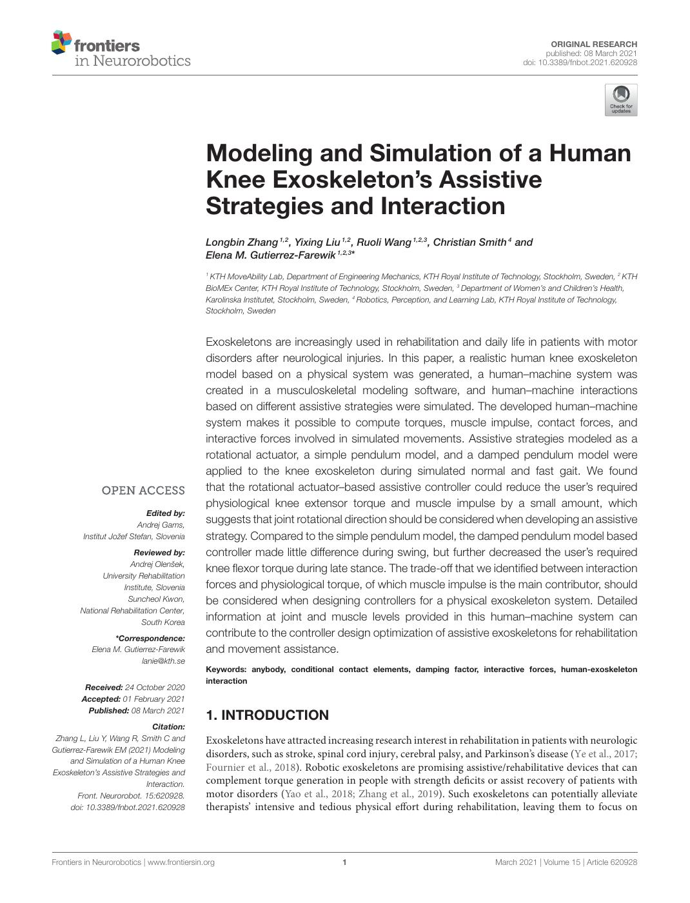

English text extracted from page 1

<pre>
ORIGINAL RESEARCH
                                                                                                                                           published: 08 March 2021
                                                                                                                                    doi: 10.3389/fnbot.2021.620928

                                             Modeling and Simulation of a Human
                                             Knee Exoskeleton’s Assistive
                                             Strategies and Interaction
                                             Longbin Zhang 1,2 , Yixing Liu 1,2 , Ruoli Wang 1,2,3 , Christian Smith 4 and
                                             Elena M. Gutierrez-Farewik 1,2,3*
                                             1
                                               KTH MoveAbility Lab, Department of Engineering Mechanics, KTH Royal Institute of Technology, Stockholm, Sweden, 2 KTH
                                             BioMEx Center, KTH Royal Institute of Technology, Stockholm, Sweden, 3 Department of Women’s and Children’s Health,
                                             Karolinska Institutet, Stockholm, Sweden, 4 Robotics, Perception, and Learning Lab, KTH Royal Institute of Technology,
                                             Stockholm, Sweden

                                             Exoskeletons are increasingly used in rehabilitation and daily life in patients with motor
                                             disorders after neurological injuries. In this paper, a realistic human knee exoskeleton
                                             model based on a physical system was generated, a human–machine system was
                                             created in a musculoskeletal modeling software, and human–machine interactions
                                             based on different assistive strategies were simulated. The developed human–machine
                                             system makes it possible to compute torques, muscle impulse, contact forces, and
                                             interactive forces involved in simulated movements. Assistive strategies modeled as a
                                             rotational actuator, a simple pendulum model, and a damped pendulum model were
                                             applied to the knee exoskeleton during simulated normal and fast gait. We found
                                             that the rotational actuator–based assistive controller could reduce the user’s required
                                             physiological knee extensor torque and muscle impulse by a small amount, which
                             Edited by:
                          Andrej Gams,
                                             suggests that joint rotational direction should be considered when developing an assistive
         Institut Jožef Stefan, Slovenia     strategy. Compared to the simple pendulum model, the damped pendulum model based
                       Reviewed by:          controller made little difference during swing, but further decreased the user’s required
                      Andrej Olenšek,
                                             knee flexor torque during late stance. The trade-off that we identified between interaction
              University Rehabilitation
                    Institute, Slovenia      forces and physiological torque, of which muscle impulse is the main contributor, should
                     Suncheol Kwon,          be considered when designing controllers for a physical exoskeleton system. Detailed
        National Rehabilitation Center,
                          South Korea
                                             information at joint and muscle levels provided in this human–machine system can
                 *Correspondence:
                                             contribute to the controller design optimization of assistive exoskeletons for rehabilitation
           Elena M. Gutierrez-Farewik        and movement assistance.
                         lanie@kth.se
                                             Keywords: anybody, conditional contact elements, damping factor, interactive forces, human-exoskeleton
                                             interaction
         Received: 24 October 2020
        Accepted: 01 February 2021
          Published: 08 March 2021
                                             1. INTRODUCTION
                             Citation:
 Zhang L, Liu Y, Wang R, Smith C and         Exoskeletons have attracted increasing research interest in rehabilitation in patients with neurologic
Gutierrez-Farewik EM (2021) Modeling
                                             disorders, such as stroke, spinal cord injury, cerebral palsy, and Parkinson’s disease (Ye et al., 2017;
     and Simulation of a Human Knee
Exoskeleton’s Assistive Strategies and
                                             Fournier et al., 2018). Robotic exoskeletons are promising assistive/rehabilitative devices that can
                           Interaction.      complement torque generation in people with strength deficits or assist recovery of patients with
        Front. Neurorobot. 15:620928.        motor disorders (Yao et al., 2018; Zhang et al., 2019). Such exoskeletons can potentially alleviate
     doi: 10.3389/fnbot.2021.620928          therapists’ intensive and tedious physical effort during rehabilitation, leaving them to focus on

Frontiers in Neurorobotics | www.frontiersin.org                                  1                                         March 2021 | Volume 15 | Article 620928
</pre>

## Page 2

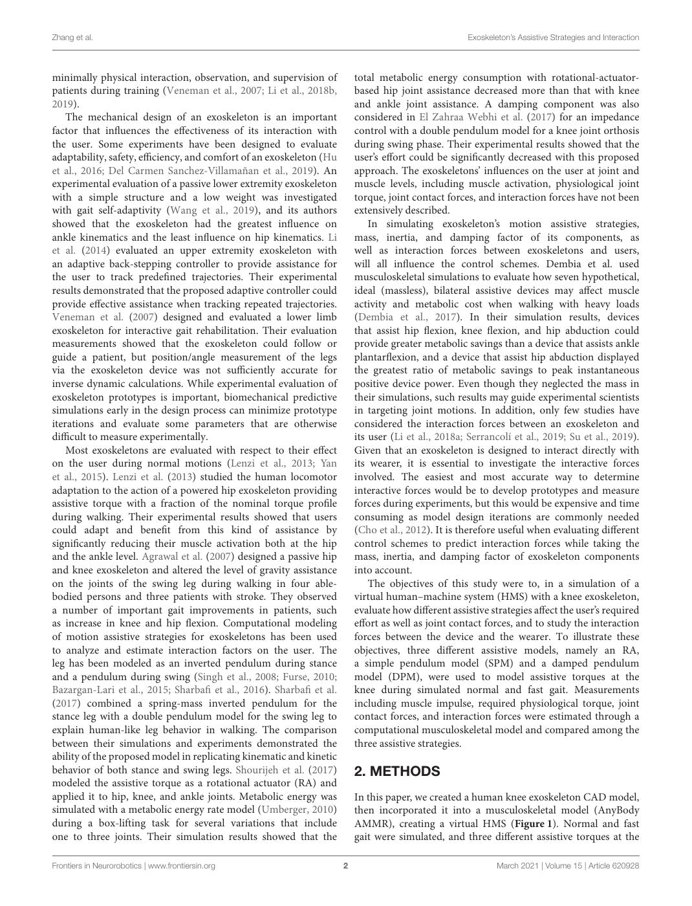

English text extracted from page 2

<pre>
Zhang et al.                                                                                         Exoskeleton’s Assistive Strategies and Interaction

minimally physical interaction, observation, and supervision of           total metabolic energy consumption with rotational-actuator-
patients during training (Veneman et al., 2007; Li et al., 2018b,         based hip joint assistance decreased more than that with knee
2019).                                                                    and ankle joint assistance. A damping component was also
    The mechanical design of an exoskeleton is an important               considered in El Zahraa Webhi et al. (2017) for an impedance
factor that influences the effectiveness of its interaction with          control with a double pendulum model for a knee joint orthosis
the user. Some experiments have been designed to evaluate                 during swing phase. Their experimental results showed that the
adaptability, safety, efficiency, and comfort of an exoskeleton (Hu       user’s effort could be significantly decreased with this proposed
et al., 2016; Del Carmen Sanchez-Villamañan et al., 2019). An             approach. The exoskeletons’ influences on the user at joint and
experimental evaluation of a passive lower extremity exoskeleton          muscle levels, including muscle activation, physiological joint
with a simple structure and a low weight was investigated                 torque, joint contact forces, and interaction forces have not been
with gait self-adaptivity (Wang et al., 2019), and its authors            extensively described.
showed that the exoskeleton had the greatest influence on                     In simulating exoskeleton’s motion assistive strategies,
ankle kinematics and the least influence on hip kinematics. Li            mass, inertia, and damping factor of its components, as
et al. (2014) evaluated an upper extremity exoskeleton with               well as interaction forces between exoskeletons and users,
an adaptive back-stepping controller to provide assistance for            will all influence the control schemes. Dembia et al. used
the user to track predefined trajectories. Their experimental             musculoskeletal simulations to evaluate how seven hypothetical,
results demonstrated that the proposed adaptive controller could          ideal (massless), bilateral assistive devices may affect muscle
provide effective assistance when tracking repeated trajectories.         activity and metabolic cost when walking with heavy loads
Veneman et al. (2007) designed and evaluated a lower limb                 (Dembia et al., 2017). In their simulation results, devices
exoskeleton for interactive gait rehabilitation. Their evaluation         that assist hip flexion, knee flexion, and hip abduction could
measurements showed that the exoskeleton could follow or                  provide greater metabolic savings than a device that assists ankle
guide a patient, but position/angle measurement of the legs               plantarflexion, and a device that assist hip abduction displayed
via the exoskeleton device was not sufficiently accurate for              the greatest ratio of metabolic savings to peak instantaneous
inverse dynamic calculations. While experimental evaluation of            positive device power. Even though they neglected the mass in
exoskeleton prototypes is important, biomechanical predictive             their simulations, such results may guide experimental scientists
simulations early in the design process can minimize prototype            in targeting joint motions. In addition, only few studies have
iterations and evaluate some parameters that are otherwise                considered the interaction forces between an exoskeleton and
difficult to measure experimentally.                                      its user (Li et al., 2018a; Serrancolí et al., 2019; Su et al., 2019).
    Most exoskeletons are evaluated with respect to their effect          Given that an exoskeleton is designed to interact directly with
on the user during normal motions (Lenzi et al., 2013; Yan                its wearer, it is essential to investigate the interactive forces
et al., 2015). Lenzi et al. (2013) studied the human locomotor            involved. The easiest and most accurate way to determine
adaptation to the action of a powered hip exoskeleton providing           interactive forces would be to develop prototypes and measure
assistive torque with a fraction of the nominal torque profile            forces during experiments, but this would be expensive and time
during walking. Their experimental results showed that users              consuming as model design iterations are commonly needed
could adapt and benefit from this kind of assistance by                   (Cho et al., 2012). It is therefore useful when evaluating different
significantly reducing their muscle activation both at the hip            control schemes to predict interaction forces while taking the
and the ankle level. Agrawal et al. (2007) designed a passive hip         mass, inertia, and damping factor of exoskeleton components
and knee exoskeleton and altered the level of gravity assistance          into account.
on the joints of the swing leg during walking in four able-                   The objectives of this study were to, in a simulation of a
bodied persons and three patients with stroke. They observed              virtual human–machine system (HMS) with a knee exoskeleton,
a number of important gait improvements in patients, such                 evaluate how different assistive strategies affect the user’s required
as increase in knee and hip flexion. Computational modeling               effort as well as joint contact forces, and to study the interaction
of motion assistive strategies for exoskeletons has been used             forces between the device and the wearer. To illustrate these
to analyze and estimate interaction factors on the user. The              objectives, three different assistive models, namely an RA,
leg has been modeled as an inverted pendulum during stance                a simple pendulum model (SPM) and a damped pendulum
and a pendulum during swing (Singh et al., 2008; Furse, 2010;             model (DPM), were used to model assistive torques at the
Bazargan-Lari et al., 2015; Sharbafi et al., 2016). Sharbafi et al.       knee during simulated normal and fast gait. Measurements
(2017) combined a spring-mass inverted pendulum for the                   including muscle impulse, required physiological torque, joint
stance leg with a double pendulum model for the swing leg to              contact forces, and interaction forces were estimated through a
explain human-like leg behavior in walking. The comparison                computational musculoskeletal model and compared among the
between their simulations and experiments demonstrated the                three assistive strategies.
ability of the proposed model in replicating kinematic and kinetic
behavior of both stance and swing legs. Shourijeh et al. (2017)           2. METHODS
modeled the assistive torque as a rotational actuator (RA) and
applied it to hip, knee, and ankle joints. Metabolic energy was           In this paper, we created a human knee exoskeleton CAD model,
simulated with a metabolic energy rate model (Umberger, 2010)             then incorporated it into a musculoskeletal model (AnyBody
during a box-lifting task for several variations that include             AMMR), creating a virtual HMS (Figure 1). Normal and fast
one to three joints. Their simulation results showed that the             gait were simulated, and three different assistive torques at the

Frontiers in Neurorobotics | www.frontiersin.org                      2                                      March 2021 | Volume 15 | Article 620928
</pre>

## Page 3

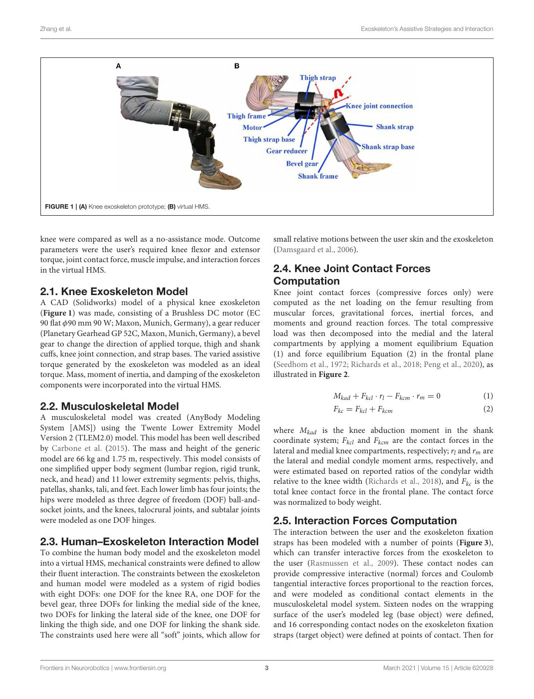

English text extracted from page 3

<pre>
Zhang et al.                                                                                            Exoskeleton’s Assistive Strategies and Interaction

 FIGURE 1 | (A) Knee exoskeleton prototype; (B) virtual HMS.

knee were compared as well as a no-assistance mode. Outcome                  small relative motions between the user skin and the exoskeleton
parameters were the user’s required knee flexor and extensor                 (Damsgaard et al., 2006).
torque, joint contact force, muscle impulse, and interaction forces
in the virtual HMS.                                                          2.4. Knee Joint Contact Forces
                                                                             Computation
2.1. Knee Exoskeleton Model                                                  Knee joint contact forces (compressive forces only) were
A CAD (Solidworks) model of a physical knee exoskeleton                      computed as the net loading on the femur resulting from
(Figure 1) was made, consisting of a Brushless DC motor (EC                  muscular forces, gravitational forces, inertial forces, and
90 flat φ90 mm 90 W; Maxon, Munich, Germany), a gear reducer                 moments and ground reaction forces. The total compressive
(Planetary Gearhead GP 52C, Maxon, Munich, Germany), a bevel                 load was then decomposed into the medial and the lateral
gear to change the direction of applied torque, thigh and shank              compartments by applying a moment equilibrium Equation
cuffs, knee joint connection, and strap bases. The varied assistive          (1) and force equilibrium Equation (2) in the frontal plane
torque generated by the exoskeleton was modeled as an ideal                  (Seedhom et al., 1972; Richards et al., 2018; Peng et al., 2020), as
torque. Mass, moment of inertia, and damping of the exoskeleton              illustrated in Figure 2.
components were incorporated into the virtual HMS.
                                                                                               Mkad + Fkcl · rl − Fkcm · rm = 0                       (1)
2.2. Musculoskeletal Model                                                                     Fkc = Fkcl + Fkcm                                      (2)
A musculoskeletal model was created (AnyBody Modeling
System [AMS]) using the Twente Lower Extremity Model                         where Mkad is the knee abduction moment in the shank
Version 2 (TLEM2.0) model. This model has been well described                coordinate system; Fkcl and Fkcm are the contact forces in the
by Carbone et al. (2015). The mass and height of the generic                 lateral and medial knee compartments, respectively; rl and rm are
model are 66 kg and 1.75 m, respectively. This model consists of             the lateral and medial condyle moment arms, respectively, and
one simplified upper body segment (lumbar region, rigid trunk,               were estimated based on reported ratios of the condylar width
neck, and head) and 11 lower extremity segments: pelvis, thighs,             relative to the knee width (Richards et al., 2018), and Fkc is the
patellas, shanks, tali, and feet. Each lower limb has four joints; the       total knee contact force in the frontal plane. The contact force
hips were modeled as three degree of freedom (DOF) ball-and-                 was normalized to body weight.
socket joints, and the knees, talocrural joints, and subtalar joints
were modeled as one DOF hinges.                                              2.5. Interaction Forces Computation
                                                                             The interaction between the user and the exoskeleton fixation
2.3. Human–Exoskeleton Interaction Model                                     straps has been modeled with a number of points (Figure 3),
To combine the human body model and the exoskeleton model                    which can transfer interactive forces from the exoskeleton to
into a virtual HMS, mechanical constraints were defined to allow             the user (Rasmussen et al., 2009). These contact nodes can
their fluent interaction. The constraints between the exoskeleton            provide compressive interactive (normal) forces and Coulomb
and human model were modeled as a system of rigid bodies                     tangential interactive forces proportional to the reaction forces,
with eight DOFs: one DOF for the knee RA, one DOF for the                    and were modeled as conditional contact elements in the
bevel gear, three DOFs for linking the medial side of the knee,              musculoskeletal model system. Sixteen nodes on the wrapping
two DOFs for linking the lateral side of the knee, one DOF for               surface of the user’s modeled leg (base object) were defined,
linking the thigh side, and one DOF for linking the shank side.              and 16 corresponding contact nodes on the exoskeleton fixation
The constraints used here were all “soft” joints, which allow for            straps (target object) were defined at points of contact. Then for

Frontiers in Neurorobotics | www.frontiersin.org                         3                                      March 2021 | Volume 15 | Article 620928
</pre>

## Page 4

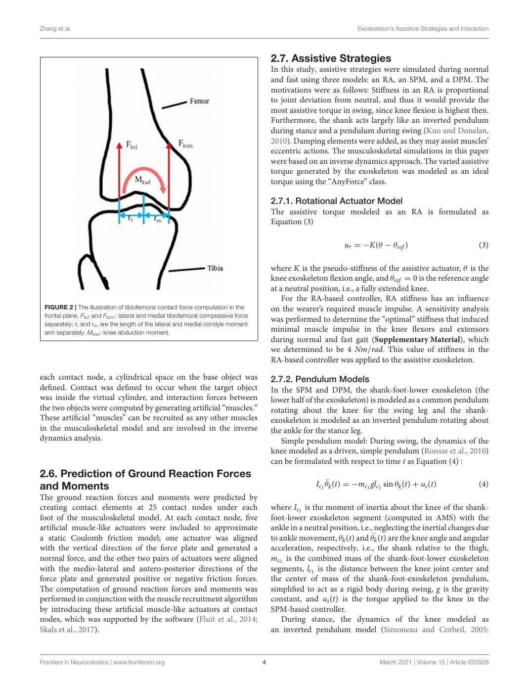

English text extracted from page 4

<pre>
Zhang et al.                                                                                                        Exoskeleton’s Assistive Strategies and Interaction

                                                                                        2.7. Assistive Strategies
                                                                                        In this study, assistive strategies were simulated during normal
                                                                                        and fast using three models: an RA, an SPM, and a DPM. The
                                                                                        motivations were as follows: Stiffness in an RA is proportional
                                                                                        to joint deviation from neutral, and thus it would provide the
                                                                                        most assistive torque in swing, since knee flexion is highest then.
                                                                                        Furthermore, the shank acts largely like an inverted pendulum
                                                                                        during stance and a pendulum during swing (Kuo and Donelan,
                                                                                        2010). Damping elements were added, as they may assist muscles’
                                                                                        eccentric actions. The musculoskeletal simulations in this paper
                                                                                        were based on an inverse dynamics approach. The varied assistive
                                                                                        torque generated by the exoskeleton was modeled as an ideal
                                                                                        torque using the “AnyForce” class.

                                                                                        2.7.1. Rotational Actuator Model
                                                                                        The assistive torque modeled as an RA is formulated as
                                                                                        Equation (3)

                                                                                                                ur = −K(θ − θref )                                (3)

                                                                                        where K is the pseudo-stiffness of the assistive actuator, θ is the
                                                                                        knee exoskeleton flexion angle, and θref = 0 is the reference angle
                                                                                        at a neutral position, i.e., a fully extended knee.
                                                                                            For the RA-based controller, RA stiffness has an influence
 FIGURE 2 | The illustration of tibiofemoral contact force computation in the           on the wearer’s required muscle impulse. A sensitivity analysis
 frontal plane. Fkcl and Fkcm : lateral and medial tibiofemoral compressive force
                                                                                        was performed to determine the “optimal” stiffness that induced
 separately; rl and rm are the length of the lateral and medial condyle moment
 arm separately; Mkad : knee abduction moment.                                          minimal muscle impulse in the knee flexors and extensors
                                                                                        during normal and fast gait (Supplementary Material), which
                                                                                        we determined to be 4 Nm/rad. This value of stiffness in the
                                                                                        RA-based controller was applied to the assistive exoskeleton.

each contact node, a cylindrical space on the base object was                           2.7.2. Pendulum Models
defined. Contact was defined to occur when the target object                            In the SPM and DPM, the shank-foot-lower exoskeleton (the
was inside the virtual cylinder, and interaction forces between                         lower half of the exoskeleton) is modeled as a common pendulum
the two objects were computed by generating artificial “muscles.”                       rotating about the knee for the swing leg and the shank-
These artificial “muscles” can be recruited as any other muscles                        exoskeleton is modeled as an inverted pendulum rotating about
in the musculoskeletal model and are involved in the inverse                            the ankle for the stance leg.
dynamics analysis.                                                                         Simple pendulum model: During swing, the dynamics of the
                                                                                        knee modeled as a driven, simple pendulum (Ronsse et al., 2010)
                                                                                        can be formulated with respect to time t as Equation (4) :
2.6. Prediction of Ground Reaction Forces
and Moments                                                                                           Ic1 θ̈k (t) = −mc1 glc1 sin θk (t) + us (t)                 (4)
The ground reaction forces and moments were predicted by
creating contact elements at 25 contact nodes under each                                where Ic1 is the moment of inertia about the knee of the shank-
foot of the musculoskeletal model. At each contact node, five                           foot-lower exoskeleton segment (computed in AMS) with the
artificial muscle-like actuators were included to approximate                           ankle in a neutral position, i.e., neglecting the inertial changes due
a static Coulomb friction model; one actuator was aligned                               to ankle movement, θk (t) and θ¨k (t) are the knee angle and angular
with the vertical direction of the force plate and generated a                          acceleration, respectively, i.e., the shank relative to the thigh,
normal force, and the other two pairs of actuators were aligned                         mc1 is the combined mass of the shank-foot-lower exoskeleton
with the medio-lateral and antero-posterior directions of the                           segments, lc1 is the distance between the knee joint center and
force plate and generated positive or negative friction forces.                         the center of mass of the shank-foot-exoskeleton pendulum,
The computation of ground reaction forces and moments was                               simplified to act as a rigid body during swing, g is the gravity
performed in conjunction with the muscle recruitment algorithm                          constant, and us (t) is the torque applied to the knee in the
by introducing these artificial muscle-like actuators at contact                        SPM-based controller.
nodes, which was supported by the software (Fluit et al., 2014;                            During stance, the dynamics of the knee modeled as
Skals et al., 2017).                                                                    an inverted pendulum model (Simoneau and Corbeil, 2005;

Frontiers in Neurorobotics | www.frontiersin.org                                    4                                       March 2021 | Volume 15 | Article 620928
</pre>

## Page 5

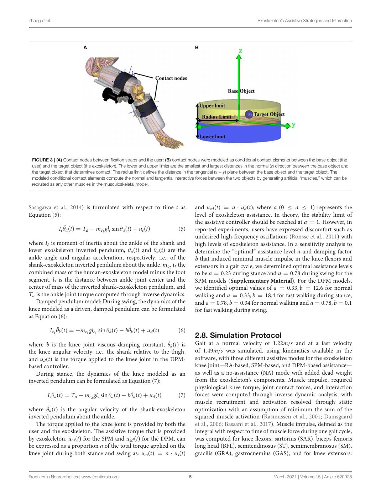

English text extracted from page 5

<pre>
Zhang et al.                                                                                                            Exoskeleton’s Assistive Strategies and Interaction

 FIGURE 3 | (A) Contact nodes between fixation straps and the user; (B) contact nodes were modeled as conditional contact elements between the base object (the
 user) and the target object (the exoskeleton). The lower and upper limits are the smallest and largest distances in the normal (z) direction between the base object and
 the target object that determines contact. The radius limit defines the distance in the tangential (x − y) plane between the base object and the target object. The
 modeled conditional contact elements compute the normal and tangential interactive forces between the two objects by generating artificial “muscles,” which can be
 recruited as any other muscles in the musculoskeletal model.

Sasagawa et al., 2014) is formulated with respect to time t as                          and ued (t) = a · ud (t); where a (0 ≤ a ≤ 1) represents the
Equation (5):                                                                           level of exoskeleton assistance. In theory, the stability limit of
                                                                                        the assistive controller should be reached at a = 1. However, in
                Is θ̈a (t) = Ta − mc2 gls sin θa (t) + us (t)                 (5)       reported experiments, users have expressed discomfort such as
                                                                                        undesired high-frequency oscillations (Ronsse et al., 2011) with
where Is is moment of inertia about the ankle of the shank and                          high levels of exoskeleton assistance. In a sensitivity analysis to
lower exoskeleton inverted pendulum, θa (t) and θ̈a (t) are the                         determine the “optimal” assistance level a and damping factor
ankle angle and angular acceleration, respectively, i.e., of the                        b that induced minimal muscle impulse in the knee flexors and
shank-exoskeleton inverted pendulum about the ankle, mc2 is the                         extensors in a gait cycle, we determined optimal assistance levels
combined mass of the human-exoskeleton model minus the foot                             to be a = 0.23 during stance and a = 0.78 during swing for the
segment, ls is the distance between ankle joint center and the                          SPM models (Supplementary Material). For the DPM models,
center of mass of the inverted shank-exoskeleton pendulum, and                          we identified optimal values of a = 0.33, b = 12.6 for normal
Ta is the ankle joint torque computed through inverse dynamics.                         walking and a = 0.33, b = 18.4 for fast walking during stance,
   Damped pendulum model: During swing, the dynamics of the                             and a = 0.78, b = 0.34 for normal walking and a = 0.78, b = 0.1
knee modeled as a driven, damped pendulum can be formulated                             for fast walking during swing.
as Equation (6):

           Ic1 θ̈k (t) = −mc1 glc1 sin θk (t) − bθ̇k (t) + ud (t)             (6)
                                                                                        2.8. Simulation Protocol
where b is the knee joint viscous damping constant, θ̇k (t) is                          Gait at a normal velocity of 1.22m/s and at a fast velocity
the knee angular velocity, i.e., the shank relative to the thigh,                       of 1.49m/s was simulated, using kinematics available in the
and ud (t) is the torque applied to the knee joint in the DPM-                          software, with three different assistive modes for the exoskeleton
based controller.                                                                       knee joint—RA-based, SPM-based, and DPM-based assistance—
   During stance, the dynamics of the knee modeled as an                                as well as a no-assistance (NA) mode with added dead weight
inverted pendulum can be formulated as Equation (7):                                    from the exoskeleton’s components. Muscle impulse, required
                                                                                        physiological knee torque, joint contact forces, and interaction
          Is θ̈a (t) = Ta − mc2 gls sin θa (t) − bθ̇a (t) + ud (t)            (7)       forces were computed through inverse dynamic analysis, with
                                                                                        muscle recruitment and activation resolved through static
where θ̇a (t) is the angular velocity of the shank-exoskeleton                          optimization with an assumption of minimum the sum of the
inverted pendulum about the ankle.                                                      squared muscle activation (Rasmussen et al., 2001; Damsgaard
   The torque applied to the knee joint is provided by both the                         et al., 2006; Bassani et al., 2017). Muscle impulse, defined as the
user and the exoskeleton. The assistive torque that is provided                         integral with respect to time of muscle force during one gait cycle,
by exoskeleton, ues (t) for the SPM and ued (t) for the DPM, can                        was computed for knee flexors: sartorius (SAR), biceps femoris
be expressed as a proportion a of the total torque applied on the                       long head (BFL), semitendinosus (ST), semimembranosus (SM),
knee joint during both stance and swing as: ues (t) = a · us (t)                        gracilis (GRA), gastrocnemius (GAS), and for knee extensors:

Frontiers in Neurorobotics | www.frontiersin.org                                    5                                            March 2021 | Volume 15 | Article 620928
</pre>

## Page 6

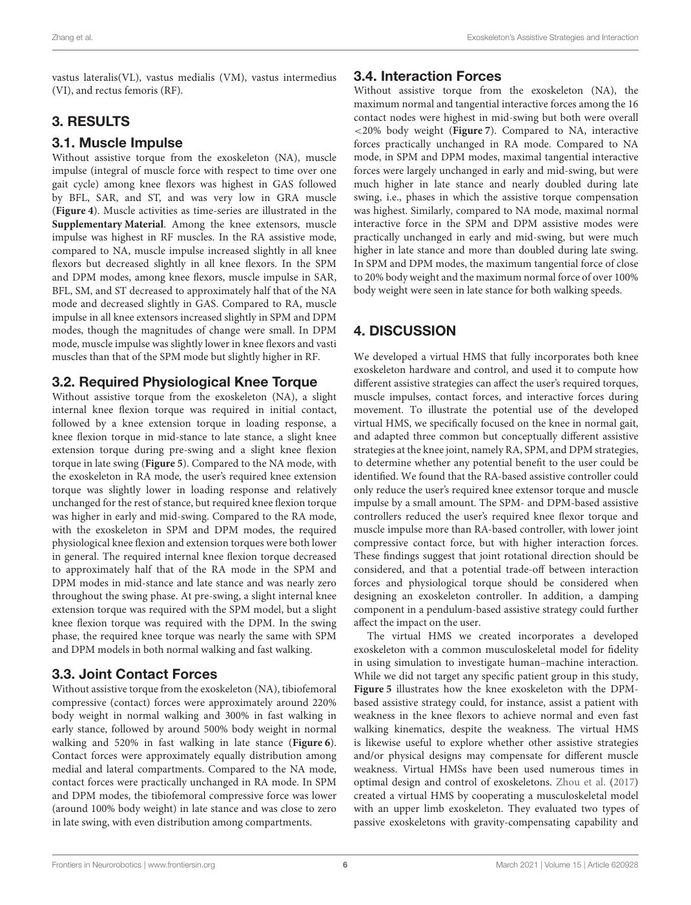

English text extracted from page 6

<pre>
Zhang et al.                                                                                         Exoskeleton’s Assistive Strategies and Interaction

vastus lateralis(VL), vastus medialis (VM), vastus intermedius            3.4. Interaction Forces
(VI), and rectus femoris (RF).                                            Without assistive torque from the exoskeleton (NA), the
                                                                          maximum normal and tangential interactive forces among the 16
3. RESULTS                                                                contact nodes were highest in mid-swing but both were overall
                                                                          &lt;20% body weight (Figure 7). Compared to NA, interactive
3.1. Muscle Impulse                                                       forces practically unchanged in RA mode. Compared to NA
Without assistive torque from the exoskeleton (NA), muscle                mode, in SPM and DPM modes, maximal tangential interactive
impulse (integral of muscle force with respect to time over one           forces were largely unchanged in early and mid-swing, but were
gait cycle) among knee flexors was highest in GAS followed                much higher in late stance and nearly doubled during late
by BFL, SAR, and ST, and was very low in GRA muscle                       swing, i.e., phases in which the assistive torque compensation
(Figure 4). Muscle activities as time-series are illustrated in the       was highest. Similarly, compared to NA mode, maximal normal
Supplementary Material. Among the knee extensors, muscle                  interactive force in the SPM and DPM assistive modes were
impulse was highest in RF muscles. In the RA assistive mode,              practically unchanged in early and mid-swing, but were much
compared to NA, muscle impulse increased slightly in all knee             higher in late stance and more than doubled during late swing.
flexors but decreased slightly in all knee flexors. In the SPM            In SPM and DPM modes, the maximum tangential force of close
and DPM modes, among knee flexors, muscle impulse in SAR,                 to 20% body weight and the maximum normal force of over 100%
BFL, SM, and ST decreased to approximately half that of the NA            body weight were seen in late stance for both walking speeds.
mode and decreased slightly in GAS. Compared to RA, muscle
impulse in all knee extensors increased slightly in SPM and DPM
modes, though the magnitudes of change were small. In DPM                 4. DISCUSSION
mode, muscle impulse was slightly lower in knee flexors and vasti
muscles than that of the SPM mode but slightly higher in RF.              We developed a virtual HMS that fully incorporates both knee
                                                                          exoskeleton hardware and control, and used it to compute how
3.2. Required Physiological Knee Torque                                   different assistive strategies can affect the user’s required torques,
Without assistive torque from the exoskeleton (NA), a slight              muscle impulses, contact forces, and interactive forces during
internal knee flexion torque was required in initial contact,             movement. To illustrate the potential use of the developed
followed by a knee extension torque in loading response, a                virtual HMS, we specifically focused on the knee in normal gait,
knee flexion torque in mid-stance to late stance, a slight knee           and adapted three common but conceptually different assistive
extension torque during pre-swing and a slight knee flexion               strategies at the knee joint, namely RA, SPM, and DPM strategies,
torque in late swing (Figure 5). Compared to the NA mode, with            to determine whether any potential benefit to the user could be
the exoskeleton in RA mode, the user’s required knee extension            identified. We found that the RA-based assistive controller could
torque was slightly lower in loading response and relatively              only reduce the user’s required knee extensor torque and muscle
unchanged for the rest of stance, but required knee flexion torque        impulse by a small amount. The SPM- and DPM-based assistive
was higher in early and mid-swing. Compared to the RA mode,               controllers reduced the user’s required knee flexor torque and
with the exoskeleton in SPM and DPM modes, the required                   muscle impulse more than RA-based controller, with lower joint
physiological knee flexion and extension torques were both lower          compressive contact force, but with higher interaction forces.
in general. The required internal knee flexion torque decreased           These findings suggest that joint rotational direction should be
to approximately half that of the RA mode in the SPM and                  considered, and that a potential trade-off between interaction
DPM modes in mid-stance and late stance and was nearly zero               forces and physiological torque should be considered when
throughout the swing phase. At pre-swing, a slight internal knee          designing an exoskeleton controller. In addition, a damping
extension torque was required with the SPM model, but a slight            component in a pendulum-based assistive strategy could further
knee flexion torque was required with the DPM. In the swing               affect the impact on the user.
phase, the required knee torque was nearly the same with SPM                  The virtual HMS we created incorporates a developed
and DPM models in both normal walking and fast walking.                   exoskeleton with a common musculoskeletal model for fidelity
                                                                          in using simulation to investigate human–machine interaction.
3.3. Joint Contact Forces                                                 While we did not target any specific patient group in this study,
Without assistive torque from the exoskeleton (NA), tibiofemoral          Figure 5 illustrates how the knee exoskeleton with the DPM-
compressive (contact) forces were approximately around 220%               based assistive strategy could, for instance, assist a patient with
body weight in normal walking and 300% in fast walking in                 weakness in the knee flexors to achieve normal and even fast
early stance, followed by around 500% body weight in normal               walking kinematics, despite the weakness. The virtual HMS
walking and 520% in fast walking in late stance (Figure 6).               is likewise useful to explore whether other assistive strategies
Contact forces were approximately equally distribution among              and/or physical designs may compensate for different muscle
medial and lateral compartments. Compared to the NA mode,                 weakness. Virtual HMSs have been used numerous times in
contact forces were practically unchanged in RA mode. In SPM              optimal design and control of exoskeletons. Zhou et al. (2017)
and DPM modes, the tibiofemoral compressive force was lower               created a virtual HMS by cooperating a musculoskeletal model
(around 100% body weight) in late stance and was close to zero            with an upper limb exoskeleton. They evaluated two types of
in late swing, with even distribution among compartments.                 passive exoskeletons with gravity-compensating capability and

Frontiers in Neurorobotics | www.frontiersin.org                      6                                      March 2021 | Volume 15 | Article 620928
</pre>

## Page 7

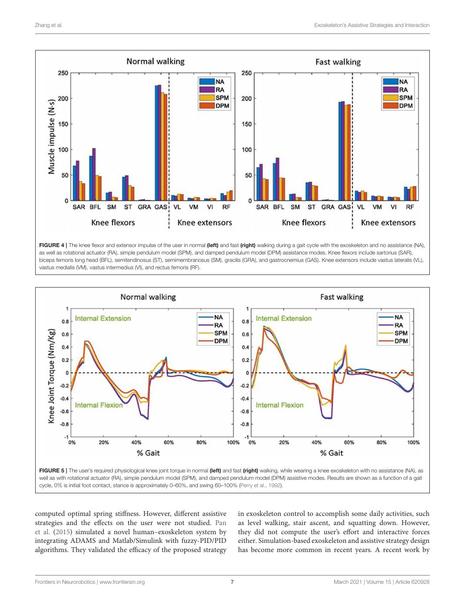

English text extracted from page 7

<pre>
Zhang et al.                                                                                                           Exoskeleton’s Assistive Strategies and Interaction

 FIGURE 4 | The knee flexor and extensor impulse of the user in normal (left) and fast (right) walking during a gait cycle with the exoskeleton and no assistance (NA),
 as well as rotational actuator (RA), simple pendulum model (SPM), and damped pendulum model (DPM) assistance modes. Knee flexors include sartorius (SAR),
 biceps femoris long head (BFL), semitendinosus (ST), semimembranosus (SM), gracilis (GRA), and gastrocnemius (GAS). Knee extensors include vastus lateralis (VL),
 vastus medialis (VM), vastus intermedius (VI), and rectus femoris (RF).

 FIGURE 5 | The user’s required physiological knee joint torque in normal (left) and fast (right) walking, while wearing a knee exoskeleton with no assistance (NA), as
 well as with rotational actuator (RA), simple pendulum model (SPM), and damped pendulum model (DPM) assistive modes. Results are shown as a function of a gait
 cycle, 0% is initial foot contact, stance is approximately 0–60%, and swing 60–100% (Perry et al., 1992).

computed optimal spring stiffness. However, different assistive                        in exoskeleton control to accomplish some daily activities, such
strategies and the effects on the user were not studied. Pan                           as level walking, stair ascent, and squatting down. However,
et al. (2015) simulated a novel human–exoskeleton system by                            they did not compute the user’s effort and interactive forces
integrating ADAMS and Matlab/Simulink with fuzzy-PID/PID                               either. Simulation-based exoskeleton and assistive strategy design
algorithms. They validated the efficacy of the proposed strategy                       has become more common in recent years. A recent work by

Frontiers in Neurorobotics | www.frontiersin.org                                   7                                            March 2021 | Volume 15 | Article 620928
</pre>

## Page 8

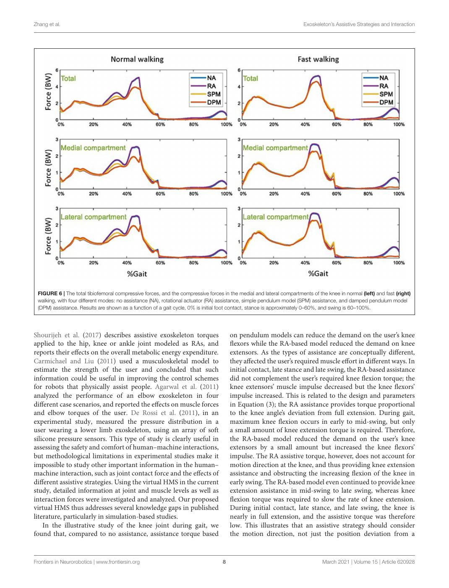

English text extracted from page 8

<pre>
Zhang et al.                                                                                                          Exoskeleton’s Assistive Strategies and Interaction

 FIGURE 6 | The total tibiofemoral compressive forces, and the compressive forces in the medial and lateral compartments of the knee in normal (left) and fast (right)
 walking, with four different modes: no assistance (NA), rotational actuator (RA) assistance, simple pendulum model (SPM) assistance, and damped pendulum model
 (DPM) assistance. Results are shown as a function of a gait cycle, 0% is initial foot contact, stance is approximately 0–60%, and swing is 60–100%.

Shourijeh et al. (2017) describes assistive exoskeleton torques                       on pendulum models can reduce the demand on the user’s knee
applied to the hip, knee or ankle joint modeled as RAs, and                           flexors while the RA-based model reduced the demand on knee
reports their effects on the overall metabolic energy expenditure.                    extensors. As the types of assistance are conceptually different,
Carmichael and Liu (2011) used a musculoskeletal model to                             they affected the user’s required muscle effort in different ways. In
estimate the strength of the user and concluded that such                             initial contact, late stance and late swing, the RA-based assistance
information could be useful in improving the control schemes                          did not complement the user’s required knee flexion torque; the
for robots that physically assist people. Agarwal et al. (2011)                       knee extensors’ muscle impulse decreased but the knee flexors’
analyzed the performance of an elbow exoskeleton in four                              impulse increased. This is related to the design and parameters
different case scenarios, and reported the effects on muscle forces                   in Equation (3); the RA assistance provides torque proportional
and elbow torques of the user. De Rossi et al. (2011), in an                          to the knee angle’s deviation from full extension. During gait,
experimental study, measured the pressure distribution in a                           maximum knee flexion occurs in early to mid-swing, but only
user wearing a lower limb exoskeleton, using an array of soft                         a small amount of knee extension torque is required. Therefore,
silicone pressure sensors. This type of study is clearly useful in                    the RA-based model reduced the demand on the user’s knee
assessing the safety and comfort of human–machine interactions,                       extensors by a small amount but increased the knee flexors’
but methodological limitations in experimental studies make it                        impulse. The RA assistive torque, however, does not account for
impossible to study other important information in the human–                         motion direction at the knee, and thus providing knee extension
machine interaction, such as joint contact force and the effects of                   assistance and obstructing the increasing flexion of the knee in
different assistive strategies. Using the virtual HMS in the current                  early swing. The RA-based model even continued to provide knee
study, detailed information at joint and muscle levels as well as                     extension assistance in mid-swing to late swing, whereas knee
interaction forces were investigated and analyzed. Our proposed                       flexion torque was required to slow the rate of knee extension.
virtual HMS thus addresses several knowledge gaps in published                        During initial contact, late stance, and late swing, the knee is
literature, particularly in simulation-based studies.                                 nearly in full extension, and the assistive torque was therefore
    In the illustrative study of the knee joint during gait, we                       low. This illustrates that an assistive strategy should consider
found that, compared to no assistance, assistance torque based                        the motion direction, not just the position deviation from a

Frontiers in Neurorobotics | www.frontiersin.org                                  8                                           March 2021 | Volume 15 | Article 620928
</pre>

## Page 9

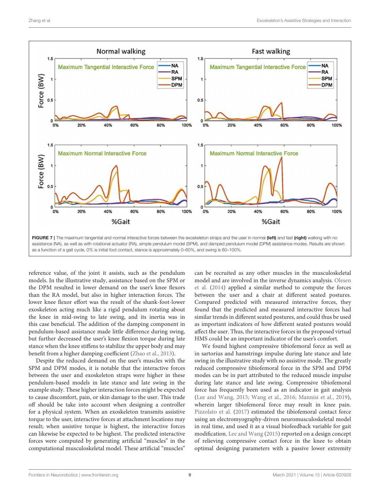

English text extracted from page 9

<pre>
Zhang et al.                                                                                                      Exoskeleton’s Assistive Strategies and Interaction

 FIGURE 7 | The maximum tangential and normal interactive forces between the exoskeleton straps and the user in normal (left) and fast (right) walking with no
 assistance (NA), as well as with rotational actuator (RA), simple pendulum model (SPM), and damped pendulum model (DPM) assistance modes. Results are shown
 as a function of a gait cycle, 0% is initial foot contact, stance is approximately 0–60%, and swing is 60–100%.

reference value, of the joint it assists, such as the pendulum                     can be recruited as any other muscles in the musculoskeletal
models. In the illustrative study, assistance based on the SPM or                  model and are involved in the inverse dynamics analysis. Olesen
the DPM resulted in lower demand on the user’s knee flexors                        et al. (2014) applied a similar method to compute the forces
than the RA model, but also in higher interaction forces. The                      between the user and a chair at different seated postures.
lower knee flexor effort was the result of the shank-foot-lower                    Compared predicted with measured interactive forces, they
exoskeleton acting much like a rigid pendulum rotating about                       found that the predicted and measured interactive forces had
the knee in mid-swing to late swing, and its inertia was in                        similar trends in different seated postures, and could thus be used
this case beneficial. The addition of the damping component in                     as important indicators of how different seated postures would
pendulum-based assistance made little difference during swing,                     affect the user. Thus, the interactive forces in the proposed virtual
but further decreased the user’s knee flexion torque during late                   HMS could be an important indicator of the user’s comfort.
stance when the knee stiffens to stabilize the upper body and may                      We found highest compressive tibiofemoral force as well as
benefit from a higher damping coefficient (Zhao et al., 2013).                     in sartorius and hamstrings impulse during late stance and late
   Despite the reduced demand on the user’s muscles with the                       swing in the illustrative study with no assistive mode. The greatly
SPM and DPM modes, it is notable that the interactive forces                       reduced compressive tibiofemoral force in the SPM and DPM
between the user and exoskeleton straps were higher in these                       modes can be in part attributed to the reduced muscle impulse
pendulum-based models in late stance and late swing in the                         during late stance and late swing. Compressive tibiofemoral
example study. These higher interaction forces might be expected                   force has frequently been used as an indicator in gait analysis
to cause discomfort, pain, or skin damage to the user. This trade                  (Lee and Wang, 2015; Wang et al., 2016; Mannisi et al., 2019),
off should be take into account when designing a controller                        wherein larger tibiofemoral force may result in knee pain.
for a physical system. When an exoskeleton transmits assistive                     Pizzolato et al. (2017) estimated the tibiofemoral contact force
torque to the user, interactive forces at attachment locations may                 using an electromyography-driven neuromusculoskeletal model
result; when assistive torque is highest, the interactive forces                   in real time, and used it as a visual biofeedback variable for gait
can likewise be expected to be highest. The predicted interactive                  modification. Lee and Wang (2015) reported on a design concept
forces were computed by generating artificial “muscles” in the                     of relieving compressive contact force in the knee to obtain
computational musculoskeletal model. These artificial “muscles”                    optimal designing parameters with a passive lower extremity

Frontiers in Neurorobotics | www.frontiersin.org                               9                                          March 2021 | Volume 15 | Article 620928
</pre>

## Page 10

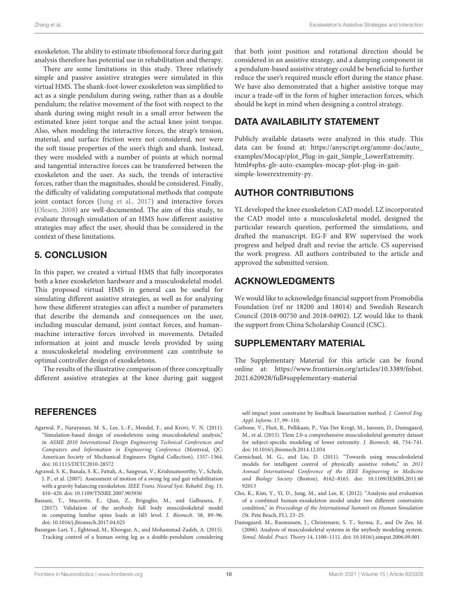

English text extracted from page 10

<pre>
Zhang et al.                                                                                                                Exoskeleton’s Assistive Strategies and Interaction

exoskeleton. The ability to estimate tibiofemoral force during gait                         that both joint position and rotational direction should be
analysis therefore has potential use in rehabilitation and therapy.                         considered in an assistive strategy, and a damping component in
   There are some limitations in this study. Three relatively                               a pendulum-based assistive strategy could be beneficial to further
simple and passive assistive strategies were simulated in this                              reduce the user’s required muscle effort during the stance phase.
virtual HMS. The shank-foot-lower exoskeleton was simplified to                             We have also demonstrated that a higher assistive torque may
act as a single pendulum during swing, rather than as a double                              incur a trade-off in the form of higher interaction forces, which
pendulum; the relative movement of the foot with respect to the                             should be kept in mind when designing a control strategy.
shank during swing might result in a small error between the
estimated knee joint torque and the actual knee joint torque.                               DATA AVAILABILITY STATEMENT
Also, when modeling the interactive forces, the strap’s tension,
material, and surface friction were not considered, nor were                                Publicly available datasets were analyzed in this study. This
the soft tissue properties of the user’s thigh and shank. Instead,                          data can be found at: https://anyscript.org/ammr-doc/auto_
they were modeled with a number of points at which normal                                   examples/Mocap/plot_Plug-in-gait_Simple_LowerExtremity.
and tangential interactive forces can be transferred between the                            html#sphx-glr-auto-examples-mocap-plot-plug-in-gait-
exoskeleton and the user. As such, the trends of interactive                                simple-lowerextremity-py.
forces, rather than the magnitudes, should be considered. Finally,
the difficulty of validating computational methods that compute                             AUTHOR CONTRIBUTIONS
joint contact forces (Jung et al., 2017) and interactive forces
(Olesen, 2008) are well-documented. The aim of this study, to                               YL developed the knee exoskeleton CAD model. LZ incorporated
evaluate through simulation of an HMS how different assistive                               the CAD model into a musculoskeletal model, designed the
strategies may affect the user, should thus be considered in the                            particular research question, performed the simulations, and
context of these limitations.                                                               drafted the manuscript. EG-F and RW supervised the work
                                                                                            progress and helped draft and revise the article. CS supervised
5. CONCLUSION                                                                               the work progress. All authors contributed to the article and
                                                                                            approved the submitted version.
In this paper, we created a virtual HMS that fully incorporates
both a knee exoskeleton hardware and a musculoskeletal model.                               ACKNOWLEDGMENTS
This proposed virtual HMS in general can be useful for
simulating different assistive strategies, as well as for analyzing                         We would like to acknowledge financial support from Promobilia
how these different strategies can affect a number of parameters                            Foundation (ref nr 18200 and 18014) and Swedish Research
that describe the demands and consequences on the user,                                     Council (2018-00750 and 2018-04902). LZ would like to thank
including muscular demand, joint contact forces, and human–                                 the support from China Scholarship Council (CSC).
machine interactive forces involved in movements. Detailed
information at joint and muscle levels provided by using                                    SUPPLEMENTARY MATERIAL
a musculoskeletal modeling environment can contribute to
optimal controller design of exoskeletons.                                                  The Supplementary Material for this article can be found
   The results of the illustrative comparison of three conceptually                         online at: https://www.frontiersin.org/articles/10.3389/fnbot.
different assistive strategies at the knee during gait suggest                              2021.620928/full#supplementary-material

REFERENCES                                                                                     self-impact joint constraint by feedback linearization method. J. Control Eng.
                                                                                               Appl. Inform. 17, 99–110.
Agarwal, P., Narayanan, M. S., Lee, L.-F., Mendel, F., and Krovi, V. N. (2011).             Carbone, V., Fluit, R., Pellikaan, P., Van Der Krogt, M., Janssen, D., Damsgaard,
   “Simulation-based design of exoskeletons using musculoskeletal analysis,”                   M., et al. (2015). Tlem 2.0-a comprehensive musculoskeletal geometry dataset
   in ASME 2010 International Design Engineering Technical Conferences and                     for subject-specific modeling of lower extremity. J. Biomech. 48, 734–741.
   Computers and Information in Engineering Conference (Montreal, QC:                          doi: 10.1016/j.jbiomech.2014.12.034
   American Society of Mechanical Engineers Digital Collection), 1357–1364.                 Carmichael, M. G., and Liu, D. (2011). “Towards using musculoskeletal
   doi: 10.1115/DETC2010-28572                                                                 models for intelligent control of physically assistive robots,” in 2011
Agrawal, S. K., Banala, S. K., Fattah, A., Sangwan, V., Krishnamoorthy, V., Scholz,            Annual International Conference of the IEEE Engineering in Medicine
   J. P., et al. (2007). Assessment of motion of a swing leg and gait rehabilitation           and Biology Society (Boston), 8162–8165. doi: 10.1109/IEMBS.2011.60
   with a gravity balancing exoskeleton. IEEE Trans. Neural Syst. Rehabil. Eng. 15,            92013
   410–420. doi: 10.1109/TNSRE.2007.903930                                                  Cho, K., Kim, Y., Yi, D., Jung, M., and Lee, K. (2012). “Analysis and evaluation
Bassani, T., Stucovitz, E., Qian, Z., Briguglio, M., and Galbusera, F.                         of a combined human-exoskeleton model under two different constraints
   (2017). Validation of the anybody full body musculoskeletal model                           condition,” in Proceedings of the International Summit on Human Simulation
   in computing lumbar spine loads at l4l5 level. J. Biomech. 58, 89–96.                       (St. Pete Beach, FL), 23–25.
   doi: 10.1016/j.jbiomech.2017.04.025                                                      Damsgaard, M., Rasmussen, J., Christensen, S. T., Surma, E., and De Zee, M.
Bazargan-Lari, Y., Eghtesad, M., Khoogar, A., and Mohammad-Zadeh, A. (2015).                   (2006). Analysis of musculoskeletal systems in the anybody modeling system.
   Tracking control of a human swing leg as a double-pendulum considering                      Simul. Model. Pract. Theory 14, 1100–1111. doi: 10.1016/j.simpat.2006.09.001

Frontiers in Neurorobotics | www.frontiersin.org                                       10                                           March 2021 | Volume 15 | Article 620928
</pre>

## Page 11

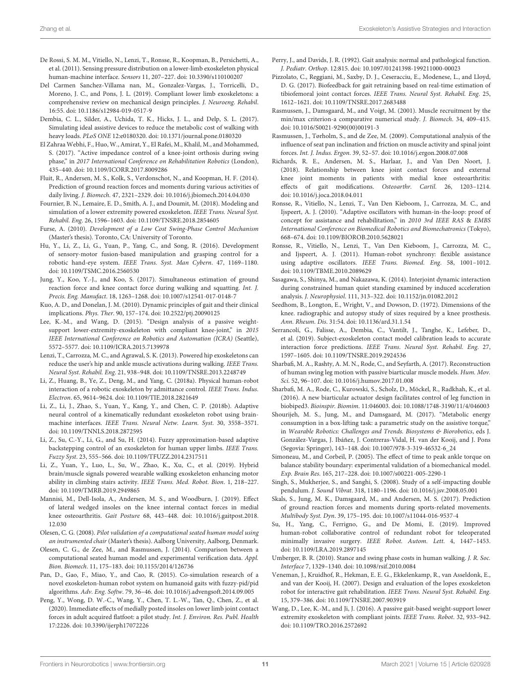

English text extracted from page 11

<pre>
Zhang et al.                                                                                                                     Exoskeleton’s Assistive Strategies and Interaction

De Rossi, S. M. M., Vitiello, N., Lenzi, T., Ronsse, R., Koopman, B., Persichetti, A.,          Perry, J., and Davids, J. R. (1992). Gait analysis: normal and pathological function.
    et al. (2011). Sensing pressure distribution on a lower-limb exoskeleton physical              J. Pediatr. Orthop. 12:815. doi: 10.1097/01241398-199211000-00023
    human-machine interface. Sensors 11, 207–227. doi: 10.3390/s110100207                       Pizzolato, C., Reggiani, M., Saxby, D. J., Ceseracciu, E., Modenese, L., and Lloyd,
Del Carmen Sanchez-Villama nan, M., Gonzalez-Vargas, J., Torricelli, D.,                           D. G. (2017). Biofeedback for gait retraining based on real-time estimation of
    Moreno, J. C., and Pons, J. L. (2019). Compliant lower limb exoskeletons: a                    tibiofemoral joint contact forces. IEEE Trans. Neural Syst. Rehabil. Eng. 25,
    comprehensive review on mechanical design principles. J. Neuroeng. Rehabil.                    1612–1621. doi: 10.1109/TNSRE.2017.2683488
    16:55. doi: 10.1186/s12984-019-0517-9                                                       Rasmussen, J., Damsgaard, M., and Voigt, M. (2001). Muscle recruitment by the
Dembia, C. L., Silder, A., Uchida, T. K., Hicks, J. L., and Delp, S. L. (2017).                    min/max criterion-a comparative numerical study. J. Biomech. 34, 409–415.
    Simulating ideal assistive devices to reduce the metabolic cost of walking with                doi: 10.1016/S0021-9290(00)00191-3
    heavy loads. PLoS ONE 12:e0180320. doi: 10.1371/journal.pone.0180320                        Rasmussen, J., Tørholm, S., and de Zee, M. (2009). Computational analysis of the
El Zahraa Webhi, F., Huo, W., Amirat, Y., El Rafei, M., Khalil, M., and Mohammed,                  influence of seat pan inclination and friction on muscle activity and spinal joint
    S. (2017). “Active impedance control of a knee-joint orthosis during swing                     forces. Int. J. Indus. Ergon. 39, 52–57. doi: 10.1016/j.ergon.2008.07.008
    phase,” in 2017 International Conference on Rehabilitation Robotics (London),               Richards, R. E., Andersen, M. S., Harlaar, J., and Van Den Noort, J.
    435–440. doi: 10.1109/ICORR.2017.8009286                                                       (2018). Relationship between knee joint contact forces and external
Fluit, R., Andersen, M. S., Kolk, S., Verdonschot, N., and Koopman, H. F. (2014).                  knee joint moments in patients with medial knee osteoarthritis:
    Prediction of ground reaction forces and moments during various activities of                  effects of gait modifications. Osteoarthr. Cartil. 26, 1203–1214.
    daily living. J. Biomech. 47, 2321–2329. doi: 10.1016/j.jbiomech.2014.04.030                   doi: 10.1016/j.joca.2018.04.011
Fournier, B. N., Lemaire, E. D., Smith, A. J., and Doumit, M. (2018). Modeling and              Ronsse, R., Vitiello, N., Lenzi, T., Van Den Kieboom, J., Carrozza, M. C., and
    simulation of a lower extremity powered exoskeleton. IEEE Trans. Neural Syst.                  Ijspeert, A. J. (2010). “Adaptive oscillators with human-in-the-loop: proof of
    Rehabil. Eng. 26, 1596–1603. doi: 10.1109/TNSRE.2018.2854605                                   concept for assistance and rehabilitation,” in 2010 3rd IEEE RAS &amp; EMBS
Furse, A. (2010). Development of a Low Cost Swing-Phase Control Mechanism                          International Conference on Biomedical Robotics and Biomechatronics (Tokyo),
    (Master’s thesis). Toronto, CA: University of Toronto.                                         668–674. doi: 10.1109/BIOROB.2010.5628021
Hu, Y., Li, Z., Li, G., Yuan, P., Yang, C., and Song, R. (2016). Development                    Ronsse, R., Vitiello, N., Lenzi, T., Van Den Kieboom, J., Carrozza, M. C.,
    of sensory-motor fusion-based manipulation and grasping control for a                          and Ijspeert, A. J. (2011). Human-robot synchrony: flexible assistance
    robotic hand-eye system. IEEE Trans. Syst. Man Cybern. 47, 1169–1180.                          using adaptive oscillators. IEEE Trans. Biomed. Eng. 58, 1001–1012.
    doi: 10.1109/TSMC.2016.2560530                                                                 doi: 10.1109/TBME.2010.2089629
Jung, Y., Koo, Y.-J., and Koo, S. (2017). Simultaneous estimation of ground                     Sasagawa, S., Shinya, M., and Nakazawa, K. (2014). Interjoint dynamic interaction
    reaction force and knee contact force during walking and squatting. Int. J.                    during constrained human quiet standing examined by induced acceleration
    Precis. Eng. Manufact. 18, 1263–1268. doi: 10.1007/s12541-017-0148-7                           analysis. J. Neurophysiol. 111, 313–322. doi: 10.1152/jn.01082.2012
Kuo, A. D., and Donelan, J. M. (2010). Dynamic principles of gait and their clinical            Seedhom, B., Longton, E., Wright, V., and Dowson, D. (1972). Dimensions of the
    implications. Phys. Ther. 90, 157–174. doi: 10.2522/ptj.20090125                               knee. radiographic and autopsy study of sizes required by a knee prosthesis.
Lee, K.-M., and Wang, D. (2015). “Design analysis of a passive weight-                             Ann. Rheum. Dis. 31:54. doi: 10.1136/ard.31.1.54
    support lower-extremity-exoskeleton with compliant knee-joint,” in 2015                     Serrancolí, G., Falisse, A., Dembia, C., Vantilt, J., Tanghe, K., Lefeber, D.,
    IEEE International Conference on Robotics and Automation (ICRA) (Seattle),                     et al. (2019). Subject-exoskeleton contact model calibration leads to accurate
    5572–5577. doi: 10.1109/ICRA.2015.7139978                                                      interaction force predictions. IEEE Trans. Neural Syst. Rehabil. Eng. 27,
Lenzi, T., Carrozza, M. C., and Agrawal, S. K. (2013). Powered hip exoskeletons can                1597–1605. doi: 10.1109/TNSRE.2019.2924536
    reduce the user’s hip and ankle muscle activations during walking. IEEE Trans.              Sharbafi, M. A., Rashty, A. M. N., Rode, C., and Seyfarth, A. (2017). Reconstruction
    Neural Syst. Rehabil. Eng. 21, 938–948. doi: 10.1109/TNSRE.2013.2248749                        of human swing leg motion with passive biarticular muscle models. Hum. Mov.
Li, Z., Huang, B., Ye, Z., Deng, M., and Yang, C. (2018a). Physical human-robot                    Sci. 52, 96–107. doi: 10.1016/j.humov.2017.01.008
    interaction of a robotic exoskeleton by admittance control. IEEE Trans. Indus.              Sharbafi, M. A., Rode, C., Kurowski, S., Scholz, D., Möckel, R., Radkhah, K., et al.
    Electron. 65, 9614–9624. doi: 10.1109/TIE.2018.2821649                                         (2016). A new biarticular actuator design facilitates control of leg function in
Li, Z., Li, J., Zhao, S., Yuan, Y., Kang, Y., and Chen, C. P. (2018b). Adaptive                    biobiped3. Bioinspir. Biomim. 11:046003. doi: 10.1088/1748-3190/11/4/046003
    neural control of a kinematically redundant exoskeleton robot using brain-                  Shourijeh, M. S., Jung, M., and Damsgaard, M. (2017). “Metabolic energy
    machine interfaces. IEEE Trans. Neural Netw. Learn. Syst. 30, 3558–3571.                       consumption in a box-lifting task: a parametric study on the assistive torque,”
    doi: 10.1109/TNNLS.2018.2872595                                                                in Wearable Robotics: Challenges and Trends. Biosystems &amp; Biorobotics, eds J.
Li, Z., Su, C.-Y., Li, G., and Su, H. (2014). Fuzzy approximation-based adaptive                   González-Vargas, J. Ibáñez, J. Contreras-Vidal, H. van der Kooij, and J. Pons
    backstepping control of an exoskeleton for human upper limbs. IEEE Trans.                      (Segovia: Springer), 143–148. doi: 10.1007/978-3-319-46532-6_24
    Fuzzy Syst. 23, 555–566. doi: 10.1109/TFUZZ.2014.2317511                                    Simoneau, M., and Corbeil, P. (2005). The effect of time to peak ankle torque on
Li, Z., Yuan, Y., Luo, L., Su, W., Zhao, K., Xu, C., et al. (2019). Hybrid                         balance stability boundary: experimental validation of a biomechanical model.
    brain/muscle signals powered wearable walking exoskeleton enhancing motor                      Exp. Brain Res. 165, 217–228. doi: 10.1007/s00221-005-2290-1
    ability in climbing stairs activity. IEEE Trans. Med. Robot. Bion. 1, 218–227.              Singh, S., Mukherjee, S., and Sanghi, S. (2008). Study of a self-impacting double
    doi: 10.1109/TMRB.2019.2949865                                                                 pendulum. J. Sound Vibrat. 318, 1180–1196. doi: 10.1016/j.jsv.2008.05.001
Mannisi, M., Dell-Isola, A., Andersen, M. S., and Woodburn, J. (2019). Effect                   Skals, S., Jung, M. K., Damsgaard, M., and Andersen, M. S. (2017). Prediction
    of lateral wedged insoles on the knee internal contact forces in medial                        of ground reaction forces and moments during sports-related movements.
    knee osteoarthritis. Gait Posture 68, 443–448. doi: 10.1016/j.gaitpost.2018.                   Multibody Syst. Dyn. 39, 175–195. doi: 10.1007/s11044-016-9537-4
    12.030                                                                                      Su, H., Yang, C., Ferrigno, G., and De Momi, E. (2019). Improved
Olesen, C. G. (2008). Pilot validation of a computational seated human model using                 human-robot collaborative control of redundant robot for teleoperated
    an instrumented chair (Master’s thesis). Aalborg University, Aalborg, Denmark.                 minimally invasive surgery. IEEE Robot. Autom. Lett. 4, 1447–1453.
Olesen, C. G., de Zee, M., and Rasmussen, J. (2014). Comparison between a                          doi: 10.1109/LRA.2019.2897145
    computational seated human model and experimental verification data. Appl.                  Umberger, B. R. (2010). Stance and swing phase costs in human walking. J. R. Soc.
    Bion. Biomech. 11, 175–183. doi: 10.1155/2014/126736                                           Interface 7, 1329–1340. doi: 10.1098/rsif.2010.0084
Pan, D., Gao, F., Miao, Y., and Cao, R. (2015). Co-simulation research of a                     Veneman, J., Kruidhof, R., Hekman, E. E. G., Ekkelenkamp, R., van Asseldonk, E.,
    novel exoskeleton-human robot system on humanoid gaits with fuzzy-pid/pid                      and van der Kooij, H. (2007). Design and evaluation of the lopes exoskeleton
    algorithms. Adv. Eng. Softw. 79, 36–46. doi: 10.1016/j.advengsoft.2014.09.005                  robot for interactive gait rehabilitation. IEEE Trans. Neural Syst. Rehabil. Eng.
Peng, Y., Wong, D. W.-C., Wang, Y., Chen, T. L.-W., Tan, Q., Chen, Z., et al.                      15, 379–386. doi: 10.1109/TNSRE.2007.903919
    (2020). Immediate effects of medially posted insoles on lower limb joint contact            Wang, D., Lee, K.-M., and Ji, J. (2016). A passive gait-based weight-support lower
    forces in adult acquired flatfoot: a pilot study. Int. J. Environ. Res. Publ. Health           extremity exoskeleton with compliant joints. IEEE Trans. Robot. 32, 933–942.
    17:2226. doi: 10.3390/ijerph17072226                                                           doi: 10.1109/TRO.2016.2572692

Frontiers in Neurorobotics | www.frontiersin.org                                           11                                             March 2021 | Volume 15 | Article 620928
</pre>

## Page 12

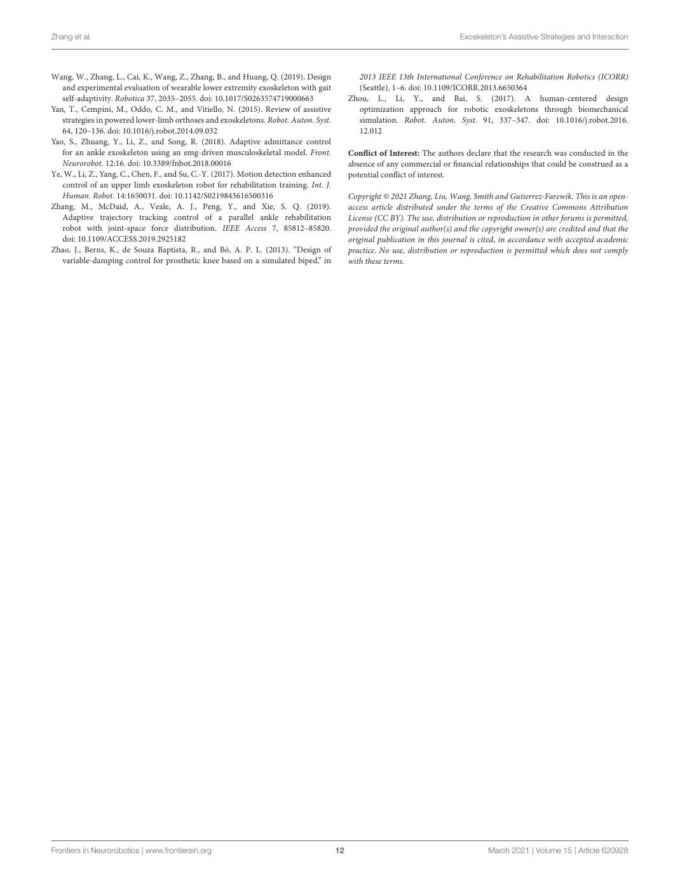

English text extracted from page 12

<pre>
Zhang et al.                                                                                                                Exoskeleton’s Assistive Strategies and Interaction

Wang, W., Zhang, L., Cai, K., Wang, Z., Zhang, B., and Huang, Q. (2019). Design              2013 IEEE 13th International Conference on Rehabilitation Robotics (ICORR)
   and experimental evaluation of wearable lower extremity exoskeleton with gait             (Seattle), 1–6. doi: 10.1109/ICORR.2013.6650364
   self-adaptivity. Robotica 37, 2035–2055. doi: 10.1017/S0263574719000663                 Zhou, L., Li, Y., and Bai, S. (2017). A human-centered design
Yan, T., Cempini, M., Oddo, C. M., and Vitiello, N. (2015). Review of assistive              optimization approach for robotic exoskeletons through biomechanical
   strategies in powered lower-limb orthoses and exoskeletons. Robot. Auton. Syst.           simulation. Robot. Auton. Syst. 91, 337–347. doi: 10.1016/j.robot.2016.
   64, 120–136. doi: 10.1016/j.robot.2014.09.032                                             12.012
Yao, S., Zhuang, Y., Li, Z., and Song, R. (2018). Adaptive admittance control
   for an ankle exoskeleton using an emg-driven musculoskeletal model. Front.              Conflict of Interest: The authors declare that the research was conducted in the
   Neurorobot. 12:16. doi: 10.3389/fnbot.2018.00016                                        absence of any commercial or financial relationships that could be construed as a
Ye, W., Li, Z., Yang, C., Chen, F., and Su, C.-Y. (2017). Motion detection enhanced        potential conflict of interest.
   control of an upper limb exoskeleton robot for rehabilitation training. Int. J.
   Human. Robot. 14:1650031. doi: 10.1142/S0219843616500316                                Copyright © 2021 Zhang, Liu, Wang, Smith and Gutierrez-Farewik. This is an open-
Zhang, M., McDaid, A., Veale, A. J., Peng, Y., and Xie, S. Q. (2019).                      access article distributed under the terms of the Creative Commons Attribution
   Adaptive trajectory tracking control of a parallel ankle rehabilitation                 License (CC BY). The use, distribution or reproduction in other forums is permitted,
   robot with joint-space force distribution. IEEE Access 7, 85812–85820.                  provided the original author(s) and the copyright owner(s) are credited and that the
   doi: 10.1109/ACCESS.2019.2925182                                                        original publication in this journal is cited, in accordance with accepted academic
Zhao, J., Berns, K., de Souza Baptista, R., and Bó, A. P. L. (2013). “Design of            practice. No use, distribution or reproduction is permitted which does not comply
   variable-damping control for prosthetic knee based on a simulated biped,” in            with these terms.

Frontiers in Neurorobotics | www.frontiersin.org                                      12                                             March 2021 | Volume 15 | Article 620928
</pre>

